# Grounding Generative Verification in 3D Content

Shuanglin Li1,2 Jiaying Lin3 Shuquan Ye2

1Southeast University 2Shenzhen Loop Area Institute 3The Hong Kong University of Science and Technology

## Abstract

Recent advances in multimodal large language models (MLLMs) and 3D generation have significantly expanded AI capabilities in understanding and synthesizing 3D content. However, beyond visual fidelity, task-specific correctness grounded in 3D evidence remains a major challenge. We argue that building reliable 3D systems requires not only stronger generation and reasoning, but also verification feedback that identifies unmet requirements and explains their violations, allowing systems to reflect on and refine their outputs. Such feedback must integrate multi-view observations and distinguish genuine inconsistencies from projection-dependent appearances. In this work, we make three contributions. First, we introduce 3DVerifierBench, a benchmark spanning 10 tasks that evaluates decisions, rejection explanations, and responses to controlled changes in specifications and candidates. A human study reveals a 21.6 percentage-point gap between humans and the strongest tested model, GPT-6 Astra, while explanation-aware analysis exposes weaknesses in rejection reliability. Second, we analyze verification across fine-grained factual categories, exposing errors in values and target binding. We develop a scalable pipeline combining multi-view fact extraction, controlled 3D editing, and native annotations to produce 14,126 training examples with contradiction explanations and linked counterfactuals. Third, we examine how verification could support 3D generation through candidate selection and recursive refinement. In human-labeled sixteen-candidate pools, oracle selection improves complete factual success from 26.7% to 90.0%. In a separate eight-input study, human-guided recursive refinement satisfies all seven requirements for every input, compared with three under parallel Oracle@8. Together, our benchmark, analysis, and data pipeline establish a foundation for models to reflect on 3D content through reliable verification feedback.

Project page: https://ai-yeslab.github.io/3DVerifier-page/

## 1 Introduction

Recent advances in multimodal large language models (MLLMs) have extended visual understanding toward increasingly complex spatial reasoning, while progress in 3D generation enables the synthesis and editing of assets with detailed geometry and appearance (Xu et al., 2025; Deng et al., 2025; Li et al., 2026). Together, these developments bring models closer to understanding, creating, and manipulating 3D content through natural language. However, generated assets can still contain geometric artifacts, missing components, and inconsistencies with the requested attributes or structure (Wu et al., 2024; Duggal et al., 2025). Such errors limit their usefulness: An object may look convincing while failing the geometric or functional requirement for which it was created.

To improve these systems, existing research has pursued broader pretraining, targeted post-training, and test-time scaling. These approaches strengthen perceptual representations, align outputs with instructions or preferences, and allocate additional computation to candidate search (Xu et al., 2025; Deng et al., 2025; Ye et al., 2025; Zhou et al., 2025). A system can also reflect on its output and use feedback to guide a subsequent attempt (Madaan et al., 2023; Shinn et al., 2023). For 3D content, this requires identifying which requirements are unmet and explaining why. We study this step through 3D verification, which checks a candidate against explicit requirements and explains contradictions. Despite progress in general visual verification (Zhang et al., 2026b), the reliability of such feedback across diverse 3D tasks remains underexplored.

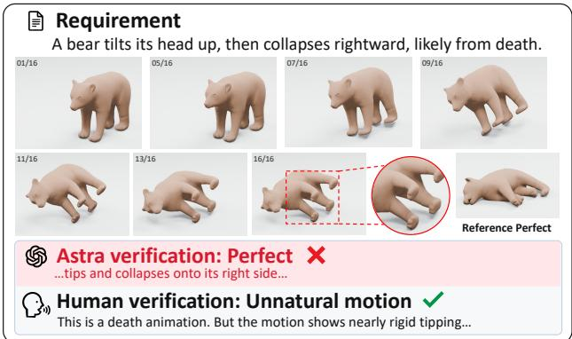

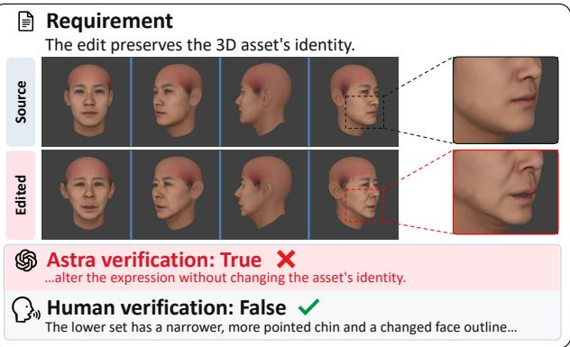

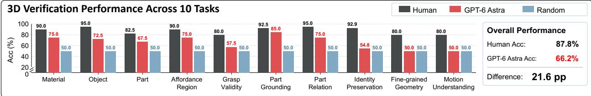  
Figure 1: Even state-of-the-art MLLMs, e.g., GPT-6 Astra, still struggle with 3D content verification. Top: Astra mistakenly accepts an unnatural rightward collapse and an identity-changing face edit. Bottom: We found that Astra is still far behind human performance across all tasks in our 3DVerifierBench. Views and text are abbreviated for display.

Realizing this goal in 3D, however, involves challenges beyond those of image-based verification. Native 3D perception requires specialized representations and language alignment, as illustrated by point-cloud language models (Xu et al., 2025; Deng et al., 2025); these capabilities cannot simply be assumed in an image-based MLLM. Although multi-view rendering makes 3D assets accessible to such models, it provides partial, projection-dependent observations rather than the complete geometry. A verifier must consequently associate parts across views, resolve occlusion, and distinguish geometric diferences from changes in viewpoint or appearance. For grasping, identity, and motion, it must further establish whether the specific constraint holds, rather than merely recognize the object or action. The two cases in Figure 1 illustrate this distinction: GPT-6 Astra recognizes a rightward collapse but misses its unnatural motion, and accepts identity preservation despite a changed chin and face outline. These failures motivate both a systematic assessment of current verification ability and supervision that connects judgments to the relevant 3D evidence.

Motivated by these challenges, our work addresses three connected questions, from measuring the capability gap to supporting its development and examining its downstream value.

How far are current MLLMs from human-level 3D verification? We introduce 3DVerifierBench, a human-reviewed benchmark with 2,581 examples across ten complementary tasks. A common answer-and-explanation interface covers object properties, parts, relations, afordance regions, grasps, identity, reference geometry, and motion. In addition to individual judgments, linked counterfactuals test whether predictions respond consistently to changes in requirements or candidates. Our experiments show that humans achieve 87.8% task overall accuracy, exceeding the strongest tested model, GPT-6 Astra, by 21.6 percentage points (Figure 1, bottom). The benchmark thus establishes both the breadth and the remaining limitations of current 3D verification.

What capabilities and supervision are needed to strengthen 3D verification? Our analysis shows that recognizing an object or action does not ensure verification of the decisive attribute, target, or geometric condition. Identity preservation, grasp validity, and motion compliance are particularly weak, while explanation checks reveal that even correct rejections can miss the reference contradiction. These findings motivate supervision that links a decision to a specific fact and its evidence. Motivated also by prior work on training multimodal verifiers (Zhang et al., 2026b), we develop an automated pipeline for large-scale verification data curation, combining multi-view fact extraction, controlled requirement and candidate changes, and native task annotations. With this pipeline, we produce a large-scale dataset with 14,126 samples across diverse tasks, which provides a data foundation for scaling domain-specific verification supervision.

How can a 3D generation model reflect by verifying reliably? We examine both selection among existing candidates and recursive refinement of unsatisfied requirements. In human-labeled sixteen-candidate pools, oracle selection improves complete factual success by 63.3 percentage points. In a separate eight-input study, human-guided recursive refinement satisfies all seven requirements for every input, compared with three under parallel Oracle@8. Together, these results demonstrate substantial downstream headroom for reliable verification, connecting the capability gap and data foundation to the goal of reflection in 3D generation.

## 2 Related Work

Recent 3D-language models connect native 3D representations to language and evaluate object, part, spatial, and embodied understanding (Xu et al., 2025; Deng et al., 2025; Wang et al., 2025a; Zhang et al., 2026a). In parallel, 3D generation benchmarks and evaluators measure semantic alignment, human preference, geometric quality, and generation defects (Wu et al., 2024; Zhang et al., 2025a;b; Jia et al., 2026; Duggal et al., 2025; Zhao et al., 2026). Together, these works substantially improve our ability to describe and assess 3D content. However, predicting a property or scoring an asset does not directly measure whether a model can verify a specific requirement, reject a plausible but incorrect candidate, and identify heterogeneous 3D evidence that makes it wrong. We focus on this verifier-side evaluation against human judgments, with scope comparisons to prior work in Figure 2.

## 3 3DVerifierBench

To benchmark AI against human verification, 3DVerifierBench unifies 10 tasks under a common interface, evaluating reliability across decisions, explanations, and consistency. Together, these dimensions assess whether a verifier can provide correct, informative, and consistent feedback for reflection in 3D generation.

Unified Verification Interface and Task Taxonomy. Given task instructions I, a claim $C ,$ candidate evidence $E ^ { \mathrm { c a n d } }$ , and optional reference evidence $E ^ { \mathrm { r e f } }$ , a verifier returns a binary answer $\hat { y } \in \{ \mathrm { T r u e } , \mathrm { F a l s e } \}$ and an explanation eˆ: $\boldsymbol x = ( \boldsymbol I , \boldsymbol C , \boldsymbol E ^ { \mathrm { c a n d } } , \boldsymbol E ^ { \mathrm { r e f } } ) , f _ { \theta } ( \boldsymbol x ) = ( \hat { \boldsymbol y } , \hat { \boldsymbol e } )$ . We denote $\sigma = ( C , E ^ { \mathrm { r e f } } )$ as the requirement, and the candidate may be an asset, part, grasp, or animation. Verification checks whether 3D evidence fulfills requirements, rather than general plausibility or visual quality. For negative cases, reference explanations explicitly pinpoint the violated requirement and conflicting evidence. Figure 3 details the 3DVerifierBench architecture and statistics, which instantiates this common interface across complementary forms of 3D verification requirements.

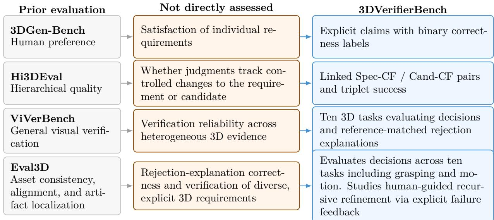  
Figure 2: Evaluation scope relative to prior work. Prior work (Zhang et al., 2025a;b; 2026b; Duggal et al., 2025) emphasizes preference, hierarchical quality, general visual verification, or asset-level consistency and artifact localization. Our 3DVerifierBench targets complementary verifier-side questions through explicit requirements, controlled counterfactuals, heterogeneous 3D evidence, and verification-guided refinement.

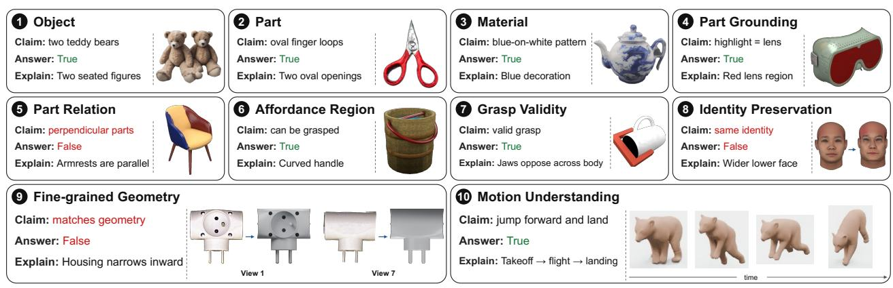  
Figure 3: Overview of 3DVerifierBench. Each task presents task-specific 3D evidence together with a verification requirement, reference answer, and explanation. Evidence spans multi-view objects, marked parts and regions, grasp poses, identity comparisons, photo-to-geometry comparisons, and motion sequences. The table summarizes the number of examples and input evidence for each task, totaling 2,581 examples. Mat., Ground., Af. Reg., and FineGeo. denote Material, Part Grounding, Afordance Region, and Fine-grained Geometry, respectively. Views and text are abbreviated.

Answer, Explanation, and Consistency Metrics. We evaluate decisions, reasons, and responses to changes, and use Balanced Accuracy (BA) within each task and equal task weights overall.

For each task t, we report balanced accuracy, $\mathrm { B A } _ { t } = \textstyle { \frac { 1 } { 2 } } ( \mathrm { A c c } _ { T , t } + \mathrm { A c c } _ { F , t } )$ , and aggregate performance with an overall accuracy $\begin{array} { r } { \mathrm { O A } = \frac { 1 } { 1 0 } \sum _ { t = 1 } ^ { 1 0 } \mathrm { B A } _ { t } . } \end{array}$ . To distinguish a correct rejection from a supported explanation, a reference-semantic Judge checks the explanations of correctly rejected negatives. Let FalseJointt denote joint answer-and-explanation success over all negatives. We define ExpB $\mathrm { A } _ { t } =$ $\begin{array} { r } { \frac { 1 } { 2 } ( \operatorname { A c c } _ { T , t } + \operatorname { F a l s e J o i n t } _ { t } ) } \end{array}$ and $\begin{array} { r } { \mathrm { E x p O A } = \frac { 1 } { 1 0 } \sum _ { t = 1 } ^ { 1 0 } \mathrm { E x p B A } _ { t } } \end{array}$ . The Judge receives the task, claim, and both explanations, without visual evidence or model identity; failure indicates a reference-semantic mismatch. We further perform human inspection to validate the Judge in Sec. 5.2.

To test whether judgments track the requirement and candidate, we also evaluate linked counterfactuals. A pair contains a positive anchor and a related negative; a triplet contains the anchor and both specification-side and candidate-side negatives. All linked answers must be correct, and explanation-aware variants also check negative explanations. Appendix C defines the metrics and Appendix E.5 reports the eligible comparison sets.

## 4 Dataset and Benchmark Construction

To support reliable verification feedback, supervision should identify not only whether a candidate is wrong, but which requirement is contradicted by the evidence. We therefore combine existing 3D resources with controlled interventions and native supervision, using three complementary strategies to construct task-specific data. The pipeline is shown in Figure 4 with details provided in Appendix B.

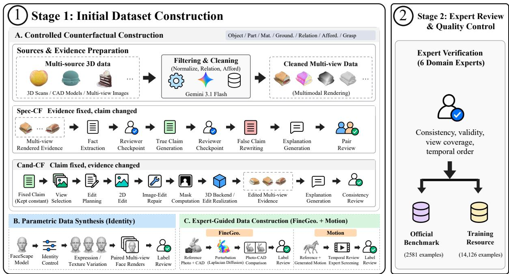  
Figure 4: Our pipeline. Reviewed evidence establishes positive anchors. Spec-CF changes the requirement under fixed evidence, whereas Cand-CF changes the candidate under the original requirement. Native annotations and task-specific evidence complement these controlled mutations. Automated checks, modelassisted review, and human review together produce the benchmark.

Stage1: Initial Dataset Construction. We employ 3 strategies to construct data for the 10 tasks:

• Controlled Counterfactual Construction. For {Object, Part, Mat., Ground., Relation, Af. Reg., Grasp}, we combine object-level assets and multi-view evidence from 3DGen-Bench,

DB-3DME, and Hi3DBench (Zhang et al., 2025a; Jia et al., 2026; Zhang et al., 2025b) with part annotations from PartNeXt and GAPartNet and grasp supervision from ACRONYM (Wang et al., 2025a; Geng et al., 2023; Eppner et al., 2021). Starting from a positive anchor (a, σ, True) where candidate a satisfies a reviewed specification σ, we construct negative pairs via two counterfactual mechanisms: Specification-side counterfactuals (Spec-CF) modify a key requirement while fixing a, producing (a, σ′, False). Candidate-side counterfactuals (Cand-CF) modify the asset, marked region, part pair, or contact while fixing the specification, producing (a′, σ, False). Native annotations take precedence over synthetic edits when available, and candidate evaluation links are retained only when both records share identical model-visible claims. For Afordance Region, negative claims are verified by human review. Two domain experts manually spot-check 10% of the outputs at each model-assisted review stage shown in Figure 4, including the two reviewer checkpoints in Spec-CF, the final pair review in Spec-CF, and the consistency review in Cand-CF.

• Parametric Data Synthesis. For {Identity}, we leverage FaceScape’s bilinear model (Yang et al., 2020) to construct 200 balanced face pairs. Specifically, identity variations are sampled using standardized identity coordinates, with labels assigned based on whether these identity coeficients are modified. To ensure that these parameter shifts yield human-perceptible identity diferences, 6 domain experts were invited to establish explicit thresholds and validate the generated pairs. To systematically evaluate robustness against non-identity attributes, i.e., expression and texture, we vary them as nuisance factors across 4 conditions: (1) nearly gray texture with minimal changes, (2) texture changes only, (3) expression changes only, (4) changes to both.

• Expert-Guided Data Construction. For {FineGeo., Motion}, each has 6 domain experts guiding data construction and annotation. For FineGeo., we apply Laplacian difusion (Desbrun et al., 1999) to ground-truth T-LESS models (Hodan et al., 2017), with experts selecting surface regions and perturbation parameters. Original and perturbed models yield positive and negative photograph-CAD comparisons against fixed reference photographs. For Motion, we combine reference motions from AnimalML3D (Yang et al., 2024) with sequences generated by AnimateAnyMesh (Wu et al., 2025b) and Animate3D (Jiang et al., 2024). Experts classify motions as Correct, Unnatural Motion, Incorrect Motion, or Deformation Artifacts, retaining only samples with unanimous agreement.

Stage2: Expert Review and Quality Control. We further invited 6 additional, non-overlapping domain experts to verify benchmark data. Checks cover annotation consistency, perturbation bounds, mesh validity, view coverage, rendering completeness, and temporal order where applicable. Source-specific preprocessing and validation details are in Appendix B.

## 4.1 Native Supervision and Quality Control

When native labels already define the relevant distinction, we use them directly instead of forcing every task through the same editing backend. Part and relation annotations, action semantics, grasp outcomes, identity parameters, reference photographs, and reviewed motion sequences provide task-specific evidence for the corresponding claims. This keeps the verification interface unified while allowing the underlying evidence to match the semantics of each task.

Benchmark examples undergo task-specific human review for label correctness, evidence suficiency, and explanation quality. Excluding benchmark source groups and their descendants from the 17,223-example construction pool yields a 14,126-example Training Resource with 4,011 source groups and zero benchmark–training source-group overlap (Appendix A).

Table 1: Results on 3DVerifierBench. All values represent the binary Balanced Accuracy, except for the 4-CLS column (four-class Exact Match accuracy). Bold marks the best model score.
<table><tr><td rowspan="2">Model / Evaluator</td><td rowspan="2"></td><td rowspan="2"></td><td rowspan="2"></td><td rowspan="2">Object Part Mat. Ground. Relation Aff. Reg. Grasp Identity FineGeo.</td><td rowspan="2"></td><td rowspan="2"></td><td rowspan="2"></td><td rowspan="2"></td><td colspan="2">Motion</td><td rowspan="2">Overall ExpOA</td></tr><tr><td>4-CLS Binary</td><td></td></tr><tr><td colspan="10">Human Performance</td></tr><tr><td>Human</td><td>95.0 82.5 90.0</td><td></td><td>92.5</td><td>95.0</td><td>90.0</td><td>80.0</td><td>92.9</td><td>80.0</td><td>70.0</td><td>80.0 87.8</td><td></td></tr><tr><td></td><td></td><td></td><td></td><td></td><td>Baselines</td><td></td><td></td><td></td><td></td><td></td><td></td></tr><tr><td colspan="10"></td></tr><tr><td>Random guess</td><td>50.0</td><td>50.0 50.0</td><td>50.0</td><td>50.0</td><td>50.0</td><td>50.0</td><td>50.0</td><td>50.0</td><td>25.0</td><td>50.0 50.0</td><td></td></tr><tr><td>GPT-6 Astra</td><td>75.3</td><td>72.1 71.5</td><td>89.6</td><td>Proprietary MLLMs 90.3</td><td>76.3</td><td>56.0</td><td>55.5</td><td>50.0</td><td>54.5</td><td>57.5 69.4</td><td>65.8</td></tr><tr><td>Gemini-3.8-Flash</td><td>76.5</td><td>69.1 70.4</td><td>85.5</td><td>87.7</td><td>77.3</td><td>54.5</td><td>57.0</td><td>50.0</td><td>40.3</td><td>56.0 68.4</td><td>57.8</td></tr><tr><td>GPT-5.6-Sol</td><td>74.5</td><td>69.1 66.2</td><td>84.4</td><td>80.2</td><td>62.7</td><td>53.5</td><td>50.5</td><td>51.7</td><td>50.7</td><td>56.7 64.9</td><td>59.6</td></tr><tr><td colspan="10">Open-Source MLLMs</td></tr><tr><td>Gemma-4-31B</td><td>76.2</td><td>62.3 69.9</td><td></td><td></td><td>52.8</td><td>59.0</td><td>58.5</td><td>45.0</td><td>37.3</td><td>56.0 62.6</td><td>52.2</td></tr><tr><td>Qwen3.5-122B-A10B</td><td>70.6</td><td>64.7</td><td>74.5 75.7</td><td>72.3 67.6</td><td>52.0</td><td>58.0</td><td>52.5</td><td>53.3</td><td>26.9</td><td>50.7 61.6</td><td>48.9</td></tr><tr><td>Qwen3.6-35B-A3B</td><td>62.3</td><td>59.8</td><td>70.8 60.0 68.7</td><td>64.8</td><td>49.5</td><td>66.5</td><td>59.0</td><td>53.3</td><td>36.6</td><td>50.7 59.5</td><td>51.3</td></tr><tr><td>InternVL3.5-38B</td><td>66.2</td><td>57.8</td><td>63.4 54.5</td><td></td><td>56.2</td><td>59.0</td><td>49.5</td><td>50.0</td><td>26.1</td><td>52.2 56.7</td><td>44.5</td></tr><tr><td>GLM-4.6V-106B</td><td>66.7</td><td>58.1</td><td>62.0 57.0</td><td>57.8 54.2</td><td>50.0</td><td>50.0</td><td>49.5</td><td>50.0</td><td>44.0</td><td>53.0 55.0</td><td>50.9</td></tr><tr><td>OmniVerifier-7B</td><td>58.3</td><td>53.7</td><td>53.7 50.0</td><td>46.6</td><td>52.7</td><td>51.5</td><td>50.0</td><td>51.7</td><td>21.6</td><td>52.2 52.0</td><td>30.0</td></tr><tr><td>Qwen2.5-VL-7B-Instruct</td><td>54.4</td><td>51.2</td><td>50.9</td><td></td><td>50.4</td><td>50.0</td><td>50.0</td><td>45.0</td><td>16.4</td><td>50.0 50.2</td><td>22.1</td></tr><tr><td></td><td></td><td></td><td>50.0</td><td>50.0</td><td></td><td></td><td></td><td></td><td></td><td></td><td></td></tr></table>

## 5 Experiments

## 5.1 Setup

We evaluate GPT-6 Astra (OpenAI, 2026a), GPT-5.6-Sol (OpenAI, 2026b), Gemini-3.8-Flash (Google DeepMind, 2026), Qwen3.5-122B-A10B and Qwen3.6-35B-A3B (Qwen Team, 2026a;b), GLM-4.6V-106B (V Team et al., 2025), Gemma-4-31B (Gemma Team, 2026), InternVL3.5-38B (Wang et al., 2025b), Qwen2.5-VL-7B-Instruct (Bai et al., 2025), and OmniVerifier-7B (Zhang et al., 2026b) on all 2,581 examples. Direct inference uses temperature 0, top-p 1, and a 512-token output limit. Static evidence is fixed across models. Human scores use a 400-example subset with 40 examples per task. Confidence intervals resample task-specific clusters, retaining linked examples together and using paired draws for human-model diferences (Appendix C). Motion Understanding uses native MP4 when supported and a sixteen-frame sheet otherwise (Appendix D).

## 5.2 How Good Are Current MLLMs in 3D Verification?

Table 1 shows the experimental results on 3DVerifierBench. GPT-6 Astra achieves the highest Overall score of 69.4%, followed by Gemini-3.8-Flash at 68.4%. Astra reaches 90.3% on Part Relation and 89.6% on Part Grounding, but only 55.5% on Identity and 50.0% on Fine-grained Geometry (FineGeo.). These weaknesses extend across models: None exceeds 59.0% on Identity or 53.3% on Fine-grained Geometry. We also provide an analysis of human performance on its subset, which is detailed in Appendix G. We observe that the performance of existing MLLMs is still far behind humans. For example, humans achieve an 87.8% Overall score versus Astra’s 66.2%. Note that this result difers from the one in Table 1 due to diferent testing data.

Useful feedback requires correct rejections and relevant reasons. Under reference-semantic explanation checking, ExpOA falls below Overall score by 3.6 to 28.1 points across models. Astra remains strongest at 65.8% (95% CI: [64.4, 67.2]%). GPT-5.6-Sol overtakes Gemini-3.8-Flash despite its lower answer score. Across all models, 36.5% of 9,488 correct rejections fail the reference-semantic Judge (Appendix H).

We additionally validate the explanation Judge against independent human assessment, as shown in

Table 2: Human validation of the explanation Judge. We sample 30 correctly rejected model responses per task. The numerical value in the bottom row is the Agreement rate (%), which represents the ratio of identical Judge and human assessments of explanation validity.
<table><tr><td>Material</td><td>Object</td><td>Part</td><td>Aff. Reg.</td><td>Grasp</td><td>Ground.</td><td>Relation</td><td>Identity</td><td>FineGeo.</td><td>Motion</td><td>Overall</td></tr><tr><td>93.3</td><td>90.0</td><td>93.3</td><td>83.3</td><td>86.7</td><td>86.7</td><td>100.0</td><td>93.3</td><td>100.0</td><td>83.3</td><td>91.0</td></tr></table>

Table 2. We sample 30 correctly rejected responses per task, totaling 300 explanations. The Judge agrees with human assessment by 91.0%; 6.0% are accepted by the Judge but rejected by humans, while 3.0% are rejected by the Judge but accepted by humans. These results support the use of the Judge for aggregate explanation analysis, while the targeted audits in Appendix H examine specific geometric and deformation failures.

We also provide controlled experiments to test whether judgments respond correctly to changes in requirements or candidates, as detailed in Appendix E.5. On 615 human-validated triplets, Gemini-3.8-Flash has the highest answer-only success at 49.6%, while Astra reaches 46.5% and leads the explanation-aware score at 40.5% (Table E8). These results test consistency within linked comparisons, complementing the Overall score.

## 5.3 Limitations of MLLMs in 3D Verification

To identify concrete bottlenecks in reliable verification feedback, we present representative failures in Figure 5. These examples reveal errors in fine-grained geometry, spatiotemporal validity, and the grounding of claims in visual evidence. We summarize them as ten failure modes in the findings below. Appendix H further provides details of category-wise quantitative analysis of these verification failures.

## 5.4 How Does Evidence Representation Afect Verification?

Multi-view provides a practical protocol for 3D verification. Multi-view representation generally performs better than raw 3D input, indicating that rendering 3D evidence into views is currently a more efective way to elicit reliable judgments from existing MLLMs. We compare multiview RGB and raw OBJ input on matched Object, Part, and Material subsets in Table 3(a). The multi-view results are also broadly consistent with the corresponding results in Table 1. This choice preserves the core dificulty of 3D verification, requiring models to aggregate partial observations, resolve occlusions, associate parts across views, and disentangle underlying geometry from viewpoint or appearance changes. As an early benchmark for 3D verifiers, 3DVerifierBench therefore adopts multi-view rendering as a practical and extensible protocol for grounding verification in 3D content.

Native point-cloud LLMs show strong response bias and unstable output formatting under our verifier interface; we therefore report them only in Appendix E.4.

For motion, no single representation is always the best. Motion verification requires both temporal dynamics and geometric evidence. We evaluate three representations on the Motion Understanding task in Table 3(b): 16 uniformly sampled frames, raw 3D motion in .obj sequences, and native video. We report binary and 4-class Accuracy. No single representation consistently outperforms others across all models and metrics. Native video is the highest in binary (59.7%), whereas 16-frames yield the highest in 4-class (43.8%). The preferred representation also varies by model: Gemini-3.8-Flash benefits most from native video, whereas Qwen3.6-35B-A3B excels with .obj sequences. These results show that denser temporal evidence alone does not guarantee superior

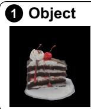

Claim: The cake has a six-layer internal structure.

Human: No. It has seven layers.

Astra: Yes. It shows six alternating cake and cream layers.

## 3 Material

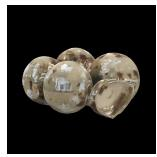

Claim: The surface has a stone-like appearance with a dusty beige color.

Human: No. It looks metallic and reflective.

Astra: Yes. It has a polished, stone-like appearance.

## 5 Part Relation

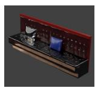

Claim: The red part directly touches the blue part.

Human: No. The two parts do not directly touch.

Astra: Yes. The blue cushion rests against the red backrest.

## 7 Grasp Validity

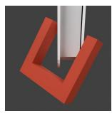

Claim: The displayed

Human: No. The jaws are on adjacent sides and will slip.

Astra: Yes. The jaws straddle the object with opposing contacts.

## 9 Fine-grained Geometry

Reference

Generated

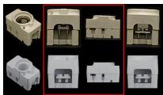

8曰 Human: No. The middle bulges; reference sides are straighter.

Astra: Yes. It closely matches the reference's main geometry.

## 2 Part

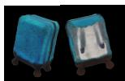

Claim: The handle has an arched shape.

Human: No. There is no handle. Astra: Yes. The handle forms a rounded arch.

## 4 Part Grounding

Claim: The highlighted region is the seat cushion.

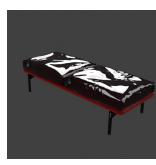

Human: No. It is the support box under the cushion.

Astra: Yes. The highlighted region covers the seat cushions.

## 6 Affordance Region

Claim: The highlighted region is suitable for pressing.

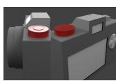

Human: No. It is a dial for grasping or turning, not pressing.

Astra: Yes. It is a raised control suitable for pressing.

## 8 Identity Preservation

Claim: The edit preserves the 3D asset's identity.

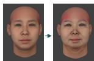

Human: No. Fuller lower face; rounder, wider chin.

Astra: Yes. Changes in expression do not alter its identity.

## 10 Motion Understanding

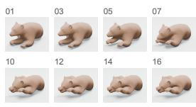  
8 selected frames from the 16-frame Astra input

Claim: The bear naturally falls asleep.

Human: No. The right forelimb and muzzle merge into one mass.

S Astra: Yes. It draws its forelimbs inward into a still sleeping pose.

1. Repeated structures miscounted.

## Findings: Limitations of MLLMs in 3D Verification

2. Nonexistent parts hallucinated from claim premises.

3. Material descriptions accepted despite conflicting reflectance cues.

4. Highlighted regions assigned incorrect semantic part labels.

5. Direct contact inferred without checking actual spatial relations.

6. Action-specific afordances confused across similar controls.

7. Adjacent grasp contacts mistaken for opposing contacts.

8. Identity-altering shape changes mistaken for expression changes.

9. Local curvature and contour mismatches are overlooked despite multi-view evidence.

10. Deformation artifacts in motion sequences go undetected.

Figure 5: Typical GPT-6 Astra failure cases and findings of limitations of MLLMs in 3D verification.

motion verification; rather, performance depends on a model’s ability to extract and integrate spatio-temporal cues. Consequently, we adopt native video / 16-frame sampling as the default settings of our benchmark.

Table 3: Evidence representation ablations. (a) Multi-view RGB v.s. raw 3D input. Each cell reports multi-view / raw OBJ Balanced Accuracy (%). (b) Motion verification under diferent evidence representations. Each cell reports binary / 4-class Acc.  
(a) Multi-view v.s. raw 3D
<table><tr><td>Model</td><td>Object</td><td>Part</td><td>Material</td><td>Avg.</td></tr><tr><td>Gemini-3.8</td><td>62.50 56.25</td><td>68.75</td><td>18.75 75.00</td><td>56.25 68.75 43.75</td></tr><tr><td>Gemma-4</td><td>62.50 37.50</td><td>62.50</td><td>50.00 68.75</td><td>37.50 64.58 41.67</td></tr><tr><td>Qwen3.5</td><td>68.75</td><td>50.00 62.50</td><td>50.00 62.50</td><td>50.00 64.58 50.00</td></tr><tr><td>Qwen3.6</td><td>56.25</td><td>50.00 68.75</td><td>50.00 68.75</td><td>50.00 64.58 50.00</td></tr><tr><td>Mean</td><td>62.50</td><td>48.44 65.63</td><td>42.19 68.75</td><td>48.4465.63 46.35</td></tr></table>

(b) Motion: frames v.s. 3D seq. v.s. video
<table><tr><td>Model</td><td>Frames</td><td>3D OBJ seq.</td><td>Native Video</td></tr><tr><td>Gemini-3.8</td><td>65.3 / 56.2</td><td>49.4 / 40.6</td><td>68.2 /50.0</td></tr><tr><td>Gemma-4</td><td>49.4 / 43.8</td><td>63.5 / 46.9</td><td>63.5 43.8</td></tr><tr><td>Qwen3.5</td><td>55.1 1/ 31.2</td><td>48.8 / 25.0</td><td>54.7 / 34.4</td></tr><tr><td>Qwen3.6</td><td>56.9 43.8</td><td>58.2 50.0</td><td>52.4/ 40.6</td></tr><tr><td>Mean</td><td>56.7 / 43.8</td><td>55.0 / 40.6</td><td>59.7 / 42.2</td></tr></table>

## 5.5 How Can Verification Feedback Help 3D Generation Models Reflect?

We examine how reliable verification feedback can help 3D systems reflect on their outputs. Parallel selection measures the value of recognizing successful candidates, while human-guided recursive refinement examines how explicit failure feedback can guide subsequent revisions.

Parallel selection. For 40 source images, we fix seven factual requirements before generation and obtain eight candidates each from Pixal3D and Hunyuan3D-2.1 (Team Hunyuan3D et al., 2025), forming a sixteen-candidate pool per input. All candidates are reviewed by multiple humans with adjudication. Table 4 shows that human-oracle selection raises full factual success from 26.7% under uniform random selection to 90.0%, while Strict Full rises from 16.6% to 85.0%. Selection by GPT-6 Astra also improves over random, approaches human-level performance in factual success rate, but stays below the human oracle. Thus, the oracle results quantify the selection headroom available from reliable verification rather than the performance of an existing automatic verifier.

Table 4: What reliable verification could enable in 3D generation. Left: candidate selection from sixteen-candidate pools over 40 inputs. Right: human-guided recursive refinement on eight inputs. Full requires all seven facts; Strict additionally requires no severe defects and source fidelity.
<table><tr><td colspan="3">Parallel Selection</td></tr><tr><td>Selector</td><td>Fact Sat. Full</td><td>Strict</td></tr><tr><td>Random</td><td>80.8 26.7</td><td>16.6</td></tr><tr><td>GPT-6 Astra</td><td>90.4 55.0</td><td>45.0</td></tr><tr><td>Human Oracle</td><td>98.2 90.0</td><td>85.0</td></tr></table>

Recursive Refinement
<table><tr><td>Setting</td><td>Full Success</td></tr><tr><td>Parallel Oracle@8</td><td>3/8 (37.5)</td></tr><tr><td>Recursive</td><td>8/8 (100.0)</td></tr><tr><td>w. no severe defect</td><td>7/8 (87.5)</td></tr><tr><td>w. source fidelity</td><td>6/8 (75.0)</td></tr></table>

Recursive refinement. Selection cannot recover a requirement that is absent from all sampled candidates. We therefore study eight inputs whose initial Hunyuan3D-2.1 generation violates at least one of the seven facts. After each generation, a human verifier identifies unmet requirements and guides either regeneration from a revised 2D condition or targeted mesh editing with VecSet-Edit (Hsiao et al., 2026). Recursive refinement satisfies all seven facts for all 8/8 cases, although only 7/8 final assets avoid severe defects and 6/8 additionally preserve source fidelity. We additionally compare against a parallel oracle baseline, Parallel Oracle@8, which uses a fixed pool of eight independently generated candidates and selects a successful candidate whenever one exists. In contrast, it succeeds on only $3 / 8$ cases (37.5%). These human-guided results suggest that repeated feedback and revision can satisfy requirements not met by parallel candidates, while also showing that factual success alone does not guarantee asset quality or source fidelity.

Figure 6 illustrates one trajectory in which repeated verification identifies an unresolved grille requirement and guides a subsequent targeted correction.

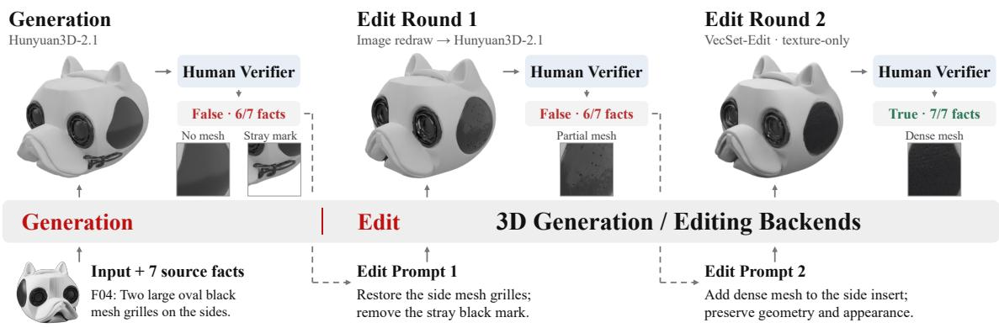  
Figure 6: Human-guided 3D recursive refinement trajectory. Given the source image and target facts, initial generation exhibits a missing side grille and a surface artifact (left, 6/7 facts). A revised one eliminates the artifact but leaves the grille incomplete (middle, 6/7 facts). Subsequent edit fully restores the mesh appearance and satisfies all facts (right, 7/7 facts). Intermediate 2D conditions and masks are omitted.

## 6 Discussion and Conclusion

To reflect on a 3D output, a system must determine whether it meets its requirements and explain any violations. 3DVerifierBench shows that current models often struggle to provide this feedback, even when generated content looks plausible. Answer, explanation, and counterfactual-consistency evaluations reveal failures to identify decisive facts, their targets, and relevant contradictions. Our construction pipeline provides structured data to support training on these distinctions. Humanoracle selection and human-guided refinement illustrate how better feedback can help select and revise 3D assets, although satisfying explicit facts does not ensure overall quality or source fidelity. These findings motivate more reliable evidence-grounded feedback for future 3D generation systems.

## AI use statement

In this work, we used generative AI tools for research ideation and execution, including assistance with research methodology, experimental design, implementation, and the generation of synthetic data. In particular, generative AI tools were used in parts of our model-assisted data construction pipeline, including multi-view fact extraction, verification-claim construction and review, and the generation and editing of counterfactual candidates. We have not used generative AI tools for formulating or proving mathematical claims, and other required-disclosure tasks that are not part of this work are not applicable. Additionally, we used generative AI tools to aid or polish writing and for retrieval and discovery, including identifying potentially relevant prior work. We have reviewed all AI-assisted work. AI-assisted data construction was subject to automated checks, model-assisted review, and human review, and experimental outputs and analyses used in the paper were checked by the authors. We take responsibility for the final content of this work, including text, claims, data, code, analyses, or artifacts produced with the aid of generative AI.

## Ethics statement

For facial geometry, we use the FaceScape bilinear statistical model rather than participant-level scans. The model compresses the identity variation of 847 subjects into a 50-dimensional PCA space, from which we synthesize facial geometry. We do not use or redistribute the original FaceScape images, textures, subject-level meshes, demographic metadata, or identity-specific records.

## References

Shuai Bai, Keqin Chen, Xuejing Liu, Jialin Wang, Wenbin Ge, Sibo Song, Kai Dang, Peng Wang, Shijie Wang, Jun Tang, Humen Zhong, Yuanzhi Zhu, Mingkun Yang, Zhaohai Li, Jianqiang Wan, Pengfei Wang, Wei Ding, Zheren Fu, Yiheng Xu, Jiabo Ye, Xi Zhang, Tianbao Xie, Zesen Cheng, Hang Zhang, Zhibo Yang, Haiyang Xu, and Junyang Lin. Qwen2.5-vl technical report. arXiv preprint arXiv:2502.13923, 2025.

Black Forest Labs. FLUX.2 [klein] 9B. https://huggingface.co/black-forest-labs/FLUX.2-klein-9B, 2026. Model repository, accessed 2026-09-26.

Chaoqi Chen, Qile Xu, Wenjun Zhou, and Hui Huang. Pointllm-r: Enhancing 3d point cloud reasoning via chain-of-thought. In Christopher P. Redmann, Justin Solomon, and Mirela Ben-Chen, editors, Proceedings of the Special Interest Group on Computer Graphics and Interactive Techniques Conference, SIGGRAPH Conference Papers 2026, Los Angeles, CA, USA, July 19-23, 2026, pages 190:1–190:12. ACM, 2026. doi: 10.1145/3799902.3811081. URL https://doi.org/10.1145/3799902.3811081.

Jaemin Cho, Yushi Hu, Jason Baldridge, Roopal Garg, Peter Anderson, Ranjay Krishna, Mohit Bansal, Jordi Pont-Tuset, and Su Wang. Davidsonian scene graph: Improving reliability in fine-grained evaluation for text-to-image generation. In B. Kim, Y. Yue, S. Chaudhuri, K. Fragkiadaki, M. Khan, and Y. Sun, editors, International Conference on Learning Representations, volume 2024, pages 15625–15645, 2024. URL https://proceedings.iclr.cc/paper\_files/paper/2024/file/446905abfec9db8856f7f7465bbd55 52-Paper-Conference.pdf.

Jiajun Deng, Tianyu He, Li Jiang, Tianyu Wang, Feras Dayoub, and Ian Reid. 3d-llava: Towards generalist 3d lmms with omni superpoint transformer. In 2025 IEEE/CVF Conference on Computer Vision and Pattern Recognition (CVPR), pages 3772–3782, 2025. doi: 10.1109/CVPR52734.2025.00357.

Mathieu Desbrun, Mark Meyer, Peter Schröder, and Alan H. Barr. Implicit fairing of irregular meshes using difusion and curvature flow. In Proceedings of the 26th Annual Conference on Computer Graphics and Interactive Techniques, SIGGRAPH ’99, pages 317–324, USA, 1999. ACM Press/Addison-Wesley Publishing Co. ISBN 0201485605. doi: 10.1145/311535.311576. URL https://doi.org/10.1145/311535.311576.

Shivam Duggal, Yushi Hu, Oscar Michel, Aniruddha Kembhavi, William T. Freeman, Noah A. Smith, Ranjay Krishna, Antonio Torralba, Ali Farhadi, and Wei-Chiu Ma. Eval3d: Interpretable and fine-grained

evaluation for 3d generation. In 2025 IEEE/CVF Conference on Computer Vision and Pattern Recognition (CVPR), pages 13326–13336, 2025. doi: 10.1109/CVPR52734.2025.01244.

Clemens Eppner, Arsalan Mousavian, and Dieter Fox. Acronym: A large-scale grasp dataset based on simulation. In 2021 IEEE International Conference on Robotics and Automation (ICRA), pages 6222–6227, 2021. doi: 10.1109/ICRA48506.2021.9560844.

Gemma Team. Gemma 4 technical report, 2026. URL https://arxiv.org/abs/2607.02770.

Haoran Geng, Helin Xu, Chengyang Zhao, Chao Xu, Li Yi, Siyuan Huang, and He Wang. Gapartnet: Cross-category domain-generalizable object perception and manipulation via generalizable and actionable parts. In 2023 IEEE/CVF Conference on Computer Vision and Pattern Recognition (CVPR), pages 7081–7091, 2023. doi: 10.1109/CVPR52729.2023.00684.

Google DeepMind. Gemini 3.8 Flash. https://deepmind.google/models/gemini/flash/, 2026.

Tomas Hodan, Pavel Haluza, Stepan Obdrzalek, Jiri Matas, Manolis Lourakis, and Xenophon Zabulis. T-LESS: An RGB-D dataset for 6D pose estimation of texture-less objects. In 2017 IEEE Winter Conference on Applications of Computer Vision (WACV), pages 880–888. IEEE, March 2017. doi: 10.1109/wacv.2017.103. URL http://dx.doi.org/10.1109/WACV.2017.103.

{Teng Fang} Hsiao, {Bo Kai} Ruan, Yu-Lun Liu, and {Hong Han} Shuai. Vecset-edit: Unleashing pre-trained lrm for mesh editing from single image. In {Stephen N.} Spencer, editor, Proceedings - SIGGRAPH 2026 Conference Papers, Proceedings - SIGGRAPH 2026 Conference Papers. Association for Computing Machinery, Inc, July 2026. doi: 10.1145/3799902.3811126. Publisher Copyright: © 2026 Copyright held by the owner/author(s).; Conference Papers, SIGGRAPH 2026 ; Conference date: 19-07-2026 Through 23-07-2026.

Nanshan Jia, Zhenyu Zhao, Sui Huang, Jingshen Wang, and Zeyu Zheng. Db-3dme: From dataset to benchmark for human-aligned automatic 3d mesh evaluation. arXiv preprint arXiv:2606.10142, 2026.

Yanqin Jiang, Chaohui Yu, Chenjie Cao, Fan Wang, Weiming Hu, and Jin Gao. Animate3d: Animating any 3d model with multi-view video difusion. In A. Globerson, L. Mackey, D. Belgrave, A. Fan, U. Paquet, J. Tomczak, and C. Zhang, editors, Advances in Neural Information Processing Systems, volume 37, pages 125879–125906. Curran Associates, Inc., 2024. doi: 10.52202/079017-3999. URL https://proceedings.neurips.cc/paper\_files/paper/2024/file/e3b53f89136b1bc69a5714ea465 f01b6-Paper-Conference.pdf.

Dong-Yang Li, Wang Zhao, Yuxin Chen, Wenbo Hu, Meng-Hao Guo, Fang-Lue Zhang, Ying Shan, and Shi-Min Hu. Pixal3d: Pixel-aligned 3d generation from images. In Proceedings of the Special Interest Group on Computer Graphics and Interactive Techniques Conference Conference Papers, SIGGRAPH Conference Papers ’26, New York, NY, USA, 2026. Association for Computing Machinery. ISBN 9798400725548. doi: 10.1145/3799902.3811175. URL https://doi.org/10.1145/3799902.3811175.

Aman Madaan, Niket Tandon, Prakhar Gupta, Skyler Hallinan, Luyu Gao, Sarah Wiegrefe, Uri Alon, Nouha Dziri, Shrimai Prabhumoye, Yiming Yang, Shashank Gupta, Bodhisattwa Prasad Majumder, Katherine Hermann, Sean Welleck, Amir Yazdanbakhsh, and Peter Clark. Self-Refine: Iterative refinement with self-feedback. In A. Oh, T. Naumann, A. Globerson, K. Saenko, M. Hardt, and S. Levine, editors, Advances in Neural Information Processing Systems, volume 36, pages 46534–46594. Curran Associates, Inc., 2023. doi: 10.52202/075280-2019. URL https://proceedings.neurips.cc/paper\_files/paper/2 023/file/91edff07232fb1b55a505a9e9f6c0ff3-Paper-Conference.pdf.

Sewon Min, Kalpesh Krishna, Xinxi Lyu, Mike Lewis, Wen-tau Yih, Pang Koh, Mohit Iyyer, Luke Zettlemoyer, and Hannaneh Hajishirzi. FActScore: Fine-grained atomic evaluation of factual precision in long form text generation. In Houda Bouamor, Juan Pino, and Kalika Bali, editors, Proceedings of the 2023 Conference on Empirical Methods in Natural Language Processing, pages 12076–12100, Singapore, December 2023. Association for Computational Linguistics. doi: 10.18653/v1/2023.emnlp-main.741. URL https://aclanthology.org/2023.emnlp-main.741/.

OpenAI. GPT-6 Astra: A new generation of intelligence. https://openai.com/index/gpt-6-astra/, 2026a.

OpenAI. GPT-5.6: Frontier intelligence that scales with your ambition. https://openai.com/index/gpt-5-6/, 2026b.

Qwen Team. Qwen3.5: Towards native multimodal agents, February 2026a. URL https://qwen.ai/blog?id=qwen3.5.

Qwen Team. Qwen3.6-35B-A3B: Agentic coding power, now open to all, April 2026b. URL https://qwen.ai/blog?id=qwen3.6-35b-a3b.

Noah Shinn, Federico Cassano, Ashwin Gopinath, Karthik Narasimhan, and Shunyu Yao. Reflexion: language agents with verbal reinforcement learning. In A. Oh, T. Naumann, A. Globerson, K. Saenko, M. Hardt, and S. Levine, editors, Advances in Neural Information Processing Systems, volume 36, pages 8634–8652. Curran Associates, Inc., 2023. doi: 10.52202/075280-0377. URL https://proceedings.neurips.cc/paper\_files/paper/2023/file/1b44b878bb782e6954cd8886285 10e90-Paper-Conference.pdf.

Team Hunyuan3D, Shuhui Yang, Mingxin Yang, Yifei Feng, Xin Huang, Sheng Zhang, Zebin He, Di Luo, Haolin Liu, Yunfei Zhao, et al. Hunyuan3d 2.1: From images to high-fidelity 3d assets with production-ready pbr material. arXiv preprint arXiv:2506.15442, 2025.

V Team, Wenyi Hong, Wenmeng Yu, Xiaotao Gu, Guo Wang, Guobing Gan, Haomiao Tang, Jiale Cheng, Ji Qi, Junhui Ji, Lihang Pan, Shuaiqi Duan, Weihan Wang, Yan Wang, Yean Cheng, Zehai He, Zhe Su, Zhen Yang, Ziyang Pan, Aohan Zeng, Baoxu Wang, Bin Chen, Boyan Shi, Changyu Pang, Chenhui Zhang, Da Yin, Fan Yang, Guoqing Chen, Jiazheng Xu, Jiale Zhu, Jiali Chen, Jing Chen, Jinhao Chen, Jinghao Lin, Jinjiang Wang, Junjie Chen, Leqi Lei, Letian Gong, Leyi Pan, Mingdao Liu, Mingde Xu, Mingzhi Zhang, Qinkai Zheng, Sheng Yang, Shi Zhong, Shiyu Huang, Shuyuan Zhao, Siyan Xue, Shangqin Tu, Shengbiao Meng, Tianshu Zhang, Tianwei Luo, Tianxiang Hao, Tianyu Tong, Wenkai Li, Wei Jia, Xiao Liu, Xiaohan Zhang, Xin Lyu, Xinyue Fan, Xuancheng Huang, Yanling Wang, Yadong Xue, Yanfeng Wang, Yanzi Wang, Yifan An, Yifan Du, Yiming Shi, Yiheng Huang, Yilin Niu, Yuan Wang, Yuanchang Yue, Yuchen Li, Yutao Zhang, Yuting Wang, Yu Wang, Yuxuan Zhang, Zhao Xue, Zhenyu Hou, Zhengxiao Du, Zihan Wang, Peng Zhang, Debing Liu, Bin Xu, Juanzi Li, Minlie Huang, Yuxiao Dong, and Jie Tang. Glm-4.5v and glm-4.1v-thinking: Towards versatile multimodal reasoning with scalable reinforcement learning, 2025. URL https://arxiv.org/abs/2507.01006.

Penghao Wang, Yiyang He, Xin Lv, Yukai Zhou, Lan Xu, Jingyi Yu, and Jiayuan Gu. Partnext: A next-generation dataset for fine-grained and hierarchical 3d part understanding. In D. Belgrave, C. Zhang, H. Lin, R. Pascanu, P. Koniusz, M. Ghassemi, and N. Chen, editors, Advances in Neural Information Processing Systems, volume 38, Main Conference. Curran Associates, Inc., 2025a. doi: 10.52202/085713-2030. URL https://proceedings.neurips.cc/paper\_files/paper/2025/file/579 636b69390b41fa2d39b744593bfbe-Paper-Datasets\_and\_Benchmarks\_Track.pdf.

Weiyun Wang, Zhangwei Gao, Lixin Gu, Hengjun Pu, Long Cui, Xingguang Wei, Zhaoyang Liu, Linglin Jing, Shenglong Ye, Jie Shao, et al. Internvl3.5: Advancing open-source multimodal models in versatility, reasoning, and eficiency. arXiv preprint arXiv:2508.18265, 2025b.

Chenfei Wu, Jiahao Li, Jingren Zhou, Junyang Lin, Kaiyuan Gao, Kun Yan, Sheng ming Yin, Shuai Bai, Xiao Xu, Yilei Chen, Yuxiang Chen, Zecheng Tang, Zekai Zhang, Zhengyi Wang, An Yang, Bowen Yu, Chen Cheng, Dayiheng Liu, Deqing Li, Hang Zhang, Hao Meng, Hu Wei, Jingyuan Ni, Kai Chen, Kuan Cao, Liang Peng, Lin Qu, Minggang Wu, Peng Wang, Shuting Yu, Tingkun Wen, Wensen Feng, Xiaoxiao Xu, Yi Wang, Yichang Zhang, Yongqiang Zhu, Yujia Wu, Yuxuan Cai, and Zenan Liu. Qwen-image technical report, 2025a. URL https://arxiv.org/abs/2508.02324.

Tong Wu, Guandao Yang, Zhibing Li, Kai Zhang, Ziwei Liu, Leonidas Guibas, Dahua Lin, and Gordon Wetzstein. Gpt-4v(ision) is a human-aligned evaluator for text-to-3d generation. In 2024 IEEE/CVF Conference on Computer Vision and Pattern Recognition (CVPR), pages 22227–22238, 2024. doi: 10.1109/CVPR52733.2024.02098.

Zijie Wu, Chaohui Yu, Fan Wang, and Xiang Bai. Animateanymesh: A feed-forward 4d foundation model for text-driven universal mesh animation. In 2025 IEEE/CVF International Conference on Computer Vision (ICCV), pages 13557–13568, 2025b. doi: 10.1109/ICCV51701.2025.01259.

Runsen Xu, Xiaolong Wang, Tai Wang, Yilun Chen, Jiangmiao Pang, and Dahua Lin. Pointllm: Empowering large language models to understand point clouds. In Aleš Leonardis, Elisa Ricci, Stefan Roth, Olga Russakovsky, Torsten Sattler, and Gül Varol, editors, Computer Vision – ECCV 2024, pages 131–147, Cham, 2025. Springer Nature Switzerland. ISBN 978-3-031-72698-9.

Haotian Yang, Hao Zhu, Yanru Wang, Mingkai Huang, Qiu Shen, Ruigang Yang, and Xun Cao. Facescape: A large-scale high quality 3d face dataset and detailed riggable 3d face prediction. In 2020 IEEE/CVF Conference on Computer Vision and Pattern Recognition (CVPR), pages 598–607, 2020. doi: 10.1109/CVPR42600.2020.00068.

Zhangsihao Yang, Mingyuan Zhou, Mengyi Shan, Bingbing Wen, Ziwei Xuan, Mitch Hill, Junjie Bai, Guo-Jun Qi, and Yalin Wang. Omnimotiongpt: Animal motion generation with limited data. In 2024 IEEE/CVF Conference on Computer Vision and Pattern Recognition (CVPR), pages 1249–1259, 2024. doi: 10.1109/CVPR52733.2024.00125.

JunLiang Ye, Fangfu Liu, Qixiu Li, Zhengyi Wang, Yikai Wang, Xinzhou Wang, Yueqi Duan, and Jun Zhu. Dreamreward: Text-to-3d generation with human preference. In Aleš Leonardis, Elisa Ricci, Stefan Roth, Olga Russakovsky, Torsten Sattler, and Gül Varol, editors, Computer Vision – ECCV 2024, pages 259–276, Cham, 2025. Springer Nature Switzerland. ISBN 978-3-031-72897-6.

Jiyao Zhang, Mingxu Zhang, Yitong Peng, Haoxuan Liu, Chenshuo Wang, Yuxing Long, Haoyang Huang, Dongjiang Li, Nan Duan, Hui Shen, et al. Embodied3dbench: Benchmarking low-level embodied spatial intelligence of vision language models. arXiv preprint arXiv:2605.29074, 2026a.

Xinchen Zhang, Xiaoying Zhang, Youbin Wu, Yanbin Cao, Renrui Zhang, Ruihang Chu, Ling Yang, Yujiu Yang, and Guang Shi. Generative universal verifier as multimodal meta-reasoner. In C. Vondrick, B. Hariharan, C. Rafel, L. Pinto, D. Yang, and A. Faust, editors, International Conference on Learning Representations, volume 2026, pages 109211–109243, 2026b. URL https://proceedings.iclr.cc/pape r\_files/paper/2026/file/b174dca3b7b903bc578ef3e515d2d790-Paper-Conference.pdf.

Yuhan Zhang, Mengchen Zhang, Tong Wu, Tengfei Wang, Gordon Wetzstein, Dahua Lin, and Ziwei Liu. 3dgen-bench: Comprehensive benchmark suite for 3d generative models. arXiv preprint arXiv:2503.21745, 2025a.

Yuhan Zhang, Long Zhuo, Ziyang Chu, Tong Wu, Zhibing Li, Liang Pan, Dahua Lin, and Ziwei Liu. Hi3deval: Advancing 3d generation evaluation with hierarchical validity. arXiv preprint arXiv:2508.05609, 2025b.

Zhenyu Zhao, Nanshan Jia, Jihyeon Je, Yifu Tang, Alvin Chan, Michael Spedden, Michael V Palleschi, Sui Huang, Jingshen Wang, and Zeyu Zheng. 3d-defectbench: A controlled factorial study of vision-language model evaluation pipelines for fine-grained 3d generation defects. arXiv preprint arXiv:2607.10826, 2026.

Zhenglin Zhou, Fan Ma, Xiaobo Xia, Hehe Fan, Yi Yang, and Tat-Seng Chua. Its3d: Inference-time scaling for text-guided 3d difusion models. arXiv preprint arXiv:2511.22456, 2025.

## A Tasks and Data Composition

## A.1 Task Definitions

Object checks identity, global shape, and object-level properties. Part checks component presence, count, type, shape, and arrangement. Material checks color, texture, patterns, and visible surface appearance. Part Grounding presents a highlighted region and a named-part claim. Part Relation presents marked subject and object parts and a relation claim; the markings define its direction. Afordance Region checks whether a marked region supports a stated action. Grasp Validity displays a parallel-jaw pose relative to an object and uses source simulation labels.

Identity Preservation asks whether two multi-view assets retain the same identity despite changes in expression or texture. Fine-grained Geometry asks whether a generated 3D candidate matches the reference object’s shape and structure, while explicitly ignoring diferences in color, texture, and material. Motion Understanding evaluates the complete caption set and checks action correctness, naturalness, and geometric stability. Its three negative issue classes are internal diagnostics, not additional tasks.

A counterfactual triplet contains a positive anchor, a specification-side negative, and a candidate-side negative. An anchor with only one available negative forms a pair rather than a complete triplet.

A counterexample is not automatically a measured counterfactual pair. The latter requires the original and changed records, their shared specification or candidate, and the sibling link. An A/B identity comparison is likewise one verification input, not two independently scored pair/triplet branches.

## A.2 Model-Visible Inputs

Object, Part, and Material receive the claim and eight frozen original views, without an additiona task-specific instruction. Part Grounding, Part Relation, Afordance Region, and Grasp Validity receive their task-specific instructions and evidence sheets. Identity uses one 2-by-8 asset-pair sheet. Fine-grained Geometry uses one 2-by-7 reference/render sheet. Motion Understanding uses native MP4 or a frozen 4-by-4 sheet of sixteen uniformly sampled frames. A video and all its captions form one example. Reference answers, reference explanations, construction labels, and analysis labels are excluded from subject-model inputs.

## A.3 Benchmark and Training Resource

The benchmark contains 2,581 examples: 970 True and 1,611 False. All ten models evaluate this set; the human comparison uses forty examples per task drawn from it.

Starting from the 17,223-example automated construction pool, source-level grouping and exclusion of all benchmark source groups and their descendants yield a source-disjoint Training Resource with 14,126 examples. It contains 5,660 True anchors and 8,466 False examples in 4,011 source groups. Table A1 reports the task-wise composition.

## A.4 Source Grouping

All examples derived from the same source asset are assigned to the same source group, including counterfactual branches and edited descendants; known duplicates across source collections are merged before partitioning. Grouping uses source identities together with branch/descendant relations, declared asset hashes, path aliases, source-view hashes, and known upstream identities.

Table A1: Source-disjoint Training Resource obtained from the 17,223-example construction pool after excluding benchmark source groups and their descendants. Per-task source-group counts are not additive because a source group can contribute to multiple tasks.
<table><tr><td>Task</td><td>Examples</td><td>True</td><td> False Anchors Source groups</td></tr><tr><td>Object</td><td>3,912 1,654</td><td>2,258</td><td>1,654 1,650</td></tr><tr><td>Part</td><td>3,284</td><td>1,331 1,953</td><td>1,331</td></tr><tr><td>Material</td><td>1,846 811</td><td>1,035</td><td>811</td></tr><tr><td>Part Grounding</td><td>1,424 477</td><td>947</td><td>477</td></tr><tr><td>Part Relation</td><td>1,392 464</td><td>928</td><td>464</td></tr><tr><td>Affordance Region</td><td>1,291 434</td><td>857</td><td>464 434 434 484</td></tr><tr><td>Grasp Validity</td><td>977 489</td><td>488</td><td>489</td></tr><tr><td>Total</td><td>14,126 65,660</td><td>8,466 5,660</td><td>4,011</td></tr></table>

The release contains 1,123 benchmark source groups and 4,011 training source groups, with zero source-group overlap. Source asset keys, declared asset hashes, and known-duplicate groups also have zero benchmark–training overlap. Per-task source-group counts in Table A1 are not additive because a source group can contribute to multiple tasks.

## B Construction and Review

## B.1 Source Preparation

Mesh preparation checks file validity, coordinate normalization, ground placement, and renderability. Fixed cameras and lighting produce consistent evidence. Screening checks completeness and factual visibility; minor defects remain acceptable when the relevant fact is clear. DB-3DME supplies eight horizontal turntable observations. It has no editable source mesh for Material changes. PartNeXt checks cover face-to-part mappings; GAPartNet checks cover actionable regions and articulations; ACRONYM preparation aligns meshes and gripper poses.

Identity. We use FaceScape’s bilinear face model (Yang et al., 2020), retaining identity and expression coeficients as construction metadata. Each A/B comparison uses eight corresponding cameras, with the reference in the upper row and candidate in the lower row. The 2-by-8 RGB sheet is 1536-by-384 pixels; its constituent renders are produced at 512-by-512. Model inputs exclude parameter values, construction conditions, and labels. The full text prompt for evaluating MLLMs’ verification in this task is:

Identity Text Prompt

We edited the 3D asset. Please evaluate whether the edit preserves its identity.

Fine-grained Geometry. T-LESS provides thirty source objects, reference photographs, and corresponding CAD geometry (Hodan et al., 2017). These CAD models are source assets, not candidate code: No program is presented to the verifier. We align seven reference and render directions and stack them in a 3728-by-1120 sheet. Each object’s positive and negative branches reuse the same upper-row photographs. The full text prompt for evaluating MLLMs’ verification in this task is:

Fine-grained Geometry Text Prompt

You are evaluating a generated 3D asset. Given reference images and rendered views of the generated asset, decide whether the candidate matches the reference object’s shape and structure. Diferences in color, texture, material should not afect your judgment. Answer Y/N.

Motion Understanding. The source collection contains 134 animation examples constructed using reference motions from AnimalML3D (Yang et al., 2024), with candidate sequences generated by AnimateAnyMesh and Animate3D. Each generated MP4 and its associated set of three to five captions are retained as one example. The videos use 24 fps and contain 13 to 151 frames. Native-video inputs retain the MP4. Image inputs use sixteen frames at indices round(k(F − 1)/15) for k = 0, . . . , 15, arranged chronologically in a 4-by-4 sheet; short videos may repeat frames. The input contains neither source failure-folder names nor reference labels. The full text prompt for evaluating MLLMs’ verification in this task is:

Motion Understanding Text Prompt

Determine whether the 3D motion matches the intended motion described by the following captions. The captions describe diferent aspects or stages of the same intended motion. Consider them together:

1. {caption\_1}

2. {caption\_2}

3. {caption\_3}

Answer Yes or No. If No, specify one issue: Unnatural motion, Incorrect motion, or Deformation artifacts.

Explanation Judge. The explanation Judge compares a model-generated explanation with the trusted reference explanation for the same task and claim. The full text prompt used by the explanation Judge is:

Explanation Judge Text Prompt

You evaluate whether a verifier explanation is semantically correct against a trusted reference explanation.   
Do not re-solve the visual task and do not require wording overlap.

The candidate explanation is valid exactly when it identifies the same violated fact and contradiction as the reference explanation. Accept concise paraphrases and equivalent descriptions. It is invalid if it changes the count, value, relation, material, region, or direction; discusses the wrong fact; adds a conflicting hallucination; or merely says the claim is false without identifying the contradiction. The reference explanation is a trusted evaluation annotation.

Task: {task\_id}

Claim: {claim}

Candidate explanation: {model\_explanation}

Reference explanation: {reference\_explanation}

The full system prompt used by the verification evaluation is:

Verification System Prompt

You verify factual claims about a 3D object from the supplied visual evidence. Judge only what is supported by the supplied public input. Return exactly one JSON object and no markdown: {“answer”: true\_or\_false, “explanation”: "brief factual reason"}. The answer value must be a JSON boolean, not a string.

## B.2 Facts, Anchors, and Spec-CF

Fact extraction covers Object, Part, and Material. RGB provides semantic evidence. Additional depth, normal, or shading information can support construction-stage boundary checks. A writer combines compatible facts into a True Anchor. Review checks the claim against the source evidence. Spec-CF changes a count, color, shape, direction, or part property. Other entities and the claim’s scope are retained. Pair review checks the original and rewritten claims together. The negative reference identifies the changed requirement and the candidate’s actual property.

## B.3 Cand-CF: View Selection, Masks, and 3D Realization

View selection considers target visibility, occlusion, surrounding structure, and backend requirements. The selected conditioning view exposes the intended change. The planner records the target, nontarget preservation constraints, mask mode, and generation route. The benchmark retains its fixed evaluation views.

Image editing uses a local mask, a full-object mask, or an unmasked instruction. FLUX.2 [klein] 9B (Black Forest Labs, 2026) produces an initial edit. Review checks the target change, object integrity, boundaries, and preservation. Qwen-Image-Edit-2511 (Wu et al., 2025a) applies revisions from this feedback.

After the image edit is accepted, source and edited images are registered. Image diferences, connected regions, and boundary checks refine a posterior change mask. This mask records the realized change and is separate from the conditioning mask specifying the intended edit.

Table B1: Image-mediated 3D realization for object attributes.
<table><tr><td>Level</td><td>Route</td><td>Acceptance checks</td></tr><tr><td>Object</td><td>Pixal3D reconstruction</td><td>Global change, identity, required structure</td></tr><tr><td>Part</td><td>Pixal3D and VecSet-Edit</td><td>Target part, connectivity, non-target preservation</td></tr><tr><td>Material</td><td>VecSet-Edit</td><td>Visible appearance, required geometry</td></tr></table>

Part construction compares candidates from both routes. Final assets are normalized and rendered again. Review checks that the original anchor remains true on the source and becomes false on the changed candidate, with an observable contradiction. The negative explanation describes the changed asset rather than the requested edit alone.

## B.4 Human Review

During model-assisted construction, two domain experts manually spot-check 10% of the outputs at each review checkpoint shown in Figure 4. These checkpoints include the two Spec-CF reviewer checkpoints, Spec-CF pair review, and Cand-CF consistency review.

After construction, six additional domain experts, non-overlapping with the construction-stage reviewers, independently verify the benchmark candidates. They check label correctness, evidence suficiency, perturbation validity, mesh and rendering quality, view coverage, and, for Motion Understanding, temporal consistency. Only samples that pass this expert review are retained in the benchmark. Pair and triplet inclusion additionally requires the fixed-evidence or fixed-claim conditions in Appendix C.

## B.5 Supervision and Expansion

The released Training Resource retains task-specific evidence, a claim, a binary label, a contradiction explanation, and source/anchor/pair-triplet linkage metadata. It contains 5,157 Spec-CF pairs, 3,309 Cand-CF pairs, and 2,807 complete triplets. An anchor may have only one branch or no negative. These structures describe the Training Resource and are distinct from the smaller benchmark consistency subsets evaluated in Table E8.

Count and local-property changes supply geometric counterexamples, while marked-region substitutions provide target-binding counterexamples. Afordance and grasp labels add functiona constraints. Together, these routes support supervision that connects each judgment to a specific requirement and its evidence.

## C Metrics

## C.1 Answer Scores and Aggregation

For the True and False subsets of task $t ,$

$$
\mathrm { A c c } _ { T , t } = \frac { \sum _ { i \in \mathcal { D } _ { T , t } } \mathbf { 1 } \left[ \hat { y } _ { i } = \mathrm { T r u e } \right] } { \left| \mathcal { D } _ { T , t } \right| } , \qquad \mathrm { A c c } _ { F , t } = \frac { \sum _ { i \in \mathcal { D } _ { F , t } } \mathbf { 1 } \left[ \hat { y } _ { i } = \mathrm { F a l s e } \right] } { \left| \mathcal { D } _ { F , t } \right| } .\tag{C.1}
$$

Balanced Accuracy averages these two rates. OA averages task-level BA over ten tasks. Human– model diferences use the same examples, and are reported in percentage points. Tables display percentage scores, rates, diferences, and interval endpoints to one decimal place, while counts remain integers. Aggregates and diferences are not recomputed from the rounded table entries.

## C.2 Reference-Semantic Explanation Scores

Let $J _ { i }$ indicate explanation acceptance for a negative example. Then

$$
\mathrm { F a l s e J o i n t } _ { t } = \frac { \sum _ { i \in \mathcal { D } _ { F , t } } \mathbf { 1 } [ \hat { y } _ { i } = \mathrm { F a l s e } ] J _ { i } } { | \mathcal { D } _ { F , t } | } ,\tag{C.2}
$$

$$
\mathrm { F a l s e E x p A c c } _ { t } = \frac { \sum _ { i \in \mathcal { D } _ { F , t } } \mathbf { 1 } [ \hat { y } _ { i } = \mathrm { F a l s e } ] J _ { i } } { \sum _ { i \in \mathcal { D } _ { F , t } } \mathbf { 1 } [ \hat { y } _ { i } = \mathrm { F a l s e } ] } .\tag{C.3}
$$

FalseJoint measures joint success over all negatives; FalseExpAcc measures acceptance among correct rejections. ExpBalAcc averages True accuracy and FalseJoint. ExpOA averages the ten ExpBalAcc scores. FalseExpAcc is undefined when no negative is correctly rejected; FalseJoint is then zero.

The frozen Judge receives the task, claim, model explanation, and trusted reference explanation. It does not receive model identity or visual evidence. Acceptance requires the candidate explanation to identify the same violated fact and contradiction as the reference. True answers do not undergo an analogous check. Appendix D.4 specifies the Judge implementation.

## C.3 Counterfactual Pairs and Triplets

Here, $\mathcal { P } _ { b , t }$ is the set of validated pairs for task t and direction b (S for specification-side and C for candidate-side), while $\mathcal { R } _ { \triangle , t }$ contains complete validated triplets. Candidate-side pairs require identical model-visible claims; specification-side pairs preserve the candidate evidence. For pair $p ,$ $A ( p )$ and $b ( p )$ identify its anchor and negative. For triplet $r , A ( r ) , S ( r )$ , and $C ( \boldsymbol r )$ identify the three records.

For example i, let $q _ { i } = \mathbf { 1 } [ \hat { y } _ { i } = y _ { i } ]$ . Answer-mode correctness is $u _ { i } ^ { ( 0 ) } = q _ { i }$ , while

$$
u _ { i } ^ { ( 1 ) } = \left\{ \begin{array} { l l } { q _ { i } , } & { y _ { i } = \mathrm { T r u e } , } \\ { q _ { i } J _ { i } , } & { y _ { i } = \mathrm { F a l s e } . } \end{array} \right.\tag{C.4}
$$

For direction $b \in \{ S , C \}$ and mode $h \in \{ 0 , 1 \}$ ,

$$
\mathrm { P a i r } _ { b , t } ^ { ( h ) } = \frac { 1 } { | \mathcal { P } _ { b , t } | } \sum _ { \substack { p \in \mathcal { P } _ { b , t } } } u _ { A ( p ) } ^ { ( h ) } u _ { b ( p ) } ^ { ( h ) } , \qquad \mathrm { T r i p l e t } _ { t } ^ { ( h ) } = \frac { 1 } { | \mathcal { R } _ { \triangle , t } | } \sum _ { \substack { r \in \mathcal { R } _ { \triangle , t } b \in \{ A , S , C \} } } u _ { b ( r ) } ^ { ( h ) } .\tag{C.5}
$$

Matched directional pairs use the same triplets, while all-available pairs use every eligible pair in that direction. Table E8 pools 661 specification-side pairs, 727 fixed-claim candidate-side pairs. Triplet consistency is evaluated on 615 complete triplets from six tasks, excluding Grasp Validity, which provides candidate-side pairs but no specification-side pairs or complete triplets. Fine-grained Geometry contains 30 reference-geometry pairs that are analyzed separately and are not included in these consistency metrics. Identity Preservation and Motion Understanding are also excluded from the pair/triplet consistency analysis.

## C.4 Motion-Issue Accuracy

Motion Understanding four-class Exact is correct only when the binary answer and primary issue match the reviewed label. Its classes are Correct, Unnatural Motion, Incorrect Motion, and Deformation Artifacts. Four-class Macro Recall averages recall across these classes. Joint explanation recall within an issue requires both a correct rejection and an accepted explanation, and difers from binary rejection recall.

## C.5 Uncertainty

For the ten-task main results, we use 10,000 bootstrap replicates. Native clusters are resampled independently within each task, retaining linked branches together; task scores are then averaged with equal weight. Fine-grained Geometry positives and negatives are resampled jointly by T-LESS object pair. Shared cluster draws are used across models. Table E2 reports marginal intervals, not significance tests for arbitrary model pairs.

For the 400-example human comparison, 20,000 paired replicates resample source clusters within each task and apply the same draws to human and GPT-6 Astra responses. GPT-6 Astra is the fixed comparator, selected by its overall point estimate; the best model is not reselected within replicates. These intervals describe the same-subset comparison and retain the Motion Understanding input-modality diference.

Generation gain intervals resample the forty input pools, retaining all sixteen candidates and final labels within each sampled input and using the same draws for Random and Oracle. The intervals characterize sampling uncertainty, not Judge bias, API drift, or changes in evidence format.

## D Evaluation and Analysis Interfaces

## D.1 Subject Models

The ten subject models use a shared answer-and-explanation contract. Direct inference returns a boolean answer and a concise explanation; Motion Understanding additionally returns issue. All 2,581 examples contribute evaluation records for each model, giving 25,810 model–example records. Empty or invalid answers count as incorrect.

Tables D1 and D2 specify the evaluated variants, numerical precision, concurrency, and motion inputs.

Table D1: Evaluated model variants, parameter counts, and Motion Understanding inputs. B denotes billions of parameters; parenthesized active counts retain the A10B/A3B variant information. Dashes indicate that the experiment records do not specify parameter counts.
<table><tr><td>Model</td><td>Parameters (B) Motion Understanding input</td></tr><tr><td>GPT-6 Astra</td><td>16-frame sheet</td></tr><tr><td>GPT-5.6-Sol</td><td>16-frame sheet</td></tr><tr><td>Gemini-3.8-Flash</td><td>Native MP4</td></tr><tr><td>Gemma-4-31B</td><td>31 Native MP4</td></tr><tr><td>Qwen3.5-122B-A10B</td><td>122 (10 active) Native MP4</td></tr><tr><td>Qwen3.6-35B-A3B</td><td>35 (3 active) Native MP4</td></tr><tr><td>InternVL3.5-38B</td><td>38 16-frame sheet</td></tr><tr><td>GLM-4.6V-106B</td><td>106 16-frame sheet</td></tr><tr><td>OmniVerifier-7B</td><td>7 16-frame sheet</td></tr><tr><td>Qwen2.5-VL-7B-Instruct</td><td>7 16-frame sheet</td></tr></table>

Table D2: Model/service identifiers, precision, and inference concurrency.
<table><tr><td>Model</td><td>Recorded model service</td><td>Recorded precision</td><td>Concurrency</td></tr><tr><td>GPT-6 Astra</td><td>gpt-6-astra-2026-09-03</td><td>API service</td><td>8</td></tr><tr><td>GPT-5.6-Sol</td><td>gpt-5.6-sol</td><td>API service</td><td>8</td></tr><tr><td>Gemini-3.8-Flash</td><td>gemini-3.8-flash</td><td>API service</td><td>8</td></tr><tr><td>Gemma-4-31B</td><td>local-gemma4-31b</td><td>NVFP4</td><td>2</td></tr><tr><td>Qwen3.5-122B-A10B</td><td>local-sol</td><td>FP8</td><td>8</td></tr><tr><td>Qwen3.6-35B-A3B</td><td>local-flash</td><td>FP8</td><td>4</td></tr><tr><td>InternVL3.5-38B</td><td>local-internvl35-38b</td><td>BF16</td><td>2</td></tr><tr><td>GLM-4.6V-106B</td><td>local-terra</td><td>FP8</td><td>4</td></tr><tr><td>OmniVerifier-7B</td><td>OmniVerifier-7B</td><td>BF16</td><td>4</td></tr><tr><td>Qwen2.5-VL-7B-Instruct</td><td>Qwen2.5-VL-7B-Instruct</td><td>BF16</td><td>4</td></tr></table>

Motion Understanding inputs follow each model’s supported interface: models with native video support receive MP4 videos, while the others receive ordered sixteen-frame image sheets. This diference reflects input-interface constraints. Nevertheless, the two formats are not equivalent: frame sheets preserve sampled poses and their order but may omit continuous-motion and playback-speed cues. We therefore explicitly report the input format for each model. Human evaluation is conducted with videos provided for Motion Understanding. Human evaluation uses 40 examples per task. Human–model comparisons use this same subset. Full-benchmark model results use all examples.

## D.2 Fact and Explanation Analysis

Fact-level analysis retains the original claim as input and assigns the decision-relevant property to one of thirteen factual categories. Pair-based comparisons contribute an anchor and a negative decision, whereas Identity and Motion Understanding contribute one decision per native example. The assignment describes factual content rather than an exhaustive decomposition of every claim (Appendix H).

Fact groupings describe observable decisions and rejection reasons rather than hidden reasoning

processes.

## D.3 Role Separation

Subject models produce predictions, and the reference-semantic Judge scores correct-negative explanations. Human baseline participants answer without reference labels or model predictions. Separate human review examines target-specific explanation validity, annotates generation candidates, and supplies recursive feedback.

## D.4 Explanation Judge Implementation

The explanation Judge is Qwen3.5-122B-A10B-FP8. It checks whether each correctly rejected explanation identifies the violated fact and contradiction in the reference, using task and claim text but no images or subject-model identifiers. Table D3 gives its configuration. This checkpoint also appears among the evaluated subject models.

Table D3: Explanation-Judge configuration. The Judge checks reference-semantic agreement for correctly rejected negatives.
<table><tr><td>Setting</td><td>Value</td></tr><tr><td>Checkpoint / precision</td><td>Qwen3.5-122B-A10B / FP8</td></tr><tr><td>Serving framework</td><td>vLLM</td></tr><tr><td>Inputs</td><td>Task, claim, model explanation, reference explanation</td></tr><tr><td>Excluded inputs</td><td>Visual evidence and subject-model identity</td></tr><tr><td>Eligible responses</td><td>Correctly rejected negatives</td></tr><tr><td>Temperature / top-p</td><td>0/ 1</td></tr><tr><td>Maximum output tokens / seed</td><td>512 / 42</td></tr><tr><td>Thinking / concurrency</td><td>Disabled / 8</td></tr><tr><td>Output format</td><td>Strict JSON schema</td></tr><tr><td>Technical retries / format repairs At most 5 / at most 3</td><td></td></tr></table>

## E Additional Model Results

## E.1 Overall Decision Behavior

Table E1 reveals substantial diferences in decision balance across models. Gemini-3.8-Flash achieves similar True and False recall (72.6% and 73.4%), whereas GLM-4.6V-106B favors True decisions and Qwen2.5-VL-7B-Instruct strongly favors False decisions. Manual inspection of the sampled responses of highly imbalanced outputs, including those from Qwen2.5-VL-7B-Instruct, confirmed that the observed skew reflects the models’ actual answers rather than errors in our judgment procedure.

## E.2 Explanation-Aware Verification

The ordering changes after explanation checking. GPT-5.6-Sol has lower OA than Gemini-3.8-Flash but higher ExpOA.

Table E1: Overall decision behavior on the ten-task benchmark (%). OA averages task-level Balanced Accuracy with equal task weights.
<table><tr><td>Model</td><td>Raw accuracy</td><td>True recall</td><td>False recall OA</td></tr><tr><td>GPT-6 Astra</td><td>71.5%</td><td>89.0%</td><td>61.0% 69.4%</td></tr><tr><td>GPT-5.6-Sol</td><td>64.9%</td><td>84.2%</td><td>53.3% 64.9%</td></tr><tr><td>Gemini-3.8-Flash</td><td>73.1%</td><td>72.6%</td><td>73.4% 68.4%</td></tr><tr><td>Gemma-4-31B</td><td>62.0%</td><td>72.3%</td><td>55.7% 62.6%</td></tr><tr><td>Qwen3.5-122B-A10B</td><td>59.8%</td><td>73.7%</td><td>51.5% 61.6%</td></tr><tr><td>Qwen3.6-35B-A3B</td><td>52.2%</td><td>86.4%</td><td>31.7% 59.5%</td></tr><tr><td>InternVL3.5-38B</td><td>57.7%</td><td>60.1%</td><td>56.2% 56.7%</td></tr><tr><td>GLM-4.6V-106B</td><td>47.9%</td><td>89.9%</td><td>22.6% 55.0%</td></tr><tr><td>OmniVerifier-7B</td><td>60.7%</td><td>20.7%</td><td>84.8% 52.0%</td></tr><tr><td>Qwen2.5-VL-7B-Instruct</td><td>62.7%</td><td>2.4%</td><td>98.9% 50.2%</td></tr></table>

Table E2: Aggregate scores and 95% cluster-bootstrap intervals on the ten-task benchmark. Scores and interval endpoints are percentages; Drop is in percentage points. FalseExpAcc is explanation acceptance among correct rejections.
<table><tr><td>Model</td><td>OA</td><td>95% CI</td><td>ExpOA</td><td>95% CI</td><td>Drop (pp)</td><td>FalseExpAcc</td></tr><tr><td>GPT-6 Astra</td><td>69.4</td><td>[68.0, 70.8]</td><td>65.8</td><td>[64.4, 67.2]</td><td>3.6</td><td>87.1</td></tr><tr><td>GPT-5.6-Sol</td><td>64.9</td><td>[63.2, 66.6]</td><td>59.6</td><td>[58.0, 61.2]</td><td>5.3</td><td>82.1</td></tr><tr><td>Gemini-3.8-Flash</td><td>68.4</td><td>[66.9, 69.9]</td><td>57.8</td><td>[56.2, 59.4]</td><td>10.6</td><td>74.2</td></tr><tr><td>Gemma-4-31B</td><td>62.6</td><td>[60.9, 64.4]</td><td>52.2</td><td>[50.3, 54.1]</td><td>10.4</td><td>68.5</td></tr><tr><td>Qwen3.5-122B-A10B</td><td>61.6</td><td>[60.2, 63.0]</td><td>48.9</td><td>[47.2, 50.5]</td><td>12.7</td><td>59.8</td></tr><tr><td>Qwen3.6-35B-A3B</td><td>59.5</td><td>[57.9, 61.0]</td><td>51.3</td><td>[49.8, 52.8]</td><td>8.1</td><td>62.9</td></tr><tr><td>InternVL3.5-38B</td><td>56.7</td><td>[55.3, 58.0]</td><td>44.5</td><td>[42.9, 46.1]</td><td>12.2</td><td>54.0</td></tr><tr><td>GLM-4.6V-106B</td><td>55.0</td><td>[53.8, 56.3]</td><td>50.9</td><td>[49.7, 52.1]</td><td>4.1</td><td>62.6</td></tr><tr><td>OmniVerifier-7B</td><td>52.0</td><td>[51.0, 53.1]</td><td>30.0</td><td>[28.6, 31.5]</td><td>22.0</td><td>48.3</td></tr><tr><td>Qwen2.5-VL-7B-Instruct</td><td>50.2</td><td>[49.4, 51.0]</td><td>22.1</td><td>[20.8, 23.5]</td><td>28.1</td><td>49.0</td></tr></table>

## E.3 Identity Preservation and Motion Understanding

Identity BA ranges from 49.5% to 59.0%, and the True/False recalls reveal strong acceptance biases in several models. Table E5 further reports condition-wise ExpBA under diferent expression and texture settings. Motion Understanding yields 428 correct rejections and 134 accepted explanations (31.3% conditional acceptance); its deformation negatives account for 88 correct rejections but no accepted explanation.

## E.4 Native 3D Baselines

We additionally evaluate two native point-cloud language models under the same binary verification interface, as shown in Table E7. PointLLM-v1.2-7B (Xu et al., 2025) collapses to all-True predictions, yielding 50.0% Balanced Accuracy with zero False recall. PointLLM-R-7B (Chen et al., 2026) achieves only 8.3% Balanced Accuracy, largely because most responses fail to emit the required binary judgment. These responses typically terminate normally with EOS but instead produce empty answer fields or free-form object descriptions. For example, when asked to verify a claim about a dome-shaped body, a pedestal base, and four rectangular side openings, the model replies that “This object shows a green and black hat.” without judging the claim. Its parseable predictions are also strongly biased toward True. Neither native model succeeds on any eligible counterfactual pair or triplet.

<table><tr><td>Task</td><td>GPT-6 Astra</td><td>GPT-5.6- Sol</td><td>Gemini-3.8- Flash</td><td>Gemma-4- 31B</td><td>Qwen3.5- 122B-A10B</td></tr><tr><td>Object</td><td>70.3%</td><td>70.3%</td><td>67.4%</td><td>68.6%</td><td>63.7%</td></tr><tr><td>Part</td><td>67.2%</td><td>62.3%</td><td>57.6%</td><td>50.7%</td><td>53.4%</td></tr><tr><td>Material</td><td>65.0%</td><td>58.1%</td><td>60.6%</td><td>60.0%</td><td>61.6%</td></tr><tr><td>Part Grounding</td><td>86.2%</td><td>81.1%</td><td>79.0%</td><td>64.4%</td><td>58.3%</td></tr><tr><td>Part Relation</td><td>88.0%</td><td>78.1%</td><td>84.9%</td><td>69.8%</td><td>66.1%</td></tr><tr><td>Affordance Region</td><td>73.1%</td><td>60.3%</td><td>72.1%</td><td>48.5%</td><td>48.4%</td></tr><tr><td>Grasp Validity</td><td>51.0%</td><td>43.5%</td><td>12.5%</td><td>38.5%</td><td>26.5%</td></tr><tr><td>Identity Preservation</td><td>55.5%</td><td>50.5%</td><td>55.5%</td><td>56.5%</td><td>52.5%</td></tr><tr><td>Fine-grained Geometry</td><td>50.0%</td><td>46.7%</td><td>50.0%</td><td>33.3%</td><td>41.7%</td></tr><tr><td>Motion Understanding</td><td>51.5%</td><td>45.5%</td><td>38.1%</td><td>32.1%</td><td>16.4%</td></tr><tr><td>Task</td><td>Qwen3.6- 35B-A3B</td><td>InternVL3.5- 38B</td><td>GLM-4.6V- 106B</td><td>OmniVerifier- 7B</td><td>Qwen2.5-VL- 7B-Instruct</td></tr><tr><td>Object</td><td>59.6%</td><td>56.6%</td><td>59.3%</td><td>36.3%</td><td>22.8%</td></tr><tr><td>Part</td><td>54.7%</td><td>42.2%</td><td>46.8%</td><td>27.2%</td><td>22.5%</td></tr><tr><td>Material</td><td>56.0%</td><td>46.5%</td><td>55.6%</td><td>28.7%</td><td>24.5%</td></tr><tr><td>Part Grounding</td><td>61.5%</td><td>38.0%</td><td>54.3%</td><td>25.0%</td><td>29.7%</td></tr><tr><td>Part Relation</td><td>63.5%</td><td>53.8%</td><td>54.0%</td><td>44.6%</td><td>47.7%</td></tr><tr><td>Affordance Region</td><td>47.4%</td><td>40.9%</td><td>50.0%</td><td>33.1%</td><td>24.2%</td></tr><tr><td>Grasp Validity</td><td>42.0%</td><td>45.5%</td><td>50.0%</td><td>33.5%</td><td>13.5%</td></tr><tr><td>Identity Preservation</td><td>53.0%</td><td>49.0%</td><td>47.0%</td><td>4.0%</td><td>14.0%</td></tr><tr><td>Fine-grained Geometry</td><td>43.3%</td><td>50.0%</td><td>50.0%</td><td>50.0%</td><td>5.0%</td></tr><tr><td>Motion Understanding</td><td>32.1%</td><td>22.4%</td><td>42.5%</td><td>17.9%</td><td>17.2%</td></tr></table>

Table E3: Explanation-aware Balanced Accuracy by task (%). The two blocks show complementary sets of five models.

Table E4: Identity Preservation (%). True and False recall distinguish acceptance of identitypreserving edits from detection of identity changes. Counts refer to correct rejections and reference-Judge failures.
<table><tr><td>Model</td><td>True recall</td><td>False recall</td><td>Answer BA</td><td>Correct False</td><td>Judge fail</td><td>ExpBA</td></tr><tr><td>GPT-6 Astra</td><td>100.0%</td><td>11.0%</td><td>55.5%</td><td>11</td><td>0</td><td>55.5%</td></tr><tr><td>GPT-5.6-Sol</td><td>100.0%</td><td>1.0%</td><td>50.5%</td><td>1</td><td>0</td><td>50.5%</td></tr><tr><td>Gemini-3.8-Flash</td><td>100.0%</td><td>14.0%</td><td>57.0%</td><td>14</td><td>3</td><td>55.5%</td></tr><tr><td>Gemma-4-31B</td><td>95.0%</td><td>22.0%</td><td>58.5%</td><td>22</td><td>4</td><td>56.5%</td></tr><tr><td>Qwen3.5-122B-A10B</td><td>100.0%</td><td>5.0%</td><td>52.5%</td><td>5</td><td>0</td><td>52.5%</td></tr><tr><td>Qwen3.6-35B-A3B</td><td>91.0%</td><td>27.0%</td><td>59.0%</td><td>27</td><td>12</td><td>53.0%</td></tr><tr><td>InternVL3.5-38B</td><td>98.0%</td><td>1.0%</td><td>49.5%</td><td>1</td><td>1</td><td>49.0%</td></tr><tr><td>GLM-4.6V-106B</td><td>85.0%</td><td>14.0%</td><td>49.5%</td><td>14</td><td>5</td><td>47.0%</td></tr><tr><td>OmniVerifier-7B</td><td>0.0%</td><td>100.0%</td><td>50.0%</td><td>100</td><td>92</td><td>4.0%</td></tr><tr><td>Qwen2.5-VL-7B-Instruct</td><td>0.0%</td><td>100.0%</td><td>50.0%</td><td>100</td><td>72</td><td>14.0%</td></tr></table>

Table E5: Identity condition-wise ExpBA (%). The four conditions stratify examples by expression and texture nuisance settings.
<table><tr><td>Condition</td><td>GPT-6 Astra</td><td>GPT-5.6- Sol</td><td>Gemini-3.8- Flash</td><td>Gemma-4- 31B</td><td>Qwen3.5- 122B-A10B</td></tr><tr><td>Type 1</td><td>50.0%</td><td>50.0%</td><td>52.0%</td><td>52.0%</td><td>50.0%</td></tr><tr><td>Type 2</td><td>56.0%</td><td>50.0%</td><td>52.0%</td><td>50.0%</td><td>54.0%</td></tr><tr><td>Type 3</td><td>50.0%</td><td>50.0%</td><td>50.0%</td><td>52.0%</td><td>50.0%</td></tr><tr><td>Type 4</td><td>66.0%</td><td>52.0%</td><td>68.0%</td><td>72.0%</td><td>56.0%</td></tr><tr><td>Condition</td><td>Qwen3.6- 35B-A3B</td><td>InternVL3.5- 38B</td><td>GLM-4.6V- 106B</td><td>OmniVerifier- 7B</td><td>Qwen2.5-VL- 7B-Instruct</td></tr><tr><td>Type 1</td><td>52.0%</td><td>50.0%</td><td>50.0%</td><td>2.0%</td><td>12.0%</td></tr><tr><td>Type 2</td><td>44.0%</td><td>46.0%</td><td>34.0%</td><td>6.0%</td><td>16.0%</td></tr><tr><td>Type 3</td><td>52.0%</td><td>50.0%</td><td>50.0%</td><td>4.0%</td><td>14.0%</td></tr><tr><td>Type 4</td><td>64.0%</td><td>50.0%</td><td>54.0%</td><td>4.0%</td><td>14.0%</td></tr></table>

Table E6: Joint rejection-and-explanation recall by motion issue (%).
<table><tr><td>Model</td><td></td><td>Unnatural Incorrect Deformation</td><td></td></tr><tr><td>GPT-6 Astra</td><td>13.6%</td><td>35.7%</td><td>0.0%</td></tr><tr><td>GPT-5.6-Sol</td><td>4.6%</td><td>25.0%</td><td>0.0%</td></tr><tr><td>Gemini-3.8-Flash</td><td>9.1%</td><td>10.7%</td><td>0.0%</td></tr><tr><td>Gemma-4-31B</td><td>31.8%</td><td>32.1%</td><td>0.0%</td></tr><tr><td>Qwen3.5-122B-A10B</td><td>13.6%</td><td>35.7%</td><td>0.0%</td></tr><tr><td>Qwen3.6-35B-A3B</td><td>9.1%</td><td>21.4%</td><td>0.0%</td></tr><tr><td>InternVL3.5-38B</td><td>18.2%</td><td>64.3%</td><td>0.0%</td></tr><tr><td>GLM-4.6V-106B</td><td>18.2%</td><td>17.9%</td><td>0.0%</td></tr><tr><td>OmniVerifier-7B</td><td>40.9%</td><td>28.6%</td><td>0.0%</td></tr><tr><td>Qwen2.5-VL-7B-Instruct</td><td>68.2%</td><td>28.6%</td><td>0.0%</td></tr></table>

## E.5 Pair and Triplet Consistency Across Static Tasks

The comparison set contains 661 specification-side pairs with fixed evidence and 727 candidate-side pairs with identical model-visible claims across seven static tasks. The 615 complete triplets come from six of these tasks; Grasp Validity contributes candidate-side pairs only and therefore does not form complete triplets. Fine-grained Geometry is evaluated separately using 30 referencegeometry pairs, while Identity Preservation and Motion Understanding do not participate in these family-consistency metrics.

Gemini-3.8-Flash has the highest Triplet success, at 49.6% (305/615), while GPT-6 Astra reaches

Table E7: Diagnostic results of native point-cloud language models (%). Answer BA denotes binary Balanced Accuracy. Invalid or unparseable binary outputs are counted as incorrect.
<table><tr><td>Model</td><td>Parse</td><td>True Recall</td><td>False Recall</td><td>Answer BA</td><td>Spec Pair</td><td>Cand Pair</td><td>Triplet</td></tr><tr><td>PointLLM-v1.2-7B</td><td>100.0</td><td>100.0</td><td>0.0</td><td>50.0</td><td>0.0</td><td>0.0</td><td>0.0</td></tr><tr><td>PointLLM-R-7B</td><td>16.7</td><td>16.7</td><td>0.0</td><td>8.3</td><td>0.0</td><td>0.0</td><td>0.0</td></tr></table>

Table E8: Pair and triplet consistency across the static-task subset (%). Spec Pair uses 661 fixedevidence pairs, Cand Pair uses 727 fixed-claim pairs, and Triplet uses 615 complete comparisons. Explanation-aware variants additionally require accepted negative explanations. The directional pair columns use all eligible pairs, not a common matched subset. Bold marks the best model score.
<table><tr><td colspan="6">Model Spec Pair ExpSpec Pair Cand Pair ExpCand Pair Triplet ExpTriplet</td></tr><tr><td>GPT-6 Astra</td><td>56.7</td><td>54.3</td><td>60.8</td><td>53.5</td><td>46.5 40.5</td></tr><tr><td>GPT-5.6-Sol</td><td>48.9</td><td>45.1</td><td>50.2</td><td>42.5 36.4</td><td>29.8</td></tr><tr><td>Gemini-3.8-Flash</td><td>55.1</td><td>51.9</td><td>57.9</td><td>46.8 49.6</td><td>40.0</td></tr><tr><td>Gemma-4-31B</td><td>39.6</td><td>33.4</td><td>40.4</td><td>30.5</td><td>26.0 18.4</td></tr><tr><td>Qwen3.5-122B-A10B</td><td>36.3</td><td>28.4</td><td>38.5</td><td>27.1</td><td>24.4 15.1</td></tr><tr><td>Qwen3.6-35B-A3B</td><td>23.1</td><td>18.6</td><td>29.2</td><td>19.8</td><td>9.8 7.3</td></tr><tr><td>InternVL3.5-38B</td><td>29.3</td><td>18.9</td><td>26.8</td><td>17.6</td><td>13.8 5.9</td></tr><tr><td>GLM-4.6V-106B</td><td>17.4</td><td>13.0</td><td>18.3</td><td>12.9</td><td>8.0 3.9</td></tr><tr><td>OmniVerifier-7B</td><td>11.2</td><td>7.7</td><td>10.7</td><td>5.6</td><td>6.2 2.8</td></tr><tr><td>Qwen2.5-VL-7B-Instruct</td><td>2.4</td><td>1.2</td><td>2.2</td><td>0.7</td><td>2.4 0.5</td></tr></table>

46.5% (286/615). Requiring both negative explanations to pass changes the ordering: Astra achieves 40.5% (249/615), compared with Gemini’s 40.0% (246/615). Astra also leads both directional pair metrics. These linked-comparison scores measure consistency beyond individual decisions.

## F Scope and Release

The benchmark evaluates task-specific evidence from finite views, marked regions, reference comparisons, and animations. Material labels concern visible appearance, and afordance and grasp labels follow the source task rules. Fine-grained Geometry covers thirty objects; Motion Understanding includes both video and frame-sheet inputs. The text-only explanation Judge measures reference agreement, while targeted human inspection checks two specific defect sets. The recursive study uses human feedback and matches output counts rather than computation or human efort. We focus on evaluating verification performance and introducing a structured training resource to support downstream model optimization, which opens rich avenues for future work to explore verifier training.

The release contains two distinct resources: the 2,581-example, ten-task evaluation benchmark and a 14,126-example, seven-task source-disjoint Training Resource. The Training Resource contains 4,011 source groups, 5,660 True anchors, and 8,466 False examples; benchmark source groups and all descendants are excluded, yielding zero benchmark–training source-group overlap. Released manifests retain source indices and pair/triplet links so that counts, grouping, and linkage structure can be recomputed. Source assets and annotations remain subject to their upstream licenses.

## G Human Evaluation and Generated-Asset Selection

## G.1 Human Evaluation on the Same Task Subsets

Human participants inspect task evidence without reference answers, explanations, model predictions, or construction labels. Each of ten tasks contributes forty examples, for 400 in total. Identity has nineteen True and twenty-one False examples; the other nine tasks each have twenty of each.

Table G1: Human evaluation across all ten tasks (%). Human BA weights tasks equally using unrounded task scores. It is not the pooled accuracy of 400 responses.
<table><tr><td>Task</td><td>Human N</td><td>True / False Human BA</td><td>Human evidence</td></tr><tr><td>Object</td><td>40 20 / 20</td><td>95.0</td><td>Frozen object views</td></tr><tr><td>Part</td><td>40 20 / 20</td><td>82.5</td><td>Frozen object views</td></tr><tr><td>Material</td><td>40 20 / 20</td><td>90.0</td><td>Frozen object views</td></tr><tr><td>Part Grounding</td><td>40 20 / 20</td><td>92.5</td><td>Frozen task sheets</td></tr><tr><td>Part Relation</td><td>40 20 / 20</td><td>95.0</td><td>Frozen task sheets</td></tr><tr><td>Affordance Region</td><td>40 20 / 20</td><td>90.0</td><td>Frozen task sheets</td></tr><tr><td>Grasp Validity</td><td>40 20 / 20</td><td>80.0</td><td>Frozen grasp sheet</td></tr><tr><td>Identity Preservation</td><td>40 19 / 21</td><td>92.9</td><td>2-by-8 asset comparison</td></tr><tr><td>Fine-grained Geometry</td><td>40 20 / 20</td><td>80.0</td><td>2-by-7 photo/render sheet</td></tr><tr><td>Motion Understanding</td><td>40 20 / 20</td><td>80.0</td><td>Native MP4 and all captions</td></tr><tr><td>Human OA</td><td>400 199 /201</td><td>87.8</td><td>Task-specific evidence above</td></tr></table>

Table G2: Human and model Balanced Accuracy on the same 400 examples (%), with forty per task. OA averages the ten task scores. Humans view native video for Motion Understanding; model inputs follow Table D1. Geometry and Motion abbreviate Fine-grained Geometry and Motion Understanding.
<table><tr><td>Evaluator</td><td>Material</td><td>Object</td><td>Part</td><td>Afford.</td><td>Grasp</td><td>Ground.</td><td>Relation</td><td>Identity</td><td>Geometry</td><td>Motion</td><td>OA</td></tr><tr><td>Human</td><td>90.0%</td><td>95.0%</td><td>82.5%</td><td>90.0%</td><td>80.0%</td><td>92.5%</td><td>95.0%</td><td>92.9%</td><td>80.0%</td><td>80.0%</td><td>87.8%</td></tr><tr><td>GPT-6 Astra</td><td>75.0%</td><td>72.5%</td><td>67.5%</td><td>75.0%</td><td>57.5%</td><td>85.0%</td><td>75.0%</td><td>54.8%</td><td>50.0%</td><td>50.0%</td><td>66.2%</td></tr><tr><td>GPT-5.6-Sol</td><td>75.0%</td><td>75.0%</td><td>52.5%</td><td>67.5%</td><td>57.5%</td><td>77.5%</td><td>67.5%</td><td>52.4%</td><td>52.5%</td><td>55.0%</td><td>63.2%</td></tr><tr><td>Gemini-3.8-Flash</td><td>75.0%</td><td>82.5%</td><td>60.0%</td><td>77.5%</td><td>60.0%</td><td>77.5%</td><td>75.0%</td><td>57.1%</td><td>50.0%</td><td>47.5%</td><td>66.2%</td></tr><tr><td>Gemma-4-31B</td><td>75.0%</td><td>80.0%</td><td>45.0%</td><td>55.0%</td><td>52.5%</td><td>70.0%</td><td>55.0%</td><td>61.9%</td><td>47.5%</td><td>65.0%</td><td>60.7%</td></tr><tr><td>Qwen3.5-122B-A10B</td><td>70.0%</td><td>62.5%</td><td>52.5%</td><td>57.5%</td><td>50.0%</td><td>72.5%</td><td>60.0%</td><td>57.1%</td><td>57.5%</td><td>52.5%</td><td>59.2%</td></tr><tr><td>Qwen3.6-35B-A3B</td><td>62.5%</td><td>62.5%</td><td>52.5%</td><td>52.5%</td><td>57.5%</td><td>65.0%</td><td>65.0%</td><td>58.8%</td><td>57.5%</td><td>67.5%</td><td>60.1%</td></tr><tr><td>InternVL3.5-38B</td><td>65.0%</td><td>60.0%</td><td>47.5%</td><td>52.5%</td><td>52.5%</td><td>50.0%</td><td>52.5%</td><td>49.8%</td><td>50.0%</td><td>57.5%</td><td>53.7%</td></tr><tr><td>GLM-4.6V-106B</td><td>65.0%</td><td>65.0%</td><td>47.5%</td><td>50.0%</td><td>47.5%</td><td>55.0%</td><td>52.5%</td><td>46.9%</td><td>50.0%</td><td>57.5%</td><td>53.7%</td></tr><tr><td>OmniVerifier-7B</td><td>50.0%</td><td>55.0%</td><td>40.0%</td><td>37.5%</td><td>52.5%</td><td>52.5%</td><td>45.0%</td><td>50.0%</td><td>52.5%</td><td>50.0%</td><td>48.5%</td></tr><tr><td>Qwen2.5-VL-7B-Instruct</td><td>47.5%</td><td>55.0%</td><td>52.5%</td><td>50.0%</td><td>50.0%</td><td>50.0%</td><td>50.0%</td><td>50.0%</td><td>47.5%</td><td>50.0%</td><td>50.2%</td></tr></table>

The overall comparison uses

$$
H = \frac { 1 } { 1 0 } \sum _ { t = 1 } ^ { 1 0 } \mathrm { B A } _ { H } ( S _ { t } ) , \qquad M _ { m } = \frac { 1 } { 1 0 } \sum _ { t = 1 } ^ { 1 0 } \mathrm { B A } _ { m } ( S _ { t } ) , \qquad \Delta _ { H - \mathrm { A s t r a } } = H - M _ { \mathrm { A s t r a } } .\tag{G.1}
$$

On these same examples, human OA is 87.8% and GPT-6 Astra reaches 66.2%, giving a 21.6-point diference. The comparison uses the same subsets and labels, with Astra as the fixed comparator; it does not subtract the full-benchmark score in Table 1.

Motion Understanding is the only task with non-identical evidence formats. Humans and Gemini-3.8-Flash, Gemma-4-31B, Qwen3.5-122B-A10B, and Qwen3.6-35B-A3B use native MP4. The other six models receive the frozen sixteen-frame sheet. The ten-task result is therefore a same-sample comparison, not a fully matched-evidence comparison.

Identity human accuracy is 92.5%, while BA is 92.9% because the subset is not label-balanced. Table G3 compares all models on these same forty examples. Gemma-4-31B has the highest model BA at 61.9%, a 31.0-point gap from humans; GPT-6 Astra reaches 54.8%, a 38.1-point gap. Human

False recall is 85.7%, compared with 23.8% for Gemma-4-31B and 9.5% for GPT-6 Astra. These results distinguish accepting identity-preserving changes from detecting an identity change.

Table G3: Identity Preservation on the matched forty-example human subset (19 True / 21 False). All values except N are percentages. Agreement compares a model’s answers with the human responses, whereas BA uses the task reference labels. Values are calculated from the class denominators rather than diferences between rounded display values.
<table><tr><td>Judge / model</td><td>N</td><td>True recall</td><td>False recall</td><td>Accuracy</td><td>BA</td><td>Agreement with human</td></tr><tr><td>Human</td><td>40</td><td>100.0</td><td>85.7</td><td>92.5</td><td>92.9</td><td>100.0</td></tr><tr><td>GPT-6 Astra</td><td>40</td><td>100.0</td><td>9.5</td><td>52.5</td><td>54.8</td><td>60.0</td></tr><tr><td>Gemini-3.8-Flash</td><td>40</td><td>100.0</td><td>14.3</td><td>55.0</td><td>57.1</td><td>62.5</td></tr><tr><td>GPT-5.6-Sol</td><td>40</td><td>100.0</td><td>4.8</td><td>50.0</td><td>52.4</td><td>57.5</td></tr><tr><td>Gemma-4-31B</td><td>40</td><td>100.0</td><td>23.8</td><td>60.0</td><td>61.9</td><td>67.5</td></tr><tr><td>Qwen3.5-122B-A10B</td><td>40</td><td>100.0</td><td>14.3</td><td>55.0</td><td>57.1</td><td>62.5</td></tr><tr><td>Qwen3.6-35B-A3B</td><td>40</td><td>84.2</td><td>33.3</td><td>57.5</td><td>58.8</td><td>65.0</td></tr><tr><td>InternVL3.5-38B</td><td>40</td><td>94.7</td><td>4.8</td><td>47.5</td><td>49.8</td><td>55.0</td></tr><tr><td>GLM-4.6V-106B</td><td>40</td><td>84.2</td><td>9.5</td><td>45.0</td><td>46.9</td><td>52.5</td></tr><tr><td>OmniVerifier-7B</td><td>40</td><td>0.0</td><td>100.0</td><td>52.5</td><td>50.0</td><td>45.0</td></tr><tr><td>Qwen2.5-VL-7B-Instruct</td><td>t 40</td><td>0.0</td><td>100.0</td><td>52.5</td><td>50.0</td><td>45.0</td></tr></table>

On Fine-grained Geometry, human BA is 80.0% and the best model BA is 57.5%, giving a 22.5-point task-level gap. On Motion Understanding, Qwen3.6-35B-A3B reaches the highest model BA of 67.5% against the human 80.0%. Human four-class exact accuracy is 70.0%. These task-wise results use the forty-example subsets in Table G2, not the corresponding full-task sets.

Human OA has a 95% interval of [84.6, 90.8]%, and Astra’s same-subset OA has an interval of [62.4, 70.0]%. The paired diference is 21.6 points, with a 95% interval of [16.8, 26.2] points. These estimates use 20,000 within-task source-cluster resamples with the same draws for human and model responses.

## G.2 Public Image Conditions and Fixed Requirements

The generation study uses forty source images from the public image-prompt collection shared by 3DGen-Bench and Hi3DBench. Screening retains complete objects with suficient visible local facts. Existing Hi3DBench quality labels define four historical strata, with ten sources from each.

Human annotators define and review seven claims for each source: one identity claim and six local requirements covering counts, parts, geometry, relations, region binding, and surface appearance. Source images, claim text, and pass criteria are fixed before generation. This requirement-definition stage is separate from the subsequent human review of generated candidates.

## G.3 Generation and Human Annotation

Each generator provides eight candidates per source, giving 640 assets in total. Hunyuan3D-2.1 uses the Shape-v2-1 + Paint-v2-1 run. Both generators share forty input images and 280 fixed claims. Candidates are rendered with eight 512-by-512 RGB views.

Multiple human reviewers assess the seven facts, severe defects, and fidelity to the source image. Disagreements are resolved through adjudication before scoring. The final annotation set contains

4,480 fact judgments and 640 labels for each asset-level field. All pooled selection metrics use this final set.

## G.4 Selection Metrics and Pooled Results

Let $a _ { i j k } = 1$ when candidate j of input i satisfies fact k. Let $d _ { i j } = 1$ indicate a severe defect and $r _ { i j } = 1$ indicate fidelity to the source image. The three scores are

$$
s _ { i j } = \frac { 1 } { 7 } \sum _ { k = 1 } ^ { 7 } a _ { i j k } , \qquad f _ { i j } = \prod _ { k = 1 } ^ { 7 } a _ { i j k } , \qquad h _ { i j } = f _ { i j } ( 1 - d _ { i j } ) r _ { i j } .\tag{G.2}
$$

Thus Strict Full requires all seven facts, no severe defect, and source fidelity. The deterministic selection order is Strict Full, full factual success, fact satisfaction, source fidelity, absence of severe defects, and finally candidate key. It returns one complete candidate $j _ { i } ^ { \star }$ per input. All reported Oracle criteria are measured on that candidate; facts are never combined across assets.

For $z \in \{ s , f , h \}$ and the sixteen-candidate pool $\mathcal { P } _ { i } ,$

$$
B _ { z } = \frac { 1 } { 4 0 } \sum _ { i = 1 } ^ { 4 0 } \frac { 1 } { 1 6 } \sum _ { j \in \mathcal { P } _ { i } } z _ { i j } , \qquad O _ { z } = \frac { 1 } { 4 0 } \sum _ { i = 1 } ^ { 4 0 } z _ { i j _ { i } ^ { \star } } .\tag{G.3}
$$

The oracle uses final human labels and measures a post-hoc selection upper bound, not the performance of a deployed verifier. Random is the uniform expectation within each pool. Gain intervals use paired bootstrap resampling of entire input pools.

Table G4: Sixteen-candidate selection after multi-reviewer annotation and adjudication. All rows use the same forty inputs, final labels, and selected candidates. Scores are percentages; gains and their 95% intervals are percentage points.
<table><tr><td>Criterion</td><td>Random Oracle Gain (pp) Gain 95% CI (pp)</td><td></td><td></td></tr><tr><td>Fact satisfaction</td><td>80.8</td><td>98.2 17.4</td><td>[14.4, 20.5]</td></tr><tr><td>Full factual success (all seven facts)</td><td>26.7</td><td>63.3</td><td>[53.0, 73.0]</td></tr><tr><td>Strict Full</td><td>16.6</td><td>85.0 68.4</td><td>[58.0, 77.8]</td></tr></table>

The full-success oracle covers 36 of forty inputs, while Strict Full covers 34. The gap between these criteria reflects requirements on asset quality and source fidelity beyond the seven factual judgments.

## G.5 Human-Guided Recursive Refinement

The separate recursive experiment uses eight inputs with an unsuccessful initial Hunyuan3D-2.1 candidate. Parallel evaluation has eight independent candidates per input. Recursive refinement starts from the same first candidate and retains all seven facts. A human verifier identifies unmet requirements and supplies the next edit instruction. The updated 2D condition is realized by Hunyuan3D-2.1 regeneration or VecSet-Edit, with a mask when needed. Verification is repeated on the new asset.

The edit counts (1, 1, 1, 1, 1, 2, 4, 2) total thirteen. Including the initial assets gives twenty-one evaluated outputs. A corresponding parallel prefix uses $K _ { i } = 1 + r _ { i }$ candidates, where $r _ { i }$ is the observed edit count. This post-hoc prefix comparison matches output counts only.

Table G5: Recursive and parallel results under the recursive study’s annotations. Prefix budgets match evaluated 3D-output counts, not computational or human cost. Additional quality and fidelity rows are computed from the final per-asset flags.
<table><tr><td>Setting / success condition</td><td>Success count Success (%)</td></tr><tr><td>Parallel single candidate, facts only</td><td>5 / 64 7.8</td></tr><tr><td>Parallel prefix Oracle@  $K _ { i } ,$  facts only</td><td>1/8 12.5</td></tr><tr><td>Parallel Oracle@8, facts only</td><td>3/8 37.5</td></tr><tr><td>Recursive, all seven facts</td><td>8/8 100.0</td></tr><tr><td>Recursive, facts and no severe defect</td><td>7/8 87.5</td></tr><tr><td>Recursive, facts, no severe defect, and source fidelity</td><td>6/8 75.0</td></tr></table>

Table G6: Recursive trajectories and parallel pools. Each trajectory reports satisfied facts after generation and every edit. Quality and fidelity refer to the final asset.
<table><tr><td></td><td>Input Parallel fact counts 1</td><td></td><td></td><td>Recursive trajectory Edits Severe defect Source fidelity</td></tr><tr><td>N05</td><td>4, 5, 5, 5, 6, 6, 5, 4</td><td>4 → 7</td><td>1</td><td>No No</td></tr><tr><td>N22</td><td>6, 6, 5, 6, 6, 3, 7, 6</td><td>6 → 7</td><td>1</td><td>No</td></tr><tr><td>N27</td><td>6, 6, 6, 6, 6, 6, 7, 6</td><td>6 → 7</td><td>1</td><td>Yes No Yes</td></tr><tr><td>F07</td><td>4, 4, 5, 6, 6, 4, 6, 6</td><td>4 → 7</td><td>1</td><td>No Yes</td></tr><tr><td>N20</td><td>6, 7, 5, 7, 7, 6, 6, 6</td><td>6 → 7</td><td>1</td><td>No Yes</td></tr><tr><td>N21</td><td>6, 6, 5, 5, 5, 6, 6, 5</td><td>6 → 6 → 7</td><td>2</td><td>No Yes</td></tr><tr><td>N14</td><td>3, 4, 4, 4, 4, 3, 3, 4 3 → 5 → 2 → 3 → 7</td><td></td><td>4</td><td>Yes Yes</td></tr><tr><td>N25</td><td>2, 2, 2, 2, 2, 2, 2, 5</td><td>2 → 6 → 7</td><td>2</td><td>No Yes</td></tr></table>

N21 progresses from $6 / 7$ to $6 / 7$ and then $7 / 7 .$ . Regeneration does not fully resolve the grille requirement; the subsequent texture-focused edit does. N14 follows 3, 5, 2, 3, and 7 satisfied facts, showing non-monotonic refinement, and its final severe-defect flag remains positive. N05 satisfies all facts but retains a negative source-fidelity flag. Hence the final fact-only, quality-gated, and quality-plus-fidelity counts are eight, seven, and six, respectively.

The recursive results demonstrate human-guided refinement. The output-count-matched prefixes use the observed edit counts, rather than a preset compute or human-efort budget.

Table G7: Edit backends for each recursive trajectory. All initial candidates use Hunyuan3D-2.1.
<table><tr><td>Input</td><td>Edit backend sequence</td></tr><tr><td>N05</td><td>Hunyuan3D-2.1</td></tr><tr><td>N22</td><td>VecSet-Edit</td></tr><tr><td>N27</td><td>VecSet-Edit (texture-only)</td></tr><tr><td>F07</td><td>Hunyuan3D-2.1</td></tr><tr><td>N20</td><td>Hunyuan3D-2.1</td></tr><tr><td>N21</td><td>Hunyuan3D-2.1; VecSet-Edit (texture-only)</td></tr><tr><td>N14</td><td>Hunyuan3D-2.1; VecSet-Edit; Hunyuan3D-2.1; Hunyuan3D-2.1</td></tr><tr><td>N25</td><td>Hunyuan3D-2.1; Hunyuan3D-2.1</td></tr></table>

## H Fine-Grained Facts and Explanation Reliability

## H.1 Analysis Procedure

Motivated by fact-oriented evaluation in DSG and FActScore (Cho et al., 2024; Min et al., 2023), we group existing verification decisions by their decision-relevant factual property. Fine Fact labels organize this analysis; the original claim remains the model input, and no new subject-model queries are created.

The assignment contains 1,778 verification units: 1,444 paired comparisons, 200 Identity comparisons, and 134 Motion Understanding sequences. These yield 3,222 decision incidences per model, with 1,611 True and 1,611 False. Anchors can recur across pairs. Fine-grained Geometry contributes thirty object pairs and sixty decisions. These content-based analysis units difer from distinct benchmark examples and from the eligible comparisons used for consistency scoring.

## H.2 Thirteen Fine Fact Categories

Table H1: Thirteen Fine Fact categories.
<table><tr><td>Fine Fact</td><td>Meaning</td></tr><tr><td>identity_existence</td><td>Object or part identity, category, and existence</td></tr><tr><td>identity_preserving</td><td>Preservation of identity across an edit</td></tr><tr><td>quantity</td><td>Number of objects, parts, or repeated elements</td></tr><tr><td>shape_geometry</td><td>Global or local shape, openings, thickness, cross-sections, and curvature</td></tr><tr><td>spatial_configuration</td><td>Static position, orientation, arrangement, and relative relation</td></tr><tr><td>connectivity_contact</td><td>Attachment, contact, separation, intersection, and topology</td></tr><tr><td>color</td><td>Visible color and its regional distribution</td></tr><tr><td>Fine Fact</td><td>Meaning</td></tr><tr><td>texture_appearance</td><td>Texture, material-like appearance, reflectance, and surface finish</td></tr><tr><td>region_binding</td><td>Binding a claim to the correct object, part, or region</td></tr><tr><td>action_compatibility</td><td>Compatibility of geometry or contact with a requested action</td></tr><tr><td>motion_direction</td><td>Direction or kinematic tendency of a movement</td></tr><tr><td>grasp_validity</td><td>Validity of a grasp, its contact, and stability</td></tr><tr><td>motion_compliance</td><td>Compliance of the complete motion with the caption set without major motion defects</td></tr></table>

Shape/geometry includes the Fine-grained Geometry examples. Motion compliance includes Motion Understanding; its three issue labels remain within-task diagnostics. Identity preservation difers from identity/existence: the former compares identity before and after editing, while the latter concerns category or presence in a single verification relation.

## H.3 Fact-Wise Verification Performance

Mean ExpBA is lowest for motion compliance (31.6%), grasp validity (35.7%), and identity preservation (43.8%). Connectivity/contact reaches 67.8%. Motion direction contains only four pair units, so its rate describes a small diagnostic group rather than a stable category ranking.

Table H2: Fact-wise performance across ten models (%). Units are paired comparisons or individual examples; decisions can reuse anchors across pairs. Motion direction contains four pair units.
<table><tr><td>Fine Fact</td><td>Units</td><td>True decisions</td><td>False decisions</td><td>Mean BA Mean ExpBA</td><td></td></tr><tr><td>identity_existence</td><td>59</td><td>59</td><td>59</td><td>65.7%</td><td>59.4%</td></tr><tr><td>identity_preserving</td><td>200</td><td>100</td><td>100</td><td>53.2%</td><td>43.8%</td></tr><tr><td>quantity</td><td>124</td><td>124</td><td>124</td><td>61.5%</td><td>47.9%</td></tr><tr><td>shape_geometry</td><td>265</td><td>265</td><td>265</td><td>63.1%</td><td>51.9%</td></tr><tr><td>spatial_configuration</td><td>94</td><td>94</td><td>94</td><td>65.3%</td><td>60.4%</td></tr><tr><td>connectivity_contact</td><td>103</td><td>103</td><td>103</td><td>70.8%</td><td>67.8%</td></tr><tr><td>color</td><td>102</td><td>102</td><td>102</td><td>66.4%</td><td>54.6%</td></tr><tr><td>texture_appearance</td><td>98</td><td>98</td><td>98</td><td>64.3%</td><td>52.6%</td></tr><tr><td>region_binding</td><td>225</td><td>225</td><td>225</td><td>69.4%</td><td>58.2%</td></tr><tr><td>action_compatibility</td><td>270</td><td>270</td><td>270</td><td>58.1%</td><td>50.0%</td></tr><tr><td>motion_direction</td><td>4</td><td>4</td><td>4</td><td>58.8%</td><td>53.8%</td></tr><tr><td>grasp_validity</td><td>100</td><td>100</td><td>100</td><td>55.8%</td><td>35.7%</td></tr><tr><td>motion_compliance</td><td>134</td><td>67</td><td>67</td><td>53.5%</td><td>31.6%</td></tr></table>

Table H3: Model-wise Fine Fact ExpBA (%). The two blocks show complementary sets of five models.
<table><tr><td>Fine Fact</td><td>Units</td><td>GPT-6 Astra</td><td>GPT-5.6- Sol</td><td>Gemini-3.8- Flash</td><td>Gemma-4- 31B</td><td>Qwen3.5- 122B-A10B</td></tr><tr><td>identity_existence</td><td>59</td><td>78.0%</td><td>64.4%</td><td>72.0%</td><td>66.9%</td><td>65.3%</td></tr><tr><td>identity_preserving</td><td>200</td><td>55.5%</td><td>50.5%</td><td>55.5%</td><td>56.5%</td><td>52.5%</td></tr><tr><td>quantity</td><td>124</td><td>67.7%</td><td>65.3%</td><td>59.3%</td><td>53.6%</td><td>47.2%</td></tr><tr><td>shape_geometry</td><td>265</td><td>65.5%</td><td>62.5%</td><td>61.3%</td><td>55.3%</td><td>58.1%</td></tr><tr><td>spatial_configuration</td><td>94</td><td>83.5%</td><td>72.3%</td><td>78.7%</td><td>64.4%</td><td>58.5%</td></tr><tr><td>connectivity contact</td><td>103</td><td>87.4%</td><td>82.5%</td><td>84.0%</td><td>76.2%</td><td>76.7%</td></tr><tr><td>color</td><td>102</td><td>74.0%</td><td>64.2%</td><td>66.7%</td><td>65.7%</td><td>64.2%</td></tr><tr><td>texture_appearance</td><td>98</td><td>60.7%</td><td>59.2%</td><td>60.2%</td><td>60.2%</td><td>62.2%</td></tr><tr><td>region_binding</td><td>225</td><td>86.4%</td><td>81.3%</td><td>79.3%</td><td>65.1%</td><td>58.9%</td></tr><tr><td>action_compatibility</td><td>270</td><td>73.1%</td><td>60.6%</td><td>72.2%</td><td>48.9%</td><td>48.7%</td></tr><tr><td>motion_direction</td><td>4</td><td>37.5%</td><td>62.5%</td><td>50.0%</td><td>75.0%</td><td>62.5%</td></tr><tr><td>grasp_validity</td><td>100</td><td>51.0%</td><td>43.5%</td><td>12.5%</td><td>38.5%</td><td>26.5%</td></tr><tr><td>motion_compliance</td><td>134</td><td>51.5%</td><td>45.5%</td><td>38.1%</td><td>32.1%</td><td>16.4%</td></tr></table>

<table><tr><td>Fine Fact</td><td>Units</td><td>Qwen3.6- 35B-A3B</td><td>InternVL3.5- 38B</td><td>GLM-4.6V- 106B</td><td>OmniVerifier- 7B</td><td>Qwen2.5-VL- 7B-Instruct</td></tr><tr><td>identity_existence</td><td>59</td><td>60.2%</td><td>54.2%</td><td>58.5%</td><td>37.3%</td><td>37.3%</td></tr><tr><td>identity_preserving</td><td>200</td><td>53.0%</td><td>49.0%</td><td>47.0%</td><td>4.0%</td><td>14.0%</td></tr><tr><td>quantity</td><td>124</td><td>54.4%</td><td>39.1%</td><td>43.1%</td><td>25.0%</td><td>23.8%</td></tr><tr><td>shape_geometry</td><td>265</td><td>55.8%</td><td>50.0%</td><td>54.9%</td><td>33.8%</td><td>22.1%</td></tr><tr><td>spatial_configuration</td><td>94</td><td>57.4%</td><td>47.3%</td><td>51.1%</td><td>48.4%</td><td>42.0%</td></tr><tr><td>connectivity contact</td><td>103</td><td>67.5%</td><td>64.1%</td><td>59.7%</td><td>41.3%</td><td>38.3%</td></tr><tr><td>color</td><td>102</td><td>53.4%</td><td>47.5%</td><td>56.4%</td><td>30.4%</td><td>23.5%</td></tr><tr><td>texture_appearance</td><td>98</td><td>59.7%</td><td>49.0%</td><td>57.7%</td><td>29.1%</td><td>27.6%</td></tr><tr><td>region_binding</td><td>225</td><td>62.0%</td><td>38.4%</td><td>54.9%</td><td>25.3%</td><td>30.0%</td></tr><tr><td>action_compatibility</td><td>270</td><td>47.8%</td><td>40.9%</td><td>50.0%</td><td>33.1%</td><td>24.3%</td></tr><tr><td>motion_direction</td><td>4</td><td>62.5%</td><td>75.0%</td><td>50.0%</td><td>62.5%</td><td>0.0%</td></tr><tr><td>grasp_validity</td><td>100</td><td>42.0%</td><td>45.5%</td><td>50.0%</td><td>33.5%</td><td>13.5%</td></tr><tr><td>motion_compliance</td><td>134</td><td>32.1%</td><td>22.4%</td><td>42.5%</td><td>17.9%</td><td>17.2%</td></tr></table>

Table H4: Answer errors and reference-Judge failures by factual category, pooled across ten models. Error share is the fraction of all answer errors; Judge failures count reference-mismatched explanations among correct rejections.
<table><tr><td>Fine Fact</td><td>Units</td><td>Answer errors</td><td>Error share</td><td>e Judge fail</td></tr><tr><td>action_compatibility</td><td>270</td><td>2260</td><td>18.7%</td><td>442</td></tr><tr><td>shape_geometry</td><td>265</td><td>1958</td><td>16.2%</td><td>590</td></tr><tr><td>region_binding</td><td>225</td><td>1379</td><td>11.4%</td><td>503</td></tr><tr><td>quantity</td><td>124</td><td>955</td><td>7.9%</td><td>338</td></tr><tr><td>identity_preserving</td><td>200</td><td>936</td><td>7.8%</td><td>189</td></tr><tr><td>grasp_validity</td><td>100</td><td>884</td><td>7.3%</td><td>403</td></tr><tr><td>texture_appearance</td><td>98</td><td>700</td><td>5.8%</td><td>230</td></tr><tr><td>color</td><td>102</td><td>686</td><td>5.7%</td><td>240</td></tr><tr><td>spatial_configuration</td><td>94</td><td>653</td><td>5.4%</td><td>92</td></tr><tr><td>motion_compliance</td><td>134</td><td>623</td><td>5.2%</td><td>294</td></tr><tr><td>connectivity_contact</td><td>103</td><td>601</td><td>5.0%</td><td>63</td></tr><tr><td>identity_existence</td><td>59</td><td>405</td><td>3.4%</td><td>74</td></tr><tr><td>motion_direction</td><td>4</td><td>33</td><td>0.3%</td><td>4</td></tr></table>

## H.4 Observable Errors and Fine Facts

Action compatibility, shape/geometry, and region binding contribute the largest shares of answer errors: 18.7%, 16.2%, and 11.4%, respectively. These volumes depend on both category size and error rate; they are distinct from explanation mismatches among correct rejections.

An incorrect fact/value states the wrong property or state. Incorrect target/binding associates a property with the wrong entity or region. Vague reasons do not localize a checkable contradiction. These distinctions describe observable mistakes in reviewed cases, rather than a separately quantified taxonomy of error mechanisms. Tables H4–H6 report fact-grouped answer errors and referencesemantic Judge outcomes.

## H.5 Correct Rejections with Reference-Mismatched Explanations

Table H5: Reference-semantic Judge failures among correct rejections on the ten-task benchmark.
<table><tr><td>Model</td><td>Correct False Judge failures Failure rate</td><td></td></tr><tr><td>GPT-6 Astra</td><td>982</td><td>127 12.9%</td></tr><tr><td>GPT-5.6-Sol</td><td>858</td><td>154 17.9%</td></tr><tr><td>Gemini-3.8-Flash</td><td>1182</td><td>305 25.8%</td></tr><tr><td>Gemma-4-31B</td><td>898</td><td>283 31.5%</td></tr><tr><td>Qwen3.5-122B-A10B</td><td>829</td><td>333 40.2%</td></tr><tr><td>Qwen3.6-35B-A3B</td><td>510</td><td>189 37.1%</td></tr><tr><td>InternVL3.5-38B</td><td>905</td><td>416 46.0%</td></tr><tr><td>GLM-4.6V-106B</td><td>364</td><td>136 37.4%</td></tr><tr><td>OmniVerifier-7B</td><td>1366</td><td>706 51.7%</td></tr><tr><td>Qwen2.5-VL-7B-Instruct</td><td>1594</td><td>813 51.0%</td></tr></table>

Table H6: Reference-semantic Judge failures by task, pooled across ten models. Counts refer to model responses, not distinct assets.
<table><tr><td>Task</td><td>Correct False Judge failures Failure rate</td><td></td></tr><tr><td>Object</td><td>1270</td><td>432 34.0%</td></tr><tr><td>Part</td><td>1291</td><td>544 42.1%</td></tr><tr><td>Material</td><td>1362</td><td>528 38.8%</td></tr><tr><td>Part Grounding</td><td>1634</td><td>503 30.8%</td></tr><tr><td>Part Relation</td><td>1370</td><td>83 6.1%</td></tr><tr><td>Affordance Region</td><td>1155</td><td>438 37.9%</td></tr><tr><td>Grasp Validity</td><td>635 403</td><td>63.5%</td></tr><tr><td>Identity Preservation</td><td>295</td><td>189 64.1%</td></tr><tr><td>Fine-grained Geometry</td><td>48</td><td>48 100.0%</td></tr><tr><td>Motion Understanding</td><td>428 294</td><td>68.7%</td></tr><tr><td>Total</td><td>9,488 3,462</td><td>36.5%</td></tr></table>

Across the ten models, 3,462 of 9,488 correct rejections fail the reference-semantic Judge (36.5%). Astra’s rate is 12.9%, and GPT-5.6-Sol’s is 17.9%. The task-wise rates reach 100.0% for Fine-grained Geometry, 68.7% for Motion Understanding, and 64.1% for Identity.

## H.6 Representative Failure Cases of GPT-6 Astra

Figures 1 and 5 pair selected model responses with human-reviewed contradictions. These cases illustrate factual-value, target-binding, geometric, and motion errors.

Part presence. Astra describes a rounded, arched suitcase handle even though the reviewed asset lacks a handle. The claimed component is absent rather than merely shaped diferently.

Region binding. The highlighted furniture region is the support box beneath the cushion. Astra instead describes the padded seating surface, binding a plausible property to the wrong part.

Grasp contacts. Astra describes opposing contacts, whereas the displayed jaws lie on adjacent sides and the source label marks the grasp as invalid.

Reference geometry. Astra accepts the candidate’s main geometry despite its fuller, outwardbowed middle, rounder cross-section, and wider side silhouette. References and rendered views localize the structural mismatch.

Layer count. Astra repeats the claim’s six internal cake layers; the reviewed reference identifies seven. Correctly describing the topping does not resolve the count error.

Direct contact. Astra describes the cushion as resting directly against the marked backrest, while the reviewed part pair does not directly touch.

Material appearance. Astra recognizes beige mottling but calls the surface stone-like. The reviewed contradiction is its reflective, metallic appearance.

Afordance. Astra accepts pressing for the highlighted camera dial, although human review confirms that this region does not support pressing.

Motion naturalness and deformation. In Figure 1, Astra recognizes the rightward collapse but misses the nearly rigid fall and limited leg response. In the sleeping sequence in Figure 5, it accepts the motion as natural despite forelimb–muzzle fusion. Both cases use sixteen-frame inputs.