## Highlights

Single-stage joint difusion of sky images and clear-sky index for ultra-short-term irradiance forecasting: what the frame-to-irradiance stage discards

Kanawut Suwandee, Suwichaya Suwanwimolkul

• Forecasts irradiance from sky images alone, with no measured irradiance at its input.

• Removes the frame-to-irradiance regression stage of the two-stage cascade.

• Reaches +0.34 CRPS skill over smart persistence, ahead of twelve baselines.

• Reading generated frames jointly beats a separate regressor by 46 $\mathbf { W } \mathbf { m } ^ { - 2 }$

• Leads the lowest-RMSE baseline on CRPS skill in every sky-condition tertile.

# Single-stage joint difusion of sky images and clear-sky index for ultra-short-term irradiance forecasting: what the frame-to-irradiance stage discards

Kanawut Suwandeea, Suwichaya Suwanwimolkula,∗

aChulalongkorn University, 254 Phaya Thai Rd, Wang Mai, Pathum Wan, Bangkok, 10330, Thailand

## A R T I C L E I N F O

Keywords:   
solar irradiance forecasting   
sky images   
difusion models   
probabilistic forecasting   
ultra-short-term nowcasting   
clear-sky index

## A BS T R AC T

Sky-image irradiance forecasting is dominated by a two-stage design: a video-prediction model forecasts future sky frames, and a separately trained regressor maps those frames to irradiance. We propose a single-stage alternative that co-denoises the future sky-image and clear-sky-index sequences in one difusion process, with an irradiance head that reads a denoised preview of the future sky rather than the noised difusion state. The forecaster needs no regression stage and runs from sky images and deterministic covariates alone, with no measured irradiance at its input — the situation at a site with a camera but no pyranometer. On 2023 SIRTA data the model reaches a pooled RMSE of 104.1 W m−2 and a skill score of +0.34 on the continuous ranked probability score (CRPS) against smart persistence, higher than any of twelve baseline configurations, and retains that skill when retrained on 2021–2022. On the model’s own generated frames, a separately trained regressor reaches 150.6 $\mathrm { { W m } } ^ { - 2 }$ against the joint head’s 104.1: roughly 46 W m−2 that joint training recovers and a cascade discards. Point accuracy is competitive but not best: a deterministic network that also reads measured irradiance attains 97.6 W m−2. The model’s CRPS skill leads that network’s in every sky-condition tertile, by 0.26 to 0.30.

## 1. Introduction

Global photovoltaic capacity is projected to exceed 1700 GW by 2030, and the output of every one of those installations varies on timescales set by cloud motion rather than by demand. That weather dependence is what makes solar dificult to operate rather than merely to build: storage can absorb part of the fluctuation but carries its own installation cost, so the variability that remains must be met by the rest of the system, which schedules against forecasts [1]. The horizons where this bites hardest are short — minutes to an hour ahead, where cloud-driven ramps live and where numerical weather prediction, whose update cycle and grid spacing are set for much longer lead times, has little to contribute. These are also the periods that coincide with large net-load ramps, when accurate irradiance prediction matters most for grid management [2]. Ultra-short-term forecasting is therefore a distinct problem from day-ahead forecasting, with diferent inputs and a diferent error structure.

Ground-based all-sky imagers observe the quantity that drives sub-hourly variability: the clouds about to pass between the sun and the array. A large body of work maps sky images to irradiance, from cloud-motion tracking through convolutional and recurrent networks [3]. Estimation and nowcasting are distinct tasks that are sometimes reported as though they were one: estimation maps a sky image to the concurrent irradiance, while nowcasting forecasts irradiance some minutes ahead. The first is much the easier, and the gap is large: Varaschin and Silva [2] report estimation errors far below what any forecast at the same site achieves.

Beyond point accuracy, the uncertainty of the prediction also matters. One group of works moves from deterministic point forecasts to probabilistic ones — what an operator planning reserve actually needs — which brings with it questions about which scores are appropriate, what a fair reference forecast is, and how calibration should be verified [4]. Another is the move from regressing irradiance directly out of observed frames to generating the future sky and forecasting from it. SkyGPT [5] is the canonical instance, pairing a stochastic video predictor with a separately trained irradiance regressor. Two works concurrent with this one also generate the future sky: PV-MM-Difusion [6] forecasts sky images and photovoltaic power jointly in a single multimodal difusion process, and Xiong et al. [7] couple a neural stochastic diferential equation video model to a probabilistic irradiance head. The video-prediction lineage those methods draw on — ConvLSTM [8] and PhyDNet [9] — supplies the deterministic rollout baselines we reimplement here.

The dominant paradigm is two-stage: a video-prediction model forecasts the future sky, and a separate regressor maps each generated frame to an irradiance value. The design is intuitive — forecast the sky, then read the irradiance of it — but it forecasts a high-dimensional image sequence as an intermediate to predicting a scalar, and the irradiance estimate inherits both the frame-generation error and the frame-to-irradiance regression error. Frame generation at these horizons is hard and imperfect for every method we evaluate; in a two-stage design that imperfection propagates directly into the forecast.

## Single-stage joint difusion for irradiance forecasting

We instead co-denoise the future frames and the future clear-sky-index sequence in a single difusion process and take the forecast from a direct irradiance head. Within each reverse step the model forms a denoised estimate of the future frames, and the loss-bearing irradiance prediction conditions on the tokens of that estimate — rather than on the noised difusion state — together with deterministic covariates at the forecast origin. The model receives no measured irradiance history. That is a deliberate scope: it makes the comparison against the frame-generation family symmetric in inputs, it handicaps the model against forecasters that read the past irradiance series, and it matches a site instrumented with a camera but no pyranometer, where a forecast must be produced from imagery alone. On the model’s own generated frames, a separately trained regressor recovers irradiance at $1 5 0 . 6 \mathrm { W } \mathrm { m } ^ { - 2 }$ , whereas the jointly trained head reading those same frames reaches 104.1. Roughly 46 $\mathrm { { W m } } ^ { - 2 }$ therefore separates a head that has learned its generator’s error statistics from one that has not.

Contributions. This design departs from existing sky-image forecasters in two respects. Unlike two-stage methods such as SkyGPT [5] and the model of Xiong et al. [7], it requires no separately trained frame-to-irradiance regressor; unlike the concurrent PV-MM-Difusion [6], its irradiance head conditions on a denoised estimate of the future sky rather than on the noised difusion state. It is built on a pretrained Stable Difusion 1.5 backbone with ControlNet, extended with a temporal refiner and an irradiance head, rather than on a task-specific architecture. Our contributions are as follows.

1. Denoised-preview irradiance head. Within each reverse difusion step, the model forms a denoised estimate of the future sky frames and conditions the irradiance head on it, removing the frame-to-irradiance regression stage. On identical generated frames, the jointly trained head attains an RMSE of $1 0 4 . 1 \mathrm { W } \mathrm { m } ^ { - 2 }$ , against $1 5 0 . 6 \mathrm { W } \mathrm { m } ^ { - 2 }$ for a separately trained U-Net reading the same frames. An input ablation shows that the preview improves RMSE by $1 0 \mathrm { W } \mathrm { m } ^ { - 2 }$ over past frames alone, while an added cross-modal feedback path yields no gain beyond the noise floor.

2. Competitive skill from sky imagery alone. Without access to measured irradiance, the model attains a continuous ranked probability score (CRPS) skill score, CRPSS, of +0.34 relative to smart persistence and outperforms the model of Xiong et al. [7], which conditions on the irradiance history, in RMSE, forecast skill and CRPSS. SUNSET [10], a deterministic sky-image baseline that also reads the irradiance history, retains lower pooled RMSE (97.6 against $1 0 4 . 1 ~ \mathrm { W } \mathrm { m } ^ { - 2 } )$ while providing no predictive distribution; on CRPSS the proposed model leads it in every sky-condition tertile, by 0.26 to 0.30 (Section 6.2).

3. A general-purpose, extensible framework. Because the model is assembled from standard components, its inputs can be varied directly. Adding the measured irradiance history as a single additional input stream reduces RMSE by $5 { - } 7 \mathrm { W } \mathrm { m } ^ { - 2 }$ against a matched control, whereas a perfect future sky is worth about $2 \mathrm { W } \mathrm { m } ^ { - 2 }$ — locating the remaining gap in the inputs rather than the architecture. Inference is four times faster than SkyGPT, the most computationally expensive cascade evaluated.

4. Extensive and leak-free evaluation. The model is compared against twelve baseline configurations spanning scalar time-series, deterministic sky-image, video-prediction and generative forecasters, all scored on a shared test subset against a common smart-persistence reference, with day-block bootstrap intervals, measured noise floors and a separate analysis of ramp events. To exclude leakage through the few test days shared with training and validation, six methods, including the proposed model, are additionally retrained on 2021–2022 and evaluated on the same 2023 test set: the model’s CRPSS is unchanged (+0.343 against +0.341), and its RMSE rises by 1.7 W m−2.

Section 3 describes the model. Section 4 sets out the data, the scoring conventions and what each method conditions on. Section 5 reports the performance comparison; Section 6 the uncertainty, per-horizon and ramp analyses; Section 7 quantifies the efect of removing the regression stage; and Section 8 the two ablations.

## 2. Literature review

## 2.1. Ultra-short-term forecasting and its inputs

At horizons of minutes to half an hour, irradiance variability is driven by individual clouds passing between the sun and the sensor. Numerical weather prediction updates too slowly and resolves too coarsely to represent that process, and satellite products, although used at intra-day horizons [11], share the limitation at the minute scale. Ground-based all-sky imagers observe the clouds directly and have become the standard input at this horizon [12]. Public sky-image datasets have followed, and Nie et al. [13] survey them; the two used most often in this literature are SKIPP’D [14], which pairs images with the output of a 30 kW rooftop array, and the SIRTA observatory records used here [15], which pair images with measured global horizontal irradiance (GHI). The distinction matters for what follows: much of the recent work forecasts PV power at a single plant, whereas the present study forecasts GHI, which is site-independent and does not depend on the response of a particular array.

## 2.2. Estimating irradiance from a sky image

Mapping an observed sky image to the concurrent or near-future irradiance is a supervised regression problem, and the deep-learning literature on it is mature. Sun et al. [10] established the convolutional baseline that most later work reuses, and Paletta et al. [3] benchmarked the main architectural choices for irradiance forecasting from images. Feng et al. [16] extended the same idea to image sequences, and later work replaced the convolutional encoder with transformer variants [17]. Caldas and Alonso-Suárez [18] combined all-sky imaging with real-time irradiance measurements, which is the input combination that still yields the strongest point forecasts at this horizon. How well such an estimator can perform when it is given real images rather than predicted ones is quantified by Varaschin and Silva [2], whose figure is the natural reference for the estimation step inside any two-stage forecaster.

## 2.3. Sky-video prediction and the two-stage cascade

Forecasting, as opposed to estimation, requires the future sky. The dominant design predicts future frames with a video model and then applies an image-to-irradiance regressor to them. The video stage has been built from convolutional recurrent networks [8], from physically disentangled dynamics [9], and from adversarial and stochastic models [19]; Paletta et al. [20] and Carpentieri et al. [21] pursue the same route with, respectively, a purpose-built perturbation model and deep generative models. Deterministic predictors average over the futures consistent with the observed past, so their frames blur as the horizon grows, which motivated the move to stochastic video prediction: Nie et al. [5] couple a physics-constrained VideoGPT [22] to a separately trained U-Net regressor and report the resulting PV-power forecast.

Two features of this literature bear directly on the present work. First, the cascade’s two stages are trained separately, so the irradiance model never sees the frames it will be given at test time. Second, several authors report an idealised upper bound in which the regressor is applied to the real future image rather than a predicted one [5, 6], which isolates the cost of imperfect frame generation. Section 7 measures both quantities on the same samples.

## 2.4. Probabilistic forecasting and its evaluation

An operator sizing reserve needs a distribution rather than a point. The verification framework for probabilistic forecasts is well established [4, 23]: proper scores such as the continuous ranked probability score, coverage of prediction intervals, and the relation between ensemble spread and error. In solar forecasting, distributions have been obtained by gradient boosting [24, 25], by Gaussian-process and transformer hybrids [26], and by ensembles of generated futures [5]. Reporting practice is uneven: point errors are quoted in almost every study, whereas calibration diagnostics are reported in comparatively few, and skill scores are quoted against reference forecasts that difer between papers. This study therefore fixes one reference, smart persistence, and reports the continuous ranked probability skill score, interval coverage and the spread–skill ratio alongside the point error (Section 4.3).

## 2.5. Difusion models and single-stage joint forecasting

Denoising difusion models [27] generate by reversing a noising process, and their latent formulation [28] made high-resolution image synthesis practical; ControlNet [29] adds spatial conditioning to a pretrained backbone, and FiLM [30] conditions intermediate features on an auxiliary signal. The proposed model is assembled from these components rather than from a task-specific architecture.

## Single-stage joint difusion for irradiance forecasting

Two concurrent works generate the future sky alongside the forecast target. Huang et al. [6] propose an end-to-end multimodal difusion model that denoises sky images and PV power in two branches coupled by cross-modal attention, trained on $\mathrm { S K I P P ^ { \circ } D }$ . Xiong et al. [7] keep separate stages, coupling a stochastic video model to a probabilistic irradiance head that also reads the measured power history. Both target PV power at a single site. The design proposed here difers in what the irradiance head reads: a denoised estimate of the future sky formed inside each reverse step, rather than the noised difusion state of the image branch (PV-MM-Difusion) or frames produced by a separate video stage (Xiong).

## 2.6. Position of this work

Against that background, this study evaluates a single-stage joint difusion forecaster for GHI that receives no measured irradiance at its input, on one year of SIRTA data, against twelve baseline configurations scored on a shared test subset with a common smart-persistence reference. It reports probabilistic scores as well as point errors, measures the run-to-run variation that separates a result from noise, and isolates where the single-stage gain comes from by ablating what the irradiance head reads.

## 3. Method

## 3.1. Preliminaries: denoising difusion

We summarise the machinery the rest of this section uses, in the notation we adopt throughout. A denoising difusion model [27] defines a fixed forward process that gradually corrupts a data sample $u _ { 0 }$ into noise over � steps. With a variance schedule $\{ \beta _ { t } \} _ { t = 1 } ^ { T }$ and $\begin{array} { r } { \alpha _ { t } = 1 - \beta _ { t } , \bar { \alpha } _ { t } = \prod _ { s < t } \alpha _ { s } } \end{array}$ , the state at any step is available in closed form,

$$
u _ { t } = \sqrt { \bar { \alpha } _ { t } } u _ { 0 } + \sqrt { 1 - \bar { \alpha } _ { t } } \epsilon , \qquad \epsilon \sim \mathcal { N } ( 0 , \mathbf { I } ) ,\tag{1}
$$

so $u _ { t }$ interpolates between the clean sample at $t = 0$ and approximately pure noise at $t = T$

A network $\epsilon _ { \theta }$ is trained to invert this. Under the �-prediction parameterisation used here and in the methods we compare against, it regresses the noise that was added rather than the clean sample itself,

$$
\mathcal { L } = \mathbb { E } _ { u _ { 0 } , \epsilon , t } \Big \| \epsilon - \epsilon _ { \theta } ( u _ { t } , t , c ) \Big \| _ { 2 } ^ { 2 } ,\tag{2}
$$

with � any conditioning information. Sampling starts from noise and applies the learned reverse step repeatedly, $u _ { T } \to u _ { T - 1 } \to \cdots \to u _ { 0 } .$

The noised iterate and the denoised estimate. Rearranging Eq. (1) gives, at any step, a closed-form estimate of the clean sample implied by the network’s current noise prediction:

$$
\hat { u } _ { 0 } = \frac { u _ { t } - \sqrt { 1 - \bar { \alpha } _ { t } } \epsilon _ { \theta } ( u _ { t } , t , c ) } { \sqrt { \bar { \alpha } _ { t } } } .\tag{3}
$$

At every step, then, two diferent objects describe the same sample: the noised iterate $u _ { t } .$ , the state the sampler holds and advances from one step to the next, and the denoised estimate $\hat { u } _ { 0 } ,$ , recomputed from that state at every step as the model’s best guess at the clean sample. They are not interchangeable — $u _ { t }$ is noisy by construction and increasingly so at large �, while $\hat { u } _ { 0 }$ is an estimate of the noise-free target.

In the model of Section 3.2, both difused streams — the future sky frames and the future irradiance sequence — have a denoised estimate at every step. Which quantity a downstream component reads, the noised iterate or the denoised estimate, is a design choice, and Section 8.1 shows it is a consequential one.

## 3.2. Problem setup

At forecast origin � — the last observed time step, from which the eight-step horizon runs — the model receives a set of eight preceding sky-image frames ranging from $j = i - 7$ to �, $\pmb { a } = \{ \pmb { a } ^ { j } \} \in \mathbb { R } ^ { 8 \times 3 \times 6 4 \times 6 4 }$ , RGB images at twominute cadence, together with the covariates of the most recent frame $\pmb { a } ^ { i }$ , � = [ hour, minute, day of year, $I _ { c l r } ] \in \mathbb { R } ^ { 4 }$ Our model, denoted $F _ { \Theta } ( \cdot )$ , is a conditional generator that generates both future frames and clear-sky-index values by iteratively denoising the noisy latents of the frames and the noisy clear-sky-index values together, from $t = T \ { \mathrm { t o } } t = 0$ It forecasts the eight future frames $\pmb { x } _ { 0 } = \{ \pmb { x } _ { t = 0 } ^ { j } \} \in \mathbb { R } ^ { 8 \times 4 \times 8 \times 8 }$ ranging from $j = i + 1 \mathrm { t o } i + 8$ , held as latents until they are decoded at the end, and the corresponding eight future clear-sky-index values $\boldsymbol { y } _ { 0 } = [ y _ { t = 0 } ^ { j } ] \in \mathbb { R } ^ { 8 }$ , a horizon of sixteen minutes. The superscript � denotes the �th frame/timestamp; the subscript � denotes the �th difusion step.

$$
\left( \ b { x } _ { 0 } , \ b { y } _ { 0 } \right) = \ b { F } _ { \Theta } ( \ b { a } , \ b { e } ) ,\tag{4}
$$

The irradiance is forecast through the clear-sky index (CSI) rather than in raw units. With $k = \mathrm { G H I } / \operatorname* { m a x } ( I _ { c l r } , 1 )$ clipped to [0, 1.67], the difusion target is the standardised quantity $y = ( k - \mu _ { k } ) / \sigma _ { k }$ with frozen constants $\mu _ { k } = 0 . 7 2 5 6$ and $\sigma _ { k } = 0 . 3 8 2 2$ ; the forecast is returned by inverting this map, and converting it back to GHI multiplies by the future $I _ { c l r }$ . The model receives no measured irradiance history. The covariate vector carries the clear-sky irradiance, which is deterministic given time and location, and nothing else about the past irradiance series reaches the model — Section 8.2 ablates exactly this.

The two modalities live in diferent spaces. The image frames are encoded into latents by a Stable-Difusion VAE, one $4 \times 8 \times 8$ latent per $3 \times 6 4 \times 6 4$ frame, and the image branch’s difusion runs in that latent space, on $\pmb { x } _ { t } \in \mathbb { R } ^ { 8 \times 4 \times 8 \times 8 }$

The clear-sky-index sequence, on the other hand, is not encoded: it is difused directly as $\boldsymbol { y } _ { t } \in \mathbb { R } ^ { 8 }$ . However, both branches share a single difusion timestep � drawn from $T = 1 0 0 0$ training steps, so at every point on the trajectory the frames and the irradiance sequence carry the same noise level. One can see that Eq. (3) can be applied to each data stream to extract a denoised estimate of the future sky frames, $\hat { \mathbf { x } } _ { 0 }$ , formed from their latent state $\mathbf { \boldsymbol { x } } _ { t } ,$ and of the future CSI sequence, $\hat { y } _ { 0 }$ . The proposed model’s CSI denoiser (Section 3.3) reads $\hat { \mathbf { x } } _ { 0 }$ (Section 3.4); $\hat { y } _ { 0 }$ is read only in the cross-modal ablation (Section 8.1).

## 3.3. Framework

Our proposed $F _ { \Theta } ( \cdot )$ contains

• the Stable Difusion VAE encoder $\mathcal { E } : \mathbb { R } ^ { 3 \times 6 4 \times 6 4 }  \mathbb { R } ^ { 4 \times 8 \times 8 }$ , applied frame by frame, which encodes sky-image frames into the latent space; it is fine-tuned on sky images in the first training stage and held fixed thereafter (its decoder  maps latents back to frames);

• an image tokenizer $\mathcal { T } : \mathbb { R } ^ { 4 \times 8 \times 8 }  \mathbb { R } ^ { 1 6 \times 2 5 6 }$ mapping a latent frame to sixteen tokens of width 256, so that the eight frames of a clip become a sequence of 128 tokens;

• a CSI denoiser $( H _ { \phi } )$ — the irradiance head of the Introduction — a four-block transformer of width 256 over the eight clear-sky-index positions, which self-attends across the positions and cross-attends to a sequence of image tokens, with a learned two-entry embedding marking whether a token describes past or future frames;

• an image denoiser $( G _ { \theta } )$ comprising the Stable-Difusion UNet, a ControlNet branch, and a temporal refiner that attends across the eight forecast frames jointly rather than treating them independently: the UNet and ControlNet process each future-frame latent separately, and the temporal refiner then corrects their noise estimates across the eight, so that $G _ { \theta }$ returns a noise estimate of the same shape as $\mathbf { \boldsymbol { x } } _ { t }$

The generator totals 198,834,269 parameters. At first, the past frames and covariates are used to extract the three fixed conditioning inputs: (i) clean tokens $\pmb { a } ^ { \prime }$ , which are the results of applying the VAE encoder  and the image tokenizer  to all eight past frames, $i . e .$

$$
\begin{array} { r } { \pmb { a } ^ { \prime } = \mathcal { T } ( \mathcal { E } ( \pmb { a } ) ) \in \mathbb { R } ^ { ( 8 \cdot 1 6 ) \times 2 5 6 } ; } \end{array}\tag{5}
$$

(ii) control image, which is the most recent past frame $\pmb { a } ^ { i } \in \mathbb { R } ^ { 3 \times 6 4 \times 6 4 }$ itself, in pixel space, passed to the ControlNet which is a part of the image denoiser $G _ { \theta } ;$ and (iii) the time features which are the covariates �. Then, the future image latents $\pmb { x } _ { t }$ and the CSI sequence $\scriptstyle { \boldsymbol { y } } _ { t }$ are initialised as noise at $t = T$ and jointly denoised using the image denoiser $G _ { \theta }$

and the CSI denoiser $H _ { \phi }$ , over 50 reverse steps with the conditioning held fixed throughout. The proposed framework is in Figure 1.

Our denoising step (Section 3.4) lets the two denoisers use both imagery and CSI information through the conditioning inputs, but that information comes from the past sky frames. We go further by running the CSI denoiser $H _ { \phi }$ and the image denoiser $G _ { \theta }$ in sequence, so that each can use information about the future sky and CSI.

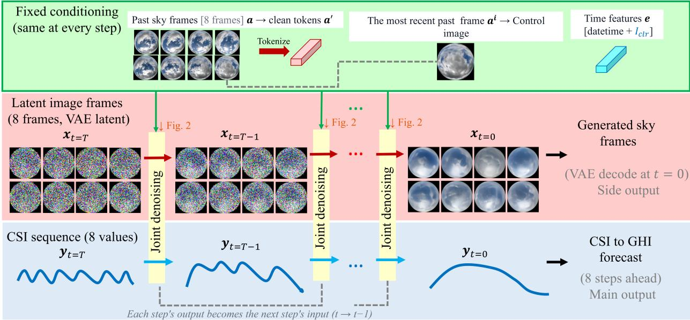  
Figure 1: Joint reverse difusion: the 50-step sampling trajectory. Both streams are denoised together at every step. The fixed conditioning (green) is identical at every step. The image latents (pink) run from noise to the decoded future frames; the clear-sky-index sequence (blue) is denoised in parallel in standardised value space and converted to an irradiance forecast. The sky frames are a side output — the forecast is carried by the clear-sky-index stream. The frames shown are the ramp-up case of Figure 8: its eight input frames and one sample of the proposed model’s output. The noisy frames, made by adding noise to that output, and the clear-sky-index curves are illustrative. One step is expanded in Figure 2.

## 3.4. One denoising step

The image denoiser $G _ { \theta }$ and the CSI denoiser $H _ { \phi }$ operate jointly by sharing a single difusion timestep �, and the fixed conditioning inputs are provided to both. The future imagery reaches the CSI forecast by running the two denoisers in sequence, $H _ { \phi }  G _ { \theta }  H _ { \phi } ,$ , with the same CSI denoiser run twice: the first run, the conditioning pass, informs the image denoiser of the current CSI state, and the second, the prediction pass, reads the image denoiser’s estimate of the future sky.

The process can be described as follows. The inputs of the denoisers at step � are the noisy image latents and CSI sequence, denoted $\mathbf { \boldsymbol { x } } _ { t }$ and $\mathbf { \boldsymbol { y } } _ { t } .$ . The denoisers also receive the fixed conditioning: the clean tokens ${ \pmb a } ^ { \prime } .$ , the control image $\pmb { a } ^ { i }$ and the time features � (Figure 2).

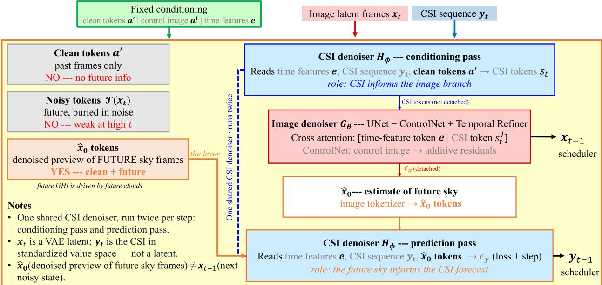  
Figure 2: Inside one denoising step of the proposed model, and why the CSI denoiser reads $\hat { \pmb x } _ { 0 } .$ . A single CSI denoiser is run twice. The conditioning pass emits CSI tokens, one per future frame, that enter the image denoiser’s cross-attention context undetached, alongside the time-feature token; the control image enters separately through ControlNet as additive residuals, and is not a cross-attention token. The image denoiser’s $\epsilon _ { x }$ then yields $\hat { \pmb { x } } _ { 0 } ,$ a denoised estimate of the future sky, which the prediction pass reads. Because $\hat { \mathbf { x } } _ { 0 }$ is built from a detached $\epsilon _ { x } .$ , the image-to-CSI link carries forward values only: no gradient cycle closes. The four boxes on the right implement Eqs. (6), (7), (9) and (10) in order; the conditioning pass’s provisional noise estimate $\epsilon _ { y } ^ { \prime } ,$ , unused by this model, is not drawn. The candidate inputs on the left are three of the four choices in Eq. (12).

Conditioning pass. The CSI denoiser $H _ { \phi }$ receives the noisy CSI sequence ${ \bf y } _ { t }$ and is conditioned on the time features � and the clean tokens of the past frames $\pmb { a } ^ { \prime }$ . It returns a provisional noise estimate $\epsilon _ { y } ^ { \prime } \in \mathbb { R } ^ { 8 }$ together with CSI tokens $s _ { t } = \{ s _ { t } ^ { j } \}$ , one per future frame $j ,$ each of the width of the covariate vector, $s _ { t } ^ { j } \in \mathbb { R } ^ { 4 }$ , summarising the current CSI state at that lead time:

$$
\begin{array} { r } { \big ( \epsilon _ { y } ^ { \prime } , s _ { t } \big ) = H _ { \phi } \big ( y _ { t } , t ; e , a ^ { \prime } \big ) . } \end{array}\tag{6}
$$

The proposed model uses only $s _ { t } ; \epsilon _ { y } ^ { \prime }$ is used by the cross-modal variant described below.

Imagery pass. The image denoiser $G _ { \theta }$ predicts the noise $\epsilon _ { x }$ in the future-frame latents:

$$
\epsilon _ { x } = G _ { \theta } \big ( x _ { t } , t ; [ e , s _ { t } ] , a ^ { i } \big ) .\tag{7}
$$

Here $\epsilon _ { x } \in \mathbb { R } ^ { 8 \times 4 \times 8 \times 8 }$ , the shape of $\pmb { x } _ { t }$ . Inside the image denoiser, Eq. (7) is computed using two steps: first, the UNet and the ControlNet give a noise estimate $\tilde { \epsilon } ^ { j }$ for each future frame separately; then, the temporal refiner � corrects the

eight estimates jointly:

$$
\tilde { \epsilon } ^ { j } = \mathrm { U N e t } \bigl ( x _ { t } ^ { j } , t ; [ e , s _ { t } ^ { j } ] , \mathrm { C o n t r o l N e t } ( x _ { t } ^ { j } , t ; a ^ { i } , e ) \bigr ) , \quad j = i + 1 , \ldots , i + 8 ; \qquad \epsilon _ { x } = \tilde { \epsilon } + R \bigl ( x _ { t } , \tilde { \epsilon } \bigr ) .\tag{8}
$$

The UNet cross-attends to the two-token context $[ e , s _ { t } ^ { j } ] \in \mathbb { R } ^ { 2 \times 4 }$ , which it projects to its own attention width. The ControlNet takes the control image $\pmb { a } ^ { i }$ as its spatial conditioning input, also attends to $e ,$ and reaches the UNet as additive down- and mid-block residuals. At each of the $8 \times 8$ latent positions, the temporal refiner concatenates every frame’s noisy latent and per-frame estimate, $[ \pmb { x } _ { t } ^ { j } , \tilde { \epsilon } ^ { j } ] \in \mathbb { R } ^ { 8 }$ , projects them to width 128, adds a learned frame-position embedding, and applies two self-attention blocks across the eight frames — across time only, not across space. Its output layer is zero-initialised, so it starts as the identity, $\epsilon _ { x } = \tilde { \epsilon }$ , and learns only a cross-frame correction. Given $\epsilon _ { x } ,$ the model forms a denoised estimate of the future sky — the denoised preview of the Introduction — by Eq. (3); for $j = i + 1 , \dots , i + 8 ,$

$$
\hat { \pmb { x } } _ { 0 } ^ { j } = \frac { \pmb { x } _ { t } ^ { j } - \sqrt { 1 - \bar { \alpha } _ { t } } \ \mathrm { s g } [ \epsilon _ { x } ^ { j } ] } { \sqrt { \bar { \alpha } _ { t } } } ,\tag{9}
$$

where sg[⋅] is the stop-gradient operator.

Prediction pass. The CSI denoiser runs again, now reading the tokens of the denoised estimate $\hat { \pmb x } _ { 0 } , \tau ( \hat { \pmb x } _ { 0 } ) \in$ ℝ128×256, in place of the clean tokens ${ \pmb a } ^ { \prime } ,$ and outputs the noise estimate $\epsilon _ { y } \in \mathbb { R } ^ { 8 }$ that bears the irradiance loss (its CSI tokens are not used):

$$
\epsilon _ { y } = H _ { \phi } \big ( { y } _ { t } , t ; e , \mathcal { T } ( \hat { \pmb { x } } _ { 0 } ) \big ) .\tag{10}
$$

Learning loss. $\epsilon _ { y }$ bears the irradiance loss and drives the CSI scheduler step; $\epsilon _ { x }$ bears the image loss and drives the image scheduler step. Training minimizes

$$
\mathcal { L } = \mathbb { E } \bigg [ \left. \epsilon _ { x } ^ { * } - \epsilon _ { x } \right. _ { 2 } ^ { 2 } + \lambda \left. \epsilon _ { y } ^ { * } - \epsilon _ { y } \right. _ { 2 } ^ { 2 } \bigg ] , \qquad \lambda = 1 ,\tag{11}
$$

where $\epsilon _ { x } ^ { * }$ and $\epsilon _ { y } ^ { * }$ are the noises added to each stream in Eq. (1).

Gradient topology. The two branches are coupled, and the coupling is asymmetric. The CSI tokens enter the image denoiser undetached, so the CSI denoiser receives gradient from the image loss. In the other direction $\hat { \mathbf { x } } _ { 0 }$ is reconstructed from a detached $\epsilon _ { x }$ — the sg[⋅] in Eq. (9) — so the image-to-CSI link carries forward values only: the irradiance loss reaches the image tokenizer but never the UNet, the ControlNet or the temporal refiner. No gradient cycle closes. The image branch is therefore optimised purely for frame reconstruction and is never told which frames help the forecast, the point on which this design difers from the closest concurrent method [6].

Design choice. The design choice is what the CSI denoiser (Eq. (10)) reads when it produces the loss-bearing noise estimate. Writing that input as $v ,$

$$
\epsilon _ { y } = H _ { \phi } { \big ( } y _ { t } , \ t ; \ e , \ v { \big ) } , \qquad v \in \Big \{ \underbrace { a ^ { \prime } } _ { \mathrm { c l e a n } } , \underbrace { \mathcal { T } ( x _ { t } ) } _ { \mathrm { n o i s y } } , \underbrace { [ \mathcal { T } ( x _ { t } ) , a ^ { \prime } ] } _ { \mathrm { c o n c a t } } , \underbrace { \mathcal { T } ( \hat { x } _ { 0 } ) } _ { \mathrm { p r o p o s e d } } \Big \} .\tag{12}
$$

The clean tokens $\pmb { a } ^ { \prime }$ carry no information about the future sky. The noisy tokens carry the future, but weakly at high �, and present the denoiser with a diferent signal at training and at sampling time. The denoised estimate $\hat { \mathbf { x } } _ { 0 }$ is both clean and about the future. Concat combines the noisy tokens with the clean tokens, a sequence of 256 tokens against 128 for the other three inputs. This is the information set of the closest concurrent method [6], which conditions on the noised iterates of both modalities and forms no denoised estimate. Only the proposed input requires two passes of the CSI denoiser, because $\hat { \mathbf { x } } _ { 0 }$ exists only after the image denoiser has run; the other three variants run it once. Our proposed model takes $\pmb { v } = \pmb { \mathcal { T } } ( \hat { \pmb { x } } _ { 0 } )$ , and Section 8.1 measures all four.

Cross-modal variant. The design above passes information from the image branch to the CSI branch through $\hat { \mathbf { x } } _ { 0 }$ We also evaluate the reverse path, in which a denoised estimate of the future CSI is fed back into the image denoiser; it is described, with its equations, in Appendix B, and Section 8.1 reports what it changes. Each variant, like each input choice in Eq. (12), is a separately trained model: $H _ { \phi }$ and $G _ { \theta }$ name its modules, not weights shared across variants.

## 3.5. Training and sampling

Training has five stages, run in sequence: three that train the image side one network at a time, then two of joint difusion training, in which both the image latents and the CSI sequence are noised at a shared timestep and denoised by the full model of Sections 3.3 and 3.4. Joint training runs in two phases for one reason: phase 1 trains only the modules that start from random initialisation; phase 2 then fine-tunes the image side a hundred times more slowly, so that it adapts rather than being overwritten. The five stages, their learning rates and their stopping rules are set out in Table C.1, and the checkpoint and budget conventions that follow from them in Appendix C.

At inference, the image latents and CSI sequence are co-denoised in lockstep over 50 reverse steps, with the conditioning fixed at every step and only the noisy state changing. At the final step $( t ~ = ~ 0 )$ , the image latents are decoded to frames and the CSI sequence is mapped back to irradiance. The sky frames are a by-product: the CSI forecast is read from the CSI denoiser directly, with no frame-to-irradiance regression stage anywhere in the pipeline.

## 4. Data and experimental setup

## 4.1. Dataset

We use sky images and global horizontal irradiance (GHI) from the SIRTA atmospheric observatory [15] in Palaiseau, France $( 4 8 . 7 1 3 ^ { \circ } \mathrm { N } , 2 . 2 0 8 ^ { \circ } \mathrm { E } )$ , a site whose imagery and irradiance records are widely used for sky-image forecasting [2]. Daytime sky images at two-minute cadence are resized to $6 4 \times 6 4$ pixels and aligned with the GHI measurement and the clear-sky irradiance $I _ { c l r }$ at the same timestamp, computed with the Ineichen–Perez clear-sky model [31] as implemented in pvlib [32]. A sample is a sequence of eight past frames and the eight following frames, $j = i - 7 , \dots , i + 8$ , so that a forecast covers a sixteen-minute horizon (Section 3.2).

In-period data (2023). All models in the main comparison are trained and evaluated on calendar year 2023. Samples are partitioned 0.80∕0.10∕0.10 into training, validation and test sets; the test set contains 12,906 sequences from 43 days. Within each month, the earliest tenth of the samples in time order forms the test set and the next tenth the validation set, so the split falls almost entirely between days. We quantify the remaining adjacency: fewer than 2% of test sequences have a training sequence from the same day within ±1 h, fewer than 2% a validation sequence, and 88% of the matched subset (below) falls on the 34 of 43 test days that contain neither.

Cross-year data (2021–2022 → 2023). To remove that adjacency altogether, a second set of models is trained and validated on 2021–2022 only, with a day-blocked split, and tested on the same 2023 test sequences. No training or validation sample shares a calendar year, let alone a day, with a test sample. Because only the training years change, any diference from the in-period result isolates the shift in training distribution (Section 5.1).

Matched test subset. Cross-method comparisons use a subset of 1998 test sequences, stratified across sky conditions and drawn from 40 of the 43 test days. Every method is scored on exactly these inputs, and the smartpersistence reference is recomputed on the same rows. Of the 1998 scored test windows, 13 are not contiguous: in five, the input and target frames fall on diferent days, separated by a night; in the other eight, all frames are from the same day but one or two frames are missing, so the spacing is four or six minutes at some point in the window. Training windows are afected at a similar rate. We keep them, since every method is scored on the same windows; excluding them changes no ranking (Table C.3). SIRTA has since reviewed the 2023 irradiance record and marked as unusable some minutes that were provisional in our copy; 62 of the 1998 samples have such a minute among their targets or their persistence origin, and excluding them also changes no ranking.

## 4.2. Experimental protocol

Each experiment in Sections 5–8 and Appendix B uses the data as follows.

• Comparison (Section 5, Table 2). Every method is trained on the 2023 training set and scored on the matched subset. Confidence intervals are 95% day-block bootstrap intervals: the 40 test days are resampled with replacement (5000 draws), every score is recomputed on each draw, and paired contrasts between two methods use the same draws.

• Cross-year retraining (Section 5.1, Table 3). Six methods, the proposed model among them, are retrained on the 2021–2022 data and scored on the same matched subset and reference as the comparison. This is the paper’s leak-free test of the main result.

• Per-horizon, sky-condition and ramp-event performance (Section 6). On the matched subset, sky-condition regimes are the tertiles of the clear-sky index � at the forecast origin (666 samples each), referred to as overcast, variable, and clear, from the lowest to the highest tertile; the labels describe the level of � at the origin, not measured variability, since an intermediate � usually arises from broken cloud but also from a steady thin overcast. A sample is a ramp if GHI changes by at least 200 W m−2 between two consecutive forecast steps (� = 334); a tertile therefore describes the state at the origin and a ramp the change that follows.

• Removing the regression stage (Section 7). A U-Net regressor (306,120 parameters) that maps a single sky image to its concurrent GHI is trained on real sky images and then frozen. On the matched subset, it is applied to the real future frames and to the frames our model generates, and compared with our model’s own irradiance head on the same samples. The same frozen regressor scores the video-prediction baselines, which produce frames but no irradiance forecast of their own.

• Ablations (Section 8). Arms are trained on the 2023 training set at matched training budget (Section 3.5) and scored on the matched subset; the irradiance-stream ablation pairs each of two seeds with its own control.

• Design-space survey (Appendix B). Eight arms of the proposed architecture are scored on the full 2023 test set (� = 12,906).

All joint arms in the comparisons of Sections 5–8 sample 50 reverse difusion steps and form an � = 10-member ensemble, each member from an independent initial noise; both settings are the same for every one of those arms and every seed. The design-space survey of Appendix B was scored earlier in the project at 20 steps, which is one of the reasons its numbers are not comparable with the main text’s. No post-hoc calibration of the predictive distributions is applied anywhere in this paper; all intervals reported here are raw model output, since a calibration layer would improve interval scores without informing the architectural comparison.

Run-to-run variation. Three sources of variation were measured before any comparison was read, and diferences below them are not interpreted. The proposed model’s three training seeds span $1 . 0 8 ~ \mathrm { W } \mathrm { m } ^ { - 2 }$ in pooled RMSE. Rerunning the sampler with a diferent state of its noise generator moves RMSE by $1 . 3 4 ~ \mathrm { W } \mathrm { m } ^ { - 2 }$ , forecast skill by 0.011 and CRPSS by 0.006, and changing the seeding convention of that generator moves pooled RMSE by $0 . 5 { - } 1 . 4 \ \mathrm { W } \mathrm { m } ^ { - 2 }$ depending on the training seed; the bootstrap intervals quantify test-sample variability only and do not include this. The frozen-regressor imagery score varies by $3 . 4 8 ~ \mathrm { W } \mathrm { m } ^ { - 2 }$ across seeds of one arm but by as much as 20.3 between separately trained runs, so for that score we read only the sign of a paired diference. The paper’s claims exceed these scales by one to two orders of magnitude, with one exception noted where it arises: the point-accuracy gap to SUNSET $( 6 . 5 \mathrm { W } \mathrm { m } ^ { - 2 } )$ clears them by a smaller factor.

## 4.3. Evaluation metrics

Let $y _ { n , h }$ be the observed GHI of test sample $n = 1 , \ldots , N$ at forecast step $h = 1 , \ldots , 8 .$ , and $\hat { y } _ { n , h } ^ { ( m ) } , m = 1 , \ldots , M$ , the members of a probabilistic forecast, with point forecast $\hat { y } _ { n , h }$ their mean. Every score is pooled over all �� sample–step pairs before any ratio is taken; skill scores are a ratio of two pooled quantities, not a mean of per-step ratios.

• Point accuracy. The root-mean-square error and the forecast skill against smart persistence (SPM) are

$$
\mathrm { R M S E } = \sqrt { \frac { 1 } { N H } \sum _ { n , h } \left( \hat { y } _ { n , h } - y _ { n , h } \right) ^ { 2 } } , \qquad \mathrm { F S } = 1 - \frac { \mathrm { R M S E } } { \mathrm { R M S E } _ { \mathrm { S P M } } } .\tag{13}
$$

SPM holds the clear-sky index at the forecast origin � constant over the horizon,

$$
\hat { y } _ { n , h } ^ { \mathrm { S P M } } = k _ { n } I _ { c l r , n , h } , \qquad k _ { n } = \frac { \mathrm { G H I } _ { n , i } } { \operatorname* { m a x } ( I _ { c l r , n , i } , 1 ) } ,\tag{14}
$$

and is recomputed on the same samples as the method being scored.

• Probabilistic accuracy. The continuous ranked probability score uses the fair estimator for a finite ensemble,

$$
\mathrm { C R P S } = \frac { 1 } { N H } \sum _ { n , h } \left[ \frac { 1 } { M } \sum _ { m } \left| \hat { y } _ { n , h } ^ { ( m ) } - y _ { n , h } \right| - \frac { 1 } { 2 M ( M - 1 ) } \sum _ { m , m ^ { \prime } } \left| \hat { y } _ { n , h } ^ { ( m ) } - \hat { y } _ { n , h } ^ { ( m ^ { \prime } ) } \right| \right] , \qquad \mathrm { C R P S S } = 1 - \frac { \mathrm { C R P S } } { \mathrm { M A E } _ { \mathrm { S P M } } } .\tag{15}
$$

where � and $m ^ { \prime }$ both index the � ensemble members; the $m = m ^ { \prime }$ terms vanish, and normalising the remaining $M ( M - 1 )$ ordered pairs is what makes the estimator fair. For a deterministic forecast the CRPS reduces to the mean absolute error (MAE), which is why the reference in the CRPS skill score (CRPSS) is the MAE of SPM.

• Reliability. The prediction-interval coverage probability at nominal level � is the fraction of observations inside the central interval spanned by the empirical $\frac { 1 - \alpha } { 2 }$ and $\frac { 1 + \alpha } { 2 }$ quantiles, $\ell _ { n , h }$ and $u _ { n , h }$ , of the � members; the

What each method conditions on. Rows above the rule are arms of this work; below are the external comparators. Our arms receive no $\pmb { b } \mathrm { : }$ the proposed model never sees a measured irradiance value. Section 8.2 isolates what that costs.
<table><tr><td>Arm</td><td>CSI denoiser reads</td><td>image denoiser reads</td><td>loop</td><td>b?</td></tr><tr><td>Proposed (joint, past sky)</td><td> $e , y _ { t } , a$ </td><td> $e , s _ { t } , \mathbf { \boldsymbol { a } } ^ { i }$ </td><td>open</td><td>no</td></tr><tr><td>noised state</td><td> $e , y _ { t } , x _ { t }$ </td><td> $e , s _ { t } , \mathbf { \boldsymbol { a } } ^ { i }$ </td><td>open</td><td>no</td></tr><tr><td>concat</td><td> $e , { \bf y } _ { t } , { \bf x } _ { t } , a$ </td><td> $e , s _ { t } , \mathbf { \boldsymbol { a } } ^ { i }$ </td><td>open</td><td>no</td></tr><tr><td>Proposed (joint, future sky)</td><td> $e , \mathbf { y } _ { t } , { \hat { { \mathbf { x } } } } _ { 0 } \ ( a \ \mathrm { i n d . } )$ </td><td> ${ \boldsymbol { e } } , s _ { t } , { \boldsymbol { a } } ^ { i }$ </td><td>open</td><td>no</td></tr><tr><td>Proposed (joint, past sky, future CSI)</td><td> $e , y _ { t } , a$ </td><td> $e , s _ { t } , \mathbf { \Delta } a ^ { i } , \hat { \mathbf { y } } _ { 0 }$ </td><td>open</td><td>no</td></tr><tr><td>Proposed (joint, future sky, future CSI)</td><td> $e , \mathbf { y } _ { t } , { \hat { \mathbf { x } } } _ { 0 } \ ( a \ \mathrm { i n d . } )$ </td><td> $\boldsymbol { e } , s _ { t } , \boldsymbol { a } ^ { i } , \hat { \boldsymbol { y } } _ { 0 }$ </td><td>open</td><td>no</td></tr><tr><td>scalar only</td><td> $e , y _ { t } , a$ </td><td>— (no image branch)</td><td> $\mathsf { n } / \mathsf { a }$ </td><td>no</td></tr><tr><td>oracle (true future frames)</td><td> $e , y _ { t } , \mathrm { { \mathbf { t r u e } } } \ x _ { 0 }$ </td><td> $e , s _ { t } , \mathbf { \boldsymbol { a } } ^ { i }$ </td><td>open</td><td>no</td></tr><tr><td>ConvLSTM</td><td>frozen U-Net on gen. frames</td><td>a</td><td> $\mathsf { n } / \mathsf { a }$ </td><td>no</td></tr><tr><td>PhyDNet</td><td>frozen U-Net on gen. frames</td><td>a</td><td> $\mathsf { n } / \mathsf { a }$ </td><td>no</td></tr><tr><td>SkyGPT</td><td>frozen U-Net on gen. frames</td><td>a</td><td> $\mathsf { n } / \mathsf { a }$ </td><td>no</td></tr><tr><td>Xiong</td><td>b, gen. frames, temporal cov.</td><td>a</td><td> $\mathsf { n } / \mathsf { a }$ </td><td>yes</td></tr><tr><td>SUNSET</td><td>b, a (no generation)</td><td></td><td> $\mathsf { n } / \mathsf { a }$ </td><td>yes</td></tr><tr><td>PV-MM-Diffusion</td><td> ${ \pmb a } , { \pmb b } , { \pmb y } _ { \tau } , { \pmb x } _ { \tau }$ </td><td> ${ \pmb a } , { \pmb b } , { \pmb y } _ { \tau } , { \pmb x } _ { \tau }$ </td><td>closed</td><td>yes</td></tr></table>

spread-skill ratio (SSR) compares the error of the ensemble mean with the ensemble’s own spread,

$$
\mathrm { P I C P } _ { \alpha } = \frac { 1 } { N H } \sum _ { n , h } \mathbf { 1 } \bigl [ \boldsymbol { \ell } _ { n , h } \leq y _ { n , h } \leq u _ { n , h } \bigr ] , \qquad \mathrm { S S R } = \frac { \mathrm { R M S E } } { \sqrt { \frac { 1 } { N H } \sum _ { n , h } \sigma _ { n , h } ^ { 2 } } } ,\tag{16}
$$

where $\sigma _ { n , h } ^ { 2 }$ is the unbiased variance of the members. For � exchangeable draws from a calibrated forecast, the expected SSR is $\sqrt { ( M + 1 ) / M } \approx 1 . 0 5$ at � = 10, not 1. Values above the target indicate an ensemble whose spread is too small for its errors and below it one whose spread is too large. Following the tolerance used in scoring, ±10% of the target, an ensemble is called under-dispersed above 1. $1 \sqrt { ( M + 1 ) / M }$ and over-dispersed below $0 . 9 \sqrt { ( M + 1 ) / M }$ (1.155 and 0.945 at � = 10), and roughly calibrated in between. PICP and SSR are undefined for deterministic forecasts.

## 4.4. The information each method conditions on

Several comparisons in this paper are between models whose information sets difer, sometimes more than their architectures do. Table 1 states those sets explicitly so that a diference in score can be attributed to the right cause.

Symbols: � the eight past sky frames; � the measured history of the forecast variable; � the deterministic covariates at the forecast origin (clock variables and the clear-sky irradiance); $\mathbf { \boldsymbol { x } } _ { t } , \mathbf { \boldsymbol { y } } _ { t }$ the noised future frames and future clear-sky index at difusion step �; $\hat { \pmb x } _ { 0 } , \hat { \pmb y } _ { 0 }$ the model’s own denoised estimates of those; $\boldsymbol { x } _ { \tau } , \boldsymbol { y } _ { \tau }$ PV-MM-Difusion’s noised skyimage and PV-power iterates at its own difusion step $\tau ; s _ { t }$ the CSI tokens and $\pmb { a } ^ { i }$ the control image (Section 3.4); “� ind.” marks past frames that reach the CSI denoiser only indirectly, through $\hat { \pmb x } _ { 0 }$ . “Loop” is gradient topology: closed if a gradient cycle runs between the two branches, open if at least one cross-link carries forward values only.

Two entries deserve a note. PV-MM-Difusion’s coupled reverse step conditions each branch on the historical series and on the noised iterate of both modalities, and forms no denoised estimate; among our arms, concat has the matching information set. The two cross-modal variants feed back the denoised estimate of the future CSI, $\hat { y } _ { 0 }$ , an irradiance quantity rather than an image one.

## 5. Performance comparison

Table 2 compares the proposed model with five groups of baselines, listed below in the order in which they appear in the table. All methods are scored on the matched test subset against the same smart-persistence reference, Eq. (14) (pooled $\mathrm { R M S E } = 1 2 7 . 4 0 \mathrm { \ W m } ^ { - 2 }$ ， $\mathrm { M A E } = 5 6 . 0 8 \ \mathrm { W } \mathrm { m } ^ { - 2 } )$ . (i) Scalar forecasters: DLinear [33], PatchTST [34] and TimeXer [35], as implemented in the Time-Series-Library [36], which forecast from the measured irradiance history alone, first without and then with the clear-sky irradiance $I _ { c l r }$ as an additional input. (ii) A deterministic sky-image network, SUNSET [10], which reads the past sky images together with the irradiance history and returns a point forecast; the per-horizon figures also show it without the clear-sky input, a variant not tabulated here. (iii) Video predictors, ConvLSTM [8], PhyDNet [9] and PhyDNetGAN [5, 9], which forecast future frames only; their irradiance is read from the generated frames by the frozen regressor of Section 4.2. (iv) Published generative forecasters: SkyGPT [5], a stochastic video predictor whose frames are mapped to irradiance by the same regressor, and the model of Xiong et al. [7], which couples a stochastic video model to a probabilistic irradiance head that also reads the irradiance history. (v) This work: Proposed (joint, future sky) and Proposed (joint, past sky). Implementation details and the fidelity checks applied to each reimplementation are given in Appendix A.

The comparison is not symmetric in its inputs. The proposed model receives no measured irradiance: it conditions on past sky images and on deterministic covariates at the forecast origin, whereas the scalar forecasters, SUNSET and the model of Xiong et al. [7] also read the irradiance history. Section 8.2 quantifies the efect of this diference. The confidence intervals are day-block bootstrap intervals (Section 4.2) and therefore reflect variation across test days, not across training runs.

Point and probabilistic accuracy. The proposed model attains the highest CRPSS in the comparison, +0.341, and its confidence interval lies entirely above zero. Its pooled RMSE of $1 0 4 . 1 \mathrm { W } \mathrm { m } ^ { - 2 }$ is the second lowest; SUNSET attains $9 7 . 6 ~ \mathrm { W } \mathrm { m } ^ { - 2 }$ . The two results concern diferent properties of the forecast (Figure 3). SUNSET is deterministic and provides no predictive distribution, so its advantage is confined to the point forecast, whereas the proposed model provides a predictive distribution whose skill exceeds that of every baseline. The point-accuracy gap to SUNSET is nevertheless a genuine deficit of the proposed model.

Forecast accuracy on the matched test subset (� = 1998), with 95% day-block bootstrap intervals. RMSE and CRPS in $\mathsf { W } \mathsf { m } ^ { - 2 } ;$ ; FS and CRPSS are skill scores against smart persistence, higher is better. Rules separate, from top to bottom: smart persistence; scalar forecasters without and with $I _ { c l r } ;$ the deterministic sky-image network; video predictors scored through the frozen regressor; published generative forecasters; and this work.
<table><tr><td>Method</td><td>RMSE↓[95% CI]</td><td>FS↑ [95% CI]</td><td>CRPS↓ [95% CI]</td><td>CRPSS ↑ [95% CI]</td></tr><tr><td>SPM</td><td>127.4 [88.7, 159.6]</td><td></td><td></td><td></td></tr><tr><td>DLinear (wo Iclr)</td><td>113.4 [83.8, 138.4]</td><td>+0.110 [+0.044, +0.144]</td><td>60.6 [45.0, 76.6]</td><td>-0.081 [-0.225, -0.004]</td></tr><tr><td>PatchTST (wo Iclr)</td><td>111.0 [81.4, 135.6]</td><td>+0.128 [+0.069, +0.163]</td><td>56.7 [39.8, 73.9]</td><td>-0.011 [-0.091, +0.036]</td></tr><tr><td>TimeXer (wo Iclr)</td><td>111.0 [81.6, 135.3]</td><td>+0.129 [+0.064, +0.166]</td><td>57.4 [40.9, 74.2]</td><td>-0.023 [-0.113, +0.029]</td></tr><tr><td>DLinear</td><td>109.8 [80.7, 134.2]</td><td>+0.138 [+0.079, +0.170]</td><td>58.0 [42.2, 74.2]</td><td>-0.034 [-0.156, +0.034]</td></tr><tr><td>PatchTST</td><td>109.6 [80.0, 133.7]</td><td>+0.140 [+0.078, +0.179]</td><td>54.5 [37.4, 72.0]</td><td>+0.029 [-0.022, +0.062]</td></tr><tr><td>TimeXer</td><td>110.0 [80.6, 134.0]</td><td>+0.137 [+0.073, +0.177]</td><td>55.5 [38.9, 72.4]</td><td>+0.011 [-0.063, +0.054]</td></tr><tr><td>SUNSET</td><td>97.6 [72.7, 119.2]</td><td>+0.234 [+0.171, +0.274]</td><td>52.7 [38.5, 67.7]</td><td>+0.060 [-0.061, +0.129]</td></tr><tr><td>ConvLSTM</td><td></td><td></td><td></td><td></td></tr><tr><td>PhyDNet</td><td>145.3 [104.6, 178.4] 115.8 [87.4, 139.2]</td><td>-0.141 [-0.272, -0.041] +0.091 -0.046, +0.180]</td><td>77.0 [56.2, 98.3]</td><td>-0.372 [-0.562, -0.263]</td></tr><tr><td>PhyDNetGAN</td><td>112.3 [85.3, 134.8]</td><td>+0.118 [-0.004, +0.197]</td><td>62.9 [48.0, 78.0] 61.8 [47.7, 76.1]</td><td>-0.121 [-0.334, -0.002] -0.103 [-0.307, +0.011]</td></tr><tr><td>SkyGPT</td><td>216.8 [178.0, 249.5]</td><td></td><td></td><td></td></tr><tr><td>Xiong</td><td>116.9 [87.4, 141.0]</td><td>-0.702 [-1.093, -0.525] +0.082 [-0.024, +0.146]</td><td>121.1 [99.6, 141.5] 47.8 [36.3, 59.6]</td><td>-1.159 [-1.864, -0.788] +0.148 [+0.001, +0.231]</td></tr><tr><td>Proposed (joint, future</td><td>104.1 [78.3, 126.4]</td><td>+0.183 [+0.098, +0.235]</td><td>36.9 [27.1, 47.2]</td><td>+0.341 [+0.250, +0.396]</td></tr><tr><td>sky) Proposed (joint, past sky)</td><td>114.1 [84.7, 138.3]</td><td>+0.104 [+0.013, +0.158]</td><td>42.9 [31.0, 54.8]</td><td>+0.235 [+0.140, +0.294]</td></tr></table>

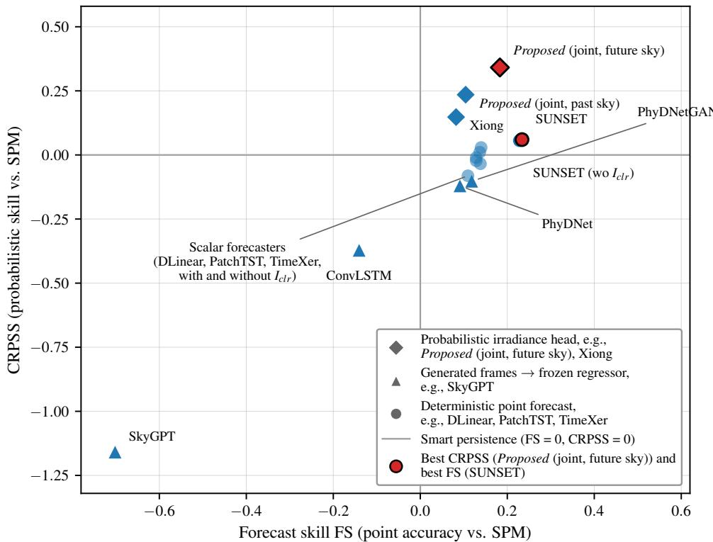  
Figure 3: Forecast skill against CRPSS, every method plotted once at its headline framing. The two axes separate the comparison: SUNSET sits furthest right on point accuracy while Proposed (joint, future sky) sits highest on probabilistic skill, and no method leads on both. Methods in the lower-right quadrant beat smart persistence on the mean but not on the distribution.

Scalar forecasters. DLinear, PatchTST and TimeXer reach $1 0 9 { - } 1 1 3 \mathrm { W } \mathrm { m } ^ { - 2 }$ , with forecast skill between +0.11 and +0.14, but their CRPSS values lie between −0.08 and +0.03: they improve on persistence in the mean but not in the distribution. Adding $I _ { c l r }$ lowers the RMSE of all three, by $1 . 0 { - } 3 . 6 \mathrm { W } \mathrm { m } ^ { - 2 }$

Video predictors. Read through the frozen regressor, the video predictors range from $1 1 2 . 3 \mathrm { W } \mathrm { m } ^ { - 2 } ( \mathrm { P h y D N e t G A N } )$ to $1 4 5 . 3 \mathrm { W } \mathrm { m } ^ { - 2 }$ (ConvLSTM), and all three have negative CRPSS, from −0.37 to −0.10.

Published generative forecasters. SkyGPT is the weakest method in the comparison, with an RMSE of $2 1 6 . 8 ~ \mathrm { W } \mathrm { m } ^ { - 2 }$ and a forecast skill of −0.70, i.e. worse than persistence. Our reimplementation required substantial correction before it was a fair comparator (Appendix A), and Section 7 separates how much of the gap to the singlestage design is due to the regression stage rather than to frame quality. The model of Xiong et al. [7] has the highest CRPSS among the baselines, +0.148, yet remains below both arms of this work despite reading the irradiance history. Within this work, Proposed (joint, future sky) improves on Proposed (joint, past sky) by $1 0 . 0 \mathrm { W } \mathrm { m } ^ { - 2 }$ in RMSE and 0.106 in CRPSS; Section 8.1 analyses this diference.

## 5.1. Cross-year performance

This section investigates cross-year performance for the best-performing method of each baseline group, together with both arms of the proposed model. All the models are retrained on the 2021–2022 data and evaluated on the same matched 2023 subset, against the same reference (Section 4.2); the image stack of the cross-year runs was trained at a diferent VAE learning rate, a stage frozen throughout joint training. Table 3 reports the cross-year performance — RMSE, forecast skill and CRPSS — beside the in-period scores. The result reflects the shift in training distribution alone. All six methods remain within $1 . 8 ~ \mathrm { W } \mathrm { m } ^ { - 2 }$ in RMSE and within 0.03 in CRPSS of their in-period scores. The ranking is therefore unchanged from the in-period comparison.

When comparing the shift, the proposed model’s forecast skill falls by 0.013. The change is not uniform across lead times: the cross-year model is marginally better at the shortest horizons and worse at the longest, by 0.05 at the eighth step (Table C.2). SUNSET shows the same pattern with about one third of the amplitude, which indicates that a mild long-horizon degradation under a year shift is partly a property of the task; for the proposed model it is somewhat larger. The CRPSS of the proposed model moves from $+ 0 . 3 4 1 \ \mathrm { t o } + 0 . 3 4 3$ , a change of 0.002, which is smaller than the sampler variation of Section 4.2 (0.006). The scores of the model of Xiong et al. [7] are equally stable.

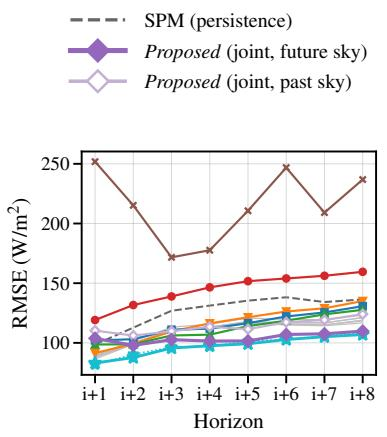

Table 3  
Cross-year retraining. Methods trained on a diferent calendar year and evaluated on the same test set and reference as Table 2. Δ is cross-year minus in-period, computed before rounding; values near zero indicate the result does not depend on which year the model was trained on. FS is computed from the RMSE columns against the same smart-persistence reference, $1 2 7 . 4 ~ \mathsf { W } \mathsf { m } ^ { - 2 }$
<table><tr><td></td><td colspan="3"> ${ \mathsf { R M S E } } \downarrow [ { \mathsf { W } } { \mathsf { m } } ^ { - 2 } ]$ </td><td colspan="3">FS↑</td><td colspan="3">CRPSS↑</td></tr><tr><td>Method</td><td>in-period</td><td>cross-year</td><td>∆→0</td><td>in-period</td><td>cross-year</td><td>Δ→0</td><td>in-period</td><td>cross-year</td><td>Δ→0</td></tr><tr><td>SPM</td><td>127.4</td><td>一</td><td>一</td><td></td><td></td><td></td><td>一</td><td>一</td><td>一</td></tr><tr><td>PatchTST</td><td>109.6</td><td>109.0</td><td>-0.6</td><td>+0.140</td><td>+0.145</td><td>+0.004</td><td>+0.029</td><td>+0.031</td><td>+0.002</td></tr><tr><td>SUNSET</td><td>97.6</td><td>98.1</td><td>+0.5</td><td>+0.234</td><td>+0.230</td><td>-0.004</td><td>+0.060</td><td>+0.047</td><td>-0.013</td></tr><tr><td>PhyDNetGAN</td><td>112.3</td><td>110.6</td><td>-1.8</td><td>+0.118</td><td>+0.132</td><td>+0.014</td><td>-0.103</td><td>-0.073</td><td>+0.030</td></tr><tr><td>Xiong</td><td>116.9</td><td>117.2</td><td>+0.3</td><td>+0.082</td><td>+0.080</td><td>-0.002</td><td>+0.148</td><td>+0.148</td><td>+0.000</td></tr><tr><td>Proposed (joint, past sky)</td><td>114.1</td><td>113.9</td><td>-0.2</td><td>+0.104</td><td>+0.106</td><td>+0.001</td><td>+0.235</td><td>+0.241</td><td>+0.006</td></tr><tr><td>Proposed (joint, future sky)</td><td>104.1</td><td>105.7</td><td>+1.7</td><td>+0.183</td><td>+0.170</td><td>-0.013</td><td>+0.341</td><td>+0.343</td><td>+0.002</td></tr></table>

## 6. Per-horizon, sky-condition and ramp-event performance

This section examines (i) performance across lead times in Section 6.1; (ii) performance across sky conditions in Section 6.2; (iii) the reliability of the predictive intervals on non-ramp and ramp events in Section 6.3; and (iv) performance on ramp events in Section 6.4.

## 6.1. Per-horizon performance

Performance across lead times — (a) RMSE, (b) forecast skill and (c) CRPSS — is shown in Figure 4. The proposed model’s forecast skill is negative at the first step and approaches SUNSET’s with horizon without overtaking it at any horizon, so its pooled advantage in RMSE is a mid-to-late-horizon efect. Its CRPSS is above SUNSET’s, and above every other method’s, at every horizon, rising from +0.03 at �+1 to about +0.41 and settling near +0.39 (Table C.2).

(a) RMSE  
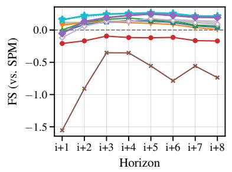  
(b) Forecast skill

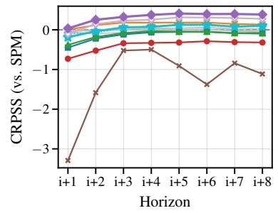  
(c) CRPSS  
Figure 4: Performance against lead time: (a) RMSE, (b) forecast skill and (c) CRPSS, for every method in the comparison, each at its headline framing. Forecast skill and CRPSS are computed against the same smart-persistence reference as Table 2. SkyGPT’s chunked rollout is visible as the unstable worst curve; the scalar forecasters are bracketed as one muted group.

CRPSS and RMSE by sky-condition tertile on the matched test subset (666 samples each), for the proposed model and SUNSET, the strongest deterministic comparator. The lead is the proposed model’s CRPSS minus SUNSET’s within the same tertile. RMSE in $\mathsf { W } \mathsf { m } ^ { - 2 }$ . Bold marks the better method of each metric: the proposed model on CRPSS and SUNSET on RMSE, in every tertile.
<table><tr><td rowspan="2">Tertile</td><td colspan="3">CRPSS↑</td><td colspan="2">RMSE↓</td></tr><tr><td>Proposed (joint, future sky)</td><td>SUNSET</td><td>lead</td><td>Proposed (joint, future sky)</td><td>SUNSET</td></tr><tr><td>Overcast</td><td>+0.285</td><td>-0.002</td><td>+0.287</td><td>101.6</td><td>92.6</td></tr><tr><td>Variable</td><td>+0.347</td><td>+0.085</td><td>+0.262</td><td>104.9</td><td>98.5</td></tr><tr><td>Clear</td><td>+0.388</td><td>+0.091</td><td>+0.297</td><td>105.6</td><td>101.5</td></tr></table>

## 6.2. Performance across sky conditions

To examine performance across sky conditions, the test set is split into tertiles by the clear-sky index at the forecast origin into overcast, variable, and clear as shown in Figure 5. Table 4 provides the margin of the proposed model’s CRPSS and RMSE against those of SUNSET, the strongest deterministic comparator, within each tertile. The proposed model has a positive CRPSS margin in all three tertiles, and the margin is close to flat; SUNSET keeps the better RMSE in each of them.

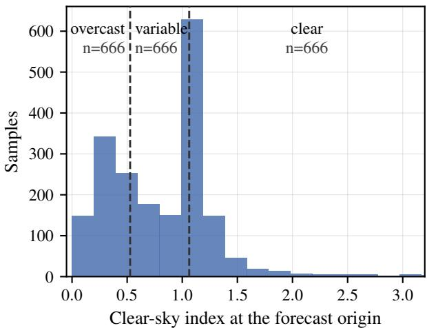  
Figure 5: Sky-condition tertiles on the matched test subset: the distribution of the clear-sky index � at the forecast origin. Dashed lines are the tertile edges, $k = 0 . 5 2 7$ and $k = 1 . 0 6 3$ , and each region holds 666 samples. The horizontal axis is cut at $k = 3 . 2$ ; the 43 samples above it are binned but not shown.

## 6.3. Reliability of the predictive intervals

Table 5 gives the method-by-method comparison on reliability of the predictive intervals. No method in this comparison reaches nominal coverage: every $\mathrm { P I C P _ { 9 0 } }$ is below 0.9 of ramps. In terms of SSR, most of the probabilistic forecasters are under-dispersed, one is over-dispersed. Meanwhile, the deterministic ones have no spread at all, as the point forecast covers no observation. We therefore compare how each method’s reliability changes from non-ramp to ramp events. Xiong’s non-ramp coverage of 0.847 is higher than Proposed (joint, future sky)’s 0.631, but from nonramp to ramp Proposed (joint, future sky)’s coverage falls by 0.026 and Xiong’s by 0.206. The SSR column accounts for the diference. Xiong’s non-ramp intervals are over-dispersed $( \mathrm { S S R } = 0 . 8 0 6 $ , below the 1.05 target): its ensemble spread is wider than its own forecast error, so its intervals capture observations by their width. On ramps the same quantity rises to 1.796, far above target, and coverage falls with it. Proposed (joint, future sky) runs from 0.972 to 1.227: roughly calibrated of ramps and modestly under-dispersed on them. Its intervals are therefore the most stable in the comparison, though not the widest nor the closest to nominal. Xiong’s row in Table 5 is scored at its own stored ensemble width of 100 draws, larger than the ten members used for every other row. Re-scoring it at matched width leaves its coverage advantage intact, so the comparison of changes between regimes is unafected.

Interval coverage and spread-skill ratio (SSR, Eq. (16)) on ramp and non-ramp events. Δ is ramp minus non-ramp; a small Δ means the forecast’s reliability does not change when conditions become hard. SSR above its 1.05 target means intervals too narrow (under-dispersed), below it too wide (over-dispersed); the target is derived in Section 4.3. Deterministic methods are grouped: a point forecast has zero coverage by construction and no spread to report, and is excluded from the per-column bolding. The best value in each column is in bold: highest coverage, Δ closest to zero, SSR closest to the 1.05 target.
<table><tr><td></td><td colspan="3">PICP90↑</td><td colspan="3">SSR (→ 1.05)</td></tr><tr><td>Method</td><td>non-ramp</td><td>ramp</td><td>Δ→0</td><td>non-ramp</td><td>ramp</td><td>∆→0</td></tr><tr><td>all deterministic methods</td><td>0.000</td><td>0.000</td><td>0</td><td></td><td></td><td></td></tr><tr><td>SkyGPT</td><td>0.235</td><td>0.236</td><td>-0.001</td><td>3.076</td><td>3.353</td><td>+0.277</td></tr><tr><td>Xiong</td><td>0.847</td><td>0.642</td><td>-0.206</td><td>0.806</td><td>1.796</td><td>+0.990</td></tr><tr><td>Proposed (joint, past sky)</td><td>0.458</td><td>0.518</td><td>+0.060</td><td>1.282</td><td>1.515</td><td>+0.233</td></tr><tr><td>Proposed (joint, future sky)</td><td>0.631</td><td>0.605</td><td>-0.026</td><td>0.972</td><td>1.227</td><td>+0.255</td></tr></table>

Figure 6 further illustrates the reliability of the proposed model. Over nineteen nominal levels from 0.05 to 0.95, the reliability curve of the proposed model crosses the diagonal near the median rather than lying to one side of it. Empirical coverage exceeds nominal by 0.127 on average in the low tail and falls short by 0.141 in the high tail. The forecast is thus correctly centred with quantiles that are not extreme enough: the signature of under-dispersion rather than of a mis-centred forecast. The deviation is flat across horizons (0.076–0.103, Table C.2), with no degradation at longer lead times.

Oracle arm. The same head conditioned on the true future frames also sits above the SSR target (Appendix B), so the shortfall is mostly the dificulty of the forecasting problem rather than a defect of the irradiance head.

## 6.4. Ramp events

Ramps are defined from the irradiance trajectory rather than from the sky condition at the forecast origin, and the two are close to orthogonal: ramps do not concentrate in the overcast or variable tertiles. The ramp subset contains � = 334 samples. Table 7 provides the performance comparison on the ramp subset in terms of RMSE, forecast skill, and CRPSS. In RMSE, the deterministic network is the most accurate: SUNSET reaches $2 1 6 . 4 \mathrm { W } \mathrm { m } ^ { - 2 }$ , ahead of Proposed (joint, future sky) at 226.4 and of every video predictor. In probabilistic skill, the proposed model attains a CRPSS of +0.440 on the ramp subset, against +0.342 for Proposed (joint, past sky), +0.310 for Xiong and at most +0.198 for every other method. Its advantage is thus larger on ramps than over the test set as a whole.

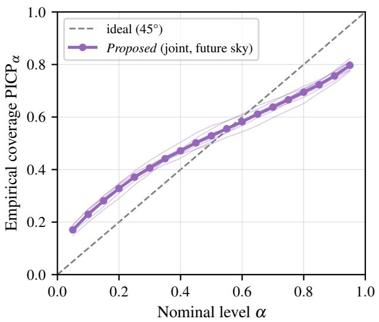

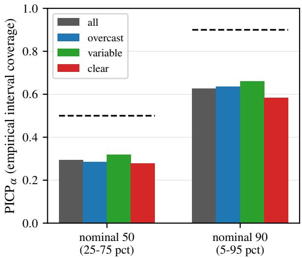  
Figure 6: (a) Reliability of the proposed model: the nominal level � of a central prediction interval against the empirical coverage attained at that level, PICP (Eq. (16)), swept over nineteen levels from 0.05 to 0.95; pooled (bold) and per horizon (faint). The diagonal is perfect reliability, where a nominal � interval contains a fraction � of the observations. (b) $\mathrm { P I C P } _ { \alpha }$ at $\alpha = 0 . 5$ and 0.9 by sky-condition tertile; dashed lines are the nominal targets.

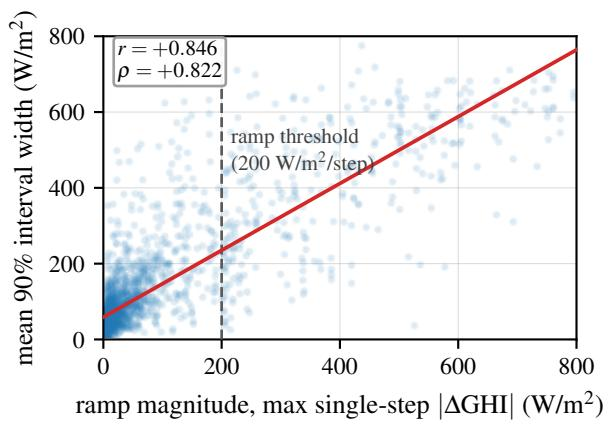

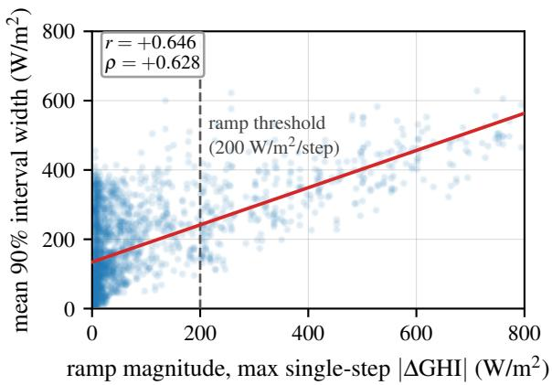  
(b) Xiong  
(a) Proposed (joint, future sky)  
Figure 7: Width of the 90% prediction interval against ramp magnitude, one point per test sample, for (a) Proposed (joint, future sky) and (b) Xiong, on the same axes. Width is the 5–95 percentile spread of the ensemble, averaged over the eight horizons; magnitude is the largest single-step |ΔGHI| in the forecast window. The dashed line is the 200 $\mathsf { W } \mathsf { m } ^ { - 2 }$ ramp threshold: the ramp subset is the region to its right. Xiong is subsampled to ten members so the two panels are comparable. Red lines are least-squares fits, of slope 0.88 and 0.54.

Table 6  
Response of the 90% prediction interval to ramp magnitude, on the matched test subset. � and � are the Pearson and Spearman correlations between a sample’s mean interval width and its ramp magnitude (largest single-step |ΔGHI|); widths are means of and on the ramp subset, in $\mathsf { W } \mathsf { m } ^ { - 2 }$ , and the ratio is their quotient. All methods at $M = 1 0$ members, Xiong subsampled to match. Deterministic methods are absent: a point forecast has no width.
<table><tr><td>Method</td><td>r↑</td><td>ρ↑</td><td>non-ramp</td><td>ramp</td><td>ratio</td></tr><tr><td>SkyGPT</td><td>+0.657</td><td>+0.594</td><td>85.4</td><td>266.0</td><td>3.1</td></tr><tr><td>Xiong</td><td>+0.646</td><td>+0.629</td><td>152.6</td><td>346.2</td><td>2.3</td></tr><tr><td>Proposed (joint, past sky)</td><td>+0.803</td><td>+0.826</td><td>61.7</td><td>355.3</td><td>5.8</td></tr><tr><td>Proposed (joint, future sky)</td><td>+0.846</td><td>+0.822</td><td>87.1</td><td>417.1</td><td>4.8</td></tr></table>

Forecast accuracy on the ramp subset $\left( n = 3 3 4 \right.$ of the matched test subset), scored against the same smart-persistence reference as Table 2. RMSE in $\mathsf { W } \mathsf { m } ^ { - 2 }$ ; FS and CRPSS are skill scores, higher is better. Rows are grouped as in Table 2. Errors on ramps are several times their pooled values for every method, so these numbers are not comparable with Table 2 and none is quoted beside one.
<table><tr><td>Method</td><td>RMSE↓</td><td>FS↑</td><td>CRPSS↑</td></tr><tr><td>DLinear (wo Iclr)</td><td>249.8</td><td>+0.147</td><td>+0.109</td></tr><tr><td>PatchTST (wo iclr)</td><td>244.8</td><td>+0.164</td><td>+0.111</td></tr><tr><td>TimeXer (wo Iclr)</td><td>244.3</td><td>+0.166</td><td>+0.112</td></tr><tr><td>DLinear</td><td>242.3</td><td>+0.173</td><td>+0.125</td></tr><tr><td>PatchTST</td><td>243.3</td><td>+0.170</td><td>+0.113</td></tr><tr><td>TimeXer</td><td>243.3</td><td>+0.169</td><td>+0.115</td></tr><tr><td>SUNSET</td><td>216.4</td><td>+0.261</td><td>+0.198</td></tr><tr><td>ConvLSTM</td><td>324.2</td><td>-0.107</td><td>-0.159</td></tr><tr><td>PhyDNet</td><td>254.3</td><td>+0.132</td><td>+0.109</td></tr><tr><td>PhyDNetGAN</td><td>245.1</td><td>+0.163</td><td>+0.137</td></tr><tr><td>SkyGPT</td><td>406.5</td><td>-0.388</td><td>-0.334</td></tr><tr><td>Xiong</td><td>254.0</td><td>+0.133</td><td>+0.310</td></tr><tr><td>Proposed (joint, future sky)</td><td>226.4</td><td>+0.227</td><td>+0.440</td></tr><tr><td>Proposed (joint, past sky)</td><td>249.0</td><td>+0.150</td><td>+0.342</td></tr></table>

What the intervals give an operator. A deterministic forecast ofers no width to act on: SUNSET and the scalar forecasters return a single value in both regimes. The proposed model’s 90% interval instead widens with the event, from a mean of $8 7 ~ \mathrm { W } \mathrm { m } ^ { - 2 }$ of ramps to 417 $\mathrm { { W } m } ^ { - 2 }$ on them, and its width tracks the size of the event rather than merely its presence: regressed against the per-sample ramp magnitude, the mean width gives $r = + 0 . 8 5$ (Spearman $\rho = + 0 . 8 2 )$ ), stable across all eight horizons. Xiong and SkyGPT widen less and track magnitude more loosely (Table 6 and Figure 7), and Xiong’s interval opens by $0 . 5 4 \mathrm { W } \mathrm { m } ^ { - 2 } \mathrm { p e r } \mathrm { W } \mathrm { m } ^ { - 2 }$ of ramp against the proposed model’s 0.88.

A reserve sized on this interval therefore grows with the size of the anticipated ramp, which is the quantity a scheduler needs and a point forecast cannot supply. The level at which it scales must be read with Section 6.3 in mind: coverage is 0.605 at a nominal 0.90 on ramps, so the interval ranks and scales risk correctly but does not deliver its nominal level, and an operator would size against the empirical coverage rather than the nominal one.

Irradiance recovered from future sky frames by two readers, on the same 1998 samples: the frozen U-Net regressor (first two rows) and the irradiance head of the proposed model, reading its own denoised estimate of the future sky (third row) or, as the oracle arm, the true future frames (fourth row). Lower is better.
<table><tr><td>Frames read</td><td>Read by</td><td>RMSE↓  $[ \mathsf { W } \mathsf { m } ^ { - 2 } ]$ </td></tr><tr><td>ground-truth future frames</td><td>frozen U-Net</td><td>63.5</td></tr><tr><td>generated future frames</td><td>frozen U-Net</td><td>150.6</td></tr><tr><td>generated future frames</td><td>irradiance head of the proposed model</td><td>104.1</td></tr><tr><td>ground-truth future frames</td><td>irradiance head of the proposed model (oracle arm)</td><td>102.2</td></tr></table>

## 7. Efect of removing the regression stage

The proposed model is well ahead of the two-stage pipeline (e.g., SkyGPT). The gap has two possible causes: the single-stage model may generate better sky images, or the regression stage may discard information that is present in the generated frames. To separate the two, we follow the second stage of SkyGPT [5] and employ the frozen U-Net regressor of Section 4.2, a U-Net trained on real sky images to predict the concurrent measurement (PV power there, GHI here). We then apply it, with identical preprocessing, to the ground-truth future frames and to the frames generated by the proposed model.

Table 8 compares the RMSE of the estimates from the U-Net and the forecast of the proposed model’s irradiance head, which reads the same generated sky as its internal denoised estimate. On the ground-truth frames, the regressor recovers irradiance at $6 3 . 5 ~ \mathrm { W } \mathrm { m } ^ { - 2 }$ , nearly constant across the eight horizons (61.3–65.7, Table C.2) and well below SUNSET $( 9 7 . 6 \mathrm { W } \mathrm { m } ^ { - 2 } )$ and smart persistence $( 1 2 7 . 4 \mathrm { W } \mathrm { m } ^ { - 2 } )$ : if the future sky were known, irradiance would follow from it accurately. On the generated frames, the same regressor reaches $1 5 0 . 6 \mathrm { W } \mathrm { m } ^ { - 2 }$ , rising from $1 4 2 . 9 \mathrm { W } \mathrm { m } ^ { - 2 }$ at two minutes to $1 6 3 . 5 \mathrm { W } \mathrm { m } ^ { - 2 }$ at sixteen minutes as frame quality falls (Table C.2). One case of generated frames, and the irradiance that goes with them, is shown in Figures 8 and 9.

Meanwhile, the irradiance head reads the same generated sky at $1 0 4 . 1 ~ \mathrm { W } \mathrm { m } ^ { - 2 }$ . With the frames fixed and only the reader changed, the diference of about $4 6 \mathrm { W } \mathrm { m } ^ { - 2 }$ is attributable to the regression stage. A two-stage pipeline is, therefore, limited not only by the quality of its generated frames but also by an estimator that was not trained on them, which here costs about $4 6 ~ \mathrm { W } \mathrm { m } ^ { - 2 }$ . This is consistent with the large deficit of SkyGPT in Table 2, whose frames are read by an estimator of this kind. We then condition the same irradiance head on the true future frames instead of its own denoised estimate, the oracle arm. Its RMSE improves by only about $2 ~ \mathrm { W } \mathrm { m } ^ { - 2 }$ , from 104.1 to $1 0 2 . 2 ~ \mathrm { W } \mathrm { m } ^ { - 2 }$ (Table 8), where the frozen regressor reads those same frames at 63.5. The gain is small because the head was trained on generated frames and cannot fully use real ones, not because real frames contain little more information. The arm and its numbers are described in Appendix B. The $6 3 . 5 \mathrm { W } \mathrm { m } ^ { - 2 }$ above therefore indicates what perfect frame generation would allow rather than an achievable forecasting bound.

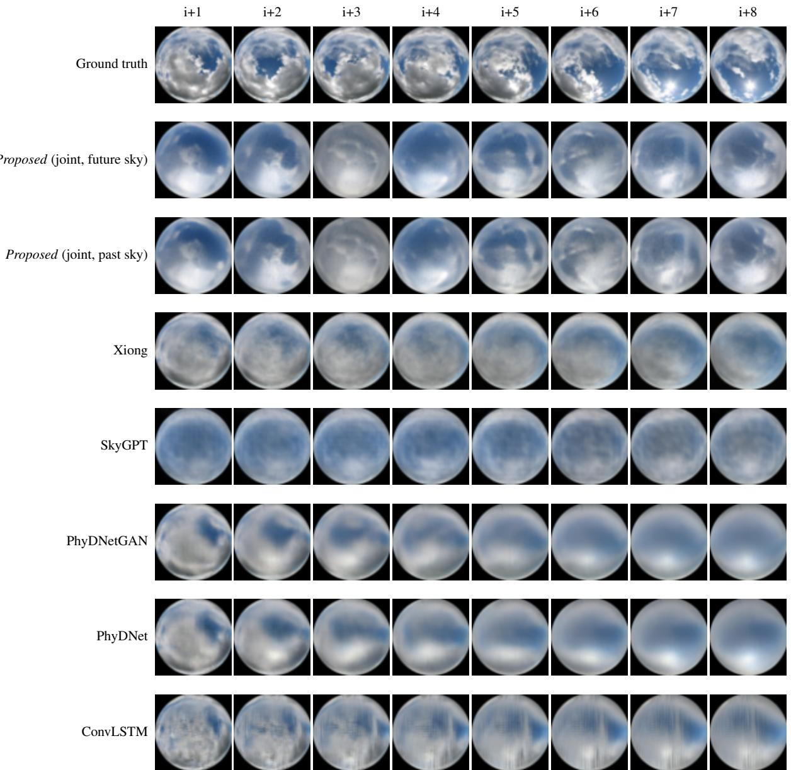  
Figure 8: Ground-truth future frames (top row) and the frames generated by each method across the forecast horizon, for one ramp-up case. No method reproduces the ground truth closely; the relevant comparison is between the generated rows. Frame quality decreases with lead time, consistent with the per-horizon degradation of the frozen regressor reported in this section.

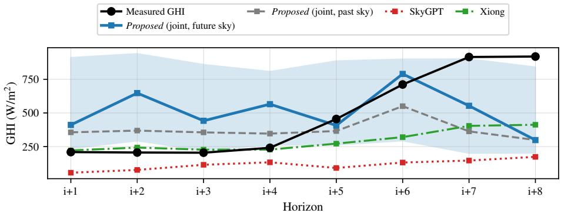  
Figure 9: Measured and forecast irradiance for the same case as Figure 8. The shaded band is the 5–95% interval of the proposed model’s ten-member ensemble. The measured series rises by about 700 $\mathsf { W } \mathsf { m } ^ { - 2 }$ between �+4 and �+7; the deterministic rows follow it only partly, and the ensemble band is wide enough to contain most of the rise.

## 8. Ablations

Two questions remain from the comparison. The first concerns the design: which input of the irradiance head produces the gain (Section 8.1). The second concerns the remaining point-accuracy gap to SUNSET, which reads the measured irradiance history that the proposed model does not receive (Section 8.2).

## 8.1. Input of the irradiance head

The irradiance head can read the past frames alone, which carry no information about the future; the noised future frames, which carry it only weakly at high noise levels; or the denoised estimate of the future frames, which is both clean and about the future (Eq. (12)). Table 9 compares the first and the last; all four inputs are reported in Appendix B. Reading the denoised estimate instead of the past frames lowers RMSE by $1 0 . 0 \mathrm { W } \mathrm { m } ^ { - 2 }$ and raises CRPSS from +0.235 to +0.341. The two arms have the same architecture and parameter count, so the diference is not one of capacity. Their training budgets difer slightly: at seed 1 Proposed (joint, past sky) stopped five epochs short of Proposed (joint, future sky) (Section 3.5), all five in the low-rate second phase, and the shortfall falls on the weaker arm, so the reported diference should be read as an upper bound to that extent. Its other two seeds ran the full budget and still select the same epoch, 954, as their best, so the missing epochs are unlikely to carry the gap. It has the same sign across three training seeds, and its paired bootstrap interval excludes zero. We test further by adding a path that feeds the denoised estimate of the future CSI $\hat { y } _ { 0 }$ back into the image denoiser (Appendix B). The gain therefore comes from what the head reads rather than from cross-modal feedback (see Table B.2).

## 8.2. Measured irradiance history

All configurations so far condition on past sky images and deterministic covariates only. Two results suggest that the remaining point-accuracy gap is due to this input rather than to the architecture: true future frames improve the head

Efect of the input of the irradiance head on the matched test subset, at matched training budget. Both arms have the same architecture and parameter count; only the signal read by the head difers.
<table><tr><td>Head reads</td><td>RMSE↓</td><td>FS↑</td><td>CRPSS↑</td></tr><tr><td>denoised estimate of future frames</td><td>104.06</td><td>+0.183</td><td>+0.341</td></tr><tr><td>past frames only</td><td>114.09</td><td>+0.104</td><td>+0.235</td></tr></table>

Table 10

Conditioning the irradiance head on eight past timesteps of measured irradiance, against a matched control on the same code path. Gain is control minus stream, so positive favours the stream.
<table><tr><td>Seed</td><td>control</td><td>+irradiance</td><td>RMSE gain ↑</td><td>CRPSS gain ↑</td></tr><tr><td>1</td><td>108.51</td><td>101.45</td><td>+7.06</td><td>+0.090</td></tr><tr><td>2</td><td>108.13</td><td>103.37</td><td>+4.76</td><td>+0.084</td></tr></table>

by only about $2 \mathrm { W } \mathrm { m } ^ { - 2 }$ (Section 7), and the method with the lowest RMSE, SUNSET, reads the past irradiance series.   
This section tests that explanation. The arm below is an ablation used to locate the gap, not the proposed configuration.

Arm and control. A third token stream is added to the irradiance head: the eight past values of measured irradiance, encoded as the clear-sky index and the raw irradiance, mapped to eight tokens with their own learned source embedding, concatenated with the tokens of the denoised estimate and also added on the query side so that every forecast step receives them. All other settings are unchanged. Because the stream requires a modified code path, each seed is compared with a control trained on the same path with the stream disabled; the unused modules are still constructed, so both arms consume identical random draws, and the modified and original samplers produce bit-identical ensembles from the same weights.

At each seed the control lies above the headline arm: 108.51 against $1 0 4 . 5 8 \mathrm { W } \mathrm { m } ^ { - 2 }$ at seed 1, and 108.13 against $1 0 6 . 5 3 \ \mathrm { W } \mathrm { m } ^ { - 2 }$ at seed 2, both pairs scored with the same sampler seeding. The cause is the initialisation: at the same seed, the modified code path gives the newly trained modules diferent random initial weights from the original code. Retraining the control at seed 1 with those weights aligned to the headline arm’s, and with the recipe otherwise unchanged, reaches $1 0 4 . 6 3 \ \mathrm { W } \mathrm { m } ^ { - 2 }$ — within 0.05 of the headline arm and 3.88 below the control (Appendix C). The comparison below is paired within the code path and is unafected either way.

Result. The measured irradiance history lowers RMSE by $4 . 8 { - } 7 . 1 \ \mathrm { W } \mathrm { m } ^ { - 2 }$ and raises CRPSS by about 0.09 at both seeds (Table 10), a CRPS reduction of 13.3% and 12.3%. To the same head it is worth several times the gain from true future frames, so the remaining point-accuracy gap reflects a diference in inputs rather than a limit of the architecture. The study deliberately evaluates what a joint sky-image model achieves from the sky alone, which keeps its comparison with the frame-generation methods symmetric in inputs; extending the model with measured irradiance is a direction whose value this ablation quantifies.

## 9. Conclusion

Sky-image irradiance forecasting has largely been built as a cascade: predict the future sky, then regress irradiance from it. We evaluated the single-stage alternative — co-denoising the future frames and the future clear-sky index in one difusion process, and reading the forecast from a direct irradiance head — and measured what removing the second stage is actually worth. On the model’s own generated frames, a separately trained regressor recovers irradiance at $1 5 0 . 6 \mathrm { W } \mathrm { m } ^ { - 2 }$ where the jointly trained head reaches 104.1. The margin is not attributable to better frames, since both numbers are read from the same frames; it is attributable to a head that has learned the error statistics of the generator it reads.

Three limitations bound these results. The proposed model does not produce the best point forecast: SUNSET, which also reads the measured irradiance series, wins pooled RMSE. Its intervals rank and scale risk but fall short of nominal coverage. And the cross-modal coupling result of Section 8.1 rests on one mechanism at one training budget, so it is an absence of observed efect rather than a demonstrated absence.

Two results constrain how far that claim should be pushed. First, the advantage comes from the joint structure rather than from cross-modal information flow: adding an explicit path from the denoised estimate of the future CSI back into the image branch produced no observed forecast gain. Second, the point-accuracy gap to the strongest deterministic baseline is an input diference rather than an architectural ceiling: a perfect future sky is worth about $2 ~ \mathrm { W } \mathrm { m } ^ { - 2 }$ , eight steps of measured irradiance 5–7. A single-stage joint model that also reads the measured irradiance series should therefore close much of the remaining distance on point accuracy while keeping the predictive distribution. What is reported here is the arm that does not take that input, which is the arm a site with a camera and no pyranometer can run: it forecasts from imagery alone, and its intervals widen with the size of the ramp they anticipate.

## A. Baseline fidelity

A comparison is only as honest as its weakest reimplementation. SkyGPT, ConvLSTM, PhyDNet, PhyDNetGAN and SUNSET were taken from the reference implementation released with Nie et al. [5] [37]; DLinear, PatchTST and TimeXer were taken from the Time-Series-Library [36]. Each was audited for convergence and training-budget parity before being scored, and three required correction. We record what was wrong and what changed, because in two cases the correction moved the baseline in the direction that makes our own result look worse.

SUNSET — retrained after an early-stopping audit. Both variants were found to have trained past their validation minimum, because the early-stopping patience was being applied on a coarser schedule than the configuration intended. Both were retrained changing only the validation cadence, with every other hyperparameter held fixed, and both then stopped at the intended margin after their own validation minimum. The corrected variant reaches $9 7 . 6 \mathrm { W } \mathrm { m } ^ { - 2 }$ — the value that beats the proposed model on pooled RMSE in Table 2. Correcting this baseline widened our own point-accuracy concession, and we report it on that basis.

SkyGPT — a rollout discontinuity introduced by our port, not by the method. Our initial port generated the eight-frame horizon in two four-frame chunks, the second chunk self-conditioning on the first chunk’s own generated frames, forced by a clip-length mismatch that the original implementation avoids through single-pass generation. This produced a sharp discontinuity between the fourth and fifth lead times — an artefact of our plumbing, not a weakness of the architecture. The clip length was raised so that one sampling call covers the whole horizon, and both stages were retrained under the corrected setting, converging by patience exhaustion in the same signature as the other baselines. The number in Table 2 is from the corrected version.

ConvLSTM, PhyDNet and PhyDNetGAN — converged, and scored through a regressor. All three share identical early-stopping criteria and were verified to have converged rather than been cut short. None produces an irradiance forecast directly, so each is scored by passing its generated frames to the same frozen U-Net used in Section 7 — which is the two-stage arrangement, and part of what that section measures.

Xiong — faithful, with a diagnosed mechanism. The full three-stage pipeline was run as published. Its stated source of ensemble diversity is a neural stochastic diferential equation, but the trained model’s SDE has collapsed to near-deterministic behaviour: the observed spread comes from the sampler and from a fitted observation-noise term rather than from the SDE itself. We report this as a diagnosis of the reimplementation’s behaviour, not as a criticism of the method, and it does not change the numbers we quote for it.

## B. The wider design space

Section 8.1 reports the two arms that bracket the design choice. The full survey covers eight arms and is given here. It is evaluated on the full 2023 test set $( N = 1 2 , 9 0 6 )$ rather than the matched subset used in the main text, so its numbers are not comparable with Table 2 and none is quoted beside one.

Three readings. The arm reading the noised difusion state of the future frames (noised) is the weakest forecaster, and the arm reading both it and the past frames (concat) — the information set corresponding to the closest concurrent method — sits between the two bracketing arms of Section 8.1. Image quality and forecast skill are largely independent: concat has the worst imagery but a mid-range forecast, noised the reverse.

The oracle arm. The oracle arm is not a separately trained model: it uses the trained weights of Proposed (joint, future sky) and, at evaluation time only, its prediction pass reads the tokens of the true future frames instead of those of $\hat { \pmb x } _ { 0 }$ . It is $3 . 7 \mathrm { W } \mathrm { m } ^ { - 2 }$ ahead of the deployed arm on this test set, the full-test counterpart of the roughly $2 \mathrm { W } \mathrm { m } ^ { - 2 }$ on the matched subset (Table 8), where the frozen regressor reads the same real frames at $6 3 . 5 \mathrm { W } \mathrm { m } ^ { - 2 }$ . The head was trained on the model’s own denoised estimates, so real frames are unlike the inputs it has learned to read: the gain is small because the head cannot fully use real frames, not because they contain little more information. Joint training makes the head robust to degraded generated frames $( 1 0 4 . 1 \mathrm { W } \mathrm { m } ^ { - 2 }$ where the regressor reaches 150.6) and, for the same reason, unable to exploit real ones. Varaschin and Silva [2] report 44.1 $\mathrm { { W } m } ^ { - 2 }$ for a dedicated estimator trained and evaluated on real frames, consistent with this reading; their figure is not directly comparable with ours (diferent year, split and horizons). The arm also sits above the 1.05 SSR target, at 1.11, where the deployed arm reaches 1.24 (Table B.1); removing the uncertainty about the future sky therefore does not remove the under-dispersion of Section 6.3.

Table B.1  
Design-space survey, full 2023 test set (forecast skill against pooled $\mathrm { S P M } = 1 2 3 . 7 ; \mathrm { C R P S S }$ against $\overline { { \mathrm { M A E } } } = 5 4 . 0 1 ;$ ; SSR target 1.05; imagery via the frozen U-Net). Single seed, except Proposed (joint, future sky), a two-seed mean. Every arm here is sampled at 20 reverse difusion steps, against the 50 used throughout the main text. The best value in each column is in bold (SSR: closest to 1.05; ties at the printed precision are both bold); the oracle (true future frames) arm is an upper bound, not a forecast, and is excluded. Not comparable with Table 2.
<table><tr><td>Arm</td><td>RMSE↓</td><td>FS↑</td><td>CRPSS↑</td><td>SSR (→ 1.05)</td><td>imagery ↓</td></tr><tr><td>oracle (true future frames)</td><td>98.1</td><td>+0.207</td><td>+0.393</td><td>1.11</td><td></td></tr><tr><td>Proposed (joint, future sky)</td><td>101.8</td><td>+0.177</td><td>+0.322</td><td>1.24</td><td>152.8</td></tr><tr><td>Proposed (joint, past sky)</td><td>110.5</td><td>+0.107</td><td>+0.217</td><td>1.55</td><td>165.3</td></tr><tr><td>scalar only</td><td>107.7</td><td>+0.129</td><td></td><td></td><td></td></tr><tr><td>concat</td><td>109.0</td><td>+0.119</td><td>+0.239</td><td>1.49</td><td>182.4</td></tr><tr><td>noised state</td><td>113.4</td><td>+0.083</td><td>+0.234</td><td>1.01</td><td>161.1</td></tr><tr><td>Proposed (joint, future sky, future CSI)</td><td>101.8</td><td>+0.177</td><td>+0.327</td><td>1.27</td><td>160.3</td></tr><tr><td>Proposed (joint, past sky, future CSI)</td><td>110.3</td><td>+0.108</td><td>+0.221</td><td>1.52</td><td>160.4</td></tr></table>

How the cross-modal path works. The proposed design passes information from the image branch to the CSI branch through $\hat { \mathbf { x } } _ { 0 }$ (Section 3.4); the variants below add the reverse path. Applying Eq. (3) to the CSI stream, with the noise estimate of the pass that reads the clean tokens $- \epsilon _ { y } ^ { \prime }$ of Eq. (6), or in a single-pass variant that pass’s own estimate — gives a denoised estimate of the future CSI, $\hat { \pmb y } _ { 0 } \in \mathbb { R } ^ { 8 }$

$$
\hat { y } _ { 0 } = \frac { y _ { t } - \sqrt { 1 - \bar { \alpha } _ { t } } \mathrm { s g } [ \epsilon _ { y } ^ { \prime } ] } { \sqrt { \bar { \alpha } _ { t } } } ,\tag{B.1}
$$

which is available before the image denoiser runs. The variant passes $\hat { y } _ { 0 }$ to the image denoiser through a route separate from cross-attention and ControlNet: the timestep embedding. Every UNet, including the proposed model’s, maps � to an embedding $\gamma ( t ) \in \mathbb { R } ^ { 5 1 2 }$ , and each residual block adds a learned projection of it to its feature maps as a per-channel shift. The variant adds to $G _ { \theta }$ a small network $\psi : \mathbb { R } \to \mathbb { R } ^ { 5 1 2 }$ and, for each future frame $j = i + 1 , \dots , i + 8$ , replaces �(�) by

$$
\tilde { \gamma } ^ { j } ( t ) = \gamma ( t ) + \psi \big ( \hat { y } _ { 0 } ^ { j } \big ) ,\tag{B.2}
$$

Table B.2  
The two cross-modal comparisons. Δ is with-path minus without-path, from Table B.1; both lie inside the noise floors of Section 4.2. The last column lists what difers between the two arms besides the path.
<table><tr><td>without path</td><td>with path</td><td>∆RMSE→0</td><td>∆CRPSS</td><td>other differences</td></tr><tr><td>Proposed (joint, future sky)</td><td>Proposed (joint, future sky, future CSI)</td><td>0.0</td><td>+0.005</td><td>selection rule; starting checkpoint</td></tr><tr><td>Proposed (joint, past sky)</td><td>Proposed (joint, past sky, future CSI)</td><td>-0.2</td><td>+0.004</td><td>selection rule; training budget</td></tr></table>

where $ { \psi ( u ) } = W _ { 2 } \mathrm { S i L U } \bigl ( W _ { 1 } \phi ( u ) { + } b _ { 1 } \bigr ) { + } b _ { 2 } ; \hat { y } _ { 0 } ^ { j }$ is the �th entry of $\hat { y } _ { 0 }$ from Eq. (B.1); and $\phi ( u ) = \bigl [ u , \sin ( 2 ^ { k } \pi u ) , \cos ( 2 ^ { k } \pi u ) \bigr ] _ { k = 0 } ^ { 1 5 }$ $\in \mathbb { R } ^ { 3 3 }$ are Fourier features of the standardised CSI value. The UNet call for frame � reads $\tilde { \gamma } ^ { j } ( t )$ wherever it would read �(�); nothing else in $G _ { \theta }$ changes. We write the variant’s image denoiser as

$$
\epsilon _ { x } = G _ { \theta } \big ( { \pmb x } _ { t } , t ; [ e , s _ { t } ] , { \pmb a } ^ { i } , \hat { { \bf y } } _ { 0 } \big ) ,\tag{B.3}
$$

with the weights of � counted in �. This is how class-conditional difusion models supply a class label [38], here with a continuous value in place of the label; it is the additive case of feature-wise linear modulation [30]. $W _ { 2 }$ and $b _ { 2 }$ are zero-initialised, so at the start of training $\psi \equiv 0 , \tilde { \gamma } ^ { j } ( t ) = \gamma ( t )$ , and Eq. (B.3) reduces to Eq. (7); any diference is learned from the new input.

Adding the path of Eq. (B.2) to the two ends of Eq. (12) gives the two cross-modal variants evaluated in Section 8.1: Proposed (joint, future sky, future CSI), with $\pmb { v } = \pmb { \mathcal { T } } ( \hat { \pmb { x } } _ { 0 } )$ , and Proposed (joint, past sky, future CSI), with $\mathbf { \nabla } \mathbf { v } = \mathbf { a } ^ { \prime }$ Because $\hat { y } _ { 0 }$ is detached, the added path carries forward values only and, like the rest of the design, closes no gradient cycle. Figure B.1 shows one step of Proposed (joint, future sky, future CSI).

The cross-modal comparisons. Two rows of Table B.1 add an explicit cross-modal path to an otherwise identical arm: the denoised estimate of the future CSI, $\hat { \bf y } _ { 0 }$ , is fed back into the image branch as an additional conditioning signal, detached so that no gradient flows back through it (Section 3.4). Table B.2 sets out the two comparisons this yields. Each input choice of Eq. (12) runs its own phase 1, whereas the two cross-modal variants start phase 2 from a single shared phase-1 checkpoint, that of Proposed (joint, past sky) at seed 1; this is the starting-checkpoint diference recorded in the table. In both, adding the path moves forecast skill by less than the noise floors of Section 4.2. Figure B.1 shows where the path enters one denoising step.

Neither comparison isolates the path: the arms in each pair also difer in training history, in ways that difer between the pairs. We therefore report an absence of observed efect rather than evidence of none, and make no claim about the path’s efect on image quality.

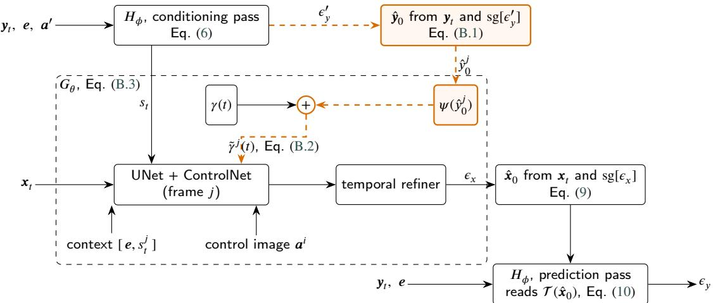  
Figure B.1: One denoising step of Proposed (joint, future sky, future CSI). Black: the step of the proposed model, Eqs. (6)– (10). Orange, dashed: what the variant adds. The conditioning pass’s noise estimate $\epsilon _ { y } ^ { \prime } ,$ detached, gives $\hat { y } _ { 0 }$ (Eq. (B.1)); inside $G _ { \theta } , \psi ( \hat { y } _ { 0 } ^ { j } )$ is added to the timestep embedding $\gamma ( t )$ , and the UNet call for frame � reads the sum $\tilde { \gamma } ^ { j } ( t )$ (Eq. (B.2)). Both links between the branches pass through a stop-gradient, so no gradient cycle closes. In Proposed (joint, past sky, future CSI) the prediction pass is absent: one pass reading $\pmb { a } ^ { \prime }$ supplies $s _ { t } , \epsilon _ { y }$ and, through Eq. (B.1), $\hat { y } _ { 0 }$

Table C.1  
The five training stages: three image-side stages, then joint difusion training in two phases. Each stage starts from the checkpoint the previous one selected. Validation criteria are computed on the validation split (Section 4).
<table><tr><td>Stage</td><td>Trains</td><td>Frozen</td><td>Learning rate</td><td>Stopping and checkpoint</td></tr><tr><td>1</td><td>VAE</td><td></td><td> $1 0 ^ { - 6 }$ </td><td>early stopping on validation LPIPS (patience 20)</td></tr><tr><td>2</td><td>UNet</td><td>VAE</td><td> $1 0 ^ { - 5 } ,$  then  $1 0 ^ { - 6 }$  the final epochs</td><td>best validation LPIPS (patience 20)</td></tr><tr><td>3</td><td>ControlNet Joint diffusion training (phase 1):</td><td>VAE, UNet VAE, UNet, ControlNet 10-4</td><td> $1 0 ^ { - 5 }$ </td><td>cosine schedule best validation LPIPS (patience 20) 19–20 epochs; best validation LPIPS +</td></tr><tr><td>4</td><td>image tokenizer, CSI denoiser, temporal refiner</td><td></td><td></td><td>CSI RMSE</td></tr><tr><td>5</td><td>Joint diffusion training (phase 2): VAE all except the VAE</td><td></td><td> $1 0 ^ { - 6 } ,$  halved on plateau</td><td>at most 31 epochs; best validation LPIPS + CSI RMSE</td></tr></table>

## C. Protocol details

Each training step co-noises the target latents and the clear-sky-index sequence at one shared timestep and minimises the loss of Eq. (11). The validation criterion in both phases is the sum of the LPIPS [39] of the generated frames and the RMSE of the forecast clear-sky index. Every arm starts from the same ControlNet checkpoint with the same ceiling of 50 epochs and early stopping on that criterion, so no arm trains longer than another, and every method in this paper, ours and the baselines alike, is scored at its own best-validation checkpoint: epoch 959 for Proposed (joint, future sky) at all three seeds, 954 for Proposed (joint, past sky), whose second phase stopped five epochs short of the ceiling for a reason its training record does not settle. The arms of Appendix B follow the same stages, and where they difer in budget or starting checkpoint it is stated there (Table B.2); scalar only has no image branch and trains in a single phase.

Table C.2  
Per-horizon values behind statements made as ranges in the main text: the frozen U-Net regressor applied to the ground-truth and to the generated future frames (RMSE, $\mathsf { W } \mathsf { m } ^ { - 2 }$ , Section 7); the CRPSS of Proposed (joint, future sky) (Section 6.1); its empirical coverage at the nominal 90% level, $\mathrm { P I C P } _ { 9 0 }$ (Section 6.3); and the cross-year minus in-period forecast skill of Proposed (joint, future sky) and SUNSET (Section 5.1). Matched test subset, 50 sampling steps.
<table><tr><td rowspan="2">Horizon</td><td colspan="2">frozen regressor on</td><td rowspan="2">CRPSS</td><td rowspan="2"> $\mathrm { P I C P _ { 9 0 } }$ </td><td colspan="2">∆FS, cross-year</td></tr><tr><td>true frames</td><td>generated</td><td>Proposed (joint, future sky)</td><td>SUNSET</td></tr><tr><td>i+1</td><td>65.7</td><td>142.9</td><td>+0.034</td><td>0.660</td><td>+0.015</td><td></td></tr><tr><td>i+2</td><td>61.3</td><td>144.2</td><td>+0.252</td><td>0.615</td><td>+0.018</td><td>+0.004 +0.006</td></tr><tr><td>i+3</td><td>63.8</td><td>145.3</td><td>+0.325</td><td>0.634</td><td>+0.022</td><td>+0.005</td></tr><tr><td>i+4</td><td>63.1</td><td>146.9</td><td>+0.375</td><td>0.600</td><td>-0.027</td><td>-0.001</td></tr><tr><td>i+5</td><td>65.3</td><td>151.7</td><td>+0.410</td><td>0.623</td><td>-0.008</td><td>+0.004</td></tr><tr><td>i+6</td><td>61.8</td><td>156.3</td><td>+0.397</td><td>0.613</td><td>-0.012</td><td>-0.003</td></tr><tr><td>i+7</td><td>62.5</td><td>154.1</td><td>+0.398</td><td>0.662</td><td>-0.038</td><td>-0.010</td></tr><tr><td>i+8</td><td>64.0</td><td>163.5</td><td>+0.385</td><td>0.606</td><td>-0.053</td><td>-0.030</td></tr></table>

Table C.3

Point estimates on the matched test subset with all 1998 windows, without the 13 that are not contiguous (contiguous, $N = 1 9 8 5 )$ , and without the 62 whose targets or persistence origin include a minute SIRTA has since marked unusable (QC-valid, $N = 1 9 3 6 )$ ; Section 4.1. RMSE in $\mathsf { W } \mathsf { m } ^ { - 2 }$ ; CRPSS against smart persistence on the same windows. The best value in each column is in bold. No method changes rank on either score in either comparison, and none of the 13 non-contiguous windows is in the ramp-event subset of Section 6.4.
<table><tr><td rowspan="2">Method</td><td colspan="3">RMSE↓</td><td colspan="3">CRPSS↑</td></tr><tr><td>all</td><td>contiguous</td><td>QC-valid</td><td>all</td><td>contiguous</td><td>QC-valid</td></tr><tr><td>SPM</td><td>127.4</td><td>127.8</td><td>128.7</td><td>一</td><td>一</td><td>一</td></tr><tr><td>DLinear (wo Iclr)</td><td>113.4</td><td>113.8</td><td>114.2</td><td>-0.081</td><td>-0.081</td><td>-0.074</td></tr><tr><td>PatchTST (wo Iclr)</td><td>111.0</td><td>111.4</td><td>111.9</td><td>-0.011</td><td>-0.010</td><td>-0.008</td></tr><tr><td>TimeXer (wo Iclr)</td><td>111.0</td><td>111.4</td><td>111.8</td><td>-0.023</td><td>-0.023</td><td>-0.019</td></tr><tr><td>DLinear</td><td>109.8</td><td>110.1</td><td>110.6</td><td>-0.034</td><td>-0.035</td><td>-0.033</td></tr><tr><td>PatchTST</td><td>109.6</td><td>109.9</td><td>110.3</td><td>+0.029</td><td>+0.029</td><td>+0.031</td></tr><tr><td>TimeXer</td><td>110.0</td><td>110.3</td><td>110.7</td><td>+0.011</td><td>+0.011</td><td>+0.013</td></tr><tr><td>SUNSET</td><td>97.6</td><td>97.9</td><td>98.5</td><td>+0.060</td><td>+0.060</td><td>+0.059</td></tr><tr><td>ConvLSTM</td><td>145.3</td><td>145.7</td><td>146.5</td><td>-0.372</td><td>-0.372</td><td>-0.374</td></tr><tr><td>PhyDNet</td><td>115.8</td><td>116.1</td><td>117.0</td><td>-0.121</td><td>-0.120</td><td>-0.124</td></tr><tr><td>PhyDNetGAN</td><td>112.3</td><td>112.7</td><td>113.5</td><td>-0.103</td><td>-0.102</td><td>-0.106</td></tr><tr><td> ${ \mathsf { S k y G P T } }$ </td><td>216.8</td><td>217.5</td><td>219.1</td><td>-1.159</td><td>-1.160</td><td>-1.169</td></tr><tr><td>Xiong</td><td>116.9</td><td>117.3</td><td>118.0</td><td>+0.148</td><td>+0.148</td><td>+0.145</td></tr><tr><td>Proposed (joint, future sky)</td><td>104.1</td><td>104.4</td><td>104.8</td><td>+0.341</td><td>+0.341</td><td>+0.342</td></tr><tr><td>Proposed (joint, past sky)</td><td>114.1</td><td>114.5</td><td>115.1</td><td>+0.235</td><td>+0.235</td><td>+0.234</td></tr></table>

Sampler. All joint arms sample at 50 reverse difusion steps. A sweep over step counts established this as the point beyond which forecast metrics stop improving materially; the setting is then fixed for every arm and every seed reported.

Ensemble size. Probabilistic forecasts use $M = 1 0$ members throughout, each from an independent initial-noise realisation. CRPS is computed with the fair (bias-corrected) estimator; the naive estimator gives materially more optimistic skill at this ensemble size and is not used.

Control of the irradiance-stream ablation. The modified code path of Section 8.2 constructs the irradiancestream modules in both the stream and the control arm, so the two start from identical weights. Relative to the original code, these modules are built before the CSI denoiser, the temporal refiner and the source embedding, so at the same seed those three modules receive diferent random initial weights; the training noise, timesteps and data order come from separately seeded generators and are unchanged. Scored under one sampler-seeding convention, the resulting diferences are $3 . 9 ~ \mathrm { W } \mathrm { m } ^ { - 2 }$ at seed 1 and $1 . 6 ~ \mathrm { W } \mathrm { m } ^ { - 2 }$ at seed 2, against the $1 . 0 8 ~ \mathrm { W } \mathrm { m } ^ { - 2 }$ spread of the headline arm’s three seeds. A direct test at seed 1 confirms the cause. Copying the headline arm’s fresh initial weights into the modified path before training — so that the two runs start from identical values of every module they share — and then training and scoring the arm unchanged gives $1 0 4 . 6 3 \ \mathrm { W } \mathrm { m } ^ { - 2 }$ , against the headline arm’s 104.58 and the control’s 108.51. The ofset is therefore an initialisation diference at that seed and not a property of the modified code path or of the ablation; the arm was not retrained at seed 2. Two smaller efects were measured along the way: scoring the control at its best rather than its final phase-2 epoch lowers its RMSE by $0 . 7 9 \mathrm { W } \mathrm { m } ^ { - 2 }$ , and re-running the sampler from a diferent random state moves RMSE by $1 . 3 4 ~ \mathrm { W } \mathrm { m } ^ { - 2 }$ (Section 4.2).

Compute. The proposed generator is the largest model in the comparison at 198,834,269 parameters and is not the fastest at inference. The reduction from two trained stages to one is a structural claim about error propagation, not a compute claim: the regressor that a cascade requires is a negligible fraction of total cost.

## CRediT authorship contribution statement

Kanawut Suwandee: Software, Validation, Formal analysis, Investigation, Data curation, Visualization, Writing — original draft. Suwichaya Suwanwimolkul: Conceptualization, Methodology, Supervision, Project administration, Funding acquisition, Writing — review and editing.

## Declaration of competing interest

The authors declare that they have no known competing financial interests or personal relationships that could have appeared to influence the work reported in this paper.

## Funding

This work was supported by the $1 1 1 ^ { \mathrm { t h } }$ Anniversary Engineering Research Catalyst Fund Towards U Top 100, Chulalongkorn University.

## Data availability

The code, the trained weights and stored forecasts of every method compared here, and the training scripts are available at https://github.com/GenAI-CUEE/Single-stage-joint-diffusion. Scoring the stored forecasts reproduces every entry of Table 2 exactly. On the data as used here, regenerating the forecasts from the released weights reproduces the deterministic methods and the proposed model, whose sampling is seeded, exactly. SkyGPT’s sampler is unseeded and the forward pass of Xiong et al. [7] is not bit-for-bit deterministic, so their ensembles change from run to run; regenerated scores fall within the confidence intervals reported in Table 2. Reproducing the proposed model’s own training additionally requires the stage schedule of Appendix C, which the released configurations do not set.

The sky images and irradiance measurements are provided by the SIRTA atmospheric observatory [15] under its own data policy and are not redistributed here. The repository includes scripts that retrieve them from SIRTA’s server, to which SIRTA grants access on request, and the preprocessing code that builds the dataset; it also lists the identifiers and frame timestamps of the samples used. Because of SIRTA’s review of the 2023 record (Section 4.1), a dataset built from today’s files lacks some of the test samples and builds others from shifted frames. The repository lists the samples such a rebuild lacks, provides a script that identifies the shifted ones from the frame timestamps, and gives the expected scores for the rebuild.

## Declaration of generative AI and AI-assisted technologies in the manuscript preparation process

During the preparation of this work the authors used Claude (Anthropic) in order to draft and revise text, check the consistency of the manuscript with the code, and prepare analysis scripts. After using this tool, the authors reviewed and edited the content as needed and take full responsibility for the content of the published article.

## Acknowledgements

The authors would like to acknowledge SIRTA for providing the data used in this study [15].

## References

[1] C. I. Otuka, D. Cai, C. C. Ukwuoma, S. Luo, Z. Yang, O. Bamisile, C. D. Ukwuoma, C. U. Otuka, N. O. Otuka, Q. Huang, Experimental review and recent advances in deep learning techniques for solar irradiance forecasting and prediction, Solar Energy 304 (2026) 114175. doi:10.1016/j.solener.2025.114175.

[2] L. F. C. Varaschin, D. Silva, Benchmarking deep learning methods for irradiance estimation from sky images with applications to video prediction-based irradiance nowcasting, Solar Energy 302 (2025) 114000.

[3] Q. Paletta, G. Arbod, J. Lasenby, Benchmarking of deep learning irradiance forecasting models from sky images – an in-depth analysis, Sola Energy 224 (2021) 855–867. doi:10.1016/j.solener.2021.05.056

[4] T. Gneiting, S. Lerch, B. Schulz, Probabilistic solar forecasting: Benchmarks, post-processing, verification, Solar Energy 252 (2023) 72–80. doi:10.1016/j.solener.2022.12.054.

[5] Y. Nie, E. Zelikman, A. Scott, Q. Paletta, A. Brandt, SkyGPT: Probabilistic ultra-short-term solar forecasting using synthetic sky images from physics-constrained VideoGPT, Advances in Applied Energy 14 (2024) 100172. doi:10.1016/j.adapen.2024.100172.

[6] J. Huang, B. Shao, Y. Ke, Y. Gao, S. Mazzoni, PV-MM-difusion: An end-to-end multi-modal difusion model for ultra-short-term probabilistic photovoltaic forecasting, Applied Energy 413 (2026) 127816. doi:10.1016/j.apenergy.2026.127816.

[7] B. Xiong, Y. Chen, X. Zhao, Z. Su, J. Fu, D. Chen, D. Zhang, Multimodal ultra-short-term probabilistic solar power forecasting with generative AI and Transformer, Advances in Applied Energy 20 (2025) 100250. doi:10.1016/j.adapen.2025.100250.

[8] X. Shi, Z. Chen, H. Wang, D.-Y. Yeung, W.-k. Wong, W.-c. Woo, Convolutional LSTM network: A machine learning approach for precipitation nowcasting, arXiv preprint arXiv:1506.04214 (2015). URL: https://arxiv.org/abs/1506.04214.

[9] V. Le Guen, N. Thome, Disentangling physical dynamics from unknown factors for unsupervised video prediction, in: Proceedings of the IEEE/CVF Conference on Computer Vision and Pattern Recognition (CVPR), 2020.

[10] Y. Sun, V. Venugopal, A. R. Brandt, Short-term solar power forecast with deep learning: Exploring optimal input and output configuration, Solar Energy 188 (2019) 730–741. doi:10.1016/j.solener.2019.06.041.

[11] D. Aicardi, P. Musé, R. Alonso-Suárez, A comparison of satellite cloud motion vectors techniques to forecast intra-day hourly solar globa horizontal irradiation, Solar Energy 233 (2022) 46–60.

[12] Q. Paletta, G. Terrén-Serrano, Y. Nie, B. Li, J. Bieker, W. Zhang, L. Dubus, S. Dev, C. Feng, Advances in solar forecasting: Computer vision with deep learning, Advances in Applied Energy 11 (2023) 100150.

[13] Y. Nie, X. Li, Q. Paletta, M. Aragon, A. Scott, A. Brandt, Open-source sky image datasets for solar forecasting with deep learning: A comprehensive survey, Renewable and Sustainable Energy Reviews 189 (2024) 113977.

[14] Y. Nie, X. Li, A. Scott, Y. Sun, V. Venugopal, A. Brandt, SKIPP’D: A sky images and photovoltaic power generation dataset for short-term solar forecasting, Solar Energy 255 (2023) 171–179.

[15] M. Haefelin, L. Barthès, O. Bock, C. Boitel, S. Bony, D. Bouniol, H. Chepfer, M. Chiriaco, J. Cuesta, J. Delanoë, P. Drobinski, J.-L. Dufresne, C. Flamant, M. Grall, A. Hodzic, F. Hourdin, F. Lapouge, Y. Lemaître, A. Mathieu, Y. Morille, C. Naud, V. Noël, W. O’Hirok, J. Pelon, C. Pietras, A. Protat, B. Romand, G. Scialom, R. Vautard, SIRTA, a ground-based atmospheric observatory for cloud and aerosol research, Annales Geophysicae 23 (2005) 253–275.

[16] C. Feng, J. Zhang, W. Zhang, B.-M. Hodge, Convolutional neural networks for intra-hour solar forecasting based on sky image sequences, Applied Energy 310 (2022) 118438.

[17] J. Liu, H. Zang, L. Cheng, T. Ding, Z. Wei, G. Sun, A transformer-based multimodal-learning framework using sky images for ultra-short-term solar irradiance forecasting, Applied Energy 342 (2023) 121160.

[18] M. Caldas, R. Alonso-Suárez, Very short-term solar irradiance forecast using all-sky imaging and real-time irradiance measurements, Renewable Energy 143 (2019) 1643–1658.

[19] A. X. Lee, R. Zhang, F. Ebert, P. Abbeel, C. Finn, S. Levine, Stochastic adversarial video prediction, in: arXiv preprint arXiv:1804.01523, 2018.

[20] Q. Paletta, A. Hu, G. Arbod, J. Lasenby, ECLIPSE: Envisioning cloud induced perturbations in solar energy, Applied Energy 326 (2022) 119924.

[21] A. Carpentieri, D. Folini, J. Leinonen, A. Meyer, Extending intraday solar forecast horizons with deep generative models, Applied Energy 377 (2025) 124186.

[22] W. Yan, Y. Zhang, P. Abbeel, A. Srinivas, VideoGPT: Video generation using VQ-VAE and transformers, arXiv preprint arXiv:2104.10157 (2021). URL: https://arxiv.org/abs/2104.10157.

[23] T. Gneiting, M. Katzfuss, Probabilistic forecasting, Annual Review of Statistics and Its Application 1 (2014) 125–151.

[24] G. Mitrentsis, H. Lens, An interpretable probabilistic model for short-term solar power forecasting using natural gradient boosting, Applied Energy 309 (2022) 118473.

[25] Z. Song, F. Xiao, Z. Chen, H. Madsen, Probabilistic ultra-short-term solar photovoltaic power forecasting using natural gradient boosting with attention-enhanced neural networks, Energy and AI 20 (2025) 100496.

[26] B. Xiong, Y. Chen, D. Chen, J. Fu, D. Zhang, Deep probabilistic solar power forecasting with transformer and Gaussian process approximation, Applied Energy 382 (2025) 125294.

[27] J. Ho, A. Jain, P. Abbeel, Denoising difusion probabilistic models, in: Advances in Neural Information Processing Systems (NeurIPS), volume 33, 2020, pp. 6840–6851.

[28] R. Rombach, A. Blattmann, D. Lorenz, P. Esser, B. Ommer, High-resolution image synthesis with latent difusion models, in: Proceedings of the IEEE/CVF Conference on Computer Vision and Pattern Recognition (CVPR), 2022, pp. 10684–10695.

[29] L. Zhang, A. Rao, M. Agrawala, Adding conditional control to text-to-image difusion models, in: Proceedings of the IEEE/CVF Internationa Conference on Computer Vision (ICCV), 2023, pp. 3836–3847.

[30] E. Perez, F. Strub, H. de Vries, V. Dumoulin, A. Courville, FiLM: Visual reasoning with a general conditioning layer, in: Proceedings of the AAAI Conference on Artificial Intelligence, volume 32, 2018.

[31] P. Ineichen, R. Perez, A new airmass independent formulation for the Linke turbidity coeficient, Solar Energy 73 (2002) 151–157. doi:10.1016/S0038-092X(02)00045-2.

[32] W. F. Holmgren, C. W. Hansen, M. A. Mikofski, pvlib python: a python package for modeling solar energy systems, Journal of Open Source Software 3 (2018) 884. doi:10.21105/joss.00884.

[33] A. Zeng, M. Chen, L. Zhang, Q. Xu, Are transformers efective for time series forecasting?, in: Proceedings of the AAAI Conference on Artificial Intelligence, volume 37, 2023, pp. 11121–11128. doi:10.1609/aaai.v37i9.26317.

[34] Y. Nie, N. H. Nguyen, P. Sinthong, J. Kalagnanam, A time series is worth 64 words: Long-term forecasting with transformers, in: Internationa Conference on Learning Representations (ICLR), 2023.

[35] Y. Wang, H. Wu, J. Dong, Y. Liu, Y. Qiu, H. Zhang, J. Wang, M. Long, TimeXer: Empowering transformers for time series forecasting with exogenous variables, in: Advances in Neural Information Processing Systems (NeurIPS), volume 37, 2024.

[36] Y. Wang, H. Wu, J. Dong, G. Qin, H. Zhang, Y. Liu, Y. Qiu, J. Wang, M. Long, Time-series-library: A library for advanced deep time series models for general time series analysis, https://github.com/thuml/Time-Series-Library, 2024. Software repository.

[37] Y. Nie, SkyGPT: A physics-constrained stochastic sky video prediction model for probabilistic short-term solar forecasting, https:// github.com/yuhao-nie/SkyGPT, 2024. Software repository.

[38] P. Dhariwal, A. Nichol, Difusion models beat GANs on image synthesis, in: Advances in Neural Information Processing Systems, volume 34, 2021, pp. 8780–8794.

[39] R. Zhang, P. Isola, A. A. Efros, E. Shechtman, O. Wang, The unreasonable efectiveness of deep features as a perceptual metric, in: Proceedings of the IEEE/CVF Conference on Computer Vision and Pattern Recognition (CVPR), 2018, pp. 586–595. doi:10.1109/CVPR.2018.00068.