# LEARNING TO THINK AND EXPLORE IN 3D WORLD

Yijiang Li1,† Bingyang Wang2,† Nuno Vasconcelos1

1University of California San Diego 2Georgia Institute of Technology yijiangli@ucsd.edu

## ABSTRACT

We study how vision-language models (VLMs) can learn to think and actively explore in 3D space. Instead of providing multi-view images, videos, or 3D representations to the model, we preserve the native visual encoding of VLMs, i.e., a single image, one at a time, just like humans, and treat the 3D representation only as an environment with which the model can interact through actions (e.g., move left) and observations (rendered images). Each rollout begins from an initial firstperson view and a visual question. The model can then iteratively reason, navigate, and reorient its viewpoint before committing to a final answer. Following an initial trajectory-supervised finetuning, we apply reinforcement learning (RL) with rewards driven primarily by final-answer correctness. Crucially, RL provides no direct supervision over which viewpoints the model should visit or which exploration actions it should take. Instead, the model must learn an effective exploration policy solely from the extent to which its interactions improve performance. Across six 3D benchmarks, our model ACT3D achieves an average accuracy of 53.2% that improves its base Qwen model by 22.0% and surpasses proprietary Gemini 3.6 Flash. ACT3D also outperforms existing open-source 3D methods while using 50-70% fewer input frames, and generalizes to unseen domains with an average improvement of 5.9% over its supervised initialization. Further analysis reveals adaptive, question-conditioned exploration. Performance gains over the base model increase from 0.6% on questions answerable from the initial view to 16.3% on those requiring extensive exploration. ACT3D searches for occluded targets, avoids unnecessary exploration, and acquires complementary viewpoints for spatial comparisons. These findings demonstrate that outcome-based RL enables VLMs not only to reason over visual evidence, but also to learn when and how to acquire it.

## 1 INTRODUCTION

Despite substantial progress in 3D vision-language models, much of the existing work studies spatial reasoning under observations that are specified a priori, providing models with complete RGB-D scans (Azuma et al., 2022; Zhu et al., 2025), multi-view images (Yang et al., 2025), videos (Zheng et al., 2025; Yang et al., 2026a), or explicit 3D scene representations such as point clouds and meshes (Hong et al., 2023; Huang et al., 2024b). Yet under partial observability, a fundamental challenge remains: the model must not only reason over the evidence currently available, but also determine how to act in order to acquire the evidence that is missing. This motivates the central question of our work: can a vision-language model learn to actively explore and acquire task-relevant visual evidence as an integral part ofthe 3D reasoning process?

We address this question by first formulating reasoning in 3D as an interactive visual decision process under partial observability. Rather than providing the VLM with a complete 3D representation, the 3D scene is kept external to the VLM and serves as an interactive environment that the model accesses through sequential action-observation interactions. Starting from a fixed initial egocentric view and a visual question, the model alternates between reasoning and interaction, iteratively acquiring observations through navigation and viewpoint control before committing to a final answer. This entire episode of interaction constitutes a policy rollout, in which the model jointly determines what information to acquire, how to interact with the environment, and how to reason over the accumulated evidence. To learn a policy that integrates visual information acquisition, spatial in teraction, and reasoning, we adopt a two-stage training procedure: trajectory-supervised fine-tuning first establishes the interaction protocol, after which reinforcement learning optimizes the full interactive policy over the rollout described above using rewards driven primarily by final-answer correctness. During reinforcement learning, no direct supervision is provided for intermediate viewpoints, actions, or exploration trajectories. Effective exploration must instead be learned through credit assignment from task performance. This formulation enables us to examine whether task-level supervision alone can induce task-directed visual information acquisition during 3D reasoning.

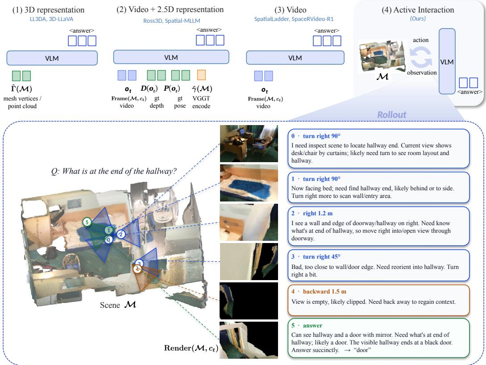  
Figure 1: Learning to reason and explore in 3D. Unlike prior methods with passive perception which assumes receive complete 3D representations as input, Act3D treats 3D representations as interactive environments, learning to alternate between reasoning and actions to actively explore the 3D world before committing an answer.

Building on this formulation, we present Act3D, a vision-language model that jointly learns to acquire visual evidence and reason over observations. Experiments across six 3D benchmarks show that Act3D achieves an average accuracy of 53.2%, outperforming all evaluated prior methods and baselines. It improves upon its base Qwen model by 22.0% and surpasses Gemini 3.6 Flash by 1.0%. Act3D also outperforms existing open-source 3D methods while using 50–70% fewer input frames and lower-resolution observations. These gains generalize to out-of-distribution beyond the training domains, with an average improvement of 5.9% over the supervised initialization across four out-of-domain benchmarks. Beyond accuracy, we observe the emergence of adaptive exploration behaviors where models learn to explore more with increasing interaction steps on questions that require more exploration, leading to pronounced improvements when target objects are initially occluded or far away from the initial camera position. We further qualitatively illustrate that Act3D learns to search for hidden objects, limit unnecessary exploration when relevant evidence is already visible, and gather complementary viewpoints to resolve spatial relationships. Together, these findings demonstrate that RL enables VLMs not only to reason over visual observations, but also to adaptively acquire the evidence needed for 3D reasoning.

## 2 RELATED WORK

Prior work on 3D vision-language models operates over observations assumed to be complete and directly presented to the model, including 3D representations such as point clouds and object-centric features (Hong et al., 2023; Huang et al., 2024a;b; Jin et al., 2023; Zhu et al., 2023; Chen et al., 2024b; Fu et al., 2025; Zhu et al., 2024; Chen et al., 2024c; Kang et al., 2025), fixed multi-view images or videos (Zhu et al., 2025; Zheng et al., 2025; Qi et al., 2025), and representations enhanced through reconstruction supervision (Wang et al., 2025a). A parallel line of work improves spatial reasoning in general-purpose VLMs through large-scale spatial supervision (Chen et al., 2024a; Yang et al., 2026a) and reinforcement learning with verifiable rewards (Ouyang et al., 2025; Wu et al., 2026; Li et al., 2026a). Despite advances in spatial reasoning, these approaches largely assume that the visual evidence required to answer a question is provided to the model, rather than actively acquired during inference. In contrast, Act3D keeps the 3D scene representation external to the VLM as an interactive environment: the model receives only egocentric 2D observations and learns to navigate and acquire task-relevant visual evidence through interaction, jointly with reasoning.

## Multimodal agentic reasoning.

Reinforcement learning (RL) (e.g., GRPO (Shao et al., 2024; Wang et al., 2026b)) has emerged as an effective paradigm for improving reasoning capabilities (Guo et al., 2025; Yang et al., 2026b; Yu et al., 2025; Zhao et al., 2026b; Li et al., 2026c). It has further been applied to agentic systems with multi-turn interaction and tool use (Jiang et al., 2026; Li et al., 2026d; Wang et al., 2025c; Jin et al., 2025; Luo et al., 2025), as well as to multimodal reasoning (Feng et al., 2025a;b; Li et al., 2026b; 2024; Huang et al., 2026; Liu et al., 2025; Shen et al., 2025). These methods primarily manipulate or revisit visual evidence already contained in the provided input. In contrast, our model learns to explore the 3D environment, actively acquiring new visual evidence while jointly optimizing reasoning and interaction in a single rollout.

Exploration in embodied and 3D environments. EmbodiedQA introduced navigation-based question answering (Das et al., 2017), later extended to open-vocabulary evaluation by OpenEQA (Majumdar et al., 2024). Recent benchmarks further show that active observation can outperform passive viewing and expose failures in spatial exploration and long-horizon planning (Hong et al., 2026; Zhang et al., 2026c;a; Wei et al., 2026; Wang et al., 2026a). We abstract embodiment to direct camera control over a scanned 3D scene and jointly learn exploration and reasoning for question answering. More closely related are methods that actively select viewpoints. Chain-of-View performs training-free coarse-to-fine view selection through a discrete camera-action interface (Zhao et al., 2026a). Think3D equips models with 3D reconstruction tools and optimizes their use with RL (Zhang et al., 2026b). ViewSuite distills self-exploration into a view graph (Wang et al., 2026a).

## 3 METHOD

We study how a VLM can learn to reason in 3D under partial observability. Learning such a policy poses two complementary challenges. The model must first acquire a basic interaction competence in 3D environments before it can learn from the interaction with environments despite the absence of ground-truth exploration trajectories. We therefore adopt a two-stage training procedure. We first perform trajectory-supervisedfine-tuning using curated interaction demonstrations to initialize a coherent reason–act–observe policy. We then apply reinforcement learning with verifiable reward to optimize the policy with rewards driven only by final performance, without supervision of any intermediate viewpoints or actions. This allows the model to learn task-directed exploration end-to end, supervised only by how much the evidence it acquires improves its answers.

## 3.1 REASONING IN 3D UNDER PARTIAL OBSERVABILITY

Problem formulation. We formalize reasoning in 3D as a partially observable Markov decision process (POMDP) (Kaelbling et al., 1998). A task instance $w = ( \mathcal { M } , q , y ^ { \star } ) \sim \mathcal { D }$ consists of a reconstructed 3D scene M, a question q, and the ground-truth answer $y ^ { \star } = g ( \mathcal { M } , q ) \in \mathcal { Y }$ . At step t, the environment state is $\boldsymbol { s } _ { t } = \left( \mathcal { M } , \boldsymbol { c } _ { t } \right)$ , where $c _ { t } = ( e _ { t } , f _ { t } )$ specifies the camera position $e _ { t } \in \mathbb { R } ^ { \bar { 3 } }$ and viewing direction $f _ { t } \in \mathbb { S } ^ { 2 }$ , and $c _ { 0 }$ is a fixed initial viewpoint of the scene. We write zˆ for the vertical axis of the world frame; the camera up vector is held parallel to $\hat { z } ,$ so the camera carries no roll and $c _ { t }$ has five degrees of freedom. The scene M remains fixed and hidden throughout the episode, while the camera state evolves under the model’s actions. The policy observes the rendered egocentric view $o _ { t } = \mathrm { R e n d e r } ( \mathcal { M } , c _ { t } )$ and, after each action, the resulting camera configuration $c _ { t }$

Action space. We consider two parameterizations of how the policy specifies the next viewpoint.

Under the relative parameterization, a navigation action $a _ { t } = ( \xi _ { t } , n _ { t } ) \in \mathcal { A } _ { \mathrm { n a v } } = \mathcal { U } \times \{ 1 , \dots , 8 \}$ pairs a motion primitive $\xi _ { t }$ with an integer multiplier $n _ { t }$ , giving $\lvert \mathcal { A } _ { \mathrm { n a v } } \rvert = 8 0$ navigation actions. The set U contains six translations (forward/backward, le $\mathtt { f t / r i g h t , u p / d o w n ) }$ and four rotations $\mathrm { ( t u r n \_ l e f t / t u r n \_ r i g h t }$ and turn\_up/turn\_down). Each primitive has a unit step $\delta _ { \xi } ,$ , equal to 1 m for forward/backward, 0.6 m for the remaining translations, and $3 0 ^ { \circ }$ for the rotations. The policy may additionally supply a step size $d ,$ in metres for translations and degrees for rotations, which the environment quantizes to the multiplier $n _ { t } = \mathrm { c l i p } ( \mathrm { r o u n d } ( d / \delta _ { \xi _ { t } } ) , 1 , 8 )$ , so that a single action covers at most eight unit steps; omitting $d$ gives $n _ { t } = 1$ . Let $\boldsymbol { r } _ { t } = ( \boldsymbol { \dot { f } } _ { t } \times \boldsymbol { \hat { z } } ) / \| \boldsymbol { f } _ { t } \times \boldsymbol { \hat { z } } \|$ denote the camera’s lateral direction, which is horizontal for any non-vertical $f _ { t }$ . Camera dynamics are deterministic:

$$
\left( e _ { t + 1 } , f _ { t + 1 } \right) = \left\{ \begin{array} { l l } { \left( \Pi _ { \mathcal { B } } \big ( e _ { t } + n _ { t } \delta _ { \xi _ { t } } u _ { t } \big ) , f _ { t } \right) , } & { a _ { t } \mathrm { ~ i s ~ a ~ t r a n s l a t i o n } , } \\ { \left( e _ { t } , \mathrm { R o t } _ { k _ { t } } \big ( n _ { t } \delta _ { \xi _ { t } } \big ) f _ { t } \right) , } & { a _ { t } \mathrm { ~ i s ~ a ~ r o t a t i o n } , } \end{array} \right.\tag{1}
$$

where $\operatorname { R o t } _ { k } ( \alpha )$ rotates a vector by an angle α about the unit axis $k .$ The primitive $\xi _ { t }$ selects the translation direction $u _ { t }$ or the rotation axis $k _ { t } \mathbf { : }$ : translations use $\boldsymbol { u } _ { t } = + \boldsymbol { f } _ { t } , - \boldsymbol { f } _ { t } , + \boldsymbol { r } _ { t } , - \boldsymbol { r } _ { t } , + \boldsymbol { \hat { z } } , - \boldsymbol { \hat { z } }$ for forward, backward, right, left, up and down, and rotations use $k _ { t } ~ = ~ + \hat { z } , - \hat { z }$ for turn\_left/turn\_right and $k _ { t } = + { r } _ { t } , - { r } _ { t }$ for turn\_up/turn\_down. Because $r _ { t }$ is built from $\hat { z } ,$ lateral motion stays horizontal and the horizon stays level at every pose. Finally, B is the axis-aligned bounding box of the scene enlarged by 1 m along each axis, and $\Pi _ { B }$ is the Euclidean projection onto it, which acts as a componentwise clamp; it keeps the camera near the scene but performs no collision checking, so the camera may pass through scene geometry.

Under the absolute parameterization, an action instead names a target pose directly, as a camera position together with a look-at point, $a _ { t } = ( p _ { t } , \ell _ { t } ) \in \mathbb R ^ { 3 } \times \mathbb R ^ { 3 }$ , and the camera is placed at that pose:

$$
e _ { t + 1 } = p _ { t } , \qquad f _ { t + 1 } = { \frac { \ell _ { t } - p _ { t } } { \left\| { \boldsymbol { \ell } } _ { t } - { \boldsymbol { p } } _ { t } \right\| } } .\tag{2}
$$

We adopt the relative parameterization throughout training and evaluation. Absolute actions require the policy to predict coordinates in a global reference frame that is not directly observed and whose scale varies across scenes. In contrast, relative actions are scale-invariant, camera-centric, and map naturally to interpretable motions such as “move left” or “turn right”. We compare the two parameterizations empirically in Appendix 4.6.

We augment navigation with the terminal answer actions $\mathcal { A } _ { \mathrm { s t o p } } = \{ \mathrm { S T O P } ( y ) : y \in \mathcal { V } \}$

$$
\bar { \mathcal { A } } = \mathcal { A } _ { \mathrm { n a v } } \cup \mathcal { A } _ { \mathrm { s t o p } } .\tag{3}
$$

Executing $\operatorname { s r o p } ( y )$ terminates the episode and returns y as the prediction. Given the task instance, both the transition and observation processes are deterministic; stochasticity arises only from the policy itself.

History and implicit belief. At step t, the policy conditions on the complete interaction history

$$
h _ { t } = ( q , o _ { 0 } , z _ { 0 } , a _ { 0 } , c _ { 1 } , o _ { 1 } , z _ { 1 } , . . . , a _ { t - 1 } , c _ { t } , o _ { t } , z _ { t } ) ,\tag{4}
$$

where $z _ { t }$ denotes the model’s intermediate reasoning before taking the next action. The policy is therefore $a _ { t } \sim \pi _ { \theta } ( \cdot \mid h _ { t } ) , a _ { t } \in \bar { \mathcal { A } }$ . Because the scene is hidden but static, the posterior $\bar { b _ { t } } ( \mathcal { M } ) =$ $\operatorname* { P r } ( \mathcal { M } \mid h _ { t } )$ , together with the observed camera configuration $c _ { t }$ and the elapsed step $t ,$ forms a sufficient statistic for optimal decision making. In practice, we do not explicitly maintain $b _ { t } ;$ instead, the VLM conditions on the full interaction context, which implicitly encodes its belief over the accumulated observations. The reasoning $z _ { t }$ is generated by the policy and belongs to the history, not to the environment state.

Objective. An episode terminates when the policy emits an answer or reaches the interaction budget, with $T = \operatorname* { m i n } \{ \dot { t } : a _ { t } \in \mathcal { A } _ { \mathrm { s t o p } } \} \wedge T _ { \mathrm { m a x } } ;$ if no answer is emitted within the budget, the prediction y is empty and counted as incorrect. The resulting rollout is $\tau = ( h _ { T } , y )$ , and we optimize the policy for expected finite-horizon, undiscounted return:

$$
\operatorname* { m a x } _ { \theta } J ( \theta ) = \mathbb { E } _ { w \sim \mathcal { D } } \mathbb { E } _ { \tau \sim \pi _ { \theta } \otimes \mathcal { E } } \left[ R ( \tau ) \right] ,\tag{5}
$$

System. 3D spatial reasoning assistant exploring an indoor scene, given ONE starting view. Call   
render\_view\_tool with a single action — forward, backward, left, right, up, down or   
turn\_{left,right,up,down} — and an optional distance. Answer only when confident. Respond   
in exactly one of two formats:   
<think>...</think> <tool\_call>{"action": ..., "distance": ...}</tool\_call>   
<think>...</think> <answer>...</answer>   
User, turn 0. <image>, the room’s approximate extent, Question: {question}, and an answer limit   
of 1–5 words.  
Figure 2: System and User Prompt template. See details in Appendix C.1.

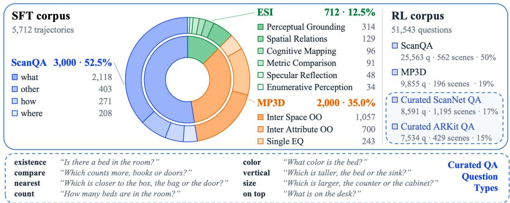  
Figure 3: Training data composition. Distribution of SFT trajectories and RL questions across datasets, with representative examples of curated spatial reasoning questions.

where $\mathcal { E }$ denotes the deterministic interactive environment defined above and R is the reward introduced in Sec. 3.3, which depends on the task instance through $y ^ { \star }$ and the annotated answer object. We define the answer accuracy of a policy π as

$$
\operatorname { A c c } ( \pi ) = \operatorname* { P r } _ { w \sim \mathcal { D } , \tau \sim \pi \otimes \mathcal { E } } ( y = y ^ { \star } ) .\tag{6}
$$

This objective jointly evaluates the policy’s ability to acquire informative observations and reason over them to produce the correct answer.

We illustrate the necessity of interaction with environment for reasoning under partial observability in Appendix A.

## 3.2 TRAJECTORY-SUPERVISED POLICY INITIALIZATION

We initialize the policy with trajectory-supervised fine-tuning to establish basic multi-step interaction competence in 3D environments before policy optimization with reinforcement learning.

Trajectory curation. We use GPT-5.4 to generate reason–act–observe trajectories in the environment from Sec. 3.1. We discard invalid starting views and retain trajectories with correct answers, valid interactions, well-formed reasoning and responses, and sufficient visible scene geometry; MP3D examples must also observe the evidence required by the question. After answer canonicalization, the corpus contains 5,712 trajectories, 20,603 rendered observations, and 830 scenes. These demonstrations initialize the interaction protocol rather than prescribe a unique exploration strategy.

Supervised objective. Let $\tau ^ { \star } \in \mathcal { D } _ { \mathrm { t r a j } }$ denote a curated demonstration, serialized as a token sequence, and let $\boldsymbol { \mathcal { T } } ( \boldsymbol { \tau } ^ { \star } )$ denote the positions of its model-generated tokens, i.e., reasoning, actions, and the final answer. Environment observations and prompt tokens are masked from the loss. We minimize

$$
\mathcal { L } _ { \mathrm { S F T } } ( \theta ) = - \mathbb { E } _ { \tau ^ { \star } \sim \mathcal { D } _ { \mathrm { t r a j } } } \sum _ { \ell \in \mathcal { T } ( \tau ^ { \star } ) } \log \pi _ { \theta } \left( \tau _ { \ell } ^ { \star } \mid \tau _ { < \ell } ^ { \star } \right) .\tag{7}
$$

The resulting policy initializes the reinforcement learning stage described next. We emphasize that these trajectories provide policy initialization rather than canonical exploration targets. Trajectory supervision therefore establishes the interaction protocol and a useful behavioral prior, while the acquisition strategy is subsequently optimized with RL.

## 3.3 OUTCOME-DRIVEN REINFORCEMENT LEARNING

Starting from the trajectory-supervised initialization, we optimize the full interactive policy using outcome-driven reinforcement learning. Each rollout follows the decision process in Sec. 3.1.

Training data. RL requires only a question–answer pair and a valid initial viewpoint, allowing substantially broader training data than trajectory supervision. We collect 51,543 questions from ScanQA, MP3D, and generated QAs over ScanNet and ARKitScenes.

For each initial condition $x = \left( q , o _ { 0 } \right)$ , we sample a group of $G$ rollouts $\{ \tau _ { i } \} _ { i = 1 } ^ { G }$ from $\pi \theta _ { \mathrm { o l d } } \otimes { \mathcal { E } } ,$ , all starting from x. Because actions determine subsequent observations, rollouts from the same initial condition may acquire substantially different evidence, enabling direct comparison of alternative information-acquisition strategies under the same task objective.

Verifiable Reward. For a rollout τ with final answer y, the reward is a weighted sum of answercorrectness, interaction, and output-format terms:

$$
R ( \tau ) = \underbrace { \lambda _ { \mathrm { j u d g e } } R _ { \mathrm { j u d g e } } + \lambda _ { \mathrm { E M } } R _ { \mathrm { E M } } } _ { \mathrm { a n s w e r ~ c o r r e c t n e s s } } + \underbrace { \lambda _ { \mathrm { i n t } } R _ { \mathrm { j u d g e } } c ( \tau ) } _ { \mathrm { i n t e r a c t i o n ~ r e w a r d } } - \underbrace { \lambda _ { \mathrm { f m t } } R _ { \mathrm { f m t } } } _ { \mathrm { o u t p u t ~ f o r m a t } } ,\tag{8}
$$

where $\lambda _ { ( \cdot ) } \geq 0$ are specified, together with $N _ { \mathrm { m a x } }$ in Sec. 4.1. All terms depend on $\tau ;$ we omit this for brevity. $R _ { \mathrm { j u d g e } } \in \{ 0 , 1 \}$ is the verdict of an LLM judge that, given the question, determines whether $y$ is semantically equivalent to the ground-truth answer $y ^ { \star } \colon R _ { \mathrm { E M } } \in \{ 0 , 1 \}$ indicates whether y exactly matches any of the annotated GT answers; it complements the judge by favoring the concise canonical answers on which the benchmark metric is computed. The interaction reward is credited only in rollouts that end in a correct answer, and it treats verified grounding as a shortcut to the full credit rather than as a separate bonus:

$$
c ( \tau ) = \left\{ \begin{array} { l l } { N _ { \mathrm { m a x } } , } & { R _ { \mathrm { g n d } } = 1 , } \\ { \mathrm { m i n } \{ n _ { \mathrm { i n t } } , N _ { \mathrm { m a x } } \} , } & { \mathrm { o t h e r w i s e } , } \end{array} \right.\tag{9}
$$

where $n _ { \mathrm { i n t } }$ is the number of interactions in $\tau$ and $R _ { \mathrm { g n d } } \in \{ 0 , 1 \}$ uses the annotated 3D location of the object of interest, taking the value 1 when that object is visible in some rendered view of τ. A rollout that is judged correct and has actually brought the asked-about object into view therefore receives the whole $\lambda _ { \mathrm { i n t } } N _ { \mathrm { m a x } }$ at once, after as little as a single call, while a correct rollout that never shows the object still accrues credit per call up to the same cap. The intent is to pay for evidence rather than for looking: once the needed view has been obtained, further calls earn nothing. Finally, $R _ { \mathrm { f m t } } \in \{ 0 , 1 \}$ indicates a malformed output, namely a missing or empty answer. None of these terms prescribes a particular intermediate viewpoint, action, or trajectory; the grounding term only verifies whether the answer object was observed.

Policy optimization. We optimize the policy with Group Relative Policy Optimization (GRPO) (Shao et al., 2024). For each rollout group, we standardize the outcome reward to obtain

$$
\hat { A } _ { i } = \frac { R ( \tau _ { i } ) - \mathrm { m e a n } _ { j } R ( \tau _ { j } ) } { \mathrm { s t d } _ { j } R ( \tau _ { j } ) } .\tag{10}
$$

The same trajectory-level advantage ${ \hat { A } } _ { i }$ is assigned to all model-generated tokens in $\tau _ { i } .$ , while environment observations are excluded from optimization. GRPO then optimizes

$$
\mathcal { I } _ { \mathrm { G R P O } } ( \theta ) = \mathbb { E } _ { w \sim \mathcal { D } , \{ \tau _ { i } \} \sim \pi _ { \theta _ { \mathrm { o l d } } } \otimes \mathcal { E } } [ \frac { 1 } { G } \sum _ { i = 1 } ^ { G } \frac { 1 } { | \mathcal { T } ( \tau _ { i } ) | } \sum _ { \ell \in \mathcal { T } ( \tau _ { i } ) } \operatorname* { m i n } ( \frac { \pi _ { \theta } ( \tau _ { i } , \ell \mid \tau _ { i } , \ell \ell ) } { \pi _ { \theta _ { \mathrm { o l d } } } ( \tau _ { i } , \ell \mid \tau _ { i } , \ell \ell ) } \hat { A } _ { i } ,     \\    \mathrm { c l i p } ( \frac { \pi _ { \theta } ( \tau _ { i } , \ell \mid \tau _ { i } , \ell \ell ) } { \pi _ { \theta _ { \mathrm { o l d } } } ( \tau _ { i } , \ell \mid \tau _ { i } , \ell \ell ) } , 1 - \epsilon , 1 + \epsilon ) \hat { A } _ { i } ) ] - \beta D _ { \mathrm { K L } } ( \pi _ { \theta } \parallel \pi _ { \mathrm { r e f } } ) ,\tag{11}
$$

where $\mathcal { T } ( \tau _ { i } )$ denotes the model-generated token positions of $\tau _ { i }$ and $\tau _ { i , < \ell }$ its preceding tokens, including the rendered observations, ϵ is the clipping range, and $\beta$ weights a KL penalty toward a reference policy $\pi _ { \mathrm { r e f } }$ . Because reasoning and interaction are generated by the same autoregressive policy, the episode-level reward assigns credit across the entire rollout. The policy can therefore learn not only how to reason over acquired evidence, but also which evidence to acquire in the first place.

## 4 EXPERIMENT

## 4.1 SETUP

## Models and training.

All experiments use Qwen3.5-9B (Qwen Team, 2026) as the base model. We consider two training configurations: ScanQA-only and mixed-data. In the ScanQA-only setting, SFT uses 2,550 teacher trajectories, followed by GRPO on 25,563 ScanQA questions. In the mixed-data setting, SFT uses $5 , 7 1 2$ trajectories from ScanQA (Azuma et al., 2022), MP3D (Chang et al., 2017), and ESI (Hong et al., 2026), while GRPO is performed on 51,543 questions from ScanQA, MP3D, and curated QA data from ScanNet and ARKitScenes (Baruch et al., 2021). Both settings follow the same two-stage training procedure, and we evaluate base model, SFT initialization, and RL-trained policy to isolate the contribution of each training stage.

For SFT, we train for two epochs with a batch size of 16 and a learning rate of $1 0 ^ { - 5 }$ . GRPO uses 64 prompts per step, a mini-batch size of 16, and $G = 8$ rollouts per prompt, with a learning rate of $2 \times 1 0 ^ { - 6 }$ , sampling temperature of 0.7, clipping parameter $\epsilon = 0 . 2$ , and KL coefficient $\beta = 0 . 0 0 5$ , without entropy regularization. We set $( \bar { \lambda } _ { \mathrm { j u d g e } } , \bar { \lambda } _ { \mathrm { E M } } , \lambda _ { \mathrm { f m t } } , \lambda _ { \mathrm { i n t } } ) = ( 0 . 3 , 0 . 2 , 0 . 2 , 0 . 0 5 )$ and $N _ { \mathrm { m a x } } = 1 2$ . A correct rollout that observes the annotated answer object receives the maximum interaction reward of $\lambda _ { \mathrm { i n t } } N _ { \mathrm { m a x } } = 0 . 6 0$ , whereas one that does not observe the object accumulates the reward per interaction, up to the same limit. Training is conducted on NVIDIA H200 GPUs with asynchronous rollouts using vLLM, a context length of 24,576 tokens, and a maximum of twelve interaction steps per episode. Prompt and environment-observation tokens are excluded from the training loss. Full prompts are provided in Appendices C.1 and C.2.

Evaluation. We evaluate all models under a unified interactive protocol. Each model is initialized with a single $6 4 0 \times 4 8 0$ render of the scene and is allowed up to twelve interactions to acquire additional observations; all active baselines are evaluated using the same interaction harness and budget. We use Qwen3-30B-A3B-Instruct (Qwen Team, 2025) as the answer judge throughout evaluation. We evaluate on six benchmarks spanning diverse indoor environments and spatial reasoning settings: SPBench-SI and SPBench-MV (Li et al., 2026a), ARKitScenes (Baruch et al., 2021), ScanQA (Azuma et al., 2022), SQA3D (Ma et al., 2023), and MP3D (Chang et al., 2017). Together, these benchmarks cover settings ranging from single-room visual question answering to multi-scene spatial reasoning.

We compare Act3D with a broad range of existing 3D reasoning methods and general-purpose VLMs. For passive perception, we include Video-R1 (Feng et al., 2025a), ViLaSR (Wu et al., 2026), SpatialLadder (Li et al., 2026a), SpaceR (Ouyang et al., 2025), and Ross3D (Wang et al., 2025a), alongside InternVL3.5-38B (Wang et al., 2025b) evaluated with fixed visual observations. For active interaction, we evaluate open-source VLMs, including Qwen2.5-VL-72B (Bai et al., 2025), Qwen3.5-9B/27B (Qwen Team, 2026), and InternVL3.5-38B, as well as the proprietary Gemini 3.6 Flash (Google DeepMind, 2026). These models are evaluated under the same observation–action interface and interaction budget, whereas passive methods retain their respective input and inference protocols. We additionally report the base model and SFT checkpoints to isolate the contributions of different training stages.

## 4.2 MAIN RESULTS

As shown in Table 1, Act3D trained on mixed data achieves the highest average accuracy of 53.2% across six benchmarks, surpassing the Qwen3.5-9B base model by 22.0%. It further outperforms Gemini 3.6 Flash by 1.0% under the same interaction protocol, as well as all evaluated open-source 3D reasoning methods, including both active interaction and passive perception approaches. Notably, Act3D achieves these results from a single initial view, autonomously acquiring additional visual evidence through interaction with the environment.

<table><tr><td>model</td><td>ScanQA SQA3D</td><td></td><td>SPB MV</td><td>SPB SI</td><td>MP3D</td><td>ARKit</td><td>Avg.</td></tr><tr><td colspan="8">Passive perception</td></tr><tr><td>Video-R1-7B</td><td>30.8</td><td>41.1</td><td>42.0</td><td>39.6 43.4</td><td>42.6 34.6</td><td>63.4</td><td>43.2</td></tr><tr><td>ViLaSR-7B SpatialLadder-3B</td><td>33.3 29.3</td><td>47.6 40.4</td><td>52.6 61.2</td><td>45.2</td><td>45.2</td><td>66.0 58.7</td><td>46.2 46.7</td></tr><tr><td>InternVL3.5-38B</td><td>36.2</td><td>47.0 44.7</td><td>36.9</td><td>38.7</td><td>51.1 52.0</td><td>75.4</td><td>47.6</td></tr><tr><td>SpaceR-7B Ross3D</td><td>31.6 50.7</td><td>62.6</td><td>52.6 32.0</td><td>41.0 31.9</td><td>55.2</td><td>70.1</td><td>48.7</td></tr><tr><td></td><td></td><td></td><td></td><td></td><td></td><td>71.5</td><td>50.7</td></tr><tr><td></td><td></td><td></td><td>Active interaction</td><td></td><td></td><td></td><td></td></tr><tr><td>Qwen2.5-VL-72B</td><td>16.8</td><td>26.8</td><td>20.8</td><td>19.1</td><td>26.7</td><td>46.8</td><td>26.2</td></tr><tr><td>Qwen3.5-9B</td><td>36.7</td><td>33.5</td><td>21.3</td><td>24.7</td><td>30.9</td><td>40.1</td><td>31.2</td></tr><tr><td>Qwen3.5-27B</td><td>27.5</td><td>40.2</td><td>33.2</td><td>31.4</td><td>33.8</td><td>33.8</td><td>33.3</td></tr><tr><td>InternVL3.5-38B</td><td>30.9</td><td>41.5</td><td>43.2</td><td>41.6</td><td>50.1</td><td>55.8</td><td>43.9</td></tr><tr><td>Gemini 3.6 Flash</td><td>43.3</td><td>53.8</td><td>45.5</td><td>44.4</td><td>53.4</td><td>73.0</td><td>52.2</td></tr><tr><td>ScanQA only</td><td></td><td></td><td></td><td></td><td></td><td></td><td></td></tr><tr><td>SFT init</td><td>39.4</td><td>46.0</td><td>47.3</td><td>41.2</td><td>44.7</td><td>68.3</td><td></td></tr><tr><td></td><td>45.5</td><td>49.8</td><td>47.6</td><td>42.3</td><td>50.7</td><td></td><td>47.8</td></tr><tr><td>Act3D (ours)</td><td></td><td></td><td></td><td></td><td></td><td>67.6</td><td>50.6</td></tr><tr><td>Mixed data</td><td></td><td></td><td></td><td></td><td></td><td></td><td></td></tr><tr><td>SFT init</td><td>39.3</td><td>47.4</td><td>39.2</td><td>37.7</td><td>61.8</td><td>65.9</td><td></td></tr><tr><td>Act3D (ours)</td><td>42.1</td><td>49.0</td><td>47.3</td><td>37.4</td><td>63.3</td><td>80.0</td><td>48.6 53.2</td></tr></table>

Table 1: Performance comparison on six 3D reasoning benchmarks. We compare Act3D with existing active and passive methods. Green highlights indicate benchmark domains included in model training.

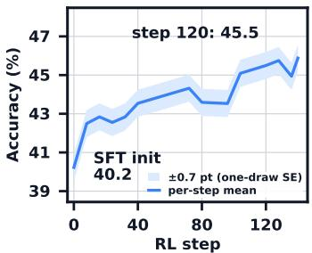  
(a) ScanQA Acc. as RL training progresses (trained on ScanQA only)

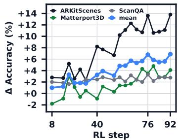  
(b) ∆ Acc. compared to SFT init as RL training progresses (trained on mixed data)

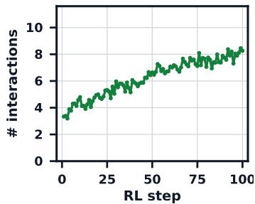  
(c) Number of interactions  
Figure 4: Learning dynamics of Act3D. (a) ScanQA-only validation. (b) Mixed-data validation gains relative to SFT initialization. (c) Mean number of interactions for the final reward. Panel (c) is in-training rollout statistics; panels (a) and (b) are validation accuracies, and no value should be read across the two.

RL substantially improves over SFT initialization. In the mixed-data setting, RL improves average accuracy from 48.6% to 53.2% (+4.6%) over the SFT init, with improvements on five of six benchmarks. The largest gains occur on ARKit (+14.1%) and SPBench-MV (+8.1%), highlighting the benefits of optimizing exploration and reasoning through verifiable RL beyond supervised trajectory imitation.

Improvements generalize beyond the training domain. To assess cross-domain generalization, we further train Act3D exclusively on ScanQA. Despite using a single training set for RL optimization, Act3D improves average accuracy from 47.8% to 50.6% (+2.8%) over its SFT initialization and extends its improvement beyond ScanQA (+6.1%), with average accuracy across the other five benchmarks increasing from 49.5% to 51.6% (+2.1%). Gains are observed on four of these benchmarks, including substantial performance increases on MP3D (+6.0%) and SQA3D (+3.8%). These results suggest that Act3D learns transferable capabilities that generalize beyond the domain used for optimization.

## 4.3 LEARNING DYNAMICS AND EXPLORATION BEHAVIOR

RL improves reasoning performance while reshaping interaction behavior. Figure 4 illustrates the evolution of performance and interaction behavior during RL training. In the ScanQA-only setting, validation accuracy improves from 40.2% to 45.5% (Figure 4(a)). Mixed-data training similarly yields improvements across all three validation benchmarks, with the largest gains on ARKitScenes (Figure 4(b)). Meanwhile, the average number of interactions per episode increases from approximately 3.3 to 8.3 during mixed-data training (Figure 4(c)), indicating that RL optimization progressively encourages more extensive interaction with the environment. These observations motivate a closer examination of how exploration contributes to reasoning performance.

Adaptive Exploration Behavior. To investigate how performance gains depend on the need for exploration, we stratify ScanQA validation questions by their estimated exploration demand (Figure 5). Specifically, we estimate the number of actions needed to approach the annotated answer object based on its bearing and distance from the initial viewpoint. This geometry-based measure is independent of the model’s actual interaction behavior. We find that the combined improvements from SFT and RL are generally larger for questions requiring more exploration, increasing from 0.6% in the lowest-demand group to 16.3% in the highest. Notably, RL contributes an additional 10.9% over SFT in the most demanding group. These findings suggest that the benefits of outcome-based RL are particularly pronounced when solving a question requires acquiring visual evidence beyond the initial observation.

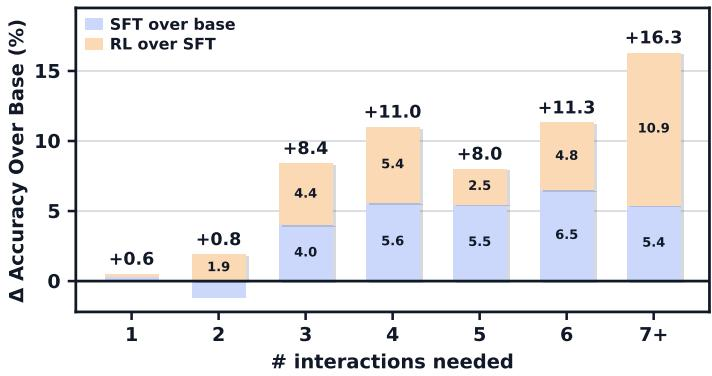  
Figure 5: Performance gains across different exploration demands. ScanQA validation questions are grouped by a geometry-based estimate of the interactions needed to reach the answer object from the initial viewpoint. Stacked bars show the accuracy improvements from SFT over the base model and subsequent RL over SFT.

## 4.4 QUALITATIVE ANALYSIS.

Figure 6 illustrates several exploration strategies that emerge from Act3D’s training. When relevant objects are initially occluded or outside the field of view, the policy actively changes its viewpoint to locate them before answering. When the target is already visible, it performs brief verification with minimal additional interaction. For questions requiring spatial comparisons or relationships between multiple objects, the policy explores complementary viewpoints to gather sufficient evidence. Notably, its reasoning evolves as new observations become available, allowing it to refine initial hypotheses and resolve ambiguities through successive interactions. These examples illustrate how Act3D integrates visual evidence acquisition with reasoning in a question-dependent manner.

## 4.5 ABLATION RESULTS

## 4.5.1 INITIAL OBSERVATION

We investigate how the initial visual input affects interactive reasoning performance (Table 2). Starting from a single rendered view achieves 41.0% accuracy on ScanQA, closely matching the 41.4% obtained with a

<table><tr><td>Initial visual input</td><td>Accuracy (%)</td></tr><tr><td>BEV + 1 rendered frames</td><td>36.7</td></tr><tr><td>BEV + 4 rendered frames</td><td>41.4</td></tr><tr><td>1 rendered frame (Ours)</td><td>41.0</td></tr></table>

Table 2: ScanQA Acc. given different initial observation.

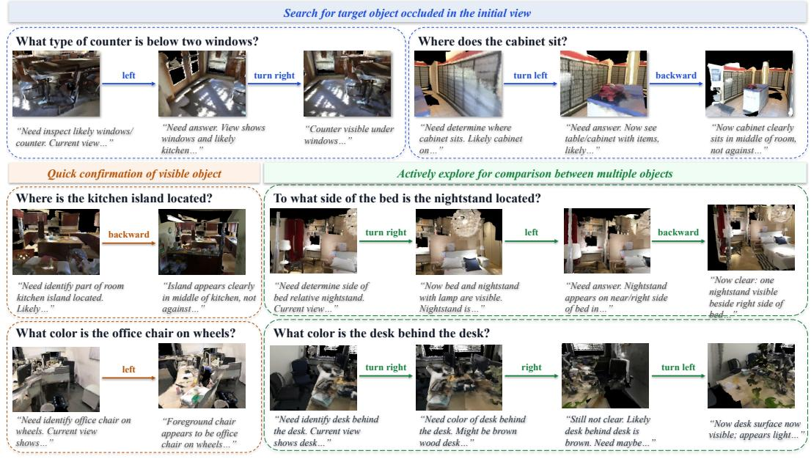  
Figure 6: Qualitative analysis. We highlight emergent exploration behaviors. Arrows denote the executed actions, and text excerpts beneath illustrate the reasoning of the policy.

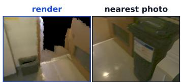  
+0.56 m, 26° off-axis

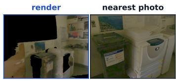  
+1.02 m, 25° off-axis

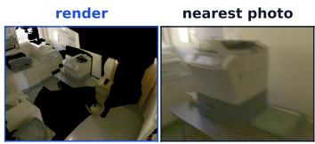  
+1.96 m, 24° off-axis

Figure 7: Rendered versus retrieved observations. Comparison of pose-aligned renders and nearest available real images from ScanNet. Distance and angular offsets indicate discrepancies between the requested and retrieved camera poses.

bird’s-eye view (BEV) and four rendered views, despite using only one initial image instead of five. In contrast, combining a BEV with a single rendered view reduces accuracy to 36.7%. These results suggest that additional initial visual context does not necessarily improve performance. We therefore adopt singleview initialization, which preserves the partial observability of the task while achieving comparable accuracy with substantially less visual input.

## 4.5.2 OBSERVATION INTERFACE: RENDERING VS. RETRIEVAL

Act3D formulates 3D reasoning as interaction with a 3D scene representation, making the design of the visual observation interface an important consideration. Rendered observations can be generated at arbitrary camera poses but may suffer from limited visual fidelity, whereas real images preserve greater visual detail but are restricted to the viewpoints captured during data collection. We examine this trade-off by comparing pose-aligned rendering with nearest-view retrieval of real ScanNet images. As illustrated in Figure 7, retrieved images can deviate substantially from the requested camera poses, introducing inconsistencies between executed actions and subsequent observations. Under matched training conditions, rendering consistently outperforms real-image retrieval across all 13 evaluation checkpoints, achieving 10.6% higher accuracy on average. These results highlight the importance of action–observation consistency in interactive 3D reasoning, even at the expense of visual fidelity.

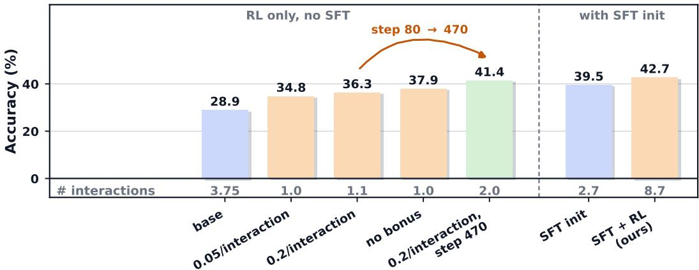  
Figure 9: Effect of supervised initialization on RL. We report ScanQA Acc. vs. average number of interactions per episode with and without SFT initialization. RL-only results are shown after 80 and 470 training steps.

## 4.6 ACTION SPACE

We investigate the effect of action parameterization by comparing relative camera movements with direct prediction of absolute camera poses. As shown in Figure 8, relative actions achieve 41.4% accuracy on ScanQA, compared with 36.7% for absolute pose prediction. Unlike absolute coordinates, which require reasoning in a scenedependent global reference frame, relative actions operate in the camera’s local coordinate system and correspond to intuitive movements such as translation and rotation. This representation aligns more naturally with sequential, observation-conditioned exploration, motivating its adoption throughout Act3D.

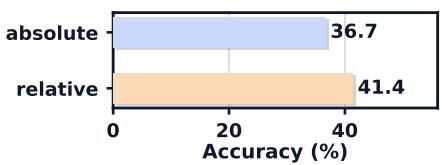  
Figure 8: ScanQA Acc. of different action parameterizations.

## 4.7 SUPERVISED INITIALIZATION

We investigate the role of supervised initialization in learning interactive reasoning behaviors (Figure 9). Without SFT, direct RL improves ScanQA accuracy from 28.9% to 34.8–37.9% after 80 training steps, although the policy performs only approximately one interaction per episode. Extending training to 470 steps further improves accuracy to 41.4%, with the average number of interactions increasing to 2.0. These results suggest that RL alone can gradually improve reasoning performance while developing interaction capabilities. In contrast, SFT-initialized RL improves accuracy from 39.5% to 42.7%, accompanied by an increase in average number of interactions from 2.7 to 8.7 per episode. A possible explanation is that the base model is not initially adapted to the interactive environment and action protocol, whereas supervised trajectory initialization enables the model to acquire basic interaction capabilities before RL optimization. Although the settings differ in backbone and training budget, these findings suggest that SFT facilitates adaptation to the interactive setting and may accelerate subsequent RL optimization, rather than being strictly necessary for learning to interact.

## 4.8 INTERACTION REWARD

Explicitly rewarding interactions substantially increases exploration frequency, but does not uniformly improve reasoning accuracy (Figure 10). Adding a reward of 0.05 per interaction increases the average number of interactions from 5.1–6.3 to 9.4–10.1 per episode across six benchmarks. While this reward improves accuracy on all three held-out benchmarks, particularly SPBench-MV (+6.4%), it slightly reduces performance on the training domains (0.3–2.3%). These results suggest that encouraging additional interactions can benefit cross-domain generalization, although more extensive exploration does not necessarily yield higher accuracy. The interaction reward therefore serves primarily to encourage active evidence acquisition, while outcome-based feedback guides the policy toward effective reasoning.

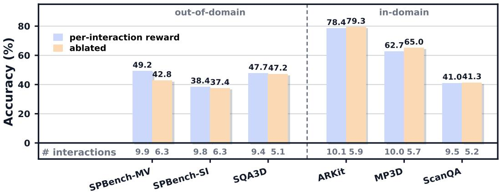  
Figure 10: Effect of interaction reward. ScanQA Acc. with and without the per-interaction reward across held-out and training benchmarks. Numbers below the bars indicate the average number of interactions per episode.

## 5 CONCLUSION

We presented Act3D, a framework for learning to think and explore in the 3D world by treating 3D representations as interactive environments rather than assumed complete inputs. Starting from a single observation, Act3D iteratively reasons, acts, and acquires visual evidence through interaction with the environment. Building on supervised trajectory initialization, verifiable RL further optimizes the policy without explicit supervision of exploration actions or viewpoints. Across six 3D benchmarks, Act3D achieves the highest average accuracy of 53.2%, improving upon its SFT initialization by 4.6% and outperforming existing active and passive 3D reasoning methods. Further analyses show that these gains extend beyond the training benchmark and are particularly pronounced on questions requiring more extensive exploration. Qualitative results also reveal question-conditioned exploration strategies that adapt to newly acquired observations. Together, these findings demonstrate the potential of outcome-based RL to learn not only how to reason over visual evidence, but also how to actively acquire the evidence needed for 3D reasoning.

## REFERENCES

Daichi Azuma, Taiki Miyanishi, Shuhei Kurita, and Motoaki Kawanabe. Scanqa: 3d question answering for spatial scene understanding. In 2022 IEEE/CVF Conference on Computer Vision and Pattern Recognition (CVPR), pp. 19107–19117, 2022. doi: 10.1109/CVPR52688.2022.01854.

Shuai Bai, Keqin Chen, Xuejing Liu, Jialin Wang, Wenbin Ge, Sibo Song, Kai Dang, Peng Wang, Shijie Wang, Jun Tang, Humen Zhong, Yuanzhi Zhu, Mingkun Yang, Zhaohai Li, Jianqiang Wan, Pengfei Wang, Wei Ding, Zheren Fu, Yiheng Xu, Jiabo Ye, Xi Zhang, Tianbao Xie, Zesen Cheng, Hang Zhang, Zhibo Yang, Haiyang Xu, and Junyang Lin. Qwen2.5-vl technical report, 2025.

Gilad Baruch, Zhuoyuan Chen, Afshin Dehghan, Yuri Feigin, Peter Fu, Thomas Gebauer, Daniel Kurz, Tal Dimry, Brandon Joffe, Arik Schwartz, and Elad Shulman. ARKitscenes: A diverse real-world dataset for 3d indoor scene understanding using mobile RGB-d data. In Thirty-fifth Conference on Neural Information Processing Systems Datasets and Benchmarks Track (Round 1), 2021. URL https://openreview.net/forum?id=tjZjv\_qh\_CE.

Angel Chang, Angela Dai, Thomas Funkhouser, Maciej Halber, Matthias Niebner, Manolis Savva, Shuran Song, Andy Zeng, and Yinda Zhang. Matterport3d: Learning from rgb-d data in indoor environments. In 2017 International Conference on 3D Vision (3DV), pp. 667–676, 2017. doi: 10.1109/3DV.2017.00081.

Boyuan Chen, Zhuo Xu, Sean Kirmani, Brain Ichter, Dorsa Sadigh, Leonidas Guibas, and Fei Xia. Spatialvlm: Endowing vision-language models with spatial reasoning capabilities. In Proceedings of the IEEE/CVF Conference on Computer Vision and Pattern Recognition (CVPR), pp. 14455– 14465, June 2024a.

Sijin Chen, Xin Chen, Chi Zhang, Mingsheng Li, Gang Yu, Hao Fei, Hongyuan Zhu, Jiayuan Fan, and Tao Chen. Ll3da: Visual interactive instruction tuning for omni-3d understanding, reasoning, and planning. In 2024 IEEE/CVF Conference on Computer Vision and Pattern Recognition (CVPR), pp. 26418–26428, 2024b. doi: 10.1109/CVPR52733.2024.02496.

Yi-Lun Chen, Shuai Yang, Haifeng Huang, Tai Wang, Ruiyuan Lyu, Run-Sen Xu, Da-Hua Lin, and Jiang-Miao Pang. Grounded 3d-llm with referent tokens. ArXiv, abs/2405.10370, 2024c. URL https://api.semanticscholar.org/CorpusID:269899759.

Abhishek Das, Samyak Datta, Georgia Gkioxari, Stefan Lee, Devi Parikh, and Dhruv Batra. Embodied question answering, 2017. URL https://arxiv.org/abs/1711.11543.

Kaituo Feng, Kaixiong Gong, Bohao Li, Zonghao Guo, Yibing Wang, Tianshuo Peng, Junfei Wu, Xiaoying Zhang, Benyou Wang, and Xiangyu Yue. Video-r1: Reinforcing video reasoning in MLLMs. In The Thirty-ninth Annual Conference on Neural Information Processing Systems, 2025a. URL https://openreview.net/forum?id=a2JTVVvcEl.

Yicheng Feng, Yijiang Li, Wanpeng Zhang, Sipeng Zheng, Hao Luo, Zihao Yue, and Zongqing Lu. Videoorion: Tokenizing object dynamics in videos. In 2025 IEEE/CVF International Conference on Computer Vision (ICCV), pp. 20401–20412. IEEE, 2025b.

Rao Fu, Jingyu Liu, Xilun Chen, Yixin Nie, and Wenhan Xiong. Scene-llm: Extending language model for 3d visual reasoning. In 2025 IEEE/CVF Winter Conference on Applications of Computer Vision (WACV), pp. 2195–2206, 2025. doi: 10.1109/WACV61041.2025.00220.

Google DeepMind. Gemini 3.6 Flash, 2026. URL https://deepmind.google/models/ model-cards/gemini-3-6-flash/. Model card.

Daya Guo, Dejian Yang, Haowei Zhang, Junxiao Song, Peiyi Wang, Qihao Zhu, Runxin Xu, Ruoyu Zhang, Shirong Ma, Xiao Bi, Xiaokang Zhang, Xingkai Yu, Yu Wu, Z. F. Wu, Zhibin Gou, Zhihong Shao, Zhuoshu Li, Ziyi Gao, Aixin Liu, Bing Xue, Bingxuan Wang, Bochao Wu, Bei Feng, Chengda Lu, Chenggang Zhao, Chengqi Deng, Chong Ruan, Damai Dai, Deli Chen, Dongjie Ji, Erhang Li, Fangyun Lin, Fucong Dai, Fuli Luo, Guangbo Hao, Guanting Chen, Guowei Li, H. Zhang, Hanwei Xu, Honghui Ding, Huazuo Gao, Hui Qu, Hui Li, Jianzhong Guo, Jiashi Li, Jingchang Chen, Jingyang Yuan, Jinhao Tu, Junjie Qiu, Junlong Li, J. L. Cai, Jiaqi Ni, Jian Liang, Jin Chen, Kai Dong, Kai Hu, Kaichao You, Kaige Gao, Kang Guan, Kexin Huang, Kuai Yu, Lean Wang, Lecong Zhang, Liang Zhao, Litong Wang, Liyue Zhang, Lei Xu, Leyi Xia, Mingchuan Zhang, Minghua Zhang, Minghui Tang, Mingxu Zhou, Meng Li, Miaojun Wang, Mingming Li, Ning Tian, Panpan Huang, Peng Zhang, Qiancheng Wang, Qinyu Chen, Qiushi Du, Ruiqi Ge, Ruisong Zhang, Ruizhe Pan, Runji Wang, R. J. Chen, R. L. Jin, Ruyi Chen, Shanghao Lu, Shangyan Zhou, Shanhuang Chen, Shengfeng Ye, Shiyu Wang, Shuiping Yu, Shunfeng Zhou, Shuting Pan, S. S. Li, Shuang Zhou, Shaoqing Wu, Tao Yun, Tian Pei, Tianyu Sun, T. Wang, Wangding Zeng, Wen Liu, Wenfeng Liang, Wenjun Gao, Wenqin Yu, Wentao Zhang, W. L. Xiao, Wei An, Xiaodong Liu, Xiaohan Wang, Xiaokang Chen, Xiaotao Nie, Xin Cheng, Xin Liu, Xin Xie, Xingchao Liu, Xinyu Yang, Xinyuan Li, Xuecheng Su, Xuheng Lin, X. Q. Li, Xiangyue Jin, Xiaojin Shen, Xiaosha Chen, Xiaowen Sun, Xiaoxiang Wang, Xinnan Song, Xinyi Zhou, Xianzu Wang, Xinxia Shan, Y. K. Li, Y. Q. Wang, Y. X. Wei, Yang Zhang, Yanhong Xu, Yao Li, Yao Zhao, Yaofeng Sun, Yaohui Wang, Yi Yu, Yichao Zhang, Yifan Shi, Yiliang Xiong, Ying He, Yishi Piao, Yisong Wang, Yixuan Tan, Yiyang Ma, Yiyuan Liu, Yongqiang Guo, Yuan Ou, Yuduan Wang, Yue Gong, Yuheng Zou, Yujia He, Yunfan Xiong, Yuxiang Luo, Yuxiang You, Yuxuan Liu, Yuyang Zhou, Y. X. Zhu, Yanping Huang, Yaohui Li, Yi Zheng, Yuchen Zhu, Yunxian Ma, Ying Tang, Yukun Zha, Yuting Yan, Z. Z. Ren, Zehui Ren, Zhangli Sha, Zhe Fu, Zhean Xu, Zhenda Xie, Zhengyan Zhang, Zhewen Hao, Zhicheng Ma, Zhigang Yan, Zhiyu Wu, Zihui Gu, Zijia Zhu, Zijun Liu, Zilin Li, Ziwei Xie, Ziyang Song, Zizheng Pan, Zhen Huang, Zhipeng Xu, Zhongyu Zhang, and Zhen Zhang. Deepseek-r1 incentivizes reasoning in llms through reinforcement learning. Nature, 645

(8081):633–638, September 2025. ISSN 1476-4687. doi: 10.1038/s41586-025-09422-z. URL http://dx.doi.org/10.1038/s41586-025-09422-z.

Yining Hong, Haoyu Zhen, Peihao Chen, Shuhong Zheng, Yilun Du, Zhenfang Chen, and Chuang Gan. 3d-llm: injecting the 3d world into large language models. In Proceedings of the 37th International Conference on Neural Information Processing Systems, NIPS ’23, Red Hook, NY, USA, 2023. Curran Associates Inc.

Yining Hong, Jiageng Liu, Han Yin, Manling Li, Leonidas Guibas, Li Fei-Fei, Jiajun Wu, and Yejin Choi. Esi-bench: Towards embodied spatial intelligence that closes the perception-action loop, 2026. URL https://arxiv.org/abs/2605.18746.

Haifeng Huang, Yilun Chen, Zehan Wang, Rongjie Huang, Runsen Xu, Tai Wang, Luping Liu, Xize Cheng, Yang Zhao, Jiangmiao Pang, and Zhou Zhao. Chat-scene: Bridging 3d scene and large language models with object identifiers. In The Thirty-eighth Annual Conference on Neural Information Processing Systems, 2024a. URL https://openreview.net/forum?id= t3BhmwAzhv.

Jiangyong Huang, Silong Yong, Xiaojian Ma, Xiongkun Linghu, Puhao Li, Yan Wang, Qing Li, Song-Chun Zhu, Baoxiong Jia, and Siyuan Huang. An embodied generalist agent in 3d world. In Proceedings of the 41st International Conference on Machine Learning, ICML’24. JMLR.org, 2024b.

Wenxuan Huang, Bohan Jia, Zijie Zhai, Shaosheng Cao, Zheyu Ye, Fei Zhao, Zhe Xu, Xu Tang, Yao Hu, and Shaohui Lin. Vision-r1: Incentivizing reasoning capability in multimodal large language models. 2026. URL https://arxiv.org/abs/2503.06749.

Dongfu Jiang, Yi Lu, Zhuofeng Li, Zhiheng Lyu, Ping Nie, Haozhe Wang, Alex Su, Hui Chen, Kai Zou, Chao Du, Tianyu Pang, and Wenhu Chen. Verltool: Towards holistic agentic reinforcement learning with tool use. Transactions on Machine Learning Research, 2026. ISSN 2835-8856. URL https://openreview.net/forum?id=g2LCOW43Md.

Bowen Jin, Hansi Zeng, Zhenrui Yue, Jinsung Yoon, Sercan O Arik, Dong Wang, Hamed Zamani, and Jiawei Han. Search-r1: Training LLMs to reason and leverage search engines with reinforce ment learning. 2025. URL https://openreview.net/forum?id=Rwhi91ideu.

Zhao Jin, Munawar Hayat, Yuwei Yang, Yulan Guo, and Yinjie Lei. Context-aware alignment and mutual masking for 3d-language pre-training. In 2023 IEEE/CVF Conference on Computer Vision and Pattern Recognition (CVPR), pp. 10984–10994, 2023. doi: 10.1109/CVPR52729. 2023.01057.

Leslie Pack Kaelbling, Michael L. Littman, and Anthony R. Cassandra. Planning and acting in partially observable stochastic domains. Artif. Intell., 101:99–134, 1998. URL https://api. semanticscholar.org/CorpusID:5613003.

Weitai Kang, Haifeng Huang, Yuzhang Shang, Mubarak Shah, and Yan Yan. Robin3d improving 3d large language model via robust instruction tuning. In 2025 IEEE/CVF International Conference on Computer Vision (ICCV), pp. 3905–3915, 2025. doi: 10.1109/ICCV51701.2025.00372.

Hongxing Li, Dingming Li, Zixuan Wang, Yuchen Yan, Hang Wu, Wenqi Zhang, Yongliang Shen, Weiming Lu, Jun Xiao, and Yueting Zhuang. Spatialladder: Progressive training for spatial reasoning in vision-language models. In The Fourteenth International Conference on Learning Representations, 2026a. URL https://openreview.net/forum?id=KtrFXlvgrK.

Yijiang Li, Qingying Gao, Tianwei Zhao, Bingyang Wang, Haoran Sun, Haiyun Lyu, Robert D Hawkins, Nuno Vasconcelos, Tal Golan, Dezhi Luo, et al. Core knowledge deficits in multimodal language models. arXiv preprint arXiv:2410.10855, 2024.

Yijiang Li, Yijun Liang, Yunjie Tian, Bingyang Wang, Ke Zhang, Zhenfei Yin, Di Fu, Philip Torr, and Nuno Vasconcelos. Self-supervised visual on-policy distillation. arXiv preprint arXiv:2608.14144, 2026b.

Yijiang Li, Bingyang Wang, Yijun Liang, Yunjie Tian, Di Fu, and Nuno Vasconcelos. On-policy self-distillation without any supervision. arXiv preprint arXiv:2608.06296, 2026c.

Yijiang Li, Huiqi Zou, Bingyang Wang, and Ziang Xiao. Contextualized evaluation of vision language models through dynamic, multi-turn interactions. arXiv preprint arXiv:2607.14499, 2026d.

Ziyu Liu, Zeyi Sun, Yuhang Zang, Xiaoyi Dong, Yuhang Cao, Haodong Duan, Dahua Lin, and Jiaqi Wang. Visual-rft: Visual reinforcement fine-tuning. 2025. URL https://arxiv.org/abs/ 2503.01785.

Xufang Luo, Yuge Zhang, Zhiyuan He, Zi-Long Wang, Si-Yun Zhao, Dongsheng Li, Lu-Na K. Qiu, and Yu-Qing Yang. Agent lightning: Train any ai agents with reinforcement learning. ArXiv, abs/2508.03680, 2025. URL https://api.semanticscholar.org/ CorpusID:280526917.

Xiaojian Ma, Silong Yong, Zilong Zheng, Qing Li, Yitao Liang, Song-Chun Zhu, and Siyuan Huang. SQA3d: Situated question answering in 3d scenes. In The Eleventh International Conference on Learning Representations, 2023. URL https://openreview.net/forum?id= IDJx97BC38.

Arjun Majumdar, Anurag Ajay, Xiaohan Zhang, Pranav Putta, Sriram Yenamandra, Mikael Henaff, Sneha Silwal, Paul Mcvay, Oleksandr Maksymets, Sergio Arnaud, Karmesh Yadav, Qiyang Li, Ben Newman, Mohit Sharma, Vincent Berges, Shiqi Zhang, Pulkit Agrawal, Yonatan Bisk, Dhruv Batra, Mrinal Kalakrishnan, Franziska Meier, Chris Paxton, Alexander Sax, and Aravind Rajeswaran. Openeqa: Embodied question answering in the era of foundation models. In 2024 IEEE/CVF Conference on Computer Vision and Pattern Recognition (CVPR), pp. 16488–16498, 2024. doi: 10.1109/CVPR52733.2024.01560.

Kun Ouyang, Yuan-Xin Liu, Hao-Ning Wu, Yi Liu, Hao Zhou, Jie Zhou, Fan-Dong Meng, and Xu Sun. Spacer: Reinforcing mllms in video spatial reasoning, 2025. URL https://api. semanticscholar.org/CorpusID:277501860.

Zhang-Yang Qi, Zhixiong Zhang, Ye Fang, Jiaqi Wang, and Hengshuang Zhao. Gpt4scene: Understand 3d scenes from videos with vision-language models. ArXiv, abs/2501.01428, 2025. URL https://api.semanticscholar.org/CorpusID:275212717.

Qwen Team. Qwen3 technical report, 2025. URL https://arxiv.org/abs/2505.09388.

Qwen Team. Qwen3.5: Towards native multimodal agents, February 2026. URL https://qwen. ai/blog?id=qwen3.5.

Zhihong Shao, Peiyi Wang, Qihao Zhu, Runxin Xu, Junxiao Song, Mingchuan Zhang, Y. K. Li, Y. Wu, and Daya Guo. Deepseekmath: Pushing the limits of mathematical reasoning in open language models. CoRR, abs/2402.03300, 2024. URL https://doi.org/10.48550/ arXiv.2402.03300.

Haozhan Shen, Peng Liu, Jingcheng Li, Chunxin Fang, Yibo Ma, Jiajia Liao, Qiaoli Shen, Zilun Zhang, Kangjia Zhao, Qianqian Zhang, Ruochen Xu, and Tiancheng Zhao. Vlm-r1: A stable and generalizable r1-style large vision-language model. 2025. URL https://arxiv.org/abs/ 2504.07615.

Haochen Wang, Yucheng Zhao, Tiancai Wang, Haoqiang Fan, Xiangyu Zhang, and Zhaoxiang Zhang. Ross3D: Reconstructive visual instruction tuning with 3D-awareness. In ICCV, 2025a. arXiv:2504.01901.

Kangrui Wang, Linjie Li, Zhengyuan Yang, Shiqi Chen, Zihan Wang, Li Fei-Fei, Jiajun Wu, Leonidas Guibas, Lijuan Wang, and Manling Li. Planning with the views, 2026a. URL https://arxiv.org/abs/2605.29563.

Weiyun Wang, Zhangwei Gao, Lixin Gu, Hengjun Pu, Long Cui, Xingguang Wei, Zhaoyang Liu, Linglin Jing, Shenglong Ye, Jie Shao, et al. Internvl3.5: Advancing open-source multimodal models in versatility, reasoning, and efficiency, 2025b.

Yixuan Wang, Yifei Chen, Haichao Zhang, Haozheng Luo, Xander Wu, Jie Ni, Yun Fu, Nuno Vasconcelos, and Yijiang Li. Learn what’s left, not what’s mastered: Saturation aware advantage reweighting for multi-reward policy optimization. arXiv preprint arXiv:2608.16072, 2026b.

Zihan Wang, Kangrui Wang, Qineng Wang, Pingyue Zhang, Linjie Li, Zhengyuan Yang, Xing Jin, Kefan Yu, Minh Nhat Nguyen, Licheng Liu, Eli Gottlieb, Yiping Lu, Kyunghyun Cho, Jiajun Wu, Li Fei-Fei, Lijuan Wang, Yejin Choi, and Manling Li. Ragen: Understanding self-evolution in llm agents via multi-turn reinforcement learning, 2025c. URL https://arxiv.org/abs/ 2504.20073.

Yuxi Wei, Wei Huang, Qirui Chen, Lu Hou, and Xiaojuan Qi. See, remember, explore: A benchmark and baselines for streaming spatial reasoning, 2026. URL https://arxiv.org/abs/ 2603.23864.

Junfei Wu, Jian Guan, Kaituo Feng, Qiang Liu, Shu Wu, Liang Wang, Wei Wu, and Tieniu Tan. Reinforcing spatial reasoning in vision-language models with interwoven thinking and visual drawing. In Proceedings ofthe 39th International Conference on Neural Information Processing Systems, NIPS ’25, Red Hook, NY, USA, 2026. Curran Associates Inc. doi: 10.52202/085713-4797. URL https://doi.org/10.52202/085713-4797.

Jihan Yang, Shusheng Yang, Anjali W. Gupta, Rilyn Han, Li Fei-Fei, and Saining Xie. Thinking in space: How multimodal large language models see, remember, and recall spaces, 2025. URL https://arxiv.org/abs/2412.14171.

Shusheng Yang, Jihan Yang, Pinzhi Huang, Ellis L Brown II, Zihao Yang, Yue Yu, Shengbang Tong, Zihan Zheng, Yifan Xu, Muhan Wang, Rob Fergus, Yann LeCun, Li Fei-Fei, and Saining Xie. Cambrian-s: Towards spatial supersensing in video. In The Fourteenth International Conference on Learning Representations, 2026a. URL https://openreview.net/forum?id= rBFDvZu6pb.

Yunhao Yang, Yuexin Bian, Yunjie Tian, Di Fu, Tianjin Huang, Yuanyuan Shi, Ziang Xiao, Nuno Vasconcelos, and Yijiang Li. Co-rl: Unsupervised reasoning emerges from diverse cohort in multi-agent rl. arXiv preprint arXiv:2608.17253, 2026b.

Qiying Yu, Zheng Zhang, Ruofei Zhu, Yufeng Yuan, Xiaochen Zuo, Yu Yue, Tian-Tian Fan, Gaohong Liu, Lingjun Liu, Xin Liu, Hai-Bin Lin, Zhiqi Lin, Bole Ma, Guangming Sheng, Yuxuan Tong, Chi Zhang, Mofan Zhang, Wang Zhang, Hang Zhu, Jinhua Zhu, Jia-Ze Chen, Jiang-Jie Chen, Cheng-Yi Wang, Honglin Yu, Wei-Nan Dai, Yuxuan Song, Xiang Wei, Haodong Zhou, Jingjing Liu, Wei Ma, Ya-Qin Zhang, Lin Yan, Mu Qiao, Yong-Xu Wu, and Ming-Xuan Wang. Dapo: An open-source llm reinforcement learning system at scale. ArXiv, abs/2503.14476, 2025. URL https://api.semanticscholar.org/CorpusID:277104124.

Pingyue Zhang, Zihan Huang, Yue Wang, Jieyu Zhang, Letian Xue, Zihan Wang, Qineng Wang, Keshigeyan Chandrasegaran, Ruohan Zhang, Yejin Choi, Ranjay Krishna, Jiajun Wu, Li Fei-Fei, and Manling Li. Theory of space: Can foundation models construct spatial beliefs through active exploration? In The Fourteenth International Conference on Learning Representations, 2026a. URL https://openreview.net/forum?id=8iPwqr6Adk.

Zaibin Zhang, Yuhan Wu, Lianjie Jia, Yifan Wang, Zhongbo Zhang, Yijiang Li, Binghao Ran, Fuxi Zhang, Zhuohan Sun, Yizhuang Peng, Zhenfei Yin, Lijun Wang, and Huchuan Lu. Think3d: Thinking with space for spatial reasoning, 2026b. URL https://arxiv.org/abs/2601. 13029.

Zhongbo Zhang, Jiayi Jin, Yifan Wang, Zaibin Zhang, Haiwen Diao, Lijun Wang, and Huchuan Lu. Vabench: Measuring embodied spatial intelligence through visual demonstrations, active perception, and metric control, 2026c. URL https://arxiv.org/abs/2609.19554.

Haoyu Zhao, Akide Liu, Zeyu Zhang, Weijie Wang, Feng Chen, Ruihan Zhu, Gholamreza Haffari, and Bohan Zhuang. Cov: Chain-of-view prompting for spatial reasoning. In ACL (Findings), pp. 32427–32440, 2026a. URL https://doi.org/10.18653/v1/2026.findings-acl. 1623.

Siyan Zhao, Zhihui Xie, Mengchen Liu, Jing Huang, Guan Pang, Feiyu Chen, and Aditya Grover. Self-distilled reasoner: On-policy self-distillation for large language models. arXiv preprint arXiv:2601.18734, 2026b.

Duo Zheng, Shijia Huang, and Liwei Wang. Video-3d llm: Learning position-aware video representation for 3d scene understanding. In 2025 IEEE/CVF Conference on Computer Vision and Pattern Recognition (CVPR), pp. 8995–9006, 2025. doi: 10.1109/CVPR52734.2025.00841.

Chenming Zhu, Tai Wang, Wenwei Zhang, Jiangmiao Pang, and Xihui Liu. Llava-3d: A simple yet effective pathway to empowering lmms with 3d-awareness, 2025. URL https://arxiv. org/abs/2409.18125.

Ziyu Zhu, Xiaojian Ma, Yixin Chen, Zhidong Deng, Siyuan Huang, and Qing Li. 3d-vista: Pretrained transformer for 3d vision and text alignment. In 2023 IEEE/CVF International Conference on Computer Vision (ICCV), pp. 2899–2909, 2023. doi: 10.1109/ICCV51070.2023.00272.

Ziyu Zhu, Zhuofan Zhang, Xiaojian Ma, Xuesong Niu, Yixin Chen, Baoxiong Jia, Zhidong Deng, Siyuan Huang, and Qing Li. Unifying 3d vision-language understanding via promptable queries. In Computer Vision – ECCV 2024: 18th European Conference, Milan, Italy, September 29–October 4, 2024, Proceedings, Part XLIV, pp. 188–206, Berlin, Heidelberg, 2024. Springer-Verlag. ISBN 978-3-031-72783-2. doi: 10.1007/978-3-031-72784-9\_11. URL https://doi.org/10.1007/978-3-031-72784-9\_11.

## A WHY IS INTERACTION NECESSARY?

We use the notation of Sec. 3.1. To characterize whether the observations acquired so far are sufficient to determine the answer, we define the consistency set

$$
\begin{array} { r } { \mathcal { K } ( h _ { t } ) = \left\{ \mathcal { M } ^ { \prime } : \mathrm { R e n d e r } ( \mathcal { M } ^ { \prime } , c _ { s } ) = o _ { s } , \forall s \leq t \right\} , } \end{array}\tag{12}
$$

where $c _ { 0 } , \ldots , c _ { t }$ is the camera path induced by the actions in $h _ { t } . \kappa ( h _ { t } )$ contains all scenes indistin guishable from the true scene under the interaction history $h _ { t } .$ We say that q is answerable from $h _ { t }$ when all scenes consistent with the acquired observations induce the same answer:

$$
g ( \mathcal { M } ^ { \prime } , q ) = g ( \mathcal { M } ^ { \prime \prime } , q ) , \qquad \forall \mathcal { M } ^ { \prime } , \mathcal { M } ^ { \prime \prime } \in \mathcal { K } ( h _ { t } ) .\tag{13}
$$

Because the environment is deterministic, each additional observation can only further constrain the set of compatible scenes,

$$
K ( h _ { t + 1 } ) \subseteq K ( h _ { t } ) ,\tag{14}
$$

and can therefore reduce uncertainty about the answer. Correspondingly, treating the interaction history as a random variable, conditioning on additional observations cannot increase the expected uncertainty about the answer:

$$
\mathbb H ( y ^ { \star } \mid h _ { t + 1 } ) \le \mathbb H ( y ^ { \star } \mid h _ { t } ) .\tag{15}
$$

Unlike the set inclusion, which holds along every trajectory, this inequality holds only in expectation over histories: a particular observation may leave the uncertainty unchanged or even increase it. Successful interaction therefore requires selecting viewpoints that are informative for the current question.

This formulation exposes a fundamental limitation of passive perception. A model restricted to the initial observation $o _ { 0 }$ cannot recover task-relevant information absent from that view. Its Bayesoptimal passive accuracy is

$$
\operatorname { A c c } ^ { \mathrm { p a s s } } = \mathbb { E } _ { q , o _ { 0 } } \left[ \operatorname* { m a x } _ { y \in \mathcal { Y } } \operatorname* { P r } ( y ^ { \star } = y \mid q , o _ { 0 } ) \right] .\tag{16}
$$

Whenever $( q , o _ { 0 } )$ is consistent with multiple scenes that induce different answers, this ambiguity cannot be resolved from the initial observation alone, regardless of model capacity. By contrast, interactive policies can acquire additional observations that progressively refine the set of compatible scenes. Let $\Pi _ { \mathrm { i n t } }$ denote the class of history-dependent interactive policies over the augmented action space. Since passive prediction is recovered as the special case of terminating immediately at $t = 0 ,$

$$
\operatorname* { s u p } _ { \pi \in \Pi _ { \mathrm { i n t } } } \operatorname { A c c } ( \pi ) \geq \operatorname { A c c } ^ { \mathrm { p a s s } } .\tag{17}
$$

Interaction can therefore overcome the passive observation ceiling by acquiring task-dependent evidence unavailable in the initial view. The resulting learning problem is not merely to reason over observed evidence, but to determine which observations should be acquired to make the question answerable.

## B REPRODUCING ROSS3D

<table><tr><td>metric</td><td>published</td><td>reproduced</td></tr><tr><td>EM</td><td>30.8</td><td>30.7</td></tr><tr><td>CIDEr</td><td>107.0</td><td>107.1</td></tr><tr><td>BLEU-4</td><td>17.9</td><td>18.2</td></tr><tr><td>METEOR</td><td>20.9</td><td>20.8</td></tr><tr><td>ROUGE-L</td><td>50.7</td><td>50.7</td></tr></table>

Table 3: Agreement with the published Ross3D results on 4,675 ScanQA validation questions.

We evaluate the released Ross3D checkpoint (LLaVA-Video-Qwen2-7B) with its official dataloader, frame sampler, scorer, and bird’s-eye-view input. The only implementation change is calling the evaluation function directly because the original eight-GPU Ray launcher is incompatible with our scheduler.

The reproduced scores closely match the published results across every metric, validating our Ross3D evaluation pipeline and confirming that its scores are directly comparable with the other ScanQA results reported in this paper.

Question: {question}   
Keep the text inside the <answer> tag to a SHORT PHRASE of 1–5 words — no full sentence, no   
explanation. Still reason inside <think> first.

## C PROMPT TEMPLATES

This appendix records the prompts used by the reported policy, the supervised-data teacher, the accuracy judge, and the proprietary baselines. Bracketed image labels denote multimodal message parts and are not literal text sent to the model. For print consistency, em dashes are rendered as double hyphens; all wording, placeholders, tags, and JSON structure are otherwise preserved.

## C.1 INTERACTIVE POLICY AND EVALUATION

The policy receives the system message and first user turn below, unchanged between reinforcement learning and evaluation. The wording is verbatim; the sentence giving the room dimensions is omitted when scene bounds are unavailable.

System. You are a 3D spatial reasoning assistant exploring an indoor scene. You are given ONE image: your current camera view — this is your starting position. To see more of the scene, call render\_view\_tool with a single movement action, and optionally a distance. Actions: forward, backward, left, right, up, down, turn\_left, turn\_right, turn\_up, turn\_down. If you do not give a distance, the camera takes its default step — about 1 metre forward or backward, about 0.6 metres for the other moves, and about 30 degrees for turns. Give a distance in metres (or degrees for turns) when a larger or smaller step is more efficient — one 4 m move is better than four small ones. You will see the new view after each action and can then decide to move again or to answer. Only answer when confident; if a view is empty or low-coverage, move to a better viewpoint first. Respond in exactly one of these two formats:

<think>your reasoning here</think>   
<tool\_call>   
{"name": "render\_view\_tool",   
"arguments": {"action": "<action>", "distance": <optional number>}}   
</tool\_call>   
or   
<think>your reasoning here</think>   
<answer>your final answer</answer>

User, turn 0. <image> This image is your current camera view — your starting position. The room measures roughly {dx} m x {dy} m, with about {dz} m of height. Move through it with render\_view\_tool to gather evidence, then answer.

Tool observation. Every valid action returns a rendered image together with the compact observation below; {ep} and {ap} are the camera and look-at 3-vectors rounded to 0.01 m.

tool (after each action)   
[rendered view]   
Action '{action}'. Camera now at {ep} looking toward {ap}.

## C.2 TRAJECTORY-SUPERVISED TEACHER

The GPT-5.4 trajectory teacher reuses the policy system prompt and initial user template above. Its per-action observation is more verbose so that the teacher can audit coverage and scene bounds while producing the curated trajectory.

## user (teacher observation)

[rendered view]   
Action '{act}'. Camera now near {ep} looking toward {ap}. Rendered view from   
camera\_position={ep} looking at look\_at={ap}. Scene coverage: {cov}% of pixels contain geometry. Scene bounds: min={mn}, max={mx}.

The exact-match training variant uses no additional LLM prompt. It deterministically replaces the final teacher answer with the closest ScanQA ground-truth string after normalization; exact normalized matches take precedence over token-F1, with first-listed order breaking ties.

## C.3 ACCURACY-REWARD JUDGE

The training reward sends the following system and user messages to the local judge with temperature 0.1 and a 64-token output limit. The binary reward is one only when the response contains CORRECT and does not contain INCORRECT.

## system (accuracy judge)

You are an expert evaluator for 3D spatial reasoning questions. Determine whether the model's answer is semantically equivalent to the ground truth, given the question. COHERENCE REQUIREMENT: first judge whether the model's answer is coherent, fluent natural language that actually answers the question. If the answer is gibberish, word-salad, self-contradictory, contains broken/garbled or non-English junk tokens, or is a rambling string of unrelated phrases -- respond INCORRECT even if it happens to contain some keywords from the ground truth. Only a coherent answer that is also semantically equivalent to the ground truth is CORRECT. Respond with exactly one word: CORRECT or INCORRECT.

## user (accuracy judge)

Evaluate the model answer against the ground truth.

[Question]: {question\_text}

[Ground Truth]: {ground\_truth}

[Model Answer]: {answer\_text}

[Judgement]:

Evaluation-harness judge. Offline scoring of stored model predictions, including the proprietary baselines, uses a shorter judge prompt with temperature zero and a four-token output limit. It explicitly permits terse answer fragments.

## system (evaluation judge)

You are an expert evaluator for 3D spatial reasoning questions. Determine whether the model's answer is semantically equivalent to the ground truth, given the question. COHERENCE: if the answer is gibberish/word-salad/non-English junk, respond INCORRECT. Terse fragments are acceptable answers. Respond with exactly one word: CORRECT or INCORRECT.

user (evaluation judge)

Question: {question}

Ground truth answer(s): {gts}

Model answer: {pred}

Is the model answer correct?