# MJev-Spatial: System One Spatial Intelligence via Native Attention Matching

Luozheng Qin∗, Yuhan Zhu∗, Changhai Zhou∗, Qian Qiao, Jun Gao, Yuhua Zhou, Harry Zhang, Xiangyu Zeng, Yuxuan Liu, Kaijie Chen, Andrew Chen, Pony Ma ∗Equal contribution.

Spatial intelligence lets an agent perceive and act in the physical world, and many of its judgments must be made at interaction rates: which spatial relation holds, how far an object is, or where to place it. Vision-language models (VLMs) produce these answers by free-form text generation, paying for autoregressive decoding and answer parsing even though the output space is compact: one of a few options, a scalar, or a 2D point. In light of this, we introduce MJev-Spatial, a System 1 multimodal decision model that tackles all three types of spatial understanding tasks within a unified classification framework. Specifically, MJev-Spatial treats each candidate as a class and scores it using the backbone’s pretrained query and key projections, without adding parameters. The candidates are the given options for choice tasks, or value bins and image regions refined through coarse-tofine classification for numerical and point prediction, respectively. At inference, each classification decision takes a single forward pass and generates no answer tokens. To train on heterogeneous spatial data eficiently, we supervise all coarse-to-fine stages jointly with teacher forcing in one forward pass, and combine this with length-aware global batching and cross-GPU load balancing, raising training throughput by 30.8% over the original batching strategy. Built on Qwen3.5-4B and trained on 12.3M question-answer pairs converted from existing spatial datasets, MJev-Spatial achieves the highest overall score (65.64%) among eight tested models, ranks first on seven of twelve benchmarks, and outperforms its unmodified autoregressive base model on all twelve, while running 2.5× faster than the fastest autoregressive baseline and 5.6× faster than the base model.

§ Code: https://github.com/Fr0zenCrane/MJev-Spatial   
# Correspondence: Changhai Zhou: chzhou25@m.fudan.edu.cn Andrew Chen: andrew@mindlab.ltd Pony Ma: pony@mindlab.ltd   
z Date: October 2026

(a) Top scores on 7 of 12 spatial understanding benchmarks SAT  
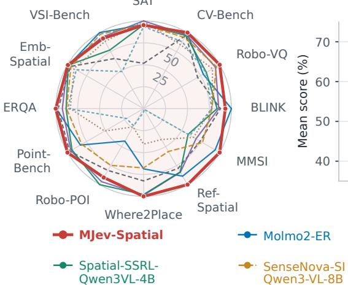

(b) Fast-thinking decisions enable a leading performance–latency trade-of

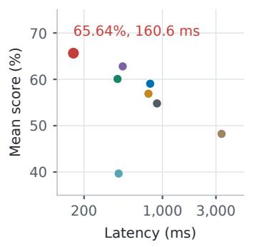

(c) Unified classification framework for spatial intelligence

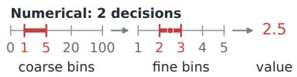

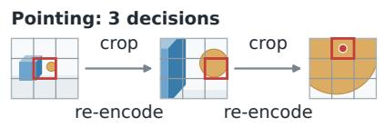  
Figure 1. Overview of the proposed MJev-Spatial. (a) Top scores on 7 of 12 spatial understanding benchmarks. (b) The highest mean score and lowest mean latency among eight evaluated models. (c) Direct option selection and coarse-to-fine numerical and point prediction. MJev-Spatial unifies these three spatial task types within a classification framework, enabling fast-thinking decisions with high accuracy and low inference latency.

## 1 Introduction

Spatial intelligence involves perceiving and reasoning about the geometry and spatial relationships of objects, which enables agents to navigate their surroundings and interact with the physical world (Chen et al., 2024; Cheng et al., 2024). Many of these interactions require timely spatial judgments. Vision-language models (VLMs) support these capabilities by answering spatial questions grounded in visual observations. Such questions may require selecting an option that describes a spatial relation (Ray et al., 2025; Tong et al., 2024; Fu et al., 2024; Yang et al., 2026), estimating a numerical quantity such as distance (Cai et al., 2026; Yang et al., 2025a,b), or identifying a point for object placement (Zhou et al., 2025a; Yuan et al., 2024; Song et al., 2025; Cheng et al., 2025).

To produce these spatial predictions, many existing VLMs retain their pretrained autoregressive textgeneration capabilities (Chen et al., 2024; Cheng et al., 2024; Deitke et al., 2025; Yuan et al., 2024; Zhou et al., 2025a). Each option, numerical value, or image location is therefore represented as a token sequence that the model is trained to reproduce. This couples learning the spatial answer with learning its textual form, including formatting and boilerplate when present, introducing supervision beyond the task-relevant prediction itself. At inference, the model must generate the answer tokens sequentially, after which the resulting text must be parsed to recover the spatial prediction, adding decoding and parsing overhead. This motivates a System 1 approach to spatial understanding: using pretrained visual and linguistic knowledge to make spatial judgments directly. Jev provides a precedent for this approach by returning probabilities over specified candidates without generating answer text (TypeSafe AI, 2026). At the same time, we observe that all three common spatial output types can be represented as finite candidate sets: answer options are already finite, while numerical values and image locations can be discretized within a specified range and resolution. Building on these insights, we introduce MJev-Spatial, a multimodal decision model specifically tailored to spatial understanding.

MJev-Spatial unifies the three output types by casting prediction as classification over finite candidate sets. Each class represents a supplied answer option, a numerical bin, or an image region, depending on the task. Selecting a class gives the chosen option, predicts which bin contains the target value, or predicts which region contains the target point. To choose among these classes, MJev-Spatial encodes their descriptions together with the observation and question, then reuses the final attention layer’s pretrained query and key projections to compute class scores. A softmax over these scores gives the class probabilities, without additional prediction heads or trainable parameters. At inference, each classification decision scores all its candidates in one forward pass. Furthermore, to obtain fine-grained values and coordinates without evaluating a large number of classes at once, we subdivide the selected numerical bin or image region and classify again. Numerical prediction uses up to two stages; single-point prediction uses three stages, re-encoding the selected image crop before each later decision to recover local visual detail. The final selection is decoded to a numerical value or image coordinates. Conditional tree expansion evaluates multiple region paths to extend the same trained point predictor to multiple points without additional training.

Numerical and point prediction can require multiple supervised stages, with new image crops introduced between point decisions. Ground-truth answers determine the target classes and crops, allowing all stages to be jointly supervised in one teacher-forced causal forward pass. We average the stage cross-entropy losses per question so that a multi-stage example does not receive greater weight than a one-stage choice. Global length grouping and cross-GPU load balancing address the padding and workload imbalance caused by diferent sequence lengths and crop counts while preserving optimizer-batch membership. An audited conversion pipeline supplies 12.3M QA from existing spatial annotations for full-parameter training of the retained language backbone.

Built on Qwen3.5-4B (Qwen Team, 2026), MJev-Spatial achieves the highest overall score among eight eval uated models, leads on seven benchmarks, and outperforms its unmodified autoregressive base model on all twelve. Across all twelve benchmarks, it achieves 2.5× and 5.6× speedups over the fastest autoregressive baseline and the base model, respectively. Separate studies examine candidate scoring, visual refinement, numerical discretization, and training execution. The readout and refinement studies assess how candidate scoring with pretrained projections and crop re-encoding contribute to prediction quality and computational cost; the numerical study shows that coarser length discretization can reduce prediction error despite its lower resolution. Global length grouping and cross-GPU load balancing further improve training throughput by 30.8% over the original batching strategy.

Our contributions are as follows:

(1) We propose a novel System 1 paradigm for spatial intelligence, unifying option selection, numerical estimation, and image pointing through direct classification over finite candidate sets.

(2) Building on this paradigm, we develop MJev-Spatial and a unified training recipe, using pretrained attention projections for candidate scoring and joint supervision across spatial tasks and refinement stages.

(3) Across twelve spatial benchmarks, MJev-Spatial achieves the highest mean score among eight evaluated models and a 5.6× speedup over its autoregressive base model, Qwen3.5-4B.

## 2 Related Work

System 1 decision model. Jev motivates predicting over declared answer spaces instead of generating unrestricted answer text (TypeSafe AI, 2026). Jev-Omni extends this interface to multimodal inputs (akhilaaa3, 2026), while KEV implements candidate scoring with learned query and key projections (Palmer, 2026). Yu and Yao (2026) and hr98w (2026) study direct decisions and shared-context execution; FBddcz and EmbodiedJev contributors (2026) applies decision interfaces to skill and action selection. Concurrent work, VideoJev, uses a shared candidate scorer for temporal grounding and video question answering, with cached and joint inference for queries about the same video (Zhu et al., 2026a). Visual Jev reads candidate token probabilities from the existing language-model head and finds no consistent accuracy advantage from an added typed head in its matched control. MJev-Spatial instead scores contextual candidate content with the backbone’s final-layer query and key projections and trains all output types with the same candidateclassification objective. Our matched readout experiments show competitive quality and lower training cost for this design, with task-dependent tradeofs (Section 4.3). The earlier Molmo2-ER-based MJev-Spatial prototype used LoRA and an added decision head (Fang et al., 2026; Hu et al., 2022). The present model uses Qwen3.5-4B and trains all retained language parameters. Backbone eficiency is also studied through pruning and quantization, joint low-rank and sparsity optimization, and adaptive execution (Zhou et al., 2026a,b, 2025b,c).

Class-aware adaptation provides a complementary route to eficient vision-language classification. AWT enriches class descriptions and combines augmented views through entropy-based weighting and optimal transport (Zhu et al., 2024a). Self-TPT uses self-supervised prompt adaptation for new classes to avoid costly per-image optimization at inference (Zhu et al., 2026b).

Spatial understanding with VLMs. Broader multimodal research covers visual reasoning (Qin et al., 2025), retrieval (Qin et al., 2024), and multimodal generation (Zhang et al., 2024; Qin et al., 2026; Zhong et al., 2025). Video understanding further requires temporal localization (Zhu et al., 2024b, 2026c) and eficient processing of long or streaming observations (Li et al., 2026; Zeng et al., 2026a). SpatialVLM and SpatialRGPT learn spatial relations and numerical answers from spatial supervision (Chen et al., 2024; Cheng et al., 2024), while Molmo, RoboPoint, and RoboRefer support pointing through coordinate text (Deitke et al., 2025; Yuan et al., 2024; Zhou et al., 2025a). Alternative interfaces can ground predictions more directly. MolmoPoint selects visual patches and refines locations through a sequence of specialized grounding tokens (Clark et al., 2026). MJev-Spatial uses one candidate-classification mechanism for options, numerical values, and points, with task-specific candidates supplying the output structure. Its multi-point extension expands conditional classification paths rather than generating a variable-length coordinate string.

Representing continuous predictions with discrete classes is established in computer vision. DORN formulates monocular depth estimation as ordinal regression over logarithmically spaced depth intervals (Fu et al., 2018). Our length representation also uses logarithmically spaced coarse intervals, followed by linear refinement, but its intervals are candidate descriptions scored by a shared language backbone. Counts and angles retain their own ranges and discretization schemes. Visual search methods such as V∗ refine image regions to recover details needed for answering (Wu and Xie, 2024). Video-o3 similarly acquires evidence iteratively in long videos, interleaving clue seeking with inspection of relevant segments (Zeng et al., 2026b). In MJev-Spatial, region selection itself is supervised as classification, and re-encoded crops provide the evidence for subsequent decisions.

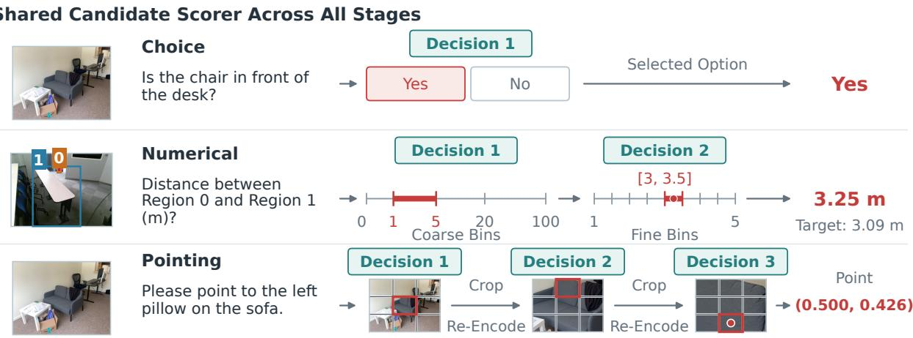  
Figure 2. Task formulation and coarse-to-fine inference. Every stage uses a shared candidate scorer. Choice tasks select a supplied option. Numerical estimation selects a coarse interval and then a fine interval, returning its midpoint. Point prediction uses three $3 \times 3$ region selections, re-encoding crops between stages and returning the final cell center.

## 3 Method

MJev-Spatial takes visual observations, a spatial question, and task-specific candidates as input. Following Jev (TypeSafe AI, 2026), it predicts by selecting candidates rather than generating text. We first explain how one classification framework handles answer options, numerical values, and image locations, including coarse-to-fine refinement and multi-point prediction. We then describe the shared model architecture and the training recipe.

## 3.1 Unified Classification Framework for Spatial Intelligence

Given ordered images $I = ( I _ { 1 } , \ldots , I _ { m } )$ and a spatial question $q ,$ the model predicts an option, a number with a declared unit, or a point in normalized image coordinates. Each candidate is a possible answer for the current decision. For a choice question, it is one of the supplied options; for a numerical or point question, it identifies an interval or region in which the target is predicted to lie. This lets all three output types use the same candidate-classification rule.

At stage t, a deterministic task controller constructs candidates $\mathcal { C } _ { t } = \{ c _ { t , 1 } , \ldots , c _ { t , K _ { t } } \}$ from the question and preceding selections and visual refinements $h _ { < t }$ . The shared scorer assigns a logit $z _ { t , i }$ to each candidate, and prediction selects the highest-scoring class:

$$
p _ { \theta } ( i \mid I , q , h _ { < t } , \mathcal { C } _ { t } ) = \frac { \exp z _ { t , i } } { \sum _ { j = 1 } ^ { K _ { t } } \exp z _ { t , j } } , \qquad \hat { a } _ { t } = \arg \operatorname* { m a x } _ { i } p _ { \theta } ( i \mid I , q , h _ { < t } , \mathcal { C } _ { t } ) ,\tag{1}
$$

Only the current legal candidates enter the softmax; padded slots receive −∞. A choice question ends after this decision. For numerical and point prediction, the selected class determines the next candidate set and any new image crop. The final class is decoded to an exact value or interval midpoint for numerical tasks, or a region center for pointing. Figure 2 illustrates these prediction paths, and Table 1 summarizes the output contracts.

Each classification decision scores all current candidates in one forward pass, with no answer-token generation or text parsing. A complete prediction can require several such decisions: numerical tasks use up to two stages and single-point prediction uses three. Multi-point prediction evaluates additional branches of the same spatial hierarchy. The common scorer is unchanged across these tasks; their candidates and refinement rules supply the output structure.

Numerical prediction. Numerical prediction must cover a wide range of values while retaining useful precision. Enumerating every fine interval at once would make the candidate list large. We instead construct candidates in two stages: the first selects a coarse interval and the second selects a fine cell within it. Both stages use the scorer in Section 3.2; exact-zero and overflow classes terminate after the first decision. The quantity specified by the question determines the unit and codebook.

Table 1. Output types and their decision structure. Numerical tasks share the scalar interface but keep separate codebooks. Ordinary pointing produces one point; the probability tree is an evaluation extension for multi-point counting.
<table><tr><td>Output</td><td>Candidates per stage</td><td>Stages</td><td>Decoded answer</td></tr><tr><td>Choice</td><td>Supplied option contents</td><td>1</td><td>The selected option, mapped back through the recorded op- tion permutation.</td></tr><tr><td>Length (m)</td><td>32 roots; 4 or 8 fine cells</td><td>1-2</td><td>Zero, overflow, or fine-cell midpoint.</td></tr><tr><td>Count</td><td>32 coarse groups; 32 integers</td><td>2</td><td> $3 2 a _ { 1 } + a _ { 2 } ,$  covering 0–1023 exactly.</td></tr><tr><td>Angle (deg)</td><td>14 roots; 32 fine cells</td><td>1-2</td><td>Zero, overflow, or degree interval midpoint.</td></tr><tr><td>Point</td><td>9 spatial cells at each level</td><td>3</td><td>Center of the final cell in original image coordinates.</td></tr></table>

Length codebook. Lengths cover (0, U] with $U = 1 6 3 8 4 \mathrm { m }$ through 30 positive coarse intervals, plus exact-zero and overflow classes. With $s = 0 . 0 1 \mathrm { m }$ , the interval edges are

$$
e _ { j } = s \left[ \exp \left( \frac { j } { 3 0 } \log ( 1 + U / s ) \right) - 1 \right] , \qquad j = 0 , \ldots , 3 0 .\tag{2}
$$

This log1p spacing lets short dimensions and long distances share one meter-based codebook. For a positive root, the fine stage splits $[ e _ { j } , e _ { j + 1 } ]$ linearly into $F _ { j }$ cells, where $F _ { j }$ is the smallest value in {4, 8, 16, 32} satisfying

$$
\frac { e _ { j + 1 } - e _ { j } } { 2 F _ { j } } \leq \operatorname* { m a x } ( 0 . 0 1 \mathrm { m } , 0 . 0 5 e _ { j } ) .\tag{3}
$$

This gives four cells in each of the first six intervals and eight in each of the remaining 24, 216 positive leaf cells in total. Fine index k decodes to the cell midpoint

$$
\hat { y } = e _ { j } + \frac { k + 1 / 2 } { F _ { j } } ( e _ { j + 1 } - e _ { j } ) .\tag{4}
$$

Because the tolerance does not decrease within an interval, choosing the correct cell bounds the quantization error by max(1 cm, 5% y); this bound concerns the codebook, not the model’s prediction error. Exact zero terminates immediately, and overflow terminates with representative U on an explicit overflow path. Candidate descriptions and decoding both read the codebook stored with the checkpoint, so training labels, interval text, and inference values cannot drift apart.

Decoding. We take the argmax at both stages and output the midpoint of the selected fine cell by Equation (4). A conditional expectation over the fine cells of the selected root reads the same logits but gives higher error at the 72K scale (Section 4.3), so we do not use it.

Counts and angles. Counts are discrete: $n \in [ 0 , 1 0 2 3 ]$ is encoded as $( \lfloor n / 3 2 \rfloor$ , n mod 32) and reconstructed exactly when both choices are correct. Angles use twelve 30-degree positive intervals over (0, 360], 32 linear cells per interval, and zero and overflow roots, with the angle frame and direction declared by the question. The adapter rejects unsupported quantities and ambiguous units, so meters, degrees, and counts never share a numerical interpretation. Scalar counting is also kept separate from locating a set of points.

Point prediction. Point prediction also requires fine resolution, but selecting a smaller region creates an additional need for local visual detail. We therefore combine three nine-way region decisions with crop reencoding: after each of the first two selections, a new crop provides the visual evidence for the next decision. Let $B _ { t } = [ x _ { t } , y _ { t } , x _ { t } + w _ { t } , y _ { t } + h _ { t } ]$ be the current rectangle in normalized original-image coordinates, with $B _ { 0 } = [ 0 , 0 , 1 , 1 ]$ . For grid column $c \in \{ 0 , 1 , 2 \}$ and row $r \in \{ 0 , 1 , 2 \}$ ,

$$
B _ { t + 1 } = \left[ x _ { t } + \frac { c w _ { t } } { 3 } , ~ y _ { t } + \frac { r h _ { t } } { 3 } , ~ x _ { t } + \frac { ( c + 1 ) w _ { t } } { 3 } , ~ y _ { t } + \frac { ( r + 1 ) h _ { t } } { 3 } \right] .\tag{5}
$$

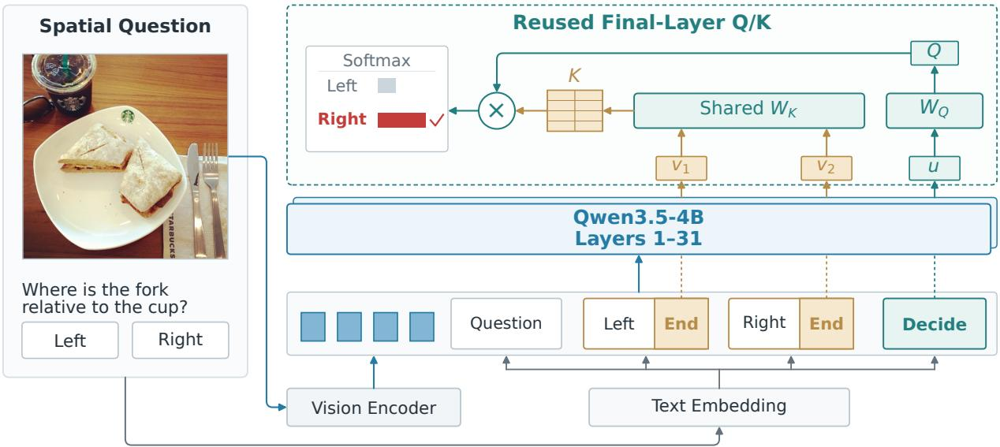  
Figure 3. Architecture of MJev-Spatial. Each candidate is followed by the same End marker. After contextualization by the language backbone, the state at each End position is passed through the same pretrained $W _ { K }$ to form a separate candidate key; the final Decide state supplies the query through $W _ { Q }$ . Their similarities determine the selected candidate, with no added prediction head or new parameters. Native normalization, rotary transformations, and head averaging are retained but omitted from the diagram. Probability bars are schematic.

The candidates follow a fixed order: top-center, top-left, top-right, center, middle-left, middle-right, bottomcenter, bottom-left, bottom-right. After each of the first two decisions, the selected rectangle is cropped from the original pixels, encoded by the same frozen visual pipeline, and appended with its decision history. Cropping from the original rather than from the previous crop avoids compounding resampling. The original view stays in context for global cues, while the crop spends visual tokens on the selected region. Candidate text describes the current region, but coordinates always refer to the original image.

After three decisions, the output is the center of $B _ { 3 } ,$ which gives an efective $2 7 \times 2 7$ grid with a correct-cell center error of at most 1/54 of the image width or height per axis. An error at an earlier decision can exclude the correct region, so this geometric bound does not guarantee prediction accuracy. Crop refinement costs two additional image encodings per point, and its benefit is tested against matched alternatives in Section 4.3.

Extending to multiple points prediction. A single greedy path returns one location. To recover several locations with the same trained model, we expand multiple paths and assign each final cell the product of its conditional probabilities along the path. Together, these probabilities form a spatial map in which separated high-probability regions can yield multiple predictions. We retain cells above a fixed threshold relative to the map’s peak, group connected cells, and return the center of the highest-probability cell in each group. The number of output points is determined by the resulting groups. This requires no additional training or learned stop decision. Full expansion visits 91 decision nodes and yields 729 cells; the evaluation decoder prunes low-probability root branches to reduce this cost. Traversal and component extraction use model predictions only, with no target masks or true point counts. Section A.4 gives the fixed decoding rules, and Section F.2 evaluates their quality and computational tradeofs.

## 3.2 Model Architecture

The framework in Section 3.1 defines the candidate classes and refinement rules; a model must still determine which class is supported by the visual observation and question. Following Jev (TypeSafe AI, 2026), we adapt a pretrained VLM to make these decisions. Its contextual representations draw on visual and linguistic knowledge acquired during large-scale pretraining, providing a basis for interpreting the scene and evaluating possible answers. We build on this capacity by formulating classification as matching a decision representation with candidate representations. Our design reuses both pretrained features and matching projections, giving the classifier a pretrained initialization without an additional prediction head. Figure 3 illustrates the candidate sequence and the representations used for scoring.

Each candidate is expressed as text: choice tasks retain the supplied option content, numerical tasks specify values or intervals with their units, and pointing tasks name cells relative to the current image region, such as “top-left” or “center”. These descriptions provide the candidate content that the VLM contextualizes with the observation and question.

We instantiate MJev-Spatial with Qwen3.5-4B (Qwen Team, 2026). Its vision encoder and merger convert the images into visual tokens, which are encoded together with the question, preceding refinement history, and current candidate descriptions in a causal sequence. Each candidate description ends with an option-end marker, and the complete candidate list ends with a decision marker. After the first 31 language layers, the hidden state at each option-end marker represents that candidate in the context of the observation, question, and preceding candidates. The hidden state at the decision marker incorporates the full candidate set and serves as the decision representation. The markers reuse existing vocabulary entries, so no new embeddings are introduced. Section A.2 gives the exact sequence layout.

FreeRet finds that the final MLP can shift representations toward lexical prediction at the expense of semantic matching (Zhu et al., 2026d). Motivated by this observation, we compute candidate scores before this transformation using the final full-attention layer’s pretrained query and key projections. The decision representation supplies the query, and each candidate representation supplies a key. We retain the layer’s pretrained input normalization, head normalization, and rotary position transformations. Let the resulting vectors at stage t be $Q _ { t , h }$ and $K _ { t , i , g ( h ) }$ . Candidate i receives the mean scaled inner product across the query heads:

$$
z _ { t , i } = \frac { 1 } { H } \sum _ { h = 0 } ^ { H - 1 } \frac { Q _ { t , h } ^ { \top } K _ { t , i , g ( h ) } } { \sqrt { d } } , \qquad H = 1 6 , \quad d = 2 5 6 , \quad g ( h ) = \lfloor h / 4 \rfloor .\tag{6}
$$

Each group of four query heads shares one of the four key heads. These scores are logits; a single softmax over the current candidates gives the class probabilities in Equation (1). The candidate descriptions change with the task and refinement stage, while the backbone and scoring rule remain shared. Equation (14) specifies the projection and position operations in full.

All candidates for a decision are evaluated in the same forward pass. We gather only the decision and option-end states before projection, and remove the unused value, gate, output, and feed-forward paths of the final layer. All retained language parameters are trainable; the vision encoder and merger remain frozen, as described in the training recipe below. Because candidate representations are causally ordered, training deterministically shufles options, while evaluation follows the benchmark’s specified ordering protocol.

## 3.3 Training Recipe

We convert existing spatial annotations into 12.3M training QA and supervise all refinement stages of each question in one language-backbone forward pass. Length grouping and cross-GPU load balancing reduce padding and workload imbalance.

Training data. Our training corpus contains 12.3M question–answer pairs converted from RefSpatial (Zhou et al., 2025a), SAT (Ray et al., 2025), SenseNova-SI (Cai et al., 2026), VSI-590K-image (Yang et al., 2025a), and VST-P (Yang et al., 2025b). The training data cover multiple-choice spatial question answering (7.1M QA), point localization (3.5M QA), length estimation (1.6M QA), angle estimation (120K QA), and counting (38K QA). These totals count original QA before expansion into decision stages. See Table 7 in Appendix B for the source-by-task breakdown, with conversion and validation details provided in the same appendix.

Joint stage supervision. Every supervised decision uses categorical cross-entropy over its current candidate set. A choice question has one target class, whereas numerical and point questions can contain a sequence of target classes; point refinement also introduces image crops between stages. The annotated answer determines the complete target path and any corresponding crops before training. We serialize the stages in causal order, with each target choice and any subsequent crop placed after the corresponding decision position. Earlier decisions therefore cannot attend to later choices or crops, while teacher forcing allows all stage losses to be evaluated in a single language-backbone forward pass. At inference, the next candidates and crop depend on the model’s current selection, so the stages are evaluated sequentially. For a $\mathrm { Q A } \ q$ with $S _ { q }$ supervised stages, the loss is

Table 2. Performance comparison of MJev-Spatial with seven autoregressive VLMs on 12 spatial understanding benchmarks. Best and second-best scores are bold and underlined, respectively.
<table><tr><td>Model</td><td>SAT</td><td>CV- Bench</td><td>Robo- VQ</td><td>BLINK</td><td>MMSI</td><td>Ref Spatial</td><td>Where 2Place</td><td>Robo- POI</td><td>Point- Bench</td><td>ERQA</td><td>Emb Spatial</td><td>VSI full</td><td>Overall</td></tr><tr><td>MJev-Spatial</td><td></td><td>79.3388.82</td><td>79.06</td><td>67.17</td><td>45.60</td><td>58.50</td><td>67.96</td><td>55.74</td><td>64.38</td><td>46.75</td><td>78.46</td><td>55.93</td><td>65.64</td></tr><tr><td>Molmo2-ER</td><td>80.00</td><td>88.31</td><td>62.01</td><td>72.17</td><td>42.90</td><td>52.00</td><td>46.64</td><td>26.23</td><td>53.47</td><td>46.50</td><td>77.99</td><td>60.55</td><td>59.06</td></tr><tr><td>Qwen3.5-4B</td><td>43.00</td><td>85.56</td><td>56.17</td><td>63.11</td><td>33.90</td><td>46.00</td><td>55.98</td><td>50.00</td><td>62.65</td><td>45.50</td><td>75.82</td><td>39.93</td><td>54.80</td></tr><tr><td>Qwen3-VL-8B-Instruct</td><td>83.33</td><td>86.37</td><td>74.72</td><td>61.76</td><td>31.40</td><td>49.00</td><td>67.07</td><td>59.02</td><td>61.54</td><td>43.25</td><td>78.90</td><td>57.07</td><td>62.79</td></tr><tr><td>Spatial-SSRL-Qwen3VL-4B</td><td>79.67</td><td>85.52</td><td>65.26</td><td>60.39</td><td>26.70</td><td>48.75</td><td>66.54</td><td>61.48</td><td>60.60</td><td>41.25</td><td>78.10</td><td>46.65</td><td>60.08</td></tr><tr><td>SenseNova-SI Qwen3-VL-8B</td><td>79.67</td><td>83.15</td><td>75.68</td><td>56.08</td><td>35.30</td><td>33.00</td><td>45.92</td><td>45.90</td><td>52.34</td><td>41.00</td><td>75.33</td><td>59.38</td><td>56.90</td></tr><tr><td>SpatialThinker-7B</td><td>78.00</td><td>78.17</td><td>64.94</td><td>56.02</td><td>27.80</td><td>0.50</td><td>2.66</td><td>13.93</td><td>14.46</td><td>40.25</td><td>69.89</td><td>29.56</td><td>39.68</td></tr><tr><td>InternVL3.5-8B</td><td>83.00</td><td>74.66</td><td>71.67</td><td>56.08</td><td>29.90</td><td>23.80</td><td>27.48</td><td>14.75</td><td>32.93</td><td>39.00</td><td>72.14</td><td>53.46</td><td>48.24</td></tr></table>

$$
\mathcal { L } = \frac { 1 } { N _ { \mathrm { a c t u a l } } } \sum _ { q } \frac { 1 } { S _ { q } } \sum _ { t = 1 } ^ { S _ { q } } - \log p _ { \theta } ( a _ { q , t } ^ { * } \mid I _ { q } , q , h _ { q , < t } ^ { * } , \mathcal { C } _ { q , t } ) .\tag{7}
$$

Here $N _ { \mathrm { a c t u a l } }$ is the number of real QA in the optimizer batch; any tail placeholders receive zero weight. Averaging over stages gives each original $\mathrm { Q A }$ equal total weight, so a three-stage point counts no more than a one-stage choice.

Eficient batching. Joint supervision removes the need for a separate language-backbone training pass at each refinement stage, but questions still require diferent amounts of computation. In particular, point examples add two image crops, while choice and numerical examples have diferent candidate lengths and stage counts. Padding dissimilar sequences wastes work, and assigning unequal work to GPUs delays synchroniza tion. We sort the expanded sequences within each global optimizer batch by length to form similar-length microbatches. A longest-work-first assignment (Graham, 1969) then distributes the microbatches across GPUs, using a cost that accounts for padded sequence length and visual-token work. This combines length grouping with cross-GPU load balancing while preserving the questions in each optimizer batch and their weights in Equation (7). Every QA remains an independent causal row: packing diferent questions together would additionally require isolation of Qwen’s Gated DeltaNet states (Yang et al., 2025c). The assignment rule and distributed normalization are specified in Section C.3.

Given the scale of our expanded training corpus, we adopt full-parameter fine-tuning of the language backbone, although parameter-eficient fine-tuning (PEFT) is also applicable (Zhou et al., 2025d, 2026c, 2025e,f, 2026d). The final configuration uses eight GPUs, a per-device microbatch size of eight, and eight gradient accumulation steps, yielding a global batch size of 512. We use AdamW (Loshchilov and Hutter, 2019) with learning rates of $5 \times 1 0 ^ { - 6 }$ for the backbone and $2 \times 1 0 ^ { - 4 }$ for the readout. Language computation uses BF16, while trainable weights, gradients, optimizer states, and candidate scoring remain in FP32. The vision encoder and merger are frozen. Section C.2 provides the complete configuration, and Section 4.4 evaluates the scheduling improvements under controlled conditions.

## 4 Experiments

We first compare the final MJev-Spatial model with seven autoregressive VLMs on spatial prediction quality and inference latency. Controlled pilot experiments then compare candidate scorers, crop re-encoding and feature reuse, numerical discretization, and multi-point decoding. Finally, we measure how length grouping and cross-GPU load balancing afect training throughput.

## 4.1 Experimental Setup

MJev-Spatial is compared with seven generative baselines: Qwen3.5-4B (Qwen Team, 2026), Qwen3-VL-8B Instruct (Qwen Team, 2025), InternVL3.5-8B (Wang et al., 2025), Molmo2-ER (Fang et al., 2026), Spatial-

SSRL (Liu et al., 2025), SenseNova-SI (Cai et al., 2026), and SpatialThinker (Batra et al., 2025). Our evaluation covers the popular SAT (Ray et al., 2025), CV-Bench (Tong et al., 2024), BLINK (Fu et al., 2024), MMSI-Bench (Yang et al., 2026), RefSpatial-Bench (Zhou et al., 2025a), Where2Place (Yuan et al., 2024), Point-Bench (Cheng et al., 2025), RoboSpatial VQA and pointing (Song et al., 2025), ERQA (Gemini Robotics Team et al., 2025), EmbSpatial (Du et al., 2024), and VSI-Bench (Yang et al., 2025d).

For model-design ablations, we use a fixed 72K-QA mixture of 25K SAT choice questions, 22K VST-P length questions, and 25K RefSpatial point questions to reduce training cost while providing suficient supervision for meaningful comparisons. Each model is trained for 2.2K updates using the same optimizer, learning-rate schedule, and image-token budgets. VST-300 serves as the development set for length estimation.

## 4.2 Main Result

Our main evaluation tests the central premise of MJev-Spatial: a System 1 decision model can make accurate spatial judgments with low inference latency. We therefore assess prediction quality and latency jointly, comparing MJev-Spatial with seven autoregressive VLMs.

MJev-Spatial achieves the highest average score of 65.64%, ahead of 62.79% for Qwen3-VL-8B-Instruct, and ranks first on seven of the twelve benchmarks (Table 2). It also outperforms its autoregressive base model on all twelve benchmarks, including gains of 22.89 percentage points on RoboSpatial VQA and 12.50 points on RefSpatial-Bench. These improvements span both spatial question answering and point localization. For length estimation, the final model reaches an MAE of 0.103 m on the VST-300 development set. On an NVIDIA B200 GPU, MJev-Spatial also achieves the lowest mean query latency, 160.6 ms, yielding a 2.5× speedup over the fastest autoregressive baseline and a 5.6× speedup over its base model (Table 11). The combination of the highest average score and lowest mean latency gives MJev-Spatial the strongest performance– latency trade-of among the compared models (Figure 1). These results support our System 1 approach to spatial understanding: adapting pretrained multimodal knowledge into direct classification decisions that deliver both strong prediction quality and fast responses.

## 4.3 Ablation Studies

We next examine the design choices that make direct classification efective across spatial tasks. The studies follow the prediction process: we first assess the shared candidate-scoring mechanism, then examine how numerical discretization and visual refinement provide the precision needed for value and point prediction. We further study how decoding adapts these predictions to diferent output requirements, including multiple points. This progression connects the common classifier to the task-specific decisions behind the final model.

Pretrained candidate scoring. We compare native Q/K scoring with a typical linear classifier and a KEV (Palmer, 2026) pointer using newly initialized projections to assess whether adding a prediction head improves over reusing the pretrained projections (Table 3). The results show no consistent winner across tasks: native Q/K achieves the best RefSpatial accuracy, 51.00%, and the lowest length-estimation MAE, 0.3341 m, while the position classifier performs better on Where2Place and RoboSpatial pointing. We therefore favor native Q/K for its minimal changes to the pretrained architecture: it reuses the existing projections without adding a prediction head or new trainable parameters. It also has the fewest trainable parameters and the lowest measured training cost among the three variants.

Table 3. Comparison results on pretrained candidate scoring. “Linear” and “KEV” are abbreviation for linear classifier and KEV pointer, respectively.
<table><tr><td>Metric</td><td>Linear</td><td>KEV</td><td>Native Q/K</td></tr><tr><td>SAT real</td><td>78.33</td><td>76.33</td><td>78.00</td></tr><tr><td>CV-Bench</td><td>83.80</td><td>85.31</td><td>85.38</td></tr><tr><td>RefSpatial</td><td>49.00</td><td>45.50</td><td>51.00</td></tr><tr><td>Where2Place</td><td>67.99</td><td>61.02</td><td>59.98</td></tr><tr><td>RoboSpatial pointing</td><td>65.57</td><td>63.11</td><td>62.30</td></tr><tr><td>RoboSpatial VQA</td><td>60.34</td><td>68.54</td><td>68.06</td></tr><tr><td>VST-300 MAE (m)</td><td>0.3668</td><td>0.3614</td><td>0.3341</td></tr></table>

Numerical discretization. For numerical estimation, we examine whether finer candidate intervals improve prediction accuracy. Keeping the same coarse intervals, we reduce the positive leaf cells from 960 to 216 by replacing 32 fine bins per interval with the 4/8-bin design. Although the coarser codebook has higher quantization error, it reduces VST-300 dev MAE from 0.3277 to 0.3202 m (Table 4a). The result shows that finer representational precision does not necessarily translate into better learned predictions. Using the same 216-cell model, replacing argmax decoding with a conditional expectation increases MAE to 0.3300 m (Table 4b). We therefore retain the compact codebook and argmax decoding, which give the lowest dev MAE in this comparison.

Table 4. Numerical prediction ablations. (a) Fine-stage candidate count with fixed coarse intervals and argmax decoding. (b) Fine-stage decoding using the same 216-cell model, with coarse-stage argmax. Quantization error uses training length labels; prediction metrics use the VST-300 dev set. Shading marks the adopted settings.  
(a) Fine-stage candidate count
<table><tr><td>Metric</td><td>32 fine bins</td><td>4/8 fine bins</td></tr><tr><td>Coarse intervals</td><td>30</td><td>30</td></tr><tr><td>Total fine cells</td><td>960</td><td>216</td></tr><tr><td>Quantization MAE ↓</td><td>0.0391</td><td>0.1540</td></tr><tr><td>Prediction MAE↓</td><td>0.3277</td><td>0.3202</td></tr></table>

(b) Fine-stage decoding
<table><tr><td>Metric</td><td>Argmax</td><td>Conditional expectation</td></tr><tr><td>MAE↓</td><td>0.3202</td><td>0.3300</td></tr><tr><td>AbsRel (%)↓</td><td>29.03</td><td>30.04</td></tr><tr><td> $| e | \leq 0 . 1 \mathrm { ~ m ~ } ( \% ) \uparrow$ </td><td>59.00</td><td>55.67</td></tr><tr><td> $| e | / y \leq 2 5 \% \ ( \% ) \ \uparrow$ </td><td>68.12</td><td>70.81</td></tr></table>

Visual refinement. Point prediction requires both a precise output representation and enough visual detail to distinguish nearby locations. We investigate whether original-image context or reused features can replace fresh crop encodings while retaining localization accuracy. Removing crops from the trained model reduces RefSpatial accuracy from 51.00% to 9.00%; training a model without crops recovers 46.50%, showing the importance of adapting training to the chosen visual input (Tables 5 and 18). Crop re-encoding nevertheless achieves the highest RefSpatial and Point-Bench scores among the four visual strategies, reaching 51.00% and 56.84%, respectively. Replaying visual tokens or attention K/V does not recover these scores. We therefore retain crop re-encoding to supply the local visual evidence needed by successive region decisions.

We also evaluate direct visual-token pointing, which replaces the three-stage hierarchy with a single decision over the original image’s visual tokens. For the native Q/K model, connected-component decoding improves counting success from 12.76% with argmax to 32.14%. Selecting the decoder according to the task raises the overall Point-Bench score from 50.76% with argmax to 54.63% (Table 19). The hierarchical crop model retains stronger RefSpatial and Point-Bench performance (Table 20), while these results show how adapting the decoder makes the one-stage alternative more efective.

Table 5. Matched training for alternative visual inputs. All four models use L32 mean, 72K QA, and three nine-way decisions. Each alternative is trained from the same pretrained base.
<table><tr><td>Metric</td><td>Crop</td><td>Original</td><td>ViT replay</td><td>KV replay</td></tr><tr><td>SAT real</td><td>78.00</td><td>74.67</td><td>73.33</td><td>78.00</td></tr><tr><td>CV-Bench</td><td>85.31</td><td>85.14</td><td>84.56</td><td>84.52</td></tr><tr><td>RoboSpatial VQA</td><td>68.06</td><td>68.75</td><td>65.01</td><td>63.38</td></tr><tr><td>BLINK val</td><td>63.04</td><td>62.56</td><td>61.07</td><td>62.74</td></tr><tr><td>MMSI-Bench</td><td>27.80</td><td>25.80</td><td>26.90</td><td>26.80</td></tr><tr><td>RefSpatial</td><td>51.00</td><td>46.50</td><td>47.00</td><td>45.50</td></tr><tr><td>Where2Place</td><td>59.98</td><td>60.93</td><td>59.04</td><td>68.95</td></tr><tr><td>RoboSpatial pointing</td><td>62.30</td><td>58.20</td><td>59.02</td><td>54.92</td></tr><tr><td>Point-Bench (macro)</td><td>56.84</td><td>52.55</td><td>52.87</td><td>52.76</td></tr><tr><td>VST-300 MAE (m)</td><td>0.3344</td><td>0.3577</td><td>0.3714</td><td>0.4097</td></tr></table>

Table 6. Training eficiency on the historical 72K corpus: eight GPUs, global batch 256, microbatch 8, four accumulation steps. Each condition runs 100 updates; the last 92 updates contain the same 23,552 measured QA. Tail includes communication and waiting. No quality evaluation was performed.
<table><tr><td>Layout</td><td>QA/s</td><td>Padding (%)</td><td>Step CV (%)</td><td>Tail (ms)</td></tr><tr><td>Original order</td><td>99.06</td><td>35.17</td><td>2.17</td><td>39.5</td></tr><tr><td>Local length</td><td>116.91</td><td>12.36</td><td>4.13</td><td>157.6</td></tr><tr><td>Global balanced</td><td>129.54</td><td>1.77</td><td>6.07</td><td>85.5</td></tr><tr><td>Global + buffer 128</td><td>129.39</td><td>1.03</td><td>19.77</td><td>95.8</td></tr></table>

Multi-point prediction. Finally, we test whether the same point-classification hierarchy can recover multiple targets without additional training. Replacing repeated continue/stop decisions with a spatial probability tree raises Point-Bench counting success from 19.39% to 38.78% (Table 21). Root pruning retains the same success rate while reducing the mean number of decision nodes from 91 to 51.10 and inference time from 4.716 to 2.638 seconds per question, a 1.79× speedup. The default 10% peak threshold achieves 38.78% success, compared with 30.10% and 37.24% at thresholds of 5% and 20%, respectively (Table 22). The shared classifier thus extends to multi-point prediction through its decision tree, with pruning reducing the cost of this extension.

## 4.4 Training Speed

The scheduling study tests whether similar-length microbatches and cross-GPU workload balancing reduce the cost of training heterogeneous spatial questions. Four fresh runs use the same historical 72K corpus, global batch 256, microbatch eight, four accumulation steps, and eight L20D GPUs. Each runs 100 updates; after eight warmup updates, the measurement window contains the same 23,552 QA. The comparison holds the model and training computation fixed apart from scheduling.

Local length grouping raises throughput from 99.06 to 116.91 QA/s and reduces padding from 35.17% to 12.36%, but increases mean gradient-ready spread from 115.0 to 306.6 ms (Table 6). Global grouping with cross-GPU balancing reduces padding to 1.77% and ready-time spread to 145.7 ms, reaching 129.54 QA/s: 30.78% higher throughput, or 23.53% less measured time for the same QA volume, than the original strategy. Since ready-time spread remains above the original value, the gain reflects the combined scheduling change.

A 128-QA cross-update bufer lowers padding to 1.03% but does not improve throughput and increases steptime variability. We retain the unbufered layout to preserve optimizer-batch membership. Distributed checks verify per-question loss normalization with unequal workloads and incomplete tails, without implying bitwise equivalence across BF16 batch shapes. These short runs measure throughput, not convergence or full-run duration; they include no downstream quality evaluation. Full timing and batch-size feasibility profiles appear in Section H.

## 5 Conclusion

MJev-Spatial investigates a System One approach to spatial understanding: using pretrained multimodal knowledge to make direct spatial decisions without generating answer text. Options, numerical values, and image locations share a candidate-classification mechanism, with hierarchical refinement providing numerical and spatial precision and tree expansion extending point prediction without further training. An audited 12.3M-QA corpus and joint stage supervision support training across these tasks; length grouping and cross-GPU balancing improve throughput by 30.8% in a controlled eight-GPU study. The final Qwen3.5-4B-based model achieves the highest overall score, leads seven of twelve reported metrics among eight evaluated models, and exceeds its local autoregressive base model on all twelve. Its mean batch-one query latency is 160.6 ms across the twelve benchmarks, giving 2.5× and 5.6× speedups over the fastest autoregressive baseline and the base model under the reported timing protocol. Together with the controlled design studies, these results support direct candidate decisions as a viable approach to the spatial tasks studied here.

## References

Boyuan Chen, Zhuo Xu, Sean Kirmani, Brian Ichter, Dorsa Sadigh, Leonidas Guibas, et al. SpatialVLM: Endowing vision-language models with spatial reasoning capabilities. In IEEE/CVF Conference on Computer Vision and Pattern Recognition (CVPR), pages 14455–14465, 2024. arXiv:2401.12168.

An-Chieh Cheng, Hongxu Yin, Yang Fu, Qiushan Guo, Ruihan Yang, Jan Kautz, et al. SpatialRGPT: Grounded spatial reasoning in vision-language models. In Advances in Neural Information Processing Systems (NeurIPS), pages 135062–135093, 2024. arXiv:2406.01584.

Arijit Ray, Jiafei Duan, Ellis Brown, Reuben Tan, Dina Bashkirova, Rose Hendrix, et al. SAT: Dynamic spatial aptitude training for multimodal language models. In Conference on Language Modeling (COLM), 2025. arXiv:2412.07755. Data: https://huggingface.co/datasets/array/SAT.

Shengbang Tong, Ellis Brown, Penghao Wu, Sanghyun Woo, Manoj Middepogu, Sai Charitha Akula, et al. Cambrian-1: A fully open, vision-centric exploration of multimodal LLMs. In Advances in Neural Information Processing Systems (NeurIPS), 2024. arXiv:2406.16860. Introduces CV-Bench. Data: https://huggingface.co/datasets/nyu-v isionx/CV-Bench; pinned revision in the evaluation manifest.

Xingyu Fu, Yushi Hu, Bangzheng Li, Yu Feng, Haoyu Wang, Xudong Lin, et al. BLINK: Multimodal large language models can see but not perceive. In European Conference on Computer Vision (ECCV), 2024. arXiv:2404.12390. Data: https://huggingf ace.co/datasets/BLINK-Benchmark/BLINK; paired Hugging Face options and labels; pinned revision in the evaluation manifest.

Sihan Yang, Runsen Xu, Yiman Xie, Sizhe Yang, Mo Li, Jingli Lin, et al. MMSI-Bench: A benchmark for multiimage spatial intelligence. In International Conference on Learning Representations (ICLR), 2026. arXiv:2505.23764. Data: https://huggingface.co/datasets/RunsenXu/MMSI-Bench; 1,000-question release; pinned revision in the evaluation manifest.

Zhongang Cai, Ruisi Wang, Chenyang Gu, Fanyi Pu, Junxiang Xu, Yubo Wang, et al. Scaling spatial intelligence with multimodal foundation models. In Proceedings of the IEEE/CVF Conference on Computer Vision and Pattern Recognition (CVPR), 2026. arXiv:2511.13719. Introduces the SenseNova-SI data. Data: https://huggingface.co/d atasets/sensenova/SenseNova-SI-800K.

Shusheng Yang, Jihan Yang, Pinzhi Huang, Ellis Brown, Zihao Yang, Yue Yu, et al. Cambrian-S: Towards spatial supersensing in video. arXiv:2511.04670, 2025a. Introduces VSI-590K. Data: https://huggingface.co/datasets/ny u-visionx/VSI-590K.

Rui Yang, Ziyu Zhu, Yanwei Li, Jingjia Huang, Shen Yan, Siyuan Zhou, et al. Visual spatial tuning. arXiv:2511.05491, 2025b. Introduces VST-P. Code: https://github.com/Yangr116/VST; data: https://huggingface.co/datasets/ra yruiyang/vst\_500k.

Enshen Zhou, Jingkun An, Cheng Chi, Yi Han, Shanyu Rong, Chi Zhang, et al. RoboRefer: Towards spatial referring with reasoning in vision-language models for robotics. In Advances in Neural Information Processing Systems (NeurIPS), 2025a. arXiv:2506.04308. Introduces the RefSpatial training data and RefSpatial-Bench. Data: https: //huggingface.co/datasets/JingkunAn/RefSpatial and https://huggingface.co/datasets/BAAI/RefSpatial-Bench; pinned revision in the evaluation manifest.

Wentao Yuan, Jiafei Duan, Valts Blukis, Wilbert Pumacay, Ranjay Krishna, Adithyavairavan Murali, et al. RoboPoint: A vision-language model for spatial afordance prediction for robotics. In Conference on Robot Learning (CoRL), 2024. arXiv:2406.10721. Introduces Where2Place. Data: https://huggingf ace.co/datasets/wentao-yuan/wher e2place, point questions and grayscale masks, pinned revision in the evaluation manifest; training data: https: //huggingface.co/datasets/wentao-yuan/robopoint-data.

Chan Hee Song, Valts Blukis, Jonathan Tremblay, Stephen Tyree, Yu Su, and Stan Birchfield. RoboSpatial: Teaching spatial understanding to 2D and 3D vision-language models for robotics. In Proceedings of the IEEE/CVF Conference on Computer Vision and Pattern Recognition (CVPR), 2025. arXiv:2411.16537. Data: https://huggingface.co/datasets/chanhee-luke/RoboSpatial-Home; current annotations and author scoring protocol; pinned revision in the evaluation manifest.

Long Cheng, Jiafei Duan, Yi Ru Wang, Haoquan Fang, Boyang Li, Yushan Huang, et al. PointArena: Probing multimodal grounding through language-guided pointing. arXiv:2505.09990, 2025. Introduces Point-Bench. Code: https://github.com/pointarena/pointarena; data: https://huggingface.co/datasets/PointArena/pointarena-dat a.

Matt Deitke, Christopher Clark, Sangho Lee, Rohun Tripathi, Yue Yang, Jae Sung Park, et al. Molmo and PixMo: Open weights and open data for state-of-the-art vision-language models. In IEEE/CVF Conference on Computer Vision and Pattern Recognition (CVPR), pages 91–104, 2025. arXiv:2409.17146.

TypeSafe AI. Introducing System One models and Jev. https://typesafe.ai/blog/introducing-system-one-models-a nd-jev, 2026. Oficial project announcement. Accessed 2026-09-29.

Qwen Team. Qwen3.5-4B: Oficial model card and configuration. https://huggingface.co/Qwen/Qwen3.5-4B, 2026.

akhilaaa3. Jev-Omni: Model card and implementation. https://huggingface.co/akhilaaa3/Jev-Omni, 2026. Independent multimodal decision model. Accessed 2026-09-29.

Jared Palmer. Kev: Open decision models. https://github.com/jaredpalmer/kev, 2026.

Guanxu Yu and Yuhang Yao. Visual Jev: Accurate and eficient decisions from shared visual context. arXiv:2609.25845, 2026. Companion code: https://github.com/guanxuyu-sv/Visual-Jev.

hr98w. Jev Visual: Shared visual context and direct candidate scoring. https://github.com/hr98w/jev-visual, 2026. Independent open-source implementation. Accessed 2026-09-29.

FBddcz and EmbodiedJev contributors. EmbodiedJev: A MuJoCo robot decision workbench. https://github.com/F Bddcz/embodied-jev, 2026. Project repository. Accessed 2026-09-29.

Yuhan Zhu, Xiangyu Zeng, Qingyi Si, Chenxu Yang, Yifei Li, Luozheng Qin, et al. VideoJev: System one model fo video understanding and interaction. arXiv:2610.18615, 2026a.

Haoquan Fang, Jiafei Duan, Donovan Clay, Sam Wang, Shuo Liu, Weikai Huang, et al. MolmoAct2: Action reasoning models for real-world deployment. arXiv:2605.02881, 2026. Introduces the Molmo2-ER spatial backbone. Model card: https://huggingface.co/allenai/Molmo2-ER.

Edward J. Hu, Yelong Shen, Phillip Wallis, Zeyuan Allen-Zhu, Yuanzhi Li, Shean Wang, et al. LoRA: Low-rank adaptation of large language models. In International Conference on Learning Representations (ICLR), 2022. arXiv:2106.09685.

Yuhua Zhou, Shaoqi Yu, Shichao Weng, Changhai Zhou, Mingze Yin, Fei Yang, et al. BUDDY: Budget-driven dynamic depth routing for adaptive large language model inference. arXiv:2606.09514, 2026a.

Yuhua Zhou, Shichao Weng, Changhai Zhou, Yuhan Wu, Qian Qiao, Jun Gao, et al. Deputy: Accelerating large language model inference with dynamic low-rank substitution. In Findings of the Association for Computational Linguistics: ACL 2026, pages 19791–19810. Association for Computational Linguistics, July 2026b. URL https: //aclanthology.org/2026.findings-acl.991/.

Changhai Zhou, Yuhua Zhou, Yibin Wang, Shijie Han, Qian Qiao, and Hongguang Li. QPruner: Probabilistic decision quantization for structured pruning in large language models. In Findings of the Association for Computational Linguistics: NAACL 2025, pages 4276–4286. Association for Computational Linguistics, April 2025b. URL https: //aclanthology.org/2025.findings-naacl.240/.

Changhai Zhou, Qian Qiao, Yuhua Zhou, Yuxin Wu, Shichao Weng, Weizhong Zhang, et al. Large language model compression with global rank and sparsity optimization. arXiv:2505.03801, 2025c.

Yuhan Zhu, Yuyang Ji, Zhiyu Zhao, Gangshan Wu, and Limin Wang. AWT: Transferring vision-language models via augmentation, weighting, and transportation. Advances in Neural Information Processing Systems, 37:25561–25591, 2024a.

Yuhan Zhu, Guozhen Zhang, Chen Xu, Haocheng Shen, Xiaoxin Chen, Gangshan Wu, et al. Eficient test-time prompt tuning for vision-language models. International Journal of Computer Vision, 134(10):468, 2026b.

Luozheng Qin, Jia Gong, Yuqing Sun, Tianjiao Li, Mengping Yang, Xiaomeng Yang, et al. Uni-CoT: Towards unified chain-of-thought reasoning across text and vision. arXiv preprint arXiv:2508.05606, 2025.

Luozheng Qin, Shaoyao Huang, Qian Qiao, Xu Yan, and Ziqiang Cao. BVRCC: Bootstrapping video retrieval via cross-matching correction. In International Conference on Artificial Neural Networks, pages 19–33. Springer, 2024.

Yue Zhang, Zhizhou Zhong, Minhao Liu, Zhaokang Chen, Bin Wu, Yubin Zeng, et al. MuseTalk: Real-time high fidelity video dubbing via spatio-temporal sampling. arXiv preprint arXiv:2410.10122, 2024.

Luozheng Qin, Jia Gong, Qian Qiao, Tianjiao Li, Li Xu, Haoyu Pan, et al. Uni-ViGU: Towards unified video generation and understanding via a difusion-based video generator. arXiv preprint arXiv:2604.08121, 2026.

Zhizhou Zhong, Yicheng Ji, Zhe Kong, Yiying Liu, Jiarui Wang, Jiasun Feng, et al. AnyTalker: Scaling multi-person talking video generation with interactivity refinement. arXiv preprint arXiv:2511.23475, 2025.

Yuhan Zhu, Guozhen Zhang, Jing Tan, Gangshan Wu, and Limin Wang. Dual DETRs for multi-label temporal action detection. In 2024 IEEE/CVF Conference on Computer Vision and Pattern Recognition (CVPR), pages 18559–18569. IEEE, 2024b.

Yuhan Zhu, Changlian Ma, Xiangyu Zeng, Xinhao Li, Zhiqiu Zhang, Songze Li, et al. TimeLens2: Generalist video temporal grounding with multimodal LLMs. arXiv preprint arXiv:2607.17423, 2026c. URL https://arxiv.org/ab s/2607.17423.

Xinhao Li, Yuhan Zhu, Xiangyu Zeng, Yuhao Dong, Haoning Wu, Zhiqiu Zhang, et al. VideoChat3: Fully open video MLLM for eficient and generalist video understanding. arXiv preprint arXiv:2607.14935, 2026. URL https: //arxiv.org/abs/2607.14935.

Xiangyu Zeng, Yuandong Yang, Zhiqiu Zhang, Yuhan Zhu, Xinhao Li, Qingyi Si, et al. OneStreamer: Unifying perception, memory, and proactive response in streaming video interaction. arXiv preprint arXiv:2610.01762, 2026a. URL https://arxiv.org/abs/2610.01762.

Christopher Clark, Yue Yang, Jae Sung Park, Zixian Ma, Jieyu Zhang, Rohun Tripathi, et al. MolmoPoint: Better Pointing for VLMs with Grounding Tokens. arXiv:2603.28069, 2026.

Huan Fu, Mingming Gong, Chaohui Wang, Kayhan Batmanghelich, and Dacheng Tao. Deep ordinal regression network for monocular depth estimation. In IEEE/CVF Conference on Computer Vision and Pattern Recognition (CVPR), pages 2002–2011, 2018. arXiv:1806.02446.

Penghao Wu and Saining Xie. V∗: Guided visual search as a core mechanism in multimodal LLMs. In IEEE/CVF Conference on Computer Vision and Pattern Recognition (CVPR), pages 13084–13094, 2024. arXiv:2312.14135.

Xiangyu Zeng, Zhiqiu Zhang, Yuhan Zhu, Xinhao Li, Zikang Wang, Changlian Ma, et al. Video-o3: Native interleaved clue seeking for long video multi-hop reasoning. arXiv preprint arXiv:2601.23224, 2026b. URL https://arxiv.org/ abs/2601.23224.

Yuhan Zhu, Xiangyu Zeng, Chenting Wang, Xinhao Li, Chunxu Liu, Yicheng Xu, et al. FreeRet: MLLMs as trainingfree retrievers. In Proceedings of the 43rd International Conference on Machine Learning, volume 306 of Proceedings of Machine Learning Research, pages 167936–167952. PMLR, 2026d. URL https://proceedings.mlr.press/v306/z hu26ba.html.

R. L. Graham. Bounds on multiprocessing timing anomalies. SIAM Journal on Applied Mathematics, 17(2):416–429, 1969.

Songlin Yang, Jan Kautz, and Ali Hatamizadeh. Gated delta networks: Improving Mamba2 with delta rule. In International Conference on Learning Representations (ICLR), 2025c. arXiv:2412.06464.

Changhai Zhou, Shijie Han, Lining Yang, Yuhua Zhou, Xu Cheng, Yibin Wang, et al. RankAdaptor: Hierarchical rank allocation for eficient fine-tuning pruned LLMs via performance model. In Findings of the Association for Computational Linguistics: NAACL 2025, pages 5796–5810. Association for Computational Linguistics, 2025d. URL https://aclanthology.org/2025.findings-naacl.321/.

Yuhua Zhou, Changhai Zhou, Shiyang Zhang, Fei Yang, Yi Zhang, and Aimin Pan. LaRA: Layer-wise rank allocation for eficient fine-tuning of pruned large language models. Information Processing & Management, 63(3):104538, 2026c. doi: 10.1016/j.ipm.2025.104538.

Yuhua Zhou, Ruifeng Li, Changhai Zhou, Fei Yang, and Aimin Pan. BSLoRA: Enhancing the parameter eficiency of LoRA with intra-layer and inter-layer sharing. In Proceedings of the 42nd International Conference on Machine Learning, volume 267 of Proceedings of Machine Learning Research, pages 78883–78902. PMLR, 2025e. URL https://proceedings.mlr.press/v267/zhou25k.html.

Changhai Zhou, Shiyang Zhang, Yuhua Zhou, Qian Qiao, Jun Gao, Shichao Weng, et al. Balancing fidelity and plasticity: Aligning mixed-precision fine-tuning with linguistic hierarchies. arXiv:2505.03802, 2025f.

Changhai Zhou, Shiyang Zhang, Yuhua Zhou, Qian Qiao, Jun Gao, Cheng Jin, et al. AutoQRA: Joint optimization of mixed-precision quantization and low-rank adapters for eficient LLM fine-tuning. arXiv:2602.22268, 2026d.

Ilya Loshchilov and Frank Hutter. Decoupled weight decay regularization. In International Conference on Learning Representations (ICLR), 2019. arXiv:1711.05101.

Qwen Team. Qwen3-VL Technical Report. arXiv:2511.21631, 2025.

Weiyun Wang, Zhangwei Gao, Lixin Gu, et al. InternVL3.5: Advancing Open-Source Multimodal Models in Versatility, Reasoning, and Eficiency. arXiv:2508.18265, 2025.

Yuhong Liu, Beichen Zhang, Yuhang Zang, Yuhang Cao, Long Xing, Xiaoyi Dong, et al. Spatial-SSRL: Enhancing Spatial Understanding via Self-Supervised Reinforcement Learning. arXiv:2510.27606, 2025.

Hunar Batra, Haoqin Tu, Hardy Chen, Yuanze Lin, Cihang Xie, and Ronald Clark. SpatialThinker: Reinforcing Scene Graph-Grounded Spatial Reasoning via Dense Rewards. arXiv:2511.07403, 2025.

Gemini Robotics Team et al. Gemini Robotics: Bringing AI into the physical world. arXiv:2503.20020, 2025.

Mengfei Du, Binhao Wu, Zejun Li, Xuanjing Huang, and Zhongyu Wei. EmbSpatial-Bench: Benchmarking spatial understanding for embodied tasks with large vision-language models. In Proceedings of the 62nd Annual Meeting of the Association for Computational Linguistics (Volume 2: Short Papers), pages 346–355. Association for Computational Linguistics, 2024. URL https://aclanthology.org/2024.acl-short.33/.

Jihan Yang, Shusheng Yang, Anjali W. Gupta, Rilyn Han, Fei-Fei Li, and Saining Xie. Thinking in space: How multimodal large language models see, remember, and recall spaces. In Proceedings of the IEEE/CVF Conference on Computer Vision and Pattern Recognition (CVPR), 2025d. arXiv:2412.14171.

Alexey Dosovitskiy, Lucas Beyer, Alexander Kolesnikov, Dirk Weissenborn, Xiaohua Zhai, Thomas Unterthiner, et al. An image is worth 16x16 words: Transformers for image recognition at scale. In International Conference on Learning Representations (ICLR), 2021. arXiv:2010.11929.

Ronald J. Williams and David Zipser. A learning algorithm for continually running fully recurrent neural networks. Neural Computation, 1(2):270–280, 1989.

Biao Zhang and Rico Sennrich. Root mean square layer normalization. In Advances in Neural Information Processing Systems (NeurIPS), volume 32, 2019. arXiv:1910.07467.

Jianlin Su, Murtadha Ahmed, Yu Lu, Shengfeng Pan, Wen Bo, and Yunfeng Liu. RoFormer: Enhanced transformer with rotary position embedding. Neurocomputing, 568:127063, 2024. arXiv:2104.09864.

Peng Wang, Shuai Bai, Sinan Tan, Shijie Wang, Zhihao Fan, Jinze Bai, et al. Qwen2-VL: Enhancing vision-language model’s perception of the world at any resolution. arXiv:2409.12191, 2024.

Joshua Ainslie, James Lee-Thorp, Michiel de Jong, Yury Zemlyanskiy, Federico Lebrón, and Sumit Sanghai. GQA: Training generalized multi-query transformer models from multi-head checkpoints. In Conference on Empirical Methods in Natural Language Processing (EMNLP), pages 4895–4901, 2023. arXiv:2305.13245.

Noam Shazeer. GLU variants improve transformer. arXiv:2002.05202, 2020.

Diederik P. Kingma and Jimmy Ba. Adam: A method for stochastic optimization. In International Conference on Learning Representations (ICLR), 2015. arXiv:1412.6980.

Paulius Micikevicius, Sharan Narang, Jonah Alben, Gregory Diamos, Erich Elsen, David Garcia, et al. Mixed precision training. In International Conference on Learning Representations (ICLR), 2018. arXiv:1710.03740.

Dhiraj Kalamkar, Dheevatsa Mudigere, Naveen Mellempudi, Dipankar Das, Kunal Banerjee, Sasikanth Avancha, et al. A study of BFLOAT16 for deep learning training. arXiv:1905.12322, 2019.

Neal Krawetz. Kind of like that. The Hacker Factor Blog, https://www.hackerfactor.com/blog/index.php?/archive s/529-Kind-of-Like-That.html, 2013.

Razvan Pascanu, Tomas Mikolov, and Yoshua Bengio. On the dificulty of training recurrent neural networks. In International Conference on Machine Learning (ICML), volume 28 of Proceedings of Machine Learning Research, pages 1310–1318, 2013. arXiv:1211.5063.

Priya Goyal, Piotr Dollár, Ross Girshick, Pieter Noordhuis, Lukasz Wesolowski, Aapo Kyrola, et al. Accurate, large minibatch SGD: Training ImageNet in 1 hour. arXiv:1706.02677, 2017.

Ilya Loshchilov and Frank Hutter. SGDR: Stochastic gradient descent with warm restarts. In International Conference on Learning Representations (ICLR), 2017. arXiv:1608.03983.

Shen Li, Yanli Zhao, Rohan Varma, Omkar Salpekar, Pieter Noordhuis, Teng Li, et al. PyTorch distributed: Expe riences on accelerating data parallel training. Proceedings of the VLDB Endowment (PVLDB), 13(12):3005–3018, 2020. arXiv:2006.15704.

Bolei Zhou, Hang Zhao, Xavier Puig, Sanja Fidler, Adela Barriuso, and Antonio Torralba. Scene parsing through ADE20K dataset. In IEEE Conference on Computer Vision and Pattern Recognition (CVPR), pages 633–641, 2017.

Tsung-Yi Lin, Michael Maire, Serge Belongie, James Hays, Pietro Perona, Deva Ramanan, et al. Microsoft COCO: Common objects in context. In European Conference on Computer Vision (ECCV), pages 740–755, 2014. arXiv:1405.0312.

Garrick Brazil, Abhinav Kumar, Julian Straub, Nikhila Ravi, Justin Johnson, and Georgia Gkioxari. Omni3D: A large benchmark and model for 3D object detection in the wild. In IEEE/CVF Conference on Computer Vision and Pattern Recognition (CVPR), pages 13154–13164, 2023. arXiv:2207.10660.

Thomas Wolf, Lysandre Debut, Victor Sanh, Julien Chaumond, Clement Delangue, Anthony Moi, et al. Transformers: State-of-the-art natural language processing. In Conference on Empirical Methods in Natural Language Processing: System Demonstrations (EMNLP), pages 38–45, 2020. https://aclanthology.org/2020.emnlp-demos.6/.

Adam Paszke, Sam Gross, Francisco Massa, Adam Lerer, James Bradbury, Gregory Chanan, et al. PyTorch: An imperative style, high-performance deep learning library. In Advances in Neural Information Processing Systems (NeurIPS), 2019. arXiv:1912.01703.

Jimmy Lei Ba, Jamie Ryan Kiros, and Geofrey E. Hinton. Layer normalization. arXiv:1607.06450, 2016.

Tianqi Chen, Bing Xu, Chiyuan Zhang, and Carlos Guestrin. Training deep nets with sublinear memory cost. arXiv:1604.06174, 2016.

## A Additional Method Details

## A.1 Autoregressive Reference and Decision Paths

Problem setup. Given ordered images $\boldsymbol I = ( I _ { 1 } , \ldots , I _ { m } )$ and a spatial question q, the goal is to predict a typed answer $y \in \mathcal { V } _ { q } \colon$ one of the supplied options, a number with a declared unit, or a location in normalized image coordinates. In an autoregressive formulation, a vision-language model $\pi _ { \theta }$ generates an answer string $w = ( w _ { 1 } , \dots , w _ { L } )$ autoregressively,

$$
\pi _ { \boldsymbol { \theta } } ( w \mid I , q ) = \prod _ { l = 1 } ^ { L } \pi _ { \boldsymbol { \theta } } ( w _ { l } \mid I , q , w _ { < l } ) ,\tag{8}
$$

and a task-specific parser then maps w to y. Answer generation therefore adds sequential decoding steps whose number depends on the output length L.

In the classification formulation, the state at stage t is $s _ { t } = ( I , q , h _ { < t } )$ , where $h _ { < t }$ contains the preceding selections and visual refinements. A deterministic controller constructs $\mathcal { C } _ { t }$ , advances the state after selection, and decodes the terminal path to the required answer. For a fixed observation and question, reachable states form a finite tree of depth at most three, with path probability

$$
P ( a _ { 1 : S } \mid I , q ) = \prod _ { t = 1 } ^ { S } p _ { \theta } ( a _ { t } \mid I , q , h _ { < t } , \mathcal { C } _ { t } ) .\tag{9}
$$

Ordinary decoding follows the greedy path in Equation (1); multi-point decoding expands several spatial paths. Training supervises all annotated transitions using Equation (7). Each textual decision supports up to 32 candidates, with padded slots masked before normalization.

## A.2 Input Sequence and Candidate Representations

Sequence layout. Each question–answer example (QA) is represented by an image prefix followed by the question, candidate descriptions, and a decision marker:

$$
\big [ \mathrm { s t a t e } , I _ { 1 } , \dots , I _ { m } , \mathrm { q u e s t i o n } , q , \mathrm { o p t } , c _ { 1 } , \mathrm { e n d } , \dots , \mathrm { o p t } , c _ { K } , \mathrm { e n d } , \mathrm { d e c i d e } \big ] .\tag{10}
$$

The sequence markers reuse existing vocabulary entries, leaving the vocabulary and embedding matrix unchanged.

Candidate representations. The frozen vision encoder (Dosovitskiy et al., 2021) and merger embed each image into the language sequence, and the first 31 language layers contextualize the whole causal row. The state at an option-end marker then summarizes that option in the context of the image, the question, and the preceding options, while the state at the decision marker sees all current candidates. Changing an option therefore changes its representation rather than the interpretation of a fixed classifier slot, which lets the candidate set vary freely across questions. Training shufles candidate order, while evaluation follows each benchmark’s ordering protocol.

Multi-stage rows. Each QA occupies its own causal row. A later stage appends the selected option, an optional new image crop, and a new question and candidate block. During training, all supervised stages fit in one teacher-forced (Williams and Zipser, 1989) causal sequence. Each decision marker precedes the later choices and crops, so one forward pass supervises every stage without showing a future crop to an earlier decision. At inference, the next stage is constructed only after the current prediction.

## A.3 Candidate Scoring with Pretrained Query and Key Projections

The shared scorer produces one class logit for each current candidate. The final full-attention layer’s pretrained query projection acts on the decision state, and its key projection acts on each candidate state; comparing the resulting vectors gives the logits used in Equation (1). This reuses existing parameters to compute classification scores without an additional prediction head.

Backbone boundary. Qwen3.5-4B has 32 language layers with hidden width $D = 2 5 6 0$ . Full attention occurs at L4, L8, . . . , L32, and the other 24 layers are Gated DeltaNet. We run L1–L31, including their residual and feed-forward paths, and read representations at the input to L32. A full-attention layer has H = 16 query heads, G = 4 key/value heads, and head width $d = 2 5 6$

Query–key scoring. Let $u _ { t } \in \mathbb { R } ^ { 2 5 6 0 }$ be the L32 input state at the decision marker of stage $t ,$ and $v _ { t , i } \in$ $\mathrm { \mathbb { R } } ^ { 2 5 6 0 }$ the state at the option-end marker of candidate i. With the native input RMSNorm (Zhang and Sennrich, 2019) $N _ { \mathrm { i n } }$ , the headwise RMSNorms $N _ { Q } , N _ { K }$ , and the partial rotary operator (Su et al., 2024) $R _ { p } { \mathrm { . } }$ the logits are

$$
Q _ { t , h } = R _ { p _ { t } } \Big [ N _ { Q } \Big ( W _ { Q } ^ { ( h ) } N _ { \mathrm { i n } } ( u _ { t } ) \Big ) \Big ] ,
$$

$$
h = 0 , \ldots , 1 5 ,\tag{11}
$$

$$
K _ { t , i , g } = R _ { p _ { t , i } } \Big [ N _ { K } \Big ( W _ { K } ^ { ( g ) } N _ { \mathrm { i n } } ( v _ { t , i } ) \Big ) \Big ] ,
$$

$$
g = 0 , \ldots , 3 ,\tag{12}
$$

$$
s _ { t , h , i } = \frac { Q _ { t , h } ^ { \top } K _ { t , i , g ( h ) } } { \sqrt { 2 5 6 } } ,
$$

$$
g ( h ) = \lfloor h / 4 \rfloor ,\tag{13}
$$

$$
z _ { t , i } = \frac { 1 } { 1 6 } \sum _ { h = 0 } ^ { 1 5 } s _ { t , h , i } .\tag{14}
$$

The rotary positions are the original token positions of the gathered states. Qwen’s multimodal rotary embedding (Wang et al., 2024) rotates the first 64 coordinates of each head and leaves the other 192 unchanged. Each group of four query heads shares one key head, as in grouped-query attention (Ainslie et al., 2023). The score is a learned, position-aware scaled inner product.

We average the head logits and apply a single softmax over the legal candidates. The candidate probability is Equation (1), with only the current alternatives in the denominator. Each logit thus decomposes into 16 head contributions, which the intervention analysis in Section E.4 exploits.

Reusing the pretrained projections. Qwen’s Q projection is a bias-free 2560 → 8192 matrix whose 512 output rows per head hold a 256-dimensional query followed by a 256-dimensional output gate. The readout uses the 256 query dimensions of each head, giving $W _ { Q } \in \mathbb { R } ^ { 4 0 9 6 \times 2 5 6 0 }$ . The key projection $W _ { K } \in \mathbb { R }$ 1024×2560 and both head norms are kept as they are. All of these parameters start from the oficial pretrained checkpoint.

Removing unused computation. Since the readout sits before the value aggregation and residual up date of L32, the V projection, output-gate rows, output projection, post-attention norm, and SwiGLU FFN (Shazeer, 2020) of L32, together with the final language-model norm, have no path to the loss and are removed. Earlier layers stay intact. The readout gathers the S decision states and $\textstyle \sum _ { t } K _ { t }$ option-end states before projecting them, so it forms neither a full-sequence $\mathrm { Q / K }$ projection nor an $L \times L$ attention matrix. Its candidate-comparison work is $O ( \sum _ { t } K _ { t } H d )$ , while image encoding and the L1–L31 prefill still scale with the full input length.

The retained language model has 4,111,374,336 trainable parameters, 95,688,192 fewer than the completelanguage KEV model; the removed FFN alone accounts for 70,778,880. The Q/K projections and their head norms, 13,107,712 parameters, form the readout optimizer group, and the input norm stays in the backbone group. Trainable weights, gradients, Adam (Kingma and Ba, 2015) states, and all readout operations use FP32, while the retained language layers compute in BF16, following standard mixed-precision training (Micikevicius et al., 2018; Kalamkar et al., 2019). The vision encoder and merger stay frozen in BF16. This keeps the small candidate comparison numerically stable while the backbone computation, which dominates the cost, runs in mixed precision.

## A.4 Multi-Point Decoding Rules

For Point-Bench counting, the same trained model supplies a three-level conditional probability tree,

$$
P ( a _ { 1 : 3 } \mid I , q ) = \prod _ { t = 1 } ^ { 3 } p _ { \theta } ( a _ { t } \mid I , q , a _ { < t } ) ,\tag{15}
$$

whose complete expansion visits 1 + 9 + 81 = 91 decision nodes and produces 729 cells. For evaluation, we drop a first-level branch only when $p ( a _ { 1 } ) < 0 . 0 1 \mathrm { m a x } _ { j } p ( j )$ , so each retained root adds ten decision nodes and 81 leaf cells, and deeper levels are fully expanded. Unvisited cells remain unknown, and the omitted mass is recorded without renormalizing the retained probabilities. On the resulting map, cells above 10% of the retained global peak form an eight-connected superlevel set, and each connected component outputs the center of its peak cell. The threshold, connectivity, and root cutof are fixed without test labels; target masks and true point counts are used only by the scorer. This turns distributed spatial mass into a variable number of points without a learned stop decision or a ground-truth top-k. The tree costs more than the three-node pointing path, and its pruning and decoder sensitivities are measured in Section F.2.

## B Data Conversion and Validation

## B.1 From Spatial Annotations to Classification Supervision

We convert spatial annotations from the training collection curated for Molmo2-ER (Fang et al., 2026), which contains 5M source records and 21.1M QA. The annotations originate from RefSpatial (Zhou et al., 2025a), SAT (Ray et al., 2025), SenseNova-SI (Cai et al., 2026), VSI-590K (Yang et al., 2025a), VST-P (Yang et al., 2025b), and RoboPoint (Yuan et al., 2024); Table 7 reports their contributions to the final corpus. Each accepted QA contains the ordered images, question, answer type, candidates, and target. Supplied options retain their semantic content, numerical labels determine the target intervals, and point coordinates determine the target regions and training crops. Source answers and rationales are excluded from model inputs.

Answer options. Supplied text and image options are retained when exactly one candidate matches the source answer. Questions with ambiguous matches or unresolved image bindings are excluded. Question text, including comparison clauses, is preserved separately from the candidate descriptions.

Numerical supervision. When no explicit answer menu applies, the requested quantity determines the task and units. Length targets are converted to meters, counts are exact integers in 0–1023, and angle direction follows the question. We accept a scalar target only when its value and unit are unambiguous. Ranges, inequalities, conflicting quantities, and unsupported area or volume answers are excluded.

Point and relation supervision. Single-point labels with a verified coordinate convention are normalized to the original image. Multiple-point lists, region-only annotations, unresolved image bindings, and examples with more than five source images are excluded. Boolean and relation labels use fixed candidate vocabularies when no supplied answer menu applies. RoboPoint-spatial (Yuan et al., 2024) contributes no final QA because its available multi-point or region supervision is outside this adaptation.

## B.2 Data Quality Checks

We compare 245 converted numerical QA with their source annotations and semantically review 75 cases. A targeted review of 66,574 QA with known option-conversion issues recovers 65,902 QA and excludes 672 ambiguous cases.

We remove adapter-added option labels and answer-format instructions while preserving the meaning of candidate text. This cleanup afects 15.2M candidate texts across 6.5M QA; the final corpus contains 12,304,058 QA. We check 3,422 nontrivial cleanup cases against their source annotations and validate 3,427 rendered training examples across five sources and 200 display categories, including teacher-forced crops. A focused content review examines 393 cases. Another 256 pointing questions are flagged for coordinate-wording review.

## B.3 Duplicate Filtering and Evaluation Separation

We exclude invalid images and training examples whose images exactly match public evaluation images or satisfy a conservative near-duplicate criterion. Near-duplicates require a 64-bit diference-hash (Krawetz, 2013) Hamming distance at most 2, aspect ratios within 1%, and mean absolute RGB diference at most 6 on $8 \times 8$ thumbnails. These checks target nearly identical images; they do not establish physical-scene or video-neighbor independence.

Image validation covers 2.1M image identities and excludes 85 images. Conflicting targets for the same input cause all members of that group to be excluded, while identical duplicate examples are reduced to one. The filtering stages exclude 45,820 duplicate-input QA, 3,430 QA with conflicting targets, and 201 near-duplicate QA under the public-test policy. Examples whose estimated training sequences exceed 4,096 tokens, including refinement crops, are excluded.

## B.4 Final Corpus and One-Pass Distribution

Table 7 reports the source-by-task counts after conversion and option cleanup; counts denote original QA rather than decision stages.

Table 7. Final r12 corpus after content-only option cleanup. Counts denote original QA, not the number of decision stages. Source names refer to training annotations, including adaptations of existing data.
<table><tr><td>Source</td><td>Choice</td><td>Point</td><td>Length</td><td>Angle</td><td>Count</td><td>Total</td></tr><tr><td>RefSpatial (Zhou et al., 2025a)</td><td>6.1M</td><td>3.5M</td><td>1.3M</td><td>108K</td><td>0</td><td>11M</td></tr><tr><td>SAT (Ray et al., 2025)</td><td>168K</td><td>0</td><td>0</td><td>0</td><td>0</td><td>168K</td></tr><tr><td>SenseNova-SI (Cai et al., 2026)</td><td>424K</td><td>0</td><td>34K</td><td>2</td><td>25K</td><td>484K</td></tr><tr><td>VSI-590K-image (Yang et al., 2025a)</td><td>203K</td><td>0</td><td>27K</td><td>12K</td><td>13K</td><td>255K</td></tr><tr><td>VST-P (Yang et al., 2025b)</td><td>218K</td><td>0</td><td>170K</td><td>0</td><td>0</td><td>388K</td></tr><tr><td>Total</td><td>7.1M</td><td>3.5M</td><td>1.6M</td><td>120K</td><td>38K</td><td>12.3M</td></tr></table>

Table 8. Natural task distribution used by the final one-pass training recipe. No task rebalancing or repeated oversampling is applied.
<table><tr><td>Task</td><td>QA</td><td>Share (%)</td><td>Decision rounds</td></tr><tr><td>Choice</td><td>7.1M</td><td>57.65</td><td>1</td></tr><tr><td>Point</td><td>3.5M</td><td>28.34</td><td>3</td></tr><tr><td>Length</td><td>1.6M</td><td>12.71</td><td>1-2</td></tr><tr><td>Angle</td><td>120K</td><td>0.98</td><td>1-2</td></tr><tr><td>Count</td><td>38K</td><td>0.31</td><td>2</td></tr></table>

For corpus statistics, numerical supervision is separated into lengths, angles, and counts, giving five categories across the three output types. The final 12.3M QA comprise 7.1M choices, 3.5M points, 1.6M lengths, 120K angles, and 38K counts. RefSpatial-derived data account for approximately 89.5% and provide all current point supervision. The natural distribution is retained for one-pass training; no task or source is repeatedly sampled to meet a target ratio.

The length census contains 382 zeros; its median, 99th percentile, and maximum are 1.3381, 163.1174, and 8520.1 m. In total, 12K labels exceed the old 200 m limit. Count labels reach 1002 despite a 99th percentile of 49, which motivates retaining the exact 0–1023 interface.

## C Training Configuration and Execution

## C.1 Matched 72K Training Recipe

The controlled studies use 72K QA: 25K choice questions from SAT (Ray et al., 2025), 22K length-estimation questions from VST-P (Yang et al., 2025b), and 25K pointing questions from RefSpatial (Zhou et al., 2025a). The length subset contains 11K height and 11K longest-dimension labels, ranging from 0 to 167.82 m. Examples, order, and one-pass exposure budget are fixed for the matched comparisons. The aligned experiments use eight NVIDIA L20D GPUs, four QA per GPU, global batch 32, no gradient accumulation, and 2,252 optimizer updates for one pass. For the selected native model, this pass takes 1,413 s of training time (3.14 GPU-hours). All three primary readout models share seed 3407, the canonical QA permutation, image budgets, stage-normalized loss, and optimizer settings. Vision and merger parameters are frozen; retained language parameters are fully trainable. Training allows 64–512 visual tokens per image and at most 4,096 total tokens per $\mathrm { Q A }$ sequence. Shared language prefixes and visual deduplication are disabled for this controlled comparison.

Fused AdamW (Loshchilov and Hutter, 2019) uses $\beta = ( 0 . 9 , 0 . 9 5 ) , \epsilon = 1 0 ^ { - 8 } ,$ , global gradient-norm clipping (Pascanu et al., 2013) at 1, and weight decay 0.01 on the backbone and 0 on the readout. Nominal learning rates are $5 \times 1 0 ^ { - 6 }$ and $3 \times 1 0 ^ { - 4 }$ . With zero-based update u and horizon $T ,$ , the implemented multipliers combine linear warmup (Goyal et al., 2017) with cosine decay (Loshchilov and Hutter, 2017):

$$
d ( u ) = 0 . 1 + 0 . 9 \frac { 1 + \cos ( \pi u / T ) } { 2 } ,\tag{16}
$$

$$
\eta _ { \mathrm { h e a d } } ( u ) = \eta _ { \mathrm { h e a d } } ^ { \operatorname* { m a x } } \operatorname* { m i n } ( 1 , ( u + 1 ) / 1 0 0 ) d ( u ) ,\tag{17}
$$

$$
\eta _ { \mathrm { b a c k b o n e } } ( u ) = \eta _ { \mathrm { b a c k b o n e } } ^ { \mathrm { m a x } } \operatorname* { m i n } ( 1 , \operatorname* { m a x } ( 0 , u + 1 - 2 0 ) / 1 0 0 ) d ( u ) .\tag{18}
$$

The backbone learning rate is zero for the first 20 updates, while Adam moments continue to update.

## C.2 Large-Scale Training Configuration

Table 9. Recorded configuration for training on the 12.3M-QA corpus.

<table><tr><td>Item</td><td>Configuration</td></tr><tr><td>Initialization</td><td>Official post-trained Qwen3.5-4B; fresh from base</td></tr><tr><td>Readout</td><td>L32 native Q/K mean; no layer fusion</td></tr><tr><td>Data</td><td>r12 content-only; 12.3M QA; each exactly once</td></tr><tr><td>Global / per-GPU micro / accumulation</td><td>512 / 8 / 8 on eight GPUs</td></tr><tr><td>Updates / last real batch</td><td>24,032 / 186 QA</td></tr><tr><td>Backbone / readout LR</td><td> $5 \times 1 0 ^ { - 6 } ~ / ~ 2 \times 1 0 ^ { - 4 }$ </td></tr><tr><td>Optimizer and schedule</td><td>AdamW and the same update-based 20/100 schedule</td></tr><tr><td>Precision</td><td>BF16 compute; FP32 language weights, gradients, Adam and readout</td></tr><tr><td>Length / pointing</td><td>30 coarse intervals, 4/8 fine choices / three pointing stages</td></tr><tr><td>Input limits</td><td>5 source images; 64–512 visual tokens/image; 4,096 tokens</td></tr><tr><td>Batch layout</td><td>Global length grouping and rank balancing; no buffer</td></tr><tr><td>Task sampling</td><td>One flat permutation, seed 3407; no task resampling</td></tr></table>

A complete one-pass run under this configuration consists of 24,032 updates and 12,304,058 real QA exposures.

## C.3 Scheduling and Distributed Execution

To reduce padding, sequences within each global optimizer batch are sorted by expanded length $L _ { q }$ into microbatches of eight. To limit workload imbalance across devices, a longest-work-first assignment (Graham, 1969) distributes these microbatches across eight ranks by the cost

$$
C ( B ) = | B | \operatorname* { m a x } _ { q \in B } L _ { q } + 0 . 2 5 \sum _ { q \in B } V _ { q } ,\tag{19}
$$

where $V _ { q }$ measures visual-token work, and each scheduling round gives one microbatch to each rank. The recipe uses no cross-update bufer, concatenated QA sequences, training prefix cache, or image deduplication. With W workers, each microbatch uses $W / N _ { \mathrm { a c t u a l } }$ times its weighted loss sum, so averaging across workers (Li et al., 2020) recovers Equation (7).

## D Evaluation Protocols

## D.1 72K Pilot Evaluation Scope and Scoring

The historical 72K pilot evaluation union contains eight public datasets, represented as 7.5K execution requests (Table 10). SAT contributes 150 real-image questions evaluated in both answer orders, so the union has 150 fewer independent questions than requests. The historical program additionally evaluates VST-300, a fixed 300-example internal development set for length prediction.

Table 10. Historical 72K pilot evaluation scope. Counts are execution requests.
<table><tr><td>Benchmark</td><td>Requests</td><td>Score and protocol</td></tr><tr><td>SAT real (Ray et al., 2025)</td><td>300</td><td>Mean accuracy over both orders of 150 real-image questions.</td></tr><tr><td>CV-Bench (Tong et al., 2024)</td><td>2.6K</td><td>0.25 ADE20K + 0.25 COCO + 0.5 Omni3D (Zhou et al., 2017; Lin et al., 2014; Brazil et al., 2023); counting is included in the overall score.</td></tr><tr><td>RoboSpatial VQA (Song et al., 2025)</td><td>228</td><td>Mean of configuration (123) and compatibility (105) accura- cies; RGB input with the current annotations.</td></tr><tr><td>BLINK val (Fu et al., 2024)</td><td>1.9K</td><td>Macro average of all 14 public validation tasks; no test split. Use the paired Hugging Face options and labels.</td></tr><tr><td>MMSI-Bench (Yang et al., 2026)</td><td>1K</td><td>Exact-option accuracy over all 11 types; all 2–10 images in original order; not circular accuracy.</td></tr><tr><td>RefSpatial (Zhou et al., 2025a)</td><td>200</td><td>Binary-mask mean point accuracy; location 100 and placement 100; the overlapping unseen subset is not added again.</td></tr><tr><td>Where2Place (Yuan et al., 2024)</td><td>100</td><td>Grayscale JPEG mask value divided by 255, averaged over predicted points and then questions.</td></tr><tr><td>RoboSpatial pointing (Song et al., 2025)</td><td>122</td><td>Current author scorer: any of the first two predicted points hits the mask; our grid decoder emits one.</td></tr><tr><td>Point-Bench (Cheng et al., 2025)</td><td>982</td><td>Macro average of five category success rates; counting also requires exact point count. Four non-counting categories: 786; counting: 196.</td></tr></table>

Inference receives images, questions, and declared answer spaces only. Ground-truth values, evaluation masks, and target object counts are used by ofline scoring. They do not select crops, tree branches, component thresholds, or output point counts. Original benchmark options and image order are retained, except for SAT’s explicit two-order protocol. Invalid outputs remain in the denominator. Point-Bench’s three recorded image/mask dimension anomalies are retained rather than dropped.

There are two important historical measurement distinctions. First, the initial matched-head evaluation used an 8,192-token sequence cap; the extended benchmarks and later matched reruns use 32,768, with up to 1,024 visual tokens per image throughout quality evaluation. The consolidated historical matrix retains each recorded run and its original evaluation budget. Second, earlier Point-Bench summaries used the 982-question micro average. This report consistently computes the five-category macro average from retained category scores.

## D.2 Local Autoregressive Baseline for the 72K Pilot

The unmodified post-trained Qwen3.5-4B checkpoint is evaluated locally with BF16, native Transformers (Wolf et al., 2020) generation, PyTorch SDPA (Paszke et al., 2019), greedy decoding, one beam, and thinking disabled. Its limits are 2,048 generated tokens for choice and pointing, 128 for numerical answers, and 32,768 total tokens with at most 1,024 visual tokens per image. Choice answers are parsed as option identifiers, and point predictions use integer coordinates in [0, 1000]. The native model can emit multiple points. Inputs are not silently truncated and incorrect or invalid cases are not retried according to their labels.

## D.3 Final Inference-Efficiency Protocol

Table 11 reports mean latency over the complete evaluation sets of all twelve benchmarks. Each benchmark contributes equally to Overall, irrespective of its question count. The eight models share one NVIDIA B200, batch size one, and the reported end-to-end timing boundary.

Table 11. Final-model inference eficiency on the complete twelve-benchmark evaluation sets. Entries are mean singlequery latency in milliseconds on one NVIDIA B200, batch size one. Timing includes image I/O, preprocessing, host-to-device transfer, inference/decision, and decoding; warmup and model loading are excluded. The two panels contain the same eight models.
<table><tr><td>Model</td><td>SAT</td><td>CV-Bench</td><td>Robo-VQ</td><td>BLINK</td><td>MMSI</td><td>RefSpatial</td></tr><tr><td>MJev-Spatial</td><td>155.1</td><td>76.5</td><td>88.9</td><td>106.6</td><td>116.0</td><td>204.8</td></tr><tr><td>Spatial-SSRL- Qwen3VL-4B</td><td>237.8</td><td>127.7</td><td>123.8</td><td>124.0</td><td>139.4</td><td>682.0</td></tr><tr><td>SpatialThinker-7B Qwen3-VL-8B-</td><td>266.4</td><td>120.8</td><td>152.3</td><td>172.4</td><td>236.8</td><td>458.8</td></tr><tr><td>Instruct</td><td>250.8</td><td>128.5</td><td>111.9</td><td>128.6</td><td>151.0</td><td>855.5</td></tr><tr><td>SenseNova-SI Qwen3-VL-8B</td><td>223.3</td><td>115.4</td><td>102.7</td><td>105.0</td><td>114.0</td><td>858.7</td></tr><tr><td>Molmo2-ER</td><td>343.3</td><td>146.5</td><td>226.1</td><td>280.3</td><td>348.5</td><td>373.3</td></tr><tr><td>Qwen3.5-4B</td><td>364.4</td><td>241.9</td><td>201.9</td><td>212.4</td><td>226.9</td><td>1490.9</td></tr><tr><td>InternVL3.5-8B</td><td>388.0</td><td>250.7</td><td>214.0</td><td>234.8</td><td>325.4</td><td>2928.4</td></tr></table>

<table><tr><td>Model</td><td>Where 2Place</td><td>Robo- POI</td><td>Point- Bench</td><td>ERQA</td><td>Emb Spatial</td><td>VSI full</td><td>Overall (ms)</td><td>Load (s)</td></tr><tr><td>MJev-Spatial</td><td>195.4</td><td>264.6</td><td>301.2</td><td>80.0</td><td>69.9</td><td>268.2</td><td>160.6</td><td>14.4</td></tr><tr><td>Spatial-SSRL- Qwen3VL-4B</td><td>681.0</td><td>701.4</td><td>1193.4</td><td>84.4</td><td>77.5</td><td>596.5</td><td>397.4</td><td>10.5</td></tr><tr><td>SpatialThinker-7B Qwen3-VL-8B-</td><td>540.6</td><td>604.2</td><td>774.5</td><td>111.9</td><td>99.1</td><td>1343.1</td><td>406.7</td><td>11.3</td></tr><tr><td>Instruct</td><td>647.5</td><td>719.2</td><td>1469.6</td><td>91.1</td><td>82.2</td><td>668.1</td><td>442.0</td><td>12.7</td></tr><tr><td>SenseNova-SI Qwen3-VL-8B</td><td>646.6</td><td>733.1</td><td>5513.4</td><td>106.1</td><td>79.7</td><td>401.1</td><td>749.9</td><td>10.8</td></tr><tr><td>Molmo2-ER</td><td>2245.8</td><td>514.3</td><td>772.1</td><td>164.5</td><td>130.5</td><td>3782.2</td><td>777.3</td><td>10.6</td></tr><tr><td>Qwen3.5-4B</td><td>1451.1</td><td>1427.1</td><td>2661.5</td><td>180.8</td><td>175.0</td><td>2095.2</td><td>894.1</td><td>11.8</td></tr><tr><td>InternVL3.5-8B</td><td>7958.5</td><td>9411.5</td><td>2369.4</td><td>177.4</td><td>382.0</td><td>15780.7</td><td>3368.4</td><td>10.8</td></tr></table>

Overall is the equal-weight mean of the twelve benchmark mean latencies. MJev-Spatial takes 160.6 ms, compared with 397.4 ms for the fastest baseline, Spatial-SSRL-Qwen3VL-4B, and 894.1 ms for Qwen3.5-4B: latency ratios of 2.47× and 5.57×, respectively.  
MJev-Spatial’s VSI profile uses 32 frames and 64 image tokens per frame. Point-Bench combines single-point and counting queries. Model-load time is reported separately.

## E Extended Readout Studies

## E.1 Readout Controls and Optimization Alignment

We test whether a pretrained candidate scorer can replace an added classification head while retaining competitive spatial performance. The controlled comparison evaluates three ways to convert contextual representations into candidate scores. A position classifier applies LayerNorm (Ba et al., 2016) and a 32- output linear layer to the decision state; its outputs refer to candidate slots. A KEV pointer completes the language backbone and projects the decision and option-end states with two newly initialized afine 2560 → 256 maps, scoring their dot product divided by 256. It adds 1,311,232 parameters and explicitly represents candidate content. The native mean model instead reuses the final attention projections at the earlier boundary in Section 3.2. The comparison therefore tests both representation source and the amount of downstream computation retained.

Table 3 is the primary matched readout comparison. Native mean improves over the linear classifier by 1.58 points on CV-Bench, 7.72 on RoboSpatial VQA, and 2.00 on RefSpatial; MAE falls by 8.93%. The gains come with losses of 8.01 points on Where2Place and 3.28 on RoboSpatial pointing. Relative to KEV, native mean improves RefSpatial and length error but is not uniformly better on choice tasks. Its retained parameter count and measured training cost are lower. These results support pretrained candidate scoring as a compact shared design; they do not establish that its scoring formula alone causes every gain, since templates and initialization source remain architecture-dependent.

Table 12. Completed Qwen experiments on the fixed evaluation union. All adapted models use the 72K-QA recipe and the historical length codebook; these are not the 12.3M-QA model. Higher is better except VST MAE. Point-Bench is recomputed as the five-category macro average from retained category scores. Original run provenance and difering sequence budgets are retained.
<table><tr><td>Metric</td><td>AR</td><td>Linear</td><td>KEV</td><td>Mean</td><td>Concat</td><td>Merge</td></tr><tr><td>SAT real</td><td>43.00</td><td>78.33</td><td>76.33</td><td>78.00</td><td>75.67</td><td>72.00</td></tr><tr><td>CV-Bench</td><td>85.56</td><td>83.80</td><td>85.31</td><td>85.38</td><td>85.12</td><td>85.22</td></tr><tr><td>RoboSpatial VQA</td><td>56.64</td><td>60.34</td><td>68.54</td><td>68.06</td><td>66.84</td><td>65.27</td></tr><tr><td>BLINK val</td><td>62.98</td><td>61.71</td><td>62.99</td><td>63.04</td><td>62.69</td><td>61.97</td></tr><tr><td>MMSI-Bench</td><td>34.20</td><td>27.70</td><td>25.10</td><td>27.70</td><td>28.90</td><td>27.10</td></tr><tr><td>RefSpatial</td><td>46.00</td><td>49.00</td><td>46.00</td><td>51.00</td><td>51.00</td><td>50.00</td></tr><tr><td>Where2Place</td><td>55.00</td><td>67.99</td><td>61.02</td><td>59.98</td><td>60.05</td><td>63.06</td></tr><tr><td>RoboSpatial pointing</td><td>50.00</td><td>65.57</td><td>63.11</td><td>62.30</td><td>61.48</td><td>63.93</td></tr><tr><td>Point-Bench (macro)</td><td>62.75</td><td>57.55</td><td>57.33</td><td>56.74</td><td>55.39</td><td>56.40</td></tr><tr><td>VST-300 MAE (m)</td><td>0.6883</td><td>0.3668</td><td>0.3614</td><td>0.3341</td><td>0.3297</td><td>0.3405</td></tr></table>

## E.2 Pilot Quality and Task-Specific Failures

The historical 72K evaluation union in Table 12 compares the selected readout with the unmodified local AR baseline and the native aggregation variants. Native mean is close to AR on CV-Bench (85.38 versus 85.56) and BLINK (63.04 versus 62.98), and improves RefSpatial (51.00 versus 46.00) and RoboSpatial pointing (62.30 versus 50.00).

Category-level results expose structure that the aggregate scores conceal (Table 13). On RefSpatial, the native model improves placement from 29.00 to 47.00 but reduces location from 63.00 to 55.00. On RoboSpatial VQA, compatibility rises from 35.24 to 52.38, compared with a smaller configuration gain from 78.05 to 83.74. Nearly equal BLINK macro scores also hide large ofsets: multi-view reasoning improves by 33.08 points, while counting decreases by 29.17. MMSI remains weak overall (27.70 versus AR’s 34.20), with particularly large losses on measurement attributes and camera–object relationships.

Point-Bench is especially diagnostic. Native mean’s counting success is 38.78 versus AR’s 66.84. This diference accounts for 5.61 of the 6.01-point macro gap; the mean across the other four categories difers by only about 0.50 points. The shortfall is concentrated in estimating and separating multiple targets, rather than a uniform loss of single-point localization. The training mixture provides mostly one point per example, and the multi-point decoder is composed from conditional single-point decisions.

Complete category results. The category table preserves the task structure of the six historical pilot models; it is not a category breakdown of the final release. CV counting remains included in the oficial overall score and in the machine-readable export, without a separate display row here.

Table 13. Category-level main comparison. Percentages use each task's recorded scorer. Historical length codebook and root-pruned Point-Bench. Categories do not share a common dificulty scale.
<table><tr><td>Category</td><td>AR</td><td>Linear</td><td>KEV</td><td>Mean</td><td>Concat</td><td>Merge</td></tr><tr><td colspan="7">SAT real</td></tr><tr><td>action_conseq</td><td>74.32</td><td>83.78</td><td>78.38</td><td>78.38</td><td>75.68</td><td>77.03</td></tr><tr><td>ego_movement</td><td>8.70</td><td>95.65</td><td>100.00</td><td>100.00</td><td>100.00</td><td>67.39</td></tr><tr><td>goal_aim</td><td>48.53</td><td>95.59</td><td>92.65</td><td>94.12</td><td>91.18</td><td>94.12</td></tr><tr><td>obj_movement</td><td>41.30</td><td>76.09</td><td>73.91</td><td>73.91</td><td>65.22</td><td>69.57</td></tr><tr><td>perspective</td><td>27.27</td><td>43.94</td><td>42.42</td><td>48.48</td><td>50.00</td><td>48.48</td></tr><tr><td>Category</td><td>AR Linear</td><td></td><td>KEV</td><td>Mean</td><td>Concat Merge</td><td></td></tr><tr><td>CV-Bench</td><td></td><td></td><td></td><td></td><td></td><td></td></tr><tr><td>Depth</td><td>94.17</td><td>93.50</td><td>95.83</td><td>96.00</td><td>95.50</td><td>96.50</td></tr><tr><td>Distance</td><td>89.00</td><td>91.00</td><td>91.50</td><td>89.67</td><td>91.00</td><td>89.83</td></tr><tr><td>Relation</td><td>94.00</td><td>94.92</td><td>93.85</td><td>94.46</td><td>94.46</td><td>93.54</td></tr><tr><td>RoboSpatial VQA</td><td></td><td></td><td></td><td></td><td></td><td></td></tr><tr><td>compatibility</td><td>35.24</td><td>52.38</td><td>53.33</td><td>52.38</td><td>52.38</td><td>47.62</td></tr><tr><td>configuration</td><td>78.05</td><td>68.29</td><td>83.74</td><td>83.74</td><td>81.30</td><td>82.93</td></tr><tr><td>BLINK val</td><td></td><td></td><td></td><td></td><td></td><td></td></tr><tr><td>Art_Style</td><td>67.52</td><td>69.23</td><td>71.79</td><td>73.50</td><td>79.49</td><td>74.36</td></tr><tr><td>Counting</td><td>71.67</td><td>54.17</td><td>46.67</td><td>42.50</td><td>45.83</td><td>43.33</td></tr><tr><td>Forensic_Detection</td><td>79.55</td><td>61.36</td><td>76.52</td><td>65.91</td><td>62.12</td><td>61.36</td></tr><tr><td>Functional_Correspondence</td><td>43.08</td><td>36.92</td><td>39.23</td><td>30.77</td><td>26.15</td><td>39.23</td></tr><tr><td>IQ_Test</td><td>22.67</td><td>30.00</td><td>24.67</td><td>32.67</td><td>31.33</td><td>28.00</td></tr><tr><td>Jigsaw</td><td>61.33</td><td>55.33</td><td>60.67</td><td>67.33</td><td>58.67</td><td>57.33</td></tr><tr><td>Multi-view_Reasoning</td><td>45.86</td><td>88.72</td><td>74.44</td><td>78.95</td><td>90.23</td><td>87.97</td></tr><tr><td>Object_Localization</td><td>66.39</td><td>49.18</td><td>55.74</td><td>51.64</td><td>55.74</td><td>51.64</td></tr><tr><td>Relative Depth</td><td>85.48</td><td>87.10</td><td>88.71</td><td>82.26</td><td>86.29</td><td>84.68</td></tr><tr><td>Relative_Reflectance</td><td>29.85</td><td>47.01</td><td>55.97</td><td>56.72</td><td>55.22</td><td>45.52</td></tr><tr><td>Semantic Correspondence</td><td>50.36</td><td>43.88</td><td>45.32</td><td>48.20</td><td>38.13</td><td>49.64</td></tr><tr><td>Spatial_Relation</td><td>83.22</td><td>76.92</td><td>76.92</td><td>79.72</td><td>79.72</td><td>78.32</td></tr><tr><td>Visual Correspondence</td><td>89.53</td><td>93.02</td><td>88.95</td><td>92.44</td><td>89.53</td><td>88.37</td></tr><tr><td>Visual_Similarity</td><td>85.19</td><td>71.11</td><td>76.30</td><td>80.00</td><td>79.26</td><td>77.78</td></tr><tr><td>MMSI-Bench</td><td></td><td></td><td></td><td></td><td></td><td></td></tr><tr><td>Attribute (Appr.)</td><td>27.27</td><td>16.67</td><td>10.61</td><td>18.18</td><td>18.18</td><td>16.67</td></tr><tr><td>Attribute (Meas.)</td><td>37.50</td><td>25.00</td><td>28.12</td><td>23.44</td><td>26.56</td><td>29.69</td></tr><tr><td>MSR</td><td>28.28</td><td>25.25</td><td>23.23</td><td>25.25</td><td>23.74</td><td>26.26</td></tr><tr><td>Motion (Cam.)</td><td>31.08</td><td>32.43</td><td>29.73</td><td>32.43</td><td>37.84</td><td>44.59</td></tr><tr><td>Motion (Obj.)</td><td>27.63</td><td>25.00</td><td>23.68</td><td>28.95</td><td>26.32</td><td>26.32</td></tr><tr><td>Positional Relationship (Cam.-Cam.)</td><td>34.41</td><td>29.03</td><td>29.03</td><td>23.66</td><td>24.73</td><td>21.51</td></tr><tr><td>Positional Relationship (Cam.-Obj.)</td><td>41.86</td><td>33.72</td><td>31.40</td><td>25.58</td><td>41.86</td><td>29.07</td></tr><tr><td>Positional Relationship (Cam.-Reg.)</td><td>44.58</td><td>32.53</td><td>26.51</td><td>39.76</td><td>38.55</td><td>22.89</td></tr><tr><td>Positional Relationship (Obj.-Obj.)</td><td>28.72</td><td>29.79</td><td>23.40</td><td>26.60</td><td>25.53</td><td>27.66</td></tr><tr><td>Positional Relationship (Obj.-Reg.)</td><td>43.53</td><td>28.24</td><td>21.18</td><td>32.94</td><td>30.59</td><td>27.06</td></tr><tr><td>Positional Relationship (Reg.-Reg.)</td><td>38.27</td><td>27.16</td><td>29.63</td><td>29.63</td><td>29.63</td><td>28.40</td></tr><tr><td>RefSpatial</td><td></td><td></td><td></td><td></td><td></td><td></td></tr><tr><td>location</td><td>63.00</td><td>49.00</td><td>47.00</td><td>55.00</td><td>55.00</td><td>57.00</td></tr><tr><td>placement</td><td>29.00</td><td>49.00</td><td>45.00</td><td>47.00</td><td>47.00</td><td>43.00</td></tr><tr><td>Where2Place</td><td></td><td></td><td></td><td></td><td></td><td></td></tr><tr><td>seen</td><td>52.86</td><td>68.59</td><td>62.94</td><td>60.02</td><td>62.93</td><td>62.96</td></tr><tr><td>unseen</td><td>60.00</td><td>66.60</td><td>56.55</td><td>59.90</td><td>53.33</td><td>63.31</td></tr><tr><td>Point-Bench (macro)</td><td></td><td></td><td></td><td></td><td></td><td></td></tr><tr><td>affordable</td><td>74.24</td><td>77.78</td><td>78.79</td><td>78.79</td><td>81.82</td><td>80.81</td></tr><tr><td>counting</td><td>66.84 67.36</td><td>37.76</td><td>38.78</td><td>38.78</td><td>34.69</td><td>34.18</td></tr><tr><td>reasoning</td><td></td><td>59.07</td><td>56.48</td><td>60.10</td><td>53.89</td><td>55.44</td></tr><tr><td>spatial</td><td>71.79</td><td>65.13</td><td>65.13</td><td>61.03</td><td>63.08</td><td>63.59</td></tr><tr><td>steerable</td><td>33.50</td><td>48.00</td><td>47.50</td><td>45.00</td><td>43.50</td><td>48.00</td></tr></table>

## E.3 Readout Depth and Head Aggregation

Alternatives. We train mean, concat, and merged-Q/K readouts at each full-attention depth L4, L8, L12, L16, L20, L24, L28, and L32. The selected layer’s downstream branches and all later layers are removed. L32 mean reuses the matched checkpoint; the other 23 models start independently from the same base. The same 72K QA, 2,252 updates, optimizer groups, and evaluation protocol apply. Retained language parameters range from approximately 0.988 billion at L4 to 4.111 billion at L32, so this is an equal-data rather than equal-compute comparison.

Concat flattens the normalized, rotated head features and scales by ${ \sqrt { H d } } .$ For fixed weights,

$$
z _ { i } ^ { \mathrm { c o n c a t } } = \frac { \sum _ { h } Q _ { h } ^ { \top } K _ { i , g ( h ) } } { \sqrt { H d } } = \sqrt { H } z _ { i } ^ { \mathrm { m e a n } } = 4 z _ { i } ^ { \mathrm { m e a n } } .\tag{20}
$$

It changes softmax sharpness and CE gradients; it introduces no cross-head products. Merge instead averages pretrained projection weights in FP32 before the native head normalizations, retaining one 256-dimensional $\mathrm { Q / K }$ pair. This reduces the readout to 1,311,232 parameters, but is not the same function as averaging normalized head scores.

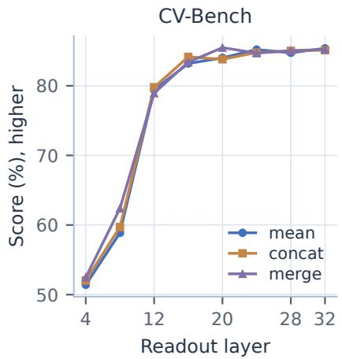

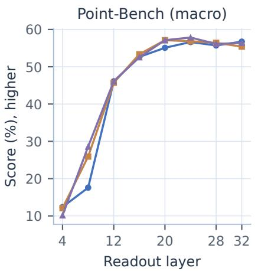

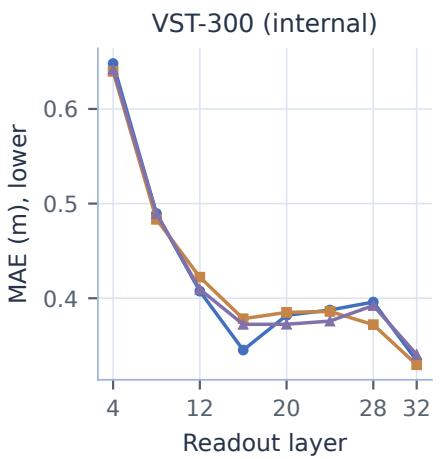  
Figure 4. The complete $8 \times 3$ depth/aggregation experiment, shown on three representative metrics. Early visual readouts are inadequate, while later layers exhibit task-dependent rather than monotonic gains. All 24 models’ benchmark values are provided in Section E.3.

What depth contributes. At L4, mean obtains 51.41 CV-Bench and 4.50 RefSpatial; at L12 these rise to 79.42 and 37.00, and at L32 to 85.38 and 51.00. Substantial contextual processing is therefore necessary before the pretrained query and key projections provide an efective spatial readout. Yet the optimum is task-dependent. L28 mean reaches 53.00 RefSpatial, L24 concat reaches 68.07 Where2Place, and L28 merge reaches 67.21 RoboSpatial pointing. Length error is also nonmonotonic: L16 mean already achieves 0.3452 m, worsening through L20–L28 before recovering to 0.3341 m at L32. A high shallow-layer score on one task, such as RoboSpatial VQA, coexists with weak geometric localization.

Why keep L32 mean. At L32, concat has slightly lower MAE than mean (0.3297 versus 0.3341 m) and better MMSI (28.90 versus 27.70), but lower SAT, RoboSpatial VQA, BLINK, and Point-Bench. Merge improves two placement-oriented point scores relative to mean, while reducing several choice scores and worsening MAE. Mean preserves all pretrained head subspaces without a sharper fixed logit scale or weightspace averaging. We retain L32 mean as a balanced default with full contextual depth.

Late-layer fusion. Equal-weight late-layer fusion tests whether task-specific strengths can be combined without adding projections. For $\mathcal { S } \in \{ \{ 3 2 , 2 8 \} $ , {32, 24}, {32, 28, 24}},

$$
z _ { i } = | S | ^ { - 1 } \sum _ { \ell \in S } z _ { i } ^ { ( \ell ) } .\tag{21}
$$

Table 14. Equal-weight native Q/K layer fusion. Each fusion is trained independently; L32 is re-evaluated with the same evaluator. Point-Bench uses the five-category macro average.
<table><tr><td>Metric</td><td>L32</td><td>+L28</td><td>+L24</td><td>+L28+L24</td></tr><tr><td>SAT real</td><td>78.00</td><td>75.33</td><td>76.33</td><td>78.67</td></tr><tr><td>CV-Bench</td><td>85.31</td><td>84.66</td><td>83.46</td><td>85.31</td></tr><tr><td>RoboSpatial VQA</td><td>68.06</td><td>67.18</td><td>66.70</td><td>65.62</td></tr><tr><td>BLINK val</td><td>63.04</td><td>62.25</td><td>63.37</td><td>62.03</td></tr><tr><td>MMSI-Bench</td><td>27.80</td><td>27.00</td><td>27.00</td><td>27.70</td></tr><tr><td>RefSpatial</td><td>51.00</td><td>47.50</td><td>50.00</td><td>48.00</td></tr><tr><td>Where2Place</td><td>59.98</td><td>65.98</td><td>63.02</td><td>62.97</td></tr><tr><td>RoboSpatial pointing</td><td>62.30</td><td>60.66</td><td>60.66</td><td>63.11</td></tr><tr><td>Point-Bench (macro)</td><td>56.84</td><td>56.53</td><td>55.90</td><td>57.25</td></tr><tr><td>VST-300 MAE (m)</td><td>0.3344</td><td>0.3875</td><td>0.3993</td><td>0.3550</td></tr></table>

An intermediate layer is executed normally in the backbone, while its existing input norm and Q/K weights also score candidates at that boundary. Only the final fused logits receive CE. Intermediate weights keep their backbone learning rate; the L32 readout retains its readout rate. There are no trainable fusion gates, new parameter copies, or auxiliary losses. The L32-only checkpoint is reevaluated with the same program as the three newly trained fusions.

Table 14 shows complementary information but incomplete transfer. L32+L28 raises Where2Place from 59.98 to 65.98, yet length MAE worsens from 0.3344 to 0.3875 m. All three fusions worsen MAE; the three-layer variant also reduces RoboSpatial VQA from 68.06 to 65.62. Thus late-layer averaging does not consistently combine the individual layers’ strengths under a single loss. The final model retains one readout layer, leaving task-conditioned or learned fusion as untested alternatives.

Complete sweep results. Each depth retains the original layers before the selected full-attention layer and that layer’s native Q/K readout. All retained language parameters are trained. L32 mean is reused from the aligned study, and 23 configurations are newly trained.

Table 15. Complete depth/readout sweep: classification metrics. Every model uses the same QA budget and aligned recipe. The retained parameter count varies with depth. Point-Bench is macro.
<table><tr><td>Readout</td><td>SAT</td><td>CV</td><td>Robo VQA</td><td>BLINK</td><td>MMSI</td></tr><tr><td>L4 mean</td><td>52.67</td><td>51.41</td><td>72.32</td><td>40.34</td><td>27.00</td></tr><tr><td>L4 concat</td><td>49.67</td><td>52.02</td><td>64.51</td><td>41.46</td><td>26.30</td></tr><tr><td>L4 merge</td><td>49.67</td><td>52.48</td><td>71.03</td><td>41.24</td><td>28.30</td></tr><tr><td>L8 mean</td><td>49.67</td><td>58.87</td><td>66.07</td><td>41.37</td><td>25.10</td></tr><tr><td>L8 concat</td><td>53.33</td><td>59.71</td><td>50.38</td><td>39.58</td><td>26.20</td></tr><tr><td>L8 merge</td><td>52.33</td><td>62.39</td><td>73.61</td><td>40.65</td><td>24.50</td></tr><tr><td>L12 mean</td><td>61.33</td><td>79.42</td><td>51.87</td><td>49.49</td><td>28.00</td></tr><tr><td>L12 concat</td><td>54.00</td><td>79.79</td><td>66.20</td><td>51.95</td><td>25.70</td></tr><tr><td>L12 merge</td><td>56.33</td><td>78.93</td><td>67.49</td><td>52.56</td><td>25.80</td></tr><tr><td>L16 mean</td><td>74.33</td><td>83.20</td><td>63.79</td><td>54.96</td><td>27.40</td></tr><tr><td>L16 concat</td><td>76.00</td><td>84.15</td><td>59.78</td><td>56.52</td><td>26.00</td></tr><tr><td>L16 merge</td><td>70.67</td><td>83.40</td><td>65.82</td><td>57.98</td><td>27.00</td></tr><tr><td>L20 mean</td><td>77.67</td><td>84.01</td><td>64.00</td><td>61.97</td><td>27.00</td></tr><tr><td>L20 concat</td><td>76.00</td><td>83.81</td><td>64.94</td><td>62.60</td><td>26.50</td></tr><tr><td>L20 merge</td><td>74.00</td><td>85.48</td><td>68.75</td><td>61.24</td><td>28.60</td></tr><tr><td>L24 mean</td><td>76.33</td><td>85.20</td><td>61.41</td><td>59.98</td><td>25.90</td></tr><tr><td>L24 concat</td><td>68.67</td><td>84.77</td><td>65.62</td><td>59.12</td><td>29.30</td></tr><tr><td>L24 merge</td><td>79.00</td><td>84.69</td><td>63.59</td><td>64.29</td><td>27.30</td></tr><tr><td>L28 mean</td><td>72.33</td><td>84.74</td><td>65.96</td><td>59.98</td><td>26.20</td></tr><tr><td>L28 concat</td><td>75.00</td><td>85.02</td><td>66.56</td><td>62.63</td><td>28.00</td></tr><tr><td>L28 merge</td><td>74.67</td><td>85.03</td><td>67.79</td><td>61.58</td><td>26.50</td></tr><tr><td>L32 mean</td><td>78.00</td><td>85.38</td><td>68.06</td><td>63.04</td><td>27.70</td></tr><tr><td>L32 concat</td><td>75.67</td><td>85.12</td><td>66.84</td><td>62.69</td><td>28.90</td></tr><tr><td>L32 merge</td><td>72.00</td><td>85.22</td><td>65.27</td><td>61.97</td><td>27.10</td></tr></table>

Table 16. Complete depth/readout sweep: pointing metrics. Every model uses the same QA budget and aligned recipe. The retained parameter count varies with depth. Point-Bench is macro.
<table><tr><td>Readout</td><td>RefSpatial</td><td>W2P</td><td>Robo point</td><td>PB macro</td><td>MAE (m)</td></tr><tr><td>L4 mean</td><td>4.50</td><td>13.96</td><td>4.10</td><td>12.38</td><td>0.6480</td></tr><tr><td>L4 concat</td><td>3.00</td><td>13.96</td><td>4.92</td><td>12.07</td><td>0.6397</td></tr><tr><td>L4 merge</td><td>6.50</td><td>12.96</td><td>5.74</td><td>10.15</td><td>0.6417</td></tr><tr><td>L8 mean</td><td>7.00</td><td>14.95</td><td>17.21</td><td>17.58</td><td>0.4895</td></tr><tr><td>L8 concat</td><td>15.00</td><td>29.93</td><td>28.69</td><td>25.92</td><td>0.4833</td></tr><tr><td>L8 merge</td><td>16.00</td><td>33.91</td><td>31.15</td><td>28.58</td><td>0.4894</td></tr><tr><td>L12 mean</td><td>37.00</td><td>61.01</td><td>50.82</td><td>46.10</td><td>0.4074</td></tr><tr><td>L12 concat</td><td>36.00</td><td>63.94</td><td>54.10</td><td>45.70</td><td>0.4223</td></tr><tr><td>L12 merge</td><td>35.00</td><td>63.01</td><td>59.84</td><td>46.10</td><td>0.4094</td></tr><tr><td>L16 mean</td><td>45.50</td><td>65.00</td><td>64.75</td><td>52.63</td><td>0.3452</td></tr><tr><td>L16 concat</td><td>47.00</td><td>68.00</td><td>62.30</td><td>53.36</td><td>0.3784</td></tr><tr><td>L16 merge</td><td>44.50</td><td>62.01</td><td>63.11</td><td>52.55</td><td>0.3724</td></tr><tr><td>L20 mean</td><td>46.00</td><td>65.02</td><td>65.57</td><td>55.09</td><td>0.3820</td></tr><tr><td>L20 concat</td><td>48.50</td><td>65.08</td><td>62.30</td><td>57.12</td><td>0.3851</td></tr><tr><td>L20 merge</td><td>47.00</td><td>63.89</td><td>64.75</td><td>57.13</td><td>0.3725</td></tr><tr><td>L24 mean</td><td>48.00</td><td>64.02</td><td>64.75</td><td>56.62</td><td>0.3876</td></tr><tr><td>L24 concat</td><td>49.50</td><td>68.07</td><td>66.39</td><td>56.84</td><td>0.3861</td></tr><tr><td>L24 merge</td><td>46.50</td><td>64.95</td><td>63.11</td><td>57.85</td><td>0.3759</td></tr><tr><td>L28 mean</td><td>53.00</td><td>63.98</td><td>66.39</td><td>55.71</td><td>0.3960</td></tr><tr><td>L28 concat</td><td>49.50</td><td>64.98</td><td>63.93</td><td>56.41</td><td>0.3721</td></tr><tr><td>L28 merge</td><td>46.00</td><td>64.01</td><td>67.21</td><td>56.11</td><td>0.3923</td></tr><tr><td>L32 mean</td><td>51.00</td><td>59.98</td><td>62.30</td><td>56.74</td><td>0.3341</td></tr><tr><td>L32 concat</td><td>51.00</td><td>60.05</td><td>61.48</td><td>55.39</td><td>0.3297</td></tr><tr><td>L32 merge</td><td>50.00</td><td>63.06</td><td>63.93</td><td>56.40</td><td>0.3405</td></tr></table>

## E.4 Head Activity, Redundancy, and Causal Interventions

We analyze the crop-trained L32 mean checkpoint without retraining. At every decision node, the captured 16 per-head candidate-logit vectors are checked to average back to the original readout. Three statistics answer diferent questions. Centered RMS measures how strongly a head distinguishes candidates; its normalized share measures relative response magnitude; and removing the head measures its efect on predictions and

quality. For head h and K legal candidates,

$$
A _ { h } = \sqrt { \frac { 1 } { K } \sum _ { i } ( s _ { h , i } - \bar { s } _ { h } ) ^ { 2 } } , \qquad z _ { - h , i } = z _ { \mathrm { a l l , i } } - \frac { s _ { h , i } } { 1 6 } .\tag{22}
$$

Centering removes candidate-independent ofsets. The removal denominator stays 16, so the intervention does not amplify the remaining heads. Each of 17 conditions—all heads plus 16 removals—follows its own numerical and crop trajectory. Shared forward results are reused only when inputs and histories are identical. Counting interventions reconstruct their own root-pruned maps from a captured full tree.

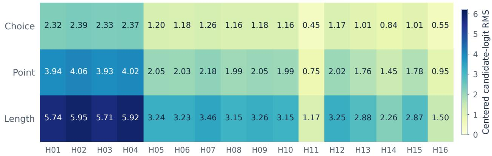  
Figure 5. Centered candidate-logit RMS for each head, averaged per QA along the all-head trajectory. Values share a common scale and measure response amplitude. H02 is strongest and H11 weakest in all three task groups.

Head amplitudes follow a similar ordering across tasks. H02 has RMS 2.394, 4.065, and 5.954 for choice, point, and length; H11 has 0.447, 0.750, and 1.168, about 18–20% of the strongest head. Centered pairwise headlogit cosine averages are 0.994163, 0.999331, and 0.998055, with minimum pair averages 0.985885, 0.997355, and 0.991673. The readout heads largely agree on candidate direction while difering in amplitude, which is more consistent with redundancy than clear task-specific head specialization.

Single removals nevertheless change some complete paths. The largest classification benchmark change is 0.20 points; Point-Bench can decrease by 0.5092 points; length MAE changes from −0.003992 to +0.000279 m. No head meets the predeclared near-zero screen: small score efect (at most 0.5 points per benchmark, or 1% of length MAE), at most 1% prediction changes in each task group, and at most 1% response share. The final model therefore retains all heads. Single-head masking can change the logit scale used by thresholded counting maps; joint head pruning was not evaluated.

Complete intervention results. For ordinary multi-stage QA, node statistics are averaged across the allhead predicted path. Counting nodes use parent probability mass weights over the visited tree, normalized per question; questions then receive equal weight. The absolute RMS is computed before this aggregation. Relative response shares are normalized within each node, so normalizing the final mean RMS would produce a diferent statistic.

Task-summary score efects average benchmark scores equally, whereas RMS, response shares, and predictionchange rates average individual QA.

Table 17. All 16 single-head interventions. Positive efect means retaining the head helps: full-minus-masked score, or masked-minus-full length MAE. Classification/pointing efects are benchmark-equal diagnostic means; RMS values average per question.
<table><tr><td>Head</td><td>Class RMS</td><td>Point RMS</td><td>Length RMS</td><td>Class ∆ pp</td><td>Point△pp</td><td>Length∆ m</td></tr><tr><td>H01</td><td>2.324</td><td>3.938</td><td>5.742</td><td>-0.011</td><td>+0.127</td><td>+0.000000</td></tr><tr><td>H02</td><td>2.394</td><td>4.065</td><td>5.954</td><td>+0.009</td><td>+0.127</td><td>+0.000000</td></tr><tr><td>H03</td><td>2.328</td><td>3.932</td><td>5.708</td><td>+0.020</td><td>+0.127</td><td>+0.000000</td></tr><tr><td>H04</td><td>2.368</td><td>4.022</td><td>5.917</td><td>+0.009</td><td>+0.127</td><td>+0.000279</td></tr><tr><td>H05</td><td>1.202</td><td>2.055</td><td>3.236</td><td>+0.050</td><td>+0.102</td><td>-0.000346</td></tr><tr><td>H06</td><td>1.180</td><td>2.032</td><td>3.232</td><td>+0.002</td><td>+0.102</td><td>-0.003992</td></tr><tr><td>H07</td><td>1.264</td><td>2.176</td><td>3.463</td><td>+0.002</td><td>+0.127</td><td>-0.000346</td></tr><tr><td>H08</td><td>1.156</td><td>1.986</td><td>3.154</td><td>+0.030</td><td>+0.102</td><td>-0.003646</td></tr><tr><td>H09</td><td>1.183</td><td>2.050</td><td>3.258</td><td>+0.009</td><td>+0.076</td><td>-0.000067</td></tr><tr><td>H10</td><td>1.159</td><td>1.989</td><td>3.154</td><td>+0.012</td><td>+0.102</td><td>-0.003646</td></tr><tr><td>H11</td><td>0.447</td><td>0.750</td><td>1.168</td><td>+0.051</td><td>+0.000</td><td>-0.003646</td></tr><tr><td>H12</td><td>1.167</td><td>2.016</td><td>3.250</td><td>-0.011</td><td>+0.102</td><td>-0.000346</td></tr><tr><td>H13</td><td>1.010</td><td>1.765</td><td>2.883</td><td>-0.039</td><td>+0.102</td><td>+0.000182</td></tr><tr><td>H14</td><td>0.841</td><td>1.448</td><td>2.258</td><td>-0.018</td><td>+0.102</td><td>-0.003809</td></tr><tr><td>H15</td><td>1.011</td><td>1.779</td><td>2.873</td><td>-0.034</td><td>+0.102</td><td>-0.003992</td></tr><tr><td>H16</td><td>0.551</td><td>0.949</td><td>1.504</td><td>+0.002</td><td>+0.051</td><td>-0.000346</td></tr></table>

## F Extended Spatial Refinement Studies

## F.1 Visual Refinement: New Pixels, Replayed Features, or Direct Tokens?

Hierarchical point classification must preserve enough visual detail to distinguish increasingly small regions. We therefore separate three questions: whether crop-trained weights can operate without crops, whether matching training to a cheaper visual input recovers quality, and whether spatial candidates should be text regions or visual tokens. All learned variants start from the same oficial Qwen base. Training QA, updates, optimizer, and per-QA loss normalization are held fixed; visual computation is an intended variable, so the runs do not have equal FLOPs.

Removing crops from fixed weights. The inference-only intervention keeps three nine-way textual decisions but removes both appended pixel crops. RefSpatial drops from 51.00 to 9.00, Where2Place from 59.98 to 32.00, and RoboSpatial pointing from 62.30 to 20.49 (Table 18). Adding an original-image hybrid prefix cache leaves these aggregate scores unchanged. The immediate loss is therefore not repaired by reusing the original context more eficiently. However, this comparison changes both visual detail and the input distribution seen during training; it cannot determine the potential of a separately trained no-crop model.

Table 18. Fixed crop-trained native-mean checkpoint: removing new pixel crops, with and without a reusable originalimage prefix. All three textual grid rounds remain. The crop control was not timed in this run.
<table><tr><td>Metric</td><td>Crop</td><td>Original only</td><td>Original + cache</td></tr><tr><td>RefSpatial (%)</td><td>51.00</td><td>9.00</td><td>9.00</td></tr><tr><td>Where2Place (%)</td><td>59.98</td><td>32.00</td><td>32.00</td></tr><tr><td>RoboSpatial pointing (%)</td><td>62.30</td><td>20.49</td><td>20.49</td></tr><tr><td>Point-Bench macro (%)</td><td>56.84</td><td>21.96</td><td>21.96</td></tr><tr><td>Counting success (%)</td><td>39.29</td><td>4.08</td><td>4.08</td></tr><tr><td>Count MAE</td><td>1.7296</td><td>4.0459</td><td>4.0561</td></tr><tr><td>Single-point time (s/question)</td><td></td><td>0.1519</td><td>0.2910</td></tr><tr><td>Counting time (s/question)</td><td></td><td>1.8144</td><td>1.5608</td></tr></table>

Matched training with original-image context. The original-image variant removes crop placeholders during training as well as inference, while retaining the selected rectangle and region options in text. Training still has three supervised decisions per pointing QA, and choice/scalar token sequences and targets remain unchanged. RefSpatial recovers to 46.50 and Point-Bench macro to 52.55 (Table 5). This recovery shows that much of the inference-only collapse is an input-distribution mismatch. The remaining gap to crop reencoding suggests that original-image context and region text do not fully replace newly resolved local visual information in this setting.

ROI feature replay. The next variant encodes the original pixels once per forward and appends existing merged visual tokens whose spatial supports have positive overlap with the selected ROI. Tokens retain rowmajor source order and their original multimodal rotary positions; there is no interpolation to a new fixed grid. This exposes region-focused representations without new pixel encoding. Boundary tokens may still include content outside the ROI, and copying cannot recover detail absent from the first visual tokenization.

ROI attention K/V replay. A second replay variant appends the same visual tokens but replaces their keys and values in complete full-attention layers L4–L28 with diferentiably gathered K/V from original-image positions after rotary encoding. Queries, gates, residuals, and FFNs execute normally. Source K/V remain in the current computation graph, and the original-image prefix precedes all question histories.

The matched comparison is reported in Table 5. Neither replay scheme closes the overall gap to crop reencoding. ViT replay reaches 47.00 RefSpatial and 52.87 Point-Bench, only slightly above matched originalimage training. KV replay improves Where2Place to 68.95 but decreases RoboSpatial pointing to 54.92 and increases length MAE to 0.4097 m. Choice and numerical scores also change despite identical non-point inputs, consistent with interactions through the jointly trained backbone. These outcomes support crop re-encoding as the final common representation.

Direct visual-token candidates. We train two further models, KEV and native mean, whose point candidates are the original image’s merged visual tokens in the language sequence. The query is the questionend decision state; keys use the same language-side projections as their respective readout. Let $H ^ { \prime } = H / s$ and $W ^ { \prime } = W / s$ denote the dimensions of the merged visual-token grid; each cell is a candidate. Cell (r, c) decodes to $( ( c + 1 / 2 ) / W ^ { \prime } , ( r + 1 / 2 ) / H ^ { \prime } )$ in original normalized coordinates.

Point training uses one decision. Ground-truth points are mapped to occupied cells by floor-and-clamp, with equal target mass across distinct occupied cells. Repeated points in one cell do not multiply its weight, and target masks do not enlarge the positive set. This preserves one unit of loss per QA while changing both the spatial representation and number of stages. The one-pass method removes crop encoding, but its grid resolution depends on image aspect ratio and token budget; it cannot resolve two instances that share the same visual cell.

Table 19. Direct visual-token pointing with KEV (K) or native mean (N). Each model shares weights/logits across argmax, components, and task-based decoding. Task routing was specified after the first decoding experiment; Point-Bench is macro.
<table><tr><td>Metric</td><td>K argmax</td><td>K comp.</td><td>Ktask</td><td>N argmax</td><td>N comp.</td><td>N task</td></tr><tr><td>RefSpatial</td><td>38.50</td><td>35.14</td><td>38.50</td><td>45.50</td><td>43.65</td><td>45.50</td></tr><tr><td>Where2Place</td><td>67.96</td><td>64.43</td><td>64.43</td><td>60.91</td><td>58.99</td><td>58.99</td></tr><tr><td>RoboSpatial pointing</td><td>56.56</td><td>57.38</td><td>57.38</td><td>60.66</td><td>63.11</td><td>63.11</td></tr><tr><td>Point-Bench (macro)</td><td>46.46</td><td>26.81</td><td>49.12</td><td>50.76</td><td>32.71</td><td>54.63</td></tr><tr><td>PB counting</td><td>13.27</td><td>26.53</td><td>26.53</td><td>12.76</td><td>32.14</td><td>32.14</td></tr></table>

We decode each saved visual-logit grid with global argmax, global connected components, and a task-based rule. The latter uses argmax for RefSpatial and non-counting Point-Bench, and components for Where2Place, RoboSpatial, and counting. The rule was specified after the first decoder comparison; all three columns for a model share weights and logits, with no extra training or forward passes for the task-based recombination. The decoder ablation explains why a universal multi-point policy is unsuitable (Table 19). For native visual tokens, components improve counting from 12.76 to 32.14 but reduce overall Point-Bench macro from 50.76 to

Table 20. Visual-token pointing versus hierarchical crop pointing. Visual-token results use task-based single/multiplepoint routing established after the initial decoding experiment. This routing difers from the grid baseline on Where2Place and RoboSpatial; it is an exploratory comparison.
<table><tr><td>Metric</td><td>KEV grid</td><td>KEV visual</td><td>Mean grid</td><td>Mean visual</td></tr><tr><td>SAT real</td><td>76.33</td><td>76.67</td><td>78.00</td><td>77.00</td></tr><tr><td>CV-Bench</td><td>85.31</td><td>83.95</td><td>85.38</td><td>84.52</td></tr><tr><td>RoboSpatial VQA</td><td>68.54</td><td>64.32</td><td>68.06</td><td>62.50</td></tr><tr><td>BLINK val</td><td>62.99</td><td>63.87</td><td>63.04</td><td>62.76</td></tr><tr><td>MMSI-Bench</td><td>25.10</td><td>25.50</td><td>27.70</td><td>30.20</td></tr><tr><td>RefSpatial</td><td>46.00</td><td>38.50</td><td>51.00</td><td>45.50</td></tr><tr><td>Where2Place</td><td>61.02</td><td>64.43</td><td>59.98</td><td>58.99</td></tr><tr><td>RoboSpatial pointing</td><td>63.11</td><td>57.38</td><td>62.30</td><td>63.11</td></tr><tr><td>Point-Bench (macro)</td><td>57.33</td><td>49.12</td><td>56.74</td><td>54.63</td></tr><tr><td>VST-300 MAE (m)</td><td>0.3614</td><td>0.3350</td><td>0.3341</td><td>0.3614</td></tr></table>

32.71: extra peaks harm tasks that expect one point. Task-based routing restores the single-point categories and reaches 54.63. It still trails hierarchical mean on RefSpatial (45.50 versus 51.00) and Point-Bench (54.63 versus 56.74). Cross-task efects also difer between KEV and native readouts (Table 20); for example, native visual-token training improves MMSI but worsens length MAE. The experiments favor retaining hierarchical crops for the final model.

## F.2 Multi-Point Decoding: Probability Trees versus Stop Decisions

The first counting extension repeatedly asks a continue/stop choice and, when continuing, invokes single-point prediction with the already selected coordinates in the prompt. This composes existing interfaces without training on exhaustive point-set completion. It relies on coverage and stopping behavior from a model trained primarily on single targets. On all 196 Point-Bench counting questions, it reaches 19.39% oficial success and count MAE 11.64. A small set of long overproduced sequences inflates the mean predicted count to 10.48 even though many other examples undercount.

Table 21. Point-Bench counting: all 196 questions, fixed L32 mean weights, no retraining. Full/pruned are an actua paired run; historical continue/stop quality uses a diferent execution setting and has no comparable timing here.
<table><tr><td>Metric</td><td>Continue/stop</td><td>Full tree</td><td>Root-pruned</td></tr><tr><td>Official success (%)</td><td>19.39</td><td>38.78</td><td>38.78</td></tr><tr><td>Exact count (%)</td><td>22.45</td><td>46.43</td><td>46.43</td></tr><tr><td>Count MAE</td><td>11.643</td><td>1.735</td><td>1.740</td></tr><tr><td>Predicted points</td><td>10.485</td><td>3.342</td><td>3.337</td></tr><tr><td>Decision nodes</td><td></td><td>91.00</td><td>51.10</td></tr><tr><td>Evaluated cells</td><td></td><td>729.00</td><td>405.83</td></tr><tr><td>Omitted mass (%)</td><td></td><td>0.000</td><td>0.588</td></tr><tr><td>Seconds / question</td><td></td><td>4.716</td><td>2.638</td></tr></table>

The probability-tree alternative in Section 3.1 measures the spatial mass of all potential paths and extracts components without a learned stop query. Both full and root-pruned trees reach 38.78% success and 46.43% exact-count accuracy in the dedicated paired experiment (Table 21). Root pruning reduces mean node count from 91 to 51.10, a 43.84% reduction, while omitting only 0.588% probability mass on average. Measured per-question time decreases from 4.716 to 2.638 seconds, a 1.79× ratio under this execution setup.

The two modes are separately executed, alternate order by question index, and use untimed warmup, batches of 16 nodes, eight GPUs, visual deduplication, and no shared language prefix. Timings include processing and GPU computation but exclude loading, warmup, and saving. Predicted counts agree on 195/196 questions and success on all 196. Shadow pruning of the saved full-tree logits changes no counts; the one count discrepancy in the actual paired runs is therefore associated with changed numerical execution rather than omitting a root region alone. The later consolidated benchmark rerun has slightly diferent full-tree scores and timings; its own values are retained in the overall matrix instead of replacing this paired control.

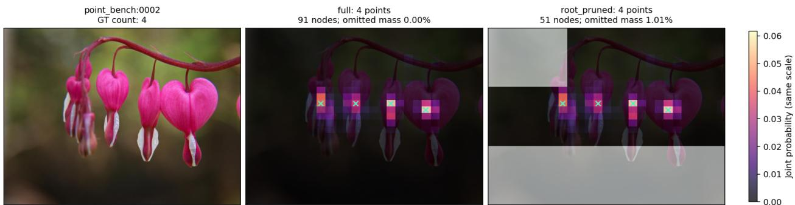  
Figure 6. Probability-tree example from the first request in the preselected 12-case gallery. Full expansion uses 91 nodes; root pruning uses 51 and marks unvisited regions in gray. Both return four points in this case. Example from Point-Bench (Cheng et al., 2025).

Table 22 reports fixed 5%, 10%, and 20% peak-threshold sensitivity. Success is 30.10, 38.78, and 37.24%, respectively, for both modes in this record. The original 10% threshold remains the primary rule; the sensitivity table demonstrates that point-set quality depends on map postprocessing as well as candidate accuracy. The author scorer requires exact count and every predicted point inside the union mask, which does not by itself certify one prediction per object instance.

Table 22. Ofline component-threshold sensitivity on the retained maps. Success and exact-count columns are percentages. The primary threshold is fixed at 10%.
<table><tr><td>Peak threshold</td><td>Full success</td><td>Pruned success</td><td>Full count</td><td>Pruned count</td><td>Full MAE</td><td>Pruned MAE</td></tr><tr><td>5%</td><td>30.10</td><td>30.10</td><td>34.69</td><td>34.69</td><td>2.041</td><td>2.041</td></tr><tr><td>10%</td><td>38.78</td><td>38.78</td><td>46.43</td><td>46.43</td><td>1.735</td><td>1.740</td></tr><tr><td>20%</td><td>37.24</td><td>37.24</td><td>43.88</td><td>43.88</td><td>1.765</td><td>1.760</td></tr></table>

## G Extended Numerical Studies

## G.1 Numerical Design: Coverage, Granularity, and Decoding

Numerical discretization has two sources of error: representing a true value with a finite cell center, and predicting the correct cell from the image. The following experiments measure these separately. Codebook candidates are designed from training labels, and the $4 / 8$ codebook below is used for the final model. All learned comparisons, however, retain the old 72K-QA gradient-training budget, including only 22K length examples.

Coverage comes before precision. The historical codebook has 12 positive intervals ending at 200 m, two special roots, and 32 fine cells per positive interval. It covers all old 72K length labels but overflows on 12K expanded-corpus labels. The scale audit compares uniform, log, quantile, task-specific, and hierarchical allocations on all 1.6M accepted lengths (Table 25). These are label encode/decode oracles, assuming every classification decision is correct.

Uniform 960-cell spacing up to 16,384 m gives MAE 6.4545 m because most labels are short. Quantile spacing improves the proportion within 1 cm to 80.78%, yet produces MAE 4.2371 m and maximum error 3935.55 m: a dense central distribution leaves the sparse tail poorly represented. Shared log allocations balance these scales more efectively. The 30-by-32 two-stage log1p proposal reaches 0.0391 m oracle MAE and 21.39 m maximum error, compared with 1.6548 and 8320.10 m for the historical codebook. Task-specific log allocation ofers a small average improvement but introduces question-type routing and poorly supported rare categories (e.g., only five diameter and four thickness labels). We therefore keep a shared length codebook and the existing linear within-interval decoder.

Testing the 30-by-32 proposal as a model. A new L32 mean model uses 30 positive log1p intervals and 32 fine cells per interval (960 leaves), preserving all other 72K settings and the exact non-numerical stage texts and mappings. On those training labels, oracle MAE falls from 0.006591 to 0.003891 m and P99 error from 0.045625 to 0.023542 m, but worst-case error rises from 0.7475 to 0.9800 m. The new numerical candidate text adds 527.43 tokens on average; the longest checked scalar sequence is 2,068 tokens, within the 4,096-token budget. Coverage and average quantization improve at a real input-cost increase.

The learned model reduces VST-300 MAE from 0.335420 to 0.327732 m, only 2.29%, and lowers all five classification benchmark scores. The much larger oracle gain does not translate directly into prediction accuracy. This motivates reducing fine-stage dificulty rather than adding still more representational resolution.

Reducing the fine-stage candidate count. The 4/8 design in Equation (3) keeps the same coarse intervals and range but reduces positive leaves from 960 to 216. In the full length census, 108K positive labels use four fine candidates, 1.5M use eight, and 382 terminate at zero. Both the 32-fine and 4/8 representations meet the specified max(1 cm, 5% y) oracle tolerance on every audited label, with no overflow. Coarser cells increase oracle MAE from 0.039102 to 0.154041 m and maximum error from 21.39 to 59.55 m. The 4/8 codebook exchanges quantization resolution for a smaller candidate set.

A second independently initialized model changes only these fine cardinalities. Choice, point, count, and angle implementations remain fixed; no length batching optimization is introduced in this quality comparison. The estimated scalar sequence length is bounded by 1,514 tokens. Training takes 1,369.33 seconds versus 1,604.98 for the prior 30-by-32 run under their recorded timing scopes. The shorter candidate representation is consistent with lower work, although these single-run training times are not a dedicated timing ablation.

The learned length errors are reported in Table 23.

Table 23. Fixed internal length diagnostic. 4/8 argmax is the decoder used by MJev-Spatial; 4/8 exp. decodes the same logits with a fine-stage conditional expectation. Coarse decoding is argmax in every condition.
<table><tr><td>VST-300 diagnostic</td><td>Historical</td><td> $3 0 \times 3 2$ </td><td>4/8 argmax</td><td>4/8 exp.</td></tr><tr><td>MAE (m), lower</td><td>0.335420</td><td>0.327732</td><td>0.320207</td><td>0.329955</td></tr><tr><td>AbsRel (%), lower</td><td>24.64</td><td>31.04</td><td>29.03</td><td>30.04</td></tr><tr><td> $| e | \le 0 . 1$  m (%), higher</td><td>56.67</td><td>58.33</td><td>59.00</td><td>55.67</td></tr><tr><td> $| e | / y \le 2 5 \%$  (%), higher</td><td>69.46</td><td>69.46</td><td>68.12</td><td>70.81</td></tr></table>

Table 24. Length-codebook ablation, independently trained on the same 72K QA. The historical checkpoint is reevaluated within this experiment. All point and choice decoders are unchanged.
<table><tr><td>Metric</td><td>Historical</td><td> $3 0 \times 3 2$   $3 0 \times ( 4 / 8 )$ </td></tr><tr><td>SAT real</td><td>78.00</td><td>72.33 80.67</td></tr><tr><td>CV-Bench</td><td>85.39</td><td>85.08 85.21</td></tr><tr><td>RoboSpatial VQA</td><td>68.06</td><td>64.87 66.30</td></tr><tr><td>BLINK val</td><td>63.10</td><td>60.94 62.52</td></tr><tr><td>MMSI-Bench</td><td>27.70</td><td>25.40 27.60</td></tr><tr><td>RefSpatial</td><td>51.00</td><td>49.50 52.00</td></tr><tr><td>Where2Place</td><td>59.98</td><td>61.96 65.02</td></tr><tr><td>RoboSpatial pointing</td><td>62.30</td><td>60.66 63.93</td></tr><tr><td>Point-Bench (macro)</td><td>56.74</td><td>56.83 57.14</td></tr><tr><td>VST-300 MAE (m)</td><td>0.3354</td><td>0.3277 0.3202</td></tr></table>

The $4 / 8$ argmax model achieves MAE 0.320207 m, 4.54% below the historical control and 2.30% below 30- by-32. Errors within 10 cm increase to 59.00%. All nine public primary scores improve relative to 30-by-32; relative to the historical codebook, SAT and the four pointing scores improve, while four other classification scores remain slightly lower. The historical codebook still has better mean relative error (24.64% versus 29.03%), emphasizing that MAE and relative accuracy favor diferent parts of the value distribution.

Does averaging fine-cell predictions help? Using exactly the same $4 / 8$ checkpoint and saved logits, we compare fine argmax with a temperature-1 conditional expectation,

$$
\hat { y } _ { \mathrm { e x p } } = \sum _ { k = 0 } ^ { F _ { \hat { j } } - 1 } p ( k \mid \hat { j } , I , q ) \left[ e _ { \hat { j } } + \frac { k + 1 / 2 } { F _ { \hat { j } } } ( e _ { \hat { j } + 1 } - e _ { \hat { j } } ) \right] .\tag{23}
$$

The root remains argmax; zero and overflow behavior are unchanged. The expectation decoder raises MAE to 0.329955 m (+3.04%) and reduces 10 cm accuracy to 55.67%, despite improving the 25%-relative-error hit rate to 70.81%. MJev-Spatial therefore decodes lengths with argmax at both stages; the other reported length results and the final model use this decoding rule. All non-length outputs are identical in this same-logit comparison.

Table 25. Training-label reconstruction on all 1.6M lengths, assuming the correct discrete cell is selected. The 960- leaf alternatives difer in allocation; only the hierarchical log1p proposal is tested in the subsequent matched model experiment. Task-specific routing is an unadopted proposal.
<table><tr><td>Representation</td><td>MAE (m)</td><td>P99 (m)</td><td>Max (m)</td><td>≤ 1 cm (%)</td><td>≤ 1% rel.</td></tr><tr><td>Historical 200 m</td><td>1.6548</td><td>1.2384</td><td>8320.10</td><td>59.33</td><td>80.29</td></tr><tr><td>Uniform 960</td><td>6.4545</td><td>8.5012</td><td>8.53</td><td>0.06</td><td>1.12</td></tr><tr><td>Log 384</td><td>0.0939</td><td>1.5758</td><td>43.10</td><td>47.53</td><td>52.36</td></tr><tr><td>Log 960</td><td>0.0379</td><td>0.6371</td><td>47.14</td><td>69.86</td><td>99.92</td></tr><tr><td>Quantile 960</td><td>4.2371</td><td>3.0380</td><td>3935.55</td><td>80.78</td><td>95.50</td></tr><tr><td>Hierarchical log1p 960</td><td>0.0391</td><td>0.6657</td><td>21.39</td><td>69.42</td><td>99.84</td></tr><tr><td>Task-specific log 960</td><td>0.0372</td><td>0.6308</td><td>47.14</td><td>70.93</td><td>99.99</td></tr></table>

Complete reconstruction oracles. The representation comparison includes a 384-cell shared logarithmic control matching the historical positive-cell budget and several 960-cell allocations. The selected hierarchical proposal difers from a globally logarithmic leaf grid: its roots are log1p-spaced, but each root’s fine cells are linear. The actual final 216-cell variant is documented in Sections 3.1 and 4.3. All oracle labels come from the expanded training corpus, not from evaluation targets.

## H Training Efficiency Diagnostics

## H.1 Length Grouping Separates Padding from Rank Imbalance

The final scheduling mechanism is defined in Section C.3. Its performance study holds global batch 256, microbatch 8, four accumulation steps, eight L20D GPUs, the old 72K data/codebook, and the timing instrumentation fixed. Four fresh runs each process 100 updates and 25,600 QA: original order, local length grouping, global grouping with rank balancing, and global balancing with a 128-QA bufer. The last 92 updates contain the same 23,552 measured QA; the first eight are excluded for warmup. The bufer is drained at both measurement boundaries, and slow steps remain in the timing record.

The controlled scheduling results are reported in Table 6.

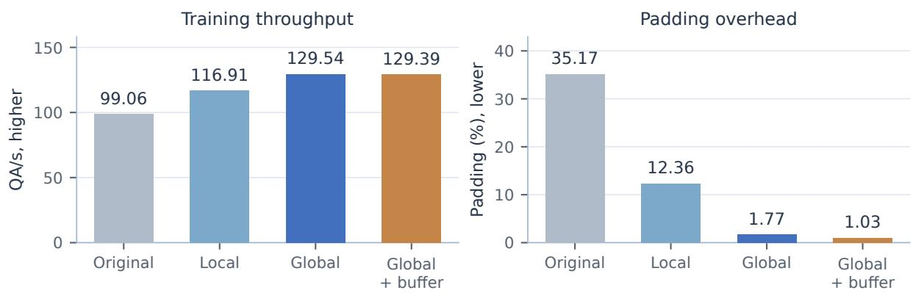  
Figure 7. Controlled scheduling comparison on the historical 72K corpus. Local grouping reduces padding but leaves more rank imbalance; global grouping and balancing deliver the largest throughput gain. A cross-update bufer reduces padding slightly further without increasing throughput.

Local grouping increases throughput from 99.06 to 116.91 QA/s and reduces padding from 35.17% to 12.36%. However, mean gradient-ready spread between ranks increases from 115.0 to 306.6 ms, and tail communication/wait time from 39.5 to 157.6 ms. Minimizing padding independently on each rank can therefore leave unequal workloads at synchronization. Global grouping plus balancing reduces padding to 1.77%, reduces ready-time spread relative to local grouping to 145.7 ms, and reaches 129.54 $\mathrm { Q A } / \mathrm { s } \mathrm { : }$ a 30.78% throughput increase or 23.53% less measured time for equal QA volume. Ready-time spread and tail time remain above the original-order values, so this gain reflects the combined scheduling changes rather than an isolated reduction in synchronization waiting.

The 128-QA bufer lowers padding to 1.03% but achieves 129.39 QA/s. Its step-time coeficient of variation increases from 6.07% to 19.77%; even after aggregating pairs of updates into equal 512-QA units, variation is 6.30% versus 4.61% without the bufer. This identifies diminishing returns from further packing and supports the unbufered final layout. Tail measurements include communication and waiting; no downstream accuracy evaluation is performed in these short runs.

## H.2 Microbatch Feasibility and Global Batch Size

Table 26. Expanded-data memory feasibility. The original six cases use 4,096 warmup and 8,192 measured QA; the additional global384/micro12 trial also fails. Partial timings from failed configurations are excluded. The successful rows are resummarized on a common window in Table 27.

<table><tr><td>Global</td><td>Micro</td><td>Accum.</td><td>Outcome</td><td>s/update</td><td>QA/s</td><td>Peak GB</td></tr><tr><td>256</td><td>8</td><td>4</td><td>Complete</td><td>2.3007</td><td>111.27</td><td>242.03</td></tr><tr><td>512</td><td>8</td><td>8</td><td>Complete</td><td>3.7629</td><td>136.07</td><td>242.05</td></tr><tr><td>256</td><td>16</td><td>2</td><td>OOM</td><td></td><td></td><td></td></tr><tr><td>512</td><td>16</td><td>4</td><td>OOM</td><td></td><td></td><td></td></tr><tr><td>256</td><td>32</td><td>1</td><td>OOM</td><td></td><td></td><td></td></tr><tr><td>512</td><td>32</td><td>2</td><td>OOM</td><td></td><td></td><td></td></tr><tr><td>384</td><td>12</td><td>4</td><td>OOM</td><td></td><td></td><td></td></tr></table>

The expanded-data profile uses a fixed 12,800-QA prefix-stratified pool in the then-proposed $4 0 / 2 5 / 2 5 / 5 / 5$ task mixture, the new 4/8 length codebook, and fresh base initialization. All conditions use global length grouping, rank balancing, no bufer, no activation checkpointing (Chen et al., 2016), and the same precision and optimizer. The original six-case matrix crosses global256/512 with micro8/16/32. Its measurement window follows 4,096 warmup QA and includes 8,192 common timed QA. Only micro8 succeeds: 111.27 QA/s at global256 and 136.07 at global512. Micro16 and micro32 fail in both cases. An additional global384/micro12 trial also fails.

The global256/512/768 profiles use a common window of 4,608 warmup QA followed by 7,680 timed QA. The window has 30, 15, and 10 updates for the three global batches, respectively. Table 27 reports 110.04,

Table 27. New-data profiling with the 4/8 length codebook: a common 7,680-QA window after 4,608 QA warmup. The 12,800-QA pool is a stratified prefix sample, not the natural full-data distribution. Peak is the maximum per-rank allocated GPU memory, in decimal GB. Microbatch 16 and 32 failed with OOM in both original 256/512 conditions.
<table><tr><td>Global</td><td>Micro</td><td>Accum.</td><td>Timed steps</td><td>s/update</td><td>QA/s</td><td>Peak GB</td></tr><tr><td>256</td><td>8</td><td>4</td><td>30</td><td>2.3265</td><td>110.04</td><td>242.03</td></tr><tr><td>512</td><td>8</td><td>8</td><td>15</td><td>3.7791</td><td>135.48</td><td>242.05</td></tr><tr><td>768</td><td>8</td><td>12</td><td>10</td><td>5.4944</td><td>139.78</td><td>242.03</td></tr></table>

135.48, and 139.78 QA/s for these batch sizes. Peak allocated memory is approximately 242 decimal GB per rank for the successful configurations.

The experiment shows that additional accumulation can raise the global batch without increasing the forward microbatch beyond its memory limit. Global768 improves throughput over global512 by 3.17% over ten measured updates. Moreover, all 16 executed global768 updates fall within the zero-backbone-LR period of its short schedule. Backward computation and Adam moment updates still execute during these steps. The final recipe therefore selects global512/micro8/accumulation8.