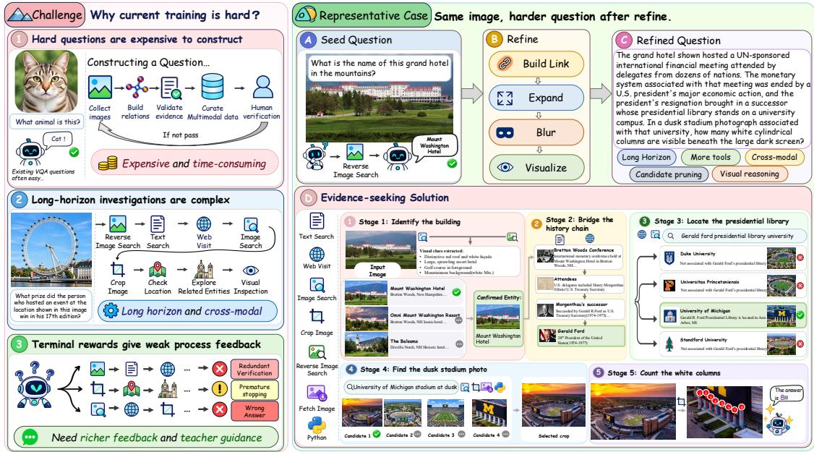
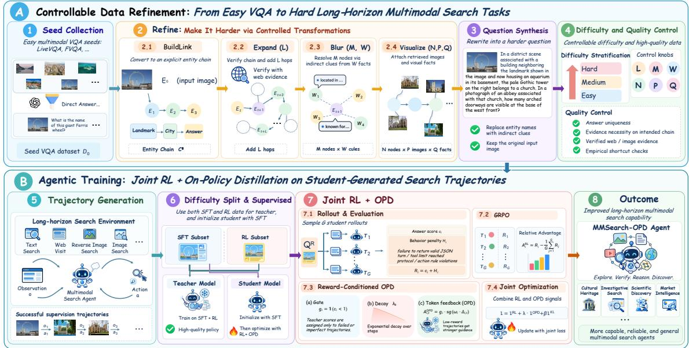
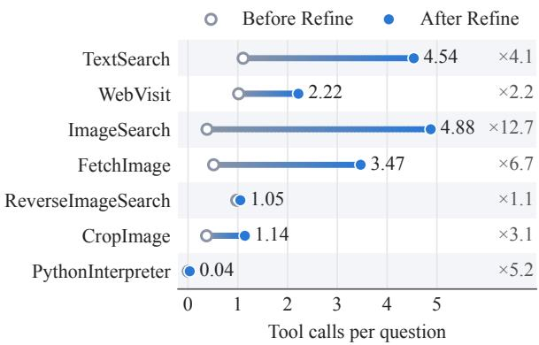
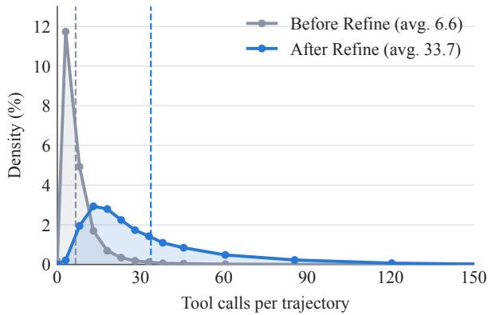
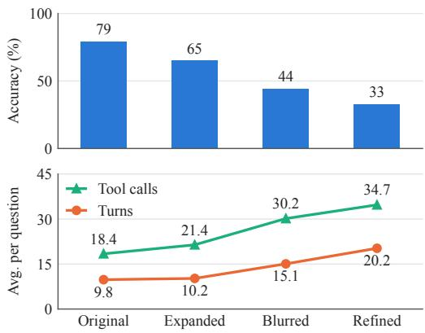
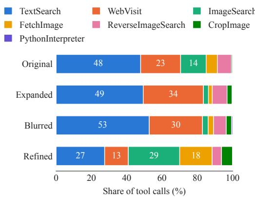
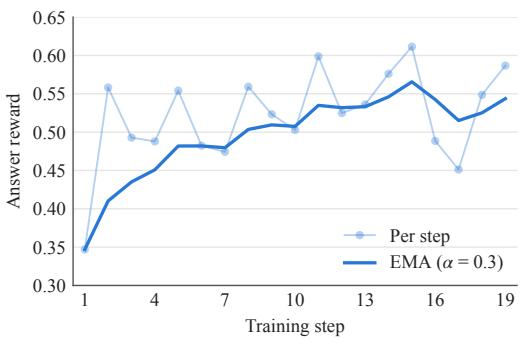
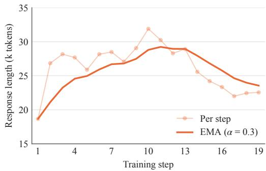

# MMSearch-OPD: Easy Made Hard, Hard Made Learnable for Long-Horizon Multimodal Search Agents

Huanyao Zhang1\*‡ Jiepeng Zhou2\* Jiaye Lin3\* Ontai Tang4

Jingtian Hao1 Mugeng Liu1 Ru Peng5 Lang Mei6

Xiaohan Yu6 Liyan Liu6 Chong Chen6† Wentao Zhang1†

1Peking University 2HKUST(GZ) 3Tsinghua University 4The University of Hong Kong 5Zhejiang University 6Huawei Cloud BU

Equal contribution ‡ Project Leader † Corresponding authors

## Abstract

Multimodal deep search is moving from short queries to long-horizon investigations that continually acquire evidence. However, training such agents remains constrained by limited challenging training questions and insufficient process feedback. We introduce MMSearch-OPD, combining controllable data refinement with joint reinforcement learning (RL) and on-policy distillation (OPD). Our Refine pipeline performs targeted expansion of reasoning chains derived from existing simple multimodal questions. Parameterized transformations control search depth and cross-modal evidence requirements while reusing existing image–question pairs. For training, answer rewards and lightweight behavior penalties guide RL, while the reward gap modulates token-level teacher guidance on imperfect student trajectories. An exponentially decaying distillation coefficient reduces teacher dependence as training proceeds. Experiments show gains from data refinement and further improvements from joint training after SFT, indicating stronger long-horizon multimodal deep search capabilities.

## 1 Introduction

Multimodal deep search agents address knowledgeintensive visual questions through interleaved reasoning and external retrieval (Wu et al., 2025; Geng et al., 2025). Recent advances move toward longhorizon investigation, connecting evidence across webpages and using acquired visual observations to guide subsequent searches (Huang et al., 2026; Du et al., 2026; Zhang et al., 2026b).

Two challenges limit training for this setting. Existing multimodal datasets contain many questions solvable through parametric knowledge or short retrieval, while constructing harder questions through graph composition and visual enrichment entails relation collection, image curation, and evidence validation (Chen et al., 2026; Chu et al., 2026; Zhang et al., 2026b). Reusing existing image–question pairs offers a starting point for constructing questions with greater search demands. Meanwhile, useful long-horizon investigation may end in redundant verification, premature stopping, or an incorrect answer. Terminal rewards provide limited process feedback, and trajectory-level advantages supply a shared scalar signal throughout a rollout (Shao et al., 2024). Identical returns also remove group-relative learning contrast. Process rewards and teacher guidance address these limitations (Chen et al., 2026; Li et al., 2026); we combine outcome-based optimization with selective token-level teacher guidance.

To address these challenges, we propose MMSearch-OPD, combining controllable question refinement with joint reinforcement learning (RL) and on-policy distillation (OPD). Our Refine pipeline reuses simple multimodal questions and their candidate reasoning chains. Expand extends chain depth, Blur increases disambiguation requirements, and Visualize introduces retrievable visual evidence. These configurable operators control the intended evidence requirements while reusing seed assets (Figure 1). After question validation and supervised initialization, joint training combines answer rewards and behavior penalties with tokenlevel OPD on imperfect student trajectories. The shaped reward gap adjusts guidance strength, while an exponential schedule reduces the OPD coefficient as training proceeds.

Our contributions are summarized as follows:

• We introduce Refine, a pipeline that reuses existing multimodal questions and adjusts their evidence requirements through chain expansion, entity disambiguation, and visual evidence requirements.

  
Figure 1: Motivation for MMSearch-OPD and an example of Refine for long-horizon multimodal search.

• We develop joint RL and selective OPD training that combines answer rewards and behavior penalties with reward-gap-weighted token guidance and exponential annealing on imperfect long-horizon search trajectories.

• We organize evaluation across ten multimodal search benchmarks to assess agent performance and the roles of data refinement and joint training.

## 2 Related Work

Long-Horizon Multimodal Search. MMSearch-R1 and WebWatcher train multimodal agents to interleave reasoning with external retrieval (Wu et al., 2025; Geng et al., 2025). Recent work extends search horizons and manages growing interaction histories (Huang et al., 2026; Du et al., 2026; Liu et al., 2026). DeepVoyager-VL uses intermediate visual evidence to guide subsequent search (Zhang et al., 2026b). These developments call for training questions requiring sustained, cross-modal evidence acquisition.

Multimodal Search Data Construction. Questions solvable through parametric knowledge or short retrieval provide limited supervision for longhorizon search. Existing pipelines increase difficulty through multi-hop composition and entity obfuscation (Huang et al., 2026; Chen et al.,

2026), graph-structured synthesis (Chu et al., 2026; Mei et al., 2026), and visual evidence integration (Zhang et al., 2026c,b). These constructions require evidence collection and validation. Our Refine pipeline reuses existing easy questions and candidate reasoning chains, applying Expand, Blur, and Visualize to control chain length, disambiguation, and visual requirements without building a large graph from scratch.

Reinforcement Learning for Multimodal Search. GRPO-based training improves search policies through interaction (Shao et al., 2024; Huang et al., 2026), but terminal scores offer limited feedback on partially useful trajectories. Process rewards, adaptive sampling, and finer credit assignment address this limitation (Chen et al., 2026; Yan et al., 2026; Dai et al., 2026; Jiao et al., 2026; Mei et al., 2025; Zhang et al., 2025). HyperEyes combines efficiency rewards with teacher distillation on failed rollouts (Li et al., 2026). Our joint optimization combines answer rewards and behavior penalties with reward-gap-weighted teacher guidance on imperfect student trajectories, using exponential annealing to reduce reliance on the SFT teacher during training.

## 3 Method

MMSearch-OPD combines controllable question refinement with joint RL–OPD training. Refine increases textual and visual evidence requirements; after validation and supervised initialization, outcome rewards and behavior penalties guide RL, while selective, reward-gap-weighted token guidance supports learning on imperfect student trajectories.

  
Figure 2: Overview of MMSearch-OPD: data refinement and joint RL–OPD training.

## 3.1 Problem Formulation

Long-horizon multimodal search. Given a question–image pair $x = \left( q , \mathcal { T } \right)$ , an agent $\pi _ { \theta }$ interleaves reasoning with web search and image inspection until returning an answer. Later actions depend on the accumulated multimodal history $h _ { t } .$ making evidence acquisition sequential. For example, identifying an entity in a retrieved image can determine the next textual query; facts found on a webpage can instead guide which image to inspect.

Reasoning chains and evidence necessity. We represent a task’s designated reasoning route as an entity chain $C ^ { 0 } = ( E _ { 0 } , \dots , E _ { T } ) \mathrm { { : } }$ $E _ { 0 }$ is grounded in the input image, each clue $\ell _ { i }$ links $E _ { i - 1 }$ to $E _ { i }$ and $E _ { T }$ is the answer. Each transition requires identifying the next entity from its predecessor and linking clue. Let $\mathcal { Z }$ contain the retrieved textual and visual facts needed along this chain, and $\mathcal { \vec { x } } ( x , \mathcal { Z } )$ the answers consistent with them. Our curation criterion requires a unique answer and necessity of every designated evidence item:

$$
\begin{array} { c } { y ( x , \mathcal { Z } ) = \{ y \} , } \\ { y ( x , \mathcal { Z } \setminus \{ z \} ) \neq \{ y \} , \quad \forall z \in \mathcal { Z } . } \end{array}\tag{1}
$$

Omitting an item therefore leaves the answer ambiguous or underivable along this route. This criterion applies to the intended chain; filtering in Section 3.3 checks empirically for shortcuts through parametric knowledge or alternative web evidence.

## 3.2 Data Curation

Seed collection. We take the full training splits of LiveVQA and FVQA and retain questions that the data-generation model answers correctly without tools. These seeds are easy for this model, and their successful chain-of-thought provides candidate reasoning chains.

## 3.2.1 Refine Pipeline

BuildLink extracts a seed’s entity chain; an opensource model equipped with web-search and image tools then applies Expand, Blur, and Visualize in this order, followed by question synthesis (Figure 2). Six parameters (L, M, W, N, P, Q) control the added evidence requirements. Expand increases chain depth, Blur introduces entity disambiguation, and Visualize adds retrieved visual evidence. The operators modify the designated chain before question wording is synthesized, allowing their evidence requirements to be controlled separately.

BuildLink. For a retained seed $x ^ { 0 } = ( q ^ { 0 } , \mathcal { Z } )$ and its successful chain-of-thought $r ^ { 0 }$ , BuildLink extracts the candidate entity chain:

$$
C ^ { 0 } = \operatorname { B U I L D L I N K } ( x ^ { 0 } , r ^ { 0 } ) = ( E _ { 0 } , \dots , E _ { T } ) .\tag{2}
$$

Each transition records the linking clue $\ell _ { i }$ from $E _ { i - 1 }$ to $E _ { i }$ . This removes free-form reasoning artifacts and exposes the entities and relations on which refinement operates. The root $E _ { 0 }$ is grounded in the input image, and $E _ { T }$ is the original answer; Expand verifies the extracted transitions against web evidence.

Expand. Expand verifies every original transition against web evidence, discards invalid chains, and appends exactly L evidence-supported hops:

$$
\begin{array} { r l } & { C ^ { \mathrm { e x p } } = \mathrm { E x p } _ { \mathrm { A N D } _ { L } \left( C ^ { 0 } \right) } } \\ & { \qquad = ( E _ { 0 } , \ldots , E _ { T } , E _ { T + 1 } , \ldots , E _ { T + L } ) . } \end{array}\tag{3}
$$

Each appended entity has a web-grounded linking clue. The original answer $E _ { T }$ becomes an intermediate result, and $E _ { T + L }$ the new answer target. Thus the solver must continue searching beyond the seed’s answer while following the verified prefix of the chain.

Blur. Blur selects M internal nodes, indexed by $\Omega _ { B } ,$ , and attaches W distinct, source-grounded facts $B _ { i } = \{ \beta _ { i , 1 } , . . . , \beta _ { i , W } \}$ to each. These facts jointly identify $E _ { i }$ and are attached to the selected node:

$$
\begin{array} { r } { E _ { i } ^ { \mathrm { b } } = ( E _ { i } , B _ { i } ) , \quad i \in \Omega _ { B } , } \\ { C ^ { \mathrm { b l u r } } = \mathbf { B } \mathbf { L U R } _ { M , W } ( C ^ { \mathrm { e x p } } ) . } \end{array}\tag{4}
$$

Entities and chain topology remain unchanged. Question synthesis later uses $B _ { i }$ to replace the explicit entity name with indirect, searchable clues. Resolving these descriptions adds entity disambiguation within an existing hop.

Visualize. Visualize selects N nodes, indexed by $\Omega _ { V }$ , from the terminal node backward. For each, it retains $P _ { i } \ \leq \ P$ retrieved images $\mathcal { I } _ { i , p }$ and extracts Q task-relevant visual facts $\nu _ { i , p , q }$ per image. Images are retained only when the target can be localized and the visual facts verified. The resulting evidence is

$$
\mathcal { V } _ { i } = \big \{ ( \mathcal { I } _ { i , p } , \{ \nu _ { i , p , q } \} _ { q = 1 } ^ { Q } ) \big \} _ { p = 1 } ^ { P _ { i } } .\tag{5}
$$

It is attached as $E _ { i } ^ { \mathrm { v } } = ( E _ { i } , B _ { i } , \mathcal { V } _ { i } )$ , with $B _ { i } = \varnothing$ if the node was not blurred. The resulting refined chain is

$$
\widetilde { C } = \mathrm { V I S U A L I Z E } _ { N , P , Q } ( C ^ { \mathrm { b l u r } } ) .\tag{6}
$$

Terminal-node visualization supports a pixelgrounded answer; earlier-node visualization adds visual evidence at intermediate hops. Blur and

Visualize can affect original or appended nodes, including the same node, and add evidence requirements within hops rather than necessarily adding tool turns.

Question synthesis. We first draft a question with explicit entity names tracing $\widetilde { C }$ from the input image to $E _ { T + L }$ . We then replace names at nodes in $\Omega _ { B } \cup \Omega _ { V }$ with descriptions based on $B _ { i }$ and $\nu _ { i }$ requiring the solver to resolve textual clues and retrieve and inspect the associated images. This two-stage synthesis preserves the chain, answer, and images:

$$
\boldsymbol { x } ^ { R } = ( \boldsymbol { q } ^ { R } , \mathcal { T } ) = \boldsymbol { \mathrm { S Y N T H E S I S } } ( \widetilde { \boldsymbol { C } } ) .\tag{7}
$$

For a visualized node, the description requires locating the associated image before the entity can be identified, connecting visual evidence to the subsequent search.

## 3.2.2 Quantifying Search Difficulty

Let $K ( z \mid h )$ count the minimum new evidence items needed to uniquely identify z given context $h ,$ and $D _ { \mathrm { i n i t } }$ sum these requirements along the original chain. Refinement gives

$$
\begin{array} { r l } & { D _ { \mathrm { R e f i n e d } } = D _ { \mathrm { i n i t } } + \underbrace { \sum _ { i = T + 1 } ^ { T + L } K ( E _ { i } \mid \mathcal { H } _ { i } ) } _ { \mathrm { E x p a n d } } } \\ & { \quad \quad \quad + \underbrace { \sum _ { i \in \Omega _ { B } } \sum _ { w = 1 } ^ { W } K ( \beta _ { i , w } \mid \mathcal { H } _ { i , w } ^ { \mathrm { b l u r } } ) } _ { \mathrm { B l u r } } } \\ & { \quad \quad \quad + \underbrace { \sum _ { i \in \Omega _ { V } } \sum _ { p = 1 } ^ { P _ { i } } K _ { i , p } ^ { \mathrm { v i s } } } _ { \mathrm { V i s u l i r e s } } , } \end{array}\tag{8}
$$

where $\mathcal { H } _ { i } = ( E _ { i - 1 } , \ell _ { i } )$ is the pre-search hop context, $\mathcal { H } _ { i , w } ^ { \mathrm { b l u r } }$ contains node $i \ ' _ { \mathbf { S } }$ clue and previously resolved Blur facts, $P _ { i } \leq P$ is the number of retained images, and $K _ { i , p } ^ { \mathrm { v i s } }$ accounts for image retrieval, verification, and reading its $Q$ visual facts. Each evidence item is an atomic, verifiable textual or visual fact. Selecting the same node for Blur and Visualize contributes to both only when its textual and visual requirements are distinct. This accounting assumes that added evidence remains necessary given earlier evidence and that shared facts are not counted twice. Positive added terms increase the designated chain’s evidence burden; the measure does not specify a global minimum search route, tool-turn count, or model success rate.

## 3.3 Quality Control and Trajectory Generation

Question validation. Each synthesized question is walked through from the input image, with minimal wording fixes to ensure solvability and answer uniqueness. We check chain consistency, evidence provenance, image–text alignment, and actual use of the designated Blur and Visualize evidence. These checks approximate Equation 1 and help ensure that the added requirements in Equation 8 are non-trivial.

Difficulty filtering and trajectory selection. We discard questions answered correctly by a directanswer probe without tools. An expert model then performs k tool-augmented rollouts per question using the training search-and-vision interface. The probe removes residual parametric shortcuts that refinement alone cannot rule out, while toolaugmented rollouts test whether the questions are learnable through external evidence acquisition. The expert’s empirical Pass@k measures agent difficulty, complementing the chain-based evidence burden $D _ { \mathrm { R e f i n e d } }$ . We retain successful trajectories as SFT demonstrations, sampling across Pass@k levels to balance difficulty and prevent easy questions from dominating supervision. These estimates also guide the SFT/RL split described in Section 3.4.

## 3.4 Agentic Training

Supervised initialization. Using the difficulty estimates in Section 3.3, we partition the curated training questions into an SFT subset and a harder RL subset. A larger model is fine-tuned on successful trajectories from both subsets and frozen as teacher $\pi _ { \mathrm { T } }$ . The student $\pi _ { \theta }$ is initialized by SFT on the first subset and jointly optimized with RL and OPD on the second.

Joint RL and OPD for long-horizon search. Useful evidence collection can end in redundant verification, premature stopping, or an unsupported answer. Final-answer scores provide limited feedback on these intermediate decisions, motivating guidance along the search process. We combine outcome-based policy optimization with tokenlevel teacher guidance on the student’s own trajectories, supplementing the shared scalar feedback from trajectory-wide advantages. For each question, we sample G student rollouts and assign correctness scores $c _ { i } ~ \in ~ [ 0 , 1 ]$ The shaped reward and group-centered GRPO advantage (Shao et al., 2024) are

$$
\begin{array} { c } { { R _ { i } = c _ { i } + H _ { i } , } } \\ { { { } } } \\ { { A _ { i } ^ { \mathrm { R L } } = R _ { i } - \displaystyle \frac { 1 } { G } \sum _ { j = 1 } ^ { G } R _ { j } , } } \end{array}\tag{9}
$$

where $H _ { i } \leq 0$ penalizes inefficient tool usage and repetitive search behavior.

Reward-conditioned guidance. The teacher scores each sampled token $u _ { i , t }$ conditioned on the student’s multimodal history $h _ { i , t }$ (Agarwal et al., 2024; Li et al., 2026). For trajectories with $c _ { i } < 1$ and valid teacher scores, set $g _ { i } \ = \ 1 ;$ otherwise $g _ { i } = 0$ . Within this subset, the shaped reward determines guidance strength through $\omega _ { i } = [ 1 - R _ { i } ] _ { + }$ The token feedback is

$$
\begin{array} { r l } & { \Delta _ { i , t } = \mathrm { c l i p } \left( \log \frac { \pi _ { \mathrm { T } } \left( u _ { i , t } \mid h _ { i , t } \right) } { \pi _ { \theta } \left( u _ { i , t } \mid h _ { i , t } \right) } , - c _ { \mathrm { o p d } } , c _ { \mathrm { o p d } } \right) , } \\ & { A _ { i , t } ^ { \mathrm { O P D } } = g _ { i } \mathrm { s g } ( \omega _ { i } \Delta _ { i , t } ) . } \end{array}\tag{10}
$$

Here sg denotes stop-gradient. Guidance can vary in sign across tokens, remain nonzero when group advantages vanish, and apply to failed rollouts with positive RL advantage. Correctness controls eligibility, while the shaped reward gap controls strength. Being better than its peers does not imply that a rollout reaches the target reward. Fully correct trajectories receive no OPD, even when behavior penalties lower their shaped reward; RL still encourages more efficient search. We minimize the combined objective

$$
\begin{array} { r } { \mathcal { L } ( \theta ) = \mathcal { L } _ { \mathrm { R L } } + \lambda _ { s } \mathcal { L } _ { \mathrm { O P D } } + \beta \mathcal { L } _ { \mathrm { K L } } , } \end{array}\tag{11}
$$

where ${ \mathcal { L } } _ { \mathrm { K L } }$ regularizes against a fixed reference policy with $\beta = 0 . 0 1$ . We exponentially decay $\lambda _ { s }$ from 0.05 by a factor of 100 every ten RL steps, reducing imitation pressure as outcome-based optimization progresses. Early guidance is intended to supplement weak group-relative signals from frequent failures; its decay leaves room for the student to move beyond the SFT teacher’s preferences.

## 4 Experiments

## 4.1 Experimental Setup

Models and Training Data. We use Seed2.1- Pro (ByteDance Seed, 2026) to generate SFT trajectories. Qwen3.5-27B is fine-tuned on all curated trajectories and frozen as the OPD teacher.

<table><tr><td>Model</td><td></td><td>MMSearch LiveVQA</td><td>BC-VL</td><td>MM-BC</td><td>MMSearch+ BC-V3</td><td></td><td>VisBrowse</td><td>Avg.</td></tr><tr><td colspan="7">Direct Answer</td></tr><tr><td>GPT-5.5 (OpenAI, 2026)</td><td>68.7</td><td>73.0</td><td>47.9</td><td>17.5</td><td>20.3</td><td>23.0</td><td>36.1</td><td>40.9</td></tr><tr><td>Gemini-3.1-Pro (Google DeepMind, 2026)</td><td>64.2</td><td>65.0</td><td>41.4</td><td>11.5</td><td>26.4</td><td>19.3</td><td>23.7</td><td>35.9</td></tr><tr><td>Claude-Opus-4.6 (Anthropic, 2026)</td><td>59.8</td><td>53.1</td><td>43.5</td><td>13.2</td><td>13.2</td><td>15.0</td><td>27.2</td><td>32.1</td></tr><tr><td>Seed2.1-Pro (ByteDance Seed, 2026)</td><td>53.7</td><td>68.7</td><td>45.6</td><td>14.3</td><td>17.7</td><td>17.0</td><td>27.8</td><td>35.0</td></tr><tr><td>Qwen3.5-27B (Qwen Team, 2026)</td><td>29.3</td><td>56.7</td><td>32.3</td><td>5.0</td><td>4.8</td><td>9.3</td><td>14.8</td><td>21.7</td></tr><tr><td>Qwen3.5-9B (Qwen Team, 2026)</td><td>19.0</td><td>52.0</td><td>25.1</td><td>3.25</td><td>2.3</td><td>7.3</td><td>11.2</td><td>17.2</td></tr><tr><td colspan="7"></td></tr><tr><td></td><td>Agentic Workflow</td><td>90.3</td><td>68.2</td><td></td><td>48.6</td><td></td><td></td><td></td></tr><tr><td>GPT-5.5 (OpenAI, 2026) Gemini-3.1-Pro (Google DeepMind, 2026)</td><td>82.7 82.7</td><td>87.3</td><td>65.9</td><td>51.9 44.4</td><td>51.5</td><td>55.0 50.0</td><td>66.3 62.1</td><td>66.1 63.4</td></tr><tr><td>Claude-Opus-4.6 (Anthropic, 2026)</td><td>81.7</td><td>88.0</td><td>63.2</td><td>49.4</td><td>52.1</td><td>55.0</td><td>62.7</td><td>64.6</td></tr><tr><td>Seed2.1-Pro (ByteDance Seed, 2026)</td><td>82.2</td><td>89.7</td><td>67.9</td><td>60.8</td><td>62.2</td><td>61.7</td><td>72.8</td><td>71.0</td></tr><tr><td>Qwen3.5-27B (Qwen Team, 2026)</td><td>82.7</td><td>87.0</td><td>59.2</td><td>38.5</td><td>38.9</td><td>39.7</td><td>50.9</td><td>56.7</td></tr><tr><td>Qwen3.5-9B (Qwen Team, 2026)</td><td>75.7</td><td>79.0</td><td>49.9</td><td>25.3</td><td>29.9</td><td>23.7</td><td>30.8</td><td>44.9</td></tr><tr><td colspan="7">Multimodal Deep Search Agents</td><td></td><td></td></tr><tr><td colspan="7">Small-scale (7B–9B)</td><td></td><td></td></tr><tr><td>MMSearch-R1-7B (Wu et al., 2025)</td><td>53.8</td><td>48.4</td><td></td><td></td><td>1</td><td>4.0</td><td></td><td></td></tr><tr><td>WebWatcher-7B (Geng et al., 2025)</td><td>49.1</td><td>51.2</td><td>21.2</td><td></td><td></td><td>4.7</td><td></td><td></td></tr><tr><td>DeepEyesV2-7B (Hong et al., 2026)</td><td>63.7</td><td></td><td></td><td></td><td></td><td></td><td></td><td></td></tr><tr><td>Vision-DeepResearch-8B (Huang et al., 2026)</td><td>69.6</td><td>76.7</td><td>42.6</td><td></td><td>20.4</td><td>11.7</td><td></td><td></td></tr><tr><td>OpenSearch-VL-8B (Chen et al., 2026)</td><td>64.5</td><td>59.6</td><td>37.6</td><td></td><td></td><td>1</td><td></td><td></td></tr><tr><td>SimpleSearch-VL-8B (Dai et al., 2026)</td><td>77.1</td><td>75.2</td><td>52.1</td><td></td><td>32.5</td><td>1</td><td></td><td></td></tr><tr><td>Visual-Seeker-8B (Zhang et al., 2026c)</td><td>72.2</td><td></td><td>47.6</td><td>16.1</td><td>27.3</td><td>1</td><td>34.7</td><td></td></tr><tr><td>DeepVoyager-VL-8B (Zhang et al., 2026b)</td><td>72.7</td><td>82.7</td><td>58.4</td><td>24.0</td><td>37.1</td><td>32.3</td><td>47.3</td><td>50.6</td></tr><tr><td>MMSearch-OPD-9B (SFT)</td><td>85.3</td><td>87.3</td><td>65.7</td><td>38.8</td><td>45.7</td><td>33.0</td><td>49.7</td><td>57.9</td></tr><tr><td>MMSearch-OPD-9B (RL)</td><td>86.3</td><td>89.0</td><td>67.7</td><td>42.0</td><td>47.0</td><td>37.3</td><td>52.1</td><td>60.2</td></tr><tr><td colspan="9"></td></tr><tr><td>Large-scale (27B–32B)</td><td></td><td></td><td></td><td></td><td></td><td></td><td></td><td></td></tr><tr><td>WebWatcher-32B (Geng et al., 2025) Vision-DeepResearch-30B-A3B (Huang et al., 2026)</td><td>55.3 69.6</td><td>58.7 77.6</td><td>27.0</td><td>一</td><td></td><td>8.7</td><td></td><td></td></tr><tr><td>REDSearcher-MM-30B-A3B† (Chu et al., 2026)</td><td>72.9</td><td>79.3</td><td>53.7 57.2</td><td>1 23.5</td><td>28.5 26.6</td><td>一</td><td></td><td></td></tr><tr><td>OpenSearch-VL-30B-A3B (Chen et al., 2026)</td><td>68.7</td><td>67.4</td><td>41.1</td><td></td><td></td><td>一</td><td></td><td></td></tr><tr><td>HyperEyes-30B-A3B (Li et al., 2026)</td><td>86.9</td><td>81.6</td><td>57.9</td><td></td><td>31.5</td><td>一</td><td></td><td></td></tr><tr><td>SimpleSearch-VL-30B-A3B (Dai et al., 2026)</td><td>83.6</td><td>81.1</td><td>55.9</td><td></td><td>34.4</td><td>1</td><td></td><td></td></tr><tr><td>DeepVoyager-VL-30B-A3B (Zhang et al., 2026b)</td><td>74.0</td><td>82.7</td><td>64.2</td><td>30.5</td><td>40.6</td><td>35.0</td><td>53.8</td><td>54.4</td></tr><tr><td></td><td>86.3</td><td>90.0</td><td>69.4</td><td>52.3</td><td></td><td>45.0</td><td>55.0</td><td>63.2</td></tr><tr><td>MMSearch-OPD-27B (SFT)</td><td></td><td></td><td></td><td></td><td>44.4</td><td></td><td></td><td></td></tr></table>

Table 1: Performance (%) on seven multimodal search benchmarks. Bold/underline: best/second-best within each setting and scale. Avg.: seven-benchmark mean; –: unreported. †: Thinking initialization.

Qwen3.5-9B receives SFT on a subset, followed by joint RL–OPD training on harder questions. We report its SFT and RL checkpoints.

Benchmarks and Evaluation. We evaluate on MMSearch (Jiang et al., 2025), LiveVQA (Fu et al., 2025), BrowseComp-VL (Geng et al., 2025), MM-BrowseComp (Li et al., 2025), MMSearch-Plus (Tao et al., 2026), BrowseComp-V3 (Zhang et al., 2026a), and VisBrowse-Bench (Zhang et al., 2026d). We use Qwen3.6-35B-A3B to judge finalanswer correctness with the Vision-DeepResearch judge prompt (Huang et al., 2026). Each prediction is judged three times, and the scores are averaged. Avg. is the unweighted benchmark mean.

Baselines. We compare tool-free Direct Answer, tool-enabled Agentic Workflow, and trained Multimodal Deep Search Agents, grouping the latter by model scale.

Implementation Details. We use ms-swift for SFT and veRL for joint RL–OPD training. The agent interleaves reasoning with textual and visual retrieval, with a maximum of 50 interaction turns per evaluation question.

## 4.2 Main Results

Overall Performance. Table 1 shows that MMSearch-OPD-9B reaches 60.2 average accuracy, improving over the corresponding Qwen3.5- 9B agentic workflow by 15.3 points. It achieves the highest reported accuracy among the compared 7B– 9B search agents on all seven benchmarks, exceeding DeepVoyager-VL-8B by 9.6 points on average. The 27B SFT teacher reaches 63.2, a 6.5-point improvement over its agentic-workflow baseline. The trained 9B student also exceeds the untuned 27B workflow by 3.5 points on average.

  
(a) Tool calls per question

  
(b) Tool-call distribution  
Figure 3: Tool-use statistics before and after Refine. (a) counts tool invocations. (b) counts each search query separately and plots the share of trajectories per tool call; dashed lines mark the averages.

Long-Horizon Multimodal Search. MMSearch-OPD improves performance across the evaluated search settings, gaining 12.8 points on average over the same 9B agentic workflow on MM-Search, LiveVQA, and BrowseComp-VL. In particular, it gains 17.2 points on average on MM-BrowseComp, MMSearch-Plus, BrowseComp-V3, and VisBrowse-Bench, which place substantial demands on long-horizon investigation and crossmodal evidence integration. These results demonstrate substantial improvements in search settings requiring sustained evidence acquisition and joint reasoning over text and images.

Joint Training Beyond SFT. The 9B SFT checkpoint already improves average accuracy from 44.9 to 57.9. Subsequent joint RL–OPD training, labeled RL in Table 1, further raises it to 60.2, with improvements on every benchmark. The 2.3-point average gain supports joint online optimization after SFT.

## 4.3 Ablation Study

## 4.3.1 Data Refinement Ablation

We pair refined questions with their original seeds and use Seed2.1-Pro (ByteDance Seed, 2026) to generate both sets of trajectories. The two Qwen3.5-9B models use identical initialization, SFT configurations, and training budgets; only question refinement differs. Table 2 reports SFT results on SimpleVQA (Cheng et al., 2025), FVQA (Wang et al., 2017), VDR (Zeng et al., 2026), and BrowseComp-V3 (Zhang et al., 2026a).

Refine improves all four benchmarks, with the largest gain on BrowseComp-V3 (+15.0 points), which requires long-horizon browsing with interleaved textual and visual evidence. VDR, SimpleVQA, and FVQA improve by 6.8, 6.3, and 2.0 points, respectively, supporting the training value of refined questions.

<table><tr><td colspan="2">Training Data SimpleVQA</td><td>FVQA</td><td>VDR</td><td>BC-V3</td></tr><tr><td>Before Refine</td><td>72.7</td><td>74.0</td><td>29.0</td><td>18.0</td></tr><tr><td>After Refine</td><td>79.0</td><td>76.0</td><td>35.8</td><td>33.0</td></tr><tr><td>∆</td><td>+6.3</td><td>+2.0</td><td>+6.8</td><td>+15.0</td></tr></table>

Table 2: Effect of Refine on Qwen3.5-9B after SFT. ∆ denotes accuracy gains in percentage points.

Figure 3 shows average tool calls per trajectory increasing from 6.61 to 33.71, counting each search query separately. Per question, ImageSearch and FetchImage invocations rise from 0.38 to 4.88 and from 0.51 to 3.47, respectively; the distribution shifts toward longer searches. Together with the SFT gains, these statistics indicate more sustained search and greater visual evidence acquisition after Refine.

## 4.3.2 Refine Pipeline Ablation

We follow the same 100 seed questions through Expand, Blur, and Visualize, synthesizing a question from each intermediate structure. Seed2.1-Pro solves all four versions under identical rollout settings. Figure 4 reports accuracy, search length, and tool-use composition. Each search request within a batched action counts as one tool call.

Each step strengthens the questions’ search requirements: accuracy decreases from 79% to 65%, 44%, and 33%. Expand lowers accuracy with little change in interaction length; Blur increases average turns from 10.2 to 15.1, consistent with additional entity disambiguation. Visualize further raises turns to 20.2 and tool calls to 34.7 per question, while ImageSearch and FetchImage’s combined share of tool actions increases from 6.3% to 47.5%. These results support the complementary roles of chain expansion, disambiguation, and visual evidence acquisition in constructing harder long-horizon multimodal search tasks.

  
(a) Accuracy and search length

  
(b) Tool-use composition

Figure 4: Refine pipeline ablation on 100 paired questions.  
  
(a) Answer reward

  
(b) Response length  
Figure 5: RL training dynamics.

## 4.4 RL Training Analysis

Reward Dynamics. Figure 5(a) shows mean answer reward before behavior penalties rising from 0.347 to 0.587 over 19 steps. Despite batch fluctuations, this trend indicates improved answer quality during joint RL–OPD training.

Search Behavior. Search trajectories initially lengthen and then contract (Figure 5(b)). Comparing steps 6–13 with steps 14–19, average tool calls decrease from 26.0 to 21.3 (18.3%), and generated response length falls from 29.0k to 23.4k tokens (19.5%), while mean answer reward remains comparable (0.525 versus 0.544). These observations are consistent with increasingly economical search: later rollouts use fewer interactions and generated tokens without a corresponding decline in average answer quality. These batch-level trends describe the joint training run rather than isolate the effect of individual components.

## 5 Conclusion

We introduced MMSearch-OPD, combining controllable data refinement with joint RL–OPD training for long-horizon multimodal deep search. Refine reuses existing multimodal question–image pairs and applies targeted transformations to control search depth, entity disambiguation, and visual evidence requirements. Joint training complements answer rewards and behavior penalties with reward-conditioned token-level guidance on imperfect student trajectories, while progressively reducing teacher influence. Across seven primary benchmarks, our 9B agent improves average accuracy by 15.3 percentage points over its agenticworkflow baseline, with joint training adding 2.3 points beyond SFT. Data ablations further support the training value of refined questions. Together, these results show the value of upgrading existing multimodal data to require sustained evidence acquisition. They also support joint outcome optimization and selective teacher guidance for learning long-horizon search and reasoning over text and images.

## Limitations

Refine increases evidence requirements along designated reasoning chains, but filtering cannot rule out all shortcuts from parametric knowledge or alternative web evidence. Training depends on teacher and answer-judge quality, which may introduce noisy guidance. Open-web search also relies on changing content and tool availability, limiting reproducibility.

## References

Rishabh Agarwal, Nino Vieillard, Yongchao Zhou, Piotr Stanczyk, Sabela Ramos Garea, Matthieu Geist, and Olivier Bachem. 2024. On-policy distillation of language models: Learning from self-generated mistakes. In The Twelfth International Conference on Learning Representations.

Anthropic. 2026. Introducing Claude Opus 4.6.

ByteDance Seed. 2026. Seed2.1 officially released: Advancing AI productivity.

Shuang Chen, Kaituo Feng, Hangting Chen, Wenxuan Huang, Dasen Dai, Quanxin Shou, Yunlong Lin, Xiangyu Yue, Shenghua Gao, and Tianyu Pang. 2026. Opensearch-vl: An open recipe for frontier multimodal search agents. arXiv preprint arXiv:2605.05185.

Xianfu Cheng, Wei Zhang, Shiwei Zhang, Jian Yang, Xiangyuan Guan, Xianjie Wu, Xiang Li, Ge Zhang, Jiaheng Liu, Yuying Mai, Yutao Zeng, Zhoufutu Wen, Ke Jin, Baorui Wang, Weixiao Zhou, Yunhong Lu, Tongliang Li, Wenhao Huang, and Zhoujun Li. 2025. SimpleVQA: Multimodal factuality evaluation for multimodal large language models. In Proceedings ofthe IEEE/CVF International Conference on Computer Vision, pages 4637–4646.

Zheng Chu, Xiao Wang, Jack Hong, Huiming Fan, Yuqi Huang, Yue Yang, Guohai Xu, Chenxiao Zhao, Cheng Xiang, Shengchao Hu, Dongdong Kuang, Ming Liu, Bing Qin, and Xing Yu. 2026. Redsearcher: A scalable and cost-efficient framework for long-horizon search agents. Preprint, arXiv:2602.14234.

Ming Dai, Zhihong Lu, Jinjie Gu, Jiedong Zhuang, Yefeng Liu, Wankou Yang, Jian Wang, and Chunhua Shen. 2026. Simplesearch-vl: A simple recipe for multimodal agentic deep search. Preprint, arXiv:2606.31504.

Yifan Du, Zikang Liu, Jinbiao Peng, Jie Wu, Junyi Li, Jinyang Li, Wayne Xin Zhao, and Ji-Rong Wen. 2026. Towards long-horizon agentic multimodal search. Preprint, arXiv:2604.12890.

Mingyang Fu, Yuyang Peng, Dongping Chen, Zetong Zhou, Benlin Liu, Yao Wan, Zhou Zhao,

Philip S. Yu, and Ranjay Krishna. 2025. Seeking and updating with live visual knowledge. Preprint, arXiv:2504.05288.

Xinyu Geng, Peng Xia, Zhen Zhang, Xinyu Wang, Qiuchen Wang, Ruixue Ding, Chenxi Wang, Jialong Wu, Yida Zhao, Kuan Li, Yong Jiang, Pengjun Xie, Fei Huang, and Jingren Zhou. 2025. Webwatcher: Breaking new frontier of vision-language deep research agent. Preprint, arXiv:2508.05748.

Google DeepMind. 2026. Gemini 3.1 Pro: A smarter model for your most complex tasks.

Jack Hong, Chenxiao Zhao, ChengLin Zhu, Weiheng Lu, Guohai Xu, and Xing Yu. 2026. Deepeyesv2: Toward agentic multimodal model. Preprint, arXiv:2511.05271.

Wenxuan Huang, Yu Zeng, Qiuchen Wang, Zhen Fang, Shaosheng Cao, Zheng Chu, Qingyu Yin, Shuang Chen, Zhenfei Yin, Lin Chen, Zehui Chen, Xu Tang, Yao Hu, Shaohui Lin, Philip Torr, Feng Zhao, and Wanli Ouyang. 2026. Vision-deepresearch: Incentivizing deepresearch capability in multimodal large language models. Preprint, arXiv:2601.22060.

Dongzhi Jiang, Renrui Zhang, Ziyu Guo, Yanmin Wu, Jiayi Lei, Pengshuo Qiu, Pan Lu, Zehui Chen, Chaoyou Fu, Guanglu Song, Peng Gao, Yu Liu, Chunyuan Li, and Hongsheng Li. 2025. MMSearch: Benchmarking the potential of large models as multimodal search engines. In The Thirteenth International Conference on Learning Representations.

Zhengbo Jiao, Yiming Cheng, Yilei Jiang, Kaituo Feng, Rui Huang, Tianyi Jiang, Juanxi Tian, Jiapeng li, Qunzhong Wang, Tailai Chen, Qianshan Wei, Chuan Xiao, Shanyu Rong, Yangfu Li, Yanhan Zhou, Yunpu Ma, Yifan Zhang, and Xiangyu Yue. 2026. Searcheyes: Towards frontier multimodal deep search intelligence via search world simulation. Preprint, arXiv:2607.05943.

Guankai Li, Jiabin Chen, Yi Xu, Xichen Zhang, and Yuan Lu. 2026. Hypereyes: Dual-grained efficiencyaware reinforcement learning for parallel multimodal search agents. arXiv preprint arXiv:2605.07177.

Shilong Li, Xingyuan Bu, Wenjie Wang, Jiaheng Liu, Jun Dong, Haoyang He, Hao Lu, Haozhe Zhang, Chenchen Jing, Zhen Li, Chuanhao Li, Jiayi Tian, Chenchen Zhang, Tianhao Peng, Yancheng He, Jihao Gu, Yuanxing Zhang, Jian Yang, Ge Zhang, and 5 others. 2025. Mm-browsecomp: A comprehensive benchmark for multimodal browsing agents. Preprint, arXiv:2508.13186.

Yikun Liu, Yuan Liu, Le Tian, Xiao Zhou, Jiangchao Yao, Yanfeng Wang, and Weidi Xie. 2026. Pointsseeker: Towards training a multimodal agentic search model from scratch. Preprint, arXiv:2604.14029.

Lang Mei, Zhihan Yang, Xiaohan Yu, Huanyao Zhang, and Chong Chen. 2025. AI-SearchPlanner: Modular agentic search via pareto-optimal multi-objective reinforcement learning. Preprint, arXiv:2508.20368.

Lang Mei, Xiaohan Yu, Chong Chen, Liyan Liu, Xiangnan Chen, Jinchao Ma, Chao Feng, Li Huang, Siyu Mo, Sichen Kang, Yunkun Xu, Zhihan Yang, Zhujun Xue, Jingren Zhang, Qing He, Yingdi Huang, Hao Jiang, Ziao Ma, Zewei Pan, and 11 others. 2026. SearchArt: Training long-horizon search agent with scalable synthetic and verified task. Preprint, arXiv:2607.24850.

OpenAI. 2026. GPT-5.5.

Qwen Team. 2026. Qwen3.5: Towards native multimodal agents.

Zhihong Shao, Peiyi Wang, Qihao Zhu, Runxin Xu, Junxiao Song, Xiao Bi, Haowei Zhang, Mingchuan Zhang, Y. K. Li, Y. Wu, and Daya Guo. 2024. DeepSeekMath: Pushing the limits of mathematical reasoning in open language models. arXiv preprint arXiv:2402.03300.

Xijia Tao, Yihua Teng, Xinxing Su, Xinyu Fu, Jihao Wu, Chaofan Tao, Ziru Liu, Haoli Bai, Rui Liu, and Lingpeng Kong. 2026. Mmsearch-plus: Benchmarking provenance-aware search for multimodal browsing agents. Preprint, arXiv:2508.21475.

Peng Wang, Qi Wu, Chunhua Shen, Anthony Dick, and Anton Van Den Hengel. 2017. Fvqa: Fact-based visual question answering. IEEE transactions on pattern analysis and machine intelligence, 40(10):2413– 2427.

Jinming Wu, Zihao Deng, Wei Li, Yiding Liu, Bo You, Bo Li, Zejun Ma, and Ziwei Liu. 2025. Mmsearchr1: Incentivizing lmms to search. Preprint, arXiv:2506.20670.

Wentao Yan, Shengqin Wang, Huichi Zhou, Yihang Chen, Kun Shao, Yuan Xie, and Zhizhong Zhang. 2026. Prommsearchagent: A generalizable multimodal search agent trained with process-oriented rewards. arXiv preprint arXiv:2604.20486.

Yu Zeng, Wenxuan Huang, Zhen Fang, Shuang Chen, Yufan Shen, Yishuo Cai, Xiaoman Wang, Zhenfei Yin, Lin Chen, Zehui Chen, Shiting Huang, Yiming Zhao, Xu Tang, Yao Hu, Philip Torr, Wanli Ouyang, and Shaosheng Cao. 2026. Vision-deepresearch benchmark: Rethinking visual and textual search for multimodal large language models. Preprint, arXiv:2602.02185.

Huanyao Zhang, Jiaye Lin, Wentao Zhang, Haitao Yuan, and Guoliang Li. 2025. AdaMixT: Adaptive weighted mixture of multi-scale expert transformers for time series forecasting. Preprint, arXiv:2509.18107.

Huanyao Zhang, Jiepeng Zhou, Bo Li, Bowen Zhou, Yanzhe Shan, Haishan Lu, Zhiyong Cao, Jiaoyang Chen, Yuqian Han, Zinan Sheng, Zhengwei Tao, Hao Liang, Jialong Wu, Yang Shi, Yuanpeng He, Jiaye Lin, Qintong Zhang, Guochen Yan, Runhao Zhao, and 6 others. 2026a. Browsecomp-v3: A visual, vertical, and verifiable benchmark for multimodal browsing agents. Preprint, arXiv:2602.12876.

Huanyao Zhang, Jiepeng Zhou, Runhao Zhao, Yanzhe Shan, Jiaoyang Chen, Bowen Zhou, Bo Li, Fang Wang, Jialong Wu, Zhengwei Tao, Lang Mei, Xiaohan Yu, Liyan Liu, Chong Chen, and Wentao Zhang. 2026b. DeepVoyager-VL: Incentivizing vision-inthe-loop search for long-horizon multimodal agents. Preprint, arXiv:2608.01827.

Zhengbo Zhang, Changtao Miao, Jinbo Su, Zhaowen Zhou, Chunxia Zhang, Xukai Wang, Ruiqi Liu, Kaiyuan Zheng, Jiansheng Cai, Bo Zhang, Zhe Li, Shiming Xiang, and Ying Yan. 2026c. Visual-seeker: Towards visual-native multimodal agentic search via active visual reasoning. Preprint, arXiv:2606.15231.

Zhengbo Zhang, Jinbo Su, Zhaowen Zhou, Changtao Miao, Yuhan Hong, Qimeng Wu, Yumeng Liu, Feier Wu, Yihe Tian, Yuhao Liang, Zitong Shan, Wanke Xia, Yi-Fan Zhang, Bo Zhang, Zhe Li, Shiming Xiang, and Ying Yan. 2026d. Visbrowse-bench: Benchmarking visual-native search for multimodal browsing agents. Preprint, arXiv:2603.16289.