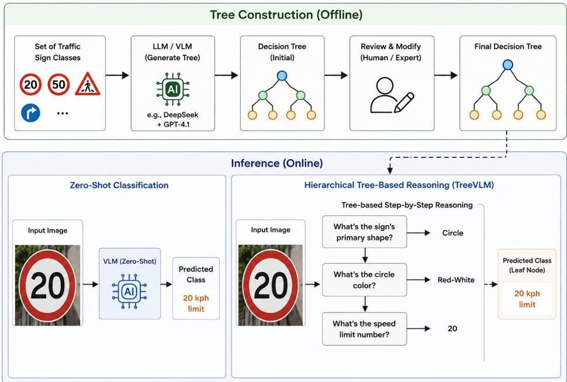
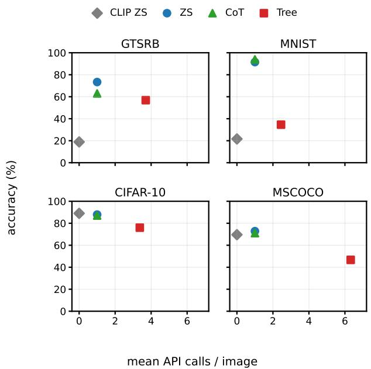
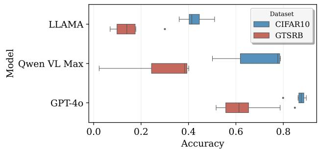

# MYOPIA: Understanding the Limits of Tree-Based Reasoning in Vision-Language Models

Islam Mesabah1 Sary Elmansoury1 Gerrit Großmann1

Peter Neigel1 Sebastian Vollmer1

1German Research Centre for Artificial Intelligence (DFKI), Kaiserslautern, Germany

1{first name.last name}@dfki.de

## Abstract

Decision trees can make vision-language model (VLM) classification interpretable by replacing a single prediction with a sequence of root-to-leaf questions. However, the accuracy cost of this greedy, non-backtracking procedure remains unclear. We introduce MYOPIA, a benchmark comprising four LLM-generated, human-refined decision treesfor GTSRB, MNIST, CIFAR-10, and MSCOCO, together with matched prompts, diagnostic protocols, and an evaluation harness. Across GPT-4o, Qwen-VL Max, and LLaMA-3.2 11B Vision, tree traversal underperforms zeroshot prompting in all 12 dataset–model pairs; paired bootstrap analyses consistently favor zero-shot. Our diagnostics characterize interacting failure modes associated with this gap. Models often recall tree-encoded class attributes more accurately than they ground the same attributes in images: the mean label–image accuracy gaps are 9.5, 13.8, and 12.6 points for GPT-4o, Qwen-VL Max, and LLaMA, respectively. Incorrect local decisions then irreversibly exclude the correct class, while answer extraction introduces additional model-dependent loss. A node-level audit of the four trees finds that split entropy is weakly but consistently associated with lower node accuracy, whereas depth, branching factor, and within-node grounding differences are less stable. MYOPIA therefore provides a framework for diagnosing hierarchical visual classification and motivates testing tree designs that prioritize perceptual answerability and recovery from early errors. Code is available at https://github.com/islammesabah/VLM\_ Classification.

## 1. Introduction

Vision-language models (VLMs) can classify images without task-specific labeled examples. Pretrained on large image–text corpora, models such as CLIP, GPT-4o, and the Qwen-VL family perform strongly across a range of zeroshot visual tasks [5, 30, 32]. Nevertheless, two challenges remain. First, VLMs often struggle with fine-grained recognition that requires distinguishing subtle visual differences, such as traffic-sign variants, medical image subtypes, and car models [4, 12, 41]. This limitation is especially consequential in safety-critical domains. Second, opaque zeroshot predictions provide little insight into systematic errors [14].

Decision trees offer a potential way to address both challenges. A tree decomposes a difficult classification decision into a sequence of simple, interpretable questions [28, 36]. Each answer narrows the label set until one class remains, and the resulting path explains the prediction. This rationale is intuitive, but it assumes that the model can answer every local question reliably. An early error excludes the correct class, prompt wording can alter intermediate answers, and longer paths create more opportunities for failure. Whether the added interpretability justifies these accuracy and inference costs has not been systematically evaluated.

We test this premise by comparing greedy, nonbacktracking tree traversal with zero-shot prompting across three VLMs, four datasets, and several prompting variants. In the primary comparison, traversal underperforms zeroshot prompting in all 12 dataset–model pairs. We investigate this gap by separating class-attribute recall from visual grounding, distinguishing path-selection errors from answer-interface failures, and examining tree structure and inference cost. These findings do not show that hierarchical visual inference is inherently ineffective. Instead, they characterize the limitations of a common implementation and provide guidance for designing more reliable alternatives.

Our main contributions are:

1. We introduce MYOPIA, a benchmark for evaluating tree-based reasoning in VLMs. It includes four LLM-generated, human-refined decision trees; matched zero-shot and tree-based prompt templates; paired class-attribute-recall and visual-grounding diagnostics; a reusable tree-generation pipeline (Section 3.1); and a complete evaluation harness.

2. In the primary comparison, greedy tree traversal underperforms zero-shot prompting in every dataset–model pair, even when models can recall the relevant class attributes. Paired bootstrap analyses support this gap, and a GPT-4o pilot that adds the global label list to each tree prompt yields only limited and inconsistent gains (Section 5.1). Thus, this implementation of greedy traversal does not reliably improve visual classification.

3. We diagnose traversal failures by separating classattribute recall from visual grounding (Section 5.3) and path-selection errors from answer-interface failures (Section 5.3). A node-level analysis examines associations between tree structure, grounding gaps, and node accuracy across the four evaluated trees (Section 5.4), while prompt and cost analyses identify further design tradeoffs for interpretable VLM classifiers.

## 2. Related Work

Vision-Language Models and Zero-Shot Classification. VLMs such as CLIP [32], LLaVA [23], the Qwen-VL family [2, 5], and GPT-4o [30] have advanced zero-shot classification [8, 21], but performance often declines on finegrained tasks with many semantically similar classes [4, 12, 18, 41, 47]. Prompt learning [17] and adaptation [9, 35] can help, yet challenges remain in densely populated label spaces and with nuanced language [1, 3, 15].

Work on structured label spaces decomposes objects into attributes, states, and relationships [10, 45], classifies them across abstraction levels [46], or augments classes with LLM-generated descriptions [34]. VLMs nevertheless remain sensitive to semantic granularity and textual specificity [43].

Decision-tree classifiers provide path-based explanations [28, 36], but require task-specific training or fitting rather than zero-shot VLM traversal. oVQA [13] converts classification datasets into open-ended VQA and uses label hierarchies for follow-up questions; it evaluates answer granularity rather than greedy root-to-leaf classification.

Closest to our setting is CHiLS [29], which traverses an LLM-derived hierarchy from coarse to fine labels. Other approaches match images to LLM-generated descriptors [25], compare confusable classes using pairwise attributes [33], or use GPT-4 descriptions as CLIP prompts [24]. These studies show that LLM-derived label structure can improve CLIP-style zero-shot classification. Unlike these embedding-based methods, our approach also structures inference as a sequence of VLM-answered branching questions.

Structured Reasoning and Prompt Engineering. Structured reasoning has also been explored in language and visual tasks [7, 16, 40, 45]. Tree of Thoughts [44] and Graph of Thoughts [6] allow models to explore multiple reasoning paths, backtrack, or merge candidates. On visual tasks, zero-shot chain-of-thought yields mixed results, helping larger models but hurting smaller ones [27]. LLaVA-CoT [42] and LlamaV-o1 [38] use fine-tuning for multistage visual reasoning. We use zero-shot chain-of-thought as a free-form reasoning baseline without rigid branching (Section 5.1).

## 3. Tree-Based Classification Framework

Our framework (Figure 1) first constructs a decision tree that maps each class label to a distinct leaf, then uses a VLM to classify an image by traversing a root-to-leaf path.

## 3.1. Tree Construction

An LLM (DeepSeek or GPT-4.1 in our experiments) generates each classification tree from class metadata and linguistic descriptions. The generation process avoids repeated questions along a path and recursively expands each branch until only one class remains, thereby guaranteeing exactly one class per leaf. A human annotator then traverses, reviews, and refines the tree to ensure semantic accuracy and consistency.

The procedure requires only a label set as input. At each internal node, a generator proposes candidate questions, and an evaluator scores them for clarity, completeness, visual relevance, logical grouping, and the balance of the resulting split. The highest-scoring question is selected, and the procedure recursively constructs its child branches. We release the implementation as a standalone script.

To assess structural transfer, we applied the procedure without modification to 20 bird species from CUB-200- 2011 [39] not used elsewhere in this study. It produced a valid tree assigning all 20 species to distinct leaves, with a maximum depth of 6, 18 decision nodes (17 binary and one three-way), and 36 LLM calls. This result shows that the pipeline can construct a valid tree for a separate label set. Because we did not evaluate VLM classification on this tree, we make no accuracy claim.

## 3.2. Tree Traversal

At inference, the model classifies an input image by traversing a single root-to-leaf path. At each internal node, the model answers the node’s question, and its answer deterministically selects the next child. Each leaf maps to exactly one class label, such as ‘‘20 kph speed limit’’ or ‘‘airplane’’. Each question is presented in a fresh, single-turn call containing the full image. Thus, traversing a path with k internal nodes requires k separate VLM calls.

## 4. Benchmark and Experimental Setup

MYOPIA benchmarks tree-based classification against zero-shot and chain-of-thought baselines across four datasets and three VLMs. Beyond end-to-end accuracy, it diagnoses three sources of performance loss: visual-grounding failure, path-selection error, and answerinterface failure.

  
Figure 1. Overview of the experimental framework, showing how decision trees are constructed and how the same image is classified through direct zero-shot prompting or decision-tree traversal, with one question asked per node.

## 4.1. Datasets

We evaluate four benchmark datasets spanning fine-grained discrimination and coarse-category classification:

• GTSRB [37]: 43 fine-grained German traffic-sign classes from 50,000+ real-world images captured in multi-frame sequences. We sample one random frame per sequence, yielding 901 images (5–50 per class).

• MNIST [20]: 10 handwritten-digit classes requiring finedetail discrimination despite visually simple images. We use 1,000 balanced samples (100 per class).

• CIFAR-10 [19]: 10 coarse-grained object classes testing generalization across broad categories. We use 1,000 balanced samples (100 per class).

• MSCOCO [22]: a large-scale, coarse-grained recognition dataset comprising 91 object categories. We construct the class hierarchy and zero-shot classification using 90 named object categories available in the dataset. We select images containing exactly one of the 80 categories used in the standard object-detection benchmark and sample up to 12 images per category, yielding an 850-image set.

## 4.2. Models

Our benchmark evaluates three VLMs spanning different architectures, providers, and scales. GPT-4o [30], accessed through OpenRouter with a fixed provider order, serves as the primary reference. LLaMA-3.2 11B Vision Instruct [26], self-hosted at FP16 precision, offers a smaller, open-weight comparison. Qwen-VL Max [2] is accessed through Alibaba Cloud’s DashScope API. Comparing its results with those of GPT-4o helps distinguish dataset-specific errors from model-specific errors.

## 4.3. Prompting Strategies

We test three VLM strategies across all datasets and models, together with CLIP-based baselines on all datasets. Zero-shot classification (baseline): the model receives the image with the prompt "Classify the [object]. It should be only one of these classes: {class ids and names}. Respond with only the class ID." A with-descriptions variant adds DeepSeek-generated per-class descriptions and a modelgenerated image caption.

Chain-of-thought classification (CoT): to distinguish step-by-step reasoning from rigid, non-backtracking tree traversal, we include an additional baseline (n = 100 classstratified images per dataset-model pair) in which the model reasons step by step before returning its final class in a single call without a fixed tree.

Tree-based classification: the model traverses the constructed tree from root to leaf, each node prompted as "{tree.question} Choose one of these answers: {tree.answers}."; the chosen answer selects the next node. We test two variants: with history, appending prior decisions to each prompt, and with descriptions, adding the same class and image descriptions used in the zero-shot variant.

CLIP-based baselines: using frozen CLIP ViT-B/32 [32] without VLM calls, we evaluate plain zeroshot classification, description-based classification [25], and CHiLS [29]. These methods rank classes by image– text embedding similarity rather than answering sequential branching questions. Plain zero-shot uses the prompt “a photo of a {class name}”; description-based classification replaces each class name with its short description; and CHiLS reuses our hierarchies, treating each tree’s root branches as superclasses.

## 4.4. Benchmarking Sources of Performance Loss

We supplement end-to-end classification accuracy with a diagnostic benchmark targeting the three failure sources defined in our evaluation framework. All diagnostics use the same tree definitions and answer options as the classification experiments, allowing failures to be localized to visual grounding, branch selection, or the answer interface.

Visual-grounding failure. We compare matched labeland image-conditioned node-question protocols. In the label-conditioned condition, the model receives the groundtruth class label but no image and answers the questions associated with that class path while retaining conversation history. This measures class-attribute recall: whether the model associates a class name with the attributes encoded by the tree. In the image-conditioned condition, the model receives the image but not the label and answers the same path questions. Image-conditioned probes use classstratified subsamples of three to five images per class, with every class represented. We score each node answer and report per-class, per-depth, and aggregate accuracy. The label–image difference is treated as a diagnostic grounding gap rather than a causal estimate, because the two conditions provide different inputs.

Path-selection error. To determine where a traversal leaves the correct route, we reconstruct every stored path against the corresponding tree and ground-truth class. At each reached node, a parsed decision is correct if its branch still contains the ground-truth class; selecting any other branch is a path-selection error. Node- and depthlevel accuracies are evaluated only along the ground-truthconsistent prefix and stop at the first path-selection or interface failure. Statistics at deeper nodes are therefore conditional on the traversal having reached them correctly.

Answer-interface failure. Because VLM output formats cannot be fully controlled, a strict regular-expression extractor returns the first predefined answer candidate found; if none is matched, the response and resulting path are marked unresolved. We report the unresolved-path rate and use a conservative oracle re-parser as a sensitivity analysis. Its rules cover recurring patterns identified through manual inspection, including number words, reordered or hyphenated labels, shape-adjective synonyms, and explicit affirmative or negated answers to yes/no questions; refusals and hedged responses remain unresolved. As an additional format control, we compare the free-form prompt with a numbered-choice format on matched GPT-4o subsamples (n = 20 per dataset). Primary results retain the strict extractor and free-form prompt.

## 4.5. Tree-Quality Audit Design

Beyond the three failure diagnostics, we test whether tree structure is associated with node difficulty. Each internal node is identified by its root-to-node path. For node v with $d _ { v }$ children, let $C _ { v j }$ be the classes reachable through child j and $p _ { v j } = | C _ { v j } | / { \sum _ { k } | C _ { v k } | }$ . We record depth, branching factor $d _ { v } ,$ largest-child share maxj $p _ { v j }$ , and split entropy $\begin{array} { r } { H _ { v } = - \sum _ { j } p _ { v j } \log _ { 2 } p _ { v j } } \end{array}$ . Entropy is reported in bits without normalization because branching factor is modeled separately.

The trees contain 128 internal nodes and 153 leaves (GT-SRB 22/43, MNIST 8/10, CIFAR-10 9/10, and MSCOCO 89/90). GTSRB has 16 binary, two ternary, two five-way, and two eight-way nodes; MNIST has seven binary and one ternary node; and the other trees are binary. All internal nodes have at least two children. The audit retains 347 node–model pairs with both traversal accuracy and a grounding gap across 123 nodes (GPT-4o: 123; Qwen-VL Max: 122; LLaMA-3.2: 102); five MSCOCO nodes are never reached and are therefore excluded. We report bivariate correlations and compare evenly split nodes (largestchild share $\leq 6 0 \% )$ with lopsided nodes.

We regress traversal accuracy on these structural variables, grounding gap, and model fixed effects. We report the baseline fit, node- and dataset-clustered standard errors, and a mixed-effects model with a node random intercept. Dataset-clustered inference is treated only as a sensitivity analysis because there are four clusters. A second sensitivity analysis weights observations by their numbers of scored decisions.

## 4.6. Inference Cost

We measure inference cost by counting model requests. Zero-shot and CoT classification require one VLM call per image, tree traversal requires one call per visited node, and CLIP-based methods require no VLM calls. We report the mean and maximum number of calls per image for each dataset.

## 5. Evaluation and Results

## 5.1. Main Classification Results

Because VLMs are sensitive to prompt phrasing [11], we evaluated up to 10 zero-shot prompt variants at $T = 0 . 7$ and report prompt 0 in Table 1. Prompt sensitivity was substantial: prompt 0 was the strongest observed GTSRB variant for all three models, and the full-scale sweeps had standard deviations of 2.81–16.97 points (Supplementary Material). These evaluations vary prompt wording rather than repeat an unchanged prompt. Adding class and image descriptions had mixed effects: they improved LLaMA on CIFAR-10 by 17–19 points across temperatures and helped GPT-4o and Qwen-VL on MSCOCO, but reduced accuracy for all models on MNIST and for GPT-4o and LLaMA on GTSRB.

Table 1. Mean accuracy (%) at T = 0.7. ZS: zero-shot; D: class and image descriptions; CoT: chain-of-thought. Bold and underlined values denote the best and second-best results within each dataset–model row. CoT uses n = 100 images per dataset–model pair.
<table><tr><td>Dataset</td><td>Model</td><td>ZS</td><td>ZS+D</td><td>CoT</td><td>Tree</td><td>Tree+D</td></tr><tr><td>GTSRB</td><td>GPT-40</td><td>71.14</td><td>63.60</td><td>63.00</td><td>57.71</td><td>65.04</td></tr><tr><td></td><td>LLaMA</td><td>37.07</td><td>23.53</td><td>12.00</td><td>33.19</td><td>14.87</td></tr><tr><td></td><td>Qwen-VL</td><td>47.06</td><td>48.95</td><td>36.00</td><td>24.64</td><td>52.28</td></tr><tr><td>MNIST</td><td>GPT-40</td><td>91.50</td><td>86.40</td><td>94.00</td><td>34.60</td><td>28.60</td></tr><tr><td></td><td>LLaMA</td><td>59.30</td><td>40.20</td><td>71.00</td><td>7.70</td><td>2.60</td></tr><tr><td></td><td>Qwen-VL</td><td>94.40</td><td>89.20</td><td>86.00</td><td>29.30</td><td>27.10</td></tr><tr><td>CIFAR-10</td><td>GPT-40</td><td>87.90</td><td>88.90</td><td>87.00</td><td>76.00</td><td>80.60</td></tr><tr><td></td><td>LLaMA</td><td>36.70</td><td>54.00</td><td>38.00</td><td>16.40</td><td>6.00</td></tr><tr><td></td><td>Qwen-VL</td><td>77.60</td><td>70.90</td><td>63.00</td><td>56.60</td><td>66.30</td></tr><tr><td>MSCOCO</td><td>GPT-40</td><td>72.82</td><td>80.82</td><td>71.00</td><td>46.71</td><td>44.00</td></tr><tr><td></td><td>LLaMA</td><td>23.76</td><td>21.06</td><td>18.00</td><td>3.65</td><td>0.35</td></tr><tr><td></td><td> ${ \mathrm { Q w e n - V L } }$ </td><td>74.82</td><td>78.35</td><td>59.00</td><td>39.65</td><td>44.47</td></tr></table>

For tree-based classification at $T \ = \ 0 . 7 ,$ GPT-4o performs best on every dataset, whereas LLaMA performs worst overall. Descriptions again have model- and datasetdependent effects and reduce accuracy for every model on MNIST. Adding the full decision history reduces accuracy in five of six GTSRB and CIFAR-10 comparisons; Qwen-VL on GTSRB is the only improvement (+12.3 points), while the losses range from 1.0 to 23.6 points.

Table 2. Instance-level Tree–ZS agreement at $T \quad = \quad 0 . 7 ,$ pooled across models. Both+/Both– denote both correct/incorrect; Tree+/ZS+ denote only Tree/ZS correct.
<table><tr><td>Dataset</td><td>Both+</td><td>Both-</td><td>Tree+</td><td>ZS+</td></tr><tr><td>GTSRB</td><td>864</td><td>1127</td><td>177</td><td>535</td></tr><tr><td>MNIST</td><td>673</td><td>505</td><td>43</td><td>1779</td></tr><tr><td>CIFAR-10</td><td>1333</td><td>821</td><td>157</td><td>689</td></tr><tr><td>MSCOCO</td><td>677</td><td>1005</td><td>88</td><td>780</td></tr></table>

Greedy tree traversal underperforms zero-shot in all 12 dataset–model pairs (Table 1). At the class level, pooled across the three models, zero-shot accuracy exceeded Tree accuracy in 72 of 129 class–model comparisons on GTSRB (55.8%), 28 of 30 on MNIST (93.3%), 27 of 30 on CIFAR-10 (90.0%), and 182 of 240 on MSCOCO (75.8%), using the 80 categories with sampled images. The instance-level results show the same pattern: zero-shot-only correct predictions outnumber tree-only correct predictions on every dataset (Table 2).

The same ordering holds on GTSRB and CIFAR-10 at $T \ = \ 0 .$ GPT-4o and Qwen-VL are generally stable, although Qwen-VL’s GTSRB tree accuracy rises from 24.64% to 40.51%. LLaMA is more sensitive: its GTSRB tree accuracy falls from 33.19% to 6.33%. Zero-shot nevertheless outperforms tree traversal for every model at both temperatures, so stochastic decoding does not explain the gap.

CoT outperforms tree traversal in 11 of 12 pairs, often substantially (MNIST/LLaMA: 71.0% vs. 7.7%), but exceeds zero-shot in only 3 of 12. It trails the tree only for GTSRB/LLaMA and trails zero-shot for all models on GT-SRB and MSCOCO. This suggests that free-form reasoning is less damaging than rigid single-path branching but usually less effective than zero-shot, consistent with prior work [27]. Because CoT and tree traversal also differ in call count, output format, and label access, the comparison does not isolate branching alone.

A paired bootstrap with 10,000 image resamples per pair confirms the gap: all 95% confidence intervals favor zeroshot, with Tree–ZS deficits ranging from −3.9 to −65.1 points. All comparisons remain significant after Holm– Bonferroni correction (largest adjusted $p = 0 . 0 2 8 )$ . Adding the global class list to GPT-4o node prompts on pilot subsamples (n = 20–50 per dataset) produces small, inconsistent changes (−5 to +4 points) and never approaches the corresponding zero-shot result, suggesting that label access is not the primary cause.

## 5.2. Comparison to CLIP-Based Baselines

To test whether hierarchical losses persist with embeddingbased inference, we evaluate adapted frozen-CLIP baselines (Table 3).

Table 3. Accuracy (%) of CLIP ViT-B/32 baselines.
<table><tr><td>Dataset</td><td>CLIP ZS</td><td>Description</td><td>CHiLS</td></tr><tr><td>GTSRB</td><td>18.9</td><td>18.5</td><td>19.8</td></tr><tr><td>MNIST</td><td>21.6</td><td>32.7</td><td>10.8</td></tr><tr><td>CIFAR-10</td><td>89.0</td><td>86.5</td><td>79.0</td></tr><tr><td>MSCOCO</td><td>69.6</td><td>66.7</td><td>66.9</td></tr></table>

Plain CLIP zero-shot is strongly dataset-dependent. Relative to the best VLM zero-shot result, it performs substantially worse on GTSRB and MNIST, slightly better on CIFAR-10, and 5.2 points worse on MSCOCO. Description-based classification improves MNIST from 21.6% to 32.7% but remains within three points of plain CLIP elsewhere. Unlike Menon and Vondrick [25], our implementation uses one sentence per class rather than multiple descriptors.

CHiLS improves plain CLIP by 0.9 points on GTSRB but reduces accuracy by 2.7 points on MSCOCO and about 10 points on CIFAR-10 and MNIST. The MNIST drop may partly reflect that the loop-count root split lacks a natural short caption. Thus, hierarchical CLIP scoring avoids the severe sequential-traversal loss on GTSRB and MSCOCO but remains harmful on the other datasets. Because CHiLS and VLM traversal differ in model, scoring rule, text representation, and hierarchy depth—CHiLS uses only root branches—this comparison does not isolate branching alone.

## 5.3. Performance-Loss Benchmark Results

We next diagnose where tree-based classification loses accuracy by separating visual-grounding, path-selection, and answer-interface failures.

Visual-grounding failure. On GTSRB, GPT-4o achieves perfect label-conditioned path accuracy for 17 of 43 classes and 79.59% macro-averaged accuracy over 231 node-question responses across the 43 class paths; shared internal nodes are evaluated once for each class whose path contains them. The six lowest-scoring classes, all at 33.3%, are “End Truck Passing Ban” and the five arrow-direction classes, whose names do not uniquely specify their visual form.

Table 4. Label-conditioned accuracy (L) and image-conditioned accuracy (I), with all classes represented.
<table><tr><td colspan="3">GPT-40</td><td colspan="2">LLaMA</td><td colspan="2">Qwen-VL</td></tr><tr><td>Dataset</td><td>L</td><td>I</td><td>L</td><td>I</td><td>L</td><td>I</td></tr><tr><td>GTSRB</td><td>79.59</td><td>72.81</td><td>50.46</td><td>49.26</td><td>77.49</td><td>75.18</td></tr><tr><td>MNIST</td><td>80.00</td><td>63.23</td><td>35.83</td><td>40.65</td><td>51.61</td><td>24.00</td></tr><tr><td>CIFAR-10</td><td>97.50</td><td>89.71</td><td>100.00</td><td>57.71</td><td>100.00</td><td>82.29</td></tr><tr><td>MSCOCO</td><td>95.79</td><td>89.33</td><td>87.74</td><td>76.09</td><td>94.73</td><td>87.14</td></tr><tr><td>Mean</td><td>88.22</td><td>78.77</td><td>68.51</td><td>55.93</td><td>80.96</td><td>67.15</td></tr></table>

For GPT-4o, replacing the label with the image reduces accuracy by 9.5 points on average (range 6.5–16.8; Table 4). MNIST has the largest gap, while GTSRB has one of the smallest despite also requiring fine-detail recognition, suggesting that grounding difficulty is dataset-specific rather than determined by class granularity alone. The grounding gap is also present across models, averaging 13.8 points for Qwen-VL (range 2.3–27.6) and 12.6 for LLaMA (range −4.8–42.3). On GTSRB, Qwen-VL reaches 75.18%, close to GPT-4o’s 72.81%, whereas LLaMA reaches 49.26%. Thus, visual-grounding difficulty is not specific to GPT-4o, although its magnitude varies substantially by model and

dataset.

The GTSRB depth profile further localizes the gap (Table 5). GPT-4o begins near ceiling at the root (97.7%) but declines sharply from depth 2 onward. Qwen-VL dips at depths 1–2 before partly recovering, whereas LLaMA starts lower (55.3%) and remains broadly flat.

Table 5. GTSRB image-conditioned accuracy by depth. Rows show depths 0–4; Overall includes all depths 0–14. GPT-4o and LLaMA use 215 images each, and Qwen-VL uses 129.
<table><tr><td>Depth</td><td>GPT-40</td><td>LLaMA</td><td>Qwen-VL</td></tr><tr><td>0</td><td>97.7%</td><td>55.3%</td><td>93.0%</td></tr><tr><td>1</td><td>83.5%</td><td>47.5%</td><td>70.8%</td></tr><tr><td>2</td><td>57.4%</td><td>51.8%</td><td>73.5%</td></tr><tr><td>3</td><td>59.3%</td><td>53.3%</td><td>88.9%</td></tr><tr><td>4</td><td>65.9%</td><td>42.4%</td><td>78.4%</td></tr><tr><td>Overall</td><td>72.81%</td><td>49.26%</td><td>75.18%</td></tr></table>

Path-selection error. Using the reconstruction protocol in Section 4.4, GTSRB node-level accuracies pooled across models are 86.7%, 75.3%, 76.3%, 87.0%, and 76.8% at depths 0–4, respectively (n =2661/2002/1374/702/185). Accuracy varies non-monotonically with depth, indicating that errors are not confined to the deepest questions. Because each trace ends at its first incorrect or unresolved decision, the counts include only nodes reached along a groundtruth-consistent prefix.

Answer-interface failure. Under the strict extractor, unresolved-path rates range from 10.8% on CIFAR-10 to 22.0% on MSCOCO (Table 6). Oracle re-parsing reduces these rates on every dataset and raises pooled Tree accuracy from 38.51% to 40.0% on GTSRB, 23.9% to 28.6% on MNIST, 49.7% to 53.5% on CIFAR-10, and 30.0% to 34.6% on MSCOCO. These corrected values remain far below the corresponding zero-shot accuracies in Table 1, showing that interface failures explain only part of the gap.

Table 6. Mean and maximum API calls per tree-classified image and unresolved-path rates before and after oracle re-parsing, pooled across models.
<table><tr><td>Dataset</td><td>Mean calls</td><td>Max calls</td><td>Unresolved</td><td>Oracle</td></tr><tr><td>GTSRB</td><td>3.61</td><td>15</td><td>14.7%</td><td>11.0%</td></tr><tr><td>MNIST</td><td>2.45</td><td>4</td><td>18.6%</td><td>11.1%</td></tr><tr><td>CIFAR-10</td><td>3.37</td><td>4</td><td>10.8%</td><td>3.7%</td></tr><tr><td>MSCOCO</td><td>6.32</td><td>11</td><td>22.0%</td><td>16.2%</td></tr></table>

Interface failures are strongly model-specific. LLaMA accounts for 84.9% and 97.0% of unresolved paths on CIFAR-10 and MSCOCO, respectively, largely because it restates negated yes/no answers as full sentences. Its MSCOCO unresolved rate falls from 64.1% to 47.5% after oracle correction. LLaMA also accounts for 64.4% of unresolved GTSRB paths, while MNIST is more evenly distributed (54.0%). Thus, the answer interface imposes a real but uneven accuracy cost without overturning the central Tree–ZS comparison.

The numbered-choice control leads to little change for GPT-4o. Free-form responses are already nearly fully parseable on the matched subsamples (0.0–2.4% unresolved), and node-level accuracy changes only modestly: 89.0%→90.7% on GTSRB, 68.3%→71.4% on MNIST, 92.3%→92.2% on CIFAR-10, and 88.2%→86.7% on MSCOCO. This suggests that GPT-4o’s interface failures are concentrated in particular conditions rather than inherent to free-form responses.

## 5.4. Tree-Quality Audit Results

To identify which structural properties are associated with difficult node decisions, we first examine their bivariate relationships with traversal accuracy. Split entropy $( r \ =$ −0.24) and branching factor $( r = - 0 . 1 7 )$ correlate negatively with accuracy, whereas depth has a weak positive correlation $( r = 0 . 1 8 )$ . However, the depth correlation is negative within the CIFAR-10 (−0.40), MNIST (−0.12), and MSCOCO (−0.08) trees and positive only within GTSRB (+0.56), suggesting that the pooled result reflects betweentree differences. Evenly split nodes average 81.6% accuracy $( n = 6 8 )$ , compared with 88.2% for lopsided nodes $( n = 5 5 )$

We next analyze the 347 node–model observations using the multivariable specifications defined in Section 4.5. The baseline fit has $R ^ { \bar { 2 } } = 0 . 1 6$ , and with model fixed effects, LLaMA scores 15.5 points below GPT-4o (95% CI $[ - 2 1 . 1 , - 9 . 9 ] , p < 0 . 0 0 0 1 )$ . Split entropy remains negative and significant in all four specifications $( \beta = - 0 . 0 9 , 9 5 \%$ CI $[ - 0 . 1 3 , - 0 . 0 4 ] , p \leq 0 . 0 0 7 )$ . Depth is significant in three $( \beta = + 0 . 0 3 5 , p = 0 . 0 0 4 \mathrm { - } 0 . 0 3 9 )$ , and branching factor in two $( \beta = + 0 . 0 5 2 , p = 0 . 0 2 9 - 0 . 1 1 )$ ; the latter changes sign after controlling for entropy, indicating collinearity. The grounding-gap coefficient is negative $( \beta = - 0 . 0 3 )$ and significant in two specifications, but not in the node-randomintercept model $( p = 0 . 2 3 )$

Thus, larger grounding gaps are associated with lower accuracy on average but not reliably within the same node, and the pooled model overstates this association $\begin{array} { l l } { \displaystyle ( \beta } & { \displaystyle = } \end{array}$ $- 0 . 0 7 , p \ < \ 0 . 0 0 0 1 )$ ). Split entropy is the only structural variable that remains negatively associated with accuracy after adjustment for the other factors, node dependence, and decision-count weighting. Because depth and branching factor lose significance under weighting, we treat split entropy as a weak correlate rather than a reliable predictor and limit this conclusion to the four evaluated trees.

## 5.5. Inference Cost

Tree traversal requires 2.5–6.3 times as many VLM calls per image as zero-shot classification (Table 6). MSCOCO requires the most calls because it has the deepest tree. Moreover, each node prompt resends the image, so every additional call incurs another image-token cost. For GPT-4o, tree traversal is dominated by zero-shot and CoT: it requires more calls and achieves lower accuracy on every dataset (Figure 2). CLIP zero-shot requires no VLM calls and exceeds tree accuracy on CIFAR-10 and MSCOCO.

  
Figure 2. GPT-4o accuracy versus mean VLM calls per image at T = 0.7; CLIP zero-shot requires no VLM calls. Tree traversal is dominated by zero-shot and CoT on every dataset.

## 6. Discussion

Taken together, the results challenge the assumption that an explicit hierarchy necessarily helps VLM classification. The comparisons with CoT and CLIP-based methods suggest that hierarchy alone is not the central problem. The observed deficits are consistent with irreversible local decisions as one contributor, but these comparisons do not isolate branching from differences in prompts, call counts, label access, or output formats. We therefore characterize the evaluated greedy implementation as a failure mode rather than establish rigid branching as a distinct causal source of degradation.

The diagnostic benchmark characterizes visualgrounding, path-selection, and answer-interface failures. Models can often recall tree-encoded attributes from a class name yet fail to recognize the same attributes in an image, particularly when nodes require fine perceptual distinctions. These local errors are not confined to deep levels, and an early mistake excludes the correct class. Parsing failures and conversation history add further, model-dependent loss, but neither accounts for the overall gap. Together, these patterns are consistent with an explanation involving perception, irreversible branching, and interface design rather than any single failure mode.

The tree-quality audit suggests a possible mismatch between conventional tree objectives and VLM behavior. Classical decision-tree induction commonly selects splits by maximizing information gain [31]; in our deterministic class-partition setting, the split-entropy criterion rewards balanced branches. Across the four evaluated trees, higher split entropy is weakly but consistently associated with lower node accuracy. Because this observational relationship does not establish causation, it motivates testing whether perceptually answerable splits are preferable to balanced splits.

The cost analysis adds a practical concern: every additional node requires another image-conditioned call without an observed accuracy benefit in the evaluated settings. These results motivate testing hierarchies with fewer sequential decisions, coarse and visually grounded distinctions, constrained outputs, and alternatives retained through soft scoring or backtracking. More broadly, MYOPIA does not show that hierarchies are intrinsically ineffective; it provides a framework for separating knowledge, grounding, path-selection, interface, and cost failures and for studying when hierarchical classification breaks down.

## 7. Limitations

• Scale and sampling. Each evaluation set contains 850– 1,000 images. MNIST and CIFAR-10 are balanced, MSCOCO is nearly balanced, and the 901-image GTSRB sample preserves the dataset’s native imbalance. Larger evaluations may reveal additional failure modes.

• Model coverage. The three VLMs span different architectures and scales, but the findings may not generalize to other or future models.

• Tree dependence. The conclusions are tied to the evaluated trees. Although two human annotators and an independent LLM judge found no structural or ground-truth errors, the judge identified question-design concerns, particularly GTSRB’s eight-way arrow question. Alternative or shallower trees may reduce the observed gap.

• Tree-quality audit. The audit is observational and limited to four fixed trees. Node accuracy is conditional on reach, coverage and decision counts vary across nodes, and dataset-clustered inference uses only four clusters. The reported associations should therefore not be interpreted causally or generalized beyond these trees.

• Extraction and robustness. The primary evaluation relies on regex answer extraction; oracle re-parsing provides only a sensitivity analysis (Section 4.4). Run-torun variation was evaluated at full scale only for GTSRB and CIFAR-10. Smaller MNIST and MSCOCO checks remained stable (standard deviation ≤ 2.9 points), but do not replace full-scale replication.

• Cost measurement. We report API-call counts rather than exact monetary costs.

## 8. Conclusion

Sequential, single-path tree traversal did not improve VLM classification in the evaluated settings. Across four datasets, zero-shot prompting outperformed the tree for the three models, with paired bootstrap confidence intervals supporting the gap (Section 5.1). This finding does not rule out hierarchical inference; instead, it shows that greedy, nonbacktracking traversal underperforms a simpler baseline and motivates controlled alternatives.

The diagnostic benchmark identifies multiple failure modes associated with the gap rather than establishing a single cause. Models often recall class attributes but cannot ground them reliably in images; an incorrect local decision then removes the correct class, while answer extraction adds further model-dependent loss (Section 5.3). In the four evaluated trees, the tree-quality audit finds a weak association between higher split entropy and lower node accuracy; it does not establish that balanced splits cause difficult visual decisions (Section 5.4). These findings motivate testing tree-construction objectives that prioritize perceptual answerability, robust interfaces, and recovery from early errors.

Future work. Future studies should isolate branching through controlled comparisons that hold the model, prompt, label access, and inference budget fixed. Promising directions include multi-branch or soft routing, confidencebased backtracking, constrained decoding, and joint optimization of tree structure for visual answerability and cost. Evaluating multiple independently generated trees, additional VLMs, and larger or multi-object datasets would further test generalizability.

Reproducibility. The supplementary material reports complete $ { \boldsymbol { T } }  { \mathrm { ~  ~ { ~ \mathbf ~ { ~ ~ 0 ~ } ~ } ~ } }$ , tree-with-history, 10-prompt zeroshot, global-label, numbered-choice, and run-to-run results, along with full tree-audit specifications and node counts. We will release the trees, prompts, generator–evaluator pipeline, analysis code, and evaluation harness under the MIT License; dataset access remains governed by the original licenses (Section 9).

## 9. Ethics and Broader Impact

This work uses only public benchmark datasets (GT-SRB [37], MNIST [20], CIFAR-10 [19], MSCOCO [22]), collects no new human-subject data, and introduces no new capability, so we see no dual-use risk; images may incidentally contain identifiable people or vehicles. Licensing. GT-SRB and CIFAR-10 require citation, MNIST is CC BY-SA 3.0, MSCOCO annotations are CC BY 4.0; we redistribute only annotations and sample-ID lists, and release the trees for research, not deployment.

## References

[1] Kumail Alhamoud, Shaden Alshammari, Yonglong Tian, Guohao Li, Philip Torr, Yoon Kim, and Marzyeh Ghassemi. Vision-language models do not understand negation, 2025. 2

[2] Alibaba Cloud. Qwen-VL-Max: Image and Video Understanding, 2026. Accessed: 2026-08-24. 2, 3

[3] Ahmad Mustafa Anis, Hasnain Ali, and Saquib Sarfraz. On the limitations of vision-language models in understanding image transforms, 2025. 2

[4] Aadya Arora and Vinay Namboodiri. MedFocusCLIP: Improving few-shot classification in medical datasets using pixel-wise attention. In 2025 IEEE International Conference on Acoustics, Speech and Signal Processing (ICASSP). IEEE, 2025. 1, 2

[5] Jinze Bai, Shuai Bai, Shusheng Yang, Shijie Wang, Sinan Tan, Peng Wang, Junyang Lin, Chang Zhou, and Jingren Zhou. Qwen-VL: A versatile vision-language model for understanding, localization, text reading, and beyond, 2023. 1, 2

[6] Maciej Besta, Nils Blach, Ales Kubicek, Robert Gerstenberger, Lukas Gianinazzi, Joanna Gajda, Tomasz Lehmann, Michal Podstawski, Hubert Niewiadomski, Piotr Nyczyk, and Torsten Hoefler. Graph of thoughts: Solving elaborate problems with large language models. In AAAI Conference on Artificial Intelligence, 2024. 2

[7] Maciej Besta, Florim Memedi, Zhenyu Zhang, Robert Gerstenberger, Guangyuan Piao, Nils Blach, Piotr Nyczyk, Marcin Copik, Grzegorz Kwasniewski, J ´ urgen M ¨ uller, Lukas¨ Gianinazzi, Ales Kubicek, Hubert Niewiadomski, Aidan O’Mahony, Onur Mutlu, and Torsten Hoefler. Demystifying chains, trees, and graphs of thoughts, 2025. 2

[8] Qinglong Cao, Yuntian Chen, Lu Lu, Hao Sun, Zhengzhong Zeng, Xiaokang Yang, and Dongxiao Zhang. Generalized domain prompt learning for accessible scientific visionlanguage models. Nexus, 2(2):100069, 2025. 2

[9] Eulrang Cho, Jooyeon Kim, and Hyunwoo J. Kim. Distribution-aware prompt tuning for vision-language models. In Proceedings of the IEEE/CVF International Conference on Computer Vision (ICCV), pages 22004–22013, 2023. 2

[10] Tong Ding, Wanhua Li, Zhongqi Miao, and Hanspeter Pfister. Tree of attributes prompt learning for vision-language models, 2025. 2

[11] Bahare Fatemi, Jonathan Halcrow, and Bryan Perozzi. Talk like a graph: Encoding graphs for large language models, 2023. 5

[12] Yaozong Gan, Guang Li, Ren Togo, Keisuke Maeda, Takahiro Ogawa, and Miki Haseyama. Cross-domain multistep thinking: Zero-shot fine-grained traffic sign recognition

in the wild. Knowledge-Based Systems, 327:114172, 2025. 1, 2

[13] Simon Ging, Mar´ıa Alejandra Bravo, and Thomas Brox. Open-ended VQA benchmarking of vision-language models by exploiting classification datasets and their semantic hierarchy. In International Conference on Learning Representa tions (ICLR), 2024. 2

[14] Michal Golovanevsky, William Rudman, Vedant Palit, Carsten Eickhoff, and Ritambhara Singh. What do VLMs NOTICE? a mechanistic interpretability pipeline for gaussian-noise-free text-image corruption and evaluation. In Proceedings of the 2025 Conference of the Nations of the Americas Chapter ofthe Associationfor Computational Lin guistics: Human Language Technologies (Volume 1: Long Papers), pages 11462–11482. Association for Computa tional Linguistics, 2025. 1

[15] Chenhui Gou, Abdulwahab Felemban, Faizan Farooq Khan, Deyao Zhu, Jianfei Cai, Hamid Rezatofighi, and Mohamed Elhoseiny. How well can vision language models see image details, 2024. 2

[16] Mingqian He, Yongliang Shen, Wenqi Zhang, Zeqi Tan, and Weiming Lu. Advancing process verification for large language models via tree-based preference learning. In Proceedings of the 2024 Conference on Empirical Methods in Natural Language Processing, pages 2086–2099, Miami, Florida, USA, 2024. Association for Computational Linguis tics. 2

[17] Ankit Jha. In the era of prompt learning with vision-language models, 2024. 2

[18] Jeonghwan Kim and Heng Ji. Finer: Investigating and enhancing fine-grained visual concept recognition in large vision language models. In Proceedings of the 2024 Conference on Empirical Methods in Natural Language Processing, pages 6187–6207, Miami, Florida, USA, 2024. Association for Computational Linguistics. 2

[19] Alex Krizhevsky and Geoffrey Hinton. Learning multiple layers of features from tiny images. Technical Report 0, Uni versity of Toronto, Toronto, Ontario, 2009. 3, 8

[20] Yann LeCun, Corinna Cortes, and Christopher J. C. Burges. MNIST handwritten digit database. ATT Labs [Online]. Available: http://yann.lecun.com/exdb/mnist, 2, 2010. 3, 8

[21] Zongxia Li, Xiyang Wu, Hongyang Du, Fuxiao Liu, Huy Nghiem, and Guangyao Shi. A survey of state of the art large vision language models: Alignment, benchmark, evaluations and challenges, 2025. 2

[22] Tsung-Yi Lin, Michael Maire, Serge Belongie, James Hays, Pietro Perona, Deva Ramanan, Piotr Dollar, and C. Lawrence´ Zitnick. Microsoft COCO: Common objects in context. In European conference on computer vision, pages 740–755. Springer, 2014. 3, 8

[23] Haotian Liu, Chunyuan Li, Qingyang Wu, and Yong Jae Lee. Visual instruction tuning, 2023. 2

[24] Mayug Maniparambil, Chris Vorster, Derek Molloy, Noel Murphy, Kevin McGuinness, and Noel E. O’Connor. Enhancing CLIP with GPT-4: Harnessing visual descriptions as prompts. In IEEE/CVF International Conference on Computer Vision Workshops, 2023. 2

[25] Sachit Menon and Carl Vondrick. Visual classification via description from large language models. In International Conference on Learning Representations, 2023. 2, 4, 6

[26] Meta AI. Llama 3.2: Model Card and Prompt Formats, 2024. Accessed: 2026-08-24. 3

[27] Aishik Nagar, Shantanu Jaiswal, and Chuan-Sheng Tan. Zero-shot visual reasoning by vision-language models: Benchmarking and analysis. In International Joint Conference on Neural Networks, 2024. 2, 5

[28] Meike Nauta, Ron van Bree, and Christin Seifert. Neural prototype trees for interpretable fine-grained image recognition. In Proceedings of the IEEE/CVF Conference on Computer Vision and Pattern Recognition, pages 14933–14943, 2021. 1, 2

[29] Zachary Novack, Julian McAuley, Zachary Chase Lipton, and Saurabh Garg. CHiLS: Zero-shot image classification with hierarchical label sets. In International Conference on Machine Learning, 2023. 2, 4

[30] OpenAI. GPT-4o System Card, 2024. 1, 2, 3

[31] J. Ross Quinlan. Induction of decision trees. Machine learning, 1(1):81–106, 1986. 8

[32] Alec Radford, Jong Wook Kim, Chris Hallacy, Aditya Ramesh, Gabriel Goh, Sandhini Agarwal, Girish Sastry, Amanda Askell, Pamela Mishkin, Jack Clark, Gretchen Krueger, and Ilya Sutskever. Learning transferable visual models from natural language supervision. In Proceedings of the 38th International Conference on Machine Learning, pages 8748–8763. PMLR, 2021. 1, 2, 4

[33] Zhiyuan Ren, Yiyang Su, and Xiaoming Liu. ChatGPTpowered hierarchical comparisons for image classification. In Advances in Neural Information Processing Systems, 2023. 2

[34] Oindrila Saha, Grant Van Horn, and Subhransu Maji. Improved zero-shot classification by adapting vlms with text descriptions, 2024. 2

[35] Manuel Schwonberg, Claus Werner, Hanno Gottschalk, and Carsten Meyer. A study on unsupervised domain adaptation for semantic segmentation in the era of vision-language models. CoRR, abs/2411.16407, 2024. 2

[36] Sheng Shi, Xinfeng Zhang, and Wei Fan. Explaining the predictions of any image classifier via decision trees, 2019. 1, 2

[37] Johannes Stallkamp, Marc Schlipsing, Jan Salmen, and Christian Igel. Man vs. computer: Benchmarking machine learning algorithms for traffic sign recognition. Neural Networks, 32:323–332, 2012. 3, 8

[38] Omkar Thawakar, Dinura Dissanayake, Ketan More, Ritesh Thawkar, Ahmed Heakl, Noor Ahsan, Yuhao Li, Mohammed Zumri, Jean Lahoud, Rao Muhammad Anwer, Hisham Cholakkal, Ivan Laptev, Mubarak Shah, Fahad Shahbaz Khan, and Salman Khan. LlamaV-o1: Rethinking step-by-step visual reasoning in LLMs. arXiv preprint arXiv:2501.06186, 2025. 2

[39] Catherine Wah, Steve Branson, Peter Welinder, Pietro Perona, and Serge Belongie. The caltech-ucsd birds-200-2011 dataset. Technical Report CNS-TR-2011-001, California Institute of Technology, 2011. 2

[40] Ziyang Wang, Shoubin Yu, Elias Stengel-Eskin, Jaehong Yoon, Feng Cheng, Gedas Bertasius, and Mohit Bansal. Videotree: Adaptive tree-based video representation for LLM reasoning on long videos, 2024. 2

[41] Canshi Wei. Enhancing fine-grained image classifications via cascaded vision language models, 2024. 1, 2

[42] Guowei Xu, Peng Jin, Ziang Wu, Hao Li, Yibing Song, Lichao Sun, and Li Yuan. LLaVA-CoT: Let vision language models reason step-by-step. In Proceedings of the IEEE/CVF International Conference on Computer Vision (ICCV), pages 2087–2098, 2025. 2

[43] Zhenlin Xu, Yi Zhu, Tiffany Deng, Abhay Mittal, Yanbei Chen, Manchen Wang, Paolo Favaro, Joseph Tighe, and Davide Modolo. Benchmarking zero-shot recognition with vision-language models: Challenges on granularity and specificity, 2024. 2

[44] Shunyu Yao, Dian Yu, Jeffrey Zhao, Izhak Shafran, Thomas L. Griffiths, Yuan Cao, and Karthik Narasimhan. Tree of thoughts: Deliberate problem solving with large language models. In Advances in Neural Information Process ing Systems, 2023. 2

[45] Nir Yellinek, Leonid Karlinsky, and Raja Giryes. 3VL: Using trees to improve vision-language models’ interpretability, 2025. 2

[46] Ruohong Zhang, Bowen Zhang, Yanghao Li, Haotian Zhang, Zhiqing Sun, Zhe Gan, Yinfei Yang, Ruoming Pang, and Yiming Yang. Improve vision language model chain-ofthought reasoning, 2024. 2

[47] Yuhui Zhang, Alyssa Unell, Xiaohan Wang, Dhruba Ghosh, Yuchang Su, Ludwig Schmidt, and Serena Yeung-Levy. Why are visually-grounded language models bad at image classi fication, 2024. 2

# MYOPIA: Understanding the Limits of Tree-Based Reasoning in Vision-Language Models Supplementary Material

## S1. Scope and Conventions

This supplement provides the complete results referenced in the main paper’s Reproducibility paragraph:

• Section S2 reports results for all available prompting conditions at $T { = } 0$ and $T { = } 0 . 7 .$ , including the tree-withhistory ablation.

• Section S3 reports paired-bootstrap intervals and Holmcorrected tests for the tree–zero-shot gap.

• Section S4 evaluates ten paraphrases of the zero-shot prompt, quantifies the resulting spread, and locates the prompt reported in the main paper within that spread.

• Section S5 explains that RunId indexes distinct prompt wordings, not repeated calls with the same prompt.

• Sections S6 and S7 report the global-label and numberedchoice probes, respectively.

• Sections S8–S9 document the tree specifications and audit coverage.

• Section S10 describes the released artifacts, fixed im age subsets, decoding settings, and limits on exact reexecution.

The following conventions apply to all reported results.

Accuracy denominator. A prediction is correct only when its parsed integer class identifier matches the groundtruth identifier. The denominator includes every row in a condition; unparseable responses and images without a logged traversal are counted as errors. Reported end-to-end accuracy therefore incorporates answer-interface failures as well as classification failures. Interface effects are analyzed separately in the main paper and in Section S7.

Deduplication. Rows in all sequences training/ duplicate current GTSRB images in datasets/GTSRB/Training/. All tables use a view that removes a legacy row when a matching current row exists for the same model, temperature, ablation, and run. Without this step, GTSRB denominators increase from 901 to as many as 915 and accuracies shift by up to 0.3 points.

Coverage. A full pass contains 901 GTSRB images, 1,000 MNIST images, 1,000 CIFAR-10 images, and 850 MSCOCO images. This supplement reports every available cell and marks incomplete cells with their n.

## S2. Complete Results at Both Temperatures

Table S1 reports six prompting conditions at T=0 and $T { = } 0 . 7$ , extending Table 1 of the main paper with the recorded T=0 results and the tree-with-history (Tree+H) ablation.

At T=0, only GTSRB and CIFAR-10 have complete passes. The available MNIST and MSCOCO cells contain 2–860 images and should not be interpreted as dataset-level estimates; they are included with their n for transparency. Accordingly, the main paper discusses T=0 only for GT-SRB and CIFAR-10.

Tree+H likewise has complete coverage only for GTSRB and CIFAR-10. At $T { = } 0 . 7 ,$ it reduces accuracy in five of the six dataset–model comparisons; Qwen-VL on GTSRB is the sole exception. The MNIST and MSCOCO Tree+H cells contain only 2–33 images and are reported as incomplete observations.

Boldface and underlining identify the best and secondbest eligible entries in each row. Full-pass conditions and the planned n=100 CoT probes are eligible; superscripted incomplete cells are excluded.

## S3. Significance of the Tree–Zero-Shot Gap

Table S1 shows the tree condition below zero-shot almost everywhere. Table S2 attaches an interval and a corrected p-value to that gap, so the claim rests on more than a point estimate.

The design is paired: for a given dataset, model, and temperature, the zero-shot and tree predictions for one image are stored on the same database row, so the two conditions see identical images. The bootstrap therefore resamples images, not predictions, and recomputes both accuracies on each resample; the reported interval is over the difference, which absorbs the correlation between the two conditions rather than treating them as independent samples.

Two limits are worth stating. With 10,000 resamples, the two-sided bootstrap p cannot be resolved below 2/10,000. Eleven comparisons reach this floor, so their corrected values are reported as upper bounds rather than exact quantities. The intervals quantify sampling variation over images at a fixed decoding temperature.

All twelve gaps are negative, and all twelve remain significant after Holm–Bonferroni correction over the family of twelve comparisons (largest adjusted $p = 0 . 0 2 7 8 .$ GT-SRB with LLaMA). The single smallest gap, −3.88 points for LLaMA on GTSRB, is also the only one whose interval approaches zero $( [ - 7 . 3 3 , - 0 . 4 4 ] )$ ; every other interval excludes zero by a wide margin.

## S4. Ten-Prompt Zero-Shot Sweep

Section 5.1 of the main paper evaluates ten zero-shot prompts at T=0.7 and reports one of them in Table 1. This section gives the full sweep behind that choice. Ten paraphrases of the zero-shot instruction were written per dataset;

Table S1. Accuracy (%) across temperatures and prompting conditions. ZS: zero-shot; +D: class and image descriptions; +H: conversation history across tree nodes; CoT: chain-of-thought. Superscripts give n for incomplete cells, and an em dash indicates no data. CoT uses n=100 class-stratified images per dataset–model pair at $T { = } 0 . 7 .$ . Boldface and underlining identify the best and second-best entries among full-pass conditions and the planned CoT probes; superscripted cells are excluded. Full-pass sizes are 901 (GTSRB), 1,000 (MNIST and CIFAR-10), and 850 (MSCOCO).
<table><tr><td>Dataset</td><td>Model</td><td>T</td><td>ZS</td><td>ZS+D</td><td>CoT</td><td>Tree</td><td>Tree+H</td><td>Tree+D</td></tr><tr><td>GTSRB</td><td>GPT-40</td><td>0</td><td>70.92</td><td>63.82</td><td></td><td>58.05</td><td>55.83</td><td>66.81</td></tr><tr><td></td><td></td><td>0.7</td><td>71.14</td><td>63.60</td><td>63.00</td><td>57.71</td><td>56.71</td><td>65.04</td></tr><tr><td></td><td>LLaMA</td><td>0</td><td>23.86</td><td>18.42</td><td></td><td>6.33</td><td>16.09</td><td>15.65</td></tr><tr><td></td><td></td><td>0.7</td><td>37.07</td><td>23.53</td><td>12.00</td><td>33.19</td><td>12.43</td><td>14.87</td></tr><tr><td></td><td>Qwen-VL</td><td>0</td><td>47.95</td><td>49.72</td><td></td><td>40.51</td><td>36.96</td><td>51.83</td></tr><tr><td></td><td></td><td>0.7</td><td>47.06</td><td>48.95</td><td>36.00</td><td>24.64</td><td>36.96</td><td>52.28</td></tr><tr><td>MNIST</td><td>GPT-40</td><td>0</td><td>94.87 234</td><td> $8 8 . 0 2 \AA ^ { 8 6 0 }$ </td><td></td><td> $3 5 . 4 7 ^ { 2 3 4 }$ </td><td> $4 6 . 6 7 ^ { 1 5 }$ </td><td></td></tr><tr><td></td><td></td><td>0.7</td><td>91.50</td><td>86.40</td><td>94.00</td><td>34.60</td><td> $7 5 . 0 0 ^ { 1 6 }$ </td><td>28.60</td></tr><tr><td></td><td>LLaMA</td><td>0</td><td>33.333</td><td></td><td></td><td>33.333</td><td> $0 . 0 0 ^ { 2 }$ </td><td></td></tr><tr><td></td><td></td><td>0.7</td><td>59.30</td><td>40.20</td><td>71.00</td><td>7.70</td><td> $5 0 . 0 0 ^ { 2 }$ </td><td>2.60</td></tr><tr><td></td><td>Qwen-VL</td><td>0</td><td>95.17 414</td><td></td><td></td><td>14.25414</td><td></td><td></td></tr><tr><td></td><td></td><td>0.7</td><td>94.40</td><td>89.20</td><td>86.00</td><td>29.30</td><td> $7 . 6 9 ^ { 1 3 }$ </td><td>27.10</td></tr><tr><td>CIFAR-10</td><td>GPT-40</td><td>0</td><td>89.60</td><td>90.00</td><td></td><td>75.40</td><td>73.10</td><td>82.70</td></tr><tr><td></td><td></td><td>0.7</td><td>87.90</td><td>88.90</td><td>87.00</td><td>76.00</td><td>72.80</td><td>80.60</td></tr><tr><td></td><td>LLaMA</td><td>0</td><td>43.70</td><td>62.80</td><td></td><td>17.10</td><td>12.30</td><td>4.80</td></tr><tr><td></td><td></td><td>0.7</td><td>36.70</td><td>54.00</td><td>38.00</td><td>16.40</td><td>14.10</td><td>6.00</td></tr><tr><td></td><td>Qwen-VL</td><td>0</td><td>77.60</td><td>71.20</td><td></td><td>56.60</td><td>33.00</td><td>66.50</td></tr><tr><td></td><td></td><td>0.7</td><td>77.60</td><td>70.90</td><td>63.00</td><td>56.60</td><td>33.00</td><td>66.30</td></tr><tr><td>MSCOCO</td><td>GPT-40</td><td>0</td><td>73.9192</td><td></td><td></td><td> $4 6 . 7 4 ^ { 9 2 }$ </td><td> $0 . 0 0 ^ { 7 }$ </td><td></td></tr><tr><td></td><td></td><td>0.7</td><td>72.82</td><td>80.82</td><td>71.00</td><td>46.71</td><td> $3 3 . 3 3 ^ { 3 3 }$ </td><td>44.00</td></tr><tr><td></td><td>LLaMA</td><td>0</td><td>50.002</td><td></td><td></td><td>0.00²</td><td> $0 . 0 0 ^ { 4 }$ </td><td></td></tr><tr><td></td><td></td><td>0.7</td><td>23.76</td><td>21.06</td><td>18.00</td><td>3.65</td><td> $3 3 . 3 3 ^ { 6 }$ </td><td>0.35</td></tr><tr><td></td><td>Qwen-VL</td><td>0</td><td> $7 6 . 4 7 ^ { 2 2 1 }$ </td><td></td><td></td><td>40.27 221</td><td></td><td></td></tr><tr><td></td><td></td><td>0.7</td><td>74.82</td><td>78.35</td><td>59.00</td><td>39.65</td><td>一</td><td>44.47</td></tr></table>

Table S2. Paired bootstrap over images for the tree-minus-zero-shot accuracy gap at $T { = } 0 . 7$ (no descriptions, no history, run 0). Images are resampled with replacement (10,000 resamples; seed 42), and both accuracies are recomputed on each resample. ∆ is Tree−ZS in percentage points; the interval is the 2.5th–97.5th percentile range of the resampled $\Delta .$ $p _ { \mathrm { H o l m } }$ is the two-sided bootstrap p after Holm– Bonferroni correction across the twelve dataset–model comparisons. Values preceded by < are upper bounds imposed by bootstrap resolution.
<table><tr><td>Dataset</td><td>Model</td><td>n</td><td>ZS</td><td>Tree</td><td> $\Delta$ </td><td>95% CI</td><td>PHolm</td></tr><tr><td>GTSRB</td><td>GPT-40</td><td>901</td><td>71.14</td><td>57.71</td><td>-13.43</td><td>[−16.43, -10.54]</td><td>&lt;0.0024</td></tr><tr><td>GTSRB</td><td>LLaMA</td><td>901</td><td>37.07</td><td>33.19</td><td>-3.88</td><td>[−7.33, −0.44]</td><td>0.0278</td></tr><tr><td>GTSRB</td><td>Qwen-VL</td><td>901</td><td>47.06</td><td>24.64</td><td>-22.42</td><td> $[ - 2 5 . 6 4 , - 1 9 . 2 0 ]$ </td><td>&lt;0.0024</td></tr><tr><td>MNIST</td><td>GPT-40</td><td>1000</td><td>91.50</td><td>34.60</td><td>-56.90</td><td>[-60.00,-53.70]</td><td>&lt;0.0024</td></tr><tr><td>MNIST</td><td>LLaMA</td><td>1000</td><td>59.30</td><td>7.70</td><td>-51.60</td><td>[-55.00, -48.10]</td><td>&lt;0.0024</td></tr><tr><td>MNIST</td><td>Qwen-VL</td><td>1000</td><td>94.40</td><td>29.30</td><td>-65.10</td><td>[-68.10, -62.10]</td><td>&lt;0.0024</td></tr><tr><td>CIFAR-10</td><td>GPT-40</td><td>1000</td><td>87.90</td><td>76.00</td><td>-11.90</td><td>[-14.50,-9.40]</td><td>&lt;0.0024</td></tr><tr><td>CIFAR-10</td><td>LLaMA</td><td>1000</td><td>36.70</td><td>16.40</td><td>-20.30</td><td>[−23.80, -16.80]</td><td>&lt;0.0024</td></tr><tr><td>CIFAR-10</td><td> ${ \mathrm { Q w e n - V L } }$ </td><td>1000</td><td>77.60</td><td>56.60</td><td>-21.00</td><td>[−24.10, -17.90]</td><td>&lt;0.0024</td></tr><tr><td>MSCOCO</td><td>GPT-40</td><td>850</td><td>72.82</td><td>46.71</td><td>-26.12</td><td>[-29.88,-22.47]</td><td>&lt;0.0024</td></tr><tr><td>MSCOCO</td><td>LLaMA</td><td>850</td><td>23.76</td><td>3.65</td><td>-20.12</td><td>[−23.06, -17.18]</td><td>&lt;0.0024</td></tr><tr><td>MSCOCO</td><td> ${ \mathrm { Q w e n - V L } }$ </td><td>850</td><td>74.82</td><td>39.65</td><td>-35.18</td><td>[-38.82, -31.41]</td><td>&lt;0.0024</td></tr></table>

they differ in register and verbosity but request the same output, a single class ID. The prompt index is stored as

RunId, and prompt 0 is the one reported in main-paper Table 1.

Table S3 and Figure S1 give per-prompt accuracy for the six dataset–model pairs swept at full scale. Five pairs contain ten full-coverage prompts; GPT-4o on GTSRB contains eight, because P2 and P8 stopped at $n { = } 7 8$ and $n { = } 1 0 8$ respectively. Summary statistics exclude those two cells, and the partial accuracies are not comparable to the rest of the row.

Prompt sensitivity is a first-order effect. Across-prompt standard deviations range from 2.81 points (CIFAR-10, GPT-4o) to 16.97 points (GTSRB, Qwen-VL), and the max–min spread reaches 41.5 points on GTSRB for Qwen-VL and 31.1 points for LLaMA. Prompt choice is therefore comparable in magnitude to the differences between models, and any single zero-shot number should be read as one draw from this spread. Part of the spread is discontinuous rather than gradual: Qwen-VL falls to 5.55% on one GTSRB paraphrase and to 50.10% on one CIFAR-10 paraphrase, drops more consistent with format non-compliance than with a loss of recognition ability.

Where prompt 0 sits in the distribution. On CIFAR-10, prompt 0 is close to the sweep mean for GPT-4o (87.90% versus 87.08%), below it for LLaMA (36.70% versus 42.13%), and above it for Qwen-VL (77.60% versus 71.01%). On GTSRB it is the highest full-coverage prompt for all three models: 71.14%, 37.07%, and 47.06%, against sweep means of 59.67%, 16.57%, and 35.84%. The GT-SRB zero-shot column of main-paper Table 1 is therefore drawn from the favorable end of its prompt distribution, while the CIFAR-10 column is representative.

Effect on the Tree–zero-shot comparison. Tree traversal was evaluated once, with a fixed node prompt that does not vary with RunId (Section S5), so the sweep bears on only one side of the comparison. On GTSRB, mean zero-shot accuracy stays above tree accuracy for GPT-4o (59.67% versus 57.71%) and Qwen-VL (35.84% versus 24.64%), but falls below it for LLaMA (16.57% versus 33.19%); several individual prompts also reverse the GPT-4o and Qwen-VL gaps. On CIFAR-10 the zero-shot mean stays above tree accuracy for all three models. The twelve negative gaps in Table S2 thus describe the prompt 0 comparison specifically. The direction of the result is robust on CIFAR-10 and for the aggregate, but on GTSRB its magnitude, and for LLaMA its sign, depend on zero-shot prompt wording.

## S5. Scope of Repeated Measurement

The repeated-measurement field in the released databases does not index independent stochastic replications. RunId selects the zero-shot prompt paraphrase, and all ten indices correspond to distinct prompt texts. The variation reported in Section S4 therefore measures sensitivity to wording, not variation across repeated calls with an unchanged prompt.

  
Figure S1. Prompt sensitivity of zero-shot accuracy at $T { = } 0 . 7$ Dots show full-coverage prompt results, diamonds mark prompt 0 (reported in main-paper Table 1), black ticks show sweep means, and horizontal lines span the observed range. Red denotes GTSRB and blue denotes CIFAR-10. On GTSRB, prompt 0 is the highest full-coverage prompt for all three models; the GPT-4o/GTSRB row spans eight prompts rather than ten.

Tree traversal was executed under RunId 0 alone. Its prompt is built from the current node’s question and answer set and does not vary with the zero-shot prompt index, so the database contains exactly one tree traversal per dataset– model–temperature–ablation cell. Reported tree accuracies are single-run measurements. Replicated tree runs remain an important robustness check.

Where a full-scale sweep is unavailable, Table S4 reports the available prompt checks on MNIST and MSCOCO, restricted to the images shared by all prompts so that the spread reflects wording rather than differing image subsets. Three of the four checks have $\mathrm { S D } \leq 2 . 9$ points; GPT-4o on MSCOCO has SD 4.79 points over a 65.0–75.0% range. Each check uses 20 images, so these estimates are imprecise and do not replace a full-scale sweep.

## S6. Global-Label Probe

Tree traversal shows the model only the current node’s answer options, whereas zero-shot prompting shows the complete label set. If restricted label access caused most of the Tree–zero-shot gap, appending all labels to each node prompt should recover a substantial part of it. We test this hypothesis with GPT-4o on matched, class-stratified subsamples of 20–50 images per dataset. Each image is evaluated once with the local options and once with the global label list appended.

Table S5 reports both conditions on their shared images. In dataset order (GTSRB, MNIST, CIFAR-10, MSCOCO), the global list changes node accuracy by $+ 1 . 0 , - 5 . 3 , - 1 . 4$ and +0.1 points; image accuracy changes by +4, 0, −5, and +4 points. The unresolved rate also increases on three of the four datasets, consistent with the longer prompt making format compliance more difficult in some cases.

Table S3. Zero-shot accuracy (%) for each of the ten prompt paraphrases at $T { = } 0 . 7 ,$ on the six dataset–model pairs swept at full scale. P0, underlined, is the prompt reported in main-paper Table 1. Em dashes mark runs that did not reach full coverage and are excluded from the summary statistics. Mean, SD, and ∆ are computed over the available prompts, with $\Delta = \operatorname* { m a x } - \operatorname* { m i n } .$
<table><tr><td>Dataset</td><td>Model</td><td>P0</td><td>P1</td><td>P2</td><td>P3</td><td>P4</td><td>P5</td><td>P6</td><td>P7</td><td>P8</td><td>P9</td><td>Mean</td><td>SD</td><td>Δ</td></tr><tr><td rowspan="3">GTSRB</td><td>GPT-40</td><td>71.14</td><td>63.71</td><td></td><td>66.04</td><td>45.84</td><td>56.16</td><td>67.70</td><td>49.94</td><td></td><td>56.83</td><td>59.67</td><td>8.94</td><td>25.31</td></tr><tr><td>LLaMA</td><td>37.07</td><td>23.20</td><td>15.54</td><td>20.75</td><td>11.10</td><td>17.09</td><td>18.87</td><td>8.10</td><td>5.99</td><td>7.99</td><td>16.57</td><td>9.28</td><td>31.08</td></tr><tr><td>Qwen-VL</td><td>47.06</td><td>46.95</td><td>46.06</td><td>45.84</td><td>5.55</td><td>45.84</td><td>46.06</td><td>11.88</td><td>17.31</td><td>45.84</td><td>35.84</td><td>16.97</td><td>41.51</td></tr><tr><td rowspan="3">CIFAR-10</td><td>GPT-40</td><td>87.90</td><td>86.20</td><td>88.70</td><td>86.50</td><td>89.70</td><td>89.50</td><td>86.70</td><td>87.20</td><td>79.90</td><td>88.50</td><td>87.08</td><td>2.81</td><td>9.80</td></tr><tr><td>LLaMA</td><td>36.70</td><td>51.00</td><td>43.10</td><td>36.10</td><td>41.20</td><td>41.60</td><td>40.90</td><td>45.10</td><td>40.10</td><td>45.50</td><td>42.13</td><td>4.38</td><td>14.90</td></tr><tr><td>Qwen-VL</td><td>77.60</td><td>78.40</td><td>76.50</td><td>50.10</td><td>77.70</td><td>57.00</td><td>78.50</td><td>56.90</td><td>78.60</td><td>78.80</td><td>71.01</td><td>11.45</td><td>28.70</td></tr></table>

Table S4. Small-scale zero-shot prompt checks on the datasets without a full-scale sweep. Each row compares four prompts on the same matched image subset, so the spread is not confounded by which images each prompt saw. Mean, SD, and ∆ are percentages, with $\Delta = \operatorname* { m a x } - \operatorname* { m i n }$
<table><tr><td>Dataset</td><td>Model</td><td>n</td><td>Prompts</td><td>Mean</td><td>SD</td><td>Δ</td></tr><tr><td>MNIST</td><td>GPT-40</td><td>20</td><td>4</td><td>93.75</td><td>2.50</td><td>5.00</td></tr><tr><td rowspan="3">MSCOCO</td><td>Qwen-VL</td><td>20</td><td>4</td><td>97.50</td><td>2.89</td><td>5.00</td></tr><tr><td>GPT-40</td><td>20</td><td>4</td><td>68.75</td><td>4.79</td><td>10.00</td></tr><tr><td>Qwen-VL</td><td>20</td><td>4</td><td>68.75</td><td>2.50</td><td>5.00</td></tr></table>

Table S5. Global-label probe with GPT-4o on images shared by both conditions. Local uses only the current node’s answer options; Global also appends the dataset’s full class list. Node accuracy and unresolved rate are computed over visited node decisions, and image accuracy is end-to-end traversal accuracy. All values are percentages.
<table><tr><td></td><td></td><td colspan="2">Node acc.</td><td colspan="2">Unresolved</td><td colspan="2">Image acc.</td></tr><tr><td>Dataset</td><td> $n _ { \mathrm { i m g } }$ </td><td>Local</td><td>Global</td><td>Local</td><td>Global</td><td>Local</td><td>Global</td></tr><tr><td>GTSRB</td><td>50</td><td>89.1</td><td>90.1</td><td>2.1</td><td>3.1</td><td>58.0</td><td>62.0</td></tr><tr><td>MNIST</td><td>20</td><td>71.1</td><td>65.8</td><td>0.0</td><td>0.0</td><td>35.0</td><td>35.0</td></tr><tr><td>CIFAR-10</td><td>20</td><td>88.9</td><td>87.5</td><td>1.6</td><td>7.8</td><td>65.0</td><td>60.0</td></tr><tr><td>MSCOCO</td><td>50</td><td>91.2</td><td>91.3</td><td>0.3</td><td>3.8</td><td>46.0</td><td>50.0</td></tr></table>

The probe therefore provides no evidence that label access is the primary cause of the gap: it produces no large or consistent recovery toward the full-run zero-shot results. Because the matched samples are small, however, the probe cannot resolve effects of only a few points and should not be read as evidence of exactly zero effect.

## S7. Numbered-Choice Probe

Because the strict extractor marks a response unresolved whenever it fails to match a predefined answer, part of the tree deficit could be an answer-interface artifact rather than a reasoning failure. This probe controls for that possibility by asking each node twice on the same 20 images per dataset: once with the free-form prompt and strict regularexpression extraction, and once with a numbered-option prompt that requests only an option number.

Table S6. Numbered-choice probe with GPT-4o $( n { = } 2 0$ images per dataset). Free uses strict extraction from a free-form response; Num. requests only an option number. Node accuracy and unresolved rate use each condition’s visited nodes; image accuracy is end-to-end. All values are percentages.
<table><tr><td></td><td></td><td colspan="2">Node acc.</td><td colspan="2">Unresolved</td><td colspan="2">Image acc.</td></tr><tr><td>Dataset</td><td> $n _ { \mathrm { i m g } }$ </td><td>Free</td><td>Num.</td><td>Free</td><td>Num.</td><td>Free</td><td>Num.</td></tr><tr><td>GTSRB</td><td>20</td><td>89.0</td><td>90.7</td><td>1.4</td><td>0.0</td><td>60.0</td><td>65.0</td></tr><tr><td>MNIST</td><td>20</td><td>68.3</td><td>71.4</td><td>2.4</td><td>0.0</td><td>35.0</td><td>30.0</td></tr><tr><td>CIFAR-10</td><td>20</td><td>92.3</td><td>92.2</td><td>1.5</td><td>0.0</td><td>75.0</td><td>75.0</td></tr><tr><td>MSCOCO</td><td>20</td><td>88.2</td><td>86.7</td><td>0.0</td><td>0.0</td><td>35.0</td><td>30.0</td></tr></table>

Table S7. Numbered-choice probe on nodes reached at the same image and depth in both conditions. $\Delta$ is numbered minus freeform node accuracy, in percentage points.
<table><tr><td>Dataset</td><td>Paired nodes</td><td>Free</td><td>Num.</td><td>Δ</td></tr><tr><td>GTSRB</td><td>73</td><td>89.0</td><td>90.4</td><td>+1.4</td></tr><tr><td>MNIST</td><td>36</td><td>69.4</td><td>77.8</td><td>+8.3</td></tr><tr><td>CIFAR-10</td><td>63</td><td>92.1</td><td>92.1</td><td>+0.0</td></tr><tr><td>MSCOCO</td><td>105</td><td>90.5</td><td>86.7</td><td>-3.8</td></tr></table>

Table S6 reports both conditions. The numbered format eliminates unresolved responses (0.0% on all four datasets), while free-form responses are already nearly fully parseable for GPT-4o (0.0–2.4% unresolved). The corresponding node-accuracy changes are +1.7, +3.1, −0.1, and −1.5 points for GTSRB, MNIST, CIFAR-10, and MSCOCO, respectively. Removing unresolved responses therefore does not produce a consistent accuracy improvement.

A caveat on matching. Each traversal terminates at its first incorrect or unresolved decision, so the two conditions do not visit the same number of nodes even on the same image: a condition that fails earlier accumulates fewer, shallower, and therefore easier nodes. The node accuracies in

Table S6 are computed over each condition’s own node set, which is what the main paper reports. Table S7 instead restricts the analysis to nodes reached at the same depth on the same image in both conditions. Matching in this stricter sense increases the MNIST gain from +3.1 to +8.3 points and deepens the MSCOCO loss from −1.5 to −3.8 points, while GTSRB and CIFAR-10 are essentially unchanged.

A caveat on power. The probe uses 20 images per dataset, yielding 36–110 node decisions per condition. None of the four exploratory differences is distinguishable from zero (Fisher exact, all $p > 0 . 7 5 )$ , and the image-level direction reverses on two datasets. These tests also treat node decisions as independent and do not model their nesting within images. The probe therefore rules out only a large interface effect for GPT-4o; it does not establish equivalence between the formats. Notably, the free-form unresolved rates are well below GPT-4o’s 9.9% rate in the full GTSRB run, indicating that its interface failures are concentrated in particular conditions rather than inherent to free-form prompting.

## S8. Tree Specifications

Table S8 summarizes the four evaluated trees. Every internal node has at least two children, every leaf maps to exactly one class, and no question repeats along a root-to-leaf path. In the branching column, for example, 16 × 2 denotes 16 binary internal nodes.

For an internal node v, let $p _ { v j }$ be the fraction of descendant leaves assigned to child $j .$ . We define split entropy as $\begin{array} { r } { H _ { v } = - \sum _ { j } p _ { v j } \log _ { 2 } p _ { v j } } \end{array}$ . Higher values indicate a more even division of the remaining classes. The values are not normalized by the maximum entropy for the node’s branching factor.

The trees differ substantially in shape. MNIST and CIFAR-10 are shallow (maximum depth 3) with 8–9 internal nodes. MSCOCO is a binary tree with 89 internal nodes and maximum depth 10. GTSRB is the most irregular: it combines 16 binary nodes with two ternary, two five-way, and two eight-way nodes and reaches depth 14. An independent LLM judge flagged the eight-way GTSRB arrowdirection question as a possible question-design concern; it is also the highest-entropy split in the four trees (3.00 bits).

Five MSCOCO internal nodes were never reached by a primary-condition traversal. Because they have no measured traversal accuracy, they are excluded from the audit, leaving 123 of 128 internal nodes with operational estimates.

## S9. Tree-Quality Audit Coverage

Table S9 shows how the 347 retained node–model observations are distributed across datasets and models. The audit covers 123 distinct internal nodes, yielding 369 possible node–model combinations. A combination is retained only when both conditional in-traversal accuracy and a grounding-gap estimate are available; 22 combinations are therefore excluded.

Coverage is uneven. MSCOCO contributes 237 of the 347 observations (68%) from 84 nodes, whereas MNIST contributes 22 observations from 8 nodes. Any pooled association is therefore weighted toward MSCOCO, the only deep binary tree in the set. The audit’s conclusions are accordingly limited to these four evaluated trees rather than presented as general properties of hierarchical classifiers.

Per-model coverage is 123 observations for GPT-4o, 122 for Qwen-VL Max, and 102 for LLaMA-3.2. Because traversal stops after the first failure, node accuracy is conditional on reach: deeper nodes are scored only on traversals that completed all earlier decisions correctly. It should therefore be read as an operational quantity, not as an intrinsic measure of node answerability.

## S10. Reproducibility Details

This section records what a reader needs to regenerate the reported results and which parts of the evaluation cannot be reproduced exactly.

Artifacts in this supplement. The accompanying archive contains the four evaluated decision trees in both humanreadable and machine-readable forms; the complete prompt set, including zero-shot paraphrases, per-class descriptions, and node-question templates; the generator–evaluator treeconstruction pipeline; the evaluation harness; and the analysis scripts that produce every table in this document. It excludes API credentials, raw provider traces, and the datasets themselves.

Sampling. Each dataset is evaluated on a fixed image subset listed by identifier in the archive: 901 GTSRB, 1,000 MNIST, 1,000 CIFAR-10, and 850 MSCOCO images. The MSCOCO subset is restricted to images with exactly one category label, ensuring that each image has a single ground-truth class. The identifier lists constitute the sampling record; the subsets are not redrawn at run time.

Decoding. All primary conditions use temperature 0 or 0.7, one image per request, no few-shot examples, and the endpoint or deployment defaults for other decoding parameters. Tree traversal issues one request per visited node. The tree-with-history ablation additionally carries previous node questions and answers forward in the conversation.

Determinism and its limits. The analysis layer is deterministic: the bootstrap uses seed 42 and 10,000 resamples, and every table is recomputed from the stored databases rather than from cached summaries. Model inference is not guaranteed to be bit-reproducible, even at T=0. GPT-4o and Qwen-VL Max are accessed through hosted services whose implementations or checkpoints may change. LLaMA-3.2 11B Vision Instruct is self-hosted from fixed official weights at FP16 precision, but hardware and software nondeterminism can still affect its outputs. A new evaluation run may preserve the qualitative patterns without reproducing the exact percentages.

Table S8. Specifications of the four evaluated trees. Int. is the number of internal nodes; Depth is the maximum root-to-leaf depth. Branching gives internal-node outdegrees and their multiplicities. Split entropy is reported in unnormalized bits. Unreached counts internal nodes that no primary-condition traversal visited.
<table><tr><td>Dataset</td><td>Int.</td><td>Leaves</td><td>Depth</td><td>Branching</td><td>H</td><td>H range</td><td>Unreached</td></tr><tr><td>GTSRB</td><td>22</td><td>43</td><td>14</td><td>16×2,2×3,2×5,2×8</td><td>1.02</td><td>0.35-3.00</td><td>0</td></tr><tr><td>MNIST</td><td>8</td><td>10</td><td>3</td><td>7×2,1×3</td><td>1.01</td><td>0.92-1.30</td><td>0</td></tr><tr><td>CIFAR-10</td><td>9</td><td>10</td><td>3</td><td>9×2</td><td>0.96</td><td>0.81-1.00</td><td>0</td></tr><tr><td>MSCOCO</td><td>89</td><td>90</td><td>10</td><td>89×2</td><td>0.93</td><td>0.54–1.00</td><td>5</td></tr><tr><td>Total</td><td>128</td><td>153</td><td></td><td></td><td></td><td></td><td>5</td></tr></table>

with the values reported here.

Table S9. Tree-quality audit coverage. Dataset rows report distinct retained nodes and node–model pairs; model rows report retained pairs. Each pair requires both conditional in-traversal accuracy and a grounding gap.
<table><tr><td>Dataset</td><td>Nodes</td><td>Node-model pairs</td></tr><tr><td>By dataset</td><td></td><td></td></tr><tr><td>GTSRB</td><td>22</td><td>61</td></tr><tr><td>MNIST</td><td>8</td><td>22</td></tr><tr><td>CIFAR-10</td><td>9</td><td>27</td></tr><tr><td>MSCOCO</td><td>84</td><td>237</td></tr><tr><td>By model</td><td></td><td></td></tr><tr><td>GPT-40</td><td></td><td>123</td></tr><tr><td>LLaMA</td><td></td><td>102</td></tr><tr><td>Qwen-VL</td><td></td><td>122</td></tr><tr><td>Total</td><td>123</td><td>347</td></tr></table>

Recomputation path. The stored databases are the authoritative source for every table reported here. Given these files, the archived analysis scripts regenerate all tables and the figure without model access or API credentials. Reproducing the databases themselves requires access to the hosted services and the self-hosted LLaMA deployment, with the associated API and compute costs.

Scoring requirements. Exact recomputation requires the GTSRB deduplication described in Section S1; otherwise, denominators increase from 901 to as many as 915. Accuracy must also count unparseable answers and unlogged traversals as errors. Restricting evaluation to parseable responses raises the tree results and makes them incomparable