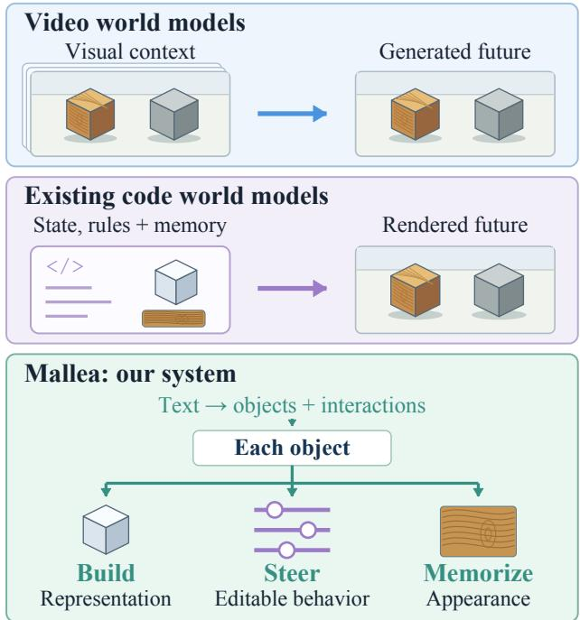
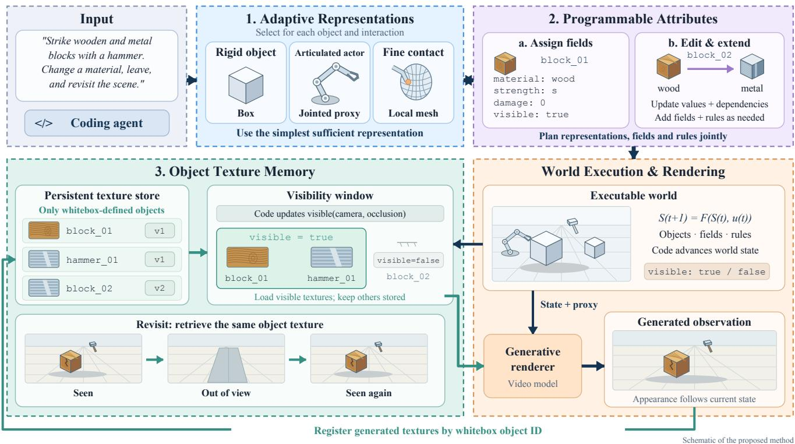
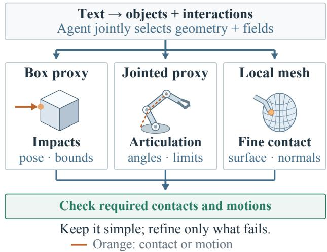
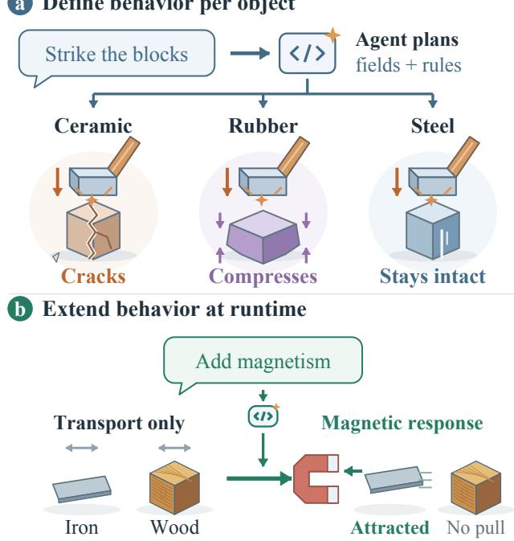
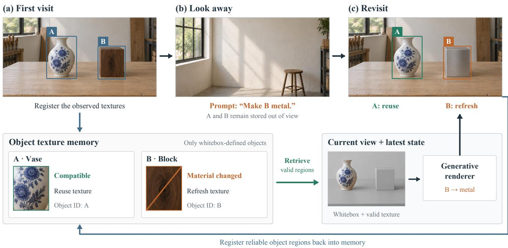
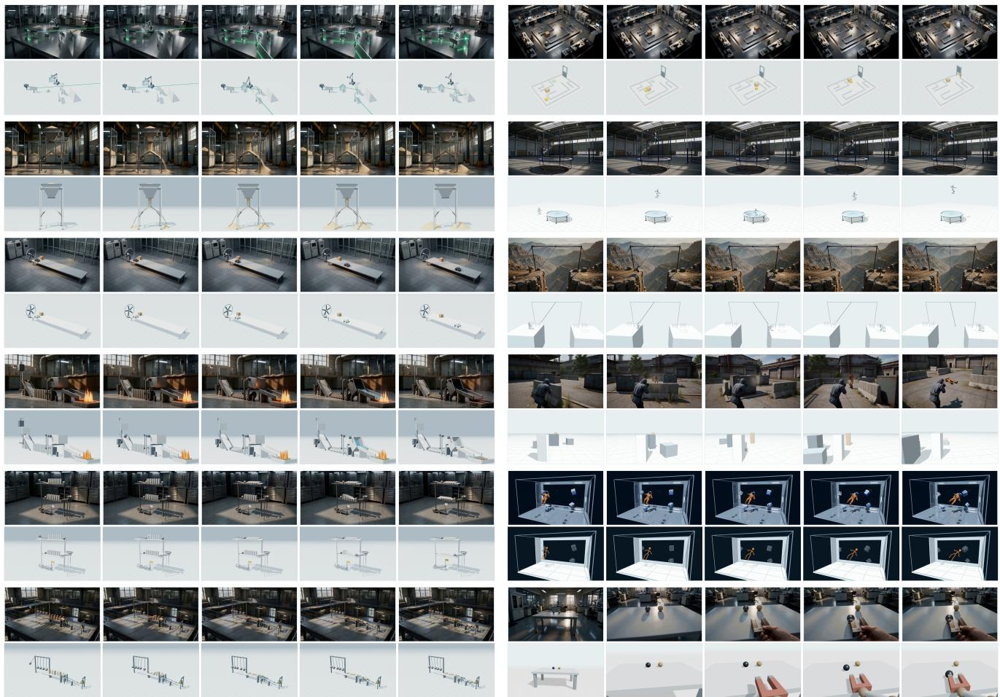

# Mallea: Building, Steering, and Memorizing Worlds with Coding Agent

Xuanyi Liu\* Ruiqi Li\* Siwei Ma Peking University

## Abstract

Code world models represent world dynamics through explicit state and executable rules. We investigate how to coordinate object representations, behavioral revisions, and visual memory within this formulation. We present Mallea, a systemfor building, steering, and memorizing worlds from text. A coding agent infers object interaction requirements from the prompt and jointly plans object structure, properties, and rules, favoring compact representations that support those requirements. The world evolves under the planned rules; optional user actions steer it, while text requests can edit properties or extend capabilities with unaffected state preserved. Object texture memory retains reusable appearance only for whitebox-defined objects and adapts it as those objects change. The program advances world state, while a generative renderer combines current structure with remembered appearance. By organizing construction, intervention, and memory around the same objects, Mallea conditions subsequent observations on the latest state and compatible appearance. Project page: https://lxycopper.github.io/Mallea.

## 1. Introduction

Video world models learn visual dynamics from video and simulate scene evolution through generated observations [1, 2, 7, 8, 10, 22, 23, 25, 30, 31, 37]. Long-horizon studies report improvements from visual memory, alongside remaining failures of object persistence and physical consistency [7, 23, 30]. Code world models expose simulated state and executable transition rules, making modeled outcomes accessible to programmatic inspection and revision [4, 5, 24]. Recent systems connect executable worlds to generative renderers through geometric proxies or registered world surfaces [4, 6, 12]. This separates state persistence from rendering fidelity; benchmarks show that visual quality metrics alone do not reliably indicate agreement with prescribed states and events [13].

  
Figure 1. Three world-model designs. Top: video models generate future frames from visual context. Middle: recent code models use explicit state, rules, and visual memory to guide rendering. Bottom: a coding agent in Mallea chooses each object’s representation (Build), edits its properties and rules (Steer), and manages its stored appearance (Memorize).

Building, steering, and memorizing a world from text raises three linked questions: how to represent objects, define and change their behavior, and remember their appearance over time. Mallea addresses these questions through a coding agent’s ability to construct and revise an executable whitebox (Fig. 1). From the objects and interaction requirements inferred from text, the agent plans representations, manages attributes and rules, and specifies how appearance memory follows object changes. Shared object definitions connect these three designs, allowing the agent’s knowledge of the world to guide both simulation and visual memory. Runtime code advances the world, with optional user actions and text requests for steering or revision (Fig. 2).

Our adaptive construction uses the agent’s ability to generate object-specific code to seek the simplest representation that preserves required interactions. Following the principle of retaining task-relevant properties in an abstraction [14], the agent plans geometry, attributes, and rules together, refining the representation only when an interaction requires additional detail (Fig. 3). Touch and collision may need only coarse contact geometry, whereas strikes and parries can require articulated motion and precise timing. Visual details that do not affect these interactions remain for the generative renderer [4, 12]. The optics and tactical examples (Fig. 6) illustrate this separation: mechanical geometry and coarse spatial proxies leave the renderer room to supply scene-specific appearance.

The agent gives these representations behavior through programmable attributes: fields record object properties, and executable rules determine how objects respond. Building on executable rule construction and revision [4, 12, 24], this mechanism offers two connected benefits. i) Defining behavior per object. The agent selects properties and rules for each object’s interactions, making its responses explicit and individually adjustable, as illustrated by the hammer example (Fig. 4a). ii) Extending behavior at runtime. These explicit definitions let the agent interpret new requests against the current model, then plan, generate, and check missing fields and rules. For example, adding magnetic-response fields and attraction rules lets a world that already supports transporting iron and wood model their different responses to a magnet (Fig. 4b). Validated revisions preserve existing objects and unrelated state. The agent can therefore revise both current property values and the behavioral capabilities of an existing world. A rendered magnetic-interaction example is included in Fig. 6.

The agent’s control over object structure and behavior also gives it a basis for managing appearance over time. As interactions and edits accumulate over long rollouts, visual consistency involves retaining unchanged details while reflecting changes in the world. Prior work preserves initial-frame anchors, including through attention sinks, or compresses history into bounded context and recurrent states [9, 21, 32, 36]. Retrieval methods recover distant frames, latents, or KV entries beyond the active window [11, 23, 30, 34, 38, 39]. Other methods use 3D geometry to project past appearance into the current view [6, 12, 27], or select historical frames that match the objects’ current states [33]. Our object texture memory lets the coding agent manage appearance through the objects it already constructs and edits (Fig. 5). It stores textures only for these whitebox objects. The agent uses their attributes and rules to decide what to retain or update, and revises these decisions when new properties or behaviors are introduced. Revisit benchmark results will be released soon.

Our contributions are as follows:

• Adaptive object representations. The coding agent selects compact representations for individual objects to support the interactions inferred from text, leaving other visual details to the renderer.

• Programmable object behavior. The agent defines object-specific attributes and rules and extends them during execution in response to new requests.

• Object texture memory. The agent manages appearance reuse by object identity and current state, revising reuse conditions as object definitions change.

Quantitative benchmark results will be released soon.

## 2. Related Work

World models through video generation. Video world models generate visual trajectories, with action-conditioned variants extending generation to user-directed exploration [2, 7, 8, 20, 22]. Even with visual memory, visually stable rollouts can still fail to preserve object identity or physical consistency [7]. Remembering an observation also differs from exposing the properties and rules that determine an object’s next response. Mallea maintains interaction-relevant state and rules in executable programs, making state transitions inspectable and enabling targeted interventions.

Programmatic modeling and generative rendering. Language-model agents generate transition programs from action-observation histories [5, 24], infer executable physical models from visual evidence [16, 26], and organize scene structure and object interaction logic [15, 28]. A complementary line combines explicit state or simulator outputs with generative rendering, allowing structured dynamics to guide richer visual observations [3, 17–19, 35]. The division raises a representation question: which information must the structured model retain for the renderer to depict a valid interaction? CWM studies minimally sufficient proxies, while PWM uses state-augmented boxes to balance control and visual detail [4, 12]. Building on these ideas, Mallea jointly selects representations, properties, and rules for individual objects according to the interactions inferred from text. This directs modeling complexity toward behaviorally relevant structure while leaving other visual details to the renderer.

Long-horizon consistency and memory. Memory mechanisms differ in what they retain and how they access it. Attention sinks preserve fixed initial context in streaming models [29, 32], while compressed history and recurrent states maintain bounded summaries [21, 36]. Retrieval methods access frames, latents, or KV entries beyond the local window [11, 30, 34, 39], including fine-grained sections of historical chunks [38]; spatial memory additionally reprojects past observations [27]. Recent CWMs combine visual reuse with executable state: PWM uses temporal and geometry-aligned memories, CoDeR registers appearance on world surfaces, and Oneira filters historical frames by current object state [6, 12, 33]. These are precedents for persistent appearance and state-aware reuse. Mallea organizes texture memory around its adaptively represented, editable whitebox objects, so behavioral revisions determine which appearance remains usable. This connects continued generation to evolving world state and limits the scope of memory updates, with revisits serving as one evaluation of long-horizon consistency.

  
Figure 2. Overview of the Mallea system. A coding agent jointly plans representations, fields, and rules. Users may supply action controls or interleave prompts to edit or extend the world. Runtime code advances state and retrieves object textures through a visibility window; generated observations update the store for subsequent revisits. The scenes are schematic illustrations.

## 3. Method

Mallea connects world construction, object interaction, and appearance memory through shared object identities (Fig. 2). The coding agent builds and revises world code and memory policies; runtime code executes them; a generative renderer produces observations.

## 3.1. Inputs, Outputs, and World State

The input is an initial text prompt, with optional user actions u (e.g., WASD movement) and text edits $q _ { t }$ during execution. The output is a sequence of visual observations $I _ { t } .$ Interactions are effects between whitebox objects; actions are user controls. We distinguish the executable model $\mathcal { M } _ { t } .$ which defines objects and rules, from its current state $S _ { t } ,$ which records their values and relations. Each object has a stable identity, a geometric representation, and typed attributes. Between edits, runtime code advances the world at

  
Figure 3. Interaction-driven construction. The agent selects geometry and fields together, checks required contacts and motions, and refines only missing structure. The illustrated representations can be combined.

## a Define behavior per object

  
Figure 4. Defining and extending behavior. Code icons denote the agent. (a) Planned fields and rules produce different responses to the same strike under the illustrated material settings. Orange bursts mark contact. (b) A request adds magnetic response to existing iron and wood, preserving unrelated state. Green arrows mark extension and attraction. Mechanism illustrations.

a fixed simulation step:

$$
S _ { t + 1 } = F _ { \mathcal { M } _ { t } } ( S _ { t } , u _ { t } ) .\tag{1}
$$

Here $u _ { t } ~ = ~ \emptyset$ denotes the absence of a user action; runtime code still advances the world and resolves object interactions from its current geometry, attributes, and rules. An object texture store $\mathcal { T } _ { t }$ supplies appearance evidence for rendering. It is separate from physical state: leaving the camera view changes retrieval, while the object continues to exist and evolve.

## 3.2. Adaptive World Construction

The agent first identifies the objects and their interactions implied by the prompt, then selects the simplest representations that support them [4, 12]. As Fig. 3 illustrates, coarse collision bounds may suffice for impacts, articulated proxies expose joint motion, and local meshes provide finer contact geometry. These are complementary choices, rather than compulsory stages of refinement.

For each object, the agent plans its representation, attributes, and rules together. A local interaction check asks whether the geometry can supply the contacts and motions required by those rules. Failed checks trigger targeted refinement; successful checks retain the simpler representation. Appearance details that do not affect interaction remain for the renderer.

## 3.3. Programmable Attributes

## 3.3.1. Defining Behavior per Object

The agent defines each object’s behavioral schema by tracing its planned interactions to the information that response rules read and change (Fig. 4a). It selects the corresponding fields jointly with the object’s geometry and rules. A field specifies its type, unit where applicable, initial value, and permitted writers. Initial values come from the prompt, available evidence, or an explicit modeling assumption. Typed fields also appear in MASS [3]; here field selection is coupled to interaction planning and representation choice.

Rules combine an event, a condition, and an update. For a hammer strike, geometry supplies contact, while material, stiffness, and damage determine the programmed response. Changing a field therefore changes execution. The illustrative responses in the figure assume specified impact and material parameters; a material name alone does not determine a physical outcome. Field checks and contact checks jointly ensure that a rule has both the information and the geometry it requires.

## 3.3.2. Extending Behavior at Runtime

A text request can change an existing value or require new fields and rules. We express an accepted edit as

$$
( \boldsymbol { \mathcal { M } } _ { t } ^ { + } , \boldsymbol { S } _ { t } ^ { + } ) = \mathrm { E d i t } ( \boldsymbol { \mathcal { M } } _ { t } , \boldsymbol { S } _ { t } , \boldsymbol { q } _ { t } ) ,\tag{2}
$$

where + denotes the committed revision. A value edit preserves the model definition; an extension revises the definition and initializes its new fields. Both update necessary dependencies and preserve unrelated state.

Figure 4b shows a world that initially supports transporting iron sheets and wooden blocks. A later request adds magnetic-response fields and attraction rules. Iron responds to the magnet while wood does not respond in the same way. Existing identities, positions, and damage are carried into the extended world.

Before commitment, the agent checks the candidate on a state copy: field types and units, rule dependencies, preservation of unaffected facts, and relevant local behavior. A successful revision is applied at a simulation-step boundary after rechecking its version; failure retains the original world. Unsupported physics requires a validated solver extension. This separates adding a capability from merely invoking an existing one.

## 3.4. Object Texture Memory

The same object identities index $\mathcal { T } _ { t } ,$ connecting current world state to appearance accumulated across long rollouts (Fig. 5). Each entry holds reusable appearance, valid surface coverage, and the representation and appearancerelated state under which it was registered. Only whiteboxdefined objects receive entries; incidental generated background is not automatically stored. Texture coordinates follow box faces, articulated parts, or mesh surfaces, so memory adapts to the chosen representation.

  
Figure 5. Object texture memory across edits and revisits. The first visit registers textures for whitebox-defined objects A and B. While both are out of view, a text edit changes $\mathbf { B } ^ { \prime } \mathbf { s }$ material. On return, the current view and state select compatible appearance: A’s pattern is reused (green), while B’s invalid texture is refreshed (orange). Generation combines current geometry with valid appearance, then registers reliable object regions back into memory. Off-screen objects retain their entries and continue evolving. Scenes are AI-generated mechanism illustrations, not experimental results.

Retrieve for the current view and state. The coding agent supplies visibility rules, and runtime code evaluates projection and occlusion to update each object’s visible field. The active window contains visible objects; offscreen entries remain stored. For a video segment, retrieval covers objects visible at any point along its committed camera trajectory.

The agent defines reuse conditions from each object’s representation and appearance-related attributes, revising them with model extensions. Runtime checks invalidate regions affected by material or damage edits; pose changes can retain object-local textures. Representation changes require a verified surface mapping or invalidate affected texture. View-dependent patches require compatible viewing directions. Compatible regions are projected at current poses to form a masked color condition; unseen, incompatible, or unreliably aligned regions remain unconstrained.

Generate and register appearance. The renderer combines the current rendering prompt $p _ { t } .$ , whitebox-derived ${ \mathrm { g e } } -$ ometric conditions $B _ { t }$ , and projected appearance $A _ { t }$ :

$$
I _ { t } = G ( p _ { t } , B _ { t } , A _ { t } ) .\tag{3}
$$

Here, $B _ { t }$ includes the whitebox view and its selected depth or edge controls; $p _ { t }$ reflects the latest world state. The renderer must accept appearance conditioning as well as geometry: depth and edges alone cannot carry stored color.

Following observation-to-surface registration [6], object IDs, depth, and camera geometry associate the generated observation with whitebox surfaces. Only reliable correspondences update texture coverage; ambiguous matches are rejected. New coverage supplements existing entries, while valid observations refresh regions invalidated by edits. Stored texture is visual evidence, not a guaranteed estimate of intrinsic reflectance.

Reusing texture does not restore a previous world state: the vase retains its pattern while the edited block gains a new appearance (Fig. 5). Per-object storage budgets and retrieval over active objects limit texture payload; actual efficiency and consistency require measurement.

Edits affecting a pending rendering segment trigger trajectory and condition recomputation. Evaluation checks physical outcomes against program records [13] and tests long-horizon appearance consistency under state changes and delayed revisits.

  
Figure 6. Qualitative results. Generated video frames (top) and corresponding display whitebox frames (bottom) for 12 scenes. Each sequence is sampled at 0%, 25%, 50%, 75%, and 100% of its frame span. Sampling is normalized independently, without event alignment. Whiteboxes in left-column rows 2–4 were adjusted after video generation.

## 4. Experiments

## 4.1. Qualitative Results

Figure 6 presents 12 scenes spanning physical processes and character motion.

Adaptive representations. Mechanical geometry in the optics setup (left, row 1) contrasts with coarse proxies in the tactical scene (right, row 4), while both renderings add scene-specific appearance.

Programmable attributes. The fire-control chain (left, row 4) couples object responses; the magnetic scene (right, row 6) illustrates material-dependent behavior. Explicit properties and rules allow these responses to be specified and extended.

Object texture memory. The zero-gravity scene (right, row 5) motivates retaining object appearance under pose changes. Our design addresses this through state-aware texture reuse; these short clips do not isolate memory’s contribution. Quantitative results, including memory ablations and long-horizon revisit benchmarks, will be released soon.

## 5. Conclusion

We presented Mallea, a coding-agent system for adaptive object representations, programmable attributes, and object texture memory. Shared executable objects connect interaction geometry, extensible behavior, and state-compatible appearance reuse. Revisions guide execution and rendering while preserving unaffected state. Qualitative examples illustrate varied representations and interactions; quantitative evaluation will assess interaction fidelity, runtime extension, long-horizon consistency, and computational cost.

## References

[1] Eloi Alonso, Adam Jelley, Vincent Micheli, Anssi Kanervisto, Amos Storkey, Tim Pearce, and François Fleuret. Diffusion for world modeling: Visual details matter in Atari. In Advances in Neural Information Processing Systems, 2024.

[2] Jake Bruce, Michael Dennis, Ashley Edwards, Jack Parker-Holder, Yuge Shi, Edward Hughes, Matthew Lai, Aditi Mavalankar, Richie Steigerwald, Chris Apps, Yusuf Aytar, Sarah Bechtle, Feryal Behbahani, Stephanie Chan, Nicolas Heess, Lucy Gonzalez, Simon Osindero, Sherjil Ozair, Scott Reed, Jingwei Zhang, Konrad Zolna, Jeff Clune, Nando de Freitas, Satinder Singh, and Tim Rocktäschel. Genie: Generative interactive environments. arXiv preprint arXiv:2402.15391, 2024.

[3] Ziqi Cai, Siqi Yang, Yimu Wang, Zixian Gao, Yunheng Liu, Shuchen Weng, Erwin Wu, Kaipeng Zhang, and Boxin Shi. MASS: Multiplayer World Models with Authoritative Shared State. arXiv preprint arXiv:2608.06257, 2026.

[4] Yiwen Chen, Guosheng Lin, and Chi Zhang. Code world model: Coding agent as world brain. arXiv preprint arXiv:2608.25927, 2026.

[5] Nicola Dainese, Matteo Merler, Minttu Alakuijala, and Pekka Marttinen. Generating code world models with large language models guided by Monte Carlo tree search. In Advances in Neural Information Processing Systems, 2024.

[6] Zixun Fang, Yawen Shao, Kai Zhu, Jie Xiao, Shihan Chen, Yu Liu, Xueyang Fu, Yang Cao, Wei Zhai, and Zheng-Jun Zha. Code Plans, Diffusion Renders: Open-Ended Generative World Modeling. arXiv preprint arXiv:2609.26458, 2026.

[7] Zelin Gao, Qiuyu Wang, Jiapeng Zhu, Jingye Chen, Zichen Liu, Qingyan Bai, Jiahao Wang, Yufeng Yuan, Hanlin Wang, Yichong Lu, Ka Leong Cheng, Haojie Zhang, Jian Gao, Tianrui Feng, Yuzheng Liu, Yao Yao, Yinghao Xu, Xing Zhu, Yujun Shen, and Hao Ouyang. Infinite Worlds with Versatile Interactions. arXiv preprint arXiv:2607.07534, 2026.

[8] Xianglong He, Chunli Peng, Zexiang Liu, Boyang Wang, Yifan Zhang, Qi Cui, Fei Kang, Biao Jiang, Mengyin An, Yangyang Ren, Baixin Xu, Hao-Xiang Guo, Kaixiong Gong, Size Wu, Wei Li, Xuchen Song, Yang Liu, Yangguang Li, and Yahui Zhou. Matrix-game 2.0: An open-source, realtime, and streaming interactive world model. arXiv preprint arXiv:2508.13009, 2025.

[9] Roberto Henschel, Levon Khachatryan, Hayk Poghosyan, Daniil Hayrapetyan, Vahram Tadevosyan, Zhangyang Wang, Shant Navasardyan, and Humphrey Shi. StreamingT2V: Consistent, Dynamic, and Extendable Long Video Generation from Text. arXiv preprint arXiv:2403.14773, 2025.

[10] Anthony Hu, Lloyd Russell, Hudson Yeo, Zak Murez, George Fedoseev, Alex Kendall, Jamie Shotton, and Gianluca Corrado. GAIA-1: A Generative World Model for Autonomous Driving. arXiv preprint arXiv:2309.17080, 2023.

[11] Qixin Hu, Shuai Yang, Wei Huang, Song Han, and Yukang Chen. LongLive-RAG: A General Retrieval-Augmented Framework for Long Video Generation. arXiv preprint arXiv:2606.02553, 2026.

[12] Zheng-Hui Huang, Guixu Lin, Jiacheng Lin, Yi-Chuan Huang, Ruihan Yu, Muyao Niu, Siqi Yang, Yu-Lun Liu, Yung-Yu Chuang, Kaipeng Zhang, and Zhixiang Wang. Programmable World Model. arXiv preprint arXiv:2609.10540, 2026.

[13] Zheng-Hui Huang, Guixu Lin, Yu-Ju Tsai, Jian-Kai Zhu, Fengbo Lan, Yu-Lun Liu, Yung-Yu Chuang, Kaipeng Zhang, and Zhixiang Wang. PROWBench: Do Video Models Render What the Program Specifies? arXiv preprint arXiv:2610.02205, 2026.

[14] Lihong Li, Thomas J. Walsh, and Michael L. Littman. To wards a unified theory of state abstraction for MDPs. In International Symposium on Artificial Intelligence and Mathe matics, 2006.

[15] Zhiqi Li, Yuxuan Liao, and Bo Zhu. Recursive code world models: Building complex worlds through recursive scene programs. arXiv preprint arXiv:2609.11499, 2026.

[16] Jiarong Liang, Max Ku, Ka-Hei Hui, Ping Nie, and Wenhu Chen. VisPhyWorld: Probing Physical Reasoning via Code-Driven Video Reconstruction. arXiv preprint arXiv:2602.13294, 2026.

[17] Zijun Lin, Zeqing Wang, Cheston Tan, Bihan Wen, and Yeying Jin. StatePlay: State-Aware Game World Models for Mechanics-Consistent Generation. arXiv preprint arXiv:2607.26754, 2026.

[18] Jiaxi Lv, Yi Huang, Mingfu Yan, Jiancheng Huang, Jianzhuang Liu, Yifan Liu, Yafei Wen, Xiaoxin Chen, and Shifeng Chen. GPT4Motion: Scripting Physical Motions in Text-to-Video Generation via Blender-Oriented GPT Plan ning. arXiv preprint arXiv:2311.12631, 2023.

[19] Zian Meng, Zhen Li, Chuanhao Li, Qiang Li, and Kaipeng Zhang. Marionette: Predicting World States, Ren dering Geometry, Painting Appearance. arXiv preprint arXiv:2608.14530, 2026.

[20] Jack Parker-Holder and Shlomi Fruchter. Genie 3: A new frontier for world models. Google DeepMind technical blog, 2025.

[21] Ryan Po, Yotam Nitzan, Richard Zhang, Berlin Chen, Tri Dao, Eli Shechtman, Gordon Wetzstein, and Xun Huang. Long-Context State-Space Video World Models. arXiv preprint arXiv:2505.20171, 2025.

[22] Robbyant Team, Zelin Gao, Qiuyu Wang, Yanhong Zeng, Jiapeng Zhu, Ka Leong Cheng, Yixuan Li, Hanlin Wang, Yinghao Xu, Shuailei Ma, Yihang Chen, Jie Liu, Yansong Cheng, Yao Yao, Jiayi Zhu, Yihao Meng, Kecheng Zheng, Qingyan Bai, Jingye Chen, Zehong Shen, Yue Yu, Xing Zhu, Yujun Shen, and Hao Ouyang. Advancing Open-source World Models. arXiv preprint arXiv:2601.20540, 2026.

[23] Wenqiang Sun, Haiyu Zhang, Haoyuan Wang, Junta Wu, Zehan Wang, Zhenwei Wang, Yunhong Wang, Jun Zhang, Tengfei Wang, and Chunchao Guo. WorldPlay: Towards Long-Term Geometric Consistency for Real-Time Interac tive World Modeling. arXiv preprint arXiv:2512.14614, 2025.

[24] Hao Tang, Darren Key, and Kevin Ellis. WorldCoder, a model-based LLM agent: Building world models by writing code and interacting with the environment. In Advances in Neural Information Processing Systems, 2024.

[25] Dani Valevski, Yaniv Leviathan, Moab Arar, and Shlomi Fruchter. Diffusion models are real-time game engines. In International Conference on Learning Representations, 2025.

[26] Hanyang Wang, Yimo Cai, Weiliang Chen, Jiawei Chi, Haowen Sun, Qiyu Dai, Yi-Hsin Hung, Xingzhuo Guo, Jinshan Ren, Runmao Yao, Ziwei Liu, Mingsheng Long, Yueqi Duan, Jun Gao, Jiangran Lyu, Fangfu Liu, and Jialong Wu. Code as Worlds: Agentic Discovery of Executable World Representations for Physical Reasoning. arXiv preprint arXiv:2608.27549, 2026.

[27] Tong Wu, Shuai Yang, Ryan Po, Yinghao Xu, Ziwei Liu, Dahua Lin, and Gordon Wetzstein. Video World Models with Long-term Spatial Memory. arXiv preprint arXiv:2506.05284, 2025.

[28] Wei Wu, Ziyang Xu, Zeyu Zhang, Yang Zhao, and Hao Tang. Code2Games: Enabling Coding Agents for Gaming World Generation. arXiv preprint arXiv:2610.05033, 2026.

[29] Guangxuan Xiao, Yuandong Tian, Beidi Chen, Song Han, and Mike Lewis. Efficient Streaming Language Models with Attention Sinks. arXiv preprint arXiv:2309.17453, 2024.

[30] Zeqi Xiao, Yushi Lan, Yifan Zhou, Wenqi Ouyang, Shuai Yang, Yanhong Zeng, and Xingang Pan. WorldMem: Longterm Consistent World Simulation with Memory. arXiv preprint arXiv:2504.12369, 2025.

[31] Sherry Yang, Yilun Du, Kamyar Ghasemipour, Jonathan Tompson, Leslie Kaelbling, Dale Schuurmans, and Pieter Abbeel. Learning interactive real-world simulators. arXiv preprint arXiv:2310.06114, 2023.

[32] Shuai Yang, Wei Huang, Ruihang Chu, Yicheng Xiao, Yuyang Zhao, Xianbang Wang, Muyang Li, Enze Xie, Yingcong Chen, Yao Lu, Song Han, and Yukang Chen. LongLive: Real-time Interactive Long Video Generation. arXiv preprint arXiv:2509.22622, 2025.

[33] Xindi Yang, Baolu Li, Liam Lee, Zhenfei Yin, Songxin Zhang, Zhuoyang Song, Xu Jia, Jianfei Cai, Tien-Tsin Wong, Bingyi Jing, and Mengyue Yang. Oneira: From Open-Ended Generation to Open-World Interaction in Video World Models. arXiv preprint arXiv:2610.01614, 2026.

[34] Jiwen Yu, Jianhong Bai, Yiran Qin, Quande Liu, Xintao Wang, Pengfei Wan, Di Zhang, and Xihui Liu. Context as Memory: Scene-Consistent Interactive Long Video Generation with Memory Retrieval. arXiv preprint arXiv:2506.03141, 2025.

[35] Xiaoyu Zhan, Xinyu Wang, Xiaohong Zhang, Huanjie Zhu, Tengjiao Sun, Pengcheng Fang, Jiaxing Yu, Yanwen Guo, and Dongjie Fu. Magpie: Real-Time World Renderer for Interactive Games. arXiv preprint arXiv:2608.27168, 2026.

[36] Lvmin Zhang, Shengqu Cai, Muyang Li, Gordon Wetzstein, and Maneesh Agrawala. Frame Context Packing and Drift Prevention in Next-Frame-Prediction Video Diffusion Models. arXiv preprint arXiv:2504.12626, 2025.

[37] Yifan Zhang, Chunli Peng, Boyang Wang, Puyi Wang, Qingcheng Zhu, Fei Kang, Biao Jiang, Zedong Gao, Eric Li, Yang Liu, and Yahui Zhou. Matrix-Game: Interactive World Foundation Model. arXiv preprint arXiv:2506.18701, 2025.

[38] Yiwen Zhang, Haocheng Xi, Michael Tian-Yue Liu, Alexei A. Efros, Hadar Averbuch-Elor, Qianqian Wang,

and Haiwen Feng. MosaiChunk: Compositing Spatio-Temporal Memory for Autoregressive Video Generation. arXiv preprint arXiv:2610.02153, 2026.

[39] Lin Zhao, Yushu Wu, Yifan Gong, Yanzhi Wang, and Pu Zhao. OmniMem: Scalable and Adaptive Memory Retrieval for Long Video Generation. arXiv preprint arXiv:2605.30519, 2026.