# Memory as Weights: Internalizing Long-Term History for Streaming Videos

Zhuoming Liu1, Jinhong Lin1, Lin Zhang1, Yiwu Zhong2, Yin Li1

1University of Wisconsin–Madison, 2Peking University

Streaming vision-language models (VLMs) must continuously integrate information from the past while remaining responsive to current observations and user queries. Existing memory mechanisms typically compress, retrieve, or cache historical observations and reintroduce them into the input context, forcing historical memory and current observations to compete for limited context. We propose MaLoW, a streaming memory framework that instead internalizes historical context into evolving lightweight parameter updates. MaLoW uses a recurrent HyperNetwork to incrementally consolidate incoming video observations into fixed-size LoRA weights, allowing historical information to be carried forward without revisiting the full video stream. In doing so, MaLoW represents history as weights, while keeping the current observation as input. To support training, we further construct MaLoW-Instruct, a large-scale streaming video dataset containing 381K question-answer pairs over 56K videos. We conduct extensive experiments to demonstrate that MaLoW achieves strong performance on OVO-Bench, StreamingBench, and StreamArena. On the backward split of OVO-Bench, MaLoW outperforms prior memory approaches by 3.9%–11.8% across diferent video backbones while incurring only modest latency overhead. Beyond streaming video understanding, MaLoW also generalizes to vision-language-action models, improving the action success rate on Simpler WidowX by 9.3%.

Project page: https://dragonlzm.github.io/MaLoW Code: https://github.com/dragonlzm/MaLoW Models & data: https://huggingface.co/collections/zhuomingliu/malow

## 1 Introduction

By continuously processing an input video stream and responding to user queries, a streaming vision-language model (VLM) must reason over what has already happened, interpret what is happening now, and remain attentive to what may happen next. Such capabilities are central to key tasks ranging from streaming video understanding (Niu et al., 2025) to interactive AI assistants (Lab, 2026) and robotic planning (Li et al., 2025), where responses and decisions must be made online under latency and memory constraints. Streaming VLMs have thus emerged as an important research frontier. Recent work has shown that ofline VLMs can be adapted to describe ongoing activities in streaming videos (Shen et al., 2026; Lu et al., 2026), while instruction fine-tuning can further enable models to monitor future events (Li et al., 2026; Wang et al., 2026).

Despite these eforts, a fundamental open problem remains: how should a streaming VLM remember? As in the ofline setting, an efective memory mechanism must preserve important visual information within a bounded memory footprint. The streaming setting, however, introduces additional challenges. First, memory must evolve incrementally as new observations arrive, rather than being repeatedly recomputed from the full history. Second, historical information must be incorporated without crowding out the current observation (see Fig. 1-2). Finally, a practical memory mechanism should introduce minimal inference overhead.

To address these challenges, we propose MaLoW (Memory as LoRA Weights), a framework that internalizes historical context into evolving lightweight parameter updates of a streaming VLM, as illustrated in Fig. 1-1. MaLoW incrementally consolidates incoming observations into fixed-size LoRA weights, allowing accumulated history to be carried forward without revisiting the full video stream. The base VLM architecture and parameters stay unchanged and only the lightweight LoRA memory evolves over time. More fundamentally, rather than placing memory and current observations in competition within the same context window, as in prior work (Guan et al., 2026; Liu et al., 2026; Zhang et al., 2026a), MaLoW represents history as weights while keeping the current observation as input. At each step, the model takes the current observation and user query as input and performs inference using the updated LoRA weights that encode historical information. By separating historical memory from the input context, MaLoW preserves the model’s capacity to attend to current observations while retaining information from the past (Fig. 1-2), with only modest inference overhead.

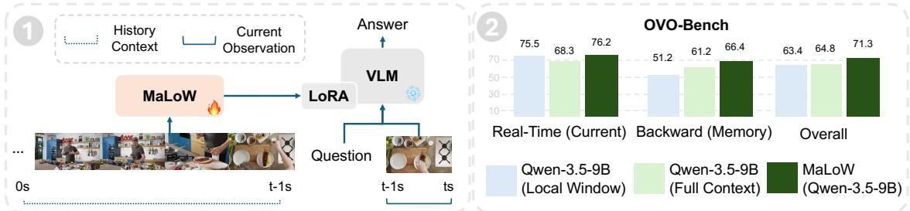  
Figure 1 (1): MaLoW internalizes the history context into time-evolving, lightweight parameter updates (LoRA) of a streaming VLM. At each step, the streaming VLM takes the current observation and user query as input, and performs inference using the updated LoRA weights. (2): By separating memory from the input, MaLoW preserves the performance on real-time perception while significantly improves the performance of memory-critical, backward tracing tasks.

Specifically, MaLoW employs a recurrent HyperNetwork (Ha et al., 2017) to eficiently generate the LoRA weights that encode historical information. At each time step, the incoming video clip and its textual context are first compressed into a compact representation, which is then used to update a set of recurrent hidden states. To model the temporal dynamics of these hidden states, MaLoW maintains two parallel branches: a state-space model (Yang et al., 2024) for modeling local temporal dependencies, and a gated summation branch for preserving global historical semantics. The resulting states are mapped through a linear projection to the LoRA weights used by the VLM. To facilitate training, we further construct MaLoW-Instruct, a comprehensive streaming video dataset containing 381K question-answer (QA) pairs over 56K videos, by adapting public ofline video understanding datasets to the streaming setting.

To evaluate our framework, we conduct extensive experiments across benchmarks and settings. MaLoW demonstrates state-of-the-art results on streaming video benchmarks, including OVO-Bench (Niu et al., 2025), StreamingBench (Lin et al., 2026) and StreamArena (Zhang et al., 2026d). On the backward split of OVO-Bench, for example, MaLoW outperforms prior memory approaches by 3.9%–11.8% across diferent video backbones, while incurring modest latency overhead. Across base VLMs ranging from 0.8B to 11B parameters, MaLoW yields consistent performance gains. Beyond streaming video understanding, we further extend MaLoW to the Vision-Language-Action (VLA) setting, where incorporating historical observations and action trajectories improves the action success rate on Simpler (Li et al., 2025) WidowX by 9.3%.

## Our contributions are summarized as follows:

• We propose MaLoW, a new streaming memory framework that internalizes historical context into evolving LoRA weights, introducing a distinct design in which history is represented as weights while current observations remain as input.

• We develop a recurrent HyperNetwork that incrementally updates LoRA memory from streaming video and other context. We also construct MaLoW-Instruct, a large-scale training dataset for streaming video understanding, which we will release publicly.

• We demonstrate that MaLoW achieves competitive results across streaming video benchmarks, attains consistent gains over diverse base VLMs, and generalizes to VLA settings.

## 2 Related Work

Vision-Language Models. Vision-language models (VLMs) (Liu et al., 2023; Alayrac et al., 2022; Zhang et al., 2025b; Clark et al., 2026; Qwen Team, 2026) unify diverse visual understanding and reasoning tasks through a natural-language interface. Among these tasks, long-video understanding (Zhou et al., 2025; Wang et al.,

2025) is particularly challenging because models must preserve and reason over information spanning extended temporal contexts.

Prior works (Qian et al., 2024; He et al., 2024; Song et al., 2024) have explored various memory and contextmanagement mechanisms for this ofline long video understanding setting. Our work builds on pretrained VLMs and equips them with an evolving long-term memory that is needed in the streaming video setting and incrementally updated as new observations arrive.

Streaming VLMs with Memory. Recent works on streaming VLMs (Xia et al., 2026; Chen et al., 2024a; Li et al., 2026; Wang et al., 2026) explore several complementary directions, including constructing higher-quality instruction-tuning data, designing architectures tailored to streaming inputs, and incorporating stronger video encoders. More recent studies (Lu et al., 2026; Shen et al., 2026) show that strong VLMs with a small local video window yield surprisingly strong performance on real-time questions on existing streaming video benchmarks.

Another line of work focuses on the memory mechanisms. Some methods compress historical visual observations into textual summaries or memories (Liu et al., 2026; Guan et al., 2026; Yao et al., 2026), while others reduce the accumulated visual tokens through clustering or token merging (Zhang et al., 2024). Additional approaches organize historical information into hierarchical memory structures (Zeng et al., 2026; Zhang et al., 2026a; Xie et al., 2026; Liang et al., 2026), or maintain a fixed-size memory bufer that selectively preserves useful historical observations (Qian et al., 2025; Yao et al., 2025). Despite their diferences, these methods generally address the growing streaming context by compressing historical information into a bounded token budget. In contrast, we represent long-term memory directly in model weights.

Concurrent work (Chen et al., 2026) similarly moves long-term memory outside the attention context. However, it stores historical information in a separate test-time-training (TTT) branch with online-updated fast weights. In contrast, our method directly internalizes history into the VLM itself by dynamically generating low-rank parameter adaptations, without introducing a separate memory branch.

Low-Rank Adaptation and Context Internalization. Low-rank adaptation (LoRA) (Hu et al., 2022) has been widely adopted as a parameter-eficient approach for adapting pretrained vision-language models (VLMs) and multi-modal large language models (MLLMs) to downstream tasks or new domains (Dettmers et al., 2023; Chen et al., 2024b; Liu et al., 2025). Recently, several works have explored using LoRA as a representation for encoding data-specific patterns (Shrestha et al., 2025; Yin et al., 2026) or contextual information (Charakorn et al., 2026, 2025). These approaches demonstrate that model parameters can be a good representation for storing information beyond conventional token-based context. However, they typically require additional optimization when adapting to a new pattern, making it dificult to apply them directly to evolving inputs. δ-mem (Lei et al., 2026) explores dynamically representing textual information through LoRA updates without test-time training. Nevertheless, it still relies on access to the historical context during inference.

Diferent from these prior approaches, our work specifically handles the streaming setting, and introduces a context internalization mechanism that progressively incorporates incoming visual context into low-rank model representations.

## 3 Internalizing Long-Term History for Streaming Videos

## 3.1 Problem Formulation: Streaming Video and Internalizing History

A streaming VLM $M _ { \theta }$ , parameterized by $\theta ,$ must continuously perceive incoming visual content, respond to user queries or instructions $I _ { t } ,$ and generate an appropriate response or decision $R _ { t }$ at time step t, using information available before t. Formally, we define this streaming setting as

$$
R _ { t } = M _ { \theta } ( I _ { t } , C _ { 0 : t - 1 } , C _ { t } ) ,\tag{1}
$$

where $C _ { 0 : t - 1 }$ denotes the historical context accumulated before time $t ,$ and $C _ { t }$ denotes the current observation. Each $C$ may contain both visual and textual information. This formulation encompasses streaming video $\mathrm { Q A }$ VLA, and other real-time interactive settings.

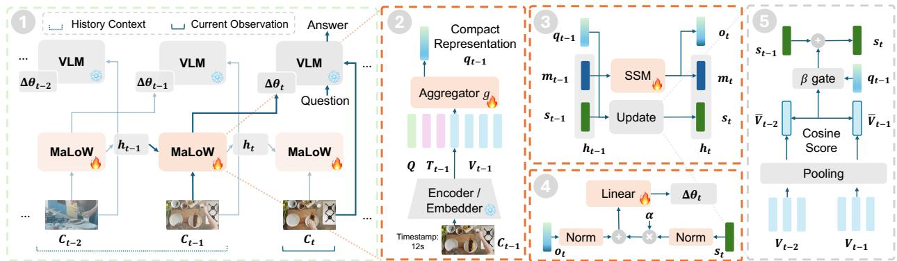  
Figure 2 Overview of MaLoW. (1) MaLoW internalizes history into LoRA weights applied to a base VLM that processes only the current observation. (2) Context encoding compresses visual tokens $V _ { t - 1 }$ and timestamp tokens $T _ { t - 1 }$ into a compact representation $q _ { t - 1 }$ using a learnable query Q. (3) Hidden state updates $m _ { t }$ that captures local dynamics and $s _ { t }$ that preserves global semantics. (4) LoRA weights are decoded from the hidden states. (5) $s _ { t }$ is updated through gated summation.

Explicitly retaining $C _ { 0 : t - 1 }$ , however, leads to an ever-growing input context. We instead propose to internalize this history into lightweight, evolving model parameters using LoRA weights $\Delta \theta _ { t }$

$$
\Delta \theta _ { t } = \Phi ( C _ { 0 : t - 1 } ; h _ { 0 } ) , \qquad R _ { t } = M _ { \theta + \Delta \theta _ { t } } ( I _ { t } , C _ { t } ) ,\tag{2}
$$

where Φ is a recurrent HyperNetwork initialized with a fixed hidden state $h _ { 0 } .$ , and it incrementally encodes historical context into LoRA updates. With the history-dependent $\Delta \theta _ { t }$ applied to $M _ { \theta }$ , the VLM only needs to explicitly process the current observation $C _ { t }$ and user query $I _ { t }$ at inference time. Thus, history is represented as weights, while the current observation remains as input.

Importantly, we define Φ as the recurrent application of a single-step update f over the history context $C _ { 0 : t - 1 }$ as shown in Fig. 2-1. f is itself also a HyperNetwork that updates a hidden state $h _ { t }$ and outputs the LoRA weights $\Delta \theta _ { t }$ , given by

$$
h _ { t } , \ \Delta \theta _ { t } = f ( h _ { t - 1 } , C _ { t - 1 } ) .\tag{3}
$$

$h _ { t }$ ofers a compact representation of $C _ { 0 : t - 1 }$ and repeated application of f realizes Φ.

## 3.2 Our Design: MaLoW

We now describe the design of MaLoW, focusing on the single-step update $f .$ Conceptually, f consists of three parts: (1) the encoding of context $C _ { t - 1 } ; ( 2 )$ the update of the hidden state $h _ { t } ;$ and (3) the decoding of the LoRA weights $\Delta \theta _ { t }$ . This is illustrated in Fig. 2-(2-5).

Context Encoding. Videos contain substantial redundancy (Shang et al., 2025; Zhong et al., 2025). Given the observation $C _ { t - 1 }$ consisting of a video clip and its textual context $( \mathrm { e . g . }$ , timestamps in text format), we first compress it into a compact representation. This is done by first encoding the video and text into their embeddings $V _ { t - 1 }$ (video) and $T _ { t - 1 }$ (text) using the vision encoder and the text tokenizer of the VLM. We then learn a set of queries $Q$ to compress $V _ { t - 1 }$ and $T _ { t - 1 }$

$$
q _ { t - 1 } = g ( [ V _ { t - 1 } ; T _ { t - 1 } ; Q ] )\tag{4}
$$

where $q _ { t - 1 }$ is the resulting compact representation of $C _ { t - 1 } . \ g$ is realized using a few self-attention layers, with the concatenated $[ V _ { t - 1 } , T _ { t - 1 } , Q ]$ as the input (see Fig. 2-2).

Hidden-State Update. In interactive settings, new observations arrive continuously over time. An efective memory mechanism should therefore capture both the temporal dependencies among observations and the global semantics accumulated throughout the interaction. To this end, we decompose the hidden state $h _ { t }$ into two components: $h _ { t } = [ m _ { t } ; s _ { t } ]$ , where $m _ { t }$ models local temporal dynamics in the stream, while $s _ { t }$ captures longer-term semantic information.

Specifically, $m _ { t }$ is modeled by a State-Space Model (SSM) using DeltaNet from (Yang et al., 2024). Given $q _ { t - 1 }$ and the previous state $m _ { t - 1 } .$ , the SSM is updated as

$$
m _ { t } , o _ { t } = \mathrm { S S M } ( q _ { t - 1 } , m _ { t - 1 } ) ,\tag{5}
$$

where $m _ { t }$ denotes the updated state and $o _ { t }$ the corresponding output. Through recurrent updates, $m _ { t }$ captures the temporal dependencies across the observed stream (see Fig. 2-3).

In parallel, $s _ { t }$ is simply a gated summation of $q _ { t - 1 }$ , acting as a skip connection to allow longer-term memory (Hochreiter & Schmidhuber, 1997). This is given by

$$
s _ { t } = s _ { t - 1 } + \beta _ { t - 1 } q _ { t - 1 } \quad \mathrm { w i t h } \beta _ { t - 1 } = \mathbb { I } \big [ \sin ( \bar { V } _ { t - 1 } , \bar { V } _ { t - 2 } ) \leq \beta \big ] ,\tag{6}
$$

where $\beta _ { t }$ is a binary gate, I is the indicator function, and sim $\hat { 1 } ( \hat { V } _ { t - 1 } , \hat { V } _ { t - 2 } )$ is the cosine similarity on the averaged pooled $V _ { t - 1 } , V _ { t - 2 }$ . This is shown in Fig. 2-5.

LoRA Decoding. Finally, we convert the accumulated historical information, represented by $o _ { t }$ and $s _ { t } ,$ , into LoRA weights $\Delta \theta _ { t }$ using a readout function h

$$
\Delta \theta _ { t } = h ( o _ { t } , s _ { t } )\tag{7}
$$

h is realized as a linear mapping on top of $o _ { t }$ and $s _ { t }$ normalized with RMSNorm (Zhang & Sennrich, 2019), with an additional learnable gating parameter α applied to the normalized version of $s _ { t }$ (see Fig. 2-4). The resulting LoRA weights $\Delta \theta _ { t }$ will be applied to the VLM at the next time step.

## 3.3 Model Training and Theoretic Analysis

Loss Function. We optimize MaLoW using the loss function

$$
\begin{array} { r } { \mathcal { L } = \mathcal { L } _ { \mathrm { n t p } } + \gamma \mathcal { L } _ { \mathrm { L o R A } } . } \end{array}\tag{8}
$$

$\mathcal { L } _ { n t p }$ is the standard next-token prediction objective

$$
\mathcal { L } _ { n t p } = - \mathbb { E } _ { ( C _ { 0 : t - 1 } , C _ { t } , I _ { t } , y _ { t } ) \sim \mathcal { D } } \sum _ { k = 1 } ^ { | y _ { t } | } \log p _ { \theta + \Delta \theta _ { t } } \left( y _ { t , k } \mid I _ { t } , C _ { t } , y _ { t , < k } \right) .\tag{9}
$$

$\mathcal { L } _ { \mathrm { L o R A } }$ regularizes the magnitude of the generated LoRA weights following the previous work (Charakorn et al., 2025):

$$
\mathcal { L } _ { \mathrm { L o R A } } = \Sigma _ { s \in \mathcal { S } } \left( \mathrm { m e a n } | \mathbf { A } _ { s } | + \mathrm { m e a n } | \mathbf { B } _ { s } | \right) / | \cal { S } | ,\tag{10}
$$

where $s$ indexes LoRA weights attached to diferent parameters of the VLM, $\mathbf { A } _ { s }$ and $\mathbf { B } _ { s }$ are the factorized low-rank matrices in the corresponding LoRA weights.

Training Scheme. During training, VLM parameters θ is frozen and the historical context $C _ { 0 : t - 1 }$ are not directly provided to the VLM when predicting $y _ { t }$ . Instead, $C _ { 0 : t - 1 }$ can only influence the prediction through the generated LoRA weights $\Delta \theta _ { t }$ . The prediction loss is backpropagated through $\Delta \theta _ { t }$ to optimize the parameters in the HyperNetwork $f ,$ encouraging MaLoW to preserve historical information that is useful for future interactions while discarding redundant context.

Theoretical Analysis. We also provide theoretical analysis in Appendix A to establish the feasibility of representing history-induced feature transformations through low-rank parameter updates.

## 3.4 Training data construction: MaLoW-Instruct

To train MaLoW to enable adapted VLMs to retrospect over past observations, preserve relevant information for understanding the present, and support future responses or actions, we construct a comprehensive training dataset for streaming video understanding, named as MaLoW-Instruct.

Data Sources and Dataset Construction. Our data construction pipeline consists of three main components: (1) a question generator, (2) an answer generator, and (3) an verifier (Fig. 3-1). We build on existing video temporal grounding and procedural action datasets that provide event/action timestamps and corresponding descriptions. For each annotated event, the question generator takes the video together with the event description and generates candidate questions about either the target event itself or its surrounding context, an expected answer, along with the question timestamps t. We consider diverse question formats, including open-ended, multiple-choice, and yes/no questions. To prevent data leakage, we filter out the samples used in OVO-Bench (Niu et al., 2025).

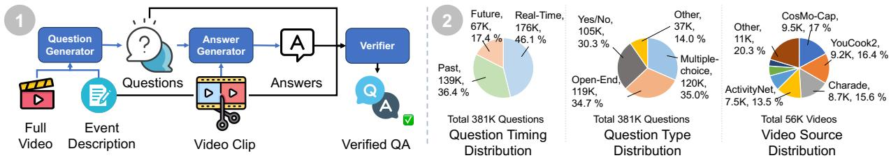  
Figure 3 Overview of the MaLoW data pipeline and statistics of MaLoW-Instruct. (1): Our data pipeline consists of a Question Generator, an Answer Generator, and a Verifier. (2): The distribution of the streaming question timing, the question type, and video source in MaLoW-Instruct.

Given a generated question, the answer generator then processes the video up to timestamp t and produces a model answer. Finally, the verifier takes the generated question, expected answer, model answer, and the video context surrounding the target event to assess both the validity of the question and the correctness of the answer. An unreasonable question or an inconsistent answer typically results in disagreement between the expected answer, generated answer, and supporting video context. We therefore retain only QA pairs that pass the verification stage to form the final training dataset. We use Qwen3.5-122B-A10B (Qwen Team, 2026) as both the question and answer generator, and Qwen3.5-397B-A17B as the verifier. Please see more details in the Appendix B.1 and B.2.

Dataset Statistics. MaLoW-Instruct contains 381K instruction samples on 56K videos. We summarize the distributions and statistics of the videos and questions in Fig. 3-2. Approximately 36% of the QA pairs have query timestamps that occur after the corresponding event has ended, providing explicit supervision for learning the MaLoW module to retain and retrieve historical information. Moreover, for many real-time questions, part of the relevant event falls outside the current observation window, further encouraging the model to leverage historical context through MaLoW. The question types are approximately evenly distributed among multiple-choice, open-ended, and yes/no questions. The videos are collected from 14 datasets, among which CosMo-Cap (Wang et al., 2024a), YouCook2 (Zhou et al., 2018), Charades-STA (Gao et al., 2017), and ActivityNet-Captions (Krishna et al., 2017) together account for 62.5% of all videos. More dataset statistics are presented in the Appendix B.3.

## 4 Experiments and Results

## 4.1 Streaming Video Understanding

Benchmarks. Following the prior works (Shen et al., 2026; Zhang et al., 2026a), we evaluate MaLoW on the Real-Time split of StreamingBench (Lin et al., 2026), as well as the Real-Time and Backward splits of OVO-Bench (Niu et al., 2025). The Backward splits of OVO-Bench mostly focus on retrospect to the past and comprise three tasks: Episodic Memory (EPM), Action Sequence Identification (ASI), and Hallucination Detection (HLD). Among them, EPM is particularly well suited for assessing the efectiveness of the memory mechanism introduced by MaLoW.

Experiment Protocol. We build MaLoW on top of a diverse set of VLMs, including models pre-trained for ofline video understanding (Qwen3-VL-4B (Bai et al., 2025) and Qwen3.5-9B (Qwen Team, 2026)) and models designed for streaming video (VideoChat3-4B (Li et al., 2026) and MOSS-VL-Realtime-11B (Wang et al., 2026)). Across all base VLMs, MaLoW operates in a streaming setting with a local context window: at each time step t, only the most recent video clip $C _ { t }$ is provided as the current observation, while all preceding clips $C _ { 0 : t - 1 }$ are consolidated into the evolving model weights.

Table 1 Main results in streaming video understanding. \*VideoChat3 uses 2 fps on OVO-Bench and 4 fps on StreamingBench. Gray numbers denote results reported in the original paper that difer from our re-evaluation using the oficial implementation and reported evaluation hyperparameters. Please refer to Baselines Re-evaluation in sec C.1 for more information. MaLoW (MOSS-VL-Real-11B) and MaLoW (Qwen3-VL-4B) achieve a new state-of-the-art score of 74.5 and 84.8 on OVO-Bench and StreamingBench, respectively, while MaLoW (Qwen3.5-9B) attains the highest EPM score of 63.6 among all compared methods.
<table><tr><td rowspan="3">Model</td><td rowspan="3">#Frames</td><td rowspan="3">Streaming Bench (R)</td><td colspan="8">OVO-Bench</td><td colspan="2"></td></tr><tr><td colspan="6">Real-Time Visual Perception</td><td colspan="3">Backward Tracing</td><td rowspan="2">Avg.</td></tr><tr><td colspan="6">|OCR ACR ATR STU FPD OJR Avg.</td><td colspan="3">EPM ASI HLD |Avg.</td></tr><tr><td>Offline VLMs</td><td></td><td></td><td></td><td></td><td></td><td></td><td></td><td></td><td></td><td></td><td></td><td></td></tr><tr><td>LLaVA-Video-7B (Zhang et al., 2025b)</td><td>64</td><td></td><td>69.1 58.7</td><td>68.8</td><td>49.4</td><td>74.3</td><td>59.8</td><td>63.5</td><td>56.2 57.4</td><td>7.5</td><td>40.4</td><td>52.0</td></tr><tr><td>LongVU-7B (Shen et al., 2025)</td><td>1 fps</td><td></td><td>55.7 49.5</td><td>59.5</td><td>48.3</td><td>68.3</td><td>63.0</td><td>57.4</td><td>43.1 66.2</td><td>9.1</td><td>39.5</td><td>48.5</td></tr><tr><td>Qwen3-VL-4B (Bai et al., 2025)</td><td>1 fps</td><td>78.4</td><td>85.2 60.6</td><td>74.1</td><td>51.1</td><td>76.2</td><td>67.9</td><td>69.2</td><td>57.9 61.5</td><td>16.7</td><td>45.4</td><td>57.3</td></tr><tr><td>Qwen3.5-9B (Qwen Team, 2026)</td><td>1 fps</td><td>81.9</td><td>83.9 62.4</td><td>70.7</td><td>46.1</td><td>76.2</td><td>70.6</td><td>68.3</td><td>61.6 62.8</td><td>59.1</td><td>61.2</td><td>64.8</td></tr><tr><td>Streaming VLMs with Long-term (Full) Context</td><td></td><td></td><td></td><td></td><td></td><td></td><td></td><td></td><td></td><td></td><td></td><td></td></tr><tr><td>VideoLLM-online-8B (Chen et al., 2024a)</td><td>2 fps</td><td>36.0</td><td>8.1 23.9</td><td>12.1</td><td>14.0</td><td>45.5</td><td>21.2</td><td>20.8</td><td>22.2</td><td>18.812.2</td><td>17.7</td><td>19.3</td></tr><tr><td>Streamo-7B (Xia et al., 2026)</td><td>1 fps</td><td></td><td>79.2 57.8</td><td>75.0</td><td>49.4</td><td>64.4</td><td>70.1</td><td>66.0</td><td>54.6 52.0</td><td>31.7</td><td>46.1</td><td>56.1</td></tr><tr><td>VideoChat3-4B (Li et al., 2026)</td><td>2-4 fps*</td><td>79.0 (83.0)</td><td>92.6 78.0</td><td>77.6</td><td>59.0</td><td>74.3</td><td>71.7</td><td>75.5</td><td>58.8 58.6</td><td>46.8</td><td>54.7</td><td>65.1</td></tr><tr><td>MOSS-VL-Real-11B (Wang et al., 2026)</td><td>1 fps</td><td>80.6 (82.9)</td><td>86.6 70.6</td><td>84.8</td><td>64.6</td><td>71.2</td><td>73.9</td><td>75.2</td><td>60.6 64.5</td><td>92.4</td><td>72.5</td><td>73.8</td></tr><tr><td>Streaming VLMs with Local Context Window</td><td></td><td></td><td></td><td></td><td></td><td></td><td></td><td></td><td></td><td></td><td></td><td></td></tr><tr><td>Mage-VL-4B (Yang et al., 2026)</td><td>4 (1 fps)</td><td></td><td>94.6 83.5</td><td>79.3</td><td>74.2</td><td>70.3</td><td>77.2</td><td>79.8</td><td>50.2</td><td>61.5 32.8</td><td>48.2</td><td>64.0</td></tr><tr><td>Simplestream-8B (Shen et al., 2026)</td><td>4 (1 fps)</td><td>78.3</td><td>89.3 77.1</td><td>83.6</td><td>68.5</td><td>76.2</td><td>81.0</td><td>79.3</td><td>49.5</td><td>56.1 54.8</td><td>53.5</td><td>66.4</td></tr><tr><td>AURA-8B (Lu et al., 2026)</td><td>30 (1 fps)</td><td>83.2</td><td>89.9 79.8</td><td>80.2</td><td>70.2</td><td>77.2</td><td>81.5</td><td>79.8</td><td>54.9</td><td>67.6 58.6</td><td>60.4</td><td>70.1</td></tr><tr><td colspan="9">Streaming VLMs with Local Context Window and Memory Mechanism</td><td></td><td></td><td></td></tr><tr><td>Flash-VStream-7B (Zhang et al., 2024)</td><td>1 fps</td><td>23.2</td><td>24.2 29.4</td><td>28.5</td><td>33.7</td><td>25.7</td><td>28.8</td><td>28.4</td><td>39.1</td><td>37.2 5.9</td><td>27.4</td><td>27.9</td></tr><tr><td>Dispider-7B (Qian et al., 2025)</td><td>1 fps</td><td>67.6</td><td>57.7 49.5</td><td>62.1</td><td>44.9</td><td>61.4</td><td>51.6</td><td>54.6</td><td>48.5</td><td>55.4 4.3</td><td>36.1</td><td>45.4</td></tr><tr><td>TimeChat-Online-7B (Yao et al., 2025)</td><td>1 fps</td><td>75.3</td><td>75.2 46.8</td><td>70.7</td><td>47.8</td><td>69.3</td><td>61.4</td><td>61.9</td><td>55.9 59.5</td><td>9.7</td><td>41.7</td><td>51.8</td></tr><tr><td>StreamForest-7B (Zeng et al., 2026)</td><td>1 fps</td><td>77.3</td><td>68.5 53.2</td><td>71.6</td><td>47.8</td><td>65.4</td><td>60.9</td><td>61.2</td><td>58.9 64.9</td><td>32.3</td><td>52.0</td><td>56.6</td></tr><tr><td>JoyAI-VL-Interaction-8B (Yao et al., 2026)</td><td>1 fps</td><td></td><td>72.5 61.5</td><td>75.0</td><td>59.0</td><td>78.2</td><td>64.1</td><td>68.4</td><td>62.0 70.9</td><td>12.9</td><td>48.6</td><td>58.5</td></tr><tr><td>HERMES-7B (Zhang et al., 2026a)</td><td>1 fps</td><td>79.4</td><td>85.2 64.2</td><td>71.6</td><td>53.4</td><td>74.3</td><td>65.2</td><td>69.0</td><td>48.5</td><td>62.2 37.6</td><td>49.4</td><td>59.2</td></tr><tr><td>ThinkStream-3B (Liu et al., 2026)</td><td>2 fps</td><td>75.0</td><td>85.2 64.2</td><td>69.8</td><td>49.4</td><td>69.3</td><td>64.1</td><td>67.0</td><td>53.9 59.5</td><td>43.6</td><td>52.3</td><td>59.7</td></tr><tr><td>VST-7B (Guan et al., 2026)</td><td>2 fps</td><td>79.5</td><td>80.5 55.1</td><td>72.4</td><td>55.1</td><td>76.2</td><td>64.1</td><td>67.2</td><td>56.9 64.9</td><td>48.4</td><td>56.7</td><td>62.0</td></tr><tr><td>OASIS-8B (Liang et al., 2026)</td><td>2 fps</td><td>78.2</td><td>92.0 80.7</td><td>81.0</td><td>67.4</td><td>67.3</td><td>79.9</td><td>78.1</td><td>62.0 60.1</td><td>47.3</td><td>57.2</td><td>67.7</td></tr><tr><td>StreamTTT-4B (Chen et al., 2026)</td><td>2 fps</td><td>81.3</td><td>91.3 80.7</td><td>80.2</td><td>56.2</td><td>82.2</td><td>77.7</td><td>78.1</td><td>60.9 58.1</td><td>60.8</td><td>59.9</td><td>69.0</td></tr><tr><td>Ours</td><td></td><td></td><td></td><td></td><td></td><td></td><td></td><td></td><td></td><td></td><td></td><td></td></tr><tr><td>MaLoW (VideoChat3-4B) - 197.6M trainable (4.0%)</td><td>1 fps</td><td>81.2</td><td>89.9</td><td>70.6 80.2</td><td>60.7</td><td>76.2</td><td>75.3</td><td>75.5</td><td>60.2 58.1</td><td>54.8</td><td>57.7</td><td>66.6</td></tr><tr><td>MaLoW (Qwen3-VL-4B) - 197.6M trainable (3.9%)</td><td>1 fps 1 fps</td><td>84.8 82.3</td><td>90.6 69.7 87.9 66.1</td><td>75.0 81.0</td><td>64.0 60.1</td><td>74.3 84.2</td><td>74.5 77.7</td><td>74.7 76.2</td><td>62.0 67.6</td><td>61.8</td><td>63.8</td><td>69.3</td></tr><tr><td>MaLoW (Qwen3.5-9B) - 308.9M trainable (3.0%)</td><td>1 fps</td><td>81.0</td><td>91.9 74.3</td><td>85.3</td><td>62.9</td><td>73.3</td><td>76.6</td><td>77.4</td><td>63.6 66.2 62.0</td><td>69.4</td><td>66.4</td><td>71.3</td></tr><tr><td>MaLoW (MOSS-VL-Real-11B) - 321.1M trainable (1.4%)</td><td></td><td></td><td></td><td></td><td></td><td></td><td></td><td></td><td>62.8</td><td>90.3</td><td>71.7</td><td>74.5</td></tr></table>

Implementation Details. We apply rank-8 LoRA to the MLP in each attention layer and v\_proj layers in each self-attention layer. For Qwen3.5-9B, we additionally apply LoRA to the in\_proj\_qkv\_proj layers in its linear-attention blocks. For MOSS-VL, we additional apply v\_proj layers in each cross-attention layer. We use a four-layer self-attention network as the aggregator, with a hidden dimension of 512 and eight attention heads. For each layer of the base model, we learn an independent query and maintain a corresponding hidden state. We instantiate the SSM using a four-layer DeltaNet (Yang et al., 2024) with a hidden dimension of 512. To generate the LoRA parameters, we learn separate linear projection layers for each target module and LoRA rank component. We train MaLoW on the training data introduced in Sec. 3.4 for 2,800 steps with a total batch size of 64. We use the Adam optimizer with a peak learning rate of $8 \times 1 0 ^ { - 5 }$ and a cosine learning-rate schedule. The videos are sampled at 1 fps during training and inference of MaLoW. Each Ct is a 2-second video clip. Additional implementation details are provided in the Appendix C.1.

Baselines. We categorize the baselines into four groups according to the model types and how they manage historical visual context during streaming inference.

1. Ofline VLMs. This category includes LLaVA-Video-7B (Zhang et al., 2025b), LongVU-7B (Shen et al., 2025), Qwen3-VL-4B (Bai et al., 2025), and Qwen3.5-9B (Qwen Team, 2026). We compare to these models for their strong video understanding capabilities, acquired through large-scale video-text pretraining. We evaluate their pretrained checkpoints by treating streaming videos as ofline inputs.

2. Streaming VLMs with Long-term (Full) Context. This category includes VideoLLM-Online (Chen et al.,   
2024a), Streamo (Xia et al., 2026), VideoChat3 (Li et al., 2026), and MOSS-VL-Realtime (Wang et al.,

2026). These methods preserve historical observations directly in the inference context as memory for streaming video understanding, and for short videos often retaining the entire video history. As the stream grows, this leads to an ever expanding context window and substantial memory and computational overhead. We note that VideoChat3 uses a local context window on OVO-Bench, while retaining the full historical context on StreamingBench.

3. Streaming VLMs with a Local Context Window. This category includes Mage-VL (Yang et al., 2026), SimpleStream (Shen et al., 2026), and AURA (Lu et al., 2026). We compare to these models for their strong real-time performance, achieved by retaining only the most recent observations within a fixed local window of approximately 4–30 seconds. Historical observations that fall outside the local window are evicted (Xu et al., 2026).

4. Streaming VLMs with a Local Context Window and Memory Mechanism. This category includes Flash-VStream (Zhang et al., 2024), Dispider (Qian et al., 2025), TimeChat-Online (Yao et al., 2025), Stream-Forest (Zeng et al., 2026), JoyAI-VL (Yao et al., 2026), HERMES (Zhang et al., 2026a), ThinkStream (Liu et al., 2026), VST (Guan et al., 2026), OASIS (Liang et al., 2026) and StreamTTT (Chen et al., 2026). Similar to our design, these methods retain most recent observations in a local context window while compressing historical information into a more compact memory representation, such as textual summaries or condensed visual features. Among them, the concurrent work StreamTTT is most relevant. StreamTTT stores historical information in an online-updated test-time-training (TTT) branch while retaining the most recent visual tokens as the current observation.

MaLoW achieves state-of-the-art results. As shown in Table 1, MaLoW establishes strong performance across streaming video benchmarks. MaLoW (MOSS-VL-Realtime-11B) and MaLoW (Qwen3-VL-4B) achieve new state-of-the-art scores of 74.5% and 84.8% on OVO-Bench and StreamingBench, respectively, while MaLoW (Qwen3.5-9B) attains the highest EPM score of 63.6% among all compared methods.

We highlight key comparisons at matched model scales. At the 4B scale, the MaLoW (Qwen3-VL-4B) surpasses the concurrent work StreamTTT-4B (Chen et al., 2026) by 3.9% and 3.5% on the backward split of the OVO-bench and StreamingBench, respectively. At the 7-9B scale, the MaLoW (Qwen3.5-9B) outperforms the previous memory-based method OASIS-8B (Liang et al., 2026) and local window-based method AURA-8B (Lu et al., 2026) by 9.2% and 6.0% on the backward split of the OVO-bench, respectively. At the 11B scale, MaLoW (MOSS-VL-Real-11B) improves over its base MOSS-VL-Real-11B by 2.2% and 1.4% on the Real-Time split and EPM task of OVO-Bench, respectively. We recognize that on the OVO-Bench real-time split, MaLoW (Qwen3-VL-4B) and MaLoW (Qwen3.5-9B) underperform StreamTTT-4B and AURA-8B, respectively. We hypothesize that these baselines may have benefited from fine-tuning their base VLMs, whereas MaLoW keeps the base VLMs intact.

Collectively, these results show that MaLoW is particularly efective on memory-critical tasks while retaining competitive performance on real-time perception. Importantly, the gains are consistent across model scales from 4B to 11B and across base VLMs pre-trained for both ofline video understanding (Qwen series) and streaming video understanding (VideoChat3 and MOSS-VL-Realtime).

MaLoW ofers a lightweight memory patch. Across diferent base VLMs, MaLoW introduces only 1.4%-4.0% additional parameters. The pretrained backbone architecture and parameters remain unchanged, while historical information is encoded entirely through the evolving LoRA weights. Preserving the backbone helps retain its pretrained capabilities and minimizes interference with real-time perception. Moreover, widespread LoRA support in modern inference frameworks facilitates eficient deployment.

MaLoW incurs minor inference overhead. We profile the streaming inference latency of MaLoW (Qwen3.5-9B) and four baselines on 100 deterministically sampled questions from OVO-Bench. At each query timestamp t, we measure the time required to process the current observation, prefill the KV cache, and decode the first token. For MaLoW, we additionally include the cost of generating and applying the LoRA weights. Further experimental details are provided in Appendix C. As shown in Fig. 4, MaLoW achieves a favorable trade-of between inference latency and performance on memory-critical tasks. The additional latency introduced by our memory mechanism is only around 23 ms, accounting for less than 15% of the total inference time (Table 15 in the Appendix). Moreover, LoRA generation can be parallelized with backbone inference, providing further opportunities to reduce the runtime overhead.

Table 2 VLA results on SimplerEnv-Bridge (Li et al., 2025) with the WidowX robot. SGB: Stack Green Block, PC: Put Carrot, PS: Put Spoon, PE: Put Eggplant.
<table><tr><td>Method</td><td>SGB</td><td>PC</td><td>PS</td><td>PE</td><td>AVG</td></tr><tr><td>Q3.5-2B-MLP</td><td>20.8</td><td>75.0</td><td>70.8</td><td>70.8</td><td>59.4</td></tr><tr><td>MaLoW (Q3.5-2B-MLP)</td><td>29.2</td><td>75.0</td><td>87.5</td><td>83.3</td><td>68.8</td></tr></table>

Table 3 Results in long-horizon memory tasks on the HR split of StreamArena.
<table><tr><td>Method</td><td>Avg.</td><td>L1</td><td>L2</td><td>L3</td><td>L4</td></tr><tr><td>VideoChat3-4B</td><td>18.0</td><td>16.6</td><td>21.8</td><td>17.9</td><td>12.6</td></tr><tr><td>MOSS-VL-Realtime-11B</td><td>18.3</td><td>17.1</td><td>22.7</td><td>16.3</td><td>13.7</td></tr><tr><td>VST-7B</td><td>20.6</td><td>24.3</td><td>21.8</td><td>19.6</td><td>13.2</td></tr><tr><td>AURA-8B</td><td>21.4</td><td>21.8</td><td>26.4</td><td>19.3</td><td>14.0</td></tr><tr><td>MaLoW (Qwen3.5-9B)</td><td>22.8</td><td>24.0</td><td>28.1</td><td>19.2</td><td>15.7</td></tr></table>

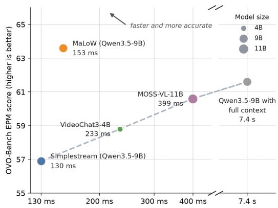  
Median profiled latency, log scale, broken axis (lower is better)  
Figure 4 Latency–accuracy tradeofs of MaLoW and baselines on the Episodic Memory (EPM) task of OVO-Bench.

MaLoW excels at long-horizon memory tasks. We further stress-test our memory mechanism on the Historical Retrospection (HR) split of StreamArena (Zhang et al., 2026d); implementation details are provided in Appendix C. HR specifically targets long-horizon memory: the query is issued substantially later than the appearance of the relevant visual evidence, with a median query-evidence gap of 12.1 minutes. We compare MaLoW (Qwen3.5-9B) with strong streaming video models, including MOSS-VL-Realtime-11B (Wang et al., 2026), VideoChat3-4B (Li et al., 2026), AURA-8B (Lu et al., 2026), and VST-7B (Guan et al., 2026). These models either maintain a long context window (MOSS-VL-Realtime), or compress historical observations into text-based memory (VideoChat3, AURA, and VST). As reported in Table 3, MaLoW achieves an average score of 22.8, outperforming VST and MOSS-VL-Realtime by 2.2% and 4.5%, respectively. These results highlight the efectiveness of representing history in evolving model weights for retaining information over long temporal horizons.

MaLoW generalizes across model scales and families. We further evaluate MaLoW across a broader range of model scales (0.8B–4B) and model families (Qwen3.5 and Gemma4); implementation details are provided in Appendix C. Following the oficial benchmark protocols, we evaluate all three splits of OVO-Bench (Backward, Real-Time, and Forward) and all four splits of StreamingBench (Real-Time, Omni, Proactive, and SQA). For each backbone, we compare MaLoW against two baselines: (1) the corresponding base model operating with full context and (2) the same model restricted to a local context window. Table 4 shows that MaLoW consistently improves overall performance across model scales and families. In particular, MaLoW outperforms the full-context baseline on real-time perception splits (green cells), demonstrating that MaLoW efectively alleviates the negative efect of history on real-time perception. Meanwhile, MaLoW substantially improves over the local-window baseline on memory-intensive splits (blue cells), highlighting the efectiveness of the internalized memory.

## 4.2 Additional Demonstration and Analysis

Extension to Vision-Language-Action (VLA) Models. We further extend MaLoW to robotic planning, where it is used to internalize historical visual observations and action trajectory for action prediction. Following VLM4VLA (Zhang et al., 2026b), we adapt Qwen3.5-2B (Qwen Team, 2026) by attaching a lightweight MLP action decoder and fine-tuning the VLM backbone, resulting in our baseline model, Q3.5-2B-MLP. The model is trained on the Bridge and RT-1 subsets of the OXE dataset (O’Neill et al., 2024) to predict future actions based solely on the current visual observation. We then train MaLoW on top of Q3.5-2B-MLP using the Bridge subset of OXE. During this stage, the VLM backbone is frozen and receives only the current observation, while MaLoW and the MLP action decoder are optimized to internalize historical observations and action trajectories and produce more accurate action trajectories. We refer to the resulting model as MaLoW (Q3.5-2B-MLP). We evaluate both models on the Simpler-Bridge with WidowX robot, with results reported in Table 2. MaLoW improves the average success rate from 59.4% to 68.8%, corresponding to a major gain of 9.4%. These results demonstrate that MaLoW can efectively internalize historical information and leverage it to refine action trajectories without explicitly providing them to the base model. Appendix C.2 provides more implementation details.

Table 4 Results across base model scales and families. Green: comparison to full-context baselines on real-time perception tasks; Blue: comparison to local-window baselines on memory-intensive tasks.  
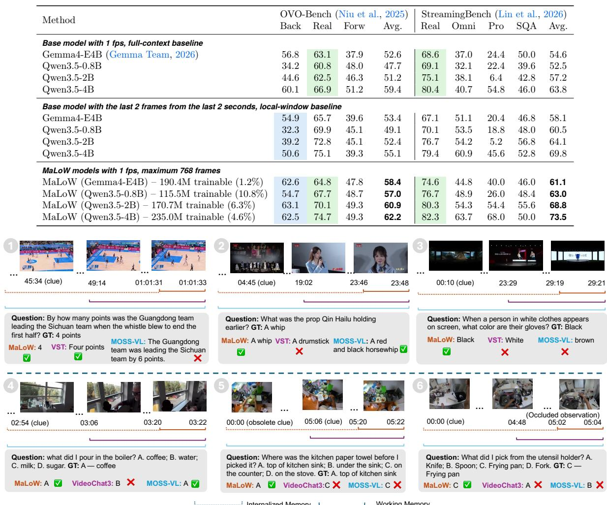  
Figure 5 Visualization of results. Top row (1-3): results from StreamArena (HR) split. Bottom row (4-6): results from OVO-Bench (EPM) task. We show results from MaLoW (Qwen3.5-9B), VideoChat3-4B, and MOSS-VL-11B.

Qualitative Results. We present qualitative results in Fig. 5, with examples from StreamArena (HR) and OVO-Bench (EPM) shown in the top and bottom rows, respectively. We compare the results from MaLoW (Qwen3.5-9B) with VST-7B, VideoChat3-4B, and MOSS-VL-realtime-11B. Overall, MaLoW produces more accurate answers than the baselines on memory-intensive tasks, demonstrating the efectiveness of its history internalization mechanism. Notably, samples 1, 2, and 3 demonstrate that MaLoW can recall the details from 16 minutes, 19 minutes, and 29 minutes ago, respectively. Sample 5 shows that MaLoW can continuously update its memory and avoid being misled by obsolete cues. Sample 6 further demonstrates that the internalized memory complements the current observation, enabling the model to recover relevant information even when the current visual evidence is occluded. See our project website for video demonstrations.

Additional Ablation Studies and Analyses. We provide ablation studies in Section D.1 of the Appendix. Similarly, additional analyses of latency, generated LoRA adapters, and qualitative failure cases can be found in Section D.2 of the Appendix.

## 5 Conclusion

In this work, we presented MaLoW, a new memory framework for streaming VLMs. Rather than repeatedly injecting compressed or retrieved history into the input context, MaLoW represents history as LoRA weights while keeping the current observation as input. This separation provides a natural way to carry long-term information forward without revisiting the full video stream or continually expanding the context window. It also yields a lightweight memory patch: the base VLM architecture and parameters remain unchanged, while only the compact LoRA weights evolve over time. To realize this design, we developed a recurrent HyperNetwork that incrementally updates LoRA weights, together with MaLoW-Instruct, a large-scale streaming video dataset containing 381K QA pairs over 56K videos. MaLoW achieves strong results across streaming video understanding benchmarks, with substantial gains on memory-critical tasks and only modest inference overhead. We further show that the same memory mechanism transfers to VLA models, where incorporating historical context improves action success. We hope that MaLoW ofers a useful perspective on long-term memory for streaming VLMs: beyond asking what information should be stored or retrieved, we can also reconsider where memory should reside, in this case, directly within evolving model weights.

## References

Jean-Baptiste Alayrac, Jef Donahue, Pauline Luc, Antoine Miech, Iain Barr, Yana Hasson, Karel Lenc, Arthur Mensch, Katherine Millican, Malcolm Reynolds, et al. Flamingo: a visual language model for few-shot learning. Advances in neural information processing systems, 35:23716–23736, 2022.

Lisa Anne Hendricks, Oliver Wang, Eli Shechtman, Josef Sivic, Trevor Darrell, and Bryan Russell. Localizing moments in video with natural language. In Proceedings of the IEEE international conference on computer vision, pp. 5803–5812, 2017.

Mido Assran, Adrien Bardes, David Fan, Quentin Garrido, Russell Howes, Matthew Muckley, Ammar Rizvi, Claire Roberts, Koustuv Sinha, Artem Zholus, et al. V-jepa 2: Self-supervised video models enable understanding, prediction and planning. arXiv preprint arXiv:2506.09985, 2025.

Shuai Bai, Yuxuan Cai, Ruizhe Chen, Keqin Chen, Xionghui Chen, Zesen Cheng, Lianghao Deng, Wei Ding, Chang Gao, Chunjiang Ge, et al. Qwen3-vl technical report. arXiv preprint arXiv:2511.21631, 2025.

Rujikorn Charakorn, Edoardo Cetin, Yujin Tang, and Robert T. Lange. Text-to-lora: instant transformer adaption. In Proceedings of the 42nd International Conference on Machine Learning, ICML’25. JMLR.org, 2025.

Rujikorn Charakorn, Edoardo Cetin, Shinnosuke Uesaka, and Robert Tjarko Lange. Doc-to-loRA: Learning to instantly internalize contexts. In Forty-third International Conference on Machine Learning, 2026. URL https: //openreview.net/forum?id=iW1oBBO72S.

Joya Chen, Zhaoyang Lv, Shiwei Wu, Kevin Qinghong Lin, Chenan Song, Difei Gao, Jia-Wei Liu, Ziteng Gao, Dongxing Mao, and Mike Zheng Shou. Videollm-online: Online video large language model for streaming video. In 2024 IEEE/CVF Conference on Computer Vision and Pattern Recognition (CVPR), pp. 18407–18418. IEEE, 2024a.

Joya Chen, Zeyun Zhong, and Mike Zheng Shou. Streamttt: Reconciling real-time perception and long-term memory in streaming vlms. arXiv preprint arXiv:2608.13416, 2026.

Yukang Chen, Shengju Qian, Haotian Tang, Xin Lai, Zhijian Liu, Song Han, and Jiaya Jia. Longlora: Eficient fine-tuning of long-context large language models. In International Conference on Learning Representations, volume 2024, pp. 8220–8238, 2024b.

Christopher Clark, Jieyu Zhang, Zixian Ma, Jae Sung Park, Rohun Tripathi, Sangho Lee, Mohammadreza Salehi, Jason Ren, Chris Dongjoo Kim, Yinuo Yang, et al. Molmo2: Open weights and data for vision-language models with video understanding and grounding. In Proceedings of the IEEE/CVF Conference on Computer Vision and Pattern Recognition, pp. 28652–28668, 2026.

Tim Dettmers, Artidoro Pagnoni, Ari Holtzman, and Luke Zettlemoyer. Qlora: Eficient finetuning of quantized llms. Advances in neural information processing systems, 36:10088–10115, 2023.

Jiyang Gao, Chen Sun, Zhenheng Yang, and Ram Nevatia. Tall: Temporal activity localization via language query. In 2017 IEEE International Conference on Computer Vision (ICCV), pp. 5277–5285. IEEE, 2017.

Gemma Team. Gemma 4 technical report. arXiv preprint arXiv:2607.02770, 2026.

Kristen Grauman, Andrew Westbury, Eugene Byrne, Zachary Chavis, Antonino Furnari, Rohit Girdhar, Jackson Hamburger, Hao Jiang, Miao Liu, Xingyu Liu, et al. Ego4d: Around the world in 3,000 hours of egocentric video. In Proceedings of the IEEE/CVF conference on computer vision and pattern recognition, pp. 18995–19012, 2022.

Yiran Guan, Liang Yin, Dingkang Liang, Jianzhong Ju, Zhenbo Luo, Jian Luan, Yuliang Liu, and Xiang Bai. Video streaming thinking: Videollms can watch and think simultaneously. In European Conference on Computer Vision, pp. 80–99. Springer, 2026.

David Ha, Andrew M. Dai, and Quoc V. Le. Hypernetworks. In International Conference on Learning Representations, 2017.

Bo He, Hengduo Li, Young Kyun Jang, Menglin Jia, Xuefei Cao, Ashish Shah, Abhinav Shrivastava, and Ser-Nam Lim. Ma-lmm: Memory-augmented large multimodal model for long-term video understanding. In 2024 IEEE/CVF Conference on Computer Vision and Pattern Recognition (CVPR), pp. 13504–13514. IEEE, 2024.

Sepp Hochreiter and Jürgen Schmidhuber. Long short-term memory. Neural computation, 9(8):1735–1780, 1997.

Edward J Hu, yelong shen, Phillip Wallis, Zeyuan Allen-Zhu, Yuanzhi Li, Shean Wang, Lu Wang, and Weizhu Chen. LoRA: Low-rank adaptation of large language models. In International Conference on Learning Representations, 2022. URL https://openreview.net/forum?id=nZeVKeeFYf9.

Haroon Idrees, Amir R Zamir, Yu-Gang Jiang, Alex Gorban, Ivan Laptev, Rahul Sukthankar, and Mubarak Shah. The thumos challenge on action recognition for videos “in the wild”. Computer Vision and Image Understanding, 155:1–23, 2017.

Angelos Katharopoulos, Apoorv Vyas, Nikolaos Pappas, and François Fleuret. Transformers are RNNs: Fast autoregressive transformers with linear attention. In Proceedings of the 37th International Conference on Machine Learning, pp. 5156–5165, 2020.

Ranjay Krishna, Kenji Hata, Frederic Ren, Li Fei-Fei, and Juan Carlos Niebles. Dense-captioning events in videos. In Proceedings of the IEEE international conference on computer vision, pp. 706–715, 2017.

Woosuk Kwon, Zhuohan Li, Siyuan Zhuang, Ying Sheng, Lianmin Zheng, Cody Hao Yu, Joseph E. Gonzalez, Hao Zhang, and Ion Stoica. Eficient memory management for large language model serving with pagedattention. In Proceedings of the ACM SIGOPS 29th Symposium on Operating Systems Principles, 2023.

Thinking Machines Lab. Interaction models: A scalable approach to human-ai collaboration. Thinking Machines Lab: Connectionism, May 2026. doi: 10.64434/tml.20260511. https://thinkingmachines.ai/blog/interaction-models/.

Jingdi Lei, Di Zhang, Junxian Li, Weida Wang, Kaixuan Fan, Xiang Liu, Qihan Liu, Xiaoteng Ma, Baian Chen, and Soujanya Poria. δ-mem: Eficient online memory for large language models. arXiv preprint arXiv:2605.12357, 2026.

Xinhao Li, Yuhan Zhu, Xiangyu Zeng, Yuhao Dong, Haoning Wu, Zhiqiu Zhang, Yuandong Yang, Changlian Ma, Qingyu Zhang, Yansong Shi, et al. Videochat3: Fully open video mllm for eficient and generalist video understanding. arXiv preprint arXiv:2607.14935, 2026.

Xuanlin Li, Kyle Hsu, Jiayuan Gu, Oier Mees, Karl Pertsch, Homer Rich Walke, Chuyuan Fu, Ishikaa Lunawat, Isabel Sieh, Sean Kirmani, Sergey Levine, Jiajun Wu, Chelsea Finn, Hao Su, Quan Vuong, and Ted Xiao. Evaluating real-world robot manipulation policies in simulation. In Pulkit Agrawal, Oliver Kroemer, and Wolfram Burgard (eds.), Proceedings of The 8th Conference on Robot Learning, volume 270 of Proceedings of Machine Learning Research, pp. 3705–3728. PMLR, 06–09 Nov 2025. URL https://proceedings.mlr.press/v270/li25c.html.

Zhijia Liang, Jiaming Li, Weikai Chen, Yanhao Zhang, Haonan Lu, and Guanbin Li. OASIS: On-demand hierarchical event memory for streaming video reasoning. In Conference on Computer Vision and Pattern Recognition 2026, 2026. URL https://openreview.net/forum?id=tPjMPxbprN.

Junming Lin, Zheng Fang, Chi Chen, Haoxuan Cheng, Zihao Wan, Fuwen Luo, Ziyue Wang, Peng Li, Yang Liu, and Maosong Sun. Streamingbench: Assessing the gap for mllms to achieve streaming video understanding. In ICASSP 2026-2026 IEEE International Conference on Acoustics, Speech and Signal Processing (ICASSP), pp. 12147–12151. IEEE, 2026.

Haotian Liu, Chunyuan Li, Qingyang Wu, and Yong Jae Lee. Visual instruction tuning. Advances in neural information processing systems, 36:34892–34916, 2023.

Ye Liu, Zongyang Ma, Zhongang Qi, Yang Wu, Ying Shan, and Chang W Chen. Et bench: Towards open-ended event-level video-language understanding. Advances in Neural Information Processing Systems, 37:32076–32110, 2024.

Zhuoming Liu, Yiquan Li, Khoi Duc Nguyen, Yiwu Zhong, and Yin Li. Pave: Patching and adapting video large language models. In 2025 IEEE/CVF Conference on Computer Vision and Pattern Recognition (CVPR), pp. 3306–3317. IEEE, 2025.

Zikang Liu, Longteng Guo, Handong Li, Ru Zhen, Xingjian He, Ruyi Ji, Xiaoming Ren, Yanhao Zhang, Haonan Lu, and Jing Liu. Thinking in streaming video. In European Conference on Computer Vision, pp. 21–38. Springer, 2026.

Xudong Lu, Yang Bo, Jinpeng Chen, Shuhan Li, Xintong Guo, Huankang Guan, Fang Liu, Dunyuan Xu, Peiwen Sun, Heyang Sun, et al. Aura: Always-on understanding and real-time assistance via video streams. arXiv preprint arXiv:2604.04184, 2026.

Junbo Niu, Yifei Li, Ziyang Miao, Chunjiang Ge, Yuanhang Zhou, Qihao He, Xiaoyi Dong, Haodong Duan, Shuangrui Ding, Rui Qian, et al. Ovo-bench: How far is your video-llms from real-world online video understanding? In 2025 IEEE/CVF Conference on Computer Vision and Pattern Recognition (CVPR), pp. 18902–18913. IEEE, 2025.

Andreea-Maria Oncescu, Joao F Henriques, Yang Liu, Andrew Zisserman, and Samuel Albanie. Queryd: A video dataset with high-quality text and audio narrations. In ICASSP 2021-2021 IEEE International Conference on Acoustics, Speech and Signal Processing (ICASSP), pp. 2265–2269. IEEE, 2021.

Abby O’Neill, Abdul Rehman, Abhiram Maddukuri, Abhishek Gupta, Abhishek Padalkar, Abraham Lee, Acorn Pooley, Agrim Gupta, Ajay Mandlekar, Ajinkya Jain, et al. Open x-embodiment: Robotic learning datasets and rt-x models: Open x-embodiment collaboration 0. In 2024 IEEE International Conference on Robotics and Automation (ICRA), pp. 6892–6903. IEEE, 2024.

Rui Qian, Xiaoyi Dong, Pan Zhang, Yuhang Zang, Shuangrui Ding, Dahua Lin, and Jiaqi Wang. Streaming long video understanding with large language models. In A. Globerson, L. Mackey, D. Belgrave, A. Fan, U. Paquet, J. Tomczak, and C. Zhang (eds.), Advances in Neural Information Processing Systems, volume 37, pp. 119336–119360. Curran Associates, Inc., 2024. doi: 10.52202/079017-3792. URL https://proceedings.neurips.cc/paper\_files/paper/2024/ file/d7ce06e9293c3d8e6cb3f80b4157f875-Paper-Conference.pdf.

Rui Qian, Shuangrui Ding, Xiaoyi Dong, Pan Zhang, Yuhang Zang, Yuhang Cao, Dahua Lin, and Jiaqi Wang. Dispider: Enabling video llms with active real-time interaction via disentangled perception, decision, and reaction. In 2025 IEEE/CVF Conference on Computer Vision and Pattern Recognition (CVPR), pp. 24045–24055. IEEE, 2025.

Qwen Team. Qwen3.5: Towards native multimodal agents, February 2026. URL https://qwen.ai/blog?id=qwen3.5.

Imanol Schlag, Kazuki Irie, and Jürgen Schmidhuber. Linear transformers are secretly fast weight programmers. In Proceedings of the 38th International Conference on Machine Learning, pp. 9355–9366, 2021.

Yuzhang Shang, Mu Cai, Bingxin Xu, Yong Jae Lee, and Yan Yan. Llava-prumerge: Adaptive token reduction for eficient large multimodal models. In 2025 IEEE/CVF International Conference on Computer Vision (ICCV), pp. 22857–22867. IEEE, 2025.

Xiaoqian Shen, Yunyang Xiong, Changsheng Zhao, Lemeng Wu, Jun Chen, Chenchen Zhu, Zechun Liu, Fanyi Xiao, Balakrishnan Varadarajan, Florian Bordes, Zhuang Liu, Hu Xu, Hyunwoo J. Kim, Bilge Soran, Raghuraman Krishnamoorthi, Mohamed Elhoseiny, and Vikas Chandra. LongVU: Spatiotemporal adaptive compression for long video-language understanding. In Aarti Singh, Maryam Fazel, Daniel Hsu, Simon Lacoste-Julien, Felix Berkenkamp, Tegan Maharaj, Kiri Wagstaf, and Jerry Zhu (eds.), Proceedings of the 42nd International Conference on Machine Learning, volume 267 of Proceedings of Machine Learning Research, pp. 54582–54599. PMLR, 13–19 Jul 2025. URL https://proceedings.mlr.press/v267/shen25j.html

Yujiao Shen, Shulin Tian, Jingkang Yang, and Ziwei Liu. A simple baseline for streaming video understanding. arXiv preprint arXiv:2604.02317, 2026.

Sagar Shrestha, Gopal Sharma, Luowei Zhou, and Suren Kumar. Finetuning-free personalization of text to image generation via hypernetworks. arXiv preprint arXiv:2511.03156, 2025.

Enxin Song, Wenhao Chai, Guanhong Wang, Yucheng Zhang, Haoyang Zhou, Feiyang Wu, Haozhe Chi, Xun Guo, Tian Ye, Yanting Zhang, et al. Moviechat: From dense token to sparse memory for long video understanding. In 2024 IEEE/CVF Conference on Computer Vision and Pattern Recognition (CVPR), pp. 18221–18232. IEEE, 2024.

Yansong Tang, Dajun Ding, Yongming Rao, Yu Zheng, Danyang Zhang, Lili Zhao, Jiwen Lu, and Jie Zhou. Coin: A large-scale dataset for comprehensive instructional video analysis. In 2019 IEEE/CVF Conference on Computer Vision and Pattern Recognition (CVPR), pp. 1207–1216. IEEE, 2019.

Alex Jinpeng Wang, Linjie Li, Kevin Qinghong Lin, Jianfeng Wang, Kevin Lin, Zhengyuan Yang, Lijuan Wang, and Mike Zheng Shou. Cosmo: Contrastive streamlined multimodal model with interleaved pre-training. arXiv preprint arXiv:2401.00849, 2024a.

Pengyu Wang, Chenkun Tan, Shaojun Zhou, Qirui Zhou, Yanxin Chen, Xingyang He, Huazheng Zeng, Jijun Cheng, Chenghao Wang, Xiaomeng Qian, et al. Moss-vl technical report. arXiv preprint arXiv:2608.15045, 2026.

Weihan Wang, Zehai He, Wenyi Hong, Yean Cheng, Xiaohan Zhang, Ji Qi, Ming Ding, Xiaotao Gu, Shiyu Huang, Bin Xu, et al. Lvbench: An extreme long video understanding benchmark. In 2025 IEEE/CVF International Conference on Computer Vision (ICCV), pp. 22958–22967. IEEE, 2025.

Yi Wang, Yinan He, Yizhuo Li, Kunchang Li, Jiashuo Yu, Xin Ma, Xinhao Li, Guo Chen, Xinyuan Chen, Yaohui Wang, et al. Internvid: A large-scale video-text dataset for multimodal understanding and generation. In International Conference on Learning Representations, volume 2024, pp. 42055–42079, 2024b.

Bo Wu, Shoubin Yu, Zhenfang Chen, Joshua B Tenenbaum, and Chuang Gan. Star: A benchmark for situated reasoning in real-world videos. arXiv preprint arXiv:2405.09711, 2024.

Jiaer Xia, Peixian Chen, Mengdan Zhang, Xing Sun, and Kaiyang Zhou. Streaming video instruction tuning. In Proceedings of the IEEE/CVF Conference on Computer Vision and Pattern Recognition, pp. 31219–31229, 2026.

Junbin Xiao, Xindi Shang, Angela Yao, and Tat-Seng Chua. Next-qa: Next phase of question-answering to explaining temporal actions. In 2021 IEEE/CVF Conference on Computer Vision and Pattern Recognition (CVPR), pp. 9772–9781. IEEE, 2021.

Yiweng Xie, Bo He, Junke Wang, Xiangyu Zheng, Ziyi Ye, and Zuxuan Wu. Fluxmem: Adaptive hierarchical memory for streaming video understanding. In Proceedings of the IEEE/CVF Conference on Computer Vision and Pattern Recognition (CVPR), pp. 31272–31282, June 2026.

Ruyi Xu, Guangxuan Xiao, Yukang Chen, Liuning He, Kelly Peng, Yao Lu, and Song Han. Streamingvlm: Real-time understanding for infinite video streams. In International Conference on Learning Representations, volume 2026, pp. 61463–61475, 2026.

Senqiao Yang, Kaichen Zhang, Zhaoyang Jia, Jinghao Guo, Yifei Shen, Xinjie Zhang, Xiaoyi Zhang, Haoqing Wang, Xiao Li, Peng Zhang, et al. Mage-vl: An eficient codec-native streaming multimodal foundation model. arXiv preprint arXiv:2607.24904, 2026.

Songlin Yang, Bailin Wang, Yu Zhang, Yikang Shen, and Yoon Kim. Parallelizing linear transformers with the delta rule over sequence length. Advances in neural information processing systems, 37:115491–115522, 2024.

Dingyu Yao, Junhao Zhou, Chenxu Yang, Chuanyu Qin, Haowen Hou, Zheming Liang, Congcong Wang, Yuhang Cao, Shenglong Ye, Shuai Xie, et al. Joyai-vl-interaction: Real-time vision-language interaction intelligence. arXiv preprint arXiv:2606.14777, 2026.

Linli Yao, Yicheng Li, Yuancheng Wei, Lei Li, Shuhuai Ren, Yuanxin Liu, Kun Ouyang, Lean Wang, Shicheng Li, Sida Li, et al. Timechat-online: 80% visual tokens are naturally redundant in streaming videos. In Proceedings of the 33rd ACM International Conference on Multimedia, pp. 10807–10816, 2025.

Shengming Yin, Zekai Zhang, Zecheng Tang, Kaiyuan Gao, Xiao Xu, Kun Yan, Jiahao Li, Yilei Chen, Yuxiang Chen, Heung-Yeung Shum, et al. Qwen-image-layered: Towards inherent editability via layer decomposition. In Proceedings of the IEEE/CVF Conference on Computer Vision and Pattern Recognition, pp. 16196–16205, 2026.

Abhay Zala, Jaemin Cho, Satwik Kottur, Xilun Chen, Barlas Oguz, Yashar Mehdad, and Mohit Bansal. Hierarchical video-moment retrieval and step-captioning. In 2023 IEEE/CVF Conference on Computer Vision and Pattern Recognition (CVPR), pp. 23056–23065. IEEE, 2023.

Xiangyu Zeng, Kefan Qiu, Qingyu Zhang, Xinhao Li, Jing Wang, Jiaxin Li, Ziang Yan, Kun Tian, Meng Tian, Xinhai Zhao, et al. Streamforest: Eficient online video understanding with persistent event memory. Advances in Neural Information Processing Systems, 38:75804–75835, 2026.

Biao Zhang and Rico Sennrich. Root mean square layer normalization. Advances in neural information processing systems, 32, 2019.

Haoji Zhang, Yiqin Wang, Yansong Tang, Yong Liu, Jiashi Feng, Jifeng Dai, and Xiaojie Jin. Flash-vstream: Memory-based real-time understanding for long video streams. arXiv preprint arXiv:2406.08085, 2024.

Haowei Zhang, Shudong Yang, Jinlan Fu, See Kiong Ng, and Xipeng Qiu. Hermes: Kv cache as hierarchical memory for eficient streaming video understanding. In Proceedings of the 64th Annual Meeting of the Association for Computational Linguistics (Volume 1: Long Papers), pp. 8411–8430, 2026a.

Jianke Zhang, Xiaoyu Chen, Yanjiang Guo, Yucheng Hu, and Jianyu Chen. VLM4VLA: Revisiting vision-languagemodels in vision-language-action models. In The Fourteenth International Conference on Learning Representations, 2026b. URL https://openreview.net/forum?id=tc2UsBeODW.

Jun Zhang, Teng Wang, Yuying Ge, Yixiao Ge, Xinhao Li, and Limin Wang. Timelens: Rethinking video temporal grounding with multimodal llms. In Proceedings of the IEEE/CVF Conference on Computer Vision and Pattern Recognition, pp. 10419–10429, 2026c.

Kaichen Zhang, Bo Li, Peiyuan Zhang, Fanyi Pu, Joshua Adrian Cahyono, Kairui Hu, Shuai Liu, Yuanhan Zhang, Jingkang Yang, Chunyuan Li, et al. Lmms-eval: Reality check on the evaluation of large multimodal models. In Findings of the Association for Computational Linguistics: NAACL 2025, pp. 881–916, 2025a.

Xichen Zhang, Guankai Li, Yinghao Zhu, Shijian Wang, Sitong Wu, Shaozuo Yu, Meng Chu, Yuan Lu, and Jiaya Jia. Streamarena: Toward continuous, interactive, and long-horizon agentic streaming video understanding. arXiv preprint arXiv:2608.05703, 2026d.

Yuanhan Zhang, Jinming Wu, Wei Li, Bo Li, Zejun MA, Ziwei Liu, and Chunyuan Li. LLaVA-video: Video instruction tuning with synthetic data. Transactions on Machine Learning Research, 2025b. ISSN 2835-8856. URL https://openreview.net/forum?id=EElFGvt39K.

Yaowei Zheng, Richong Zhang, Junhao Zhang, Yanhan Ye, Zheyan Luo, Zhangchi Feng, and Yongqiang Ma. Llamafactory: Unified eficient fine-tuning of 100+ language models. In Proceedings of the 62nd Annual Meeting of the Association for Computational Linguistics (Volume 3: System Demonstrations), Bangkok, Thailand, 2024. Association for Computational Linguistics. URL http://arxiv.org/abs/2403.13372.

Yiwu Zhong, Zhuoming Liu, Yin Li, and Liwei Wang. Aim: Adaptive inference of multi-modal llms via token merging and pruning. In 2025 IEEE/CVF International Conference on Computer Vision (ICCV), pp. 20180–20192. IEEE, 2025.

Junjie Zhou, Yan Shu, Bo Zhao, Boya Wu, Zhengyang Liang, Shitao Xiao, Minghao Qin, Xi Yang, Yongping Xiong, Bo Zhang, et al. Mlvu: Benchmarking multi-task long video understanding. In 2025 IEEE/CVF Conference on Computer Vision and Pattern Recognition (CVPR), pp. 13691–13701. IEEE, 2025.

Luowei Zhou, Chenliang Xu, and Jason J Corso. Towards automatic learning of procedures from web instructional videos. In AAAI Conference on Artificial Intelligence, pp. 7590–7598, 2018. URL https://www.aaai.org/ocs/index. php/AAAI/AAAI18/paper/view/17344.

Dimitri Zhukov, Jean-Baptiste Alayrac, Ramazan Gokberk Cinbis, David Fouhey, Ivan Laptev, and Josef Sivic. Cross-task weakly supervised learning from instructional videos. In 2019 IEEE/CVF Conference on Computer Vision and Pattern Recognition (CVPR), pp. 3532–3540. IEEE, 2019.

## Appendix: Supplementary Materials

## Overview

This appendix provides the mathematical interpretation, dataset documentation, implementation details, and additional empirical results supporting MaLoW. The materials are organized as follows:

• Appendix A: Mathematical Interpretation. Historical context as a read operator, its realization through low-rank MLP updates, online memory updates, and extensions to normalized attention and backbone computation.

• Appendix B: Additional Dataset Details. Video sources, the data pipeline and annotation construction, and statistics of MaLoW-Instruct.

• Appendix C: Additional Experiment Details. Model architecture, training and evaluation settings, the visionlanguage-action setting, diferent VLM scales and sources, the memory stress test, and streaming inference speed profiling.

• Appendix D: Additional Experiments. Ablations of LoRA placement and rank, memory architecture, observation windows, and state-update frequency; analyses of latency, hidden-state evolution, and real-time perception; and additional qualitative results.

## A Mathematical Interpretation

MaLoW carries information from earlier video clips through history-dependent parameter updates. This appendix provides a mathematical interpretation of the feasibility of encoding the efect of historical context into low-rank updates of the MLP projections within a Transformer block. Specifically, we trace how a query reads historical information in section A.1, how this read induces a transformation of the features entering the MLP in section A.2, and how such a transformation can be realized or approximated by LoRA-style weight updates in section A.3. The analysis does not claim that MaLoW explicitly reconstructs the analytical history matrix $M _ { H }$ or is equivalent to full-context attention. Rather, it establishes that historical information can, under the assumptions described below, be represented in parameter space through low-rank updates. MaLoW can be viewed as one of the learned instantiations of this principle, with our empirical results demonstrating that its recurrent state and generated adapters efectively preserve history-dependent information in practice. The exact identities below first assume fixed historical keys and values and an unnormalized dot-product read, while Section A.4 and Section A.5 extend the interpretation to the online setting, normalized attention, and the normalization operations in the backbone.

## A.1 Historical Context as a Read Operator

A streaming video arrives as a sequence of clips. At step t, let $H = ( C _ { 1 } , \dots , C _ { t - 1 } )$ denote the clips already observed. Suppose their visual tokens have produced $n _ { H }$ key–value pairs $\boldsymbol { k } _ { i } \in \mathbb { R } ^ { d _ { k } }$ and $v _ { i } \in \mathbb { R } ^ { d _ { v } }$ . A current query $q \in \mathbb { R } ^ { d _ { k } }$ reads this history through

$$
O _ { H } ( q ) = \sum _ { i = 1 } ^ { n _ { H } } v _ { i } ( \boldsymbol { k } _ { i } ^ { \top } \boldsymbol { q } ) .\tag{A.1}
$$

All vectors are columns. Keys and values are fixed while the query varies.

Each term first measures a match, $k _ { i } ^ { \top } q .$ , and then weights the corresponding value $v _ { i }$ . Collecting the terms gives

$$
O _ { H } ( q ) = M _ { H } q , \qquad M _ { H } = \sum _ { i = 1 } ^ { n _ { H } } v _ { i } k _ { i } ^ { \top } \in \mathbb { R } ^ { d _ { v } \times d _ { k } } .\tag{A.2}
$$

Thus the same read can be computed either from historical tokens or from one matrix. The matrix stores how the history responds to a query: $M _ { H }$ is shared by all queries for that fixed history. Its dimensions depend on

the feature widths, while the number of stored tokens grows with the video. This is the associative-memory interpretation of linear attention (Katharopoulos et al., 2020; Schlag et al., 2021).

## A.2 From Historical Reads to Feature Transformations

To connect the read to an MLP, consider a block with current feature $x \in \mathbb { R } ^ { d }$ , query projection $W _ { Q } \in \mathbb { R } ^ { d _ { k } \times d }$ and read-output projection $W _ { O } \in \mathbb { R } ^ { d \times d _ { v } }$ . The same feature supplies the query and the residual stream:

$$
q = W _ { Q } x , \qquad x _ { H } = x + W _ { O } O _ { H } ( q ) , \qquad y _ { H } = F ( x _ { H } ) ,\tag{A.3}
$$

where $F$ is the MLP. The feature entering the MLP changes from x to $x _ { H }$ when the historical read is added. Substituting Eq. (A.2) into this block gives

$$
x _ { H } = ( I + P _ { H } ) x , \qquad \left\lceil P _ { H } = W _ { O } M _ { H } W _ { Q } \right\rceil \in \mathbb { R } ^ { d \times d } .\tag{A.4}
$$

$M _ { H }$ maps a query to a historical read. $P _ { H }$ expresses that same read as a change to the MLP input. The projections $W _ { Q }$ and $W _ { O }$ determine their relation. Consequently, the output to reproduce is

$$
y _ { H } = F { \big ( } ( I + P _ { H } ) x { \big ) } .\tag{A.5}
$$

This identifies a concrete role for an MLP update: reproduce how the MLP would process the feature after history has changed it.

## A.3 Low-Rank Realizations in MLP Projections

Let a rank-r factorization approximate the history matrix:

$$
\widehat { M } _ { H } = B _ { H } A _ { H } , \qquad B _ { H } \in \mathbb { R } ^ { d _ { v } \times r } , \quad A _ { H } \in \mathbb { R } ^ { r \times d _ { k } } .\tag{A.6}
$$

The corresponding feature transformation is

$$
\widehat { P } _ { H } = W _ { O } B _ { H } A _ { H } W _ { Q } , \qquad \mathrm { r a n k } ( \widehat { P } _ { H } ) \leq r .\tag{A.7}
$$

These factors are shared across queries for the same history. The required rank depends on how accurately they reproduce the reads used by the model.

Gate and up Projections. Consider the gated MLP

$$
F ( x ) = W _ { d } \big [ \sigma ( W _ { g } x ) \odot ( W _ { u } x ) \big ] ,\tag{A.8}
$$

where $W _ { g } , W _ { u } \in \mathbb { R } ^ { m \times d } , W _ { d } \in \mathbb { R } ^ { d _ { o } \times m }$ , σ acts elementwise, and $\odot$ is the elementwise product. Biases are omitted; fixed biases can be retained in the same identities.

Proposition A.1 (Realizing the History-Induced Input Change). Keep $W _ { d }$ fixed and set

$$
\Delta W _ { g } = W _ { g } \widehat { P } _ { H } , \qquad \Delta W _ { u } = W _ { u } \widehat { P } _ { H } .\tag{A.9}
$$

Then both updates have rank at most $r ,$ and the updated MLP satisfies

$$
F _ { \Delta } ( x ) = F \big ( ( I + \widehat { P } _ { H } ) x \big ) \quad \mathrm { f o r ~ e v e r y } \ x .\tag{A.10}
$$

Proof. The updated gate preactivation is $( W _ { g } + \Delta W _ { g } ) x = W _ { g } ( I + \widehat { P } _ { H } ) x$ ; the same identity holds for the up projection. Substituting both expressions into Eq. (A.8) proves Eq. (A.10). The explicit factorizations are

$$
\begin{array} { c } { \Delta W _ { g } = ( W _ { g } W _ { O } B _ { H } ) ( A _ { H } W _ { Q } ) , } \\ { \Delta W _ { u } = ( W _ { u } W _ { O } B _ { H } ) ( A _ { H } W _ { Q } ) . } \end{array}\tag{A.11}
$$

Each product has an inner dimension of $r ,$ so each update has rank at most $r .$

Equation (A.11) has the form used by LoRA (Hu et al., 2022); any fixed nonzero adapter scale can be absorbed into a factor. The MLP nonlinearity is preserved exactly because the update changes its inputs before the activation and multiplication. In this construction, gate and up updates work together to apply the same history-induced input change.

How Read Error Reaches the MLP Output. Write $E _ { H } = M _ { H } - \widehat { M } _ { H }$ . The feature error is

$$
x _ { H } - ( I + \widehat { P } _ { H } ) x = W _ { O } E _ { H } W _ { Q } x .\tag{A.12}
$$

If $F$ is $L _ { F }$ -Lipschitz on the segment between these two inputs, then

$$
\left\| y _ { H } - F _ { \Delta } ( x ) \right\| _ { 2 } \leq L _ { F } \left\| W _ { O } \right\| _ { 2 } \left\| E _ { H } W _ { Q } x \right\| _ { 2 } .\tag{A.13}
$$

Here matrix norms are spectral norms. For a truncated rank-r singular value decomposition, $\| E _ { H } \| _ { 2 } =$ $\sigma _ { r + 1 } ( M _ { H } )$ , and therefore

$$
\left\| y _ { H } - F _ { \Delta } ( x ) \right\| _ { 2 } \leq L _ { F } \left\| W _ { O } \right\| _ { 2 } \sigma _ { r + 1 } ( M _ { H } ) \left\| W _ { Q } x \right\| _ { 2 } .\tag{A.14}
$$

When $r \geq \mathrm { r a n k } ( M _ { H } )$ , the factorization is exact and the error is zero. For smaller ranks, Eq. (A.13) ties the approximation to the queries actually encountered, which can be more informative than a worst-case bound.

The Down Projection. The same target can also be expressed at the MLP’s intermediate features. Define

$$
z ( x ) = \sigma ( W _ { g } x ) \odot ( W _ { u } x ) , \qquad z _ { H } ( x ) = z { \big ( } ( I + P _ { H } ) x { \big ) } .\tag{A.15}
$$

For a fixed history, suppose one shared matrix $S _ { H } \in \mathbb { R } ^ { m \times m }$ , with rank at most s, approximates the change across current inputs:

$$
z _ { H } ( x ) = ( I + S _ { H } ) z ( x ) + e _ { H } ( x ) .\tag{A.16}
$$

Keeping gate and up fixed and setting $\Delta W _ { d } = W _ { d } S _ { H }$ gives

$$
\begin{array} { r l } { F _ { \Delta d } ( x ) = ( W _ { d } + \Delta W _ { d } ) z ( x ) , } & { { } } \\ { \| y _ { H } - F _ { \Delta d } ( x ) \| _ { 2 } \le \| W _ { d } \| _ { 2 } \| e _ { H } ( x ) \| _ { 2 } , } & { { } \quad \mathrm { r a n k } ( \Delta W _ { d } ) \le s . } \end{array}\tag{A.17}
$$

For $S _ { H } = D _ { H } C _ { H }$ , the update is $\Delta W _ { d } = ( W _ { d } D _ { H } ) C _ { H }$ , another LoRA factorization. A useful low-rank $S _ { H }$ is an additional property of the intermediate features to measure; the nonlinear map z makes it a separate condition from low rank of $M _ { H }$

The gate/up construction and the down construction describe two ways to reproduce the same target $y _ { H }$ Jointly trained adapters can distribute the correction across these projections. MaLoW learns module-specific factors; the identities above exhibit computations available within that parameterization.

## A.4 Updating the Historical Efect Online

When a new clip C arrives, its key–value pairs add a new contribution:

$$
M _ { H \cup C } = M _ { H } + \Delta M _ { C } , \qquad \Delta M _ { C } = \sum _ { i \in C } v _ { i } k _ { i } ^ { \top } .\tag{A.18}
$$

Here $H \cup C$ denotes appending the clip to the history. With fixed $W _ { Q }$ and $W _ { O }$ , the feature transformation follows the same update:

$$
P _ { H \cup C } = P _ { H } + W _ { O } \Delta M _ { C } W _ { Q } .\tag{A.19}
$$

The update therefore extends the same efect traced from the historical read to the MLP input. Previously produced keys and values are assumed to stay fixed; the matrix retains their summed outer-product contribution.

Cost and Rank. For n tokens per clip, adding the outer products costs $O ( n d _ { v } d _ { k } )$ per clip and stores $d _ { v } d _ { k }$ matrix entries. Over T clips, incremental accumulation costs $O ( T n d _ { v } d _ { k } )$ . Rebuilding the matrix from all available key–value pairs at every step costs $O ( T ^ { 2 } n d _ { v } d _ { k } )$ . These costs cover dense matrix accumulation given the keys and values. Video encoding, compression, adapter generation, and responses add their respective costs.

Each new clip can increase the matrix rank. Maintaining a fixed rank can be written as an update followed by compression:

$$
\widehat { M } _ { t } = \mathcal { C } _ { r } \left( \widehat { M } _ { t - 1 } + \Delta M _ { C _ { t } } \right) ,\tag{A.20}
$$

where $\mathcal { C } _ { r }$ returns a matrix of rank at most r. The compression algorithm determines both its additional cost and which historical responses the bounded-rank memory preserves.

Connection to MaLoW. MaLoW implements an online memory with a learned state update $U _ { \phi }$ and adapter generator $D _ { \phi }$

$$
\Delta \theta _ { t } = D _ { \phi } ( h _ { t - 1 } ) , \qquad h _ { t } = U _ { \phi } \big ( h _ { t - 1 } , E ( C _ { t } ) \big ) .\tag{A.21}
$$

Here $E ( C _ { t } )$ encodes the incoming clip. The response at step t uses $\Delta \theta _ { t }$ together with the current clip; writing that clip into $h _ { t }$ prepares the memory for later responses. Equations $\mathrm { ( A . 1 8 ) - ( A . 2 0 ) }$ describe an analytical update-and-compression process. MaLoW learns a surrogate from the task objective: its recurrent state and generated adapters aim to preserve the historical efects useful for later responses. Their behavior can be compared with the matrix read and feature transformation derived above.

## A.5 Extensions to the Backbone Computation

The same reasoning can include the remaining operations by retaining their normalization terms or using a local afine approximation.

Normalized Kernel Reads. For a finite feature map $\phi : \mathbb { R } ^ { d _ { k } }  \mathbb { R } ^ { p }$ and weights $\kappa ( \boldsymbol { q } , \boldsymbol { k } ) = \phi ( \boldsymbol { k } ) ^ { \top } \phi ( \boldsymbol { q } )$ 7 define

$$
N _ { H } = \sum _ { i \in H } v _ { i } \phi ( k _ { i } ) ^ { \top } , \qquad b _ { H } = \sum _ { i \in H } \phi ( k _ { i } ) .\tag{A.22}
$$

If the denominator is positive, the normalized read is exactly

$$
R _ { H } ( q ) = \frac { N _ { H } \phi ( q ) } { b _ { H } ^ { \top } \phi ( q ) } .\tag{A.23}
$$

Both $N _ { H }$ and $b _ { H }$ update additively by clip. When a read includes current tokens $C ,$ their contributions are combined before division:

$$
R _ { H \cup C } ( q ) = \frac { ( N _ { H } + N _ { C } ) \phi ( q ) } { ( b _ { H } + b _ { C } ) ^ { \top } \phi ( q ) } .\tag{A.24}
$$

If $N _ { H }$ is approximated by $\widehat { N } _ { H } , b _ { H }$ is kept exact, and $b _ { H } ^ { \top } \phi ( q ) \geq \eta > 0$ , then

$$
\left\| R _ { H } ( q ) - \widehat { R } _ { H } ( q ) \right\| _ { 2 } \leq \frac { \left\| ( N _ { H } - \widehat { N } _ { H } ) \phi ( q ) \right\| _ { 2 } } { \eta } .\tag{A.25}
$$

The denominator state is therefore part of the historical read, alongside its numerator matrix.

Softmax Reads. For fixed historical keys and values and temperature $\tau > 0$ , let

$$
R _ { H } ( q ) = \sum _ { i \in H } p _ { i } ( q ) v _ { i } , \qquad p _ { i } ( q ) = \frac { \exp ( k _ { i } ^ { \top } q / \tau ) } { \sum _ { j \in H } \exp ( k _ { j } ^ { \top } q / \tau ) } .\tag{A.26}
$$

Its local dependence on a query is described by an ofset and a Jacobian. Writing $\begin{array} { r } { \mu _ { k } ( q ) = \sum _ { i } p _ { i } ( q ) k _ { i } } \end{array}$ , direct diferentiation gives

$$
J _ { H } ( q ) = \frac { 1 } { \tau } \sum _ { i \in H } p _ { i } ( q ) \big ( v _ { i } - R _ { H } ( q ) \big ) \big ( k _ { i } - \mu _ { k } ( q ) \big ) ^ { \top } .\tag{A.27}
$$

Around a reference query $q _ { 0 }$ , with $\delta = q - q _ { 0 }$ ,

$$
R _ { H } ( q ) = R _ { H } ( q _ { 0 } ) + J _ { H } ( q _ { 0 } ) \delta + \rho _ { H } ( q ) .\tag{A.28}
$$

If $J _ { H }$ is LJ-Lipschitz along the segment from $q _ { 0 }$ to $q ,$ the integral form of the Taylor remainder gives

$$
\begin{array} { r } { \| \rho _ { H } ( q ) \| _ { 2 } \leq \frac { 1 } { 2 } L _ { J } \left\| \delta \right\| _ { 2 } ^ { 2 } . } \end{array}
$$

For a rank-r matrix $\widehat { J } _ { H }$ satisfying $\left\| J _ { H } ( q _ { 0 } ) - \widehat { J } _ { H } \right\| _ { 2 } \leq \epsilon _ { r }$ , define the afine read as $\widehat { R } _ { H } ( q ) = R _ { H } ( q _ { 0 } ) + \widehat { J } _ { H } \delta$ . It satisfies

$$
\begin{array} { r } { \left\| R _ { H } ( q ) - \widehat { R } _ { H } ( q ) \right\| _ { 2 } \leq \epsilon _ { r } \left\| \delta \right\| _ { 2 } + \frac { 1 } { 2 } L _ { J } \left\| \delta \right\| _ { 2 } ^ { 2 } . } \end{array}\tag{A.29}
$$

This gives a local low-rank interpretation with the reference response $R _ { H } ( q _ { 0 } )$ retained explicitly.

When softmax attention reads both history and current tokens, define

$$
Z _ { H } ( q ) = \sum _ { i \in H } \exp ( k _ { i } ^ { \top } q / \tau ) , \qquad Z _ { C } ( q ) = \sum _ { i \in C } \exp ( k _ { i } ^ { \top } q / \tau ) .
$$

For nonempty H and $C ,$

$$
R _ { H \cup C } ( q ) = w _ { H } ( q ) R _ { H } ( q ) + \left( 1 - w _ { H } ( q ) \right) R _ { C } ( q ) , \quad w _ { H } ( q ) = \frac { Z _ { H } ( q ) } { Z _ { H } ( q ) + Z _ { C } ( q ) } .\tag{A.30}
$$

Thus adding history changes both the available values and their relative weights. A reconstruction of the joint read must retain this mixing weight together with the historical response.

Normalization and the MLP Input. In a pre-normalized backbone, the query and MLP each receive normalized features. A controlled comparison can isolate the historical read within one block. Fix the key–value sets, and let both paths receive the same residual feature u. With attention input normalization $N _ { a }$ , MLP input normalization $N _ { m }$ , and $q ( u ) = W _ { Q } N _ { a } ( u )$ , the two MLP inputs are

$$
\begin{array} { r l } & { T _ { H } ( u ) = N _ { m } \left( u + W _ { O } R _ { H \cup C } ( q ( u ) ) \right) , } \\ & { T _ { 0 } ( u ) = N _ { m } \left( u + W _ { O } R _ { C } ( q ( u ) ) \right) . } \end{array}\tag{A.31}
$$

These expressions place both normalization operations and softmax mixing inside the feature map being compared. For $D _ { H } ( u ) = T _ { H } ( u ) - T _ { 0 } ( u )$ , a local expansion at $u _ { 0 }$ is

$$
D _ { H } ( u ) = D _ { H } ( u _ { 0 } ) + J _ { D } ( u _ { 0 } ) ( u - u _ { 0 } ) + r _ { D } ( u ) .\tag{A.32}
$$

The constant term records the historical change at the reference feature; the Jacobian records how that change varies nearby. If $J _ { D }$ is $L _ { D }$ -Lipschitz on the segment, $\begin{array} { r } { \| r _ { D } ( u ) \| _ { 2 } \leq \frac { 1 } { 2 } L _ { D } \left\| u - u _ { 0 } \right\| _ { 2 } ^ { 2 } . } \end{array}$

Comparing Complete Forward Passes. Removing history can also change earlier layers’ outputs and the current-token keys and values. Let $x _ { H } ^ { \mathrm { a c t } }$ and $x _ { 0 } ^ { \mathrm { a c t } }$ be the normalized MLP inputs for the same current token in retained-history and current-only runs of the frozen backbone. For a fixed history, fit one rank-r matrix $P$ across these pairs and measure the residual:

$$
x _ { H } ^ { \mathrm { a c t } } = ( I + P ) x _ { 0 } ^ { \mathrm { a c t } } + e _ { H } ^ { \mathrm { i n } } .\tag{A.33}
$$

The gate/up construction with $\Delta W _ { g } = W _ { g } P$ and $\Delta W _ { u } = W _ { u } P$ gives

$$
\left\| F ( x _ { H } ^ { \mathrm { a c t } } ) - F _ { \Delta } ( x _ { 0 } ^ { \mathrm { a c t } } ) \right\| _ { 2 } \leq L _ { F } \left\| e _ { H } ^ { \mathrm { i n } } \right\| _ { 2 } ,\tag{A.34}
$$

provided F is $\boldsymbol { L } _ { \boldsymbol { F } ^ { - } } \boldsymbol { \mathrm { L } }$ ipschitz on the segment from $x _ { H } ^ { \mathrm { a c t } }$ to $( I + P ) x _ { 0 } ^ { \mathrm { a c t } }$ . The residual measures how well the shared P captures the full history-induced input change, including normalization and changes from earlier layers. This connects the block interpretation to a measurable approximation in the backbone.

In conclusion, this analysis establishes the theoretical feasibility of compressing the efect of historical context into low-rank parameter updates of the MLP modules within a Transformer block. In particular, it shows that, under the assumptions described above, a history-dependent feature transformation induced by historical context can be realized or approximated through LoRA-style updates to the MLP projections. Importantly, this analysis does not claim that MaLoW exactly reconstructs the analytical history matrix $M _ { H }$ , nor that its learned recurrent state and generated adapters are equivalent to full-context attention. Rather, the derivation provides a mathematical interpretation demonstrating that such a parameter-space representation of historical information is feasible. Our empirical results further show that MaLoW provides an efective learned instantiation of this approximation in practice.

## B Additional Dataset Details

In this section, we provide more information related to the preparation of MaLoW-Instruct. We share the video source details in section B.1, the data pipeline and the annotation construction details in section B.2, and finally the dataset statistics in section B.3.

Table 5 Distribution of training videos across underlying datasets and data sources.
<table><tr><td>Underlying source</td><td>TimeLens</td><td>LLaVA-Video</td><td>ET-Instruct</td><td>Others</td><td>Unique Wideos</td><td>Weight</td></tr><tr><td>CosMo-Cap (Wang et al., 2024a)</td><td>9,524</td><td></td><td></td><td></td><td>9,524</td><td>17.05%</td></tr><tr><td>YouCook2 (Zhou et al., 2018)</td><td></td><td>7,451</td><td></td><td>1,704</td><td>9,155</td><td>16.39%</td></tr><tr><td>Charades (Gao et al., 2017)</td><td></td><td>8,692</td><td></td><td></td><td>8,692</td><td>15.56%</td></tr><tr><td>ActivityNet (Krishna et al., 2017)</td><td></td><td>7,543</td><td></td><td></td><td>7,543</td><td>13.50%</td></tr><tr><td>InternVid-VTime (Wang et al., 2024b)</td><td>4,644</td><td></td><td></td><td></td><td>4,644</td><td>8.31%</td></tr><tr><td>NextQA (Xiao et al., 2021)</td><td></td><td>3,704</td><td></td><td></td><td>3,704</td><td>6.63%</td></tr><tr><td>DiDeMo (Anne Hendricks et al., 2017)</td><td>2,948</td><td></td><td></td><td></td><td>2,948</td><td>5.28%</td></tr><tr><td>STAR (Wu et al., 2024)</td><td></td><td>2,008</td><td></td><td></td><td>2,008</td><td>3.59%</td></tr><tr><td>COIN (Tang et al., 2019)</td><td></td><td></td><td>1,995</td><td></td><td>1,995</td><td>3.57%</td></tr><tr><td>CrossTask (Zhukov et al., 2019)</td><td></td><td></td><td></td><td>1,640</td><td>1,640</td><td>2.94%</td></tr><tr><td>QuerYD (Oncescu et al., 2021)</td><td>1,511</td><td></td><td></td><td></td><td>1,511</td><td>2.70%</td></tr><tr><td>HiREST (Zala et al., 2023)</td><td>1,204</td><td></td><td></td><td></td><td>1,204</td><td>2.16%</td></tr><tr><td>Ego4D (Grauman et al., 2022)</td><td></td><td>905</td><td></td><td></td><td>905</td><td>1.62%</td></tr><tr><td>THUMOS14 (Idrees et al., 2017)</td><td></td><td></td><td></td><td>394</td><td>394</td><td>0.71%</td></tr><tr><td>Total</td><td>19,831</td><td>30,303</td><td>1,995</td><td>4,155</td><td>55,867</td><td>100.00%</td></tr></table>

## B.1 Video Sources

We begin the dataset construction by collecting videos from multiple existing sources, including TimeLens-100K (Zhang et al., 2026c), the academic subset of LLaVA-Video-178K (Zhang et al., 2025b), ET-Instruct (Liu et al., 2024), and several additional video datasets, including YouCook2 (Zhou et al., 2018), CrossTask (Zhukov et al., 2019), and THUMOS14 (Idrees et al., 2017). We primarily build upon these large-scale collections rather than gathering every underlying dataset independently, as they already consolidate videos from diverse academic sources and have undergone prior curation and preprocessing, providing a more scalable and reliable starting point for dataset construction. To prevent evaluation contamination, we further filter out videos that overlap with those used in OVO-Bench (Niu et al., 2025). In contrast, StreamingBench and StreamArena do not overlap with any of our video sources and therefore require no additional filtering. After aggregating all sources and removing duplicate and overlapping videos, the resulting dataset contains 55,867 unique videos drawn from 14 underlying video datasets. A detailed breakdown of the video distribution is provided in Table 5.

## B.2 Data Pipeline and Annotation Construction

As illustrated in Figure 3-1, our data construction pipeline consists of three components: a Question Generator, an Answer Generator, and a Verifier. To construct the streaming video training dataset, we begin with an event description associated with a specific temporal interval. These descriptions are obtained either from the original annotations of the 14 datasets described in Section B.1, or from the question–answer pairs provided by TimeLens and ET-Instruct.

Question Generation. We first prompt the Question Generator to generate a new question for a target event, conditioned on the full video, the event description, and its corresponding temporal interval. By observing the full video, the Question Generator can leverage both the target event and its surrounding visual context to construct a question that is grounded in the video content. The prompt explicitly controls the question type, which is sampled from four categories: open-ended, multiple-choice, Yes/No, and counting questions. Along with each generated question, the Question Generator also produces an expected answer, which is subsequently used during the verification stage. To cover diferent temporal reasoning scenarios, we further assign each question a randomly sampled question-timestamp type from three categories: past, real-time, and future. Given a target event spanning the interval $[ t _ { \mathrm { s t a r t } } , t _ { \mathrm { e n d } } ]$ , a past question is assigned a timestamp $t > t _ { \mathrm { e n d } }$ , requiring the model to retrospectively recall an event that has already occurred. A real-time question is assigned a timestamp $t \in [ t _ { \mathrm { s t a r t } } , t _ { \mathrm { e n d } } ]$ , such that the target event is ongoing when the question is asked. A future question is assigned a timestamp $t < t _ { \mathrm { s t a r t } }$ , requiring the model either to anticipate a future event from the available context or to abstain from answering when the observed evidence is insuficient. The exact question timestamp is then randomly sampled from the temporal range corresponding to the selected timestamp type. We use Qwen3.5-122B-A10B (Qwen Team, 2026) as the Question Generator. For question generation, we launch four parallel workers, each serving one Qwen3.5-122B-A10B instance with vLLM (Kwon et al., 2023) on two H200 GPUs.

Table 6 Distribution of questions across timestamp classes.
<table><tr><td>Timestamp class</td><td>Questions</td><td>Raw corpus share</td></tr><tr><td>Realtime</td><td>175,773</td><td>46.1%</td></tr><tr><td>Past</td><td>138,600</td><td>36.4%</td></tr><tr><td>Future</td><td>66,547</td><td>17.4%</td></tr><tr><td>Total</td><td>380,920</td><td>100.00%</td></tr></table>

Table 7 Distribution of questions across question types.
<table><tr><td>Question type</td><td>Questions</td><td>Raw corpus share</td></tr><tr><td>Multiple-choice</td><td>120,416</td><td>35.0%</td></tr><tr><td>Open-ended</td><td>119,371</td><td>34.7%</td></tr><tr><td>Yes/no</td><td>104,508</td><td>30.0%</td></tr><tr><td>Counting</td><td>36,625</td><td>14.0%</td></tr><tr><td>Total</td><td>380,920</td><td>100.00%</td></tr></table>

Answer Generation. After obtaining the generated questions and their corresponding timestamps t, we prompt the Answer Generator to produce a model answer using only the video content observable up to time t. This setup ensures that the generated answer respects the streaming setting and does not access visual information occurring after the question timestamp. We use Qwen3.5-122B-A10B (Qwen Team, 2026) as the Answer Generator. For answer generation, we launch four parallel workers, each serving one Qwen3.5-122B-A10B instance with vLLM on two H200 GPUs.

Verification. After obtaining the generated question and its corresponding model answer, we prompt the Verifier to assess the quality of the generated question–answer pair. The Verifier takes as input the generated question, the expected answer, the model answer, and the original event description used during question generation. It evaluates both whether the generated question is valid and well grounded in the target event and whether the model answer is consistent with the available evidence. In particular, a substantial mismatch between the expected answer and the model answer may indicate either that the generated question is ambiguous or unreasonable, or that the model answer is incorrect. The original event description provides additional grounding information that allows the Verifier to distinguish between these cases and assess the overall validity of the question–answer pair. For verification, we launch two parallel workers, each serving one Qwen3.5-397B-A17B instance with vLLM on four H200 GPUs.

Filtering and Post-Processing. We discard question–answer pairs for which the Verifier identifies an inconsistency between the expected answer and the model answer, determines that the model answer is incorrect, or judges the generated question to be invalid, ambiguous, or otherwise unreasonable. After filtering, we group questions associated with the same video and question timestamp into multi-turn conversations, which are subsequently used for training. We also include annotations from the ofline video understanding from LLaVA-Video-178K to further strengthen the memory mechanism.

## B.3 Dataset Statistic

MaLoW-Instruct contains 381K instruction samples constructed from 56K videos. Table 6 and Table 7 summarize the distribution of questions by timestamp class and question type. In terms of temporal categories, real-time questions constitute the largest proportion (46.1%), followed by past (36.4%) and future (17.4%) questions. These categories correspond to questions posed while the target event is occurring, after the event has occurred, and before the event occurs, respectively. Regarding question types, multiple-choice questions account for the largest proportion (35.0%), while open-ended (34.7%) and Yes/No (30.0%) questions are comparably represented, with counting questions comprising the remaining 14.0%.

Table 8 summarizes the statistics of the questions, answers, and video durations in the dataset. Questions contain an average of 70.4 tokens, encoded by the tokenizer from Qwen3.5-9B, while answers are generally concise, with an average of 3.8 tokens. The question timestamps cover a wide temporal range, with an average question video length of 57.2 seconds, while the full videos are longer on average at 89.5 seconds, reaching up to 1,673.4 seconds. The distribution of questions, answers, and video durations in the dataset are presented in Figure 6.

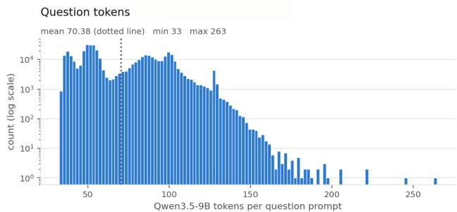

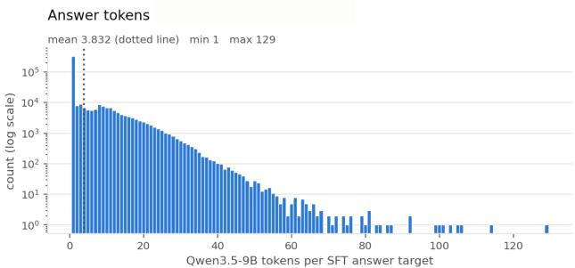

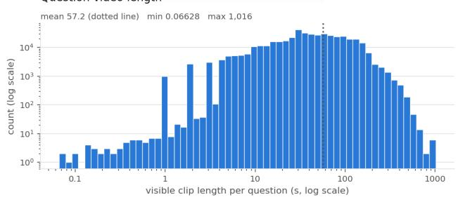

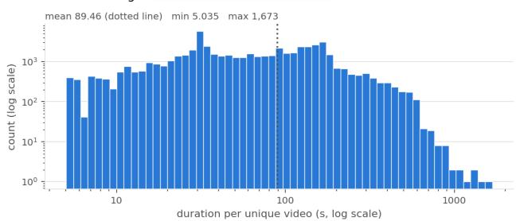  
Figure 6 The distribution of questions, answers, and video durations in the dataset. Table 8 Statistics of questions, answers, and video durations in the dataset.

<table><tr><td></td><td>Min</td><td>Max</td><td>Mean</td></tr><tr><td>Question tokens</td><td>33</td><td>263</td><td>70.4</td></tr><tr><td>Answer tokens</td><td>1</td><td>129</td><td>3.8</td></tr><tr><td>Question timestamp (s)</td><td>0.07</td><td>1,015.8</td><td>57.2</td></tr><tr><td>Full video length (s)</td><td>5.04</td><td>1,673.4</td><td>89.5</td></tr></table>

## C Additional Experiment Details

## C.1 Main Experiments

In this section, we provide additional experiment details for the main experiments presented in Table 1.

Base Models. In the main experiments, we build MaLoW on top of four diferent models, VideoChat3-4B (Li et al., 2026), Qwen3-VL-4B (Bai et al., 2025), Qwen3.5-9B (Qwen Team, 2026), and MOSS-VL-Realtime-11B (Wang et al., 2026). VideoChat3 is a video-centric VLM that is further fine-tuned on streaming video understanding data and adopts a full self-attention architecture. Qwen3-VL-4B is a general-purpose VLM based on a full self-attention architecture. Qwen3.5 is a general-purpose VLM based on a hybrid attention architecture, where a self-attention layer is interleaved with every four linear-attention layers. MOSS-VL is a video-centric VLM that adapts cross-attention layers to inject visual information into the text tokens, and a cross-attention layer is interleaved with every four self-attention layers.

Video Preprocessing. During training and evaluation, we sample the video frames at 1 fps, dividing the video frames into non-overlapping two-frame temporal blocks (each C is a 2-second video clip). We regard the most recent 2-second block as the current observation, which will be sent into the VLMs, while all the rest of the history frames will be sent into the MaLoW to be converted into LoRA weights. For MaLoW (Qwen3-VL-4B), we observe that using longer current-observation windows consistently improves performance on the real-time and backward splits of OVO-Bench (Niu et al., 2025) and StreamingBench (Lin et al., 2026). We therefore use the most recent 8-second clips as the current observations for MaLoW (Qwen3-VL-4B), while the other MaLoW instantiations in the table use the most recent 2 seconds. We hypothesize that these findings, MaLoW (Qwen3-VL-4B) benefiting from longer current-observation windows and the particularly strong performance on StreamingBench, are largely attributable to diferences in the architecture and pretraining recipe of the underlying VLMs. We preprocess the video frames with the preprocessor from the corresponding VLMs, with the maximum per-frame pixel budget set to 262,144 for all three versions of MaLoW.

Vision Encoder. We use the vision encoder from the corresponding VLMs as the vision encoder to encode each of the temporal blocks into vision tokens. We also use the MLP layers or adaptor from the VLMs to convert the vision tokens into the text semantic space before we send them into the Aggregator. We denote the vision tokens from the temporal block at t as $V _ { t }$

Aggregator. Visual tokens $V _ { t }$ in the temporal block at t are concatenated with the learnable queries $Q$ and the corresponding text embedding $T _ { t }$ of the timestamp of the temporal block. These tokens are first projected to a hidden dimension of 512 and processed by a four-layer Transformer encoder aggregator with eight attention heads (64 dimensions per head), a feed-forward dimension of 2,048, pre-layer normalization, GELU activations. We learn one 512-dimensional query for each of the VLM decoder layers. The query is shared across target modules, and LoRA ranks in the same VLM decoder layer.

State-Space Model. We learn a four-layer DeltaNet (Yang et al., 2024) with a hidden dimension of 512 as the state-space model. Each DeltaNet layer uses four value heads and two key heads, both with head dimension 128.

Cosine-Similarity-Based Gating. We determine the gating threshold by profiling the cosine similarity score between two adjecent block from 1000 subset of video from the training data introduced in section 3.4. Across 64,426 transitions between consecutive temporal blocks, the median raw cosine distance, $1 - \cos ( \bar { V } _ { t } , \bar { V } _ { t - 1 } )$ , is 0.0542. We therefore set $\beta = 0 . 0 5$ , approximately the median-change operating point. The first temporal block is always retained, while each subsequent block is retained if cos $( \bar { V } _ { t } , \bar { V } _ { t - 1 } ) \leq \beta$ . Blocks exhibiting less visual change than this threshold receive zero weight in the residual-history aggregation, whereas the retained blocks are uniformly averaged.

The Converter. For each target-module type and each LoRA rank, a separate linear output head maps the 512-dimensional representation $N o r m ( o _ { t } ) + \alpha N o r m ( s _ { t } )$ to a vector of dimension $d _ { \mathrm { i n } } + d _ { \mathrm { o u t } }$ . The vector is split into one row of the LoRA factors $\mathbf { A } _ { t } \in \mathbb { R } ^ { r \times d _ { \mathrm { i n } } }$ and $\mathbf { B } _ { t } \in \mathbb { R } ^ { r \times d _ { \mathrm { o u t } } }$ . These output heads are shared across decoder layers, while layer specificity is supplied by the layer-specific learned queries. Finally, the LoRA at a particular slot s at timestamp t is calculated with $\Delta \theta _ { t } = \alpha B _ { t } ^ { \mathsf { T } } A _ { t } ,$ where \alpha is lora\_alpha, which we set to 16.

LoRA Application Location. For VideoChat3-4B, we apply rank-8 generated LoRA for the MLP projections (gate\_proj, up\_proj, and down\_proj) and self\_attn.v\_proj in every attention layer. For the Qwen3- VL-4B, we apply rank-8 generated LoRA for the MLP projections (gate\_proj, up\_proj, down\_proj), and self\_attn.v\_proj in every attention layer. For Qwen3.5-9B, we apply rank-8 generated LoRA for the MLP projections (gate\_proj, up\_proj, and down\_proj) in every attention layer, self\_attn.v\_proj in fullattention layers, and linear\_attn.in\_proj\_qkv in linear-attention layers. For MOSS-VL-Realtime-11B, we apply rank-8 generated LoRA for the MLP projections (gate\_proj, up\_proj, and down\_proj), and v\_proj in every attention layer. We inject the generated LoRA weights into the target linear layers of the frozen base model through customized forward functions.

Training Details. We build our training pipeline on top of the Llama-Factory (Zheng et al., 2024). We train MaLoW on the MaLoW-Instruct dataset introduced in Section 3.4 for 2,800 optimization steps with a total batch size of 64. Training uses four H200s, a per-device batch size of one, and 16 gradient-accumulation steps. We use AdamW with $\beta _ { 1 } = 0 . 9 , \beta _ { 2 } = 0 . 9 9 9 , { \epsilon } = 1 0 ^ { - 8 }$ , an peak learning rate of $8 \times 1 0 ^ { - 5 }$ , a cosine learning-rate schedule, and a warm-up ratio of 0.1. Training is performed in bfloat16. We set the LoRA regularization factor $\gamma$ to 0.01.

During training, we use the state-space model in its parallel causal form. For each sample, the compact vision representations $q _ { t }$ are arranged in chronological order and processed by the four-layer DeltaNet using the chunk-parallel gated-delta-rule kernel and an attention mask for padded blocks. We then select the output at the last valid temporal block for each history observation. This parallel computation is causally equivalent to processing the blocks recurrently while carrying the convolutional and recurrent DeltaNet states, which is the form that is used for online streaming inference.

Evaluation Details. Following the evaluation protocols adopted in prior streaming video understanding works (Shen et al., 2026; Zhang et al., 2026a), we evaluate MaLoW on the Real-Time split of Streaming-Bench (Lin et al., 2026), as well as the Real-Time and Backward splits of OVO-Bench (Niu et al., 2025).

For StreamingBench, we evaluate on the Real-Time split, which contains 2,500 multiple-choice questions, and use accuracy as metric. For OVO-Bench, both the Backward and Real-Time splits are evaluated with the metric accuracy. The Backward and Real-Time splits consist of 631 and 837 questions. Following prior work, the performance of each split is computed as the macro-average across the tasks belonging to that split, and we additionally report the macro-average performance across the Backward and Real-Time splits in Table 1.

The Backward splits of OVO-Bench mostly focus on retrospect to the past and comprise three tasks: Episodic Memory (EPM), Action Sequence Identification (ASI), and Hallucination Detection (HLD). Among them, EPM is particularly well suited for evaluating the memory mechanism introduced by MaLoW, as it directly measures the model’s ability to retain and retrieve information from earlier observations. We further note that HLD is relatively less challenging because all ground-truth responses are Unable to answer. As a result, models can achieve high accuracy on this task by consistently predicting this response, making HLD less discriminative for assessing the efectiveness of long-term memory mechanisms.

The trained MaLoW can operate in a fully streaming manner by processing the video history block by block using the cached-forward mode of DeltaNet. (Please see the Evaluation details. in the section C.2) To accelerate evaluation, however, we use the same parallel-forward mode employed during training when evaluating on OVO-Bench and StreamingBench. Specifically, for a question associated with a video prefix [0, T], we treat the interval [0, T − 2] as historical context and sample it at 1 fps as input to the hypernetwork. The base VLM then receives the question together with two frames sampled from the current observation window [T − 2, T]. For the evaluation on the OVO-bench, we follow the prompt example used in lmms-eval (Zhang et al., 2025a), and for the evaluation on the StreamingBench we follow the prompt example used in the oficial repository.

Baselines Re-Evaluation. Among the baselines in Table 1, we re-evaluate MOSS-VL-Realtime-11B (Wang et al., 2026), VideoChat3-4B (Li et al., 2026), and Qwen3.5-9B (Qwen Team, 2026), as these models are also used as the base VLMs for MaLoW. For the remaining baselines, we report the results from their original papers.

For Qwen3.5-9B, we sample video frames at 1 fps with a maximum per-frame pixel budget of 262,144 and use greedy decoding for answer generation.

For VideoChat3-4B, we use the oficial evaluation code and follow the hyperparameters reported in the paper. On OVO-Bench, we sample frames at 2 fps and retain the 32 most recent frames, with a per-frame pixel budget of 4482 and a visual-token budget of 80K. On StreamingBench, we sample frames at 4 fps with at most 4,096 frames, using the same per-frame pixel budget of 4482 and visual-token budget of 80K.

For MOSS-VL-Realtime-11B, as neither the paper nor the released repository provides an oficial evaluation script, we evaluate the model on OVO-Bench and StreamingBench using frames sampled at 1 fps with a maximum per-frame pixel budget of 262,144.

These settings successfully reproduce the reported OVO-Bench performance of VideoChat3 and MOSS-VL-Realtime. However, our re-evaluated StreamingBench results are lower than those reported in the corresponding papers. We therefore include both the re-evaluated and paper-reported results in Table 1, with the paper-reported results shown in gray.

## C.2 MaLoW in VLA setting

In this section, we provide more implementation details for the MaLoW in the VLA setting. The results are presented in Table 2.

Base VLA Model and Initialization. Inspired by the previous work (Zhang et al., 2026b), we train a simple VLA model on top of Qwen3.5-2B, named as Q3.5-2B-MLP, as the starting point of the MaLoW (Q3.5-2B-MLP).

The Q3.5-2B-MLP is given the current observation (an image) and text instruction and predicts a chunk of four seven-dimensional actions, corresponding to the current action and the following three actions. We learn special tokens as action hidden representations, and VLMs compress the visual observation and the text instruction into the special tokens. An action decoder, which is a two-layer MLP that directly regresses normalized robot actions using mean-squared error based on the special tokens. We use the Qwen3.5 preprocessor to preprocess the input image and the text instruction.

Q3.5-2B-MLP was trained on the Bridge and RT-1 mixture of the OXE LeRobot dataset (O’Neill et al., 2024) for 50,000 optimization steps, with learning rate is $4 \times 1 0 ^ { - 5 }$ on action decoder, and $1 \times 1 0 ^ { - 4 }$ on LoRA. The learning rate is linearly warmed up for 5,000 steps and then cosine-decayed. Training uses AdamW with $\beta _ { 1 } = 0 . 9 , \beta _ { 2 } = 0 . 9 5 , { \epsilon } = 1 0 ^ { - 8 }$ ,and weight decay $1 0 ^ { - 8 }$ . Training is conducted in bfloat16 on four H200 GPUs with a per-device batch size of 16 and two gradient-accumulation steps, yielding a global batch size of 128. We apply rank-128 LoRA to all linear layers, including the vision tower and multimodal projector, with a scaling factor of 256. Q3.5-2B-MLP achieves 59.4% in the Simpler-Bridge with WidowX robot.

Observation Preprocessing. For a training sample at control step $t ,$ the base VLA Model receives the current observation $x _ { t }$ and the language instruction, while the MaLoW receives all preceding observations $x _ { 0 } , \ldots , x _ { t - 1 }$ We do not impose a maximum history length. Bridge trajectories are recorded at $5 \ \mathrm { H z } ,$ and timestamps are therefore expressed using a control period of 0.2 seconds.

The current observation is processed through the same single-image preprocessing path as the Q3.5-2B-MLP, while all the historical observations are decoded directly from the episode video and be sent into the MaLoW. All the frames are resized to $2 2 4 \times 2 2 4$ , and passed to the Qwen3.5-2B preprocessor. This matches the preprocessing of the historical frames received from SimplerEnv during interactive evaluation.

We divide the observation history into consecutive, non-overlapping two-frame blocks, matching the temporal patch size of the Qwen vision encoder. If the history contains an odd number of frames, its final frame is repeated to complete the last block. For example, the history at step $t = 3$ is represented as $[ x _ { 0 } , x _ { 1 } ]$ and $[ x _ { 2 } , x _ { 2 } ]$ . Each block is assigned a timestamp interval using the true Bridge control clock. A committed block j is labeled $[ 2 j \Delta t , ( 2 j + 2 ) \Delta t ]$ , where $\Delta t = 0 . 2$ seconds.

Vision Encoder. We use a frozen copy of the vision tower and vision adaptor from the Q3.5-2B-MLP as the MaLoW’s vision encoder.

Action-History Conditioning. In addition to visual history, every historical frame is paired with the action that produced it. Specifically, frame $x _ { i }$ is paired with the preceding action $a _ { i - 1 }$ . The first frame $x _ { 0 }$ is paired with a learned empty-action embedding representing $a _ { - 1 }$ . Historical actions undergo the same normalization transformations as the action targets.

Each seven-dimensional action is mapped to the visual-token dimension by a two-layer MLP with a GELU activation. Thus, the input sequence for a two-frame temporal block is

$$
[ V _ { 2 j } , V _ { 2 j + 1 } , T _ { j } , E ( a _ { 2 j - 1 } ) , E ( a _ { 2 j } ) ] ,
$$

where $V _ { i }$ denotes the visual tokens for frame i, T\_j denotes the frozen token embeddings of the block’s timestamp interval, and $E ( \cdot )$ is the action-history MLP.

Aggregator. For every temporal block, the visual, timestamp, and action-history tokens are projected to a hidden dimension of 512 and processed by a four-layer Transformer encoder. The rest of the aggregator’s details are the same as the one used in section C.1.

State-Space Model and the Converter. The state-space model and the converter share the same details as the one used in section C.1.

LoRA Application Locations. Because Qwen3.5 interleaves full self-attention and linear-attention layers, the rank 8 generated LoRA is applied to gate\_proj, $\tt u p \mathrm { \_ p r o j }$ , and down\_proj in every decoder layer, to self\_attn.v\_proj in full-attention layers, and to $\mathrm { l i n e a r \_ a t t n . i n \_ p r o j \_ q k v }$ in linear-attention layers.

Training Details. MaLoW (Q3.5-2B-MLP) is trained on the Bridge portion of the OXE LeRobot dataset. Before training, we merge the Q3.5-2B-MLP LoRA adapter into Qwen3.5-2B and load the stage-1 action-decoder weights. The merged Qwen backbone is then frozen. The trainable components in the MaLoW (Q3.5-2B-MLP) are the MaLoW, including the aggregator, action-history encoder, temporal state-space model, and LoRA output heads, together with the action decoder. The complete objective is

$$
\begin{array} { r } { \mathcal { L } = \mathcal { L } _ { \mathrm { a c t i o n } } + 0 . 1 \mathcal { L } _ { \mathrm { L o R A } } , } \end{array}
$$

where

$$
\mathcal { L } _ { \mathrm { L o R A } } = \frac { 1 } { \vert \boldsymbol { S } \vert } \sum _ { s \in \boldsymbol { S } } \left( \mathrm { m e a n } \left. \mathbf { A } _ { s } \right. + \mathrm { m e a n } \left. \mathbf { B } _ { s } \right. \right)
$$

, \protec \mathcal {S} is the set of valid generated LoRA slots, and $\mathcal { L } _ { \mathrm { a c t i o n } }$ is MSE Loss between the predicted actions and the ground truth actions.

We train for 25,000 optimization steps using four H200 GPUs. The per-device batch size is four and gradients are accumulated for four steps, giving a total batch size of 64. We use AdamW with $\beta _ { 1 } = 0 . 9 , \beta _ { 2 } = 0 . 9 5$ $\epsilon = 1 0 ^ { - 8 }$ , and weight decay $1 0 ^ { - 8 }$ and learning rate of $1 \times 1 0 ^ { - 5 }$ in this experiment. We use a cosine schedule with 1,500 warm-up steps and a final learning rate of $5 \times 1 0 ^ { - 7 }$ . Training is performed in bfloat16 with FlashAttention-2 and ordinary distributed data parallelism.

Evaluation Details. We evaluate MaLoW (Q3.5-2B-MLP) on the four WidowX Bridge tasks in SimplerEnv: Stack Green Block on Yellow Block, Put Carrot on Plate, Put Spoon on Towel, and Put Eggplant in Yellow Basket. Each task contains 24 evaluation episodes, for a total of 96 episodes.

Evaluation is conducted in a fully interactive streaming setting. At environment step zero, no historical context is available, and the model exactly reproduces the Q3.5-2B-MLP policy. At each subsequent step, completed two-frame blocks and the corresponding actions are permanently incorporated into the cached DeltaNet state $m _ { t }$ and updated into the global sematic $s _ { t }$ . If the history ends with an unpaired frame, we duplicate it to form a provisional block and generate the current adapter using a temporary copy of the recurrent state. At the next step, we discard this temporary update and incorporate the completed two-frame block into the persistent state. The $h _ { t }$ state is reset at each episode boundary.

The policy predicts four-action chunks and applies action ensembling over a horizon of four steps. Because ensembling may cause the action executed by the environment to difer from the most recent raw model prediction, we feed the normalized executed action back to the policy server. This executed action, rather than the unensembled model prediction, is paired with the corresponding observation when constructing subsequent history blocks.

## C.3 MaLoW with diferent VLM scales and sources

In this section, we provide additional implementation details for the results presented in Table 4.

Base Models. In this sections, we use the Gemma-E4B (Gemma Team, 2026) and Qwen3.5-0.8B, Qwen3.5-2B and Qwen3.5-4B (Qwen Team, 2026) as the base model.

LoRA Application Location. For Gemma-E4B, we apply rank-8 generated LoRA for the MLP projections (gate\_proj, up\_proj, and down\_proj) in every attention layer. For Qwen3.5 series, we apply rank-8 generated LoRA for the MLP projections (gate\_proj, up\_proj, and down\_proj) in every attention layer, self\_attn.v\_proj in full-attention layers, and linear\_attn.in\_proj\_qkv in linear-attention layers.

Data, Structural, and Training Details. For the Video Preprocessing, Vision Encoder, Aggregator, State-Space Model, Cosine-similarity-based gating, the Converter, and Training details are share the same details in section C.1.

Evaluation Details. For the evaluation on the OVO-bench, we follow the example used in lmms-eval (Zhang et al., 2025a), and for the evaluation on the StreamingBench we follow the example used in the oficial repository. For a question associated with video prefix [0, T], the interval [0, T − 2] is treated as historical context and sampled at 1 fps for the MaLoW. The base VLM receives the question together with two frames sampled from the current observation [T − 2, T].

For OVO-Bench, we evaluate all backward, real-time, and forward splits. Backward and real-time questions are scored by accuracy. For the forward split, repetitive-event counting is scored by exact count matching, while sequential-step recognition and contextual-readiness recognition are scored using exact accuracy. We follow the benchmark’s macro-averaging protocol across tasks for each split, and we further present the macro-averaging number over 3 splits.

For StreamingBench, we evaluate the Real, Omni, Sequential-QA, and Proactive subsets base on how the benchmark annotations are organized. Real, Omni, and Sequential-QA are scored by accuracy. Following the original protocol, Sequential-QA includes the gold question–answer history from earlier timestamps in the same video. For Proactive evaluation, the model is queried once per second until four seconds after the annotated trigger time. An example is counted as correct only when the model triggers within this tolerance window, and its generated response contains the expected output. The overall StreamingBench score is the benchmark-weighted average over Real, Omni, Proactive, and Sequential-QA, using weights of 2,500, 1,500, 250, and 250 examples, respectively.

## C.4 Memory stress test

In this section, we share additional implementation details for the memory stress test evaluation and the results presented in Table 3.

We use the StreamArena (Zhang et al., 2026d) Historical Retrospection (HR) split as the benchmark, which has 877 questions across L1–L4 over 237 videos. L1 to L4 indicate the evidence-to-query gap of less than 5 min, between 5 and 15 min, between 15 and 30 min, and longer than 30 min, respectively.

We compare MaLoW (Qwen3.5-9B) against strong streaming video understanding models: MOSS-VL-Realtime-11B (Wang et al., 2026), which retains the full historical context; VideoChat3-4B (Li et al., 2026) and AURA-8B (Lu et al., 2026), which operates with a local 16 / 30 -second observation window, respectively; VST-7B (Guan et al., 2026), which compresses the historical observation as text-based memory.

For AURA and VST, we follow the oficial implementations in StreamArena to evaluate the model performance. For MOSS-VL-Realtime, VideoChat3, and MaLoW, they share the same question prompt derived from the prompt used by AURA. MaLoW (Qwen3.5-9B) samples video frames at 1fps with a maximum per-frame pixel budget of 262,144. The final two-second window is regarded as the current observation and will be sent to the VLMs, while the rest of the history frames will be sent to the MaLoW and converted into LoRA. The VideoChat3 uses 32 unique frames at 2 FPS from the latest 16 seconds, with an aspect-ratio-preserving maximum of 200,704 pixels per frame (448^2 ). MOSS-VL samples frames at 1 FPS and with maximum per-frame pixel cap as 262,144 pixels. VST uses up to 384 causal-prefix frames at 1 FPS with aspect-ratiopreserving resolution determined dynamically by its 8,192-visual-token-per-segment budget. AURA takes most recent 30 seconds video at 1 FPS as input, with per-frame max pixel 602,112 pixel.

## C.5 Streaming Inference Speed Profiling

We provide additional details on the inference-speed profiling reported in Figure 4. We measure the streaming inference latency of MaLoW and four baselines on 100 deterministically sampled OVO-Bench (Niu et al., 2025) questions spanning a wide range of history lengths. Video durations range from 8 to 1,117 seconds, with a median of 153.5 seconds, a mean of 193.3 seconds, and a 90th percentile of 312 seconds. This set includes both short clips and videos exceeding 10 minutes, enabling evaluation of long-context streaming eficiency. At each query timestamp t, we measure synchronized GPU computation required to process the current observation and answer the query under each method’s native streaming protocol. Video decoding, resizing, and other input preprocessing are excluded.

For MaLoW, each streaming step includes encoding the current observation, updating the hidden state and generating the LoRA adapter for the next time step, applying the adapter generated for the current time step, prefilling the model with the question and the two most recent frames from [t-2,] , and decoding the first output token.

For SimpleStream (Qwen3.5-9B), the model receives only the question and two frames sampled from the most recent two-second window, [t-2,] , without earlier visual history. The measured latency includes prefilling with these inputs and decoding the first output token.

For Qwen3.5-9B with full context, the measured latency includes prefilling the question together with the complete video history from the start of the stream to t, sampled at 1 FPS, followed by decoding the first output token.

For VideoChat3, we follow its oficial streaming implementation. At each query, the model re-prefills the question together with a sliding window of the most recent 32 frames, corresponding to approximately 16 seconds at 2 FPS, before generating the streaming response. The measured latency includes prefilling of the local window video and text query and subsequent decoding.

Table 9 Ablation study on the modules to which LoRA is applied. Each row cumulatively adds LoRA to the module indicated in the first column.
<table><tr><td>Module</td><td>OVO-Bench (EPM)</td><td>StreamingBench</td><td>Avg.</td></tr><tr><td>MLP</td><td>63.6 (63.3)</td><td>72.4</td><td>68.0</td></tr><tr><td>+ v_proj</td><td>63.8 (63.6)</td><td>72.4</td><td>68.1</td></tr><tr><td> $\mathrm { ~ + ~ } \mathsf { q k v \mathrm { _ { - } p r o j } }$ </td><td>64.1 (63.2)</td><td>72.5</td><td>68.3</td></tr></table>

Table 10 Ablation study on the learned LoRA rank.
<table><tr><td>Rank</td><td>OVO-Bench (EPM)</td><td>StreamingBench</td><td>Avg.</td></tr><tr><td>4</td><td>65.3 (63.0)</td><td>71.9</td><td>68.6</td></tr><tr><td>8</td><td>65.7 (63.6)</td><td>72.8</td><td>69.2</td></tr><tr><td>16</td><td>63.4 (59.3)</td><td>68.2</td><td>65.8</td></tr></table>

For MOSS-VL-Realtime, we follow its oficial streaming implementation, in which incoming observations are continuously incorporated into a growing vision-text KV state. The measured latency includes the forward pass required to ingest the latest two seconds of video and the subsequent decoding.

## D Additional Experiments

## D.1 Ablation Study

We conduct ablation studies with MaLoW (Qwen3.5-9B) to investigate key design choices: (1) the LoRA target modules, (2) the LoRA rank, (3) the architecture of the MaLoW, (4) the size of the current observation and (5) the refresh rate of the hidden state. All ablations are conducted on a subset of an subset of the training data described in Section 3.4, rather than the final dataset used for the main experiments. Within each ablation, all training hyperparameters are kept fixed following Section 4.1, except for the component being ablated, ensuring a controlled comparison. We report results on OVO-Bench and StreamingBench, together with the Episodic Memory (EPM) results from OVO-Bench.

Where should LoRA be applied? Qwen3.5-9B adopts a hybrid attention architecture in which one self-attention layer is interleaved with every four linear-attention layers, providing a representative setting for studying LoRA placement in modern hybrid-attention VLMs. We evaluate three cumulative configurations: (1) applying LoRA only to the MLP layers shared by both self-attention and linear-attention blocks; (2) additionally applying LoRA to the v\_proj in self-attention layers; and (3) further applying LoRA to the qkv\_proj in linear-attention layers. As shown in Table 9, progressively extending LoRA to additional modules consistently improves the average performance, with the best results achieved when all three module types are adapted.

What is the best LoRA rank? The results are presented in Table 10. Among the evaluated configurations, rank 8 achieves the best overall performance, with an average score of 69.2. Rank 4 performs slightly worse, suggesting limited adaptation capacity, whereas increasing the rank to 16 causes a substantial performance drop on both benchmarks, indicating overfitting.

What is the best MaLoW module structure? We investigate key design choices for the MaLoW module: (1) whether temporal modeling with a State-Space Model (SSM) and global semantic aggregation are both necessary, and (2) how global semantics should be efectively preserved.

Table 11 evaluates the contributions of the SSM and global semantic aggregation. The w/ sum variant achieves stronger performance on EPM, which emphasizes information from earlier observations, whereas the w/ SSM variant performs better on StreamingBench, where a large portion of the evaluation focuses on real-time understanding. These results suggest that the SSM is particularly efective at modeling temporally local and causal information, while global semantic aggregation better preserves information over longer temporal horizons. Combining both components balances real-time understanding and long-term memory, yielding the best overall performance.

Table 12 further compares diferent strategies for preserving global semantics. We consider three variants: sum, which directly accumulates all previous compact visual representations qt; weighted sum, which weights each qt according to the cosine similarity between adjacent temporal blocks; and gated sum, which selectively retains q based on temporal similarity and is adopted in our final design. The gated sum achieves the best average performance. By filtering temporally redundant representations while retaining informative observations, the gating mechanism preserves global semantics more efectively and improves overall performance.

How does the size of the current observation afect performance? Although the main experiments in Section 4.1 treat each $C _ { t }$ as a 2-second video clip, updating the hidden state $h _ { t }$ every 2 seconds, the observation window can be varied independently of $h _ { t }$ update frequency. To isolate the efect of the current observation window while keeping the hidden-state update interval fixed, we ablate the window sizes of 1, 2, and 4 seconds, with 2 seconds corresponding to our default setting. For the 4-second window, $h _ { t }$ is updated using the oldest 2-second segment evicted from the window. For the 1-second window, MaLoW accumulates consecutive observations and updates $h _ { t }$ after every 2 seconds of newly observed video. The result is presented in Table 13. A larger 4-second current observation window improves real-time perception, as reflected by the higher StreamingBench score, but degrades memory performance, with EPM dropping to 60.0. In contrast, a 1-second window reduces real-time perception while yielding similar EPM performance as the 2-second window. To balance real-time perception and long-term memory, we therefore use a 2-second current observation window as the default setting.

Table 11 Ablation study on the causal relationship and global semantics.
<table><tr><td>Variant</td><td>OVO-Bench (EPM)</td><td>StreamingBench</td><td> $\operatorname { A v g } .$ </td></tr><tr><td>w/ sum</td><td>62.5 (63.0)</td><td>70.9</td><td>66.7</td></tr><tr><td>w/ SSM</td><td>62.4 (60.9)</td><td>72.8</td><td>67.6</td></tr><tr><td>w/ SSM + sum</td><td>64.2 (63.0)</td><td>72.7</td><td>68.5</td></tr></table>

Table 12 Ablation study on diferent global semantics aggregation strategies.
<table><tr><td>Variant</td><td>OVO-Bench (EPM)</td><td>StreamingBench</td><td> $\operatorname { A v g } .$ </td></tr><tr><td>sum</td><td>64.1 (61.3)</td><td>72.1</td><td>68.1</td></tr><tr><td>weighted sum</td><td>64.6 (62.0)</td><td>72.7</td><td>68.6</td></tr><tr><td>gated sum</td><td>64.8 (64.0)</td><td>72.7</td><td>68.8</td></tr></table>

Table 14 Ablation study on the hidden state $\left( h _ { t } \right)$ refresh rate; frames are sampled at 1fps.

Table 13 Ablation study on the current observation size; frames are sampled at 1fps.
<table><tr><td>Variant</td><td>OVO-Bench (EPM)</td><td>StreamingBench</td><td>Avg.</td></tr><tr><td>1 second (1 frame)</td><td>66.0 (63.2)</td><td>71.0</td><td>68.5</td></tr><tr><td>2 seconds (2 frames)</td><td>66.3 (63.3)</td><td>73.1</td><td>69.7</td></tr><tr><td>4 seconds (4 frames)</td><td>65.4 (60.0)</td><td>75.1</td><td>70.3</td></tr></table>

<table><tr><td>Variant</td><td>OVO-Bench (EPM)</td><td>StreamingBench</td><td>Avg.</td></tr><tr><td>1 second (1 frame)</td><td>65.2 (62.8)</td><td>73.2</td><td>69.2</td></tr><tr><td>2 seconds (2 frames)</td><td>66.3 (63.3)</td><td>73.1</td><td>69.7</td></tr><tr><td>4 seconds (4 frames)</td><td>66.5 (63.6)</td><td>72.3</td><td>68.4</td></tr></table>

How does the refresh rate of the hidden state afect the performance? Although the main experiments in Section 4.1 treat each $C _ { t }$ as a 2-second video clip, updating the hidden state $h _ { t }$ every 2 seconds, the update frequency can be varied independently of the observation window. We therefore conduct an ablation with update intervals of 1, 2 (which used in the main experiments), and 4 seconds while keeping the base VLM input fixed to the most recent 2 seconds. For a 1-second interval, the hidden state is updated using the oldest 1-second segment evicted from the current 2-second observation window; for a 4-second interval, MaLoW accumulates newly observed video and updates the hidden state only after every 4 seconds of new observations.

The results are presented in Table 14. We observe that less frequent updates, where each update incorporates a larger temporal chunk, slightly improve memory performance at the cost of a small drop in real-time perception. We hypothesize that this behavior is related to the State-Space Model (SSM) used for hidden-state updates. As shown in Table 11, the SSM primarily models short-term temporal dependencies. More frequent updates may therefore bias it toward shorter temporal ranges, improving current perception but slightly weakening longer-term memory, while less frequent updates have the opposite efect. Overall, performance remains stable across diferent update intervals. We therefore adopt a 2-second interval, which balances memory and real-time perception while matching the current observation window for a simpler design.

## D.2 Additional Analysis

Latency Breakdown. We further analyze the latency of MaLoW (Qwen3.5-9B) reported in Figure 4, with the detailed breakdown presented in Table 15. Encoding the new frames and updating the hidden state $h _ { t } ,$ generating the LoRA tensors $A _ { t + 1 }$ and $B _ { t + 1 }$ , and combining them to construct $\Delta \theta _ { t + 1 }$ account for 7.9%, 2.1%, and 3.7% of the total latency, respectively. Importantly, these operations compute the adapter for the next temporal block and can therefore be executed in parallel with applying $\Delta \theta _ { t }$ and performing base-VLM prefilling and decoding for the current block. With such pipelining, only the application of $\Delta \theta _ { t }$ and the wrapper overhead remain on the critical inference path, adding 1.75 ms to the 130.07 ms base-model inference latency. This corresponds to approximately 1.3% of the efective end-to-end latency, demonstrating that MaLoW introduces only marginal latency overhead in practical streaming inference.

LoRA Hidden State Evolution over the History. Figure 7 visualizes how the internal LoRA state of MaLoW evolves with changes in video content. We compute a V-JEPA-2 (Assran et al., 2025) surprise score on a YouCook2 (Zhou et al., 2018) video by masking the features of the last temporal block and measuring the distance between its predicted representation and the representation of the subsequent block. In parallel, we track the 512-dimensional LoRA hidden state of MaLoW (Qwen3.5-9B), defined as $\mathrm { N o r m } ( o _ { t } ) + \alpha \mathrm { N o r m } ( s _ { t } )$ . We average the hidden states used to generate layer-specific LoRA adapters and project the resulting representation into two dimensions using t-SNE.

Table 15 Breakdown of the MaLoW (Qwen3.5-9B) latency. Percentages are relative to the total latency of 152.89 ms.
<table><tr><td>Component</td><td>Latency (ms)</td><td>Percentage</td></tr><tr><td colspan="2">Could be paralleled with the base VLMs prefilling and decoding</td><td></td></tr><tr><td>Encode new frames and update state  $h _ { t }$ </td><td>12.11</td><td>7.91%</td></tr><tr><td>Generate LoRA tensors  $A _ { t + 1 }$  and  $B _ { t + 1 }$ </td><td>3.27</td><td>2.14%</td></tr><tr><td>Combine LoRAs and generate  $\Delta \theta _ { t + 1 }$ </td><td>5.69</td><td>3.72%</td></tr><tr><td colspan="2">Can not be paralleled with the base VLMs prefilling and decoding</td><td></td></tr><tr><td>Apply LoRA  $\Delta \theta _ { t }$ </td><td>1.13</td><td>0.74%</td></tr><tr><td>Wrapper overhead</td><td>0.62</td><td>0.41%</td></tr><tr><td>Base-model prefill + decoding first tokens</td><td>130.07</td><td>85.07%</td></tr><tr><td>Total</td><td>152.89</td><td>100.00%</td></tr></table>

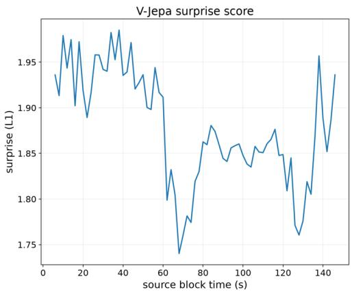

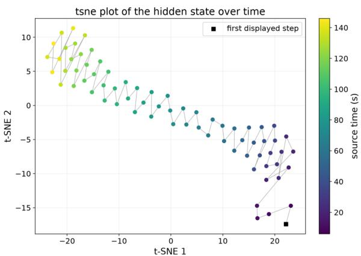  
Figure 7 The V-JEPA-2 surprise score versus the t-SNE map of the LoRA hidden state.

The LoRA state changes more rapidly when the V-JEPA-2 surprise score is high (before 60s and after 130s), while evolving more smoothly during the lower-surprise interval between 60s and 130s. This correspondence suggests that the LoRA state adapts dynamically to changes in the underlying video events.

Efect of Memory on Real-Time Perception. We investigate whether long-term historical information compressed by MaLoW adversely afects real-time perception on the real-time splits of OVO-Bench and StreamingBench.

For OVO-Bench, where video prefixes extend up to 28 minutes, we group real-time questions by their preceding video duration into four intervals: 0–5, 5–10, 10–15, and over 15 minutes. As shown in Figure 8-1, MaLoW (Qwen3.5-9B) maintains comparable accuracy to the local-window baseline (Qwen3.5-9B, last 2 seconds) across diferent prefix ranges, suggesting that accumulated memory does not compromise real-time perception.

For StreamingBench, where the original video prefixes are relatively short, we randomly sample 100 samples and construct longer streams by prepending randomly sampled videos, extending the historical context from 5 to 60 minutes. As shown in Figure 8-2, consistent with the observations on OVO-Bench, MaLoW (Qwen3.5-9B) maintains stable real-time perception across varying history lengths.

These observations are consistent with our design choice to regularize the norm of the generated LoRA weights. This regularization constrains the magnitude of memory-induced weight updates, preventing them from dominating the pretrained model weights and disrupting its real-time perception capabilities.

Additional Qualitative Results. We provide additional qualitative results in Figure 9. Samples 1, 2, and 4 further demonstrate that MaLoW (Qwen3.5-9B) can retain long-term historical context through its internalization mechanism. In some cases, however, the retained memory can be vague, as humans do. For example, in Sample 2, which clue appeared 32 minutes before the question timing, MaLoW appears to retain a coarse memory of Coca-Cola and answers “beverage” rather than the specific object.

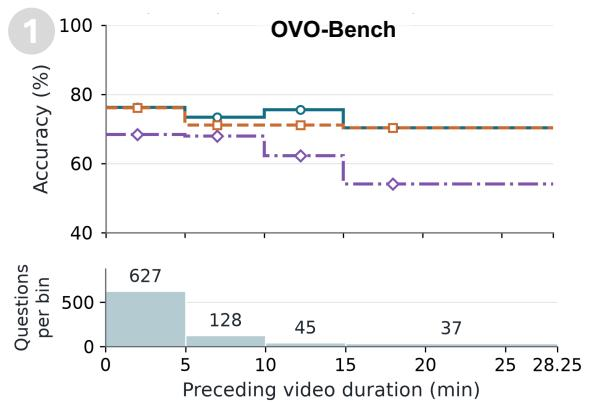

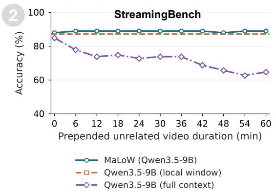

Figure 8 Efect of Memory on Real-Time Perception. Markers on subplot 1 show bin medians. We evaluate the accuracy of MaLoW on real-time questions across varying history lengths. MaLoW maintains stable real-time perception despite accumulating long-term memory.  
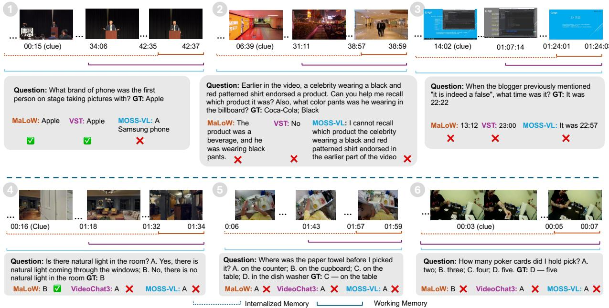  
Figure 9 The additional qualitative results.

Sample 5 illustrates a failure case in which both MaLoW and the baselines produce incorrect answers, partly due to an inaccurate ground-truth annotation. Sample 3 requires not only remembering the relevant video timestamp, but also an agentic procedure to revisit the corresponding frames and localize the clock displayed in the bottom-right corner. Since MaLoW is not trained with agentic tool-use data, extending it to such agentic settings is left for future work. Finally, Sample 6 requires strong visual perception to recognize that four cards are initially present on the table, followed by temporal reasoning to determine that one additional card is added, yielding five cards in total. We expect such cases to benefit from future base VLMs with stronger fine-grained visual perception.