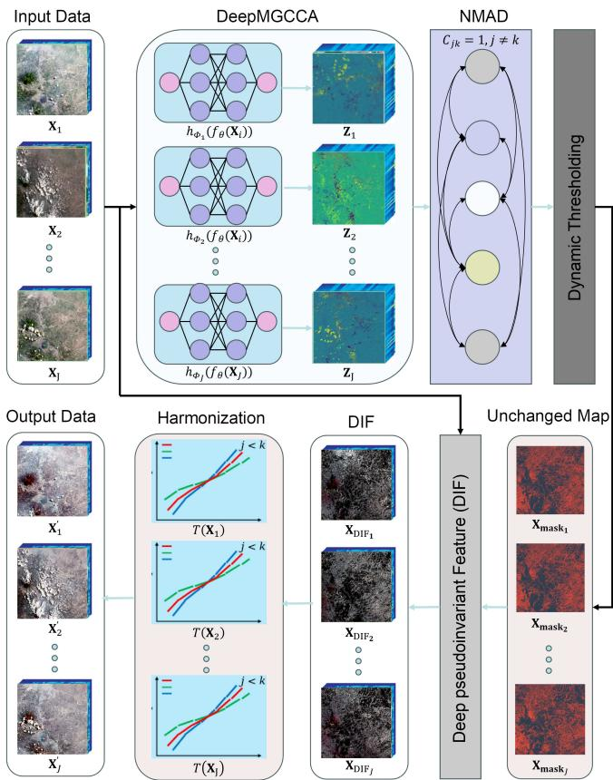
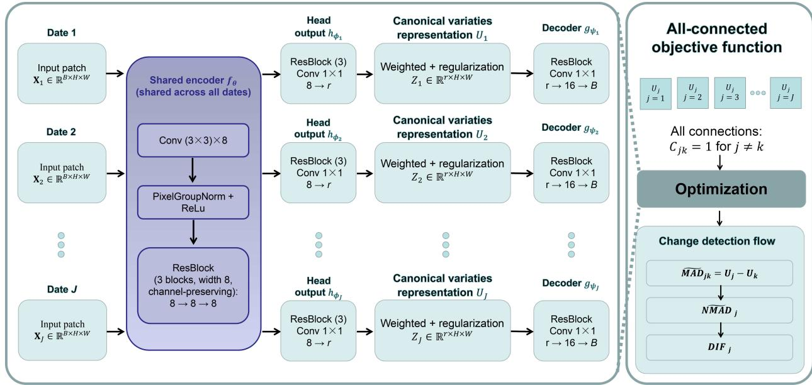
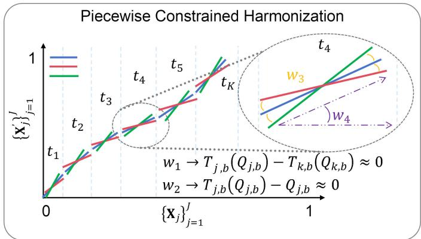
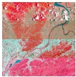
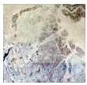
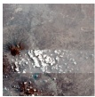
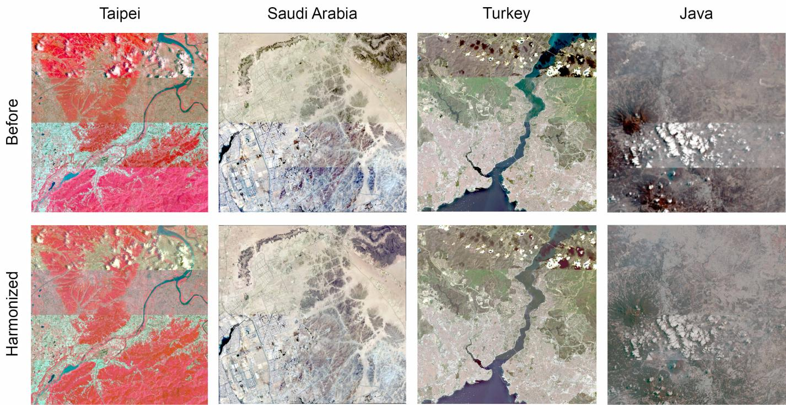
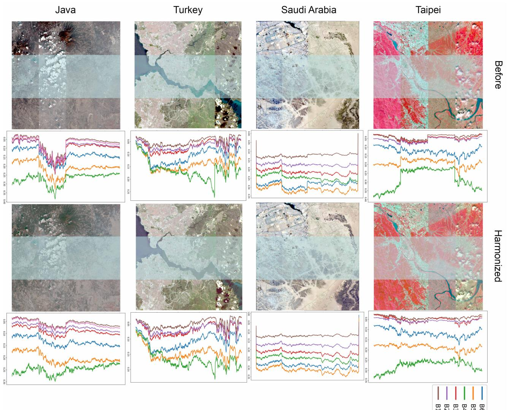
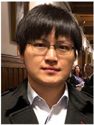

# Monotone Piecewise-Linear Harmonization of Multitemporal Multispectral Surface Reflectance With Unsupervised Deep Multiview Pseudoinvariant Features Learning

Lino Garda Denaro , and Chia-Hsiang Lin , Senior Member, IEEE

Abstract—Surface reflectance products derived from optical satellite imagery may exhibit systematic inconsistencies across acquisition dates, because atmospheric correction is generally performed independently for each image. Such residual biases distort the temporal behavior of invariant ground targets and reduce the reliability of multitemporal surface reflectance analysis. This study proposes Deep Multitemporal Generalized Canonical Correlation Analysis (DeepMGCCA), an unsupervised deep multiview pseudoinvariant feature learning framework that integrates Deep Generalized Canonical Correlation Analysis (GCCA) with Multivariate Alteration Detection (MAD) to identify deep-pseudoinvariant features (DIFs) for the removal of surface reflectance biases across multitemporal satellite observations. Unlike conventional MAD-based approaches that rely on linear GCCA, the proposed framework replaces datespecific linear projections with a shared convolutional encoder. The framework learns deep invariant features (DIFs) directly from pixel-weighted canonical variates via iterative reweighting strategy, while a reconstruction regularizer preserves surface reflectance information and prevents degenerate collapse from suppressing genuine temporal variability. Experiments were conducted on four annual Landsat-8/9 and Sentinel-2 acquisitions across four regions of interest (ROIs) to evaluate four DIFbased harmonization transforms. A monotone piecewise-linear transform derived from DIFs quantiles consistently achieved the largest bias reduction, lowering the between-date spectral angle by up to 2.54◦ and RMSE by 0.015, and raising PSNR by up to 4.04 dB. These findings demonstrate the potential of deep invariant feature learning for multitemporal surface reflectance bias removal while highlighting the importance of preserving physically meaningful temporal and spectral information during nonlinear representation learning.

Index Terms—Multispectral image, deep multiview learning, pseudoinvariant feature learning, deep-pseudoinvariant features (DIFs), generalized canonical correlation analysis (GCCA), multitemporal canonical correlation analysis, multitemporal surface reflectance harmonization, surface reflectance bias correction, atmospheric correction.

## I. INTRODUCTION

Multitemporal optical remote sensing analysis, including land-cover change mapping and disturbance monitoring [1], [2], and the reconstruction of dense reflectance time series [3], requires that reflectance differences between acquisition dates reflect genuine surface changes rather than differences in illumination geometry [4], atmospheric conditions [5], sensor calibration [6], or phenological background. Relative radiometric normalization is the conventional solution that uses a set of pseudo-invariant features (PIFs), or pixels thought to be radiometrically stable throughout the time series, are used to calibrate one date to another or to a common reference. The concept originates in [7], [8], which selected spectrally stable man-made targets manually, and was subsequently developed into the radiometric-control-set methodology [9]. Fully automatic variants, in which the invariant set is estimated from the imagery itself rather than delineated by an analyst, were established by Liu et al., and Canty et al. [10], [11] and Canty and Nielsen [12], [13]. In all of these, the reliability of the normalization is bounded by the reliability of the PIF selection step, which makes automated, statistically principled PIFs extraction a problem of independent importance. Recent studies have attacked radiometric consistency from the crosssensor side, deriving global transformation functions between Landsat-8 and Sentinel-2 reflectance products [14], [15], harmonizing the two sensors spectrally through matching-band adjustment [16], harmonizing multispectral and panchromatic VHR spaceborne imagery [17], and quantifying cross-sensor consistency of surface reflectance [18], to the point that harmonized Landsat–Sentinel-2 time series have become a standard input to downstream land-cover applications [19]. These approaches harmonize across sensors at a given epoch, the residual interdate bias that remains inside each surface reflectance product still requires multitemporal, statistically principled harmonization, which is the problem addressed in this study.

Multivariate Alteration Detection (MAD) [20], [21] provides a statistically grounded solution by projecting two multispectral acquisitions into a set of canonical components derived through two-view Canonical Correlation Analysis (CCA) [22]. These components are ordered according to their bitemporal correlation, allowing temporal differences to be represented in a transformed space that emphasizes change-related variability. Under the no-change hypothesis, the squared differences between corresponding MAD variates, normalized by their variances, approximately follow a chi-square distribution, thereby enabling pixel-level change significance to be assessed in a principled manner. The Iteratively Reweighted MAD (IR-MAD) framework [13], [23] further improves robustness by assigning lower weights to pixels that are more likely to have changed during successive covariance re-estimation steps. This iterative procedure progressively enhances the discrimination between invariant and changed observations and provides a widely adopted basis for chi-square thresholding of the resulting change-magnitude measure. Other statistically motivated approaches for thresholding multitemporal difference images include the parameter-estimation method proposed by Bruzzone and Prieto [24] and the PCA-based k-means strategy of Celik [25]. However, unlike MAD-based methods, these approaches do not produce an ordered set of invariance-related components that can be directly exploited for pseudo-invariant feature selection.

CCA provides the foundation for MAD by identifying maximally correlated linear combinations between two sets of variables from bi-temporal images. Extending this concept to multitemporal image sequences, Nielsen [26] introduced multiset CCA, where each acquisition date can be treated as a distinct data view. This naturally motivates the use of Generalized CCA (GCCA) to jointly model multiple image views. Early developments in multiset CCA were introduced by Horst [27]–[30]. Accordingly, a fully connected GCCA formulation provides a direct multitemporal generalization of the two-date MAD framework while retaining its chi-squarebased change statistic and iterative reweighting strategy for identifying temporally stable observations.

All of the above formulations remain fundamentally linear, since each acquisition date is projected through a fixed matrix transformation applied independently to every pixel and therefore cannot explicitly exploit spatial context. Although kernel CCA-MAD extends this framework to nonlinear relationships through a reproducing-kernel Hilbert space (RKHS) [31], [32], its practical use for satellite imagery is limited by the need to construct and store kernel matrices whose memory requirement grows quadratically with the number of pixels, making full-scene or large-area processing computationally prohibitive for modern Earth observation data containing millions of samples. Moreover, the nonlinear mapping is predetermined by the selected kernel and remains essentially pixel based. Deep CCA (DCCA) [33] and Deep GCCA (DGCCA) [34] provide a more scalable alternative by replacing linear projections with trainable neural encoders, while DCCAE [35] further incorporates a reconstruction term to preserve informative representations. For multitemporal PIFs extraction or later called deep-pseudoinvariant features (DIFs), convolutional encoders are particularly attractive because they can learn nonlinear spatial–spectral relationships while exploiting local texture, edges, and neighborhood consistency without requiring explicit pairwise kernel storage. Although there are more advanced AI models in the remote sensing area, such as Mamba, Transformer, and Quantum Deep Network (QUEEN) [36]–[38], recent remote sensing literature shows that simple convolutional deep network is indeed sufficient to achieve high-performance DIF learning directly in the original optical domain [39], motivating this paper to develop lightweight deep model for surface reflectance harmonization.

More importantly, although convolutional architectures have been widely adopted for supervised change detection [40]– [44], they typically depend on labeled change masks, which are labor-intensive and less practical. In parallel, unsupervised and self-supervised deep change detection has advanced rapidly [45]–[49]; however, these methods output change maps or change representations rather than an ordered set of invariance-related canonical components, and therefore cannot be directly exploited for pseudoinvariant feature extraction and harmonization. Again inspired by the aforementioned work [39], the DIF can be effectively learned under a fully unsupervised manner, by exploiting the so-called incremental safe pseudo-labeling [39], with successful applications to spectral calibration and change detection even over rather sophisticated land-cover scenarios. Based on the recent advances [39], in the present setting of our paper, the proposed learning process aims to be simple, lightweight, and fully unsupervised, with multiview correlation itself providing the supervisory signal for invariant feature extraction. The flexibility introduced by nonlinear representation learning also creates a critical risk such as representation collapse. When the multiview correlation objective is optimized without an explicit mechanism that preserves information from the input data, a highly expressive encoder may increase cross-date agreement by mapping different observations to nearly identical or constant representations, thereby suppressing the temporal variability that the method is intended to detect. This form of degeneracy might be addressed by the so-called safe pseudo-labeling [39], and is closely related to collapse in joint-embedding self-supervised learning, where deep Siamese architectures [50] require additional constraints to avoid trivial solutions, such as the stop-gradient and predictor mechanism [51], the momentum-updated target network [52], or the decorrelation objective [53]. The latter is particularly relevant to the present formulation because its objective explicitly regulates the crosscorrelation structure between learned representations, making it conceptually similar to correlation-driven multiview deep learning.

The principal contribution of this work is not merely to replace the linear projections in GCCA with neural networks, but to develop Deep MGCCA specifically to address the risk of representational collapse inherent in nonlinear multiview correlation learning. The proposed architecture uses shared nonlinear encoder with date-specific nonlinear head outputs, preserving the GCCA structure at the stage where cross-date agreement is enforced. Any structure common to all dates is learned once, in the shared encoder, while the per-date heads account only for residual date-specific behavior. A reconstruction regularizer, inspired by DCCAE [35], is incorporated to retain information from the original observations and prevent the encoder from erasing change-sensitive content, while an explicit robust weighting mechanism inherited from IR-MAD distinguishes meaningful multitemporal convergence from degenerate agreement caused by feature collapse. Together, these components yield informative invariant representations rather than trivial cross-date agreement, and the resulting deep-pseudoinvariant features support both principled change detection and harmonization.

Once the DIFs are extracted, a transformation is applied for surface reflectance harmonization. Linear invariant features are typically addressed using linear transformations, whereas nonlinear invariant features require nonlinear transformations [54]. During transformation, preserving spectral similarity is also essential to maintain consistent spectral signatures [30], [55]. By combining these aspects, the proposed approach applies nonlinear transformation to the extracted DIFs, enabling compact harmonization while preserving spectral signatures that are crucial for downstream remote sensing missions, such as identification and classification [56]–[59].

The contributions of this work are summarized as follows:

1) A convex, globally fitted monotone piecewise-linear harmonization transform, estimated on the quantile functions of the invariant-pixel population of all date pairs, with temporal and spectral consistency preservation, and curvature regularization, generalizing globally optimization without privileging any reference date.

2) DeepMGCCA, an unsupervised deep multiview extension of IR-MAD in which a shared convolutional encoder with date-specific head outputs of features learning, the weighted unit-variance constraint is enforced by construction through weighted center-scaling, and a reconstruction regularizer prevents degenerate collapse of the free nonlinear reparameterizations.

3) A two-direction spectral-angle evaluation protocol spectral angle mapper (SAM) $( \mathsf { S A M } _ { h }$ between harmonized dates, $\mathbf { S A M } _ { s c }$ between each image and its correction) that separates between-date agreement from selfdistortion, applied together with RMSE, PSNR, SSIM, and correlation measures.

4) A systematic comparison on four regions of interest spanning urban, desert, coastal, and forest environments with Landsat-8/9 and Sentinel-2 acquisitions, against reference-affine [21], sequential stepwise affine [29], and globally spectral-constrained baselines [30].

The remainder of this paper is organized as follows. Section II presents the proposed methodology, including (a) the linear GCCA formulation, (b) the nonlinear GCCA formulation, and (c) the nonlinear globally constrained transformation based on the extended formulation of Denaro [30]. Section III describes the experimental data, implementation settings, evaluation strategy and the discussions. Finally, Section IV summarizes the main findings and outlines directions for future research.

## II. METHODOLOGY

This study develops DeepMGCCA for invariant pixel selection in multitemporal remote sensing imagery, building on the classical GCCA framework. The objective is to identify stable and representative pixels that maintain consistent information across acquisition dates while minimizing the influence of temporal variations. Section II-A first recalls the linear GCCA–MAD formulation [29], [30] that serves as the backbone of the proposed framework, together with its kernel extension (KGCCA), which generalizes classical GCCA to nonlinear relationships but is impractical at scene scale; the proposed DeepMGCCA is then developed as the deep learning instantiation of the same framework, replacing the fixed linear projections with a shared convolutional encoder while retaining the GCCA correlation structure, its change statistic, and its iterative reweighting.

## A. Linear GCCA approach

The linear GCCA framework characterizes the relationships among multiple observations under the assumption of linear dependence between their representations [28]. Invariant features are identified by solving a joint optimization problem subject to the constraints, formulated as:

$$
\begin{array} { l } { \displaystyle \underset { \mathrm { \bf ~ a } _ { 1 } , \ldots , \mathrm { \bf ~ a } _ { J } } { \mathrm { m a x i m i z e } } ~ \sum _ { j , k = 1 ; j \ne k } ^ { J } C _ { j k } \frac { \mathbb { E } [ u _ { j } u _ { k } ] } { \sqrt { \mathbb { E } \left[ u _ { j } ^ { 2 } \right] \mathbb { E } [ u _ { k } ^ { 2 } ] } } } \\ { \displaystyle \mathrm { s u b j e c t ~ t o ~ } \mathbb { E } \left[ u _ { j } ^ { 2 } \right] = \mathbb { E } \left[ u _ { k } ^ { 2 } \right] = 1 , } \end{array}\tag{1}
$$

where $u _ { j } = \mathbf { a } _ { j } ^ { T } \mathbf { X } _ { j }$ and $u _ { k } = \mathbf { a } _ { k } ^ { T } \mathbf { X } _ { k } .$ , and $\mathbf { X } _ { j } , \mathbf { X } _ { k }$ are assumed mean-centered so that $\mathbb { E } [ u _ { j } u _ { k } ] = { \mathbf { a } } _ { j } ^ { T } \mathbb { E } [ { \mathbf { X } } _ { j } { \mathbf { X } } _ { k } ^ { T } ]$ a coincides with the covariance $\mathbf { a } _ { i } ^ { T } \Sigma _ { j k } \mathbf { \dot { a } } _ { k } ;$ and $\check { C } _ { j k } \in \{ 0 , 1 \}$ is the design matrix of the criterion, with $C _ { j k } = 1$ when dates j and k are connected and $C _ { j k } = 0$ otherwise.

Since $\mathbf { a } _ { j } ^ { T } \Sigma _ { j j } \mathbf { a } _ { j } \ = \ \mathbf { a } _ { k } ^ { T } \Sigma _ { k k } \mathbf { a } _ { k } \ = \ 1$ , the variance of the difference variate $u _ { j } - u _ { k }$ reduces to

$$
\begin{array} { r l } & { \mathrm { V a r } ( u _ { j } - u _ { k } ) = \mathbb { E } \bigl [ u _ { j } ^ { 2 } \bigr ] + \mathbb { E } \bigl [ u _ { k } ^ { 2 } \bigr ] - 2 \mathbb { E } \bigl [ u _ { j } u _ { k } \bigr ] } \\ & { \qquad = 2 - 2 \mathbb { E } \bigl [ u _ { j } u _ { k } \bigr ] . } \end{array}\tag{2}
$$

Equation (2) shows that maximizing $\mathbb { E } [ u _ { j } u _ { k } ]$ in (1) is equivalent to minimizing $\mathrm { V a r } ( u _ { j } - u _ { k } )$ , i.e., the variance of the difference variate $u _ { j } - u _ { k } = \mathbf { a } _ { j } ^ { T } \mathbf { X } _ { j } - \mathbf { a } _ { k } ^ { T } \mathbf { X } _ { k }$ , which is precisely the MAD variate used to construct $\mathbf { M A D } _ { j }$ in (3) [10], [12], [20].This relationship defines the linear combination over the set of connected images, as expressed in

$$
\mathbf { M A D } _ { j } = \sum _ { \substack { j , k = 1 ; k \neq j } } ^ { J } C _ { j k } \pmb { \rho } _ { j k } \mathbf { M A D } _ { j k } ,\tag{3}
$$

where $\rho _ { j k }$ denotes the correlation between the transformed variates $u _ { j }$ and $u _ { k }$ of the connected image pair $( \mathbf { X } _ { j } , \mathbf { X } _ { k } )$ , obtained from the solution of (1), i.e., $\rho _ { j k } = \mathbb { E } [ u _ { j } u _ { k } ] .$ , and $\mathbf { M A D } _ { j } = [ \mathbf { m a d } _ { 1 } \ \dots $ . mad $\mathbf { \Psi } _ { \left. B \right. } \mathbf { \Psi } ] ^ { T } \in \mathbb { R } ^ { B \times n }$ , where n number of pixels . The NMAD image corresponding to $\mathbf { X } _ { j }$ is then obtained from the sum of squares of the standardized MAD variates:

$$
{ \bf n m a d } _ { j } = \sum _ { b = 1 } ^ { B } \left( \frac { { \bf m a d } _ { b , j } } { \sigma _ { \bf m a d } } \right) ^ { 2 } \in \boldsymbol { \chi } ^ { 2 } ( B ) , \quad j = 1 , \ldots , J ,\tag{4}
$$

where $\mathbf { m a d } _ { b , j }$ denotes the b-th band component of $\mathbf { M A D } _ { j }$ (i.e., the b-th entry of $\mathbf { \lbrack m a d _ { 1 } \dotsm m a d _ { \boldsymbol { B } } ] } ^ { T }$ associated with image $j ) , \sigma _ { \mathbf { m a d } _ { b } }$ is the standard deviation of the b-th band’s MAD variate, and B is the number of spectral bands, which also serves as the degrees of freedom of the resulting chisquare distribution. Once the combined NMAD images are obtained, a threshold is applied to convert the resulting probabilities into a binary change map $\{ 0 , 1 \}$ , separating pseudoinvariant features (PIFs) from non-PIFs within $\mathbf { X } _ { j }$

To down-weight changed pixels, the population moments $\mathbb { E } [ u _ { j } u _ { k } ] , \mathbb { E } [ u _ { j } ^ { 2 } ] , \mathbf { \bar { E } } [ u _ { k } ^ { 2 } ]$ in (1) are replaced by weighted sample estimates, using pixel weights $w _ { \ell } ^ { ( t ) } \in [ 0 , 1 ] , \ell = 1 , \dots , n ,$ updated over iterations t:

$$
\begin{array} { l } { \bar { \mathbf { X } } _ { j } ^ { ( t ) } = \displaystyle \frac { \sum _ { \ell } w _ { \ell } ^ { ( t ) } \mathbf { X } _ { j , \ell } } { \sum _ { \ell } w _ { \ell } ^ { ( t ) } } , } \\ { \displaystyle \sum _ { j _ { k } = \ell } ^ { ( t ) } = \frac { \sum _ { \ell } w _ { \ell } ^ { ( t ) } \left( \mathbf { X } _ { j , \ell } - \bar { \mathbf { X } } _ { j } ^ { ( t ) } \right) \left( \mathbf { X } _ { k , \ell } - \bar { \mathbf { X } } _ { k } ^ { ( t ) } \right) ^ { T } } { \sum _ { \ell } w _ { \ell } ^ { ( t ) } } , } \end{array}\tag{5}
$$

so that $\mathbb { E } [ u _ { j } u _ { k } ] ~ \approx ~ \mathbf { a } _ { j } ^ { T } \Sigma _ { j k } ^ { ( t ) } \mathbf { a } _ { k }$ and $\mathbb { E } [ u _ { j } ^ { 2 } ] ~ \approx ~ \mathbf { a } _ { j } ^ { T } \Sigma _ { j j } ^ { ( t ) } \mathbf { a } _ { j }$ at iteration $ t . { \mathrm { ~ A t ~ } } t = 0$ , weights are seeded from the spectral angle $\begin{array} { r } { \theta _ { j k , \ell } = \operatorname { a r c c o s } \biggr ( \frac { \tilde { \mathbf { X } _ { j , \ell } ^ { - } } \mathbf { X } _ { k , \ell } } { \| \mathbf { X } _ { j , \ell } \| \| \mathbf { X } _ { k , \ell } \| } \biggr ) , w _ { \ell } ^ { ( 0 ) } = 1 - \theta _ { j k , \ell } \overset { \cdot } { / } ( \pi / 2 ) } \end{array}$ with $\bar { \mathbf { X } } _ { j } ^ { ( 0 ) }$ the unweighted temporal mean. For $t \geq 1$

$$
w _ { \ell } ^ { ( t ) } = 1 - F _ { \chi ^ { 2 } ( B ) } \Big ( \mathrm { n m a d } _ { j , \ell } ^ { ( t - 1 ) } \Big ) ,\tag{6}
$$

and the process repeats through (1)–(4) until convergence.

## B. Nonlinear GCCA approach

Unlike linear GCCA, nonlinear GCCA aims to capture higher-order dependencies among multitemporal observations by mapping the original data into a nonlinear feature space. Two nonlinear strategies are investigated in this research: kernel-based GCCA and deep learning-based GCCA.

1) Kernel approach: The kernel GCCA approach extends the linear formulation in (1) by replacing each linear projection $u _ { j } ~ = ~ \mathbf { a } _ { j } ^ { T } \mathbf { X } _ { j }$ with a projection in a reproducing kernel Hilbert space, $u _ { j } ~ = ~ { \bf a } _ { j } ^ { T } \phi _ { j } ( { \bf X } _ { j } )$ , where $\phi _ { j } ( \cdot )$ is an implicit nonlinear feature map associated with a kernel function $k _ { j } ( \mathbf { X } _ { j , \ell } , \mathbf { X } _ { j , \ell ^ { \prime } } ) = \phi _ { j } ( \mathbf { X } _ { j , \ell } ) ^ { T } \phi _ { j } ( \mathbf { X } _ { j , \ell ^ { \prime } } )$ [32], [60]. By the representer theorem, ${ \bf a } _ { j }$ is expressed as a linear combination of the mapped pixels, $\begin{array} { r } { \bar { \mathbf { a } } _ { j } = \sum _ { \ell = 1 } ^ { n } \alpha _ { j , \ell } \phi _ { j } ( \mathbf { X } _ { j , \ell } ) } \end{array}$ , so that (1) is rewritten entirely in terms of the n×n kernel (Gram) matrices $\mathbf { K } _ { j }$ , with entries $[ \mathbf { K } _ { j } ] _ { \ell , \ell ^ { \prime } } = k _ { j } ( \mathbf { X } _ { j , \ell } , \mathbf { X } _ { j , \ell ^ { \prime } } )$ , in place of $\Sigma _ { j k } { \mathrm { : } }$

$$
\begin{array} { r l } & { \underset { \alpha _ { 1 } , \ldots , \alpha _ { J } } { \mathrm { m a x i m i z e } } \quad \underset { j , k = 1 ; j \neq k } { \overset { J } { \sum } } C _ { j k } \frac { \alpha _ { j } ^ { T } \mathbf { K } _ { j } \mathbf { K } _ { k } \alpha _ { k } } { \sqrt { \alpha _ { j } ^ { T } \mathbf { K } _ { j } ^ { 2 } \alpha _ { j } \alpha _ { k } ^ { T } \mathbf { K } _ { k } ^ { 2 } \alpha _ { k } } } } \\ & { \mathrm { s u b j e c t ~ t o } \alpha _ { j } ^ { T } \mathbf { K } _ { j } ^ { 2 } \pmb { \alpha } _ { j } = \alpha _ { k } ^ { T } \mathbf { K } _ { k } ^ { 2 } \pmb { \alpha } _ { k } = 1 , } \end{array}\tag{7}
$$

where a ridge term $\eta { \bf K } _ { j } ~ ( \eta ~ > ~ 0 )$ is typically added to ${ \bf K } _ { j } ^ { 2 }$ to regularize the otherwise ill-conditioned inversion. This substitution allows GCCA to model nonlinear correlations while preserving the generalized eigenvalue structure of the original optimization problem, without requiring $\phi _ { j } ( \cdot )$ to be evaluated explicitly.

In principle, (7) enables kernel GCCA to extract nonlinear invariant features that linear projections in (1) cannot capture, using kernel functions suited to complex spectral relationships. In practice, however, this formulation is largely impractical for multitemporal remote sensing imagery. The kernel matrix $\mathbf { K } _ { j }$ scales as $n \times n$ in the number of pixels $n ,$ so a single moderately sized scene (n on the order of $1 0 ^ { 6 }$ pixels or more) already yields a kernel matrix with $1 0 ^ { 1 2 }$ entries, exceeding the memory of ordinary computing hardware, while solving (7) requires operations on $\mathbf { K } _ { j }$ that scale as $O ( n ^ { 3 } )$ in time and $O ( n ^ { 2 } )$ in memory. This cost is further compounded under the iterative reweighting scheme in (5): since $\mathbf { K } _ { j }$ depends on the full pixel set, the entire kernel matrix must be recomputed at every iteration t, multiplying an already prohibitive cost by the number of iterations to convergence. For these reasons, kernel-based GCCA is reported here primarily as a baseline for comparison rather than a scalable solution, motivating the deep learning-based approach described next.

  
Fig. 1. Overview of the proposed DeepMGCCA framework and harmonization pipeline. Top row: each input image $\mathbf { X } _ { j } , \ j \ = \ 1 , \ldots , J ,$ , is mapped to a learned feature representation $\mathbf { Z } _ { j } \doteq h _ { \phi _ { j } } ( f _ { \theta } ( \mathbf { X } _ { j } ) )$ through the shared encoder $f _ { \theta }$ followed by a date-specific head output $h _ { \phi _ { i } }$ , trained end-to-end by backpropagating the multiview correlation and reconstruction objectives. The consensus-aligned canonical variates $\mathbf { U } _ { j }$ are then differenced across the connected date pairs $( C _ { j k } = 1 , j \neq k )$ and aggregated into the normalized MAD statistic $\mathrm { N M A D } _ { i } \mathrm { . }$ Bottom row: a dynamic threshold converts ${ \mathrm { N M A D } } ,$ j into the unchanged map $\mathbf { X } _ { \mathrm { m a s k } _ { i } } ,$ , from which the DIF of all dates are extracted $\mathbf { X } _ { \mathrm { D I F } _ { j } }$ . The DIF quantiles determine the knot grid of a monotone piecewiselinear transform $\mathrm { T } ( \cdot )$ , one per date and fitted over all pairs $j < k ,$ , which is applied to every pixel of the scene to produce the harmonized images $\mathbf { X } _ { 1 } ^ { \prime } , \ldots , \mathbf { X } _ { J } ^ { \prime }$

2) Deep learning approach: Deep-learning-based GCCA replaces each linear projection $u _ { j } ~ = ~ \mathbf { a } _ { j } ^ { T } \mathbf { X } _ { j }$ in (1) with a nonlinear one, learned end-to-end rather than solved in closed form, as illustrated in Fig. 1. A single shared encoder $f _ { \theta }$ is applied identically to every date and composed with a datespecific head $h _ { \phi _ { \mathcal { I } } }$ (Fig. 1, left) to produce the head outputs, i.e., the learned feature representations,

  
Fig. 2. DeepMGCCA architecture. $L e f t { : }$ for each date $j = 1 , \dots , J ,$ the input patch $\mathbf { X } _ { i } \in \mathbb { R } ^ { B \times H \times W }$ passes through a shared nonlinear encoder $f _ { \theta }$ with weights tied across all J dates, followed by a date-specific head $h _ { \phi _ { i } }$ that produces the head outputs $\dot { \mathbf { Z } _ { j } } = h _ { \phi _ { i } } ( f _ { \theta } ( \mathbf { X } _ { j } ) ) \in \mathbb { R } ^ { r \times H \times W }$ , from which the canonical variates $\mathbf { U } _ { j }$ are formed by consensus alignment after training. The weighted unit-variance constraint is enforced by weighted center-scaling, and a date-specific decoder $g _ { \psi _ { j } }$ reconstructs $\mathbf { X } _ { j }$ from $\mathbf { Z } _ { j }$ , contributing the reconstruction regularizer. Right: the multiview correlation objective and the reconstruction regularizer are jointly optimized over θ, $\{ \phi _ { j } \} _ { j = 1 } ^ { J } ,$ , and $\{ \psi _ { j } \} _ { j = 1 } ^ { J } .$ The trained canonical variates $\mathbf { U } _ { j }$ are fed into the change-detection flow: pairwise difference variates $\widetilde { \mathbf { M } \mathbf { A } \mathbf { D } } _ { j k } = \mathbf { U } _ { j }$ ${ \bf U } _ { k }$ are aggregated into the normalized MAD (NMAD) statistic and thresholded to produce the final deep pesudoinvariant-feature (DIF) image.

$$
\mathbf { Z } _ { j } = h _ { \phi _ { j } } ( f _ { \theta } ( \mathbf { X } _ { j } ) ) \in \mathbb { R } ^ { r \times H \times W } , \quad j = 1 , \dotsc , J ,\tag{8}
$$

which generalize $u _ { j }$ of (1) from a scalar per-pixel projection to an r-dimensional one. The canonical variates proper, $\mathbf { U } _ { j }$ , are then formed from $\mathbf { Z } _ { j }$ by consensus alignment, (13), once training is complete. Any spectral-spatial structure shared across dates is thus learned once, in $\theta ,$ rather than separately per date; only $\{ \phi _ { j } \} _ { j = 1 } ^ { J }$ differ across dates, accounting for residual datespecific behavior. In this work $f _ { \theta }$ is a convolutional encoder, so that $\mathbf { Z } _ { j }$ exploits local spatial context in addition to spectral information. Writing $\bar { \mathbf Z } _ { j } ~ \in ~ \mathbb R ^ { n \times r } ~ ( n ~ = ~ H \times W )$ for the flattened, pixel-weighted, mean-centered head outputs under the weight matrix $\boldsymbol { D _ { w } } \ = \ \mathrm { d i a g } ( w _ { 1 } , . . . , w _ { n } )$ from (6), the encoder and heads are trained so that each of them satisfies the weighted unit-variance constraint,

$$
\bar { \mathbf Z } _ { j } ^ { T } D _ { w } \bar { \mathbf Z } _ { j } = \mathbf I _ { r } , \quad j = 1 , \ldots , J ,\tag{9}
$$

the nonlinear counterpart of $\mathbf { a } _ { i } ^ { T } \Sigma _ { j j } \mathbf { a } _ { j } = 1$ in (1). Since every $\bar { \mathbf Z } _ { j }$ is weighted-center-scaled at each training step before the criterion is evaluated. The network parameters are learned by

$$
\begin{array} { r l } { \theta ^ { * } , \{ \phi _ { j } ^ { * } \} , \{ \psi _ { j } ^ { * } \} = \underset { \theta , \phi , \psi } { \arg \operatorname* { m a x } } } & { \mathcal { L } _ { \mathrm { d m g c a } } \big ( \{ \bar { \mathbf { Z } } _ { j } ( \theta , \phi _ { j } ) \} \big ) } \\ & { - \lambda _ { \mathrm { r e c o n } } \mathcal { R } \big ( \{ \mathbf { Z } _ { j } ( \theta , \phi _ { j } ) \} , \{ \psi _ { j } \} \big ) , } \end{array}\tag{10}
$$

$$
\mathcal { R } = \sum _ { j = 1 } ^ { J } \left. \mathbf { X } _ { j } - g _ { \psi _ { j } } \big ( \mathbf { Z } _ { j } \big ) \right. _ { F } ^ { 2 } ,\tag{11}
$$

where $\mathcal { L } _ { \mathrm { d m g c c a } } ,$ DeepMGCCA objective function, uses the criteria for the maximum-variance optimization [34], (12), evaluated on the weighted, centered head outputs $\bar { \mathbf Z } _ { j }$ . R in (11) is the total reconstruction error, the sum over dates of the squared Frobenius distance between each input image $\mathbf { X } _ { j }$ and the image rebuilt from its head output by the decoder $g _ { \psi _ { \mathcal { I } } }$ , which the $\mathbf { Z } _ { j }$ retain enough information to reconstruct the inputs, and is measured against a constant-predictor baseline of order unity. $\lambda _ { \mathrm { { r e c o n } } } > 0$ weights this regularizer against the correlation criterion. Since the date-specific heads are free nonlinear reparameterizations, the correlation criterion alone admits trivial maximizers that erase information. Eq. (11) forces each $\mathbf { Z } _ { j }$ to remain decodable to $\mathbf { X } _ { j }$ , preventing degenerate collapse while leaving the correlation objective itself untouched.

Under the criterion [27], [34], a shared consensus ${ \textbf { G } } \in$ $\mathbb { R } ^ { n \times r }$ and per-date linear maps $\mathbf { A } _ { j } \in \mathbb { R } ^ { r \times r }$ are found jointly with $\theta , \{ \phi _ { j } \}$ by

$$
\begin{array} { r l } & { \mathcal { L } _ { \mathrm { d m g c c a } } = - \underset { { \mathbf G } , { \mathbf A } _ { 1 } , \ldots , { \mathbf A } _ { J } } { \operatorname* { m i n } } \underset { j = 1 } { \sum } \left. { \mathbf G } - \bar { \mathbf Z } _ { j } { \mathbf A } _ { j } \right. _ { F } ^ { 2 } , } \\ & { \quad \quad \quad \mathrm { s . t . } \quad { \mathbf G } ^ { T } { \mathbf G } = { \mathbf I } _ { r } . } \end{array}\tag{12}
$$

solved in closed form at each training step via the $( J r \times J r )$ eigenproblem ${ \bf K } = { \bf H } ^ { T } { \bf H } , { \bf H } _ { j } = \bar { \bf Z } _ { j } \big ( \bar { \bf Z } _ { j } ^ { T } \bar { \bf Z } _ { j } \big ) ^ { - 1 / 2 }$ , so only $\theta , \{ \phi _ { j } \}$ carry learned gradients. Two properties motivate this choice: the consensus G fixes the cross-date component correspondence during training, so the difference variates below are meaningful by construction; and the constraint (9) is enforced exactly by the weighted center-scaling. Once trained, the consensus-aligned variates are

$$
{ \bf U } _ { j } = { \bar { \bf Z } } _ { j } { \bf A } _ { j } , \quad j = 1 , \ldots , J ,\tag{13}
$$

and the invariant features flow (Fig. 1, right) follows (3)–(4) with $\mathbf { U } _ { j }$ in place of $u _ { j } \colon$ pairwise difference variates

$$
\widetilde { \mathbf { M A D } } _ { j k } = \mathbf { U } _ { j } - \mathbf { U } _ { k } , \quad ( j , k ) \in \mathcal { P } ,\tag{14}
$$

are aggregated per date, standardized into nmad as in (4), and thresholded into the final DIFs image. The complete training procedure is given in Algorithm 1.

The deep framework uses the same iterative reweighting scheme (6) as the linear framework, applied here to the projected spaces $\mathbf { Z } _ { j }$ . Its first iteration requires an initial pixel weight $w ^ { ( 0 ) }$ . Rather than being computed on the raw reflectance, $w ^ { ( 0 ) }$ is built directly from the projected multitemporal scenes $\mathbf { Z } _ { 1 } , \ldots , \mathbf { Z } _ { J }$ , obtained from an initial forward pass of the encoder and heads, by combining a temporal factor with a latent spectral-angle factor. First, a cloud-robust temporal reference is formed per latent channel and per pixel by taking the lower of the mean and the median across the J acquisition dates:

$$
\begin{array} { r } { m _ { T _ { r , \ell } } = \operatorname* { m i n } \Bigl ( \underbrace { \frac { 1 } { J } \sum _ { j = 1 } ^ { J } Z _ { j , r , \ell } } _ { \mathrm { t e m p o r a l ~ m e a n } } , \underbrace { \mathrm { m e d i a n } ( Z _ { 1 , r , \ell } , \cdot \cdot \cdot , Z _ { J , r , \ell } ) } _ { \mathrm { t e m p o r a l ~ m e d i a n } } \Bigr ) , } \end{array}\tag{15}
$$

where the statistics are taken over dates only, so m $_ { - } T \in$ $\mathbb { R } ^ { r \times H \times W }$ retains the full latent-channel and spatial dimensions. A bright outlier on most of the dates $( \mathrm { e . g . } ,$ cloud) inflates the mean but not the median, and the min(·) keeps the robust estimate; a pixel whose $\mathbf { Z } _ { j , \ell }$ stays close to this reference on every date is invariant. Second, the Spectral Angle Mapper (SAM) [29], [30], [61] is computed per-date rather than per-pair on the feature spaces: for each ordered pair $C _ { j , k }$ connection, $j \neq k$

$$
\begin{array} { r l } & { \theta _ { j k , \ell } = \operatorname { a r c c o s } \left( \frac { \mathbf { Z } _ { j , \ell } ^ { T } \mathbf { Z } _ { k , \ell } } { \lVert \mathbf { Z } _ { j , \ell } \rVert \lVert \mathbf { Z } _ { k , \ell } \rVert } \right) , } \\ & { \rho _ { j k , \ell } = \operatorname* { m a x } \left( 0 , \cos \theta _ { j k , \ell } \right) , } \end{array}\tag{16}
$$

and the per-date latent SAM score aggregates all partners, scaled by the pairwise correlation so that small, well-correlated angles are trusted more:

$$
\mathrm { S A M } _ { j , \ell } = \frac { 1 } { J - 1 } \sum _ { k \neq j } \rho _ { j k , \ell } \theta _ { j k , \ell } .\tag{17}
$$

The initialization weight is the product of the temporal and spectral-angle factors, each normalized to [0, 1] over the valid pixels:

$$
\begin{array} { r l r } { w _ { j , k , \ell } ^ { ( 0 ) } \propto \mathrm { S A M } _ { j , \ell } \cdot T _ { k , \ell } , } & { { } } & { w _ { j , k , \ell } ^ { ( 0 ) } \in [ 0 , 1 ] , } \end{array}\tag{18}
$$

and the temporal centering at $t { = } 0$ uses the corresponding timeweighted mean, per latent channel, with the temporal factor $m _ { T _ { k , \ell } }$ already absorbed into $w _ { j , k , \ell } ^ { ( 0 ) }$ via (18),

$$
\bar { Z } _ { j , k } ^ { ( 0 ) } = \frac { \sum _ { \ell } w _ { j , k , \ell } ^ { ( 0 ) } Z _ { j , k , \ell } } { \sum _ { \ell } w _ { j , k , \ell } ^ { ( 0 ) } } ,\tag{19}
$$

Algorithm 1 DeepMGCCA Feature Learning   
1: Given patches $\overline { { \mathbf { X } _ { 1 } , \dots , \mathbf { X } _ { J } } }$ (B bands); component count   
$r ; f _ { \theta } ; \{ h _ { \phi _ { j } } \} ; \{ g _ { \psi _ { j } } \} ; \lambda _ { \mathrm { r e c o n } } > 0 .$   
2: Initialize $\dot { t : = 0 ; \theta , \{ \phi _ { j } \} , \{ \psi _ { j } \} } ;$   
$\mathbf { Z } _ { j } ^ { ( 0 ) }  h _ { \phi _ { j } } ( f _ { \theta } ( \mathbf { X } _ { j } ) )$ , ∀j {initial forward pass for weight   
initialization}   
3: $w ^ { ( 0 ) }$ from Eqs. (15)–(18), computed on $\{ \mathbf { Z } _ { j } ^ { ( 0 ) } \}$   
4: repeat   
5: $\mathbf { \bar { \boldsymbol { D } } } _ { w } : = \mathrm { d i a g } ( \boldsymbol { w } ^ { ( t ) } )$   
6: repeat   
7: $\begin{array} { r } { \mathbf Z _ { j } = h _ { \phi _ { j } } ( f _ { \theta } ( \mathbf { X } _ { j } ) ) ; } \end{array}$   
$\bar { \bf Z } _ { j } = { \bf \Phi }$ weighted-center-scale $( { \bf Z } _ { j } , D _ { w } ) , \forall j$   
8: $\begin{array} { r } { \dot { \bf H } _ { j }  \bar { \bf Z } _ { j } ( \bar { \bf Z } _ { j } ^ { T } \bar { \bf Z } _ { j } ) ^ { - 1 / 2 } ; } \end{array}$   
G ← top-r eigenvectors of $\mathbf { H H } ^ { T } ;$   
$\mathbf { A } _ { j } \gets \arg \operatorname* { m i n } _ { \mathbf { A } } \| \mathbf { G } - \bar { \mathbf { Z } } _ { j } \mathbf { A } \| _ { F } ^ { 2 } , \forall j$   
9: $\begin{array} { r } { \mathcal { L } _ { \mathrm { t o t a l } } ^ { \mathrm { { - } } } = \_ { - } \sum _ { j } \Vert \mathbf { G } - \bar { \mathbf { Z } } _ { j } ^ { \mathrm { { - } } } \mathbf { A } _ { j } ^ { \mathrm { { - } } } \Vert _ { F } ^ { 2 } - \lambda _ { \mathrm { { r e c o n } } } \sum _ { j } \Vert \mathbf { X } _ { j } - \mathbf { \{ \nabla \phi \} } } \end{array}$   
$g _ { \psi _ { j } } ( \mathbf { Z } _ { j } ) \rVert _ { F } ^ { 2 } \ \{ \mathrm { E q s . ~ } ( 1 2 ) , ( 1 1 ) \}$   
10: $\theta , \mathsf { \bar { \{ } }  \phi _ { j } \mathsf  \} , \{ \psi _ { j } \} \gets \cdot + \eta \nabla \mathcal { L } _ { \mathrm { t o t a l } }$   
11: until encoder training converges.   
12: $\mathbf { U } _ { j }  \hat { \mathbf { Z } } _ { j } \mathbf { A } _ { j } , \forall j \ \{ \mathrm { E q . } \ ( 1 3 ) \}$   
13: $\widetilde { \mathbf { M A D } } _ { j k } ^ { \iota \upsilon } = \mathbf { U } _ { j } - \mathbf { U } _ { k } \ \big \{ \mathrm { E q . } \ ( 1 4 ) \big \}$   
14: $w ^ { ( t + 1 ) } \bar { = } 1 - F _ { \chi ^ { 2 } ( r ) } ( \mathrm { n m a d } _ { j } ^ { ( t ) } ) ;$   
$t : = t + 1 \ \{ { \mathrm { E q s . ~ } } ( 4 ) , ( 6 ) \}$   
15: until pixel reweighting converges.   
16: Output $\{ \mathbf { U } _ { j } \} _ { j = 1 } ^ { J } ;$ DIF.

so that pixels already discordant at initialization are downweighted before the first encoder-training epoch. Thereafter, weights are updated by the same NMAD rule (6) as in the linear framework, applied to the trained canonical variates $\mathbf { U } _ { j }$

## C. Image harmonization

Once high-quality DIFs have been extracted, the transformation between each multitemporal image and a common level is determined through constrained harmonization, formulated as a convex, bound-constrained least-squares problem rather than a global affine fit. Fig. 3 illustrates the incorporation of the agreement, anchor, and spectral constraints into this system.

Let $X _ { j , b , \ell }$ denote the reflectance of DIF pixel ℓ in band b of date $j ,$ for $j = 1 , \dotsc , J$ dates and $b = 1 , \dots , B$ bands. Each date-band pair is assigned its own monotone piecewiselinear transform $T _ { j , b }$ , parameterized on a per-band knot grid $t _ { b , 0 } < t _ { b , 1 } < \cdot \cdot \cdot < t _ { b , K }$ (placed at the quantiles of the pooled DIF population, so the knots sit where the data are) via a hinge (ramp) basis:

$$
\begin{array} { l } { \displaystyle T _ { j , b } ( \boldsymbol { x } ) = c _ { j , b , 0 } + \sum _ { m = 1 } ^ { K } c _ { j , b , m } R _ { m } ( \boldsymbol { x } ; \mathbf { t } _ { b } ) , } \\ { \displaystyle R _ { m } ( \boldsymbol { x } ) = \mathrm { c l i p } \left( \frac { \boldsymbol { x } - t _ { b , m - 1 } } { t _ { b , m } - t _ { b , m - 1 } } , 0 , 1 \right) , } \end{array}\tag{20}
$$

where each $R _ { m }$ is a non-decreasing ramp over the m-th knot interval. This replaces the two-parameter affine transform $x _ { j } ^ { \prime } = x _ { j } \times \alpha + \beta$ used previously with a $( K { + } 1 )$ -parameter transform per date and band $( K \ : = \ : 3$ knots in our implementation), capable of representing reflectance relationships that are consistent but not strictly linear across the sensor’s dynamic range, while remaining exactly piecewise linear, hence stable to apply and trivial to audit. Since every ramp is non-decreasing, monotonicity of $T _ { j , b }$ reduces to a box constraint on its coefficients rather than a general inequality:

  
Fig. 3. Piecewise constrained harmonization. Each date $j$ (colored curves) is mapped by a monotone piecewise-linear transform $T _ { j , b }$ defined on a knot grid $t _ { b , 0 } < \cdots < t _ { b , K }$ (dashed vertical lines) placed at the quantiles of the pooled DIF population. The agreement term w1 $( E _ { C }$ , Eq. (22)) drives the transformed quantile functions of all date pairs toward a common level. The anchor term w2 $( E _ { T } )$ pulls each transform toward the identity map (dotted diagonal). The band-smoothness term w3 $( E _ { S } )$ couples the hinge coefficients across adjacent bands, and and the curvature term w4 $( E _ { K }$ , dashed ellipses) penalizes kinks between consecutive knots. Monotonicity is imposed as a box constraint on the hinge coefficients (Eq. (21)).

$$
\begin{array} { c } { { c _ { j , b , m } \ge \epsilon _ { b } h _ { b , m } , \quad m = 1 , \ldots , K , } } \\ { { h _ { b , m } = t _ { b , m } - t _ { b , m - 1 } , \quad \epsilon _ { b } = \mathrm { m i n _ { s l o p e } } , } } \end{array}\tag{21}
$$

i.e., the slope of every segment, $T _ { j , b } ^ { \prime } = c _ { j , b , m } / h _ { b , m }$ on interval m, is bounded below by min $\mathbf { \sigma } \cdot \mathbf { s l o p e } .$ . A strictly positive bound forbids flat segments, which would compress bright pixels onto a single value. The first and last ramps are left open-ended so that pixels outside the DIF range are linearly extrapolated with the end slopes rather than collapsed onto the end knots.

Because the DIF pixels are not spatially paired across dates in a way that supports a per-pixel consensus, the agreement term is stated on the quantile functions of the DIF population. Let $Q _ { j , b } ( q )$ denote the q-quantile of date $j ,$ , band $b ,$ over the common DIF set, at M levels $( M = 4 1 , q \in [ 0 . 0 1 , 0 . 9 9 ] )$ . Two dates agree on the invariant set iff their transformed quantile functions coincide, so the agreement and anchor terms are

$$
\begin{array} { r l } & { E _ { C } = \displaystyle \sum _ { j < k } \sum _ { b } \sum _ { q } \left[ T _ { j , b } ( Q _ { j , b } ( q ) ) - T _ { k , b } ( Q _ { k , b } ( q ) ) \right] ^ { 2 } , } \\ & { E _ { T } = \displaystyle \sum _ { j , b , q } \left[ T _ { j , b } ( Q _ { j , b } ( q ) ) - Q _ { j , b } ( q ) \right] ^ { 2 } . } \end{array}\tag{22}
$$

$E _ { C }$ penalizes disagreement between every pair of dates at every quantile level of the affine formulation [30] is exactly its two-parameter special case, recovered at $K = 1 , E _ { T }$ anchors every date’s transform toward the identity map on its own quantile function. No date is privileged as a reference, and the common level is found globally by the agreement term, while the anchor prevents the ensemble from sliding jointly to a common but arbitrary level.

The spectral and curvature terms are

$$
\begin{array} { l } { { \displaystyle E _ { S } = \sum _ { j , b , m } \left[ c _ { j , b + 1 , m } - c _ { j , b , m } \right] ^ { 2 } , } } \\ { { \displaystyle E _ { K } = \sum _ { j , b , m } \left[ c _ { j , b , m + 1 } - c _ { j , b , m } \right] ^ { 2 } . } } \end{array}\tag{23}
$$

$E _ { S }$ constrains corresponding hinge coefficients to change smoothly from band b to band $b { + 1 }$ , generalizing the earlier second-difference constraint on $\alpha ( \lambda _ { j } ) , \beta ( \lambda _ { j } )$ to the $( K { + } 1 )$ coefficient case, and so preserves the spectral signature across bands. $E _ { K }$ penalizes the second difference of the coefficients across knots, the discrete curvature of $T _ { j , b }$ itself, keeping each transform smooth rather than kinked where adjacent quantile rows pull in different directions. This term has no counterpart in the affine formulation, whose two-parameter line has no curvature to constrain.

The four terms combine into the constrained harmonization objective

$$
\begin{array} { r l } & { F ( c ) = \underset { c } { \mathrm { m i n } } \ w _ { 1 } E _ { C } + w _ { 2 } E _ { T } + w _ { 3 } E _ { S } + w _ { 4 } E _ { K } , } \\ & { ~ \mathrm { s . t . } \ c _ { j , b , m } \geq \epsilon _ { b } h _ { b , m } \ \forall j , b , m \geq 1 , } \end{array}\tag{24}
$$

where $c = \{ c _ { j , b , 0 } , c _ { j , b , 1 } , . . . , c _ { j , b , K } \}$ collects the coefficients of all J dates and B bands, generalizing the earlier weighted objective [30] to four independently tunable weights rather than two. The weights serve distinct roles, which $w _ { 1 }$ and w2 are required as $w _ { 1 }$ drives the pairwise disagreement $E _ { C }$ toward zero and w anchors each transform to a common level. Both are set to 1. $w _ { 3 }$ is the spectral-consistency constraint that couples the hinge coefficients across adjacent bands, so the six bands of a date are adjusted consistently rather than independently. It is set to 1, since lowering it would leave the bands essentially free to move on their own. $w _ { 4 }$ penalizes the curvature of the transform across knots, keeping $T _ { j , b }$ smooth rather than kinked where adjacent quantile rows pull in different . It is set to 0.5, a mild smoothing that prevents spurious kinks without preventing the transform from bending where the data require it.

The key structural property of (24) is that $T _ { j , b }$ is nonlinear in reflectance but linear in c, so (24) is a boundconstrained weighted least-squares problem, adding the monotonicity bound (21) does not change this, since the bound is itself linear in $c .$ Once solved (we use a trust-region boundconstrained least-squares solver), $T _ { j , b }$ is applied to every pixel of date $j ,$ band b (not only the DIF subset), producing the harmonized images used as common input to the nonlinear MGCCA frameworks in Section II-B. The complete procedure is summarized in Algorithm 2.

## III. EXPERIMENTAL RESULTS AND DISCUSSION

## A. Datasets

The dataset used in this study comprises four distinct environmental settings: urban, desert, forest, and coastal. To capture a broad range of geographical, climatic, and environmental conditions, four representative regions of interest (ROIs) were selected as the primary study areas, namely Taipei in Taiwan, Java in Indonesia, Turkey, and Saudi Arabia.

TABLE I  
REGIONS OF INTEREST (ROIS), ACQUISITION DATES, SENSORS, SPATIAL RESOLUTIONS, AND ENVIRONMENTAL DESCRIPTIONS.
<table><tr><td>No.</td><td>ROI</td><td>Location</td><td>Date</td><td>Sensor</td><td>Resolution</td><td>Description</td></tr><tr><td rowspan="3">1</td><td rowspan="3"></td><td rowspan="3">Taipei</td><td>2024-08-08</td><td>Landsat 8</td><td rowspan="3">10 m</td><td rowspan="3">City and Vegetation</td></tr><tr><td>2024-03-22</td><td>Landsat 9</td></tr><tr><td>2024-02-14</td><td>Sentinel-2B</td></tr><tr><td rowspan="3">2</td><td rowspan="3"></td><td rowspan="3">Saudi Arabia</td><td>2024-09-01 2024-06-20</td><td>Sentinel-2B Landsat 8</td><td rowspan="3">30 m</td><td rowspan="3">City and Desert</td></tr><tr><td>2024-04-25</td><td>Landsat 9</td></tr><tr><td>2024-11-06</td><td>Sentinel-2B</td></tr><tr><td rowspan="3">3</td><td rowspan="3"></td><td rowspan="3">Turkey</td><td>2024-12-06</td><td>Sentinel-2B</td><td rowspan="3">30 m</td><td rowspan="3"></td></tr><tr><td>2024-06-27</td><td>Landsat 8</td></tr><tr><td>2024-04-16</td><td>Landsat 9</td></tr><tr><td rowspan="3"></td><td rowspan="3"></td><td rowspan="3"></td><td>2024-03-24</td><td>Sentinel-2A</td><td rowspan="3"></td><td rowspan="3">City and Strait</td></tr><tr><td>2024-10-05</td><td>Sentinel-2B</td></tr><tr><td>2017-08-22</td><td>Landsat 8</td></tr><tr><td rowspan="3">4</td><td rowspan="3"></td><td rowspan="3">Java</td><td>2018-08-25</td><td>Landsat 8</td><td rowspan="3">30 m</td><td rowspan="3">City and Forest</td></tr><tr><td>2019-08-28</td><td>Landsat 8</td></tr><tr><td>2020-08-30</td><td>Landsat 8</td></tr></table>

These study areas were selected to provide diverse landscape characteristics and environmental conditions, ranging from densely developed urban areas and coastal environments to forested regions and arid desert landscapes. In particular, Taipei represents a predominantly urban environment, Turkey provides an environment characterized by both urban development and a strait, and Saudi Arabia represents an arid environment with urban characteristics, providing a contrasting climatic and landscape context to the study areas in East and Southeast Asia. Java was selected to represent a forest-dominated environment. The diversity of these ROIs enables the dataset to encompass substantial variations in land cover, climate, geographic setting, and levels of urbanization, thereby supporting a more comprehensive evaluation of the proposed approach under different environmental conditions. The acquisition dates, satellite sensors, spatial resolutions, ROI locations, and corresponding environmental descriptions for all study areas are summarized in Table I.

For all acquisitions, the analysis is restricted to the six spectral bands common to both sensors, blue, green, red, near-infrared (NIR), and the two shortwave-infrared bands (SWIR-1, SWIR-2), whose band numbers, wavelength ranges, and central wavelengths are listed in Table II. This sixband restriction is deliberate. First, these are the only bands with near-equivalent counterparts on both Landsat 8/9 OLI and Sentinel-2 MSI: the Sentinel-2 red-edge bands have no OLI analogue, while the coastal/aerosol and cirrus bands are either limited to 60 m resolution or dominated by atmospheric absorption, so a common band set is a prerequisite for crosssensor DeepMGCCA and MAD statistics. This band set coincides with that of the Harmonized Landsat–Sentinel-2 (HLS) product and with the majority of harmonization and changedetection studies, making our results directly comparable to the literature.

## B. Experimental result and comparison

We evaluate the proposed DeepMGCCA, whose three-block residual shared encoder is followed by a nonlinear per-date head output. The encoder is trained for ten epochs under the iterative reweighting scheme, after which the consensusaligned variates $\mathbf { U } _ { j }$ yield a global DIF set. The harmonization transform is fitted on the quantile population of this DIF set and then applied to every pixel of the scene.

TABLE II  
SPECTRAL BANDS USED IN THIS STUDY. LANDSAT 8/9 OLI AND SENTINEL-2 MSI BAND NUMBERS, WAVELENGTH RANGES, AND CENTRAL WAVELENGTHS.
<table><tr><td rowspan="2">Band</td><td colspan="3">Landsat 8/9 OLI</td><td colspan="3">Sentinel-2 MSI</td></tr><tr><td>No.</td><td>Wavelength (nm)</td><td></td><td>No.</td><td>Wavelength (nm)</td><td></td></tr><tr><td></td><td></td><td>Range</td><td>Center</td><td></td><td>Range</td><td>Center</td></tr><tr><td>B1 (Blue)</td><td>B2 B3</td><td>450-510</td><td>480 560</td><td>B2 B3</td><td>458-523 543-578</td><td>490 560</td></tr><tr><td>B2 (Green)</td><td>B4</td><td>530-590</td><td>655</td><td>B4</td><td>650-680</td><td>665</td></tr><tr><td>B3 (Red)</td><td>B5</td><td>640-670 850-880</td><td>865</td><td>B8</td><td>785-900</td><td>842</td></tr><tr><td>B4 (NIR) B5 (SWIR-1)</td><td>B6</td><td>1570-1650</td><td>1610</td><td>B11</td><td>1565-1655</td><td>1610</td></tr><tr><td>B6 (SWIR-2)</td><td>B7</td><td>2110-2290</td><td>2200</td><td>B12</td><td>2100-2280</td><td>2190</td></tr></table>

Fig. 4 shows the mosaicked false-/true-color composites of the four multitemporal acquisitions for each ROI of Table I, before and after harmonization. In the original composites, the boundaries between the acquisition dates are marked by visible brightness and color seams. Each rectangle of the mosaic carries its own temporal level, so terrain and water bodies that cross a date boundary change appearance abruptly even though the surface itself did not change. After applying the proposed transform fitted on the DeepMGCCA DIFs, these seams are visibly removed and the mosaic becomes temporally continuous, the same ground features keep the same color and brightness across the date boundaries, while fine spatial texture such as roads, buildings, and field boundaries remains sharp and is not flattened by the correction. Fig. 5 depicts the corresponding row-wise mean reflectance profiles over the central column window of each scene, which make the interdate drift explicit as vertical shifts of the per-band curves at the rectangle boundaries. Before harmonization, the band profiles are clearly shifted from one date segment to the next, consistent with residual additive and multiplicative bias between acquisition dates. After harmonization, this shift is strongly reduced and the profiles of the four dates overlap along the whole row axis, indicating that the interdate drift has been removed on invariant terrain without suppressing genuine spatial or temporal variation. The pronounced decrease of the profile values toward the bottom rows of the Turkey scene is not an artifact of the method. The lower part of this ROI is dominated by the strait, whose low reflectance pulls the rowwise mean down, and the same sea-dominated segment also explains why the four dates were the least consistent there before harmonization. Taken together, these qualitative results indicate that the DIF-guided transform removes interdate bias without flattening spatial texture or altering genuinely changed surfaces. The quantitative evaluation of the harmonization variants is deferred to Section III-C.

  
Fig. 4. Qualitative harmonization results for the four ROIs of Table I. For each ROI, the four multitemporal acquisitions are mosaicked into false-/true-colo composites: (top) the original surface-reflectance images, in which interdate brightness and color seams are clearly visible across acquisition dates, and (bottom) the harmonized images produced by the proposed transform, in which the interdate drift is removed while genuine spatial detail is preserved.

## C. Performance evaluation

In this evaluation, six quantities are reported, each capturing a different aspect of the harmonization. RMSE and PSNR measure the radiometric agreement between the dates over the DIF population, in reflectance units and in decibels, respectively. SSIM measures the agreement of local spatial structure. Pearson’s $\rho$ measures the linear correlation of the per-band scatter between dates. The spectral angle is reported in two directions with different purposes. $\mathbf { S A M } _ { s c }$ [30], computed between each image and its own corrected version, $\mathbf { X } _ { j } ^ { \prime }$ versus $\mathbf { X } _ { j } ,$ , measures how much spectral distortion the transform itself introduces, and therefore judges the self-consistency of each correction. Motivated by the metric [30], in this paper, we add metric evaluation as $\mathrm { S A M } _ { h } ,$ , computed between the harmonized dates, which is $\mathbf { X } _ { j } ^ { \prime }$ versus ${ \bf X } _ { k } ^ { \prime } , \ { \bf S A M } _ { h } \ =$ $\begin{array} { r } { \frac { 1 } { J } \sum _ { j = 1 , k \neq j } ^ { J } \mathrm { S A M } ( \mathbf { X } _ { j } ^ { \prime } , \mathbf { X } _ { k } ^ { \prime } ) } \end{array}$ , measures how well the correction has aligned the spectral signatures across time, and is therefore the primary objective of harmonization. A successful harmonization should minimize while keeping $\mathbf { S A M } _ { s c }$ small.

Table III reports the per-ROI comparison, all variants fitted on the same DIF population and scored on identical PIF masks. Averaging the four ROI means, the proposed transform lowers the RMSE from 0.0295 to 0.0200 (−32%), lowers the between-date spectral angle $\mathbf { S A M } _ { h }$ from $5 . 3 0 ^ { \circ }$ to $3 . 4 6 ^ { \circ }$ (−35%), and raises the PSNR from 32.60 to 35.64 dB and the SSIM from 0.8310 to 0.8693. It attains the best RMSE, PSNR, and SSIM in all four ROIs, the best $\mathbf { S A M } _ { h }$ in Saudi Arabia, Turkey, and Java, and the best Pearson’s $\rho$ in the three 30 m. In the $\mathbf { S A M } _ { s c }$ column it is highlighted together with globally spectral constrained (GSC) [30], for the reason explained next.

The comparison between GSC and the proposed transform is a systematic trade-off, identical in direction in every ROI and therefore not attributable to chance. GSC attains the lowest self-distortion (Saudi Arabia $1 . 2 9 ^ { \circ }$ , Turkey $2 . 9 1 ^ { \circ }$ , Java $1 . 7 7 ^ { \circ }$ Taipei $2 . 2 6 ^ { \circ }$ and their averaged over the ROIs is 2.06◦), while the proposed transform attains the lower between harmonizeddate angle (Saudi 1.29◦ vs. 1.56◦, Turkey $5 . 9 1 ^ { \circ } \mathrm { \ v s . 6 . 6 1 ^ { \circ } }$ , Java $3 . 7 2 ^ { \circ }$ vs. 4.04◦, Taipei 2.91◦ vs. 3.63◦ and their averaged is

  
Fig. 5. Row-wise mean reflectance profiles over the central column window (highlighted as the translucent band in the composites), computed for the four ROIs of Table I from the four multitemporal acquisitions of each ROI (left: original and right: harmonized by the proposed transform). For each scene, th per-row mean reflectance (horizontal axis) is plotted against the image row (vertical axis, top to bottom), with one curve per acquisition date and spectral band Before harmonization, the four date-profiles appear as vertically shifted copies of one another, a direct visualization of the interdate reflectance inconsistency (additive and multiplicative bias) on invariant terrain. After harmonization, the profiles of the four dates seamed, indicating that the interdate drift is removed without suppressing genuine spatial or temporal detail.

3.46◦ vs. 3.96◦) together with the best RMSE, PSNR, and SSIM. Crucially, the higher $\mathbf { S A M } _ { s c }$ of the proposed transform does not mean that it fails to preserve the spectral signature. Fig. 5 shows that the per-band reflectance profiles remain aligned before and after harmonization, i.e., each band keeps its relative position across the spectrum, and the transform is by construction monotone with a strictly positive minimum slope, so no two reflectance levels are ever collapsed and the spectral ordering is preserved exactly. The $0 . 6 0 ^ { \circ }$ average difference from GSC is therefore not misalignment but the capacity. The piecewise-linear transformation simply has more freedom under the constraints, and it spends that freedom on removing more interdate bias, while staying within the tolerance allowed by the monotonicity and smoothness constraints. The two methods are best read as two points on a Pareto front, GSC at the spectral-preservation end, the proposed transform at the high-correction end, and both are defensible operating points, which is why both are highlighted in Table III. Taipei is the one scene where the between-date angle is minimized by the reference-based fits (reference-affine (RA) [21] 2.51◦, sequential stepwise affine (SSA) [29] 2.52◦). It is also the only scene where the proposed transform’s Pearson’s $\rho$ decreases $( 0 . 7 4 1 6 ~  ~ 0 . 7 1 0 6 )$ while all other methods remain within 0.0009 of the original. Both effects are consistent with Taipei’s 10 m pansharpened data, whose high-frequency per-band variations are re-weighted by any nonlinear warp in ways a linear statistic cannot credit. Pearson’s ρ measures only linear association, so a transform that straightens a mildly curved relationship can nonetheless lower it, whereas a rank-based correlation, which any strictly monotone per-band transform preserves by construction, would show no such drop.

The reference-based variants, by contrast, exhibit the failure mode that the global design of GSC and of the proposed transform avoids. Both RA and SSA align every date to a single reference, so fit quality decays with radiometric distance from that reference, and SSA compounds this by chaining each date to the already-normalized previous one, so any error in one step is inherited by all later dates. The data show the predicted signature: in Turkey, the scene with the widest interdate range, RA produces the largest self-distortion of any method (5.24◦), and in Java SSA’s PSNR (33.72 dB) falls below that of the unprocessed images (33.74 dB): the accumulated chain error exceeds the bias it removes. Finding the common level globally, through all-pairs agreement rather than a reference selection, is what keeps both GSC and the proposed transform ahead of the reference-based variants on nearly every metric in every ROI.

TABLE III  
PER-ROI QUANTITATIVE COMPARISON OF HARMONIZATION VARIANTS FOR THE PROPOSED DEEPMGCCA. VALUES ARE MEANS OVER ALL DATE PAIRS AND SPECTRAL BANDS. RMSE, $\mathrm { S A M } _ { h } ,$ AND SAM , LOWER INDICATES BETTER RESULT. PSNR, SSIM, AND PEARSON’S $\rho ,$ HIGHER INDICATES BETTER RESULT. ${ \bf S A M } _ { h }$ IS THE MEAN SPECTRAL ANGLE BETWEEN THE HARMONIZED DATES OVER THE DIF POPULATION. $\mathbf { S A M } _ { s c }$ IS THE MEAN SPECTRAL ANGLE BETWEEN EACH IMAGE AND ITS OWN CORRECTED VERSION, UNDEFINED FOR THE UNPROCESSED IMAGES (—). ORIG. IS UNPROCESSED. RA IS REFERENCE-AFFINE [21]. SSA IS SEQUENTIAL STEPWISE AFFINE [29]. GSC IS GLOBALLY SPECTRAL CONSTRAINED [30]. PROPOSED IS THE PROPOSED MONOTONE PIECEWISE-LINEAR TRANSFORM. BEST VALUE PER COLUMN PER ROI IN BOLD. IN THE $\mathbf { S } \mathbf { A } \mathbf { M } _ { s c }$ COLUMN BOTH GSC AND PROPOSED ARE HIGHLIGHTED, AS THE TWO OPERATE ON A DELIBERATE TRADE-OFF BETWEEN SPECTRAL SELF-PRESERVATION AND BETWEEN-DATE AGREEMENT (SEE TEXT). ALL VARIANTS ARE SCORED ON THE SAME DIF MASK.
<table><tr><td>ROI</td><td>Variant</td><td>RMSE↓</td><td>PSNR↑</td><td>SSIM↑</td><td> $\mathbf { S A M } _ { h \downarrow }$ </td><td> $\mathrm { S A M } _ { s c \downarrow }$ </td><td> $\rho \uparrow$ </td></tr><tr><td rowspan="5">Taipei</td><td>Orig.</td><td>0.0359</td><td>31.91</td><td>0.7568</td><td>5.445</td><td></td><td>0.7416</td></tr><tr><td>RA [21]</td><td>0.0217</td><td>35.33</td><td>0.7894</td><td>2.512</td><td>4.872</td><td>0.7407</td></tr><tr><td>SSA [29]</td><td>0.0222</td><td>35.26</td><td>0.7882</td><td>2.522</td><td>4.926</td><td>0.7407</td></tr><tr><td>GSC [30]</td><td>0.0238</td><td>34.84</td><td>0.8065</td><td>3.630</td><td>2.262</td><td>0.7409</td></tr><tr><td>Proposed</td><td>0.0210</td><td>35.81</td><td>0.8184</td><td>2.907</td><td>2.837</td><td>0.7106</td></tr><tr><td rowspan="5">Saudi Arabia</td><td>Orig.</td><td>0.0237</td><td>34.17</td><td>0.9230</td><td>3.066</td><td></td><td>0.9499</td></tr><tr><td>RA [21]</td><td>0.0164</td><td>36.51</td><td>0.9588</td><td>1.380</td><td>2.253</td><td>0.9552</td></tr><tr><td>SSA [29]</td><td>0.0160</td><td>36.84</td><td>0.9593</td><td>1.442</td><td>2.139</td><td>0.9552</td></tr><tr><td>GSC [30]</td><td>0.0148</td><td>37.48</td><td>0.9564</td><td>1.562</td><td>1.287</td><td>0.9552</td></tr><tr><td>Proposed</td><td>0.0138</td><td>38.21</td><td>0.9618</td><td>1.292</td><td>1.530</td><td>0.9565</td></tr><tr><td rowspan="5">Turkey</td><td>Orig.</td><td>0.0354</td><td>30.57</td><td>0.7694</td><td>7.535</td><td></td><td>0.7304</td></tr><tr><td>RA [21]</td><td>0.0328</td><td>31.59</td><td>0.7768</td><td>6.764</td><td>5.240</td><td>0.7272</td></tr><tr><td>SSA [29]</td><td>0.0292</td><td>32.43</td><td>0.7894</td><td>6.742</td><td>4.882</td><td>0.7273</td></tr><tr><td>GSC [30]</td><td>0.0296</td><td>31.74</td><td>0.7741</td><td>6.607</td><td>2.907</td><td>0.7283</td></tr><tr><td>Proposed</td><td>0.0271</td><td>32.71</td><td>0.7948</td><td>5.913</td><td>3.940</td><td>0.7346</td></tr><tr><td rowspan="5">Java</td><td>Orig.</td><td>0.0230</td><td>33.74</td><td>0.8747</td><td>5.141</td><td></td><td>0.8501</td></tr><tr><td>RA [21]</td><td>0.0210</td><td>34.22</td><td>0.8867</td><td>4.126</td><td>4.068</td><td>0.8499</td></tr><tr><td>SSA [29]</td><td>0.0220</td><td>33.72</td><td>0.8822</td><td>4.489</td><td>3.932</td><td>0.8495</td></tr><tr><td>GSC [30]</td><td>0.0198</td><td>34.99</td><td>0.8886</td><td>4.038</td><td>1.770</td><td>0.8476</td></tr><tr><td>Proposed</td><td>0.0181</td><td>35.83</td><td>0.9021</td><td>3.719</td><td>2.327</td><td>0.8597</td></tr></table>

## D. Discussion

1) DeepMGCCA architecture and training: The central design choice is to separate the shared nonlinear feature extractor from the date-specific projection. One encoder $f _ { \theta }$ is applied to every date, and a head $h _ { \phi _ { j } }$ produces the head outputs $\mathbf { Z } _ { j } = h _ { \phi _ { i } } ( f _ { \theta } ( \mathbf { X } _ { j } ) )$ of (8). What is common to all dates is learned once, in θ. The heads learn only the residual datespecific behavior that the MAD statistic must expose, and they generalize the per-date projections $\mathbf { A } _ { j }$ of (12), keeping the model interpretable as canonical analysis on learned features. Granting each date a full encoder would let the optimizer raise agreement by warping changed pixels onto their counterparts, so every head convolution is constrained to 1×1 with no spatial reach, agreement must be earned from the shared features themselves. The learning signal is the correlation itself, so the pipeline is fully unsupervised and, as recent evidence supports, a simple convolutional encoder suffices for this task.

This freedom still carries a collapse risk. Nothing in the correlation objective checks that the features describe the input, and an encoder that maps every pixel to almost the same output maximizes agreement while destroying the change information. A small per-date decoder, trained to reconstruct $\mathbf { X } _ { j }$ from $\mathbf { Z } _ { j }$ ((11)), is what prevents this. If decoder coefficient is set to 0, reconstruction fails, so the only way to keep both terms small is to keep $\mathbf { Z } _ { j }$ informative in the latent space. The weight $\lambda _ { \mathrm { { r e c o n } } }$ sets how strictly this is enforced. At 0 nothing stops collapse, at very large values the model becomes an autoencoder, and the implemented value $\lambda _ { \mathrm { { r e c o n } } } ~ = ~ 1$ gives the two terms comparable weight, with the final DIF quality insensitive over [0.5, 2]. The reconstruction curve is logged separately so a collapsing run is visible in the log rather than discovered afterwards.

2) Objective, weighting, and reliability: Among the GCCA criteria, maximum-variance (12) is solved in closed form at each step through an eigenproblem on a $( J r \times J r )$ matrix, so only the network parameters carry gradients and the eigendecomposition is never differentiated through. Its consensus G fixes the cross-date component correspondence during training, making the difference variates of (14) meaningful by construction, and the constraint (9) is enforced exactly by weighted center-scaling. The weights themselves are the IR-MAD robustness mechanism that seeded at $t = 0$ by a temporal and a correlation-scaled spectral-angle factor (15)– (17) and updated from $t ~ \geq ~ 1$ by the NMAD rule (6), they define the training covariances, the constraint, and the final detection statistic at once. Because high agreement can mean either genuine convergence or collapse, two diagnostics arbitrate reliability. The ratio of the objective under uniform versus robust weights, and the ratio of raw-band cross-date RMSE between the least- and most-weighted deciles, which verifies on the original reflectance that the trusted pixels really are the invariant ones.

Algorithm 2 Monotone Piecewise-Linear Harmonization   
1: Given multitemporal images $\overline { { \mathbf { X } _ { 1 } , \ldots , \mathbf { X } _ { J } } }$ (B bands, same   
stack as Alg. 1); thresholded DIFs from the change  
detection flow; knot count $K ;$ quantile levels $\{ q \} , M =$   
$^ { 4 1 ; }$ weights $w _ { 1 } , w _ { 2 } , w _ { 3 } , w _ { 4 } ;$ minimum slope min slope $>$   
0.   
2: DIF ← pixels classified as no-change on all J dates   
3: for $b = 1 , \dots , B$ do   
4: Place knots $t _ { b , 0 } < \cdots < t _ { b , K }$ at the quantiles of the   
pooled DIF population of band b {knots sit where the   
data are}   
5: Build hinge basis $R _ { 1 } ( x ; { \mathbf t } _ { b } ) , \ldots , R _ { K } ( x ; { \mathbf t } _ { b } )$ {Eq. (20);   
first/last ramps open-ended}   
6: end for   
7: for $j = 1 , \dotsc , J , b = 1 , \dotsc , B$ do   
8: $Q _ { j , b } ( q ) \  \ q$ -quantile of $\{ X _ { j , b , \ell } : \ell \in \mathrm { D I F } \}$ $\forall q$   
{quantile function of the DIF population}   
9: end for   
10: Assemble the agreement rows $T _ { j , b } ( Q _ { j , b } ( q ) )$   
$T _ { k , b } ( Q _ { k , b } ( q ) ) , j < k ,$ weighted by $w _ { 1 } \left\{ E _ { C } , { \mathrm { E q . ~ } } ( 2 2 ) \right\}$   
11: Assemble the identity-anchor rows $T _ { j , b } ( Q _ { j , b } ( q ) )$   
$Q _ { j , b } ( q )$ , weighted by w2 {ET, Eq. (22)}   
12: Assemble the band-smoothness rows $c _ { j , b + 1 , m } \ - \ c _ { j , b , m } ,$   
weighted by w3 {ES, Eq. (23)}   
13: Assemble the knot-curvature rows $c _ { j , b , m + 1 } \ - \ c _ { j , b , m } ,$   
weighted by $w _ { 4 } \left\{ E _ { K } , { \mathrm { E q . ~ } } ( 2 3 ) \right\}$   
14: Set lower bounds $c _ { j , b , m } \ \geq \ \epsilon _ { b } h _ { b , m } , \ \epsilon _ { b } \ =$ min slope,   
$h _ { b , m } = t _ { b , m } - t _ { b , m - 1 }$ {monotonicity as box constraint,   
Eq. (21)}   
15: $c ^ { * } \gets$ trust-region bound-constrained least-squares solve   
of F(c) {Eq. (24); linear in $c \Rightarrow$ convex}   
16: for $j = 1 , \dotsc , J , b = 1 , \dotsc , B$ do   
17: $\mathbf { X } _ { j , b } ^ { \prime } \gets T _ { j , b } ( \mathbf { X } _ { j , b } ; \mathbf { \Delta } c _ { j , b , \cdot } ^ { * } )$ applied to every pixel {not   
only the DIF subset}   
18: end for   
19: Output harmonized images $\mathbf { X } _ { 1 } ^ { \prime } , \ldots , \mathbf { X } _ { J } ^ { \prime }$ aligned to the   
common level.

This closed-form solve is also what keeps the deep extension scalable where the kernel extension (7) is not. The eigenproblem is independent of the pixel count and only the perdate covariances grow, at $O ( N r ^ { 2 } )$ , so million-pixel scenes are processed at modest cost while kernel GCCA’s $O ( n ^ { 2 } )$ memory and $O ( n ^ { 3 } )$ time quickly become prohibitive.

3) Thresholding and harmonization: The change score of a pixel is the sum of the squared, standardized canonical differences, aggregated over the r components and the connected date pairs (14). Under the null hypothesis that the pixel is invariant, each standardized difference is approximately a standard normal variate, so the score itself follows a chi-square distribution whose degrees of freedom equal the number of aggregated terms (4). The threshold is therefore applied to this statistic, not to reflectance. The chi-square survival function converts each pixel’s score into the tail probability of the no-change hypothesis, $\operatorname { r } \left( \chi _ { d } ^ { 2 } \geq \operatorname { n m a d } _ { \ell } \right)$ (6), and the DIF set is built from the pixels whose score falls below the same right-tail cutoff of the null distribution. This makes the threshold dynamic for a precise statistical reason. The cutoff is a fixed property of the chi-square tail, but the mapping from reflectance to score differs from scene to scene, so the same decision rule automatically admits a wider no-change region in a noisy scene and a narrower one in a stable scene. Every scene is judged against the null distribution of its own data, which is why scenes with very different bias levels still contribute comparable invariant populations and all variants can be scored on same-sized DIF sets. Ties at the cutoff, which the chi-square map can produce in large plateaus, are broken by a seeded random draw rather than by image order, keeping the selection reproducible.

The harmonization stage then fits the monotone piecewiselinear transform of (20)–(24). The quantile-placed knots, monotonicity as a box constraint with a positive minimum slope, and a convex four-term objective whose identity reference finds the common level globally, without a reference date. This global design avoids the failure mode of the referencebased affine variants [21], whose accuracy decays with distance from the chosen reference and, in the sequential variant [29], compounds along the date chain until the correction becomes worse than none. Against the globally spectralconstrained variant, the proposed transform accepts slightly higher self-distortion $\mathbf { S A M } _ { s c }$ in exchange for a lower betweendate angle $\mathbf { S A M } _ { h }$ and the best RMSE, PSNR, and SSIM in every ROI. Since the profiles of Fig. 5 remain aligned and monotonicity preserves the spectral ordering exactly, the extra freedom is spent removing bias, not misaligning bands. The two methods are two defensible points on one Pareto front, which is why both are highlighted in Table III, and because $K { = } 1$ reduces the transformation to the affine map, the transform stays accurate even where the relationship is nearly linear, engaging its extra knots only where the data bend.

## IV. CONCLUSIONS AND FUTURE WORKS

This study introduced DeepMGCCA, a deep multiview invariant-feature learning framework for unsupervised multitemporal surface reflectance harmonization that unifies nonlinear invariant-feature extraction, robust iterative reweighting, and piecewise constrained harmonization. Replacing the fixed linear projection of classical GCCA with a shared convolutional encoder followed by date-specific nonlinear head outputs, the framework learns DIFs directly from pixelweighted canonical variates, with the unit-variance constraint enforced by construction through weighted center-scaling and a reconstruction regularizer preventing the free nonlinear reparameterizations of the heads from collapsing genuine temporal variability. Building on the extracted DIFs, a piecewise constrained harmonization uses monotone piecewise-linear transform, fitted on the DIF quantile population and estimated as a bound-constrained least-squares problem, removes interdate bias while preserving temporal-spectral consistency by construction. Evaluated on four ROIs spanning urban, desert, coastal, and forest environments, the proposed transform attained the best RMSE, PSNR, and SSIM in every ROI and the best between-date spectral angle and Pearson’s ρ in three of the four, lowering the ROI-mean RMSE by 32% and the between-date spectral angle by 35%. These gains come with a consistent trade-off against the GSC and the proposed method. The proposed transform accepts slightly higher selfdistortion in exchange for a larger removal of interdate bias, and the per-band profiles confirm that the spectra still remain aligned before and after harmonization. The two methods are therefore best read as two defensible points on a Pareto front. These results demonstrate that deep invariant-feature learning and convex harmonization can be combined into a single unsupervised pipeline that is expressive enough to model nonlinear interdate structure and constrained enough their spectral consistency. Future work will pursue CODE (Convex/Deep Learning [62]) harmonization that jointly optimizing the convex transform and the deep invariant-feature learner in a single objective, so that the harmonization criterion shapes the very features from which the DIFs are drawn.

## REFERENCES

[1] F. Bovolo and L. Bruzzone, “A theoretical framework for unsupervised change detection based on change vector analysis in the polar domain,” IEEE Trans. Geosci. Remote Sens., vol. 45, no. 1, pp. 218–236, Jan. 2007.

[2] C. Wu, B. Du, and L. Zhang, “Slow feature analysis for change detection in multispectral imagery,” IEEE Trans. Geosci. Remote Sens., vol. 52, no. 5, pp. 2858–2874, Jul. 2014.

[3] F. Gao, J. Masek, M. Schwaller, and F. Hall, “On the blending of the landsat and modis surface reflectance: predicting daily landsat surface reflectance,” IEEE Trans. Geosci. Remote Sens., vol. 44, no. 8, pp. 2207– 2218, Aug. 2006.

[4] R. Latifovic, J. Cihlar, and J. Chen, “A comparison of brdf models for the normalization of satellite optical data to a standard sun-target-sensor geometry,” IEEE Trans. Geosci. Remote Sens., vol. 41, no. 8, pp. 1889– 1898, Aug. 2003.

[5] E. Vermote, D. Tanre, J. Deuze, M. Herman, and J.-J. Morcette, “Second simulation of the satellite signal in the solar spectrum, 6S: An overview,” IEEE Trans. Geosci. Remote Sens., vol. 35, no. 3, pp. 675–686, May 1997.

[6] B. Markham, J. Storey, D. Williams, and J. Irons, “Landsat sensor performance: History and current status,” IEEE Trans. Geosci. Remote Sens., vol. 42, no. 12, pp. 2691–2694, Dec. 2004.

[7] J. R. Schott, C. Salvaggio, and W. J. Volchok, “Radiometric scene normalization using pseudoinvariant features,” Remote Sensing of Environment, vol. 26, no. 1, pp. 1–16, Oct. 1988. [Online]. Available: https://www.sciencedirect.com/science/article/pii/0034425788901162

[8] H. Xu, Y. Zhou, Y. Wei, C. Liu, X. Li, and W. Chen, “A relative radiometric normalization method for enhancing radiometric consistency of landsat time-series imageries,” IEEE J. Sel. Topics Appl. Earth Observ. Remote Sens. Observations and Remote Sensing, vol. 16, pp. 5797–5812, Jun. 2023.

[9] F. Hall, D. Strebel, J. Nickeson, and S. Goetz, “Radiometric rectification: Toward a common radiometric response among multidate, multisensor images,” Remote Sensing of Environment, vol. 35, no. 1, pp. 11–27, Jan. 1991. [Online]. Available: https://www.sciencedirect. com/science/article/pii/003442579190062B

[10] M. J. Canty, A. A. Nielsen, and M. Schmidt, “Automatic radiometric normalization of multitemporal satellite imagery,” Remote Sensing of Environment, vol. 91, no. 3, pp. 441–451, Jun. 2004. [Online]. Available: https://www.sciencedirect.com/science/article/pii/S0034425704001208

[11] K. Liu, T. Ke, P. Tao, J. He, K. Xi, and K. Yang, “Robust radiometric normalization of multitemporal satellite images via block adjustment without master images,” IEEE J. Sel. Topics Appl. Earth Observ. Remote Sens. Observations and Remote Sensing, vol. 13, pp. 6029–6043, Oct. 2020.

[12] M. J. Canty and A. A. Nielsen, “Automatic radiometric normalization of multitemporal satellite imagery with the iteratively re-weighted mad transformation,” Remote Sensing of Environment, vol. 112, no. 3, pp. 1025–1036, Mar. 2008. [Online]. Available: https: //www.sciencedirect.com/science/article/pii/S0034425707003495

[13] A. A. Nielsen, “The regularized iteratively reweighted mad method for change detection in multi- and hyperspectral data,” IEEE Transactions on Image Processing, vol. 16, no. 2, pp. 463–478, Feb. 2007.

[14] C. Wang, G. Yin, R. Fu, A. Descals, W. Li, M. Weiss, F. Baret, and A. Verger, “Harmu: A multiband sensor harmonization for building virtual constellations. application to Landsat-8 and Sentinel-2,” IEEE Trans. Geosci. Remote Sens., Jun. 2025.

[15] S. Xie, L. Sun, L. Liu, and X. Liu, “Global cross-sensor transformation functions for Landsat-8 and Sentinel-2 top of atmosphere and surface reflectance products within google earth engine,” IEEE Trans. Geosci. Remote Sens., vol. 60, pp. 1–9, Apr. 2022.

[16] A. Shen and J. Shao, “Spectral harmonization Landsat-8 and Sentinel-2A: The matching bands adjustment before the missing bands prediction method,” IEEE Trans. Geosci. Remote Sens., vol. 62, pp. 1–14, Jan. 2024.

[17] L. Alparone, A. Arienzo, and A. Garzelli, “Harmonization of multispectral and panchromatic images from VHR/EHR spaceborne scanners,” IEEE Trans. Geosci. Remote Sens., vol. 63, pp. 1–16, Sep. 2025.

[18] Y. Zhao, G. Jia, and H. Zhao, “Terrain-aware uncertainty quantification and cross-sensor consistency analysis of hyperspectral surface reflectance,” IEEE Trans. Geosci. Remote Sens., vol. 64, pp. 1–18, Dec. 2026.

[19] W. Lu, Y. Hu, Batunacun, J. Liu, and H. Li, “Mapping of hayharvesting grasslands using harmonized Landsat Sentinel-2 time series and deep learning in temperate steppe,” IEEE Trans. Geosci. Remote Sens., vol. 63, pp. 1–16, Sep. 2025.

[20] A. A. Nielsen, K. Conradsen, and J. J. Simpson, “Multivariate alteration detection (MAD) and MAF postprocessing in multispectral, bitemporal image data: New approaches to change detection studies,” Remote Sensing of Environment, vol. 64, no. 1, pp. 1–19, Apr. 1998. [Online]. Available: https://www.sciencedirect.com/science/article/pii/ S0034425797001624

[21] Y. Du, P. M. Teillet, and J. Cihlar, “Radiometric normalization of multitemporal high-resolution satellite images with quality control for land cover change detection,” Remote Sensing of Environment, vol. 82, no. 1, pp. 123–134, Sep. 2002. [Online]. Available: https://www.sciencedirect.com/science/article/pii/S0034425702000299

[22] H. Hotelling, “Relations Between Two Sets of Variates,” in Breakthroughs in Statistics: Methodology and Distribution. Springer, 1992, pp. 162–190.

[23] S. Liu, L. Bruzzone, F. Bovolo, and P. Du, “Hierarchical unsupervised change detection in multitemporal hyperspectral images,” IEEE Trans. Geosci. Remote Sens., vol. 53, no. 1, pp. 244–260, Jan. 2015.

[24] L. Bruzzone and D. Prieto, “Automatic analysis of the difference image for unsupervised change detection,” IEEE Trans. Geosci. Remote Sens., vol. 38, no. 3, pp. 1171–1182, May 2000.

[25] T. Celik, “Unsupervised change detection in satellite images using principal component analysis and k-means clustering,” IEEE Geoscience and Remote Sensing Letters, vol. 6, no. 4, pp. 772–776, Aug. 2009.

[26] A. Nielsen, “Multiset canonical correlations analysis and multispectral, truly multitemporal remote sensing data,” IEEE Transactions on Image Processing, vol. 11, no. 3, pp. 293–305, Mar. 2002.

[27] P. Horst, “Relations among m sets of measures,” Psychometrika, vol. 26, no. 2, p. 129–149, 1961.

[28] A. Tenenhaus and M. Tenenhaus, “Regularized generalized canonical correlation analysis,” Psychometrika, vol. 76, no. 2, p. 257–284, 2011.

[29] B.-Y. Lin, Z.-J. Wang, M. A. Syariz, L. G. Denaro, and C.-H. Lin, “Pseudoinvariant feature selection using multitemporal mad for optical satellite images,” IEEE Geoscience and Remote Sensing Letters, vol. 16, no. 9, pp. 1353–1357, Mar. 2019.

[30] L. G. Denaro and C.-H. Lin, “Constrained harmonization of optical satellite imagery for surface reflectance bias removal,” IEEE J. Sel.

Topics Appl. Earth Observ. Remote Sens. Observations and Remote Sensing, vol. 19, pp. 16 779–16 792, May 2026.

[31] A. A. Nielsen and M. J. Canty, “Linear and kernel methods for multiand hypervariate change detection,” in Image and Signal Processing for Remote Sensing XVI, vol. 7830. SPIE, Oct. 2010, pp. 233–239.

[32] L. G. Denaro, B.-Y. Lin, M. A. Syariz, L. M. Jaelani, and C.-H. Lin, “Pseudoinvariant feature selection for cross-sensor optical satellite images,” Journal of Applied Remote Sensing, vol. 12, no. 4, p. 045002, Oct. 2018. [Online]. Available: https://doi.org/10.1117/1.JRS.12.045002

[33] G. Andrew, R. Arora, J. Bilmes, and K. Livescu, “Deep canonical correlation analysis,” in Proc. International Conference on Machine Learning, ser. Proceedings of Machine Learning Research, S. Dasgupta and D. McAllester, Eds., vol. 28, no. 3. Atlanta, Georgia, USA: PMLR, 17–19 Jun 2013, pp. 1247–1255. [Online]. Available: https://proceedings.mlr.press/v28/andrew13.html

[34] A. Benton, H. Khayrallah, B. Gujral, D. A. Reisinger, S. Zhang, and R. Arora, “Deep generalized canonical correlation analysis,” in Proceedings of the 4th Workshop on Representation Learning for NLP (RepL4NLP-2019), I. Augenstein, S. Gella, S. Ruder, K. Kann, B. Can, J. Welbl, A. Conneau, X. Ren, and M. Rei, Eds. Florence, Italy: Association for Computational Linguistics, Aug. 2019, pp. 1–6. [Online]. Available: https://aclanthology.org/W19-4301/

[35] W. Wang, R. Arora, K. Livescu, and J. Bilmes, “On deep multiview representation learning,” in Proc. International Conference on Machine Learning, ser. Proceedings of Machine Learning Research, F. Bach and D. Blei, Eds., vol. 37. Lille, France: PMLR, 07–09 Jul 2015, pp. 1083–1092. [Online]. Available: https://proceedings.mlr.press/v37/wangb15.html

[36] C.-H. Lin, J.-T. Lin, P.-Y. Chiu, S.-P. Chen, and C. C. Lin, “Quantumdriven multihead inland waterbody detection with transformer-encoded CYGNSS delay-Doppler map data,” IEEE Trans. Geosci. Remote Sens., vol. 63, pp. 1–21, Nov. 2025.

[37] P.-W. Tang, C.-H. Lin, J.-K. Huang, and A. R. Huete, “A quantumempowered SPEI drought forecasting algorithm using spatially aware mamba network,” IEEE Trans. Geosci. Remote Sens., vol. 63, pp. 1–18, Jun. 2025.

[38] C.-H. Lin and Y.-Y. Chen, “HyperQUEEN: Hyperspectral quantum deep network for image restoration,” IEEE Trans. Geosci. Remote Sens., vol. 61, pp. 1–20, May 2023.

[39] C.-H. Lin, S.-M. Hsu, C.-Y. Liang, J. Chanussot, and J.-Y. Chen, “Hyperspectral calibration detection: A novel concept for change detection with unsupervised incremental safe pseudo-labeling implementation,” IEEE Transactions on Image Processing, vol. 35, pp. 8835–8850, Aug. 2026.

[40] R. Caye Daudt, B. Le Saux, and A. Boulch, “Fully convolutional siamese networks for change detection,” in Proc. IEEE International Conference on Image Processing (ICIP), Athens, Greece, 07-10 Oct. 2018, pp. 4063–4067.

[41] H. Chen and Z. Shi, “A spatial-temporal attention-based method and a new dataset for remote sensing image change detection,” Remote Sensing, vol. 12, no. 10, Apr. 2020. [Online]. Available: https://www.mdpi.com/2072-4292/12/10/1662

[42] L. Khelifi and M. Mignotte, “Deep learning for change detection in remote sensing images: Comprehensive review and meta-analysis,” IEEE Access, vol. 8, pp. 126 385–126 400, Jul. 2020.

[43] W. Shi, M. Zhang, R. Zhang, S. Chen, and Z. Zhan, “Change detection based on artificial intelligence: State-of-the-art and challenges,” Remote Sensing, vol. 12, no. 10, Apr. 2020. [Online]. Available: https://www.mdpi.com/2072-4292/12/10/1688

[44] S. Liu et al., “CD-STMamba: Towards remote sensing image change detection with spatio-temporal interaction mamba model,” IEEE J. Sel. Topics Appl. Earth Observ. in Remote Sens., vol. 18, pp. 10 471–10 485, Apr. 2025.

[45] S. Saha, F. Bovolo, and L. Bruzzone, “Unsupervised deep change vector analysis for multiple-change detection in VHR images,” IEEE Trans. Geosci. Remote Sens., vol. 57, pp. 3677–3693, Jan. 2019.

[46] H. Chen, N. Yokoya, C. Wu, and B. Du, “Unsupervised multimodal change detection based on structural relationship graph representation learning,” IEEE Trans. Geosci. Remote Sens., vol. 60, pp. 1–18, Dec. 2022.

[47] Y. Zhang, Y. Zhao, Y. Dong, and B. Du, “Self-supervised pretraining via multimodality images with transformer for change detection,” IEEE Trans. Geosci. Remote Sens., vol. 61, pp. 1–11, Apr. 2023.

[48] P. Jian, Y. Ou, and K. Chen, “Uncertainty-aware graph self-supervised learning for hyperspectral image change detection,” IEEE Trans. Geosci. Remote Sens., vol. 62, pp. 1–19, Feb. 2024.

[49] W. Li, Y. Li, Y. Zhu, and H. Wang, “Unsupervised SAR image change detection via structure feature-based self-representation learning,” IEEE Trans. Geosci. Remote Sens., vol. 63, pp. 1–18, Aug. 2025.

[50] C.-H. Lin, M.-C. Chu, and P.-W. Tang, “CODE-MM: Convex deep mangrove mapping algorithm based on optical satellite images,” IEEE Trans. Geosci. Remote Sens., vol. 61, pp. 1–19, Sep. 2023.

[51] X. Chen and K. He, “Exploring simple siamese representation learning,” in 2021 IEEE/CVF Conference on Computer Vision and Pattern Recognition (CVPR), Nashville, TN, USA, 20-25 June 2021, pp. 15 745– 15 753.

[52] J.-B. Grill, F. Strub, F. Altche, C. Tallec, P. Richemond, E. Buchatskaya,´ C. Doersch, B. Avila Pires, Z. Guo, M. Gheshlaghi Azar, B. Piot, k. kavukcuoglu, R. Munos, and M. Valko, “Bootstrap your own latent - a new approach to self-supervised learning,” in Advances in Neural Information Processing Systems, H. Larochelle, M. Ranzato, R. Hadsell, M. Balcan, and H. Lin, Eds., vol. 33. Curran Associates, Inc., 2020, pp. 21 271–21 284. [Online]. Available: https://proceedings.neurips.cc/paper files/paper/ 2020/file/f3ada80d5c4ee70142b17b8192b2958e-Paper.pdf

[53] J. Zbontar, L. Jing, I. Misra, Y. LeCun, and S. Deny, “Barlow twins: Self-supervised learning via redundancy reduction,” in Proc. International Conference on Machine Learning, ser. Proceedings of Machine Learning Research, M. Meila and T. Zhang, Eds., vol. 139. PMLR, 18–24 Jul 2021, pp. 12 310–12 320. [Online]. Available: https://proceedings.mlr.press/v139/zbontar21a.html

[54] L. G. Denaro and C. Hung Lin, “Nonlinear relative radiometric normalization for Landsat-7 and Landsat-8 imagery,” in IGARSS 2019 - 2019 IEEE International Geoscience and Remote Sensing Symposium, 2019, pp. 1967–1969.

[55] M. A. Syariz, B.-Y. Lin, L. G. Denaro, L. M. Jaelani, M. Van Nguyen, and C.-H. Lin, “Spectral-consistent relative radiometric normalization for multitemporal Landsat-8 imagery,” ISPRS Journal of Photogrammetry and Remote Sensing, vol. 147, pp. 56–64, Nov. 2019. [Online]. Available: https://www.sciencedirect.com/science/article/pii/ S0924271618303034

[56] L. G. Denaro and C.-H. Lin, “Hybrid canonical correlation analysis and regression for radiometric normalization of cross-sensor satellite imagery,” IEEE J. Sel. Topics Appl. Earth Observ. Remote Sens. Observations and Remote Sensing, vol. 13, pp. 976–986, Feb. 2020.

[57] C.-H. Lin, W.-K. Ma, W.-C. Li, C.-Y. Chi, and A. Ambikapathi, “Identifiability of the simplex volume minimization criterion for blind hyperspectral unmixing: The no-pure-pixel case,” IEEE Trans. Geosci. Remote Sens., vol. 53, no. 10, pp. 5530–5546, Oct. 2015.

[58] C.-H. Lin, C.-Y. Chi, Y.-H. Wang, and T.-H. Chan, “A fast hyperplanebased minimum-volume enclosing simplex algorithm for blind hyperspectral unmixing,” IEEE Trans. Signal Process., vol. 64, no. 8, pp. 1946–1961, Dec. 2015.

[59] C.-H. Lin, J.-K. Huang, S.-S. Young, and W.-C. Zheng, “Interpretable landsat-to-hyperspectral dual super-resolution without large matrix inversion,” IEEE J. Sel. Topics Appl. Earth Observ. Remote Sens. Observations and Remote Sensing, pp. 1–16, Aug. 2026.

[60] A. Tenenhaus, C. Philippe, and V. Frouin, “Kernel generalized canonical correlation analysis,” Computational Statistics & Data Analysis, vol. 90, pp. 114–131, 2015. [Online]. Available: https: //www.sciencedirect.com/science/article/pii/S0167947315001012

[61] T.-H. Lin and C.-H. Lin, “Hyperspectral change detection using semisupervised graph neural network and convex deep learning,” IEEE Trans. Geosci. Remote Sens., vol. 61, pp. 1–18, Jun. 2023.

[62] C.-H. Lin, Y.-C. Lin, and P.-W. Tang, “ADMM-ADAM: A new inverse imaging framework blending the advantages of convex optimization and deep learning,” IEEE Trans. Geosci. Remote Sens., vol. 60, pp. 1–16, Sep. 2021.

Lino Garda Denaro (S’20) received the B.Eng. (S.T.) degree in geomatics engineering from the Institute of Technology Sepuluh Nopember (ITS), Surabaya, Indonesia, in 2015, and the M.S. and Ph.D. degrees from the Department of Geomatics, National Cheng Kung University (NCKU), Tainan, Taiwan, in 2018 and 2022, respectively.

From 2022 to 2025, he was a Postdoctoral Fellow at National Taiwan University (NTU), Taipei, Taiwan. In 2026, he joined the Department of Electrical Engineering, National Cheng Kung University (NCKU), Tainan, Taiwan, as a Research Fellow (visiting research program). He is currently a Researcher at the Research Center for Geoinformatics, National Research and Innovation Agency (BRIN), Indonesia. He is also a member of the BRIN Quick Response Task Force, contributing to national post-disaster strategic planning and natural hazard mitigation frameworks in Indonesia. His research interests include image processing, optimization, computer vision, machine learning, artificial intelligence (transformers, graph neural network, quantum-based artificial intelligences), remote sensing, and geoinformatics-related applications.

Chia-Hsiang Lin (S’10-M’18-SM’24) received the B.S. degree in electrical engineering and the Ph.D. degree in communications engineering from National Tsing Hua University (NTHU), Taiwan, in 2010 and 2016, respectively. From 2015 to 2016, he was a Visiting Student of Virginia Tech, Arlington, VA, USA.

He is currently a Professor with the Department of Electrical Engineering, National Cheng Kung University (NCKU), Taiwan, and also serves as a Technical Director of Smart Sensing & Systems

Technology Center, Industrial Technology Research Institute (ITRI). Before joining NCKU, he held research positions with The Chinese University of Hong Kong, HK (2014 and 2017), NTHU (2016-2017), and the University of Lisbon (ULisboa), Lisbon, Portugal (2017-2018). He was an Assistant Professor with the Center for Space and Remote Sensing Research, National Central University, Taiwan, in 2018, a Visiting Professor with ULisboa, in 2019, and a Visiting Professor with Texas A&M University, USA, in 2025. His research interests include network science, quantum computing, convex geometry and optimization, blind signal processing, and imaging science.

Dr. Lin received the Emerging Young Scholar Award (The 2030 Cross-Generation Program) from National Science and Technology Council (NSTC), from 2023 to 2027, the Future Technology Award from NSTC, in 2022 and 2026, the Outstanding Youth Electrical Engineer Award from The Chinese Institute of Electrical Engineering (CIEE), in 2022, the Best Young Professional Member Award from IEEE Tainan Section, in 2021, and the Prize Paper Award from IEEE Geoscience and Remote Sensing Society (GRS-S), in 2020. He received the Ministry of Science and Technology (MOST) Young Scholar Fellowship, together with the EINSTEIN Grant Award, from 2018 to 2023. In 2016, he was a recipient of the Outstanding Doctoral Dissertation Award from the Chinese Image Processing and Pattern Recognition Society and the Best Doctoral Dissertation Award from the IEEE GRS-S.