# Motion- and Gravity-Aware Feedforward 3D Reconstruction

Shiyao Qian∗†, Yuan Ren∗, Dongfeng Bai∗

## Abstract

Feed-forward transformer models have recently achieved strong performance in multi-view 3D reconstruction, but they still rely primarily on appearance-based attention and often struggle in dynamic scenes with weak geometric cues. In this work, we introduce a motion- and gravity-aware framework under the Learning Using Privileged Information (LUPI) paradigm. During training, residual optical flow and gravity direction are provided as privileged signals to guide geometric representation learning; during inference, the model uses standard visual inputs only.

We add these priors to the transformer backbones with few architectural changes while preserving feed-forward eficiency. Experiments on standard benchmarks show consistent gains in reconstruction accuracy and robustness, especially in scenes with dynamic objects, ambiguous structure, and challenging camera motion. Our analysis further shows that the optimal injection stage is backbone-dependent: middle-layer integration is generally preferable for VGGT, while late-stage integration is more efective for $\pi ^ { 3 }$ . These results suggest that LUPI ofers a practical way to inject motion and physical priors into feed-forward 3D reconstruction without increasing test-time complexity.

Keywords: Feed-forward 3D reconstruction; learning using privileged information

## 1 Introduction

Feedforward transformer-based approaches have recently achieved impressive progress in multi-view 3D reconstruction by directly reasoning over dense patch correspondences across images. Methods such as VGGT[1] demonstrate that strong geometric priors can emerge from large-scale training, enabling accurate reconstruction without computationally expensive Bundle Adjustment [2] involved in Structure-from-Motion [3] and dense matching with cost volumes in the Multi-view stereo methods [4]. This paradigm has significantly improved eficiency and scalability, making feedforward reconstruction an increasingly attractive solution for real-world perception tasks.

Despite these advances, most existing feedforward models rely primarily on appearance-driven attention mechanisms and treat each input view as a collection of static visual tokens. In practice, however, real-world scenes are rarely static: independently moving objects, camera ego-motion, and temporal inconsistencies introduce challenges that cannot always be resolved from appearance alone. Without explicit motion reasoning, the model must implicitly infer whether observed changes arise from viewpoint variation or true scene dynamics, which can lead to unstable correspondences and degraded reconstruction quality in dynamic or ambiguous scenarios.

In addition, feedforward reconstruction methods typically operate without global physical orientation cues. As a result, the predicted geometry may sufer from scale ambiguity, drifting orientation, or inconsistent spatial layouts across views, especially when visual evidence is weak or repetitive. Incorporating simple physical priors, such as gravity direction, ofers a natural way to stabilize spatial reasoning and enforce a consistent reference frame, complementing purely appearance-based token interactions.

Motivated by the importance of motion and orientation cues in robust visual understanding, we propose to augment 3D vision foundation models with explicit motion- and gravity-aware signals. Specifically, we inject optical flow as an additional motion representation that highlights local pixel displacement patterns, enabling the model to better separate static background structure from dynamic foreground regions. Furthermore, we incorporate gravity direction as a lightweight global orientation prior, providing a stable reference axis that improves spatial consistency across views. These cues introduce structured inductive biases that are absent in standard feedforward architectures, while preserving the simplicity and eficiency of transformer-based reconstruction.

To maintain architectural integrity and isolate the impact of our priors, we adopt the Learning Using Privileged Information (LUPI) paradigm during fine-tuning and treat the new modalities as privileged data. We demonstrate generalizability by applying this approach to two architectures with distinct structural designs. Comprehensive evaluations on standard benchmarks reveal consistent gains in reconstruction accuracy and robustness, especially in scenarios with dynamic content, complex camera motion, and scale ambiguity. These results indicate that explicitly incorporating motion and physical orientation cues is a robust and generalizable strategy for enhancing feed-forward 3D reconstruction.

• We propose a motion- and gravity-aware augmentation for feedforward transformer-based 3D reconstruction, improving robustness in dynamic scenes.

• We introduce optical flow as an explicit motion cue for static–dynamic separation, and gravity direction as a global orientation prior for spatial consistency.

• We demonstrate the efectiveness of the proposed approach through extensive experiments and ablation studies on standard multi-view reconstruction benchmarks.

## 2 Related Work

## 2.1 Feed-forward 3D reconstruction

Recent years have witnessed rapid progress in feed-forward 3D reconstruction, where models directly infer geometry from one or multiple images without test-time optimization. Early learning-based MVS systems[5][6][7][8][9] typically relied on explicit cost-volume construction and geometric reasoning, while more recent foundation-style approaches shift the emphasis toward correspondence learning with large-capacity backbones and transformers[10] [11][12][13][14]. In particular, transformer-based feed-forward methods such as VGGT[1] represent scenes as collections of image patch tokens and perform cross-view reasoning through attention, achieving strong reconstruction quality and scalability. Along this line, π3[13] further explores eficient multiview reasoning and generalization under diverse camera configurations, while mapping-oriented systems such as MapAnything[14] aim to produce geometry or map representations at scale from in-the-wild imagery, emphasizing robustness and transfer. In parallel, large-scale monocular depth pretraining (e.g., DepthAnything v3[15]) provides strong single-view geometric priors that can serve as initialization or auxiliary supervision for multi-view reconstruction and downstream 3D perception tasks. Beyond these examples, related feed-forward reconstruction and correspondence-centric paradigms include DUSt3R/MASt3R-style models[11][16][17] that unify matching and geometry prediction in a single forward pass, as well as other transformerbased MVS variants[10][18] that replace hand-crafted matching pipelines[4] with learned token interactions.

Despite their success, existing feed-forward methods primarily rely on appearance-driven features and implicit geometric regularities learned from data. They generally lack explicit physical or motion priors—such as structured optical-flow cues to disentangle dynamic foregrounds or gravity direction (e.g., from IMU or geo-calibration) to serve as a global orientation reference. Consequently, these models must infer correspondences and spatial consistency purely from visual tokens, which can be brittle in dynamic scenes or under ambiguous textures [19]. Our work complements this paradigm by injecting lightweight motion and gravity signals into feed-forward transformers, improving geometric robustness while preserving the eficiency of the inference process.

## 2.2 Learning Using Privileged Information (LUPI)

Classical supervised learning minimizes a loss function $L ( h ( x _ { i } , \theta ) , y _ { i } )$ over training pairs $( x _ { i } , y _ { i } )$ , where the input space X remains identical during both training and inference. In contrast, Vapnik [20] introduced the LUPI paradigm to mimic human learning, where a ”teacher” provides supplemental guidance—such as explanations or comparisons—available only during training. This transforms the training set into triplets $( x _ { i } , x _ { i } ^ { * } , y _ { i } )$ , where $x _ { i } ^ { * } \in X ^ { * }$ represents privileged information that is withheld during inference.

While early LUPI research focused on Support Vector Machines (SVMs) to predict slack variables and accelerate convergence[21][22], the framework has since evolved into a generalized mechanism for knowledge transfer[23]. LUPI has been successfully applied to diverse domains including image matting[24], person re-identification[25], and healthcare analytics[26]. In this work, we integrate the LUPI paradigm with transformer-based 3D foundation models, utilizing motion and orientation priors as privileged information to guide the model toward a more robust, geometrically-aware interpretation of visual inputs.

## 3 Methodology

## 3.1 Data Preprocessing

## 3.1.1 Optical flow estimation and decomposition

We perform a preprocessing step to selectively compute the residual optical flow for the training data. For datasets composed of continuous video sequences, optical flow can generally be estimated between adjacent frames. However, when large temporal gaps or abrupt scene changes occur, flow estimation becomes unreliable. To address this issue, we first compute an image similarity score between neighboring frames and only estimate optical flow when the similarity exceeds a predefined threshold.

Optical flow is computed using RAFT [27], which produces dense flow fields capturing the overall motion between frames. We assume that the rigid motion induced by camera movement can be approximated by a global afine transformation, which is denoted by

$$
\mathbf { f } _ { i } = A \mathbf { p } _ { i } + \mathbf { t }\tag{1}
$$

where $\mathbf { f } _ { i }$ is the optical flow of a pixel i. $\mathbf { p } _ { i }$ is the $[ u , v ]$ coordinate of the pixel. $A$ $2 \times 2$ rotation matrix, and t is a $2 \times 1$ translation vector. A and t can be solved by minimizing $\Sigma _ { i } | | \mathbf { f } _ { i } - ( A \mathbf { p } _ { i } + \mathbf { t } ) | | ^ { 2 }$ . Pixels consistent with the afine transformation are treated as static background, while deviations from this model indicate dynamic regions. The residual flow is defined as the diference between the original optical flow and the estimated afine transformation, thereby isolating motion components that cannot be explained by the global camera motion model. Figure 1 shows two adjacent input frames together with the decomposed rigid flow and the resulting residual.

Importantly, residual flow does not solely correspond to independently moving objects. The afine transformation provides only a global approximation of camera-induced motion and therefore cannot perfectly model perspective projection efects in scenes with significant depth variation. In regions with large depth gradients, structural discontinuities, or partial occlusions, the global motion model becomes insuficient even under predominantly static conditions. Consequently, these regions yield non-negligible residual flow. Such areas typically coincide with geometrically challenging regions for multi-view aggregation, as illustrated by the trafic light region in Fig. 1. Therefore, residual flow can also be interpreted as a signal highlighting deviations from the global motion model, which often require more careful geometric reasoning during reconstruction.

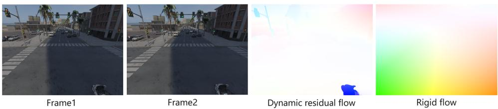  
Figure 1: Optical flow decomposition.

## 3.1.2 Gravity direction estimation

We estimate 3D gravity vectors in the camera coordinate system for all training images using the pretrained GeoCalib model [28]. The model is applied ofline to each image to extract its corresponding gravity direction.

GeoCalib first predicts a dense perspective field from a single image, which encodes geometric cues such as vanishing directions and horizon structure. Based on this representation, gravity direction is recovered through a Levenberg–Marquardt optimization procedure. To ensure reliability, we retain only those gravity estimates for which the optimization converges within a predefined number of iterations. In practice, non-convergence occurs only in a very small fraction of images. Samples for which the optimization fails to converge are excluded from gravity supervision. The resulting gravity vectors, expressed in the camera coordinate system, are used as orientation priors during training.

## 3.2 Privileged Information Injection

To incorporate additional geometric cues during training, we introduce a privileged information injection mechanism that integrates residual optical flow and gravity direction into the transformer-based reconstruction backbone. These signals are encoded into token-aligned representations and injected into the aggregation process with minimal modification to the original architecture.

Residual Flow Encoding. Residual optical flow is first partitioned into patches using the same patchification scheme as the input images. For each patch, we compute a compact statistical representation consisting of five parameters: the mean flow components $\mu _ { x } , \mu _ { y } .$ , the log-variance terms $\log ( \sigma _ { x x } + \epsilon ) , \log ( \sigma _ { y y } + \epsilon )$ , and the normalized covariance $\sigma _ { x y } / \sqrt { \sigma _ { x x } \sigma _ { y y } + \epsilon }$

These statistics summarize the motion distribution within each patch and provide a lightweight representation of local motion dynamics.

The resulting 5-dimensional vector is passed through a three-layer MLP, referred to as the patch encoder, to produce a residual-flow embedding with the same dimensionality as the visual patch tokens extracted by the DINO backbone. The encoded residual-flow feature is then scaled by a learnable weight $W _ { \mathrm { H o w } }$ and added to the corresponding patch token:

$$
\tilde { t } _ { p a t c h } = t _ { p a t c h } + W _ { \mathrm { f l o w } } \cdot f _ { f l o w } .\tag{2}
$$

This additive fusion allows motion information to be integrated with minimal perturbation to the existing embedding space while enabling the network to leverage dynamic cues during multi-view aggregation.

Gravity Encoding. In addition to motion cues, we incorporate scene orientation information through gravity direction. The gravity vector is first normalized and then encoded using a two-layer MLP, referred to as the gravity encoder, producing a representation aligned with the dimensionality of camera tokens. The encoded gravity feature is scaled by a learnable parameter $W _ { \mathrm { g r a v } }$ and fused with the camera token:

$$
\tilde { t } _ { c a m } = t _ { c a m } + W _ { \mathrm { g r a v } } \cdot f _ { g r a v } .\tag{3}
$$

The specific implementation of this fusion varies depending on the model architecture. For $\pi ^ { 3 }$ , since there are no specialized camera tokens, we define the camera tokens as the aggregator encoder’s output embeddings that feed into the camera head. The gravity feature corresponding to a specific image is fused with all constituent patch tokens for the image.

For VGGT, we modify the gravity input to align with its referenceframe design. The first camera token in the sequence receives no gravity information, as it serves as a fixed reference for camera parameters. All subsequent tokens are fused with a concatenated gravity vector containing both their own view’s orientation and that of the first view. This ensures the gravity features remain aware of the reference frame with minimal learning overhead.

This design allows the model to incorporate global orientation priors that help stabilize camera estimation and improve geometric consistency across views.

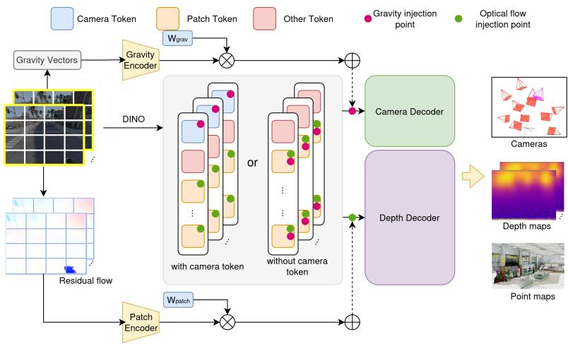  
Figure 2: Architecture Overview.

Injection Locations. The encoded privileged information can be injected at diferent stages of the transformer-based aggregation module, as illustrated in Fig. 2. Specifically, residual flow features are fused with patch tokens, while gravity embeddings are combined with camera tokens when such tokens are present.

For reconstruction architectures that do not explicitly maintain camera tokens $( \mathrm { e . g . , \pi ^ { 3 } } )$ , gravity embeddings are instead injected before the camera decoder to influence the camera prediction stage.

The framework supports multiple potential injection points throughout the aggregator layers, as shown in Fig. 2. Empirically, our experiments show that the optimal injection position depends on the backbone architecture, with diferent models favoring diferent stages of the aggregator.

## 3.3 Finetuning

Our training objectives include local and global point maps, log-space depth maps, pixel ray directions, and pairwise camera translations and rotations. Additionally, for synthetic datasets, we incorporate surface normal and depth-gradient signals to provide finer geometric supervision. All loss terms are computed using the Generalized Robust Loss [29], with the final objective being a weighted sum of these individual components. We provide detailed formulae and hyperparameter configurations in the supplementary materials.

Following the principles of Learning Using Privileged Information (LUPI), we employ a two-stage finetuning strategy designed to extract reliable privileged features and subsequently train the model to interpret and hallucinate them during inference.

Stage 1: Privileged Feature Alignment. The primary objective of the first stage is to develop a robust privileged information encoder and adapt the model’s decoders to utilize it. We freeze the model layers preceding the information injection point, focusing training exclusively on the privileged encoder (i.e. residual flow or gravity encoder) and the downstream decoder layers. This isolation ensures the new modality encoder receives suficient gradient signal to provide meaningful features while the decoders learn to leverage this injected information. By freezing the early encoder layers, the privileged features are forced to align with the existing distribution of patch and camera tokens, facilitating better fusion. To minimize architectural disturbance, we also freeze unrelated decoders and heads; for instance, the VGGT camera decoder remains frozen in stage 1 when finetuning with residual flow as the privileged modality.

Stage 2: Knowledge Distillation and Hallucination. As privileged modalities are unavailable at inference time under the LUPI paradigm, the second stage shifts toward guiding the primary model to converge faster and learn more robustly. With the privileged encoder and decoders now prepared, we unfreeze the entire model and introduce aggressive modality dropout. This mechanism creates a shortcut for the finetuning process, forcing the unfrozen model encoder to ”hallucinate” the missing privileged features when they are dropped out. In this framework, the privileged information encoder acts as a teacher during standard iterations, while the model encoder serves as the student during dropout iterations. The student learns to extract high-level features related to motion or gravity cues directly from visual inputs, efectively filling the gap left by the privileged modality to maintain the performance gains established in stage 1.

## 4 Experiments

## 4.1 Datasets

We apply dataset-level train-test split using 13 high-quality datsets. Among them, 11 are used for training and 2 are used for benchmarking. For our LUPI method, gravity vectors are pre-computed for all datasets, while dynamic flow maps are computed for 6 of them where continuous scene frames are available. A wide range of indoor and outdoor scenes are covered in the datasets either synthetic or captured in the wild. In each training epoch, we randomly sampled a fixed number of scenes from each training dataset: 1,000 in Spring, 2,750 in UnrealStereo4K, and 26,250 in the other 9 datasets. We preprocess the datasets into WAI format[14] for the ease of training and benchmarking.

Table 1: Datasets used for training and testing.
<table><tr><td>Dataset</td><td>#images</td><td>#images w OF</td><td>%images w OF</td></tr><tr><td>Datasets for training</td><td></td><td></td><td></td></tr><tr><td>BlendedMVS[30]</td><td>230,284</td><td>0</td><td>0</td></tr><tr><td>Mapillary Planet-Scale Depth[31]</td><td>1,688,784</td><td>0</td><td>0</td></tr><tr><td>Spring[32]</td><td>34,000</td><td>11,853</td><td>34.9</td></tr><tr><td>UnrealStereo4K[33]</td><td>16,400</td><td>0</td><td>0</td></tr><tr><td>Aria Synthetic Environments[34]</td><td>11,765,050</td><td>10,647,370</td><td>90.5</td></tr><tr><td>DL3DV-10K[35]</td><td>5,178,105</td><td>0</td><td>0</td></tr><tr><td>Dynamic Replica[36]</td><td>337,800</td><td>244,027</td><td>72.24</td></tr><tr><td>MegaDepth[37]</td><td>41,311</td><td>0</td><td>0</td></tr><tr><td>MVS-Synth[38]</td><td>12,000</td><td>10,836</td><td>90.3</td></tr><tr><td>ParallelDomain-4D[39]</td><td>1,448,106</td><td>1,159,273</td><td>80.1</td></tr><tr><td>SAIL-VOS 3D[40]</td><td>79,953</td><td>76,386</td><td>95.5</td></tr><tr><td>Datasets for testing</td><td></td><td></td><td></td></tr><tr><td>ETH3D[41]</td><td>647</td><td>7</td><td>/</td></tr><tr><td>TartanAirV2-WB[42]</td><td>727,360</td><td>7</td><td>1</td></tr></table>

## 4.2 Implementation Details

We implement our method using the oficial pretrained checkpoints of $\pi ^ { 3 }$ [13] and VGGT [1], fine-tuning them with the proposed motion and orientation priors. The injection points for privileged information are tailored to each architecture: for VGGT, information is injected into the 12th layer of the aggregator. In contrast, as $\pi ^ { 3 }$ lacks explicit camera tokens, we inject additional modalities after the aggregator but before the specific transformer decoders to maintain architectural isolation. Specifically, gravity features are injected before the camera decoder, while residual flow features are integrated before the point and confidence decoders. A detailed analysis of these injection points is provided in Section 4.4.

All models are fine-tuned for a total of 10 epochs. For single-modality configurations, Stage 1 (Privileged Alignment) spans the first 2 epochs, while the remaining 8 epochs are dedicated to Stage 2 (Knowledge Distillation). During Stage 2, we employ a scene-wise modality dropout rate fixed at 0.5 to encourage the model encoder to hallucinate privileged features. To ensure stable gradient flow to the privileged encoders, the scaling weights $W _ { \mathrm { H o w } }$ and $W _ { \mathrm { g r a v } }$ are initialized and fixed at 1.0 during the first two epochs.

For experiments involving both modalities, we utilize a sequential multistage fine-tuning schedule. The model first undergoes Stages 1 and 2 for optical flow injection during the initial 5 epochs. In the subsequent 5 epochs (Stages 3 and 4), we introduce gravity injection using the same two-stage protocol while maintaining the presence of the flow injection. This sequential curriculum allows the model to stabilize one privileged modality before integrating the second, ensuring coherent multi-modal feature fusion.

## 4.3 Dense Multi-View Evaluation

We evaluate our method under the dense multi-view protocol using both $\pi ^ { 3 }$ and VGGT backbones. Figures 3 and 4 report performance across a varying number of input views.

On both architectures, injecting residual flow consistently outperforms the baselines across all key metrics, including depth relative error, ray alignment, and inlier-based statistics. These gains confirm that explicitly modeling dynamic motion is highly beneficial for feed-forward multi-view reconstruction. Similarly, the introduction of gravity priors yields results comparable to residual flow, further validating the role of global orientation cues in enhancing structural alignment. Crucially, models fine-tuned with both modalities outperform those using any single injection, demonstrating that these priors are complementary rather than redundant or contradictory.

Notably, the performance gap between our method and the baseline widens as the number of input views increases. In dense settings, crossview aggregation becomes the dominant factor, which simultaneously amplifies geometric inconsistencies caused by independently moving objects or misaligned camera orientations. By efectively suppressing these inconsistencies, motion and gravity awareness leads to increasingly pronounced gains as view redundancy grows. This trend indicates that our approach actively enhances cross-view geometric aggregation rather than merely compensating for sparse observations.

Furthermore, the consistency of these improvements across both $\pi ^ { 3 }$ and VGGT demonstrates that our proposed learning framework generalizes effectively across diferent feed-forward reconstruction backbones without requiring specialized architectural modifications.

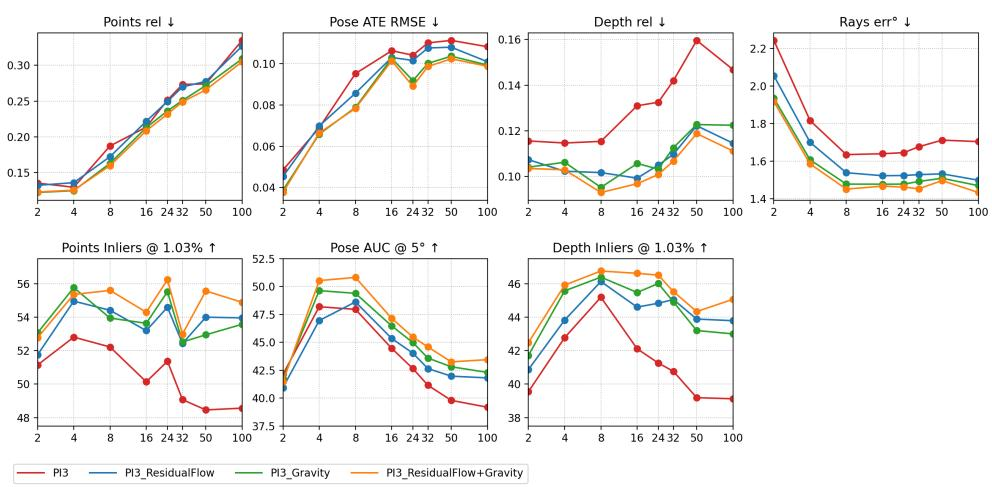  
Figure 3: $\pi ^ { 3 }$ injection results

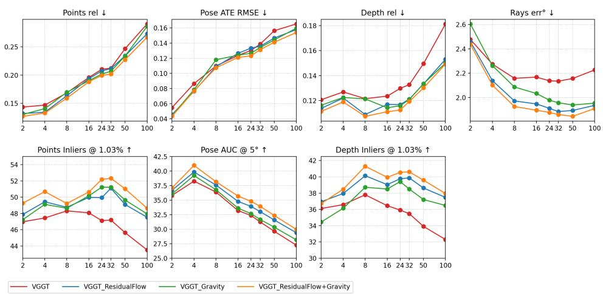  
Figure 4: VGGT injection results

Table 2: Residual vs. Full Flow Injection.
<table><tr><td>Backbone</td><td>Flow Type</td><td>Depth rel ↓</td><td>Rays err°↓</td><td>Pose AUC ↑</td><td>Depth Inliers ↑</td></tr><tr><td rowspan="3"> $\pi ^ { 3 }$ </td><td>Residual flow</td><td>0.107</td><td>2.055</td><td>40.94</td><td>40.87</td></tr><tr><td>Full flow</td><td>0.113</td><td>2.235</td><td>42.19</td><td>38.76</td></tr><tr><td>No injection</td><td>0.116</td><td>2.242</td><td>42.14</td><td>39.55</td></tr><tr><td rowspan="3">VGGT</td><td>Residual flow</td><td>0.114</td><td>2.459</td><td>36.69</td><td>36.94</td></tr><tr><td>Full flow</td><td>0.124</td><td>2.491</td><td>35.46</td><td>35.44</td></tr><tr><td>No injection</td><td>0.121</td><td>2.478</td><td>35.80</td><td>36.11</td></tr></table>

## 4.4 Ablation Studies

## 4.4.1 Residual vs. Full Flow Injection

To examine the necessity of motion decomposition, we conduct experiments by injecting both full optical flow and residual flow into VGGT and $\pi ^ { 3 }$ Table 2 reports the reconstruction performance of each variant under the 8-view setting.

Empirically, injecting full optical flow yields performance comparable to the baseline, with slight degradation observed in some metrics. In contrast, injecting residual flow consistently achieves the best performance across both backbones.

A possible explanation is that full optical flow contains both camerainduced rigid motion and dynamic motion. But with the random set of views sampling for 3D vision models’ input, there is no guarantee of the sequence of the view nor the existance of the next view whose camera relate to the source view in the way expressed by rigid motion. In contrast, By explicitly removing the rigid component, residual flow isolates motion signals that deviate from the global motion due to the camera. These signals often correspond to independently moving objects or geometrically challenging regions, making them more readily helpful for 3D reconstruction.

## 4.4.2 Layer-wise Injection Analysis

To determine the optimal depth for incorporating motion and orientation priors, we evaluate feature injection at three distinct stages of the reconstruction backbone: Early (input image patch features), Middle (intermediate aggregator layers), and Late (aggregator output). Performance benchmarks for 8-view scenes are summarized in Table 3. Our results reveal a consistent architectural preference: middle-layer injection performs best on most metrics for VGGT, while late-layer injection is optimal for $\pi ^ { 3 }$

Table 3: Layer-wise injection analysis on $\pi ^ { 3 }$ and VGGT.
<table><tr><td>Backbone</td><td>Injection Layer</td><td>Depth rel ↓</td><td>Rays  $\mathbf { e r r } ^ { \circ }$ </td><td>↓ Pose AUC ↑</td><td>Depth Inliers ↑</td></tr><tr><td rowspan="3"> $\pi ^ { 3 } ( R e s F l o w )$ </td><td>Early (Input)</td><td>0.115</td><td>1.714</td><td>46.19</td><td>44.43</td></tr><tr><td>Middle  $\scriptstyle ( { \dot { \mathrm { L a y e r ~ 1 7 } } } )$ </td><td>0.110</td><td>1.621</td><td>47.87</td><td>45.85</td></tr><tr><td>Late (Output)</td><td>0.102</td><td>1.539</td><td>48.62</td><td>46.13</td></tr><tr><td rowspan="3"> $\pi ^ { 3 } ( G r a v )$ </td><td>Early (Input)</td><td>0.104</td><td>1.707</td><td>43.03</td><td>44.08</td></tr><tr><td>Middle (Layer 17)</td><td>0.096</td><td>1.561</td><td>44.38</td><td>45.67</td></tr><tr><td>Late (Output)</td><td>0.095</td><td>1.478</td><td>49.39</td><td>46.39</td></tr><tr><td rowspan="3">VGGT(ResFlow)</td><td>Early (Input)</td><td>0.129</td><td>2.369</td><td>34.16</td><td>36.56</td></tr><tr><td>Middle (Layer 11)</td><td>0.109</td><td>1.973</td><td>37.58</td><td>40.13</td></tr><tr><td>Late (Output)</td><td>0.114</td><td>2.167</td><td>37.52</td><td>38.07</td></tr><tr><td rowspan="3">VGGT(Grav)</td><td>Early (Input)</td><td>0.123</td><td>2.362</td><td>36.36</td><td>38.18</td></tr><tr><td>Middle (Layer 11)</td><td>0.121</td><td>2.087</td><td>36.77</td><td>38.72</td></tr><tr><td>Late (Output)</td><td>0.118</td><td>2.188</td><td>37.44</td><td>38.85</td></tr></table>

VGGT (Middle-Layer). At this depth, patch and camera tokens have developed suficient global geometric awareness to fuse efectively with privileged features. Unlike late injection, this placement allows subsequent transformer blocks to refine the fused representations through cross-view attention, ensuring deeper integration before reaching the decoders. Furthermore, VGGT’s explicit camera tokens provide natural modality isolation: gravity features fused with camera tokens are directed exclusively to the camera head, while residual flow features in patch tokens are reserved for depthrelated decoders.

$\pi ^ { 3 }$ (Late-Layer). The absence of explicit camera tokens in $\pi ^ { 3 }$ means the aggregator output is shared across all heads. Middle-layer injection causes privileged information to leak into unrelated decoders (e.g., gravity features influencing the point decoder). Injecting at the aggregator output instead allows for precise, head-specific integration, providing the isolation necessary for superior performance.

Early Injection. This configuration consistently yields the poorest results across all cases. Raw input features lack the cross-view geometric context required to interpret motion priors. Additionally, this placement forces the pretrained image encoder—which lacks multi-view awareness—to handle the complex task of feature hallucination, a burden that undermines the LUPI learning shortcut and prevents the model from efectively leveraging the privileged information.

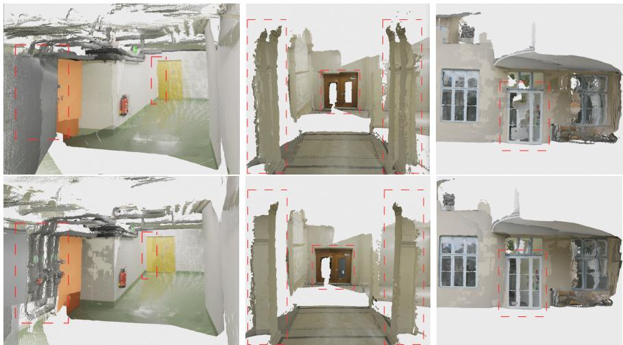  
Figure 5: Qualitative comparison with and without gravity injection. In each pair, the upper image shows reconstruction without gravity injection, and the lower image shows reconstruction with gravity injection.

## 4.4.3 Gravity Prior Analysis

To evaluate the efect of gravity injection, we train two models under identical settings: one with gravity prior and one without it. Figure 5 shows the reconstructed point maps predicted by the two models. The model trained with gravity prior produces more stable global structures, where ground surfaces appear flatter and walls are more consistently aligned with the vertical direction.

This observation suggests that gravity prior mainly improves reconstruction by enforcing a global orientation reference rather than altering local geometric predictions. By anchoring the reconstruction to a physically meaningful direction, gravity helps reduce structural drift and leads to more geometrically coherent scene reconstruction.

## 4.5 Analysis

We discuss the proposed priors from three perspectives: view-density behavior, architecture-dependent injection preference, and prior complementarity.

First, the gain over the baseline increases with the number of input views. This trend indicates that the guidance of motion and gravity priors does not simply compensate for sparse observations; instead, they improve the consistency of cross-view geometric aggregation. As view density grows, dynamic regions introduce stronger multi-view conflicts, and residual flow helps suppress these inconsistencies.

Second, the optimal injection stage is backbone-dependent. For $\pi ^ { 3 } .$ late-stage injection performs best, suggesting that decoder-side integration better preserves modality isolation when no explicit camera token is available. For VGGT, middle-layer injection is generally more efective, likely because privileged cues can be fused earlier with geometry-aware tokens and further refined by subsequent cross-view transformer blocks. In both backbones, early-stage injection is consistently weaker, implying that shallow appearance-dominant features are less suitable for privileged geometric guidance.

Third, residual flow and gravity priors contribute at complementary structural scales. Residual flow primarily improves local dynamic consistency by emphasizing non-rigid motion components, while gravity provides a global orientation anchor that stabilizes scene-level structure. Their combination improves geometric coherence without changing the feed-forward inference paradigm.

## 5 Limitations

A limitation of our current formulation lies in the use of rigid optical flow components. In principle, rigid flow primarily reflects the apparent motion induced by camera ego-motion, implicitly encoding information about the underlying translational velocity and angular velocity of the camera. Such signals can be highly informative for stabilizing geometry and improving motion-aware reasoning.

However, most existing feedforward multi-view reconstruction frameworks, including VGGT, are designed for static-scene reconstruction and operate on unordered sets of input images, without explicit temporal ordering or timestamp information. Under this setting, the rigid flow component does not provide a consistent notion of camera dynamics across views, and consequently ofers limited benefit for reconstruction performance in our experiments.

We believe that the velocity and angular motion cues embedded in rigid flow remain a valuable source of physical information. An important direction for future work is to extend feedforward reconstruction toward streaming or temporally coherent settings, where sequential inputs and ego-motion estimates can be explicitly modeled. Incorporating rigid motion cues in such a framework may further improve robustness and enable more principled dy-

namic scene reconstruction.

## 6 Conclusion

In this work, we presented a motion- and gravity-aware framework for feedforward multi-view 3D reconstruction under the Learning Using Privileged Information (LUPI) paradigm. During training, residual flow and gravity cues are used as privileged supervision signals; during inference, the model operates with standard visual inputs only, while retaining the geometric benefits transferred from privileged modalities.

Extensive experiments show consistent improvements in reconstruction accuracy and robustness, especially in dynamic scenes, under ambiguous geometry, and across challenging camera motion. The results further indicate that the optimal injection stage is architecture-dependent, highlighting the importance of aligning privileged-feature integration with backbone design.

Overall, this study demonstrates that LUPI is an efective and practical mechanism for introducing motion and physical priors into feed-forward 3D reconstruction without sacrificing inference eficiency. We hope this perspective motivates future work on temporally coherent and physically grounded feed-forward reconstruction with richer privileged training signals.

## References

[1] Jianyuan Wang, Minghao Chen, Nikita Karaev, Andrea Vedaldi, Christian Rupprecht, and David Novotny. Vggt: Visual geometry grounded transformer. In Proceedings of the IEEE/CVF Conference on Computer Vision and Pattern Recognition, 2025.

[2] Bill Triggs, Philip F McLauchlan, Richard I Hartley, and Andrew W Fitzgibbon. Bundle adjustment—a modern synthesis. In International workshop on vision algorithms, pages 298–372. Springer, 1999.

[3] Johannes Lutz Sch¨onberger and Jan-Michael Frahm. Structure-frommotion revisited. In Conference on Computer Vision and Pattern Recognition (CVPR), 2016.

[4] Johannes Lutz Sch¨onberger, Enliang Zheng, Marc Pollefeys, and Jan-Michael Frahm. Pixelwise view selection for unstructured multi-view stereo. In European Conference on Computer Vision (ECCV), 2016.

[5] Yao Yao, Zixin Luo, Shiwei Li, Tian Fang, and Long Quan. Mvsnet: Depth inference for unstructured multi-view stereo. In European Conference on Computer Vision (ECCV), 2018.

[6] Yao Yao, Zixin Luo, Shiwei Li, Tianwei Shen, Tian Fang, and Long Quan. Recurrent mvsnet for high-resolution multi-view stereo depth inference. In Proceedings of the IEEE/CVF conference on computer vision and pattern recognition, pages 5525–5534, 2019.

[7] Rui Chen, Songfang Han, Jing Xu, and Hao Su. Point-based multiview stereo network. In Proceedings of the IEEE/CVF international conference on computer vision, pages 1538–1547, 2019.

[8] Xiaodong Gu et al. Cascade cost volume for high-resolution multi-view stereo and stereo matching. In IEEE/CVF Conference on Computer Vision and Pattern Recognition (CVPR), 2020.

[9] Jiayu Yang, Wei Mao, Jose M Alvarez, and Miaomiao Liu. Cost volume pyramid based depth inference for multi-view stereo. In Proceedings of the IEEE/CVF conference on computer vision and pattern recognition, pages 4877–4886, 2020.

[10] Yikang Ding, Wentao Yuan, Qingtian Zhu, Haotian Zhang, Xiangyue Liu, Yuanjiang Wang, and Xiao Liu. Transmvsnet: Global contextaware multi-view stereo network with transformers. In Proceedings of

the IEEE/CVF conference on computer vision and pattern recognition, pages 8585–8594, 2022.

[11] Tai Wang et al. Dust3r: Geometric 3d vision made easy. arXiv preprint arXiv:2312.14132, 2023.

[12] Lihe Yang et al. Depth anything: Unleashing the power of largescale unlabeled data for monocular depth estimation. arXiv preprint arXiv:2401.10891, 2024.

[13] Yifan Wang, Jianjun Zhou, Haoyi Zhu, Wenzheng Chang, Yang Zhou, Zizun Li, Junyi Chen, Jiangmiao Pang, Chunhua Shen, and Tong He. $\pi ^ { 3 } { \mathrm { : } }$ : Permutation-equivariant visual geometry learning. In International Conference on Learning Representations, volume 2026, pages 10481– 10497, 2026.

[14] Nikhil Keetha, Norman M¨uller, Johannes Sch¨onberger, Lorenzo Porzi, Yuchen Zhang, Tobias Fischer, Arno Knapitsch, Duncan Zauss, Ethan Weber, Nelson Antunes, Jonathon Luiten, Manuel Lopez-Antequera, Samuel Rota Bul\`o, Christian Richardt, Deva Ramanan, Sebastian Scherer, and Peter Kontschieder. MapAnything: Universal feed-forward metric 3D reconstruction. In International Conference on 3D Vision (3DV). IEEE, 2026.

[15] Haotong Lin, Sili Chen, Junhao Liew, Donny Y Chen, Zhenyu Li, Guang Shi, Jiashi Feng, and Bingyi Kang. Depth anything 3: Recovering the visual space from any views. arXiv preprint arXiv:2511.10647, 2025.

[16] Philipp Lindenberger et al. Mast3r: Matching and stereo reconstruction with transformers. arXiv preprint, 2024.

[17] Yohann Cabon, Lucas Stofl, Leonid Antsfeld, Gabriela Csurka, Boris Chidlovskii, Jerome Revaud, and Vincent Leroy. Must3r: Multi-view network for stereo 3d reconstruction. In Proceedings of the IEEE/CVF Conference on Computer Vision and Pattern Recognition, pages 1050– 1060, 2025.

[18] Chenjie Cao, Xinlin Ren, and Yanwei Fu. Mvsformer++: Revealing the devil in transformer’s details for multi-view stereo. arXiv preprint arXiv:2401.11673, 2024.

[19] Jiahui Zhang, Yuelei Li, Anpei Chen, Muyu Xu, Kunhao Liu, Jianyuan Wang, Xiao-Xiao Long, Hanxue Liang, Zexiang Xu, Hao Su, et al. Advances in feed-forward 3d reconstruction and view synthesis: A survey. arXiv preprint arXiv:2507.14501, 2025.

[20] Vladimir Vapnik and Akshay Vashist. A new learning paradigm: Learning using privileged information. Neural networks, 22(5-6):544–557, 2009.

[21] Shan Suthaharan. Support vector machine. In Machine learning models and algorithms for big data classification: thinking with examples for efective learning, pages 207–235. Springer, 2016.

[22] Lingfeng Niu, Yong Shi, and Jianmin Wu. Learning using privileged information with l-1 support vector machine. In 2012 IEEE/WIC/ACM International Conferences on Web Intelligence and Intelligent Agent Technology, volume 3, pages 10–14. IEEE, 2012.

[23] Vladimir Vapnik and Rauf Izmailov. Learning using privileged information: similarity control and knowledge transfer. The Journal of Machine Learning Research, 16(1):2023–2049, 2015.

[24] Cheng Lyu, Jiake Xie, Bo Xu, Cheng Lu, Han Huang, Xin Huang, Ming Wu, Chuang Zhang, and Yong Tang. Privileged prior information distillation for image matting. In Proceedings of the AAAI Conference on Artificial Intelligence, volume 38, pages 4044–4052, 2024.

[25] Xun Yang, Meng Wang, and Dacheng Tao. Person re-identification with metric learning using privileged information. IEEE Transactions on Image Processing, 27(2):791–805, 2017.

[26] MA Ganaie and M Tanveer. Ensemble deep random vector functional link network using privileged information for alzheimer’s disease diagnosis. IEEE/ACM Transactions on Computational Biology and Bioinformatics, 21(4):534–545, 2022.

[27] Zachary Teed and Jia Deng. Raft: Recurrent all-pairs field transforms for optical flow. In European Conference on Computer Vision (ECCV), 2020.

[28] Alexander Veicht, Paul-Edouard Sarlin, Philipp Lindenberger, and Marc Pollefeys. GeoCalib: Single-image Calibration with Geometric Optimization. In ECCV, 2024.

[29] Jonathan T Barron. A general and adaptive robust loss function. In Proceedings of the IEEE/CVF conference on computer vision and pattern recognition, pages 4331–4339, 2019.

[30] Yao Yao, Zixin Luo, Shiwei Li, Jingyang Zhang, Yufan Ren, Lei Zhou, Tian Fang, and Long Quan. Blendedmvs: A large-scale dataset for generalized multi-view stereo networks. Computer Vision and Pattern Recognition (CVPR), 2020.

[31] Manuel L´opez Antequera, Pau Gargallo, Markus Hofinger, Samuel Rota Bulo, Yubin Kuang, and Peter Kontschieder. Mapillary planet-scale depth dataset. In European Conference on Computer Vision, pages 589–604. Springer, 2020.

[32] Lukas Mehl, Jenny Schmalfuss, Azin Jahedi, Yaroslava Nalivayko, and Andr´es Bruhn. Spring: A high-resolution high-detail dataset and benchmark for scene flow, optical flow and stereo. In Proc. IEEE/CVF Conference on Computer Vision and Pattern Recognition (CVPR), 2023.

[33] Fabio Tosi, Yiyi Liao, Carolin Schmitt, and Andreas Geiger. Smd-nets: Stereo mixture density networks. In Conference on Computer Vision and Pattern Recognition (CVPR), 2021.

[34] Armen Avetisyan, Christopher Xie, Henry Howard-Jenkins, Tsun-Yi Yang, Samir Aroudj, Suvam Patra, Fuyang Zhang, Duncan Frost, Luke Holland, Campbell Orme, et al. Scenescript: Reconstructing scenes with an autoregressive structured language model. In European Conference on Computer Vision, pages 247–263. Springer, 2024.

[35] Lu Ling, Yichen Sheng, Zhi Tu, Wentian Zhao, Cheng Xin, Kun Wan, Lantao Yu, Qianyu Guo, Zixun Yu, Yawen Lu, et al. Dl3dv-10k: A large-scale scene dataset for deep learning-based 3d vision. In Proceedings of the IEEE/CVF Conference on Computer Vision and Pattern Recognition, pages 22160–22169, 2024.

[36] Nikita Karaev, Ignacio Rocco, Benjamin Graham, Natalia Neverova, Andrea Vedaldi, and Christian Rupprecht. Dynamicstereo: Consistent dynamic depth from stereo videos. CVPR, 2023.

[37] Zhengqi Li and Noah Snavely. Megadepth: Learning single-view depth prediction from internet photos. In Computer Vision and Pattern Recognition (CVPR), 2018.

[38] Po-Han Huang, Kevin Matzen, Johannes Kopf, Narendra Ahuja, and Jia-Bin Huang. Deepmvs: Learning multi-view stereopsis. In IEEE Conference on Computer Vision and Pattern Recognition (CVPR), 2018.

[39] Basile Van Hoorick, Rundi Wu, Ege Ozguroglu, Kyle Sargent, Ruoshi Liu, Pavel Tokmakov, Achal Dave, Changxi Zheng, and Carl Vondrick. Generative camera dolly: Extreme monocular dynamic novel view synthesis. In European Conference on Computer Vision (ECCV), 2024.

[40] Y.-T. Hu, J. Wang, R. A. Yeh, and A. G. Schwing. SAIL-VOS 3D: A Synthetic Dataset and Baselines for Object Detection and 3D Mesh Reconstruction from Video Data. In Proc. CVPR, 2021.

[41] Thomas Sch¨ops, Johannes L. Sch¨onberger, Silvano Galliani, Torsten Sattler, Konrad Schindler, Marc Pollefeys, and Andreas Geiger. A multi-view stereo benchmark with high-resolution images and multicamera videos. In Conference on Computer Vision and Pattern Recognition (CVPR), 2017.

[42] Yuchen Zhang, Nikhil Keetha, Chenwei Lyu, Bhuvan Jhamb, Yutian Chen, Yuheng Qiu, Jay Karhade, Shreyas Jha, Yaoyu Hu, Deva Ramanan, Sebastian Scherer, and Wenshan Wang. Ufm: A simple path towards unified dense correspondence with flow. In arXiV, 2025.

[43] Ruicheng Wang, Sicheng Xu, Cassie Dai, Jianfeng Xiang, Yu Deng, Xin Tong, and Jiaolong Yang. MoGe: Unlocking accurate monocular geometry estimation for open-domain images with optimal training supervision. In Proceedings of the IEEE/CVF Conference on Computer Vision and Pattern Recognition, pages 5261–5271, 2025.

[44] Zehao Yu, Songyou Peng, Michael Niemeyer, Torsten Sattler, and Andreas Geiger. MonoSDF: Exploring monocular geometric cues for neural implicit surface reconstruction. In Advances in Neural Information Processing Systems, volume 35, 2022.

[45] Ilya Loshchilov and Frank Hutter. Decoupled weight decay regularization. In International Conference on Learning Representations, 2019.

## A Finetuning Details

We employ the WAI format [14] for dataset pre-processing and fine-tuning. Specifically, we determine the co-visibility between all image pairs within a scene by evaluating the re-projection error derived from ground-truth depth maps and camera poses. During fine-tuning, input sequences are curated by sampling images that maintain a co-visibility of at least 25% relative to at least one other view in the sequence; this ensures consistent spatial overlap across the chosen views. For each input sequence, we compute local and global point maps, ray directions and distances, camera translations, and rotations (represented as quaternions), alongside a per-view confidence map.

All loss terms are calculated using the robust regression loss [29] with a shape parameter of 0.5 and a scaling parameter of 0.25 to mitigate the influence of outliers. We apply a logarithmic transformation to the ground truth and model outputs for point maps and z-depth values prior to computing the regression loss on their diferences; notably, no loss terms are calculated for ray distances or confidence maps. When high-quality, smooth ground-truth point maps are available, we also integrate normal loss [43] and gradient matching loss [44] into our objective function. To account for noise and extreme values inherent in “in-the-wild” real-world datasets, we apply confidence weights to the global point map losses and exclude the top 5% of errors as outliers for local point maps and VGGT depth losses. To align with the reference-view-free architecture of $\pi ^ { 3 }$ , we compute pairwise relative pose losses rather than direct diferences between predicted and ground-truth global poses. The same 5% outlier exclusion logic is applied to all three losses for $\pi ^ { 3 }$

The loss terms for the diferent configurations and dataset types are expressed as follows:

$$
\mathcal { L } _ { \mathrm { V G G T } } ^ { \mathrm { s y n } } = L _ { p t } + L _ { z } + L _ { r a y } + L _ { p o s e } + 3 L _ { n o r m } + 3 L _ { g r a d }\tag{4}
$$

$$
\mathcal { L } _ { \mathrm { V G G T } } ^ { \mathrm { r e a l } } = W _ { c o n f } \cdot L _ { p t , g l o b } + M _ { t o p 5 \% } \cdot ( L _ { p t , l o c } + L _ { z } ) + L _ { r a y } + L _ { p o s e }\tag{5}
$$

$$
\mathcal { L } _ { \pi ^ { 3 } } ^ { \mathrm { s y n } } = L _ { p t } + L _ { z } + L _ { r a y } + L _ { r e l } + 3 L _ { n o r m } + 3 L _ { g r a d }\tag{6}
$$

$$
\mathcal { L } _ { \pi ^ { 3 } } ^ { \mathrm { r e a l } } = M _ { t o p 5 \% } \cdot ( L _ { p t , g l o b } + L _ { p t , l o c } + L _ { z } ) + L _ { r a y } + L _ { r e l }\tag{7}
$$

where:

$L _ { p t } , L _ { z }$ , and $L _ { r a y }$ represent the robust regression losses for point maps, z-depth values, and ray directions, respectively.

$L _ { p o s e }$ denotes the global camera pose loss (translation and rotation) used for VGGT.

$L _ { r e l }$ denotes the pairwise relative pose loss used for the reference-viewfree $\pi ^ { 3 }$ architecture.

$L _ { n o r m }$ and $L _ { g r a d }$ are the normal and gradient matching losses, applied only when smooth synthetic ground truth is available.

$W _ { c o n f }$ is the per-pixel confidence weight applied to global point map predictions.

• $M _ { t o p 5 \% }$ is the binary outlier mask that excludes the highest 5% of errors to ensure robustness against noise in real-world data.

Optimization is performed using the AdamW optimizer [45] with hyperparameters set to $\beta _ { 1 } = 0 . 9 , \beta _ { 2 } = 0 . 9 5$ , and a weight decay of 0.05. We employ a diferentiated learning rate strategy: the peak learning rate is set to $5 \times 1 0 ^ { - 6 }$ for the DINOv2 image encoder, $5 \times 1 0 ^ { - 5 }$ for the gravity and flow encoders when present, and $1 \times 1 0 ^ { - 5 }$ for all other architectural components. The training follows a structured schedule throughout Stage 1, consisting of a 20% linear warmup to reach the peak learning rate, followed by a half-cycle cosine decay to a final value two orders of magnitude lower.

## B Additional Ablation Results

We conduct an additional ablation study on dataset scale to demonstrate the efectiveness of our approach in addressing data scarcity during finetuning. We modulate the efective dataset size by varying the total number of scenes sampled from each dataset per epoch. To ensure a consistent number of training steps for a fair comparison, the number of epochs is adjusted inversely to the sampling rate; for instance, when reducing the number of scenes to 10%, the total training duration is increased from 10 to 100 epochs. Figure 6 illustrates a consistent performance improvement as the efective dataset size increases during $\pi ^ { 3 }$ fine-tuning. However, as shown in Figure 7, introducing residual flow injection with only 10% of the training data yields higher benchmarking performance than increasing the dataset size tenfold. Similar results for VGGT are shown in Figure 8.

We also provide comprehensive benchmarking results across varying view counts for our previously discussed injection location ablation in Figures 9, 10, 11, and 12.

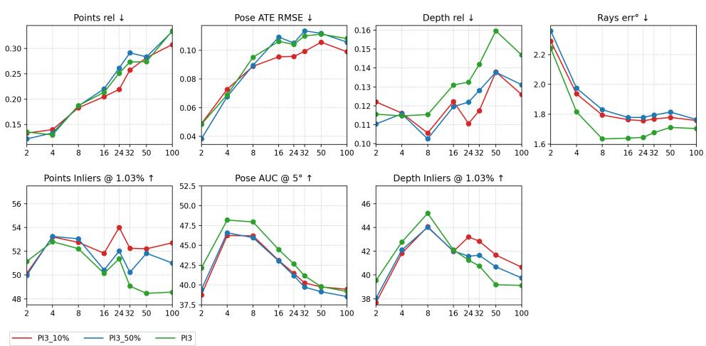  
Figure 6: Performance of the $\pi ^ { 3 }$ model fine-tuned with varying efective dataset scales. PI3 10% denotes training with 10% of scenes sampled per epoch over a 10× total epoch duration, while PI3 50% utilizes 50% of scenes over a $2 \times$ duration to maintain constant total training steps.

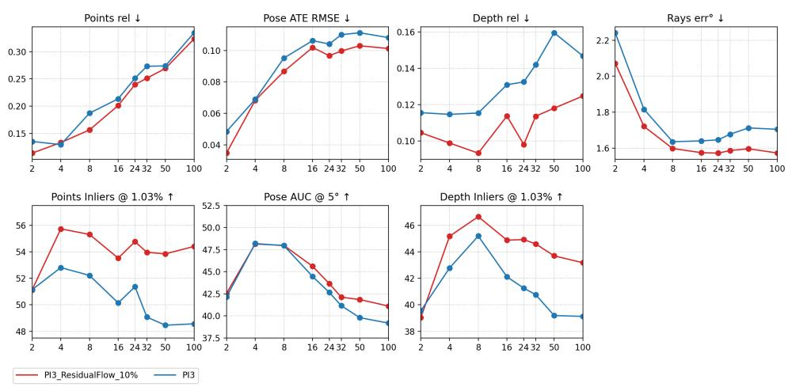  
Figure 7: Comparison of $\pi ^ { 3 }$ performance under default fine-tuning settings versus fine-tuning with a 10% efective dataset size augmented by residual flow injection.

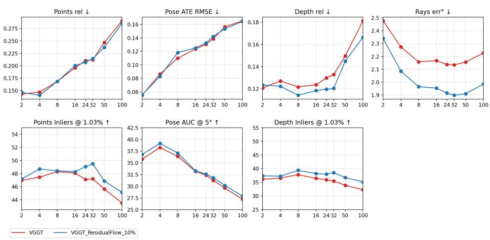  
Figure 8: Comparison of VGGT performance under default fine-tuning settings versus fine-tuning with a 10% efective dataset size augmented by residual flow injection.

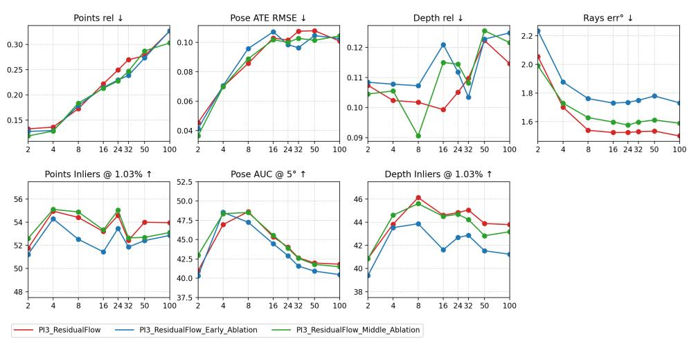  
Figure 9: Ablation study of residual flow injection locations within the $\pi ^ { 3 }$ model. Performance of default injection point is evaluated against injection occurring both prior to and within the middle layers of the aggregator module.

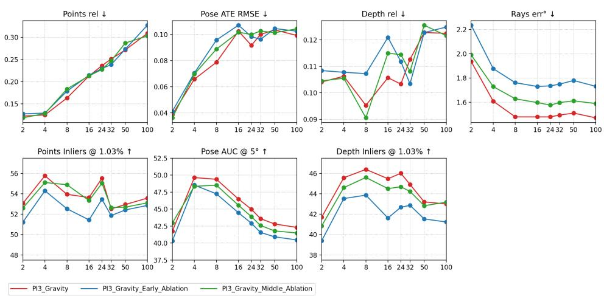  
Figure 10: Ablation study of gravity injection locations within the $\pi ^ { 3 }$ model. Performance of default injection point is evaluated against injection occurring both prior to and within the middle layers of the aggregator module.

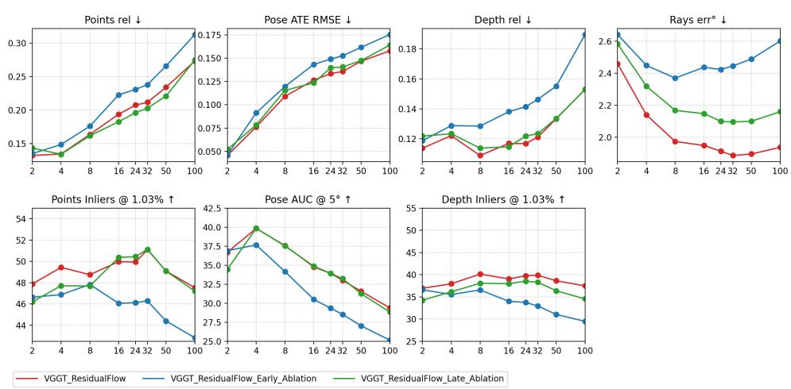  
Figure 11: Ablation study of residual flow injection locations within the VGGT model. Performance of default injection point is evaluated against injection occurring both before and after the aggregator module.

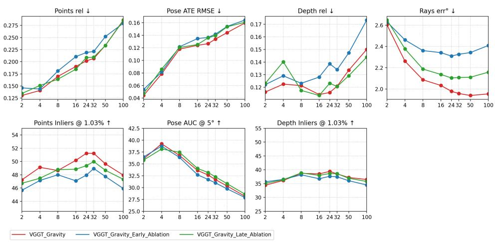  
Figure 12: Ablation study of gravity injection locations within the VGGT model. Performance of the default injection point is evaluated against injection occurring both before and after the aggregator module.