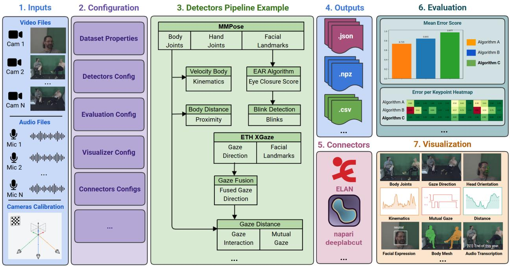
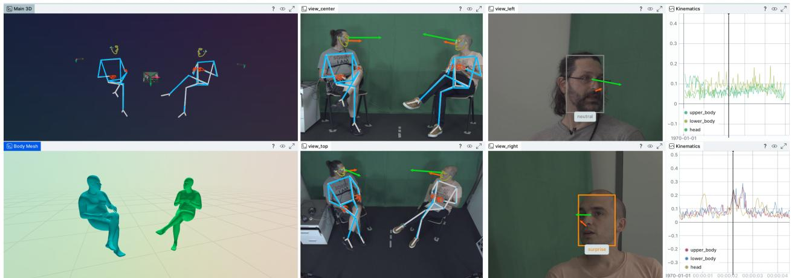

# NICE TOOLBOX: NONVERBAL INTERPERSONAL COMMUNICATION EXPLORATION TOOLBOX

## A PREPRINT

Aleksandr Evgrashin1, Carolin Schmitt1, Timo Lübbing1, Ashutosh Jha1, Buket Naz Zeren1, Sophie K. Bauer1,2, Johannes Kopf-Beck1,2,3,4, Anton K. G. Marx2,3, Anamaria Semm2,3, Gökce Ergün1, and Senya Polikovsky1

1Max Planck Institutefor Intelligent Systems, Tübingen, Germany 2Max Planck Institute of Psychiatry, Munich, Germany 3LMU Munich, Department ofPsychology, Germany 4German Centerfor Mental Health (DZPG), Partner Site Munich; Augsburg, Germany

10 July 2026

## ABSTRACT

Understanding human communication is a long-standing goal in psychological research. People express themselves through many verbal and nonverbal channels: posture, gesture, gaze, facial expression, and speech. Measurement and annotation of these signals has traditionally required timeconsuming manual work by trained human labellers. The Nonverbal Interpersonal Communication Exploration (NICE) Toolbox is a free, open-source Python framework that automatically measures these signals by combining existing state-of-the-art computer vision and speech-processing methods into a single software package. It includes support for multi-camera systems, interchangeable detection algorithms, 2D and 3D visualization of detector outputs, evaluation on the user’s custom data, and export to third-party software. With the release of this tool, we aim to make data exploration of interpersonal communication signals scalable, reproducible, and accessible for psychological research.

Keywords Python · computer vision · psychology · interpersonal communication

## 1 Statement of need

Labelling and annotation of nonverbal behaviour signals from video recordings is one of the key methods of psychological research on interpersonal communication (Bakeman & Quera, 2011). Traditionally, this is done manually by trained student assistants or professional labellers rewatching videos multiple times. The process is slow, difficult to scale, and results are hard to make consistent across annotators (Vinciarelli et al., 2009). This also limits study dataset size, due to labelling budget and time constraints.

Computer vision and speech-processing models exist for each of the underlying signals (body pose, gaze, speech transcription, and others), but they are distributed as separate research libraries with different software dependencies, input/output formats, and configuration conventions. Combining them into a working analysis workflow requires machine-learning and software-engineering expertise, which usually lies outside the scope of a psychology research project.

Furthermore, choosing among existing models to determine the most suitable one for a specific study can be difficult for most psychological researchers. Data recording setups vary widely in camera placement, lighting, participant distance, appearance, interaction style, and data formats. Algorithm rankings on public benchmarks often do not transfer to a specific study, so researchers must compare candidate models and hyperparameter configurations on their own data before committing to one for their study (D’Amour et al., 2022). As of yet, no available algorithm framework offers such an integrated performance evaluation pipeline while allowing the combination of different models to capture multimodal data streams.

NICE Toolbox is a Python framework for psychology researchers that unifies data processing and model inference across a large set of machine-learning algorithms. It uses a flexible configuration system for defining custom user experiments, visualizations, evaluations, and integration with third-party software. The measured signals are exported as tabular data for further statistical analysis as part of a psychological study.

## 2 State of the field

Manual annotation tools such as ANVIL (Kipp, 2001) and ELAN (Wittenburg et al., 2006) have long been the standard for behavioural coding in psychological and linguistic research. They provide advanced user interfaces for frame-accurate labelling and are well integrated with the workflows of the communities that use them, but the annotation itself remains a time-consuming and labour-intensive process.

Automated open-source signal measurement tools usually cover only one specific channel. Motion Energy Analysis (MEA) (Ramseyer, 2020) quantifies frame-to-frame pixel change as a proxy for body movement and has been widely used to study interpersonal synchrony in psychotherapy. OpenFace (Baltrusaitis et al., 2018) and Py-Feat (Cheong et al., 2023) are open-source libraries for facial analysis used in psychological research. CrisperWhisper (Zusag et al., 2024) and WhisperX (Bain et al., 2023) are widely used for audio transcription. Combining these tools into a multimodal analysis pipeline is done by the researcher, who must adapt output formats, coordinate systems, and sampling rates using custom post-processing scripts.

One effort to centralise these tools in a single hub is EnvisionBox (EnvisionBox, 2026). It is a community-driven platform that curates open code modules, tutorials, and datasets for multimodal analysis in social-interaction research. Rather than providing a single unified software, it functions as a shared storage for code examples demonstrating model inference and data analysis.

Commercial platforms such as FaceReader (Lewinski et al., 2014) and iMotions (iMotions A/S, 2025) provide integrated multimodal analysis with polished user interfaces, but their proprietary licensing, closed algorithms, and costs limit reproducibility and accessibility for academic research. Their coverage is also bounded by what the vendor supports: signals or models not offered by the platform cannot be added by the user.

The closest comparison to NICE Toolbox is DISCOVER (Hallmen et al., 2025), a server-based back-end for computationally driven behaviour analysis. Users drive it through its graphical front-end, the NOVA annotation tool (Heimerl et al., 2019), to explore content, inspect recordings, and refine annotations.

Compared to DISCOVER and other alternatives, NICE Toolbox focuses on automated large-scale dataset processing without human intervention or refinement. Each user-created configuration defines a computational pipeline in which detector outputs from different modalities can feed into one another. The same pipeline supports second-level measurements built on top of these outputs (for example, kinematics from body pose, or interpersonal distance from two-person tracking). Rather than committing to a single model, NICE Toolbox provides an interchangeable collection of models with a unified output structure. This allows users to evaluate algorithms and choose the one that works best for their specific task. NICE Toolbox supports multi-camera recordings and fuses per-camera detections into a single 3D space through triangulation, whereas most existing tools either accept only one camera per recording or leave per-camera outputs unfused.

## 3 Software design

NICE Toolbox’s design is based on three core principles: (1) to provide a configuration-rich experiment design that lets non-programmers run a full multimodal analysis without writing code, (2) to maintain consistent data structures (components) across different detectors, and (3) to reuse established open-source models and libraries rather than reimplementing them (including MMPose (Contributors, 2020), SAM 3D Body (Yang et al., 2026), ETH-XGaze (Zhang et al., 2020), Py-Feat (Cheong et al., 2023), and others).

The toolbox is organised into modules (see the example experiment at Figure 1) with separate responsibilities: detectors runs the computer vision and audio models on recordings, evaluation computes configurable metrics based on the user-specific dataset, visualizer provides the interactive rerun (Rerun Development Team, 2024) 3D visualizer, and connectors handles import and export to third-party tools such as ELAN and napari-deeplabcut (DeepLabCut, n.d.) for ground-truth annotation.

Users control the software through TOML configuration files that describe algorithm parameters, evaluation metrics, visualizer layouts (see Figure 2), and dataset structure. Configurations are validated against schema definitions before execution, so errors are caught before a long-running pipeline starts. To keep configuration concise and flexible, NICE Toolbox supports variables and named wildcards inside the configuration system. Detector algorithms additionally support template inheritance, so users can define a parameter set once and derive variants that override only the fields that differ; for example, running the same pose estimator with different confidence thresholds, or comparing two backbones that share the same camera setup and I/O components.

  
Figure 1: NICE Toolbox experiment example. Multi-camera video with optional audio and calibration files (1) are combined with user-supplied TOML configuration (2) that describes the dataset, requested detectors, evaluation, visualisation, and connectors. A detector pipeline (3) connects primary models (e.g., MMPose for body pose estimation, ETH-XGaze for gaze direction) with second-level detectors (kinematics from body velocity, proximity from inter-body distance, blinks from eye-closure ratios, and mutual gaze from fused gaze directions across cameras). Results are saved per subject in tabular formats (4), exported to external annotation tools such as ELAN (5), and evaluated across candidate algorithms on the user’s own recordings (6), with metrics such as mean error score per algorithm and per-keypoint error heatmap. Interactive 2D/3D visualisation (7) shows final results for inspection and diagnosis.

Detectors can use the output of other detectors as their input, allowing the construction of a directed computational graph. The order of execution is defined by topological sorting of nodes. Nodes outputting the same components are interchangeable and configurable by the user. For example, a user can replace the MMPose model body\_joints component with the SAM-3D-Body body\_joints component and use it as input for the kinematics detector; the kinematics detector stays the same, but its input can be easily replaced.

Most of the detectors run in their own isolated virtual or conda environment. The main reason is that ML libraries often pin conflicting versions of shared dependencies (e.g., PyTorch, CUDA); isolating each detector lets us use published models as-is without patching them into a shared dependency tree. The main pipeline launches each detector as a subprocess in its own environment, passes configuration through a serialized file, and reads the detector’s outputs back from disk in the unified data format.

## 4 Research impact statement

NICE Toolbox has been used to extract behavioural cues for psychological research at the Max Planck Institute for Intelligent Systems and by other collaborators. In work led by LMU Munich, the toolbox was used to quantify movement synchrony from pose-estimation-based kinematic displacement measures across 32 videos of 16 parent– child dyads undergoing psychotherapy, distinguishing genuine interactive coupling from coincidental covariation and comparing free-play with structured-play conditions (Buaria et al., 2026). In a separate study on emotional and behavioural responses to microaggressions in human–AI interaction at work, the toolbox provided multimodal behavioural measurements (facial expression, gaze, posture) across 482 interaction sequences recorded from six synchronised cameras, collected alongside self-reported responses (Singh et al., 2026).

  
Figure 2: An example layout of the interactive NICE Toolbox rerun visualizer, showing detector results from a dyadic interaction: triangulated body joints, body mesh, gaze direction, head orientation, and synchronised kinematics time series.

NICE Toolbox is released under the GNU Affero General Public License v3 (AGPL-3.0) and is publicly available on GitHub and Docker Hub, with documentation, tutorials, and an example dataset.

## AI usage disclosure

Generative AI tools (Anthropic Claude Sonnet 4.6 and Opus 4.8) were used during the development of this software and during manuscript editing. All AI-generated code was reviewed by the original contributor and by a second human reviewer in the merge-request process. All AI-assisted text was reviewed and edited by the authors, who take full responsibility for the final content.

## Acknowledgements

This work was partially supported by Max Planck & Amazon Science Hub.

We thank the MPI-IS Software Workshop for their thoughtful feedback and support during the project development.

## References

Bain, M., Huh, J., Han, T., & Zisserman, A. (2023). WhisperX: Time-accurate speech transcription of long-form audio. INTERSPEECH 2023. https://doi.org/10.21437/Interspeech.2023-78

Bakeman, R., & Quera, V. (2011). Sequential analysis and observational methods for the behavioral sciences. Cambridge University Press. https://doi.org/10.1017/CBO9781139017343

Baltrusaitis, T., Zadeh, A., Lim, Y. C., & Morency, L.-P. (2018). OpenFace 2.0: Facial behavior analysis toolkit. 2018 13th IEEE International Conference on Automatic Face & Gesture Recognition (FG 2018), 59–66. https: //doi.org/10.1109/FG.2018.00019

Buaria, N., Matika, M., Eisen, M., Ergün, G., Polikovsky, S., Schmitt, C., Lübbing, T., Jha, A., Kopf-Beck, J., Semm, A., Reck, C., Kretz-Bünese, T., & Marx, A. K. G. (2026). Parent–Child Synchrony in Psychotherapy Based on Pose Estimation and Kinematic Displacement Measures [Conference talk]. 57th international annual meeting of the Society for Psychotherapy Research (SPR), Osaka, Japan.

Cheong, J. H., Jolly, E., Xie, T., Byrne, S., Kenney, M., & Chang, L. J. (2023). Py-feat: Python facial expression analysis toolbox. Affective Science, 4(4), 781–796. https://doi.org/10.1007/s42761-023-00191-4

Contributors, M. (2020). OpenMMLab pose estimation toolbox and benchmark. https://github.com/open-mmlab/mmpo se.

D’Amour, A., Heller, K., Moldovan, D., Adlam, B., Alipanahi, B., Beutel, A., Chen, C., Deaton, J., Eisenstein, J., Hoffman, M. D., & others. (2022). Underspecification presents challenges for credibility in modern machine learning. Journal ofMachine Learning Research, 23(226), 1–61.

DeepLabCut. (n.d.). Napari-deeplabcut: A napari plugin for labeling and refining keypoint data within DeepLabCut projects. https://github.com/DeepLabCut/napari-deeplabcut

EnvisionBox. (2026). EnvisionBox: Open-science pedagogical platform for multimodal research. https://envisionbox. org

Hallmen, T., Schiller, D., Vehlen, A., Eberhardt, S., Baur, T., Withanage, D., Lutz, W., & André, E. (2025). DISCOVER: A data-driven interactive system for comprehensive observation, visualization, and ExploRation of human behavior. Frontiers in Digital Health, 7, 1638539. https://doi.org/10.3389/fdgth.2025.1638539

Heimerl, A., Baur, T., Lingenfelser, F., Wagner, J., & André, E. (2019). NOVA - a tool for eXplainable cooperative machine learning. 2019 8th International Conference on Affective Computing and Intelligent Interaction (ACII), 109–115. https://doi.org/10.1109/ACII.2019.8925519

iMotions A/S. (2025). Remote data collection pocket guide. iMotions A/S. https://imotions.com/support/documentlibrary/imotions-remote-data-collection-guide/

Kipp, M. (2001). Anvil-a generic annotation tool for multimodal dialogue. Proc. Eurospeech 2001, 1367–1370. https://doi.org/10.21437/Eurospeech.2001-354

Lewinski, P., Den Uyl, T. M., & Butler, C. (2014). Automated facial coding: Validation of basic emotions and FACS AUs in FaceReader. Journal ofNeuroscience, Psychology, and Economics, 7(4), 227. https://doi.org/10.1037/npe0000028

Ramseyer, F. T. (2020). Motion energy analysis (MEA): A primer on the assessment of motion from video. Journal of Counseling Psychology, 67(4), 536. https://doi.org/10.1037/cou0000407

Rerun Development Team. (2024). Rerun: A visualization SDK for multimodal data. Rerun Technologies AB. https://www.rerun.io

Singh, V., Samadi, M., Ergün, G., & Polikovsky, S. (2026). When avatars offend: Emotional and behavioral responses to microaggressions in human–AI interaction at work. Proceedings of the European Conference on Information Systems (ECIS 2026). https://aisel.aisnet.org/ecis2026/resp\_AI/resp\_AI/1

Vinciarelli, A., Pantic, M., & Bourlard, H. (2009). Social signal processing: Survey of an emerging domain. Image and Vision Computing, 27(12), 1743–1759. https://doi.org/10.1016/j.imavis.2008.11.007

Wittenburg, P., Brugman, H., Russel, A., Klassmann, A., & Sloetjes, H. (2006). ELAN: A professional framework for multimodality research. 5th International Conference on Language Resources and Evaluation (LREC 2006), 1556–1559. https://doi.org/10.63317/5pwa5zpssv4z

Yang, X., Kukreja, D., Pinkus, D., Sagar, A., Fan, T., Park, J., Shin, S., Cao, J., Liu, J., Ugrinovic, N., Feiszli, M., Malik, J., Dollar, P., & Kitani, K. (2026). SAM 3D body: Robust full-body human mesh recovery. Proceedings of the IEEE/CVF Conference on Computer Vision and Pattern Recognition (CVPR), 7209–7219.

Zhang, X., Park, S., Beeler, T., Bradley, D., Tang, S., & Hilliges, O. (2020). ETH-XGaze: A large scale dataset for gaze estimation under extreme head pose and gaze variation. European Conference on Computer Vision (ECCV). https://doi.org/10.1007/978-3-030-58558-7\_22

Zusag, M., Wagner, L., & Thallinger, B. (2024). CrisperWhisper: Accurate timestamps on verbatim speech transcriptions. Proc. Interspeech 2024, 1265–1269. https://doi.org/10.21437/Interspeech.2024-731