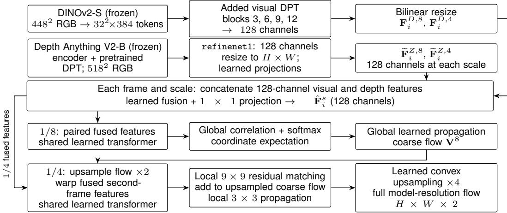
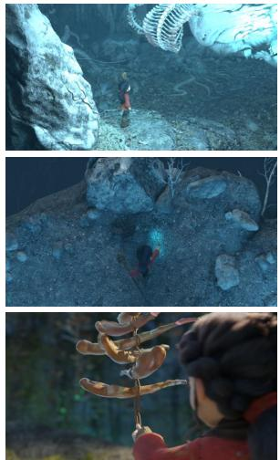
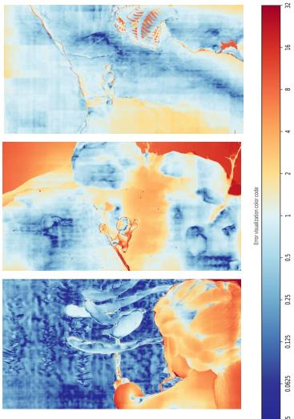
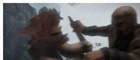
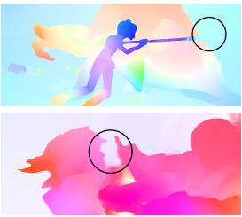
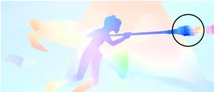
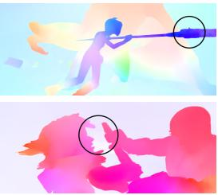
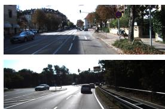
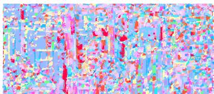

# Foundation Model Driven Optical Flow

Praroop Chanda1,3 Suryansh Kumar1,2,3,4,∗

Visual and Spatial AI Lab1, VCCM Section College of PVFA2, Department of ECEN3, Department of CSCE4, Texas A&M University, College Station, Texas, USA

## Abstract

We investigate how frozen pretrained visual and depth representations support dense optical flow when coupled with a supervised matching network. Building on TTSFlow, this paper studies Dense Prediction Transformer (DPT) feature decoding and one coarse-to-fine refinement stage. Our method fuses features from frozen DINOv2 and Depth Anything V2 models and estimates optical flow through a trainable transformer-based matching pipeline. After optical-flow training on FlyingChairs and FlyingThings3D, it achieves 2.37 endpoint error (EPE) on the Sintel training split, Final pass, compared with 2.52 for the FlowSeek (T) configuration reported here. Our RoCo-Spring 2026 entry, RoCo-29 · VSAI, obtains a robustness-balanced score of 1.1038, Spring EPE of 1.411, and RobustSpring proxy EPE of 4.739, with a lower balanced score than seven of the twelve listed reference baselines. These results characterize the complete pipeline, which reuses frozen foundation backbones and performs one refinement stage. Code is available at: https://github.com/Visual-and-Spatial-AI-Lab/FFlow

## 1 Introduction

Dense optical flow lies at the core of visual perception [43]. It estimates a motion vector for every pixel between consecutive frames. It enables a wide range of applications, including video understanding [8], saliency detection [21], action recognition [62, 33, 45], dense 3D reconstruction [25, 19, 36], and motion modeling [11]. Over the past decade, deep learning-based approaches have dramatically improved the accuracy of optical flow [4, 5, 9, 12, 20, 24, 39, 40, 42, 44, 46, 47, 52, 53, 55, 63, 61]. Notable methods such as RAFT [47] and its variants [51, 12, 34] combine learned representations with repeated flow updates. This motivates studying how pretrained representations can be used within an alternative matching pipeline.

In parallel, vision foundation models have reshaped the field of computer vision [31, 2, 17, 35, 7]. Models trained once on internet-scale imaging data now transfer effectively across computer vision tasks such as object detection [64], segmentation [60], depth estimation [57, 58], and geometric reasoning [22]. Rather than retraining specialized architectures for each problem, we increasingly reuse pretrained representations as general-purpose visual priors. These developments motivate reusing pretrained representations while learning the modules needed for optical-flow estimation.

Pretrained representations have also been investigated for optical flow, including cross-view pretraining in CroCo v2 [53], depth-informed estimation in FlowSeek [34], and pretrained input encoders in WAFT [50]. Our question is how to combine frozen visual and depth representations within a dense optical-flow pipeline. We evaluate that pipeline on cross-dataset optical-flow benchmarks and the RoCo-Spring corruption benchmark. Appendix C discusses these approaches and the related video-based reconstruction setting of D4RT [59].

This paper extends our TTSFlow framework [3], retaining its combination of frozen DINOv2 and Depth Anything V2 features before matching. The changes studied here are DPT-based decoding of intermediate DINOv2 features, one higher-resolution refinement stage, and evaluation of a Springadapted model on RoCo-Spring. The matching transformer, correlation-to-flow formulation, featurebased propagation, coarse-to-fine refinement, and convex upsampling follow GMFlow [55]. These are inherited components, not new matching operators. The downstream transformer, projection and fusion layers, propagation projections, and upsampling predictor are learned from opticalflow supervision. Experiment (Table 5) compares DPT configurations at a fixed refinement count. The historical TTSFlow fusion ablation is explicitly identified in the experiments (Table 4). Our experimental results evaluate this combined system rather than isolating what frozen foundation features can achieve alone.

## 2 Method

Given two consecutive RGB frames $\mathbf { I } _ { 1 } , \mathbf { I } _ { 2 } \ \in \ \mathbb { R } ^ { H \times W \times 3 }$ , we estimate dense optical flow ${ \textbf { V } } \in$ $\mathbb { R } ^ { H \times W \times 2 }$ , where H and $W$ denote image height and width, respectively. We fuse two frozen foundation-model feature streams and apply supervised matching at $1 / 8$ resolution, followed by one residual refinement at $1 / 4$ resolution. Here H, W refer to the dimensions supplied to the model. Figure 1 below summarizes the overall pipeline whereas Appendix G records the released configuration, parameter inventory, and its gradient-status distinction.

1. Foundation Visual Feature Extraction. The visual branch resizes each frame to $4 4 8 \times 4 4 8$ by bilinear interpolation. Frozen DINOv2-S [31] uses 14 × 14 patches, giving a $3 2 \times 3 2$ patch-token grid with 384 channels. We take transformer-block outputs 3, 6, 9, and 12 (one-based indexing), remove their class tokens, and decode the four spatial maps with a DPT head [37]. Its finest 128-channel output is resized separately to the two matching grids, i.e.,

$$
\mathbf { F } _ { i } ^ { D , s } = \mathcal { R } _ { s } \left( \Psi _ { \mathrm { D P T } } \left( \{ \widetilde { \mathbf { F } } _ { i } ^ { D , \ell } \} _ { \ell \in \left\{ 3 , 6 , 9 , 1 2 \right\} } \right) \right) , \quad s \in \{ 8 , 4 \} ,\tag{1}
$$

where $\mathcal { R } _ { s }$ bilinearly resizes to $H / s \times W / s$ . Thus, 1/8 and $1 / 4$ are post-decoding matching resolutions, not native DINOv2 resolutions. We keep the pretrained encoder fixed and studied the adaptation setting.

2. Depth Prior Feature Encoding. The depth branch uses frozen Depth Anything V2-B [58], including its pretrained DPT decoder, with a $5 \mathrm { { i } 8 \times 5 1 8 }$ input and a $3 7 \times \bar { 3 7 }$ encoder patch grid. We use the 128-channel output of the last decoder fusion block, depth\_head.scratch.refinenet1, before output\_conv1. The scalar depth output is not used for matching. This feature is resized to $H \times W$ and projected to both scales:

$$
\widetilde { \mathbf { F } } _ { i } ^ { Z , s } = \boldsymbol { \Psi } _ { \mathrm { p r o j } } ^ { s } ( \mathbf { F } _ { i } ^ { Z } ) , \qquad \widetilde { \mathbf { F } } _ { i } ^ { Z , s } \in \mathbb { R } ^ { H / s \times W / s \times 1 2 8 } .\tag{2}
$$

Three $3 \times 3 .$ , stride-2 convolutions use channel widths $1 2 8 \to 1 9 2 \to 2 5 6 \to 1 2 8 ;$ the second and third outputs supply $1 / 4$ and $1 / 8$ features. $\mathbf { A } 1 \times 1$ projection reduces the 1/4 output to 128 channels.

3. Cross-Modal Feature Fusion. Both branches take the same RGB frame and reflect different pretraining objectives. At each scale, we concatenate their 128-channel features to obtain ${ \bf F } _ { i } ^ { C } = { }$ Conca $( \mathbf { F } _ { i } ^ { D } , \widetilde { \mathbf { F } } _ { i } ^ { Z } )$ , suppressing the scale index for readability.

$$
\begin{array} { r } { \hat { \mathbf { F } } _ { i } = \Psi _ { \mathrm { f u s i o n } } ( \mathbf { F } _ { i } ^ { C } ) . } \end{array}\tag{3}
$$

Fusion applies a $3 \times 3$ convolution and two residual blocks at 256 channels, then a $1 \times 1$ projection to 128 channels. These weights are shared across frames and scales. Fusion precedes matching so that similarity is computed on a unified representation. Appendix G.2 gives exact source-derived counts rather than characterizing this network as merely lightweight.

4. Transformer-Based Global Matching and Propagation. We retain the global matching formulation of GMFlow [55] while deriving features from frozen foundation backbones [31, 58]. After adding positional encoding, a trainable six-block transformer processes the fused features with 128-dimensional embeddings, one attention head, and self-/cross-attention. The two scales use $2 \times 2$ and $8 \times 8$ spatial window partitions, respectively. We reshape its outputs as $\mathbf { F } _ { i } \in \mathbb { R } ^ { N \times D }$ where $N = ( H / 8 ) ( W / 8 )$ and $D ^ { ' } = 1 2 8$ . We compute all-pairs correlations and correspondence probabilities as $\mathbf { C } _ { \mathrm { f l o w } } = ( \mathbf { F } _ { 1 } \mathbf { F } _ { 2 } ^ { T } ) / \sqrt { D } , \mathbf { M } _ { \mathrm { f o w } } = \mathrm { s o f t m a x } ( \mathbf { C } _ { \mathrm { f o w } } )$ , where both matrices lie in R $N \times N$ Row-wise softmax assigns each reference location a distribution over all target locations, without restricting the displacement search range.

Visual DPT: no flow gradient in the released forward path (Appendix G.2). Upsampling also scales flow magnitudes.  
  
Figure 1: Overall pipeline, including refinement. Each feature branch is applied to both RGB frames. The TTSFlow feature-fusion design [3] is extended with visual DPT decoding and two feature scales. Matching, propagation, refinement, and convex upsampling follow GMFlow [55]. The transformer is shared across scales. Fusion and projection weights are shared. Frozen labels apply to the pretrained foundation models. The visual DPT gradient status in the released code is documented in Appendix G.2.

Let $\mathbf { G } _ { \mathrm { 2 D } } \in \mathbb { R } ^ { N \times 2 }$ denote the coordinate grid shared by both frames at feature resolution, flattened consistently with $\mathbf { F } _ { i } .$ The expected target coordinates and initial flow are $\hat { \mathbf { G } } _ { \mathrm { 2 D } } = \mathbf { M } _ { \mathrm { f l o w } } \mathbf { G } _ { \mathrm { 2 D } }$ $\hat { \bf V } _ { \mathrm { f l o w } } = \hat { \bf G } _ { \mathrm { 2 D } } - { \bf G } _ { \mathrm { 2 D } }$ . This expectation produces continuous correspondence coordinates without a discrete argmax. Global propagation uses learned projections $\mathbf { Q } \overset { \cdot } { = } \psi _ { q } ( \mathbf { F } _ { 1 } )$ and $\mathbf { K } = \psi _ { k } ( \mathbf { Q } )$ in the released implementation, giving $\mathbf { A } = \mathrm { s o f t m a x } ( \mathbf { Q } \mathbf { K } ^ { \top } / \sqrt { D } )$ and $\mathbf { V } = \mathbf { A } \hat { \mathbf { V } } _ { \mathrm { f i o w } }$ . The correlation/expectation operators are parameter-free given the transformed features; the surrounding network is learned.

5. Refinement and Final Upsampling. Following GMFlow [55], we bilinearly upsample the propagated $1 / 8$ flow by two and multiply its displacements by two. The detached flow warps the second-frame fused 1/4 features. The shared transformer processes the first-frame and warped second-frame features. Local matching in $\mathbf { a \ 9 \times 9 }$ neighborhood predicts a residual added to the up-sampled flow. Propagation then uses a $3 \times 3$ neighborhood. Final learned convex upsampling uses $3 \times 3$ flow neighborhoods and a factor of four, also multiplying displacements by four. One refinement stage means one higher-resolution residual update after $\mathrm { g l }$ lobal matching, and thus not refinement-free inference.

6. Training Loss. We supervise four full-resolution predictions, i.e., coarse matching, coarse propagation, fine residual matching, and final fine propagation with convex upsampling. The first three use bilinear upsampling with displacement scaling. The masked $\ell _ { 1 }$ loss is ${ \mathcal { L } } _ { \mathrm { f l o w } } =$ $\begin{array} { r } { \sum _ { k = 1 } ^ { 4 } \gamma ^ { 4 - k } \operatorname* { m e a n } \bigl [ m | \mathbf { V } ^ { ( k ) } - \mathbf { V } _ { g t } | \bigr ] } \end{array}$ , with $\gamma = 0 . 9$ and weights (0.729, 0.81, 0.9, 1). Our released code loss masks invalid pixels and ground-truth magnitudes at least 400 pixels, then averages over the full batch/spatial/two-component tensor. Appendix G.4 states the normalization and prediction order explicitly.

## 3 Experiments

Implementation details. We implement the method in PyTorch [32] and train with AdamW [23] on two NVIDIA RTX 6000 GPUs. Initial training uses FlyingChairs for 200k steps, learning rate $4 \times 1 0 ^ { - 4 }$ , and 384×512 crops. FlyingThings3D training uses learning rate $2 \times 1 0 ^ { - 4 }$ and 384×768 crops for 360k iterations [6, 26]. The released launcher specifies global batch sizes 8 for Chairs/Things and 4 for TSKH, KITTI, and Spring. Its paired random-crop procedures and stage settings are provided in Appendix G.3.

<table><tr><td rowspan="2">Method</td><td rowspan="2">#refine</td><td>Things (val)</td><td colspan="4">Sintel (train, clean)</td><td colspan="4">Sintel (train, final)</td></tr><tr><td>EPE</td><td>EPE</td><td>S0-10</td><td>S10-40</td><td>S40+</td><td>EPE</td><td>S0-10</td><td>S10-40</td><td>S40+</td></tr><tr><td>RAFT [47]</td><td>32</td><td>4.25</td><td>1.43</td><td>0.33</td><td>1.54</td><td>9.04</td><td>2.71</td><td>0.51</td><td>2.98</td><td>17.62</td></tr><tr><td>GMFlow [55]</td><td>0</td><td>3.48</td><td>1.50</td><td>0.46</td><td>1.77</td><td>8.26</td><td>2.96</td><td>0.72</td><td>3.45</td><td>17.70</td></tr><tr><td>GMFlow [55]</td><td>1</td><td>2.80</td><td>1.08</td><td>0.30</td><td>1.25</td><td>6.26</td><td>2.48</td><td>0.51</td><td>2.81</td><td>15.76</td></tr><tr><td>SEA-RAFT (S) [51]</td><td>4</td><td>一</td><td>1.27</td><td>-</td><td>1</td><td>-</td><td>4.32</td><td>-</td><td></td><td>-</td></tr><tr><td>FlowSeek (T) [34]</td><td>4</td><td>3.94</td><td>1.12</td><td>0.23</td><td>1.27</td><td>7.12</td><td>2.52</td><td>0.45</td><td>2.78</td><td>16.60</td></tr><tr><td>TTSFlow [3]</td><td>0</td><td>3.02</td><td>1.46</td><td>0.39</td><td>2.05</td><td>7.74</td><td>2.81</td><td>0.64</td><td>3.36</td><td>16.99</td></tr><tr><td>Ours</td><td>1</td><td>3.28</td><td>1.26</td><td>0.34</td><td>1.52</td><td>7.25</td><td>2.37</td><td>0.55</td><td>2.92</td><td>14.05</td></tr></table>

Table 1: Generalization performance after training on Chairs and Things train sets. The 2.37 EPE is on the Sintel training split, Final pass, and is the lowest among these listed configurations. The TTSFlow row is reproduced from [3]; refinement counts are not runtime measurements.

Cross-dataset evaluation uses Chairs and Things-trained models on the Sintel training splits without Sintel adaptation. Target-adapted evaluations follow training on the Things [26, 6], Sintel [1], KITTI [10], HD1K mixture (TSKH) [18] with a learning rate of $2 \times 1 0 ^ { - 4 }$ and a crop size of 320×896. We train our model for 320k iterations. For KITTI, we additionally fine-tune the model for 200k iterations with a batch size 4 (see Appendix G.3 for the crop-width discrepancy in the release). These training-split results are not held-out test performance. Finally, for the RoCo-Spring entry we fine tune our model on the Spring [28] dataset for 400k iterations, using a batch size 4, crop size of 544 × 960 and a learning rate of $1 \times 1 0 ^ { - 4 }$ . The predicted optical-flow fields files in .hdf5 format are submitted to the benchmark server for evaluation.

## 3.1 Model Generalization

Table 1 summarizes cross-dataset generalization results after training exclusively on the FlyingChairs and FlyingThings3D datasets, with no dataset-specific fine-tuning applied at test time.

On FlyingThings3D validation, our EPE of 3.28 is below RAFT (4.25) and GMFlow without refinement (3.48), but above GMFlow with one refinement (2.80). On the Sintel training split, our Final-pass EPE is 2.37, compared with 2.48 for GMFlow with one refinement and 2.52 for the listed FlowSeek (T) configuration. On Clean, our EPE is 1.26, compared with 1.08 and 1.12, respectively. These results identify a Final-pass advantage within the listed configurations, while the ordering differs on Clean and Things.

## 3.2 Result on Sintel and KITTI

I. Results on Sintel. Table 2 reports Sintel training-set results after training on Chairs, Things, and TSKH. TTSFlow [3] achieves 0.847, 1.140 EPE on Clean and Final sequence, respectively. On Final, TTSFlow [3] outperforms RAFT, GMFlow without refinement, and FlowSeek, while our model obtains 0.816, 1.13 EPE superseding TTSFlow [3] results. SEA-RAFT achieves the lowest errors on both passes, although training configurations differ: it uses eight L40 GPUs, batch size 32, and 432 × 960 crops, compared with two RTX 6000 GPUs, batch size 4, and 320 × 896 crops for ours. Both SEA-RAFT and FlowSeek also use additional TartanAir pretraining, whereas our approach reuses frozen foundation backbones without this flow-pretraining stage. Thus, these comparisons establish relative accuracy under the reported protocols, rather than isolate the effects of architecture or training scale.

II. Results on KITTI. On the KITTI training set (Table 2), TTSFlow [3] achieves 1.99 EPE and 7.40% F1-all, slightly improving on the corresponding GMFlow configuration (2.06 EPE and 7.57%). In comparison, our model achieves 1.248 EPE and 4.01% F1-all, also outperforming GMFlow with one refinement (1.36 EPE and 5.17%). RAFT and SEA-RAFT have lower errors on both metrics. FlowSeek has slightly higher EPE (1.26 versus 1.248), but lower F1-all (3.90% versus 4.01%). Thus, our approach improves on GMFlow at both reported refinement counts, but the accuracy gap to the strongest KITTI baselines remains.

## 3.3 RoCo-Spring Challenge Benchmark

RoCo-Spring challenge benchmark provides high-resolution, high-detail dense optical flow evaluation [28, 30]. Our entry obtains $\bar { E _ { S } } = 1 . 4 1 1 , \overset { \cdot } { \Delta } = 3 . 3 2 8$ , and $E _ { R , \mathrm { p r o x y } } = 4 . 7 \bar { 3 } 9$ , yielding RbS

<table><tr><td rowspan="2">Method</td><td rowspan="2">Extra flow data</td><td rowspan="2">#refine</td><td colspan="2">Sintel (train)</td><td colspan="2">KITTI (train)</td></tr><tr><td>Clean EPE</td><td>Final EPE</td><td>EPE</td><td>F1-all (%)</td></tr><tr><td>RAFT [47]</td><td></td><td>32</td><td>0.768</td><td>1.217</td><td>0.63</td><td>1.47</td></tr><tr><td>GMFlow [55]</td><td></td><td>0</td><td>0.947</td><td>1.276</td><td>2.06</td><td>7.57</td></tr><tr><td>GMFlow [55]</td><td></td><td>1</td><td>0.762</td><td>1.110</td><td>1.36</td><td>5.17</td></tr><tr><td>SEA-RAFT (S) [51]</td><td>TartanAir</td><td>4</td><td>0.546</td><td>0.782</td><td>0.93</td><td>2.65</td></tr><tr><td>FlowSeek (T) [34]</td><td>TartanAir</td><td>4</td><td>0.710</td><td>1.280</td><td>1.26</td><td>3.90</td></tr><tr><td>TTSFlow [3]</td><td></td><td>0</td><td>0.847</td><td>1.140</td><td>1.99</td><td>7.40</td></tr><tr><td>Ours</td><td>一</td><td>1</td><td>0.816</td><td>1.13</td><td>1.248</td><td>4.01</td></tr></table>

Table 2: Performance on the Sintel and KITTI training sets. Sintel results are obtained after training on Chairs, Things, and the mixed TSKH datasets. Training configurations differ; the comparison does not isolate architecture or training-scale effects. Extra flow data denotes additional optical-flow pretraining, not foundationmodel pretraining. The TTSFlow row is reproduced from [3]. #refine denotes the number of refinement steps. Lower values indicate better performance for all metrics.

<table><tr><td>Method</td><td>RbS-Score</td><td>Spring EPE</td><td>Proxy EPE</td><td>∆</td></tr><tr><td>SEA-RAFT [51]</td><td>0.4584</td><td>0.363</td><td>3.323</td><td>2.960</td></tr><tr><td>MS-RAFT+ [14]</td><td>0.6774</td><td>0.643</td><td>4.263</td><td>3.620</td></tr><tr><td>FlowFormer [12]</td><td>0.7368</td><td>0.723</td><td>4.493</td><td>3.770</td></tr><tr><td>GMFlow [55]</td><td>0.8015</td><td>0.945</td><td>3.925</td><td>2.980</td></tr><tr><td>GMA [15]</td><td>0.8704</td><td>0.914</td><td>4.944</td><td>4.030</td></tr><tr><td>VSAI (RoCo-29, Method 1)</td><td>1.1038</td><td>1.411</td><td>4.739</td><td>3.328</td></tr><tr><td>FlowNet2 [13]</td><td>1.1914</td><td>1.040</td><td>8.050</td><td>7.010</td></tr><tr><td>RoCo-Spring Team baseline</td><td>1.2375</td><td>1.493</td><td>5.853</td><td>4.360</td></tr><tr><td>RAFT [47]</td><td>1.3336</td><td>1.476</td><td>7.116</td><td>5.640</td></tr><tr><td>M-FUSE (K) [27]</td><td>1.7631</td><td>2.526</td><td>5.916</td><td>3.390</td></tr><tr><td>RAFT-3D (K) [48]</td><td>1.9003</td><td>2.528</td><td>7.558</td><td>5.030</td></tr><tr><td>PWCNet [44]</td><td>1.9435</td><td>2.288</td><td>9.538</td><td>7.250</td></tr><tr><td>SPyNet [38]</td><td>2.7976</td><td>4.162</td><td>8.452</td><td>4.290</td></tr></table>

Table 3: RoCo-Spring optical flow result. The reported columns compare the submitted entry with challenge reference methods. $\Delta = E _ { R , \mathrm { p r o x y } } - E _ { S }$ is shown for interpretation. All metrics are lower-is-better; EPE and disagreement are in pixels. Reference baselines are unranked challenge references, not competing team ranks.

1.1038 after rounding, where $E _ { S }$ denotes Spring EPE and $\Delta$ the mean clean-to-corrupted flow disagreement. Figure 2 show the qualitative result on Spring Benchmark dataset.

The challenge-defined proxy is $E _ { R , \mathrm { p r o x y } } = E _ { S } + \Delta$ , not a direct corrupted-input ground-truth error. Our balanced score is lower than seven of the twelve reference baselines in Table 3. Here, GMFlow results are quite interesting. GMFlow has lower clean EPE (0.945), disagreement (2.980), and proxy EPE (3.925). The clean-EPE gap is 0.466 pixels despite our additional 400k Spring fine-tuning updates. The GMFlow reference uses a Sintel checkpoint [30], whereas our entry is Spring-adapted and thus these are comparisons of configurations with different training histories.

The breakdown in Appendix A identifies different clean and corrupted-input limitations. Clean EPE is 7.193 for high-detail regions, 6.500 for unmatched pixels, and 5.887 for motions above 40 pixels. Disagreement is low for brightness (0.308) and saturation (0.415), but high for rain (13.034), spatter (10.097), snow (8.943), and frost (8.579). Thus, aggregate stability coexists with substantial sensitivity to particular corruptions. RobustSpring uses one specified severity per corruption [30]. Appendix A also discusses the public clean-input failure visualization and the distinction between EPE and the 1px error rate.

## 3.4 Ablations

(i) Cross-Modal Fusion. Table 4 reproduces the TTSFlow fusion ablation [3], without DPT or refinement. Fusion reduces EPE from 3.52 to 3.02 on Things Clean, from 1.575 to 1.46 on Sintel Clean, and from 3.12 to 2.81 on Sintel Final, yielding a 10% relative reduction on Final. The largest absolute improvement occurs for large displacements $( s _ { 4 0 + } )$ on Sintel Final, where EPE decreases from 19.37 to 16.99. Fusion improves all other reported motion bins except Sintel Clean s10–40, where EPE increases slightly from 2.01 to 2.05. These historical results support the base fusion configuration under that protocol and are distinct from the DPT comparison below.

  
Reference Frame

  
Flow Visualization

  
Flow Error  
Figure 2: Qualitative results on Spring Benchmark Dataset [41].

(ii) Effects of DPT. Table 5 compares the proposed pipeline with and without DPT after 360k training steps on Things, both with one refinement step. Adding DPT reduces EPE from 1.33 to 1.26 on Sintel Clean and from 2.73 to 2.37 on Sintel Final. Errors decrease across all reported motion bins, with the largest reduction in Sintel Final $s _ { 4 0 + }$ , from 16.69 to 14.05 EPE. With refinement count held fixed, these gains support the contribution of the DPT head to dense correspondence accuracy, particularly at large displacements. Additional experiments, ablations, and compute details are provided in the appendix.

<table><tr><td rowspan="2">Method</td><td>Things (val, clean)</td><td colspan="4">Sintel (train, clean)</td><td colspan="4">Sintel (train, final)</td></tr><tr><td>EPE</td><td>EPE</td><td>S0-10</td><td>S10-40</td><td>S40+</td><td>EPE</td><td>S0-10</td><td>S10-40</td><td>S40+</td></tr><tr><td>(w/o) Fusion</td><td>3.52</td><td>1.575</td><td>0.45</td><td>2.01</td><td>8.53</td><td>3.12</td><td>0.685</td><td>3.57</td><td>19.37</td></tr><tr><td>(w/) Fusion</td><td>3.02</td><td>1.46</td><td>0.39</td><td>2.05</td><td>7.74</td><td>2.81</td><td>0.64</td><td>3.36</td><td>16.99</td></tr></table>

Table 4: Fusion ablation reproduced from TTSFlow [3], Table 4, with 800k Things-stage updates following 200k Chairs updates, and no DPT or refinement. This is prior evidence for the base fusion design, not a new ablation of the submitted configuration.

<table><tr><td rowspan="2">Method</td><td colspan="4">Sintel (train, clean)</td><td colspan="4">Sintel (train, final)</td></tr><tr><td>EPE</td><td>S0-10</td><td> $\underline { { s _ { 1 0 - 4 0 } } }$ </td><td>S40+</td><td>EPE</td><td>S0-10</td><td>S10-40</td><td>S40+</td></tr><tr><td>without DPT</td><td>1.33</td><td>0.40</td><td>1.61</td><td>7.26</td><td>2.73</td><td>0.62</td><td>3.16</td><td>16.69</td></tr><tr><td>with DPT</td><td>1.26</td><td>0.34</td><td>1.52</td><td>7.25</td><td>2.37</td><td>0.55</td><td>2.92</td><td>14.05</td></tr></table>

Table 5: DPT comparison on the Sintel training split, Clean and Final passes, after 360k Things-stage updates following Chairs training. Both configurations use one refinement stage.

## 4 Conclusion, Limitations, and Broader Impact

We presented a foundation-driven optical flow framework that reuses frozen visual and depth foundation representations for dense correspondence estimation. By combining semantic and geometric priors through lightweight fusion and global matching, our method estimates optical flow in a single forward pass without expensive multi-step test-time refinement, achieving strong cross-dataset generalization and competitive accuracy. The main limitation here is that foundation features are not optimized specifically for optical flow. Consequently, the model may provide inferior results under extreme motion, severe appearance changes, occlusions, or fine motion boundaries. Lightweight multiple refinement, adaptive correction, or multi-frame temporal reasoning could improve robustness while preserving the efficiency of the proposed design. Broadly, this work points toward reducing task-specific training and test-time scaling in dense visual perception. Such approaches may benefit robotics, video understanding, and 3D scene analysis, but optical flow failures in safety-critical settings still require careful validation and uncertainty-aware deployment.

## References

[1] D. J. Butler, J. Wulff, G. B. Stanley, and M. J. Black. A naturalistic open source movie for optical flow evaluation. In European conference on computer vision, pages 611–625. Springer, 2012.

[2] M. Caron, H. Touvron, I. Misra, H. Jégou, J. Mairal, P. Bojanowski, and A. Joulin. Emerging properties in self-supervised vision transformers. In Proceedings of the IEEE/CVF international conference on computer vision, pages 9650–9660, 2021.

[3] P. Chanda and S. Kumar. Rethinking dense optical flow without test-time scaling. In Proceedings of the IEEE/CVF Conference on Computer Vision and Pattern Recognition (CVPR) Workshops, pages 11410–11419, June 2026.

[4] C. Deng, A. Luo, H. Huang, S. Ma, J. Liu, and S. Liu. Explicit motion disentangling for efficient optical flow estimation. In Proceedings of the IEEE/CVF International Conference on Computer Vision, pages 9521–9530, 2023.

[5] Q. Dong, C. Cao, and Y. Fu. Rethinking optical flow from geometric matching consistent perspective. In Proceedings of the IEEE/CVF Conference on Computer Vision and Pattern Recognition, pages 1337–1347, 2023.

[6] A. Dosovitskiy, P. Fischer, E. Ilg, P. Häusser, C. Hazırba¸s, V. Golkov, P. van der Smagt, D. Cremers, and T. Brox. Flownet: Learning optical flow with convolutional networks. In Proceedings ofthe IEEE International Conference on Computer Vision (ICCV), 2015.

[7] A. Dosovitskiy, L. Beyer, A. Kolesnikov, D. Weissenborn, X. Zhai, T. Unterthiner, M. Dehghani, M. Minderer, G. Heigold, S. Gelly, et al. An image is worth 16x16 words: Transformers for image recognition at scale. arXiv preprint arXiv:2010.11929, 2020.

[8] C. Gao, A. Saraf, J.-B. Huang, and J. Kopf. Flow-edge guided video completion. In European Conference on Computer Vision, pages 713–729. Springer, 2020.

[9] R. Garrepalli, J. Jeong, R. C. Ravindran, J. M. Lin, and F. Porikli. Dift: Dynamic iterative field transforms for memory efficient optical flow. In Proceedings of the IEEE/CVF Conference on Computer Vision and Pattern Recognition, pages 2219–2228, 2023.

[10] A. Geiger, P. Lenz, C. Stiller, and R. Urtasun. Vision meets robotics: The kitti dataset. The International Journal ofRobotics Research, 32(11):1231–1237, 2013.

[11] Y. Huang, Y. Chen, and J. Zelek. Zero-shot monocular motion segmentation in the wild by combining deep learning with geometric motion model fusion. In Proceedings of the IEEE/CVF Conference on Computer Vision and Pattern Recognition, pages 2733–2743, 2024.

[12] Z. Huang, X. Shi, C. Zhang, Q. Wang, K. C. Cheung, H. Qin, J. Dai, and H. Li. Flowformer: A transformer architecture for optical flow. In European Conference on Computer Vision, pages 668–685. Springer, 2022.

[13] E. Ilg, N. Mayer, T. Saikia, M. Keuper, A. Dosovitskiy, and T. Brox. Flownet 2.0: Evolution of optical flow estimation with deep networks. In Proceedings ofthe IEEE conference on computer vision and pattern recognition, pages 2462–2470, 2017.

[14] A. Jahedi, M. Luz, M. Rivinius, L. Mehl, and A. Bruhn. Ms-raft+: High resolution multi-scale raft. International Journal of Computer Vision, pages 1–22, 2023.

[15] S. Jiang, D. Campbell, Y. Lu, H. Li, and R. Hartley. Learning to estimate hidden motions with global motion aggregation. arXiv preprint arXiv:2104.02409, 2021.

[16] S. Kiefhaber, S. Roth, and S. Schaub-Meyer. Removing cost volumes from optical flow estimators. In Proceedings of the IEEE/CVF International Conference on Computer Vision, pages 79–89, 2025.

[17] A. Kirillov, E. Mintun, N. Ravi, H. Mao, C. Rolland, L. Gustafson, T. Xiao, S. Whitehead, A. C. Berg, W.-Y. Lo, et al. Segment anything. In Proceedings of the IEEE/CVF international conference on computer vision, pages 4015–4026, 2023.

[18] D. Kondermann, R. Nair, K. Honauer, K. Krispin, J. Andrulis, A. Brock, B. Gussefeld, M. Rahimimoghaddam, S. Hofmann, C. Brenner, et al. The hci benchmark suite: Stereo and flow ground truth with uncertainties for urban autonomous driving. In Proceedings ofthe IEEE Conference on Computer Vision and Pattern Recognition Workshops, pages 19–28, 2016.

[19] S. Kumar, Y. Dai, and H. Li. Superpixel soup: Monocular dense 3d reconstruction of a complex dynamic scene. IEEE transactions on pattern analysis and machine intelligence, 43 (5):1705–1717, 2019.

[20] V. Leroy, J. Revaud, T. Lucas, and P. Weinzaepfel. Win-win: Training high-resolution vision transformers from two windows. arXiv preprint arXiv:2310.00632, 2023.

[21] H. Li, G. Chen, G. Li, and Y. Yu. Motion guided attention for video salient object detection. In Proceedings of the IEEE/CVF international conference on computer vision, pages 7274–7283, 2019.

[22] Y. Liu, L. Kong, J. Cen, R. Chen, W. Zhang, L. Pan, K. Chen, and Z. Liu. Segment any point cloud sequences by distilling vision foundation models. Advances in Neural Information Processing Systems, 36:37193–37229, 2023.

[23] I. Loshchilov and F. Hutter. Decoupled weight decay regularization. arXiv preprint arXiv:1711.05101, 2017.

[24] Y. Lu, Q. Wang, S. Ma, T. Geng, Y. V. Chen, H. Chen, and D. Liu. Transflow: Transformer as flow learner. In Proceedings ofthe IEEE/CVF Conference on Computer Vision and Pattern Recognition, pages 18063–18073, 2023.

[25] Z. Ma, Z. Teed, and J. Deng. Multiview stereo with cascaded epipolar raft. In European Conference on Computer Vision, pages 734–750. Springer, 2022.

[26] N. Mayer, E. Ilg, P. Hausser, P. Fischer, D. Cremers, A. Dosovitskiy, and T. Brox. A large dataset to train convolutional networks for disparity, optical flow, and scene flow estimation. In Proceedings of the IEEE conference on computer vision and pattern recognition, pages 4040–4048, 2016.

[27] L. Mehl, A. Jahedi, J. Schmalfuss, and A. Bruhn. M-FUSE: Multi-frame fusion for scene flow estimation. In Proc. Winter Conference on Applications ofComputer Vision (WACV), 2023.

[28] L. Mehl, J. Schmalfuss, A. Jahedi, Y. Nalivayko, and A. Bruhn. Spring: A high-resolution high-detail dataset and benchmark for scene flow, optical flow and stereo. In Proceedings ofthe IEEE/CVF Conference on Computer Vision and Pattern Recognition, pages 4981–4991, 2023.

[29] Meta AI. DINOv2-S: Published model configuration, 2023. URL https://huggingface. co/facebook/dinov2-small/blob/main/config.json.

[30] V. Oei, J. Schmalfuss, L. Mehl, M. Bartsch, S. Agnihotri, M. Keuper, A. Bulling, and A. Bruhn. Robustspring: Benchmarking robustness to image corruptions for optical flow, scene flow and stereo. In International Conference on Learning Representations (ICLR), 2026.

[31] M. Oquab, T. Darcet, T. Moutakanni, H. Vo, M. Szafraniec, V. Khalidov, P. Fernandez, D. Haziza, F. Massa, A. El-Nouby, et al. Dinov2: Learning robust visual features without supervision. arXiv preprint arXiv:2304.07193, 2023.

[32] A. Paszke, S. Gross, F. Massa, A. Lerer, J. Bradbury, G. Chanan, T. Killeen, Z. Lin, N. Gimelshein, L. Antiga, et al. Pytorch: An imperative style, high-performance deep learning library. Advances in neural information processing systems, 32, 2019.

[33] A. Piergiovanni and M. S. Ryoo. Representation flow for action recognition. In Proceedings ofthe IEEE/CVF Conference on Computer Vision and Pattern Recognition, pages 9945–9953, 2019.

[34] M. Poggi and F. Tosi. Flowseek: Optical flow made easier with depth foundation models and motion bases. In Proceedings of the International Conference on Computer Vision (ICCV), 2025.

[35] A. Radford, J. W. Kim, C. Hallacy, A. Ramesh, G. Goh, S. Agarwal, G. Sastry, A. Askell, P. Mishkin, J. Clark, et al. Learning transferable visual models from natural language supervision. In International conference on machine learning, pages 8748–8763. PmLR, 2021.

[36] R. Ranftl, V. Vineet, Q. Chen, and V. Koltun. Dense monocular depth estimation in complex dynamic scenes. In Proceedings of the IEEE conference on computer vision and pattern recognition, pages 4058–4066, 2016.

[37] R. Ranftl, A. Bochkovskiy, and V. Koltun. Vision transformers for dense prediction. In Proceedings of the IEEE/CVF international conference on computer vision, pages 12179– 12188, 2021.

[38] A. Ranjan and M. J. Black. Optical flow estimation using a spatial pyramid network. In Proceedings of the IEEE Conference on Computer Vision and Pattern Recognition, pages 2720–2729, 2017.

[39] S. Saxena, C. Herrmann, J. Hur, A. Kar, M. Norouzi, D. Sun, and D. J. Fleet. The surprising effectiveness of diffusion models for optical flow and monocular depth estimation. Advances in Neural Information Processing Systems, 36, 2024.

[40] X. Shi, Z. Huang, D. Li, M. Zhang, K. C. Cheung, S. See, H. Qin, J. Dai, and H. Li. Flowformer++: Masked cost volume autoencoding for pretraining optical flow estimation. In Proceedings of the IEEE/CVF Conference on Computer Vision and Pattern Recognition, pages 1599–1610, 2023.

[41] Spring Benchmark. RoCo-29: Public VSAI optical-flow result and visualizations, 2026. URL https://spring-benchmark.org/474/.

[42] X. Sui, S. Li, X. Geng, Y. Wu, X. Xu, Y. Liu, R. Goh, and H. Zhu. Craft: Cross-attentional flow transformer for robust optical flow. In Proceedings of the IEEE/CVF conference on Computer Vision and Pattern Recognition, pages 17602–17611, 2022.

[43] D. Sun, S. Roth, and M. J. Black. Secrets of optical flow estimation and their principles. In 2010 IEEE computer society conference on computer vision and pattern recognition, pages 2432–2439. IEEE, 2010.

[44] D. Sun, X. Yang, M.-Y. Liu, and J. Kautz. Pwc-net: Cnns for optical flow using pyramid, warping, and cost volume. In Proceedings of the IEEE conference on computer vision and pattern recognition, pages 8934–8943, 2018.

[45] S. Sun, Z. Kuang, L. Sheng, W. Ouyang, and W. Zhang. Optical flow guided feature: A fast and robust motion representation for video action recognition. In Proceedings of the IEEE conference on computer vision and pattern recognition, pages 1390–1399, 2018.

[46] S. Sun, Y. Chen, Y. Zhu, G. Guo, and G. Li. Skflow: Learning optical flow with super kernels. Advances in Neural Information Processing Systems, 35:11313–11326, 2022.

[47] Z. Teed and J. Deng. Raft: Recurrent all-pairs field transforms for optical flow. In European conference on computer vision, pages 402–419. Springer, 2020.

[48] Z. Teed and J. Deng. Raft-3d: Scene flow using rigid-motion embeddings. In Proceedings of the IEEE/CVF Conference on Computer Vision and Pattern Recognition (CVPR), 2021.

[49] C. Vogel, K. Schindler, and S. Roth. Piecewise rigid scene flow. In Proceedings ofthe IEEE International Conference on Computer Vision, pages 1377–1384, 2013.

[50] Y. Wang and J. Deng. WAFT: Warping-alone field transforms for optical flow. In International Conference on Learning Representations, 2026.

[51] Y. Wang, L. Lipson, and J. Deng. Sea-raft: Simple, efficient, accurate raft for optical flow. In European Conference on Computer Vision, pages 36–54. Springer, 2024.

[52] P. Weinzaepfel, V. Leroy, T. Lucas, R. Brégier, Y. Cabon, V. Arora, L. Antsfeld, B. Chidlovskii, G. Csurka, and J. Revaud. Croco: Self-supervised pre-training for 3d vision tasks by cross-view completion. Advances in Neural Information Processing Systems, 35:3502–3516, 2022.

[53] P. Weinzaepfel, T. Lucas, V. Leroy, Y. Cabon, V. Arora, R. Brégier, G. Csurka, L. Antsfeld, B. Chidlovskii, and J. Revaud. Croco v2: Improved cross-view completion pre-training for stereo matching and optical flow. In Proceedings ofthe IEEE/CVF International Conference on Computer Vision, pages 17969–17980, 2023.

[54] J. Wulff and M. J. Black. Efficient sparse-to-dense optical flow estimation using a learned basis and layers. In Proceedings of the IEEE Conference on Computer Vision and Pattern Recognition, pages 120–130, 2015.

[55] H. Xu, J. Zhang, J. Cai, H. Rezatofighi, and D. Tao. Gmflow: Learning optical flow via global matching. In Proceedings of the IEEE/CVF conference on computer vision and pattern recognition, pages 8121–8130, 2022.

[56] J. Yang and H. Li. Dense, accurate optical flow estimation with piecewise parametric model. In Proceedings of the IEEE Conference on Computer Vision and Pattern Recognition, pages 1019–1027, 2015.

[57] L. Yang, B. Kang, Z. Huang, X. Xu, J. Feng, and H. Zhao. Depth anything: Unleashing the power of large-scale unlabeled data. In Proceedings ofthe IEEE/CVF conference on computer vision and pattern recognition, pages 10371–10381, 2024.

[58] L. Yang, B. Kang, Z. Huang, Z. Zhao, X. Xu, J. Feng, and H. Zhao. Depth anything v2. Advances in Neural Information Processing Systems, 37:21875–21911, 2024.

[59] C. Zhang, G. Le Moing, S. Koppula, I. Rocco, L. Momeni, J. Xie, S. Sun, R. Sukthankar, J. K. Barral, R. Hadsell, Z. Ghahramani, A. Zisserman, J. Zhang, and M. S. M. Sajjadi. Efficiently reconstructing dynamic scenes one D4RT at a time. In Proceedings of the IEEE/CVF Conference on Computer Vision and Pattern Recognition, 2026.

[60] H. Zhang, Y. Su, X. Xu, and K. Jia. Improving the generalization of segmentation foundation model under distribution shift via weakly supervised adaptation. In Proceedings of the IEEE/CVF Conference on Computer Vision and Pattern Recognition, pages 23385–23395, 2024.

[61] S. Zhao, L. Zhao, Z. Zhang, E. Zhou, and D. Metaxas. Global matching with overlapping attention for optical flow estimation. In Proceedings of the IEEE/CVF Conference on Computer Vision and Pattern Recognition, pages 17592–17601, 2022.

[62] Y. Zhao, K. L. Man, J. Smith, K. Siddique, and S.-U. Guan. Improved two-stream model for human action recognition. EURASIP Journal on Image and Video Processing, 2020(1):1–9, 2020.

[63] Z. Zheng, N. Nie, Z. Ling, P. Xiong, J. Liu, H. Wang, and J. Li. Dip: Deep inverse patchmatch for high-resolution optical flow. In Proceedings of the IEEE/CVF Conference on Computer Vision and Pattern Recognition, pages 8925–8934, 2022.

[64] W. Zhuang, C. Chen, Z. Li, S. Sajadmanesh, J. Li, J. Huang, V. Sehwag, V. Sharma, H. Shinozaki, F. C. Garcia, et al. Argus: A compact and versatile foundation model for vision. In Proceedings ofthe Computer Vision and Pattern Recognition Conference, pages 4418–4429, 2025.

# Foundation Model Driven Optical Flow —Appendix—

## A Public Spring and RobustSpring Breakdown

Tables 6 and 7 transcribe the EPE fields from the public RoCo-29 result [41]. Clean Spring values are ground-truth errors. RobustSpring values are clean-to-corrupted prediction disagreements, $\Delta _ { c } ,$ despite being displayed under an EPE heading on the server. The reported aggregate disagreement is 3.328. The challenge adds clean EPE 1.411 to obtain proxy EPE 4.739. The aggregate is retained as reported rather than recomputed by taking an unweighted mean of the corruption rows.

Table 6: Clean Spring EPE by evaluation subset. Values are in pixels.
<table><tr><td>Subset</td><td>EPE</td><td>Subset</td><td>EPE</td></tr><tr><td>Overall</td><td>1.411</td><td>Non-rigid</td><td>3.804</td></tr><tr><td>Low-detail</td><td>1.374</td><td>Not sky</td><td>1.406</td></tr><tr><td>High-detail</td><td>7.193</td><td>Sky</td><td>1.489</td></tr><tr><td>Matched</td><td>1.288</td><td>S0-10</td><td>0.898</td></tr><tr><td>Unmatched</td><td>6.500</td><td>S10-40</td><td>1.340</td></tr><tr><td>Rigid</td><td>1.094</td><td> $s _ { 4 0 + }$ </td><td>5.887</td></tr></table>

Table 7: RobustSpring disagreement for all twenty corruptions. $\Delta _ { c }$ is in pixels. Lower values indicate less change in predicted flow. These are not corrupted-input ground-truth EPE values.
<table><tr><td>Corruption</td><td> $\Delta _ { c }$ </td><td>Corruption</td><td> $\Delta _ { c }$ </td></tr><tr><td>Brightness</td><td>0.308</td><td>JPEG compression</td><td>1.671</td></tr><tr><td>Contrast</td><td>3.213</td><td>Motion blur</td><td>1.538</td></tr><tr><td>Defocus blur</td><td>0.592</td><td>Pixelate</td><td>0.756</td></tr><tr><td>Elastic transform</td><td>1.189</td><td>Rain</td><td>13.034</td></tr><tr><td>Fog</td><td>1.382</td><td>Saturate</td><td>0.415</td></tr><tr><td>Frost</td><td>8.579</td><td>Shot noise</td><td>1.980</td></tr><tr><td>Gaussian blur</td><td>0.713</td><td>Snow</td><td>8.943</td></tr><tr><td>Gaussian noise</td><td>2.070</td><td>Spatter</td><td>10.097</td></tr><tr><td>Glass blur</td><td>0.604</td><td>Speckle noise</td><td>2.308</td></tr><tr><td>Impulse noise</td><td>2.882</td><td>Zoom blur</td><td>4.294</td></tr></table>

Corruption types and severity. Brightness (0.308 pixels) and saturation (0.415) produce relatively small changes in the estimated flow. Rain (13.034), spatter (10.097), snow (8.943), and frost (8.579) produce much larger disagreements. Blur sensitivity also varies: defocus gives 0.592 pixels, while zoom blur gives 4.294. These values identify settings in which the predictions are stable or unstable; they do not measure the corrupted predictions against ground truth. RobustSpring specifies one severity setting for each corruption [30]. Table 7 reports those benchmark settings, not a severity sweep, so the results do not establish a trend with increasing severity.

Clean accuracy and a representative failure. On clean Spring, EPE rises from 1.411 overall to 7.193 in high-detail regions and 6.500 at unmatched pixels. The public result also reports a 34.890% clean 1px error rate [41]. Mean EPE and this thresholded error describe different properties of the error distribution; neither alone establishes an advantage for large motion. The reported motion-stratified EPE is 0.898 for $s _ { 0 - 1 0 }$ , 1.340 for $s _ { 1 0 - 4 0 }$ , and 5.887 for $s _ { 4 0 + }$

A concrete clean-input example is the public RoCo-29 hero frame hero\_00, showing a running dog on textured ground, and its corresponding error visualization flerrimg\_00 [41]. The error image contains warm-colored regions on the moving dog and across parts of the foreground, while parts of the upper background appear cooler. This example illustrates spatially nonuniform error on an uncorrupted pair; it is not a corruption-disagreement image. The displayed colorbar has no numerical tick labels, so no pixel-error magnitude is inferred from its colors. Corruption-specific spatial causes cannot be established from the aggregate values in Table 7 alone.

Interpretation. The clean subset analysis separates the method’s fine-detail and visibility limitations from its response to corrupted appearance. The corruption breakdown shows that favorable aggregate stability can coexist with pronounced sensitivity to particular disturbances. Because submitted-checkpoint evaluations with individual modules disabled are not reported here, this evidence is descriptive: it does not establish whether DINOv2 features, depth features, fusion, or the matching operator are responsible for any particular corruption response. Similarly, an unchanged but inaccurate prediction would have low disagreement; stability and clean error must therefore be read together.

Score calculation. Using the challenge’s fixed constants and the displayed values gives

$$
{ \frac { 1 } { 2 } } \left( { \frac { 1 . 4 1 1 } { 0 . 9 9 2 5 } } + { \frac { 1 . 4 1 1 + 3 . 3 2 8 } { 6 . 0 3 0 } } \right) = 1 . 1 0 3 7 8 3 1 \ldots \approx 1 . 1 0 3 8 .\tag{4}
$$

The comparison counts the twelve listed reference baselines in Table 3. Our entry has a lower robustness-balanced score than seven of those references; this is neither a training-matched architectural comparison nor a claim about the final ranking of submitted teams.

## B Qualitative Comparisons

Figures 3 and 4 retain the qualitative comparisons accompanying the standard-benchmark experiments. Columns show the input frame and the predictions of SEA-RAFT, FlowSeek, and our method. Flow colors visualize estimated direction and magnitude; they are not error maps. These examples complement the quantitative tables but do not substitute for boundary-, visibility-, or corruptionspecific evaluation.

  
InputInput

  
SEA-RAFT [43] SEA-RAFT [51]

  
FlowSeek [29] FlowSeek [34]

  
Ours Ours  
ure 1: Qualitative comparison with current SOTA SEA-RAFT [43] and FlowSeek [29] models onFigure 3: Sintel qualitative comparison. Two examples from the Sintel benchmark [1]. The allenging Sintel [1] benchmark dataset. Our approach without iterative refinement provides excellent decircles are annotations retained from the reported experiment. The visual comparisons illustrate local ical flow, specifically on high-frequency and occluded regions as shown in the above examples.differences in predicted motion, without establishing a quantitative occlusion or boundary advantage.

  
. WhinputInput

  
oaches achieve gSEA-RAFT [43] SEA-RAFT [51]  
lts, they treat oFlowSeek [29] FlowSeek [34]

  
a taskOu Ours  
plicitly learned and repeatedly corrected via expensive iterative refinement. Yet, at its core, optiFigure 3: Qualit tive comparison with current SOTA on the KITTI [10] Train data et.Figure 4: KITTI qualitative comparison. Two examples from the KITTI training split [10]. These w is a dense correspondence problem. It requires discriminative feature representations, accuexamples belong to the target-adapted evaluation and should not be interpreted as held-out test results.

## C Related Work

(i) Learning-based Optical Flow. Early works such as FlowNet [6] introduced supervised regression, while PWC-Net [44] incorporated pyramidal cost volumes and warping to improve efficiency and accuracy. Subsequent approaches refined these ideas through multi-scale processing and architectural optimization. RAFT [47] established a dominant paradigm by formulating optical flow as iterative refinement over all-pairs correlations. Its recurrent update operator progressively corrects flow estimates, improving accuracy at the cost of increased inference time. SEA-RAFT [51] further optimized it, introducing probabilistic supervision and rigid-motion pretraining to improve efficiency and generalization, while [16] focused on speed and reduced memory needs. Despite these advances, RAFT and SEA-RAFT rely on multi-step test-time refinement to gain performance.

Transformer-based models such as GMFlow [55] and FlowFormer [12] shifted attention toward global reasoning. GMFlow presented optical flow as a global matching problem using attention and softmax normalization, yet requires supervised training and, in practice, benefits greatly from refinement. FlowFormer [12] extended this idea via cost-volume transformers to model long-range dependencies. Our pipeline inherits GMFlow’s transformer, correlation-to-flow formulation, propagation, refinement, and convex upsampling. It replaces the CNN feature extraction path with fused foundation-model features while retaining supervised training of the downstream flow-estimation modules.

(ii) Geometric Priors in Optical Flow. Incorporating geometric cues into optical flow has long been an attractive direction [43, 54]. Earlier methods relied on piecewise rigid motion assumptions [49, 56], whereas recent learning-based approaches inject depth priors directly into the network. Recently proposed FlowSeek [34] represents an interesting step in this direction. It integrates monocular depth foundation models [58] into a RAFT-style architecture and demonstrates improved crossdataset generalization. FlowSeek uses depth features and depth-derived motion bases in a recurrent flow-estimation architecture. We instead fuse an intermediate Depth Anything V2 decoder feature with a separate DINOv2 feature stream before correlation-based matching. The foundation models remain fixed, while the downstream transformer and flow-estimation modules learn from optical-flow supervision. This distinction concerns where pretrained features enter the matching pipeline; it does not remove flow-specific learning.

(iii) Vision Foundation Models for Dense Geometry. Vision foundation models have recently demonstrated remarkable transferability across tasks. Self-supervised models such as DINO [2] and DINO-v2 [31] learn dense, semantically meaningful representations that generalize across domains without explicit supervision. In parallel, depth foundation models such as Depth Anything [57] and its successors [58] achieve strong cross-dataset generalization and produce boundary-aware geometric predictions. Dense prediction architectures such as the Dense Prediction Transformer (DPT) [37] further bridge the gap between transformer token representations and spatially structured outputs. DPT-style decoders reassemble intermediate transformer features into multi-scale dense maps, enabling tasks that require fine-grained spatial reasoning. Our visual DPT head decodes intermediate DINOv2 features before they are resampled to the global-matching and refinement grids. It is distinct from the pretrained DPT decoder inside Depth Anything V2. Figure 1 and Appendix G.1 specify both paths, including the exact depth-decoder feature used.

Direct predecessor and other pretrained architectures. TTSFlow [3] is the direct predecessor of this submission: it already combines frozen DINOv2 and depth-foundation features, fusion, and global matching. Here we study DPT-based visual decoding, one higher-resolution refinement stage, and a Spring-adapted RoCo-Spring entry. The TTSFlow rows in Tables 1 and 2, and the fusion ablation in Table 4, reproduce the predecessor’s reported results rather than new evaluations of the submitted configuration.

WAFT [50] uses frozen pretrained input encoders, including Depth Anything V2 and DINOv3 variants, with high-resolution warping and recurrent updates instead of a cost volume. Thus, pretrained encoders are not unique to our method. Our configuration combines two distinct frozen feature streams and uses explicit global correlation followed by one local residual update. CroCo v2 [53] pretrains a transformer through cross-view completion and adapts it to stereo matching and optical flow. Its cross-view pretraining differs from reusing the separately pretrained visual and monoculardepth models studied here. D4RT [59] uses a feed-forward video representation with spatiotemporal queries for dynamic 3D reconstruction and tracking. It provides a related example of unified geometric prediction, whereas our evaluated task is two-frame dense 2D optical flow. These are architectural comparisons; no training-matched accuracy comparison with WAFT, CroCo v2, or D4RT is reported here.

Baseline evaluation scope. The FlowSeek KITTI row uses the mixed-dataset configuration described in the submitted experiment. It is not evidence from a training-matched comparison with our additional KITTI adaptation. The table therefore compares the reported configurations rather than isolating the effect of the architecture.

## D Additional Ablation Studies

(i) Contribution of Individual Foundation Priors. We first analyze the relative contribution of the two foundation priors used in our framework 1) visual semantic representations from DINOv2 [31] and geometric cues from the depth foundation model [58]. Table 8 reports the results of selectively disabling individual components from a model trained on FlyingChairs and FlyingThings3D.

Specifically, we evaluate three configurations. (i) Depth-only: the DINOv2 backbone and the crossmodal fusion module are removed, leaving only depth features for correspondence estimation. (ii) DINO-only: the depth encoder, depth projection module, and fusion module are removed, leaving only semantic features from DINOv2. (iii) Depth + DINOv2: the full representation combining semantic and geometric priors. All variants use the no-DPT, zero-refinement configuration. These component-removal results are distinct from independently training an otherwise matched singlebranch model; they do not isolate the information intrinsically available in either encoder.

The depth-only configuration gives 122.87/120.12 EPE on Sintel Clean/Final, compared with 36.15/36.42 for DINOv2-only and 1.46/2.81 for the joint configuration. The large changes show the sensitivity of this model configuration to branch removal. They do not establish that a depth representation lacks appearance information or identify which feature stream resolves a particular boundary or occlusion.

  
DINO

  
Depth

  
Depth + DINO  
Figure 5: Predicted flow for the component-removal configurations in Table 8, without DPT or refinement. Colors encode flow, not ground-truth error.

The operational distinction matters when reading Table 4: its historical fusion comparison and the component removals in Table 8 are different interventions. Their errors should not be treated as interchangeable measurements of a single “DINOv2-only” model.

Table 8: Ablation of DINOv2 and depth features. Results on the Sintel training set for the reported component-removal configurations of a Chairs+Things model, without DPT or refinement. These are not a capacity-matched comparison of independently trained single-branch models.
<table><tr><td rowspan="2">Method</td><td colspan="4">Sintel (train, clean)</td><td colspan="3">Sintel (train, final)</td></tr><tr><td>EPE</td><td>S0-10</td><td>S10-40</td><td>S40+</td><td>EPE S0-10</td><td>S10-40</td><td>S40+</td></tr><tr><td>Ours (Depth)</td><td>122.87</td><td>103.32</td><td>152.01</td><td>197.83</td><td>120.12 99.42</td><td>152.38</td><td>196.38</td></tr><tr><td>Ours (DINOv2)</td><td>36.15</td><td>26.49</td><td>47.55</td><td>79.76</td><td>36.42 25.33</td><td>49.20</td><td>87.06</td></tr><tr><td>Ours (Depth + DINOv2)</td><td>1.46</td><td>0.39</td><td>2.05</td><td>7.74</td><td>2.81 0.64</td><td>3.36</td><td>16.99</td></tr></table>

## (ii) Effect of Depth Priors During Training.

Table 9 compares three configurations after 100k FlyingChairs training updates, without DPT or refinement. The joint configuration gives 0.87 EPE, compared with 1.77 without depth and 1.07 without DINOv2. The without-depth and joint values are also reported in TTSFlow [3]; they are retained as prior evidence, rather than a new experiment on the submitted DPT/refinement model. Removing a feature branch also changes the fusion architecture, so the comparison does not separate feature content from downstream capacity. The evaluation split of these historical FlyingChairs ablations was not specified in the submitted record; the values are therefore not relabeled as validation set results.

Table 9: Three feature configurations after 100k FlyingChairs updates, without DPT or refinement. The 1.77 and 0.87 entries are retained from TTSFlow [3]. The historical evaluation split is unspecified.
<table><tr><td rowspan=1 colspan=1></td><td rowspan=1 colspan=1>(w/o) Depth</td><td rowspan=1 colspan=1>(w/o) DINO</td><td rowspan=1 colspan=1>Depth+DINO</td></tr><tr><td rowspan=1 colspan=1>EPE</td><td rowspan=1 colspan=1>1.77</td><td rowspan=1 colspan=1>1.07</td><td rowspan=1 colspan=1>0.87</td></tr></table>

Additionally, we compare different backbone configurations for both DepthAnythingV2 and DINOv2 for the above model. Within each backbone comparison, the configurations are reported with the same FlyingChairs training settings. These comparisons change the pretrained backbone as well as its capacity. For the DepthAnythingV2 variants, models are trained for 100k iterations, while the DINOv2 variants are trained for 50k iterations.

Table 10: DepthAnythingV2 backbone comparison. Results on the FlyingChairs dataset after training for 100k iterations.
<table><tr><td rowspan=1 colspan=1></td><td rowspan=1 colspan=1>DepthAnythingV2 (Small)</td><td rowspan=1 colspan=1>DepthAnythingV2 (Base)</td></tr><tr><td rowspan=1 colspan=1>EPE (FlyingChairs)</td><td rowspan=1 colspan=1>0.995</td><td rowspan=1 colspan=1>0.87</td></tr></table>

Table 11: DINOv2 backbone comparison. Results on the FlyingChairs dataset after training for 50k iterations.
<table><tr><td rowspan=1 colspan=1></td><td rowspan=1 colspan=1>DINOv2 (Small)</td><td rowspan=1 colspan=1>DINOv2 (Base)</td></tr><tr><td rowspan=1 colspan=1>EPE (FlyingChairs)</td><td rowspan=1 colspan=1>1.091</td><td rowspan=1 colspan=1>1.056</td></tr></table>

## E Additional Experimental Results

## E.1 Inference Time Comparison

We compare the inference speed of our method with several representative optical flow approaches. All measurements are conducted at the Sintel resolution using a single NVIDIA Quadro RTX 6000 GPU. Table 12 reports the average inference time per image pair. At 362 ms, our model is slower than every listed alternative, including GMFlow with one refinement (295 ms), RAFT with 32 updates (229 ms), and SEA-RAFT (S) with four updates (63 ms). One refinement stage describes our architecture; it does not imply lower inference latency.

Table 12: Inference time comparison of different optical flow methods.
<table><tr><td rowspan=1 colspan=1></td><td rowspan=1 colspan=1>RAFT</td><td rowspan=1 colspan=1>GMFlow</td><td rowspan=1 colspan=1>GMFlow</td><td rowspan=1 colspan=1>FlowSeek[T]</td><td rowspan=1 colspan=1>SEA-RAFT[S]</td><td rowspan=1 colspan=1>Ours</td></tr><tr><td rowspan=1 colspan=1>#Refine</td><td rowspan=1 colspan=1>32</td><td rowspan=1 colspan=1>0</td><td rowspan=1 colspan=1>1</td><td rowspan=1 colspan=1>4</td><td rowspan=1 colspan=1>4</td><td rowspan=1 colspan=1>1</td></tr><tr><td rowspan=1 colspan=1>Time (ms)</td><td rowspan=1 colspan=1>229</td><td rowspan=1 colspan=1>194</td><td rowspan=1 colspan=1>295</td><td rowspan=1 colspan=1>144</td><td rowspan=1 colspan=1>63</td><td rowspan=1 colspan=1>362</td></tr></table>

The end-to-end timings do not isolate the costs of the two foundation-model branches, DPT decoding, fusion, matching, propagation, and upsampling. We therefore do not identify a dominant computational bottleneck from this table. The submitted timing record does not specify precision, timing batch size, warm-up, synchronization, or repetition count; the values are retained as reported rather than supplemented with an assumed protocol. Module-level profiling and a fully specified timing protocol would be needed for a reproducible efficiency attribution.

## E.2 KITTI Training-Split DPT Ablation

Table 13 reports the KITTI training-split comparison after 140k KITTI fine-tuning updates, with one refinement stage. The DPT configuration obtains 1.29 EPE and 4.29% F1-all, compared with 1.337 and 4.74% without DPT. These are target-adapted training-split results. The 140k comparison is reported separately from the 200k KITTI setting in Table 2, whose DPT result is 1.248 EPE and 4.01% F1-all.

Table 13: Performance on the KITTI training set after 140k KITTI fine-tuning updates, following Chairs, Things, and mixed TSKH training. Both configurations use one refinement stage; this is separate from the 200k setting in Table 2.
<table><tr><td rowspan=1 colspan=1>Method</td><td rowspan=1 colspan=1>#refine</td><td rowspan=1 colspan=1>KITTI EPE</td><td rowspan=1 colspan=1>KITTI F1-all</td></tr><tr><td rowspan=1 colspan=1>Ours (without DPT)</td><td rowspan=1 colspan=1>1</td><td rowspan=1 colspan=1>1.337</td><td rowspan=1 colspan=1>4.74</td></tr><tr><td rowspan=1 colspan=1>Ours (with DPT)</td><td rowspan=1 colspan=1>1</td><td rowspan=1 colspan=1>1.29</td><td rowspan=1 colspan=1>4.29</td></tr></table>

## E.3 Extended Training On Chairs+Things

Table 14 compares the reported 360k and 560k Things-stage checkpoints after Chairs training. Longer training reduces Things validation EPE from 3.28 to 2.95 and Sintel training-split Clean EPE from 1.26 to 1.16. Sintel Final EPE increases from 2.37 to 2.42. The change therefore improves two reported evaluations while slightly worsening the third; it does not support a uniform generalization gain.

Table 14: Generalization after Chairs training and the indicated Things-stage training duration. The 560k checkpoint improves Things and Sintel Clean EPE relative to the 360k checkpoint, while Sintel Final EPE increases from 2.37 to 2.42.
<table><tr><td rowspan="2">Method</td><td rowspan="2">#refine</td><td>Things (val)</td><td colspan="3">Sintel (train, clean)</td><td colspan="3">Sintel (train, final)</td></tr><tr><td>EPE</td><td>EPE S0-10</td><td>S10-40</td><td>S40+</td><td>EPE S0-10</td><td>S10-40</td><td>S40+</td></tr><tr><td>RAFT [47]</td><td>32</td><td>4.25</td><td>1.43</td><td>0.33 1.54</td><td>9.04</td><td>2.71 0.51</td><td>2.98</td><td>17.62</td></tr><tr><td>GMFlow [55]</td><td>0</td><td>3.48</td><td>1.50 0.46</td><td>1.77</td><td>8.26</td><td>2.96 0.72</td><td>3.45</td><td>17.70</td></tr><tr><td>GMFlow [55]</td><td>1</td><td>2.80</td><td>1.08</td><td>0.30 1.25</td><td>6.26</td><td>2.48 0.51</td><td>2.81</td><td>15.76</td></tr><tr><td>SEA-RAFT (S) [51]</td><td>4</td><td></td><td>1.27 -</td><td>-</td><td></td><td>4.32</td><td>-</td><td>–</td></tr><tr><td>FlowSeek (T) [34]</td><td>4</td><td>3.94</td><td>1.12</td><td>0.23 1.27</td><td>7.12</td><td>2.52 0.45</td><td>2.78</td><td>16.60</td></tr><tr><td>Ours (360k)</td><td>1</td><td>3.28</td><td>1.26</td><td>0.34 1.52</td><td>7.25</td><td>2.37 0.55</td><td>2.92</td><td>14.05</td></tr><tr><td>Ours (560k)</td><td>1</td><td>2.95</td><td>1.16</td><td>0.31 1.30</td><td>6.87</td><td>2.42 0.52</td><td>2.76</td><td>15.09</td></tr></table>

## F Scope of the Representation Evidence

The experiments answer different questions. Table 5 compares DPT configurations with refinement count held at one. Table 4 reproduces prior fusion evidence for the no-DPT, zero-refinement TTSFlow configuration. Table 8 reports sensitivity to removing components, whereas Table 9 concerns configurations trained with different feature inputs. These results support the evaluated joint configurations, but do not establish a particular semantic-versus-geometric division of labor or the causal effect of freezing. No frozen-versus-fine-tuned comparison or module-specific corruption ablation is reported. The complete system includes a trained transformer after feature fusion, and its measured latency is reported independently of the number of refinement stages.

## G Implementation Details and Source-Derived Inventory

This appendix documents the public FFlow implementation. The architecture and parameter counts below are derived from the released source. A source establishes its forward computation and configuration values; it is not a record of which code version, initialization, or evaluation command produced an earlier checkpoint. We distinguish this evidence from the experimental settings reported in the submitted manuscript wherever they differ.

## G.1 Exact Feature Paths

Visual branch. The RGB inputs are normalized and bilinearly resized to $4 4 8 \times 4 4 8$ for DINOv2- S. With patch size 14, each of blocks 3, 6, 9, and 12 supplies $3 2 \times 3 2$ patch tokens with 384 channels, excluding the class token. The visual DPT head applies $1 \times 1$ projections to 48, 96, 192, and 384 channels. Its reassembly operations have spatial factors $8 , 4 , { \bar { 2 } } , 1 ,$ yielding grids of $2 5 6 ^ { 2 } , 1 2 8 ^ { 2 } , 6 4 ^ { 2 } , 3 2 ^ { 2 }$ , respectively. Each map is projected to 128 channels by a $3 \times 3$ convolution, then processed by the DPT fusion blocks. The finest output, $2 5 6 \times 2 5 6 \times 1 2 8 ,$ is bilinearly resized independently to $H / 8 \times W / 8$ and $H / 4 \times W / 4$ . In code these operations are in DinoV2SFeature and the visual DPTHead; the $1 / 4$ feature is not an interpolation of raw native $1 / 8$ DINO tokens.

Depth branch. Depth Anything V2-B uses its own DINOv2-B encoder and pretrained depth DPT decoder. The input is resized to $5 1 8 \times 5 1 8$ , giving a $3 7 \times 3 7$ patch grid with 768-dimensional encoder features. The feature used for flow is path\_1, the output of depth\_head.scratch.refinenet1, before output\_conv1. In the released implementation its native size is $2 9 6 \times 2 9 6 \times 1 2 8$ : the final fusion block upsamples the $1 4 8 \times 1 4 8$ level by two. This is distinct from the scalar depth output, which is computed but not consumed by the flow estimator. The selected feature is resized to $H \times W$ and passed through three $3 \times 3 .$ , stride-2 convolutions, with channel widths $1 2 8 \to 1 9 2 \to 2 5 6 \to 1 2 8$ The second and third outputs supply the $1 / 4$ and $1 / 8$ grids. A separate $1 \times 1$ projection reduces the $1 / 4$ output from 256 to 128 channels. Image/feature resizing in these paths uses bilinear interpolation with align\_corners=False.

Fusion and learned matching. Each scale concatenates two 128-channel features. Fusion consists of a bias-free $3 \times 3$ convolution at 256 channels, instance normalization and a leaky ReLU, followed by two residual blocks, each containing two biased $3 \times 3$ convolutions, instance normalization, and ReLU activations. A biased $1 \times 1$ projection gives 128 output channels. The fusion and output projection share weights across frames and scales. The six-block matching transformer uses single-head self- and cross-attention, width 128, and feed-forward expansion factor four. The cross-attention feed-forward network consumes the concatenated source and message, so its widths are $2 5 6 \to 1 0 2 4 \to 1 2 8$ . The spatial window partitions are $2 \times 2$ at the coarse scale and $8 \times 8$ at the fine scale, with alternating shifted blocks. Positional encoding is added before the transformer.

For global propagation, the released code uses $Q = \psi _ { q } ( F _ { 1 } )$ and $K = \psi _ { k } ( Q )$ , including the learned projections in the attention affinity. Fine-scale propagation uses independently projected queries and keys from the first-frame feature, within a $3 \times 3$ neighborhood. The convex-upsampling mask predictor takes the 128-channel first-frame feature concatenated with two flow channels and applies convolutions $1 3 0  2 5 6$ (kernel 3) and 256 → 144 (kernel 1). For each of the $4 \times 4$ subpixels, a softmax over nine neighboring flow vectors supplies the convex weights. Flow-vector values are multiplied by four before aggregation.

## G.2 Frozen Parameters, Gradient Paths, and Counts

Both pretrained foundation models are frozen. The public constructor loads DINOv2-S from the Hugging Face model and Depth Anything V2-B from the supplied depth checkpoint. The downstream transformer, depth projections, fusion, propagation projections, and upsampling predictor participate in flow-loss backpropagation. The matching transformer, propagation, and convex upsampling follow GMFlow; the depth projections and feature fusion follow the TTSFlow design. Architectural provenance does not, by itself, imply initialization from a pretrained GMFlow optical-flow checkpoint. The released constructor does not load such a checkpoint; subsequent –resume loads the specified FFlow state.

Visual-DPT gradient status. The public FFlow.forward wraps the entire dino\_extract\_ feature call in torch.no\_grad(). That call includes the added visual DPT head as well as the frozen DINOv2 encoder. Thus, although the visual DPT parameters have requires\_grad=True, the released forward path does not produce flow-loss gradients for them. Their initial values come from the layer constructors unless overwritten by a resumed FFlow state; no separate pretrained visual-DPT checkpoint is loaded there. This distinction must be resolved against the training snapshot before attributing the reported DPT comparison to a flow-trained visual decoder. Merely counting parameters with requires\_grad=True would overstate the gradient-connected portion of this release.

Table 15: Source-derived parameter inventory of the released two-scale configuration. Counts include biases and embedding/normalization parameters; shared modules are counted once. “No flow gradient” describes the released computation, not a reconstruction of historical training. No experimental checkpoint was loaded to obtain these counts.
<table><tr><td>Module</td><td>Parameters</td><td>Status in released flow path</td></tr><tr><td>DINOv2-S encoder</td><td>22,056,576</td><td>Frozen</td></tr><tr><td>Added visual DPT head</td><td>4,124,576</td><td>No flow gradient; flag true</td></tr><tr><td>Depth Anything V2-B encoder</td><td>86,580,480</td><td>Frozen</td></tr><tr><td>Depth Anything V2 DPT decoder</td><td>10,890,305</td><td>Frozen</td></tr><tr><td>Depth downsampling</td><td>959,040</td><td>Gradient-connected</td></tr><tr><td>Quarter-scale depth projection</td><td>32,896</td><td>Gradient-connected</td></tr><tr><td>Fusion residual network</td><td>2,950,144</td><td>Gradient-connected</td></tr><tr><td>Shared fusion output projection</td><td>32,896</td><td>Gradient-connected</td></tr><tr><td>Matching transformer</td><td>3,150,336</td><td>Gradient-connected</td></tr><tr><td>Flow propagation projections</td><td>33,024</td><td>Gradient-connected</td></tr><tr><td>Convex-upsampling predictor</td><td>336,784</td><td>Gradient-connected</td></tr><tr><td>Total registered</td><td>131,147,057</td><td></td></tr><tr><td>Frozen by parameter flags</td><td>119,527,361</td><td></td></tr><tr><td>Flagged requires_grad=True</td><td>11,619,696</td><td>Includes visual DPT</td></tr><tr><td>Flow-gradient-connected subset</td><td>7,495,120</td><td>Excludes visual DPT</td></tr></table>

The DINOv2-S inventory uses the published model configuration [29], including its stored $3 7 \times 3 7$ positional grid, even though the visual branch is evaluated on a $1 3 2 \times 3 2$ patch grid after input resizing. The depth decoder count includes 92,289 parameters in the scalar-depth output head, whose prediction is unused for flow. The counts are therefore registered model parameters, not a measure of inference operations, memory use, or latency. The accompanying source-shape audit records the arithmetic used for this inventory.

## G.3 Training Stages and Cropping

Table 16 combines the stage durations reported in the manuscript with the settings specified by the released run\_all.py. Batch sizes in that launcher are global; the distributed path divides the value across GPUs. The manuscript reports training on two NVIDIA RTX 6000 GPUs. Saved run arguments are needed to establish that a particular submitted checkpoint used every launcher setting.

Table 16: Reported stage durations and released launcher settings. Durations denote updates within each stage, rather than cumulative updates over all stages. The launcher uses step limits one larger than the displayed round values and names checkpoints at the round values. The KITTI crop discrepancy is recorded explicitly below.
<table><tr><td>Stage</td><td>Updates</td><td>Global batch</td><td> $\mathrm { C r o p } \left( H \times W \right)$ </td><td>Peak learning rate</td></tr><tr><td>FlyingChairs</td><td>200k</td><td>8</td><td> $3 8 4 \times 5 1 2$ </td><td> $4 \times 1 0 ^ { - 4 }$ </td></tr><tr><td>FlyingThings3D</td><td>360k</td><td>8</td><td> $3 8 4 \times 7 6 8$ </td><td> $2 \times 1 0 ^ { - 4 }$ </td></tr><tr><td>TSKH mixture</td><td>320k</td><td>4</td><td> $3 2 0 \times 8 9 6$ </td><td> $2 \times 1 0 ^ { - 4 }$ </td></tr><tr><td>KITTI</td><td>200k</td><td>4</td><td> $3 2 0 \times 1 1 5 2 ( \mathrm { c o d e } )$ </td><td> $2 \times 1 0 ^ { - 4 }$ </td></tr><tr><td>Spring</td><td>400k</td><td>4</td><td> $5 4 4 \times 9 6 0$ </td><td> $1 \times 1 0 ^ { - 4 }$ </td></tr></table>

Recorded discrepancy and initialization chain. The submitted manuscript specifies a KITTI crop of $3 2 0 \times 1 1 9 2$ , whereas the released launcher specifies $3 2 0 \times 1 1 5 2$ . Both values are documented rather than silently replacing the experimental record with the launcher. The crop used for the reported checkpoint requires confirmation from saved run arguments. The launcher initializes Things from the 200k Chairs checkpoint, TSKH from the 360k Things checkpoint, KITTI from the 320k TSKH checkpoint, and Spring from the 200k KITTI checkpoint. Named stage checkpoints contain model weights, while checkpoint\_latest.pth additionally contains optimizer, epoch, and step state. The latter can resume an interrupted stage; it is not equivalent to the model-only initialization used in the listed stage chain.

Optimizer and sampling. The released defaults use AdamW with weight decay $1 0 ^ { - 4 } .$ , gradientnorm clipping at 1, and seed 326. The OneCycle learning-rate scheduler uses the stage’s peak rate, a 5% increasing portion, cosine decay, and no momentum cycling. The Things stage combines its Clean and Final renders. The TSKH dataset concatenates 100× Sintel Clean, 100× Sintel Final, $\mathrm { 2 0 0 \times \mathrm { K I T T I } , 5 \times \mathrm { H D 1 K } }$ , and one copy of Things Clean. These are dataset-repeat factors, not per-step batch quotas.

Paired random crops. The training augmentors use random paired crops, not center crops. The same sampled crop is applied to the two images, the flow, and applicable validity information. Spatial resizing also rescales horizontal and vertical flow components. Dense-data crops sample a valid origin after spatial augmentation; the sparse KITTI augmentor samples with vertical/horizontal margins of 20/50 pixels and clips to valid origins, so its distribution is not the same uniform crop distribution. The Spring augmentor has its own padding, resizing, and random-crop procedure. In the released dataset definitions, the log resize ranges are [−0.1, 1.0] for Chairs, [−0.4, 0.8] for Things, [−0.2, 0.6] for TSKH’s Things/Sintel components, [−0.3, 0.5] for its KITTI component, [−0.5, 0.2] for HD1K, [−0.2, 0.4] for KITTI-only adaptation, and [−1.0, −0.8] for Spring. The augmentors also enforce crop-size feasibility; these ranges alone do not specify the realized scale distribution. KITTI-only adaptation disables flips.

Evaluation record. The main tables distinguish cross-dataset evaluation from adaptation to datasets subsequently evaluated on their training splits. Predictions, not model weights, are submitted to the challenge server. The public entry identifies the reported benchmark outputs, but the supplied release does not by itself establish the challenge checkpoint hash, inference resizing/padding command, or final unpadding procedure used for that entry. We do not infer those settings from training crop sizes or from the feature-branch input sizes.

## G.4 Supervised Predictions and Loss Normalization

In training mode, the released two-scale forward path appends four full-resolution predictions in this order:

<table><tr><td>k</td><td>Native prediction</td><td>Full-resolution conversion</td><td>Weight</td></tr><tr><td>1</td><td>1/8 global matching</td><td>Bilinear  $\times 8$ </td><td>0.729</td></tr><tr><td>2</td><td> $1 / 8$  global propagation</td><td>Bilinear  $\times 8$ </td><td>0.81</td></tr><tr><td>3</td><td> $1 / 4$  residual matching</td><td>Bilinear  $\times 4$ </td><td>0.9</td></tr><tr><td>4</td><td> $1 / 4$  local propagation</td><td>Learned convex ×4</td><td>1</td></tr></table>

Each conversion multiplies displacement components by the corresponding spatial factor. The bilinear flow upsampling uses align\_corners=True; this differs from the image/feature-resizing setting described above. Only the final prediction is returned as the output flow at inference.

For batch size B and model-input size $H \times W$ , define $m _ { b x y } = \mathbf { 1 } \{ \mathrm { v a l i d } _ { b x y } \geq 0 . 5 \} \mathbf { 1 } \{ \| \mathbf { V } _ { g t , b x y } \| _ { 2 } <$ 400}. The implemented loss is

$$
\mathcal { L } _ { \mathrm { { f l o w } } } = \sum _ { k = 1 } ^ { 4 } \gamma ^ { 4 - k } \frac { 1 } { 2 B H W } \sum _ { b = 1 } ^ { B } \sum _ { x = 1 } ^ { W } \sum _ { y = 1 } ^ { H } m _ { b x y } \left. \mathbf { V } _ { b x y } ^ { ( k ) } - \mathbf { V } _ { g t , b x y } \right. _ { 1 } , \qquad \gamma = 0 . 9 .\tag{5}
$$

The denominator includes all spatial positions and both flow components; it is not the number of valid pixels. Multiple supervised predictions arise from matching and propagation at two resolutions, even though there is only one higher-resolution refinement stage.