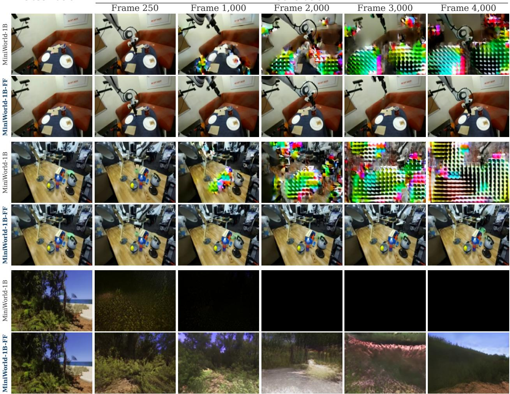
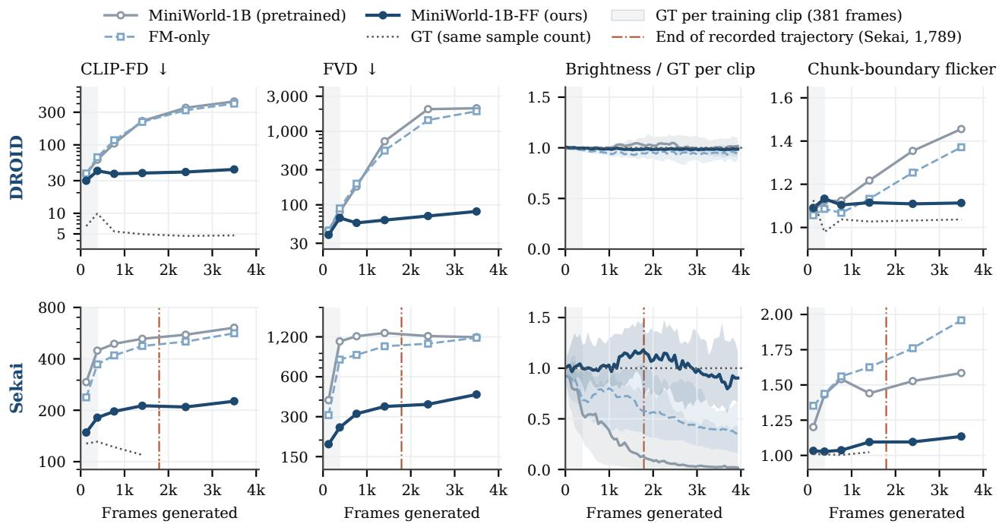
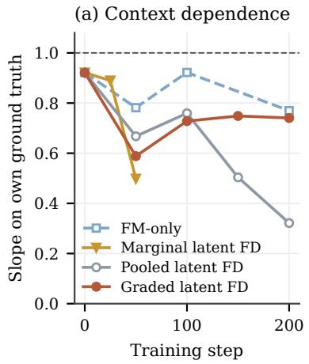
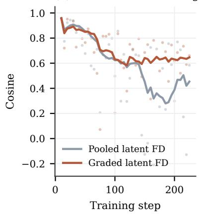
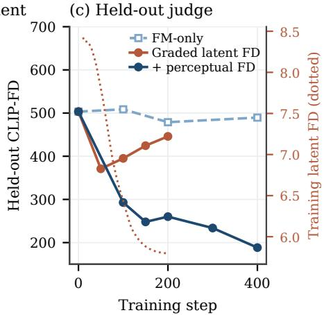

# Frechet Forcing: Training Long-Horizon Streaming´ World Models from Short Clips

Yian Zhao, Yu Yan, Hongcan Guo, Ruochong Zheng, Jian Zhang, Jie Chen

## Abstract

Streaming video world models generate the future chunk by chunk, conditioned on their own past and a stream of actions. When trained on short clips, they drift once a rollout exceeds the training horizon, as prediction errors re-enter the context and compound. A common remedy is to train the model on its own rollouts via distribution matching distillation (DMD). For action-conditioned world models, however, the teacher becomes a bottleneck: an external video model is agnostic to the actions, whereas the model’s own pretrained network drifts in the same manner as the student. We observe that a long rollout need not match a teacher, provided it remains a realistic continuation of its own scene that follows the commanded actions. Realism and scene fidelity can be measured directly against real-data statistics, which remain valid at any horizon, while action following is preserved by the model’s conditional generation loss. Building on this insight, we propose Fréchet Forcing, which fine-tunes a world model together with its deployed multi-step sampler under three complementary constraints. Generative anchoring applies the flow-matching loss after a self-generated history ending on real data, preserving action-conditioned generation. Context fidelity, a Fréchet distance (FD) on latent statistics of the free rollout centred on each clip’s own ground truth, keeps every rollout faithful to its scene. Reality matching, an FD to real frames in a frozen perceptual space, keeps the generated frames realistic. Because all three targets are derived from short real clips without comparing a rollout against a long recorded future, training requires no teacher, no online critic and no long videos. Fine-tuning MiniWorld-1B, pretrained on 253-frame clips, for at most 36 GPU-hours on 381-frame clips yields rollouts that remain stable beyond 4,000 frames and continue to follow their actions in both robot manipulation (DROID) and camera-controlled exploration (Sekai). On DROID, PSNR against a forward-backward episode replay stays above 21 dB through frame 4,000, compared with 8.9 dB for the base model. An analysis of the training dynamics further reveals how distribution matching on free rollouts fails and how each design choice prevents these failure modes.

Code: https://github.com/zhao-yian/Frechet\_Forcing

Models: https://huggingface.co/zhaoyian01/Frechet\_Forcing

Page & Demo: https://zhao-yian.github.io/Frechet\_Forcing

  
Figure 1 4,000-frame chunk-by-chunk rollouts from a single real frame on two DROID episodes (top four rows) and one Sekai scene (bottom two rows), following the commanded robot or camera trajectory. MiniWorld-1B, pretrained on 253-frame clips, cannot sustain longer rollouts: on DROID, saturated lattice texture spreads from the moving arm within 1,000 frames, and on Sekai the rollout darkens within the first 250 frames and then fades to black. MiniWorld-1B-FF, fine-tuned with Fréchet Forcing on 381-frame clips, stays coherent to frame 4,000, over 10× the fine-tuning horizon.

## 1 Introduction

World models that generate video in a streaming fashion, with each chunk conditioned on previously generated chunks and on an action, provide a natural substrate for interactive simulation, game engines and embodied agents [1, 5, 6, 10, 15, 34, 45]. However, because they are trained on ground-truth history and deployed autoregressively on their own predictions [4], small errors re-enter the context and compound over time. Rollouts therefore remain coherent for roughly the length of the training clips before drifting, fading to black or dissolving into texture (Fig. 1). This long-horizon drift remains the central obstacle to sustained streaming generation [7, 15, 40].

The prevailing strategy to close this train-test gap is to train the model on its own rollouts. Because a self-generated rollout has no paired ground truth beyond the first few seconds, supervision must be distributional, and recent work has largely converged on distribution matching distillation (DMD) [15, 43–45], where the diference between a frozen teacher’s score and an online “fake” score of the student on noised student samples provides the training gradient. State-of-the-art systems reach minute-scale video by extending DMD to longer rollouts, rolling windows and chunk-wise scoring [7, 8, 24, 40]. Teacher-free alternatives instead retain a per-sample regression target by conditioning the flow-matching or difusion loss on a history corrupted by the model’s own errors [9, 20, 41], or by reversing rollouts so that they end on or recover the ground-truth start [14, 29].

For action-conditioned world models, however, the teacher poses a fundamental dilemma. An efective teacher must simultaneously model the student’s domain and action space while remaining more accurate than the student on the states the student visits. A large external video model violates the first requirement, as it is agnostic to the action signal and pulls rollouts towards a mismatched distribution. Conversely, the world model’s own pretrained network satisfies the first requirement but violates the second: it is the very model whose rollouts drift, so on long-horizon states its score agrees with the student and provides no corrective signal. In our experiments, neither choice improved over the base model across a broad range of configurations. Per-sample teacher-free objectives avoid the teacher altogether, yet they supervise only states that can be paired with ground truth, where a degraded history is followed by its recorded continuation or a reversed rollout recovers its recorded start. Because the regression target always lies within a recorded clip, the states a rollout visits thousands of frames later are never supervised directly.

We take a diferent view of the supervision required for long rollouts. Rather than matching a teacher or a paired recording, a rollout must remain a realistic continuation of its own scene while following the commanded actions. These properties call for complementary training signals. Visual realism and scene fidelity are distributional properties of the rollout that can be evaluated against real data at any horizon, because the distribution of real frames is fixed, compact to summarise and, unlike a learned score, equally valid one second or one minute into a rollout. Action following, by contrast, is a property of conditional generation that the model’s pretraining loss already supervises. Fréchet Forcing therefore fine-tunes free rollouts generated directly by the deployed sampler to minimise Fréchet distances (FD) to real-data statistics while retaining the conditional generation loss. Running moment estimates [38] render the FD diferentiable at a batch size of one per GPU, and truncated backpropagation through the final chunks keeps rollout training computationally tractable. Specifically, our objective combines three constraints, each targeting one essential property of a long rollout. Generative anchoring preserves action-conditioned generation by applying the flow-matching (FM) loss after a self-generated history ending on real data, exposing FM to the model’s accumulated errors while keeping the regression target exact. Context fidelity keeps each rollout faithful to its initial scene through an FD on latent statistics centred on the clip’s own ground truth. Reality matching enforces frame-level realism through an FD to real frames in a frozen self-supervised feature space, penalising the dark, washed-out and tiled artifacts

towards which long rollouts otherwise drift.

Because none of the three constraints compares a rollout against a long recorded future, long-horizon training no longer requires long videos. Generative anchoring regresses a short real window after a re-rendered history, context fidelity compares the final chunks of a 317- frame rollout against the corresponding span of its own clip, and reality matching compares generated frames against a population of real frames. Every training sample is a 381-frame clip, and long-horizon drift is suppressed by supervising the states that the model reaches and learns to correct within these rollouts. At deployment, the rollout extends for as long as the action stream that drives it. We validate Fréchet Forcing on MiniWorld-1B [47], a block-causal world model pretrained on 253-frame clips, across two distinct domains. After fine-tuning on 381-frame clips, its rollouts remain stable beyond 4,000 frames, over 10× the pretraining horizon, in both robot manipulation on DROID and camera-controlled exploration on Sekai (Fig. 1).

Naive distribution matching on free rollouts fails in instructive ways. We analyse its training dynamics with three diagnostic probes that track whether outputs remain dependent on their context, whether gradients align with the required statistical correction, and whether an external perceptual judge agrees with the training objective (§5, Fig. 3). This analysis reveals three distinct failure modes: matching a marginal FD pulls every rollout towards a datasetaverage appearance (context decoupling), pooling statistics over the entire rollout forces the gradient-carrying tail to compensate for the detached prefix (gradient-statistic misalignment), and matching a low-order feature space admits degenerate frames that do not resemble real images (feature-space exploitation). The critical design choices are therefore where a rollout is scored and in which feature space: context fidelity scores clip-centred statistics solely on the gradient-carrying chunks, while reality matching provides a semantic feature space, making the two distributional constraints mutually complementary. Our analysis also uncovers a failure mode specific to training on self-generated history: when a re-rendered history does not meet the real target smoothly, the model learns to redraw the scene at every chunk boundary. We quantify this periodic redraw with a dedicated chunk-boundary flicker metric and eliminate it by ending the history on a single real chunk.

In summary, our contributions are threefold:

• We propose Fréchet Forcing, to our knowledge the first method that trains a streaming video world model on its own rollouts using Fréchet-distance objectives against real data. It requires no teacher, no online critic and no long videos, and fine-tunes the deployed multi-step sampler without modification.

• We analyse distribution matching on free rollouts to identify three distributional failure modes (context decoupling, gradient-statistic misalignment and feature-space exploitation) alongside chunk-boundary redraw induced by self-generated history, and derive the exact design choice that resolves each.

• Using a single hyperparameter recipe and at most 36 GPU-hours of fine-tuning on 381- frame clips, Fréchet Forcing extends the stable horizon of a 1B world model pretrained on 253-frame clips beyond 4,000 frames in two domains, reducing last-bin FVD by 25× on DROID and 2.7× on Sekai while preserving action following.

## 2 Related Work

Autoregressive and streaming video generation. Large-scale video difusion transformers [18, 28, 35, 42] synthesise full clips with bidirectional attention, whereas interactive world models and neural game engines [1, 5, 10, 11, 34] must generate observations causally under online control. Difusion Forcing [6] assigns independent noise levels to chunks so that a model can denoise the future while conditioning on a cleaner past, forming the foundation of most streaming world models. CausVid [45] and Self Forcing [15] train on self-generated history with DMD [43, 44], distilling a bidirectional teacher into a few-step causal student. MiniWorld [47] is instead a causal world model trained from scratch, using a block-causal DiT trained with difusion forcing under a non-decreasing chunk noise schedule and deployed with a rolling KV cache. Action-conditioned video models also serve as simulators for navigation and robot manipulation [3, 26, 39]. Because they are trained on short recorded episodes, a rollout that extends far beyond an episode has neither training data nor a recorded ground-truth reference.

Long-horizon generation. Training-free methods act on the context through attention sinks [37], rolling windows and diagonal schedules [17, 31], history compression [46], history guidance [32] or spectral anchoring [19]. Our sampler already incorporates an attention sink, a rolling cache and a staircase schedule, yet still drifts without fine-tuning. Trainingbased methods predominantly build on DMD. Self-Forcing++ [7], Rolling Forcing [24] and LongLive [40] train on rollouts longer than the teacher’s clips by scoring windowed segments. OPSD-V [23] supplies the teacher with a cleaner cache, CMD [2] employs a causal teacher conditioned on the student’s context, and RMD [8] scores each chunk independently so that the teacher does not preserve artifacts from the generated history. All of these methods rely on a pretrained teacher and an online critic to train a few-step generator. Teacher-free methods instead retain the difusion or flow-matching loss while modifying its conditioning. The first family conditions the loss on a history corrupted by the model’s own errors: Resampling Forcing [9] re-noises the ground-truth history and denoises it with the model itself, Stable Video Infinity [20] injects banked model errors into clean inputs, and AR Forcing [41] feeds the model’s predictions back into the context of a navigation world model. The second family exploits time reversal: BAgger [29] reverses the model’s drifted rollouts into corrective trajectories ending on real frames, and LIVE [14] reverses a rollout under reversed actions to apply the loss against the recovered ground-truth start. In both families, the regression target remains a recorded frame, restricting supervision to states that can be paired with ground truth.

Distributional objectives. FID [13] and FVD [33] are standard evaluation metrics for generative models. Optimising them directly was long considered impractical because estimating a high-dimensional covariance requires far more samples than a single training batch provides. Yang et al. [38] decouple the population size from the batch size using running moment estimates and show that the resulting loss efectively trains image generators. We bring this principle to streaming video world models, where the samples are rollout chunks, gradients are truncated in time, and the primary failure modes are temporal.

## 3 Frechet Forcing´

## 3.1 Setting

Our experiments build on the open-source MiniWorld codebase and its released checkpoints [47]. We consider a block-causal video DiT [28] over VAE latents that generates latent chunks conditioned on a KV cache of past chunks and per-frame actions, such as camera poses or robot commands. The model is pretrained with difusion forcing and deployed with a streaming sampler that maintains several chunks in flight at staggered noise levels. Our only requirement is that this sampler is diferentiable, and neither the model architecture nor the sampler is modified. The training data consist of short real clips paired with actions, each slightly longer than a single training rollout, whereas deployment rollouts are unbounded in length.

## 3.2 Three constraints

A long rollout remains efective only if it satisfies three requirements that no single objective can enforce alone. First, the model must remain a faithful conditional generator, where every chunk continues its history and follows its commanded action. Second, each rollout must remain faithful to its own scene: a trajectory starting in a dusk forest should still depict that forest a thousand frames later rather than collapsing to a dataset-average appearance. Third, the generated frames must remain realistic, free from darkening, washing out or periodic tiling. Fréchet Forcing addresses each requirement with a dedicated constraint,

$$
\mathcal { L } = \underbrace { \mathcal { L } _ { \mathrm { a n c } } } _ { \mathrm { g e n e r a t i v e ~ a n c h o r i n g } } + \underbrace { \mathcal { L } _ { \mathrm { c t x } } } _ { \mathrm { c o n t e x t ~ f i d e l i t y } } + \underbrace { \mathcal { L } _ { \mathrm { r e a l } } } _ { \mathrm { r e a l i t y ~ m a t c h i n g } } ,\tag{1}
$$

combined with unit weights throughout. Generative anchoring is a regression loss on real clips applied over a short window of chunks, whereas context fidelity and reality matching are distributional losses applied directly to free rollouts of the deployed sampler, where long-horizon drift actually emerges.

## 3.3 Generative anchoring

Fine-tuning on rollout statistics alone allows the model to drift away from its core role as an action-conditioned generator that continues a given history. Generative anchoring retains the pretraining flow-matching (FM) objective [22, 25], but conditions it on a history that carries the model’s own prediction errors, following the self-resampling scheme of Resampling Forcing [9] with one essential modification regarding how the history terminates. From a real clip x, we draw a history length $c \sim U [ 1 , N ]$ , noise the first c chunks to $t _ { a } = 0 . 7$ and denoise them with the deployed staircase sampler without gradients. Because each chunk retains roughly 30% of its clean signal, its content remains anchored to the clip, yet being re-rendered autoregressively on preceding re-renderings imbues the history with the model’s own rollout errors. The FM loss is then applied to the subsequent $W = 4$ real chunks:

$$
\mathcal { L } _ { \mathrm { a n c } } = \mathbb { E } _ { t , \epsilon } \left\| v _ { \theta } ( x _ { c : c + W } ^ { t } \mid h _ { c } , a ) - ( \epsilon - x _ { c : c + W } ) \right\| ^ { 2 } , \qquad h _ { c } = \left[ \mathrm { ~ s g ~ } S ( G , x _ { < c - 1 } ^ { t _ { a } } , a ) , \ x _ { c - 1 } \right] ,\tag{2}
$$

where $x ^ { t } = ( 1 - t ) x + t \epsilon$ with per-chunk noise levels drawn as in pretraining, sg denotes the stop-gradient operator, and $S ( G , \cdot )$ runs the deployed sampler with model G starting from noise level $t _ { a }$

The history must end on real data. Crucially, the final chunk of $h _ { c }$ is the clean real chunk $x _ { c - 1 }$ rather than its re-rendered counterpart $\tilde { x } _ { c - 1 }$ . At noise level $t _ { a } = 0 . 7$ , the model alters mid-scale spatial structures such as the outline of a tree canopy or a cloud bank, causing $\tilde { x } _ { c - 1 }$ to deviate from $x _ { c - 1 }$ at the scale of image blocks. Because the FM target is the true continuation of $x _ { c - 1 }$ , which cannot be inferred consistently from $\tilde { x } _ { c - 1 }$ , the loss-minimising strategy under a fully re-rendered history is not to continue the preceding frames smoothly, but to redraw a fresh version of the scene. A model trained in this manner learns to redraw the scene at every chunk boundary, producing severe block-scale flicker at the chunk period (§5.4). Because temporal continuity across the seam is a local relation between the target window and the end of its history, restoring only the final chunk $x _ { c - 1 }$ resolves this contradiction while the preceding $c - 1$ chunks still expose the model to its own errors. Ending the history on real data also lowers the median FM loss from 0.26 to 0.15 over the first 150 training steps, confirming that a large fraction of the loss was previously dominated by this irreducible boundary mismatch.

## 3.4 Distribution matching on free rollouts

Context fidelity and reality matching share a common rollout mechanism. At each training step, the model rolls out N chunks autoregressively from a single real context latent using the deployed sampler. Only the final K sampler steps are retained in the autograd graph, and completed chunks enter the KV cache detached. Gradients therefore flow only into the last K chunks, reaching the newest chunk through its full denoising trajectory and earlier chunks through progressively shorter sufixes, without backpropagating through the history. The detached prefix serves to bring the model to the states it visits during deployment rather than acting as a direct optimisation target. Each distributional term embeds the gradient-carrying chunks with a frozen feature extractor, gathers the resulting features across GPUs and matches their first and second moments to those of real data.

Let $\left( \mu _ { r } , \Sigma _ { r } \right)$ denote the reference mean and covariance of a feature map $\phi$ on real data, and let $\{ f _ { i } \} _ { i = 1 } ^ { n }$ denote the features extracted from the gradient-carrying rollout chunks across all GPUs at the current step, with batch moments $\textstyle \mu _ { \mathrm { b } } = { \frac { 1 } { n } } \sum _ { i = 1 } ^ { n } f _ { i }$ and $\begin{array} { r } { M _ { \mathrm { b } } = \frac { 1 } { n } \sum _ { i = 1 } ^ { n } f _ { i } f _ { i } ^ { \intercal } } \end{array}$ Because a single step yields at most a few hundred feature vectors, which is insuficient for a full-rank covariance estimate in hundreds of dimensions, we follow Yang et al. [38] and decouple the efective population size from the batch size. Specifically, we maintain exponential moving averages (EMA) of the first and second moments $( \bar { \mu } , \bar { M } )$ with decay rate $\beta ,$ diferentiate solely through the current batch, and recover the covariance Σ from the updated moments:

$$
\mu = \beta \mathrm { ~ s g } ( \bar { \mu } ) + ( 1 - \beta ) \mu _ { \mathrm { b } } , \qquad M = \beta \mathrm { ~ s g } ( \bar { M } ) + ( 1 - \beta ) M _ { \mathrm { b } } ,\tag{3}
$$

$$
\Sigma = M - \mu \mu ^ { \intercal } , \qquad { \mathrm { F D } } ( \mu , \Sigma ) = \| \mu - \mu _ { r } \| _ { 2 } ^ { 2 } + { \mathrm { t r } } \big ( \Sigma + \Sigma _ { r } - 2 \big ( \Sigma _ { r } ^ { 1 / 2 } \Sigma \Sigma _ { r } ^ { 1 / 2 } \big ) ^ { 1 / 2 } \big ) .\tag{4}
$$

After each step, the running bufers are updated as $( \bar { \mu } , \bar { M } )  ( \mathrm { s g } ( \mu ) , \mathrm { s g } ( M ) )$ , providing an efective sample horizon of $1 / ( 1 - \beta )$ steps without storing past features. Each distributional constraint is then optimised via the self-normalised objective $\mathcal { L } _ { \phi } = \mathrm { F D / s g ( F D ) }$ (fd / fd.detach() in Algorithm 1) [38]. Detaching the denominator fixes the forward value to 1 and yields the backward gradient ∇FD/ sg(FD) = ∇ log FD, which preserves the gradient direction of FD while normalising its magnitude by the current distance. This self-normalisation makes the loss invariant to the scale and dimensionality of $\phi ,$ prevents the distributional gradients from vanishing relative to $\mathcal { L } _ { \mathrm { a n c } }$ as FD decreases, and allows the three terms in Eq. (1) to be combined with unit weights.

## 3.5 Reality matching

Enforcing frame-level realism. To compute $\mathcal { L } _ { \mathrm { r e a l } }$ , the last $D \leq K$ chunks are decoded to pixels, temporally sub-sampled and embedded using the CLS token of a frozen DINOv2 ViT-B/14 [27], where $\mathcal { L } _ { \mathrm { r e a l } }$ is the self-normalised FD between these embeddings and those of real frames. Because a self-supervised perceptual representation captures semantic structure rather than low-level pixel statistics, dark, washed-out or periodically tiled frames lie far from the real distribution, ruling out the degenerate solutions that satisfy low-order moments (§5.3). Since generated latents pass through the VAE decoder before reaching DINOv2, we compute the reference moments on VAE reconstructions of real latents, decoded with the exact same window span and temporal stride as during training, rather than on raw video. Using raw video as the reference would include the VAE’s reconstruction gap, which the latent generator cannot close and would otherwise attempt to compensate for by hallucinating high-frequency artifacts. Furthermore, because the VAE decoder is temporal and causal, the beginning of a decoded window behaves diferently from subsequent frames: the first latent decodes to a single frame rather than four, and the second latent reflects cache warm-up. We therefore decode one extra chunk immediately preceding the scored window and discard its frames in both rollouts and reference precomputation, ensuring that all scored frames share identical decoder statistics.

## 3.6 Context fidelity

Preserving scene identity. Because reality matching operates on the marginal distribution of frames across clips, it is satisfied whenever the pooled frames look realistic as a population and cannot verify whether an individual rollout remains faithful to its initial scene. Context fidelity enforces scene consistency by conditioning the statistical comparison on each clip. Every latent in the gradient-carrying chunks is summarised by the spatial mean and standard deviation of each channel, where the standard deviation makes the representation sensitive to both spatial smoothing and high-frequency noise. Summaries of two consecutive latents are concatenated into a single feature vector $\psi _ { : }$ so that their cross-latent covariance captures temporal evolution and penalises frozen, flickering or discontinuous transitions that singlelatent statistics would overlook. We then centre the rollout features by subtracting the mean feature of the clip’s own ground truth over the corresponding temporal span,

$$
h = \psi ( z _ { N - K : N } ) - \overline { { { \psi ( x _ { N - K : N } ) } } } ,\tag{5}
$$

and define $\mathcal { L } _ { \mathrm { c t x } }$ as the self-normalised FD between h and real video segments of the same span, each centred on its own segment mean. Centring converts a marginal population metric into a clip-conditional one. A rollout that remains faithful to its scene exhibits within-clip deviations distributed like those of natural video around its mean, whereas a drifting rollout produces systematic residuals: consistent biases across clips, such as global darkening, shift the mean term, while clip-specific drifts inflate the covariance beyond the natural within segment variation of real video. Crucially, neither error can be reduced by pulling rollouts towards a dataset-average appearance, because every residual is measured relative to the clip’s own ground truth. Operating in latent space is a practical convenience rather than a strict requirement, as applying the same clip-centred FD to low-order pixel statistics of decoded frames is also efective (§5.5). Algorithm 1 summarises a complete training step.

## 3.7 Relation to prior training signals

Table 1 compares Fréchet Forcing with prior approaches that train on self-generated rollouts or histories. DMD-based methods [7, 8, 15, 40] define supervision through the score of a pretrained teacher. Consequently, the training signal is valid only on states where the teacher itself is reliable, requires an online critic network, and is tailored to few-step distillation. RMD modifies where the teacher is evaluated by scoring individual chunks, but retains the teacher’s score as the target. Teacher-free methods [9, 14, 20, 29, 41] replace the teacher with per-sample regression to ground truth, which restricts supervision to states that can be paired with recorded frames. Specifically, self-history methods regress the recorded continuation of a degraded history while detaching the history itself, meaning that the rollout is exposed to the loss but receives no direct gradient. Reversal-based methods require time-reversible environment dynamics and apply the regression loss at the recovered initial state rather than along the forward rollout. In contrast, Fréchet Forcing defines its targets via precomputed statistics of real data and applies them directly to free rollouts of the deployed sampler, with gradients propagating into the generated chunks. Because no frame-level pairing is required, the distributional targets remain valid at arbitrary horizons, and all auxiliary feature networks remain frozen in inference mode. Within our framework, generative anchoring belongs to the self-history family, while context fidelity and reality matching provide the direct rollout supervision that per-sample regression lacks.

Two recent findings in the literature align closely with our formulation. First, LIVE observes that sequence-level distribution matching permits unbounded drift [14]. Our analysis traces this phenomenon to marginal distribution matching, which allows rollouts to collapse towards a dataset-average appearance (§5.1), and shows that context fidelity prevents it by centring the statistics on each clip. Second, RMD argues that rollout chunks should be scored independently

Algorithm 1 One training step of Fréchet Forcing.

# G: streaming world model; S: deployed streaming sampler   
# Dec: frozen VAE decoder; phi: frozen DINOv2; psi: latent moments   
# ref\_ctx, ref\_real: real-data moments (mu\_r, sig\_r)   
# ema\_ctx, ema\_real: running 1st and 2nd moments (mu\_bar, M\_bar); beta: EMA decay   
x, a = sample\_clip() # real latents and their actions   
# Generative anchoring: FM after a self-denoised history   
c = randint(1, N)   
hist = S(G, renoise(x[:c], t=t\_a), a).detach()   
hist[-1] = x[c-1] # the history ends on real data   
L\_anc = flow\_matching(G, x[c:c+W], hist, a)   
# Free rollout from one real latent; only the last K chunks carry gradients   
z = S(G, x[0], a)[-K:]   
x\_z = x[N-K:N] # ground truth over the same span   
# Context fidelity: latent moments centred on the clip’s own ground truth   
L\_ctx = FD\_ema(psi(z) - psi(x\_z).mean(0), ref\_ctx, ema\_ctx)   
# Reality matching: perceptual moments of decoded frames   
L\_real = FD\_ema(phi(Dec(z)), ref\_real, ema\_real)   
(L\_anc + L\_ctx + L\_real).backward()   
optimizer.step()   
# Normalised FD with EMA of 1st and 2nd moments   
def FD\_ema(f, ref, ema):   
f = all\_gather(f) # gather features across GPUs   
mu\_b, M\_b = f.mean(0), f.T @ f / len(f)   
mu = beta \* ema.mu.detach() + (1 - beta) \* mu\_b   
M = beta \* ema.M.detach() + (1 - beta) \* M\_b   
sig = M - mu @ mu.T # covariance from 1st and 2nd moments   
ema.mu, ema.M = mu.detach(), M.detach()   
fd = FD((mu, sig), ref)   
return fd / fd.detach()

of their degraded context [8]. Reality matching achieves an analogous context-free signal by scoring individual frames against a real frame population without requiring a teacher.

## 4 Experiments

We fine-tune MiniWorld-1B with Fréchet Forcing using a single recipe across two domains, robot manipulation on DROID and camera-controlled exploration on Sekai, and evaluate both under a unified protocol up to frame 4,001. After describing the experimental setup (§4.1), we evaluate whether long rollouts remain realistic and stable (§4.2) and whether they maintain action controllability over the horizon (§4.3).

Table 1 Comparison of training signals for self-generated rollouts or histories. Categories include DMD (Self Forcing [15]), long-horizon DMD (Self-Forcing++ [7], Rolling Forcing [24] and LongLive [40]), RMD [8], self-history (Resampling Forcing [9], SVI [20] and AR Forcing [41]), and reversal (BAgger [29] and LIVE [14]). GT denotes ground truth.
<table><tr><td></td><td>DMD</td><td>long-horizon DMD</td><td>RMD</td><td>self-history</td><td>reversal</td><td>Ours</td></tr><tr><td rowspan="2">Target</td><td>teacher</td><td>teacher score</td><td>per-chunk</td><td>GT</td><td>GT</td><td>real-data</td></tr><tr><td>score</td><td>on windows</td><td>teacher score</td><td>continuation</td><td>start</td><td>moments</td></tr><tr><td>Teacher-free</td><td>X</td><td>X</td><td>X</td><td></td><td></td><td></td></tr><tr><td>Critic-free</td><td>X</td><td>X</td><td>X</td><td></td><td></td><td></td></tr><tr><td>Gradient into the rollout</td><td>V</td><td>V</td><td>V</td><td>X</td><td>X</td><td></td></tr><tr><td>Original sampler kept</td><td>X</td><td>X</td><td>X</td><td></td><td></td><td></td></tr><tr><td>Extra requirement</td><td></td><td></td><td>chunk-adapted</td><td></td><td></td><td>reversible reference</td></tr><tr><td></td><td></td><td></td><td>teacher</td><td></td><td>dynamics statistics</td><td></td></tr></table>

## 4.1 Setup

Model. MiniWorld-1B [47] is a block-causal DiT over Wan2.2 VAE latents [35] (48 channels, $1 5 \times 2 0$ spatial latents for 240 × 320 frames, 4× temporal compression) operating on chunks of two latents. We start from the released domain-specific checkpoints [47], pretrained with difusion forcing on clips of up to 64 latents (253 frames). At inference, the model uses a staircase sampler with 8 denoising steps per chunk, 8 chunks in flight, a rolling KV cache of 24 chunks and a one-frame attention sink. Because the attended window never exceeds the pretrained positional range, long-horizon degradation stems from error accumulation in the context rather than positional extrapolation. Since frame rate afects only playback speed, we report all horizons in frames.

Data. DROID [16] consists of robot manipulation videos from the primary exterior camera at 15 fps, conditioned on the commanded absolute end-efector pose in the robot base frame and the gripper state, normalised by dataset quantiles. Episodes are short, with a median length of 209 frames. We fine-tune on the 8,958 successful episodes that are long enough to form a training clip, and reserve 2,774 episodes for evaluation. Sekai [21] consists of game navigation videos paired with camera poses, injected as per-pixel Plücker ray encodings [12], recorded at 30 fps and used without temporal sub-sampling. We partition the dataset by source video into 1,462 training and 156 held-out clips of 1,800 frames, computing all reference statistics exclusively on the training split.

Training. We fine-tune all model parameters using AdamW $( \beta = ( 0 . 9 , 0 . 9 5 ) )$ , a learning rate of $1 0 ^ { - 6 }$ with a 100-step linear warm-up followed by a constant schedule, and gradient norm clipping at 1.0, with one 96-latent (381-frame) clip per GPU across 8 GPUs. These 381-frame clips constitute the only ground-truth data used during fine-tuning and the longest videos the model ever observes. Free rollouts span N = 40 chunks (317 frames) with gradients propagated through the final K = 8 chunks. For reality matching, the last D = 4 chunks are decoded together with the immediately preceding chunk, whose frames are discarded, and every second remaining frame is embedded at 224 × 308 resolution. The latent reference statistics are computed on 16-latent real segments matching the span of the K gradient carrying chunks, and the DINOv2 reference statistics are computed on VAE-reconstructed training frames (52k latent windows from 4,000 episodes and 108k frames from 800 episodes on DROID, and 26k latent windows from 2,000 segments and 54k frames from 400 clips on Sekai). Each FD estimator maintains running moments with $\beta = 0 . 9 9$ , initialised from 16 gradient-free rollouts. Because each GPU rank diferentiates only through its local features before gradients are averaged across ranks, the implemented loss scales by the world size W as $W \cdot \mathrm { F D } / ( \mathrm { s g } ( \mathrm { F D } ) + 0 . 0 1 )$ . For generative anchoring, the 4-chunk FM window follows a history of $c \sim U [ 1 , 4 0 ]$ chunks obtained by noising the real clip to $t _ { a } = 0 . 7$ and denoising it along the last four rungs of the deployed staircase, with the final history chunk replaced by the clean ground-truth chunk. All hyperparameters are identical across both domains. Fine-tuning requires only 225 steps, taking 4.2 hours on DROID and 4.5 hours on Sekai on 8 GPUs (34 and 36 GPU-hours at roughly 68 s and 72 s per step) with no teacher network in memory.

Long-horizon evaluation protocol. In each domain, we evaluate 32 held-out clips evenly spaced across the test set, rolling each out once from a single real context latent for at least 1,001 latents (4,001 frames) using identical action sequences and random seeds across all compared models. Because no recording in either dataset reaches 4,000 frames, we construct long-horizon action trajectories and ground-truth (GT) references as follows. DROID. Actions represent absolute end-efector poses under a fixed camera. Because a pick-and-place trajectory played in reverse remains a valid manipulation sequence, alternating an episode forwards and backwards yields a physically plausible reference video of arbitrary length, whose frames in that order serve as GT. We drive the model along the same forward-backward trajectory: forward steps use the recorded commands directly, while a backward step targeting frame j uses the command recorded four frames prior to j to account for the empirical actuation lag. From the 481 held-out episodes of 240 to 600 frames involving reversible object displacements (excluding actions such as pouring, wiping, folding or opening), we roll out 32 evenly spaced episodes from their initial frame for 1,024 latents (4,093 frames). This replay GT provides an approximate reference, as a manipulated object need not return to its exact initial pose after release. Sekai. Each clip is rolled out from a single context latent along its recorded 1,789-frame camera trajectory, and continued beyond frame 1,789 by concatenating the relative camera motions of subsequent held-out clips up to 1,001 latents, with GT available for the first 1,789 frames. A second protocol rolls out the same 32 clips for 1,789 frames along their recorded trajectories with independent noise, providing full-length GT for the action-following evaluation, ablations and training-dynamics analysis (§5).

Metrics. All metrics are evaluated across six shared horizon bins by pooling frames across the 32 rollouts: frames 1–253 (the pretraining horizon), 253–509, 509–1,021, 1,021–1,789, 1,789–2,997 and 2,997–4,001. None of the evaluation backbones is used during training. CLIP-FD [30] embeds every eighth frame with CLIP ViT-B/16 and measures the FD against real reference frames (all reconstructed frames of the 32 GT episodes on DROID, and 54k reconstructed training frames on Sekai). Because finite-sample FD depends on sample size, we report each bin alongside the CLIP-FD of the GT frames at the exact same sample count wherever GT is available. FVD is computed with I3D [33] over non-overlapping 16- frame windows against the corresponding GT windows. Brightness is reported as the ratio of mean luma to that of GT. Chunk-boundary flicker measures the mean absolute change in $1 6 \times 1 6 \mathrm { - p o o l e d }$ luma across chunk boundaries relative to the change between adjacent frames within a latent, averaged geometrically over rollouts (§5.4), where GT scores 0.98– 1.13. Action following is evaluated on DROID via frame-wise PSNR against the replay GT, capturing preservation of the scene, robot arm and manipulated objects, and on Sekai via camera trajectories estimated by VGGT [36]. Specifically, on Sekai we measure both the Pearson correlation $r$ between estimated and commanded yaw over 48-frame windows and, on counterfactually forked left and right turn branches, the percentage of branches that turn in the commanded direction and the fraction of the commanded angle they achieve. All real references use VAE reconstructions so that VAE compression error does not confound model comparisons. Finally, because population metrics can mask rare localised failures, we additionally generate 4,001-frame rollouts on 96 evenly spaced held-out DROID episodes with MiniWorld-1B-FF (and eight with MiniWorld-1B) and manually inspect each video for visual artifacts.

Baselines. We compare MiniWorld-1B-FF (MiniWorld-1B fine-tuned with Fréchet Forcing) against the pretrained MiniWorld-1B model and an FM-only baseline that uses the exact same training clips, self-denoised history and schedule, thereby isolating the contribution of the distributional constraints. On DROID, FM-only uses the full generative anchoring formulation for the same 225 steps, difering from Fréchet Forcing solely by omitting $\mathcal { L } _ { \mathrm { c t x } }$ and $\mathcal { L } _ { \mathrm { r e a l } }$ . On Sekai, FM-only uses generative anchoring with the history re-rendered to the end $\left( \ S 5 . 4 \right)$ . We omit DMD baselines because none of the DMD configurations we evaluated improved over the base model.

## 4.2 Realism and stability over 4,000 frames

Figure 2 and Table 2 evaluate the three models across 4,001 frames in both domains. Although MiniWorld-1B exhibits domain-specific degradation patterns, its failure onset is identical: in both domains, quality deteriorates sharply from the second bin onwards, immediately after the rollout exceeds its 253-frame pretraining horizon, and never recovers. With Fréchet Forcing, every metric on DROID remains nearly flat from the second bin through frame 4,001, and CLIP-FD on Sekai plateaus after the first 500 frames.

DROID. For MiniWorld-1B, CLIP-FD rises from 38 in the first 253 frames to 431 in frames 2,997–4,001, FVD increases from 45 to 2,058 and chunk-boundary flicker grows from 1.08 to 1.46 as saturated lattice artifacts spread outward from the moving robot arm (Fig. 1). Because mean brightness stays near 1.00, the degradation on DROID manifests as spatial texture corruption rather than exposure drift. In contrast, MiniWorld-1B-FF sustains coherent rollouts beyond 4,000 frames: across all six bins, CLIP-FD remains within 30–44 and FVD within 39–81, achieving 10× lower CLIP-FD and 25× lower FVD than MiniWorld-1B in the final bin. Brightness stays within 2% of GT and flicker stays between 1.09 and 1.13, matching the GT range of 0.98–1.13. Notably, DROID provides a stringent test of training without long videos: its median episode is shorter than a single fine-tuning clip, yet the evaluated rollouts extend to 16× the pretraining horizon and over 10× the fine-tuning clip length.

  
Figure 2 Long rollouts on 32 held-out DROID episodes (top) and Sekai clips (bottom), in the horizon bins of Table 2. CLIP-FD, FVD and flicker are pooled over rollouts per bin, and dotted lines show GT at the same sample count for CLIP-FD where GT exists. Brightness is computed per rollout relative to the mean of its own GT in 60-frame windows, showing the median and interquartile range over rollouts. The shaded region marks the 381 frames of ground truth in each training clip of Fréchet Forcing, whereas MiniWorld-1B was pretrained on 253-frame clips. On Sekai the recorded camera trajectory ends at frame 1,789 and continues with the relative motion of other held-out clips.

Sekai. On Sekai, MiniWorld-1B rollouts progressively darken and dissolve into noise: relative brightness drops from 0.89 in the first 253 frames to 0.40 in frames 2,997–4,001, CLIP-FD rises from 292 to 609, FVD exceeds 1,100 from frame 253 onwards, and flicker increases from 1.20 to 1.58. With MiniWorld-1B-FF, CLIP-FD remains stable between 197 and 226 from frame 509 onwards and exhibits no discontinuity at frame 1,789, where the camera transitions to concatenated held-out trajectories. Across all bins, brightness stays between 0.92 and 1.07 of GT and flicker remains between 1.03 and 1.13. In the final bin, both CLIP-FD (226 vs. 609) and FVD (441 vs. 1,193) are 2.7× lower than those of MiniWorld-1B. FVD still exhibits a gradual upward trend from 186 to 441 over the 4,000-frame horizon, a residual slow drift that we discuss in §6. The 1,789-frame recorded-trajectory protocol under independent noise confirms these gains in its final bin (CLIP-FD 226 vs. 504 and FVD 518 vs. 1,154 in Table 5).

Per-rollout inspection. Manual inspection of the 96 DROID rollouts confirms that population-level stability translates to individual trajectories: 98% of MiniWorld-1B-FF rollouts remain free of visible artifacts at frame 1,500, 95% at frame 2,500, 86% at frame 3,500 and 79% at frame 4,000. By contrast, in all eight inspected rollouts of MiniWorld-1B, lattice artifacts cover a large portion of the scene by frame 3,000. The artifacts that do appear in MiniWorld-1B-FF are strictly local, such as a manipulated colourful object or cloth turning into a saturated region or a faint periodic pattern emerging on a uniform tabletop, while the surrounding scene and robot arm remain intact. On Sekai, the per-rollout brightness quantiles in Fig. 2 show a similar improvement: at frame 4,000, 88% of MiniWorld-1B-FF rollouts retain at least half of their GT brightness, compared with only 19% for MiniWorld-1B and 28% for FM-only.

Table 2 Realism over the horizon on 32 held-out rollouts per domain, in bins of generated frames. MiniWorld-1B was pretrained on 253-frame clips and Fréchet Forcing fine-tunes on 381-frame clips. CLIP-FD is the Fréchet distance to real frames in CLIP space, reported next to that of GT with the same number of frames as the floor for each bin, and FVD uses I3D on 16-frame windows. Lower is better for both, while brightness is best at 1 and flicker at the GT’s value. On Sekai GT exists up to frame 1,789. In a paired bootstrap over rollouts (500 resamples), MiniWorld-1B-FF improves on the CLIP-FD of MiniWorld-1B in every bin of both domains in 100% of resamples, and on its FVD from frame 509 onwards on DROID and in every bin on Sekai in at least 97%.
<table><tr><td></td><td colspan="6">DROID</td><td colspan="6">Sekai</td></tr><tr><td></td><td>1–253 253–509 509–1k 1k-1.8k 1.8k–3k 3k–4k</td><td></td><td></td><td></td><td></td><td></td><td>1–253 253–509 509–1k 1k-1.8k 1.8k–3k 3k–4k</td><td></td><td></td><td></td><td></td><td></td></tr><tr><td colspan="9">CLIP-FD ↓</td><td></td><td></td><td></td><td></td></tr><tr><td>GT</td><td>6</td><td>10</td><td>5</td><td>5</td><td>5</td><td>5</td><td>128</td><td>131</td><td>122</td><td>110</td><td></td><td></td></tr><tr><td>MiniWorld-1B</td><td>38</td><td>61</td><td>105</td><td>223</td><td>348</td><td>431</td><td>292</td><td>447</td><td>490</td><td>524</td><td>554</td><td>609</td></tr><tr><td>FM-only</td><td>38</td><td>66</td><td>117</td><td>217</td><td>320</td><td>401</td><td>238</td><td>371</td><td>419</td><td>476</td><td>505</td><td>564</td></tr><tr><td>MiniWorld-1B-FF</td><td>30</td><td>42</td><td>38</td><td>39</td><td>40</td><td>44</td><td>148</td><td>181</td><td>197</td><td>213</td><td>209</td><td>226</td></tr><tr><td colspan="9">FVD ↓</td><td></td><td></td><td></td><td></td></tr><tr><td>MiniWorld-1B</td><td>45</td><td>80</td><td>177</td><td>733</td><td>2,000</td><td>2,058</td><td>400</td><td>1,109</td><td>1,213</td><td>1,283</td><td>1,217</td><td>1,193</td></tr><tr><td>FM-only</td><td>44</td><td>89</td><td>194</td><td>546</td><td>1,420</td><td>1,873</td><td>308</td><td>808</td><td>877</td><td>1,019</td><td>1,066</td><td>1,181</td></tr><tr><td>MiniWorld-1B-FF</td><td>39</td><td>66</td><td>57</td><td>62</td><td>70</td><td>81</td><td>186</td><td>249</td><td>316</td><td>358</td><td>372</td><td>441</td></tr><tr><td colspan="9">Brightness (ratio to GT)</td><td></td><td></td><td></td><td></td></tr><tr><td>MiniWorld-1B</td><td>1.00</td><td>1.00</td><td>1.00</td><td>1.02</td><td>1.03</td><td>1.00</td><td>0.89</td><td>0.77</td><td>0.68</td><td>0.61</td><td>0.50</td><td>0.40</td></tr><tr><td>FM-only</td><td>0.99</td><td>0.98</td><td>0.96</td><td>0.94</td><td>0.94</td><td>0.94</td><td>0.90</td><td>0.79</td><td>0.80</td><td>0.79</td><td>0.70</td><td>0.59</td></tr><tr><td>MiniWorld-1B-FF 1.00</td><td></td><td>1.00</td><td>0.99</td><td>0.99</td><td>0.98</td><td>0.98</td><td>1.01</td><td>1.02</td><td>1.02</td><td>1.07</td><td>1.01</td><td>0.92</td></tr><tr><td colspan="9">Chunk-boundary flicker</td><td></td><td></td><td></td><td></td></tr><tr><td>GT</td><td>1.13</td><td>0.98</td><td>1.04</td><td>1.03</td><td>1.03</td><td>1.04</td><td>1.01</td><td>1.01</td><td>1.00</td><td>1.02</td><td></td><td></td></tr><tr><td>MiniWorld-1B</td><td>1.08</td><td>1.12</td><td>1.12</td><td>1.22</td><td>1.35</td><td>1.46</td><td>1.20</td><td>1.43</td><td>1.54</td><td>1.44</td><td>1.53</td><td>1.58</td></tr><tr><td>FM-only</td><td>1.06</td><td>1.09</td><td>1.07</td><td>1.13</td><td>1.25</td><td>1.37</td><td>1.35</td><td>1.44</td><td>1.56</td><td>1.63</td><td>1.76</td><td>1.96</td></tr><tr><td>MiniWorld-1B-FF</td><td>1.09</td><td>1.13</td><td>1.10</td><td>1.11</td><td>1.11</td><td>1.11</td><td>1.03</td><td>1.03</td><td>1.04</td><td>1.09</td><td>1.10</td><td>1.13</td></tr></table>

Why flow matching alone does not sufice. Although FM-only fine-tuning uses the exact same training clips and self-denoised histories, it barely alters long-horizon behaviour in either domain. On DROID, where FM-only difers from Fréchet Forcing solely by omitting the two distributional terms, its final-bin CLIP-FD (401), FVD (1,873) and flicker (1.37) remain close to those of MiniWorld-1B. On Sekai, FM-only improves initial quality but leaves the rate of degradation unchanged: its CLIP-FD increases by 326 from the first to the last bin, matching the 317-point rise of MiniWorld-1B and far exceeding the 78-point increase of

Table 3 Action following on the same held-out sets (higher is better). DROID: PSNR (dB) against GT at the same frame, in the bins of Table 2. Sekai: correlation r between commanded and VGGTestimated yaw in frames 1,021–1,789 of the recorded trajectories (recorded video: 0.92), and turn branches forked at frame 893 of the recorded trajectories and at frame 3,581 of the long rollouts: the percentage that turn in the commanded direction (dir.) and the percentage of the commanded 70.5◦ they reach (mag.). In the bootstrap of Table 2, the DROID PSNR of MiniWorld-1B-FF exceeds that of MiniWorld-1B from frame 253 onwards in 100% of resamples.
<table><tr><td rowspan="2"></td><td colspan="6">DROID: PSNR to GT (dB)</td><td rowspan="2"></td><td colspan="2">Sekai turn (frame 893)</td><td colspan="2">turn (frame 3,581)</td></tr><tr><td></td><td></td><td></td><td></td><td>1-253 253-509 509–1k 1k-1.8k 1.8k-3k 3k-4k</td><td></td><td>yaw r dir.</td><td>mag.</td><td>dir.</td><td>mag.</td></tr><tr><td>MiniWorld-1B</td><td>25.0</td><td>21.8</td><td>19.8</td><td>15.7</td><td>11.3</td><td>8.9</td><td>0.23</td><td>59</td><td>19</td><td>47</td><td>-0.2</td></tr><tr><td>FM-only</td><td>24.1</td><td>21.4</td><td>19.6</td><td>16.3</td><td>12.9</td><td>10.4</td><td>-0.13</td><td>47</td><td>2</td><td>38</td><td>-2.8</td></tr><tr><td>MiniWorld-1B-FF</td><td>24.4</td><td>22.1</td><td>22.4</td><td>22.1</td><td>21.8</td><td>21.5</td><td>0.69</td><td>100</td><td>60</td><td>97</td><td>49</td></tr></table>

MiniWorld-1B-FF, while its brightness drops to 0.59 and its flicker rises to 1.96. Training longer does not resolve this degradation: on DROID, the final-bin CLIP-FD of FM-only is 433 at step 100 and 401 at step 225, and on the 1,789-frame Sekai protocol its final-bin CLIP-FD plateaus at 509, 479 and 490 after 100, 200 and 400 steps. Adding the distributional constraints, by contrast, yields monotonic long-horizon improvements, reducing the final-bin FVD on DROID from 186 at step 100 to 135, 112 and 81 at steps 150, 200 and 225.

This gap reflects three inherent limitations of the FM objective. First, FM is an open-loop, single-step objective that regresses the velocity of one chunk at a single noise level without evaluating how errors compound when the sampler feeds generated outputs back into the KV cache over hundreds of steps. Second, regressing towards the conditional mean under future uncertainty introduces a slight bias towards a smoother, dimmer average appearance. Although negligible in a single denoising step, this bias has a consistent sign and accumulates across closed-loop steps into the steady darkening observed on Sekai (Table 2). Third, even when conditioned on a self-denoised history, FM remains anchored to clean data: the history is a single-pass re-rendering of a real clip at most 317 frames long, and the target is its exact recorded continuation. Consequently, FM never observes the severely drifted states visited beyond a thousand frames, and wherever the re-rendered history disagrees with the clean target, FM can only encourage the model to ignore the history rather than recover from it. Context fidelity and reality matching supply this missing closed-loop signal. Evaluated directly on free rollouts of the deployed sampler, any drift in exposure, sharpness or scene content manifests as a statistical discrepancy whose gradient flows into chunks generated from the model’s own degraded cache, teaching the model to actively pull drifting trajectories back towards the real distribution. Conversely, the distributional terms cannot replace generative anchoring: because they supervise only the final chunks of a rollout, conditioning FM on clean history instead of self-generated history leaves reality matching unable to arrest a gradual brightness decay (brightness 0.44 in Table 5).

## 4.3 Action following over the horizon

The gains in visual realism do not come at the expense of action controllability (Table 3). DROID. MiniWorld-1B is accurate within its 253-frame pretraining horizon, reaching 25.0 dB PSNR on episodes seen during pretraining, but degrades steadily thereafter to 15.7 dB in frames 1,021–1,789 and 8.9 dB in the final bin, with FM-only following a similar trajectory (10.4 dB). With MiniWorld-1B-FF, PSNR remains at 22.4 dB in frames 509–1,021 after the first forward pass through the episode, and stays at 21.5 dB in the final bin after more than 4,000 frames of alternating forward-backward manipulation. This long-horizon stability comes at a minor cost of 0.6 dB in the first 253 frames, where CLIP-FD and FVD nevertheless improve over the base model. Sekai. Along the recorded trajectories, the correlation between commanded and VGGT-estimated yaw in frames 1,021–1,789 reaches 0.69 for MiniWorld-1B-FF, compared with 0.23 for MiniWorld-1B and −0.13 for FM-only, whose severely degraded frames no longer support reliable pose estimation. When rollouts are counterfactually forked at frame 893 into left and right turns, MiniWorld-1B-FF turns in the commanded direction in 100% of branches (vs. 59% for MiniWorld-1B and 47% for FM-only) and achieves 60% of the commanded turn angle (vs. 19% and 2%). Crucially, camera controllability persists through frame 4,000: in the last two horizon bins of the 4,001-frame rollouts, MiniWorld-1B-FF maintains yaw correlations of 0.71 and 0.75, compared with 0.06 and −0.06 for MiniWorld-1B and 0.05 in both bins for FM-only. When forked at frame 3,581, 97% of MiniWorld-1B-FF branches still turn in the commanded direction and reach 49% of the commanded angle, whereas MiniWorld-1B (47% direction, −0.2% magnitude) and FM-only (38% direction, −2.8% magnitude) have lost responsiveness to the action stream.

## 5 Analysis and Ablations

To understand why each component of Fréchet Forcing is required, we first trace the training dynamics of a sequence of variants that difer only in their distributional terms, evaluating checkpoints every 25 steps with three diagnostic probes (§5.1–5.3). To isolate the distributional objectives, these variants share generative anchoring with the history re-rendered to the end. We then examine how terminating the anchoring history on real data eliminates chunkboundary flicker (§5.4), and ablate each constraint of the complete recipe (§5.5). Probe metrics are measured up to frame 933. We refer to the latent-FD variants by the subset of rollout chunks they score: marginal scores raw latent features without clip centring, pooled scores clip-centred features pooled across all N rollout chunks even though gradients reach only the final K, and graded scores clip-centred features restricted to the K gradient-carrying chunks so that every scored sample receives a gradient.

Diagnostic probes. The first two probes run on 250-latent (997-frame) rollouts of the 32 held-out Sekai clips, while the third uses the 1,789-frame recorded-trajectory protocol of §4.1. Context dependence. For each held-out clip, we compute the mean latent feature of its rollout over frames 765–933 and regress it onto the mean latent feature of the clip’s own ground truth over the same window across the 32 clips. A regression slope of 1 indicates that every rollout preserves its clip-specific appearance, whereas a slope of 0 indicates that all rollouts collapse to a single input-independent appearance. MiniWorld-1B scores 0.92 and FM-only fine-tuning remains within 0.77–0.92. Gradient-statistic alignment. At each training step, we compute the cosine similarity between the mean-matching gradient step applied to the gradient-carrying chunks and the true displacement vector required to move those chunks’ mean to the reference mean. A cosine near 1 indicates that the loss drives the modifiable chunks towards the reference distribution, whereas a cosine near 0 indicates that those chunks are being distorted to compensate for errors in the detached prefix. Held-out perceptual judge. We track held-out CLIP-FD, which is never optimised during training. When the training FD decreases while held-out CLIP-FD rises, the model is exploiting the training feature space with degenerate outputs rather than improving visual realism.

(b) Gradient–statistic alignment  

  
Figure 3 Training dynamics of distribution matching on free rollouts. (a) Context dependence in frames 765–933, measured by the regression slope of each rollout’s mean latent feature on that of its own ground truth across held-out clips (1 indicates full preservation of clip-specific appearance). (b) Cosine similarity between the mean-matching correction and the true direction needed by the gradient-carrying samples, showing per-step training logs (dots) and a 50-step moving average (lines). (c) Held-out CLIP-FD in frames 1,021–1,789 for FM-only, the graded latent FD alone, and the graded latent FD combined with the perceptual FD. The dotted curve tracks the training latent FD of the graded variant, which continues to decrease even as held-out CLIP-FD rises.

## 5.1 Marginal matching trades context for a typical appearance

An unconditional marginal FD tests only whether the aggregate population of rollout frames matches real statistics, without requiring each rollout to remain consistent with its own initial scene. In a low-order space of per-channel latent means and standard deviations, the model rapidly exploits this degree of freedom, causing rollouts to decouple from their conditioning context. As shown in Fig. 3a, the context-dependence slope of the marginal variant drops from 0.92 to 0.50 within just 50 steps, whereas FM-only stays above 0.77 throughout training. Rather than maintaining each clip’s distinct scene across a degrading context cache, the model pulls every trajectory towards a generic appearance that satisfies the population mean. Visually, in the 1,789-frame rollouts, scenes dissolve into a uniform reddish wash by frame 1,100 and become severely overexposed, reaching 2.1× the GT brightness in frames 1,021–1,789. Centring the rollout features on each clip’s own ground-truth mean prevents this immediate collapse, but sustaining the improvement requires aligning the scored chunks with the truncated gradient window.

## 5.2 Gradients must reach what is measured

Because training rollouts span N = 40 chunks while backpropagation is truncated to the final K = 8 chunks, a natural design is to pool statistics across all N chunks of the rollout while diferentiating only through the tail. However, doing so creates a severe mismatch between the statistical residual and the parameter gradient. Because the pooled mean is dominated by the N − K detached prefix chunks that the gradient cannot alter, the optimisation forces the K gradient-carrying tail chunks to overshoot in the opposite direction to compensate for prefix drift. Consequently, by step 200, the gradient-statistic alignment cosine of the pooled variant decays from 0.96 to 0.39 (Fig. 3b) and its context-dependence slope collapses to 0.32 (Fig. 3a), yielding overly smoothed far-horizon frames with sharpness dropping to 0.30 of GT. Restricting the statistical evaluation to the K gradient-carrying chunks (the graded variant) eliminates the detached prefix from the moment estimate so that the objective and the gradient act on the exact same samples. At step 200, the graded variant maintains an alignment cosine of 0.63 and a context-dependence slope of 0.74. Fréchet Forcing therefore decodes and scores only the gradient-carrying tail of each rollout.

## 5.3 The feature space decides what is matched

Even with clip centring and gradient alignment in place, optimising the graded latent FD alone eventually diverges from perceptual quality (Fig. 3c). While the training latent FD decreases monotonically from 8.4 to 5.8 over 200 steps, held-out CLIP-FD in frames 1,021–1,789 reaches a minimum of 371 at step 50 before rising to 446 by step 200. Visually, far frames degenerate into dark, featureless fields (sharpness 0.24 of GT) or, under the pooled variant, become covered in periodic fish-scale and diamond textures. Because low-order latent moments do not constrain semantic structure, the optimiser satisfies them via degenerate textures that bear no resemblance to natural images. Introducing reality matching in the frozen DINOv2 feature space closes this loophole. Because self-supervised ViT representations are sensitive to high-level visual content, dark or periodically tiled frames lie far from the real manifold, forcing the rollout to remain sharp, well-exposed and semantically coherent. Combining the perceptual FD with the graded latent FD reduces held-out CLIP-FD at step 200 to 215 in frames 509–1,021 (vs. 423 for FM-only) and to 260 in frames 1,021–1,789 (vs. 446 for the graded latent FD alone and 479 for FM-only), with continued training further lowering the far-horizon CLIP-FD to 188 at step 400 (Fig. 3c). Together, the two distributional constraints ensure that extended training steadily improves long-horizon quality.

## 5.4 Anchoring must end on real data

While the three probes above capture distributional drift, they do not detect a distinct temporal artifact induced by naive self-history training. When generative anchoring re-renders the entire conditioning history up to its final chunk, the resulting rollouts score well on frame-level realism (achieving a CLIP-FD of 155 in frames 1–125 vs. 241 for MiniWorld-1B), yet exhibit prominent periodic jumps: mid-scale structures such as tree canopies or hillsides shift position abruptly every eight frames, coinciding with the two-latent chunk boundary. Standard pixel-level and optical-flow temporal metrics fail to capture this artifact because high-frequency foliage texture and local noise dominate pixel diferences. We therefore quantify chunk-boundary flicker directly as the ratio between the mean absolute change in 16 × 16- pooled luma across a chunk boundary and the corresponding change between adjacent frames within a latent, averaged geometrically across clips. On natural video, this ratio lies between 0.99 and 1.03 (Table 4). Re-rendering the anchoring history to the end raises flicker to 1.31 in the first 125 frames, worse than the 1.16 of pretrained MiniWorld-1B, because fine-tuning actively teaches the model to redraw the scene at the seam between the re-rendered history and the clean FM target (§3.3). This redraw is not caused by the distributional constraints, as FM-only fine-tuning with the same re-rendered history exhibits even higher flicker (1.36 in frames 1–125, rising to 1.71 in frames 1,021–1,789 in Table 5). Nor is it an inherent consequence of self-generated history: conditioning FM on clean ground-truth history, whose final chunk trivially matches the target continuation, keeps flicker at 1.10 in frames 1–125. Reducing the re-noising level from $t _ { a } = 0 . 7$ to $t _ { a } = 0$ .4 retains more of the clean signal and softens the boundary mismatch, but does not remove it (1.20). Restoring a single clean real chunk at the end of the self-generated history eliminates the seam entirely, reducing flicker to 1.07 (within 0.04 of GT) while preserving far-horizon realism (CLIP-FD of 268 vs. 248 in frames 1,021–1,789 at step 150, reaching 226 at step 225 in Table 5). Whereas the flicker of MiniWorld-1B worsens from 1.16 to 1.45 over the horizon as its rollouts degrade into noise, MiniWorld-1B-FF maintains smooth transitions between 1.05 and 1.13 across all horizon bins.

Table 4 Chunk-boundary flicker over the horizon: block-scale change across a chunk boundary relative to the change within a latent (1: no redraw at the chunk rate), in bins of generated frames, on 32 held-out clips. The fine-tuned rows difer only in how the history of generative anchoring ends, and all are evaluated at 150 steps except the last.
<table><tr><td></td><td>1-125</td><td>125-253</td><td>253-509</td><td>509-1k</td><td>1k-1.8k</td></tr><tr><td>GT</td><td>1.03</td><td>0.99</td><td>1.01</td><td>1.00</td><td>1.02</td></tr><tr><td>MiniWorld-1B</td><td>1.16</td><td>1.28</td><td>1.38</td><td>1.44</td><td>1.45</td></tr><tr><td>Re-rendered to the end,  $t _ { a } = 0 . 7$ </td><td>1.31</td><td>1.28</td><td>1.24</td><td>1.32</td><td>1.35</td></tr><tr><td>Re-rendered to the end,  $t _ { a } = 0 . 4$ </td><td>1.20</td><td>1.20</td><td>1.15</td><td>1.24</td><td>1.29</td></tr><tr><td>Ends on a real chunk</td><td>1.07</td><td>1.03</td><td>1.03</td><td>1.08</td><td>1.13</td></tr><tr><td>at 225 steps (MiniWorld-1B-FF)</td><td>1.09</td><td>1.05</td><td>1.05</td><td>1.07</td><td>1.13</td></tr></table>

## 5.5 Every constraint is necessary

Table 5 ablates the constraints of Fréchet Forcing on the 1,789-frame Sekai protocol, showing that removing any component reintroduces the corresponding failure mode analysed above.

Reality matching. Removing reality matching leaves only the context-centred latent statistic to supervise the free rollout. As shown in §5.3, the model satisfies this low-order statistic with blurry, degenerate frames that do not resemble real images, causing CLIP-FD to rise from 248 to 395, FVD to worsen from 463 to 745, and sharpness to drop to 0.58 of real video.

Table 5 Ablations on the 1,789-frame Sekai protocol, frames 1,021–1,789 of the recorded trajectories. Sharpness and brightness are relative to GT (1 is ideal), flicker is the chunk-boundary measure (GT: 1.02), and turn is the fraction of branches forked at frame 893 that turn in the commanded direction. Rows 4–7 use the re-rendered history of row 3 and are compared with it, with rows 4–5 cumulative.
<table><tr><td></td><td>CLIP-FD</td><td>FVD</td><td>sharp.</td><td>bright.</td><td>flicker</td><td>yaw r</td><td>turn</td></tr><tr><td>MiniWorld-1B-FF</td><td>226</td><td>518</td><td>1.33</td><td>1.03</td><td>1.13</td><td>0.69</td><td>1.00</td></tr><tr><td>context fidelity in pixels</td><td>230</td><td>336</td><td>0.70</td><td>0.79</td><td>1.03</td><td>0.64</td><td>0.97</td></tr><tr><td>history re-rendered to end</td><td>248</td><td>463</td><td>1.42</td><td>0.94</td><td>1.35</td><td>0.57</td><td>0.94</td></tr><tr><td>- context fidelity</td><td>264</td><td>540</td><td>0.68</td><td>0.74</td><td>1.29</td><td>0.59</td><td>0.91</td></tr><tr><td>- self history</td><td>253</td><td>564</td><td>0.77</td><td>0.44</td><td>1.13</td><td>0.63</td><td>0.91</td></tr><tr><td>- reality matching</td><td>395</td><td>745</td><td>0.58</td><td>0.84</td><td>1.39</td><td>0.23</td><td>0.75</td></tr><tr><td>FM-only</td><td>479</td><td>1,002</td><td>0.87</td><td>0.73</td><td>1.71</td><td>-0.13</td><td>0.47</td></tr><tr><td>MiniWorld-1B</td><td>504</td><td>1,154</td><td>2.22</td><td>0.58</td><td>1.45</td><td>0.23</td><td>0.59</td></tr></table>

Context fidelity. Dropping context fidelity leaves the optimisation of the perceptual FD unchanged, with a DINO-FD training curve indistinguishable from that of the full objective (1,227 vs. 1,222 at step 100), yet held-out FVD worsens from 463 to 540 and brightness falls from 0.94 to 0.74. Because reality matching is a population-level objective, it cannot detect when an individual rollout drifts away from its own scene as long as the overall population remains plausible. Context fidelity provides this per-clip conditioning, and the conditioning itself matters more than the specific space in which it is computed. To verify this, we replace the latent statistic with 25-dimensional low-order pixel statistics of the decoded frames of the last four chunks (RGB means and spatial standard deviations, a 4 × 4 grid of luma means, and the log standard deviation of the luma Laplacian at three scales), centred on each clip’s decoded ground truth in the same way against a reference of 3,600 clip-centred real segments. This pixel-space variant exhibits nearly identical training dynamics (DINO-FD 742 vs. 737 at step 220), and even reduces the latent FD that it no longer directly optimises from 7.97 to 5.83 (compared with 5.26 when optimised directly). In the far frames, it matches the latent version on CLIP-FD (230 vs. 226) and improves FVD (336 vs. 518) and flicker (1.03 vs. 1.13). However, its rollouts are dimmer and softer (brightness 0.79, sharpness 0.70), perform worse at intermediate horizons (CLIP-FD of 202, 212 and 221 vs. 176, 185 and 204 across frames 125–1,021), and reach 44% of the commanded turn angle compared with 60%. This trade-of reflects what low-order pixel statistics capture: dominated by low spatial frequencies, their clip-centred mean is easily reduced by shifting towards a dimmer, smoother appearance, whereas the 48 VAE latent channels also constrain local structure and detail. We therefore use the latent statistic by default and view the pixel statistic as a practical alternative for architectures without a latent space.

Generative anchoring. In generative anchoring, both the real terminal chunk and the self-generated prefix of the history are essential. Re-rendering the history all the way to the end produces comparably realistic far frames (and a slightly lower FVD of 463 vs. 518 in the last recorded bin, though MiniWorld-1B-FF achieves lower FVD in every bin of the 4,001-frame rollouts, such as 358 vs. 474 in frames 1,021–1,789), but it induces severe chunk-boundary redraw, raising flicker from 1.13 to 1.35 (§5.4). Conversely, replacing the self-generated history with clean ground truth reverts the FM term to standard pretraining and causes rollouts to darken substantially, with brightness falling to 0.44 compared with 0.74 under self-generated history. Trained only on clean histories, the FM objective never exposes the model to its own accumulated errors, and reality matching on the final chunks alone cannot prevent a gradual decay in exposure over the rollout.

## 6 Limitations

Fréchet Forcing constrains visual appearance rather than the magnitude of camera motion. While turns reliably follow the commanded direction, they reach only 49% to 60% of the commanded angle, making an explicit pose-consistency term on the rollout a natural complement. In addition, the perceptual feature space operates at a coarse spatial scale, allowing some bright rollouts to develop fine periodic textures that none of our metrics registers. Using a feature space that is harder to satisfy at fine scales could address this issue. Because the distributional terms operate at the population level and score only states reached within a single 317-frame training rollout, slower drifts are constrained only indirectly, as reflected by a minority of clips that still fade and a gradual rise in FVD beyond 1,800 frames. Similarly, reality matching evaluates individual frames and therefore enforces frame-level realism rather than long-range consistency. Consequently, a scene revisited much later need not look the same, and scenes that are rare in the training data, such as snow, gradually drift towards the dominant content while remaining realistic. On DROID, local artifacts such as a manipulated object turning into a saturated blob or a periodic texture emerging on a uniform surface appear in 20% of rollouts by frame 4,000, mostly after frame 2,500. Because the surrounding scene and all population metrics remain stable during these failures, mitigating them likely requires region-level perceptual matching. Finally, the DROID ground truth is an episode replay rather than a continuous recording, the held-out episodes were part of the pretraining data and our experiments cover two domains at a single model size.

## 7 Conclusion

We have presented Fréchet Forcing, a method for training streaming world models for long horizons from short clips. Sustaining long rollouts requires supervision that remains valid across the states the model actually visits. For an action-conditioned world model, a teacher trained on short clips cannot reliably provide this signal, whereas the distribution of real data can. Building on this insight, Fréchet Forcing fine-tunes the deployed sampler under three complementary constraints, where generative anchoring keeps the model a conditional generator, context fidelity keeps each rollout faithful to its own scene and reality matching keeps its frames realistic. Without a teacher, an online critic or long videos, fine-tuning for at most 36 GPU-hours on 381-frame clips turns a model that degrades after its 253 training frames into one whose rollouts remain stable beyond 4,000 frames and continue to follow their actions in both robot manipulation and camera-controlled exploration. Because the training signal never requires the recorded future, the length of the training clips no longer bounds the usable horizon of a rollout, at least up to the 4,000 frames we evaluate. Our analysis further characterises how training on free rollouts fails through context decoupling, gradient-statistic misalignment, feature-space exploitation and the seam between self-generated history and real targets, which we hope will inform future work on long-horizon world models.

## References

[1] Eloi Alonso, Adam Jelley, Vincent Micheli, Anssi Kanervisto, Amos Storkey, Tim Pearce, and François Fleuret. Difusion for world modeling: Visual details matter in Atari. In NeurIPS, 2024.

[2] Hmrishav Bandyopadhyay, Xuanchi Ren, Zijian Huang, Jay Zhangjie Wu, Tianshi Cao, Ruilong Li, Bryan Chu, Sanja Fidler, Yi-Zhe Song, and Zian Wang. Context-matched distillation: Teacher causality for autoregressive video distillation. arXiv preprint arXiv:2608.13391, 2026.

[3] Amir Bar, Gaoyue Zhou, Danny Tran, Trevor Darrell, and Yann LeCun. Navigation world models. In CVPR, 2025.

[4] Samy Bengio, Oriol Vinyals, Navdeep Jaitly, and Noam Shazeer. Scheduled sampling for sequence prediction with recurrent neural networks. In NeurIPS, 2015.

[5] Jake Bruce, Michael D. Dennis, Ashley Edwards, Jack Parker-Holder, Yuge Shi, Edward Hughes, Matthew Lai, Aditi Mavalankar, Richie Steigerwald, Chris Apps, et al. Genie: Generative interactive environments. In ICML, 2024.

[6] Boyuan Chen, Diego Martí Monsó, Yilun Du, Max Simchowitz, Russ Tedrake, and Vincent Sitzmann. Difusion Forcing: Next-token prediction meets full-sequence difusion. In NeurIPS, 2024.

[7] Justin Cui, Jie Wu, Ming Li, Tao Yang, Xiaojie Li, Rui Wang, Andrew Bai, Yuanhao Ban, and Cho-Jui Hsieh. Self-Forcing++: Towards minute-scale high-quality video generation. In ICLR, 2026.

[8] Chenjian Gao, Zhihao Hu, Jianqi Ma, Jun Zhang, Weidong Zhang, and Tianfan Xue. Rollout-marginal distillation for long-horizon autoregressive video generation. arXiv preprint arXiv:2609.37925, 2026.

[9] Yuwei Guo, Ceyuan Yang, Hao He, Yang Zhao, Meng Wei, Zhenheng Yang, Weilin Huang, and Dahua Lin. End-to-end training for autoregressive video difusion via self-resampling. In ECCV, 2026.

[10] David Ha and Jürgen Schmidhuber. Recurrent world models facilitate policy evolution. In NeurIPS, 2018.

[11] Danijar Hafner, Jurgis Pasukonis, Jimmy Ba, and Timothy Lillicrap. Mastering diverse control tasks through world models. Nature, 640:647–653, 2025.

[12] Hao He, Yinghao Xu, Yuwei Guo, Gordon Wetzstein, Bo Dai, Hongsheng Li, and Ceyuan Yang. CameraCtrl: Enabling camera control for video difusion models. In ICLR, 2025.

[13] Martin Heusel, Hubert Ramsauer, Thomas Unterthiner, Bernhard Nessler, and Sepp Hochreiter. GANs trained by a two time-scale update rule converge to a local Nash equilibrium. In NeurIPS, 2017.

[14] Junchao Huang, Ziyang Ye, Xinting Hu, Tianyu He, Guiyu Zhang, Shaoshuai Shi, Jiang Bian, and Li Jiang. LIVE: Long-horizon interactive video world modeling. In ICML, 2026.

[15] Xun Huang, Zhengqi Li, Guande He, Mingyuan Zhou, and Eli Shechtman. Self Forcing: Bridging the train-test gap in autoregressive video difusion. In NeurIPS, 2025.

[16] Alexander Khazatsky, Karl Pertsch, Suraj Nair, Ashwin Balakrishna, Sudeep Dasari, Siddharth Karamcheti, Soroush Nasiriany, Mohan Kumar Srirama, Lawrence Yunliang Chen, Kirsty Ellis, et al. DROID: A large-scale in-the-wild robot manipulation dataset. In Robotics: Science and Systems, 2024.

[17] Jihwan Kim, Junoh Kang, Jinyoung Choi, and Bohyung Han. FIFO-Difusion: Generating infinite videos from text without training. In NeurIPS, 2024.

[18] Weijie Kong, Qi Tian, Zijian Zhang, Rox Min, Zuozhuo Dai, Jin Zhou, Jiangfeng Xiong, Xin Li, Bo Wu, Jianwei Zhang, et al. HunyuanVideo: A systematic framework for large video generative models. arXiv preprint arXiv:2412.03603, 2024.

[19] Jiatong Li, Leo Liang, Linghe Kong, and Yulun Zhang. FreqForcing: Autoregressive long video generation via spectral self-anchoring. arXiv preprint arXiv:2607.27110, 2026.

[20] Wuyang Li, Wentao Pan, Po-Chien Luan, Yang Gao, and Alexandre Alahi. Stable Video Infinity: Infinite-length video generation with error recycling. In ICLR, 2026.

[21] Zhen Li, Chuanhao Li, Xiaofeng Mao, Shaoheng Lin, Ming Li, Shitian Zhao, Zhaopan Xu, Xinyue Li, Yukang Feng, Jianwen Sun, Zizhen Li, Fanrui Zhang, Jiaxin Ai, Zhixiang Wang, Yuwei Wu, Tong He, Jiangmiao Pang, Yu Qiao, Yunde Jia, and Kaipeng Zhang. Sekai: A video dataset towards world exploration. In NeurIPS, 2025.

[22] Yaron Lipman, Ricky T. Q. Chen, Heli Ben-Hamu, Maximilian Nickel, and Matt Le. Flow matching for generative modeling. In ICLR, 2023.

[23] Hongyu Liu, Chun Wang, Feng Gao, Xuanhua He, Yue Ma, Ziyu Wan, Yong Zhang, Xiaoming Wei, and Qifeng Chen. OPSD-V: On-policy self-distillation for post-training few-step autoregressive video generators. arXiv preprint arXiv:2607.08766, 2026.

[24] Kunhao Liu, Wenbo Hu, Jiale Xu, Ying Shan, and Shijian Lu. Rolling Forcing: Autoregressive long video difusion in real time. In ICLR, 2026.

[25] Xingchao Liu, Chengyue Gong, and Qiang Liu. Flow straight and fast: Learning to generate and transfer data with rectified flow. In ICLR, 2023.

[26] NVIDIA, Niket Agarwal, Arslan Ali, Maciej Bala, Yogesh Balaji, et al. Cosmos world foundation model platform for physical AI. arXiv preprint arXiv:2501.03575, 2025.

[27] Maxime Oquab, Timothée Darcet, Théo Moutakanni, et al. DINOv2: Learning robust visual features without supervision. TMLR, 2024.

[28] William Peebles and Saining Xie. Scalable difusion models with transformers. In ICCV, 2023.

[29] Ryan Po, Eric Ryan Chan, Changan Chen, and Gordon Wetzstein. BAgger: Backwards aggregation for mitigating drift in autoregressive video difusion models. In CVPR, 2026.

[30] Alec Radford, Jong Wook Kim, Chris Hallacy, et al. Learning transferable visual models from natural language supervision. In ICML, 2021.

[31] David Ruhe, Jonathan Heek, Tim Salimans, and Emiel Hoogeboom. Rolling difusion models. In ICML, 2024.

[32] Kiwhan Song, Boyuan Chen, Max Simchowitz, Yilun Du, Russ Tedrake, and Vincent Sitzmann. History-guided video difusion. In ICML, 2025.

[33] Thomas Unterthiner, Sjoerd van Steenkiste, Karol Kurach, Raphael Marinier, Marcin Michalski, and Sylvain Gelly. Towards accurate generative models of video: A new metric & challenges. arXiv preprint arXiv:1812.01717, 2018.

[34] Dani Valevski, Yaniv Leviathan, Moab Arar, and Shlomi Fruchter. Difusion models are real-time game engines. In ICLR, 2025.

[35] Wan Team. Wan: Open and advanced large-scale video generative models. arXiv preprint arXiv:2503.20314, 2025.

[36] Jianyuan Wang, Minghao Chen, Nikita Karaev, Andrea Vedaldi, Christian Rupprecht, and David Novotny. VGGT: Visual geometry grounded transformer. In CVPR, 2025.

[37] Guangxuan Xiao, Yuandong Tian, Beidi Chen, Song Han, and Mike Lewis. Eficient streaming language models with attention sinks. In ICLR, 2024.

[38] Jiawei Yang, Zhengyang Geng, Xuan Ju, Yonglong Tian, and Yue Wang. Representation Fréchet loss for visual generation. arXiv preprint arXiv:2604.28190, 2026.

[39] Sherry Yang, Yilun Du, Seyed Kamyar Seyed Ghasemipour, Jonathan Tompson, Leslie Pack Kaelbling, Dale Schuurmans, and Pieter Abbeel. Learning interactive real-world simulators. In ICLR, 2024.

[40] Shuai Yang, Wei Huang, Ruihang Chu, Yicheng Xiao, Yuyang Zhao, Xianbang Wang, Muyang Li, Enze Xie, Yingcong Chen, Yao Lu, Song Han, and Yukang Chen. LongLive: Real-time interactive long video generation. In ICLR, 2026.

[41] Yifei Yang, Zehua Fan, Huan Li, Aoqi Wang, Lida Huang, Haibao Yu, Haiyan Liu, Xuanyao Mao, Jason Bao, Liang Xu, Bingchuan Sun, and Yan Wang. AR Forcing: Towards long-horizon robot navigation world model. arXiv preprint arXiv:2605.31314, 2026.

[42] Zhuoyi Yang, Jiayan Teng, Wendi Zheng, Ming Ding, Shiyu Huang, Jiazheng Xu, Yuanming Yang, Wenyi Hong, Xiaohan Zhang, Guanyu Feng, et al. CogVideoX: Text-to-video difusion models with an expert transformer. In ICLR, 2025.

[43] Tianwei Yin, Michaël Gharbi, Taesung Park, Richard Zhang, Eli Shechtman, Frédo Durand, and William T. Freeman. Improved distribution matching distillation for fast image synthesis. In NeurIPS, 2024.

[44] Tianwei Yin, Michaël Gharbi, Richard Zhang, Eli Shechtman, Frédo Durand, William T. Freeman, and Taesung Park. One-step difusion with distribution matching distillation. In CVPR, 2024.

[45] Tianwei Yin, Qiang Zhang, Richard Zhang, William T. Freeman, Frédo Durand, Eli Shechtman, and Xun Huang. From slow bidirectional to fast autoregressive video difusion models. In CVPR, 2025.

[46] Lvmin Zhang, Shengqu Cai, Muyang Li, Gordon Wetzstein, and Maneesh Agrawala. Frame context packing and drift prevention in next-frame-prediction video difusion models. In NeurIPS, 2025.

[47] Yian Zhao, Ruochong Zheng, Hongcan Guo, Yu Yan, Jian Zhang, and Jie Chen. MiniWorld: Democratizing the training of video world models from scratch. arXiv preprint arXiv:2608.01127, 2026.