# From Cause to Effect: Generating Intermediate Event Chains in Videos

Ridouane Ghermi1, Vicky Kalogeiton1, Ivan Laptev2

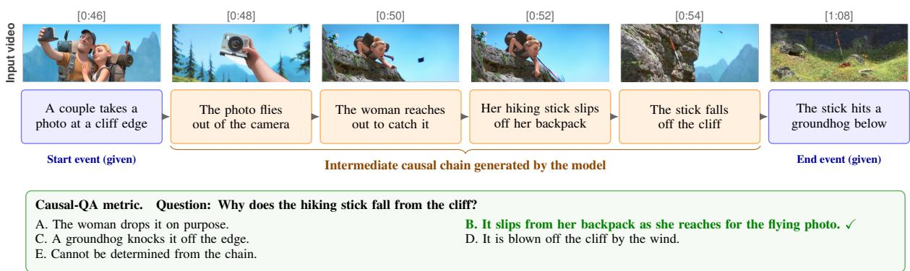  
Figure 1: Causal Chain Generation (CCG). Given a video together with a start and end event, the model must generate the intermediate causal chain that bridges them (here: how a selfie leads to a groundhog being hit by a hiking stick). We score the chain with Causal-QA, which asks a fixed reader LLM multiple-choice questions answerable only from the intermediate events (and with SODA-Embedding, not shown).

## Abstract

Video-Language Models (VLMs) excel at visual recognition but struggle with causal reasoning. Current evaluations are flawed: multiplechoice QA allows shortcuts, and open-ended QA lacks robust automatic evaluation. We introduce Causal Chain Generation (CCG), a novel task where models have to generate the sequence of intermediate events connecting a cause and an effect. This structured setup demands genuine reasoning and enables reliable automatic scoring. We accompany this task with two complementary metrics: SODA-Embedding, which measures the semantic matching of a generated chain against a reference, and Causal-QA, which probes the chain’s causal coherence by asking whether it contains the specific causal facts needed to reconstruct the narrative. We provide two test sets: SF20K-CC, a manually annotated diagnostic on 20 short films, and CMD-CC, a movie clip benchmark derived from audio descriptions. Our analysis reveals that state-ofthe-art VLMs struggle with narrative causality understanding, frequently hallucinating or omitting key events. To address this, we finetune VLMs with GRPO using a composite reward that combines a format reward, SODA-Embedding, and Causal-QA accuracy, demonstrating substantial improvements over strong baselines.

## 1 Introduction

Understanding what happens in a video is only part of the story. True video comprehension requires reasoning about why events unfold the way they do, tracing the causal mechanisms that connect an inciting incident to its outcome. This form of narrative causality is central to how humans understand stories, plan actions, and learn from observation. Yet, despite the remarkable progress of recent Video-Language Models (VLMs) (Google DeepMind, 2025; Team, 2025; Tang et al., 2025; Zhang et al., 2025b) on tasks ranging from video question answering (Fu et al., 2025; Nagrani et al., 2025; Chandrasegaran et al., 2024; Wang et al., 2025a; Mangalam et al., 2023; Liu et al., 2024b; Li et al., 2024) to dense video captioning (Yang et al., 2023; Krishna et al., 2017) and object tracking (Patr˘ aucean et al.˘ , 2023), their ability to reason about causality remains largely untested, in part because we lack the right tools to measure it.

The core difficulty lies in evaluation. The two dominant paradigms each fall short for causal reasoning. Multiple-choice QA (MCQA) (Xiao et al., 2021; Wu et al., 2021; Nagrani et al., 2025; Lu et al., 2025; Luo et al., 2025; Chen et al., 2024b, 2025) is easy to score but easy to game: with only a handful of options, models exploit superficial cues rather than reason (Foss et al., 2025). Dense Video Captioning (DVC) (Yang et al., 2023; Krishna et al., 2017) requires open-ended generation, but its metrics fall short: temporal-localization metrics (tIoU, F1) ignore semantic content, while n-gram metrics (CIDEr, METEOR, SODA) capture surface word overlap and miss whether the narrative is causally coherent. We thus lack a benchmark that is both complex enough to require genuine causal reasoning and structured enough to score automatically.

To address this, we introduce a new task: Causal Chain Generation (CCG). As illustrated in Figure 1, given a video, a start event, and an end event, the model must generate the sequence of intermediate events that causally bridges the two. By requiring open-ended generation of a structured sequence, CCG avoids the shortcut problem of MCQA while enabling automatic evaluation, something that freeform open-ended QA cannot reliably achieve. We accompany this task with two complementary evaluation metrics. SODA-Embedding extends the SODA metric (Fujita et al., 2020) by replacing ngram matching with semantic embeddings, shifting the focus from temporal localization to semantic alignment. Causal-QA is a question-answeringbased metric: for each chain, we automatically generate a bank of multiple-choice questions whose answers are determinable only from the intermediate events, and at evaluation time we measure the accuracy of a fixed reader LLM that consumes only the model’s generated chain. Together, these metrics capture both local semantic matching and global causal coherence. We provide two complementary datasets: SF20K-CC, a manually annotated diagnostic benchmark on 20 amateur films from SF20K, and CMD-CC, a larger-scale dataset of movie clips from Condensed Movies with annotations derived from audio description (AD), including train and test splits.

Our analysis (Section 5.2) reveals that state-ofthe-art VLMs struggle with causal chain generation: common failure modes include missing critical events, hallucinating non-existent ones, and producing causally incoherent sequences. To establish a strong baseline for future work, we benchmark a recipe combining supervised fine-tuning and GRPO with a composite reward derived directly from our two metrics (Section 4), and ablate each component.

This paper makes three contributions. We introduce Causal Chain Generation (CCG), a new task for evaluating narrative causality in videos, and accompany it with two complementary metrics, SODA-Embedding and Causal-QA, and two datasets, SF20K-CC (manually annotated full silent films) and CMD-CC (a larger-scale, AD-derived set of movie clips). We then provide a detailed analysis of state-of-the-art VLMs on the task, highlighting systematic failure modes in causal reasoning. Finally, we establish a strong baseline recipe that combines SFT and GRPO with a composite verifiable reward, ablating the contribution of each reward term to give a reference point for future work on video-based causal reasoning.

Table 1: Dataset statistics. #Vid counts distinct source videos (full short films for SF20K-CC, 2-minute movie clips for CMD-CC), #Mov counts distinct movies, Mean len. is the average number of events per chain, and chain duration is in seconds.
<table><tr><td>Dataset</td><td>Split</td><td>#Vid</td><td>#Mov</td><td>#Chains</td><td>Mean len.</td><td>#MCQs</td><td>Chain dur. (s)</td></tr><tr><td>SF20K-CC</td><td>Test</td><td>20</td><td>20</td><td>205</td><td>7.67</td><td>537</td><td>96.9</td></tr><tr><td>CMD-CC</td><td>Test</td><td>471</td><td>98</td><td>1,031</td><td>6.17</td><td>2,001</td><td>69.1</td></tr><tr><td>CMD-CC</td><td>Train</td><td>6,497</td><td>1,320</td><td>14,175</td><td>6.12</td><td>26,726</td><td>68.6</td></tr></table>

## 2 Related Work

Video reasoning benchmarks. Video understanding benchmarks have evolved from low-level perception such as action recognition (Kay et al., 2017; Fabian Caba Heilbron and Niebles, 2015) toward high-level reasoning. Standard multiple-choice benchmarks (Xiao et al., 2021; Wu et al., 2021; Mangalam et al., 2023; Li et al., 2024; Liu et al., 2024b) drove much of this progress but remain prone to shortcut learning, where models exploit answer-option biases rather than reason over the visual content (Foss et al., 2025). This has motivated work that evaluates the reasoning process itself, from synthetic counterfactual environments (Yi et al., 2020; Chen et al., 2022) to rationale-based assessments (Nagrani et al., 2025) and event-rich narrative benchmarks (Parmar et al., 2024; Xie et al., 2024). Some approaches structure causal reasoning explicitly, such as VITED (Lu et al., 2025) with evidence chains and MECD (Chen et al., 2024b, 2025) with video Granger causality, but they treat reasoning as an intermediate step toward a multiplechoice answer. Our task instead makes the causal chain the primary output, which also lets us diagnose the “thinking drift” failure mode of (Luo et al., 2025), where generated reasoning decouples from the visual evidence.

Dense video captioning. Dense Video Captioning (DVC) (Krishna et al., 2017; Yang et al., 2023) is the closest task to ours, as both generate a sequence of event descriptions over a video, but the two differ in fundamental ways. DVC aims for completeness, describing all salient events, whereas CCG requires selectivity, keeping only events causally relevant to a narrative arc. DVC descriptions are typically context-agnostic (“a man picks up an object”), whereas our events are context-dependent (“the detective retrieves the evidence”). DVC is also evaluated by temporal grounding (tIoU) and surface text overlap (CIDEr, METEOR), whereas SODA-Embedding rewards correct reasoning regardless of phrasing and Causal-QA probes causal coherence through a fixed-judge protocol. Audio descriptions (Han et al., 2024) are a specialized form of dense captioning for accessibility, capturing narrative-relevant content and serving as a useful training source (Section 4), though constrained to dialogue gaps and focused on character identification and atmosphere rather than causal reasoning. VLM post-training. Post-training has become central to eliciting reasoning in (vision-)language models. Supervised fine-tuning on curated instruction data is a standard first stage (Liu et al., 2023; Lin et al., 2023; Liu et al., 2024a), and reinforcement learning, in particular Group Relative Policy Optimization (GRPO) (Shao et al., 2024; Guo et al., 2025), has shown that reasoning can be amplified without large-scale supervision (Lambert, 2026). Such methods are only beginning to reach video (Feng et al., 2025), where designing robust, verifiable rewards remains open. We adopt GRPO and contribute task-specific verifiable rewards, using SODA-Embedding as a dense semantic signal and Causal-QA accuracy as a complementary, more directly causal one.

## 3 Causal Chain Generation

We now formally introduce Causal Chain Generation (CCG). We first define the task (Section 3.1), then present two complementary evaluation metrics (Section 3.2), and finally describe the construction of the two datasets we release with the task (Section 3.3).

## 3.1 Task definition

Given a video V and a query Q specifying a start event $E _ { \mathrm { s t a r t } }$ and an end event $E _ { \mathrm { e n d } }$ , the goal of the task is to generate the sequence of intermediate events ${ \mathcal { C } } = ( E _ { 1 } , \ldots , E _ { n } )$ that causally bridges the two. Each event $E _ { i }$ is a natural language sentence describing a specific, atomic action or state change. We illustrate this formulation in Figure 1.

The task rests on three core design principles. Minimality requires the smallest set of causally sufficient events, granularity ensures that each event represents a single action, and context-dependence means descriptions reflect narrative roles rather than generic actions. Sections 3.2.1 and 3.2.2 describe how each principle is reflected in the metrics. Because multiple valid explanations may exist, our evaluation metrics prioritize semantic similarity and causal coherence over exact textual matches.

## 3.2 Evaluation metrics

We evaluate generated causal chains along two complementary axes: semantic matching, captured by SODA-Embedding (Section 3.2.1), and causal coherence, captured by Causal-QA (Section 3.2.2). The two metrics target different failure modes: SODA-Embedding rewards correct phrasing and ordering of individual events, while Causal-QA asks whether the chain contains the specific causal details needed to reconstruct the narrative.

## 3.2.1 SODA-Embedding

SODA-Embedding measures the semantic and sequential quality of a generated chain against a ground-truth reference. It extends the SODA framework (Fujita et al., 2020), originally designed for dense video captioning, with two key modifications. We discard the temporal Intersection-over-Union (tIoU) constraint, since our task prioritizes the logical ordering of events over precise temporal grounding, and align events purely by their semantic and sequential correspondence. We also replace the n-gram matching score (METEOR) with cosine similarity between text embeddings (Qwen3- Embedding), which rewards semantically correct reasoning even when phrased differently from the reference.

Concretely, given a predicted chain $P =$ $\left( p _ { 1 } , \ldots , p _ { m } \right)$ and a ground-truth chain $\begin{array} { r l } { G } & { { } = } \end{array}$ $( g _ { 1 } , \ldots , g _ { n } )$ , we compute a pairwise cosine similarity matrix between all event embeddings. We then find the optimal order-preserving alignment through dynamic programming, similar to Dynamic Time Warping, yielding a soft true-positive count. From this, we derive precision (normalized by m), recall (normalized by n), and report their harmonic mean as the final SODA-Embedding score (full algorithm in the Appendix, with an example in Figure 6). This makes the metric robust to paraphrasing (via embeddings), strict on ordering errors (via the sequential alignment), and lengthagnostic (via the F1 formulation).

## 3.2.2 Causal-QA

While SODA-Embedding captures local semantic alignment, it does not directly test whether the generated chain contains the specific causal facts needed to explain the narrative. A chain can be lexically and ordering-wise close to the reference yet still miss or distort the critical causal link. To probe this directly, we introduce Causal-QA, a questionanswering–based evaluation.

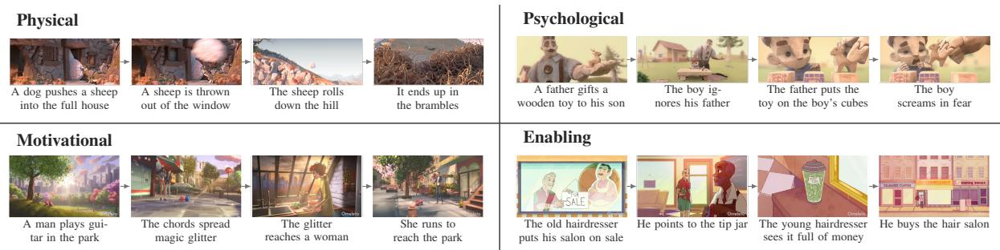  
Figure 2: Narrative causality types. One representative causal chain for each of the four types in our benchmark, Physical, Psychological, Motivational, and Enabling, read left to right.

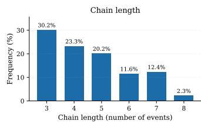  
Figure 3: Causal chain statistics. Left: Distribution of chain durations (in seconds). Right: Frequency distribution of chain lengths (in number of events).

Definition. For each ground-truth chain, we associate a small bank of five-way multiple-choice questions (MCQs) whose answers are determinable only from the chain’s intermediate events. At evaluation time, we provide the model’s generated chain as the sole context to a fixed reader LLM and measure its accuracy on the bank. A chain that omits or hallucinates the key causal events will leave the reader unable to recover the answer, resulting in a low score. We show example items in Figure 1 and Appendix C (Figure 7).

Generation. For each ground-truth chain, a generator LLM (Qwen3.6-27B) proposes 6–10 candidate five-option MCQs (A–E), where option E is always “Cannot be determined from the chain” and the four distractors are drawn from a fixed set of confusion types (e.g., wrong agent, wrong instrument, swapped order, inverted polarity).

Filtering. A fixed judge LLM (Qwen2.5-3B-Instruct) then keeps only questions that pass three sequential tests: answerable from the full chain (the judge selects the gold answer given the full chain, removing ill-posed questions), unanswerable with no context (the judge does not select it given no context, removing questions that can be guesses from prior knowledge), and unanswerable from anchors alone (the judge does not select it given only $E _ { \mathrm { s t a r t } }$ and $E _ { \mathrm { e n d } } .$ so the question only probes the intermediate chain). Surviving questions form the Causal-QA bank. We perform majority voting over multiple predictions to avoid dropping questions that are answered by chance. To verify that the surviving questions are well-posed, two annotators answered 150 sampled Causal-QA questions given the full ground-truth chain, i.e. the setting in which the metric operates. Human accuracy reaches 94.2% on average (five-way MCQ, chance 20%) with strong inter-annotator agreement (Fleiss κ = 0.853), confirming that the questions are reliably answerable from the chain alone .

Evaluation setup. At evaluation time, we score a generated chain by passing it to the same fixed judge LLM and reporting accuracy across the clip’s Causal-QA MCQs. Crucially, both the judge and the prompt are fixed and disclosed: this gives a calibrated, deterministic reader. This is in contrast to LLM-as-a-judge approaches that are sensitive to model scale and prompt choice (Chen et al., 2024a; Zheng et al., 2023; Panickssery et al., 2024). We use Qwen2.5-3B-Instruct as the fixed judge, decoded greedily, and perform robustness analysis with different model types and sizes (see Section 5.1).

## 3.3 Dataset construction

Data sources. We construct two complementary datasets that trade scale against narrative completeness. SF20K-CC is a manually annotated diagnostic set of 20 full silent animation films from SF20K (Ghermi et al., 2025). Being amateur, complete, and dialogue-free, these films limit data contamination, expose long-range causal structure, and remove the dialogue shortcut, at the cost of expensive manual annotation. CMD-CC is a larger dataset built on CMD-AD (Han et al., 2024), providing a sizable pool with reliable chains derived from manual audio descriptions, at the cost of short clips with truncated narrative arcs. CMD-CC is split into a train set (used in Section 4) and a test set drawn from disjoint movies, both produced by the same automated pipeline (below), with the test split additionally manually curated to improve annotation quality.

Annotation protocol. Both datasets are built with the same three-step protocol. We first obtain dense audio descriptions (ADs) for every video, writing them manually for the SF20K-CC silent short films and reusing the existing manual ADs of CMD-AD (Han et al., 2024) for CMD-CC.

From these ADs, we prompt a large language model (OpenAI, 2025) to build a full causal graph over the video’s events; the exact prompt is given in Figure 13. We then review this graph and extract causal chains as sub-parts of it, each taking a start event $E _ { \mathrm { s t a r t } }$ and an end event $E _ { \mathrm { e n d } }$ together with the intermediate events that causally connect them. For each extracted chain we build the associated Causal-QA bank with the filtering pipeline of Section 3.2.2, and the CMD-CC test split is additionally manually curated to improve annotation quality.

Causality types. To ensure coverage of diverse reasoning patterns, we adopt the taxonomy proposed by Hu et al. (Hu and Walker, 2017), which distinguishes four types of narrative causality: Physical (Event A physically causes Event B), Motivational (Event A provides the goal or reason for Event B), Psychological (Event A triggers an emotional state change leading to Event B), and Enabling (Event A creates the necessary conditions for Event B to occur). We classify each chain accordingly. Figure 2 shows one example per type, and Appendix M reports the distribution across types and a per-type performance analysis.

Statistics. Table 1 summarizes the two datasets. SF20K-CC-Test comprises 20 full silent short films with 205 manually verified causal chains, and CMD-CC-Test provides 1,031 chains with 2,001 Causal-QA MCQs, drawn from movies disjoint from the 14,175-chain training set. Figure 3 shows the distributions of chain durations and lengths on SF20K-CC.

## 4 A training recipe for CCG

While current VLMs can identify isolated events, they struggle to assemble them into coherent causal chains. In this section, we describe a training recipe for CCG that we benchmark in Section 5. The recipe pairs two off-the-shelf ingredients, each tailored to the task: supervised fine-tuning (SFT) on the CMD-CC train split as a simple baseline, and Group Relative Policy Optimization (GRPO) with a composite verifiable reward whose terms correspond directly to our two metrics. We additionally explore test-time scaling in Appendix G. The novelty of this section is not in the choice of algorithms but in the design of the reward signal, which we show is the key driver of performance in Section 5.4.

## 4.1 Supervised fine-tuning

As a baseline training recipe, we fine-tune the model to maximize the likelihood of the groundtruth causal chain $\mathcal { C } _ { \mathrm { g t } }$ via standard cross-entropy (full objective in Appendix D). SFT is simple and stable, but it penalizes any deviation from the exact phrasing of the reference, even when the generated chain is semantically correct or conveys the same causal coherence in different words. This rigidity is suboptimal for an open-ended task like CCG, motivating the RL-based recipe below.

## 4.2 GRPO with a composite verifiable reward

Objective. We employ Group Relative Policy Optimization (GRPO) (Shao et al., 2024), which optimizes the policy $\pi _ { \theta }$ to maximize a task-specific composite reward. For each training query $q =$ $( \nu , E _ { \mathrm { s t a r t } } , E _ { \mathrm { e n d } } )$ , we sample a group of G candidate chains $\{ o _ { 1 } , \ldots , o _ { G } \}$ from the old policy $\pi _ { \theta _ { \mathrm { o l d } } }$ and update $\pi _ { \theta }$ with the standard clipped GRPO objective using the group-relative advantage $A _ { i }$ $( R ( o _ { i } ) - \mu _ { R } ) / \sigma _ { R }$ , where each chain’s reward $R ( o _ { i } )$ is normalized within the group. The full objective is given in Appendix D.

Composite reward. The core design choice of our recipe is the structure of the reward. We use a sum of three complementary, non-differentiable signals, each targeting a distinct failure mode:

$$
\begin{array} { r } { R ( o _ { i } ) = R _ { \mathrm { f o r m a t } } ( o _ { i } ) + R _ { \mathrm { S O D A - E } } ( o _ { i } , \mathcal { C } _ { \mathrm { g t } } ) \quad } \\ { + R _ { \mathrm { C a u s a l - Q A } } ( o _ { i } , \mathcal { Q } _ { \mathrm { g t } } ) \quad } \end{array}\tag{1}
$$

$R _ { \mathrm { f o r m a t } } ( o _ { i } )$ is a binary reward that requires the output to be valid JSON containing a list of events.

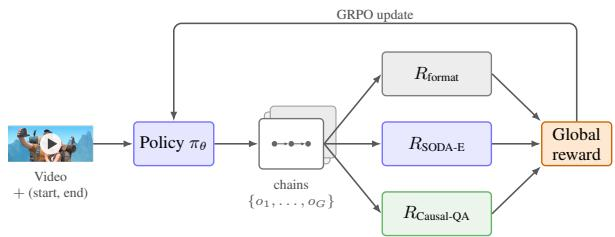  
Figure 4: Our composite GRPO reward. The policy samples a group of candidate chains for each query; every chain is scored by three complementary signals, a JSON format reward, the SODA-Embedding alignment to the ground-truth chain, and the Causal-QA accuracy of a fixed reader LLM, which combine into a global reward that drives the GRPO update (Section 4.2).

$R _ { \mathrm { S O D A - E } } ( o _ { i } , \mathcal { C } _ { \mathrm { g t } } ) \in [ 0 , 1 ]$ is the SODA-Embedding score (Section 3.2.1) between the generated chain $o _ { i }$ and the ground-truth chain ${ \mathcal { C } } _ { \mathrm { g t } } ,$ rescaled from [0, 100], providing a dense signal that captures local semantic matching and correct event ordering. $R _ { \mathrm { C a u s a l - Q A } } ( o _ { i } , \mathcal { Q } _ { \mathrm { g t } } ) \in [ 0 , 1 ]$ is the accuracy of the fixed judge LLM on the MCQ bank ${ \mathcal { Q } } _ { \mathrm { g t } }$ when conditioned only on $o _ { i }$ (Section 3.2.2). This is a sparser but more directly causal signal, since a chain that omits or distorts a key intermediate event fails to support the correct MCQ answer regardless of how fluent it is.

## 5 Experiments

In this section, we first validate our SODA-Embedding metric via synthetic perturbations and human correlation (Section 5.1). We then benchmark state-of-the-art VLMs on our task (Section 5.2), evaluate the training recipe of Section 4 (Section 5.3), and ablate the composition of the composite reward (Section 5.4).

## 5.1 Metric validation

Perturbation analysis. A robust metric should score a high-quality prediction p above a degraded version p˜. We build $( g , p , \tilde { p } )$ triplets from a groundtruth $^ { g , }$ where $\tilde { p }$ applies one of four operators to $p \mathrm { : }$ Swapping (exchange two elements), Shuffling (reorder the sequence), Intruder (replace one element at random), and Random (replace p entirely). A ‘success’ is $m e t r i c ( g , \tilde { p } ) < m e t r i c ( g , p ) . \mathrm { ~ A s ~ F i g - }$ ure 5 (top) shows, text embeddings significantly outperform n-gram metrics, and robustness improves with the scale of the base embedding LLM. Agreement with human judgment. We run a pairwise meta-evaluation: an annotator is shown a ground-truth chain g and two predictions $( p _ { 1 } , p _ { 2 } )$

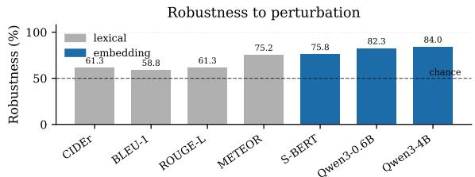

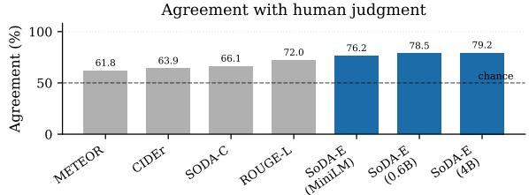  
Figure 5: SODA-Embedding validation. Top: robustness to perturbation (mean success rate over the four operators, where a success is $m e t r i c ( g , \tilde { p } ) < m e t r i c ( g , p ) )$ Bottom: pairwise agreement with human judgment. Embedding-based metrics dominate ngram metrics on both axes; in particular SODA-E beats its ngram ablation SODA-C.

and picks the better one, and a metric agrees if the prediction it scores higher is the one preferred. Over 256 stratified A/B pairs (128 CMD-CC, 128 SF20K-CC) with three independent annotators in strong agreement (Fleiss $\kappa = 0 . 8 8 1 )$ , Figure 5 (bottom) reports each metric’s pairwise agreement. Embedding-based metrics agree with the annotator far more than ngram ones (SODA-E at 79.2% versus 61.8–72.0% for METEOR, CIDEr, and ROUGE-L). Crucially, SODA-E beats its own ngram ablation SODA-C, which has the same alignment method but scores with METEOR (79.2% versus 66.1%): the embedding scorer, not the alignment, is what makes the metric better aligned with human judgment. Moreover, SODA-E improves with the embedder quality and size, going from 76.2% (SODA-E with MiniLM) to 79.2% (SODA-E with Qwen3-Embedding-4B).

Robustness to the underlying models. Each metric relies on an auxiliary model (SODA-Embedding on a text embedder, Causal-QA on a judge LLM), so we verify that our system rankings are not an artifact of those choices by re-scoring all systems while varying only that model. The rankings are remarkably stable, not only across model sizes but, more importantly, across model families. Swapping the SODA-Embedding embedder from Qwen3-Embedding-4B to its 0.6B/8B variants or to the cross-family all-MiniLM-L6-v2 preserves the system ordering $( \geq 9 1 \%$ rank agreement,

Spearman $\rho \ge 0 . 9 1 )$ . Causal-QA is just as stable when the judge is competent: a 7B Qwen judge and the cross-family Gemma-3-12B and Llama-3.1-8B judges all reproduce the ranking of our default Qwen2.5-3B judge (≥ 85% agreement). The only exception is a 0.5B judge, too weak to separate systems, which collapses to near-chance agreement on the smaller SF20K set. We therefore fix Qwen3-Embedding-4B and Qwen2.5-3B-Instruct and conclude that our findings are robust to these choices (see Table 11 and Appendix H).

## 5.2 Baselines

Setup. We benchmark a broad set of systems on SF20K-CC and CMD-CC: open-source VLMs of varying scale, proprietary models, dedicated causal-reasoning baselines, and caption-thenreason pipelines, alongside trivial Random, Guessing, and Blind references (full list, citations, and inference details in Appendix I). Each model is run on either the full video (1 FPS) or a truncated clip centered on the chain (32 frames). These conditions are comparable (Appendix K), so all rows share one table. All models receive the subtitle transcript, and metrics use the embedder and judge of Section 3.2.

Scaling behavior. Sweeping the Qwen3.5 family (Appendix J) shows performance rising steeply with model size up to 4B and then saturating. Even the strongest baseline (27B, 59.9 SODA-Embedding on CMD-CC) leaves substantial headroom, indicating that CCG is far from solved. Returns in the number of input frames are roughly logarithmic, with Causal-QA the more frame-hungry axis.

Trends. Model scale is the single largest factor, with a broadly consistent ordering across the two datasets. The chain-of-thought (“thinking”) variant reaches the best Causal-QA among non-finetuned open models (24.9 / 21.7) but at much lower SODA-Embedding, as its verbose reasoning diverges from the reference. The caption-then-reason pipelines underperform the corresponding single-pass VLM on CMD-CC, indicating that decomposing the task loses causally relevant visual detail. GPT-5.4-mini reaches the highest Causal-QA overall (29.5 / 23.4). Since the full-video and truncated-clip conditions are comparable (Appendix K) and all models receive the ground-truth number of events, this is a genuine gap. Gemini-3.1-Flash-lite, run in the same constrained regime, matches GPT-5.4-mini on SF20K (56.0 SODA-Embedding, 22.6 Causal-

QA).

Where difficulty lives. Slicing CMD-CC Causal-QA along causality type, chain length, and dialogue availability (Appendix L) shows that dialogue dominates: models score +11 to +20 Causal-QA points higher on with-dialogue clips than on silent ones, and on the former a text-only control rivals the video model. Stripping the subtitle track from Qwen3.5-9B erases this advantage (−4.2 on CMD-CC), confirming it comes from the transcript. The silent subset, where the text-only baseline collapses, is therefore the more challenging evaluation of visual causal reasoning. Chain length, by contrast, is not a primary difficulty axis.

## 5.3 Method performance

Setup. We fine-tune the Qwen3.5-9B backbone on our synthetic CMD-AD training chains (Section 3.3) in two stages, both LoRA (r = 16, $\alpha = 3 2$ , on the q/k/v/o projections) for one epoch each. We first run supervised fine-tuning (SFT) on the reference chains, then apply GRPO with the composite reward of Equation 1: $R _ { \mathrm { f o r m a t } } +$ $R _ { \mathrm { S O D A - E } } + R _ { \mathrm { C a u s a l - Q A } }$ . Videos are decoded at 1 FPS, matching the baseline setup. All metric values use the same judge and embedder as the baselines. Training algorithm. Every fine-tuning improves the base model (Table 3). SFT gives the largest chain-quality gain (+7.6 SODA-Embedding on CMD-CC, to 62.3) but barely moves Causal-QA. GRPO from the base model instead pushes Causal-QA highest (32.2 on CMD-CC, 24.9 on SF20K-CC) at slightly lower SODA-Embedding, since it chases the judge without SFT’s fluency prior. Stacking the two (SFT + GRPO) is best balanced, reaching the top chain quality (63.3 / 57.9 SODA-Embedding) while recovering much of the Causal-QA gain (29.4 on CMD-CC). The two routes thus trade chain quality against causal accuracy, a tension we dissect in the reward ablation below. Because both evaluation metrics are used as rewards during GRPO fine-tuning, we verify these performance gains against a held-out judge: it rises monotonically from the base model through SFT to SFT + GRPO on both test sets (see Table 6 in Appendix E).

## 5.4 Reward ablation

To disentangle the contribution of the two semantic terms in our composite reward (Equation 1), we train Qwen3.5-9B with GRPO directly from the base model (no SFT initialization) under each combination of $R _ { \mathrm { S O D A - E } }$ and $R _ { \mathrm { C a u s a l - Q A } } .$ , with $R _ { \mathrm { f o r m a t } }$ always on. Arms that include $R _ { \mathrm { C a u s a l - Q A } }$ are trained on the subset of clips with a Causal-QA bank $( \mathcal { D } _ { \mathrm { t r a i n } } ^ { \mathrm { Q A - o n l y } } )$ , while the remaining arms use the full chain set, and evaluation is identical across all arms. Results are reported in Table 4, with the non-finetuned base model as a reference point.

Table 2: Baseline performance. Zero-shot performance on CMD-CC and SF20K-CC, grouped by baseline family. The reference conditions isolate each input modality: Random shuffles reference chains across test instances, Guessing sees the query alone, Blind adds subtitles but no frames. Video: full video at 1 FPS, or a truncated segment centered on the causal chain (32 frames); the two give comparable scores for the same model (Appendix K). Subs.: subtitle transcript provided. All models receive the ground-truth number of events. Best per column in bold.
<table><tr><td rowspan="2">Model</td><td rowspan="2">Size</td><td rowspan="2">Video</td><td rowspan="2">Frames</td><td rowspan="2">Subs.</td><td colspan="2">CMD-CC</td><td colspan="2">SF20K-CC</td></tr><tr><td>SODA-E</td><td>CQA</td><td>SODA-E</td><td>CQA</td></tr><tr><td>Reference conditions</td><td></td><td></td><td></td><td></td><td></td><td></td><td></td><td></td></tr><tr><td>Random</td><td></td><td></td><td></td><td></td><td>35.6</td><td>13.0</td><td>36.5</td><td>2.4</td></tr><tr><td>Guessing (query-only)</td><td></td><td></td><td></td><td>X</td><td>45.6</td><td>7.5</td><td>45.8</td><td>11.6</td></tr><tr><td>Blind (query + subtitles)</td><td></td><td></td><td></td><td>√</td><td>52.9</td><td>20.8</td><td>45.0</td><td>11.6</td></tr><tr><td>Open-source VLMs</td><td></td><td></td><td></td><td></td><td></td><td></td><td></td><td></td></tr><tr><td>VideoLLaMA3-7B (Zhang et al., 2025a)</td><td>7B</td><td>full</td><td>1 FPS</td><td>√</td><td>34.4</td><td>9.8</td><td>36.4</td><td>8.5</td></tr><tr><td>InternVL-3.5-8B (Wang et al., 2025b)</td><td>8B</td><td>full</td><td>1 FPS</td><td>√</td><td>53.3</td><td>18.7</td><td>53.1</td><td>13.2</td></tr><tr><td>GLM-4.6V-Flash (GLM-V Team, 2025)</td><td>9B</td><td>full</td><td>1 FPS</td><td>√</td><td>47.2</td><td>19.1</td><td>44.6</td><td>16.7</td></tr><tr><td>Qwen3.5-9B (Team, 2025)</td><td>9B</td><td>full</td><td>1 FPS</td><td>√</td><td>54.6</td><td>21.5</td><td>52.7</td><td>16.5</td></tr><tr><td>Causal-specialized baselines</td><td></td><td></td><td></td><td></td><td></td><td></td><td></td><td></td></tr><tr><td>Qwen3.5-9B-Thinking (Team, 2025)</td><td>9B</td><td>full</td><td>1 FPS</td><td>√</td><td>40.3</td><td>24.9</td><td>40.0</td><td>21.7</td></tr><tr><td>MECD (Chen et al., 2024b)</td><td>9B</td><td>full</td><td>1 FPS</td><td>√</td><td>44.2</td><td>10.1</td><td>48.2</td><td>12.4</td></tr><tr><td>TEMPURA-3B (Cheng et al., 2025)</td><td>3B</td><td>full</td><td>1 FPS</td><td>√</td><td>30.5</td><td>12.0</td><td>29.6</td><td>11.3</td></tr><tr><td>Two-stage pipelines</td><td></td><td></td><td></td><td></td><td></td><td></td><td></td><td></td></tr><tr><td>Two-stage (caption → chain)</td><td>9B</td><td>full</td><td>1 FPS</td><td>√</td><td>45.9</td><td>8.5</td><td>50.2</td><td>13.3</td></tr><tr><td>Two-stage (graph → chain)</td><td>9B</td><td>full</td><td>1 FPS</td><td>√</td><td>47.4</td><td>11.2</td><td>50.1</td><td>14.3</td></tr><tr><td>Proprietary VLMs</td><td></td><td></td><td></td><td></td><td></td><td></td><td></td><td></td></tr><tr><td>GPT-5.4-nano (OpenAI, 2026)</td><td></td><td>trunc.</td><td>32</td><td>√</td><td>52.5</td><td>22.2</td><td>52.5</td><td>15.5</td></tr><tr><td>GPT-5.4-mini (OpenAI, 2026)</td><td></td><td>trunc.</td><td>32</td><td>√</td><td>47.9</td><td>29.5</td><td>52.7</td><td>23.4</td></tr><tr><td>Gemini-3.1-Flash-lite (Google DeepMind, 2026)</td><td></td><td>trunc.</td><td>32</td><td>√</td><td>61.6</td><td>26.4</td><td>56.0</td><td>22.6</td></tr></table>

Table 3: Training-algorithm ablation of Qwen3.5-9B: no fine-tuning (Base), SFT, GRPO from the base model, and SFT followed by GRPO. All GRPO runs use the full composite reward. Best per column in bold, second-best underlined.
<table><tr><td colspan="3">CMD-CC</td><td colspan="2">SF20K-CC</td></tr><tr><td>Method</td><td>SODA-E</td><td>CQA</td><td>SODA-E</td><td>CQA</td></tr><tr><td>Base</td><td>54.6</td><td>21.5</td><td>52.7</td><td>16.5</td></tr><tr><td>SFT</td><td>62.3</td><td>24.6</td><td>56.6</td><td>19.3</td></tr><tr><td>GRPO</td><td>58.9</td><td>32.2</td><td>57.2</td><td>24.9</td></tr><tr><td>SFT + GRPO</td><td>63.3</td><td>29.4</td><td>57.9</td><td>22.1</td></tr></table>

Interpretation. The reward you optimize is the metric you win. Format-only (✓F) regresses below the base model on every metric, since it enforces valid JSON but supplies no content signal. Adding $R _ { \mathrm { S O D A - E } } \left( { \sqrt { \mathrm { F } } } { \sqrt { \mathrm { S } } } \right)$ yields the largest SODA-Embedding gain (the highest in the table on both datasets: 60.1 on CMD-CC and 58.8 on SF20K-CC), as expected since it is essentially its own loss. Adding $R _ { \mathrm { C a u s a l - Q A } } ~ ( \sqrt { \mathrm { F } } \sqrt { \mathrm { C } } )$ instead maximizes Causal-QA, reaching 37.8 on CMD-CC (the highest Causal-QA of any open-weights configuration we trained), but at lower SODA-Embedding. The full reward $( \sqrt { \mathrm { F } } \sqrt { \mathrm { S } } \sqrt { \mathrm { C } } )$ is the best-balanced arm, recovering most of the SODA-Embedding of the SODA-only run while retaining most of the Causal-QA of the QA-only run. The two semantic terms are thus complementary rather than redundant, each binding the metric it targets.

Table 4: Reward ablation. Performance of GRPOfine-tuned Qwen3.5-9B (from the base model, no SFT initialization) as we vary the composition of the composite reward (Equation 1). We report the base (nonfine-tuned) Qwen3.5-9B row for reference.
<table><tr><td colspan="2">Reward</td><td colspan="2">CMD-CC</td><td colspan="2">SF20K-CC</td></tr><tr><td colspan="2">F S C</td><td colspan="2">SODA-E CQA</td><td colspan="2">SODA-E CQA</td></tr><tr><td colspan="2">Base (no fine-tuning)</td><td>54.6</td><td>21.5</td><td>52.7</td><td>16.5</td></tr><tr><td colspan="2">GRPO fine-tuning</td><td></td><td></td><td></td><td></td></tr><tr><td colspan="2">√ × ×</td><td>55.4</td><td>17.7</td><td>53.9</td><td>12.9</td></tr><tr><td>√  $\checkmark$ </td><td>×</td><td>60.1</td><td>26.8</td><td>58.8</td><td>17.7</td></tr><tr><td>√</td><td>× √</td><td>57.0</td><td>37.8</td><td>54.9</td><td>26.0</td></tr><tr><td>√ √ √</td><td></td><td>58.9</td><td>32.2</td><td>57.2</td><td>24.9</td></tr></table>

## 6 Discussion

We introduced Causal Chain Generation, a new task targeting narrative causality in videos, together with two complementary metrics (SODA-Embedding, an embedding-based extension of the SODA framework capturing semantic matching, and Causal-QA, a question-answering probe of causal coherence) and two datasets: SF20K-CC, a small but contamination-controlled diagnostic over full silent films, and CMD-CC, a larger-scale AD-derived dataset with train and test splits. Our analysis reveals that state-of-the-art VLMs struggle with causal coherence, especially over long event sequences. We also established a strong baseline recipe, combining SFT and GRPO with a composite verifiable reward derived from our metrics, as a reference point for future work on this open challenge.

More broadly, the persistent gap between chain quality and causal accuracy suggests that dense captioning and causal understanding remain distinct capabilities, a distinction our task and metrics are explicitly designed to measure and that we hope will guide future work.

## Limitations

Benchmark scale and domain. SF20K-CC is relatively small (20 silent animated short films, 205 chains), so per-split and per-type estimates have limited statistical power. CMD-CC is larger but consists of short clips with truncated narrative arcs. Metrics depend on auxiliary models. SODA-Embedding relies on a frozen text embedder and Causal-QA on a frozen judge LLM. We show that rankings are stable across embedders and across judges of 3B–8B parameters (including crossfamily), but absolute scores are model-dependent, and a weak judge (≤0.5B) fails to discriminate. Results should therefore be read as relative comparisons under the disclosed, fixed embedder and judge, not as absolute capabilities.

Partial human validation. We validate two components with human annotators: the metric–human agreement study, and the answerability of Causal-QA questions given the full chain . However, we do not report human performance on the CCG task itself.

## Acknowledgments

This work was supported by ANR-22-CE23-0007, a Hi!Paris grant and fellowship, and the AN-

R/France 2030 program (ANR-23-IACL-0005). Additional support was provided by the Institute of Information & Technology Planning & Evaluation (IITP) grant funded by the Korean government (MSIT) (No. RS-2024-00457882, National AI Research Lab Project). We were granted access to the High-Performance Computing (HPC) resources of IDRIS under the allocations 2023-AD011014489 made by GENCI. We would like to express our gratitude to all of the annotators for their help.

## References

Keshigeyan Chandrasegaran, Agrim Gupta, Lea M. Hadzic, Taran Kota, Jimming He, Cristóbal Eyzaguirre, Zane Durante, Manling Li, Jiajun Wu, and Li Fei-Fei. 2024. Hourvideo: 1-hour video-language understanding.

Guiming Hardy Chen, Shunian Chen, Ziche Liu, Feng Jiang, and Benyou Wang. 2024a. Humans or llms as the judge? a study on judgement biases.

Tieyuan Chen, Huabin Liu, Tianyao He, Yihang Chen, Chaofan Gan, Xiao Ma, Cheng Zhong, Yang Zhang, Yingxue Wang, Hui Lin, and Weiyao Lin. 2024b. Mecd: Unlocking multi-event causal discovery in video reasoning.

Tieyuan Chen, Huabin Liu, Yi Wang, Yihang Chen, Tianyao He, Chaofan Gan, Huanyu He, and Weiyao Lin. 2025. Mecd+: Unlocking event-level causal graph discovery for video reasoning.

Zhenfang Chen, Kexin Yi, Yunzhu Li, Mingyu Ding, Antonio Torralba, Joshua B. Tenenbaum, and Chuang Gan. 2022. Comphy: Compositional physical reasoning of objects and events from videos.

Jen-Hao Cheng, Vivian Wang, Huayu Wang, Huapeng Zhou, Yi-Hao Peng, Hou-I Liu, Hsiang-Wei Huang, Kuang-Ming Chen, Cheng-Yen Yang, Wenhao Chai, Yi-Ling Chen, Vibhav Vineet, Qin Cai, and Jenq-Neng Hwang. 2025. TEMPURA: Temporal event masked prediction and understanding for reasoning in action. Preprint, arXiv:2505.01583.

Bernard Ghanem Fabian Caba Heilbron, Victor Escorcia and Juan Carlos Niebles. 2015. Activitynet: A large-scale video benchmark for human activity understanding. In Proceedings ofthe IEEE Conference on Computer Vision and Pattern Recognition, pages 961–970.

Kaituo Feng, Kaixiong Gong, Bohao Li, Zonghao Guo, Yibing Wang, Tianshuo Peng, Junfei Wu, Xiaoying Zhang, Benyou Wang, and Xiangyu Yue. 2025. Video-r1: Reinforcing video reasoning in mllms. Preprint, arXiv:2503.21776.

Aaron Foss, Chloe Evans, Sasha Mitts, Koustuv Sinha, Ammar Rizvi, and Justine T. Kao. 2025. Causalvqa:

A physically grounded causal reasoning benchmark for video models. Preprint, arXiv:2506.09943.

Chaoyou Fu, Yuhan Dai, Yongdong Luo, Lei Li, Shuhuai Ren, Renrui Zhang, Zihan Wang, Chenyu Zhou, Yunhang Shen, Mengdan Zhang, Peixian Chen, Yanwei Li, Shaohui Lin, Sirui Zhao, Ke Li, Tong Xu, Xiawu Zheng, Enhong Chen, Caifeng Shan, Ran He, and Xing Sun. 2025. Video-mme: The first-ever comprehensive evaluation benchmark of multi-modal llms in video analysis.

Soichiro Fujita, Tsutomu Hirao, Hidetaka Kamigaito, Manabu Okumura, and Masaaki Nagata. 2020. Soda: Story oriented dense video captioning evaluation flamework. In Proceedings of the European Conference on Computer Vision (ECCV).

Ridouane Ghermi, Xi Wang, Vicky Kalogeiton, and Ivan Laptev. 2025. Long story short: Story-level video understanding from 20k short films.

GLM-V Team. 2025. GLM-4.5V and GLM-4.1V-Thinking: Towards versatile multimodal reasoning with scalable reinforcement learning. Preprint, arXiv:2507.01006.

Google DeepMind. 2025. Gemini 2.5: Our most intelligent AI model. https: //blog.google/innovation-and-ai/ models-and-research/google-deepmind/ gemini-model-thinking-updates-march-2025/.

Google DeepMind. 2026. Gemini 3.1 Flash-Lite model card. https://deepmind.google/models/ model-cards/gemini-3-1-flash-lite/.

Daya Guo, Dejian Yang, Haowei Zhang, Junxiao Song, Peiyi Wang, Qihao Zhu, Runxin Xu, Ruoyu Zhang, Shirong Ma, Xiao Bi, Xiaokang Zhang, Xingkai Yu, Yu Wu, Z. F. Wu, Zhibin Gou, Zhihong Shao, Zhuoshu Li, Ziyi Gao, Aixin Liu, Bing Xue, Bingxuan Wang, Bochao Wu, Bei Feng, Chengda Lu, Chenggang Zhao, Chengqi Deng, Chong Ruan, Damai Dai, Deli Chen, Dongjie Ji, Erhang Li, Fangyun Lin, Fucong Dai, Fuli Luo, Guangbo Hao, Guanting Chen, Guowei Li, H. Zhang, Hanwei Xu, Honghui Ding, Huazuo Gao, Hui Qu, Hui Li, Jianzhong Guo, Jiashi Li, Jingchang Chen, Jingyang Yuan, Jinhao Tu, Junjie Qiu, Junlong Li, J. L. Cai, Jiaqi Ni, Jian Liang, Jin Chen, Kai Dong, Kai Hu, Kaichao You, Kaige Gao, Kang Guan, Kexin Huang, Kuai Yu, Lean Wang, Lecong Zhang, Liang Zhao, Litong Wang, Liyue Zhang, Lei Xu, Leyi Xia, Mingchuan Zhang, Minghua Zhang, Minghui Tang, Mingxu Zhou, Meng Li, Miaojun Wang, Mingming Li, Ning Tian, Panpan Huang, Peng Zhang, Qiancheng Wang, Qinyu Chen, Qiushi Du, Ruiqi Ge, Ruisong Zhang, Ruizhe Pan, Runji Wang, R. J. Chen, R. L. Jin, Ruyi Chen, Shanghao Lu, Shangyan Zhou, Shanhuang Chen, Shengfeng Ye, Shiyu Wang, Shuiping Yu, Shunfeng Zhou, Shuting Pan, S. S. Li, Shuang Zhou, Shaoqing Wu, Tao Yun, Tian Pei, Tianyu Sun, T. Wang, Wangding Zeng, Wen Liu, Wenfeng Liang, Wenjun Gao, Wenqin Yu, Wentao Zhang, W. L. Xiao, Wei An,

Xiaodong Liu, Xiaohan Wang, Xiaokang Chen, Xiaotao Nie, Xin Cheng, Xin Liu, Xin Xie, Xingchao Liu, Xinyu Yang, Xinyuan Li, Xuecheng Su, Xuheng Lin, X. Q. Li, Xiangyue Jin, Xiaojin Shen, Xiaosha Chen, Xiaowen Sun, Xiaoxiang Wang, Xinnan Song, Xinyi Zhou, Xianzu Wang, Xinxia Shan, Y. K. Li, Y. Q. Wang, Y. X. Wei, Yang Zhang, Yanhong Xu, Yao Li, Yao Zhao, Yaofeng Sun, Yaohui Wang, Yi Yu, Yichao Zhang, Yifan Shi, Yiliang Xiong, Ying He, Yishi Piao, Yisong Wang, Yixuan Tan, Yiyang Ma, Yiyuan Liu, Yongqiang Guo, Yuan Ou, Yuduan Wang, Yue Gong, Yuheng Zou, Yujia He, Yunfan Xiong, Yuxiang Luo, Yuxiang You, Yuxuan Liu, Yuyang Zhou, Y. X. Zhu, Yanping Huang, Yaohui Li, Yi Zheng, Yuchen Zhu, Yunxian Ma, Ying Tang, Yukun Zha, Yuting Yan, Z. Z. Ren, Zehui Ren, Zhangli Sha, Zhe Fu, Zhean Xu, Zhenda Xie, Zhengyan Zhang, Zhewen Hao, Zhicheng Ma, Zhigang Yan, Zhiyu Wu, Zihui Gu, Zijia Zhu, Zijun Liu, Zilin Li, Ziwei Xie, Ziyang Song, Zizheng Pan, Zhen Huang, Zhipeng Xu, Zhongyu Zhang, and Zhen Zhang. 2025. Deepseek-r1 incentivizes reasoning in llms through reinforcement learning. Nature, 645(8081):633–638.

Tengda Han, Max Bain, Arsha Nagrani, Gül Varol, Weidi Xie, and Andrew Zisserman. 2024. Autoad iii: The prequel – back to the pixels.

Zhichao Hu and Marilyn Walker. 2017. Inferring narrative causality between event pairs in films. In Proceedings ofthe 18th Annual SIGdial Meeting on Discourse and Dialogue, pages 342–351, Saarbrücken, Germany. Association for Computational Linguistics.

Will Kay, Joao Carreira, Karen Simonyan, Brian Zhang, Chloe Hillier, Sudheendra Vijayanarasimhan, Fabio Viola, Tim Green, Trevor Back, Paul Natsev, Mustafa Suleyman, and Andrew Zisserman. 2017. The kinetics human action video dataset. In arXiv.

Ranjay Krishna, Kenji Hata, Frederic Ren, Li Fei-Fei, and Juan Carlos Niebles. 2017. Dense-captioning events in videos. In ICCV.

Nathan Lambert. 2026. Reinforcement learning from human feedback. Preprint, arXiv:2504.12501.

Kunchang Li, Yali Wang, Yinan He, Yizhuo Li, Yi Wang, Yi Liu, Zun Wang, Jilan Xu, Guo Chen, Ping Luo, Limin Wang, and Yu Qiao. 2024. Mvbench: A comprehensive multi-modal video understanding benchmark.

Bin Lin, Yang Ye, Bin Zhu, Jiaxi Cui, Munan Ning, Peng Jin, and Li Yuan. 2023. Video-llava: Learning united visual representation by alignment before projection. In arXiv.

Haotian Liu, Chunyuan Li, Yuheng Li, Bo Li, Yuanhan Zhang, Sheng Shen, and Yong Jae Lee. 2024a. Llavanext: Improved reasoning, ocr, and world knowledge.

Haotian Liu, Chunyuan Li, Qingyang Wu, and Yong Jae Lee. 2023. Visual instruction tuning. In NeurIPS.

Yuanxin Liu, Shicheng Li, Yi Liu, Yuxiang Wang, Shuhuai Ren, Lei Li, Sishuo Chen, Xu Sun, and Lu Hou. 2024b. Tempcompass: Do video llms really understand videos? In arXiv.

Yujie Lu, Yale Song, William Wang, Lorenzo Torresani, and Tushar Nagarajan. 2025. Vited: Video temporal evidence distillation.

Mi Luo, Zihui Xue, Alex Dimakis, and Kristen Grauman. 2025. When thinking drifts: Evidential grounding for robust video reasoning.

Karttikeya Mangalam, Raiymbek Akshulakov, and Jitendra Malik. 2023. Egoschema: A diagnostic benchmark for very long-form video language understanding. In NeurIPS.

Arsha Nagrani, Sachit Menon, Ahmet Iscen, Shyamal Buch, Ramin Mehran, Nilpa Jha, Anja Hauth, Yukun Zhu, Carl Vondrick, Mikhail Sirotenko, Cordelia Schmid, and Tobias Weyand. 2025. Minerva: Evaluating complex video reasoning.

OpenAI. 2025. Introducing GPT-5. https://openai. com/index/introducing-gpt-5/. Released August 7, 2025.

OpenAI. 2026. Introducing GPT-5.4. https:// openai.com/index/introducing-gpt-5-4/. Released March 5, 2026.

Arjun Panickssery, Samuel R. Bowman, and Shi Feng. 2024. Llm evaluators recognize and favor their own generations.

Paritosh Parmar, Eric Peh, Ruirui Chen, Ting En Lam, Yuhan Chen, Elston Tan, and Basura Fernando. 2024. Causalchaos! dataset for comprehensive causal action question answering over longer causal chains grounded in dynamic visual scenes.

Viorica Patr ˘ aucean, Lucas Smaira, Ankush Gupta,˘ Adrià Recasens Continente, Larisa Markeeva, Dylan Banarse, Skanda Koppula, Joseph Heyward, Mateusz Malinowski, Yi Yang, Carl Doersch, Tatiana Matejovicova, Yury Sulsky, Antoine Miech, Alex Frechette, Hanna Klimczak, Raphael Koster, Junlin Zhang, Stephanie Winkler, Yusuf Aytar, Simon Osindero, Dima Damen, Andrew Zisserman, and João Carreira. 2023. Perception test: A diagnostic benchmark for multimodal video models.

Zhihong Shao, Peiyi Wang, Qihao Zhu, Runxin Xu, Junxiao Song, Xiao Bi, Haowei Zhang, Mingchuan Zhang, Y. K. Li, Y. Wu, and Daya Guo. 2024. Deepseekmath: Pushing the limits of mathematical reasoning in open language models. Preprint, arXiv:2402.03300.

Changli Tang, Yixuan Li, Yudong Yang, Jimin Zhuang, Guangzhi Sun, Wei Li, Zejun Ma, and Chao Zhang. 2025. video-salmonn 2: Caption-enhanced audiovisual large language models.

Qwen Team. 2025. Qwen3 technical report.

Weihan Wang, Zehai He, Wenyi Hong, Yean Cheng, Xiaohan Zhang, Ji Qi, Xiaotao Gu, Shiyu Huang, Bin Xu, Yuxiao Dong, Ming Ding, and Jie Tang. 2025a. Lvbench: An extreme long video understanding benchmark.

Weiyun Wang, Zhangwei Gao, Lixin Gu, Hengjun Pu, Long Cui, Xingguang Wei, Zhaoyang Liu, Linglin Jing, Shenglong Ye, Jie Shao, Zhaokai Wang, Zhe Chen, Hongjie Zhang, Ganlin Yang, Haomin Wang, Qi Wei, Jinhui Yin, Wenhao Li, Erfei Cui, Guanzhou Chen, Zichen Ding, Changyao Tian, Zhenyu Wu, Jingjing Xie, Zehao Li, Bowen Yang, Yuchen Duan, Xuehui Wang, Zhi Hou, Haoran Hao, Tianyi Zhang, Songze Li, Xiangyu Zhao, Haodong Duan, Nianchen Deng, Bin Fu, Yinan He, Yi Wang, Conghui He, Botian Shi, Junjun He, Yingtong Xiong, Han Lv, Lijun Wu, Wenqi Shao, Kaipeng Zhang, Huipeng Deng, Biqing Qi, Jiaye Ge, Qipeng Guo, Wenwei Zhang, Songyang Zhang, Maosong Cao, Junyao Lin, Kexian Tang, Jianfei Gao, Haian Huang, Yuzhe Gu, Chengqi Lyu, Huanze Tang, Rui Wang, Haijun Lv, Wanli Ouyang, Limin Wang, Min Dou, Xizhou Zhu, Tong Lu, Dahua Lin, Jifeng Dai, Weijie Su, Bowen Zhou, Kai Chen, Yu Qiao, Wenhai Wang, and Gen Luo. 2025b. Internvl3.5: Advancing open-source multimodal models in versatility, reasoning, and efficiency.

Bo Wu, Shoubin Yu, Zhenfang Chen, Joshua B. Tenenbaum, and Chuang Gan. 2021. STAR: A benchmark for situated reasoning in real-world videos. In NeurIPS.

Junbin Xiao, Xindi Shang, Angela Yao, and Tat-Seng Chua. 2021. Next-qa:next phase of questionanswering to explaining temporal actions. In CVPR.

Binzhu Xie, Sicheng Zhang, Zitang Zhou, Bo Li, Yuanhan Zhang, Jack Hessel, Jingkang Yang, and Ziwei Liu. 2024. Funqa: Towards surprising video comprehension.

Antoine Yang, Arsha Nagrani, Ivan Laptev, Josef Sivic, and Cordelia Schmid. 2023. Vidchapters-7m: Video chapters at scale. In NeurIPS.

Kexin Yi, Chuang Gan, Yunzhu Li, Pushmeet Kohli, Jiajun Wu, Antonio Torralba, and Joshua B. Tenenbaum. 2020. Clevrer: Collision events for video representation and reasoning.

Boqiang Zhang, Kehan Li, Zesen Cheng, Zhiqiang Hu, Yuqian Yuan, Guanzheng Chen, Sicong Leng, Yuming Jiang, Hang Zhang, Xin Li, Peng Jin, Wenqi Zhang, Fan Wang, Lidong Bing, and Deli Zhao. 2025a. Videollama 3: Frontier multimodal foundation models for image and video understanding.

Yuanhan Zhang, Jinming Wu, Wei Li, Bo Li, Zejun Ma, Ziwei Liu, and Chunyuan Li. 2025b. Llava-video: Video instruction tuning with synthetic data.

Lianmin Zheng, Wei-Lin Chiang, Ying Sheng, Siyuan Zhuang, Zhanghao Wu, Yonghao Zhuang, Zi Lin, Zhuohan Li, Dacheng Li, Eric P. Xing, Hao Zhang,

Joseph E. Gonzalez, and Ion Stoica. 2023. Judging llm-as-a-judge with mt-bench and chatbot arena.

## A Source material

Our benchmark consists of 20 high-quality movies curated from the SF20K dataset. These films are selected based on their rich visual narratives and lack of dialog, ensuring that causal reasoning must be derived only from visual cues. Table 5 lists the metadata for the included films.

## B Metric implementation details

In this section, we provide the detailed pseudo-code for our proposed SODA-Embedding metric. This metric evaluates the semantic and structural quality of generated causal chains by finding an optimal, order-preserving alignment between the predicted sequence and the ground truth in a semantic embedding space. Figure 6 illustrates the computation on a small example.

## C Causal-QA examples

Figure 7 shows two Causal-QA items spanning different causality types. Each MCQ is answerable only from the intermediate events of the groundtruth chain, so a generated chain that omits or distorts the key causal link leaves the fixed reader LLM unable to recover the correct option.

## D Training objectives

In this section, we detail the two training objectives explored in our work: Supervised Fine-Tuning (SFT) and Group Relative Policy Optimization (GRPO). We provide the mathematical formulations to highlight the fundamental difference in how they optimize the model’s reasoning capabilities.

Supervised Fine-Tuning (SFT). The SFT baseline optimizes the model to maximize the likelihood of the exact ground-truth token sequence. Given a video V and a target causal chain $C _ { g t } =$ $( y _ { 1 } , y _ { 2 } , \ldots , y _ { T } )$ , the loss function is the standard cross-entropy loss:

$$
{ \mathcal { T } } _ { S F T } ( \theta ) = - { \frac { 1 } { T } } \sum _ { t = 1 } ^ { T } \log \pi _ { \theta } ( y _ { t } \mid y _ { < t } , V )\tag{2}
$$

SFT penalizes any deviation from the exact phrasing of the ground truth, even if the generated reasoning is semantically correct. This rigidity is suboptimal for open-ended causal reasoning tasks.

Group Relative Policy Optimization (GRPO). To address the limitations of SFT, we employ GRPO, which treats the generation as a Reinforcement Learning problem. Instead of a single ground truth, GRPO optimizes the policy $\pi _ { \theta }$ relative to a group of sampled outputs, using a composite reward signal derived from our two metrics (SODA-Embedding and Causal-QA) plus a format reward. For each query q, we sample a group of G outputs $\left\{ o 1 , o _ { 2 } , \ldots , o _ { G } \right\}$ from the old policy $\pi _ { \theta _ { o l d } }$ . The objective function is defined as:

$$
\begin{array} { r } { \mathcal { I } _ { G R P O } ( \theta ) = \mathbb { E } _ { q \sim \mathcal { D } , \{ o _ { i } \} \sim \pi _ { \theta _ { o l d } } } } \\ { \Big [ \displaystyle \frac { 1 } { G } \sum _ { i = 1 } ^ { G } \operatorname* { m i n } \big ( r _ { i } ( \theta ) A _ { i } , } \\ { { \mathrm { c l i p } } ( r _ { i } ( \theta ) , 1 - \epsilon , 1 + \epsilon ) A _ { i } \big ) \Big ] } \\ { - \beta \mathbb { D } _ { K L } ( \pi _ { \theta } | | \pi _ { r e f } ) } \end{array}\tag{3}
$$

where $\begin{array} { r } { r _ { i } ( { \boldsymbol { \theta } } ) = \frac { \pi _ { \boldsymbol { \theta } } ( o _ { i } | \boldsymbol { q } ) } { \pi _ { \boldsymbol { \theta } _ { o l d } } ( o _ { i } | \boldsymbol { q } ) } } \end{array}$ is the probability ratio, ϵ is the clipping parameter that prevents large policy updates, and $\beta$ controls the strength of the KLdivergence penalty that keeps the model close to the reference model $\pi _ { r e f }$

Reward formulation. The advantage $A _ { i }$ is computed by normalizing the total reward $R ( o _ { i } , C _ { g t } , \mathcal { Q } _ { g t } )$ within the group. To ensure structural validity, semantic matching, and causal coherence, our total reward is composed of three distinct terms:

$$
R ( o _ { i } ) = R _ { \mathrm { f o r m a t } } ( o _ { i } ) + R _ { \mathrm { s o d a } } ( o _ { i } , C _ { g t } ) + R _ { \mathrm { q a } } ( o _ { i } , \mathcal { Q } _ { g t } )\tag{4}
$$

(i) Format reward $( R _ { f o r m a t } ) { : }$ Since causal reasoning requires structured output to be machinereadable, we impose a strict binary reward for adherence to the JSON schema, defined in Figure 8.

The function verifies that the output $o _ { i }$ is valid JSON and contains a chain with at least 3 events (start, end, and at least one intermediate step).

$$
R _ { f o r m a t } ( o _ { i } ) = \left\{ \begin{array} { l l } { 1 . 0 } & { \mathrm { i f ~ v a l i d ~ J S O N \land l e n } ( o _ { i } ) \geq 3 } \\ { 0 . 0 } & { \mathrm { o t h e r w i s e } } \end{array} \right.\tag{5}
$$

(ii) Semantic reward $( R _ { s o d a } ) \colon$ If the format is valid, we evaluate the reasoning quality using the SODA-Embedding metric defined in Section 3.2.1. We scale the metric (originally [0, 100]) to the [0, 1] range.

$$
R _ { \mathrm { s o d a } } ( o _ { i } , C _ { g t } ) = \left\{ \begin{array} { l l } { \frac { 1 } { 1 0 0 } \mathrm { S O D A } _ { E } ( o _ { i } , C _ { g t } ) } & { \mathrm { ~ i f ~ v a l i d } } \\ { 0 . 0 } & { \mathrm { ~ o t h e r w i s e } } \end{array} \right.\tag{6}
$$

Table 5: SF20K-CC Benchmark metadata. Detailed list of the 20 movies curated from the SF20K dataset, including YouTube IDs, movie title, and synopsis.
<table><tr><td>YouTube ID</td><td>Movie Title</td><td>Synopsis</td></tr><tr><td>qEaoaRpRRzo</td><td>After The Rain</td><td>A dog turn sheep&#x27;s wool into clouds.</td></tr><tr><td>nfK79Xblpus</td><td>Nullarbor</td><td>A man with road rage confronts an elderly driver.</td></tr><tr><td>2p1YK2w8j38</td><td>Boy In The Woods</td><td>A young boy is lost in the forest.</td></tr><tr><td>tzJ16XdByZo</td><td>Wild Love</td><td>The heart has its reasons of which nature knows nothing.</td></tr><tr><td>koRvRsflL4Y</td><td>The Sea Is Blue</td><td>The ocean gets its color.</td></tr><tr><td>nfK79Xblpus</td><td>Nate And John</td><td>A barber and his client form an unlikely bond that develops over their lifetimes.</td></tr><tr><td>eTAqEVMbdRg</td><td>Time Chicken</td><td>The chicken or the egg came first.</td></tr><tr><td>aU3YHs30gDo</td><td>The Cocoon</td><td>A man cleans a dirty room.</td></tr><tr><td>rU8H5T8zZZM</td><td>Follow Your Heart</td><td>A young woman loses her heart&#x27;.</td></tr><tr><td>8SPu5uydAts</td><td>Kayak</td><td>On a peaceful summer day, a dad takes his baby son on a kayak day trip.</td></tr><tr><td>CIKEdG4mZxI</td><td>Hors Piste</td><td>A man with road rage confronts an elderly driver.</td></tr><tr><td>zVW5Do-WZh8</td><td>Taking Flight</td><td>A young boy spends a day with grandpa.</td></tr><tr><td>CmQneYZvTIM</td><td>Tales From The Multiverse</td><td>God tries to create Earth.</td></tr><tr><td>_kYUf-Qncss</td><td>Corporate Monster</td><td>A man sees monsters.</td></tr><tr><td>fSW3a0zb0rQ</td><td>Lily Meets Charlie</td><td>An escort meets a client.</td></tr><tr><td>VXI0Gn0Pwck</td><td>Swim</td><td>A swimmer tries out.</td></tr><tr><td>j01Hg4QJ6NE</td><td>Best Friend</td><td>In a near future, a lonely man is addicted to a product called “Best Friend&quot; which offers him perfect virtual friends.</td></tr><tr><td>XGI-Vac5kQY CyGGpsbN55A</td><td>Hot Dog Memo</td><td>LOVE is a four legged word. Louis, a retired man, resists the overprotection of his daughter Nina to keep</td></tr><tr><td></td><td></td><td>his independence.</td></tr><tr><td>XrqSF2OOz_M</td><td>Paperman</td><td>Paper airplanes reunite two strangers.</td></tr></table>

(a) Semantic Similarity Matrix  
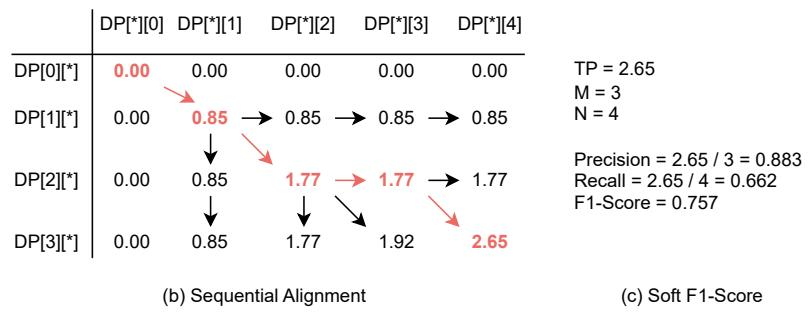  
Figure 6: Illustration of the SODA-Embedding metric. (a) A semantic similarity matrix is computed (predicted M = 3, ground-truth N = 4). (b) An optimal, order-preserving alignment path is found via dynamic programming, yielding a “soft” True Positive (TP) sum of 2.65. (c) The final F1-Score is calculated from this $T P$ sum, robustly handling different chain lengths.

(iii) Causal-QA reward $( R _ { q a } ) { : }$ We pass the generated chain $o _ { i }$ as sole context to the fixed judge LLM (Qwen2.5-3B-Instruct) and measure its accuracy acc $( o _ { i } , \mathcal { Q } )$ on the MCQ bank Q associated with the clip (Section 3.2.2). This reward applies to clips that have a Causal-QA bank; for all others it is set to 0.

$$
R _ { q a } ( o _ { i } , \mathcal { Q } ) = \left\{ \begin{array} { l l } { \operatorname { a c c } ( o _ { i } , \mathcal { Q } ) } & { \mathrm { i f ~ v a l i d } \land | \mathcal { Q } | > 0 } \\ { 0 } & { \mathrm { o t h e r w i s e } } \end{array} \right.\tag{7}
$$

## E Evaluation with a held-out judge

A natural concern with GRPO fine-tuning is that improvements on SODA-Embedding and Causal-QA could partly reflect optimization against the reward signal itself, rather than a genuine improvement in causal-chain reasoning. To assess this, we evaluate all models with a held-out LLM judge (GPT-5.6-Luna) that scores each response on a 0–5 scale and is never used as a reward signal during training.

As shown in Table 6, the held-out judge score improves monotonically from the pretrained base through SFT to SFT + GRPO on both benchmarks, tracking the trend observed in the reward-coupled metrics. On CMD-CC, the score rises from 2.59 (base) to 2.83 (SFT) to 2.92 (GRPO); on SF20K-CC, it rises from 2.41 to 2.55 to 2.58.

## F Reward ablation across initializations

Table 4 in the main paper reports the reward ablation for GRPO trained directly from the base model. For completeness, Table 7 reports the full ablation for both initializations, GRPO from scratch (no SFT) and GRPO on top of the SFT-merged model, under all four reward compositions, using a converged 8,192-example training budget. The two initializations specialize in opposite directions. From scratch, the Causal-QA reward drives the highest causal accuracy anywhere (37.8 Causal-QA on CMD-CC, with the SODA-E reward added back recovering chain quality at a small accuracy cost), since the policy chases the judge without a fluency prior. The SFT initialization instead yields the best chain quality (up to 63.3 SODA-E) but caps the Causal-QA gains, as the penalty toward the fluent SFT policy keeps chains well-formed yet prevents aggressive judge-chasing. Across both, format-only GRPO regresses below its initialization on both metrics, confirming that the semantic reward terms, not the format constraint, are what drive the gains.

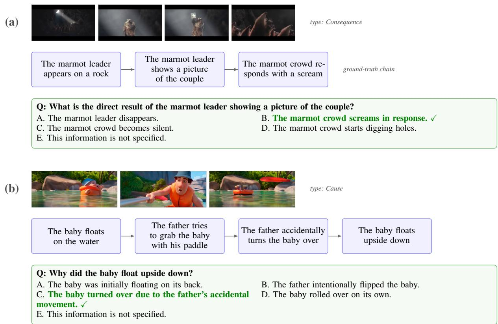  
Figure 7: Causal-QA examples. Two items spanning different causality types. For each, the source frames are shown above the ground-truth chain (event boxes read left to right), and the Causal-QA question is answerable only from the intermediate events. The correct option is highlighted.

Table 6: Held-out evaluation. Our two metrics and a held-out judge (GPT-5.6-Luna, 0–5 scale) across the training pipeline. The held-out judge appears in no reward term.
<table><tr><td></td><td colspan="3">CMD-CC</td><td colspan="3">SF20K-CC</td></tr><tr><td>Method</td><td>SODA-E</td><td>CQA</td><td>Judge</td><td>SODA-E</td><td>CQA</td><td>Judge</td></tr><tr><td>Base</td><td>54.6</td><td>21.5</td><td>2.59</td><td>52.7</td><td>16.5</td><td>2.41</td></tr><tr><td>SFT</td><td>62.3</td><td>24.6</td><td>2.83</td><td>56.6</td><td>19.3</td><td>2.55</td></tr><tr><td>SFT + GRPO</td><td>63.3</td><td>29.4</td><td>2.92</td><td>57.9</td><td>22.1</td><td>2.58</td></tr></table>

## G Test-time scaling

At inference time we can trade compute for quality by sampling several candidate chains from the GRPO-fine-tuned policy and selecting one with a reference-free selector. We use judge selfconsistency: each candidate is scored by the agreement of the fixed judge LLM’s answers on the candidate’s own auto-generated MCQ bank, and the highest-scoring candidate is returned. Table 8 sweeps the number of samples k: both metrics improve monotonically with k and saturate around k = 16, lifting CMD-CC SODA-Embedding from 54.9 (k = 1) to 60.0 and Causal-QA from 27.5 to 29.9. These runs use the 150-clip CMD-CC subset supported by the selection pipeline, so they are not directly comparable to the main results.

## H Metric validation analysis

Table 9 reports the per-operator success rates summarized in Figure 5 (top): for every perturbation operator, text-embedding metrics dominate n-gram metrics, and robustness improves with the scale of the base embedding model.

1 %\ begin { lstlisting }[ language =json ,   
basicstyle =\ ttfamily \ small ]   
2 {   
3 " causal\_chain ": [   
4 {   
5 " timestamp ": "mm:ss -mm:ss",   
6 " event ": " Event 1 ( Start event )   
11   
7 $\begin{array} { c }  { \} } \\ { { \{ \begin{array} { r l } \end{array} } } \end{array}$   
8   
9 " timestamp ": "mm:ss -mm:ss",   
10 " event ": " Event 2 ( Intermediate   
)"   
11 } ,   
12   
13 {   
14 " timestamp ": "mm:ss -mm:ss",   
15 " event ": " Event { num\_events } (   
End event )"   
16 }   
17 ]   
18 }  
Figure 8: JSON output schema. The strict JSON formatting template enforced during generation to ensure valid causal chain structure.

Table 10 reports the full pairwise metaevaluation summarized in Figure 5 (bottom). Over 256 stratified A/B pairs (128 CMD-CC, 128 SF20K), we report each metric’s agreement with the majority human preference, a 95% bootstrap confidence interval, and Kendall’s τ = 2 acc − 1 on decided pairs. All embedding-based metrics (76–79%) outrank all lexical metrics. The decisive comparison is SODA-E against its exact lexical ablation SODA-C, which retains the SODA alignment but substitutes METEOR for the embedding scorer: 79.2% versus 66.1% $( p < 0 . 0 0 1$ , paired McNemar), indicating that the embedding scorer accounts for the gain. Across SODA-E variants, agreement increases with the capacity of the underlying encoder: 76.2% with MiniLM-L6-v2, 78.5% with Qwen3-Embedding-0.6B, and 79.2% with Qwen3-Embedding-4B, which we adopt. Each pair was judged independently by three human annotators, with strong inter-annotator agreement (Fleiss’ κ = 0.881).

Robustness to the underlying models. Table 11 details the rank-stability experiment summarized in Section 5.1. We score a fixed panel of nine systems on both test sets, then vary only the metric’s auxiliary model: the SODA-Embedding text embedder (Qwen3-Embedding-0.6B/4B/8B and the cross-family all-MiniLM-L6-v2) or the Causal-QA judge (Qwen2.5-Instruct-0.5B/3B/7B, the cross-family Llama-3.1-8B-Instruct, and the recent cross-family Gemma-3-12B-it). For each variant we report how closely the system ranking it induces matches the ranking from our default model (Qwen3-Embedding-4B for SODA-E, Qwen2.5- 3B-Instruct for Causal-QA), as the percentage of system pairs ordered identically, the Spearman ρ, and the Kendall τ. Rather than collapsing these into a mean, which would hide the single weak model, we list every variant separately.

Table 7: Reward ablation across initializations. GRPO-fine-tuned Qwen3.5-9B under all four reward compositions $( R _ { \mathrm { f o r m a t } }$ always on; $\mathbf { S } = R _ { \mathrm { S O D A - E } } ,$ C = $R _ { \mathrm { C a u s a l - Q A } } )$ , trained from the base model (scratch) or on top of the SFT-merged model (SFT), at a converged 8,192-example budget. The scratch block is the fromscratch ablation condensed in Table 4. Best per column in bold; the from-scratch F+C SF20K cell has no trained eval.
<table><tr><td rowspan="2">Init</td><td rowspan="2">Reward</td><td colspan="2">CMD-CC</td><td colspan="2">SF20K-CC</td></tr><tr><td>SODA-E</td><td>CQA</td><td>SODA-E</td><td>CQA</td></tr><tr><td rowspan="4">Scratch</td><td>F</td><td>55.4</td><td>17.7</td><td>53.9</td><td>12.9</td></tr><tr><td>F+S</td><td>60.1</td><td>26.8</td><td>58.8</td><td>17.7</td></tr><tr><td>F+C</td><td>57.0</td><td>37.8</td><td>54.9</td><td>26.0</td></tr><tr><td>F+S+C</td><td>58.9</td><td>32.2</td><td>57.2</td><td>24.9</td></tr><tr><td rowspan="4">SFT</td><td>F</td><td>57.8</td><td>18.3</td><td>53.9</td><td>14.1</td></tr><tr><td>F+S</td><td>63.3</td><td>25.5</td><td>59.3</td><td>18.1</td></tr><tr><td>F+C</td><td>62.9</td><td>27.8</td><td>56.2</td><td>24.1</td></tr><tr><td>F+S+C</td><td>63.3</td><td>29.4</td><td>57.9</td><td>22.1</td></tr></table>

Table 8: Test-time scaling of GRPO-fine-tuned Qwen3.5-VL-9B: sampling k candidate chains and selecting one by judge self-consistency. Evaluated on the 150-clip CMD-CC subset and the SF20K-CC clips supported by the selection pipeline; not directly comparable to the main tables. Best per column in bold.
<table><tr><td rowspan="2">k</td><td colspan="2">CMD-CC</td><td colspan="2">SF20K-CC</td></tr><tr><td>SODA-E</td><td>CQA</td><td>SODA-E</td><td>CQA</td></tr><tr><td>1</td><td>54.9</td><td>27.5</td><td>53.4</td><td>18.1</td></tr><tr><td>2</td><td>56.9</td><td>27.6</td><td>53.4</td><td>18.5</td></tr><tr><td>4</td><td>58.4</td><td>28.9</td><td>54.3</td><td>20.1</td></tr><tr><td>8</td><td>59.4</td><td>29.3</td><td>53.9</td><td>18.9</td></tr><tr><td>16</td><td>60.0</td><td>29.9</td><td>54.7</td><td>18.5</td></tr><tr><td>32</td><td>59.8</td><td>29.9</td><td>54.7</td><td>20.9</td></tr></table>

The rankings are preserved across both model size and model family. SODA-Embedding agrees with its 4B reference at ≥ 91% (Spearman $\rho \geq$ 0.91) for every embedder, including the crossfamily all-MiniLM-L6-v2, even though the latter shifts absolute scores down by roughly 13 points. Causal-QA is equally stable whenever the judge is competent: the 7B Qwen judge and the two cross-family judges (Llama-3.1-8B and the 2025 Gemma-3-12B) reproduce the 3B reference ranking $\mathrm { a t } \geq 8 5 \%$ agreement. The lone exception is the 0.5B judge, whose accuracy is nearly flat across systems (close to the one-in-five chance band), so it cannot discriminate and falls to near-chance agreement $( \rho \approx 0 )$ on the smaller SF20K set. We therefore adopt Qwen3-Embedding-4B and Qwen2.5- 3B-Instruct.

Table 9: Perturbation analysis of the SODA-Embedding metric.
<table><tr><td>Metric</td><td>Sim</td><td>LLM</td><td>Swapping</td><td>Shuffling</td><td>Intruder Sentence</td><td>Random Sequence</td></tr><tr><td>Random</td><td>-</td><td></td><td>50.00</td><td>50.00</td><td>50.00</td><td>50.00</td></tr><tr><td>CIDEr</td><td>N</td><td></td><td>45.6</td><td>56.1</td><td>67.7</td><td>75.8</td></tr><tr><td>BLEU-1</td><td>N</td><td></td><td>40.3</td><td>40.3</td><td>67.7</td><td>87.0</td></tr><tr><td>ROUGE-L</td><td>N</td><td></td><td>35.0</td><td>49.1</td><td>70.9</td><td>90.3</td></tr><tr><td>METEOR</td><td>N</td><td></td><td>61.4</td><td>70.1</td><td>77.4</td><td>91.9</td></tr><tr><td>Sentence-BERT</td><td>T</td><td>BERT</td><td>61.4</td><td>61.4</td><td>83.8</td><td>96.7</td></tr><tr><td>Qwen3-Embedding-0.6B</td><td>T</td><td>Qwen3</td><td>71.9</td><td>71.9</td><td>85.4</td><td>100.0</td></tr><tr><td>Qwen3-Embedding-4B</td><td>T</td><td>Qwen3</td><td>71.9</td><td>77.1</td><td>87.0</td><td>100.0</td></tr><tr><td>Oracle</td><td>-</td><td></td><td>100.0</td><td>100.0</td><td>100.0</td><td>100.0</td></tr></table>

Table 10: Agreement with human judgment. Pairwise meta-evaluation over 256 A/B pairs: a metric agrees when the prediction it scores higher is the one annotators prefer. We report agreement, a 95% bootstrap confidence interval, and Kendall τ = 2 acc − 1 on decided pairs. SODA-C is the lexical ablation of SODA-Embedding (same alignment, METEOR scorer). Embedding metrics are in bold.
<table><tr><td>Metric</td><td>Family</td><td>Agree.</td><td>T</td></tr><tr><td>SODA-E (Qwen-4B) SODA-E (Qwen-0.6B)</td><td>embed embed</td><td>79.2 78.5</td><td>.584 .570</td></tr><tr><td>BERTScore SODA-E (MiniLM) ROUGE-L</td><td>embed embed lexical</td><td>77.3 76.2 72.0</td><td>.547 .523 .441</td></tr><tr><td>SODA-C CIDEr</td><td>lexical lexical</td><td>66.1 63.9</td><td>.323 .278</td></tr></table>

## I Baseline setup

We evaluate four families of systems with SODA-Embedding and Causal-QA: (i) end-to-end VLMs of varying scale (the Qwen3.5-VL family, 0.8B–27B (Team, 2025), GLM-4.6V-flash (GLM-V Team, 2025), and InternVL-3.5-8B (Wang et al., 2025b)); (ii) proprietary models (GPT-5.4- nano/mini (OpenAI, 2025)); (iii) causal-reasoning baselines (a chain-of-thought “thinking” variant, MECD (Chen et al., 2024b), and TEMPURA-3B (Cheng et al., 2025)); and (iv) two-stage caption-then-reason pipelines. Each model is run under one of two input conditions: the full video sampled at 1 FPS, or a truncated clip centered on the causal chain from which we sample 32 frames (≈1 FPS over the clip). Open-weights models use the full video; the proprietary GPT-5.4 and Gemini models are restricted to the truncated-clip condition by API constraints (the two conditions are comparable, see Appendix K). All models receive the clip’s subtitle transcript and the ground-truth number of events. We further report three trivial references: Random, a shuffled chain over a generic event vocabulary; Guessing, a text LLM given only the query; and Blind, a text LLM given only the subtitle transcript and no frames. Metric values use Qwen3-Embedding-4B (SODA-Embedding) and Qwen2.5-3B-Instruct (Causal-QA), in line with Section 3.2.

Table 11: Metric robustness. Per-model stability of system rankings when only the metric’s underlying model is varied. For each variant we report agreement with the default-model ranking (% of system pairs ordered identically), Spearman $\rho ,$ and Kendall τ, on both test sets. References: Qwen3-Embedding-4B (SODA-E), Qwen2.5- 3B-Instruct (Causal-QA). †: cross-family model.
<table><tr><td rowspan="2">Metric</td><td rowspan="2">Model</td><td colspan="3">CMD-CC</td><td colspan="3">SF20K</td></tr><tr><td>Agr.</td><td>ρ</td><td>T</td><td>Agr.</td><td>ρ</td><td>T</td></tr><tr><td rowspan="3">SODA-E</td><td>0.6B</td><td>97</td><td>.97</td><td>.94</td><td>97</td><td>.98</td><td>.94</td></tr><tr><td>8B</td><td>100</td><td>.99</td><td>1.00</td><td>100</td><td>1.00</td><td>1.00</td></tr><tr><td>MiniLM†</td><td>94</td><td>.95</td><td>.89</td><td>91</td><td>.91</td><td>.83</td></tr><tr><td rowspan="4">Causal-QA</td><td>0.5B</td><td>89</td><td>.92</td><td>.78</td><td>52</td><td>-.02</td><td>.03</td></tr><tr><td>7B</td><td>97</td><td>.98</td><td>.94</td><td>89</td><td>.90</td><td>.77</td></tr><tr><td>Gemma-12B†</td><td>94</td><td>.95</td><td>.89</td><td>85</td><td>.82</td><td>.71</td></tr><tr><td>Llama-8B†</td><td>100</td><td>1.00</td><td>1.00</td><td>85</td><td>.84</td><td>.71</td></tr></table>

## J Baseline scaling

Figure 9 sweeps two axes for the Qwen3.5-VL family on the full video. With model size, performance rises steeply up to 4B and then largely saturates— SODA-Embedding climbs from 18.0/20.8 (0.8B) to 53.3/53.2 (4B) on SF20K-CC/CMD-CC, with only marginal gains beyond. With the number of input frames, returns are roughly logarithmic: going from 32 to 256 frames adds +6.1 Causal-QA points on CMD-CC and +4.6 on SF20K-CC, whereas SODA-Embedding saturates around 128 frames. Causal-QA is thus the more frame-hungry axis.

## K Full vs. truncated video

Our proprietary baselines are restricted by API limits to a truncated clip centered on the causal chain (32 sampled frames), whereas open-weights models see the full video at 1 FPS. To verify this does not confound the comparison, we run the same backbone (Qwen3.5-VL-9B, with subtitles) under both conditions (Table 12). The two conditions differ by at most ∼2 points on either metric and either test set, and leave the system ranking unchanged. We therefore treat the full-video and truncated-clip conditions as comparable and place all baselines in a single table (Table 2).

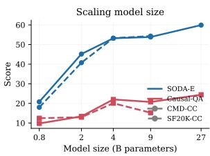

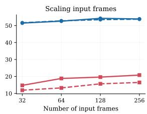  
Figure 9: Baseline scaling for the Qwen3.5-VL family on the full video. Left: vs. model size (0.8B–27B); both metrics rise steeply up to 4B and then saturate. Right: vs. number of input frames for the 9B model; Causal-QA keeps rising while SODA-Embedding saturates around 128 frames.

Table 12: Full vs. truncated video for Qwen3.5-VL-9B (with subtitles). Sampling the full video at 1 FPS and sampling 32 frames from a clip centered on the chain give near-identical scores.
<table><tr><td rowspan="2">Condition</td><td colspan="2">CMD-CC</td><td colspan="2">SF20K-CC</td></tr><tr><td>SODA-E</td><td>CQA</td><td>SODA-E</td><td>CQA</td></tr><tr><td>Full video (1 FPS)</td><td>53.8</td><td>20.7</td><td>54.3</td><td>15.3</td></tr><tr><td>Truncated clip (32 frames)</td><td>54.6</td><td>21.5</td><td>52.7</td><td>16.5</td></tr><tr><td>∆</td><td>+0.8</td><td>+0.8</td><td>-1.6</td><td>+1.2</td></tr></table>

## L Difficulty breakdown

Figure 10 slices CMD-CC Causal-QA along three axes, comparing GPT-5.4-mini, Qwen3.5-VL-9B with subtitles, and a text-only control that sees the subtitles but no frames. Causality types follow a stable hardness ordering across all models, with consequence the hardest and motivation the easiest among the well-populated types, while counterfactual appears easy but rests on very few questions (29 on CMD-CC) and is exploitable by the judge, so we read it with caution. Performance is essentially flat in chain length, with neither metric decaying from short to long chains. Most strikingly, dialogue availability dominates: every model that sees subtitles scores +11 to +20 Causal-QA points higher on with-dialogue clips than on silent ones, and on with-dialogue clips the text-only control rivals the video model. Stripping the subtitle track from Qwen3.5-VL-9B erases this advantage entirely (−4.2 on CMD-CC), confirming it comes from the subtitle text rather than from dialogue clips being intrinsically easier to watch.

Table 13: Causality-type distribution across the CCG test sets (% of chains; CMD-CC over 1,031 chains). Per-type labels are annotated by an LLM classifier.
<table><tr><td>Causality type</td><td>CMD-CC</td><td>SF20K-CC</td></tr><tr><td>Motivational</td><td>35.8%</td><td>33.7%</td></tr><tr><td>Psychological</td><td>30.6%</td><td>14.7%</td></tr><tr><td>Physical</td><td>24.2%</td><td>45.3%</td></tr><tr><td>Enabling</td><td>8.3%</td><td>5.3%</td></tr><tr><td>Other</td><td>1.2%</td><td>1.1%</td></tr></table>

## M Causal chain type distribution

Table 13 reports how the four-type taxonomy (Section 3.3) is distributed across the test sets. Motivational, Psychological, and Physical together cover over 90% of chains; Enabling is rare and Other is negligible, so the taxonomy fits the data. The split character differs intuitively: dialogue-rich CMD-CC skews toward intent (Motivational + Psychological ≈66%), whereas the whole-film SF20K skews Physical (45%).

## N Success and failure cases

We present a qualitative analysis of the baselines performance using examples from GPT-4.1-mini, as illustrated in Figure 11. These examples highlight both the emerging reasoning capabilities of VLMs and their persistent limitations in tracking specific causal mechanisms.

Success cases. In the first example (Row 1), the model successfully identifies the use of the stretcher as a physical solution for crossing the gap. In the second example (Row 2), the model understands the key reason, the vending machine getting stuck, that drives the man to hit the vending machine.

Failure cases. Despite these successes, the model frequently struggles with complex visual causalities, often resorting to generic events or hallucinations. In the third example (Row 3), the model does not notice the brief action that leads to the helicopter falling from the mountain (“The rescue worker hits the helicopter’s propellers with his skis”); instead, it generates a generic event (“The helicopter takes off and approaches the mountain”), making the subsequent crash logically inexplicable. In the fourth example (Row 4), the model fails to connect the inattentiveness of the driver looking for cigarettes and near collision with another car, causing the driver to suddenly and violently brake, making him sick and causing him to vomit inside his car. Instead, it hallucinates a completely unrelated event: “The man finds cigarettes and lights one but suddenly the tire of his car bursts”. This illustrates a tendency for models to generate events that are logically plausible but not grounded in the video content.

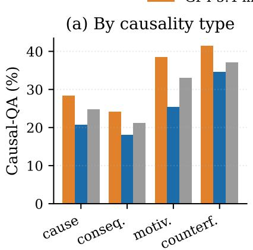

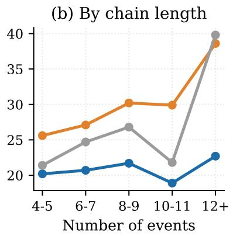

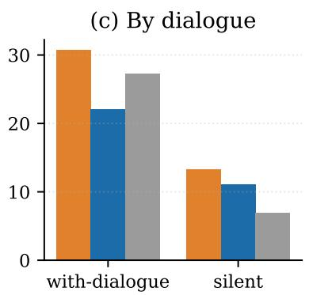  
Figure 10: Where the difficulty lives. Causal-QA accuracy on CMD-CC sliced by (a) causality type, (b) gold chain length, and (c) dialogue availability, for GPT-5.4-mini, Qwen3.5-9B (full video with subtitles), and a text-only control that sees the subtitles but no frames. Dialogue is the sharpest axis: silent movies are significantly harder to understand.

## O Prompts

In this section, we provide the exact prompts used for both the automated chain-construction pipeline (Section 3.3) and the evaluation of Vision-Language Models (VLMs) (Section 5.2).

Synthetic data generation. To transform the raw Audio Descriptions (AD) from the CMD-AD dataset into structured causal chains, we employ a Large Language Model (LLM) to filter and link events. We provided the LLM with the instructions detailed in Figure 13.

Baselines prompt. For the evaluation of all baseline models (GPT-4.1, Gemini-2.5, Qwen3-VL), we use a unified prompt structure to ensure a fair comparison (see Figure 12).

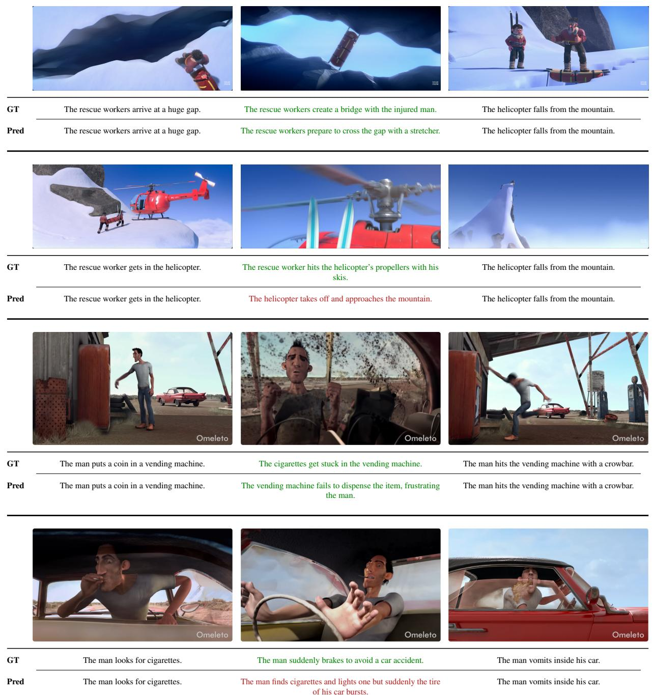  
Figure 11: Qualitative analysis. Comparison of ground-truth chains (top) vs. GPT-4.1-mini predictions (bottom). The examples illustrate successful physical (Row 1) and motivational reasoning (Row 2) contrasted with failures due to missed fine-grained visual details (Row 3) and hallucinations (Row 4).

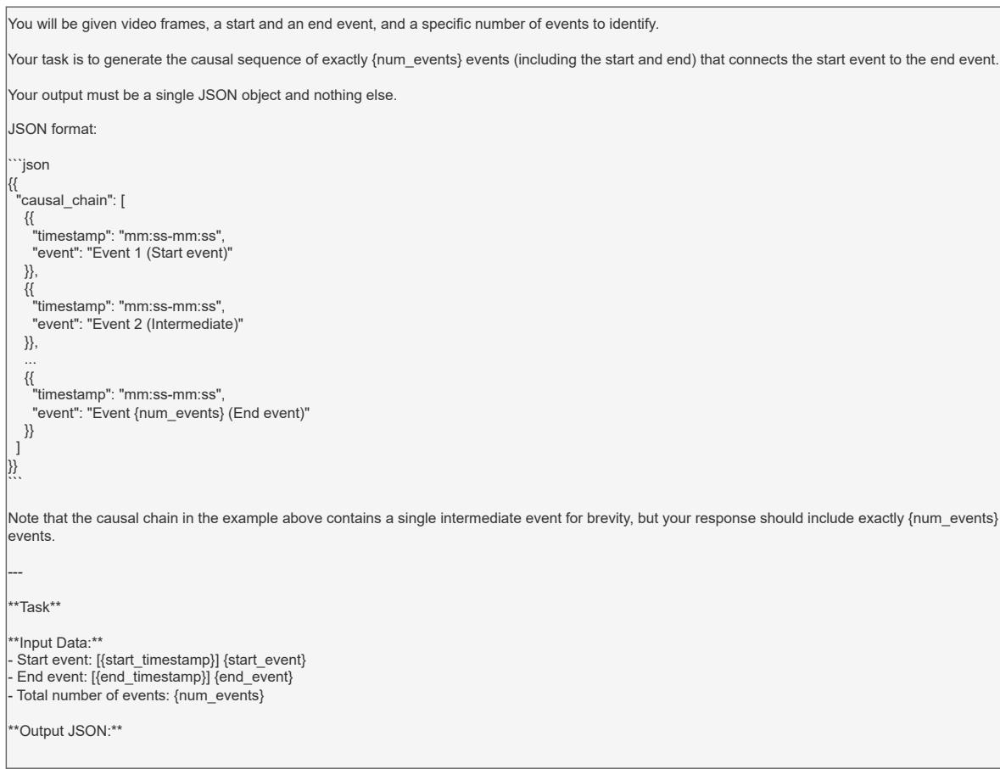  
Figure 12: Evaluation prompt. The unified prompt used to evaluate all baseline VLMs (GPT-4.1, Gemini-2.5, Qwen3-VL) on the Causal Chain Prediction task.

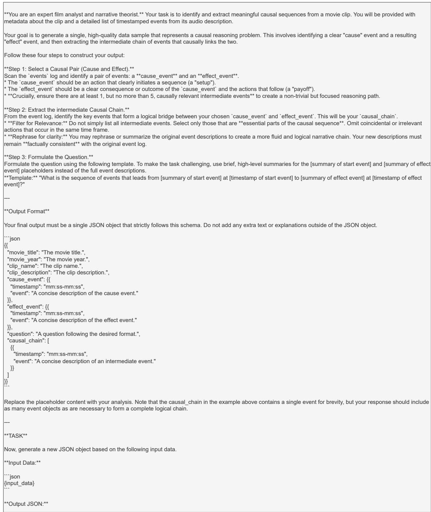  
Figure 13: Synthetic data generation prompt. The prompt used to instruct the LLM to filter raw Audio Descriptions and extract structured causal chains for the training set generation pipeline.

Algorithm 1 SODA-Embedding metric calculation   
Require: Predicted chain $P = ( p _ { 1 } , p _ { 2 } , \dotsb , p _ { m } )$   
Require: Ground-truth chain G =   
$( g _ { 1 } , g _ { 2 } , \ldots , g _ { n } )$   
Require: Pre-trained text encoder $\Phi ( \cdot )$ (i.e.,   
Qwen3-Embedding-4B)   
1: Step 1: Semantic Similarity Matrix   
2: $S \gets \mathbf { M a t r i x } [ m ] [ n ]$   
3: for $i \gets 1$ to m do   
4: for $j  1$ to n do   
5: $\boldsymbol { u } \gets \Phi ( p _ { i } )$   
6: $v  \Phi ( g _ { j } )$   
7: S[i][j] ← CosineSimilarity $( u , v )$   
8: end for   
9: end for   
10: Step 2: Sequential Alignment   
11: $D P  \mathbf { M a t r i x } [ m + 1 ] [ n + 1 ]$ initialized to 0   
12: for $i \gets 1$ to m do   
13: for $j  1$ to n do   
14: match $ D P [ i - 1 ] [ j - 1 ] + S [ i ] [ j ]$   
15: skip $p \gets D P [ i - 1 ] [ j ]$   
16: skip $\begin{array} { r } { g  D P [ i ] [ j - 1 ] } \end{array}$   
17: $D P [ i ] [ j ]$ ←   
max(match, skip\_p, skip\_g)   
18: end for   
19: end for   
20: Step 3: Soft F1-Score   
21: $T P _ { s o f t } \gets D P [ m ] [ n ]$   
22: Precision $ T P _ { s o f t } \ /$ m   
23: $R e c a l l \gets T P _ { s o f t } / n$   
24: if Precision + Recall > 0 then   
25: F1 ← 2 · Precision   
Recall/(Precision + Recall)   
26: else   
27: $F 1  0$   
28: end if   
29: return F1