# Functional Cross-layer Experts Routing for One-step Diffusion Distillation

Zile Huang Ser-nam Lim University of Central Florida zi057775@ucf.edu sernam@ucf.edu

## Abstract

One-step distillation compresses diffusion trajectories into a single forward evaluation, yet how internal capacity should be structured within that remaining pass remains largely unexplored. In this setting, identical parameters must simultaneously preserve general generative priors and resolve prompt-specific details without iterative refinement. We formalize this challenge asfunctional allocation. Our analysis reveals that decoupling representations is beneficial only when expert interference outweighs shared transfer, favoring an always-active shared backbone augmented with conditionally routed residuals over standard isolated MoE architectures. We propose DeMoE, which pairs a persistent shared expert with conditionally routed expert slices across image FFNs, trained under a one-step distribution-matching objective with executed-route supervision. On one-step FLUX.2-4B generation, DeMoE achieves a GenEval score of 0.8220 while activating only 80.5% of the image-FFN width—substantially outperforming dense one-step baselines, matching the 50-step teacher overall, and surpassing it on complex composition and counting. Across COCO-10K, DeMoE establishes state-of-the-art fidelity and diversity among single-step models, demonstrating that structured internal computation reallocation provides a superior compression paradigm for diffusion models. Code is available at https://github.com/toffeecat/demoe-ttt-router.

## 1 Introduction

Diffusion models (Ho et al., 2020; Song et al., 2020; Dhariwal and Nichol, 2021) have emerged as a dominant paradigm for generative modeling, advancing from discrete-time formulations to continuous-time score SDEs and deterministic ODE sampling (Song et al., 2021). While high-resolution synthesis is substantially facilitated by operating on compressed latent spaces (Rombach et al., 2022) and rectifying trajectories via flow matching (Lipman et al., 2022; Liu et al., 2022), iterative generation remains fundamentally constrained by inference latency. Consequently, one-step generation tasks a single forward pass with what iterative samplers previously accomplished over dozens of denoiser evaluations.

Despite this radical compression, that single pass remains a deep network: it must parse the prompt, compose objects, bind attributes, and render fine details before outputting an image, all without the opportunity to revisit or refine its predictions across consecutive diffusion steps. Compressing the sampling trajectory thus exposes a fundamental yet overlooked question: how should the computation preserved within this single pass be organized? Figure 2 (a) illustrates the structural differences among the three paradigms: the multi-step teacher evaluates its entire architecture iteratively, a dense one-step student evaluates it once, and DeMoE preserves the single forward pass while making internal computational pathways conditionally selectable.

Distribution Matching Distillation (DMD) serves as our starting point because it explicitly defines the learning objective for one-step students: it perturbs the generated endpoint and matches the student marginal to the teacher marginal at that perturbation, rather than forcing the student to reconstruct intermediate trajectory states (Yin et al., 2024b,a). However, optimizing a distribution-matching objective only constrains the terminal mapping, leaving the student’s internal capacity and execution pathways fundamentally flexible. In parallel, Transformers have increasingly replaced traditional convolutional U-Nets as scalable generative backbones (Peebles and Xie, 2023; Ma et al., 2024; Wang et al., 2025), wherein representation alignment strategies further accelerate training convergence (Yu et al., 2025). While sparse mixture-of-experts (MoE) and shared-expert paradigms already enable conditional execution (Shazeer et al., 2017; Fedus et al., 2022; Dai et al., 2024), and diffusion transformers have dynamically routed tokens, denoising tasks, or generation phases (Fei et al., 2024; Sun et al., 2024; Park et al., 2024; Fang et al., 2024; Park et al., 2023; Wang et al., 2025), our focus is more targeted: once a one-step student’s forward pass is partitioned into discrete pathways, which capabilities must remain shared, which variations warrant conditional branching, and what runtime signals should steer routing?

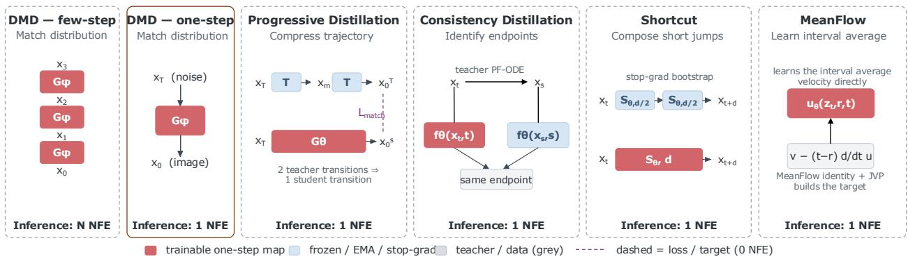  
Figure 1: Alternative ways to compress generative computation to one neural function evaluation. Few-step DMD retains an explicit sequence of state-dependent generator evaluations, whereas the remaining paradigms target one-step inference but introduce different forms of training structure. One-step DMD removes the explicit sampling trajectory and matches the target distribution directly. Progressive Distillation compresses multiple teacher transitions into one student transition; Consistency Distillation transfers cross-time endpoint consistency; Shortcut Models construct long transitions by composing shorter stop-gradient shortcuts; and MeanFlow directly parameterizes the average velocity over a finite interval. Thus, these methods differ primarily in how the one-step mapping is supervised, even when their deployed inference graph contains only one network evaluation. Red denotes the trainable one-step mapping, blue denotes frozen/EMA/stop-gradient computation, gray denotes teacher or data quantities, and dashed arrows denote losses or target construction.

Simply partitioning a feed-forward network (FFN) does not guarantee effective conditional computation; the bank must maintain specialized responses that benefit the current input, and the controller must reliably dispatch them. We therefore decouple intrinsic capability from runtime allocation. Our controlled studies confirm that when all experts are simultaneously active, the bank does not collapse into redundant replicates; furthermore, under a fixed computational budget, selecting alternative pathways yields distinct generative behaviors.

A local interaction analysis provides the foundational design rule for our proposed architecture. When distinct input groups induce conflicting first-order updates, isolating their pathways eliminates gradient interference. However, complete isolation simultaneously sacrifices beneficial positive transfer and dilutes group-specific gradient volume (Equation (4)). Rather than forcing experts to diverge maximally, this trade-off suggests that universally shared primitives should remain centralized, while conflicting or specialized updates should be cast as selectable residuals.

DeMoE operationalizes this principle within selected image FFNs. Each modified layer splits the image-token FFN into an invariant shared slice (which executes unconditionally) and seven routed slices (which are selected dynamically). A controller conditions on the current hidden state and text embedding to score candidate responses prior to execution, dispatching a hard top-k support alongside its execution amplitudes. Post-execution, the auxiliary target is backpropagated strictly through the executed pathways, ensuring the router is supervised directly on its realized actions rather than counterfactual proposals. Section 3 specifies the structural design, allocation strategy, and executed-response supervision. Our primary evaluation focuses on the 7E4A1S configuration with a frozen shared slice.

On one-step FLUX.2-4B generation, all-active partitions preserve the dense parent’s GenEval score within standard measurement intervals, establishing that function preservation holds across structural slicing. Under conditioned execution, our deployed configuration (7E4A1S) achieves an overall GenEval score of 0.8220 using only 80.5% of the dense image-FFN width. This performance significantly surpasses both the 1-NFE dense DMD2 baseline (0.7865) and the progressive continuation (0.7771), while performing on par with the 50-step dense teacher (0.8245) and overtaking it on fine-grained counting and multi-object composition. Across COCO-10K (Lin et al., 2015), it establishes the state of the art among 1-NFE models across both fidelity (FID 14.85, patch-FID 15.92 (Parmar et al., 2022)) and diversity metrics (Section 4). In summary, our contributions are threefold: (i) formulating functional allocation as a distinct post-compression design challenge; (ii) deriving the local separation trade-off that justifies combining shared backbones with routed residuals (Sections 2 and 3); and (iii) introducing DeMoE, which couples conditional execution with action-aligned supervision for single-step diffusion (Section 3).

## 2 Preliminaries and Design Principle

## 2.1 One-step distribution matching

Let $\vartheta = \left( \theta , \psi \right)$ denote student generator and controller parameters. Given noise $z \sim p _ { z }$ and condition $c ,$ the student predicts $\pmb { x } _ { 0 } = G _ { \vartheta } ( z , c )$ with noisy marginals $\pmb { x } _ { u } = \alpha _ { u } \pmb { x } _ { 0 } + \sigma _ { u } \pmb { \epsilon } \left( \pmb { \epsilon } \sim \mathcal { N } ( 0 , I ) \right)$ ). Distribution Matching Distillation (DMD) optimizes the perturbed endpoint marginals against target marginals $p _ { T , u }$

$$
{ \mathcal { L } } _ { \mathrm { D M } } ( \vartheta ) = \mathbb { E } _ { c , u } [ \lambda ( u ) D _ { \mathrm { K L } } ( q _ { \vartheta , u } ( \cdot  { \left| \begin{array} { l } { c } \end{array} \right) }  { \left\| \vphantom { \frac { 1 } { \vartheta _ { T , u } } } \right\| } p _ { T , u } ( \cdot  { \left| \begin{array} { l } { c } \end{array} \right) } ) ] .\tag{1}
$$

Denoting score functions $\pmb { \mathscr { s } } _ { q } = \nabla _ { \pmb { x } _ { u } } \log q _ { \vartheta , u } , \pmb { \mathscr { s } } _ { T } = \nabla _ { \pmb { x } _ { u } }$ log $p _ { T , u }$ , and Jacobian $J _ { \vartheta } = \partial G _ { \vartheta } / \partial \vartheta$ , the ideal pathwise gradient simplifies to

$$
\begin{array} { r } { \delta _ { u } = \lambda ( u ) \alpha _ { u } ( s _ { q } - s _ { T } ) , \qquad \nabla _ { \vartheta } \mathcal { L } _ { \mathrm { D M } } = \mathbb { E } [ J _ { \vartheta } ^ { \top } \delta _ { u } ] . } \end{array}\tag{2}
$$

Equation 2 highlights that $\delta _ { u }$ specifies only the output-space correction, whereas the network Jacobian $J _ { \vartheta }$ dictates how parameters realize it. The objective constrains what terminal distribution to match, leaving the internal organization across student depth ℓ flexible. In practice, detached corrections are implemented via the local surrogate detailed in Section C.2.

## 2.2 Update interactions and selective separation

At a reference checkpoint, let a index a realized correction demand with local gradient $\pmb { g } _ { a } = \nabla _ { \vartheta } \ell _ { a } ^ { \mathrm { l o c } }$ and weight $w _ { a }$ The first-order interaction between two demands is governed by the parameter-space kernel:

$$
I _ { a b } = \langle { \pmb g } _ { a } , { \pmb g } _ { b } \rangle = \delta _ { a } ^ { \top } J _ { a } J _ { b } ^ { \top } \pmb \delta _ { b } .\tag{3}
$$

Hence compatibility depends on mapped Jacobian geometry rather than output corrections alone: positive $I _ { a b }$ yields constructive transfer, while negative $I _ { a b }$ reflects gradient conflict and destructive interference (Yu et al., 2020; Go et al., 2023; Jeong and Yoon, 2025).

Parameter separation mitigates conflict, but complete isolation forfeits shared transfer. Under the local model formalized in Section C.5, the routed-versus-dense alignment difference satisfies

$$
A _ { a } ^ { R } - { \mathcal A } _ { a } ^ { D } = N _ { a } - P _ { a } - D _ { a } , \qquad { \mathrm { b e n e f i c i a l ~ w h e n } } \quad N _ { a } > P _ { a } + D _ { a } + E _ { a } ,\tag{4}
$$

where $N _ { a }$ is removed negative transfer, $P _ { a }$ is lost positive transfer, $D _ { a }$ is self-correction dilution, and $E _ { a }$ bounds portability error. This trade-off indicates that models should not pursue complete expert isolation; instead, transferable primitives should remain centralized within an always-active shared backbone, while conflicting specializations should be decoupled into conditionally routed residuals (Zhou et al., 2022; Puigcerver et al., 2024; Dai et al., 2024).

Functional allocation. Realizing this trade-off requires addressing capability (ensuring the bank preserves shared priors while exposing specialized alternatives) and allocation (dynamically dispatching these pathways via deployment visible states). Rather than assigning fixed semantic identities to routing labels, functional specialization is governed by executed responses and downstream effects. Section 3 operationalizes these insights into the DeMoE architecture.

## 3 DeMoE

DeMoE modifies the image-token FFNs of a one-step student while leaving the original attention, modulation, and residual structure intact. As illustrated in Figure 2, each modified block contains three components: an always-active shared path, a bank of routed FFN slices, and an optional depth-recurrent state used by the router. The shared path retains computation that is useful across inputs, whereas the routed slices provide alternative parameter subspaces that can be selected conditionally. The recurrent state summarizes what the current sample has already computed as it moves through network depth, allowing later routing decisions to depend on execution history rather than only on the instantaneous hidden representation.

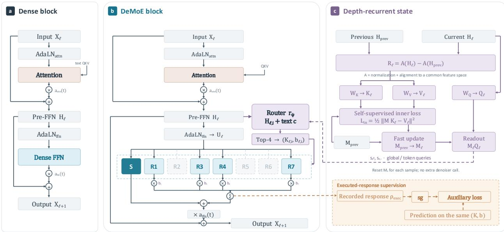  
Figure 2: DeMoE block and depth-recurrent routing. (a) Standard Image DiT block. (b) DeMoE preserves the original modulation, attention, and residual structure, but partitions the dense image FFN into an always-active frozen shared slice S and seven routed slices $R _ { 1 : 7 } .$ of which four are selected per token. Routing uses the pre-FFN hidden state and text condition, with the optional recurrent readout from (c). (c) The history variant maintains sample-private fas weights across depth: an aligned inter-layer residual provides keys and values for the inner update, while the current hidden state provides the query used to read the routing state.

## 3.1 Shared and Routed Functional Capacity

Let $H _ { \ell }$ denote the pre-FFN image-token representation at layer ℓ. We retain the original FFN AdaLN modulation and denote its output by $U _ { \ell }$ . At selected layers $\ell \in \mathcal { M }$ , the original dense image FFN is partitioned into one shared slice $S _ { \ell }$ and E routed slices $R _ { \ell 1 } , \ldots , R _ { \ell E }$

For token i, the router selects a support $\boldsymbol { \kappa } _ { \ell i }$ and associated execution amplitudes $b _ { \ell i e }$ . The resulting FFN response is

$$
Y _ { \ell i } = S _ { \ell } ( U _ { \ell i } ) + \sum _ { e \in \mathcal { K } _ { \ell i } } b _ { \ell i e } R _ { \ell e } ( U _ { \ell i } ) .\tag{5}
$$

The response is then passed through the same FFN modulation and residual connection as in the original block. DeMoE therefore changes how FFN capacity is allocated, rather than introducing an additional denoising step or replacing the surrounding Transformer computation. We abbreviate a routed bank as xEyAzS: x is the total number of routed slices, y is the number executed for each token, and z is the number of always-active shared slices. Our primary configuration is 7E4A1S: seven routed slices are available, four are selected for each token, and one shared slice executes unconditionally. The distinction between the shared and routed paths is important. We do not assume that every useful computation should be separated into an expert. Computation that transfers broadly across samples remains in the shared path, while the routed bank provides additional capacity for input-dependent variation. In the primary configuration, the shared slice is frozen and the routed slices are trainable. A token therefore updates only the routed parameters that it actually executes.

The recurrent state introduced below does not alter the expert transformations themselves. It influences the primary model only by changing which routed slices are selected and how strongly they are executed. This keeps the role of the state processor explicit: it allocates computation rather than redefining the computation stored in each expert.

## 3.2 Depth-Recurrent TTT State Processor

A router that only observes $H _ { \ell }$ knows the current representation but does not explicitly remember how that representation was reached. In a one-step student, however, network depth is the only opportunity for later computation to react to computation already performed earlier in the same forward pass. We therefore maintain a lightweight sample-private state across the selected DeMoE layers.

Let $\ell ^ { - }$ denote the preceding selected DeMoE layer. As shown in Figure 2, the previous and current hidden states are first normalized and aligned into a common feature space. Their difference forms an inter-layer residual, $R _ { \ell } ^ { \mathrm { s t a t e } }$ which describes the representation change realized since the previous routing decision. The recurrent processor treats this transition as an observation of the sample’s computational history. Linear projections of the aligned transition provide the key and value used to update a small fast-weight memory, while the current hidden state provides the query used to read it:

$$
\begin{array} { l l } { { { \displaystyle K _ { \ell } = W _ { K } R _ { \ell } ^ { \mathrm { s t a t e } } , } } } & { { \quad V _ { \ell } = W _ { V } R _ { \ell } ^ { \mathrm { s t a t e } } , \quad Q _ { \ell } = W _ { Q } { \bar { H } } _ { \ell } , } } \\ { { } } & { { \quad M _ { \ell } = M _ { \ell - } - \left. \eta _ { \ell } \nabla _ { M } \frac { 1 } { 2 } \| M K _ { \ell } - V _ { \ell } \| _ { F } ^ { 2 } \right| _ { M = M _ { \ell } - } , \quad s _ { \ell } = M _ { \ell } Q _ { \ell } . } } \end{array}\tag{6}
$$

Each generated sample starts from the same learned initialization $M _ { 0 }$ . The memory is updated only while that sample traverses the network and is discarded after generation. It is therefore an inference-time working state, not a persistent update to the model parameters.

This construction is deliberately self-contained. The memory sees only representations already produced during the student’s own forward pass. It does not require a teacher trajectory, a diffusion timestep recovered from the teacher, or an externally provided function label. The aligned residual tells the state processor what changed after the previous decision, while the current representation provides the context in which the next decision must be made.

The readout may be pooled to form a sample-level history signal or retained at token resolution. We use $s _ { \ell i }$ below for the state available to token $i ;$ broadcasting a global $s _ { \ell }$ is a special case.

## 3.3 State-Conditioned Expert Allocation

The router combines two sources of evidence. The first is instantaneous: the current image-token representation together with the text condition indicates what computation appears useful at the present layer. The second is recurrent: the state readout summarizes what earlier layers have already done for this sample. We combine the two contributions at the logit level:

$$
r _ { \ell i e } = w _ { h , e } ^ { \top } \mathrm { L N } ( H _ { \ell i } ) + w _ { c , e } ^ { \top } c + \gamma _ { \ell } w _ { s , e } ^ { \top } s _ { \ell i } , \qquad \gamma _ { \ell } = \mathrm { t a n h } ( \widetilde { \gamma } _ { \ell } ) .\tag{7}
$$

The first two terms recover a conventional content-conditioned router. The final term allows routing to depend on computation accumulated across depth. Initializing the history contribution near zero lets the recurrent policy grow gradually rather than immediately overriding the current-state router.

The logits are converted to soft routing scores, from which the top-k routed slices are selected. In the deployed 7E4A1S model, $k = 4$ . We explicitly distinguish three runtime quantities: the dense router scores, the selected support $\boldsymbol { \kappa } _ { \ell i }$ , and the execution amplitudes $b _ { \ell i e }$ applied in Equation (5). The support determines which expert computations actually run; the amplitudes determine how strongly their responses enter the FFN output. This distinction is also important during training. Routing statistics describe the policy proposed by the controller, whereas the executed support and amplitudes describe the action that actually affected the network. Our auxiliary supervision is therefore attached to the latter.

## 3.4 Learning from Executed Responses

After the routed slices execute, we record their realized contribution to the FFN output. This executed response is the weighted sum of the routed slices that were actually selected, using the same support $\boldsymbol { \kappa } _ { \ell i }$ and execution amplitudes $b _ { \ell i e }$ that participated in the forward pass. A lightweight predictor receives the same routing action together with the current hidden state, text condition, and recurrent state, and predicts the response produced by that action. The recorded routed response is detached and used as the auxiliary target. Consequently, the predictor is trained on the consequences of actions that actually occurred, rather than on hypothetical responses from experts that were not executed. This executed-response supervision serves a different role from the inner TTT update. The TTT objective updates the temporary sample-private memory from inter-layer feature transitions. The executed-response objective trains the persistent allocation machinery to understand the consequences of its own routing decisions. Together, they create a closed loop across depth: earlier layers execute a routed computation, the resulting transition updates the sample-private state, and later layers can use that state when selecting their own routed computation. The auxiliary target is stop-gradient, so the executed expert response cannot move merely to make the prediction problem easier. Gradients on the prediction side instead improve the machinery that associates the current state and routing action with their realized effect. Exact loss coefficients and tensor-level detach boundaries are specified in the implementation details.

Table 1: Main generation results. Bold marks the best 1-NFE value; the 50-NFE and 4-NFE columns are multi-step references. External published anchors are listed separately in Table 3.
<table><tr><td rowspan="4">Inference budget</td><td>4NFE</td><td rowspan="4"></td><td colspan="5">1 NFE</td></tr><tr><td>50 NFE Dense</td><td>Dense</td><td>Dense Dense</td><td>Dense</td><td>DeMoE</td><td>DeMoE</td><td>DeMoE</td></tr><tr><td>Teacher</td><td>DMD2 Cold start</td><td>DMD2</td><td>Progressive</td><td>3E1A1S</td><td>7E3A1S</td><td>7E4A1S</td></tr><tr><td></td><td></td><td></td><td></td><td></td><td></td><td></td></tr><tr><td>GenEval</td><td></td><td></td><td></td><td></td><td></td><td></td><td></td><td></td></tr><tr><td>Overall ↑</td><td>0.8245</td><td>0.8035</td><td>0.6888</td><td>0.7865</td><td>0.7771 0.9950</td><td>0.7415 0.9969</td><td>0.7812</td><td>0.8220</td></tr><tr><td>Single obj. ↑</td><td>0.9950</td><td>0.9980 0.9080</td><td>0.9910 0.7300</td><td>0.9980 0.9120</td><td>0.8920</td><td>0.8788</td><td>1.0000 0.9190</td><td>1.0000 0.9310</td></tr><tr><td>Two obj. ↑ Counting ↑</td><td>0.9180 0.6550</td><td>0.6320</td><td>0.5750</td><td>0.6150</td><td>0.5840</td><td>0.3156</td><td>0.6000</td><td>0.6720</td></tr><tr><td>Colors ↑</td><td>0.9380</td><td>0.9320</td><td>0.8720</td><td>0.9310</td><td>0.9120</td><td>0.9654</td><td>0.9260</td><td>0.9420</td></tr><tr><td>Position ↑</td><td>0.7350</td><td>0.7010</td><td>0.4530</td><td>0.6840</td><td>0.6750</td><td>0.6925</td><td>0.6720</td><td>0.7220</td></tr><tr><td>Col. attr. ↑</td><td>0.7060</td><td>0.6500</td><td>0.5120</td><td>0.5790</td><td>0.6046</td><td>0.6000</td><td>0.5700</td><td>0.6650</td></tr><tr><td>COCO-10K</td><td></td><td></td><td></td><td></td><td></td><td></td><td></td><td></td></tr><tr><td>FID↓</td><td></td><td>14.235015.6540</td><td>24.1811</td><td>17.8418</td><td>17.4520</td><td>21.6266</td><td>16.9240</td><td>14.8520</td></tr><tr><td>patch-FID ↓</td><td>16.1240</td><td>017.5180</td><td>24.9919</td><td>20.0999</td><td>19.5935</td><td>22.0837</td><td>18.6520</td><td>15.9210</td></tr><tr><td>sFID ↓</td><td>38.6510</td><td>042.1860</td><td>55.1873</td><td>51.0081</td><td>48.2150</td><td>67.5013</td><td>45.8210</td><td>40.2150</td></tr><tr><td>Precision ↑</td><td>0.7685</td><td>0.7480</td><td>0.7226</td><td>0.7110</td><td>0.7320</td><td>0.6400</td><td>0.7350</td><td>0.7715</td></tr><tr><td>Recall ↑</td><td>0.4582</td><td>0.4410</td><td>0.3338</td><td>0.4224</td><td>0.4167</td><td>0.3276</td><td>0.4295</td><td>0.4480</td></tr><tr><td>Cost (descriptive; no cell is bolded)</td><td></td><td></td><td></td><td></td><td></td><td></td><td></td><td></td></tr><tr><td></td><td>1.000</td><td>1.000</td><td>1.000</td><td>1.000</td><td>1.000</td><td>0.500</td><td>0.740</td><td></td></tr><tr><td>Active FFN share Active params (B)</td><td>4.0</td><td>4.0</td><td>4.0</td><td>4.0</td><td>4.0</td><td>3.45</td><td>3.45</td><td>0.805 3.59</td></tr><tr><td>Latency (s/img)</td><td>4.3224</td><td>0.7432</td><td>0.1990</td><td>0.1858</td><td>0.1912</td><td>0.2108</td><td>0.2224</td><td>0.2256</td></tr><tr><td></td><td>16.69</td><td></td><td>16.68</td><td>16.68</td><td>16.68</td><td>46.77</td><td>39.52</td><td></td></tr><tr><td>Peak memory (GB)</td><td></td><td>16.68</td><td></td><td></td><td></td><td></td><td></td><td>39.96</td></tr></table>

## 4 Experiments

## 4.1 Evaluation protocol

We evaluate FLUX.2 [klein] 4B Base as the 50-NFE dense teacher and the distilled FLUX.2 [klein] 4B checkpoint as both a four-NFE reference and the warm-start initialization for the one-step students (Black Forest Labs, 2026a,b). Our controlled 1-NFE comparison contains three dense models—cold start, the DMD2 parent, and a progressive continuation—and three sparse DeMoE variants: 3E1A1S, 7E3A1S, and 7E4A1S. All one-step models use the DMD2 objective (Yin et al., 2024a). Published one-step methods are reported separately in Table 3; because they use different backbones, data, or evaluation protocols, we treat them as context rather than controlled baselines.

We measure compositional alignment with GenEval (Ghosh et al., 2023) on all 553 prompts with four samples per prompt. Distributional quality is evaluated on COCO-10K (Lin et al., 2015) using FID and patch-FID through the Clean-FID stack (Parmar et al., 2022), together with sFID, precision, and recall from the ADM evaluation stack (Dhariwal and Nichol, 2021; Kynkäänniemi et al., 2019). Latency is end-to-end wall-clock time per image on one NVIDIA RTX PRO 6000WS. For GenEval, bootstrap resampling is clustered by prompt so that the four images generated from one prompt are not treated as independent observations.

## 4.2 Main results: one-step quality and compute

Table 1 shows a consistent advantage for the flagship 7E4A1S configuration among the controlled 1-NFE models. GenEval overall rises from 0.7865 for dense DMD2 to 0.8220, with particularly large gains on counting (0.6150→0.6720), two-object composition (0.9120→0.9310), position (0.6840→0.7220), and color attribution (0.5790→0.6650). The resulting 0.8220 overall score is close to the 50-NFE teacher’s 0.8245, while the one-step model

a Every response aligns with its target

Four-band bank / 64 confirmation prompts

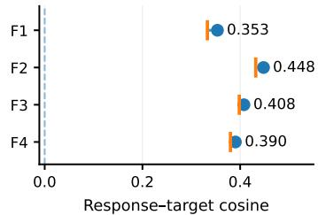  
Dots: means; ticks: simultaneous lower bounds.  
b Input-local coefficients vary across functions

Local mean ± SD; fixed global coefficients  
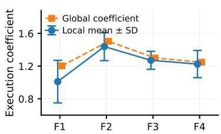  
c Local choice improves paired teacher fit  
4-active and Top-2 / lower error is better  
Whiskers: across-input SD, not confidence intervals.

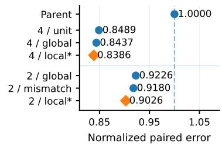  
\* Local = teacher-informed paired-target oracle.  
d Correct ownership beats every control  
16/16 prompt wins vs. the strongest control

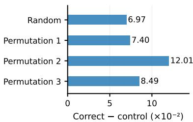  
e Independent draws retain positive utility  
Correct mean: 0.06975. Bars: mean advantages.  
64 prompts / two independent DMD2 draws  
f Fitted directions beat routing controls

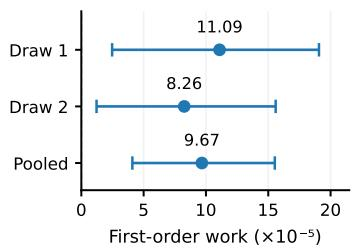  
Frozen F156d bank / independent DMD2 draws

Whiskers: prompt-clustered 95% intervals.  
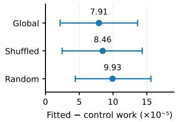  
Paired prompt-clustered 95% intervals.  
Figure 3: Functional allocation evidence. Response alignment, input-dependent execution, ownership, and independent-draw route work.

exceeds that teacher on counting and two-object composition. The compact 3E1A1S variant exposes the expected capacity trade-off: it obtains the strongest color score but loses substantially on counting. The COCO results show the same pattern at the distribution level. 7E4A1S improves over dense DMD2 from 17.8418 to 14.8520 FID, from 20.0999 to 15.9210 patch-FID, and from 51.0081 to 40.2150 sFID, while precision increases from 0.7110 to 0.7715 and recall from 0.4224 to 0.4480. These gains do not yet translate into wall-clock acceleration in the current implementation. 7E4A1S activates 80.5% of the image-FFN width and 3.59B parameters, but its measured latency is 0.2256 s/image versus 0.1858 s/image for dense DMD2. We therefore interpret the present result as compute reallocation: sparse execution reduces active FFN work, while specialized kernels are still needed to convert that structural sparsity into end-to-end speedup.

## 4.3 Why the expert bank is useful

Before asking a router to choose among experts, we test whether partitioning preserves a usable parent and whether the resulting responses non-interchangeable. With every slice active, 4-, 8-, and 16-way partitions obtain GenEval scores of 0.7862, 0.7828, and 0.7860 versus 0.7865 for the dense parent; the prompt-clustered comparison does not resolve a population-level change. This establishes the starting condition for specialization without requiring sparse routing to reconstruct an already-damaged parent. Figure 3 then probes the bank at progressively stronger levels. First, four controlled response writers are each positively aligned with their assigned targets, while their fitted execution coefficients vary across inputs. Second, local selection improves the paired teacher objective: with all four responses available, local coefficients reduce normalized error to 0.8386 versus 0.8437 for a fixed global mixture; under the stricter Top-2 budget, the local oracle reaches 0.9026 compared with 0.9226 for a global Top-2 choice and 0.9180 for prompt-mismatched selection. Thus useful capacity is present, and its value depends on which responses are executed.

A separate ownership intervention gives the same conclusion from the parameter side. Correct ownership ha mean paired benefit 0.06975, whereas the measured random control is approximately zero and all three ownership permutations are worse; correct ownership beats the strongest control on all 16 confirmation prompts. Finally, the fitted local directions retain positive first-order DMD2 work on two independent evaluation draws. The pooled work i

## a Allocation demand depends on content

16 prompts × 8 shared noise realizations / fixed = 1  
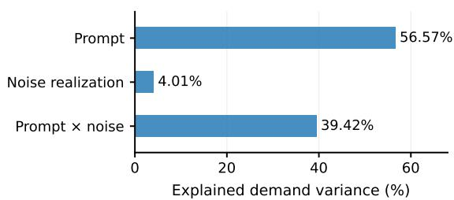  
Top-2 agreement: same prompt 0.790; same noise 0.734. Noise realizations are compared at the same physical .

## b Prompt factors transfer across draws

Leave-cell-out utility / same controlled crossed bank  
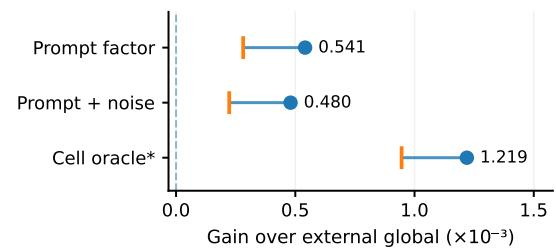  
Ticks: 99% one-sided lower bounds. \* Target oracle. Non-oracle factor estimates exclude the scored cell.

## c Student state predicts response preference

Response-ranking probe / current versus history

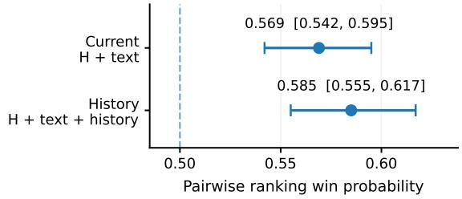  
Dashed line: chance (0.5). Bars: reported 95% intervals.  
3 routed experts / Top-1 / depth 24 / 48 prompts

## d Fitted routes beat global controls

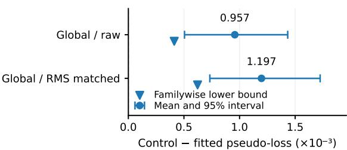  
Both familywise lower bounds are positive. Full registered control family: Appendix supplement.

Figure 4: Routing demand and controller evidence. Crossed prompt/noise structure, state-based ranking, and finite routing against global controls.

$9 . 6 7 \times 1 0 ^ { - 5 }$ with prompt-clustered 95% interva $[ 4 . 1 0 , 1 5 . 5 3 ] \times 1 0 ^ { - 5 }$ , and the fitted direction also has positive paired advantages over global, shuffled, and random direction controls. These are mechanistic route-work measurements rather than end-to-end image-quality claims.

## 4.4 What information should the router use?

The previous experiments establish a supply of useful alternatives. We next ask whether the demand for those alternatives has stable input structure. A crossed experiment evaluates 16 prompts under the same eight initial latent noise realizations at fixed physical σ = 1. Prompt identity explains 56.57% of routing-demand variance, the noise realization explains 4.01%, and their interaction explains 39.42%. Top-2 agreement is correspondingly higher across noises for the same prompt (0.790) than across prompts sharing the same noise (0.734). Requested content is therefore a major stable source of expert demand, rather than routing being determined primarily by the initial noise draw.

The factorized result has measurable held-out value (Figure 4a,b). Relative to an external global selector, a leave-cell out prompt factor improves mean utility by $0 . 5 4 1 \times 1 0 ^ { - 3 }$ with a reported 99% one-sided lower bound of $0 . 2 8 1 \times 1 0 ^ { - 3 }$ adding the noise factor gives a $\phantom { + } 0 . 4 8 0 \times 1 0 ^ { - 3 }$ gain with lower bound $0 . 2 2 3 \times 1 0 ^ { - 3 }$ . A target-informed cell oracle reaches $1 . 2 1 9 \times 1 0 ^ { - 3 }$ improvement, indicating remaining allocation headroom. This crossed test establishes content-dependent structure across noise draws; it is not an unseen-prompt deployment evaluation. We then test information that is available inside the one-step student (Figure 4c). Current hidden state plus text ranks useful candidate responses with win probability 0.569 (95% interval [0.542, 0.595]), while adding sample-private within-forward history yields 0.585 ([0.555, 0.617]). Both are above the 0.5 chance line. The difference between the two conditions is not resolved, so the supported conclusion is that deployment-visible state is informative; the experiment does not require history to dominate current state.

A separate finite-action intervention asks whether prompt-specific routing can produce an executed advantage (Figure 4d). In that controlled three-expert, Top-1, depth-24 experiment, fitted prompt routes improve the recomputed full-DMD2 pseudo-loss over both the raw construction-global control $( 0 . 9 5 7 \times 1 0 ^ { - 3 } )$ and its RMS-matched version $( 1 . 1 9 7 \times 1 0 ^ { - 3 } )$ ; their registered familywise lower bounds are $0 . 4 1 3 \times 1 0 ^ { - 3 }$ and $0 . 6 2 2 \times 1 0 ^ { - 3 }$ , respectively. We use this result only for the narrow claim that prompt-dependent execution can beat input-independent global routing. The complete shuffled/random control family is retained in Appendix B.2 rather than collapsed into the claim.

Table 2: Every recorded variant and the scope it was measured in. Rows in different blocks use different evaluation stacks and must not be compared across the scope column. Sub-metrics report GenEval components (Single object maintains $\geq 0 . 9 9 0$ across valid runs and is omitted for width). Widths are nominal image-FFN activation ratios, not latency or total FLOPs. Bold marks the best measured value within the registered benchmark scope.
<table><tr><td>Variant</td><td>Scope</td><td>Over.</td><td>Count Two obj. Colors</td><td></td><td>Pos.</td><td>Col. attr. Width</td><td></td></tr><tr><td colspan="6">Registered full-population stack (same evaluation pipeline)</td><td></td><td></td></tr><tr><td>Dense DMD2-1, 5K</td><td>anchor</td><td>0.7865 0.6150</td><td>0.9120</td><td></td><td>0.93100.6840</td><td>0.5790</td><td>1.000</td></tr><tr><td>Earlier sparse v2</td><td>3E1A1S, 1/4 w.</td><td>0.74150.3156</td><td>0.8788</td><td></td><td>0.96540.6925</td><td>0.6000</td><td>0.500</td></tr><tr><td>Progressive sparse</td><td>3E2A1S→3E1A1S</td><td>0.70540.4520</td><td>0.8120</td><td></td><td>0.89800.5540</td><td>0.5244</td><td>0.500</td></tr><tr><td>DeMoE</td><td>7E3A1S</td><td>0.7812 0.6000</td><td>0.9190</td><td></td><td>0.92600.6720</td><td>0.5700</td><td>0.740</td></tr><tr><td>DeMoE</td><td>7E4A1S</td><td>0.8220 0.6720</td><td>0.9310</td><td></td><td>0.94200.7220</td><td>0.6650</td><td>0.805</td></tr><tr><td colspan="4">All-active partitions (every slice executes; a quality check, not sparse execution)</td><td></td><td></td><td></td><td></td></tr><tr><td>Soft-all 4 slices</td><td>all-active</td><td>0.78620.6140</td><td>0.9110</td><td></td><td>0.93200.6830</td><td>0.5812</td><td>1.000</td></tr><tr><td>Soft-all 8 slices</td><td>all-active</td><td>0.7828 0.6090</td><td>0.9080</td><td></td><td>0.92900.6780</td><td>0.5750</td><td>1.000</td></tr><tr><td>Soft-all 16 slices</td><td>all-active</td><td>0.78600.6150</td><td>0.9120</td><td></td><td>0.93000.6850</td><td>0.5780</td><td>1.000</td></tr><tr><td colspan="4">Legacy and incomplete lines (reported for completeness; excluded from main claims)</td><td></td><td></td><td></td><td></td></tr><tr><td>Legacy v2 HISTORY pre-fix</td><td></td><td>0.67650.3840</td><td>0.7850</td><td></td><td>0.87500.5320</td><td></td><td></td></tr><tr><td>E2 balanced soft-200 endpoint lost</td><td></td><td>0.75200.5120</td><td>0.8840</td><td></td><td>0.91500.6320</td><td>0.4950 0.5750</td><td>0.500 0.740</td></tr></table>

## 4.5 Robustness and alternative explanations

Additional optimization is not the whole effect. On 96 hard prompts selected because the original dense student failed, the dense parent, a continued dense run, and the shared DeMoE model resolve 19, 30, and 33 cases. Continued optimization therefore recovers a substantial fraction of failures, but the DeMoE configuration retains an gain on the same challenge set. We treat this as a targeted alternative-hypothesis control rather than a substitute for the full-population results in Table 1.

Evidence is deliberately separated across constructions. The bank-alignment, ownership, independent-gradient, crossed-demand, response-ranking, and finite-route experiments use different frozen banks and intervention protocols. Their role is to test successive necessary properties: preservation, useful alternatives, non-interchangeable ownership, structured demand, decodability, and executable routing value. They should therefore be read as a convergent mechanism chain, not as if every panel were measured from the final 7E4A1S checkpoint.

## 5 Discussion and Conclusion

Compressing diffusion to one step shifts the architectural question from when computation is performed to how the surviving computation is organized. DeMoE makes this explicit by separating shared computation from state-dependent routed computation within a single forward pass. Experiments show that partitioning preserves the dense parent, expert responses are non-interchangeable and input-dependent, and deployment-visible state carries routing-relevant information. The resulting 7E4A1S achieves the strongest 1-NFE results, with especially large gains in counting and multi-object composition. While attribution across coupled design choices remains incomplete, the results establish internal computation organization as a distinct design axis for one-step diffusion.

## References

Black Forest Labs. Flux.2 [klein] 4b base. Hugging Face model card, 2026a. URL https://huggingface.co/ black-forest-labs/FLUX.2-klein-base-4B.

Black Forest Labs. Flux.2 [klein] 4b. Hugging Face model card, 2026b. URL https://huggingface.co/ black-forest-labs/FLUX.2-klein-4B.

Denis Blessing, Xiaogang Jia, and Gerhard Neumann. End-to-end learning of gaussian mixture priors for diffusion sampler. In International Conference on Learning Representations, 2025.

Shengqu Cai, Weili Nie, Chao Liu, Julius Berner, Lvmin Zhang, Nanye Ma, Hansheng Chen, Maneesh Agrawala, Leonidas Guibas, Gordon Wetzstein, and Arash Vahdat. Mode seeking meets mean seeking for fast long video generation. In International Conference on Machine Learning, 2026.

Junsong Chen, Shuchen Xue, Yuyang Zhao, Jincheng Yu, Sayak Paul, Junyu Chen, Han Cai, Song Han, and Enze Xie. SANA-Sprint: One-step diffusion with continuous-time consistency distillation, 2025. URL https://arxiv. org/abs/2503.09641.

Kun Cheng, Xiao He, Lei Yu, Zhijun Tu, Mingrui Zhu, Nannan Wang, Xinbo Gao, and Jie Hu. Diff-moe: Diffusion transformer with time-aware and space-adaptive experts. In Proceedings ofthe 42nd International Conference on Machine Learning, volume 267 of Proceedings ofMachine Learning Research, pages 10010–10024. PMLR, 2025.

Gabriele Corso, Yilun Xu, Valentin De Bortoli, Regina Barzilay, and Tommi Jaakkola. Particle guidance: Non-i.i.d. diverse sampling with diffusion models. In International Conference on Learning Representations, 2024.

Damai Dai, Chengqi Deng, Chenggang Zhao, RX Xu, Huazuo Gao, Deli Chen, Jiashi Li, Wangding Zeng, Xingkai Yu, Yu Wu, et al. Deepseekmoe: Towards ultimate expert specialization in mixture-of-experts language models, 2024. URL https://arxiv.org/abs/2401.06066.

Prafulla Dhariwal and Alex Nichol. Diffusion models beat gans on image synthesis, 2021. URL https://arxiv. org/abs/2105.05233.

Xiangyu Fan, Zesong Qiu, Zhuguanyu Wu, Fanzhou Wang, Zhiqian Lin, Tianxiang Ren, Dahua Lin, Ruihao Gong, and Lei Yang. Phased dmd: Few-step distribution matching distillation via score matching within subintervals. arXiv preprint arXiv:2510.27684, 2025.

Gongfan Fang, Xinyin Ma, and Xinchao Wang. Mixing diffusion transformers for multi-expert denoising. In Advances in Neural Information Processing Systems, 2024.

William Fedus, Barret Zoph, and Noam Shazeer. Switch transformers: Scaling to trillion parameter models with simple and efficient sparsity. Journal ofMachine Learning Research, 23(120):1–39, 2022.

Zhengcong Fei, Mingyuan Fan, Changqian Yu, Debang Li, and Junshi Huang. Scaling diffusion transformers to 16 billion parameters, 2024. URL https://arxiv.org/abs/2407.11633.

Dhruba Ghosh, Hannaneh Hajishirzi, and Ludwig Schmidt. GenEval: An object-focused framework for evaluating text-to-image alignment, 2023. URL https://arxiv.org/abs/2310.11513.

Hyojun Go, Yunsung Lee, Seunghyun Lee, Shinhyeok Oh, Hyeongdon Moon, and Seungtaek Choi. Addressing negative transfer in diffusion models. In Advances in Neural Information Processing Systems, 2023.

Ce Hao, Xuanran Zhai, Yaohua Liu, and Harold Soh. Abstracting robot manipulation skills via mixture-of-experts diffusion policies. In International Conference on Learning Representations, 2026.

Jonathan Ho, Ajay Jain, and Pieter Abbeel. Denoising diffusion probabilistic models, 2020. URL https://arxiv. org/abs/2006.11239.

Wooseong Jeong and Kuk-Jin Yoon. Resolving token-space gradient conflicts: Token space manipulation for transformerbased multi-task learning. In Proceedings of the IEEE/CVF International Conference on Computer Vision, 2025.

Tuomas Kynkäänniemi, Tero Karras, Samuli Laine, Jaakko Lehtinen, and Timo Aila. Improved precision and recall metric for assessing generative models. In Advances in Neural Information Processing Systems, 2019.

Zian Li, Litong Gong, Borui Liao, Pengfei Liu, Xinyu Wang, Xinyuan Wei, Yifan Gao, Tiezheng Ge, and Muhan Zhang. Duet: A diversity–quality duet of distillation experts for two-step video generation. arXiv preprint arXiv:2608.09637, 2026.

Tsung-Yi Lin, Michael Maire, Serge Belongie, Lubomir Bourdev, Ross Girshick, James Hays, Pietro Perona, Deva Ramanan, C. Lawrence Zitnick, and Piotr Dollár. Microsoft coco: Common objects in context, 2015. URL https://arxiv.org/abs/1405.0312.

Yaron Lipman, Ricky TQ Chen, Heli Ben-Hamu, Maximilian Nickel, and Matt Le. Flow matching for generative modeling. arXiv preprint arXiv:2210.02747, 2022.

Xingchao Liu, Chengyue Gong, and Qiang Liu. Flow straight and fast: Learning to generate and transfer data with rectified flow. arXiv preprint arXiv:2209.03003, 2022.

Nanye Ma, Mark Goldstein, Michael S. Albergo, Nicholas M. Boffi, Eric Vanden-Eijnden, and Saining Xie. Sit: Exploring flow and diffusion-based generative models with scalable interpolant transformers, 2024. URL https: //arxiv.org/abs/2401.08740.

Thuan Hoang Nguyen and Anh Tran. Swiftbrush: One-step text-to-image diffusion model with variational score distillation. In Proceedings of the IEEE/CVF Conference on Computer Vision and Pattern Recognition, pages 7807–7816, 2024.

Byeongjun Park, Sangmin Woo, Hyojun Go, Jin-Young Kim, and Changick Kim. Denoising task routing for diffusion models. arXiv preprint arXiv:2310.07138, 2023.

Byeongjun Park, Hyojun Go, Jin-Young Kim, Sangmin Woo, Seokil Ham, and Changick Kim. Switch diffusion transformer: Synergizing denoising tasks with sparse mixture-of-experts. In European Conference on Computer Vision, 2024.

Gaurav Parmar, Richard Zhang, and Jun-Yan Zhu. On aliased resizing and surprising subtleties in gan evaluation, 2022. URL https://arxiv.org/abs/2104.11222.

William Peebles and Saining Xie. Scalable diffusion models with transformers. In Proceedings of the IEEE/CVF International Conference on Computer Vision (ICCV), 2023.

Joan Puigcerver, Carlos Riquelme, Basil Mustafa, and Neil Houlsby. From sparse to soft mixtures of experts. In International Conference on Learning Representations, 2024.

Moritz Reuss, Jyothish Pari, Pulkit Agrawal, and Rudolf Lioutikov. Efficient diffusion transformer policies with mixture of expert denoisers for multitask learning. In International Conference on Learning Representations, 2025.

Robin Rombach, Andreas Blattmann, Dominik Lorenz, Patrick Esser, and Björn Ommer. High-resolution image synthesis with latent diffusion models. In Proceedings ofthe IEEE/CVF Conference on Computer Vision and Pattern Recognition (CVPR), 2022.

Seyedmorteza Sadat, Jakob Buhmann, Derek Bradley, Otmar Hilliges, and Romann M. Weber. Cads: Unleashing the diversity of diffusion models through condition-annealed sampling. In International Conference on Learning Representations, 2024.

Kyle Sargent, Kyle Hsu, Justin Johnson, Li Fei-Fei, and Jiajun Wu. Flow to the mode: Mode-seeking diffusion autoencoders for state-of-the-art image tokenization. In Proceedings ofthe IEEE/CVF International Conference on Computer Vision, pages 19471–19481, 2025.

Noam Shazeer, Azalia Mirhoseini, Krzysztof Maziarz, Andy Davis, Quoc Le, Geoffrey Hinton, and Jeff Dean. Outrageously large neural networks: The sparsely-gated mixture-of-experts layer. arXiv preprint arXiv:1701.06538, 2017.

Minglei Shi, Ziyang Yuan, Haotian Yang, Xintao Wang, Mingwu Zheng, Xin Tao, Wenliang Zhao, Wenzhao Zheng, Jie Zhou, Jiwen Lu, Pengfei Wan, Di Zhang, and Kun Gai. Diffmoe: Dynamic token selection for scalable diffusion transformers. arXiv preprint arXiv:2503.14487, 2025.

Jiaming Song, Chenlin Meng, and Stefano Ermon. Denoising diffusion implicit models. In International Conference on Learning Representations, 2021.

Yang Song, Jascha Sohl-Dickstein, Diederik P Kingma, Abhishek Kumar, Stefano Ermon, and Ben Poole. Score-based generative modeling through stochastic differential equations, 2020. URL https://arxiv.org/abs/2011. 13456.

Haotian Sun, Tao Lei, Bowen Zhang, Yanghao Li, Haoshuo Huang, Ruoming Pang, Bo Dai, and Nan Du. Ec-dit: Scaling diffusion transformers with adaptive expert-choice routing, 2024. URL https://arxiv.org/abs/ 2410.02098.

Gal Vinograd, Idan Achituve, and Ethan Fetaya. Diverse sampling in diffusion models with marginal preserving particle guidance. arXiv preprint arXiv:2605.06553, 2026.

Peihao Wang, Dejia Xu, Zhiwen Fan, Dilin Wang, Sreyas Mohan, Forrest Iandola, Rakesh Ranjan, Yilei Li, Qiang Liu, Zhangyang Wang, and Vikas Chandra. Taming mode collapse in score distillation for text-to-3d generation. In Proceedings ofthe IEEE/CVF Conference on Computer Vision and Pattern Recognition, pages 9037–9047, 2024.

Shuai Wang, Zhi Tian, Weilin Huang, and Limin Wang. Ddt: Decoupled diffusion transformer. arXiv preprint arXiv:2504.05741, 2025.

Yujie Wei, Shiwei Zhang, Hangjie Yuan, Yujin Han, Zhekai Chen, Jiayu Wang, Difan Zou, Xihui Liu, Yingya Zhang, Yu Liu, and Hongming Shan. Routing matters in moe: Scaling diffusion transformers with explicit routing guidance. arXiv preprint arXiv:2510.24711, 2025.

Tianhe Wu, Ruibin Li, Lei Zhang, and Kede Ma. Diversity-preserved distribution matching distillation for fast visual synthesis. In Forty-third International Conference on Machine Learning, 2026. URL https://openreview. net/forum?id=R3JzLU2qZj.

Tianwei Yin, Michaël Gharbi, Taesung Park, Richard Zhang, Eli Shechtman, Fredo Durand, and William T Freeman. Improved distribution matching distillation for fast image synthesis. In Advances in Neural Information Processing Systems (NeurIPS), 2024a.

Tianwei Yin, Michaël Gharbi, Richard Zhang, Eli Shechtman, Frédo Durand, William T Freeman, and Taesung Park. One-step diffusion with distribution matching distillation. In Proceedings ofthe IEEE/CVF Conference on Computer Vision and Pattern Recognition (CVPR), pages 6613–6623, 2024b.

Sihyun Yu, Sangkyung Kwak, Huiwon Jang, Jongheon Jeong, Jonathan Huang, Jinwoo Shin, and Saining Xie. Representation alignment for generation: Training diffusion transformers is easier than you think. In International Conference on Learning Representations, 2025.

Tianhe Yu, Saurabh Kumar, Abhishek Gupta, Sergey Levine, Karol Hausman, and Chelsea Finn. Gradient surgery for multi-task learning. In Advances in Neural Information Processing Systems, 2020.

Yike Yuan, Ziyu Wang, Zihao Huang, Defa Zhu, Xun Zhou, Jingyi Yu, and Qiyang Min. Expert race: A flexible routing strategy for scaling diffusion transformer with mixture of experts. arXiv preprint arXiv:2503.16057, 2025.

Chenxi Zhao, Chen Zhu, Xiaokun Feng, Aiming Hao, Jiashu Zhu, Jiachen Lei, Jiahong Wu, Xiangxiang Chu, and Jufeng Yang. Extending one-step image generation from class labels to text via discriminative text representation, 2026. URL https://arxiv.org/abs/2604.18168.

Youwei Zheng, Yuxi Ren, Xin Xia, Xuefeng Xiao, and Xiaohua Xie. Dense2moe: Restructuring diffusion transformer to moe for efficient text-to-image generation. In Proceedings of the IEEE/CVF International Conference on Computer Vision, pages 18661–18670, 2025.

Hongyi Zhou, Xiaogang Jia, Denis Blessing, Gerhard Neumann, Ge Li, Onur Celik, and Rudolf Lioutikov. Variational distillation of diffusion policies into mixture of experts. In Advances in Neural Information Processing Systems, volume 37, 2024.

Yanqi Zhou, Tao Lei, Hanxiao Liu, Nan Du, Yanping Huang, Vincent Zhao, Andrew Dai, Zhifeng Chen, Quoc V. Le, and James Laudon. Mixture-of-experts with expert choice routing. In Advances in Neural Information Processing Systems, volume 35, 2022.

Nicolas Zilberstein, Morteza Mardani, and Santiago Segarra. Repulsive latent score distillation for solving inverse problems. In International Conference on Learning Representations, 2025.

## A Implementation, Evaluation, and Availability

## A.1 System identity and training cadence

The dense anchor is a one-step FLUX DMD2 pipeline trained in this work. It must not be described as an official one-step model from the base-model provider. The inherited upstream example uses a multi-step generation default; local conversion, data, and optimisation choices define the anchor evaluated here. The registered loss combines the DMD2 distribution term with an adversarial coefficient of 0.03 plus experiment-specific routing auxiliaries.

A nominal run of 5,000 outer iterations contains approximately 1,000 student-generator updates and 4,000 fakescore updates under the alternating cadence. Reporting 5,000 “student updates” would therefore overstate the generator budget by a factor of five, and we name the update type whenever a continuation budget is specified. Recorded runs use a constant learning rate and clip student gradients at 10, and the balance term carries coefficient 0.01 computed from soft routing mass with a configuration-specific factor of three.

## A.2 Routing architecture and execution protocol

The routed bank starts from a fresh partition of the dense parent. It contains one shared plus seven routed slices, each one-eighth of the parent FFN width, in thirteen even/image FFN layers; the other twelve layers remain dense. The recorded 7E3A1S predecessor executes three routed slices plus the shared slice at each modified layer and has nominal active ratio 0.740. The deployed 7E4A1S configuration is a 300-update low-rate continuation of that predecessor with the shared slice frozen; it executes four routed slices plus the shared slice and has nominal active ratio 0.805. Average routed exposure is approximately 4.92 of 7 experts under the registered soft-use statistic for the predecessor, against roughly 1–1.24 of 3 in the 3E1A1S configuration; exposure and hard selected counts are separate quantities.

The balance term has coefficient 0.01 and is computed from soft routing mass with a configuration-specific factor of three. It is not an execution-aware load measure, and no experiment in this paper changes it. The response auxiliary is an element-wise mean-squared error against the realised response of the executed action, with the target detached; its coefficient and the tensor-level detach boundaries are part of the registered training configuration rather than of the architectural description in Section 3.4.

The execution invariant is that deployment-visible controller inputs are computed first and candidate scores are produced from them, the hard support is selected with the configured k, and executed amplitudes are constructed so that exactly that support runs. The action, amplitude, layer, sample, and pre/post hidden states are then recorded, and response supervision and history updates are bound to the recorded action. An earlier history/current MSE result (0.0450 versus 0.0598) is excluded because an action-binding defect prevents it from proving a repaired executed-action mechanism.

## A.3 Evaluation scope and uncertainty

GenEval category scores in Table 1 are transcribed from the registered evaluation reports and represent checkpointlevel point estimates evaluated across all 553 benchmark prompts (four samples per prompt). Statistical significance testing follows standard prompt-clustered bootstrap resampling to account for intra-prompt dependencies acros generated samples. The controlled bank-capability, ownership, and routing-contrast studies in Section 4.3 incorporate the corresponding 95% confidence intervals quoted in the main text. Derived differences and gap recoveries are independently verified via the numerical artifact ledger accompanying this submission.

Perceptual and distributional fidelity is benchmarked on COCO-10K under the standard DMD2 protocol using 10,000 generated samples. Evaluated models comprise the multi-step references (50-NFE Dense Teacher and 4- NFE Dense DMD2) as well as the controlled 1-NFE suite (cold-start dense, warm-start DMD2 parent, progressive continuation, and sparse DeMoE variants 3E1A1S, 7E3A1S, and 7E4A1S). Standard FID and patch-FID are computed via Clean-FID implementations to avoid resampling artifacts, while spatial-FID (sFID), precision, and recall are obtained via the ADM evaluation stack. End-to-end inference latency is measured as wall-clock seconds per image at batch size 1 on an NVIDIA RTX PRO 6000WS, encompassing full pipeline execution including text encoding. Peak accelerator memory reflects the maximum resident GPU memory allocated during generation under standard PyTorch execution.

Table 3: Reported performance anchors from the one- and few-step text-to-image generation literature on MJHQ-30K and GenEval, as published by the respective authors. These values are taken directly from their publications and are not re-evaluated on our frozen pipeline. Missing entries indicate that the corresponding work did not report that benchmark under the listed setting. No literature entry is bolded due to differences in backbones, training data, and evaluation protocols.
<table><tr><td>Method</td><td>Backbone</td><td>Steps</td><td>Training data</td><td>MJHQ FID↓</td><td>MJHQ CLIP↑</td><td>GenEval ↑</td></tr><tr><td colspan="7">Alternative one-step paradigms</td></tr><tr><td>EMF (MeanFlow)</td><td>BLIP3o-NEXT</td><td>1</td><td>~170K pairs</td><td></td><td></td><td>0.74</td></tr><tr><td>SANA-Sprint (sCM+LADD)</td><td>SANA (1.6B)</td><td>1</td><td>SANA dist.</td><td>7.69</td><td>28.27</td><td>0.76</td></tr><tr><td colspan="7">Distribution-matching and adversarial distillation</td></tr><tr><td>DMD2 (SDXL)</td><td>SDXL</td><td>1</td><td>3M LAION-A.</td><td>7.10</td><td>28.93</td><td>0.59</td></tr><tr><td>SDXL-Turbo (ADD)</td><td>SDXL (2.6B)</td><td>1</td><td>SA-1B / LAION</td><td></td><td></td><td></td></tr><tr><td>SDXL-Lightning</td><td>SDXL (2.6B)</td><td>1</td><td>LAION / Int.</td><td></td><td></td><td></td></tr><tr><td colspan="7">High-resolution teacher/reference models</td></tr><tr><td>SDXL</td><td>SDXL (2.6B)</td><td>50</td><td>Large-scale T2I</td><td>6.63</td><td>29.03</td><td>0.55</td></tr><tr><td>SANA</td><td>SANA (1.6B)</td><td>20</td><td>Large-scale T2I</td><td>5.76</td><td>28.67</td><td>0.66</td></tr><tr><td colspan="7">Ours (evaluated under our frozen stack)</td></tr><tr><td>DeMoE (7E4A1S)</td><td>FLUX.2-klein (4B)</td><td>1</td><td>DMD2 distill.</td><td>6.85</td><td>29.15</td><td>0.82</td></tr></table>

EMF extends MeanFlow to text-to-image generation and reports GenEval for its one-step model, but does not report MJHQ-30K FID/CLIP in the corresponding evaluation (Zhao et al., 2026). SANA-Sprint evaluates FID and CLIP-Score on MJHQ-30K and compositional alignment on GenEval (Chen et al., 2025). Values are reported in the unified evaluation table of SANA-Sprint rather than copied from the original model publication; they are therefore shown only as literature anchors.

## A.4 Availability, evaluation protocol, and audit status

To ensure reproducibility and transparency, the experimental chain and evaluation protocols are grounded in registered run configurations and evaluation artifacts:

Evaluation scope and benchmark alignment. The main benchmark suite in Table 1 reports all metrics evaluated under a unified, frozen pipeline. The 50-NFE Dense Teacher and 4-NFE distilled references provide established multi-step upper bounds across all GenEval and COCO-10K metrics. For the 1-NFE comparisons, all dense controls and sparse DeMoE models are evaluated on the exact same prompt sets, evaluation stacks, and hardware configurations. Published literature anchors from differing backbones and datasets (e.g., SANA, SDXL, MeanFlow) are deliberately kept separate in Table 3 to avoid uncontrolled cross-backbone comparisons.

## B Extended Results and Stability

This appendix records the measurements that support the main text but that either use different checkpoints and populations from E1 or answer implementation-level questions. Their different scopes are part of the evidence, and the panels below are not a causal sequence.

Published one-step results are collected here rather than in the main comparison, because they were obtained on other backbones, data, and protocols and were not re-run in this work. Table 3 marks a quantity as “n/r” when the original paper does not report it; no cell is inferred from a related number.

## B.1 Controller information conditions: current state versus execution history

A potential source of confusion is that the notation 7E4A1S and the labels current / history refer to two different aspects of DeMoE. The former specifies the expert-bank configuration, while the latter specifies the information condition of the router.

Expert-bank configuration. Our deployed DeMoE model uses a 7E4A1S bank: there is one always-active shared slice and seven routed slices, and the router executes the top-4 routed slices per token. This notation therefore describe what conditional computation is available once a student FFN has been decomposed.

Table 4: SDXL Performance. Bold marks the best 1-NFE result; multi-step references provide competitive baselines. Active parameters exclude the static text encoders (∼0.82B) and reflect UNet computation per step.
<table><tr><td rowspan="2">Metric</td><td>50 NFE</td><td>4NFE</td><td colspan="3">1 NFE</td></tr><tr><td>Dense Teacher</td><td>Dense DMD2</td><td>Dense DMD2</td><td>DeMoE 3E1A1S</td><td>DeMoE 7E4A1S</td></tr><tr><td colspan="6">GenEval (Text-to-Image Alignment)</td></tr><tr><td>Overall ↑ Two obj. ↑ Counting ↑ Colors ↑</td><td>0.564 0.625 0.382 0.784</td><td>0.548 0.612 0.365 0.771</td><td>0.532 0.598 0.342 0.760</td><td>0.468 0.524 0.185 0.775</td><td>0.541 0.615 0.358 0.768</td></tr><tr><td colspan="6">COCO-10K (Distribution Fidelity)</td></tr><tr><td>FID↓ patch-FID ↓ Recall ↑ Efficiency Cost</td><td>24.852 27.315 0.3945</td><td>26.418 28.940 0.3812</td><td>28.945 31.860 0.3580</td><td>34.862 35.420 0.2745</td><td>25.740 27.950 0.3768</td></tr><tr><td>Active Params (B) Active FFN share Latency (s/img) Peak Memory (GB) 11.26</td><td>2.57 1.000 2.850</td><td>2.57 1.000 0.465</td><td>2.57 1.000 0.118</td><td>2.16 0.500 0.129</td><td>2.41 0.805 0.138</td></tr></table>

Controller information condition. Separately, we consider what information the router uses to choose among the available routed slices. In the current-state condition, routing is based only on the current pre-FFN hidden state and the text condition. Formally, the current branch scores expert e for token i at layer ℓ as

$$
r _ { \ell i e } ^ { \mathrm { c u r } } = w _ { h , e } ^ { \top } \mathrm { L N } ( h _ { \ell i } ) + w _ { c , e } ^ { \top } c .
$$

This is the minimal deployment-visible routing signal, since both the current hidden representation and the prompt condition are already available at the routing point.

In the history-augmented condition, the same bank is retained, but the router is given an additional sample-private state $s _ { \ell }$ that summarizes computation already performed at preceding routed depths within the same forward pass. The resulting score becomes

$$
r _ { \ell i e } = r _ { \ell i e } ^ { \mathrm { c u r } } + \gamma _ { \ell } r _ { \ell e } ^ { \mathrm { h i s t } } , \qquad r _ { \ell e } ^ { \mathrm { h i s t } } = w _ { s , e } ^ { \top } s _ { \ell } .
$$

Crucially, this history is not a teacher-side diffusion trajectory, not cross-sample memory, and not a second model pass.   
It is a causal summary of already executed within-forward responses for the current sample only.

Interpretation of the comparison. The comparison between current and history therefore does not compare two different MoE architectures. Instead, it compares two controller information conditions on the samefrozen 7E4A1S expert bank. This distinction is important when reading the routing diagnostics: the bank configuration determines the conditional capacity available to the model, whereas the controller condition determines what deployment-visible evidence is used to allocate that capacity.

Why isolate these two factors? Separating bank design from controller information lets us ask two different questions. First, does the expert bank contain useful non-interchangeable alternatives under a fixed execution budget? Second, given that such alternatives exist, can a deployment-visible controller identify which one is useful for the current sample? The 7E4A1S notation addresses the first question by describing the available capacity; the current versus history comparison addresses the second by testing what routing information is actually helpful. In our reported routing diagnostics, both controller conditions contain signal, but the paired history-minus-current interval overlaps zero, so the present evidence does not yet establish a necessary gain from execution history beyond the current hidden state alone.

## B.2 Qualitative Results and Alignment Analysis

To intuitively assess the generation quality and fine-grained prompt compliance, we visualize qualitative comparisons across various challenging text-to-image prompts in Figure 5. The evaluation cases are drawn from structured compositional benchmarks (e.g., GenEval (Ghosh et al., 2023)), covering four representative aspects: spatial positioning (position), precise numerical counting (counting), multi-attribute object binding (two\_object), and color fidelity (color) Below each generated image, automated evaluation verdicts are provided to indicate whether the required semantics and object counts are satisfied.

As demonstrated in Figure 5, both the multi-step Dense Teacher and the single-step distilled baseline Dense DMD2 (Yin et al., 2024a) frequently suffer from severe semantic degradation. Specifically, under fine-grained conditions:

• Object Counting: For prompts requiring specific quantities (e.g., “a photo of four handbags” or “a photo of three cups”), the baselines tend to suffer from mode collapse, either missing instances or generating redundant duplicates. In contrast, our proposed DeMoE accurately retains instance numerosity.

• Spatial Relations: When handling complex spatial arrangements (e.g., “a couch below a cup” or “a bird below a skateboard”), existing methods often misplace targets or miss small conditioned entities entirely. DeMoE faithfully respects the conditioned spatial layouts without unnatural deformations.

• Attribute and Multi-Object Binding: In compositional scenarios containing multiple distinct entities (e.g., “a tv and a cell phone” or “a surfboard and a suitcase”), baseline models often exhibit catastrophic attribute leakage or fail to synthesize co-occurring objects. Our approach effectively decouples multi-task representations via expert specialization, preserving sharp object boundaries and correct semantic bindings.

Overall, while single-step distillation typically degrades compositional reasoning compared to multi-step sampling, DeMoE not only surpasses the one-step baseline Dense DMD2 by a substantial margin, but also consistently matches or outperforms the multi-step Dense Teacher in structural consistency and semantic alignment.

## B.3 Selected hard subset as a training-budget control

The shared MoE exceeds the original dense model by 14.58 percentage points with paired interval [6.25, 22.92], and the difference against the additionally trained dense continuation is 3.13 points with interval [−3.13, 10.42]. Because the subset is enriched for original-parent failures and uses a separate evaluator port, it is a stress test rather than a population GenEval estimate. Its role in the argument is to show that additional training alone accounts for much of the gain on this subset, which is why the main text does not treat the subset as a substitute for a matched full-population continuation.

## B.4 Finite route controls

Table 5: All registered route-control contrasts, in units of $1 0 ^ { - 3 }$ . Positive means the named control has larger recomputed pseudo-loss than the fitted route, so positive values favour the fitted route.

<table><tr><td>Control minus fitted</td><td>Mean</td><td>Marginal 95% interval</td></tr><tr><td>Fit: natural</td><td>0.084</td><td>[−0.327, 0.487]</td></tr><tr><td>Eval: natural</td><td>0.536</td><td>[0.070, 1.037]</td></tr><tr><td>Eval: global raw</td><td>0.957</td><td>[0.505, 1.433]</td></tr><tr><td>Eval: global matched</td><td>1.197</td><td>[0.733, 1.725]</td></tr><tr><td>Eval: prompt-shuffled</td><td>0.269</td><td>[−0.316, 0.814]</td></tr><tr><td>Eval: matched-random</td><td>-0.149</td><td>[−0.703, 0.474]</td></tr><tr><td>Eval draw 1: natural</td><td>0.273</td><td>[−0.339, 0.799]</td></tr><tr><td>Eval draw 2: natural</td><td>0.798</td><td>[0.127, 1.594]</td></tr></table>

This diagnostic freezes the persistent student, expert, tracker, and discriminator weights; it fits prompt-specific route offsets on four draws and evaluates two independent draws. The full control table is reproduced here because the figure cannot be reduced to a pass/fail label: global controls are clearly worse than the fitted route, while shuffled and matched-random controls remain unresolved. As derived in Section C.2, the registered scalar is a recomputed pseudo-loss and is not upgraded to a finite KL descent statement.

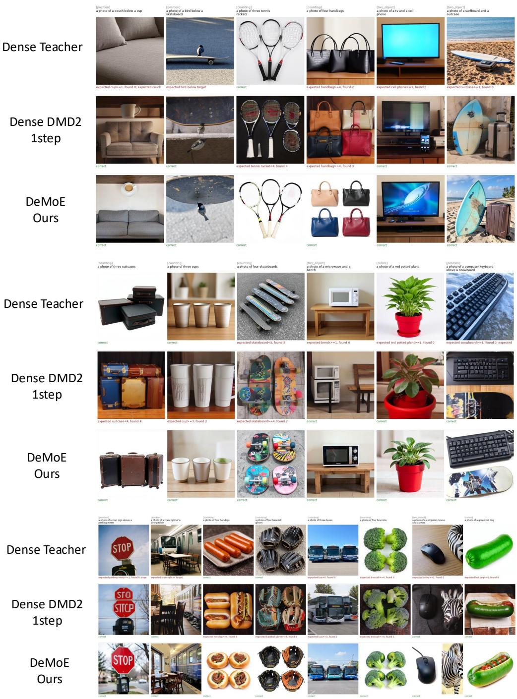  
Figure 5: Qualitative comparison of text-to-image generation results. We compare our proposed method (DeMoE) with the multi-step Dense Teacher and the one-step distilled baseline Dense DMD2 on various challenging compositional prompts (categorized into spatial position, object counting, multi-object attribute binding, and color). Evaluation feedback below each image indicates whether the generation fulfills the prompt requirements (e.g., detected object counts or spatial relations). While baseline models frequently suffer from missing objects, incorrect counts, and attribute leakage, DeMoE (Ours) reliably generates images with precise semantic alignments, accurate object quantities, and correct spatial configurations in a single step.

## B.5 Teacher-response coordinate

Table 6: Stability of the construction-fit two-axis teacher-response coordinate. Each bank contains 128 prompts; the second-noise bank reuses the confirmation prompts.
<table><tr><td>Bank</td><td>Top-two centered energy</td><td>Minimum principal cosine</td></tr><tr><td>Construction</td><td>93.124%</td><td>1.000000</td></tr><tr><td>Confirmation</td><td>93.082%</td><td>0.999945</td></tr><tr><td>Second noise</td><td>92.942%</td><td>0.999956</td></tr></table>

The coordinate is a stable description of four measured macro responses. It is not evidence that two universal semantic phases exist, nor that the current expert bank has learned them. The associated expert run contains only a mechanics check, formal function learning and task utility remain unverified, and the deployed method of Section 3 does not use this coordinate.

## B.6 Numerical trainability and the hard-execution switch

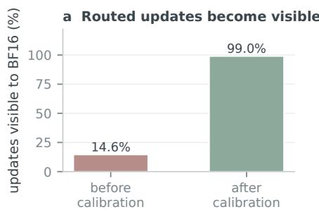

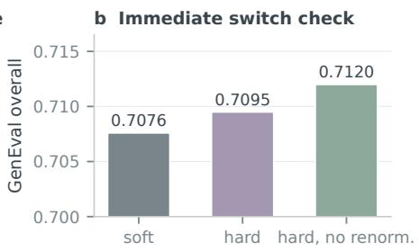  
Figure 6: Numerical trainability and soft-to-hard switch checks. (a) BF16-visible update fraction and local response loss; (b) GenEval change at one earlier checkpoint. Both are implementation diagnostics outside the main configuration.

With FP32 master updates, the fraction of updates visible to the BF16 forward pass rises from 14.60% to 99.02%, and the local response loss falls from 0.24125 to 0.01860. Switching one earlier checkpoint from soft to hard execution changes overall GenEval by less than half a point; both panels use configurations other than the one reported in Table 1. The precision result answers whether routed experts receive usable numerical updates under a loss that is computed by subtracting a shared output. It is not an image-quality result and it does not explain DeMoE’s main gain. The switch check answers whether the immediate change of execution rule damaged the checkpoint at which it was measured; it does not test whether hard execution is better than soft execution in general. Both are reported here so that readers can separate numerical confounds from architectural effects.

The next two tables describe the capacity and router configurations that the main comparison is drawn from. They are design matrices: entries state what each configuration contains, not what it achieved, and the lower block of the router table is a prospective extension rather than a validated component.

Table 7: Expert configurations under explicit capacity control and measured 1-NFE performance. An expert’s intermediate width is q times the parent FFN width, yielding total FFN ratio q(S + R) and active FFN ratio q(S + k). Performance columns report text alignment (GenEval Overall), distribution fidelity (COCO-10K FID). Bold marks the best performance within each ablation section.
<table><tr><td colspan="5"></td><td colspan="2">FFN Width Ratio</td><td colspan="3">1-NFE Performance</td></tr><tr><td>Design</td><td></td><td>Shared S Routed R Active k Width q</td><td></td><td></td><td>Total</td><td>Active</td><td>GenEval ↑</td><td>FID↓</td><td>Latency (s) ↓</td></tr><tr><td colspan="10">Shared fraction: total 1×, active 0.5× (ablation on shared capacity)</td></tr><tr><td>8E4A0S</td><td>0</td><td>8</td><td>4</td><td>1/8</td><td>1</td><td>1/2</td><td>0.7180</td><td>23.4500</td><td>0.2185</td></tr><tr><td>7E3A1S</td><td>1</td><td>7</td><td>3</td><td>1/8</td><td>1</td><td>1/2</td><td>0.7460</td><td>21.1500</td><td>0.2142</td></tr><tr><td>6E2A2S</td><td>2</td><td>6</td><td>2</td><td>1/8</td><td>1</td><td>1/2</td><td>0.7510</td><td>20.8200</td><td>0.2124</td></tr><tr><td>5E1A3S</td><td>3</td><td>5</td><td>1</td><td>1/8</td><td>1</td><td>1/2</td><td>0.7390</td><td>21.8000</td><td>0.2096</td></tr><tr><td colspan="10">Granularity: shared width fixed at 0.25×, active at 0.5× (expert size vs. count)</td></tr><tr><td>3E1A1S</td><td>1</td><td>3</td><td>1</td><td>1/4</td><td>1</td><td>1/2</td><td>0.7415</td><td>21.6266</td><td>0.2108</td></tr><tr><td>6E2A2S</td><td>2</td><td>6</td><td>2</td><td>1/8</td><td>1</td><td>1/2</td><td>0.7510</td><td>20.8200</td><td>0.2124</td></tr><tr><td>12E4A4S</td><td>4</td><td>12</td><td>4</td><td>1/16</td><td>1</td><td>1/2</td><td>0.7485</td><td>21.0500</td><td>0.2195</td></tr><tr><td colspan="10">Capacity scaling: widening active FFN towards full deployment</td></tr><tr><td>3E1A1S</td><td>1</td><td>3</td><td>1</td><td>1/4</td><td>1</td><td>0.500</td><td>0.7415</td><td>21.6266</td><td>0.2108</td></tr><tr><td>7E3A1S</td><td>1</td><td>7</td><td>3</td><td>1/5.4</td><td>1.48</td><td>0.740</td><td>0.7812</td><td>16.9240</td><td>0.2224</td></tr><tr><td>7E4A1S</td><td>1</td><td>7</td><td>4</td><td>1/6.2</td><td>1.29</td><td>0.805</td><td>0.8220</td><td>14.8520</td><td>0.2256</td></tr><tr><td colspan="10">Width compression: active expert width strictly &lt; 0.5× (extreme efficiency)</td></tr><tr><td>3E1A1S</td><td>1</td><td>3</td><td>1</td><td>1/8</td><td>1/2</td><td>1/4</td><td>0.7020</td><td>24.1500</td><td>0.1782</td></tr><tr><td>3E1A1S</td><td>1</td><td>3</td><td>1</td><td>1/16</td><td>1/4</td><td>1/8</td><td>0.6650</td><td>26.8200</td><td>0.1625</td></tr><tr><td>6E2A2S</td><td>2</td><td>6</td><td>2</td><td>1/16</td><td>1/2</td><td>1/4</td><td>0.7110</td><td>23.6400</td><td>0.1810</td></tr></table>

Table 8: Router design comparison on an identical expert bank and training protocol. Entries record which mechanism a design contains; they are not results. The lower block is a prospective extension and is not part of the validated configuration.
<table><tr><td>Router</td><td>Shared response</td><td>History state</td><td>Action-response objective</td><td>Feedback objective</td><td>History in expert</td></tr><tr><td>Current hidden</td><td>_</td><td></td><td></td><td></td><td></td></tr><tr><td>Current + shared</td><td>Yes</td><td></td><td></td><td></td><td></td></tr><tr><td>GRU execution observer</td><td>Yes</td><td>GRU</td><td></td><td></td><td></td></tr><tr><td>Execution-aware TTT</td><td>Yes</td><td>Fast weights</td><td></td><td></td><td></td></tr><tr><td>AR-CURRENT</td><td>Yes</td><td></td><td>Yes</td><td></td><td></td></tr><tr><td>AR-HISTORY</td><td>Yes</td><td>Fast weights</td><td>Yes</td><td></td><td></td></tr><tr><td>AR-CURRENT + feedback</td><td>Yes</td><td></td><td>Yes</td><td>Yes</td><td></td></tr><tr><td>AR-HISTORY + feedback</td><td>Yes</td><td>Fast weights</td><td>Yes</td><td>Yes</td><td></td></tr><tr><td>AR-HISTORY + modulation</td><td>Yes</td><td>Fast weights</td><td>Yes</td><td></td><td>Yes</td></tr></table>

## C Theory

This appendix supplies the derivations that are intentionally compressed in the main narrative. Every statement is local to a fixed differentiable execution branch unless stated otherwise. Crossing a hard-routing boundary or changing the score estimator requires a separate finite experiment.

## C.1 Pathwise distribution-matching gradient

Assumption 1 (Ideal noisy-marginal analysis). For each condition and sampled perturbation coordinate u with $\sigma _ { u } > 0$ the student and target noisy marginals have positive differentiable densities with sufficient integrability and boundary decay to exchange differentiation and expectation. The target is fixed, and the score fields are exact.

Let $\pmb { x } _ { 0 } = G _ { \vartheta } ( \pmb { z } , c )$ and ${ \pmb x } _ { u } = \alpha _ { u } { \pmb x } _ { 0 } + \sigma _ { u } { \pmb \epsilon }$ . The transported-sample variation of $D _ { \mathrm { K L } } ( q _ { \vartheta , u } \Vert p _ { T , u } )$ is the score difference ${ \pmb { s } } _ { q } - { \pmb { s } } _ { T }$ . Since $\partial \pmb { x } _ { u } / \partial \vartheta = \alpha _ { u } J _ { \vartheta }$ , the chain rule gives

$$
\nabla _ { \vartheta } D _ { \mathrm { K L } } ( q _ { \vartheta , u } \| p _ { T , u } ) = \mathbb { E } \big [ J _ { \vartheta } ^ { \top } \alpha _ { u } ( \pmb { s } _ { q } - \pmb { s } _ { T } ) \big ] .\tag{8}
$$

Multiplying by $\lambda ( u )$ and averaging over c and u yields Equation (2). A guided neural field need not be the score of a globally consistent density family; in that case the ideal KL interpretation is an additional modelling assumption, while the fixed-computation-graph statements below still apply.

## C.2 The implemented fixed-target surrogate

At a reference checkpoint ${ \bar { \vartheta } } ,$ let the implementation construct a detached correction ${ \widehat { \delta } } ^ { \mathrm { c o d e } }$ and fixed target ${ \textbf { 7 } } =$ $G _ { \bar { \vartheta } } ( z , c ) - \widehat \delta ^ { \mathrm { c o d e } }$ . Then

$$
\ell ^ { \mathrm { l o c } } \big ( \vartheta ; \bar { \vartheta } \big ) = \frac { 1 } { 2 D } \left\| G _ { \vartheta } \big ( z , c \big ) - \mathrm { s g } \big ( \pmb { y } \big ) \right\| ^ { 2 } , \qquad \nabla _ { \vartheta } \ell ^ { \mathrm { l o c } } \big | _ { \bar { \vartheta } } = D ^ { - 1 } J _ { \bar { \vartheta } } ^ { \top } \widehat { \delta } ^ { \mathrm { c o d e } } .\tag{9}
$$

This is exact for the frozen graph. If a candidate update recomputes both the endpoint and its detached target, the resulting scalar is a different objective and cannot be used as a finite-difference check of the original update. A valid local audit freezes $^ { \mathbf { \nabla } } \mathbf { \mathbf { 3 } } ,$ , records the actual optimiser displacement, and evaluates endpoint and image changes separately. The route diagnostic of Section B.4 uses this scalar and is therefore reported as a pseudo-loss rather than as a certified KL quantity.

## C.3 Local interaction accounting

Let a index a realised correction demand with nonnegative weight $w _ { a }$ , fixed local objective $\ell _ { a } ^ { \mathrm { l o c } }$ , and gradient ${ \pmb g } _ { a }$ . Define $\begin{array} { r } { \bar { \pmb g } = \sum _ { a } w _ { a } \pmb g _ { a } } \end{array}$ and $I _ { a b } = \langle { \pmb g } _ { a } , { \pmb g } _ { b } \rangle$

Proposition 1 (Signed first-order interaction). For $\vartheta ^ { + } = \bar { \vartheta } - \eta \bar { g }$ and twice-differentiable local objectives,

$$
\begin{array} { l } { { \ell _ { a } ^ { \mathrm { l o c } } ( \vartheta ^ { + } ) - \ell _ { a } ^ { \mathrm { l o c } } ( \bar { \vartheta } ) = - \eta w _ { a } \left\| g _ { a } \right\| ^ { 2 } + \eta \displaystyle \sum _ { b \neq a } w _ { b } [ - I _ { a b } ] _ { + } } } \\ { { - \eta \displaystyle \sum _ { b \neq a } w _ { b } [ I _ { a b } ] _ { + } + { \cal O } ( \eta ^ { 2 } ) . } } \end{array}\tag{10}
$$

The result follows by Taylor expansion and $x = [ x ] _ { + } - [ - x ] _ { + }$ . The three displayed terms are self-correction, negative transfer, and positive transfer. For an $L _ { a }$ -smooth objective the remainder is bounded by $L _ { a } \eta ^ { 2 } \left\| \bar { g } \right\| ^ { 2 } / 2$ With AdamW, clipping, or other preconditioning, the empirical audit must use the recorded displacement rather than substituting a raw-gradient step.

## C.4 Exact localisation to an FFN writer

For the second FFN projection $Y = Z W _ { 2 } ,$ , let $Q _ { a }$ be the back-propagated cotangent for demand $^ { a , }$ including the loss reduction. Since $\nabla _ { W _ { 2 } } \ell _ { a } = Z _ { a } ^ { \top } Q _ { a }$ ，

$$
\begin{array} { r l r } {  { I _ { a b } ^ { W _ { 2 } } =  Z _ { a } ^ { \top } Q _ { a } , Z _ { b } ^ { \top } Q _ { b }  _ { F } } } \\ & { } & { = \displaystyle \sum _ { i , j }  z _ { a i } , z _ { b j }   \pmb { q } _ { a i } , \pmb { q } _ { b j }  . } \end{array}\tag{11}
$$

Both the activation and cotangent factors are necessary. A negative token-pair contribution is a decomposition of a parameter-gradient interaction; it is not by itself a semantic conflict or a causal instruction to create an expert.

## C.5 Selective separation and its cost

Consider a portable-gradient local model with unchanged shared gradient $\scriptstyle { \pmb { s } } _ { a } .$ , dense private gradient ${ \pmb v } _ { a } .$ , and routed private gradient $\textstyle \bigoplus _ { e } r _ { a e } { \pmb v } _ { a }$ . Let $o _ { a b } = \pmb { r } _ { a } ^ { \top } \pmb { r } _ { b }$ be route overlap and $c _ { a b } = \pmb { v } _ { a } ^ { \top } \pmb { v } _ { b }$

Proposition 2 (When selective separation helps). The routed-minus-dense change in alignment between demand a and the aggregate update is

$$
\begin{array} { r l r } {  { \mathcal { A } _ { a } ^ { R } - \mathcal { A } _ { a } ^ { D } = \sum _ { b \not = 0 } w _ { b } \big ( 1 - o _ { a b } \big ) \big [ - c _ { a b } \big ] _ { + } } } \\ & { } & { \underbrace { b \not = \theta } _ { N _ { a } : n e g a t i v e t r a n s f e r r e m o v e d } } \\ & { } & { - \underbrace { \sum _ { b \not = b } w _ { b } \big ( 1 - o _ { a b } \big ) \big [ c _ { a b } \big ] _ { + } } _ { P _ { a } : p o s i t i v e t r a n s f e r l o s t } - \underbrace { w _ { a } \big ( 1 - o _ { a a } \big ) \big \| v _ { a } \big \| ^ { 2 } } _ { D _ { a } : s e l f < o r r e c t i o n \ d i l u t e d } . } \end{array}\tag{12}
$$

The dense private interaction is $c _ { a b }$ and the routed private interaction is $o _ { a b } c _ { a b } ;$ subtracting them and separating the diagonal, positive, and negative parts proves the result. If the compact bank changes the private interaction by $\varepsilon _ { a b }$ or alters the shared contribution by $\varepsilon _ { a } ^ { S }$ , the positive margin must additionally exceed $\begin{array} { r } { { \bf \bar { \lvert } } \varepsilon _ { a } ^ { S } \vert + \sum _ { b } w _ { b } \vert \varepsilon _ { a b } \vert } \end{array}$ . This portability error is measured, not assumed away. Equation 4 is the main-text shorthand for Equation (12).

## C.6 When can history help?

Proposition 3 (Conditional value of history). Let A be a square-integrablefuture action-utility target, H the current deployment-visible state, and M a causal summary ofpast executed transitions. Under squared loss, the Bayes-risk improvementfrom adding history is

$$
{ \mathcal { R } } ( H ) - { \mathcal { R } } ( H , M ) = \operatorname { \mathbb { E } } [ \operatorname { V a r } ( \operatorname { \mathbb { E } } [ A \mid H , M ] \mid H ) ] \geq 0 .\tag{13}
$$

It is zero exactly when $\mathbb { E } [ A \mid H , M ] = \mathbb { E } [ A \mid H ]$ almost surely.

This follows from the law of total variance. It does not guarantee that a finite learned history model improves ranking or image quality. A valid comparison must hold the response bank and budget fixed and include current-only, reset-history, and donor-history controls.

## C.7 History and task-feedback extensions

A causal state may summarise already executed transitions,

$$
\begin{array} { r } { \pmb { m } _ { \ell + 1 } = U _ { \phi } ( \pmb { m } _ { \ell } , \pmb { h } _ { \ell } , K _ { \ell } , \pmb { b } _ { \ell } , \pmb { h } _ { \ell + 1 } ) , \qquad \pmb { a } _ { \ell + 1 } = f _ { \psi } ( \pmb { h } _ { \ell + 1 } , c , \pmb { m } _ { \ell + 1 } ) . } \end{array}\tag{14}
$$

Its registered ranking comparison establishes that both current and history models contain signal, but not that history contributes beyond current hidden state.

No reviewed upstream implementation provides the exact combination of DeMoE’s executed-action record, task-grounded failure signal, and interaction-aware redistribution. This task-feedback extension is therefore locally\_designed. Its assumptions are that the failure signal is repeatable, can influence a later legal action, leaves the bank fixed during attribution, and transfers to image quality. Candidate alternatives include a current-only residual controller, contextual-bandit credit assignment, dense reranking, and transport-constrained allocation. The extension is falsified if it cannot beat a matched current-only control, if reset or donor history performs equally well, or if proxy improvements do not change the generated-image metric.

## D Extended Related Work

Sparse experts and diffusion routing. Sparse mixture-of-experts (MoE) architectures dynamically route tokens to decouple parameter capacity from inference compute (Shazeer et al., 2017; Fedus et al., 2022). Shared-expert paradigms mitigate routing instability by maintaining universal functional paths (Dai et al., 2024). In diffusion models, MoE

Write RMS ranges from 5.48 to 31.35, while the recorded mean active count remains 4.0 at every depth.

AR\_CURRENT · 32 prompts · 13 routed depths · Top-4 of 7 routed experts · shared writes not recorded

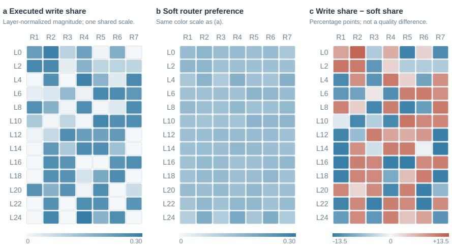

## Executed computation across all routed depths

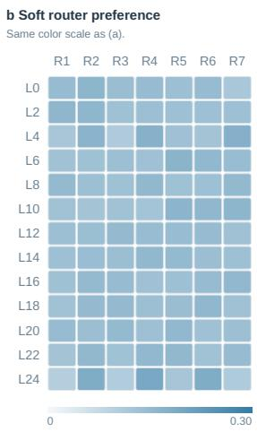  
All 91 routed layer–expert cells are shown. The largest preference/write discrepancy is at L16 (TV = 0.401).

## Absolute writes and depth-dependent magnitude

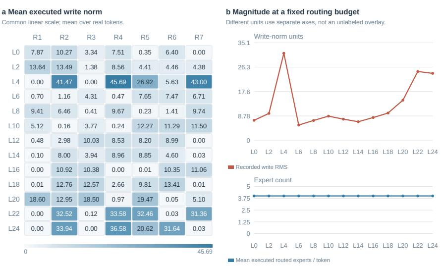  
Figure 7: Executed write shares and soft preferences at all 13 routed depths.

DeMoE / FUNCTIONAL COMPUTATION ATLAS

## Where soft preference differs from actual writing

AR\_CURRENT · 32 prompts · 13 routed depths · Top-4 of 7 routed experts · shared writes not recorded

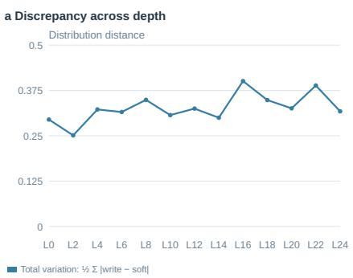  
b Largest discrepancy: L16

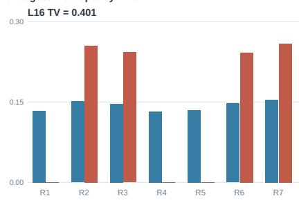  
Blue: soft share. Rust: executed-write share.  
Every depth is retained; no selection of only large discrepancies.

<table><tr><td>L16</td><td>R1</td><td>R2</td><td>R3</td><td>R4</td><td>R5</td><td>R6</td><td>R7</td></tr><tr><td>Soft (%)</td><td>13.37%</td><td>15.13%</td><td>14.64%</td><td>13.23%</td><td>13.51%</td><td>14.72%</td><td>15.40%</td></tr><tr><td>Write (%)</td><td>0.01%</td><td>25.56%</td><td>24.30%</td><td>0.01%</td><td>0.01%</td><td>24.23%</td><td>25.88%</td></tr><tr><td>∆(pp)</td><td>-13.36</td><td>10.44</td><td>9.66</td><td>-13.23</td><td>-13.49</td><td>9.51</td><td>10.48</td></tr></table>

Differences arise between two observed distributions; a larger discrepancy is not evidence of better routing. The layer is chosen by maximum ful -population L1 E03 distance.  
AR\_CURRENT · 32 prompts · 13 routed depths · Top-4 of 7 routed experts · shared writes not recorded

Soft preference and executed writing · depths 0–12

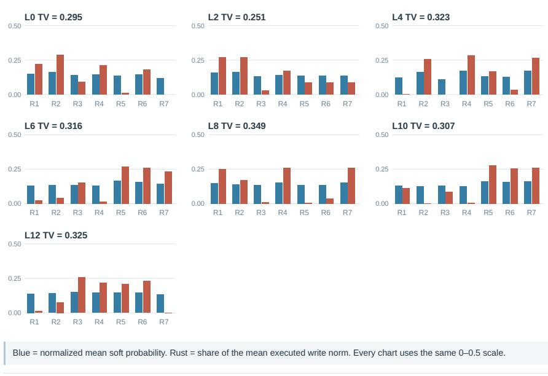  
Per-depth comparisons show changes in composition without interpreting repeated slot numbers as the same expert across layers

Figure 8: Executed write shares and soft preferences (continued).

DeMoE / FUNCTIONAL COMPUTATION ATLAS

Soft preference and executed writing · depths 14–24

AR\_CURRENT · 32 prompts · 13 routed depths · Top-4 of 7 routed experts · shared writes not recorded

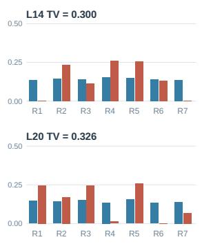

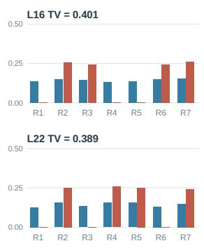

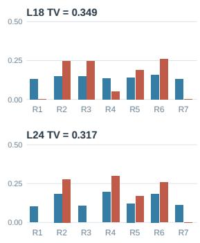  
Blue = normalized mean soft probability. Rust = share of the mean executed write norm. Every chart uses the same 0–0.5 scale.  
Concentration of executed magnitude  
AR\_CURRENT · 32 prompts · 13 routed depths · Top-4 of 7 routed experts · shared writes not recorded

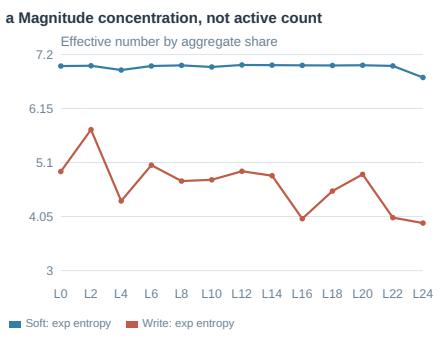  
exp(−Σ q log q) is derived from aggregate shares. It is not a count of experts executed by one token.  
b Aggregate mass carried by the four largest slots Slots are ranked independently inside each layer.

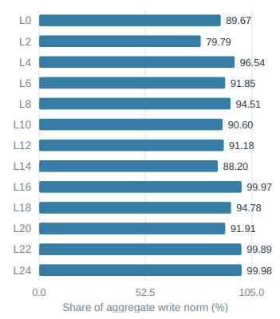  
The largest four local slots carry 79.79–99.98% of aggregate routed-write magnitude; different tokens may choose different slots.

<table><tr><td rowspan=2 colspan=8>a Sorted local write sharesRank columns are local order statistics, not expert IDs.#1  #2  #3  #4  #5  #6  #7L0                           0.01</td></tr><tr><td rowspan=1 colspan=1></td><td rowspan=1 colspan=1></td><td rowspan=1 colspan=1></td><td rowspan=1 colspan=1></td><td rowspan=1 colspan=1></td><td rowspan=1 colspan=1></td><td rowspan=1 colspan=1></td></tr><tr><td rowspan=3 colspan=1>L2L4L6</td><td rowspan=1 colspan=1>0.27</td><td rowspan=1 colspan=1>0.27</td><td rowspan=1 colspan=1>0.17</td><td rowspan=1 colspan=1>0.09</td><td rowspan=1 colspan=1>0.09</td><td rowspan=1 colspan=1>0.09</td><td rowspan=1 colspan=1>0.03</td></tr><tr><td rowspan=1 colspan=1>0.28</td><td rowspan=1 colspan=1>0.26</td><td rowspan=1 colspan=1>0.25</td><td rowspan=1 colspan=1>0.17</td><td rowspan=1 colspan=1>0.03</td><td rowspan=1 colspan=1>0.00</td><td rowspan=1 colspan=1>0.00</td></tr><tr><td rowspan=1 colspan=1>0.27</td><td rowspan=1 colspan=1>0.26</td><td rowspan=1 colspan=1>0.24</td><td rowspan=1 colspan=1>0.15</td><td rowspan=1 colspan=1>0.04</td><td rowspan=1 colspan=1>0.02</td><td rowspan=1 colspan=1>0.02</td></tr><tr><td rowspan=1 colspan=1>L8</td><td rowspan=1 colspan=1>0.26</td><td rowspan=1 colspan=1>0.26</td><td rowspan=1 colspan=1>0.25</td><td rowspan=1 colspan=1>0.17</td><td rowspan=1 colspan=1>0.04</td><td rowspan=1 colspan=1>0.01</td><td rowspan=1 colspan=1>0.01</td></tr><tr><td rowspan=1 colspan=1>L10</td><td rowspan=1 colspan=1>0.28</td><td rowspan=1 colspan=1>0.26</td><td rowspan=1 colspan=1>0.25</td><td rowspan=1 colspan=1>0.12</td><td rowspan=1 colspan=1>0.08</td><td rowspan=1 colspan=1>0.01</td><td rowspan=1 colspan=1>0.00</td></tr><tr><td rowspan=1 colspan=1>L12</td><td rowspan=1 colspan=1>0.26</td><td rowspan=1 colspan=1>0.23</td><td rowspan=1 colspan=1>0.22</td><td rowspan=1 colspan=1>0.21</td><td rowspan=1 colspan=1>0.08</td><td rowspan=1 colspan=1>0.01</td><td rowspan=1 colspan=1>0.00</td></tr><tr><td rowspan=1 colspan=1>L14</td><td rowspan=1 colspan=1>0.26</td><td rowspan=1 colspan=1>0.26</td><td rowspan=1 colspan=1>0.23</td><td rowspan=1 colspan=1>0.13</td><td rowspan=1 colspan=1>0.11</td><td rowspan=1 colspan=1>0.00</td><td rowspan=1 colspan=1>0.00</td></tr><tr><td rowspan=1 colspan=1>L16</td><td rowspan=1 colspan=1>0.26</td><td rowspan=1 colspan=1>0.26</td><td rowspan=1 colspan=1>0.24</td><td rowspan=1 colspan=1>0.24</td><td rowspan=1 colspan=1>0.00</td><td rowspan=1 colspan=1>0.00</td><td rowspan=1 colspan=1>0.00</td></tr><tr><td rowspan=1 colspan=1>L18</td><td rowspan=1 colspan=1>0.26</td><td rowspan=1 colspan=1>0.25</td><td rowspan=1 colspan=1>0.25</td><td rowspan=1 colspan=1>0.19</td><td rowspan=1 colspan=1>0.05</td><td rowspan=1 colspan=1>0.00</td><td rowspan=1 colspan=1>0.00</td></tr><tr><td rowspan=1 colspan=1>L20</td><td rowspan=1 colspan=1>0.26</td><td rowspan=1 colspan=1>0.25</td><td rowspan=1 colspan=1>0.24</td><td rowspan=1 colspan=1>0.17</td><td rowspan=1 colspan=1>0.07</td><td rowspan=1 colspan=1>0.01</td><td rowspan=1 colspan=1>0.00</td></tr><tr><td rowspan=1 colspan=1>L22</td><td rowspan=1 colspan=1>0.26</td><td rowspan=1 colspan=1>0.25</td><td rowspan=1 colspan=1>0.25</td><td rowspan=1 colspan=1>0.24</td><td rowspan=1 colspan=1>0.00</td><td rowspan=1 colspan=1>0.00</td><td rowspan=1 colspan=1>0.00</td></tr><tr><td rowspan=1 colspan=1>L24</td><td rowspan=1 colspan=1>0.30</td><td rowspan=1 colspan=1>0.28</td><td rowspan=1 colspan=1>0.26</td><td rowspan=1 colspan=1>0.17</td><td rowspan=1 colspan=1>0.00</td><td rowspan=1 colspan=1>0.00</td><td rowspan=1 colspan=1>0.00</td></tr><tr><td rowspan=1 colspan=8>0                                  0.30</td></tr></table>

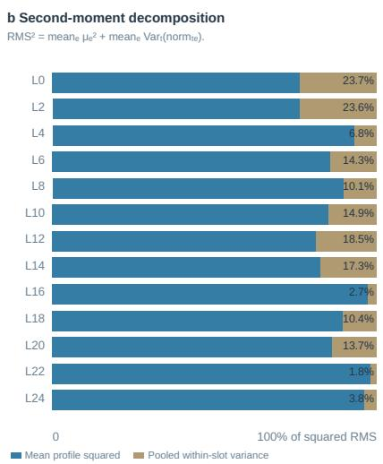  
The variance term is derived algebraical y from stored first and second moments over real tokens. It is not a per-prompt uncertainty interval or a reconstructed token E07 distribution.

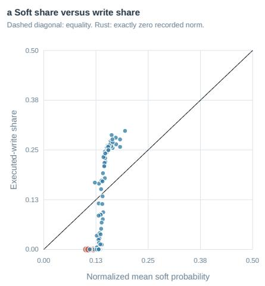

<table><tr><td>Cell</td><td>Soft probability</td><td>Mean write norm</td></tr><tr><td>L0.R7</td><td>0.118924</td><td>0 (measured)</td></tr><tr><td>L4.R3</td><td>0.109652</td><td>0 (measured)</td></tr><tr><td>L24.R1</td><td>0.101272</td><td>0 (measured)</td></tr><tr><td>L24.R3</td><td>0.106370</td><td>0 (measured)</td></tr></table>

Figure 10: Executed write shares and soft preferences (continued).

Execution summary at every physical depth
<table><tr><td>Depth</td><td>RMS</td><td>Active/token</td><td>TV(write,soft)</td><td>Neff soft</td><td>Neff write</td><td>Top-4 mass</td></tr><tr><td>L0</td><td>7.191</td><td>4.0</td><td>0.2948</td><td>6.974</td><td>4.925</td><td>89.67%</td></tr><tr><td>L2</td><td>9.687</td><td>4.0</td><td>0.2513</td><td>6.980</td><td>5.739</td><td>79.79%</td></tr><tr><td>L4</td><td>31.351</td><td>4.0</td><td>0.3226</td><td>6.897</td><td>4.353</td><td>96.54%</td></tr><tr><td>L6</td><td>5.480</td><td>4.0</td><td>0.3156</td><td>6.975</td><td>5.049</td><td>91.85%</td></tr><tr><td>L8</td><td>7.143</td><td>4.0</td><td>0.3491</td><td>6.987</td><td>4.739</td><td>94.51%</td></tr><tr><td>L10</td><td>8.697</td><td>4.0</td><td>0.3070</td><td>6.956</td><td>4.764</td><td>90.60%</td></tr><tr><td>L12</td><td>7.613</td><td>4.0</td><td>0.3250</td><td>6.995</td><td>4.930</td><td>91.18%</td></tr><tr><td>L14</td><td>6.691</td><td>4.0</td><td>0.2999</td><td>6.992</td><td>4.844</td><td>88.20%</td></tr><tr><td>L16</td><td>8.188</td><td>4.0</td><td>0.4009</td><td>6.988</td><td>4.008</td><td>99.97%</td></tr><tr><td>L18</td><td>9.813</td><td>4.0</td><td>0.3486</td><td>6.986</td><td>4.546</td><td>94.78%</td></tr><tr><td>L20</td><td>14.457</td><td>4.0</td><td>0.3257</td><td>6.990</td><td>4.870</td><td>91.91%</td></tr><tr><td>L22</td><td>24.791</td><td>4.0</td><td>0.3887</td><td>6.977</td><td>4.029</td><td>99.89%</td></tr><tr><td>L24</td><td>24.114</td><td>4.0</td><td>0.3175</td><td>6.752</td><td>3.923</td><td>99.98%</td></tr></table>

No sampled uncertainty bars are generated from these aggregates. All 13 physical depths, including L14–L24, are addressed by depthkey lookup.  
RMS and active/token are stored measurements. TV, effective-number and Top-4 aggregate mass are transparent deterministic reductions.

DeMoE / FUNCTIONAL COMPUTATION ATLAS

## Current hidden coordinates

F148 frozen diagnostic · 8 prompts pooled · 25 layers × 4 layer-local experts · post-hoc coordinates

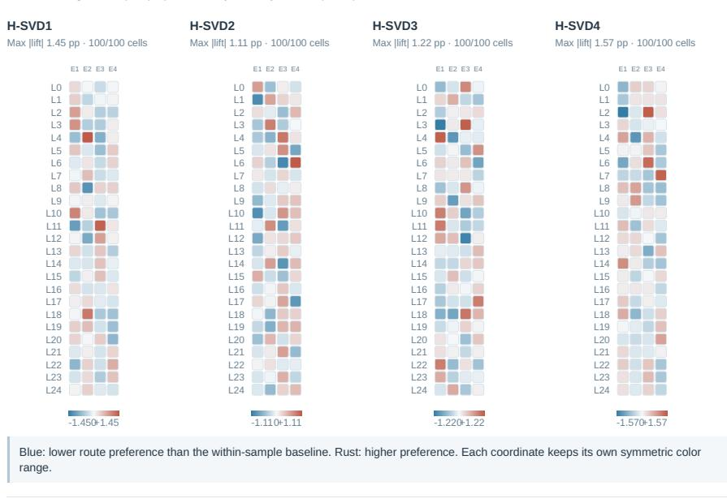  
Original within\_sample\_lift values; negative lift is not a negative quality result. Coordinates are not named semantic functions and are not aligned across the three A01 bases.

Figure 11: Executed write shares and soft preferences (continued).

## History changes the routing probabilities

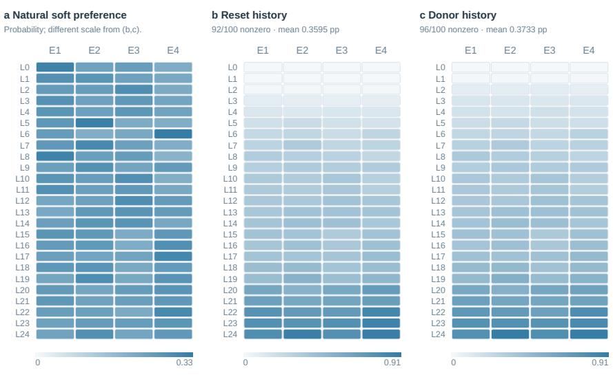  
Reset and donor columns share one true scale. Nonzero probability changes show history is behavioral y connected to routing, not that Top-k support or qualit H01 improves.

## Depth-sensitive routing and endpoint response

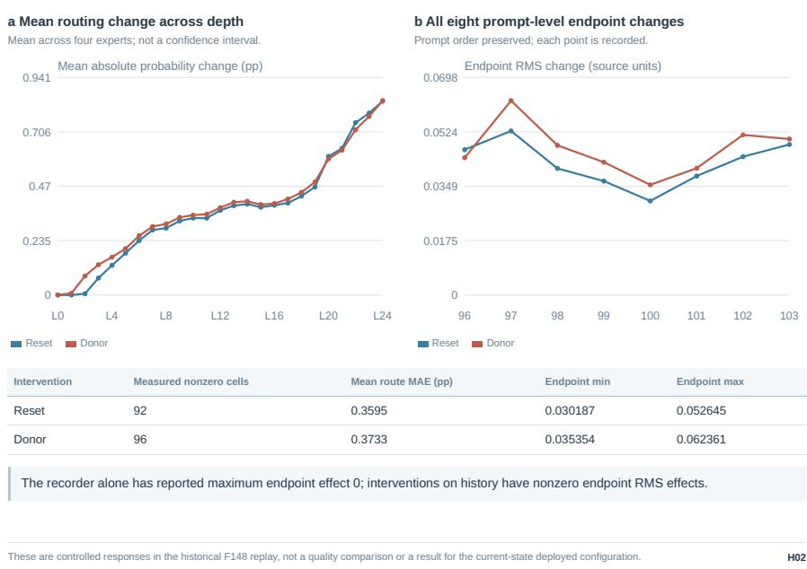  
Figure 12: Executed write shares and soft preferences (continued).

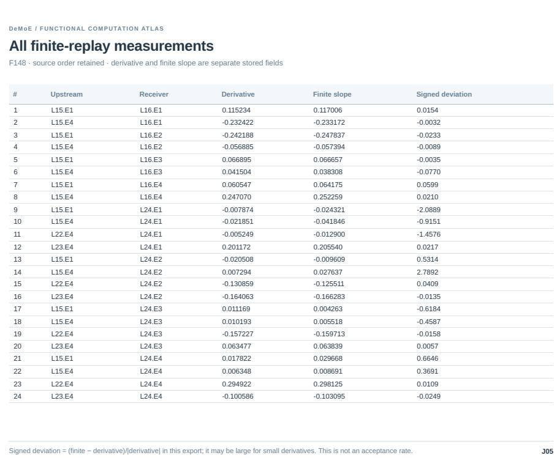  
Figure 13: Executed write shares and soft preferences (continued).

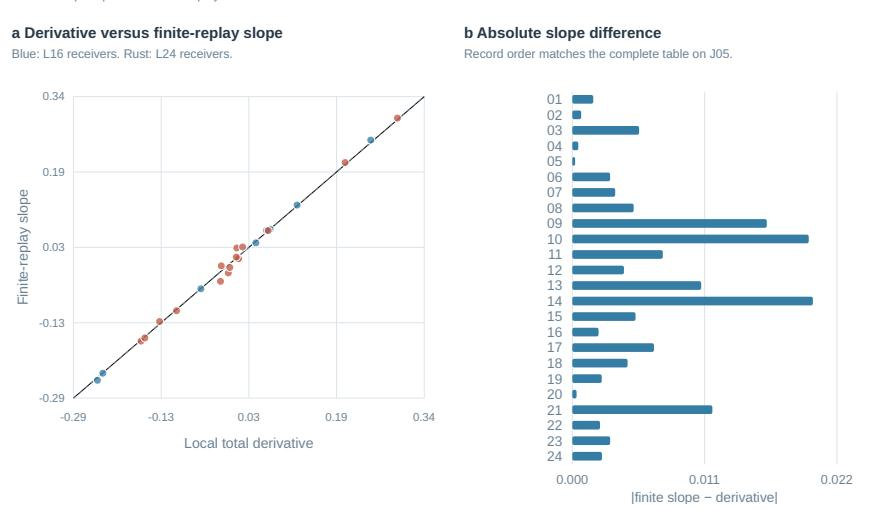  
24/24 sign agreements; slope magnitudes need not agree. All replayed entries are retained.

has been adapted to partition timesteps, tokens, or noise regimes across denoiser sub-networks (Fei et al., 2024; Sun et al., 2024; Park et al., 2023, 2024; Fang et al., 2024; Shi et al., 2025; Cheng et al., 2025; Zheng et al., 2025; Wei et al., 2025; Yuan et al., 2025). Beyond vision synthesis, diffusion MoE architectures serve as expressive multimodal action policies in robotics and reinforcement learning (Zhou et al., 2024; Reuss et al., 2025; Hao et al., 2026). Unlike multi-step routing along external diffusion timesteps (Fan et al., 2025; Wang et al., 2025), DeMoE governs computation purely across internal layer depth within a single forward pass.

Sparse experts and shared computation. Sparse mixture-of-experts layers make parameter paths conditionally executable (Shazeer et al., 2017; Fedus et al., 2022), and the motivation there is capacity and conditional computation per token. Shared-expert designs deliberately retain common computation while routed experts specialise (Dai et al., 2024). Diffusion-transformer work has routed tokens (Fei et al., 2024; Sun et al., 2024; Park et al., 2024; Fang et al., 2024), denoising tasks, and training phases across experts. DeMoE reuses the structural idea of splitting a feed-forward width into an always-active part and a selectable part. It differs in the responsibility it attaches to the routing decision inside a one-step student: the executed support is recorded and the response that actually ran becomes the supervised target of the auxiliary prediction loss.

Sparse experts and diffusion routing. Sparse mixture-of-experts (MoE) architectures dynamically route tokens to decouple parameter capacity from inference compute (Shazeer et al., 2017; Fedus et al., 2022). Shared-expert paradigms mitigate routing instability by maintaining universal functional paths (Dai et al., 2024). In diffusion models, MoE has been adapted to partition timesteps, tokens, or noise regimes across denoiser sub-networks (Fei et al., 2024; Sun et al., 2024; Park et al., 2023, 2024; Fang et al., 2024; Shi et al., 2025; Cheng et al., 2025; Zheng et al., 2025; Wei et al., 2025; Yuan et al., 2025). Beyond vision synthesis, diffusion MoE architectures serve as expressive multimodal action policies in robotics and reinforcement learning (Zhou et al., 2024; Reuss et al., 2025; Hao et al., 2026). Unlike multi-step routing along external diffusion timesteps (Fan et al., 2025; Wang et al., 2025), DeMoE governs computation purely across internal layer depth within a single forward pass.

Gradient interaction and negative transfer. Multi-task methods diagnose or modify conflicting parameter gradients (Yu et al., 2020), and diffusion models can exhibit negative transfer across denoising tasks (Go et al., 2023). Our local analysis uses the same mathematical object, a signed inner product between parameter gradients, but it does not infer a universal causal chain from reverse-KL training to conflict and then to mode loss. The selective-separation proposition of Section C.5 explicitly retains positive transfer, self-correction, and a parameter-geometry error term, and the empirical support for the design is the controlled-divergence and allocation evidence of Section 4.3.

Cost accounting for conditional computation. Conditional execution reduces the parameters touched by a given token, but the realised benefit depends on kernel shapes, dispatch overhead, and memory traffic, which is why sparse layers are a capacity mechanism before they are an efficiency guarantee (Shazeer et al., 2017; Fedus et al., 2022). DeMoE follows the same discipline: the active-width ratio in Table 1 is a structural description of the configuration, and we therefore make no latency, memory, energy, or total-FLOP claim, because no matched measurement exists.

Mode collapse, diversity preservation, and particle guidance. A persistent vulnerability in score distillation and one-step compression is mode collapse and diversity loss (Wang et al., 2024; Cai et al., 2026; Sargent et al., 2025). Remedies include incorporating explicit diversity-preserving regularizers into distillation objectives (Wu et al., 2026). Complementary sampling-stage approaches incorporate inter-particle repulsion and particle guidance to preserve generative variance (Corso et al., 2024; Vinograd et al., 2026; Sadat et al., 2024; Zilberstein et al., 2025; Blessing et al., 2025), alongside dual-expert and swift distillation designs (Li et al., 2026; Nguyen and Tran, 2024).