# GeoEdit: Adversarial De-Evidencing for Silent Geoprivacy Protection via Image Editing

Yu Yan<sup>1</sup>, Shengjia Cheng<sup>1</sup>, Fei Ma<sup>2</sup>, Zhe Wang<sup>1</sup>, and Peng Chen<sup>1</sup>

<sup>1</sup>People’s Public Security University of China

Beijing, China

<sup>2</sup>Guangming Laboratory

Shenzhen, China

yanyu7560@163.com,chenpeng@ppsuc.edu.cn

## Abstract

Recent eforts have demonstrated the strong capabilities of Multimodal Large Reasoning Models (MLRMs) in geographic reasoning. By jointly analyzing subtle visual cues, these models can infer the locations of photos, thus enabling doxing even by non-expert adversaries. Existing defense methods struggle to balance the shareability of photos with efective protection, and often fail to suficiently disrupt the implicit geo-evidence chains embedded in scene semantics. To this end, we propose GeoEdit, an adversarial deevidencing framework for silent geoprivacy protection via image editing. Specifically, we apply minimal edits to high-risk evidence anchors in the image, thereby disrupting the underlying spatial reasoning chains while preserving overall scene semantics. We identify these anchors by combining structured knowledge with adversarially discovered geographic cues. To further navigate the large editing action space, we adopt a learnable policy to iteratively refine editing decisions, distilling successful trajectories into transferable natural-language insights for consistent and eficient editing. Evaluated on LifePhotoBench, GeoEdit achieves strong protection against 6 mainstream MLRMs, outperforming visual perturbation baselines by over 0.59 in image fidelity.

## CCS Concepts

• Security and privacy → Social aspects of security and privacy; • Computing methodologies → Artificial intelligence.

## Keywords

Geoprivacy, Image Editing, Risk Assessment, Responsible AI

## 1 Introduction

Recent Multimodal Large Reasoning Models (MLRMs), such as GPT-5.4 and Gemini-3.1, can perform multi-step reasoning [32] and infer implicit information from visual inputs [13, 16, 31, 36, 40], thereby enabling them to systematically capture subtle, high-level cues that are not explicitly stated and achieve strong performance on complex document understanding and multi-hop visual question answering [3, 23, 30].

However, this broader reasoning ability introduces new privacy and security risks in our everyday image-sharing scenarios. As illustrated in Figure 1, in contrast to landmark check-ins (Figure 1a), where users explicitly disclose their location, daily-life photos (Figure 1b) typically do not include clear landmarks and instead focus on personal moments or social interactions. As a result, these images are often shared without considering the risk of location disclosure, expecting the model to respect contextual integrity [33]. However, even without explicit landmarks, such images often contain multiple fragmented clues, such as architectural styles, road infrastructure, and textual context [28], which can jointly reveal sensitive location information in a more implicit and less noticeable way. In most cases, exploiting such fragmented clues requires trained Open-Source Intelligence (OSINT) analysts [9, 11, 21]. However, with the emergence of MLRMs, this threat landscape fundamentally changes, as joint visual-semantic reasoning enables even non-experts to infer locations from subtle geo-evidence at fine granularity [6, 12, 17, 18, 38]. As a result, precise geolocation doxing is increasingly automated and scalable [39].

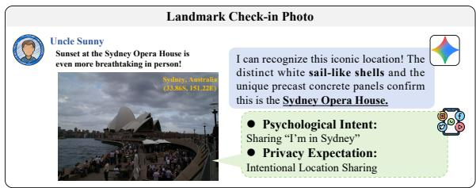  
(a) Landmark Check-In Photo (Intentional Location Sharing)

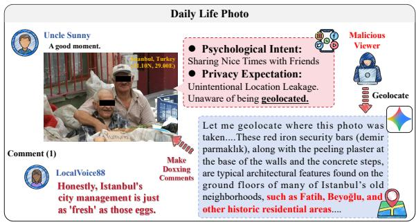  
(b) Daily Life Photo (Unintentional Geolocation Doxing Risk)  
Figure 1: Comparison of social media sharing scenarios. The landmark check-in (a) exemplifies intentional location sharing. Conversely, the daily life photo (b) inadvertently leaks sensitive location data via implicit geo-evidence, resulting in non-consensual exposure and severe doxing risks.

Some eforts have been made to develop geoprivacy protection methods to address this threat, as illustrated in Figure 2. However, their limitations remain in practice, particularly when balancing protection strength with visual utility. Explicit image obfuscation methods, such as cropping, blurring, and masking (Figure 2b), can conceal visible cues [19, 20, 22], but they often compromise semantic completeness and visual naturalness, while also leaving clear signs of protection that discourage users from sharing images. Recent methods introduce visual adversarial perturbations (Figure 2c) to add noise that reduces the localization performance of multimodal models [7, 14, 15, 37]. However, these methods mainly afect lowlevel perception rather than removing geo-semantic evidence, and the underlying evidence chain remains largely unchanged [38]. As a result, both human OSINT analysis and advanced models can still recover location information by combining the remaining cues. Moreover, such perturbations are often model-specific and tend to overfit, making them fragile under model evolution or common image transformations in real-world settings.

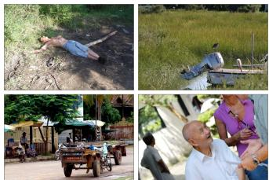  
(a) Original Image

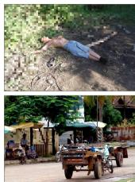

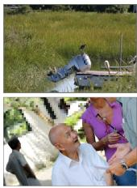  
(b) Image Obfuscation

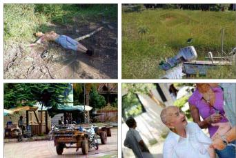  
(c) Visual Perturbation

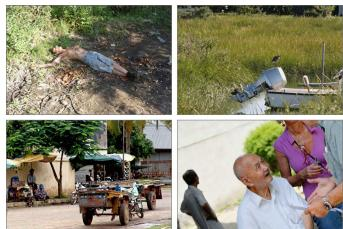  
(d) De-Evidencing Editing (Ours)  
Figure 2: Comparison of geoprivacy protection mechanisms. (a) The unprotected image. (b) Image Obfuscation hides sensitive areas but ruins the visual experience. (c) Visual Perturbation tricks visual encoders to protect geoprivacy, but its adversarial nature is often lost during unpredictable image processing and causes noticeable artifacts. (d) Geo-Evidence Editing (Ours) blocks the localization reasoning chain to defend against both MLRMs and human analysis while keeping visual appeal.

To this end, we aim to achieve more generalizable geoprivacy protection by introducing targeted, localized modifications that weaken relations among geo-evidence cues, thereby disrupting the spatial reasoning chain. We propose Geo-Evidence Editing (GeoEdit), a de-evidencing image editing framework for silent geoprivacy protection. GeoEdit combines structured knowledge with adversarially discovered geo cues to identify high-risk evidence anchors and applies minimal edits to break their mutual corroboration while preserving scene semantics and visual naturalness. This deevidencing process is inherently challenging, as the editing space is large, subtle, and structured around geo-evidence cues. Navigating this space requires identifying the visual elements that support geolocation, understanding how they jointly contribute to geographic reasoning, and modifying them in a restrained manner that avoids visible artifacts. To address this, GeoEdit introduces a testtime insight distillation mechanism built on an agentic process that includes evidence discovery, edit synthesis, and adversarial verification. From this process, the framework extracts successful editing trajectories and summarizes them as transferable natural-language protection insights to guide future edits and improve cross-sample robustness. Extensive experiments on LifePhotoBench show that GeoEdit achieves state-of-the-art protection against 6 mainstream MLRMs. It neutralizes precise geolocation accuracy (Acc@1km) to near 0% across all MLRMs, and can achieve a remarkable Median Distance Error (MDE) of over 5000 km on existing mainstream ML RMs. Meanwhile, it maintains a high fidelity of 0.944, far surpassing existing visual perturbation methods (typically below 0.35). Our major contributions are as follows:

• We propose GeoEdit, an image-editing framework for Silent Geoprivacy Protection that disrupts geo-evidence corroboration instead of relying on obfuscation or perturbations, thereby reducing geolocation risk while preserving visual quality.

• To navigate the large and subtle editing space structured around geo-evidence cues, we introduce a self-evolution mechanism to distill successful rollouts into transferable and interpretable natural-language protection insights.

• Extensive experiments show that GeoEdit achieves strong protection against 6 mainstream MLRMs. It can reduce geolocation Acc@1km to near 0% and achieves a Median Distance Error exceeding 5,000km, while maintaining high visual fidelity (0.944), surpassing perturbation-based methods by over 0.59.

## 2 Related Work

Geoprivacy Threats from Multimodal Models. Geoprivacy risks have broadened with the rapid advancement of multimodal models, evolving from early encoders (e.g., GeoCLIP) to current MLRMs (e.g., Gemini-2.5) with strong geolocation capabilities.

Early methods such as DeepGeo [24], eficient feature extractors [1], and multimodal alignment models like GeoCLIP [26] estimate coarse geographic locations via image retrieval or joint embedding spaces, extending privacy risks from isolated landmarks to regional identification. Recently, MLRMs have greatly amplified doxing threats by enabling fine-grained geographic inference from previously unexploitable daily-life photos, fundamentally transforming geo-localization into a reasoning-driven task [13, 39]. MLRM-driven methods such as PIGEON [8], LLMGeo [27], GeoLocator [34], and Doxing via the Lens [17] leverage vast world knowledge, spatial graphs, and Chain-of-Thought (CoT) reasoning to synthesize subtle visual clues (e.g., architecture, vegetation, language context) [12].

Geoprivacy Protection Mechanisms. To mitigate the growing risks of geoprivacy leakage, various protection mechanisms have been proposed. We categorize existing methods into two main strategies as shown in Figure 2: ❶ Image Obfuscation. Masking, blurring, and large-area occlusion [19, 20, 22] are typical methods for concealing sensitive content. While efective at blocking explicit attributes, these methods inevitably damage the image’s semantic integrity and visual naturalness. The obvious tampering traces significantly degrade the user experience and reduce the image’s shareability. ❷ Visual Perturbation. Visual perturbation formulates the problem as an adversarial attack against MLRMs, injecting imperceptible noise to degrade localization performance [7, 14, 15, 37]. However, this approach misaligns with the actual localization mech anisms of MLRMs and OSINT experts, as it only disrupts model perception without removing the underlying geographic semantics. Furthermore, pixel-level perturbations are highly fragile and easily neutralized by routine image compression or resizing.

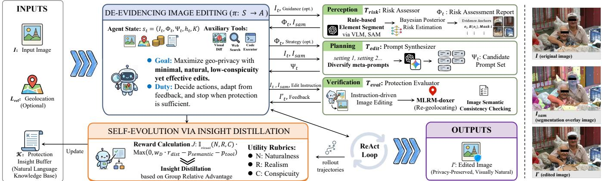  
Figure 3: Overall architecture of GeoEdit. ❶ De-Evidencing Image Editing: A policy � explicitly reasons and acts within a ReAct loop, invoking the core tools $T _ { r i s k } , T _ { e d i t }$ , and $T _ { e v a l }$ to identify evidence, generate semantic edits, and verify protection quality. ❷ Self-Evolution via Insight Distillation: A test-time optimization mechanism that constructs group-relative joint reward signals from rollout trajectories, distilling them into natural-language protection insights (K) to guide future edits.

## 3 Methodology

We design GeoEdit as an evidence-level editing framework for geoprivacy protection, which focuses on identifying and modifying key location-sensitive cues rather than introducing fragile and visually unnatural perturbations. We highlight our trap-like Silent Geoprivacy Protection strategy, in which the defense preserves visual naturalness under normal viewing while covertly interfering with geolocation inference when it is attempted.

## 3.1 Architecture Overview

As shown in Figure 3, GeoEdit consists of De-Evidencing Image Editing and Self-Evolution via Geoprivacy Protection Insight Distillation. Specifically, ❶ The image editing process follows a ReAct loop [35], enabling the policy � to explicitly reason about location-sensitive evidence, propose edits, and verify whether an edit improves geoprivacy while preserving visual quality for the current sample. ❷ A self-evolution mechanism is further introduced to address the short-sightedness of per-sample decisions, thereby avoiding overly aggressive edits, unstable preferences across roll outs, and limited interpretability of the edits.

## 3.2 De-Evidencing Image Editing

The core of GeoEdit is an agentic protection policy $\pi : S  { \mathcal { A } }$ that maps states to actions, where S is the state space and A is the action space. This editing space is large, subtle, and structured around geo-evidence cues. Formally, given an image � and its reference location $L _ { r e f }$ , the state at step � is defined as:

$$
s _ { t } = ( I _ { t } , \Phi _ { t } , \Psi _ { t } , h _ { t } , \mathcal { K } ) ,\tag{1}
$$

where �<sub>�</sub> is the current image, $\Phi _ { t }$ is the risk assessment report, Ψ<sub>�</sub> is the candidate prompt set, $h _ { t }$ is the action-observation history, and K is the protection insight bufer. The bufer stores naturallanguage protection insights distilled from previous samples, which are prepended to the prompt at inference time as a cross-sample prior. $L _ { r e f }$ can be the ground truth or an estimated pseudo-groundtruth, and it does not rely on users providing GPS coordinates to ensure the subsequent operation. GeoEdit’s main goal is to disrupt the visual evidence chain supporting geolocation, and even with an estimated $L _ { r e f }$ , we can still introduce uncertainty, thereby increasing the dificulty for potential attackers.

To align the policy with the perception-planning-verification process of the ReAct paradigm [35], we group low-level atomic operations into a set of unified actions. The resulting action space consists of three core tool calls, one auxiliary action, and one termination action:

$$
A _ { t } = \{ a _ { t } ^ { r i s k } , a _ { t } ^ { e d i t } , a _ { t } ^ { e v a l } , a _ { t } ^ { a u x } , a _ { t } ^ { s t o p } \} ,\tag{2}
$$

where $a _ { t } ^ { r i s k }$ captures privacy threat perception via $T _ { r i s k } , a _ { t } ^ { e d i t }$ performs strategic image manipulation via $T _ { e d i t }$ , and $a _ { t } ^ { e v a l }$ handles execution and verification of the selected edit via $T _ { e v a l }$ . We further include $a _ { t } ^ { a u x }$ to invoke auxiliary utilities for additional information, and $a _ { t } ^ { s t o p }$ to terminate the process.

Risk Assessor. In the perception stage, the policy invokes $T _ { r i s k }$ to analyze the image through structured, schema-guided cue extraction and Bayesian posterior estimation. It produces a risk assessment report $\Phi _ { t }$ that contains geo-evidence anchors and their scores, along with a segmentation overlay $I _ { s a m }$ that assigns mask IDs to fine-grained regions for image editing:

$$
\Phi _ { t } , I _ { s a m } = T _ { r i s k } ( I _ { t } , g u i d a n c e ) .\tag{3}
$$

We formalize the execution logic of $T _ { r i s k }$ in Algorithm 1. $T _ { r i s k }$ focuses on extracting actionable, location-sensitive evidence for downstream editing instead of exhaustively listing scene details. It combines structured cue extraction, posterior risk estimation, and region-level grounding to turn a complex image into a compact, prioritized set of evidence anchors. Specifically, it estimates the geolocation probability $( P ( { \it I s S o l v e d } = 1 \ | \ F _ { r i s k } ) )$ and quantifies each cue’s risk contribution via leave-one-out attribution. We integrate the Bayesian network used for this estimation from the pre-built pipeline in Cheng et al. [4]. $T _ { r i s k }$ also preserves the global scene context through holistic captioning, providing entity-level semantic alignment references for subsequent decision-making.

```tcl
Algorithm 1 Privacy Threat Perception via Risk Assessor
1: Input: Current state image �<sub>�</sub>, optional high-level ��������
2: Output: Structured risk assessment report $\Phi _ { t } ,$ segmentation
overlay image $I _ { s a m }$
3: $F _ { r i s k } , E \gets \mathrm { M L R M } _ { - }$ _Extractor $( I _ { t } ,$ <sub>�</sub>�������) ⊲ Extract
structured risk profile $F _ { r i s k }$ and evidence anchors �
4: ����<sup>�</sup>�� $ \mathrm { M L R M } _ { \cdot }$ _Captioner(�<sub>�</sub>)
5: $P _ { t o t a l }  P ( I s S o l \nu e d = 1 \mid F _ { r i s k } )$ ⊲ BN-based posterior
inference
6: for each evidence $e _ { i } \in E$ do
7: $P _ { l o o }  P ( I s S o l \nu e d = 1 \mid F _ { r i s k } \mid \{ e _ { i } \} )$
8: $R ( e _ { i } ) \gets P _ { t o t a l } - P _ { l o o }$
9: Sort � descending by $R ( e _ { i } ) \vartriangleright$ Risk attribution via leave-one-out
10: ${ I _ { s a m } } \gets \mathrm { S A M } ( I _ { t } , E ) \ v$ ⊲ Generate segmentation overlay $I _ { s a m }$ with
mask IDs
11: $\Phi _ { t } \gets \{ E , R ( E ) , c a p t i o n , P _ { t o t a l } \}$
12: return $\Phi _ { t } , I _ { s a m }$
```

Table 1: The geolocation evidence schema [4].
<table><tr><td>Evidence Source</td><td>Specific Features</td></tr><tr><td>Continuous Geo-Features</td><td>Similarity Mean, Similarity Variance</td></tr><tr><td>Discrete Geo-Features</td><td>Scene Complexity, Landmark Level, Text Value</td></tr><tr><td>Off-Image Features</td><td>Task Attractiveness, Geo-Hint</td></tr><tr><td>Image Quality</td><td>Weather, Focal Length, View Angle, Clarity</td></tr></table>

As illustrated in Table 1, our Risk Assessor organizes geolocation evidence into four complementary sources by following [4], thereby decomposing vulnerability into an interpretable evidence chain with structured attribution. Specifically, ❶ Continuous Geo-Features use Similarity Mean and Similarity Variance to capture the statistical profile of regional appearance against a global reference, distinguishing common and distinctive landscapes. ❷ Discrete Geo-Features capture key localization anchors: Scene Complexity measures the density of geolocation-relevant structures, while Landmark Level and Text Value provide high-precision signals. ❸ Of-Image Features account for UGC/OSINT metadata, where Task Attractiveness reflects the incentive for analysis and Geo-Hint measures explicit geographic leakage in captions or metadata. ❹ Image Quality variables, including Weather, Focal Length, View Angle, and Clarity, characterize observability conditions that afect visual utility and inference feasibility.

Prompt Synthesizer. In the planning stage, the policy invokes $T _ { e d i t }$ to generate diverse editing strategies conditioned on the risk assessment report $\Phi _ { t }$ and the segmentation overlay $I _ { s a m }$ . Instead of committing to a single trajectory, $T _ { e d i t }$ produces a set of candidate editing plans to support subsequent selection and aggregation:

Algorithm 2 Verification and State Update via Protection Evaluator   
1: Input: Current state $I _ { t } ,$ mask overlay $I _ { s a m } ,$ instruction $c _ { t } ,$ ref  
erence location $L _ { r e f } ,$ historical pool H, tolerance �   
2: Output: Next state image $I _ { t + 1 }$ (updated by policy)   
3: Step 1: Protection Evaluation $( T _ { e o a l } )$   
4: $I _ { t } ^ { \prime } \gets \mathrm { E d i t } ( I _ { t } , I _ { s a m } , c _ { t } )$   
5: $\hat { L } ( I _ { t } ) , \Phi _ { a t k } ^ { b a s e } \gets \mathrm { M L R M - d o x e r } ( I _ { t } )$ ⊲ Baseline attack   
6: $\hat { L } ( I _ { t } ^ { \prime } ) , \Phi _ { a t k } ^ { e d i t } \gets \mathrm { M L R M - d o x e r } ( I _ { t } ^ { \prime } )$ ⊲ Attack on edited image   
7: $\mathcal { E } ( I _ { t } )  d _ { H } ( \hat { L } ( I _ { t } ) , L _ { r e f } )$ ⊲ Distance to reference   
8: $\mathcal { E } ( I _ { t } ^ { \prime } )  d _ { H } ( \hat { L } ( I _ { t } ^ { \prime } ) , L _ { r e f } )$   
9: $\Delta \mathcal { E } \gets \mathcal { E } ( I _ { t } ^ { \prime } ) - \mathcal { E } ( I _ { t } )$ ⊲ Calculate protection gain   
10: $s i m _ { c l i p } \gets \mathrm { s i m } ( \mathrm { C L I P } ( I _ { t } ) , \mathrm { C L I P } ( I _ { t } ^ { \prime } ) )$ ⊲ Fidelity Checking   
11: return $( I _ { t } ^ { \prime } , \Delta \mathcal { E } , \Phi _ { a t k } ^ { e d i t } , s i m _ { c l i p } )$ to the policy �   
12: Step 2: Global Optimal State Image Update   
13: $\mathbf { i f } \ \Delta \mathcal { E } > 0$ then   
14: $\mathcal { H } \gets \mathcal { H } \cup \{ ( I _ { t } ^ { \prime } , \Delta \mathcal { E } , s i m _ { c l i p } ) \}$   
15: $\begin{array} { r } { s i m _ { m a x } \gets \operatorname* { m a x } _ { ( I , \Delta \mathcal { E } , s ) \in \mathcal { H } } \textit { s } } \end{array}$   
16: $\mathcal { H } _ { c a n d }  \{ ( I , \Delta \mathcal { E } , s ) \in \mathcal { H } \ | \ s \geq s i m _ { m a x } - \tau \}$   
17: $( I _ { t + 1 } , \Delta \mathcal { E } _ { b e s t } , s _ { b e s t } ) \gets \mathrm { a r g }$ max $( I , \Delta \mathcal { E } , s ) \in \mathcal { H } _ { c a n d }$ ΔE ⊲ Update   
to the candidate with the largest privacy gain   
18: else   
19: $I _ { t + 1 } \gets I _ { t }$ ⊲ Edit rejected, maintain current state

$$
\Psi _ { t } = T _ { e d i t } \bigl ( \Phi _ { t } , I _ { s a m } , s t r a t e g y , n \bigr ) .\tag{4}
$$

Specifically, $T _ { e d i t }$ first identifies a subset ofhigh-contributing geoevidence from $\Phi _ { t } ,$ denoted as $E _ { \mathrm { t a r } } = \left( \Phi _ { t } ^ { ( E ) } \right) _ { 1 : k }$ , which serves as the primary intervention target. It then synthesizes editing instructions under diferent generation settings, where each setting controls the prompt configuration and model choice to induce diverse behaviors. Through iterative expansion across settings, candidate plans are accumulated until the desired number � is reached.

Protection Evaluator. In the verification stage, the policy invokes $T _ { e v a l }$ to execute candidate edits and assess their impact:

$$
\begin{array} { r } { ( I _ { t } ^ { \prime } , \Delta \mathcal { E } , \Phi _ { a t k } ^ { e d i t } , s i m _ { c l i p } ) = T _ { e v a l } ( I _ { t } , I _ { s a m } , c _ { t } , L _ { r e f } ) . } \end{array}\tag{5}
$$

We outline the logic of $T _ { e v a l }$ in Algorithm 2. At a high level, $T _ { e v a l }$ couples semantic editing with adversarial geolocation testing to evaluate both privacy gain and visual utility.

The geolocation verification is performed by the MLRM-doxer, which employs a CoT-Doxing strategy using geolocation evidence schema (Table 1). To prevent reward hacking, the MLRM-doxer is isolated from the final reward phase and driven by diferent MLRMs.

## 3.3 Self-Evolution via Geoprivacy Protection Insight Distillation

To achieve natural, realistic, and inconspicuous edits, we introduce a self-evolution mechanism [2, 5, 29] that distills successful protection attempts into transferable cross-sample insights, thereby enabling GeoEdit to refine its strategies over time and adapt across inputs.

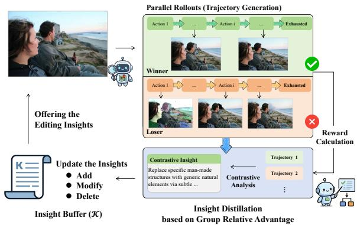  
Figure 4: Overview of Self-Evolution via Geoprivacy Protection Insight Distillation. By contrasting successful and unsuccessful editing trajectories, GeoEdit distills a group relative advantage into a shared Insight Bufer (K).

Group Relative Advantage. As illustrated in Figure 4, insights are derived by comparing editing trajectories within each rollout group. For a given image, a group of editing trajectories (�) is generated in parallel, evaluated by a shared reward function �(�<sup>′</sup>), and ranked to distinguish high- and low-quality outcomes. A Judge Model then conducts contrastive analysis between highreward (Winner) and low-reward (Loser) trajectories to distill concise natural-language insights that capture high-value actions. These insights are stored in a shared bufer K and injected as token-level priors during subsequent inference.

By aggregating geoprivacy protection insights across samples, the policy is guided toward more efective image changes. These insights form an explicit and interpretable set of strategies that can be directly verified by humans. They also provide an intuitive explanation of GeoEdit, showing how protection is achieved and how it can generalize to broader privacy settings.

Joint Reward Formulation. The trajectory evaluation is defined by $J ( I ^ { \prime } )$ , which combines a hard constraint gate with a continuous distance reward and penalty terms:

$$
J ( I ^ { \prime } ) = \mathbb { I } _ { \mathrm { v i s u a l } } ( N , R , C ) \cdot \operatorname* { m a x } \big ( 0 , \ : w _ { D } \cdot r _ { d i s t } - \mathtt { p } _ { s e m a n t i c } - \mathtt { p } _ { t o o l } \big ) ,\tag{6}
$$

where the visual utility gate $\mathbb { I } _ { \mathrm { v i s u a l } }$ applies a strict one-vote rule to maintain visual plausibility. It is assessed by a vision-language model using three discrete utility rubrics: Naturalness (�), Realism (�), and Conspicuity (�). Instead of aggregating these scores, the gate requires each rubric to meet its threshold, and the edit is rejected if any condition fails:

$$
\mathbb { I } _ { \mathrm { v i s u a l } } = \left\{ \begin{array} { l l } { 1 , } & { \mathrm { i f ~ } ( N \geq \tau _ { N } ) \wedge ( R \geq \tau _ { R } ) \wedge ( C \leq \tau _ { C } ) \wedge ( \tau _ { i n v } = 0 ) , } \\ { 0 , } & { \mathrm { o t h e r w i s e } , } \end{array} \right.\tag{7}
$$

where $\tau _ { N } , \tau _ { R } ,$ and $\tau _ { C }$ are tolerance thresholds for visual plausibility, and $\tau _ { i n v } = 1$ indicates fundamentally invalid edits such as failed inpainting or edits confined to padding regions.

Distance Reward. The distance reward $r _ { d i s t }$ measures protection efectiveness by jointly accounting for the achieved geolocation error (divergence from the reference location $L _ { r e f } )$ and the

improvement relative to the original image:

$$
\begin{array} { r } { r } { r _ { d i s t } = \left\{ \begin{array} { l l } { 1 . 0 , } & { \mathrm { i f } \mathcal { E } ( I ^ { \prime } ) \geq E _ { \star } , } \\ { \alpha \cdot \mathrm { c l i p } \big ( \frac { \mathcal { E } ( I ^ { \prime } ) } { E _ { \star } } \big ) + ( 1 - \alpha ) \cdot \mathrm { c l i p } \big ( \frac { \operatorname* { m a x } ( 0 , \Delta \mathcal { E } ) } { D _ { \star } } \big ) , } & { \mathrm { o t h e r w i s e } , } \end{array} \right. } \end{array}\tag{8}
$$

where $E _ { \star }$ is the absolute error saturation threshold, $D _ { \star }$ is the gain saturation scale, and � controls the weight on absolute error. The reward reaches its maximum once the required protection distance is achieved, and otherwise balances absolute error and relative gain.

Execution Penalties. The semantic penalty discourages content drift by constraining deviations between the original and edited images with penalty weight $\lambda _ { S } \mathrm { { : } }$

$$
\begin{array} { r } { p _ { s e m a n t i c } = \lambda _ { S } \cdot ( 1 - \sin ( I , I ^ { \prime } ) ) . } \end{array}\tag{9}
$$

The tool penalty $\scriptstyle { \frac { \scriptstyle { \mathcal { P } } t o o l } { \scriptstyle { \mathcal { P } } t o o l } }$ assigns increasing costs to repeated tool invocations, thereby encouraging eficient use of the available tools:

$$
\begin{array} { r } { \phi _ { t o o l } = \lambda _ { 1 } \cdot \operatorname* { m a x } ( 0 , n _ { 1 } - 1 ) + \lambda _ { 2 } \cdot \operatorname* { m a x } ( 0 , n _ { 2 } - 1 ) + \lambda _ { 3 } \cdot \operatorname* { m a x } ( 0 , n _ { 3 } - 1 ) , } \end{array}\tag{10}
$$

where $n _ { 1 } , n _ { 2 } , n _ { 3 }$ are the call counts of $T _ { r i s k } , T _ { e d i t }$ , and $T _ { e v a l }$ , and $\lambda _ { 1 } , \lambda _ { 2 } , \lambda _ { 3 }$ are the corresponding penalty weights.

## 4 Experiments

## 4.1 Experimental Setup

Datasets. Existing studies [15, 38] often treat geoprivacy protection as an adversarial perturbation problem evaluated on standard geolocation benchmarks such as Im2GPS3k [10] and YFCC4k [25]. These benchmarks mainly contain public and benign scenes, such as tourist attractions or landmark check-ins, where location disclosure is intentional. This leads to a mismatch between current evaluation settings and the real-world geoprivacy risk scenarios.

To better reflect real-world privacy risks, we establish LifePhotoBench, a curated subset comprising 1,553 challenging images (383 from Im2GPS and 1,170 from YFCC). The selection criteria strictly focus on unintentional privacy leakage in everyday scenarios: ❶ Event-centered daily-life photos, where the primary narrative focuses on activities $( \mathrm { e . g . }$ , dining, walking, resting). ❷ Subjectcentered environmental portraits, where a person is the visual focus. In both cases, explicit landmarks are intentionally excluded. The scene context is not the main focus of the image but often plays a key role in enabling geographic inference through implicit cues.

Evaluation Metrics. Geolocation accuracy is measured by the Haversine distance between predicted and ground-truth coordinates, evaluated at five granularities: street (1 km), city (25 km), region (200 km), country (750 km), and continent (2500 km). We report the Median Distance Error (MDE) to represent the overall performance. To assess the Fidelity (Fid.) of the protected images, we measure the cosine similarity between the CLIP (ViT-B/32) image embeddings of the original and edited images. This metric evaluates the extent to which the core visual narrative and overall semantic content are preserved after protection.

Baselines & Target Models. We compare GeoEdit against: Unprotected original images, M-Attack [14] (we use its untargeted variant), GeoShield [15], and a simple Vanilla Edit baseline that directly invokes an MLRM to generate and execute editing prompts without our risk attribution or adversarial verification loop. We adopt the baselines’ recommended settings in our implementation to ensure a fair comparison. To comprehensively evaluate the protection efectiveness, we conduct geolocation attacks using 6 mainstream MLRMs with the adversarial prompt from GeoShield [15]: GPT-5.1, Claude-4.5-Sonnet, Claude-3.7-Sonnet, Gemini-2.5-Pro, GLM-4.6V, and Doubao-Seed-2.0-Pro.

Table 2: Experiment results of baseline comparisons on geoprivacy protection efectiveness. Geolocation prediction accuracy (%) is reported across diferent granularities. The best and second-best results are highlighted in bold and underlined, respectively.
<table><tr><td rowspan="2">Method</td><td rowspan="2">Fid. (↑)</td><td rowspan="2">1km 25km</td><td colspan="4">GPT-5.1 Acc@Km (↓)</td><td colspan="5">Claude-4.5-Sonnet Acc@Km (↓)</td><td colspan="5">Claude-3.7-Sonnet Acc@Km (↓)</td></tr><tr><td></td><td>200km</td><td>750km</td><td>2500km</td><td>1km</td><td>25km</td><td>200km</td><td>750km</td><td>2500km</td><td>1km</td><td>25km</td><td>200km</td><td>750km</td><td>2500km</td></tr><tr><td>Unprotected</td><td>1.000</td><td>29.6</td><td>61.9</td><td>71.8</td><td>80.3</td><td>83.8</td><td>26.5</td><td>55.4</td><td>64.2</td><td>77.1</td><td>81.5</td><td>27.2</td><td>56.3</td><td>65.8</td><td>78.4</td><td>82.2</td></tr><tr><td>M-Attack</td><td>0.344</td><td>10.5</td><td>23.8</td><td>36.2</td><td>54.7</td><td>76.5</td><td>9.2</td><td>21.4</td><td>33.8</td><td>51.7</td><td>74.2</td><td>11.1</td><td>24.8</td><td>35.6</td><td>53.4</td><td>75.7</td></tr><tr><td>GeoShield</td><td>0.267</td><td>3.1</td><td>6.8</td><td>15.2</td><td>31.8</td><td>46.2</td><td>2.5</td><td>5.1</td><td>13.8</td><td>27.4</td><td>49.8</td><td>2.8</td><td>5.5</td><td>14.5</td><td>26.3</td><td>48.7</td></tr><tr><td>Vanilla Edit</td><td>0.893</td><td>18.3</td><td>36.8</td><td>49.0</td><td>70.0</td><td>81.4</td><td>16.5</td><td>33.2</td><td>45.2</td><td>66.4</td><td>79.8</td><td>17.1</td><td>34.5</td><td>46.8</td><td>67.5</td><td>80.5</td></tr><tr><td>GeoEdit (Ours)</td><td>0.944</td><td>2.6</td><td>5.7</td><td>14.9</td><td>30.5</td><td>53.8</td><td>2.1</td><td>4.2</td><td>13.0</td><td>28.6</td><td>51.3</td><td>2.3</td><td>4.8</td><td>13.9</td><td>29.9</td><td>52.5</td></tr><tr><td>GeoEdit w/o K</td><td>0.925</td><td>5.2</td><td>10.8</td><td>21.6</td><td>41.7</td><td>64.4</td><td>4.3</td><td>9.8</td><td>18.2</td><td>38.0</td><td>61.9</td><td>4.9</td><td>10.7</td><td>19.4</td><td>39.6</td><td>63.8</td></tr><tr><td>Method</td><td>Fid. (↑)</td><td colspan="5">Gemini-2.5-Pro Acc@Km (↓)</td><td colspan="5">GLM-4.6V Acc@Km (↓)</td><td colspan="5">Doubao-Seed-2.0-Pro Acc@Km (↓)</td></tr><tr><td></td><td></td><td>1km</td><td>25km</td><td>200km</td><td>750km</td><td>2500km</td><td>1km</td><td>25km</td><td>200km</td><td>750km</td><td>2500km</td><td>1km</td><td>25km</td><td>200km</td><td>750km</td><td>2500km</td></tr><tr><td>Unprotected</td><td>1.000</td><td>24.2</td><td>48.7</td><td>58.6</td><td>72.4</td><td>84.6</td><td>20.5</td><td>37.4</td><td>51.2</td><td>67.1</td><td>83.7</td><td>19.7</td><td>36.2</td><td>49.8</td><td>65.7</td><td>82.8</td></tr><tr><td>M-Attack</td><td>0.344</td><td>9.8</td><td>20.5</td><td>34.3</td><td>51.5</td><td>72.8</td><td>8.1</td><td>18.8</td><td>31.7</td><td>48.4</td><td>70.6</td><td>9.2</td><td>19.4</td><td>32.3</td><td>49.2</td><td>72.5</td></tr><tr><td>GeoShield</td><td>0.267</td><td>4.2</td><td>8.5</td><td>18.4</td><td>31.2</td><td>49.5</td><td>3.1</td><td>6.5</td><td>14.8</td><td>28.5</td><td>52.8</td><td>3.0</td><td>5.8</td><td>16.2</td><td>31.5</td><td>48.6</td></tr><tr><td>Vanilla Edit</td><td>0.893</td><td>14.6</td><td>30.8</td><td>43.2</td><td>62.5</td><td>78.2</td><td>11.4</td><td>25.1</td><td>39.0</td><td>54.2</td><td>71.5</td><td>11.0</td><td>24.8</td><td>38.9</td><td>54.1</td><td>71.3</td></tr><tr><td>GeoEdit (Ours)</td><td>0.944</td><td>3.5</td><td>7.9</td><td>17.8</td><td>34.0</td><td>58.8</td><td>2.8</td><td>5.9</td><td>13.5</td><td>26.1</td><td>49.0</td><td>2.2</td><td>4.7</td><td>14.9</td><td>29.0</td><td>46.1</td></tr><tr><td>GeoEdit w/o K</td><td>0.925</td><td>4.9</td><td>11.8</td><td>20.5</td><td>38.2</td><td>62.1</td><td>4.2</td><td>9.3</td><td>18.4</td><td>35.7</td><td>59.2</td><td>3.9</td><td>8.6</td><td>17.3</td><td>34.5</td><td>58.0</td></tr></table>

Implementation Details. GeoEdit is driven by Qwen3.5-Plus and uses Doubao-Seedream-5.0-lite as the editing model. The fidelity threshold for image editing is set to � = 0.25. The maximum number of ReAct iterations is 15. For the joint reward, we set $w _ { D } = 1 . 0 ,$ $( \tau _ { N } , \tau _ { R } , \tau _ { C } ) = ( 0 . 5 , 0 . 5 , 0 . 5 )$ , �<sub>★</sub> = 2000 km, $D _ { \star } = 5 0 0 \mathrm { k m } , \alpha = 0 . 8 5 ,$ $( \lambda _ { 1 } , \lambda _ { 2 } , \lambda _ { 3 } ) = ( 0 . 0 1 , 0 . 0 2 , 0 . 0 5 )$ , and �<sub>�</sub> = 0.4. For insight distillation, we construct a 100-image subset by sampling about 1% of LifePho toBench (16 images) and adding other images from Im2GPS3k and YFCC4k. Each sample is explored with � = 3 outputs for 3 epochs at temperature 0.3, adjusting only one insight at a time.

## 4.2 Main Results

Protection Efectiveness. Table 2 demonstrates that GeoEdit achieves an optimal balance between visual fidelity and privacy protection. While visual perturbation baselines (M-Attack, GeoShield) reduce geolocation accuracy, mostly achieving their best confusion at the continent level (2500 km), they severely degrade image semantics at the cost of dropping fidelity to below 0.35. In contrast, GeoEdit provides efective protection at fine-grained scales (1km → 200km) and transfers consistently across 6 mainstream MLRMs, all while maintaining a high fidelity of 0.944. Furthermore, the evaluation of the GeoEdit w/o K variant indicates the importance of the accumulated protection insight for de-evidencing image editing.

Visual Utility. We further evaluate the visual utility of diferent methods to assess their practical shareability as shown in Table 3. Specifically, ❶ We use Caption Fidelity (Cap-Fid, ↑) to assess the understanding diference caused by the processing of privacy protection methods. We generate captions for both the original and protected images, and calculate the cosine similarity between their text embeddings using Qwen3-Embedding-4B. ❷ We use Aesthetic Win-Draw-Loss (W-D-L %) to evaluate utility through a pairwise blind A/B test comparing visual appeal and naturalness. We utilize MLRMs for large-scale evaluation on LifePhotoBench, and introduce two independent human evaluators for perceptual assessment on 900 pairwise comparisons (approx. 10% of the full test set) to ensure alignment with human preference. Across both automated and human expert evaluations, GeoEdit consistently achieves a highly competitive W-D-L record (e.g., win rates of 62.7% from Gemini-2.5 and 76.0% from Human 2), far surpassing M-Attack and GeoShield, which sufer overwhelming losses due to visible artifacts. Furthermore, GeoEdit maintains high Cap-Fid scores (0.805 on Gemini-2.5 and 0.881 on GLM-4.6V), confirming that the core narrative remains intact even after de-evidencing.

Unprotected  
GeoShield  
M-Attack  
Vanilla Edit  
GeoEdit (ours)  
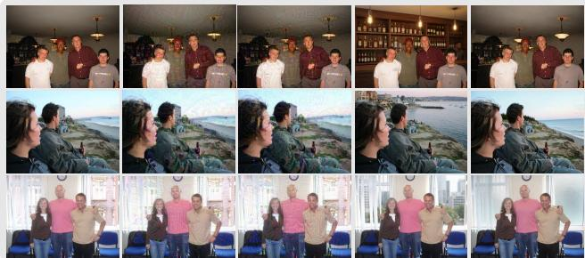  
Figure 5: Visualization of diferent protected images. GeoEdit achieves silent protection while preserving naturalness.

## 4.3 Further Analysis

Ablation Studies. We conduct experiments with three ablation settings: w/o $T _ { r i s k }$ removes the Bayesian risk calculation, meaning the core agent selects visual cues directly based on MLRM’s internal prior without probabilistic structural guidance; w/o $T _ { e d i t }$ bypasses the specialized insight-guided editing synthesis, meaning the core agent has to invoke the image editing tool with its crafted instructions; w/o $T _ { e v a l }$ disables the adversarial verification loop, meaning the core agent can only rely on general auxiliary tools to obtain feedback. We also introduce Vanilla Edit for comparison.

Table 3: Results of visual utility evaluation. W-D-L (%) is the percentage of Wins, Draws, and Losses for the images under each corresponding setting in blind pairwise A/B tests. Cap-Fid is MLRM’s caption fidelity of the protected images.
<table><tr><td rowspan="2">Method</td><td colspan="2">Gemini-2.5</td><td colspan="2">GLM-4.6V</td><td colspan="2">Human 1</td><td colspan="2">Human 2</td></tr><tr><td>W-D-L (%)</td><td> $\mathrm { C a p - F i d } \uparrow$ </td><td>W-D-L (%)</td><td> $\mathrm { C a p - F i d } \uparrow$ </td><td>W-D-L (%) Overall</td><td>vs. Orig.</td><td>W-D-L (%) Overall</td><td>vs. Orig.</td></tr><tr><td>Unprotected (original image)</td><td>72.0-14.7-13.3</td><td>1.000</td><td>84.0-0.0-16.0</td><td>1.000</td><td>76.6-8.0-15.4</td><td>0.0-100.0-0.0</td><td>83.6-0.9-15.5</td><td>0.0-100.0-0.0</td></tr><tr><td>M-Attack</td><td> $2 5 . 3 – 2 5 . 3 – 4 9 . 4$ </td><td>0.801</td><td> $\underline { { 4 5 . 3 \ – 0 . 0 { - } 5 4 . 7 } }$ </td><td>0.865</td><td> $4 . 4 { - } \underline { { 2 2 . 8 { - } 7 2 . 8 } }$ </td><td> $0 . 0 { - } 0 . 0 { - } 1 0 0 . 0$ </td><td> $1 5 . 6 \substack { - 2 . 6 - 8 1 . 8 }$ </td><td> $0 . 0 { - } 0 . 0 { - } 1 0 0 . 0$ </td></tr><tr><td>GeoShield</td><td> $1 0 . 7 – \underline { { 1 6 . 0 } } – 7 3 . 3$ </td><td>0.798</td><td>16.0-0.0-84.0</td><td>0.849</td><td> $5 . 3 \substack { - 2 4 . 8 - 6 9 . 9 }$ </td><td> $0 . 0 { - } 0 . 0 { - } 1 0 0 . 0$ </td><td> $1 1 . 0 { - } 2 . 4 { - } 8 6 . 6 $ </td><td> $0 . 0 { - } 0 . 0 { - } 1 0 0 . 0$ </td></tr><tr><td>Vanilla Edit</td><td> $\underline { { 4 6 . 5 ^ { - 3 . 5 - 5 0 . 0 } } }$ </td><td>0.862</td><td> $3 3 . 1 \substack { - 0 . 0 - 6 6 . 9 }$ </td><td>0.845</td><td> ${ \underline { { 5 5 . 0 \mathrm { - } 1 3 . 1 \mathrm { - } 3 1 . 9 } } }$ </td><td> $\underline { { 1 8 . 6 ^ { - 1 6 . 8 - 6 4 . 6 } } }$ </td><td> $\underline { { 5 8 . 1 - 2 . 8 - 3 9 . 1 } }$ </td><td> $\underline { { 2 3 . 6 ^ { - 1 . 6 - 7 4 . 8 } } }$ </td></tr><tr><td>GeoEdit (Ours)</td><td> $6 2 . 7 \substack { - 2 . 7 - 3 4 . 6 }$ </td><td>0.805</td><td> $5 4 . 7 \substack { - 0 . 0 - 4 5 . 3 }$ </td><td>0.881</td><td> $6 7 . 8 \substack { - 1 3 . 0 - 1 9 . 2 }$ </td><td> $4 2 . 7 \substack { - 1 5 . 4 - 4 1 . 9 }$ </td><td> $7 6 . 0 \mathrm { - } 2 . 5 \mathrm { - } 2 1 . 5$ </td><td> $3 8 . 2 \substack { - 2 . 1 - 5 9 . 7 }$ </td></tr></table>

Table 4: Ablation results for GeoEdit on geoprivacy protection efectiveness and fidelity on LifePhotoBench.
<table><tr><td></td><td>Fid. ↑</td><td colspan="4">MDE (km) ↑</td></tr><tr><td>Setting</td><td></td><td>Gemini-2.5</td><td>GLM-4.6V</td><td>GPT-5.1</td><td>Claude-4.5</td></tr><tr><td>GeoEdit</td><td>0.944</td><td>5240.8</td><td>5821.3</td><td>3645.9</td><td>6836.3</td></tr><tr><td>w/o  $T _ { r i s k }$ </td><td>0.915</td><td>2453.6</td><td>2847.2</td><td>1954.8</td><td>3158.4</td></tr><tr><td>w/o  $T _ { e d i t }$ </td><td>0.931</td><td>3582.4</td><td>4251.6</td><td>2849.5</td><td>4526.8</td></tr><tr><td> $\mathbf { w } / \mathbf { o } ~ T _ { e v a l }$ </td><td>0.898</td><td>1627.5</td><td>1853.8</td><td>1482.2</td><td>2084.6</td></tr><tr><td>Vanilla Edit</td><td>0.893</td><td>1354.2</td><td>1428.5</td><td>1215.6</td><td>1583.4</td></tr></table>

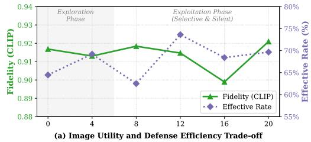

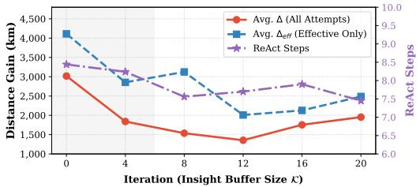  
(b) Absolute Privacy Protection & Trajectory-Level Overhead  
Figure 6: Impact of Protection Insight on GeoEdit. We report the average performance of all edited image attempts and corresponding ReAct steps per trajectory at each insight bufer size during self-evolution.

The ablation results indicate that: ❶ GeoEdit’s advantage comes from the coordinated interaction of risk attribution, insight-guided editing, and adversarial verification, rather than from generic image editing alone. Removing any single module noticeably degrades both privacy protection and visual utility. ❷ Notably, disabling $T _ { e v a l }$ causes the most significant drop (e.g., MDE drops from 5821.3 km to 1853.8 km on GLM-4.6V), indicating that closed-loop adversarial feedback is the most critical component for efective and reliable geoprivacy protection.

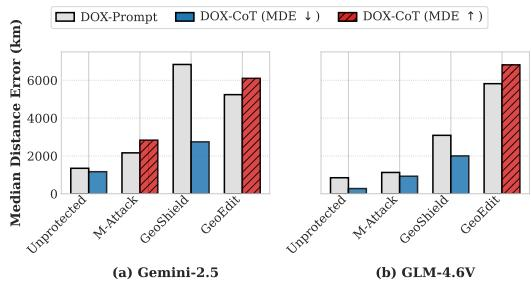  
Figure 7: Defense Performance (MDE ↑, km) under DOX-Prompt and DOX-CoT Probing across two MLRMs.

Impact ofthe Editing Insights. To evaluate the value of these insights, we observe the performance changes of GeoEdit during its self-evolution process from the perspective of insight bufer (K) size growth. We introduce the following metrics for analysis:

$\Delta _ { \mathrm { a l l } }$ is the average distance gain (in km), reflecting the total geographical displacement of all edit attempts.

$\Delta _ { \mathbf { e f f } }$ is the average efective distance gain (in km), considering only successful edits that displace geolocation without noticeable artifacts, highlighting the quality of modifications.

• Ef% is the efective edit rate, representing the percentage of successful and meaningful edits (those that cause measurable displacement while maintaining the image’s naturalness).

As shown in Figure 6, we illustrate the trade-of between semantic fidelity and defense eficiency (Ef%). As |K| increases to 12, the efective rate peaks at 73.6% while fidelity remains stable around 0.91. Figure 6(b) shows the absolute privacy protection strength $( \Delta _ { \mathrm { a l l } }$ and $\Delta _ { \mathrm { e f f } } )$ and ReAct Steps. The average distance gain $\left( \Delta _ { \mathrm { a l l } } \right)$ drops from 3,019 km at $| \mathcal { K } | = 0$ and stabilizes around 1,954 km at |K | = 20. At |K | = 0, the agent executes edits producing large geographical displacements but lower fidelity. As the insight bufer grows, the agent learns to reject edits that degrade visual naturalness, stabilizing around 2,000 km to confuse geolocation at the continent level. More importantly, this transition directly optimizes inference eficiency. The accumulation of protection insights significantly accelerates the ReAct convergence, dropping the average iterations from an initial exploratory peak to merely 7.45 turns per image. This highlights the contribution of our self-evolution mechanism in optimizing inference eficiency and mitigating concerns regarding the high computational cost of agentic frameworks.

Resistance to Adversarial Dox-CoT Probing. To further evaluate the robustness of our defense under reasoning-guided doxing attacks, we employ DOX-COT [17] for evaluation. As shown in Figure 7, DOX-COT reasoning helps the attacker extract and synthesize scattered visual evidence, significantly improving the localization accuracy on unprotected original images. In contrast, our GeoEdit exhibits a backfire efect, as the semantic edits mislead the reasoning chain. By injecting deceptive context, GeoEdit forces the attacker’s CoT to fixate on false evidence, which actually increases the protection distance. For instance, the MDE under Gemini-2.5 increases from 5240.8 km to 6105.2 km, and the GLM-4.6V MDE increases from 5821.3 km to 6813.6 km. This highlights that our GeoEdit is highly resilient against reasoning-based geographic profiling. Furthermore, unlike M-Attack, which relies on uninterpretable adversarial perturbations to achieve backfire, GeoEdit achieves resilience through interpretable semantic modifications.

Table 5: Interpretability analysis of key protection insights distilled via self-evolution.
<table><tr><td>Example</td><td>Editing Insight</td><td>Detail of Insight</td></tr><tr><td>+9152.51 kn</td><td>Subtractive Micro-Feature Removal</td><td>For non-landmark scenes, prioritize sub- tractive micro-feature removal (e.g., eras- ing botanical markers, scattered debris) over additive effects to avoid creating new regional archetypes.</td></tr><tr><td>+518.86 kn</td><td>Cultural Marker Neutralization</td><td>Identify and replace culturally distinctive elements with contextually plausible but globally generic alternatives to create se- mantic ambiguity while preserving the overall scene narrative.</td></tr><tr><td></td><td>Semantic Simplification</td><td>Replace distinctive features with neutral, context-appropriate surfaces rather than generating new complex patterns, while maintaining natural weathering and tex- ture noise, specifically optimizing for in- door scenes to maximize ambiguity while preserving naturalness.</td></tr><tr><td></td><td>Structural Naturalization +6291.47 km</td><td>Replace specific man-made structures with generic natural elements via sub- tle substitution to break database links and hierarchical narratives while main- taining visual plausibility.</td></tr></table>

Table 6: Robustness of GeoEdit under transformations (Geolocation model: Gemini-2.5). Evaluated by Median Distance Error.
<table><tr><td>Method</td><td>Original</td><td>JPEG (Q = 50)</td><td>Blur (σ = 10)</td></tr><tr><td>GeoShield</td><td>6836.3</td><td>5235.9</td><td>7198.0</td></tr><tr><td>GeoEdit (Ours)</td><td>5240.8</td><td>5118.1</td><td>5349.8</td></tr></table>

Interpretability of Editing Strategies. One of the core advantages of GeoEdit is its self-evolution design, which derives explicit geoprivacy protection insights that are both interpretable and reusable. As shown in Table 5, we present several specific cases where GeoEdit applies the distilled insights to edit challenging images. For instance, in the first example featuring scattered botanical markers and debris, GeoEdit avoids naive global masking. Instead, guided by the Subtractive Micro-Feature Removal insight, GeoEdit explicitly targets and erases these subtle regional archetypes that often serve as critical cues for geolocation models. By systematically applying these distilled insights, GeoEdit ensures that its protection mechanism is not only highly interpretable but also provides valuable guidance for human understanding of privacy risks.

Robustness to Transformation. As shown in Table 6, GeoEdit’s protection remains highly stable under common real-world image transformations. By employing a physical semantic editing approach that modifies the underlying content rather than relying on visual perturbation, GeoEdit ensures consistent stability across diferent transformations.

## 5 Conclusion

In this paper, we propose Geo-Evidence Editing (GeoEdit), an adversarial de-evidencing framework designed for silent geoprivacy protection via image editing. GeoEdit aims to disrupt the underlying spatial reasoning chains by introducing semantic de-evidencing, thereby achieving an optimal balance between robust privacy protection and visual utility. This de-evidencing process is guided by an interpretable agentic loop that integrates risk assessment, edit planning, and verification. Furthermore, the proposed insight bufer ofers interpretable guidance for the editing process, ensuring its transferability across diverse scenarios. Evaluated on the LifePhotoBench dataset, GeoEdit achieves a better trade-of in protection, efectively reducing precise geolocation accuracy (Acc@1km) to near 0% and achieving a Median Distance Error exceeding 5000 km on some models, while maintaining exceptional fidelity of 0.944.

## References

[1] Gabriele Berton, Carlo Masone, and Barbara Caputo. 2022. Rethinking Visual Geo-Localization for Large-Scale Applications. In Proceedings ofthe IEEE/CVF Conference on Computer Vision and Pattern Recognition. 4878–4888

[2] Yuzheng Cai, Siqi Cai, Yuchen Shi, Zihan Xu, Lichao Chen, Yulei Qin, Xiaoyu Tan, Gang Li, Zongyi Li, Haojia Lin, Yong Mao, Ke Li, and Xing Sun. 2025. Training Free Group Relative Policy Optimization. arXiv preprint arXiv:2510.08191 (2025).

[3] Yingshan Chang, Mridu Narang, Hisami Suzuki, Guihong Cao, Jianfeng Gao, and Yonatan Bisk. 2022. WebQA: Multihop and Multimodal QA. In Proceedings ofthe IEEE/CVF Conference on Computer Vision and Pattern Recognition (CVPR). 16495–16504.

[4] Shengjia Cheng, Peng Chen, Longsheng Zhu, and Yu Yan. 2026. Beyond the Geotag: Assessing Implicit Geoprivacy Risks in Visual User-Generated Content. International Journal ofGeographical Information Science (2026). doi:10.1080/ 13658816.2026.2623524 Published online.

[5] Shijian Deng, Kai Wang, Tianyu Yang, Harsh Singh, and Yapeng Tian. 2025. Self-Improvement in Multimodal Large Language Models: A Survey. In Findings ofthe Association for Computational Linguistics: EMNLP 2025. Association for Computational Linguistics, Suzhou, China, 1987–2006. doi:10.18653/v1/2025. findings-emnlp.105

[6] Gemini Team, Rohan Anil, Sebastian Borgeaud, Jean-Baptiste Alayrac, Jiahui Yu, Radu Soricut, Johan Schalkwyk, Andrew M. Dai, Anja Hauth, Katie Millican David Silver, Melvin Johnson, Ioannis Antonoglou, Julian Schrittwieser, Amelia Glaese, Jilin Chen, Emily Pitler, Timothy Lillicrap, Angeliki Lazaridou, Orhan Firat, et al. 2023. Gemini: A Family of Highly Capable Multimodal Models. arXiv preprint arXiv:2312.11805 (2023). https://arxiv.org/abs/2312.11805

[7] Qi Guo, Shanmin Pang, Xiaojun Jia, Yang Liu, and Qing Guo. 2024. Eficient Gen eration of Targeted and Transferable Adversarial Examples for Vision-Language Models via Difusion Models. IEEE Transactions on Information Forensics and Security 20 (2024), 1333–1348. doi:10.1109/TIFS.2024.3518072

[8] Lukas Haas, Michal Skreta, Silas Alberti, and Chelsea Finn. 2024. PIGEON: Predicting Image Geolocations. In Proceedings ofthe IEEE/CVF Conference on Computer Vision and Pattern Recognition. 12893–12902.

[9] Nihad A. Hassan and Rami Hijazi. 2018. Open Source Intelligence Methods and Tools: A Practical Guide to Online Intelligence. Apress, Berkeley, CA. doi:10.1007/ 978-1-4842-3213-2

[10] James Hays and Alexei A Efros. 2008. IM2GPS: Estimating Geographic Information from a Single Image. In 2008 IEEE Conference on Computer Vision and Pattern Recognition. IEEE, 1–8. doi:10.1109/CVPR.2008.4587784

[11] Eliot Higgins. 2021. We Are Bellingcat: Global Crime, Online Sleuths, and the Bold Future ofNews. Bloomsbury Publishing

[12] Lingyao Li, Runlong Yu, Qikai Hu, Bowei Li, Min Deng, Yang Zhou, and Xiaowei Jia. 2025. From Pixels to Places: A Systematic Benchmark for Evaluating Image Geolocalization Ability in Large Language Models. CoRR abs/2508.01608 (2025). https://arxiv.org/abs/2508.01608

[13] Ling Li, Yao Zhou, Yuxuan Liang, Fugee Tsung, and Jiaheng Wei. 2025. Recog nition through Reasoning: Reinforcing Image Geo-localization with Large Vision-Language Models. In Advances in Neural Information Processing Systems. https://openreview.net/forum?id=wuMdBGMe3y

[14] Zhaoyi Li, Xiaohan Zhao, Dong-Dong Wu, Jiacheng Cui, and Zhiqiang Shen. 2025. A Frustratingly Simple Yet Highly Efective Attack Baseline: Over 90% Success Rate Against the Strong Black-Box Models of GPT-4.5/4o/o1. In Advances in Neural Information Processing Systems. https://openreview.net/forum?id= SD8uh8Pc7s NeurIPS 2025 Poster.

[15] Xinwei Liu, Xiaojun Jia, Yuan Xun, Simeng Qin, and Xiaochun Cao. 2026. GeoShield: Safeguarding Geolocation Privacy from Vision-Language Models via Adversarial Perturbations. In Proceedings ofthe AAAI Conference on Artificial Intelligence, Vol. 40. AAAI Press, 35653–35661. doi:10.1609/aaai.v40i42.40877

[16] Pan Lu, Hritik Bansal, Tony Xia, Jiacheng Liu, Chunyuan Li, Hannaneh Hajishirzi, Hao Cheng, Kai-Wei Chang, Michel Galley, and Jianfeng Gao. 2023. MathVista: Evaluating Mathematical Reasoning of Foundation Models in Visual Contexts. arXiv preprint arXiv:2310.02255 (2023)

[17] Weidi Luo, Tianyu Lu, Qiming Zhang, Xiaogeng Liu, Bin Hu, Yue Zhao, Jieyu Zhao, Song Gao, Patrick McDaniel, Zhen Xiang, and Chaowei Xiao. 2025. Doxing via the Lens: Revealing Location-Related Privacy Leakage on Multi-Modal Large Reasoning Models. arXiv:2504.19373 [cs.CR] https://arxiv.org/abs/2504.19373

[18] OpenAI. 2023. GPT-4V(ision) System Card. https://cdn.openai.com/papers/ GPTV\_System\_Card.pdf

[19] Tribhuvanesh Orekondy, Mario Fritz, and Bernt Schiele. 2018. Connecting Pixels to Privacy and Utility: Automatic Redaction of Private Information in Images. In Proceedings ofthe IEEE/CVFConference on Computer Vision and Pattern Recognition (CVPR). 8466–8475.

[20] Tribhuvanesh Orekondy, Bernt Schiele, and Mario Fritz. 2017. Towards a Visual Privacy Advisor: Understanding and Predicting Privacy Risks in Images. In Proceedings ofthe IEEE International Conference on Computer Vision (ICCV). 3686– 3695.

[21] Javier Pastor-Galindo, Pantaleone Nespoli, Félix Gómez Mármol, and Gregorio Martínez Pérez. 2020. The Not Yet Exploited Goldmine of OSINT: Opportunities, Open Challenges and Future Trends. IEEE Access 8 (2020), 10282–10304. doi:10. 1109/ACCESS.2020.2965257

[22] Jiayu Shu, Rui Zheng, and Pan Hui. 2016. Cardea: Context-Aware Visual Privacy Protection from Pervasive Cameras. arXiv preprint arXiv:1610.00889 (2016). https://arxiv.org/abs/1610.00889

[23] Shezheng Song, Xiaopeng Li, Shasha Li, Shan Zhao, Jie Yu, Jun Ma, Xiaoguang Mao, Weimin Zhang, and Meng Wang. 2025. How to Bridge the Gap Between Modalities: Survey on Multimodal Large Language Model. IEEE Transactions on Knowledge and Data Engineering 37, 9 (2025), 5311–5329. doi:10.1109/TKDE. 2025.3527978

[24] Sudharshan Suresh, Nathaniel Chodosh, and Montiel Abello. 2018. DeepGeo: Photo Localization with Deep Neural Network. arXiv preprint arXiv:1810.03077 (2018). https://arxiv.org/abs/1810.03077

[25] Bart Thomee, David A. Shamma, Gerald Friedland, Benjamin Elizalde, Karl Ni, Douglas Poland, Damian Borth, and Li-Jia Li. 2016. YFCC100M: The New Data in Multimedia Research. Commun. ACM 59, 2 (2016), 64–73. doi:10.1145/2812802

[26] Vicente Vivanco Cepeda, Gaurav Kumar Nayak, and Mubarak Shah. 2023. Geo-CLIP: CLIP-Inspired Alignment Between Locations and Images for Efective Worldwide Geo-Localization. In Advances in Neural Information Processing Systems, Vol. 36.

[27] Zhiqiang Wang, Dejia Xu, Rana Muhammad Shahroz Khan, Yanbin Lin, Zhiwen Fan, and Xingquan Zhu. 2024. LLMGeo: Benchmarking Large Language Models on Image Geolocation In-the-Wild. arXiv preprint arXiv:2405.20363 (2024). https: //arxiv.org/abs/2405.20363

[28] Tobias Weyand, Ilya Kostrikov, and James Philbin. 2016. PlaNet: Photo Geolocation with Convolutional Neural Networks. In European Conference on Computer Vision.

[29] Rong Wu, Xiaoman Wang, Jianbiao Mei, Pinlong Cai, Daocheng Fu, Cheng Yang, Licheng Wen, Xuemeng Yang, Yufan Shen, Yuxin Wang, and Botian Shi. 2025. EvolveR: Self-Evolving LLM Agents through an Experience-Driven Lifecycle. arXiv preprint arXiv:2510.16079 (2025). arXiv:2510.16079 [cs.AI] https://arxiv. org/abs/2510.16079

[30] Biao Xiang, Soyeon Caren Han, and Yihao Ding. 2026. BRIDGE: Benchmark for Multi-hop Reasoning in Long Multimodal Documents with Grounded Evidence. arXiv preprint arXiv:2603.07931 (2026). doi:10.48550/arXiv.2603.07931

[31] Weiye Xu, Jiahao Wang, Weiyun Wang, Zhe Chen, Wengang Zhou, Aijun Yang, Lewei Lu, Houqiang Li, Xiaohua Wang, Xizhou Zhu, Wenhai Wang, Jifeng Dai, and Jinguo Zhu. 2025. VisuLogic: A Benchmark for Evaluating Visual Reasoning in Multi-modal Large Language Models. arXiv preprint arXiv:2504.15279 (2025). https://arxiv.org/abs/2504.15279

[32] Yu Yan, Sheng Sun, Shengjia Cheng, Teli Liu, Mingfeng Li, and Min Liu. 2026. Red-teaming the Multimodal Reasoning: Jailbreaking Vision-Language Models via Cross-modal Entanglement Attacks. arXiv preprint arXiv:2602.10148 (2026).

[33] Ruixin Yang, Ethan Mendes, Arthur Wang, James Hays, Sauvik Das, Wei Xu, and Alan Ritter. 2026. Do Vision-Language Models Respect Contextual Integrity in Location Disclosure?. In International Conference on Learning Representations. https://openreview.net/forum?id=64Ea2Dx0J

[34] Yifan Yang, Siqin Wang, Daoyang Li, Shuju Sun, and Qingyang Wu. 2024. GeoLocator: A Location-Integrated Large Multimodal Model (LMM) for Inferring Geo-Privacy. Applied Sciences 14, 16 (2024), 7091. doi:10.3390/app14167091

[35] Shunyu Yao, Jefrey Zhao, Dian Yu, Nan Du, Izhak Shafran, Karthik Narasimhan, and Yuan Cao. 2022. ReAct: Synergizing Reasoning and Acting in Language Models. CoRR abs/2210.03629 (2022). doi:10.48550/arXiv.2210.03629

[36] Xiang Yue, Yuansheng Ni, Kai Zhang, Tianyu Zheng, Ruoqi Liu, Ge Zhang, Samuel Stevens, Dongfu Jiang, Weiming Ren, Yuxuan Sun, Cong Wei, Botao Yu, Ruibin Yuan, Renliang Sun, Ming Yin, Boyuan Zheng, Zhenzhu Yang, Yibo Liu, Wenhao Huang, Huan Sun, Yu Su, and Wenhu Chen. 2024. MMMU: A Massive Multi-discipline Multimodal Understanding and Reasoning Benchmark for Expert AGI. In Proceedings ofthe IEEE/CVF Conference on Computer Vision and Pattern Recognition.

[37] Jiaming Zhang, Jitao Sang, Xian Zhao, Xiaowen Huang, Yanfeng Sun, and Yongli Hu. 2020. Adversarial Privacy-Preserving Filter. In Proceedings ofthe 28th ACM International Conference on Multimedia. 1423–1431. doi:10.1145/3394171.3413906

[38] Jiaming Zhang, Che Wang, Yang Cao, Longtao Huang, and Wei Yang Bryan Lim. 2026. Disrupting Hierarchical Reasoning: Adversarial Protection for Geographic Privacy in Multimodal Reasoning Models. In Proceedings ofthe 14th International Conference on Learning Representations (ICLR). https://openreview.net/forum? id=5S6YTG9dL0

[39] Xian Zhang and Xiang Cheng. 2025. Evaluation of Geolocation Capabilities of Multimodal Large Language Models and Analysis of Associated Privacy Risks. CoRR abs/2506.23481 (2025). https://arxiv.org/abs/2506.23481

[40] Zicheng Zhang, Junying Wang, Farong Wen, Yijin Guo, Xiangyu Zhao, Xinyu Fang, Shengyuan Ding, Xuemei Zhou, Guangtao Zhai, et al. 2025. Large Multi modal Models Evaluation: A Survey. Science China Information Sciences 68, 12 (2025), 221301. doi:10.1007/s11432-025-4676-4