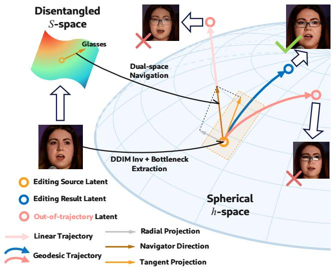
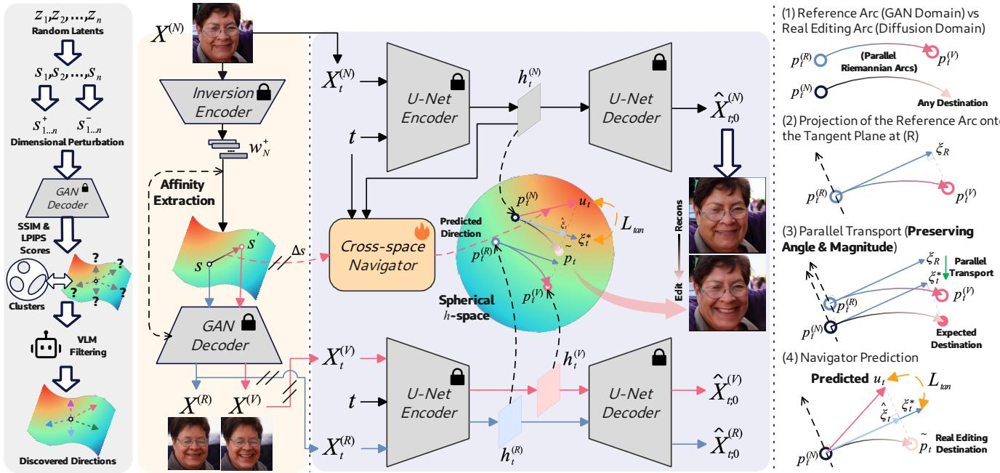
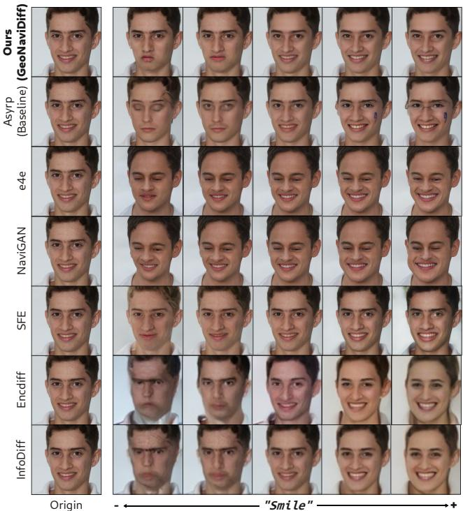
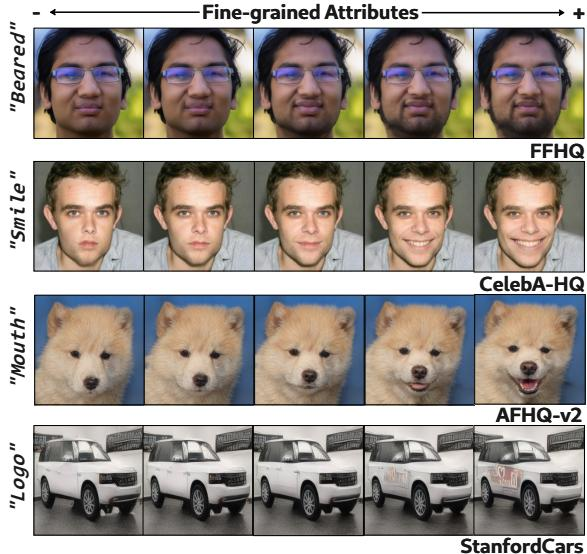
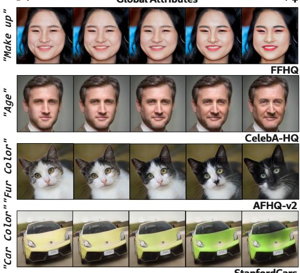
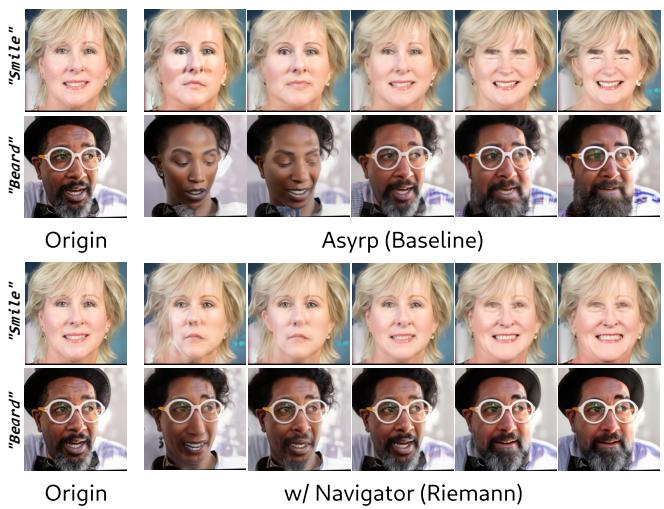
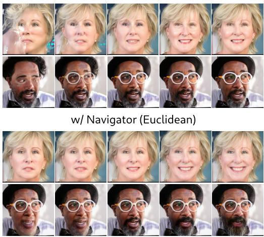

# GeoNaviDif: Transferring Disentangled Semantic Controls to Difusion Features via Local Riemannian Navigation

Tao Sun1, Huanting Guo2, Baao Xie1, Zhou Fang3, Qiuyu Chen1, Hao Zheng1, Wenjun Zeng1

1Ningbo Key Laboratory of Spatial Intelligence and Digital Derivative, Ningbo Institute of Digital Twin, Eastern Institute of

Technology, Ningbo, Zhejiang 315200, P.R. China

2Beijing Institute of Technology, Beijing, P.R. China

3Shaanxi Normal University

## Abstract

Disentangled real-image manipulation requires factor-specific semantic control while preserving image fidelity and nontarget content. StyleSpace S provides interpretable controls but is limited by GAN inversion, whereas difusion models ofer stronger image realization without an explicit factorized control basis. We introduce GeoNaviDif, an unsupervised cross-space framework that transfers disentangled StyleSpace interventions to local Riemannian trajectories in difusion hspace. GeoNaviDif constructs reconstruction-decoupled supervision by extracting a spherical Log-map tangent from a matched StyleGAN reconstruction–edit pair and paralleltransporting it to the real-image difusion state. A shared, factor-conditioned Navigator predicts this tangent at inference, while norm-preserving geodesic realization and sourceanchored rollout stabilize the reverse process without edited references or factor-specific models. Experiments across multiple datasets show that GeoNaviDif outperforms the compared methods in fidelity, factor selectivity, edit locality, and trajectory smoothness.

## 1 Introduction

Disentangled Representation Learning (DRL) (Bengio, Courville, and Vincent 2013) seeks to factorize complex observations into semantically meaningful variables, providing a foundation for interpretable and controllable generation. For representation manipulation, its value lies in selective intervention: a target factor, such as shape, color, or expression, should change while identity, structure, and other non-target factors remain stable. This factor-specific controllability is essential for fine-grained editing, yet it depends on both an interpretable representation and a generative model capable of faithfully realizing the prescribed change.

Early DRL-based manipulation methods primarily relied on the structured latent spaces of Variational Autoencoders (VAEs) and Generative Adversarial Networks (GANs) (Härkönen et al. 2020; Karras, Laine, and Aila 2019). In particular, StyleGAN exposes increasingly finegrained semantic controls through its latent hierarchy, with channel-level coordinates in StyleSpace S supporting localized and interpretable interventions (Karras et al. 2020; Wu, Lischinski, and Shechtman 2021). However, GAN-based real-image manipulation remains constrained by inversion fidelity and the fixed generator prior (Tov et al. 2021; Bobkov et al. 2024; Liu, Song, and Chen 2023). Difusion models offer a stronger generative prior and high-quality image reconstruction, but their internal representations do not explicitly expose a factor-indexed semantic basis. This creates a fundamental tension: structured GAN representations provide factor-specific semantic controls, whereas difusion priors favor high-fidelity reconstruction and synthesis.

  
Figure 1: Conceptual comparison of Euclidean, arbitrary geodesic, and GeoNaviDif trajectories in difusion h-space.

To exploit the difusion prior despite this missing factorized control space, existing conditional difusion manipulation methods introduce semantic controls externally through text, attribute labels, or auxiliary guidance. Their controllable granularity, however, remains tied to predefined conditions and may cause unintended changes when those conditions are coarse or misaligned (Parihar et al. 2024; Hu et al. 2023; Sun et al. 2026). An intrinsic alternative is to manipulate the U-Net bottleneck feature space, known as h-space, which encodes rich high-level semantics without such external controls (Kwon, Jeong, and Uh 2022; Jeong, Kwon, and Uh 2024). Yet h-space does not expose these semantics as explicit, reusable control coordinates. Therefore, prior work trains a separate shift predictor for each prescribed semantic attribute and injects its output as an additive Euclidean residual (Kwon, Jeong, and Uh 2022). This direction-specific design prevents reuse across factors and ignores the geometry and feature statistics of h-space. As illustrated in Figure 1, its straight ambient path departs from the spherical shell of normalized bottleneck states and changes the bottleneck norm, disrupting its correlation with skip-feature statistics and producing visible artifacts (Jeong, Kwon, and Uh 2024). Remaining on the hyperspherical shell alone is insuficient: an arbitrary geodesic may be geometrically valid while reaching a semantically incorrect endpoint. Therefore, stable disentangled manipulation requires a local tangent direction conditioned on an explicit semantic factor and adapted to the source image and difusion timestep.

Motivated by this insight, we propose GeoNaviDif, an unsupervised DRL framework for cross-space semantic transfer via Geodesic Navigation in Difusion h-space. Rather than disentangling difusion h-space from scratch, GeoNaviDif transfers unsupervised S-space controls into it, enabling high-fidelity manipulation of individual semantic factors while preserving non-target content. A shared crossspace Navigator conditions on the S-space displacement, source bottleneck state, and timestep to predict the corresponding local tangent direction in h-space. Geometry-aware learning and source-anchored inference then realize this prediction as a stable manifold-preserving difusion trajectory without requiring an edited reference or a separate Navigator for each factor at inference. Our main contributions are:

1. We introduce a cross-space paradigm that maps interpretable S-space directions to stable semantic trajectories along the local hyperspherical geometry of difusion hspace. This paradigm decouples semantic representation from image realization, with S-space defining the semantics and the difusion prior realizing them beyond GAN reconstruction fidelity.

2. We develop a local Riemannian navigation mechanism with reconstruction-decoupled tangent supervision, norm-preserving geodesic realization, and sourceanchored inference. This design aligns the transferred semantic direction with the real-image difusion state while suppressing radial drift and cumulative rollout error.

3. We conduct extensive evaluations across multiple datasets and diverse object categories. The results demonstrate that GeoNaviDif generalizes robustly across object categories and achieves state-of-the-art performance across all reported metrics of image fidelity, representation disentanglement, edit locality, and trajectory smoothness.

## 2 Related Work

## 2.1 Disentanglement in VAEs and GANs

Early disentangled representation learning primarily relied on variational autoencoders (VAEs), which separate generative factors by regularizing the latent distribution or encouraging factorized representations (Burgess et al. 2018; Kim and Mnih 2018; Rolinek, Zietlow, and Martius 2019). GANbased approaches subsequently showed that interpretable semantic directions can be identified in pretrained generators through principal components, closed-form factorization, or unsupervised direction discovery (Härkönen et al. 2020; Shen and Zhou 2021; Voynov and Babenko 2020). Moving beyond the dense directions of W and W+, StyleSpace Analysis exposed the channel-wise modulation coeficients of StyleGAN and showed that selected coordinates provide localized controls with stronger disentanglement and completeness under its evaluation protocols (Karras et al. 2020; Wu, Lischinski, and Shechtman 2021). Fantastic Style Channels further selects representative and diverse channel directions from their generated image changes without using attribute labels (Simsar et al. 2023). These advances provide fine-grained semantic controls, but realizing them on real images remains constrained by GAN inversion and the fixed generator prior (Xia et al. 2023; Tov et al. 2021).

## 2.2 Disentanglement–Fidelity Trade-of

The tension between semantic editability and image fidelity is particularly evident in real-image manipulation. In Style-GAN, latent codes that remain close to the native distribution are generally more editable, whereas representations with greater freedom can reconstruct finer details at the cost of less stable manipulation; e4e, CLCAE, and SFE address diferent aspects of this trade-of through editability-aware inversion, cross-space guidance, or feature editing (Tov et al. 2021; Liu, Song, and Chen 2023; Bobkov et al. 2024). Difusion-based DRL methods approach the complementary side of the problem by learning factorized representations while retaining the generative capacity of difusion models: InfoDifusion maximizes information in an auxiliary semantic latent variable, DisDif learns factor-conditioned representations without supervision, and EncDif uses cross-attention as an inductive bias for factor separation (Wang et al. 2023; Yang et al. 2023, 2024). These methods require training or modifying the diffusion model to learn a disentangled representation, rather than reusing an established semantic basis with a frozen denoiser. Inspired by these complementary advances, GeoNaviDif uses S-space to provide factor-specific semantic controls and the high-dimensional h-space of a pretrained U-Net denoiser as the realization space for their semantic shifts. This cross-space formulation combines the disentanglement of S with difusion reconstruction fidelity without explicit conditioning or predefined h-space directions.

## 2.3 Semantic Manipulation in Difusion Models

Difusion models can be controlled through text, attribute labels, or auxiliary guidance, but the resulting editing granularity remains tied to the conditioning interface and may cause unintended changes when the condition is coarse or misaligned (Parihar et al. 2024; Hu et al. 2023; Sun et al. 2026). Intrinsic feature manipulation provides an alternative: Asyrp identifies the U-Net bottleneck h-space as semantically editable and learns a direction-specific predictor whose output is injected as an additive Euclidean residual (Kwon, Jeong, and Uh 2022), while subsequent work discovers semantic directions across difusion timesteps without attribute supervision (Park et al. 2023). InjectFusion further demonstrates that direct replacement or addition can disrupt bottleneck feature statistics, and improves content injection through norm-matched spherical interpolation and latent calibration (Jeong, Kwon, and Uh 2024). These approaches establish the editability of difusion features and the importance of preserving their geometry, but do not provide a shared factor-conditioned mechanism that maps an external disentangled control to a source- and timestep-adaptive tangent trajectory. GeoNaviDif addresses this gap by learning a shared Navigator from S-space displacements to local Riemannian navigation in difusion h-space.

## 3 Background

## 3.1 DDIM Sampler

The Denoising Implicit Difusion Model (DDIM) sampler (Song, Meng, and Ermon 2020) is a deterministic sampler that maintains consistency between forward and reverse process trajectories. This property enables it to map Gaussian noise $\hat { x } _ { T } \sim \mathcal { N } ( \mathbf { 0 } , \mathbf { I } )$ back to generated images via smooth denoising trajectories:

$$
\begin{array} { l } { \hat { x } _ { t - 1 } = \sqrt { \bar { \alpha } _ { t - 1 } } \frac { \hat { x } _ { t } - \sqrt { 1 - { \bar { \alpha } _ { t } } } \epsilon _ { \theta } \left( \hat { x } _ { t } , t , \mathbf { c } \right) } { \sqrt { \bar { \alpha } _ { t } } } } \\ { + \sqrt { 1 - { \bar { \alpha } _ { t - 1 } } - \sigma _ { t } ^ { 2 } } \epsilon _ { \theta } ( \hat { x } _ { t } , t , \mathbf { c } ) + \sigma _ { t } \tilde { \epsilon } _ { t } , } \end{array}\tag{1}
$$

where $\begin{array} { r } { \sigma _ { t } = \eta \sqrt { \frac { 1 - \bar { \alpha } _ { t - 1 } } { 1 - \bar { \alpha } _ { t } } } \cdot \sqrt { 1 - \frac { \bar { \alpha } _ { t } } { \bar { \alpha } _ { t - 1 } } } , \eta } \end{array}$ is a hyperparameter that controls the stochasticity of the sampling process. In the deterministic form $( \boldsymbol { \mathrm { e } } . \boldsymbol { \mathrm { g } } . , \eta = 0 )$ , DDIM is expected to recover the same noise across all sampling steps as in the corresponding denoising steps, thereby achieving consistent inversion of the difusion process.

## 3.2 Asymmetric Reverse Process

Asymmetric Reverse Process (Asyrp) (Kwon, Jeong, and Uh 2022) enables image editing by injecting ofset priors into the semantically editable h-space during the denoising process. Let $h _ { t }$ be the original h latent matrix corresponding to timestep t. From the unconditional form of Eq. (1):

$$
\begin{array} { l l } { P _ { t } ( \tilde { x } _ { t } , t ; h _ { t } ) = \frac { \tilde { x } _ { t } - \sqrt { 1 - \bar { \alpha _ { t } } } \cdot \epsilon _ { \theta } ( \tilde { x } _ { t } , t ; h _ { t } ) } { \sqrt { \bar { \alpha } _ { t } } } , } \\ { D _ { t } ( \tilde { x } _ { t } , t ; h _ { t } ) = \sqrt { 1 - \bar { \alpha } _ { t - 1 } - \sigma _ { t } ^ { 2 } } \cdot \epsilon _ { \theta } ( \tilde { x } _ { t } , t ; h _ { t } ) . } \end{array}\tag{2}
$$

Asyrp uses a simulated difusion process via DDIM inversion to obtain the semantically manipulated $\tilde { h } _ { t }$ and defines the following three-stage editing process. For compactness, let $P _ { t } ( h ) { \stackrel { \textstyle - } { = } } P _ { t } ( { \tilde { x } } _ { t } , t ; { \bar { h } } ) , D _ { t } ( h ) { \stackrel { \textstyle - } { = } } D _ { t } ( { \tilde { x } } _ { t } , t ; h )$ , and denote the three timestep intervals by $\dot { \mathcal { T } } _ { 1 } = [ t _ { \mathrm { e d i t } } , T ] , \dot { \mathcal { T } } _ { 2 } = [ t _ { \mathrm { b o o s t } } , t _ { \mathrm { e d i t } } )$ and $\mathcal { T } _ { 3 } = [ 0 , t _ { \mathrm { b o o s t } } )$

$$
\tilde { x } _ { t - 1 } = \left\{ \begin{array} { l l } { \sqrt { \bar { \alpha } _ { t - 1 } } P _ { t } ( \tilde { h } _ { t } ) + D _ { t } ( h _ { t } ) , } & { t \in \mathbb { Z } _ { 1 } , } \\ { \sqrt { \bar { \alpha } _ { t - 1 } } P _ { t } ( h _ { t } ) + D _ { t } ( h _ { t } ) , } & { t \in \mathbb { Z } _ { 2 } , } \\ { \sqrt { \bar { \alpha } _ { t - 1 } } P _ { t } ( h _ { t } ) + D _ { t } ( h _ { t } ) + \sigma _ { t } \tilde { \epsilon } _ { t } , } & { t \in \mathbb { Z } _ { 3 } . } \end{array} \right.\tag{3}
$$

The editing process is performed within the interval $T \geq$ $t \geq t _ { \mathrm { e d i t } }$ . It injects the modified $\tilde { h } _ { t }$ only into $P _ { t } ( \cdot )$ to prevent the injected semantics from being canceled out by $D _ { t } ( \cdot )$

## 4 Methodology

## 4.1 Overview

As shown in Figure 2, GeoNaviDif transfers unsupervised, factor-specific S-space controls into difusion h-space to enable high-fidelity, disentangled manipulation of real images. Given a source image and an intervention $\Delta s ,$ the StyleGAN branch constructs a matched reconstruction–edited reference pair, and a frozen U-Net extracts bottleneck states for the source and both references under shared noising. The Riemannian displacement between the reference states defines a semantic tangent, which is parallel-transported to the realimage source state to form the Navigator target. The Navigator predicts this target from $( \Delta s , t , h _ { t } ^ { ( N ) } ) ;$ norm-preserving geodesic realization and source-anchored inference then turn the prediction into a stable difusion trajectory.

## 4.2 Disentangled Semantic Basis in S-space

GeoNaviDif uses StyleGAN2’s StyleSpace S as its factorized semantic basis. Given an inverted code $\begin{array} { r l } { w ^ { + } } & { { } = } \end{array}$ $\{ w _ { \ell } \} _ { \ell = 1 } ^ { L }$ , the layer-wise afine transforms yield $s =$ $\begin{array} { r } { ( A _ { 1 } ( w _ { 1 } ) , \dots , A _ { L } ( w _ { L } ) ) \in \mathcal { S } = \prod _ { \ell = 1 } ^ { L } \mathbb { R } ^ { C _ { \ell } } } \end{array}$ , where each coordinate modulates a synthesis channel (Karras et al. 2020; Wu, Lischinski, and Shechtman 2021). Selected coordinates provide localized controls; the resulting displacement $\Delta s$ both conditions the Navigator and generates the matched reconstruction–edit pair used for tangent supervision.

Since S-space contains thousands of channels with redundant efects, we adopt the unsupervised Fantastic Style Channels method (Simsar et al. 2023) to discover representative and diverse candidate directions. It evaluates axis-aligned channel perturbations through their generated image changes and groups channels with similar efects into candidate clusters. As shown in Figure 2(a), a pretrained vision-language model (VLM) filters these clusters by inspecting their traversal sequences to retain semantically meaningful directions; the same filtering can instead be performed manually. Let $\mathcal { T } = \{ i _ { k } \} _ { k = 1 } ^ { K }$ denote the retained Fantastic Style Channels indices and $d _ { k } \ = \ e _ { i _ { k } }$ the corresponding coordinate basis vector. During Navigator training, a sampled direction and strength specify $\Delta s = \alpha d _ { k }$ and $\begin{array} { r } { s ^ { \prime } = s + \Delta s , } \end{array}$ where the sign and magnitude of α determine the traversal direction and extent, respectively.

For a real image x, a pretrained and frozen e4e inversion encoder (Tov et al. 2021) produces $w ^ { + }$ , and the fixed afine transforms above yield s. The frozen StyleGAN generator then produces the matched pair ${ \cal X } ^ { ( R ) } ~ = ~ { \cal G } ( s )$ and $X ^ { ( V ) } = G ( s + \alpha d _ { k } )$ . This pair shares the same inverted code and generator pathway and difers only in the prescribed S-space intervention. It therefore externalizes the factor-specific change encoded by ∆s as a matched visual reference for constructing the difusion-space navigation target in Sec. 4.3. In GeoNaviDif, S thus supplies both the factor-indexed control descriptor and its visual supervision.

## 4.3 Cross-Space Riemannian Navigation

Existing h-space editors commonly inject an ambient Euclidean residual, $\widetilde { h } _ { t } = h _ { t } + \lambda \Delta h _ { t }$ (Kwon, Jeong, and Uh

(a) Training Pipeline of Proposed GeoNaviDiff

  
Figure 2: Training framework of GeoNaviDif. (a) Unsupervised semantic discovery and disentangled control construction in S-space, followed by cross-space navigation into difusion h-space. (b) The four-step parallel-transport procedure is used to construct the tangent navigation target.

2022), ignoring bottleneck geometry and feature statistics:

$$
\| \widetilde { h } _ { t } \| _ { F } ^ { 2 } = \| h _ { t } \| _ { F } ^ { 2 } + 2 \lambda \langle h _ { t } , \Delta h _ { t } \rangle _ { F } + \lambda ^ { 2 } \| \Delta h _ { t } \| _ { F } ^ { 2 } ,\tag{4}
$$

so Euclidean injection incurs radial leakage and, even for a tangent residual satisfying $\langle h _ { t } , \Delta h _ { t } \rangle _ { F } = 0$ , increases the squared norm by $\lambda ^ { 2 } \| \Delta \dot { h } _ { t } \| _ { F } ^ { \frac { \mho } { 2 } }$ . This is consequential because bottleneck and skip-feature norms are correlated, and disrupting this relation produces visible artifacts (Jeong, Kwon, and Uh 2024). Moreover, the linear interpolation between two distinct normalized states passes through the interior of the sphere rather than following its surface, producing an of-shell trajectory.

To the best of our knowledge, GeoNaviDif is the first framework to perform local Riemannian navigation in diffusion h-space conditioned on disentangled S-space factors. It replaces this geometry-agnostic residual with cross-space navigation from S-space to difusion h-space. Here, each factor is indexed by an unsupervised S-space direction $d _ { k }$ , and its signed magnitude is specified by $\Delta s = \alpha d _ { k }$ . Rather than claiming that the complete h-space is globally spherical, we locally model normalized bottleneck states at each timestep on the unit hypersphere $\mathbb { S } ^ { d - 1 }$ . The resulting navigation target is sample-dependent and timestep-dependent, and explicitly conditioned on $\Delta s$

Matched semantic triple. As described in Sec. 4.2, we construct an unedited StyleGAN reconstruction $X ^ { ( R ) }$ and its edited reference $X ^ { ( V ) }$ for each real source image $X ^ { ( N ) }$ . We apply the forward noising process to all three images using the same sampled timestep t and noise realization ϵ:

$$
\begin{array} { r } { \left\{ \begin{array} { l l } { X _ { t } ^ { ( N ) } = \sqrt { \bar { \alpha } _ { t } } X ^ { ( N ) } + \sqrt { 1 - \bar { \alpha } _ { t } } \epsilon , } \\ { X _ { t } ^ { ( R ) } = \sqrt { \bar { \alpha } _ { t } } X ^ { ( R ) } + \sqrt { 1 - \bar { \alpha } _ { t } } \epsilon , } \\ { X _ { t } ^ { ( V ) } = \sqrt { \bar { \alpha } _ { t } } X ^ { ( V ) } + \sqrt { 1 - \bar { \alpha } _ { t } } \epsilon . } \end{array} \right. } \end{array}\tag{5}
$$

Shared noising removes stochastic diferences from the comparison. More importantly, $X ^ { ( R ) }$ and $X ^ { ( V ) }$ share the same inversion and synthesis path and difer only by $\Delta s ;$ their difference therefore isolates the prescribed semantic intervention, whereas $X ^ { ( N ) }$ supplies the real-image state encountered by the Navigator at deployment. With the frozen U-Net bottleneck extractor $H _ { \psi }$ , we obtain

$$
\begin{array} { r } { h _ { t } ^ { ( i ) } = H _ { \psi } ( X _ { t } ^ { ( i ) } , t ) , \qquad i \in \{ N , R , V \} . } \end{array}\tag{6}
$$

Together, these three bottleneck states separate the StyleGAN semantic change from the real-to-reconstruction gap before transferring it into difusion h-space.

Spherical normalization and semantic Log map. Let $r _ { i } = \| h _ { t } ^ { ( i ) } \| _ { F }$ . We normalize each bottleneck state as

$$
p _ { t } ^ { ( i ) } = \frac { h _ { t } ^ { ( i ) } } { r _ { i } } \in \mathbb { S } ^ { d - 1 } , \qquad i \in \{ N , R , V \} .\tag{7}
$$

We first measure the semantic edit entirely within the matched reconstruction domain. Define

$$
\begin{array} { l c r } { { c _ { R V } = \langle p _ { t } ^ { ( R ) } , p _ { t } ^ { ( V ) } \rangle _ { F } , ~ } } & { { ~ s _ { R V } = \sqrt { 1 - c _ { R V } ^ { 2 } } , } } \\ { { { } } } & { { { } } } \\ { { \theta _ { R V } = \mathrm { a t a n 2 } ( s _ { R V } , c _ { R V } ) , ~ } } & { { ~ e _ { R } = \frac { p _ { t } ^ { ( V ) } - c _ { R V } p _ { t } ^ { ( R ) } } { s _ { R V } } . } } \end{array}\tag{8}
$$

Here $e _ { R }$ is the unit direction of the shortest great-circle arc from $p _ { t } ^ { \bar { ( R ) } } \tan p _ { t } ^ { ( V ) }$ , and $\theta _ { R V }$ is its exact geodesic angle rather than an arbitrary Euclidean residual norm. The logarithmic map is therefore

$$
\begin{array} { r } { \xi _ { R } = \mathrm { L o g } _ { p _ { t } ^ { ( R ) } } ( p _ { t } ^ { ( V ) } ) = \theta _ { R V } e _ { R } \in T _ { p _ { t } ^ { ( R ) } } \mathbb { S } ^ { d - 1 } . } \end{array}\tag{9}
$$

When $p _ { t } ^ { ( V ) } = p _ { t } ^ { ( R ) }$ , we define $\xi _ { R } = 0$ by the continuous limit of Eq. (9); the local S-space interventions considered here exclude the antipodal case. By construction, $\langle \xi _ { R } , p _ { t } ^ { ( R ) } \rangle _ { F } =$ 0 and $\| \xi _ { R } \| _ { F } \overset { \cdot } { = } \theta _ { R V }$ . Thus, the direction of $\xi _ { R }$ specifies the local semantic trajectory and its norm has the explicit meaning of geodesic arc length. This avoids the ambiguity of treating an ambient residual magnitude as semantic strength.

Parallel transport to the real-image anchor. Although $\xi _ { R }$ isolates the edit from the reconstruction gap, it belongs to the tangent space at the reconstructed reference $p _ { t } ^ { ( \bar { R } ) }$ while the Navigator should act at the real source point $p _ { t } ^ { ( N ) }$ . Directly reusing $\xi _ { R }$ at $p _ { t } ^ { ( N ) }$ is unreasonable because $\langle \xi _ { R } , p _ { t } ^ { ( N ) } \rangle _ { F } \neq 0$ . We therefore parallel-transport $\xi _ { R }$ along the shortest geodesic from $p _ { t } ^ { ( R ) }$ to the real-image anchor $p _ { t } ^ { ( N ) }$ and denote the resulting tangent vector by $\xi _ { t } ^ { * }$ . On the unit sphere, it has the closed form

$$
\xi _ { t } ^ { * } = \xi _ { R } - \frac { \langle \xi _ { R } , p _ { t } ^ { ( N ) } \rangle _ { F } } { 1 + \langle p _ { t } ^ { ( R ) } , p _ { t } ^ { ( N ) } \rangle _ { F } } ( p _ { t } ^ { ( R ) } + p _ { t } ^ { ( N ) } ) .\tag{10}
$$

Because the locally paired source and reconstruction states are non-antipodal, the denominator in Eq. (10) is nonzero. The transported vector satisfies $\langle \xi _ { t } ^ { * } , p _ { t } ^ { ( N ) } \rangle _ { F } ~ = ~ 0$ and $\lVert \xi _ { t } ^ { * } \rVert _ { F } = \mathbf { \bar { \Psi } } \rVert \xi _ { R } \rVert _ { F } = \theta _ { R V }$ . A target defined directly at the source, $\mathrm { L o g } _ { p _ { \mathrm { \neq } } ^ { ( N ) } } ( p _ { t } ^ { ( V ) } )$ , would mix the intended semantic displacement with the StyleGAN reconstruction gap: even when $\Delta s = 0$ and $p _ { t } ^ { ( V ) } = p _ { t } ^ { ( R ) }$ , it remains nonzero because $p _ { t } ^ { ( R ) } \neq p _ { t } ^ { ( N ) }$ . In contrast, our target first isolates the edit as $\mathrm { L o g } _ { p _ { \ast } ^ { ( R ) } } ( p _ { t } ^ { ( V ) } )$ and then transports it to $p _ { t } ^ { ( N ) }$ . Consequently, $\Delta s \stackrel { \cdot \cdot } { = } 0 \Rightarrow \xi _ { t } ^ { \ast } = 0$ , while nonzero edits remain tangent at the real-image state and retain their semantic geodesic length.

## 4.4 Navigator Learning and Stable Inference

Tangent-field learning. The Cross-space Navigator learns a shared conditional mapping to the geometric target constructed above. Conditioned on the factorized S-space displacement, timestep, and unedited source feature, it predicts $\mathbf { \bar { \chi } } _ { u _ { t } } = \mathcal { M } ( \Delta s , t , h _ { t } ^ { ( \bar { N } ) } )$ . The Navigator learns a shared, factorconditioned tangent field in difusion h-space without requiring an edited endpoint at inference. Whereas Asyrp learns a separate additive residual predictor for each prescribed semantic direction (Kwon, Jeong, and Uh 2022), M is shared across S-space factors and directly predicts the required local trajectory from $\Delta s .$ . At inference, it requires neither an edited reference nor a direction-specific model.

The target $\xi _ { t } ^ { * }$ is strictly tangent at $p _ { t } ^ { ( N ) }$ , whereas the raw network output need not be. We train only M while keeping the inversion encoder, StyleGAN generator, and difusion U-Net frozen:

$$
\mathcal { L } _ { \mathrm { t a n } } = \mathbb { E } _ { t \sim \mathcal { U } \left\{ { t _ { \mathrm { e d i t } } } , \dots , T \right\} , \ \epsilon \sim \mathcal { N } ( \mathbf { 0 } , \mathbf { I } ) } \left[ \left\| { u _ { t } } - \xi _ { t } ^ { * } \right\| _ { F } ^ { 2 } \right] .\tag{11}
$$

Sampling procedures for the semantic factor k and intervention strength α are detailed in Supplementary Appendix A. Because $\bar { \xi } _ { t } ^ { * } \perp p _ { t } ^ { ( N ) }$ , this loss admits the orthogonal decomposition

$$
\| u _ { t } - \xi _ { t } ^ { * } \| _ { F } ^ { 2 } = \| \Pi _ { p _ { t } ^ { ( N ) } } ( u _ { t } ) - \xi _ { t } ^ { * } \| _ { F } ^ { 2 } + \langle u _ { t } , p _ { t } ^ { ( N ) } \rangle _ { F } ^ { 2 } ,\tag{12}
$$

where

$$
\Pi _ { p _ { t } ^ { ( N ) } } ( u _ { t } ) = u _ { t } - \langle u _ { t } , p _ { t } ^ { ( N ) } \rangle _ { F } p _ { t } ^ { ( N ) } .\tag{13}
$$

Hence, the objective aligns the semantic tangent and penalizes radial leakage. At inference, we explicitly apply Eq. (13) and denote $\widehat { \xi _ { t } } = \Pi _ { p _ { \star } ^ { ( N ) } } \big ( u _ { t } \big )$ , ensuring that the final displacement remains tangent despite Navigator errors.

Geodesic realization. We realize the predicted tangent through the exponential map:

$$
\widetilde { p } _ { t } = \cos ( \| \widehat { \xi } _ { t } \| _ { F } ) p _ { t } ^ { ( N ) } + \sin ( \| \widehat { \xi } _ { t } \| _ { F } ) \frac { \widehat { \xi } _ { t } } { \| \widehat { \xi } _ { t } \| _ { F } } .\tag{14}
$$

We then restore the source radius as $\widetilde { h } _ { t } \ = \ r _ { N } \widetilde { p _ { t } }$ , thereby preserving the source bottleneck scale and its correlation with the source skip-feature statistics and avoiding the norminduced artifacts of unconstrained residual injection (Jeong, Kwon, and Uh 2024). When $\widehat { \xi _ { t } } ~ = ~ 0$ , as expected for the identity edit $\Delta s \ = \ 0$ , the normalized direction in Eq. (14) is undefined. We therefore use the continuous limit $\mathrm { E x p } _ { p _ { t } ^ { ( N ) } } ( 0 ) = p _ { t } ^ { ( N ) }$ , so the bottleneck remains unchanged. For $\widehat { \xi _ { t } } \neq 0 , \widehat { \xi _ { t } } / \| \widehat { \xi _ { t } } \| _ { F }$ is a unit tangent orthogonal to $p _ { t } ^ { ( N ) }$ Together, these cases ensure $\| \widetilde { \boldsymbol { p } } _ { t } \| _ { F } = 1 , \| \widetilde { \boldsymbol { h } } _ { t } \| _ { F } = \| \boldsymbol { h } _ { t } ^ { ( N ) } \| _ { F } ,$ and $d _ { \mathbb { S } } ( p _ { t } ^ { ( N ) } , \widetilde { p } _ { t } ) = \lVert \widehat { \xi } _ { t } \rVert _ { F }$ . Therefore, GeoNaviDif neither introduces radial norm drift nor follows a straight chord through the shell interior. No additional geometric scaling is introduced: $\Delta s = \alpha d _ { k }$ specifies the requested semantic factor and strength, while M adapts the corresponding tangent displacement to the source state and timestep.

Source-anchored rollout. During training, we sample timesteps independently and always condition M on an unedited source feature. During a reverse process, however, recursively querying M with the edited feature would expose it to unseen states. Earlier prediction errors would alter subsequent queries, and repeated residuals would cause semantic, identity, and structural drift, as verified by the ablation in Sec. 5.4. To remove this train–inference mismatch, GeoNaviDif uses a source-anchored rollout (Alg. 1, $\mathsf { A p - }$ pendix B). After DDIM inversion, we evolve an unedited source trajectory $\{ X _ { t } ^ { ( \mathrm { s r c } ) } \}$ in parallel with the edited trajectory $\{ X _ { t } ^ { ( \mathrm { e d i t } ) } \}$ . At each step, the source branch extracts $h _ { t } ^ { \mathrm { ( s r c ) } } = H _ { \psi } ( X _ { t } ^ { \mathrm { ( s r c ) } } , t )$ and normalizes it as $p _ { t } ^ { \mathrm { ( s r c ) } } =$ $h _ { t } ^ { \mathrm { ( s r c ) } } / \| h _ { t } ^ { \mathrm { ( s r c ) } } \| _ { F }$ . It then queries $u _ { t } ^ { \mathrm { ( s r c ) } } = \mathcal { M } ( \Delta s , t , h _ { t } ^ { \mathrm { ( s r c ) } } )$ and constructs the absolute endpoint

$$
\begin{array} { r } { \widetilde { h } _ { t } ^ { ( \mathrm { e d i t } | \mathrm { s r c } ) } = \| h _ { t } ^ { ( \mathrm { s r c } ) } \| _ { F } \mathrm { E x p } _ { p _ { t } ^ { ( \mathrm { s r c } ) } } \left( \Pi _ { p _ { t } ^ { ( \mathrm { s r c } ) } } ( u _ { t } ^ { ( \mathrm { s r c } ) } ) \right) } \end{array}\tag{15}
$$

Table 1: Comparison with existing methods across VAE-, GAN-, and difusion-based generative models. † denotes our baseline, bold indicates the best result, and “–” denotes not measured. Asyrp lacks fixed latent codes for PPL and DCI.
<table><tr><td rowspan="2">Method</td><td colspan="4">FFHQ</td><td colspan="4">AFHQ-v2</td><td colspan="4">Stanford Cars</td></tr><tr><td>FID↓</td><td>PPL↓</td><td>OFlow↓</td><td>DCI↑</td><td>FID↓</td><td>PPL↓</td><td>OFlow↓</td><td>DCI↑</td><td>FID↓</td><td>PPL↓</td><td>OFlow↓</td><td>DCI↑</td></tr><tr><td>β-TCVAE (Chen et al. 2018)</td><td>96.50±2.40</td><td>128.85</td><td>0.12</td><td>0.28</td><td>72.00±2.17</td><td>132.69</td><td>0.13</td><td>0.32</td><td>92.78±2.35</td><td>133.54</td><td>0.13</td><td>0.31</td></tr><tr><td>FactorVAE (Kim and Mnih 2018)</td><td>104.80±2.88</td><td>118.37</td><td>0.11</td><td>0.36</td><td>84.50±2.60</td><td>122.56</td><td>0.14</td><td>0.35</td><td>115.48±3.52</td><td>120.78</td><td>0.12</td><td>0.40</td></tr><tr><td>e4e (Tov et al. 2021)</td><td>75.74±1.49</td><td>130.45</td><td>0.30</td><td>0.36</td><td>26.65±0.55</td><td>142.69</td><td>0.23</td><td>0.31</td><td>84.08±1.93</td><td>147.28</td><td>0.34</td><td>0.42</td></tr><tr><td>SFE (Bobkov et al. 2024)</td><td>76.42±1.35</td><td>114.88</td><td>0.17</td><td>0.54</td><td>31.84±1.12</td><td>125.71</td><td>0.19</td><td>0.49</td><td>79.21±1.70</td><td>122.75</td><td>0.27</td><td>0.47</td></tr><tr><td>NaviGAN (Cherepkov, Voynov, and Babenko 2021)</td><td>76.31±1.24</td><td>94.33</td><td>0.10</td><td>0.60</td><td>49.36±1.09</td><td>88.95</td><td>0.12</td><td>0.57</td><td>53.60±0.92</td><td>93.57</td><td>0.13</td><td>0.62</td></tr><tr><td>Asyrp† (Kwon, Jeong, and Uh 2022)</td><td>53.91±0.95</td><td>一</td><td>0.18</td><td>一</td><td>20.90±2.42</td><td>一</td><td>0.15</td><td>一</td><td>28.52±1.68</td><td>一</td><td>0.19</td><td>一</td></tr><tr><td>EncDiff (Yang et al. 2024)</td><td>168.9±1.23</td><td>145.67</td><td>0.17</td><td>0.61</td><td>91.2±1.08</td><td>135.64</td><td>0.18</td><td>0.53</td><td>168.31±1.25</td><td>178.95</td><td>0.21</td><td>0.42</td></tr><tr><td>InfoDiffusion (Wang et al. 2023)</td><td>154.1±0.87</td><td>123.59</td><td>0.16</td><td>0.59</td><td>87.5±1.35</td><td>138.30</td><td>0.14</td><td>0.48</td><td>144.9±0.89</td><td>158.14</td><td>0.17</td><td>0.60</td></tr><tr><td>PreciseControl (Parihar et al. 2024)</td><td>52.64±0.88</td><td>113.56</td><td>0.11</td><td>0.48</td><td>21.72±0.60</td><td>140.66</td><td>0.12</td><td>0.51</td><td>24.60±0.64</td><td>122.31</td><td>0.13</td><td>0.43</td></tr><tr><td>DisDiff (Yang et al. 2023)</td><td>160.31±0.87</td><td>145.92</td><td>0.17</td><td>0.56</td><td>172.24±0.71</td><td>145.32</td><td>0.15</td><td>0.43</td><td>150.38±0.75</td><td>175.72</td><td>0.20</td><td>0.49</td></tr><tr><td>GeoNaviDiff(Ours)</td><td>26.78±0.39</td><td>42.36</td><td>0.08</td><td>0.76</td><td>13.66±0.25</td><td>68.55</td><td>0.07</td><td>0.73</td><td>18.92±0.38</td><td>71.39</td><td>0.06</td><td>0.69</td></tr></table>

We inject the source-anchored endpoint into the decoder processing $X _ { t } ^ { ( \mathrm { e d i t } ) }$ and apply InjectFusion’s latent calibration (Jeong, Kwon, and Uh 2024) to preserve bottleneck– state compatibility, yielding $X _ { t - 1 } ^ { ( \mathrm { e d i t } ) }$ . This update avoids recursive residual accumulation on edited features, limiting train–inference mismatch and cumulative navigation error.

  
Figure 3: Qualitative comparison on smile manipulation across traversal levels.

## 5 Experiments

## 5.1 Experimental Setup

Datasets. We evaluate GeoNaviDif on FFHQ (Karras, Laine, and Aila 2019), CelebA-HQ (Karras et al. 2017),

AFHQ-v2 (Choi et al. 2020), and Stanford Cars (Krause et al. 2013), spanning human faces, animal faces, and vehicles. Details on preprocessing, data splits, hardware, and computational cost are provided in Supplementary Appendix G.

Metrics. For all four datasets, we report FID (Heusel et al. 2017) for distributional fidelity, Perceptual Path Length (PPL) (Karras, Laine, and Aila 2019) for perceptual smoothness along semantic traversals, OFlow (Jin et al. 2024) for spatial editing leakage, and the disentanglement component ofDCI (Eastwood and Williams 2018) to measure how selectively individual representation dimensions encode semantic factors. The PPL computation protocol and dataset-specific DCI factor definitions are provided in Supplementary Appendix A. Lower FID, PPL, and OFlow are better, whereas higher DCI is better.

## 5.2 Comparison with Existing Methods

Table 1 compares GeoNaviDif with representative VAE-, GAN-, and difusion-based methods, and Figure 3 provides a visual comparison on smile manipulation. GeoNaviDif achieves the best results on all reported metrics across the evaluated datasets: lower FID and PPL indicate better image fidelity and smoother semantic traversals, while lower OFlow and higher DCI show reduced non-target leakage and stronger factor-wise disentanglement. The visual comparison is consistent with these trends, where GeoNaviDif produces more monotonic semantic changes while better preserving identity and unrelated facial attributes. These improvements support our central design: S supplies factor-selective semantic controls, while difusion h-space provides the highfidelity realization space; Riemannian navigation and sourceanchored inference further reduce feature-geometry mismatch and accumulated non-target drift. More qualitative comparisons are provided in Supplementary Appendix E.

## 5.3 Qualitative results and Source-Space Analysis

Figure 4 shows GeoNaviDif traversals across FFHQ, CelebA-HQ, AFHQ-v2, and Stanford Cars, covering both localized and globally coordinated semantic factors. Across traversal levels, GeoNaviDif produces smooth semantic changes while preserving identity, structure, and unrelated content, indicating that the controls discovered in S remain interpretable after being transferred to difusion h-space. Additional GeoNaviDif traversals across datasets and semantic factors are provided in Supplementary Appendix F. A quantitative comparison of semantic source spaces and transformation strategies is provided in Supplementary Appendix C.

Figure 4: Qualitative traversals of GeoNaviDif across datasets and semantic factors.  
  
Figure 5: Stepwise ablation of cross-space navigation, Riemannian realization, and source-anchored rollout.

  
+ Source Endpoint Rollout (Ours)

## 5.4 Ablation Study

Figure 5 presents a stepwise ablation using matched source images and semantic strengths. All GeoNaviDif variants share the same Navigator architecture and inference settings. Starting from Asyrp’s direction-specific Euclidean residual, the variants successively introduce the S-conditioned Navigator, Riemannian realization, and source-anchored rollout. The progression shows that the Navigator improves target-attribute consistency, Riemannian realization better preserves identity and non-target appearance, and source anchoring yields the most stable trajectories at stronger edits by suppressing cumulative drift.The corresponding quantitative ablation results are reported in Supplementary Appendix D.

## 6 Conclusion

We presented GeoNaviDif, an unsupervised cross-space framework that maps interpretable S-space directions to local Riemannian trajectories in difusion h-space, decoupling semantic representation from image realization. Across multiple datasets, GeoNaviDif improves representation disentanglement, image fidelity, and trajectory smoothness while preserving non-target content, supporting semantic-basis transfer as an alternative to disentangling difusion features from scratch.

## References

Bengio, Y.; Courville, A.; and Vincent, P. 2013. Representation learning: A review and new perspectives. IEEE transactions on pattern analysis and machine intelligence, 35(8): 1798–1828.

Bobkov, D.; Titov, V.; Alanov, A.; and Vetrov, D. 2024. The Devil is in the Details: StyleFeatureEditor for Detail-Rich StyleGAN Inversion and High Quality Image Editing. In Proceedings ofthe IEEE/CVF Conference on Computer Vision and Pattern Recognition.

Burgess, C. P.; Higgins, I.; Pal, A.; Matthey, L.; and Watters, N. 2018. Understanding disentangling in β-VAE. arXiv preprint.

Chen, T. Q.; Li, X.; Grosse, R. B.; and Duvenaud, D. 2018. Isolating Sources of Disentanglement in Variational Autoencoders. In Advances in Neural Information Processing Systems, volume 31, 2615–2625.

Cherepkov, A.; Voynov, A.; and Babenko, A. 2021. Navigating the GAN Parameter Space for Semantic Image Editing. In Proceedings of the IEEE/CVF Conference on Computer Vision and Pattern Recognition, 3671–3680.

Choi, Y.; Uh, Y.; Yoo, J.; and Ha, J.-W. 2020. StarGAN v2: Diverse Image Synthesis for Multiple Domains. In Proceedings of the IEEE/CVF Conference on Computer Vision and Pattern Recognition, 8188–8197.

Eastwood, C.; and Williams, C. K. 2018. A framework for the quantitative evaluation of disentangled representations. In International conference on learning representations.

Härkönen, E.; Hertzmann, A.; Lehtinen, J.; and Paris, S. 2020. GANSpace: Discovering interpretable GAN controls. In Larochelle, H., ed., Advances in neural information processing systems, volume 33, 9841–9850. Curran Associates, Inc.

Heusel, M.; Ramsauer, H.; Unterthiner, T.; Nessler, B.; and Hochreiter, S. 2017. Gans trained by a two time-scale update rule converge to a local nash equilibrium. In Advances in neural information processing systems, 6626–6637.

Hu, V. T.; Zhang, D. W.; Asano, Y. M.; Burghouts, G. J.; and Snoek, C. G. M. 2023. Self-Guided Difusion Models. In Proceedings of the IEEE/CVF Conference on Computer Vision and Pattern Recognition, 18413–18422.

Jeong, J.; Kwon, M.; and Uh, Y. 2024. Training-Free Content Injection Using H-Space in Difusion Models. In Proceedings ofthe IEEE/CVF Winter Conference on Applications of Computer Vision, 5151–5161.

Jin, X.; Li, B.; Xie, B.; Zhang, W.; Liu, J.; Li, Z.; Yang, T.; and Zeng, W. 2024. Closed-Loop Unsupervised Representation Disentanglement with β-VAE Distillation and Difusion Probabilistic Feedback. In European Conference on Computer Vision.

Karras, T.; Aila, T.; Laine, S.; and Lehtinen, J. 2017. Progressive Growing of GANs for Improved Quality, Stability, and Variation. arXiv preprint arXiv:1710.10196.

Karras, T.; Laine, S.; and Aila, T. 2019. A style-based generator architecture for generative adversarial networks. In Proceedings of the IEEE/CVF conference on computer vision and pattern recognition, 4401–4410.

Karras, T.; Laine, S.; Aittala, M.; Hellsten, J.; and Lehtinen, J. 2020. Analyzing and improving the image quality of stylegan. In Proceedings ofthe IEEE/CVF conference on computer vision and pattern recognition, 8110–8119.

Kim, H.; and Mnih, A. 2018. Disentangling by Factorising. In Proceedings ofthe 35th International Conference on Machine Learning, Proceedings of Machine Learning Research, 2654–2663. PMLR.

Krause, J.; Stark, M.; Deng, J.; and Fei-Fei, L. 2013. 3D Object Representations for Fine-Grained Categorization. In Proceedings ofthe IEEE International Conference on Computer Vision Workshops, 554–561.

Kwon, M.; Jeong, J.; and Uh, Y. 2022. Difusion Models already have a Semantic Latent Space. https://arxiv.org/abs/2210.10960v2.

Liu, H.; Song, Y.; and Chen, Q. 2023. Delving StyleGAN Inversion for Image Editing: A Foundation Latent Space Viewpoint. In Proceedings of the IEEE/CVF Conference on Computer Vision and Pattern Recognition.

Parihar, R.; Sachidanand, V. S.; Mani, S.; Karmali, T.; and Venkatesh Babu, R. 2024. PreciseControl: Enhancing Textto-Image Difusion Models withnbsp;Fine-Grained Attribute Control. In Computer Vision – ECCV 2024: 18th European Conference, Milan, Italy, September 29–October 4, 2024, Proceedings, Part LXXXII, 469–487. Berlin, Heidelberg: Springer-Verlag. ISBN 978-3-031-73006-1.

Park, Y.-H.; Kwon, M.; Jo, J.; and Uh, Y. 2023. Unsupervised Discovery of Semantic Latent Directions in Difusion Models. arXiv preprint, (arXiv:2302.12469).

Rolinek, M.; Zietlow, D.; and Martius, G. 2019. Variational autoencoders pursue pca directions (by accident). In Proceedings of the IEEE/CVF conference on computer vision and pattern recognition, 12406–12415.

Shen, Y.; and Zhou, B. 2021. Closed-form factorization of latent semantics in gans. In Proceedings ofthe IEEE/CVF conference on computer vision and pattern recognition, 1532– 1540.

Simsar, E.; Kocasari, U.; Er, E. G.; and Yanardag, P. 2023. Fantastic Style Channels and Where To Find Them: A Submodular Framework for Discovering Diverse Directions in GANs. In Proceedings ofthe IEEE/CVF Winter Conference on Applications of Computer Vision, 4731–4740.

Song, J.; Meng, C.; and Ermon, S. 2020. Denoising Difusion Implicit Models. In International Conference on Learning Representations, 1–12.

Sun, T.; Jiang, Y.; Jin, Y.; Guo, H.; and Zhang, Z. 2026. Context-preserving dermoscopic editing: Maskguided lesion-aware difusion for attribute modification. In Proceedings ofthe IEEE/CVF winter conference on applications ofcomputer vision, 5364–5373.

Tov, O.; Alaluf, Y.; Nitzan, Y.; Patashnik, O.; and Cohen-Or, D. 2021. Designing an Encoder for StyleGAN Image Manipulation. ACM Transactions on Graphics, 40(4).

Voynov, A.; and Babenko, A. 2020. Unsupervised discovery of interpretable directions in the gan latent space. In International conference on machine learning, 9786–9796. PMLR.

Wang, Y.; Schif, Y.; Gokaslan, A.; Pan, W.; Wang, F.; De Sa, C.; and Kuleshov, V. 2023. InfoDifusion: Representation Learning Using Information Maximizing Difusion Models. In Proceedings of the 40th International Conference on Machine Learning, volume 202 of Proceedings of Machine Learning Research, 36336–36354. PMLR.

Wu, Z.; Lischinski, D.; and Shechtman, E. 2021. StyleSpace Analysis: Disentangled Controls for StyleGAN Image Generation. In Proceedings of the IEEE/CVF Conference on Computer Vision and Pattern Recognition.

Xia, W.; Zhang, Y.; Yang, Y.; Xue, J.-H.; and Zhou, B. 2023. GAN Inversion: A Survey. IEEE Transactions on Pattern Analysis and Machine Intelligence, 45(3): 3121–3138.

Yang, T.; Lan, C.; Lu, Y.; and Zheng, N. 2024. Difusion Model with Cross Attention as an Inductive Bias for Disentanglement. In Advances in Neural Information Processing Systems, volume 37, 82465–82492.

Yang, T.; Wang, Y.; Lu, Y.; and Zheng, N. 2023. DisDif: Unsupervised disentanglement of difusion probabilistic models. In Oh, A., ed., Advances in neural information processing systems, volume 36, 69130–69156. Curran Associates, Inc.