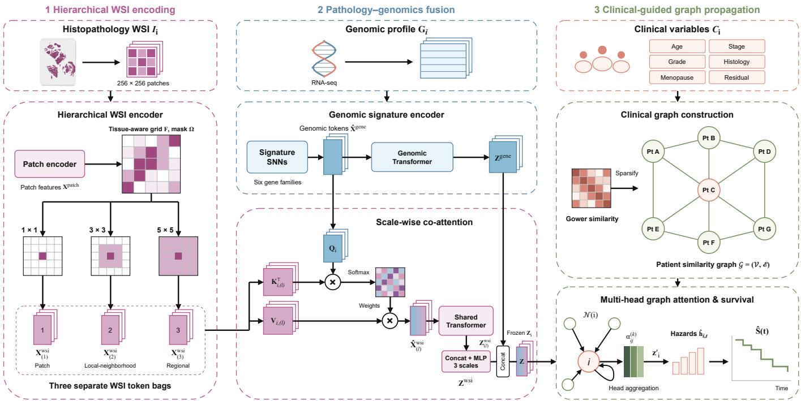
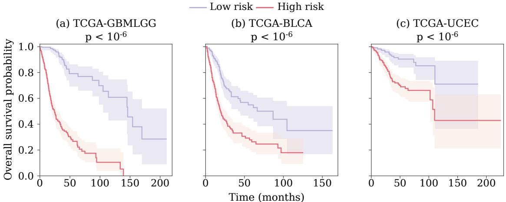
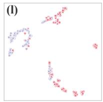
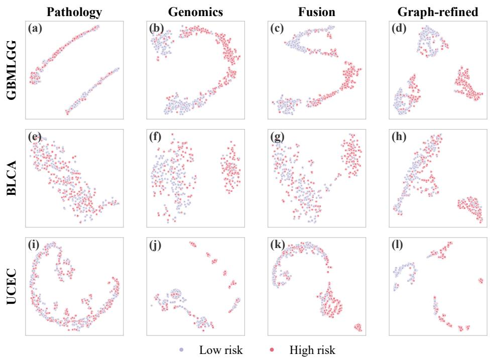
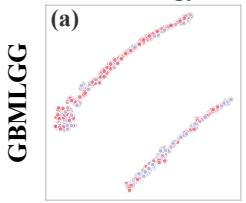
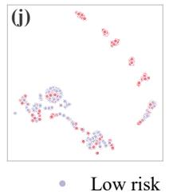

# HGASurv: Hierarchical Granularity-Aware Integration for Multimodal Survival Prediction

Peike Yu, Wuchao Liu, Jihong Guan, Member, IEEE, and Shuigeng Zhou, Senior Member, IEEE

Abstract— Objective: Multimodal survival prediction jointly analyzes histopathological whole-slide images (WSIs), genomic profiles, and clinical variables to stratify patients by risk. However, existing approaches often inadequately account for granularity differences across modalities, particularly in spatial organization and feature dimensionality. Within pathology, aggregating WSI patch features without preserving their spatial arrangement can obscure tissue architecture; across modalities, directly concatenating low-dimensional clinical variables with highdimensional visual and genomic features may limit the contribution of clinical information to prediction. To address these challenges, we propose HGASurv, which introduces a hierarchical WSI encoding module and a clinicalguided graph propagation module for granularity-aware multimodal integration. Methods: The hierarchical WSI encoding module maps WSI patch features onto a spatial grid using their original coordinates and applies parallel convolutions to construct representations at patch, localneighborhood, and regional scales. Genomic signature embeddings then query these scale-specific WSI representations through cross-modal co-attention, producing signature-conditioned morphological features. The clinicalguided graph propagation module uses clinical variables to define patient-similarity edges and propagates fused image–genomic node embeddings with graph attention, integrating clinical information through topology rather than feature concatenation. Results: Across three TCGA cohorts, HGASurv achieved the strongest overall C-index performance, with ablation studies supporting the complementary contributions of the hierarchical WSI encoding and clinical-guided graph propagation modules. Conclusion and Significance: By introducing hierarchical WSI encoding and clinical-guided graph propagation, HGASurv unifies multi-scale pathology representation with topologybased clinical integration in a hierarchical granularityaware framework. This design shows that matching representation and integration mechanisms to modality-specific granularity improves multimodal survival prediction.

Index Terms— Multimodal data fusion, multi-scale representation learning, patient similarity graphs, survival prediction, whole-slide images.

## I. INTRODUCTION

URVIVAL analysis is a fundamental statistical framework S in prognostic research by accommodating censored data to simultaneously model the timing and occurrence of clinical events [1], [2]. By stratifying patients into risk groups and estimating survival probabilities over the follow-up period, survival prediction supports treatment planning and informs patients about the likely course of disease [3]. Driven by recent advances in deep learning, researchers have shifted their focus from single-modality analysis to integrating richer multimodal information, thus achieving superior prognostic performance [4]. Histopathological whole-slide images (WSIs) provide spatial information about tissue morphology and architecture; genomic sequencing profiles describe the molecular state; and clinical variables summarize patient- and diseaselevel status. However, these diverse modalities associated with patient survival outcomes exhibit substantial heterogeneity in information granularity, particularly in spatial organization and feature dimensionality. Tissue morphology in histopathological WSIs is spatially organized across multiple scales, and a single WSI can measure up to 100,000×100,000 pixels [5]. Genomic profiles may contain tens of thousands of variables, whereas clinical data typically comprise fewer than 100 variables. Such profound heterogeneity in information granularity renders the integration of multimodal data for survival prediction highly challenging, thereby demanding tailored model architectures.

A series of deep learning-based models has emerged for multimodal data fusion in survival prediction. Most existing approaches, such as MCAT [6], SurvPath [5], SurMoE [7] and DeReF [8], focus on integrating histopathological images with genomic profiles, while several works such as PG-TFNet [9] and SAMMS [10] further integrate clinical variables as an additional modality. Although existing models have demonstrated promising performance in survival prediction, certain key challenges still remain unaddressed. On the one hand, regarding large-scale histopathological images, the prevailing paradigm involves dividing WSIs into small patches and extracting patch-level visual representations for downstream fusion. Aggregating these patch-level features without preserving their spatial arrangement can obscure the global tissue architecture, thereby hindering the model from discerning pathological morphological patterns. On the other hand, regarding the fusion of low-dimensional clinical variables, existing methods generally concatenate clinical variables with high-dimensional features learned from other modalities before the final survival head. Considering the substantial dimensionality disparity, this concatenation strategy risks rendering clinical variables diluted or suppressed by dominant visual and genomic features, which can limit their contribution to survival prediction.

To address the above issues, we propose a Hierarchical Granularity-Aware integration framework for multimodal Survival prediction (HGASurv). To preserve WSI spatial organization, HGASurv introduces a hierarchical WSI encoding module. Patch embeddings are arranged on a spatial grid according to their original coordinates and processed by parallel convolutions to derive representations at patch, localneighborhood, and regional scales. Following the genomicsignature grouping in MCAT [6], six signature embeddings query each scale-specific WSI representation through crossmodal co-attention. The resulting pathology and genomic representations are fused into an image–genomic embedding. To incorporate clinical variables without direct feature concatenation, HGASurv introduces a clinical-guided graph propagation module. Clinical similarity defines an undirected patient graph, over which a graph attention network propagates the fused image–genomic embeddings. Clinical variables thus influence prediction through graph topology rather than being appended to the image–genomic node features. Together, these components form a hierarchy from intramodal multi-scale WSI encoding, through within-patient pathology–genomics fusion, to clinically guided inter-patient propagation. This hierarchy aligns each representation and integration mechanism with the information granularity of the corresponding modality. Our code is available at https://github.com/PeikerYu/ HGASurv. The main contributions of our work are as follows.

• We introduce a hierarchical WSI encoding module that reconstructs patch embeddings on a spatial grid and derives multi-scale pathology representations at patch, local-neighborhood, and regional scales.

• We introduce a clinical-guided graph propagation module that uses clinical variables to define patient-similarity topology and propagates fused image–genomic embeddings with graph attention, integrating clinical information through topology rather than feature concatenation.

• We evaluate HGASurv on TCGA-GBMLGG, TCGA-BLCA, and TCGA-UCEC, achieving C-indices of 0.854 ± 0.023, 0.692 ± 0.032, and 0.721 ± 0.098, respectively (mean ± SD over five folds), and the strongest overall C-index performance across the three cohorts. Ablation studies support the complementary contributions of the hierarchical WSI encoding and clinical-guided graph propagation modules.

## II. RELATED WORK

## A. Survival Prediction

Classical survival prediction commonly relies on the Cox proportional hazards model [2] and its penalized variants [11], which relate covariates to risk under the proportional-hazards assumption. Random Survival Forests [12] capture nonlinear effects nonparametrically. Neural models extend these foundations: DeepSurv [13] replaces the Cox linear predictor with a multilayer perceptron (MLP), whereas DeepHit [14] directly models discrete-time event distributions without the proportional-hazards assumption. Dynamic-DeepHit further handles longitudinal data with competing risks [15]. Although effective for structured covariates, these methods are primarily unimodal and do not explicitly model interactions among pathology, genomics, and clinical variables.

## B. Pathology–Genomics Multimodal Survival Prediction

Existing pathology–genomics survival methods explore different strategies for integrating histological and genomic information. MCAT [6] allows functional genomic-signature embeddings to query histology features, whereas SurvPath [5] models dense interactions between biological-pathway and histology-patch tokens. MOTCat [16] uses optimal transport to align histology patches with genomic embeddings under global structure consistency. SurMoE [7] employs dynamic expert routing to balance heterogeneous inputs, while DeReF [8] decouples shared, specific, and exclusive features before reorganizing them for MoE fusion. Liu et al. [17] investigate view-aware collaborative learning for joint survival prediction and subgroup identification. However, these methods primarily focus on cross-modal interaction or alignment, while explicit modeling of WSI spatial organization across multiple morphological scales remains less explored.

## C. Clinical Integration and Patient Relational Modeling

Compared with pathology and genomic data, structured clinical variables have received less attention as a distinct modality in multimodal survival models. PG-TFNet [9] and SAMMS [10] concatenate clinical variables with learned pathology–genomics representations before the survival head. ModalTune [18] instead uses a lightweight Modal Adapter to inject auxiliary modalities into a frozen slide-level foundation model. Sucre et al. [19] compare early fusion with predictor-level late fusion, with the latter combining outputs from independently trained unimodal models. SurvPGC [20] encodes clinical information as text embeddings and fuses them with pathology and genomic representations through cross-attention. These approaches integrate clinical information within individual patients rather than using clinical similarity to guide cross-patient information exchange.

Patient-level graph modeling provides a relational alternative. Patient-similarity graphs support information exchange among related cases [21], while graph attention networks (GATs) learn neighbor-specific aggregation weights [22]. Cox–Sage [23] exemplifies this strategy by constructing a patient graph from heterogeneous clinical attributes, using gene-expression profiles as node features, and applying GraphSAGE-based proportional-hazards modeling. However, Cox–Sage propagates gene-expression representations and does not explicitly model multi-scale pathology– genomics interactions. HGASurv combines multi-scale pathology–genomics fusion within patients with graph propagation across patients linked by clinical similarity.

  
Fig. 1. Overview of HGASurv. (1) Hierarchical whole-slide image (WSI) encoding preserves patch spatial organization and represents morphology at patch, local-neighborhood, and regional scales. (2) Genomic signatures guide scale-wise pathology aggregation through co-attention, yielding the fused image–genomic embedding $\mathbf { Z } _ { i } . ~ ( 3 )$ Clinical variables define patient relationships rather than node features; graph attention propagates $\mathbf { Z } _ { i }$ over this topology to obtain $\mathbf { z } _ { i } ^ { \prime }$ for discrete-time survival prediction.

## III. METHODS

## A. Overview ofHGASurv

Fig. 1 summarizes the HGASurv architecture, comprising hierarchical WSI encoding, scale-wise pathology–genomics fusion, and clinical-guided graph propagation for survival prediction. We formulate multimodal survival prediction as discrete-time hazard estimation. We consider a patient cohort $\boldsymbol { \mathcal { D } } = \{ ( \mathbf { I } _ { i } , \mathbf { G } _ { i } , \mathbf { C } _ { i } , t _ { i } , \delta _ { i } ) \} _ { i = 1 } ^ { N }$ , where $\mathbf { I } _ { i }$ denotes the WSI of patient $i , \ { \bf G } _ { i } \ \in \ \mathbb { R } ^ { D _ { g } }$ contains the genomic variables, $\mathbf { C } _ { i }$ contains $D _ { c }$ mixed-type clinical variables, $t _ { i } \in \mathbb { R } _ { \geq 0 }$ is the observed survival time, and $\delta _ { i } \in \{ 0 , 1 \}$ is the event indicator $( \delta _ { i } = 1$ for an observed event and $\delta _ { i } = 0$ for right-censoring). We discretize survival time into $T$ non-overlapping intervals $\{ B _ { t } \} _ { t = 1 } ^ { T }$ . HGASurv estimates a discrete hazard probability $\ddot { h } _ { i , t } \in [ 0 , 1 ]$ for each patient i and interval t. The survival function $\begin{array} { r } { \hat { S } _ { i } \dot { ( \boldsymbol { t } ) } = \prod _ { u = 1 } ^ { t } ( 1 - \hat { h } _ { i , u } ) } \end{array}$ represents the probability that patient i survives beyond the t-th time interval.

Hierarchical WSI encoding and scale-wise pathology– genomics fusion first produce a patient-specific image– genomic embedding $\mathbf { Z } _ { i } .$ . Clinical-guided graph propagation then refines these embeddings over the patient graph to obtain $\mathbf { z } _ { i } ^ { \prime } ,$ which is passed to the survival head for hazard estimation.

## B. Hierarchical WSI Encoding

Given a WSI I, the hierarchical WSI encoding module retains the spatial arrangement of patches and learns morphological representations across multiple scales. Following the CLAM preprocessing workflow [24], we perform tissue segmentation and extract $P$ non-overlapping $2 5 6 \times 2 5 6  – p i x e l$ patches $\{ ( \mathbf { I } _ { p } , \mathbf { s } _ { p } ) \} _ { p = 1 } ^ { P }$ , where $\mathbf { I } _ { p }$ denotes the $p { \cdot } \mathrm { t h }$ patch and $\mathbf { s } _ { p } ~ \in ~ \mathbb { R } ^ { 2 }$ denotes its spatial coordinate. Pretrained feature encoders map patches to $d _ { c }$ -dimensional embeddings, forming Xpatch $\in \bar { \mathbb { R } ^ { P \times d _ { c } } }$ . Before spatial reconstruction, a learned channel projection maps each patch embedding to $d _ { s } = 6 4$ channels. The projected embeddings are arranged according to their coordinates to form a feature grid $\mathbf { F } \in \mathbb { R } ^ { d _ { s } \times H \times W } ;$ where H and W denote the grid height and width. A binary mask $\Omega \in \{ 0 , 1 \} ^ { H \times W }$ identifies locations occupied by tissue patches, while unoccupied locations are zero-filled.

Histopathological morphology spans multiple spatial scales, from local structures to broader tissue organization [25], [26]. To capture this hierarchy, we apply parallel $1 \times 1 , 3 \times 3$ , and $5 \times$ 5 convolutional branches to the reconstructed patch grid. Given the feature grid F and tissue mask Ω, the branch operations are:

$$
\begin{array} { r l r } & { \widetilde { \mathbf { F } } _ { ( 1 ) } } & { = \mathrm { C o n v } _ { ( 1 ) } ( \mathbf { F } ) , \qquad \Omega _ { ( 1 ) } = \Omega , } \\ & { \left( \widetilde { \mathbf { F } } _ { ( l ) } , \Omega _ { ( l ) } \right) = \mathrm { M P o o l } _ { ( l ) } \left( \mathrm { C o n v } _ { ( l ) } ( \mathbf { F } ) , \Omega \right) , \quad l \in \{ 2 , 3 \} , } \\ & { \mathbf { X } _ { ( l ) } ^ { \mathrm { w s i } } } & { = \mathrm { P r o j } _ { \mathrm { o u t } } \left[ \mathrm { S t a c k } \left( \widetilde { \mathbf { F } } _ { ( l ) } , \Omega _ { ( l ) } \right) \right] , \quad l \in \{ 1 , 2 , 3 \} . } \end{array}\tag{1}
$$

Here, $\mathrm { C o n v } _ { ( l ) }$ and $\mathrm { M P o o l } _ { ( l ) }$ denote the l-th convolutional branch and mask-aware average pooling, respectively, while $\Omega _ { ( l ) }$ is the corresponding valid-region mask. The operator Stack stacks valid spatial feature vectors as matrix rows, and $\mathrm { P r o j } _ { \mathrm { o u t } }$ maps each row to the shared dimension d. The resulting scale-specific WSI feature matrices $\mathbf { X } _ { ( l ) } ^ { \mathrm { w s i } } \in \mathbb { R } ^ { P _ { l } }$ ×d are retained for pathology–genomics interaction, where $P _ { l }$ denotes the number of valid feature vectors at scale l.

## C. Scale-Wise Pathology–Genomics Fusion

Given the WSI feature matrices at three scales, $\{ \mathbf { X } _ { ( l ) } ^ { \mathrm { w s i } } \} _ { l = 1 } ^ { 3 }$ HGASurv first constructs genomic signature embeddings for scale-wise co-attention. Following the gene-signature organization used in MCAT [6], genomic variables are grouped into six gene-family signatures from the Molecular Signatures Database (MSigDB) [27]: Tumor Suppressor Genes; Cytokines and Growth Factors; Oncogenes; Protein Kinases; Cell Differentiation Markers; and Transcription Factors. Each signature-specific genomic profile is independently encoded by a self-normalizing network (SNN) [28] to produce a $d -$ dimensional embedding. The six embeddings are stacked into the genomic signature embedding matrix $\hat { \bf X } ^ { \mathrm { g e n e } } \in \mathbb { R } ^ { 6 \times d } ;$ where d is the shared embedding dimension of the WSI and genomic representations.

At each scale $l \in \{ 1 , 2 , 3 \}$ , the genomic signature embedding matrix provides the queries, while the corresponding WSI feature matrix provides the keys and values:

$$
\begin{array} { r l } { \mathbf { Q } _ { r } } & { { } = \hat { \mathbf { X } } ^ { \mathrm { g e n e } } \mathbf { W } _ { r } ^ { Q } , } \\ { \mathbf { K } _ { r , ( l ) } } & { { } = \mathbf { X } _ { ( l ) } ^ { \mathrm { w i } } \mathbf { W } _ { r } ^ { K } , } \\ { \mathbf { V } _ { r , ( l ) } } & { { } = \mathbf { X } _ { ( l ) } ^ { \mathrm { w i } } \mathbf { W } _ { r } ^ { V } , } \\ { \mathrm { h e a d } _ { r , ( l ) } = \mathrm { s o f t m a x } \left( \frac { \mathbf { Q } _ { r } \mathbf { K } _ { r , ( l ) } ^ { \top } } { \sqrt { d _ { a } } } \right) \mathbf { V } _ { r , ( l ) } , } \\ { \hat { \mathbf { X } } _ { ( l ) } ^ { \mathrm { w i } } } & { { } = \mathrm { C o n c a t } \left( \mathrm { h e a d } _ { 1 , ( l ) } , \dots , \mathrm { h e a d } _ { H _ { c } , ( l ) } \right) \mathbf { W } ^ { \mathcal { O } } . } \end{array}\tag{2}
$$

Here, $\mathbf { W } _ { r } ^ { Q } , \mathbf { W } _ { r } ^ { K } , \mathbf { W } _ { r } ^ { V } \ \in \ \mathbb { R } ^ { d \times d _ { a } }$ and $\mathbf { W } ^ { O } ~ \in ~ \mathbb { R } ^ { H _ { c } d _ { a } \times d }$ are learnable parameters, $H _ { c }$ is the number of co-attention heads, and $\begin{array} { l } { { d _ { a } } } \end{array} = \ d / H _ { c }$ is the dimension of each head. The softmax is applied over the $P _ { l }$ WSI feature vectors. The resulting matrix $\hat { \mathbf { X } } _ { ( l ) } ^ { \mathrm { w s i } } \in \mathbb { R } ^ { 6 \times d }$ contains one signatureconditioned morphological representation for each genomic signature at scale l.

A single Transformer encoder [29], with parameters shared across the three scales, is applied separately to each $\hat { \mathbf { X } } _ { ( l ) } ^ { \mathrm { w s i } }$ to model dependencies among its six signature-conditioned representations. Attention-based pooling [30] then produces a scale-specific pathology representation $\mathbf { Z } _ { ( l ) } ^ { \mathrm { w s i } } \in \mathbb { R } ^ { d }$ . The three scale-specific representations are concatenated and fused by an MLP to obtain the final WSI representation $\mathbf { Z } ^ { \mathrm { w s i } } \in \mathbb { R } ^ { d }$ . In parallel, the genomic signature embedding matrix is processed by a separate Transformer encoder and attention-based pooling to produce $\mathbf { Z } ^ { \mathrm { g e n e } } ~ \in ~ \mathbb { R } ^ { d }$ . Finally, the WSI and genomic representations are concatenated to form the fused image– genomic embedding ${ \bf Z } = [ { \bf Z } ^ { \mathrm { w s i } } ; { \bf Z } ^ { \mathrm { g e n e } } ] \in \mathbb { R } ^ { 2 d }$

## D. Clinical-Guided Graph Propagation

The preceding modules produce a fused image–genomic embedding $\mathbf { Z } _ { i } ~ \in ~ \mathbb { R } ^ { 2 d }$ for each patient i. Clinical variables define the patient graph, while $\mathbf { Z } _ { i }$ serves as the node feature for cross-patient propagation.

Graph construction: Because the clinical variables include both continuous and categorical fields, we use Gower distance [31] to measure patient similarity. Let $d _ { i j } \in [ 0 , 1 ]$ denote the distance between patients i and $j .$ . We define clinical similarity as $s _ { i j } ~ = ~ 1 - { d _ { i j } }$ , where larger values indicate greater similarity. We construct an undirected patient graph by sparsifying the pairwise clinical-similarity matrix, with retained edges connecting clinically similar patients.

Graph attention propagation: Each fused embedding is projected to a graph hidden dimension $d ^ { \prime }$ and processed by $L _ { g }$ residual graph attention layers with $H _ { g }$ heads [22]. Let $\mathbf { u } _ { i } ^ { ( q ) } \in \mathbb { R } ^ { d ^ { \prime } }$ denote the representation of patient i after layer $q ,$ and let $\mathbf { a } _ { i } ^ { ( q ) }$ denote the neighborhood information aggregated at that layer. The graph propagation is formulated as

$$
\begin{array} { r l } & { \mathbf { u } _ { i } ^ { ( 0 ) } = \mathbf { W } _ { 0 } \mathbf { Z } _ { i } + \mathbf { b } _ { 0 } , } \\ & { \mathbf { a } _ { i } ^ { ( q ) } = \mathbf { A G G } _ { k = 1 } ^ { H _ { g } } \left[ \displaystyle \sum _ { j \in \mathcal { N } ( i ) } \alpha _ { i j } ^ { ( q , k ) } \mathbf { W } ^ { ( q , k ) } \mathbf { u } _ { j } ^ { ( q - 1 ) } \right] , } \\ & { \mathbf { u } _ { i } ^ { ( q ) } = \mathbf { E L U } \left( \mathbf { L N } \left[ \mathbf { u } _ { i } ^ { ( q - 1 ) } + \mathbf { a } _ { i } ^ { ( q ) } \right] \right) , } \\ & { \mathbf { z } _ { i } ^ { \prime } = \mathbf { u } _ { i } ^ { ( L _ { g } ) } . } \end{array}\tag{3}
$$

Here, $\mathbf { W } _ { 0 }$ and $\mathbf { b } _ { 0 }$ define the initial projection, while $\mathbf { W } ^ { ( q , k ) }$ is the feature projection for head k in layer $q .$ The neighborhood $\mathcal { N } ( i )$ includes patient $i ,$ and $\alpha _ { i j } ^ { ( q , \bar { k } ) }$ is the normalized attention weight assigned to neighbor j. In intermediate layers, AGG concatenates $H _ { g }$ head outputs of dimension $d ^ { \prime } / H _ { g } ;$ in the final layer, it averages $H _ { g }$ head outputs of dimension $d ^ { \prime } .$ The operators LN and ELU denote layer normalization and ELU activation, respectively. The output $\mathbf { z } _ { i } ^ { \prime } \in \mathbb { R } ^ { d ^ { \prime } }$ is the graphrefined patient representation.

Survival prediction: Finally, the graph-refined representation $\mathbf { z } _ { i } ^ { \prime }$ is passed to the discrete-time survival head to estimate the interval-specific hazards $\hat { h } _ { i , t }$

## E. Training Objective

For the T intervals $\{ B _ { t } \} _ { t = 1 } ^ { T }$ , let $b _ { i } \in \{ 1 , \ldots , T \}$ denote the observed time bin of patient i, such that $t _ { i } \in B _ { b _ { i } }$ . HGASurv predicts the hazard probability $\hat { h } _ { i , t }$ for each interval and is trained using the negative log-likelihood (NLL) loss [32]:

$$
\begin{array} { r l } {  { \mathcal { L } _ { \mathrm { N L L } } = - \frac { 1 } { N } \sum _ { i = 1 } ^ { N } \Bigl [ \sum _ { t = 1 } ^ { b _ { i } - 1 } \log ( 1 - \hat { h } _ { i , t } ) } } \\ & { + \delta _ { i } \log ( \hat { h } _ { i , b _ { i } } ) + ( 1 - \delta _ { i } ) \log ( 1 - \hat { h } _ { i , b _ { i } } ) \Bigr ] . } \end{array}\tag{4}
$$

Here, $\delta _ { i } = 1$ denotes an observed event and $\delta _ { i } = 0$ denotes right-censoring. The first sum represents survival before the observed bin, while the remaining terms specify an event within bin $b _ { i }$ or survival through that bin for event and censored cases, respectively.

HGASurv is trained in two stages to preserve the image– genomic representations during graph integration. In Stage 1, the hierarchical WSI encoding, genomic encoding, and crossmodal fusion modules are jointly trained with an MLP survival head by minimizing $\mathcal { L } _ { \mathrm { N L L } }$ using Adam. In Stage 2, the resulting image–genomic embeddings are frozen, and only the graph propagation network and its survival head are trained using the same NLL objective.

TABLE I  
C-INDEX COMPARISON OF HGASURV WITH STATE-OF-THE-ART DEEP LEARNING METHODS ON THREE TCGA COHORTS. VALUES ARE THE MEAN ± SAMPLE STANDARD DEVIATION ACROSS FIVE FOLDS. THE BEST RESULT IS SHOWN IN BOLD AND THE SECOND-BEST IS UNDERLINED. P, G, AND C DENOTE PATHOLOGY, GENOMICS, AND CLINICAL VARIABLES, RESPECTIVELY.
<table><tr><td>Method</td><td>Year</td><td>Modality</td><td>TCGA-GBMLGG</td><td> $\mathrm { T C G A { \cdot } B L C A }$ </td><td>TCGA-UCEC</td></tr><tr><td>SNN [28]</td><td>2017</td><td>Genomic</td><td> $0 . 8 0 5 \pm 0 . 0 1 3$ </td><td> $0 . 5 6 7 \pm 0 . 0 6 7$ </td><td> $0 . 6 2 7 \pm 0 . 0 5 4$ </td></tr><tr><td>SNNTrans [28]</td><td>2017</td><td>Genomic</td><td> $0 . 8 0 4 \pm 0 . 0 3 9$ </td><td> $0 . 6 3 0 \pm 0 . 0 2 1$ </td><td> $0 . 6 2 1 \pm 0 . 0 5 6$ </td></tr><tr><td>AttnMIL [30]</td><td>2018</td><td>Pathology</td><td> $0 . 7 5 9 \pm 0 . 0 4 0$ </td><td> $0 . 5 2 3 \pm 0 . 0 4 3$ </td><td> $0 . 6 6 5 \pm 0 . 0 2 9$ </td></tr><tr><td>DeepAttnMISL [33]</td><td>2020</td><td>Pathology</td><td> $0 . 7 3 6 \pm 0 . 0 3 6$ </td><td> $0 . 5 7 3 \pm 0 . 0 3 4$ </td><td> $0 . 6 9 4 \pm 0 . 0 7 5$ </td></tr><tr><td>CLÁM_SB [24]</td><td>2021</td><td>Pathology</td><td> $0 . 7 5 3 \pm 0 . 0 4 1$ </td><td> $0 . 5 4 3 \pm 0 . 0 4 0$ </td><td> $0 . 6 7 4 \pm 0 . 0 5 7$ </td></tr><tr><td>CLAM_MB [24]</td><td>2021</td><td>Pathology</td><td> $0 . 7 5 2 \pm 0 . 0 4 3$ </td><td> $0 . 5 4 2 \pm 0 . 0 2 1$ </td><td> $0 . 6 5 5 \pm 0 . 0 4 5$ </td></tr><tr><td>TransMIL [34]</td><td>2021</td><td>Pathology</td><td> $0 . 7 4 9 \pm 0 . 0 4 6$ </td><td> $0 . 5 2 3 \pm 0 . 0 3 9$ </td><td> $0 . 6 6 1 \pm 0 . 0 6 7$ </td></tr><tr><td>DTFD-MIL [35]</td><td>2022</td><td>Pathology</td><td> $0 . 7 5 1 \pm 0 . 0 5 0$ </td><td> $0 . 5 3 3 \pm 0 . 0 6 5$ </td><td> $0 . 6 8 3 \pm 0 . 0 7 3$ </td></tr><tr><td>MCAT [6]</td><td>2021</td><td>P+G</td><td> $0 . 8 0 9 \pm 0 . 0 1 9$ </td><td> $0 . 6 3 2 \pm 0 . 0 3 6$ </td><td> $0 . 5 9 1 \pm 0 . 0 2 7$ </td></tr><tr><td>Pathomic Fusion [36]</td><td>2022</td><td>P+G</td><td> $0 . 7 9 2 \pm 0 . 0 3 4$ </td><td> $0 . 6 1 1 \pm 0 . 0 4 6$ </td><td> $0 . 5 8 1 \pm 0 . 0 2 4$ </td></tr><tr><td>PORPOISE [37]</td><td>2022</td><td>P+G</td><td> $0 . 8 1 0 \pm 0 . 0 2 4$ </td><td> $0 . 6 0 5 \pm 0 . 0 4 6$ </td><td> $0 . 6 2 2 \pm 0 . 0 5 8$ </td></tr><tr><td>MOTCat [16]</td><td>2023</td><td>P+G</td><td> $0 . 8 2 0 \pm 0 . 0 2 7$ </td><td> $\underline { { 0 . 6 8 4 } } \pm 0 . 0 2 6$ </td><td> $0 . 6 7 6 \pm 0 . 0 3 9$ </td></tr><tr><td>CMTA [38]</td><td>2023</td><td>P+G</td><td> $0 . 8 3 7 \pm 0 . 0 2 2$ </td><td> $0 . 6 6 3 \pm 0 . 0 3 6$ </td><td> $0 . 6 6 5 \pm 0 . 0 6 5$ </td></tr><tr><td>MGCT [39]</td><td>2023</td><td>P+G</td><td> $0 . 8 2 9 \pm 0 . 0 2 2$ </td><td> $0 . 6 3 8 \pm 0 . 0 4 1$ </td><td> $0 . 6 4 7 \pm 0 . 0 3 7$ </td></tr><tr><td>PG-MLIF [40]</td><td>2024</td><td>P+G</td><td> $0 . 7 9 9 \pm 0 . 0 4 6$ </td><td> $0 . 5 9 5 \pm 0 . 0 1 9$ </td><td> $0 . 5 3 0 \pm 0 . 0 8 0$ </td></tr><tr><td>DeReF [8]</td><td>2026</td><td>P+G</td><td> $\underline { { 0 . 8 4 2 \pm 0 . 0 1 5 } }$ </td><td> $0 . 6 6 6 \pm 0 . 0 2 6$ </td><td> $0 . 6 6 6 \pm 0 . 0 4 2$ </td></tr><tr><td>SurMoE [7]</td><td>2026</td><td>P+G</td><td> $\overline { { 0 . 8 3 2 \pm 0 . 0 1 3 } }$ </td><td> $0 . 6 4 7 \pm 0 . 0 1 5$ </td><td> $0 . 6 6 9 \pm 0 . 0 4 2$ </td></tr><tr><td>Sucre et al. [19]</td><td>2025</td><td> $\mathrm { P + G + C }$ </td><td> $0 . 8 2 7 \pm 0 . 0 2 6$ </td><td> $0 . 5 9 0 \pm 0 . 0 4 5$ </td><td> $\mathbf { 0 . 7 5 6 \pm 0 . 0 3 5 }$ </td></tr><tr><td>SurvPGC [20]</td><td>2026</td><td> $\mathrm { P + G + C }$ </td><td> $0 . 8 2 3 \pm 0 . 0 1 9$ </td><td> $0 . 5 7 4 \pm 0 . 0 2 5$ </td><td> $0 . 7 0 1 \pm 0 . 0 7 0$ </td></tr><tr><td>HGASurv (Ours)</td><td></td><td></td><td> $\mathbf { 0 . 8 5 4 \pm 0 . 0 2 3 }$ </td><td> $\mathbf { 0 . 6 9 2 \pm 0 . 0 3 2 }$ </td><td></td></tr><tr><td></td><td>2026</td><td> $\mathbf { P + G + C }$ </td><td></td><td></td><td> $\underline { { 0 . 7 2 1 \pm 0 . 0 9 8 } }$ </td></tr></table>

## IV. EXPERIMENTS

## A. Datasets and Evaluation Protocol

We evaluate HGASurv on three cancer cohorts from The Cancer Genome Atlas (TCGA) [41]: the combined glioblastoma and lower-grade glioma cohort (GBMLGG), bladder urothelial carcinoma (BLCA), and uterine corpus endometrial carcinoma (UCEC). After matching patients with a diagnostic WSI, genomic profile, structured clinical variables, and survival outcome, the resulting cohorts contain 551, 373, and 480 patients, respectively.

All experiments use event-status-stratified, patient-level five-fold cross-validation, with identical splits across methods within each cohort. We evaluate survival prediction using the concordance index (C-index) [42], with higher values indicating better performance. Within each fold, each method is trained ten times with independent random initializations. To align the scales of risk scores across these runs before averaging, held-out scores from each run are rank-normalized using an empirical cumulative distribution function fitted to that run’s training-fold scores. The ten normalized scores are then averaged to obtain one ensemble risk score for each heldout patient, from which a fold-level C-index is computed. Table I reports the mean and sample standard deviation of the five fold-level C-indices.

## B. Comparison with State-of-the-Art Methods

To benchmark HGASurv against state-of-the-art survival prediction methods, Table I compares it with 19 baselines across the GBMLGG, BLCA, and UCEC cohorts. These methods use pathology images, genomic profiles, clinical variables, or their combinations. The genomic-only baselines comprise SNN [28] and its self-attention-enhanced variant SNNTrans. The pathology-only group includes attention-based

MIL methods (AttnMIL [30], DeepAttnMISL [33], CLAM-SB, and CLAM-MB [24]), Transformer-based aggregation (TransMIL [34]), and feature distillation (DTFD-MIL [35]).

The pathology–genomics baselines span three fusion strategies: feature-level integration with Pathomic Fusion [36], PORPOISE [37], and PG-MLIF [40]; cross-modal interaction and alignment with MCAT [6], MOTCat [16], CMTA [38], and MGCT [39]; and adaptive expert fusion with DeReF [8] and SurMoE [7]. The trimodal baselines include the predictionlevel late-fusion approach of Sucre et al. [19] and the clinicaltext-based cross-modal integration of SurvPGC [20].

The best multimodal result exceeds the best unimodal result in each cohort. However, the trimodal baselines outperform the strongest pathology–genomics baseline on UCEC but not on GBMLGG or BLCA, suggesting that adding clinical information does not guarantee consistent improvements across integration strategies and cohorts.

HGASurv achieves mean C-indices of 0.854, 0.692, and 0.721 on GBMLGG, BLCA, and UCEC, respectively, ranking first on GBMLGG and BLCA and second on UCEC, thereby demonstrating consistent performance across all three cohorts. HGASurv combines within-patient pathology–genomics interactions with clinically defined relationships between patients; the component and clinical-integration ablations in Tables II and III further examine the contributions of these design elements. The out-of-fold risk predictions stratify patients into groups with significantly different survival outcomes across all three cohorts as Fig. 2 shows.

## C. Ablation Studies

1) Component Ablation: To isolate the individual and joint contributions of hierarchical WSI encoding and clinical-guided graph propagation, Table II compares the full HGASurv model with three variants that remove graph propagation, replace hierarchical WSI encoding with the single 1 × 1 pathology branch, or apply both changes.

  
Fig. 2. Kaplan–Meier survival curves stratified by the final HGASurv out-of-fold risk predictions on (a) TCGA-GBMLGG, (b) TCGA-BLCA, and (c) TCGA-UCEC.

TABLE II  
COMPONENT ABLATION OF HGASURV ACROSS THREE TCGA COHORTS.
<table><tr><td>Configuration</td><td>Hier. Clinical</td><td>WSI Variables</td><td>GBMLGG</td><td>BLCA</td><td>UCEC</td></tr><tr><td>Full HGASurv</td><td>√</td><td>√</td><td>0.854±0.0230.692±0.0320.721±0.098</td><td></td><td></td></tr><tr><td>w/o Clinical Variables</td><td>√</td><td>X</td><td></td><td>0.803±0.045 0.655±0.0370.616±0.076</td><td></td></tr><tr><td>w/o Hierarchical WSI</td><td>×</td><td>√</td><td></td><td>0.806±0.0320.566±0.0270.660±0.072</td><td></td></tr><tr><td>w/o both modules</td><td>×</td><td>×</td><td></td><td> $0 . 7 8 7 \pm 0 . 0 3 4 0 . 5 8 7 \pm 0 . 0 3 6 0 . 5 9 7 \pm 0 . 1 0 7$ </td><td></td></tr></table>

Removing either hierarchical WSI encoding or clinicalguided graph propagation reduces the mean C-index across all three cohorts (Table II). The ablated variants fall below the strongest pathology–genomics baseline in each cohort (Table I), whereas full HGASurv outperforms these baselines. Removing both components further degrades performance on GBMLGG and UCEC. These findings indicate that the two components provide complementary benefits and are key contributors to HGASurv’s performance advantage over pathology–genomics baselines.

2) Clinical Integration Strategies: To assess whether clinical variables improve survival prediction and how they should be incorporated, Table III compares three configurations while keeping the image–genomic encoder, patient splits, and training and evaluation protocols fixed. First, the No clinical variables configuration predicts survival directly from the image–genomic embedding without clinical inputs or graph propagation. Second, Clinical feature concatenation combines encoded clinical variables with the image–genomic embedding before the MLP survival head. Third, the proposed Clinicalguided graph propagation configuration uses clinical variables to construct a patient graph and propagates image–genomic embeddings between clinically similar patients before survival prediction.

TABLE III  
C-INDEX COMPARISON OF CLINICAL INTEGRATION CONFIGURATIONS. VALUES ARE THE MEAN ± SAMPLE STANDARD DEVIATION ACROSS FIVE FOLDS. THE BEST RESULT IN EACH COHORT IS SHOWN IN BOLD.
<table><tr><td>Clinical integration</td><td>GBMLGG</td><td>BLCA</td><td>UCEC</td></tr><tr><td>No clinical variables</td><td> $0 . 8 0 3 \pm 0 . 0 4 5$ </td><td> $0 . 6 5 5 \pm 0 . 0 3 7$ </td><td> $0 . 6 1 6 \pm 0 . 0 7 6$ </td></tr><tr><td>Clinical feature concatenation</td><td> $0 . 8 2 4 \pm 0 . 0 4 6$ </td><td> $0 . 6 6 4 \pm 0 . 0 2 6$ </td><td> $0 . 6 6 6 \pm 0 . 1 0 2$ </td></tr><tr><td>Clinical-guided graph propagation (Ours)</td><td> $\mathbf { 0 . 8 5 4 \pm 0 . 0 2 3 }$ </td><td> $\mathbf { 0 . 6 9 2 \pm 0 . 0 3 2 }$ </td><td> $\mathbf { 0 . 7 2 1 \pm 0 . 0 9 8 }$ </td></tr></table>

Both clinical feature concatenation and clinical-guided graph propagation improve the mean C-index over the noclinical configuration in all three cohorts, with graph propagation performing best. These results suggest that clinical variables are more effective for guiding cross-patient propagation than for direct feature concatenation in these cohorts.

3) Graph Topology Controls: To assess the contribution of clinically informed patient connectivity, Table IV compares three graph topologies. The Self-loop graph retains the GAT and survival head with only self-connections to evaluate graph processing without cross-patient information exchange. The Random graph uses Chung–Lu sampling [43] based on the clinical graph’s node degrees to test whether arbitrary patient connections yield comparable benefits. The Clinical graph connects patients according to clinical similarity to assess the benefit of clinically guided information exchange.

The random graph does not improve upon the self-loop control in any cohort, indicating that arbitrary cross-patient connectivity is insufficient. In contrast, the clinical graph achieves the highest mean C-index in all three cohorts. These results highlight the importance of clinically meaningful topology for cross-patient modeling.

  
Fig. 3. t-distributed stochastic neighbor embedding (t-SNE) of pathology, genomic, fused image–genomic, and clinical-graph-refined representations in TCGA-GBMLGG, TCGA-BLCA, and TCGA-UCEC (top to bottom). Colors denote predicted high- and low-risk groups.

TABLE IV  
C-INDEX COMPARISON OF PATIENT-GRAPH TOPOLOGY CONTROLS. VALUES ARE THE MEAN ± SAMPLE STANDARD DEVIATION ACROSS FIVE FOLDS. THE BEST RESULT IN EACH COHORT IS SHOWN IN BOLD.
<table><tr><td>Graph topology</td><td>GBMLGG</td><td>BLCA</td><td>UCEC</td></tr><tr><td>Self-loop graph</td><td> $0 . 8 2 2 \pm 0 . 0 3 4$ </td><td> $0 . 6 8 1 \pm 0 . 0 2 9$ </td><td> $0 . 6 8 1 \pm 0 . 0 7 1$ </td></tr><tr><td>Random graph</td><td> $0 . 8 2 0 \pm 0 . 0 4 2$ </td><td> $0 . 6 8 1 \pm 0 . 0 3 2$ </td><td> $0 . 6 6 6 \pm 0 . 0 6 7$ </td></tr><tr><td>Clinical graph (Ours)</td><td> $\mathbf { 0 . 8 5 4 \pm 0 . 0 2 3 }$ </td><td> $\mathbf { 0 . 6 9 2 \pm 0 . 0 3 2 }$ </td><td> $\mathbf { 0 . 7 2 1 \pm 0 . 0 9 8 }$ </td></tr></table>

## D. Visualization and Analysis

1) Survival Risk Stratification: To visualize HGASurv’s risk stratification, Fig. 2 shows Kaplan–Meier curves stratified by each cohort’s median out-of-fold predicted risk. The high-risk group shows lower survival across all three cohorts (log-rank $p < 1 0 ^ { - 6 } )$ .

## V. CONCLUSION

2) Patient Representation Visualization: To visualize how fusion and clinical-guided graph propagation organize patient representations, Fig. 3 shows t-SNE projections of pathology, genomic, fused image–genomic, and graph-refined representations. Each point represents a patient, with the same final predicted high-/low-risk coloring across each cohort’s four panels. Risk groups overlap before fusion; after fusion and graph propagation, regions dominated by different groups are visible.

We presented HGASurv, a multimodal survival prediction framework that represents and integrates pathology, genomics, and clinical variables according to their information granularity. Within pathology, patch features retain their spatial arrangement and are encoded at patch, localneighborhood, and regional scales; across modalities, lowdimensional clinical variables shape predictions through the connectivity of a patient-similarity graph rather than competing with high-dimensional image–genomic embeddings as concatenated features. On three TCGA cohorts, HGASurv achieved the strongest overall C-index performance among the evaluated methods, and component ablations supported the complementary contributions of hierarchical WSI encoding and graph-based clinical integration. Moreover, graph-based clinical integration outperformed direct concatenation of the same clinical variables in all three cohorts.

Although these results suggest a benefit of tailoring representation and integration to modality-specific information granularity, further investigation is needed to establish how far this benefit extends beyond the present evaluation and how it arises in individual predictions. Future work will evaluate HGASurv in cohorts independent of TCGA and assess its sensitivity to feature-extraction and graph-construction choices. Patient-level analyses will investigate how scalespecific pathology representations and information exchanged through clinical neighborhoods shape individual predictions.

## REFERENCES

[1] E. L. Kaplan and P. Meier, “Nonparametric estimation from incomplete observations,” J. Amer. Statist. Assoc., vol. 53, no. 282, pp. 457–481, Jun. 1958, doi: 10.1080/01621459.1958.10501452.

[2] D. R. Cox, “Regression models and life-tables,” J. Roy. Statist. Soc. B, vol. 34, no. 2, pp. 187–202, 1972, doi: 10.1111/j.2517-6161.1972. tb00899.x.

[3] A. G. Waks and E. P. Winer, “Breast cancer treatment: A review,” JAMA, vol. 321, no. 3, pp. 288–300, Jan. 2019, doi: 10.1001/jama.2018.19323.

[4] S. Wiegrebe, P. Kopper, R. Sonabend, B. Bischl, and A. Bender, “Deep learning for survival analysis: a review,” Artif. Intell. Rev., vol. 57, no. 3, Mar. 2024, Art. no. 65, doi: 10.1007/s10462-023-10681-3.

[5] G. Jaume, A. Vaidya, R. J. Chen, D. F. K. Williamson, P. P. Liang, and F. Mahmood, “Modeling dense multimodal interactions between biological pathways and histology for survival prediction,” in Proc. IEEE/CVF Conf. Comput. Vis. Pattern Recognit. (CVPR), 2024, pp. 11579–11590, doi: 10.1109/CVPR52733.2024.01100.

[6] R. J. Chen et al., “Multimodal co-attention transformer for survival prediction in gigapixel whole slide images,” in Proc. IEEE/CVF Int. Conf. Comput. Vis. (ICCV), 2021, pp. 3995–4005, doi: 10.1109/ICCV48922. 2021.00398.

[7] W. Zhang, W. Xu, T. Chen, C. Sakal, and X. Li, “Integrating images and genomics for multi-modal cancer survival analysis via mixture of experts,” Inf. Fusion, vol. 126, Feb. 2026, Art. no. 103521, doi: 10.1016/ j.inffus.2025.103521.

[8] H. Wang et al., “Decouple, reorganize, and fuse: A multimodal framework for cancer survival prediction,” IEEE Trans. Med. Imag., vol. 45, no. 6, pp. 3124–3136, Jun. 2026, doi: 10.1109/TMI.2026.3668773.

[9] Z. Lv, Y. Lin, R. Yan, Z. Yang, Y. Wang, and F. Zhang, “PG-TFNet: Transformer-based fusion network integrating pathological images and genomic data for cancer survival analysis,” in Proc. IEEE Int. Conf. Bioinf. Biomed. (BIBM), 2021, pp. 491–496, doi: 10.1109/BIBM52615. 2021.9669445.

[10] W. Zhu, Y. Chen, S. Nie, and H. Yang, “SAMMS: Multi-modality deep learning with the foundation model for the prediction of cancer patient survival,” in Proc. IEEE Int. Conf. Bioinf. Biomed. (BIBM), 2023, pp. 3662–3668, doi: 10.1109/BIBM58861.2023.10385661.

[11] R. Tibshirani, “The lasso method for variable selection in the Cox model,” Statist. Med., vol. 16, no. 4, pp. 385–395, Feb. 1997, doi: 10. 1002/(SICI)1097-0258(19970228)16:4⟨385::AID-SIM380⟩3.0.CO;2-3.

[12] H. Ishwaran, U. B. Kogalur, E. H. Blackstone, and M. S. Lauer, “Random survival forests,” Ann. Appl. Statist., vol. 2, no. 3, pp. 841–860, Sep. 2008, doi: 10.1214/08-AOAS169.

[13] J. L. Katzman, U. Shaham, A. Cloninger, J. Bates, T. Jiang, and Y. Kluger, “DeepSurv: Personalized treatment recommender system using a Cox proportional hazards deep neural network,” BMC Med. Res. Methodol., vol. 18, no. 1, Feb. 2018, Art. no. 24, doi: 10.1186/ s12874-018-0482-1.

[14] C. Lee, W. R. Zame, J. Yoon, and M. van der Schaar, “DeepHit: A deep learning approach to survival analysis with competing risks,” in Proc. AAAI Conf. Artif. Intell., vol. 32, no. 1, 2018, pp. 2314–2321, doi: 10.1609/aaai.v32i1.11842.

[15] C. Lee, J. Yoon, and M. van der Schaar, “Dynamic-DeepHit: A deep learning approach for dynamic survival analysis with competing risks based on longitudinal data,” IEEE Trans. Biomed. Eng., vol. 67, no. 1, pp. 122–133, Jan. 2020, doi: 10.1109/TBME.2019.2909027.

[16] Y. Xu and H. Chen, “Multimodal optimal transport-based co-attention transformer with global structure consistency for survival prediction,” in Proc. IEEE/CVF Int. Conf. Comput. Vis. (ICCV), 2023, pp. 21184– 21194, doi: 10.1109/ICCV51070.2023.01942.

[17] C. Liu, S. Wu, D. Jiang, Z. Yu, and H.-S. Wong, “View-aware collaborative learning for survival prediction and subgroup identification,” IEEE Trans. Biomed. Eng., vol. 70, no. 1, pp. 307–317, Jan. 2023, doi: 10.1109/TBME.2022.3190050.

[18] V. Ramanathan, T. Xu, P. Pati, F. Ahmed, M. Goubran, and A. L. Martel, “ModalTune: Fine-tuning slide-level foundation models with multi-modal information for multi-task learning in digital pathology,” in Proc. IEEE/CVF Int. Conf. Comput. Vis. (ICCV), 2025, pp. 23912– 23923, doi: 10.1109/ICCV51701.2025.02217.

[19] A. Sucre et al., “Multimodal fusion strategies for survival prediction in breast cancer: A comparative deep learning study,” Comput. Struct. Biotechnol. J., vol. 27, pp. 4505–4516, 2025, doi: 10.1016/j.csbj.2025. 10.038.

[20] J. Hou, R. Zhang, Y. Xie, C. Li, and W. Qin, “Multimodal deep learning for cancer prognosis prediction with clinical information prompts integration,” npj Digit. Med., vol. 9, no. 1, 2026, Art. no. 76, doi: 10.1038/ s41746-025-02257-y.

[21] S. Parisot et al., “Disease prediction using graph convolutional networks: Application to autism spectrum disorder and Alzheimer’s disease,” Med. Image Anal., vol. 48, pp. 117–130, Aug. 2018, doi: 10.1016/j.media. 2018.06.001.

[22] P. Velickovi ˇ c, G. Cucurull, A. Casanova, A. Romero, P. Li ´ o, and\` Y. Bengio, “Graph attention networks,” in Proc. Int. Conf. Learn. Represent. (ICLR), 2018.

[23] R. Mao, L. Wan, M. Zhou, and D. Li, “Cox-Sage: Enhancing Cox proportional hazards model with interpretable graph neural networks

for cancer prognosis,” Brief. Bioinform., vol. 26, no. 2, Mar. 2025, Art. no. bbaf108, doi: 10.1093/bib/bbaf108.

[24] M. Y. Lu, D. F. K. Williamson, T. Y. Chen, R. J. Chen, M. Barbieri, and F. Mahmood, “Data-efficient and weakly supervised computational pathology on whole-slide images,” Nat. Biomed. Eng., vol. 5, no. 6, pp. 555–570, Jun. 2021, doi: 10.1038/s41551-020-00682-w.

[25] R. Schmitz et al., “Multi-scale fully convolutional neural networks for histopathology image segmentation: From nuclear aberrations to the global tissue architecture,” Med. Image Anal., vol. 70, May 2021, Art. no. 101996, doi: 10.1016/j.media.2021.101996.

[26] M. van Rijthoven, M. Balkenhol, K. Silin¸a, J. van der Laak, and F. Ciompi, “HookNet: Multi-resolution convolutional neural networks for semantic segmentation in histopathology whole-slide images,” Med. Image Anal., vol. 68, Feb. 2021, Art. no. 101890, doi: 10.1016/j.media. 2020.101890.

[27] A. Subramanian et al., “Gene set enrichment analysis: A knowledgebased approach for interpreting genome-wide expression profiles,” Proc. Nat. Acad. Sci. USA, vol. 102, no. 43, pp. 15545–15550, Oct. 2005, doi: 10.1073/pnas.0506580102.

[28] G. Klambauer, T. Unterthiner, A. Mayr, and S. Hochreiter, “Selfnormalizing neural networks,” in Adv. Neural Inf. Process. Syst., vol. 30, 2017, pp. 972–981.

[29] A. Vaswani et al., “Attention is all you need,” in Adv. Neural Inf. Process. Syst., vol. 30, 2017, pp. 5999–6009.

[30] M. Ilse, J. Tomczak, and M. Welling, “Attention-based deep multiple instance learning,” in Proc. Int. Conf. Mach. Learn. (ICML), vol. 80, 2018, pp. 2127–2136.

[31] J. C. Gower, “A general coefficient of similarity and some of its properties,” Biometrics, vol. 27, no. 4, pp. 857–871, Dec. 1971, doi: 10. 2307/2528823.

[32] S. G. Zadeh and M. Schmid, “Bias in cross-entropy-based training of deep survival networks,” IEEE Trans. Pattern Anal. Mach. Intell., vol. 43, no. 9, pp. 3126–3137, Sep. 2021, doi: 10.1109/TPAMI.2020. 2979450.

[33] J. Yao, X. Zhu, J. Jonnagaddala, N. Hawkins, and J. Huang, “Whole slide images based cancer survival prediction using attention guided deep multiple instance learning networks,” Med. Image Anal., vol. 65, Oct. 2020, Art. no. 101789, doi: 10.1016/j.media.2020.101789.

[34] Z. Shao et al., “TransMIL: Transformer based correlated multiple instance learning for whole slide image classification,” in Adv. Neural Inf. Process. Syst., vol. 34, 2021, pp. 2136–2147.

[35] H. Zhang et al., “DTFD-MIL: Double-tier feature distillation multiple instance learning for histopathology whole slide image classification,” in Proc. IEEE/CVF Conf. Comput. Vis. Pattern Recognit. (CVPR), 2022, pp. 18780–18790, doi: 10.1109/CVPR52688.2022.01824.

[36] R. J. Chen et al., “Pathomic fusion: An integrated framework for fusing histopathology and genomic features for cancer diagnosis and prognosis,” IEEE Trans. Med. Imag., vol. 41, no. 4, pp. 757–770, Apr. 2022, doi: 10.1109/TMI.2020.3021387.

[37] R. J. Chen et al., “Pan-cancer integrative histology-genomic analysis via multimodal deep learning,” Cancer Cell, vol. 40, no. 8, pp. 865–878.e6, Aug. 2022, doi: 10.1016/j.ccell.2022.07.004.

[38] F. Zhou and H. Chen, “Cross-modal translation and alignment for survival analysis,” in Proc. IEEE/CVF Int. Conf. Comput. Vis. (ICCV), 2023, pp. 21428–21437, doi: 10.1109/ICCV51070.2023.01964.

[39] M. Liu, Y. Liu, H. Cui, C. Li, and J. Ma, “MGCT: Mutual-guided crossmodality transformer for survival outcome prediction using integrative histopathology-genomic features,” in Proc. IEEE Int. Conf. Bioinf. Biomed. (BIBM), 2023, pp. 1306–1312, doi: 10.1109/BIBM58861.2023. 10385897.

[40] X. Pan et al., “PG-MLIF: Multimodal low-rank interaction fusion framework integrating pathological images and genomic data for cancer prognosis prediction,” in Proc. Med. Image Comput. Comput.-Assist. Interv. (MICCAI), 2024, pp. 347–357, doi: 10.1007/978-3-031-72384-1 33.

[41] J. N. Weinstein et al., “The Cancer Genome Atlas Pan-Cancer analysis project,” Nat. Genet., vol. 45, no. 10, pp. 1113–1120, Oct. 2013, doi: 10. 1038/ng.2764.

[42] F. E. Harrell Jr., R. M. Califf, D. B. Pryor, K. L. Lee, and R. A. Rosati, “Evaluating the yield of medical tests,” JAMA, vol. 247, no. 18, pp. 2543–2546, May 1982, doi: 10.1001/jama.1982.03320430047030.

[43] F. Chung and L. Lu, “The average distances in random graphs with given expected degrees,” Proc. Natl. Acad. Sci. USA, vol. 99, no. 25, pp. 15879–15882, Dec. 2002, doi: 10.1073/pnas.252631999.