# HIHAZE: ONE-STEP DIFFUSION FOR HIGH-RESOLUTION REAL-WORLD IMAGE DEHAZING

Zheng Chen1∗, Yuchen Huang1∗, Xiaoyang Liu1, Jue Gong1, Linghe Kong1, Yulun Zhang1† 1Shanghai Jiao Tong University

## ABSTRACT

Diffusion models have recently achieved encouraging results in real-world image dehazing. However, restoring high-resolution images remains challenging due to spatially non-uniform haze and inconsistent predictions across local patches. To address these issues, we propose Hihaze, a one-step diffusion framework for high-resolution real-world dehazing. Hihaze adopts two haze-aware modulation modules: attentive skip compensation (ASC) and a spatial degradation adapter (SDA). ASC selectively transfers reliable encoder information to the variational autoencoder (VAE) decoder, preserving structural details while suppressing hazedegraded features. SDA extracts multi-scale spatial degradation representations and injects them into the U-Net to guide restoration according to local haze variations. Furthermore, we design a training-free global-guided patch fusion (GPF) method. It uses a global prediction to align patch appearance and downweight unreliable predictions, followed by structure-guided detail compensation. Notably, this training-free design also makes GPF a plug-and-play module for other dehazing models. Experiments across four real-world benchmarks show that Hihaze surpasses state-of-the-art approaches in both visual quality and inference speed. Specifically, it delivers PSNR improvements of 3.62 dB on Dense-Haze and 3.69 dB on NH-HAZE compared with the strongest baselines. Code: https://github.com/zhengchen1999/Hihaze.

## 1 INTRODUCTION

Single-image dehazing reconstructs haze-free scenes from hazy inputs. Haze reduces contrast, shifts colors, and obscures details with spatially varying density. Physically, this degradation is formulated via the atmospheric scattering model (Narasimhan & Nayar, 2002; McCartney & Hall Jr, 1977)

$$
{ \bf I } ( x ) = { \bf I } _ { \mathrm { c } } ( x ) t _ { \mathrm { h } } ( x ) + { \bf A } \big ( 1 - t _ { \mathrm { h } } ( x ) \big ) ,\tag{1}
$$

where I and $\mathbf { I } _ { \mathrm { c } }$ denote the hazy image and its clean counterpart. A is the atmospheric light, and $t _ { \mathrm { h } } ( x )$ is the transmission at pixel x. Recovering $\mathbf { I } _ { \mathrm { c } }$ is ill-posed because the scattering parameters are unknown. Early methods use statistical priors, such as dark-channel sparsity (He et al., 2010), to constrain restoration. However, these assumptions may fail in complex scenes. Later CNN- and Transformer-based methods learn restoration mappings from data (Cai et al., 2016; Liu et al., 2019; Qin et al., 2020; Guo et al., 2022; Song et al., 2022). Despite this progress, recovering realistic textures remains difficult under dense, spatially varying haze.

Recently, large pretrained diffusion models have provided rich generative priors for image restora tion (Wang et al., 2024a; Liu et al., 2024). They help recover realistic textures from degraded inputs. For dehazing, existing approaches exploit these priors through realistic haze synthesis, unpaired training, and physical or textual guidance (Wang et al., 2025; Lan et al., 2025a). To reduce computation, latent diffusion performs denoising in a compact latent space (Rombach et al., 2022). Further reducing the number of denoising steps accelerates inference and makes diffusion-based dehazing more practical (Song et al., 2020; Wang et al., 2025).

Nevertheless, two difficulties remain in high-resolution real-world dehazing: (1) Spatially nonuniform haze. VAE compression can discard fine details. Encoder–decoder skip connections help retain input information (Lan et al., 2025a). However, encoder features contain both scene structures and haze degradation. Directly transferring them may leave residual haze in the result. Moreover, high-level semantic guidance does not explicitly describe local degradation. It therefore provides limited guidance for spatially varying restoration. Effective dehazing requires reliable detail trans mission together with spatial degradation guidance. (2) Inconsistent patch predictions. Highresolution inference often uses patches to limit memory use (Wang et al., 2024a). Each patch sees only part of the scene. Adjacent patches may therefore differ in color, illumination, and dehazing strength. Overlapping inference and local aggregation can reduce boundary artifacts (Ozdenizci &¨ Legenstein, 2023; Ding et al., 2024). However, they lack an explicit global reference. Averaging inconsistent predictions may also blur fine textures.

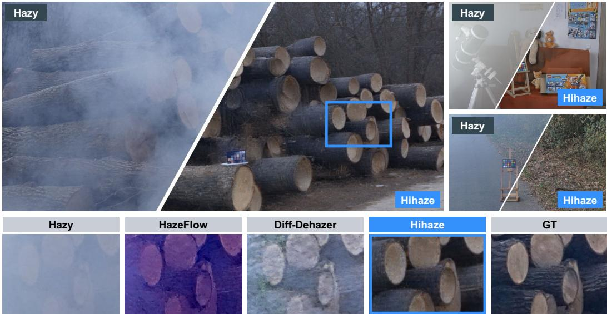  
Figure 1: Visual results on NH-HAZE 51 (left), I-HAZE 34 (upper right), and O-HAZE 01 (lower right). Each scene shows the hazy input on the left of the diagonal and the Hihaze result on the right. Bottom: matched details from the marked region of NH-HAZE 51. Hihaze removes haze while recovering scene structures and textures in the restored images.

To address these issues, we propose Hihaze for high-resolution image dehazing. Hihaze adapts a pretrained latent diffusion model to restore hazy images in one step. We introduce two hazeaware modulation modules: attentive skip compensation (ASC) and a spatial degradation adapter (SDA). (1) ASC uses decoder features to retrieve reliable encoder information. It compensates for missing structures and fine details while suppressing haze-degraded features. (2) SDA extracts spatial degradation features from the hazy input. It injects these features into the U-Net at multiple scales. This guides restoration according to local haze variations.

Moreover, we design training-free global-guided patch fusion (GPF) for high-resolution inference. A prediction from the downsampled full image provides a shared appearance reference. GPF aligns local patch predictions with this reference and reduces the contribution of inconsistent patches. Structural agreement between the fused result and the hazy input then guides detail compensation. This improves cross-patch consistency while preserving reliable textures. GPF can also be integrated into other dehazing models as a plug-and-play module.

Extensive experiments on four real-world benchmarks demonstrate the effectiveness of Hihaze. As shown in Fig. 1, Hihaze removes more haze than the compared methods. It also recovers clearer edges and textures, even in severely degraded regions. Our main contributions are as follows:

• We propose Hihaze, a one-step diffusion dehazing framework with attentive skip compensation and a spatial degradation adapter for high-resolution images.

• We introduce global-guided patch fusion to improve consistency and preserve fine textures. It is a training-free, plug-and-play module for other dehazing models.

• We validate Hihaze on four real-world benchmarks. It achieves superior reconstruction fidelity and perceptual quality under diverse haze conditions.

## 2 RELATED WORK

## 2.1 IMAGE DEHAZING

Early dehazing methods typically derive physical priors from natural-image statistics. Such constraints are subsequently coupled with the physical scattering formulation to restore haze-free images (Fattal, 2008; He et al., 2010; Meng et al., 2013; Fattal, 2014; Berman et al., 2016). Specifically, He et al. (2010) developed the Dark Channel Prior (DCP), noting that the minimum intensity across RGB channels within a haze-free local patch typically approaches zero. Similarly, Fattal (2014) proposed the Color-Line Prior, leveraging the one-dimensional distributions formed by pixels in local image patches in RGB color space to estimate scene transmission. However, handcrafted priors often struggle to model complex haze in real-world scenes, potentially causing color distortions.

Driven by advances in deep learning, single-image dehazing increasingly relies on deep neural networks. With task-specific architectures, these models directly map hazy inputs to haze-free outputs (Liu et al., 2019; Dong et al., 2020; Guo et al., 2022; Song et al., 2022). Although effective on synthetic benchmarks, these methods often generalize poorly to real-world scenes, where haze distributions are considerably more complex and diverse. To improve real-world generalization, recent works incorporate external priors or adaptive refinement mechanisms into the restoration pipeline (Wu et al., 2023b; Fang et al., 2024; Chen et al., 2024; Fu et al., 2025). For example, RIDCP (Wu et al., 2023b) leverages high-quality codebook priors to guide the restoration of realworld hazy images. More recently, IPC-Dehaze (Fu et al., 2025) employs an iterative predictor-critic framework that retains reliable codes and progressively refines code predictions. Nevertheless, constrained by limited generative capacity, standard CNN and Transformer architectures struggle to recover realistic details under heavy, spatially varying haze.

## 2.2 DIFFUSION MODEL-BASED IMAGE RESTORATION

Recent breakthroughs in diffusion models have shown remarkable capacity for complex image generation (Song et al., 2020; Ho et al., 2020; Rombach et al., 2022; Ruiz et al., 2023). By capturing rich priors of natural scenes, these generative frameworks have been widely adopted across various restoration tasks with compelling results (Saharia et al., 2022b;a; Lugmayr et al., 2022; Zheng et al., 2024; Liu et al., 2024; Chen et al., 2026b;a). In the context of real-world image dehazing, DiffDehaze (Wang et al., 2025) combines realistic haze synthesis with accelerated fidelity-preserving sam pling to achieve efficient and faithful restoration. Diff-Dehazer (Lan et al., 2025a) combines unpaired bidirectional diffusion mapping with physical priors to improve real-world generalization. Despite these advances, existing methods remain limited in handling spatially non-uniform haze in real-world scenes, often resulting in uneven restoration across image regions and residual haze.

Moreover, the high memory cost of diffusion models often necessitates patch-wise inference for high-resolution images, resulting in inconsistent predictions across patches and visible boundary artifacts (Wang et al., 2025; Lan et al., 2025a). Existing approaches mitigate boundary artifacts through overlapping patch inference and local aggregation (Ozdenizci & Legenstein, 2023; Ding¨ et al., 2024; Wang et al., 2024a). Specifically, Patch-DM (Ding et al., 2024) suppresses seam ar tifacts by assembling features across adjacent regions for shifted-patch prediction. However, such aggregation mainly enforces consistency between neighboring patches. Averaging predictions in overlapping regions may also attenuate fine high-frequency textures in the restored images. In this paper, we introduce a one-step diffusion framework for high-resolution real-world image dehazing that enables memory-efficient patch-wise inference and effectively handles non-uniform haze.

## 3 METHOD

This section details Hihaze, our one-step diffusion approach designed to restore high-resolution hazy scenes. We first introduce the overall framework in Sec. 3.1. We then describe attentive skip compensation (ASC) in Sec. 3.2 and the spatial degradation adapter (SDA) in Sec. 3.3. ASC retrieves reliable encoder features for VAE decoding, while SDA guides denoising according to local haze variations. Finally, Sec. 3.4 presents training-free global-guided patch fusion (GPF) for appearance consistency and structure-guided detail compensation. Training details are provided in Appendix A.

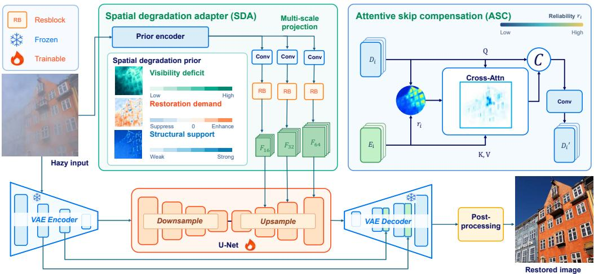  
Figure 2: Overview of Hihaze. SDA guides spatially adaptive denoising, while ASC transfers reliable encoder features to the VAE decoder. GPF combines global and local predictions for highresolution restoration with consistent appearance and preserved fine details.

## 3.1 OVERALL FRAMEWORK

As shown in Fig. 2, our restoration pipeline is constructed upon the pretrained Stable Diffusion 2.1-base backbone. Given a hazy image I, the VAE encoder $\bar { \mathcal { E } }$ produces a latent representation $\mathbf { z } _ { I }$ and intermediate features for subsequent reconstruction. At the fixed timestep t=399, we use this encoded representation as the diffusion state, i.e., $\mathbf { z } _ { t } { = } \mathbf { z } _ { I }$ . The standard forward formulation is

$$
\mathbf { z } _ { t } = \sqrt { \bar { \alpha } _ { t } } \mathbf { z } + \sqrt { 1 - \bar { \alpha } _ { t } } \epsilon , \qquad \bar { \alpha } _ { t } = \prod _ { s = 1 } ^ { t } ( 1 - \beta _ { s } ) ,\tag{2}
$$

where z is a clean latent, ϵ is Gaussian noise, and $\beta _ { s }$ denotes the noise variance.

To account for spatially varying haze, SDA extracts multi-scale degradation features directly from the hazy input. These features guide multiple U-Net decoder stages and refine the output noise prediction. The resulting prediction $\epsilon ^ { \prime }$ is used to recover the clean latent in one denoising step:

$$
\widehat { \mathbf { z } } _ { 0 } = \frac { \mathbf { z } _ { t } - \sqrt { 1 - \bar { \alpha } _ { t } } \mathbf { \epsilon } \epsilon ^ { \prime } } { \sqrt { \bar { \alpha } _ { t } } } .\tag{3}
$$

The VAE decoder D then reconstructs the restored image from $\widehat { \mathbf { z } } _ { 0 }$ . During decoding, ASC uses decoder features to query encoder information. This supports detail reconstruction while reducing the influence of unreliable haze-degraded encoder features during image reconstruction.

For high-resolution inputs, we apply the same network to a downsampled full image and overlapping patches at the original resolution. The resulting global reference G guides the alignment and fusion of local predictions $\{ \mathbf { P } _ { i } \}$ . GPF further uses structural agreement with the hazy input to compensate fine details, producing the final result ${ \widehat { \mathbf { I } } } .$ Together, these designs enable spatially adaptive dehazing while maintaining global appearance consistency and preserving local structural details.

## 3.2 ATTENTIVE SKIP COMPENSATION

Latent diffusion models reduce computational cost through VAE compression, but this may attenuate fine spatial details. Encoder–decoder skip connections help recover these details by reusing input features (Wang et al., 2024a; Lan et al., 2025a; Ai et al., 2024; Zhou et al., 2022; Chen et al., 2025). However, spatially non-uniform haze causes the reliability of encoder features to vary across regions. Some regions retain useful scene details, whereas others are more severely affected by haze. Direct feature transfer can therefore introduce degraded information along with useful details. To address this variation, we propose attentive skip compensation (ASC). It selectively retrieves reliable encoder information and adaptively refines less reliable features during reconstruction.

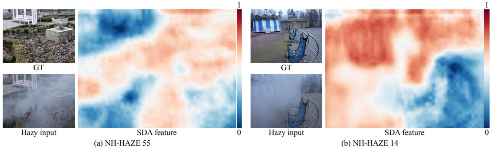  
Figure 3: Visualization of the first SDA feature channel on NH-HAZE 55 (left) and 14 (right). Both examples use the same color scale; warmer colors indicate stronger feature responses.

At stage $\ell , \mathsf { A S C }$ takes encoder and decoder features $\mathbf { E } _ { \ell }$ and $\mathbf { D } _ { \ell } .$ . A lightweight convolutional predictor with a sigmoid output estimates a spatial reliability map $\mathbf { R } _ { \ell }$ from both $\mathbf { E } _ { \ell }$ and $\mathbf { D } _ { \ell }$ . Decoder features then query encoder features through local cross-attention, with reliability guiding the selection of source information. For each window and attention head, the retrieved feature is

$$
\mathbf { V } ^ { \prime } { } _ { \ell } = \mathrm { s o f t m a x } \Bigg ( \frac { \mathbf { Q } _ { \ell } \mathbf { K } _ { \ell } ^ { \top } } { \sqrt { d } } + \mathbf { B } _ { \ell } + \log \big ( \operatorname* { m a x } \{ \mathbf { R } _ { \ell } ^ { \top } , \varepsilon \} \big ) \Bigg ) \mathbf { V } _ { \ell } ,\tag{4}
$$

where $\mathbf { Q } _ { \ell }$ and $( \mathbf { K } _ { \ell } , \mathbf { V } _ { \ell } )$ are projected from normalized decoder and encoder features, respectively.   
$\mathbf { B } _ { \ell }$ is the relative positional bias, d is the head dimension, and $\varepsilon > 0$ ensures numerical stability.

Then we refine the encoder features using the difference between retrieved and source features, $\mathbf { V } ^ { \prime } { } _ { \ell } - \mathbf { V } _ { \ell } \colon$

$$
\widehat { \mathbf { E } } _ { \ell } = \mathbf { E } _ { \ell } + ( 1 - \mathbf { R } _ { \ell } ) \odot \mathrm { C o n v } _ { 1 \times 1 } ( \mathbf { V } ^ { \prime } { } _ { \ell } - \mathbf { V } _ { \ell } ) ,\tag{5}
$$

where $\mathrm { C o n v } _ { 1 \times 1 }$ is a zero-initialized convolution and $\odot$ denotes element-wise multiplication. The factor $1 - \mathbf { R } _ { \ell }$ increases correction weights at less reliable locations. The refined encoder features are concatenated with $\mathbf { D } _ { \ell }$ and processed by residual convolutional blocks, whose output is added to $\mathbf { D } _ { \ell } .$

This design retains reliable encoder information and focuses refinement on less reliable regions. It supports detail reconstruction while reducing the influence of haze-degraded features.

## 3.3 SPATIAL DEGRADATION ADAPTER

Spatially non-uniform haze attenuates contrast and structural information to varying degrees across an image, leading to different restoration needs. To effectively handle spatially varying haze degradation, we introduce the spatial degradation adapter (SDA). It extracts multi-scale haze-aware fea tures from the hazy input and injects them into the U-Net to guide spatially adaptive restoration.

Haze representation. Given a hazy image I, we use a convolutional encoder to learn multi-scale haze representations $\{ \mathbf { F } _ { \ell } \} _ { \ell = 1 } ^ { 3 }$ that capture local degradation and restoration needs. The supervision targets and training details are provided in Appendix A.2.1.

To illustrate the haze information captured by SDA, we visualize the first channel of its finest-scale features in Fig. 3. On NH-HAZE 55, the visible haze across the central region exhibits stronger responses, whereas the clearer upper-left region generally shows weaker responses. This spatial correspondence suggests that the learned features are sensitive to variations in haze distribution. Additional SDA feature visualizations on NH-HAZE and O-HAZE are provided in Appendix D.2.

U-Net adaptation. We align the haze features with three U-Net decoder stages, where convolutional adapters produce spatially gated residual corrections. At each scale, we inject features as:

$$
\mathbf { F } _ { \mathrm { d } } ^ { \prime } = \mathbf { F } _ { \mathrm { d } } + \mathrm { A d a p t e r } ( \mathbf { F } _ { \mathrm { d } } , \mathbf { F } ) ,\tag{6}
$$

where F denotes haze features, $\mathbf { F } _ { \mathrm { d } }$ and $\mathbf { F } _ { \mathrm { d } } ^ { \prime }$ are decoder features before and after injection, respectively, and Adapter denotes the convolutional adapter. We also use the haze features to modulate the U-Net noise prediction, yielding $\epsilon ^ { \prime }$ . Both feature and noise correction branches use zero-initialized output projections to preserve the original network output at initialization. Through multi-scale feature injection and noise prediction refinement, SDA incorporates spatially varying haze information into one-step denoising, adapting restoration to local degradation.

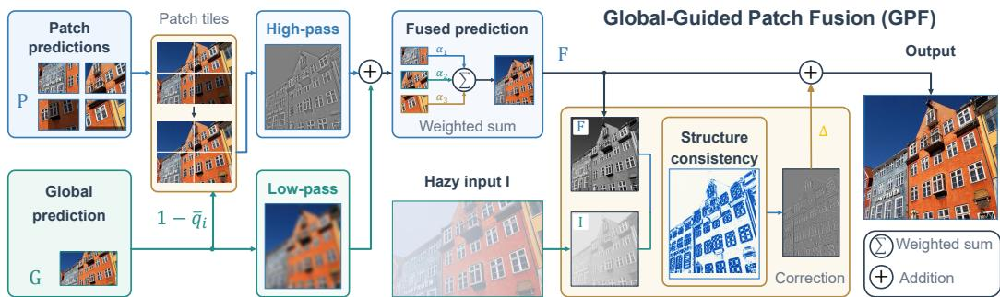  
Figure 4: Overview of global-guided patch fusion (GPF). A global prediction guides patch alignment and reliability-aware fusion. Structural cues from the hazy input guide detail compensation.

## 3.4 GLOBAL-GUIDED PATCH FUSION

High-resolution diffusion-based dehazing often relies on patch-wise inference to accommodate limited GPU memory. However, each patch observes only partial scene context, which can lead to inconsistent color and illumination across regions. Averaging overlapping predictions can alleviate boundary artifacts, but cannot ensure global appearance consistency and may smooth fine details.

To overcome these issues, we introduce global-guided patch fusion (GPF), a training-free strategy that combines global appearance guidance with local detail preservation. As illustrated in Fig. 4, a prediction from the downsampled full image provides a common appearance reference, while original-resolution patch predictions supply complementary fine details. GPF consists of three components: appearance alignment, reliability-aware fusion, and detail compensation.

Appearance alignment. For each local prediction $\mathbf { P } _ { i } ,$ we combine its multiscale wavelet highfrequency component with the low-frequency component of the corresponding global region $\mathbf { G } _ { i }$ This preserves local structures while establishing a consistent global appearance.

Reliability-aware fusion. Appearance alignment preserves local details by retaining the highfrequency component of each patch prediction. However, patch predictions may contain artifacts due to limited scene context. We therefore assess the reliability of each raw patch prediction against the global reference and use it to control the contribution of the aligned prediction during fusion.

We downsample each raw patch prediction to the native resolution of the global branch. We then compute its PSNR-Y against the corresponding global region. A sigmoid mapping converts this score into a reliability weight $q _ { i }$ . Consistent patches receive higher weights to preserve local details. Inconsistent patches contribute less and rely more on the global reference.

To avoid abrupt transitions between patches, we aggregate their reliability weights using cosine windows $\mathbf { w } _ { i }$ and apply Gaussian smoothing S. The resulting spatial reliability map q¯ controls the blending of aligned local predictions with the global reference:

$$
\bar { \mathbf { q } } = S \left( \frac { \sum _ { i } \mathbf { w } _ { i } q _ { i } } { \sum _ { i } \mathbf { w } _ { i } } \right) , \quad \widehat { \mathbf { P } } _ { i } = \bar { \mathbf { q } } _ { i } \odot [ \mathcal { W } _ { \mathrm { H } } ( \mathbf { P } _ { i } ) + \mathcal { W } _ { \mathrm { L } } ( \mathbf { G } _ { i } ) ] + ( 1 - \bar { \mathbf { q } } _ { i } ) \odot \mathbf { G } _ { i } .\tag{7}
$$

$\mathbf { G } _ { i }$ and $\bar { \mathbf { q } } _ { i }$ denote the corresponding crops of the global prediction and reliability map, respectively. The operators $\mathcal { W } _ { \mathrm { H } }$ and $\mathcal { W } _ { \mathrm { L } }$ extract the wavelet high- and low-frequency components, respectively. Combining the two wavelet components yields the prediction produced by appearance alignment. Reliable regions retain more local information, while unreliable regions rely more on the global prediction. Finally, we aggregate the corrected patches using reliability weights and cosine windows:

$$
\mathbf { I } ^ { \mathrm { f } } = { \frac { \sum _ { i } q _ { i } \mathbf { w } _ { i } \odot { \widehat { \mathbf { P } } } _ { i } } { \sum _ { i } q _ { i } \mathbf { w } _ { i } } } .\tag{8}
$$

Detail compensation. Aggregating patch predictions may attenuate high-frequency details. We therefore use structural information retained in the hazy input to compensate for detail loss in the fused result. First, we estimate a local structural agreement map s between the hazy input I and the fused result If. Its values lie in [0, 1] and guide spatially adaptive detail compensation.

Table 1: Dehazing performance of Hihaze and competing methods across four real-world benchmarks. For each metric, red denotes first place and blue denotes second place.
<table><tr><td rowspan="2">Dataset</td><td rowspan="2">Metric</td><td colspan="3">Non-diffusion</td><td colspan="6">Diffusion / Flow</td></tr><tr><td>PTTD</td><td>IPC-Dehaze</td><td>BiLaLoRA</td><td>DiffUIR</td><td>FCDM</td><td>Diff-Dehazer DiffDehaze</td><td></td><td>HazeFlow</td><td>Ours</td></tr><tr><td rowspan="6">NH-HAZE</td><td>PSNR ↑</td><td>14.53</td><td>11.18</td><td>12.07</td><td>11.79</td><td>14.04</td><td>12.99</td><td>14.26</td><td>14.38</td><td>18.22</td></tr><tr><td>SSIM↑</td><td>0.6119</td><td>0.5850</td><td>0.5989</td><td>0.4788</td><td>0.5955</td><td>0.6079</td><td>0.3067</td><td>0.6343</td><td>0.6664</td></tr><tr><td>LPIPS↓</td><td>0.3934</td><td>0.4445</td><td>0.4398</td><td>0.5424</td><td>0.4264</td><td>0.3936</td><td>0.6763</td><td>0.4180</td><td>0.2863</td></tr><tr><td>DISTS↓</td><td>0.1938</td><td>0.2400</td><td>0.2106</td><td>0.3462</td><td>0.2159</td><td>0.2094</td><td>0.3374</td><td>0.2021</td><td>0.1272</td></tr><tr><td>FID ↓</td><td>187.93</td><td>200.18</td><td>199.34</td><td>215.83</td><td>198.70</td><td>151.51</td><td>170.95</td><td>162.45</td><td>90.10</td></tr><tr><td>Q-Align ↑</td><td>3.4309</td><td>3.4721</td><td>3.6929</td><td>3.1777</td><td>3.3738</td><td>3.4304</td><td>3.2871</td><td>3.1193</td><td>3.8066</td></tr><tr><td rowspan="6">O-HAZE</td><td>PSNR ↑</td><td>18.78</td><td>13.98</td><td>12.75</td><td>15.12</td><td>15.35</td><td>16.62</td><td>15.77</td><td>16.63</td><td>21.28</td></tr><tr><td>SSIM↑</td><td>0.6241</td><td>0.6601</td><td>0.6185</td><td>0.6413</td><td>0.5442</td><td>0.6332</td><td>0.5399</td><td>0.6484</td><td>0.6992</td></tr><tr><td>LPIPS↓</td><td>0.3922</td><td>0.5383</td><td>0.4617</td><td>0.4558</td><td>0.4820</td><td>0.4085</td><td>0.3987</td><td>0.4291</td><td>0.3236</td></tr><tr><td>DISTS↓</td><td>0.1914</td><td>0.2406</td><td>0.1998</td><td>0.2975</td><td>0.2059</td><td>0.1935</td><td>0.1763</td><td>0.2054</td><td>0.1087</td></tr><tr><td>FID↓</td><td>130.09</td><td>139.47</td><td>170.16</td><td>156.33</td><td>187.18</td><td>144.15</td><td>124.64</td><td>152.20</td><td>66.86</td></tr><tr><td>Q-Align ↑</td><td>3.4973</td><td>3.3362</td><td>3.2017</td><td>2.9872</td><td>3.0500</td><td>3.2273</td><td>3.2613</td><td>3.3200</td><td>3.9219</td></tr><tr><td rowspan="6">Dense-Haze</td><td>PSNR ↑</td><td>13.67</td><td>8.46</td><td>11.54</td><td>9.90</td><td>12.69</td><td>10.94</td><td>13.18</td><td>12.10</td><td>17.29</td></tr><tr><td>SSIM↑</td><td>0.4536</td><td>0.4548</td><td>0.5055</td><td>0.4432</td><td>0.4088</td><td>0.4656</td><td>0.4636</td><td>0.5320</td><td>0.5676</td></tr><tr><td>LPIPS↓</td><td>0.5865</td><td>0.7131</td><td>0.6492</td><td>0.7676</td><td>0.7813</td><td>0.7149</td><td>0.6786</td><td>0.6374</td><td>0.4774</td></tr><tr><td>DISTS↓</td><td>0.3174</td><td>0.4617</td><td>0.4178</td><td>0.6137</td><td>0.4036</td><td>0.5034</td><td>0.4580</td><td>0.3834</td><td>0.2124</td></tr><tr><td>FID ↓</td><td>256.00</td><td>271.59</td><td>262.50</td><td>272.00</td><td>275.20</td><td>256.24</td><td>210.41</td><td>236.11</td><td>172.18</td></tr><tr><td>Q-Align ↑</td><td>2.4576</td><td>2.2399</td><td>2.9652</td><td>1.9165</td><td>2.0283</td><td>2.1314</td><td>2.5013</td><td>2.4468</td><td>3.3325</td></tr><tr><td rowspan="6">I-HAZE</td><td>PSNR ↑</td><td>15.84</td><td>15.68</td><td>15.67</td><td>15.89</td><td>14.09</td><td>15.83</td><td>13.89</td><td>16.12</td><td>19.02</td></tr><tr><td>SSIM↑</td><td>0.6508</td><td>0.7985</td><td>0.7075</td><td>0.7705</td><td>0.4737</td><td>0.6709</td><td>0.7138</td><td>0.7675</td><td>0.7888</td></tr><tr><td>LPIPS↓</td><td>0.5072</td><td>0.4595</td><td>0.4638</td><td>0.3336</td><td>0.6258</td><td>0.4421</td><td>0.3725</td><td>0.4559</td><td>0.3217</td></tr><tr><td>DISTS↓</td><td>0.2172</td><td>0.2033</td><td>0.1566</td><td>0.2448</td><td>0.2370</td><td>0.1849</td><td>0.1861</td><td>0.1974</td><td>0.0946</td></tr><tr><td>FID↓</td><td>197.12</td><td>118.08</td><td>217.57</td><td>120.02</td><td>254.86</td><td>157.31</td><td>153.27</td><td>168.12</td><td>78.99</td></tr><tr><td>Q-Align ↑</td><td>3.3117</td><td>3.4398</td><td>3.6040</td><td>2.8698</td><td>2.9932</td><td>3.1771</td><td>3.3588</td><td>3.4755</td><td>4.2306</td></tr></table>

We then extract high-frequency information from both images using self-guided filtering, obtaining detail layers H and Hf, respectively. Guided by structural agreement, we adaptively retain restored details and incorporate input details as follows:

$$
\widehat { \mathbf { H } } = \left[ \alpha + \mathbf { s } ( 1 - \alpha ) \right] \odot \mathbf { H } ^ { \mathrm { f } } + \beta \mathbf { s } \odot \mathbf { H } .\tag{9}
$$

The fixed coefficients $\alpha \in ( 0 , 1 )$ and $\beta > 0$ control the retention of restored details and compensation from input details, respectively. Regions with stronger structural agreement retain more restored details and receive more detail from the input. Regions with weaker agreement have attenuated detail responses, reducing the influence of inconsistent structures. Finally, we combine compensated details with low-frequency information from the fused result to reconstruct the output bI.

Through appearance alignment, reliability-aware fusion, and structure-guided detail compensation, GPF improves cross-patch consistency while preserving fine structures in high-resolution dehazing.

## 4 EXPERIMENTS

## 4.1 EXPERIMENTAL SETTINGS

Datasets. Model training uses paired hazy and clean images from LMHaze (Zhang et al., 2024) and RW2AH (Fang et al., 2025). For evaluation, we adopt four real-world benchmarks covering diverse degradation conditions: indoor scenes in I-HAZE (Ancuti et al., 2018b), outdoor environments in O-HAZE (Ancuti et al., 2018a), heavy homogeneous haze in Dense-Haze (Ancuti et al., 2019), and spatially varying haze in NH-HAZE (Ancuti et al., 2020). We evaluate our model and other methods on all four datasets without fine-tuning on the target datasets.

Evaluation Metrics. We evaluate reconstruction fidelity with PSNR and SSIM (Wang et al., 2004), and perceptual agreement with LPIPS (Zhang et al., 2018) and DISTS (Ding et al., 2020). FID (Heusel et al., 2017) measures distributional differences in feature space between restored images and clean references. Q-Align (Wu et al., 2023a) provides no-reference quality scores.

Implementation Details. We initialize the network from Stable Diffusion 2.1-base (Rombach et al., 2022) and use LoRA with rank 16. With AdamW (Loshchilov et al., 2017), we train the U-Net LoRA and ASC for 200,000 iterations on 512×512 crops. We then train the SDA encoder on 512×512 crops and the U-Net adaptation branches on 1,024×1,024 crops for 10,000 iterations each.

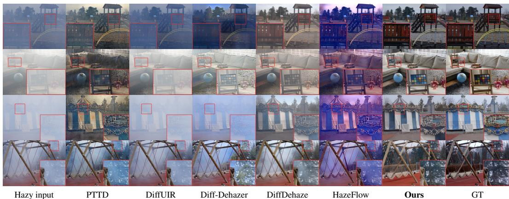  
Figure 5: Visual comparisons on O-HAZE, I-HAZE, Dense-Haze, and NH-HAZE, from top to bottom. Red boxes mark the corresponding regions shown in the enlarged views.

Table 2: Inference time and model complexity for 3,328×4,096 inputs on an RTX A6000.
<table><tr><td>Metric</td><td>IPC-Dehaze</td><td>DiffUIR</td><td>FCDM</td><td>Diff-Dehazer</td><td>DiffDehaze</td><td>HazeFlow</td><td>Ours</td></tr><tr><td>Runtime (s)</td><td>185.4</td><td>43.5</td><td>146.6</td><td>32.5</td><td>1,046.8</td><td>15.2</td><td>12.9</td></tr><tr><td>FLOPs (T)</td><td>826.391</td><td>236.731</td><td>2,022.874</td><td>453.871</td><td>9,386.778</td><td>250.991</td><td>458.955</td></tr><tr><td>Params (M)</td><td>43.164</td><td>36.261</td><td>155.334</td><td>1,506.159</td><td>1,666.750</td><td>87.087</td><td>975.822</td></tr></table>

Inference uses one denoising step at t=399; high-resolution images are processed with overlapping 1,024 × 1,024 patches and GPF. Appendix A in the supplementary material documents the training procedure, losses, learning rates, batch sizes, and other settings.

## 4.2 COMPARISON WITH STATE-OF-THE-ART METHODS

Compared Methods. We compare our method with eight representative dehazing approaches. The non-diffusion methods include PTTD (Chen et al., 2024), IPC-Dehaze (Fu et al., 2025), and Bi LaLoRA (Zhang et al., 2026). The diffusion-based methods include DiffUIR (Zheng et al., 2024), FCDM (Wang et al., 2024b), Diff-Dehazer (Lan et al., 2025a), DiffDehaze (Wang et al., 2025), and HazeFlow (Shin et al., 2025). Appendix B extends the comparison to five additional methods, reporting all six metrics on the same four benchmarks.

Quantitative Results. Across the four benchmarks in Tab. 1, Hihaze attains the highest PSNR and Q-Align scores and the lowest LPIPS, DISTS, and FID values. In particular, it outperforms the runner-up by 3.62 dB on Dense-Haze and 3.69 dB on NH-HAZE in PSNR, while reducing FID by 57.78 on O-HAZE and 61.41 on NH-HAZE. It also ranks first in SSIM on three benchmarks. These results support reconstruction fidelity and perceptual quality in real-world dehazing.

Qualitative Results. We provide visual comparisons on I-HAZE, O-HAZE, Dense-Haze, and NH-HAZE in Fig. 5. Our method produces more natural and haze-free results across diverse real-world scenes. Compared with existing methods, it more effectively suppresses residual haze while preserving structural and textural details under spatially non-uniform haze. Dense-Haze remains particularly challenging: its extremely dense haze severely obscures scene appearance, and our restored result still exhibits some color discrepancies relative to the ground truth. The four examples show scene views and enlarged local details; more comparisons appear in Appendix D.1.

Running Time Comparisons. Tab. 2 summarizes inference latency, FLOPs, and parameter counts.   
All methods are tested on the same NVIDIA RTX A6000 GPU with 3,328 × 4,096 input images.   
Our method takes 12.9 s per image, achieving approximately an 81× speedup over DiffDehaze.   
Even compared with HazeFlow, the fastest competing method, our method reduces the running time from 15.2 s to 12.9 s, achieving a 1.18× speedup.

Table 3: Ablation studies and GPF transferability on O-HAZE. (a) Base denotes the model without skip connections; Zero-conv uses zero-conv skip connections. (b) Base denotes the model with ASC. (c) AA: appearance alignment; RF: reliability-aware fusion; DC: detail compensation. (d) Performance comparisons of HazeFlow and Diff-Dehazer with and without GPF.  
(a) Ablation of ASC.
<table><tr><td>Metric</td><td>base</td><td>+ Zero-conv</td><td>+ ASC</td></tr><tr><td>PSNR ↑</td><td>17.36</td><td>18.80</td><td>19.79</td></tr><tr><td>SSIM↑</td><td>0.5636</td><td>0.6438</td><td>0.6508</td></tr><tr><td>LPIPS↓</td><td>0.3837</td><td>0.3484</td><td>0.3418</td></tr><tr><td>DISTS ↓</td><td>0.1465</td><td>0.1327</td><td>0.1334</td></tr></table>

(b) Ablation of SDA.
<table><tr><td>Method</td><td>PSNR ↑</td><td>SSIM ↑</td><td>LPIPS ↓</td><td>DISTS ↓</td></tr><tr><td>base</td><td>19.79</td><td>0.6508</td><td>0.3418</td><td>0.1334</td></tr><tr><td>+ T2I-Adapter</td><td>19.78</td><td>0.6500</td><td>0.3404</td><td>0.1235</td></tr><tr><td>+ Noise refinement</td><td>19.78</td><td>0.6483</td><td>0.3406</td><td>0.1291</td></tr><tr><td>+ SDA</td><td>20.08</td><td>0.6598</td><td>0.3375</td><td>0.1216</td></tr></table>

(c) Ablation of GPF.
<table><tr><td>AA</td><td>RF</td><td>DC</td><td>PSNR ↑</td><td>SSIM ↑</td><td>LPIPS ↓</td><td>DISTS ↓</td></tr><tr><td>一</td><td>一</td><td>一</td><td>20.08</td><td>0.6598</td><td>0.3375</td><td>0.1216</td></tr><tr><td>√</td><td>一</td><td>一</td><td>21.08</td><td>0.6664</td><td>0.3282</td><td>0.1166</td></tr><tr><td>√</td><td>√</td><td>一</td><td>21.27</td><td>0.6979</td><td>0.3285</td><td>0.1101</td></tr><tr><td>√</td><td>√</td><td>√</td><td>21.28</td><td>0.6992</td><td>0.3236</td><td>0.1087</td></tr></table>

(d) GPF transferability.
<table><tr><td>Method</td><td>PSNR ↑</td><td>SSIM ↑</td><td>LPIPS ↓</td><td>DISTS ↓</td></tr><tr><td>HazeFlow + GPF</td><td>16.63</td><td>0.6484</td><td>0.4291</td><td>0.2054</td></tr><tr><td></td><td>17.95</td><td>0.6782</td><td>0.4295</td><td>0.1732</td></tr><tr><td>Diff-Dehazer</td><td>16.62</td><td>0.6332</td><td>0.4085</td><td>0.1935</td></tr><tr><td>+ GPF</td><td>16.78</td><td>0.6456</td><td>0.4089</td><td>0.1783</td></tr></table>

## 4.3 ABLATION STUDIES

We investigate the effectiveness of attentive skip compensation (ASC), spatial degradation adapter (SDA), and global-guided patch fusion (GPF) on O-HAZE. Specifically, we compare different VAE skip-connection designs and conditioning strategies, and progressively introduce the GPF components to examine their individual contributions. We further evaluate the transferability of GPF to two other dehazing methods without retraining. All variants are evaluated using PSNR, SSIM, LPIPS, and DISTS to assess fidelity and perceptual similarity, as shown in Tab. 3.

Attentive skip compensation. We compare three VAE variants in Tab. 3a: without skip connections, with zero-conv skip connections, and with ASC. Adding zero-conv improves all four metrics over the no-skip baseline, showing the benefit of introducing encoder features into reconstruction. ASC further improves PSNR, SSIM, and LPIPS by adaptively compensating encoder features, while zeroconv achieves the lowest DISTS. These results support the effectiveness of ASC for reconstruction.

Spatial degradation adapter. We compare different conditioning strategies using the model with ASC as the baseline. As shown in Tab. 3b, T2I-Adapter and noise refinement improve LPIPS and DISTS, but slightly reduce PSNR and SSIM. By incorporating spatially varying haze information, SDA improves all four metrics over the baseline and outperforms the alternative conditioning designs. This suggests that haze-aware conditioning provides effective guidance for restoration.

Global-guided patch fusion. We progressively add the GPF components in Tab. 3c. First, appearance alignment improves all four metrics by aligning local predictions with the global reference. Then, reliability-aware fusion weights patches according to their consistency with the global prediction, further improving PSNR, SSIM, and DISTS. Finally, detail compensation uses structural cues from the hazy input and improves all four metrics, supporting the contribution of each component.

GPF transferability. We apply the same GPF procedure to HazeFlow (Shin et al., 2025) and Diff-Dehazer (Lan et al., 2025a). As shown in Tab. 3d, GPF improves PSNR, SSIM, and DISTS for both methods on O-HAZE, although LPIPS increases slightly. These results indicate that the benefits of GPF extend to other dehazing methods. Appendix C provides results for all six metrics on all four benchmarks, together with qualitative comparisons before and after applying GPF to further examine its effectiveness across different methods and haze conditions.

## 5 CONCLUSION

We have presented Hihaze, a single-step latent diffusion approach tailored for restoring highresolution hazy scenes. To handle spatially non-uniform haze, Hihaze employs ASC to preserve reliable encoder features and SDA to inject spatial degradation information into one-step dehazing. Moreover, GPF uses a global prediction to guide local patch fusion, improving cross-patch consistency while preserving fine details. Extensive experiments on real-world benchmarks demonstrate superior restoration quality and inference efficiency across diverse haze conditions.

## AI USE STATEMENT

We utilized generative AI solely for manuscript language refinement, such as grammatical checking, phrasing adjustments, and readability enhancement. Every section edited with AI assistance has been thoroughly verified by the authors, who assume complete responsibility for the manuscript’s accuracy and integrity. All experimental data generation, evaluation, and result analyses were performed entirely by the authors without any involvement of generative AI.

## ETHICS STATEMENT

This work studies single-image dehazing using existing research datasets and pretrained models. No human-subject studies were conducted. We do not identify any specific ethical concerns arising from this research on restoring hazy images using existing data.

## REPRODUCIBILITY STATEMENT

Section 4.1 describes the training datasets, evaluation benchmarks, and implementation settings. Appendix A of the supplementary material provides the complete training strategy, loss functions, and detailed configurations. We plan to release code and trained weights upon acceptance.

## REFERENCES

Yuang Ai, Huaibo Huang, Xiaoqiang Zhou, Jiexiang Wang, and Ran He. Multimodal prompt perceiver: Empower adaptiveness, generalizability and fidelity for all-in-one image restoration. In CVPR, 2024.

Codruta Ancuti, Cosmin Ancuti, Radu Timofte, De Vleeschouwer, et al. O-haze: a dehazing benchmark with real hazy and haze-free outdoor images. In CVPRW, 2018a.

Codruta O Ancuti, Cosmin Ancuti, Mateu Sbert, and Radu Timofte. Dense-haze: A benchmark for image dehazing with dense-haze and haze-free images. In ICIP, 2019.

Codruta O Ancuti, Cosmin Ancuti, and Radu Timofte. Nh-haze: An image dehazing benchmark with non-homogeneous hazy and haze-free images. In CVPRW, 2020.

Cosmin Ancuti, Codruta O Ancuti, Radu Timofte, and Christophe De Vleeschouwer. I-haze: A dehazing benchmark with real hazy and haze-free indoor images. In International conference on advanced conceptsfor intelligent vision systems, 2018b.

Dana Berman, Shai Avidan, et al. Non-local image dehazing. In CVPR, 2016.

Bolun Cai, Xiangmin Xu, Kui Jia, Chunmei Qing, and Dacheng Tao. Dehazenet: An end-to-end system for single image haze removal. TIP, 2016.

I Chen, Wei-Ting Chen, Yu-Wei Liu, Yuan-Chun Chiang, Sy-Yen Kuo, Ming-Hsuan Yang, et al. Unirestore: Unified perceptual and task-oriented image restoration model using diffusion prior. In CVPR, 2025.

Zheng Chen, Bowen Chai, Rongjun Gao, Mingtao Nie, Xi Li, Bingnan Duan, Jianping Fang, Xiaohong Liu, Linghe Kong, and Yulun Zhang. Dvface: Spatio-temporal dual-prior diffusion for video face restoration. arXiv preprint arXiv:2604.14560, 2026a.

Zheng Chen, Ruofan Yang, Jin Han, Dehua Song, Zichen Zou, Chunming He, Yong Guo, and Yulun Zhang. Diffst: Spatiotemporal-aware diffusion for real-world space-time video super-resolution. arXiv preprint arXiv:2605.13182, 2026b.

Zixuan Chen, Zewei He, Ziqian Lu, Xuecheng Sun, and Zhe-Ming Lu. Prompt-based test-time real image dehazing: a novel pipeline. In ECCV, 2024.

Keyan Ding, Kede Ma, Shiqi Wang, and Eero P Simoncelli. Image quality assessment: Unifying structure and texture similarity. TPAMI, 2020.

Zheng Ding, Mengqi Zhang, Jiajun Wu, and Zhuowen Tu. Patched denoising diffusion models for high-resolution image synthesis. In ICLR, 2024.

Hang Dong, Jinshan Pan, Lei Xiang, Zhe Hu, Xinyi Zhang, Fei Wang, and Ming-Hsuan Yang. Multi-scale boosted dehazing network with dense feature fusion. In CVPR, 2020.

Chengyu Fang, Chunming He, Fengyang Xiao, Yulun Zhang, Longxiang Tang, Yuelin Zhang, Kai Li, and Xiu Li. Real-world image dehazing with coherence-based pseudo labeling and cooperative unfolding network. In NeurIPS, 2024.

Wenxuan Fang, Junkai Fan, Yu Zheng, Jiangwei Weng, Ying Tai, and Jun Li. Guided real image dehazing using ycbcr color space. In AAAI, 2025.

Raanan Fattal. Single image dehazing. ACM TOG, 2008.

Raanan Fattal. Dehazing using color-lines. ACM TOG, 2014.

Jiayi Fu, Siyu Liu, Zikun Liu, Chun-Le Guo, Hyunhee Park, Ruiqi Wu, Guoqing Wang, and Chongyi Li. Iterative predictor-critic code decoding for real-world image dehazing. In CVPR, 2025.

Chun-Le Guo, Qixin Yan, Saeed Anwar, Runmin Cong, Wenqi Ren, and Chongyi Li. Image dehazing transformer with transmission-aware 3d position embedding. In CVPR, 2022.

Kaiming He, Jian Sun, and Xiaoou Tang. Single image haze removal using dark channel prior. TPAMI, 2010.

Martin Heusel, Hubert Ramsauer, Thomas Unterthiner, Bernhard Nessler, and Sepp Hochreiter. Gans trained by a two time-scale update rule converge to a local nash equilibrium. In NeurIPS, 2017.

Jonathan Ho, Ajay Jain, and Pieter Abbeel. Denoising diffusion probabilistic models. In NeurIPS, 2020.

Yunwei Lan, Zhigao Cui, Chang Liu, Jialun Peng, Nian Wang, Xin Luo, and Dong Liu. Exploiting diffusion prior for real-world image dehazing with unpaired training. In AAAI, 2025a.

Yunwei Lan, Zhigao Cui, Xin Luo, Chang Liu, Nian Wang, Menglin Zhang, Yanzhao Su, and Dong Liu. When schrodinger bridge meets real-world image dehazing with unpaired training. In¨ ICCV, 2025b.

Jianze Li, Jiezhang Cao, Zichen Zou, Xiongfei Su, Xin Yuan, Yulun Zhang, Yong Guo, and Xiaokang Yang. Unleashing the power of one-step diffusion based image super-resolution via a large-scale diffusion discriminator. In NeurIPS, 2026a.

Mingjia Li, Tianle Du, Hainuo Wang, Qiming Hu, and Xiaojie Guo. On the global photometric alignment for low-level vision. arXiv preprint arXiv:2604.08172, 2026b.

Xiaohong Liu, Yongrui Ma, Zhihao Shi, and Jun Chen. Griddehazenet: Attention-based multi-scale network for image dehazing. In ICCV, 2019.

Yuhao Liu, Zhanghan Ke, Fang Liu, Nanxuan Zhao, and Rynson WH Lau. Diff-plugin: Revitalizing details for diffusion-based low-level tasks. In CVPR, 2024.

Ilya Loshchilov, Frank Hutter, et al. Fixing weight decay regularization in adam. arXiv preprint arXiv:1711.05101, 2017.

Andreas Lugmayr, Martin Danelljan, Andres Romero, Fisher Yu, Radu Timofte, and Luc Van Gool. Repaint: Inpainting using denoising diffusion probabilistic models. In CVPR, 2022.

Long Ma, Yuxin Feng, Yan Zhang, Jinyuan Liu, Weimin Wang, Guang-Yong Chen, Chengpei Xu, and Zhuo Su. Coa: Towards real image dehazing via compression-and-adaptation. In CVPR, 2025.

Earl J McCartney and Freeman F Hall Jr. Optics of the atmosphere: scattering by molecules and particles, 1977.

Gaofeng Meng, Ying Wang, Jiangyong Duan, Shiming Xiang, and Chunhong Pan. Efficient image dehazing with boundary constraint and contextual regularization. In ICCV, 2013.

Srinivasa G Narasimhan and Shree K Nayar. Vision and the atmosphere. IJCV, 2002.

Ozan Ozdenizci and Robert Legenstein. Restoring vision in adverse weather conditions with patch- ¨ based denoising diffusion models. TPAMI, 2023.

Xu Qin, Zhilin Wang, Yuanchao Bai, Xiaodong Xie, and Huizhu Jia. Ffa-net: Feature fusion attention network for single image dehazing. In AAAI, 2020.

Robin Rombach, Andreas Blattmann, Dominik Lorenz, Patrick Esser, and Bjorn Ommer. High-¨ resolution image synthesis with latent diffusion models. In CVPR, 2022.

Nataniel Ruiz, Yuanzhen Li, Varun Jampani, Yael Pritch, Michael Rubinstein, and Kfir Aberman. Dreambooth: Fine tuning text-to-image diffusion models for subject-driven generation. In CVPR, 2023.

Chitwan Saharia, William Chan, Huiwen Chang, Chris Lee, Jonathan Ho, Tim Salimans, David Fleet, and Mohammad Norouzi. Palette: Image-to-image diffusion models. In SIGGRAPH, 2022a.

Chitwan Saharia, Jonathan Ho, William Chan, Tim Salimans, David J Fleet, and Mohammad Norouzi. Image super-resolution via iterative refinement. TPAMI, 2022b.

Junseong Shin, Seungwoo Chung, Yunjeong Yang, and Tae Hyun Kim. Hazeflow: Revisit haze physical model as ode and non-homogeneous haze generation for real-world dehazing. In ICCV, 2025.

Oriane Simeoni, Huy V Vo, Maximilian Seitzer, Federico Baldassarre, Maxime Oquab, Cijo Jose, ´ Vasil Khalidov, Marc Szafraniec, Seungeun Yi, Michael Ramamonjisoa, et al. Dinov3.¨ arXiv preprint arXiv:2508.10104, 2025.

Jiaming Song, Chenlin Meng, and Stefano Ermon. Denoising diffusion implicit models. arXiv preprint arXiv:2010.02502, 2020.

Yuda Song, Zhuqing He, Hui Qian, and Xin Du. Vision transformers for single image dehazing. arXiv preprint arXiv:2204.03883, 2022.

Jianyi Wang, Zongsheng Yue, Shangchen Zhou, Kelvin CK Chan, and Chen Change Loy. Exploiting diffusion prior for real-world image super-resolution. IJCV, 2024a.

Jing Wang, Songtao Wu, Zhiqiang Yuan, Qiang Tong, and Kuanhong Xu. Frequency compensated diffusion model for real-scene dehazing. Neural Networks, 2024b.

Ruiyi Wang, Yushuo Zheng, Zicheng Zhang, Chunyi Li, Shuaicheng Liu, Guangtao Zhai, and Xiaohong Liu. Learning hazing to dehazing: Towards realistic haze generation for real-world image dehazing. In CVPR, 2025.

Zhou Wang, Alan C Bovik, Hamid R Sheikh, and Eero P Simoncelli. Image quality assessment: from error visibility to structural similarity. TIP, 2004.

Haoning Wu, Zicheng Zhang, Weixia Zhang, Chaofeng Chen, Liang Liao, Chunyi Li, Yixuan Gao, Annan Wang, Erli Zhang, Wenxiu Sun, et al. Q-align: Teaching lmms for visual scoring via discrete text-defined levels. arXiv preprint arXiv:2312.17090, 2023a.

Rui-Qi Wu, Zheng-Peng Duan, Chun-Le Guo, Zhi Chai, and Chongyi Li. Ridcp: Revitalizing real image dehazing via high-quality codebook priors. In CVPR, 2023b.

Richard Zhang, Phillip Isola, Alexei A Efros, Eli Shechtman, and Oliver Wang. The unreasonable effectiveness of deep features as a perceptual metric. In CVPR, 2018.

Ruikun Zhang, Hao Yang, Yan Yang, Ying Fu, and Liyuan Pan. Lmhaze: intensity-aware image dehazing with a large-scale multi-intensity real haze dataset. In ACM MM Asia, 2024.

Yan Zhang, Long Ma, Yuxin Feng, Zhe Huang, Fan Zhou, and Zhuo Su. Bilevel layer-positioning lora for real image dehazing. arXiv preprint arXiv:2603.10872, 2026.

Dian Zheng, Xiao-Ming Wu, Shuzhou Yang, Jian Zhang, Jian-Fang Hu, and Wei-Shi Zheng. Selective hourglass mapping for universal image restoration based on diffusion model. In CVPR, 2024.

Shangchen Zhou, Kelvin Chan, Chongyi Li, and Chen Change Loy. Towards robust blind face restoration with codebook lookup transformer. In NeurIPS, 2022.

## A TRAINING STRATEGY AND IMPLEMENTATION DETAILS

We train Hihaze in two stages. In Stage 1, we jointly train the restoration backbone and ASC. In Stage 2, we freeze the base restoration model and sequentially train the SDA encoder and adaptation branches. GPF requires no training.

## A.1 BACKBONE AND ASC TRAINING

We initialize the model from Stable Diffusion 2.1-base and train the U-Net LoRA parameters, ASC and its feature-fusion layers, and a shared learnable text embedding. The remaining pretrained parameters are kept frozen. The LoRA rank and scaling parameter are both set to 16.

The restoration loss is defined as

$$
\mathcal { L } _ { \mathrm { b } } = \mathcal { L } _ { 1 } + \lambda _ { \mathrm { p a l } } \mathcal { L } _ { \mathrm { p a l } } + \lambda _ { \mathrm { p e r } } \mathcal { L } _ { \mathrm { p e r } } + \lambda _ { \mathrm { a d v } } \mathcal { L } _ { \mathrm { a d v } } ,\tag{10}
$$

where $\mathcal { L } _ { 1 }$ is the L1 reconstruction loss, $\mathcal { L } _ { \mathrm { p a l } }$ is the affinely aligned pixel loss (PAL) (Li et al., 2026b), and $\mathcal { L } _ { \mathrm { p e r } }$ is the sum of DISTS losses on RGB images and their Scharr edge-magnitude maps (Li et al., 2026a). We set $\lambda _ { \mathrm { p a l } } ~ = ~ 0 . 8 , ~ \lambda _ { \mathrm { p e r } } ~ = ~ 1$ , and $\lambda _ { \mathrm { a d v } } ~ = ~ 0 . 1$ . PAL uses an affine RGB transformation with a bias term and a ridge regularization coefficient of $1 0 ^ { - 3 }$ , with gradients stopped through the fitted transformation. The adversarial loss is computed using a DINOv3-based discriminator (Simeoni et al., 2025). Its ConvNeXt-Large feature extractor is frozen, while its head´ is updated alternately with the restoration model.

ASC reliability supervision is constructed from paired hazy and clean images $\mathbf { I } , \mathbf { I } _ { \mathrm { c } } \in [ 0 , 1 ] ;$

$$
\mathbf { R } ^ { * } = \mathrm { e x p } \left[ - \alpha _ { \mathrm { r e l } } ~ \mathrm { A v g } _ { 1 1 \times 1 1 } ( \mathrm { M e a n } _ { c } | \mathbf { I } - \mathbf { I } _ { \mathrm { c } } | ) \right] ,\tag{11}
$$

where Meanc and $\mathrm { A v g } _ { 1 1 \times 1 1 }$ denote channel averaging and local spatial averaging, respectively, and $\alpha _ { \mathrm { r e l } } = 4$ . We average-pool the target map to each ASC resolution and supervise the predicted reliability maps with an L1 loss weighted by 0.05. The inputs to the reliability predictor and the reliability values used for attention routing and gating are detached.

## A.2 SDA TRAINING

## A.2.1 ENCODER TRAINING

Given a hazy input I, its clean reference ${ \mathbf { I } } _ { \mathrm { c } } ,$ and the output $\mathbf { I } _ { \mathrm { b } }$ of the frozen base model, we construct three supervision targets for structural attenuation, residual correction, and structural confidence:

$$
\mathbf { T } _ { \mathrm { d } } = 1 - \frac { \Phi ( \mathbf { I } ) + \varepsilon _ { \mathrm { s t r } } } { \Phi ( \mathbf { I } _ { \mathrm { c } } ) + \varepsilon _ { \mathrm { s t r } } } , \quad \mathbf { T } _ { \mathrm { r } } = \frac { \Phi ( \mathbf { I } _ { \mathrm { c } } ) - \Phi ( \mathbf { I } _ { \mathrm { b } } ) } { \Phi ( \mathbf { I } _ { \mathrm { c } } ) + \varepsilon _ { \mathrm { s t r } } } , \quad \mathbf { T } _ { \mathrm { s } } = \mathrm { s i g m o i d } \left( \frac { \Phi ( \mathbf { I } _ { \mathrm { c } } ) - \tau } { \kappa } \right) .\tag{12}
$$

Here, Φ(·) combines multiscale local Sobel-gradient and contrast statistics. We set $\varepsilon _ { \mathrm { s t r } } = 1 0 ^ { - 3 }$ $\tau = 0 . 0 3$ , and $\kappa = 0 . 0 1$ , and clip $\mathbf { T } _ { \mathrm { d } }$ and $\mathbf { \bar { T } _ { r } }$ to [0, 1] and [−1, 1], respectively. These targets supervise the multiscale SDA features, and the encoder is trained using a Smooth L1 loss.

## A.2.2 ADAPTATION BRANCH TRAINING

We then freeze the SDA encoder and train only the three adaptation branches in the U-Net decoder and the noise-correction branch. Their output projections are zero-initialized. Training uses the same restoration loss and weights as in Stage 1, with an additional mean squared penalty on the noise correction weighted by $\overline { { 1 } } 0 ^ { - 5 }$ . The entire discriminator remains frozen. The L1, PAL, and adversarial losses are computed on $1 , 0 2 4 \times 1 , 0 2 4$ crops, while the RGB and edge DISTS losses are evaluated after resizing the images to $5 1 2 \times 5 1 2$

Table 4: Training configurations for Hihaze.
<table><tr><td>Configuration</td><td>Backbone and ASC</td><td>SDA encoder</td><td>SDA adaptation branches</td></tr><tr><td>Training iterations</td><td> $2 0 0 { , } 0 0 0$ </td><td> $1 0 { , } 0 0 0$ </td><td> $1 0 { , } 0 0 0$ </td></tr><tr><td>Crop size</td><td> $5 1 2 \times 5 1 2$ </td><td> $5 1 2 \times 5 1 2$ </td><td> $1 , 0 2 4 \times 1 , 0 2 4$ </td></tr><tr><td>Total batch size</td><td>4</td><td>1</td><td>4</td></tr><tr><td>Learning rate</td><td> $5 \times 1 0 ^ { - 5 }$ </td><td> $2 \times 1 0 ^ { - 4 }$ </td><td> $1 0 ^ { - 4 }$ </td></tr><tr><td>Weight decay</td><td> $0 . 0 1$ </td><td> $1 0 ^ { - 4 }$ </td><td>0.01</td></tr><tr><td>Learning-rate schedule</td><td>Constant</td><td>Cosine to 10% of peak</td><td>Cosine to zero</td></tr></table>

## A.3 IMPLEMENTATION DETAILS

All training phases use AdamW, with configurations summarized in Table 4. Each optimizer uses 500 warmup updates, followed by the learning-rate schedule specified in the table.

In Stage 1, the discriminator head uses a learning rate of $1 0 ^ { - 5 }$ and a weight decay of 0.01, with a constant learning rate after warmup. Inputs to the SDA encoder are resized to a long side of 512 while preserving their aspect ratio.

Paired images share the same cropping and augmentation. Backbone training uses random flips and rotations, while SDA training uses horizontal and vertical flips. Images smaller than the required crop size are resized while preserving their aspect ratio before cropping.

## B ADDITIONAL QUANTITATIVE COMPARISONS

Table 5 reports results for the five methods omitted from the compact comparison in the main paper: DehazeFormer (Song et al., 2022), RIDCP (Wu et al., 2023b), CORUN (Fang et al., 2024), CoA (Ma et al., 2025), and DehazeSB (Lan et al., 2025b). The table uses the same four benchmarks and six metrics as Sec. 4.2, and repeats our results to allow direct comparison. Red and blue identify the best and second-best values within this table, respectively.

Our method achieves the best values for all six metrics on each benchmark among the methods in Table 5. Together with Table 1, these results extend the comparison beyond the methods presented in the main paper, covering both non-diffusion and diffusion-based approaches.

## C GPF TRANSFERABILITY TO OTHER DEHAZING METHODS

To evaluate its transferability, we apply GPF to HazeFlow (Shin et al., 2025) and Diff-Dehazer (Lan et al., 2025a) without retraining their restoration networks. Table 3d gives the O-HAZE results using four metrics; Tables 6–7 report all six metrics on all four benchmarks, including FID and Q-Align for O-HAZE. Raw patch denotes the original patch-based output, and + GPF denotes the final output after global-guided fusion and detail compensation.

GPF improves PSNR, SSIM, DISTS, and FID in all eight method–dataset pairs. LPIPS and Q-Align exhibit some method- and dataset-dependent trade-offs, as discussed below. Figures 6 and 7 complement these results with five selected O-HAZE examples per method. These examples illustrate reduced patch-dependent appearance variations; the tables report dataset-wide results.

HazeFlow. The largest PSNR improvements occur on I-HAZE and O-HAZE, at 1.76 dB and 1.32 dB, respectively. LPIPS increases slightly on O-HAZE and Dense-Haze, while Q-Align decreases on NH-HAZE and Dense-Haze. Thus, improved global consistency does not uniformly benefit all perceptual metrics.

Diff-Dehazer. Diff-Dehazer also benefits from GPF across all four benchmarks. LPIPS improves on three datasets but increases slightly on O-HAZE; Q-Align improves except on NH-HAZE. The

Table 5: Additional quantitative comparisons on I-HAZE, O-HAZE, Dense-Haze, and NH-HAZE. The best and second-best values within this table are colored in red and blue, respectively.
<table><tr><td rowspan="2">Dataset</td><td rowspan="2">Metric</td><td colspan="5">Non-diffusion</td><td rowspan="2">Diffusion / Flow Ours</td></tr><tr><td>DehazeFormer</td><td>RIDCP</td><td>CORUN</td><td>CoA</td><td>DehazeSB</td></tr><tr><td rowspan="6">I-HAZE</td><td>PSNR ↑</td><td>16.38</td><td>15.63</td><td>17.10</td><td>13.82</td><td>16.04</td><td>19.02</td></tr><tr><td>SSIM↑</td><td>0.7835</td><td>0.7116</td><td>0.7658</td><td>0.4888</td><td>0.6135</td><td>0.7888</td></tr><tr><td>LPIPS↓</td><td>0.3360</td><td>0.4158</td><td>0.4093</td><td>0.6303</td><td>0.5019</td><td>0.3217</td></tr><tr><td>DISTS↓</td><td>0.2188</td><td>0.1645</td><td>0.2142</td><td>0.2512</td><td>0.1783</td><td>0.0946</td></tr><tr><td>FID ↓</td><td>135.46</td><td>204.88</td><td>136.26</td><td>214.98</td><td>202.65</td><td>78.99</td></tr><tr><td>Q-Align ↑</td><td>2.9887</td><td>3.6969</td><td>3.5317</td><td>3.7021</td><td>3.3250</td><td>4.2306</td></tr><tr><td rowspan="6">O-HAZE</td><td>PSNR ↑</td><td>16.36</td><td>14.14</td><td>15.02</td><td>9.99</td><td>15.20</td><td>21.28</td></tr><tr><td>SSIM↑</td><td>0.6657</td><td>0.6244</td><td>0.6179</td><td>0.5851</td><td>0.6346</td><td>0.6992</td></tr><tr><td>LPIPS↓</td><td>0.4431</td><td>0.4166</td><td>0.5104</td><td>0.5375</td><td>0.4569</td><td>0.3236</td></tr><tr><td>DISTS↓</td><td>0.2734</td><td>0.2008</td><td>0.2729</td><td>0.2492</td><td>0.1910</td><td>0.1087</td></tr><tr><td>FID ↓</td><td>153.79</td><td>175.76</td><td>148.36</td><td>206.91</td><td>161.83</td><td>66.86</td></tr><tr><td>Q-Align ↑</td><td>3.0723</td><td>3.5222</td><td>3.3406</td><td>3.3174</td><td>3.4124</td><td>3.9219</td></tr><tr><td rowspan="6">Dense-Haze</td><td>PSNR ↑</td><td>10.85</td><td>9.95</td><td>10.44</td><td>9.59</td><td>11.11</td><td>17.29</td></tr><tr><td>SSIM↑</td><td>0.4621</td><td>0.4686</td><td>0.4911</td><td>0.4874</td><td>0.4210</td><td>0.5676</td></tr><tr><td>LPIPS↓</td><td>0.7456</td><td>0.6827</td><td>0.6858</td><td>0.7166</td><td>0.6686</td><td>0.4774</td></tr><tr><td>DISTS ↓</td><td>0.6006</td><td>0.4515</td><td>0.4090</td><td>0.4161</td><td>0.3499</td><td>0.2124</td></tr><tr><td>FID ↓</td><td>270.10</td><td>294.78</td><td>251.70</td><td>265.38</td><td>277.73</td><td>172.18</td></tr><tr><td>Q-Align ↑</td><td>1.9896</td><td>2.6232</td><td>2.5245</td><td>2.6543</td><td>2.9389</td><td>3.3325</td></tr><tr><td rowspan="6">NH-HAZE</td><td>PSNR ↑</td><td>12.29</td><td>12.50</td><td>12.43</td><td>11.04</td><td>12.69</td><td>18.22</td></tr><tr><td>SSIM↑</td><td>0.4959</td><td>0.5416</td><td>0.5738</td><td>0.5731</td><td>0.5907</td><td>0.6664</td></tr><tr><td>LPIPS↓</td><td>0.5300</td><td>0.4479</td><td>0.5664</td><td>0.4986</td><td>0.4421</td><td>0.2863</td></tr><tr><td>DISTS ↓</td><td>0.3258</td><td>0.2306</td><td>0.2735</td><td>0.2262</td><td>0.1983</td><td>0.1272</td></tr><tr><td>FID ↓</td><td>215.00</td><td>224.35</td><td>186.06</td><td>216.72</td><td>199.67</td><td>90.10</td></tr><tr><td>Q-Align ↑</td><td>3.2526</td><td>3.5843</td><td>3.5282</td><td>3.5751</td><td>3.6618</td><td>3.8066</td></tr></table>

Table 6: Results of applying GPF to HazeFlow on all four benchmarks. The best results for each metric within each dataset are highlighted in bold.
<table><tr><td>Dataset</td><td>Setting</td><td>PSNR ↑</td><td>SSIM ↑</td><td>LPIPS ↓</td><td>DISTS↓</td><td>FID ↓</td><td>Q-Align ↑</td></tr><tr><td rowspan="2">O-HAZE</td><td>Raw patch</td><td>16.63</td><td>0.6484</td><td>0.4291</td><td>0.2054</td><td>152.20</td><td>3.3200</td></tr><tr><td>+ GPF</td><td>17.95</td><td>0.6782</td><td>0.4295</td><td>0.1732</td><td>133.54</td><td>3.4142</td></tr><tr><td rowspan="2">NH-HAZE</td><td>Raw patch</td><td>14.38</td><td>0.6343</td><td>0.4180</td><td>0.2021</td><td>162.45</td><td>3.1193</td></tr><tr><td>+ GPF</td><td>14.72</td><td>0.6396</td><td>0.4105</td><td>0.1901</td><td>157.43</td><td>3.0556</td></tr><tr><td rowspan="2">Dense-Haze</td><td>Raw patch</td><td>12.10</td><td>0.5320</td><td>0.6374</td><td>0.3834</td><td>236.11</td><td>2.4468</td></tr><tr><td>+ GPF</td><td>12.57</td><td>0.5416</td><td>0.6430</td><td>0.3828</td><td>225.49</td><td>2.4267</td></tr><tr><td rowspan="2">I-HAZE</td><td>Raw patch</td><td>16.12</td><td>0.7675</td><td>0.4559</td><td>0.1974</td><td>168.12</td><td>3.4755</td></tr><tr><td>+ GPF</td><td>17.88</td><td>0.8115</td><td>0.4130</td><td>0.1453</td><td>131.19</td><td>3.7266</td></tr></table>

Table 7: Results of applying GPF to Diff-Dehazer on all four benchmarks. The best results for each metric within each dataset are highlighted in bold.
<table><tr><td>Dataset</td><td>Setting</td><td>PSNR ↑</td><td>SSIM ↑</td><td>LPIPS ↓</td><td>DISTS ↓</td><td>FID↓</td><td>Q-Align ↑</td></tr><tr><td rowspan="2">O-HAZE</td><td>Raw patch</td><td>16.62</td><td>0.6332</td><td>0.4085</td><td>0.1935</td><td>144.15</td><td>3.2273</td></tr><tr><td>+ GPF</td><td>16.78</td><td>0.6456</td><td>0.4089</td><td>0.1783</td><td>109.77</td><td>3.5442</td></tr><tr><td rowspan="2">NH-HAZE</td><td>Raw patch</td><td>12.99</td><td>0.6079</td><td>0.3936</td><td>0.2094</td><td>151.51</td><td>3.4304</td></tr><tr><td>+ GPF</td><td>13.11</td><td>0.6156</td><td>0.3841</td><td>0.1981</td><td>145.86</td><td>3.4129</td></tr><tr><td rowspan="2">Dense-Haze</td><td>Raw patch</td><td>10.94</td><td>0.4656</td><td>0.7149</td><td>0.5034</td><td>256.24</td><td>2.1314</td></tr><tr><td>+ GPF</td><td>11.25</td><td>0.4704</td><td>0.6946</td><td>0.4834</td><td>244.70</td><td>2.1626</td></tr><tr><td rowspan="2">I-HAZE</td><td>Raw patch</td><td>15.83</td><td>0.6709</td><td>0.4421</td><td>0.1849</td><td>157.31</td><td>3.1771</td></tr><tr><td>+ GPF</td><td>16.50</td><td>0.6752</td><td>0.4293</td><td>0.1804</td><td>123.66</td><td>3.6387</td></tr></table>

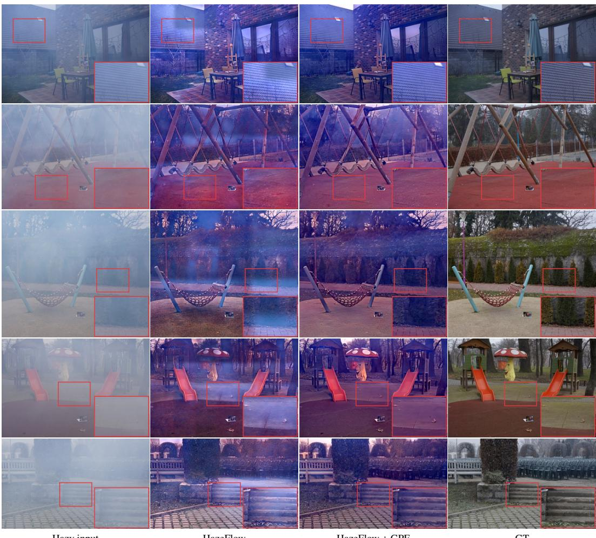  
Figure 6: Visual comparison of HazeFlow before and after applying GPF on O-HAZE. Rows show samples 03, 15, 17, 21, and 28, from top to bottom. Insets show matched crops.

## D ADDITIONAL QUALITATIVE RESULTS

This appendix extends the comparisons in Sec. 4.2 and the SDA visualization in Sec. 3.3. Full-image views across all four benchmarks show scene-wide color, illumination, and residual haze.

## D.1 FULL-IMAGE QUALITATIVE COMPARISONS

Figures 8–11 present 12 full-image comparisons, three per benchmark. Each example contains two rows of four images: hazy input, PTTD, DiffUIR, and Diff-Dehazer in the first row; DiffDehaze, HazeFlow, our method, and ground truth (GT) in the second. Sample IDs appear in the GT labels.

## D.2 SDA FEATURE VISUALIZATIONS

Figure 12 extends the visualization in Sec. 3.3 with eight NH-HAZE examples and two O-HAZE examples. Each pair shows the hazy RGB input on the left and the corresponding SDA feature visualization on the right, allowing the spatial structure of the learned representation to be inspected alongside the observed haze. The examples cover different scene structures and haze distributions, providing a broader view of the representation than the two examples in the main paper. Feature responses depend on both image content and degradation, so the maps are interpreted as learned restoration cues rather than calibrated measurements of physical haze density.

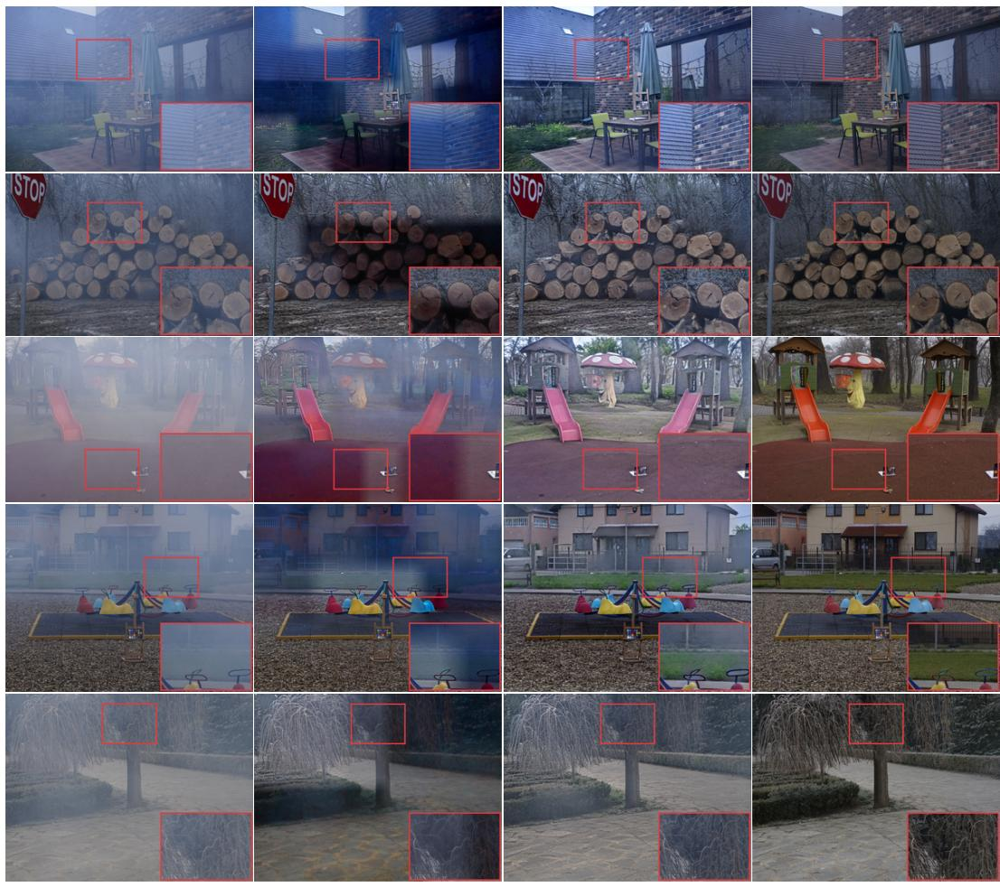  
Figure 7: Visual comparison of Diff-Dehazer before and after applying GPF on O-HAZE. Rows show samples 03, 07, 21, 24, and 33, from top to bottom. Insets show matched crops.

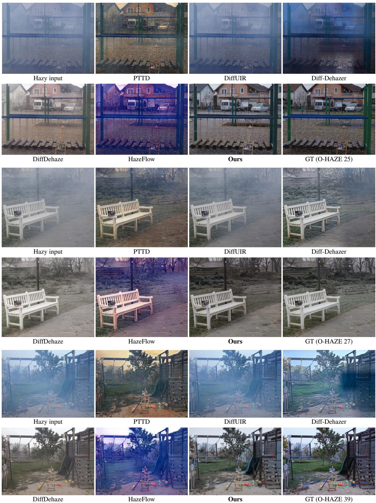  
Figure 8: Full-image qualitative comparisons on O-HAZE.

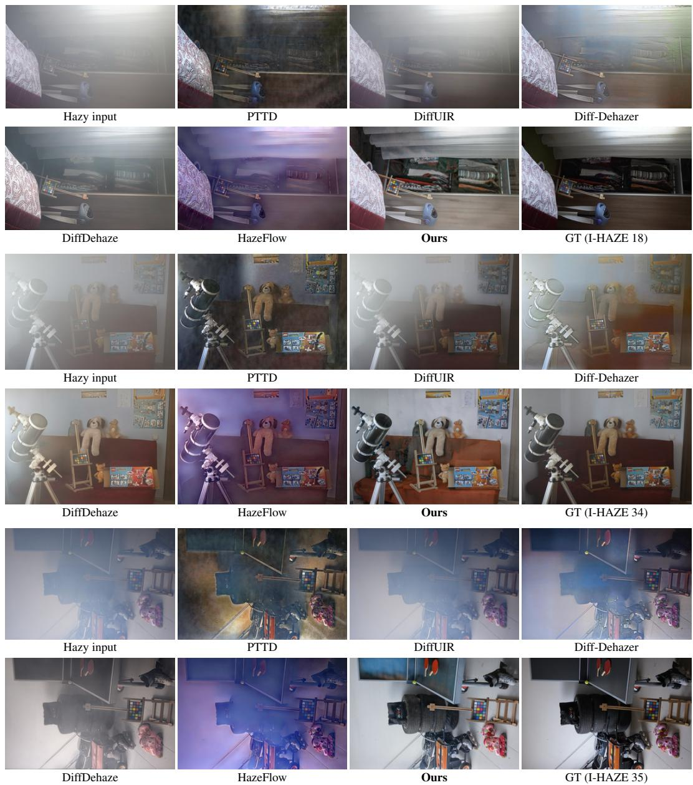  
Figure 9: Full-image qualitative comparisons on I-HAZE.

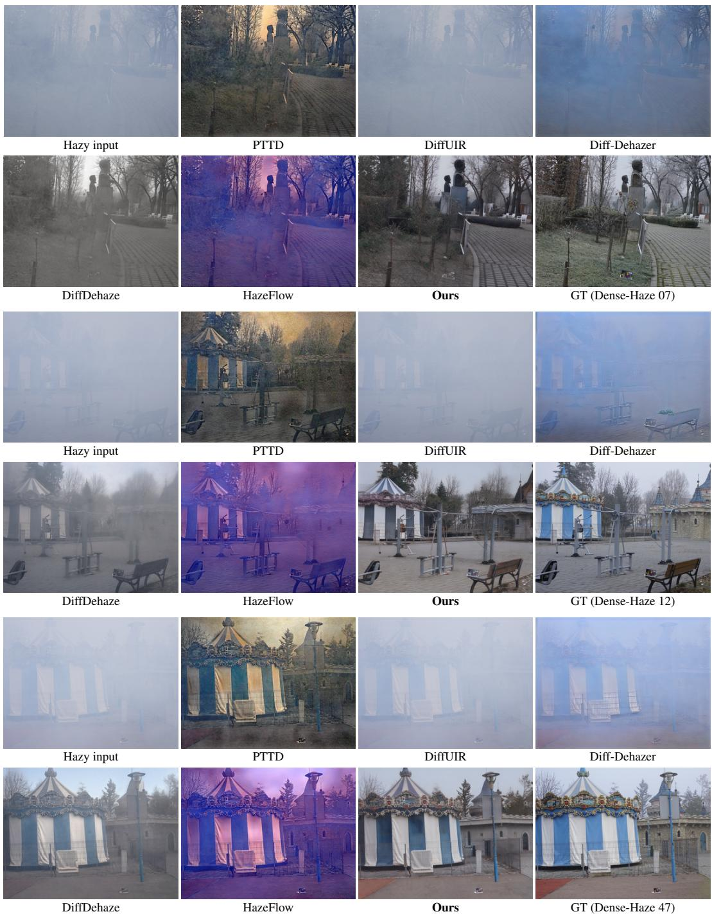  
Figure 10: Full-image qualitative comparisons on Dense-Haze.

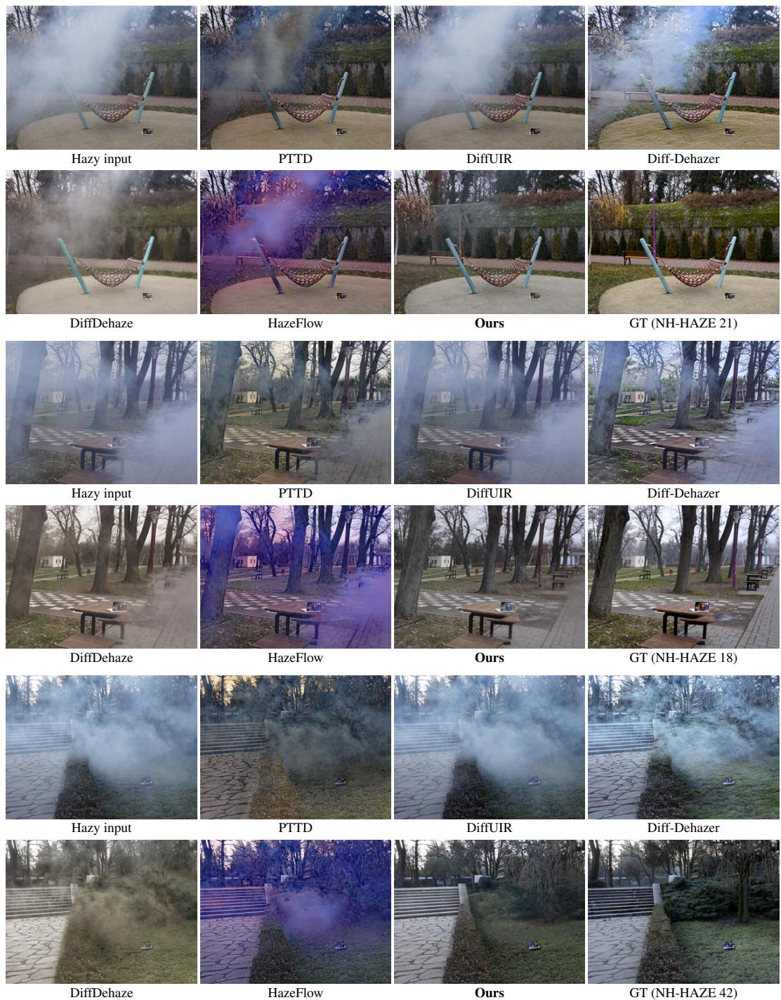  
Figure 11: Full-image qualitative comparisons on NH-HAZE.

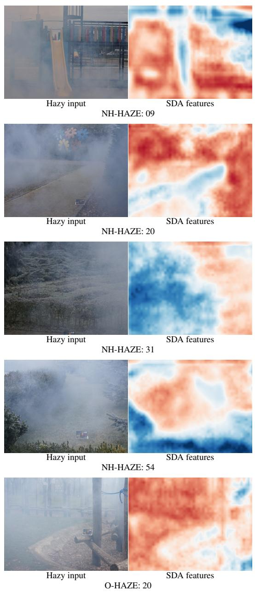

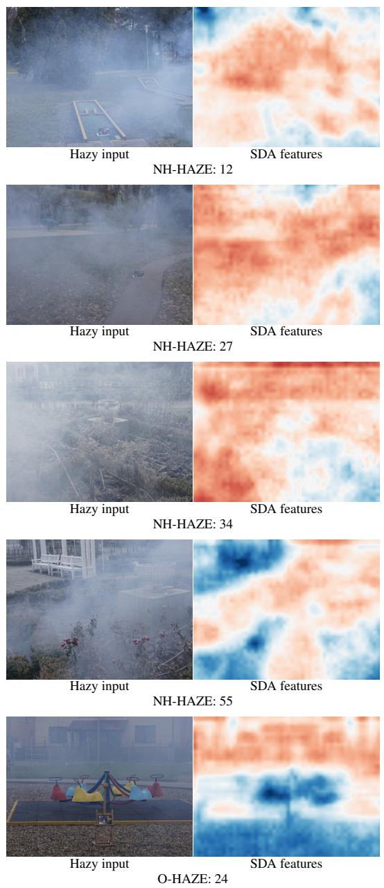  
Figure 12: SDA feature visualizations on NH-HAZE and O-HAZE. Each pair shows the hazy input (left) and the corresponding learned feature map (right).