# HORIA: 4D Human and Object Reconstruction from a Monocular Video with Interaction-Aware Re-Rendering

Hyeongjin Nam1 Taeryung Lee2 Daniel Sungho Jung2 Kyoung Mu Lee1,2

1Dept. of ECE&ASRI, 2IPAI, Seoul National University {namhjsnu28, trlee94, dqj5182, kyoungmu}@snu.ac.kr https://hygenie1228.github.io/HORIA/

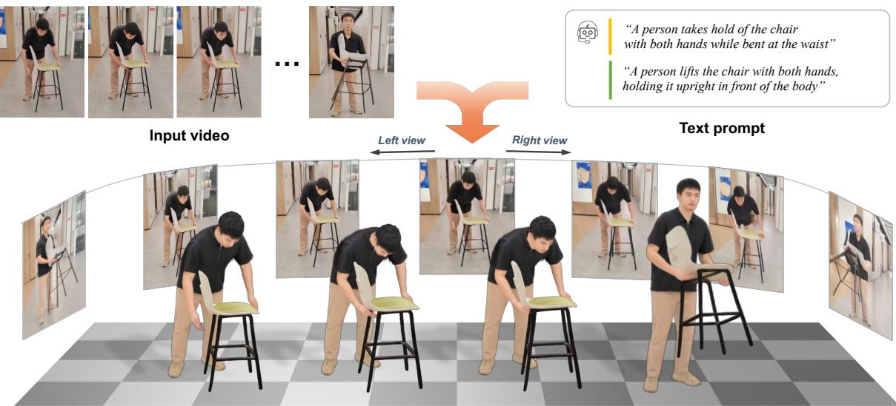  
Figure 1. HORIA. Given a monocular video, our framework reconstructs the 4D human and object with spatially and temporally consisten appearance, guided by the text descriptions of each interaction phase.

## Abstract

Joint 4D reconstruction of a human and object from a monocular video is essential for understanding how people interact with their environment. While recent methods have made noticeable progress, capturing such humanobject interactions remains difficult due to two main challenges. First, a video typically contains composite semantic context spanning multiple interaction phases, making it difficult to track the temporal changes of the interaction in the reconstruction. Second, under human-object occlusion, a single-view observation contains incomplete visual information about the interaction, resulting in geometrically inconsistent reconstructions. To address these challenges, we introduce HORIA, built upon two core designs. First, we decompose the entire input video into temporally grounded and semantically distinct interaction phases with motion-

aware captioning, obtaining a specific text description for each phase. Second, conditioned on these text descriptions ofthe interaction, we propose an interaction-aware rerendering that compensates for the limited single-view observation. Specifically, we render the initially reconstructed 4D human and object from novel viewpoints and refine the renderings with a text-to-video diffusion prior, which provides auxiliary novel-view supervision beyond single-view cues. As a result, our framework produces temporally coherent and accurate 4D reconstructions under diverse interaction scenarios, achieving state-of-the-art performance.

## 1. Introduction

Joint 4D reconstruction of a human and object from a monocular video has garnered significant attention in various applications such as robot manipulation, immersive

AR/VR experiences, and digital content creation. The human and object interact through not only physical relationships, such as contact between their surfaces, but also semantic relationships that characterize the functional intent of the interaction, such as reaching for a cup. Capturing both relationships of human-object interaction (HOI) is crucial for faithful 4D reconstruction.

While recent approaches [52, 54, 57–59] have shown notable progress, they still face two main challenges. First, existing methods struggle to capture the evolving semantic context of interactions over time. They rely primarily on local geometric proximity without considering the semantic context, which text descriptions [31] can incorporate into the reconstruction. However, a video typically spans multiple interaction phases, and summarizing the entire sequence into a single global description fails to capture which interaction applies at each moment. Second, a monocular observation misses the geometric cues of the occluded regions, where the human and object frequently obscure each other. This lack of geometric cues makes their spatial relationship difficult to reconstruct, often leading to severe interpenetration and temporally inconsistent results.

To address the above challenges, we present HORIA, a framework that reconstructs the 4D human and object from a monocular video through interaction-aware re-rendering. Our framework first splits the input video into several interaction phases and assigns a text description to each phase. This decomposition allows each description to capture the fine-grained temporal dynamics of its own phase. To decide where to decompose, we estimate the object motion and incorporate it into the captioning of human-object interactions, a process we refer to as motion-aware captioning. Based on each caption, we split the video into temporally grounded interaction phases with precise boundaries. Consequently, each text description is aligned with its corresponding interaction phase, providing reliable temporal guidance for accurate 4D reconstruction.

Building upon these grounded descriptions, we introduce an interaction-aware re-rendering pipeline that renders and refines novel-view videos of the reconstruction to compensate for limited single-view observations. Specifically, we render the initially reconstructed human and object from novel viewpoints and feed the renderings into a text-tovideo diffusion network [46]. Leveraging its prior knowledge of human-object interactions, the network refines them toward plausible interaction videos under the text description. During this refinement, we additionally apply distinct text prompts to the human and object regions, keeping the appearance of each region faithful to its own description and specifying where they interact. After the re-rendering process, we aggregate the refined novel-view videos into a single signed distance field (SDF), which serves as a geometric consensus across viewpoints. As shown in Fig. 2, our re-rendering process corrects the spatial misalignment between the hand and the umbrella, guiding the final reconstruction. As a result, our framework produces accurate and plausible 4D reconstructions of the human and object through re-rendering that compensates for the limited single-view observation.

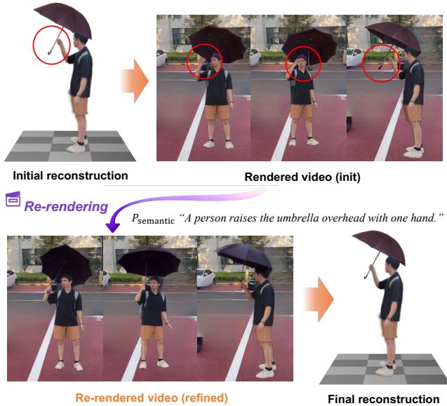  
Figure 2. Re-rendering for reconstruction. Conditioned on the text description Psemantic, our re-rendering refines the novel-view renderings of the initial reconstruction, and the refined videos serve as auxiliary supervision for the final 4D reconstruction.

Extensive experiments demonstrate that our framework significantly outperforms existing reconstruction methods across various interaction scenarios. Our contributions can be summarized as follows.

• We propose HORIA, a framework for joint 4D reconstruction of a human and object from a monocular video via temporally grounded novel-view video refinement.

• To capture fine-grained human-object interactions across the entire video sequence, we decompose the input video into several interaction phases with our proposed motionaware captioning.

• To compensate for limited single-view cues from the input video, we introduce an interaction-aware re-rendering pipeline that provides auxiliary novel-view supervision for accurate 4D human and object reconstruction.

## 2. Related works

Human and object reconstruction. Most recent works on human and object reconstruction [6, 7, 11, 15, 24, 30, 51– 59, 63] reconstruct the 3D human and object from a single image or monocular video, relying on geometric constraints, such as contact maps. CONTHO [30] jointly predicts dense contact maps from images and refines the reconstruction using a contact-based Transformer [45]. Vis-

Tracker [54] exploits the correlation between human and object motion, predicting the object pose of occluded frames from the human motion and the neighboring visible frames. RHINO [59] jointly recovers the human, object, and scene from a monocular video, and refines their poses with contact-driven optimization. CARI4D [57] proposes a render-and-compare network that aligns rendered estimates with input observations to enhance reconstructions.

Unlike existing 4D human and object reconstruction methods, our framework has two key differences. First, prior works rely primarily on local geometric priors, such as contact maps, which cannot represent the semantic context of the interaction. Our framework uses text descriptions that carry the semantic context, assigning a description to each interaction phase through video decomposition. This enables the reconstruction to reflect the complex interactions of the real world. Second, whereas previous methods reconstruct the human and object from a single viewpoint that suffers from human-object occlusion, our framework refines the novel-view renderings of the reconstruction via interaction-aware re-rendering. This re-rendering process supplements the occluded regions and serves as auxiliary supervision for accurate reconstruction.

Video decomposition. Video decomposition methods localize the segment of an input video that semantically corresponds to a text query [4, 13, 14, 23, 25, 29, 39, 47, 62, 64]. TALL [13] introduces a cross-modal temporal regression method to predict temporal action boundaries aligned with a text query. TimeLens [62] adapts pretrained multimodal large language models [1] with interleaved timestamp encoding and reinforcement learning for precise temporal grounding. FMimic [4] decomposes a video into humanobject interaction states using contact distance thresholds for robotic imitation learning. Different from FMimic, our video decomposition takes a coarse-to-fine strategy that detects initial segment boundaries from object trajectories and refines them into precise interaction phase boundaries using TimeLens [62]. This aligns each text description with the interval it describes, providing accurate boundaries of interaction phases for 4D human and object reconstruction.

Generative priors for reconstruction. Recently, various reconstruction methods [9, 16, 18, 27, 31, 36, 42– 44, 48, 60] have leveraged generative priors (e.g., text-toimage generation [40]) to supplement the information missing from a single-view observation of the input image or video. NeRDi [9] reconstructs a 3D object from a single image by minimizing a diffusion loss on its novel-view renderings with a text caption. Vivid4D [16] reconstructs a 4D dynamic scene from a monocular video, warping the video’s pixels into novel viewpoints and completing the occlusions with a video inpainting model. TeHOR [31] jointly reconstructs a 3D human and object by distilling a diffusion prior conditioned on text descriptions that contain the semantic context of the interaction. Most of these methods leverage the distillation strategy [35], which computes text-conditioned score gradients on the renderings and drives them toward the distribution of the diffusion prior. However, the score gradients provide an over-smoothed signal [49], which degrades the reconstruction quality. In contrast, our re-rendering refines the novel-view renderings, which serve as supervision targets, providing clear interaction cues for accurate 4D reconstruction.

## 3. HORIA

Figs. 3 and 4 illustrate the overall pipeline of HORIA. We first describe the 4D representation of the human and object (Sec. 3.1). Subsequently, we describe three stages: video decomposition (Sec. 3.2), interaction-aware re-rendering (Sec. 3.3), and 4D HOI optimization (Sec. 3.4).

## 3.1. 4D representation

Given a monocular video X of $T$ frames, we reconstruct the motion of the human body and the rigid object over the entire sequence. We represent the human and object as sets of 3D Gaussians [21], denoted by $\{ \Phi _ { \mathrm { h } , t } \} _ { t = 1 } ^ { T }$ and $\{ \Phi _ { 0 , t } \} _ { t = 1 } ^ { T } ,$ which can be rendered into 2D space through a differentiable rasterizer [61]. Each Gaussian is anchored to a surface point of its base mesh, which allows the Gaussians to be converted into meshes [31].

Human representation. We represent the human with the SMPL-X model [33], parameterized by the human pose θ, shape $\beta ,$ and translation γ. We attach a set of 3D Gaussians $\Phi _ { \mathrm { h } }$ to the canonical SMPL-X mesh. These Gaussians are deformed via linear blend skinning with θ [28].

Object representation. We represent the rigid object with a set of 3D Gaussians $\Phi _ { \mathrm { o } }$ defined in a canonical space. These canonical Gaussians are then transformed into 3D space via a similarity transformation parameterized by rotation $R ,$ translation $\tau _ { \ast }$ and scale s.

Temporal parameterization. We parameterize the motion of both the human and object using a cubic B-spline [8], a polynomial curve determined by a set of coefficients defined at sparse time intervals. Unlike independent per-frame pose parameters, the B-spline assigns shared coefficients to neighboring frames, yielding smooth motion. Specifically, we define the concatenated motion sequence of the human and object as $\Psi = [ \theta _ { t } , \gamma _ { t } , R _ { t } , \mathcal { T } _ { t } ] _ { t = 1 } ^ { T } \stackrel { \cdot } { \in } \mathbb { R } ^ { T \times D }$ and formulate it as $\Psi = \mathbf { B } \mathbf { C }$ . B $\mathbf { \Psi } _ { \mathbf { k } } \in \mathbb { R } ^ { T \times N }$ is a B-spline basis matrix, and $\mathbf { C } \in \mathbb { R } ^ { N \times D }$ is a coefficient matrix, where N is the number of coefficients and D is the dimension of the motion parameters. All rotations use the continuous 6D rotation representation [65].

## 3.2. Video decomposition

We decompose the input video into interaction phases by identifying boundaries where the interaction changes based on the human and object motions. Our video decomposition takes a coarse-to-fine strategy: we first detect coarse boundaries from the object trajectory, caption each coarse segment, and then refine the boundaries by grounding each caption in the video. Before the video decomposition, we independently extract the initial motions of the human and object using Multi-HMR [2] and FoundationPose [50] respectively. These initial motions serve as physical cues for tracking changes in the relative distance between the human and object over time.

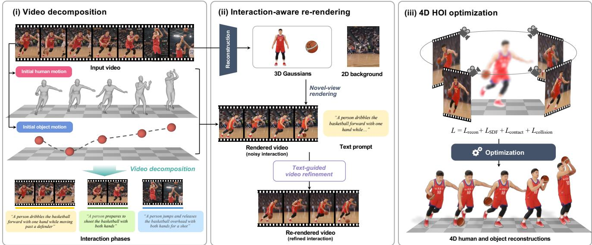  
Figure 3. Overall pipeline of HORIA. Given an input video, our framework first decomposes it into interaction phases based on initially estimated human and object motion. Then, the text description of each phase guides the re-rendering of the human and object under nove viewpoints and provides auxiliary supervision for 4D HOI optimization.

Coarse boundary detection. Based on the initial motion estimations, we first detect coarse boundaries where the object trajectory changes sharply. To this end, we simplify the object trajectory using the Ramer-Douglas-Peucker (RDP) algorithm [10]. RDP is a curve simplification method that finds coarse boundaries where the trajectory departs sharply from the overall path. Such a sharp change in the object trajectory typically coincides with a change in the interaction, such as the object being picked up, carried, or put down.

Motion-aware captioning. From each coarse segment, we extract two text prompts, $P _ { \mathrm { s e m a n t i c } }$ and $P _ { \mathrm { c o n t a c t } } . \ P _ { \mathrm { s e m a n t i c } }$ captures the global context of the interaction phase, providing detailed descriptions of human appearance, object category, and their interaction type. $P _ { \mathrm { c o n t a c t } }$ specifies the human body parts in physical contact with the object during that interval. These prompts are acquired using a vision-language model (VLM) [32] from five uniformly sampled frames of each coarse segment. To incorporate 3D human-object distance information in the captioning, we measure the 3D distance between the object and several human parts (e.g., head and hands). Then, we state whether the object moves closer, moves away, or stays unchanged relative to each part from the start to the end of the segment, and provide this information as additional input to the VLM. Details are provided in the supplementary material.

Fine boundary grounding. Based on the coarse segments and their text descriptions, we refine the coarse boundaries into precise temporal spans using a temporal grounding model, TimeLens [62]. Specifically, we query TimeLens with each caption across the full video timeline to accurately localize the visual extent of each interaction. If predicted intervals overlap, we merge them into a single continuous segment. The resulting segment intervals serve as the final interaction phases used for the re-rendering stage.

## 3.3. Interaction-aware re-rendering

For each interaction phase, we render the 3D human and object Gaussians from fixed novel viewpoints and refine the renderings with a text-to-video diffusion network [46]. To this end, we reconstruct the canonical human Gaussians $\Phi _ { \mathrm { h } }$ using LHM [37] and the base object Gaussians $\Phi _ { \mathrm { o } }$ using SAM 3D [5], respectively. We also build a 2D background by removing the human and object from the first frame using SmartEraser [19].

Novel-view rendering and refinement. For each novelview camera π, sampled at $3 0 ^ { \circ }$ azimuth intervals, we render the RGB appearance of the posed human and object Gaussians onto the 2D background to obtain a novel-view video $X _ { \pi }$ , and project the SMPL-X joints from the same viewpoint to obtain a skeleton video $S _ { \pi }$ . We encode $X _ { \pi }$ and inject noise to an initial noise level τ to obtain $X _ { \tau _ { 0 } , \pi }$ , where the sampling process starts from the rendered appearance.

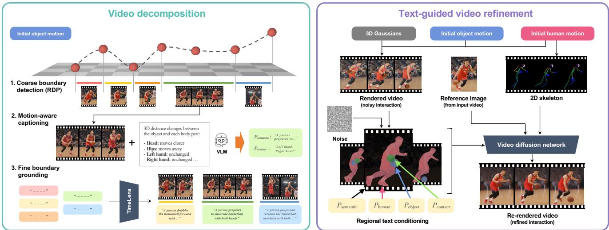  
Figure 4. Detailed process of video decomposition (left) and text-guided video refinement (right).

Conditioned on the semantic prompt $P _ { \mathrm { s e m a n t i c } }$ and a reference image $X _ { \mathrm { r e f } } ,$ which is the first frame of the interaction phase, we refine $X _ { \tau _ { 0 } , \pi }$ into

$$
X _ { \pi } ^ { * } = f _ { \psi } \left( X _ { \tau _ { 0 } , \pi } ; P _ { \mathrm { s e m a n t i c } } , S _ { \pi } , X _ { \mathrm { r e f } } \right)\tag{1}
$$

where $f _ { \psi }$ denotes a stochastic sampling process [26] built on a pretrained video diffusion network [46]. Using the prior knowledge of the diffusion network learned from large-scale video data, the stochastic sampling effectively corrects artifacts associated with implausible human-object interactions.

Regional text conditioning. To explicitly guide the human and object regions during the refinement, we condition each region on its own text prompt: $P _ { \mathrm { h u m a n } }$ for the human mask $M _ { \mathrm { h u m a n } }$ and $P _ { \mathrm { o b j e c t } }$ for the object mask $M _ { \mathrm { o b j e c t } }$ The masks are obtained by rendering the human and object Gaussians separately. $P _ { \mathrm { h u m a n } }$ and $P _ { \mathrm { o b j e c t } }$ are extracted from the semantic prompt $P _ { \mathrm { s e m a n t i c } }$ , and the extraction details are provided in the supplementary material. To capture the contact region, we draw a circular region around the joints of $S _ { \pi }$ specified by $P _ { \mathrm { c o n t a c t } }$ and merge it into the object mask $M _ { \mathrm { o b j e c t } }$ . Within every cross-attention layer of the sampling process in Eq. (1), we blend each region’s prompt into the base prompt $P _ { \mathrm { s e m a n t i c } }$ as follows:

$$
\begin{array} { r l r } { \mathrm { A t t n } ^ { \prime } ( X _ { \tau , \pi } ) } & { = } & { \mathrm { ( 1 - \lambda \lambda \it M _ { \mathrm { u n i o n } } ) \mathrm { A t t n } ( X _ { \tau , \pi } ; P _ { \mathrm { s e m a n t i c } } ) } } \\ & { } & { \mathrm { ~ \ ~ \ } + \lambda \sum _ { r } \it M _ { r } \mathrm { A t t n } ( X _ { \tau , \pi } ; P _ { r } ) , } \end{array}\tag{2}
$$

where $r \_ { \mathrm { ~ \scriptsize ~ \in ~ } }$ {human, object} indexes the two regions, $M _ { \mathrm { u n i o n } } = M _ { \mathrm { h u m a n } } \cup M _ { \mathrm { o b j e c t } }$ is the union of their masks, and $\lambda = 0 . 2$ is a blend weight. This regional conditioning prevents semantic interference between the human and object while preserving their interaction.

## 3.4. 4D HOI optimization

Based on the re-rendered novel-view videos, we jointly optimize the motion sequence Ψ to recover the accurate 4D human and object. The overall loss formulation is

$$
\mathcal { L } = \mathcal { L } _ { \mathrm { r e c o n } } + \mathcal { L } _ { \mathrm { S D F } } + \mathcal { L } _ { \mathrm { c o n t a c t } } + \mathcal { L } _ { \mathrm { c o l l i s i o n } } ,\tag{3}
$$

where $\mathcal { L } _ { \mathrm { c o l l i s i o n } }$ is a penalization term that discourages interpenetration between the human and object Gaussians, following [20]. The remaining terms are detailed below.

Reconstruction loss. The reconstruction loss $\scriptstyle { \mathcal { L } } _ { \mathrm { r e c o n } }$ measures the discrepancy between the rendered human and object sequence and two types of target videos: the input video X and the re-rendered novel-view videos $X _ { \pi } ^ { * }$ . Specifically, it computes the mean squared error (MSE) on both RGB pixel values and foreground silhouette masks across all camera viewpoints.

SDF loss. The signed distance function (SDF) loss $\mathcal { L } _ { \mathrm { S D F } }$ enforces geometric consistency by aggregating the novelview evidence into a single 3D point cloud for each frame. As the novel-view re-rendering operates on each viewpoint independently, relying solely on ${ \mathcal { L } } _ { \mathrm { r e c o n } }$ can result in inconsistent visual cues across views. To resolve this problem, we construct a unified 3D geometric consensus across all viewpoints via an SDF. Specifically, we extract object segmentation masks [38] and metric depth maps [34] from each re-rendered video $X _ { \pi } ^ { * }$ and unproject the masked depth maps into 3D point clouds across all views. We then aggregate the point clouds and remove outliers via DBSCAN clustering [12], suppressing noisy points inconsistent with the majority of views. From the point cloud, we build a distance field and align the object Gaussians with the field. We apply this loss to the object Gaussians only.

Contact loss. The contact loss ${ \mathcal { L } } _ { \mathrm { { c o n t a c t } } }$ encourages geometric proximity between the object surface and the human body parts specified in $P _ { \mathrm { c o n t a c t } } .$ . We identify the Gaussian centers on the SMPL-X body model corresponding to these parts and minimize the distance between them and their nearest object points. This loss enforces local physical plausibility across the estimated interaction regions.

<table><tr><td>Caption</td><td>Decomposition</td><td>CDH↓</td><td>CD0↓</td><td>Contact↑</td><td>Collision↓</td><td>AccelH↓</td><td>Accelo↓</td></tr><tr><td>x</td><td>x</td><td>5.723</td><td>54.505</td><td>0.349</td><td>0.072</td><td>0.307</td><td>3.468</td></tr><tr><td>Standard</td><td>x</td><td>5.500</td><td>51.155</td><td>0.391</td><td>0.059</td><td>0.291</td><td>3.129</td></tr><tr><td>Motion-aware</td><td>x</td><td>5.511</td><td>42.102</td><td>0.408</td><td>0.060</td><td>0.294</td><td>3.210</td></tr><tr><td>Motion-aware</td><td>Uniform</td><td>5.404</td><td>37.121</td><td>0.469</td><td>0.056</td><td>0.298</td><td>2.986</td></tr><tr><td>Motion-aware (Ours)</td><td>Grounded</td><td>5.385</td><td>34.894</td><td>0.520</td><td>0.056</td><td>0.273</td><td>1.571</td></tr></table>

Table 1. Effect of video decomposition.

<table><tr><td>Re-rendering</td><td>Regional cond.</td><td>CDH↓</td><td>CDo↓</td><td>Contact↑</td><td>Collision.↓</td><td>AccelH↓</td><td>Accelo↓</td></tr><tr><td>x</td><td>x</td><td>6.009</td><td>66.138</td><td>0.300</td><td>0.064</td><td>0.308</td><td>3.115</td></tr><tr><td>√</td><td>x</td><td>5.519</td><td>36.151</td><td>0.499</td><td>0.058</td><td>0.290</td><td>1.614</td></tr><tr><td>√ (Ours)</td><td>√</td><td>5.385</td><td>34.894</td><td>0.520</td><td>0.056</td><td>0.273</td><td>1.571</td></tr></table>

Table 2. Effect of re-rendering.

<table><tr><td>Methods</td><td> $\mathrm { C D } _ { \mathrm { H } \downarrow }$ </td><td>CD0↓</td><td>Contact↑</td><td>Collision.↓</td><td>AccelH↓</td><td>Accelo↓</td></tr><tr><td>Initial reconstruction</td><td>5.821</td><td>88.508</td><td>0.275</td><td>0.069</td><td>0.334</td><td>20.034</td></tr><tr><td>w/o LSDF</td><td>5.706</td><td>48.121</td><td>0.354</td><td>0.063</td><td>0.291</td><td>2.410</td></tr><tr><td>w/o Lcontact</td><td>5.418</td><td>40.162</td><td>0.459</td><td>0.057</td><td>0.288</td><td>1.709</td></tr><tr><td>w/o Ccollision</td><td>5.390</td><td>38.945</td><td>0.512</td><td>0.061</td><td>0.277</td><td>1.602</td></tr><tr><td>HORIA (Ours)</td><td>5.385</td><td>34.894</td><td>0.520</td><td>0.056</td><td>0.273</td><td>1.571</td></tr></table>

Table 3. Ablation on 4D HOI optimization.

## 4. Experiments

## 4.1. Datasets

We use Open4DHOI [52] and BEHAVE [3] for our experiments. Open4DHOI is an open-vocabulary, in-the-wild human-object interaction dataset spanning a wide range of object categories. From the whole set, we curate a test set of 210 sequences, spanning diverse interactions. BEHAVE is an indoor interaction dataset that captures the interactions of 8 human subjects and 20 objects in a controlled setting. We use its official test split, consisting of 340 sequences.

## 4.2. Evaluation metrics

For all evaluations, we align the reconstruction to the ground truth (GT) per frame by translating the human root. Chamfer distance $( { \bf C D _ { H } } , { \bf C D _ { 0 } } )$ . We measure the Chamfer distance between the reconstructed human and object surfaces and their corresponding GT. The Chamfer distance is separately computed for the human $\textstyle ( \mathbf { C D } _ { \mathrm { H } } )$ and object $\left( \mathrm { C D } _ { 0 } \right)$ in centimeters.

Contact score (Contact). We evaluate contact fidelity by comparing the contact regions of the reconstructed human and object against the GT. We define the contact map as the human vertices of the SMPL-X mesh surface [33] within

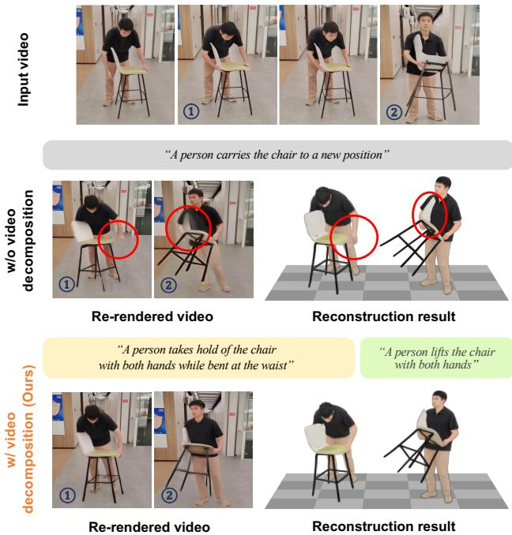  
Figure 5. Effectiveness of video decomposition. A single description of the entire video does not distinguish the interaction phases, resulting in implausible re-rendering and reconstruction. Our decomposition assigns a description to each phase, guiding the re-rendering to follow the interaction at each moment.

5 cm of the object surface. The contact score (Contact) is computed as the harmonic mean of precision and recall between the predicted and GT human contact maps.

Collision ratio (Collision). To evaluate physical plausibility, we measure the interpenetration between the reconstructed human and object surfaces. The collision ratio (Collision) is the percentage of human vertices located within the object mesh.

Acceleration error $( \mathbf { A c c e l _ { H } } , \mathbf { A c c e l _ { O } } )$ . To evaluate the temporal consistency of the reconstructed 4D motion, we measure the difference between the predicted and GT acceleration. Accel is computed over the 14 body joints of the SMPL-X model, and Accel over the 3D object center.

## 4.3. Ablation study

We carry out all ablation studies on Open4DHOI [52].

Effectiveness of video decomposition. Tab. 1 and Fig. 5 show the effectiveness of our video decomposition with motion-aware captioning. The first to third rows of Tab. 1 compare different captioning strategies, where standard captioning describes the interaction from the input video alone without object motion. Using text captions (the second row) largely improves over no captioning (the first row) by providing semantic priors, and our motion-aware captioning (the third row) further improves the reconstruction by capturing dynamic movements from the object motion.

<table><tr><td rowspan="2"></td><td colspan="6">Open4DHOI [52]</td><td colspan="6">BEHAVE [3]</td></tr><tr><td>Methods</td><td> $\mathrm { C D } _ { \mathrm { H } \downarrow }$ </td><td> $\mathrm { C D } _ { \mathrm { O } \downarrow }$ </td><td>Contact↑</td><td>Collision.↓</td><td>AccelH↓</td><td>Accelo↓</td><td> $\mathrm { C D } _ { \mathrm { H } \downarrow }$ </td><td> $\mathrm { C D } _ { \mathrm { O } \downarrow }$ </td><td>Contact↑</td><td>Collision↓</td><td>AccelH↓ Accelo↓</td></tr><tr><td>PHOSA [63]</td><td></td><td>6.434</td><td>61.138 0.267</td><td>0.061</td><td>一</td><td>一</td><td>5.661</td><td>40.355</td><td>0.326</td><td>0.099</td><td>一</td><td>-</td></tr><tr><td>Imaq-ased</td><td>HOI-Gaussian [51]</td><td>5.330</td><td>47.086 0.382</td><td>0.072</td><td>一</td><td>一</td><td>3.420</td><td>39.722</td><td>0.521</td><td>0.097</td><td>一</td><td>一</td></tr><tr><td>TeHOR [31]</td><td></td><td>5.501</td><td>44.397 0.456</td><td>0.070</td><td>一</td><td>一</td><td>3.627</td><td>31.168</td><td>0.552</td><td>0.099</td><td></td><td>一</td></tr><tr><td rowspan="4">Vidd-bsed</td><td>HORIA (Ours)</td><td>5.380</td><td>37.268</td><td>0.501</td><td>0.056 一</td><td>一</td><td>3.512</td><td>13.013</td><td>0.569</td><td>0.080</td><td>一</td><td>-</td></tr><tr><td>VisTracker [54]</td><td>6.392</td><td>51.289 0.383</td><td>0.152</td><td>0.459</td><td>2.197</td><td>6.049</td><td>16.664</td><td>0.464</td><td>0.108</td><td>1.553</td><td>1.336</td></tr><tr><td>InterTrack [56]</td><td>7.143</td><td>49.110</td><td>0.482</td><td>0.218</td><td>2.534 5.996</td><td>9.487</td><td>19.441</td><td>0.560</td><td>0.268</td><td>2.258</td><td>5.427</td></tr><tr><td>CARI4D [57]</td><td>5.740</td><td>39.090</td><td>0.514</td><td>0.182</td><td>0.710</td><td>2.332</td><td>3.582 14.213</td><td>0.583</td><td>0.130</td><td>0.990</td><td>1.148</td></tr><tr><td>HORIA (Ours)</td><td></td><td>5.385</td><td>34.894 0.520</td><td></td><td>0.056 0.273</td><td>1.571</td><td>3.341</td><td>12.932</td><td>0.592</td><td>0.075</td><td>0.312</td><td>0.981</td></tr></table>

Table 4. Quantitative comparison with state-of-the-art methods on Open4DHOI [52] and BEHAVE [3]. Bold and underlined values indicate the best and second-best scores, respectively.

The third to fifth rows compare different decomposition strategies, where uniform decomposition splits the video into fixed 81-frame intervals. A single global description (the third row) misses fine-grained interaction details, and uniform segments (the fourth row) often mix multiple interaction phases, yielding ambiguous text captions. In contrast, our grounded decomposition (the fifth row) localizes the boundaries of each interaction phase, providing clear textual guidance that achieves the best results. As shown in Fig. 5, a single description of the entire video fails to distinguish holding the chair from lifting it, causing wrong reconstruction, whereas our decomposition guides the rerendering to follow each interaction phase.

Effectiveness of interaction-aware re-rendering. Tab. 2 shows the impact of our novel-view re-rendering pipeline and its text conditioning strategies. Without novel-view rerendering (the first row), reconstructing solely from monocular observations suffers from depth ambiguities, leading to wrong reconstruction. In contrast, using re-rendering (the second row) provides multi-view supervision to mitigate depth ambiguities. Furthermore, our regional text conditioning (the third row) guides the human and object with separate prompts, ensuring clear boundaries between them. More qualitative re-rendering results, as in Fig. 2, are provided in the supplementary material.

As described in Sec. 3.3, the re-rendering operates on each viewpoint independently, which may cause cross-view inconsistency between the re-rendered videos. To prevent the inconsistency, our framework has three core designs. First, the SDF loss $\mathcal { L } _ { \mathrm { S D F } }$ in 4D HOI optimization aggregates all viewpoints into a single target (i.e., SDF), which optimizes the object toward a geometric consensus across viewpoints. Second, the re-rendering process is conditioned on the human skeleton (Eq. (1)) projected from the same 4D human motion, which constrains the human-object interaction in every viewpoint to follow the underlying motion. Third, the re-rendering runs on each short interaction phase obtained by the video decomposition, which alleviates the accumulation of cross-view discrepancies. For a long video, each autoregressively generated view gradually deviates from the content generated in the other views, causing cross-view discrepancies. Our framework reduces such discrepancies by re-rendering the short interaction phases obtained from the video decomposition.

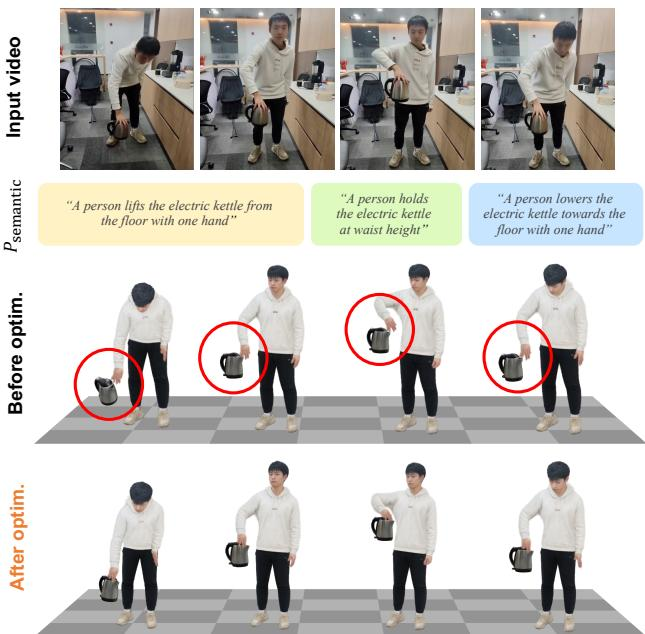  
Figure 6. Effectiveness of 4D HOI optimization. For each interaction phase described with $P _ { \mathrm { s e m a n t i c } } .$ , our 4D HOI optimization corrects the artifacts (red circles) in the initial reconstructions, yielding accurate reconstruction results.

Ablation on 4D HOI optimization. Fig. 6 and Tab. 3 show that our 4D HOI optimization effectively refines initial reconstructions using the re-rendered videos guided by the text descriptions. As shown in Fig. 6, the initial reconstruction in the first row of Tab. 3 suffers from depth ambiguity and implausible artifacts. Our 4D HOI optimization resolves these artifacts and yields temporally consistent motion by integrating auxiliary evidence from multiview re-rendering in Sec. 3.3. The second row shows that removing the SDF loss $\mathcal { L } _ { \mathrm { S D F } }$ largely degrades the object reconstruction. Without $\mathcal { L } _ { \mathrm { S D F } }$ , the re-rendered videos supervise the reconstruction only through ${ \mathcal { L } } _ { \mathrm { r e c o n } } .$ which compares the rendering with each view independently and cannot resolve the inconsistencies across views. L aggregates all viewpoints into a single 3D geometric consensus, guiding the object toward a geometry consistent across views. The third row shows that the contact loss ${ \mathcal { L } } _ { \mathrm { c o n t a c t } }$ brings the human and object into physical contact, improving the contact score by a large margin. The fourth row shows that the collision loss $\mathcal { L } _ { \mathrm { c o l l i s i o n } }$ suppresses human-object interpenetration.

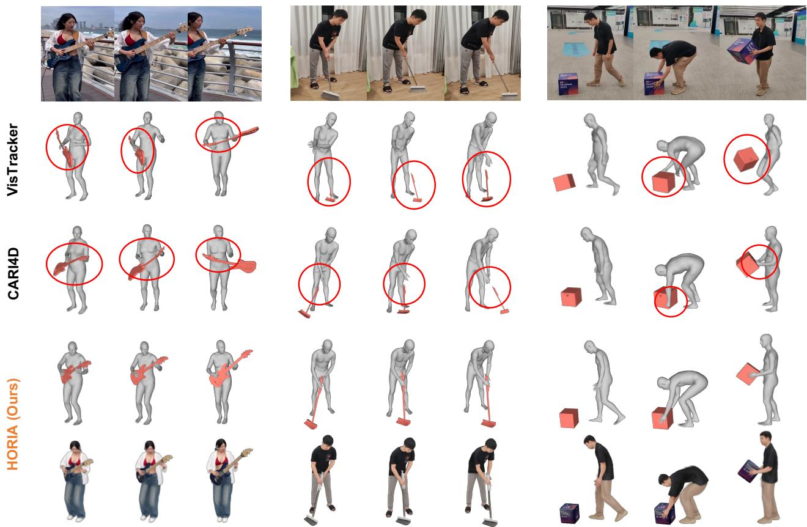  
Figure 7. Qualitative comparison with state-of-the-art methods. We render each method’s reconstruction at −30 azimuth and highlight representative failure cases with red circles.

## 4.4. Comparison with state-of-the-art methods

We compare our framework with state-of-the-art reconstruction methods, categorized into image-based and videobased approaches. Since the image-based methods optimize each frame independently, evaluating them on the full video is computationally expensive. We thus evaluate the imagebased methods on key frames sampled at 1 fps, and report $\mathbf { A c c e l _ { H } }$ and Accel only for the video-based methods.

Tab. 4 and Fig. 7 demonstrate that our framework outperforms all baselines both quantitatively and qualitatively on Open4DHOI [52] and BEHAVE [3]. Previous video-based methods frequently misplace the object relative to the hand or body during interaction, since they heavily rely on geometric constraints without semantic understanding of the interaction. Unlike these methods, HORIA leverages the text description of each interaction phase to capture the semantic context of the interaction. Moreover, our interactionaware re-rendering provides novel-view supervision, and the SDF loss enforces geometric consistency across these viewpoints, achieving the best performance.

## 5. Conclusion

We present HORIA, a framework for joint 4D reconstruction of a human and object from a monocular video. Our framework decomposes the input video into several interaction phases and assigns a text description to each phase to capture fine-grained human-object interactions. Guided by the text descriptions, our re-rendering refines the novelview renderings of the reconstruction to compensate for limited single-view observations. Extensive experiments show that HORIA achieves state-of-the-art performance.

# HORIA: 4D Human and Object Reconstruction from a Monocular Video with Interaction-Aware Re-Rendering

Supplementary Material

In this supplementary material, we present additional technical details and more experimental results that could not be included in the main manuscript due to the lack of pages. The contents are summarized below:

• S1. Visualization in video format

• S2. Comparison on InterCap dataset

• S3. Implementation details

• S4. Comparison of running time

• S5. Limitations and future work

• S6. More comparisons with state-of-the-art methods

## S1. Visualization in video format

The supplementary video "HORIA Suppl.mp4" consists of four parts. The first part provides an overview of our framework on a single example, showing how the video decomposition, interaction-aware re-rendering, and 4D HOI optimization proceed in sequence. The second and third parts show qualitative results of the video decomposition and interaction-aware re-rendering, respectively. The last part compares HORIA with state-of-the-art reconstruction methods, VisTracker [54] and CARI4D [57], rendering each reconstruction as a video at $- 3 0 ^ { \circ }$ azimuth.

## S2. Comparison on InterCap

Tab. S1 shows that HORIA also outperforms existing reconstruction methods on the InterCap [17] dataset. Similar to BEHAVE [3], InterCap is an indoor human-object interaction dataset that captures 10 subjects interacting with 10 rigid objects, including whole-body motion with the hands. We use its official test split, consisting of 240 sequences, for evaluation. Compared to both image-based and videobased methods, HORIA achieves more accurate reconstruction with fewer interpenetrations.

## S3. Implementation details

We provide the implementation details of three stages: video decomposition (Sec. 3.2), interaction-aware rerendering (Sec. 3.3), and 4D HOI optimization (Sec. 3.4).

## S3.1. Video decomposition

Coarse boundary detection. To detect initial segment boundaries where the object trajectory changes sharply, we apply the RDP algorithm [10] to the relative trajectory between the object and human root. Before running RDP, we smooth this relative trajectory using a moving average filter with a window size of 5 frames to remove the estimation noise of the initial object motion. The RDP algorithm then splits the video where this relative trajectory deviates by more than 10 cm from the simplified linear trajectory. To prevent overly short segments, we set the minimum length of each split segment to 15 frames.

<table><tr><td>Methods</td><td>CDH↓</td><td>CD0↓</td><td>Contact↑</td><td>Collision↓</td><td>AccelH↓</td><td>Accelo↓</td></tr><tr><td>PHOSA [63]</td><td>4.622</td><td>42.161</td><td>0.375</td><td>0.079</td><td>1</td><td></td></tr><tr><td>Inma-ased HOI-Gaussian [51]</td><td>2.891</td><td>39.542</td><td>0.509</td><td>0.080</td><td></td><td></td></tr><tr><td>TeHOR [31]</td><td>2.528</td><td>32.160</td><td>0.513</td><td>0.073</td><td></td><td></td></tr><tr><td>HORIA (Init.)</td><td>2.705</td><td>63.394</td><td>0.406</td><td>0.098</td><td></td><td></td></tr><tr><td>HORIA (Ours)</td><td>2.524</td><td>14.951</td><td>0.543</td><td>0.069</td><td></td><td></td></tr><tr><td>VisTracker [54]</td><td>6.152</td><td>23.257</td><td>0.405</td><td>0.105</td><td>1.216</td><td>2.781</td></tr><tr><td>Vid-bsed InterTrack [56]</td><td>10.019</td><td>20.959</td><td>0.487</td><td>0.218</td><td>1.985</td><td>4.104</td></tr><tr><td>CARI4D [57]</td><td>2.415</td><td>16.741</td><td>0.516</td><td>0.084</td><td>1.047</td><td>2.129</td></tr><tr><td>HORIA (Init.)</td><td>2.728</td><td>62.777</td><td>0.402</td><td>0.101</td><td>0.825</td><td>21.712</td></tr><tr><td>HORIA (Ours)</td><td>2.501</td><td>14.551</td><td>0.539</td><td>0.069</td><td>0.300</td><td>0.942</td></tr></table>

Table S1. Quantitative comparison with state-of-the-art methods on InterCap [17]. Bold and underlined values indicate the best and second-best scores, respectively.

Motion-aware captioning. We extract the semantic prompt $P _ { \mathrm { s e m a n t i c } }$ and contact prompt $P _ { \mathrm { c o n t a c t } }$ for each coarse segment using a VLM $( i . e . , \mathrm { \ G P T } . 5 ~ [ 3 2 ] )$ with the text instructions shown in Figs. S1 and S2. For each segment, we uniformly sample five frames, resize their longer side to 224 pixels, and feed them into the VLM. To inform the VLM of how the object moves relative to the human, we provide a motion hint, shown in the lower part of Fig. S1. It describes the 3D distance change between the object and seven body parts: head, chest, hips, left and right hands, and left and right feet. Comparing the first and last frames of the segment with a tolerance of $\delta = 1 0 \mathrm { c m }$ , we categorize the distance change of each part as moves closer when the distance decreases by at least δ, moves away when it increases by at least δ, and unchanged otherwise. For $P _ { \mathrm { c o n t a c t } } ~ ( \mathrm { F i g . ~ S 2 } )$ , the VLM selects the body parts in physical contact with the object from 18 pre-defined candidates, which are then mapped to the corresponding SMPL-X [33] body vertex groups.

Fine boundary grounding. To refine the coarse segments into precise interaction phases, we ground each caption across the full video using TimeLens-7B [62]. For each $P _ { \mathrm { s e m a n t i c } }$ obtained from the motion-aware captioning, we query TimeLens with the full video sampled at 6 fps, and it predicts the start and end times of the described interaction. After the grounding, we merge consecutive predicted intervals whose temporal intersection over union reaches 0.9. The merged intervals serve as the final interaction phases for the re-rendering.

You are a precise video annotator for hand-object   
interaction segments.   
Provide a detailed description of the human-object   
interaction shown across these uniformly sampled   
frames of the given video.   
The interacted object is {object}.   
Here is information about changes in the distance   
between the object and each body part.   
These measurements may contain errors; use them as   
supplementary reference information.   
Hint: {motion hint}   
Task:   
- Write exactly one short English caption describing   
the dominant human-object interaction across these   
frames.   
- Refer to the object as "{object}".   
- Prefer a motion or state change over a static   
appearance description.   
- Express exactly one action; do not use the words "   
and" or "then".   
- Do not include timestamp phrases, frame numbers, or   
vague statements.   
Output Format: {"caption": str}

▷ {Motion hint} (example)   
3D distance changes between the object and each body   
part from the first to last frame of this segment:   
- Head: moves closer   
Chest: moves closer   
- Hips: unchanged   
Left hand: unchanged   
Right hand: moves closer   
- Left foot: moves away   
- Right foot: moves away  
Figure S1. Motion-aware captioning instruction for Psemantic. The lower box shows an example of the object motion hint, which summarizes how the distance between the object and each body part changes within the segment.

## S3.2. Interaction-aware re-rendering

Novel-view rendering. To obtain the novel-view videos for each interaction phase, we place six novel-view cameras at $\{ - 9 0 ^ { \circ } , - 6 0 ^ { \circ } , - 3 0 ^ { \circ } , + 3 0 ^ { \circ } , + 6 0 ^ { \circ } , + 9 0 ^ { \circ } \}$ from the viewpoint of the input video. These novel-view cameras are centered at the average 3D position of the human root and the object in the first frame. For each viewpoint, we render the 3D human and object Gaussians posed by their initial motions onto the 2D background at a fixed resolution of 480 × 832.

Text-guided video refinement. To refine the rendered novel-view videos, we use Wan2.1-Fun-1.3B-Control [46] as the text-to-video diffusion network. We first encode the rendered novel-view video into the latent space and inject

You are a precise video annotator for hand-object   
interaction segments.   
Provide the contact information for the human-object   
interaction shown across these uniformly sampled   
frames of the given video.   
The interacted object is {object}.   
Task:   
- Identify the body parts that are in direct physical   
contact with the object during this chunk.   
- Choose only from this pre-defined list; multiple   
parts are allowed: head, torso, hips, ...   
Focus only on the person whose body center is   
closest to the image center.   
"left" and "right" are the person’s anatomical sides   
, not the viewer’s sides.   
For no visible contact, return: {"contact\_parts":   
[]}   
Examples:   
- {"contact\_parts": ["right hand"]}   
- {"contact\_parts": ["right arm", "right elbow"]}   
- {"contact\_parts": []}   
Output Format: {"contact\_parts": ["part name", ...]}  
Figure S2. Motion-aware captioning instruction for $P _ { \mathbf { c o n t a c t } } .$

Gaussian noise with a strength of 0.8, which alleviates unnatural rendering artifacts while keeping the coarse video structure. To denoise this noisy video latent, the diffusion network is conditioned on: (1) the semantic prompt Psemantic obtained from motion-aware captioning (Sec. 3.2), (2) 2D human skeletons obtained by projecting the initial 3D human motion onto the novel viewpoint, and (3) a reference image that is the first frame of each video segment. Using these conditions, we iteratively denoise the noisy video latent for 8 steps with a stochastic differential equation (SDE) sampler [41]. At each step, the stochastic sampling injects random noise into the video latent and denoises it under the text description. Through this iterative process, the sampling gradually corrects the implausible human-object interaction in the rendering, based on the prior knowledge of the diffusion network.

Regional text conditioning. To keep the appearance of the human and object faithful to their own descriptions during the refinement, we condition the human and object regions on separate text prompts, $P _ { \mathrm { h u m a n } }$ and $\begin{array} { r } { P _ { \mathrm { o b j e c t } } . } \end{array}$ We derive $P _ { \mathrm { h u m a n } }$ and $P _ { \mathrm { o b j e c t } }$ from $P _ { \mathrm { s e m a n t i c } }$ using the VLM [32], where $P _ { \mathrm { h u m a n } }$ describes the identity, clothing, and body shape of the person, and $P _ { \mathrm { o b j e c t } }$ describes the category and shape of the object. To apply each prompt to its own region, we obtain the human and object masks by rendering the human and object Gaussians separately from each novel viewpoint. In every cross-attention layer of the diffusion network, we blend the regional prompts into $P _ { \mathrm { s e m a n t i c } }$ with a weight of $\lambda = 0 . 2$ , following Eq. (2). As a result, the refined videos keep the appearance of the human and object faithful to their own descriptions while maintaining their interaction, and serve as reliable supervision for the 4D HOI optimization.

Input video
<table><tr><td>VisTracker [54]</td><td>InterTrack [56]</td><td>CARI4D [57]</td><td>HORIA (Ours)</td></tr><tr><td>403</td><td>783</td><td>453</td><td>439</td></tr></table>

Table S2. Running time comparison with video-based methods. We report the average runtime (sec) per one second of video.

## S3.3. 4D HOI optimization

We use the Adam [22] optimizer for the 4D HOI optimization. The learning rate is set to $5 \times 1 0 ^ { - 2 }$ for the object rotation and translation, $1 \times 1 0 ^ { - 3 }$ for the human pose, and $1 \times 1 0 ^ { - 4 }$ for the human shape. We optimize for 250 steps on a single NVIDIA RTX A6000 GPU.

## S4. Comparison of running time

Tab. S2 shows that HORIAhas a competitive running time compared to existing video-based methods. All methods are evaluated on a single NVIDIA RTX A6000 GPU. Specifically, the interaction decomposition, interaction-aware rerendering, and 4D HOI optimization stages take 10, 308, and 121 seconds, respectively, totaling 439 seconds per one second of video. Although the re-rendering stage involves a video diffusion model, our framework runs efficiently by requiring only 8 denoising steps and accelerating the subsequent optimization with powerful multi-view cues from the re-rendered videos.

## S5. Limitations and future work

Reconstruction of local details. While our framework captures the overall interaction between the human and object, it may miss fine-grained local details, such as hand articulation, as shown in Fig. S3. Since the current video diffusion network [46] struggles to generate complex hand poses, the re-rendered videos provide unreliable cues for hand articulation and its interaction with the object. A promising future direction is to train an HOI-specific video diffusion network on large-scale human-object interaction videos with diverse hand articulations, providing reliable cues for 4D reconstruction.

Physical grounding. Our framework encourages physical plausibility through the contact and collision constraints during the 4D HOI optimization, but does not model physical dynamics, such as gravity and friction. This limits the use of our reconstructions in robotics applications that require physically valid demonstrations. Future work could incorporate more physics-based constraints or simulations into the 4D HOI optimization to obtain physically grounded reconstructions.

<table><tr><td>Methods</td><td> $\mathrm { C D } _ { \mathrm { H } \downarrow }$ </td><td> $\mathrm { C D } _ { 0 \downarrow }$ </td><td>Contact↑</td><td>Collision↓</td><td>AccelH↓</td><td>Accelo↓</td></tr><tr><td>TeHOR [31]</td><td>5.750</td><td>44.176</td><td>0.426</td><td>0.080</td><td>1.590</td><td>24.685</td></tr><tr><td>HORIA (Ours)</td><td>5.385</td><td>34.894</td><td>0.520</td><td>0.056</td><td>0.273</td><td>1.571</td></tr></table>

Table S3. Comparison with TeHOR [31] on every frame of Open4DHOI [52].

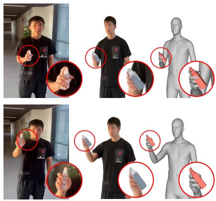  
Reconstruction results  
Figure S3. Failure case of reconstructing local details.

## S6. More comparisons with state-of-the-art methods

As the image-based methods in Tab. 4 are evaluated only on key frames to reduce the evaluation cost, we compare HORIA with TeHOR [31], a representative image-based method, on every frame of Open4DHOI [52]. As shown in Tab. S3, HORIA achieves substantially lower acceleration errors than TeHOR. While TeHOR reconstructs each frame independently, our framework is supervised by the rerendered videos, which carry the temporally coherent motion prior of the video diffusion network, yielding temporally consistent 4D reconstructions.

In addition, Fig. S4 shows more results demonstrating the effectiveness of the 4D HOI optimization. Figs. S5 and S6 provide more qualitative comparisons with state-ofthe-art methods. These examples demonstrate the effectiveness of our framework in reconstructing the 4D human and object across diverse interaction scenarios.

�!"#\$%&'(

Input video

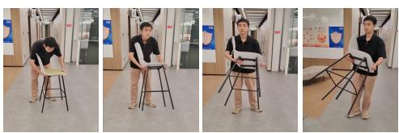  
“A person takes hold of the chair with both hands while bent at the waist”  
“A person lifts the chair with both hands, holding it upright in front of the body”

  
“A person lifts the guidepost from the floor”

  
“A person carries the guidepost across the hallway while holding it steady with both hands”  
Before optim.

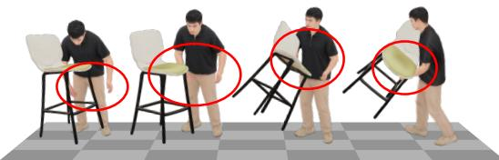

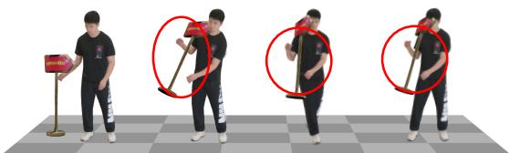  
After optim.

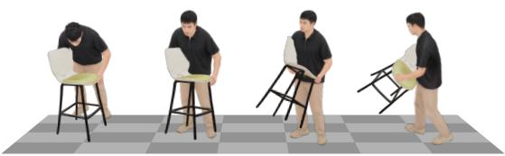

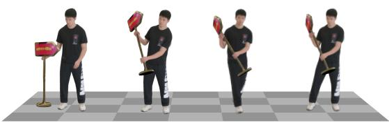  
Input video  
�!"#\$%&'(

  
“A person pushes the barbell upward from shoulder height to full overhead extension”

  
“A person pulls the barbell downward from overhead back toward shoulder height”

  
“A person lifts the chair from the floor with both hands”  
“A person carries the across the room

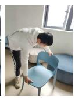  
“A person turns the chair upright while lowering it to the floor”

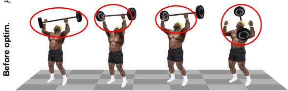

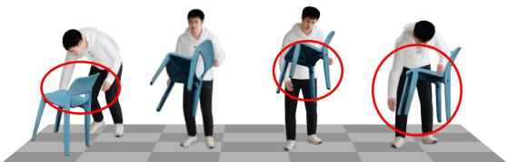  
After optim.

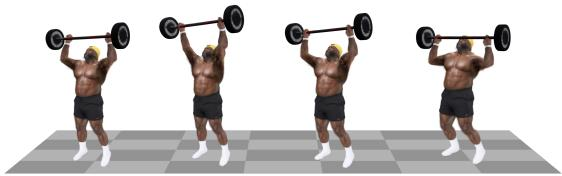

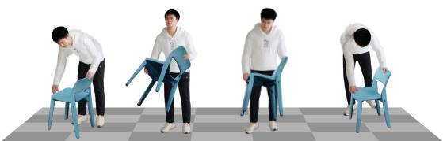  
Figure S4. More qualitative results of 4D HOI optimization. We render all reconstructions at −30◦ azimuth and highlight representative failure cases with red circles.

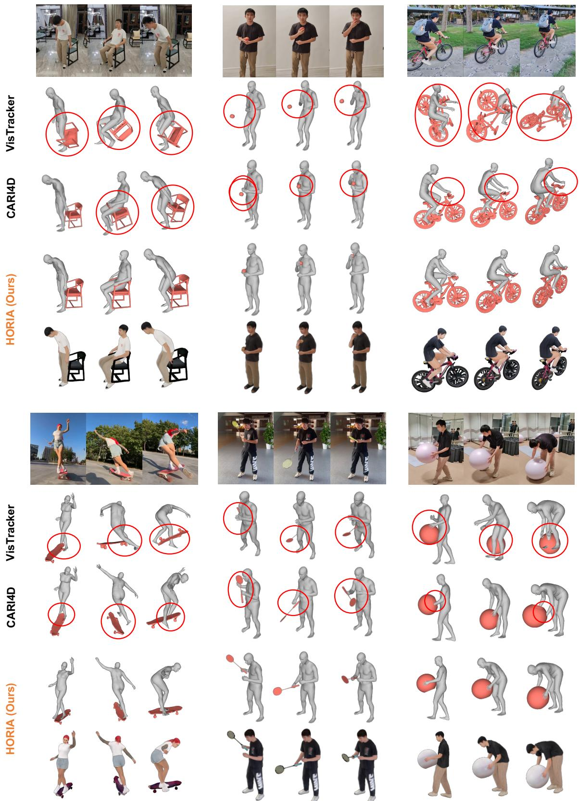  
Figure S5. More qualitative comparison with VisTracker [54] and CARI4D [57]. We render each method’s reconstruction at −30◦ azimuth and highlight representative failure cases with red circles.

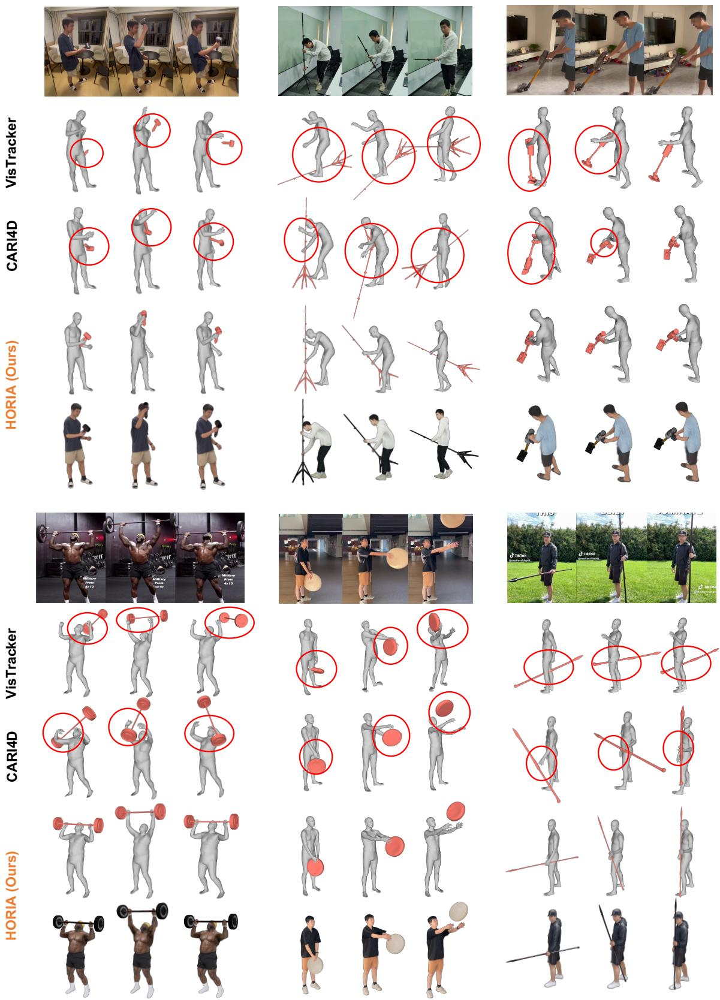  
Figure S6. More qualitative comparison with VisTracker [54] and CARI4D [57]. We render each method’s reconstruction at −30◦ azimuth and highlight representative failure cases with red circles.

## References

[1] Shuai Bai, Yuxuan Cai, Ruizhe Chen, Keqin Chen, Xionghui Chen, Zesen Cheng, Lianghao Deng, Wei Ding, Chang Gao, Chunjiang Ge, et al. Qwen3-VL technical report. arXiv preprint arXiv:2511.21631, 2025. 3

[2] Fabien Baradel, Matthieu Armando, Salma Galaaoui, Romain Bregier, Philippe Weinzaepfel, Gr ´ egory Rogez, and´ Thomas Lucas. Multi-HMR: Multi-person whole-body human mesh recovery in a single shot. In ECCV, 2024. 4

[3] Bharat Lal Bhatnagar, Xianghui Xie, Ilya A Petrov, Cristian Sminchisescu, Christian Theobalt, and Gerard Pons-Moll. BEHAVE: Dataset and method for tracking human object interactions. In CVPR, 2022. 6, 7, 8, 1

[4] Guangyan Chen, Meiling Wang, Te Cui, Yao Mu, Haoyang Lu, Zicai Peng, Mengxiao Hu, Tianxing Zhou, Mengyin Fu, Yi Yang, et al. FMimic: Foundation models are fine-grained action learners from human videos. IJRR, 2025. 3

[5] Xingyu Chen, Fu-Jen Chu, Pierre Gleize, Kevin J Liang, Alexander Sax, Hao Tang, Weiyao Wang, Michelle Guo, Thibaut Hardin, Xiang Li, et al. SAM 3D: 3Dfy anything in images. In CVPR, 2026. 4

[6] Yixin Chen, Siyuan Huang, Tao Yuan, Siyuan Qi, Yixin Zhu, and Song-Chun Zhu. Holistic++ scene understanding: Single-view 3D holistic scene parsing and human pose estimation with human-object interaction and physical commonsense. In ICCV, 2019. 2

[7] Alpar Cseke, Shashank Tripathi, Sai Kumar Dwivedi, Ar-´ jun Lakshmipathy, Agniv Chatterjee, Michael J. Black, and Dimitrios Tzionas. PICO: Reconstructing 3D people in contact with objects. In CVPR, 2025. 2

[8] Carl De Boor. A practical guide to splines. Springer New York, 1978. 3

[9] Congyue Deng, Chiyu Jiang, Charles R Qi, Xinchen Yan, Yin Zhou, Leonidas Guibas, Dragomir Anguelov, et al. NeRDi: Single-view NeRF synthesis with language-guided diffusion as general image priors. In CVPR, 2023. 3

[10] David H Douglas and Thomas K Peucker. Algorithms for the reduction of the number of points required to represent a digitized line or its caricature. Cartographica, 1973. 4, 1

[11] Sai Kumar Dwivedi, Dimitrije Antic, Shashank Tripathi,´ Omid Taheri, Cordelia Schmid, Michael J Black, and Dimitrios Tzionas. InteractVLM: 3D interaction reasoning from 2D foundational models. In CVPR, 2025. 2

[12] Martin Ester, Hans-Peter Kriegel, Jorg Sander, and Xiaowei¨ Xu. A density-based algorithm for discovering clusters in large spatial databases with noise. In KDD, 1996. 5

[13] Jiyang Gao, Chen Sun, Zhenheng Yang, and Ram Nevatia. TALL: Temporal activity localization via language query. In ICCV, 2017. 3

[14] Bin Huang, Xin Wang, Hong Chen, Zihan Song, and Wenwu Zhu. VTimeLLM: Empower LLM to grasp video moments. In CVPR, 2024. 3

[15] Dingbang Huang, Etienne Vouga, Qixing Huang, and Geor gios Pavlakos. Recovering physically plausible humanobject interactions from monocular videos. In CVPR, 2026. 2

[16] Jiaxin Huang, Sheng Miao, Bangbang Yang, Yuewen Ma, and Yiyi Liao. Vivid4D: Improving 4D reconstruction from monocular video by video inpainting. In ICCV, 2025. 3

[17] Yinghao Huang, Omid Taheri, Michael J Black, and Dimitrios Tzionas. InterCap: Joint markerless 3D tracking of humans and objects in interaction. In GCPR, 2022. 1

[18] Yangyi Huang, Hongwei Yi, Yuliang Xiu, Tingting Liao, Jiaxiang Tang, Deng Cai, and Justus Thies. TeCH: Text-guided Reconstruction of Lifelike Clothed Humans. In 3DV, 2024. 3

[19] Longtao Jiang, Zhendong Wang, Jianmin Bao, Wengang Zhou, Dongdong Chen, Lei Shi, Dong Chen, and Houqiang Li. SmartEraser: Remove anything from images using masked-region guidance. In CVPR, 2025. 4

[20] Wen Jiang, Nikos Kolotouros, Georgios Pavlakos, Xiaowei Zhou, and Kostas Daniilidis. Coherent reconstruction of multiple humans from a single image. In CVPR, 2020. 5

[21] Bernhard Kerbl, Georgios Kopanas, Thomas Leimkuhler,¨ and George Drettakis. 3D gaussian splatting for real-time radiance field rendering. ACM TOG, 2023. 3

[22] Diederik P. Kingma and Jimmy Ba. Adam: A method for stochastic optimization. In ICLR, 2015. 3

[23] Jie Lei, Tamara L Berg, and Mohit Bansal. QVHighlights: Detecting moments and highlights in videos via natural language queries. In NeurIPS, 2021. 3

[24] Ao Li, Jinpeng Liu, Yixuan Zhu, and Yansong Tang. Score-HOI: Physically plausible reconstruction of human-object interaction via score-guided diffusion. In ICCV, 2025. 2

[25] Kevin Qinghong Lin, Pengchuan Zhang, Joya Chen, Shra man Pramanick, Difei Gao, Alex Jinpeng Wang, Rui Yan, and Mike Zheng Shou. UniVTG: Towards unified video language temporal grounding. In ICCV, 2023. 3

[26] Yaron Lipman, Ricky TQ Chen, Heli Ben-Hamu, Maximil ian Nickel, and Matt Le. Flow matching for generative modeling. In ICLR, 2023. 5

[27] Ruoshi Liu, Rundi Wu, Basile Van Hoorick, Pavel Tokmakov, Sergey Zakharov, and Carl Vondrick. Zero-1-to-3: Zero-shot one image to 3D object. In ICCV, 2023. 3

[28] Gyeongsik Moon, Takaaki Shiratori, and Shunsuke Saito. Expressive whole-body 3D gaussian avatar. In ECCV, 2024. 3

[29] WonJun Moon, Sangeek Hyun, SangUk Park, Dongchan Park, and Jae-Pil Heo. Query-dependent video representation for moment retrieval and highlight detection. In CVPR, 2023. 3

[30] Hyeongjin Nam, Daniel Sungho Jung, Gyeongsik Moon, and Kyoung Mu Lee. Joint reconstruction of 3D human and object via contact-based refinement transformer. In CVPR, 2024. 2

[31] Hyeongjin Nam, Daniel Sungho Jung, and Kyoung Mu Lee. TeHOR: Text-guided 3D human and object reconstruction with textures. In CVPR, 2026. 2, 3, 7, 1

[32] OpenAI. GPT-5 system card. arXiv preprint arXiv:2601.03267, 2026. 4, 1, 2

[33] Georgios Pavlakos, Vasileios Choutas, Nima Ghorbani, Timo Bolkart, Ahmed AA Osman, Dimitrios Tzionas, and Michael J Black. Expressive body capture: 3D hands, face, and body from a single image. In CVPR, 2019. 3, 6, 1

[34] Luigi Piccinelli, Yung-Hsu Yang, Christos Sakaridis, Mattia Segu, Siyuan Li, Luc Van Gool, and Fisher Yu. UniDepth: Universal monocular metric depth estimation. In CVPR, 2024. 5

[35] Ben Poole, Ajay Jain, Jonathan T. Barron, and Ben Mildenhall. DreamFusion: Text-to-3D using 2D diffusion. In ICLR, 2023. 3

[36] Guocheng Qian, Jinjie Mai, Abdullah Hamdi, Jian Ren, Aliaksandr Siarohin, Bing Li, Hsin-Ying Lee, Ivan Skorokhodov, Peter Wonka, Sergey Tulyakov, et al. Magic123: One image to high-quality 3D object generation using both 2D and 3D diffusion priors. In ICLR, 2024. 3

[37] Lingteng Qiu, Xiaodong Gu, Peihao Li, Qi Zuo, Weichao Shen, Junfei Zhang, Kejie Qiu, Weihao Yuan, Guanying Chen, Zilong Dong, et al. LHM: Large animatable human reconstruction model from a single image in seconds. In ICCV, 2025. 4

[38] Nikhila Ravi, Valentin Gabeur, Yuan-Ting Hu, Ronghang Hu, Chaitanya Ryali, Tengyu Ma, Haitham Khedr, Roman Radle, Chloe Rolland, Laura Gustafson, et al. SAM 2: Seg-¨ ment anything in images and videos. In ICLR, 2025. 5

[39] Shuhuai Ren, Linli Yao, Shicheng Li, Xu Sun, and Lu Hou. TimeChat: A time-sensitive multimodal large language model for long video understanding. In CVPR, 2024. 3

[40] Robin Rombach, Andreas Blattmann, Dominik Lorenz, Patrick Esser, and Bjorn Ommer. High-resolution image syn-¨ thesis with latent diffusion models. In CVPR, 2022. 3

[41] Yang Song, Jascha Sohl-Dickstein, Diederik P Kingma, Abhishek Kumar, Stefano Ermon, and Ben Poole. Score-based generative modeling through stochastic differential equations. In ICLR, 2021. 2

[42] Jingxiang Sun, Bo Zhang, Ruizhi Shao, Lizhen Wang, Wen Liu, Zhenda Xie, and Yebin Liu. DreamCraft3D: Hierarchical 3D generation with bootstrapped diffusion prior. In ICLR, 2024. 3

[43] Junshu Tang, Tengfei Wang, Bo Zhang, Ting Zhang, Ran Yi, Lizhuang Ma, and Dong Chen. Make-it-3D: High-fidelity 3D creation from a single image with diffusion prior. In ICCV, 2023.

[44] Jiaxiang Tang, Jiawei Ren, Hang Zhou, Ziwei Liu, and Gang Zeng. DreamGaussian: Generative gaussian splatting for efficient 3D content creation. In ICLR, 2024. 3

[45] Ashish Vaswani, Noam Shazeer, Niki Parmar, Jakob Uszkoreit, Llion Jones, Aidan N Gomez, Łukasz Kaiser, and Illia Polosukhin. Attention is all you need. In NeurIPS, 2017. 2

[46] Team Wan, Ang Wang, Baole Ai, Bin Wen, Chaojie Mao, Chen-Wei Xie, Di Chen, Feiwu Yu, Haiming Zhao, Jianxiao Yang, et al. Wan: Open and advanced large-scale video generative models. arXiv preprint arXiv:2503.20314, 2025. 2, 4, 5, 3

[47] Haibo Wang, Zhiyang Xu, Yu Cheng, Shizhe Diao, Yufan Zhou, Yixin Cao, Qifan Wang, Weifeng Ge, and Lifu Huang. Grounded-VideoLLM: Sharpening fine-grained temporal grounding in video large language models. arXiv preprint arXiv:2410.03290, 2024. 3

[48] Xinzhou Wang, Yikai Wang, Junliang Ye, Fuchun Sun, Zhengyi Wang, Ling Wang, Pengkun Liu, Kai Sun, Xintong

Wang, Wende Xie, Fangfu Liu, and Bin He. Animatable-Dreamer: Text-guided non-rigid 3D model generation and reconstruction with canonical score distillation. In ECCV, 2024. 3

[49] Zhengyi Wang, Cheng Lu, Yikai Wang, Fan Bao, Chongxuan Li, Hang Su, and Jun Zhu. ProlificDreamer: High-fidelity and diverse text-to-3D generation with variational score dis tillation. In NeurIPS, 2023. 3

[50] Bowen Wen, Wei Yang, Jan Kautz, and Stan Birchfield. FoundationPose: Unified 6D pose estimation and tracking of novel objects. In CVPR, 2024. 4

[51] Boran Wen, Dingbang Huang, Zichen Zhang, Jiahong Zhou, Jianbin Deng, Jingyu Gong, Yulong Chen, Lizhuang Ma, and Yong-Lu Li. Reconstructing in-the-wild open-vocabulary human-object interactions. In CVPR, 2025. 2, 7, 1

[52] Boran Wen, Ye Lu, Sirui Wang, Keyan Wan, Jiahong Zhou, Junxuan Liang, Xinpeng Liu, Bang Xiao, Ruiyang Liu, and Yong-Lu Li. Efficient and scalable monocular humanobject interaction motion reconstruction. arXiv preprint arXiv:2512.00960, 2025. 2, 6, 7, 8, 3

[53] Xianghui Xie, Bharat Lal Bhatnagar, and Gerard Pons-Moll. CHORE: Contact, human and object reconstruction from a single RGB image. In ECCV, 2022.

[54] Xianghui Xie, Bharat Lal Bhatnagar, and Gerard Pons-Moll. Visibility aware human-object interaction tracking from sin gle RGB camera. In CVPR, 2023. 2, 3, 7, 1, 5, 6

[55] Xianghui Xie, Bharat Lal Bhatnagar, Jan Eric Lenssen, and Gerard Pons-Moll. Template free reconstruction of humanobject interaction with procedural interaction generation. In CVPR, 2024.

[56] Xianghui Xie, Jan Eric Lenssen, and Gerard Pons-Moll. InterTrack: Tracking human object interaction without object templates. In 3DV, 2025. 7, 1, 3

[57] Xianghui Xie, Bowen Wen, Yan Chang, Hesam Rabeti, Jiefeng Li, Ye Yuan, Gerard Pons-Moll, and Stan Birchfield. CARI4D: Category agnostic 4D reconstruction of humanobject interaction. In CVPR, 2026. 2, 3, 7, 1, 5, 6

[58] Xiang Xu, Hanbyul Joo, Greg Mori, and Manolis Savva. D3D-HOI: Dynamic 3D human-object interactions from videos. arXiv preprint arXiv:2108.08420, 2021.

[59] Lixin Xue, Chengwei Zheng, Georgios Paschalidis, Chen Guo, Manuel Kaufmann, Juan Zarate, and Dimitrios Tzionas. RHINO: Reconstructing human interactions with novel objects from monocular videos. In CVPR, 2026. 2, 3

[60] Yufei Ye, Abhinav Gupta, Kris Kitani, and Shubham Tulsiani. G-HOP: Generative hand-object prior for interaction reconstruction and grasp synthesis. In CVPR, 2024. 3

[61] Zehao Yu, Anpei Chen, Binbin Huang, Torsten Sattler, and Andreas Geiger. Mip-Splatting: Alias-free 3D gaussian splatting. In CVPR, 2024. 3

[62] Jun Zhang, Teng Wang, Yuying Ge, Yixiao Ge, Xinhao Li, Ying Shan, and Limin Wang. TimeLens: Rethinking video temporal grounding with multimodal LLMs. CVPR, 2026. 3, 4, 1

[63] Jason Y Zhang, Sam Pepose, Hanbyul Joo, Deva Ramanan, Jitendra Malik, and Angjoo Kanazawa. Perceiving 3D human-object spatial arrangements from a single image in the wild. In ECCV, 2020. 2, 7, 1

[64] Songyang Zhang, Houwen Peng, Jianlong Fu, and Jiebo Luo. Learning 2D temporal adjacent networks for moment localization with natural language. In AAAI, 2020. 3

[65] Yi Zhou, Connelly Barnes, Jingwan Lu, Jimei Yang, and Hao Li. On the continuity of rotation representations in neural networks. In CVPR, 2019. 3