# HP-PnP-Flow: Hybrid Time Scheduling and Projection for Plug-and-Play Image Restoration via Flow Matching†

Yong Li, Xiaojie Wang, Xiaoyan Zhang

School of Mathematics and Statistics, HNP-LAMA, Central South University, Changsha 410083, Hunan, China

October 20, 2026

## Abstract

Image restoration is a fundamental inverse problem that seeks to recover high-quality images from degraded observations. Plug-and-Play (PnP) methods provide a flexible framework for integrating pretrained denoisers into iterative reconstruction, whereas flow matching ofers an eficient generative modeling approach based on continuous-time ODE dynamics. Very recently, Martin et al. (ICLR, 2025) developed a PnP-Flow method, which integrates the PnP framework with flow matching through a time-dependent denoiser constructed from a pretrained flow matching model. By incorporating a diferent time schedule and an additional pixel-space projection operator, this paper proposes a novel eficient PnP-Flow algorithm (HP-PnP-Flow) that enjoys rigorous convergence guarantees under mild assumptions, without imposing restrictive conditions on iterates required by the aforementioned work. Numerical experiments on CelebA and AFHQ-Cat demonstrate that the newly proposed HP-PnP-Flow algorithm significantly outperforms PnP-Flow on several restoration tasks such as denoising, deblurring, super-resolution, random inpainting, and box inpainting. Notably, our algorithm achieves comparable or better reconstruction quality with substantially fewer iterations, reducing the iteration count from 500 to 100 for deblurring and super-resolution on AFHQ-Cat.

AMS subject classification: 65J22, 68U10, 65K10.

Key Words: Image reconstruction, Flow matching, Plug-and-Play, Hybrid time scheduling, Projection operator.

## 1 Introduction

Image restoration has been a long-standing problem in a wide range of applications, including digital photography, medical imaging, remote sensing, surveillance and digital entertainment [33,

39]. Given a degraded observation, the objective is to recover the underlying clean image, where the degradation may arise from various factors during image acquisition, transmission, or processing [14, 15, 22, 23, 31]. Such restoration tasks can typically be formulated as inverse problems under the observation model

$$
y = H x + \zeta ,\tag{1.1}
$$

where $x \in \mathbb { R } ^ { d }$ denotes the unknown high-quality image, $y \in \mathbb { R } ^ { m }$ is the degraded observation, $\boldsymbol { H } : \mathbb { R } ^ { d }  \mathbb { R } ^ { m }$ denotes the degradation operator, and $\zeta$ describes the underlying additive noise. The inherent ill-posedness and high dimensionality of the problem pose significant challenges to accurate and stable reconstruction.

From a Bayesian perspective [18, 24, 36], the unknown image x and the observation y are treated as random variables. By Bayes’ theorem, the corresponding maximum a posteriori (MAP) estimator is then given by

$$
{ \hat { x } } _ { \mathrm { M A P } } = { \underset { x \in \mathbb { R } ^ { d } } { \operatorname { a r g m a x } } } \log p ( x \mid y ) = { \underset { x \in \mathbb { R } ^ { d } } { \operatorname { a r g m i n } } } { \big \{ } - \log p ( y \mid x ) - \log p ( x ) { \big \} } ,\tag{1.2}
$$

where log $p ( y \mid x )$ represents the log-likelihood of observation y, log $p ( x )$ delivers the prior of clean image x and is independent of degraded image $y .$ Nevertheless, the image prior $p ( x )$ is generally unknown or intractable in this framework. To illustrate this point, the negative log prior is typically replaced by an explicit regularization term, leading to the optimization problem

$$
\arg \operatorname* { m i n } _ { x \in \mathbb { R } ^ { d } } \{ f ( x ) + g ( x ) \} ,\tag{1.3}
$$

where $f ( x ) = - \log p ( y \mid x )$ denotes the data-fidelity term. In particular, under additive Gaussian noise $\xi \sim \mathcal { N } ( 0 , \sigma ^ { 2 } \mathrm { I } _ { d } )$ , the data-fidelity term takes the form $\begin{array} { r } { f ( x ) = \frac { 1 } { 2 \sigma ^ { 2 } } \| H x - y \| ^ { 2 } } \end{array}$

In recent years, the regularized minimization problem (1.3) has received considerable attention. Early works addressed this problem by using proximal splitting methods, which handle the datafidelity and regularization terms separately. For example, forward-backward splitting (FBS) [4,10] alternates between a proximal operation on g and a gradient descent step on $f ,$ when $f$ is diferentiable. In more general settings, half-quadratic-splitting (HQS) [17], alternating direction method of multipliers (ADMM) [2] or douglas-rachford splitting (DRS) [13] use proximal operations for both f and $g .$

Plug-and-Play (PnP) method. Since designing an efective regularizer for complex priors is challenging, the authors of [37] introduced the Plug-and-Play (PnP) methods, which replace the proximal operator with an of-the-shelf denoiser such as DnCNN [43] or DRUNet [42]. Over the last few years, much attention has been received on various PnP methods and their convergence analysis (see, e.g., [21, 28, 29, 32, 35] and references therein). For example, the authors of [40] first provide a new convergence theory for plug-and-play proximal gradient descent (PnP-PGD) under prior mismatch where the denoiser is trained on a diferent data distribution to the inference task at hand. By incorporating neural network denoisers, PnP methods have achieved promising results across various image restoration tasks. However, classical PnP methods typically rely on generic discriminative denoisers, for which an explicit regularization function may not be available. This limits both the optimization interpretation of the method and its ability to represent complex image distributions.

PnP-Flow method. Generative models provide a natural alternative by modeling the underlying data distribution, and have achieved state-of-the-art performance in image generation, inverse problems and a broad range of related applications [5, 9, 12, 19, 25, 26, 34]. In particular, flow matching learns a time-dependent vector field whose ODE flow transports a base distribution to the data distribution. Owing to simpler training objectives and more eficient sampling, flow matching has recently emerged as a powerful framework for continuous-time generative modeling. These developments have motivated the use of generative models as image priors within the PnP framework. Very recently, Martin et al. [27] introduced PnP-Flow matching method by defining a time-dependent denoiser using a pretrained flow matching model. Under regularity assumptions and bounded support of the base distribution, they established convergence under the additional assumptions that the iterates remain bounded and the time sequence satisfies $\textstyle \sum _ { k = 0 } ^ { \infty } ( 1 - t _ { k } ) < \infty$ Despite its good reconstruction performance, PnP-Flow still has several limitations. On the one hand, the condition imposed on the time sequence is dificult to be satisfied in practice. For instance, the linear schedule $t _ { k } = k / N$ used in [27] does not satisfy the required uniform boundedness with respect to the iteration budget N. On the other hand, the convergence guarantee is obtained based on bounded iterates, a property that is not explicitly guaranteed by the original algorithm. Motivated by this we ask the following question:

Can one design an improved PnP-Flow algorithm that enjoys rigorous convergence guarantees under mild assumptions, while achieving improved reconstruction eficiency and quality?

An improved HP-PnP-Flow algorithm. In this work, we address this problem by proposing a hybrid-projection PnP-Flow (HP-PnP-Flow) algorithm, based on a diferent time schedule and an additional pixel-space projection operator. More precisely, the hybrid time schedule given by (3.1) combines geometric and linear phases, while the projection operator defined by (3.2) explicitly constrains the iterates to the prescribed pixel range. Under mild and reasonable assumptions, we establish the convergence of HP-PnP-Flow (see Theorem 3.3), without requiring the a priori boundedness assumptions on the iterates imposed in the original PnP-Flow framework in [27]. Also, the new hybrid time schedule ensures the resulting time sequence satisfies the uniform boundedness assumption $\textstyle \sum _ { k = 0 } ^ { \infty } ( 1 - t _ { k } ) < \infty$ . Notably, numerical experiments demonstrate the eficiency and high quality of the new algorithm. Ablation studies further validate the individual efects of the initial time ofset $t _ { 0 }$ and the hybrid time schedule, with their combination yielding the best overall performance. In summary, our main contributions are as follows:

• We propose an improved PnP-Flow algorithm, called HP-PnP-Flow, by incorporating a novel hybrid time schedule and an additional pixel-space projection operator.

• We establish the convergence of the newly proposed HP-PnP-Flow algorithm under mild and reasonable assumptions.

• Extensive experiments on two datasets and five tasks demonstrate that our algorithm significantly outperforms PnP-Flow in terms of reconstruction quality and convergence eficiency.

The rest of this article is organized as follows. The next section collects some notations, introduces background on Plug-and-Play (PnP), flow matching and PnP-Flow throughout this paper. Section 3 presents the proposed method and main results of this paper. Numerical experiments are conducted in Section 4 to demonstrate the efectiveness of the proposed algorithm. Finally, some concluding remarks are given in the last section.

## 2 Preliminaries

## 2.1 Notation

Throughout this paper, we use N to denote the set of all positive integers and let $d \in \mathbb { N }$ . For any positive integer $m ,$ we denote $[ m ] : = \{ 1 , . . . , m \}$ and $[ m ] _ { 0 } : = \{ 0 , 1 , . . . , m \}$ . We let $\mathrm { I } _ { d } \in \mathbb { R } ^ { d \times d }$ denote the identity matrix and let ∥ · ∥ denote the Euclidean norm of vectors in $\mathbb { R } ^ { d }$ . For a function $f : \mathbb { R } ^ { d } $ R, we write $\partial _ { i } f$ to denote the i-th partial derivative of $f$ . The gradient ∇f is the vector of partial derivative $( \partial _ { 1 } f , \partial _ { 2 } f , \cdots , \partial _ { d } f )$ . For a vector field $F = ( F _ { 1 } , F _ { 2 } , \cdot \cdot \cdot , F _ { d } ) : \mathbb { R } ^ { d } \to \mathbb { R } ^ { d }$ , we denote its divergence by $\begin{array} { r } { \nabla \cdot F = \sum _ { i = 1 } ^ { d } \partial _ { i } F _ { i } } \end{array}$ . Let $\mathcal { P } \left( \mathbb { R } ^ { d } \right)$ be the space of all probability distributions on $\left( \mathbb { R } ^ { d } , B ( \mathbb { R } ^ { d } ) \right)$ . By $\cdot \#$ we denote the push-forward operation.

## 2.2 Plug-and-Play (PnP)

In this work we focus on solving the optimization problem (1.3). When $g$ is nonsmooth, standard gradient descent is generally not directly applicable. Proximal splitting methods instead handle the smooth term $f$ by a gradient step and the regularization term $g$ through its proximal operator. We next recall the definition of the proximal operator.

Definition 2.1 (Proximal operator). Let $g : \mathbb { R } ^ { d }  \mathbb { R } \cup \{ + \infty \}$ be a proper lower semicontinuous convex function. The proximal operator of g with step size $\gamma > 0$ is the mapping prox $_ { \gamma g } : \mathbb { R } ^ { d }  \mathbb { R } ^ { d }$ defined by

$$
\begin{array} { r } { \operatorname { p r o x } _ { \gamma g } ( z ) : = \underset { x \in \mathbb { R } ^ { d } } { \arg \operatorname* { m i n } } \left\{ g ( x ) + \frac { 1 } { 2 \gamma } \| x - z \| ^ { 2 } \right\} . } \end{array}\tag{2.1}
$$

The quadratic term makes the proximal subproblem strongly convex, so the minimizer is unique. Intuitively, $\mathrm { p r o x } _ { \gamma g } ( z )$ finds a point that remains close to z while reducing the regularization term $g .$

The Forward-Backward Splitting (FBS) algorithm [4,10,11] alternates between a forward gradient step on $f$ and a backward proximal step on $g \colon$

$$
\begin{array} { r } { \left\{ \begin{array} { l l } { u _ { k } = x _ { k } - \gamma _ { k } \nabla f ( x _ { k } ) , } \\ { x _ { k + 1 } = \mathrm { p r o x } _ { \gamma _ { k } g } ( u _ { k } ) . } \end{array} \right. } \end{array}\tag{2.2}
$$

Here, $\gamma _ { k } \in ( 0 , 2 / L )$ denotes the step size, where L is the Lipschitz constant of $\nabla f$ . Under standard assumptions for FBS, this step size condition ensures convergence of the iterates to a minimizer (see [4] for details). However, designing an explicit regularizer $g$ that accurately captures complex image priors is often challenging in practice. The Plug-and-Play $( \mathrm { P n P } )$ framework [37] replaces the proximal step in this iteration with a pretrained denoiser $\mathrm { D } _ { \sigma } : \mathbb { R } ^ { d }  \mathbb { R } ^ { d }$ , where $\sigma$ controls the denoising strength, thereby incorporating an implicit image prior without requiring an explicit regularizer $g .$ . The resulting PnP-FBS iteration is given by

$$
\left\{ \begin{array} { l l } { u _ { k } = x _ { k } - \gamma _ { k } \nabla f ( x _ { k } ) , } \\ { x _ { k + 1 } = \mathrm { D } _ { \sigma } ( u _ { k } ) . } \end{array} \right.\tag{2.3}
$$

PnP combines the flexibility of optimization-based methods with the expressive power of neural networks, leading to strong performance across a wide range of image restoration tasks.

## 2.3 Flow Matching

Flow matching [1, 25] is a generative modeling framework that learns a time-dependent vector field to transport samples from a base distribution $\nu \in \mathcal P ( \mathbb { R } ^ { d } )$ (e.g., standard Gaussian) to the data distribution $\mu \in \mathcal P ( \mathbb { R } ^ { d } )$ . The associated flow $\phi : [ 0 , 1 ] \times \mathbb { R } ^ { d }  \mathbb { R } ^ { d }$ is governed by the ordinary diferential equation (ODE):

$$
\frac { \mathrm { d } } { \mathrm { d } t } \phi _ { t } ( x ) = v _ { t } ( \phi _ { t } ( x ) ) , \qquad \phi _ { 0 } ( x ) = x _ { 0 } .\tag{2.4}
$$

Once the velocity field $v$ is learned, sampling from the data distribution only requires solving ODE (2.4) to attain $x _ { 1 } \sim \mu$ (see [7] for details). In addition, the flow $\phi _ { t }$ transports the initial distribution $p _ { 0 }$ into a probability density path $p _ { t } = ( \phi _ { t } ) _ { \# } p _ { 0 }$ , which satisfies the continuity (Liouville) equation

$$
\begin{array} { r } { \partial _ { t } p _ { t } ( x ) + \nabla \cdot \bigl ( p _ { t } ( x ) v _ { t } ( x ) \bigr ) = 0 . } \end{array}\tag{2.5}
$$

This equation characterizes the evolution of the density induced by the time-dependent vector field $v _ { t }$ (see [3]). The goal of flow matching is to learn the velocity field of the flow ODE (2.4). This learning process consists in minimizing the loss function

$$
\begin{array} { r } { \ L _ { \mathrm { F M } } ( \theta ) : = \mathbb { E } _ { t \sim \mathcal { U } [ 0 , 1 ] , x \sim p _ { t } } \left[ \big \| v _ { t } ^ { \theta } ( x ) - v _ { t } ( x ) \big \| ^ { 2 } \right] , } \end{array}\tag{2.6}
$$

where $v _ { t } ^ { \theta }$ is parameterized by a neural network with weights $\theta .$ . In practice, however, the marginal velocity field $v _ { t } ( x )$ is generally unavailable, making the flow matching objective intractable to evaluate directly. To circumvent this dificulty, flow matching instead relies on a tractable conditional formulation.

Given a data sample $x _ { 1 } \sim p _ { 1 }$ , one can construct a conditional probability path $p _ { t } ( x \mid x _ { 1 } )$ that interpolates between the base distribution $p _ { 0 }$ at $t = 0$ and the target distribution $p _ { 1 }$ at $t = 1$ together with an associated conditional vector field $\textstyle v _ { t } ( \cdot \mid x _ { 1 } )$ [26, 27]. For the linear interpolation

$$
x _ { t } = \left( 1 - t \right) x _ { 0 } + t x _ { 1 } , \qquad x _ { 0 } \sim p _ { 0 } , x _ { 1 } \sim p _ { 1 } ,\tag{2.7}
$$

the corresponding conditional vector field along the interpolation path is $v _ { t } ( x _ { t } \mid x _ { 1 } ) = x _ { 1 } - x _ { 0 }$ A key result of [25] is that the conditional flow matching (CFM) objective has the same gradient with respect to the model parameters as the corresponding marginal flow matching objective. Consequently, minimizing the CFM objective allows the neural vector field $v ^ { \theta }$ to learn the associated marginal vector field, while requiring only samples of the endpoint pair $( x _ { 0 } , x _ { 1 } )$ and the corresponding conditional vector field. For the linear interpolation introduced above, the CFM loss takes the form

$$
\begin{array} { r } { \mathcal { L } _ { \mathrm { C F M } } ( \theta ) : = \mathbb { E } _ { t \sim \mathcal { U } [ 0 , 1 ] , { x _ { 0 } } \sim p _ { 0 } , { x _ { 1 } } \sim p _ { 1 } } \left[ \left| \left| { { v _ { t } ^ { \theta } } ( { x _ { t } } ) - ( { x _ { 1 } } - { x _ { 0 } } ) } \right| \right| ^ { 2 } \right] . } \end{array}\tag{2.8}
$$

In (2.8), the endpoint pairs $( x _ { 0 } , x _ { 1 } )$ are sampled independently from $p _ { 0 }$ and $p _ { 1 }$ . Such independent pairing may lead to intersecting transport paths and thereby increase the complexity of the velocity field to be learned.

For the linear interpolation above, the conditional velocity is $x _ { 1 } - x _ { 0 }$ , and the corresponding marginal vector field is given by

$$
v _ { t } ( x ) = \mathbb { E } [ x _ { 1 } - x _ { 0 } \mid x _ { t } = x ] .
$$

A fundamental result of flow matching [25] shows that this marginal vector field can be learned through the tractable conditional flow matching objective. To illustrate the transport process induced by the learned flow matching model, Figure 1 visualizes the evolution of samples along the learned ODE trajectories on CelebA.

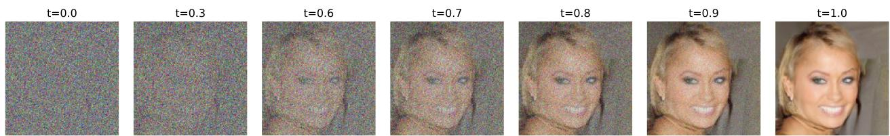  
Figure 1: Evolution of samples along the learned flow matching trajectories on CelebA at diferent time points. The ODE (2.4) is integrated using the forward Euler method with a step size of 0.01.

## 2.4 PnP-Flow: Plug-and-Play with flow matching

Given a pretrained flow matching vector field $v ^ { \theta } .$ , an estimate of the clean endpoint $x _ { 1 }$ can be constructed from an intermediate state $x _ { t }$ along the prescribed interpolation path. We first give the following definition.

Definition 2.2 (Flow matching denoiser $\big [ 2 7 \big ] \big )$ . Given a pretrained flow matching vector field $v ^ { \theta } { } _ { ; }$ the time-dependent denoiser $D _ { t } : \mathbb { R } ^ { d }  \mathbb { R } ^ { d }$ is defined by

$$
D _ { t } ( x ) : = x + ( 1 - t ) v _ { t } ^ { \theta } ( x ) , \qquad t \in [ 0 , 1 ] .\tag{2.9}
$$

Next, we explain the motivation behind the choice of the denoiser in (2.9). For the linear interpolation

$$
x _ { t } = ( 1 - t ) x _ { 0 } + t x _ { 1 } , \qquad ( x _ { 0 } , x _ { 1 } ) \sim \pi ,
$$

where $\pi$ denotes a coupling between the base distribution $p _ { 0 }$ and the target distribution $p _ { 1 }$ , i.e., a joint distribution on $( x _ { 0 } , x _ { 1 } )$ whose marginals are $p _ { 0 }$ and $p _ { 1 }$ , respectively. For this interpolation, the minimizer $v _ { t } ^ { * }$ of the CFM loss (2.8) over all admissible vector fields is given by

$$
v _ { t } ^ { \ast } ( x ) = \mathbb { E } _ { ( x _ { 0 } , x _ { 1 } ) \sim \pi } \left[ x _ { 1 } - x _ { 0 } \vert x _ { t } = x \right] .
$$

In practice, $v _ { t } ^ { * }$ is replaced by the learned vector field $v ^ { \theta }$ , yielding the practical denoiser $D _ { t }$ . Therefore, the corresponding ideal denoiser satisfies, for any $\boldsymbol { x } \in \mathbb { R } ^ { d }$ and $t \in [ 0 , 1 ]$ ，

$$
\begin{array} { r l } & { D _ { t } ( x ) = x + ( 1 - t ) v _ { t } ^ { * } ( x ) } \\ & { \qquad = \mathbb { E } _ { ( x _ { 0 } , x _ { 1 } ) \sim \pi } \left[ x _ { t } + ( 1 - t ) ( x _ { 1 } - x _ { 0 } ) | x _ { t } = x \right] } \\ & { \qquad = \mathbb { E } _ { ( x _ { 0 } , x _ { 1 } ) \sim \pi } \left[ x _ { 1 } | x _ { t } = x \right] . } \end{array}\tag{2.10}
$$

Hence, $D _ { t } ( x ) = \mathbb { E } _ { ( x _ { 0 } , x _ { 1 } ) \sim \pi } [ x _ { 1 } \mid x _ { t } = x ]$ is the minimum mean-square error (MMSE) estimator of the clean endpoint $x _ { 1 }$ given $x _ { t } = x .$ , which is also used in [30, 44].

PnP-Flow algorithm. Recently in [27], the authors incorporate the time-dependent denoiser $D _ { t }$ defined in (2.9) into the FBS framework, leading to

$$
\left\{ \begin{array} { l } { u _ { k } = x _ { k } - \gamma _ { k } \nabla f ( x _ { k } ) , } \\ { y _ { k } = ( 1 - t _ { k } ) \xi _ { k } + t _ { k } u _ { k } , } \\ { x _ { k + 1 } = D _ { t _ { k } } ( y _ { k } ) , } \end{array} \right.\tag{2.11}
$$

where $\{ \xi _ { k } \} _ { k \in [ N - 1 ] _ { 0 } }$ is a sequence of i.i.d. latent samples drawn from the base distribution $p _ { 0 }$ This iteration difers from the classical PnP-FBS scheme (2.3) in that the denoiser $D _ { t }$ explicitly depends on the time, and the gradient update is first reprojected along the interpolation path before denoising. For clarity, we sketch the above PnP-Flow algorithm in Algorithm 1.

Algorithm 1 PnP-Flow iteration.   
Require: Initialize $x _ { 0 }$ , the total iterations N, step sizes $\big \{ \gamma _ { k } \big \} _ { k \in [ N - 1 ] _ { 0 } } ,$ time sequence $\left\{ t _ { k } \right\} _ { k \in [ N - 1 ] _ { 0 } }$   
with $t _ { 0 } = 0$   
Ensure: Reconstructed image $x _ { N }$   
1: for $k = 0$ to $N - 1$ do   
2: $u _ { k } = x _ { k } - \gamma _ { k } \nabla f ( x _ { k } )$ ▷ Gradient step   
3: $y _ { k } = \left( 1 - t _ { k } \right) \xi _ { k } + t _ { k } u _ { k } , \xi _ { k } \sim p _ { 0 }$ ▷ Interpolation   
4: $x _ { k + 1 } = D _ { t _ { k } } ( y _ { k } )$ ▷ Flow matching denoising   
5: end for   
6: return $x _ { N }$

Choice of the step size. To balance the contributions of the data-fidelity update and the flow matching denoiser, the authors of [27] adopt the following time-dependent step size:

$$
\gamma _ { k } = ( 1 - t _ { k } ) ^ { \alpha } , \qquad \alpha \in ( 0 , 1 ] .\tag{2.12}
$$

Thus, the step size gradually decreases with t, reducing the influence of the data-fidelity update in the later stages of the iteration; see [27] for further motivation of this choice. This choice yields favorable numerical performance in practice.

Recalling the definition of the denoiser $D _ { t } ( x ) : = x + ( 1 - t ) v _ { t } ^ { \theta } ( x )$ , we observe that the factor $1 - t$ progressively attenuates the correction induced by the flow-matching prior as $t \to 1$ . Consequently, $D _ { t }$ approaches the identity mapping, with $D _ { 1 } = \operatorname { I } _ { d }$ . This provides a flow-time-dependent mechanism for controlling the strength of the learned prior, in contrast to conventional PnP methods based on predefined denoising operators [6,38]. Substituting the definition of $D _ { t _ { k } }$ into the last equation of (2.11) yields the following compact update rule:

$$
x _ { k + 1 } = \left( 1 - t _ { k } \right) \xi _ { k } + t _ { k } \big [ x _ { k } - \gamma _ { k } \nabla f ( x _ { k } ) \big ] + \left( 1 - t _ { k } \right) v _ { t _ { k } } ^ { \theta } ( y _ { k } ) ,\tag{2.13}
$$

where the first term accounts for the contribution of the base noise in the interpolation step, the second term incorporates the gradient-based data-fidelity update, and the third term provides the correction induced by the learned flow-matching prior.

Under some regularity assumptions, PnP-Flow algorithm (2.11) admits the following convergence result (see [27, Proposition 4]).

Proposition 2.3 (Convergence of PnP-Flow). Assume that $f : \mathbb { R } ^ { d }  \mathbb { R }$ is continuously diferentiable. The learned vector field $v ^ { \theta } : [ 0 , 1 ] \times \mathbf { \bar { \mathbb { R } } } ^ { d } \to \mathbb { R } ^ { d }$ is continuous, and the base distribution $p _ { 0 }$ has bounded support. Let the time sequence $\{ t _ { k } \} _ { k \in \mathbb { N } }$ $\begin{array} { r } { s a t i s f y \sum _ { k = 0 } ^ { \infty } ( 1 - t _ { k } ) < + \infty } \end{array}$ and set $\gamma _ { k } : = 1 - t _ { k } , k \in \mathbb { N }$ . If the sequence $\{ x _ { k } \} _ { k \in \mathbb { N } }$ produced by PnP-Flow algorithm (2.11) is bounded, then it is convergent.

Despite its efectiveness, PnP-Flow algorithm (2.11) has two limitations.

1) First, the convergence result in Proposition 2.3 requires the time sequence to satisfy $\scriptstyle \sum _ { k = 0 } ^ { \infty } ( 1 -$ $t _ { k } ) < + \infty$ . However, the practical implementation of PnP-Flow algorithm (2.11) employs the linear schedule $\begin{array} { r } { t _ { k } = \frac k { N } , \ k \in [ N ] _ { 0 } } \end{array}$ . For this time sequence, $\begin{array} { r } { \sum _ { k = 0 } ^ { N } ( 1 - t _ { k } ) = \sum _ { k = 0 } ^ { N } \frac { N - \hat { k } } { N } = \frac { N + 1 } { 2 } } \end{array}$ which goes to infinity as $N \to \infty$ . Hence, the family of linear time sequence is not uniformly bounded with respect to N, and therefore does not satisfy the convergence condition.

2) Second, PnP-Flow algorithm (2.11) sets $t _ { 0 } = 0$ , in which case the first interpolation step reduces to $y _ { 0 } = \xi$ and is therefore independent of the data-fidelity update $x _ { 0 } - \gamma _ { 0 } \nabla f ( x _ { 0 } )$ While this choice makes the first iteration independent of the initialization (see [27]), it also prevents the measurement information encoded by the data-fidelity gradient from entering the first denoising step.

Next we aim to propose an improved PnP-Flow algorithm to address the above issues.

## 3 An eficient Hybrid-Projection PnP-Flow

Before presenting our proposed algorithm, we first introduce the following hybrid time schedule.

Hybrid time schedule. To address the first issue mentioned above, we introduce a switching point $S : = \lfloor K N \rfloor$ , where N denotes the total number of iterations and $K \in ( 0 , 1 )$ determines the switching point between the two phases. Regarding the second issue, we adopt a positive initial ofset $t _ { 0 } \in ( 0 , 1 )$ , which allows the data-fidelity update to contribute from the first iteration. More precisely, for $\lambda \in ( 0 , 1 )$ , we define the hybrid time schedule by

$$
\begin{array} { r } { t _ { k } : = \left\{ \begin{array} { l l } { 1 - ( 1 - t _ { 0 } ) \lambda ^ { k } , } & { 0 \leq k \leq S , } \\ { t _ { S } + \frac { k - S } { N - S } ( 1 - t _ { S } ) , } & { S \leq k \leq N . } \end{array} \right. } \end{array}\tag{3.1}
$$

We notice that the time schedule $\{ t _ { k } \} _ { k \in \mathbb { N } }$ defined by (3.1) consists of a geometric growth and linear growth phase, difering the linear time schedule used in [27]. When $0 \leq k \leq S , t _ { k }$ approaches 1 geometrically, so that the noise weight $1 - t _ { k }$ decays exponentially. This rapidly reduces the influence of the base noise and promotes fast recovery of the dominant image structure. When $S \le k \le N , t _ { k }$ increases linearly from $t _ { S }$ to 1, providing a more gradual transition toward the final reconstruction and facilitating stable refinement.

The following result establishes a uniform bound for the hybrid time schedule with respect to the total number of iterations N.

Proposition 3.1 (Uniform boundedness for the hybrid time schedule). The time schedule $\{ t _ { k } \} _ { k \in \mathbb { N } }$ defined by (3.1) satisfies limN→∞ $\textstyle \sum _ { k = 0 } ^ { N } ( 1 - t _ { k } ) < + \infty$

Proof. For the geometric phase $0 \leq k \leq S - 1$ , the definition (3.1) gives

$$
\sum _ { k = 0 } ^ { S - 1 } ( 1 - t _ { k } ) = ( 1 - t _ { 0 } ) \sum _ { k = 0 } ^ { S - 1 } \lambda ^ { k } = ( 1 - t _ { 0 } ) \frac { 1 - \lambda ^ { S } } { 1 - \lambda } .
$$

For the linear phase, i.e., $S \le k \le N$ , we similarly obtain from (3.1) that

$$
\sum _ { k = S } ^ { N } ( 1 - t _ { k } ) = ( 1 - t _ { S } ) \sum _ { k = S } ^ { N } \big ( 1 - \frac { k - S } { N - S } \big ) = \frac { N - S + 1 } { 2 } ( 1 - t _ { S } ) .
$$

Together with the definition of $t _ { S }$ , we have

$$
\operatorname* { l i m } _ { N \to \infty } \sum _ { k = 0 } ^ { N } ( 1 - t _ { k } ) = ( 1 - t _ { 0 } ) \operatorname* { l i m } _ { N \to \infty } \Big ( \frac { 1 - \lambda ^ { S } } { 1 - \lambda } + \frac { N - S + 1 } { 2 } \lambda ^ { S } \Big ) .
$$

For a fixed $K \in ( 0 , 1 )$ , since $S = \lfloor K N \rfloor$ , we have $\begin{array} { r } { N - S + 1 \le N + 1 < \frac { S + 1 } { K } + 1 } \end{array}$ . Therefore,

$$
\begin{array} { r } { 0 \leq ( N - S + 1 ) \lambda ^ { S } < ( \frac { S + 1 } { K } + 1 ) \lambda ^ { S }  0 . } \end{array}
$$

Due to $S \to \infty$ as $N \to \infty$ and $\lambda \in ( 0 , 1 )$ , we have

$$
\operatorname* { l i m } _ { N \to \infty } \sum _ { k = 0 } ^ { N } ( 1 - t _ { k } ) = ( 1 - t _ { 0 } ) \operatorname* { l i m } _ { N \to \infty } \left( { \frac { 1 - \lambda ^ { S } } { 1 - \lambda } } + { \frac { N - S + 1 } { 2 } } \lambda ^ { S } \right) = { \frac { 1 - t _ { 0 } } { 1 - \lambda } } < \infty .
$$

The proof is completed.

Image intensities are commonly represented in [0, 1] and are typically normalized to $[ - 1 , 1 ]$ during training. However, PnP-Flow algorithm (2.11) does not guarantee that the intermediate iterates remain within this normalized range. Pixel values outside the valid range may lead to numerical instability and degrade reconstruction quality.

Pixel-space projection. To overcome this dificulty, we impose a box constraint by applying a component-wise projection operator at the end of each iteration.

Definition 3.2 (Projection operator). For any vector $x \in \mathbb { R } ^ { d }$ , the projection operator $\mathcal { P } : \mathbb { R } ^ { d } $ $[ - 1 , 1 ] ^ { d }$ is defined component-wise as, for any $i \in [ d ]$

$$
\mathcal { P } ( x ) _ { i } : = \operatorname* { m a x } \ ( - 1 , \ \operatorname* { m i n } ( 1 , \ x _ { i } ) ) .\tag{3.2}
$$

The projection operator possesses two properties, which are crucial to the subsequent analysis:

(i) Non-expansiveness. For any $a , b \in \mathbb { R } ^ { d } , \| \mathcal { P } ( a ) - \mathcal { P } ( b ) \| \leq \| a - b \|$ , i.e., the projection operator $\mathcal { P }$ is 1-Lipschitz.

(ii) Identity on the constraint set. $\mathcal { P } ( x ) = x$ if and only if $x \in [ - 1 , 1 ] ^ { d } ;$ ; the projection modifies only those components that violate the bound.

By combining the hybrid time schedule (3.1) with the projection operator P defined in (3.2), we are able to propose our new eficient Hybrid-Projection PnP-Flow (HP-PnP-Flow) algorithm.

HP-PnP-Flow algorithm. In this paper, we introduce an improved variant of PnP-Flow, termed HP-PnP-Flow:

$$
\left\{ \begin{array} { l } { u _ { k } = x _ { k } - \gamma _ { k } \nabla f ( x _ { k } ) , } \\ { y _ { k } = ( 1 - t _ { k } ) \xi _ { k } + t _ { k } u _ { k } , } \\ { x _ { k + 1 } = \mathcal { P } \big ( D _ { t _ { k } } ( y _ { k } ) \big ) , } \end{array} \right.\tag{3.3}
$$

where $\xi _ { k } \sim p _ { 0 }$ . For a more intuitive presentation, the complete iteration is given in Algorithm 2.

Algorithm 2 HP-PnP-Flow iteration.   
Require: Initialize $x _ { 0 } .$ , the total iterations $N ,$ step sizes $\{ \gamma _ { k } \} _ { k \in [ N - 1 ] _ { 0 } } ,$ time sequence $\left\{ t _ { k } \right\} _ { k \in [ N - 1 ] _ { 0 } }$   
with $t _ { 0 } \in ( 0 , 1 )$   
Ensure: Reconstructed image $x _ { N }$   
1: for $k = 0$ to $N - 1$ do   
2: $u _ { k } = x _ { k } - \gamma _ { k } \nabla f ( x _ { k } )$ ▷ Gradient step   
3: $y _ { k } = \left( 1 - t _ { k } \right) \xi _ { k } + t _ { k } u _ { k } , \xi _ { k } \sim p _ { 0 }$ ▷ Interpolation   
4: $x _ { k + 1 } = \mathcal { P } \big ( D _ { t _ { k } } ( y _ { k } ) \big )$ ▷ Denoising + projection   
5: end for   
6: return $x _ { N }$

Choice of the step size. By introducing a scaling parameter $\eta > 0$ , we adopt the following time-dependent step size in this paper:

$$
\gamma _ { k } = \eta ( 1 - t _ { k } ) ^ { \alpha } , \qquad \alpha \in ( 0 , 1 ] .\tag{3.4}
$$

In the special case $\eta = 1$ , the above step size with hyperparameter reduces into the usual step size in the literature [27]. The scaling hyperparameter η provides additional control over the overall step magnitude without altering the decay profile determined by α, thereby allowing the step size to be adapted to diferent degradation tasks. In particular, when $\eta = 1$ and $\alpha = 1$ , we recover $\gamma _ { k } = 1 - t _ { k }$ , which is the step size choice used in the convergence analysis below.

Theorem 3.3 (Convergence of HP-PnP-Flow). Assume that $f : \mathbb { R } ^ { d }  \mathbb { R }$ is continuously diferentiable. The learned vector field $v ^ { \theta } : [ 0 , 1 ] \times \mathbb { R } ^ { d } \to \mathbb { R } ^ { d }$ is continuous, and the base distribution $p _ { 0 }$ has bounded support. Let the time sequence $\{ t _ { k } \} _ { k \in \mathbb { N } } \subset [ 0 , 1 ]$ satisfy lim $\begin{array} { r } { N \to \infty \sum _ { k = 0 } ^ { N } ( 1 - t _ { k } ) < + \infty , } \end{array}$ and set $\gamma _ { k } : = 1 - t _ { k }$ . Then the sequence $\{ x _ { k } \} _ { k \in \mathbb { N } }$ generated by HP-PnP-Flow (3.3) is convergent.

Proof. Since $x _ { k } = \mathcal { P } ( D _ { t _ { k - 1 } } ( y _ { k - 1 } ) ) \in [ - 1 , 1 ] ^ { d }$ , using the triangle inequality, identity on the constraint set and the Lipschitz condition of P gives, for any $k \geq 1$ 2

$$
\| x _ { k + 1 } - x _ { k } \| = \left\| \mathcal { P } ( D _ { t _ { k } } ( y _ { k } ) ) - \mathcal { P } ( x _ { k } ) \right\| \leq \left\| D _ { t _ { k } } ( y _ { k } ) - x _ { k } \right\| .
$$

From HP-PnP-Flow algorithm (3.3), one can see that

$$
\begin{array} { r l } & { \left\| D _ { t _ { k } } ( y _ { k } ) - x _ { k } \right\| = \left\| \left( 1 - t _ { k } \right) \xi _ { k } + t _ { k } \left( x _ { k } - \left( 1 - t _ { k } \right) \nabla f ( x _ { k } ) \right) + \left( 1 - t _ { k } \right) v _ { t _ { k } } ^ { \theta } ( y _ { k } ) - x _ { k } \right\| } \\ & { \qquad = \left( 1 - t _ { k } \right) \left\| \xi _ { k } - x _ { k } - t _ { k } \nabla f ( x _ { k } ) + v _ { t _ { k } } ^ { \theta } ( y _ { k } ) \right\| . } \end{array}\tag{3.5}
$$

Under the assumptions on f and $v ^ { \theta }$ , the boundedness of $\{ x _ { k } \}$ in $[ - 1 , 1 ] ^ { d }$ and the bounded support of $\xi _ { k } ,$ there exists a constant $M > 0$ , independent of $k ,$ , such that

$$
\left\| \xi _ { k } - x _ { k } - t _ { k } \nabla f ( x _ { k } ) + v _ { t _ { k } } ^ { \theta } ( y _ { k } ) \right\| \le M .
$$

Since lim $\begin{array} { r } { { \mathbf { \phi } } _ { N  \infty } \sum _ { k = 0 } ^ { N } ( 1 - t _ { k } ) < + \infty } \end{array}$ , we have

$$
\sum _ { k = 1 } ^ { \infty } \| x _ { k + 1 } - x _ { k } \| \leq M \sum _ { k = 1 } ^ { \infty } ( 1 - t _ { k } ) = M \operatorname* { l i m } _ { N \to \infty } \sum _ { k = 1 } ^ { N } ( 1 - t _ { k } ) < + \infty ,
$$

so $\{ \boldsymbol { x } _ { k } \} _ { k \in \mathbb { N } }$ is a Cauchy sequence. Since adding the finite initial $x _ { 0 }$ does not afect convergence, $\{ x _ { k } \} _ { k \in \mathbb { N } }$ is also convergent. □

We note that the convergence analysis assumes $\gamma _ { k } = 1 - t _ { k }$ , corresponding to $\eta = 1$ and $\alpha = 1$ in (3.4). The more general choice $\gamma _ { k } = \eta ( 1 - t _ { k } ) ^ { \alpha }$ is used in practice, but is not covered by the present theoretical guarantee.

Comparison to PnP-Flow. Our paper is clearly motivated by [27] and aims to achieve more promising performance on various inverse problems. In the following, we compare HP-PnP-Flow in this work with PnP-Flow and summarize the main improvements.

(i) Time schedule design. The linear schedule in [27] does not yield a uniform-in-N boundedness for $\textstyle \sum _ { k = 0 } ^ { N } ( 1 - t _ { k } )$ , which contradicts the convergence assumption, whereas our hybrid schedule defined by (3.1) satisfies lim $\begin{array} { r } { { \mathbf { \phi } } _ { N  \infty } \sum _ { k = 0 } ^ { N } ( 1 - t _ { k } ) < + \infty } \end{array}$

(ii) Pixel-space projection. The convergence analysis of PnP-Flow in [27, Proposition 4] assumes bounded iterates of $\{ x _ { k } \}$ . In our algorithm, the projection $\mathcal { P }$ enforces $x _ { k } \in [ - 1 , 1 ] ^ { d }$ at every iteration, thereby guaranteeing boundedness of the iterates directly from the algorithmic construction.

(iii) Step size design. The step size in [27] is chosen as $\gamma _ { k } = ( 1 - t _ { k } ) ^ { \alpha }$ , whereas we adopt the scaled form $\gamma _ { k } = \eta ( 1 - t _ { k } ) ^ { \alpha }$ with $\eta > 0$ , allowing the overall step magnitude to be adjusted independently of the decay profile.

(iv) Initial time $o f f s e t .$ . The PnP-Flow algorithm [27] adopts $t _ { 0 } = 0$ , rendering the first interpo lation step independent of the data-fidelity update. We instead introduce a tunable initial ofset $t _ { 0 } \in ( 0 , 1 )$ in our algorithm, which enables measurement information to influence the first denoising step.

## 4 Numerical experiments

In this section, we evaluate the performance of HP-PnP-Flow algorithm (3.3) on five canonical image restoration tasks, including denoising, deblurring, super-resolution, random-pixel inpainting, and box inpainting, using two publicly available datasets. We compare our algorithm with several baseline methods using PSNR, SSIM, and LPIPS, and perform ablation studies to assess the efects of the hybrid time schedule and the initial time ofset.

## 4.1 Experimental Setup

Datasets and preprocessing. We use two datasets with complementary characteristics.

• CelebA contains approximately 200, 000 celebrity face images (see [41]). All images are center-cropped and resized to 128 × 128 pixels. The dataset provides well-structured facial patterns and diverse texture details, making it suitable for evaluating image restoration methods.

• AFHQ-Cat is the cat subset of the Animal Faces HQ dataset (see [8]), comprising roughly 5 000 images. Images are resized to 256 × 256 pixels. The higher resolution and fine fur detail provide a more challenging test of generalization.

Both datasets use standard training, validation, and test splits. All quantitative evaluations are performed on the test set. Pixel values are normalized to [−1, 1].

Degradation tasks. We consider five degradation tasks. In all cases, additive Gaussian noise is included, with the task-dependent noise level specified below.

• Denoising: $H = \operatorname { I } _ { d } .$ , with $\sigma = 0 . 2 $

• Deblurring: H is a Gaussian blurring operator with b = 1.0 on CelebA and b = 3.0 on AFHQ-Cat, with σ = 0.05.

• Super-resolution: H is a bicubic downsampling operator with scale factor ×2 on CelebA and ×4 on AFHQ-Cat, with σ = 0.05.

• Random inpainting: H is a random binary masking operator retaining 30% of the pixels, with σ = 0.01.

• Box inpainting: H masks a central 40 × 40 region on CelebA and an 80 × 80 region on AFHQ-Cat, with σ = 0.05.

Baseline methods. We compare our algorithm against several existing methods. PnP-Flow [27] is used as our primary baseline. We additionally include three flow-matching-based restoration methods, namely OT-ODE [30], D-Flow [16], and Flow-Priors [44], together with PnP-GS [20], a PnP-based baseline. All baselines are evaluated using their optimal hyperparameters and oficially released weights under identical degradation settings and test splits for fair comparison.

Implementation details. All experiments are conducted on an NVIDIA Tesla V100S GPU using PyTorch. Random seeds are fixed for reproducibility. For the flow-matching-based methods, including our proposed method, we use the U-Net model weights and pretrained checkpoints from [27]. The only exception is PnP-GS, which uses its own pretrained denoiser.

We note a diference in the evaluation protocol. Martin et al. [27] report results averaged over 25 batches of 4 images each, whereas we recompute all evaluation metrics using 100 independent runs for each image. As a result, the values reported here may difer slightly from those in the original publication. For each baseline method, we use the optimal hyperparameters reported in [27], which were selected by grid search on the validation set to maximize PSNR. Detailed hyperparameter settings for HP-PnP-Flow and all baseline methods are provided in Appendix A.

## 4.2 Main Numerical Results

Next we report quantitative comparisons of all methods across multiple image restoration tasks using PSNR, SSIM, and LPIPS metrics. By $" \mathrm { N } / \mathrm { A }  '$ we mean that a method is not applicable to the task. For example, PnP-GS relies on a discriminative denoiser that cannot perform generative completion and thus cannot handle the box inpainting forward model. PnP-Flow(m) and HP-PnP-Flow(m) denote variants that average the denoising results over m independent samples of ξ at each iteration. Bold and underlining values indicate the best and the second-best performance, respectively.

Table 1: Quantitative results on CelebA (100 test images).
<table><tr><td></td><td colspan="3">Denoise</td><td colspan="3">Deblur</td><td colspan="3">Super-res.</td><td colspan="3">Rand. inp.</td><td colspan="3">Box inp.</td></tr><tr><td>Method</td><td>PSNR↑</td><td>SSIM↑</td><td>LPIPS↓</td><td>PSNR↑</td><td>SSIM↑</td><td>LPIPS↓</td><td>PSNR↑</td><td>SSIM↑</td><td>LPIPS↓</td><td>PSNR↑</td><td>SSIM↑</td><td>LPIPS↓</td><td>PSNR↑</td><td>SSIM↑</td><td>LPIPS↓</td></tr><tr><td>Degraded</td><td>20.01</td><td>0.349</td><td>0.365</td><td>27.79</td><td>0.739</td><td>0.126</td><td>10.51</td><td>0.184</td><td>0.824</td><td>12.26</td><td>0.197</td><td>1.024</td><td>22.42</td><td>0.745</td><td>0.209</td></tr><tr><td>PnP-GS</td><td>32.59</td><td>0.910</td><td>0.035</td><td>33.84</td><td>0.922</td><td>0.040</td><td>30.35</td><td>0.902</td><td>0.056</td><td>28.42</td><td>0.845</td><td>0.087</td><td></td><td>N/A</td><td></td></tr><tr><td>OT-ODE</td><td>30.49</td><td>0.858</td><td>0.032</td><td>32.87</td><td>0.918</td><td>0.028</td><td>31.56</td><td>0.910</td><td>0.020</td><td>28.82</td><td>0.874</td><td>0.050</td><td>29.92</td><td>0.923</td><td>0.033</td></tr><tr><td>D-Flow</td><td>25.99</td><td>0.604</td><td>0.090</td><td>31.16</td><td>0.852</td><td>0.037</td><td>30.39</td><td>0.847</td><td>0.025</td><td>33.65</td><td>0.944</td><td>0.015</td><td>30.93</td><td>0.901</td><td>0.024</td></tr><tr><td>Flow-Priors</td><td>29.30</td><td>0.769</td><td>0.129</td><td>31.47</td><td>0.858</td><td>0.055</td><td>28.31</td><td>0.716</td><td>0.099</td><td>32.95</td><td>0.943</td><td>0.019</td><td>30.42</td><td>0.862</td><td>0.046</td></tr><tr><td>PnP-Flow(1)</td><td>31.79</td><td>0.905</td><td>0.044</td><td>34.33</td><td>0.935</td><td>0.038</td><td>31.00</td><td>0.902</td><td>0.044</td><td>33.06</td><td>0.943</td><td>0.018</td><td>30.52</td><td>0.936</td><td>0.035</td></tr><tr><td>PnP-Flow(5)</td><td>32.30</td><td>0.912</td><td>0.055</td><td>34.65</td><td>0.940</td><td>0.046</td><td>31.42</td><td>0.907</td><td>0.054</td><td>33.94</td><td>0.953</td><td>0.022</td><td>31.07</td><td>0.942</td><td>0.041</td></tr><tr><td>HP-PnP-Flow(1)</td><td>32.39</td><td>0.915</td><td>0.026</td><td>34.34</td><td>0.933</td><td>0.037</td><td>32.75</td><td>0.929</td><td>0.021</td><td>33.98</td><td>0.955</td><td>0.013</td><td>31.25</td><td>0.945</td><td>0.024</td></tr><tr><td>HP-PnP-Flow(5)</td><td>32.91</td><td>0.923</td><td>0.035</td><td>34.65</td><td>0.938</td><td>0.044</td><td>33.27</td><td>0.936</td><td>0.025</td><td>34.76</td><td>0.962</td><td>0.015</td><td>32.02</td><td>0.954</td><td>0.027</td></tr></table>

Table 2: Quantitative results on AFHQ-Cat (100 test images).
<table><tr><td></td><td colspan="3">Denoise</td><td colspan="3">Deblur</td><td colspan="3">Super-res.</td><td colspan="3">Rand. inp.</td><td colspan="3">Box inp.</td></tr><tr><td>Method</td><td>PSNR↑</td><td>SSIM↑</td><td>LPIPS↓</td><td>PSNR↑</td><td>SSIM↑</td><td>LPIPS↓</td><td>PSNR↑</td><td>SSIM↑</td><td>LPIPS↓</td><td>PSNR↑</td><td>SSIM↑</td><td>LPIPS↓</td><td>PSNR↑</td><td>SSIM↑</td><td>LPIPS↓</td></tr><tr><td>Degraded</td><td>20.00</td><td>0.294</td><td>0.531</td><td>24.39</td><td>0.530</td><td>0.436</td><td>11.59</td><td>0.212</td><td>0.867</td><td>13.24</td><td>0.214</td><td>1.082</td><td>21.53</td><td>0.727</td><td>0.215</td></tr><tr><td>PnP-GS</td><td>33.03</td><td>0.896</td><td>0.078</td><td>28.38</td><td>0.771</td><td>0.331</td><td>24.26</td><td>0.642</td><td>0.350</td><td>29.80</td><td>0.838</td><td>0.127</td><td></td><td>N/A</td><td></td></tr><tr><td>OT-ODE</td><td>30.51</td><td>0.819</td><td>0.080</td><td>26.50</td><td>0.680</td><td>0.149</td><td>26.73</td><td>0.738</td><td>0.108</td><td>30.01</td><td>0.850</td><td>0.086</td><td>24.51</td><td>0.874</td><td>0.095</td></tr><tr><td>D-Flow</td><td>26.42</td><td>0.570</td><td>0.182</td><td>28.58</td><td>0.745</td><td>0.168</td><td>25.19</td><td>0.616</td><td>0.190</td><td>32.83</td><td>0.900</td><td>0.044</td><td>27.02</td><td>0.841</td><td>0.081</td></tr><tr><td>Flow-Priors</td><td>29.68</td><td>0.757</td><td>0.164</td><td>27.28</td><td>0.727</td><td>0.188</td><td>24.01</td><td>0.572</td><td>0.271</td><td>32.98</td><td>0.910</td><td>0.051</td><td>26.13</td><td>0.809</td><td>0.130</td></tr><tr><td>PnP-Flow(1)</td><td>31.65</td><td>0.867</td><td>0.139</td><td>28.74</td><td>0.781</td><td>0.285</td><td>27.58</td><td>0.781</td><td>0.158</td><td>33.75</td><td>0.924</td><td>0.038</td><td>26.40</td><td>0.896</td><td>0.111</td></tr><tr><td>PnP-Flow(5)</td><td>31.89</td><td>0.869</td><td>0.170</td><td>29.03</td><td>0.786</td><td>0.313</td><td>28.02</td><td>0.792</td><td>0.168</td><td>34.47</td><td>0.933</td><td>0.045</td><td>27.15</td><td>0.901</td><td>0.127</td></tr><tr><td>HP-PnP-Flow(1)</td><td>32.51</td><td>0.892</td><td>0.066</td><td>28.88</td><td>0.780</td><td>0.284</td><td>27.93</td><td>0.783</td><td>0.150</td><td>33.91</td><td>0.928</td><td>0.035</td><td>27.29</td><td>0.912</td><td>0.072</td></tr><tr><td>HP-PnP-Flow(5)</td><td>32.97</td><td>0.900</td><td>0.086</td><td>29.10</td><td>0.784</td><td>0.313</td><td>28.42</td><td>0.796</td><td>0.161</td><td>34.60</td><td>0.936</td><td>0.040</td><td>28.05</td><td>0.921</td><td>0.082</td></tr></table>

Tables 1 and 2 present quantitative comparisons of diferent methods, showing that our algorithm achieves the best or second-best performance in most settings across the two datasets and three evaluation metrics. One can observe that, the largest PSNR improvement over PnP-Flow is observed in super-resolution on CelebA, where HP-PnP-Flow(1) improves upon PnP-Flow(1) by

1.75 dB under the same single-sampling setting. Compared with the single-sample variant HP-PnP-Flow(1), HP-PnP-Flow(5) provides an additional PSNR improvement of 0.3−0.8 dB. Notably, HP-PnP-Flow(1) outperforms PnP-Flow(5) on most restoration tasks despite using only a single sample per iteration. Compared with the other baselines, HP-PnP-Flow shows more balanced performance across diferent restoration tasks. While D-Flow and Flow-Priors are particularly efective on inpainting, and PnP-GS and OT-ODE perform well on denoising and deblurring, our algorithm remains competitive across all five degradation settings on both datasets.

In addition, our algorithm achieves these results with a substantially smaller iteration budget on most tasks. For instance, on AFHQ-Cat, HP-PnP-Flow uses 60 iterations for box inpainting versus 100 for PnP-Flow, and 100 iterations for deblurring versus 500 for PnP-Flow (see Appendix A for details).

## 4.3 Comparison to PnP-Flow

In the following, we compare HP-PnP-Flow (3.3) with PnP-Flow (2.11) under the singlesampling setting, and analyze their iteration-wise reconstruction trajectories across all five restora tion tasks and both datasets. Visual comparisons are provided in Appendix B.

One can observe that HP-PnP-Flow exhibits faster convergence during the early iterations. For example, from Figures 6 and 7, we observe that, at iteration 20, HP-PnP-Flow improves upon PnP Flow by 7.58 and 7.96 dB in PSNR, and by 0.1611 and 0.219 in SSIM, on CelebA and AFHQ-Cat, respectively. Similar early-stage advantages are also observed on the other four tasks. In terms of equivalent PnP-Flow iterations, the reconstruction quality achieved by HP-PnP-Flow after 20 iterations is comparable to that of PnP-Flow after approximately 40-120 iterations, depending on the task. The largest eficiency gap is observed for random inpainting (20 vs. 80-120 iterations), whereas the smallest gap occurs for deblurring (20 vs. 40-60 iterations).

HP-PnP-Flow also achieves better final reconstruction quality. Across the five tasks and both datasets, its converged PSNR exceeds that of PnP-Flow by 0.38-1.74 dB, with the largest improvements observed for super-resolution and random inpainting. On AFHQ-Cat, HP-PnP-Flow requires only 100 iterations for deblurring and super-resolution, compared with 500 iterations for PnP-Flow, and 60 iterations for box inpainting, compared with 100 for PnP-Flow. Taken together, the faster early-stage convergence and reduced iteration budget enable HP-PnP-Flow to reach a given PSNR level in substantially fewer iterations than PnP-Flow.

## 4.4 Qualitative Comparison

In this subsection we provide visual comparisons of all methods on a single test image from CelebA and AFHQ-Cat across the five degradation tasks. Each row corresponds to one task, ordered from top to bottom as denoising, deblurring, super-resolution, random inpainting, and box inpainting. The PSNR value of each reconstruction is reported below the corresponding image.

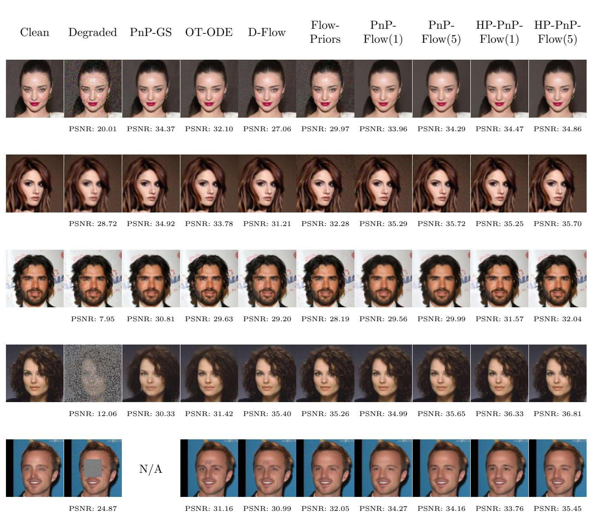  
Figure 2: PSNR comparison of all methods on CelebA across five restoration tasks (from top to bottom: denoising, deblurring, super-resolution, random inpainting, and box inpainting).

HP-PnP-Flow(1)

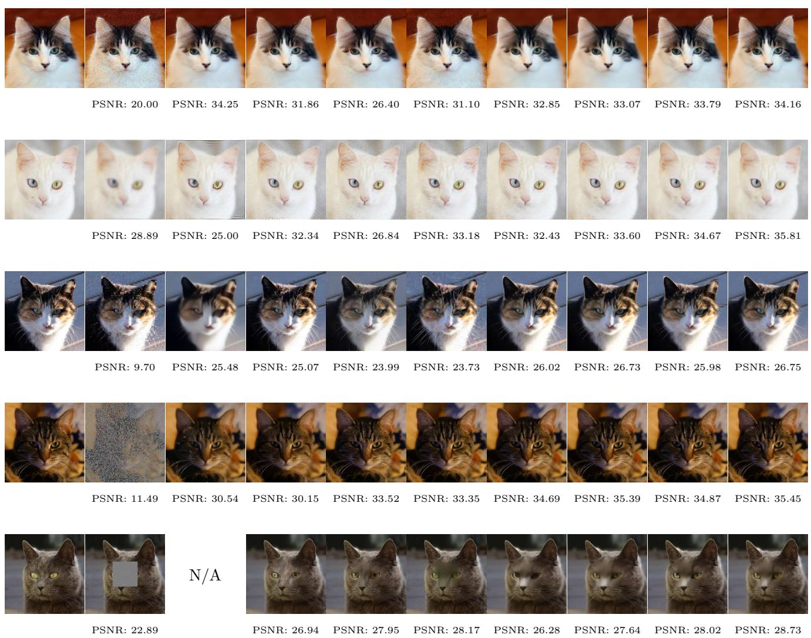  
Figure 3: PSNR comparison of all methods on AFHQ-Cat across five restoration tasks (from top to bottom: denoising, deblurring, super-resolution, random inpainting, and box inpainting).

Figures 2 and 3 further illustrate the strong and consistent restoration performance of HP-PnP-Flow across all five degradation tasks on both datasets. On CelebA, our algirithm achieves clear PSNR improvements over PnP-Flow in super-resolution, random inpainting, and box inpainting. Even under the single-sampling setting, HP-PnP-Flow(1) matches or surpasses most competing methods at their best-performing settings, while typically requiring fewer iterations.

In terms of visual quality, HP-PnP-Flow produces consistently clean reconstructions across the five tasks, with few noticeable artifacts, although mild over-smoothing may occur in some cases. By comparison, PnP-GS is less competitive on generative restoration tasks, while D-Flow performs less favorably on denoising and deblurring. Flow-Priors tends to introduce more visible noise and artifacts, whereas OT-ODE preserves textures reasonably well but is less efective on the more ill-posed restoration tasks. Overall, HP-PnP-Flow provides a favorable balance of reconstruction quality and robustness across diferent degradation settings.

## 4.5 Ablation Study

We conduct the ablation study on random inpainting with 70% missing pixels and Gaussian noise $\sigma = 0 . 0 1$ , using $N = 1 0 0$ iterations and set $\alpha = 0 . 0 1$ . Results are averaged over 10 test images and reported as the mean ± standard deviation of PSNR (dB).

Initial ofset $t _ { 0 }$ . To isolate the efect of the initial time ofset, we fix a linear schedule by setting $K = 0$ and vary $t _ { 0 } \in \{ 0 , 0 . 2 , 0 . 5 , 0 . 7 , 0 . 9 \}$ , with $t _ { 0 } = 0$ corresponding to the original PnP-Flow.

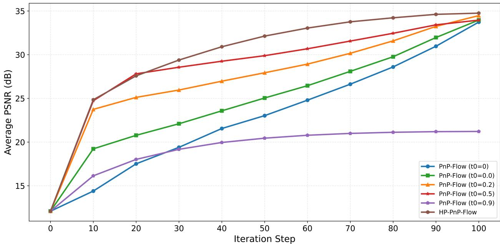  
Figure 4: PSNR convergence for diferent initial ofsets $t _ { 0 }$

Table 3: PSNR (dB) for diferent initial ofsets $t _ { 0 }$
<table><tr><td colspan="6">PnP-Flow  $( t _ { 0 } = 0 . 0 )$   $t _ { 0 } = 0 . 2$   $t _ { 0 } = 0 . 5$   $t _ { 0 } = 0 . 9$   $\mathrm { H P - P n P - F l o w }$ </td></tr><tr><td>Mean PSNR</td><td>33.73</td><td>33.96</td><td>34.47</td><td> $t _ { 0 } = 0 . 7$  33.95</td><td>34.75</td></tr><tr><td>Std. dev.</td><td>1.07</td><td>1.12</td><td>1.19 2.61</td><td>21.21 1.56</td><td>1.34</td></tr></table>

Figure 4 shows the PSNR trajectories for diferent choices of $t _ { 0 }$ . Compared with the baseline $t _ { 0 } = 0$ , a moderate positive initial ofset accelerates early-stage convergence. In particular, setting $t _ { 0 } = 0 . 5$ yields a mean PSNR of 34.47 dB, improving upon PnP-Flow by 0.74 dB while maintaining low variability. For $t _ { 0 } \in [ 0 . 2 , 0 . 7 ]$ , the final PSNR consistently exceeds that of the baseline, whereas performance deteriorates when $t _ { 0 }$ becomes too large $( \mathrm { e . g . , ~ } t _ { 0 } = 0 . 9 )$ . In addition, as revealed by Table 3, our algorithm achieves a further 0.28 dB improvement over the best $t _ { 0 } \mathrm { - o n l y }$ variant.

Transition coeficient K. To evaluate the efect of the transition coeficient K, we fix $\lambda = 0 . 9 6 5$ and vary $K \in \{ 0 . 0 , 0 . 2 , 0 . 5 , 0 . 7 , 1 . 0 \}$ . The choice $K = 0$ recovers a purely linear schedule used in [27], while $K = 1$ corresponds to a purely geometric schedule.

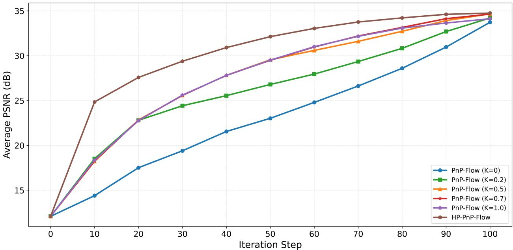  
Figure 5: PSNR convergence for diferent transition coeficients K.

Table 4: PSNR (dB) for diferent transition coeficients K.
<table><tr><td></td><td>PnP-Flow  $( K = 0 )$ </td><td> $K = 0 . 2$ </td><td> $K = 0 . 5$ </td><td> $K = 0 . 7$ </td><td> $K = 1 . 0$ </td><td>HP-PnP-Flow</td></tr><tr><td>Mean PSNR</td><td>33.73</td><td>34.20</td><td>34.66</td><td>34.65</td><td>34.12</td><td>34.75</td></tr><tr><td>Std. dev.</td><td>1.07</td><td>1.17</td><td>1.24</td><td>1.18</td><td>1.07</td><td>1.34</td></tr></table>

From Figure 5, we observe that a larger K accelerates early-stage convergence by increasing the contribution of the geometric phase. The purely linear schedule $( K = 0 )$ exhibits the slowest early-stage convergence, whereas larger values of K lead to more rapid initial PSNR improvement. When $K = 0 . 5$ , HP-PnP-Flow achieves the highest final PSNR among the single-factor variants (34.66 dB), outperforming both the purely linear $( K = 0 )$ and purely geometric (K = 1) schedules. This suggests that the two-phase design efectively combines the complementary advantages of geometric growth for rapid early recovery and linear refinement for stable convergence.

As shown in Table 4, the proposed HP-PnP-Flow, which combines the optimal $t _ { 0 }$ , the hybrid time schedule, and the projection operator, achieves both the fastest early-stage convergence and the highest final PSNR (34.75 dB) among all configurations, suggesting that these three compo nents provide complementary benefits.

## 5 Conclusion

In this work, we propose an eficient hybrid-projection Plug-and-Play-Flow algorithm, an improved Plug-and-Play algorithm for image inverse problems that integrates flow matching priors with a hybrid time schedule and pixel-space projection operator. Furthermore, we establish the convergence of HP-PnP-Flow without imposing the boundedness assumption on the iterates required in original PnP-Flow (see Proposition 4 in [27]), since the pixel-space projection keeps the iterates within the prescribed pixel range. The hybrid schedule combines geometric and linear growth phases, satisfies the convergence condition, and achieves faster early-stage reconstruction and improved numerical performance over the linear schedule used in PnP-Flow. Experiments on CelebA and AFHQ-Cat across five degradation tasks show that HP-PnP-Flow achieves the best or second-best PSNR, SSIM, and LPIPS in most settings, while requiring fewer iterations than PnP-Flow (e.g., 100 vs. 500 iterations for deblurring on AFHQ-Cat). Ablation studies further demonstrate that the initial time ofset $t _ { 0 }$ and the hybrid schedule contribute independently to the performance gains, with their combination yielding the best overall performance.

Several directions remain for future investigation. First, we plan to establish quantitative error bounds for HP-PnP-Flow under mild assumptions. Second, it would be interesting to explore whether the proposed hybrid time schedule can be extended to other generative-model-based PnP frameworks beyond flow matching.

## References

[1] Michael Samuel Albergo and Eric Vanden-Eijnden. Building normalizing flows with stochastic interpolants. In International Conference on Learning Representations, 2023.

[2] Mariana S. C. Almeida and M´ario Figueiredo. Deconvolving images with unknown boundaries using the alternating direction method of multipliers. IEEE Transactions on Image Processing, 22(8):3074–3086, 2013.

[3] Luigi Ambrosio, Nicola Gigli, and Giuseppe Savar´e. Gradient flows: in metric spaces and in the space of probability measures. Springer, 2005.

[4] Stephen Boyd, Neal Parikh, Eric Chu, Borja Peleato, and Jonathan Eckstein. Distributed Optimization and Statistical Learning via the Alternating Direction Method of Multipliers. Foundations and Trends® in Machine Learning, 3(1):1–122, 2011.

[5] Gabriel Cardoso, Sylvain Le Corf, Eric Moulines, et al. Monte Carlo guided denoising diffusion models for Bayesian linear inverse problems. In The Twelfth International Conference on Learning Representations, 2024.

[6] Stanley H Chan, Xiran Wang, and Omar A Elgendy. Plug-and-play admm for image restoration: Fixed-point convergence and applications. IEEE Transactions on Computational Imaging, 3(1):84–98, 2016.

[7] Ricky T. Q. Chen, Yulia Rubanova, Jesse Bettencourt, and David K Duvenaud. Neural ordi nary diferential equations. In S. Bengio, H. Wallach, H. Larochelle, K. Grauman, N. Cesa-Bianchi, and R. Garnett, editors, Advances in Neural Information Processing Systems, volume 31. Curran Associates, Inc., 2018.

[8] Yunjey Choi, Youngjung Uh, Jaejun Yoo, and Jung-Woo Ha. Stargan v2: Diverse image synthesis for multiple domains. In 2020 IEEE/CVF Conference on Computer Vision and Pattern Recognition (CVPR), pages 8185–8194. IEEE, 2020.

[9] Hyungjin Chung, Jeongsol Kim, Michael Thompson Mccann, Marc Louis Klasky, and Jong Chul Ye. Difusion posterior sampling for general noisy inverse problems. In The Eleventh International Conference on Learning Representations, 2023.

[10] Patrick L Combettes and Jean-Christophe Pesquet. Proximal splitting methods in signal processing. In Fixed-point algorithms for inverse problems in science and engineering, pages 185–212. Springer, 2011.

[11] Patrick L Combettes and Val´erie R Wajs. Signal recovery by proximal forward-backward splitting. Multiscale modeling & simulation, 4(4):1168–1200, 2005.

[12] Prafulla Dhariwal and Alexander Nichol. Difusion models beat gans on image synthesis. Advances in Neural Information Processing Systems, 34:8780–8794, 2021.

[13] Jim Douglas and Henry H Rachford. On the numerical solution of heat conduction problems in two and three space variables. Transactions of the American mathematical Society, 82(2):421– 439, 1956.

[14] Michael Elad, Bahjat Kawar, and Gregory Vaksman. Image denoising: The deep learning revolution and beyond—a survey paper. SIAM Journal on Imaging Sciences, 16(3):1594– 1654, 2023.

[15] Yuchen Fan, Jiahui Yu, Yiqun Mei, Yulun Zhang, Yun Fu, Ding Liu, and Thomas S Huang. Neural sparse representation for image restoration. Advances in Neural Information Processing Systems, 33:15394–15404, 2020.

[16] Ruiqi Feng, Chenglei Yu, Wenhao Deng, Peiyan Hu, and Tailin Wu. On the guidance of flow matching. In Forty-second International Conference on Machine Learning, 2025.

[17] D. Geman and Chengda Yang. Nonlinear image recovery with half-quadratic regularization. IEEE Transactions on Image Processing, 4(7):932–946, 1995.

[18] Dennis Hein, Afshin Bozorgpour, Dorit Merhof, and Ge Wang. Physics-inspired generative models in medical imaging. Annual Review of Biomedical Engineering, 27(1):499–525, 2025.

[19] Jonathan Ho, Ajay Jain, and Pieter Abbeel. Denoising difusion probabilistic models. Advances in Neural Information Processing Systems, 33:6840–6851, 2020.

[20] Samuel Hurault, Arthur Leclaire, and Nicolas Papadakis. Gradient step denoiser for convergent plug-and-play. In International Conference on Learning Representations (ICLR), Online, April 2022.

[21] Samuel Hurault, Arthur Leclaire, and Nicolas Papadakis. Proximal denoiser for convergent plug-and-play optimization with nonconvex regularization. In International Conference on Machine Learning, pages 9483–9505. PMLR, 2022.

[22] Fan Jia, Shen Mao, Xue-Cheng Tai, and Tieyong Zeng. A variational model for nonuniform low-light image enhancement. SIAM Journal on Imaging Sciences, 17(1):1–30, 2024.

[23] Shima Kamyab, Zohreh Azimifar, Rasool Sabzi, and Paul W. Fieguth. Survey of deep learning methods for inverse problems. PeerJ Computer Science, 8:e951, 2022.

[24] Jonas Latz, Aretha L Teckentrup, and Simon Urbainczyk. Deep gaussian process priors for bayesian image reconstruction. Inverse Problems, 41(6):065016, 2025.

[25] Yaron Lipman, Ricky T. Q. Chen, Heli Ben-Hamu, Maximilian Nickel, and Matthew Le. Flow matching for generative modeling. In The Eleventh International Conference on Learning Representations, 2023.

[26] Xingchao Liu, Chengyue Gong, and Qiang Liu. Flow straight and fast: Learning to generate and transfer data with rectified flow. In International Conference on Learning Representations, 2023.

[27] S´egol\`ene Martin, Anne Gagneux, Paul Hagemann, and Gabriele Steidl. Pnp-flow: Plug-andplay image restoration with flow matching. In The Thirteenth International Conference on Learning Representations (ICLR), 2025.

[28] Tim Meinhardt, Michael Moller, Caner Hazirbas, and Daniel Cremers. Learning proximal operators: Using denoising networks for regularizing inverse imaging problems. In Proceedings of the IEEE international conference on computer vision, pages 1781–1790, 2017.

[29] Jean-Christophe Pesquet, Audrey Repetti, Matthieu Terris, and Yves Wiaux. Learning maximally monotone operators for image recovery. SIAM Journal on Imaging Sciences, 14(3):1206–1237, 2021.

[30] Ashwini Pokle, Matthew J. Muckley, Ricky T. Q. Chen, and Brian Karrer. Training-free linear image inverses via flows. Transactions on Machine Learning Research, 2024.

[31] Adnan Qayyum, Inaam Ilahi, Fahad Shamshad, Farid Boussaid, Mohammed Bennamoun, and Junaid Qadir. Untrained neural network priors for inverse imaging problems: A survey. IEEE Transactions on Pattern Analysis and Machine Intelligence, 45(5):6511–6536, 2023.

[32] Ernest Ryu, Jialin Liu, Sicheng Wang, Xiaohan Chen, Zhangyang Wang, and Wotao Yin. Plug-and-play methods provably converge with properly trained denoisers. In International Conference on Machine Learning, pages 5546–5557. PMLR, 2019.

[33] Nikita Singhal, Anup Kadam, Pravesh Kumar, Hritik Singh, Aaryan Thakur, et al. Study of recent image restoration techniques: a comprehensive survey. Jordanian Journal of Computers & Information Technology, 11(2):211, 2025.

[34] Jiaming Song, Chenlin Meng, and Stefano Ermon. Denoising difusion implicit models. In International Conference on Learning Representations, 2021.

[35] Matthieu Terris, Audrey Repetti, Jean-Christophe Pesquet, and Yves Wiaux. Building firmly nonexpansive convolutional neural networks. In ICASSP 2020-2020 IEEE International Conference on Acoustics, Speech and Signal Processing (ICASSP), pages 8658–8662. IEEE, 2020.

[36] K. Topolnicki, S. Sharma, Yu. Volkotrub, and M. Das. Exploring maximum likelihood and bayesian approaches for two-dimensional image restoration: A machine learning perspective. Computer Physics Communications, 319:109913, 2026.

[37] Singanallur V Venkatakrishnan, Charles A Bouman, and Brendt Wohlberg. Plug-and-play priors for model based reconstruction. In 2013 IEEE global conference on signal and information processing, pages 945–948. IEEE, 2013.

[38] Singanallur V Venkatakrishnan, Charles A Bouman, and Brendt Wohlberg. Plug-and-play priors for model based reconstruction. In 2013 IEEE global conference on signal and information processing, pages 945–948. IEEE, 2013.

[39] Aamir Wali, Asma Naseer, Maria Tamoor, and SAM Gilani. Recent progress in digital image restoration techniques: A review. Digital Signal Processing, 141:104187, 2023.

[40] Guixian Xu, Jinglai Li, and Junqi Tang. A New Convergence Analysis of Plug-and-Play Proximal Gradient Descent Under Prior Mismatch. arXiv preprint arXiv:2601.09831, 2026.

[41] Shuo Yang, Ping Luo, Chen-Change Loy, and Xiaoou Tang. From facial parts responses to face detection: A deep learning approach. In Proceedings of the IEEE international conference on computer vision, pages 3676–3684, 2015.

[42] Kai Zhang, Yawei Li, Wangmeng Zuo, Lei Zhang, Luc Van Gool, and Radu Timofte. Plugand-play image restoration with deep denoiser prior. IEEE Transactions on Pattern Analysis and Machine Intelligence, 44(10):6360–6376, 2021.

[43] Kai Zhang, Wangmeng Zuo, Yunjin Chen, Deyu Meng, and Lei Zhang. Beyond a gaussian denoiser: Residual learning of deep cnn for image denoising. IEEE Transactions on Image Processing, 26(7):3142–3155, July 2017.

[44] Yasi Zhang, Peiyu Yu, Yaxuan Zhu, Yingshan Chang, Feng Gao, Ying N Wu, and Oscar Leong. Flow priors for linear inverse problems via iterative corrupted trajectory matching. Advances in Neural Information Processing Systems, 37:57389–57417, 2024.

## A Hyperparameter Configurations

We report the optimal hyperparameter settings for HP-PnP-Flow and all baseline methods on CelebA (Table 5) and AFHQ-Cat (Table 6). These settings are selected by grid search on the validation set to maximize PSNR. A dash ” − ” denotes that the corresponding method is not applicable to the given degradation task.

Table 5: Optimal hyperparameter settings on CelebA.
<table><tr><td>Method</td><td>Denoising</td><td>Deblurring</td><td>Super-res.</td><td>Rand. inp.</td><td>Box inp.</td></tr><tr><td>PnP-GS</td><td></td><td></td><td></td><td></td><td></td></tr><tr><td> $\gamma \ ( \mathrm { s t e p \ s i z e } )$ </td><td></td><td>2.0</td><td>2.0</td><td></td><td></td></tr><tr><td> $\alpha$  (momentum)</td><td>1.0</td><td>0.3</td><td>1.0</td><td></td><td></td></tr><tr><td> $\sigma _ { f }$  (noise factor)</td><td>1.0</td><td>1.8</td><td>3.0</td><td></td><td></td></tr><tr><td> $n _ { \mathrm { i t e r } }$  (iterations)</td><td>1</td><td>35</td><td>20</td><td>23</td><td></td></tr><tr><td>OT-ODE</td><td></td><td></td><td></td><td></td><td></td></tr><tr><td> $t _ { 0 }$  (initial time)</td><td>0.3</td><td>0.4</td><td>0.1</td><td>0.1</td><td>0.1</td></tr><tr><td> $\gamma$ </td><td> $\sqrt { t }$ </td><td> $\sqrt { t }$ </td><td>constant</td><td>constant</td><td> $\sqrt { t }$ </td></tr><tr><td>Flow-Priors</td><td></td><td></td><td></td><td></td><td></td></tr><tr><td>λ(regularization)</td><td>100</td><td>1000</td><td>10000</td><td>10000</td><td>10000</td></tr><tr><td>η (learning rate)</td><td>0.01</td><td>0.01</td><td>0.1</td><td>0.01</td><td>0.01</td></tr><tr><td>D-Flow</td><td></td><td></td><td></td><td></td><td></td></tr><tr><td>λ(regularization)</td><td>0.001</td><td>0.001</td><td>0.001</td><td>0.01</td><td>0.001</td></tr><tr><td>α (blending)</td><td>0.1</td><td>0.1</td><td>0.1</td><td>0.1</td><td>0.1</td></tr><tr><td> $n _ { \mathrm { i t e r } }$  (iterations)</td><td>3</td><td>7</td><td>10</td><td>20</td><td>9</td></tr><tr><td>PnP-Flow</td><td></td><td></td><td></td><td></td><td></td></tr><tr><td>α (step size exponent)</td><td>0.8</td><td>0.01</td><td>0.3</td><td>0.01</td><td>0.5</td></tr><tr><td> $N$  (iterations)</td><td>100</td><td>100</td><td>100</td><td>100</td><td>100</td></tr><tr><td>HP-PnP-Flow (ours)</td><td></td><td></td><td></td><td></td><td></td></tr><tr><td>η (step size scale)</td><td>1.0</td><td>1.0</td><td>1.0</td><td>1.0</td><td>2.0</td></tr><tr><td>α (step size exponent)</td><td>0.8</td><td>0.01</td><td>0.3</td><td>0.01</td><td>0.5</td></tr><tr><td> $N$  (iterations)</td><td>100</td><td>100</td><td>100</td><td>100</td><td>60</td></tr><tr><td> $t _ { 0 }$  (initial offset)</td><td>0.4</td><td>0.2</td><td>0.4</td><td>0.5</td><td>0.0</td></tr><tr><td> $\lambda$  (decay factor)</td><td>0.965</td><td>0.9</td><td>0.965</td><td>0.965</td><td>0.99</td></tr><tr><td>K (transition coefficient)</td><td>0.3</td><td>0.3</td><td>0.7</td><td>0.7</td><td>0.2</td></tr></table>

Note 1: PnP-Flow(1) and PnP-Flow(5) share the same hyperparameters across all tasks. Note 2: HP-PnP-Flow(1) and HP-PnP-Flow(5) share the same hyperparameters across all tasks.

Table 6: Optimal hyperparameter settings on AFHQ-Cat.
<table><tr><td>Method</td><td>Denoising</td><td>Deblurring</td><td>Super-res.</td><td>Rand. inp.</td><td>Box inp.</td></tr><tr><td>PnP-GS</td><td></td><td></td><td></td><td></td><td></td></tr><tr><td>γ (step size)</td><td></td><td>2.0</td><td>2.0</td><td></td><td></td></tr><tr><td>α (momentum)</td><td>1.0</td><td>0.3</td><td>1.0</td><td></td><td></td></tr><tr><td> $\sigma _ { f }$  (noise factor)</td><td>1.0</td><td>1.8</td><td>5.0</td><td></td><td></td></tr><tr><td> $n _ { \mathrm { i t e r } }$  (iterations)</td><td>1</td><td>60</td><td>50</td><td>23</td><td></td></tr><tr><td>OT-ODE</td><td></td><td></td><td></td><td></td><td></td></tr><tr><td> $t _ { 0 }$  (initial time)</td><td>0.3</td><td>0.3</td><td>0.1</td><td>0.1</td><td>0.1</td></tr><tr><td> $\gamma$ </td><td>√t</td><td>√t</td><td>constant</td><td>constant</td><td> $\sqrt { t }$ </td></tr><tr><td>Flow-Priors</td><td></td><td></td><td></td><td></td><td></td></tr><tr><td>λ(regularization)</td><td>100</td><td>1000</td><td>10000</td><td>10000</td><td>10000</td></tr><tr><td>η (learning rate)</td><td>0.01</td><td>0.01</td><td>0.1</td><td>0.01</td><td>0.01</td></tr><tr><td>D-Flow</td><td></td><td></td><td></td><td></td><td></td></tr><tr><td>λ(regularization)</td><td>0.001</td><td>0.001</td><td>0.001</td><td>0.001</td><td>0.01</td></tr><tr><td>α (blending)</td><td>0.1</td><td>0.5</td><td>0.1</td><td>0.1</td><td>0.1</td></tr><tr><td> $n _ { \mathrm { i t e r } }$  (iterations)</td><td>3</td><td>20</td><td>20</td><td>20</td><td>9</td></tr><tr><td>PnP-Flow</td><td></td><td></td><td></td><td></td><td></td></tr><tr><td>α (step size exponent)</td><td>0.8</td><td>0.01</td><td>0.01</td><td>0.01</td><td>0.5</td></tr><tr><td>N (iterations)</td><td>100</td><td>500</td><td>500</td><td>200</td><td>100</td></tr><tr><td>HP-PnP-Flow (ours)</td><td></td><td></td><td></td><td></td><td></td></tr><tr><td>η (step size scale)</td><td>1.2</td><td>1.0</td><td>1.2</td><td>1.0</td><td>2.0</td></tr><tr><td>α (step size exponent)</td><td>0.8</td><td>0.01</td><td>0.01</td><td>0.01</td><td>0.5</td></tr><tr><td>N (iterations)</td><td>100</td><td>100</td><td>100</td><td>100</td><td>60</td></tr><tr><td> $t _ { 0 }$  (initial offset)</td><td>0.4</td><td>0.2</td><td>0.4</td><td>0.3</td><td>0.0</td></tr><tr><td>λ (decay factor)</td><td>0.965</td><td>0.965</td><td>0.965</td><td>0.965</td><td>0.99</td></tr><tr><td>K (transition coefficient)</td><td>0.4</td><td>0.3</td><td>0.7</td><td>0.7</td><td>0.2</td></tr></table>

Note 1: PnP-Flow(1) and $\mathrm { P n P \mathrm { - F l o w } ( 5 ) }$ share the same hyperparameters across all tasks.  
Note 2: HP-PnP-Flow(1) and $\mathrm { H P - P n P - F l o w }$ (5) share the same hyperparameters across all tasks.

## B Iteration-wise Comparison with PnP-Flow

Figures 6-15 present iteration snapshots of HP-PnP-Flow and PnP-Flow across all five restoration tasks and both datasets. All experiments are conducted under the single-sampling setting.

clean img

Step 100  
Step 80  
Step 60  
Step 40  
Figure 6: Denoising on CelebA (σ = 0.2).  
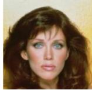  
PSNR: 100.00 dB SSIM: 1.0000

Step 0  
  
PSNR: 20.58 dBSSIM: 0.4195

Step 20  
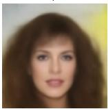  
PSNR: 20.27 dBSSIM: 0.6697

Step 40  
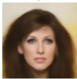  
PSNR: 24.54 dBSSIM: 0.7582

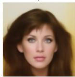  
PSNR: 27.00 dBSSIM: 0.8153

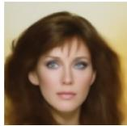  
PSNR: 29.00 dBSSIM: 0.8502  
Step 100

  
PSNR: 31.67 dBSSIM: 0.9012

clean img  
  
PSNR: 100.00 dB SSIM: 1.0000

Step 0  
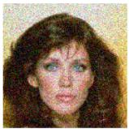  
PSNR: 20.58 dESSIM: 0.4195

Step 20  
(a) PnP-Flow  
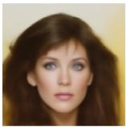  
PSNR: 27.85 dBSSIM: 0.8308

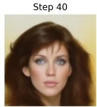  
PSNR: 29.44 dBSSIM: 0.8575

(b) HP-PnP-Flow  
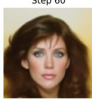  
PSNR: 30.58 dBSSIM: 0.8829

Step 80  
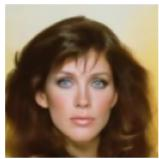  
PSNR: 31.53 dBSSIM: 0.8983

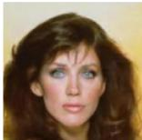  
PSNR: 32.07 dBSSIM: 0.9056

clean img  
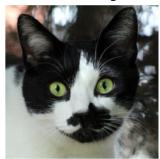  
PSNR: 100.00 dB SSIM: 1.0000

Step 0  
  
PSNR: 20.72 dBSSIM: 0.3598

Step 20  
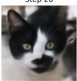  
PSNR: 20.47 dBSSIM: 0.6090

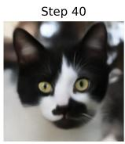  
PSNR: 24.37 dBSSIM: 0.7268

Step 60  
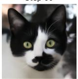  
PSNR: 26.56 dBSSIM: 0.7877

Step 80  
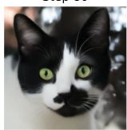  
PSNR: 29.12 dESSIM: 0.8421

Step 100  
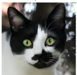  
PSNR: 32.09 dBSSIM: 0.9009

clean img  
  
PSNR: 100.00 dB SSIM: 1.0000

(a) PnP-Flow  
Step 0  
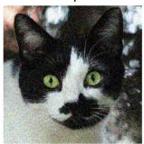  
PSNR: 20.72 dBSSIM: 0.3598

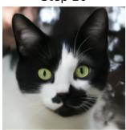  
Step 20  
PSNR: 28.43 dBSSIM: 0.8280

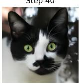  
(b) HP-PnP-Flow  
PSNR: 30.58 dBSSIM: 0.8711

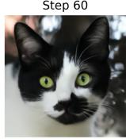  
PSNR: 31.56 dBSSIM: 0.8898

Step 80  
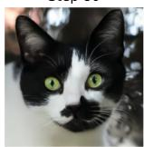  
PSNR: 32.62 dBSSIM: 0.9078

Step 100  
  
PSNR: 33.05 dBSSIM: 0.9164

Figure 7: Denoising on AFHQ-Cat (σ = 0.2).

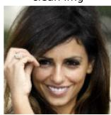  
PSNR: 100.00 dB SSIM: 1.0000

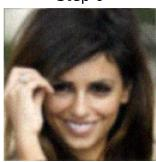  
PSNR: 27.23 dBSSIM: 0.7922

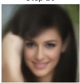  
PSNR: 18.97 dBSSIM: 0.5743

  
PSNR: 23.22 dBSSIM: 0.6931

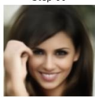  
PSNR: 26.05 dBSSIM: 0.7769

  
PSNR: 29.47 dBSSIM: 0.8523  
Step 100

  
PSNR: 32.81 dBSSIM: 0.9198

clean img  
(a) PnP-Flow  
  
PSNR: 100.00 dB SSIM: 1.0000

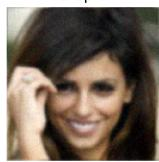  
PSNR: 27.23 dBSSIM: 0.7922

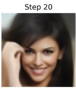  
PSNR: 22.51 dBSSIM: 0.6840

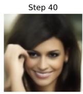  
PSNR: 24.90 dBSSIM: 0.7430

(b) HP-PnP-Flow  
  
PSNR: 27.35 dBSSIM: 0.8115

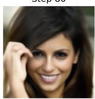  
PSNR: 29.90 dBSSIM: 0.8660

  
PSNR: 32.90 dBSSIM: 0.9204

Figure 8: Deblurring on CelebA (σ = 0.05, b = 1.0).  
  
PSNR: 100.00 dB SSIM: 1.0000

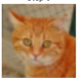  
PSNR: 25.89 dBSSIM: 0.5500

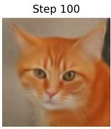  
PSNR: 22.70 dBSSIM: 0.5698

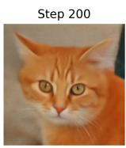  
PSNR: 25.54 dBSSIM: 0.6527

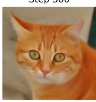  
PSNR: 27.13 dBSSIM: 0.6913

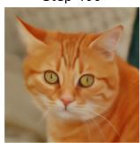  
PSNR: 28.59 dBSSIM: 0.7380

  
(a) PnP-Flow  
Step 500  
PSNR: 29.34 dBSSIM: 0.7784

  
PSNR: 100.00 dB SSIM: 1.0000

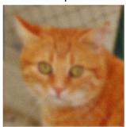  
PSNR: 25.89 dBSSIM: 0.5500

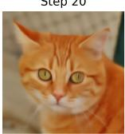  
PSNR: 29.13 dBSSIM: 0.7541

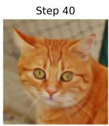  
PSNR: 30.24 dB SSIM: 0.7893

(b) HP-PnP-Flow  
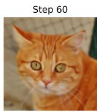  
PSNR: 30.18 dE SSIM: 0.7895

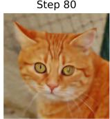  
PSNR: 29.87 dBSSIM: 0.7821

  
PSNR: 29.53 dBSSIM: 0.7660

Figure 9: Deblurring on AFHQ-Cat (σ = 0.05, b = 3.0).

  
PSNR: 100.00 dB SSIM: 1.0000

  
PSNR: 26.59 dBSSIM: 0.7368

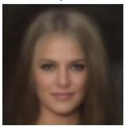  
PSNR: 15.90 dBSSIM: 0.4317

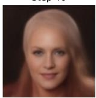  
PSNR: 18.94 dBSSIM: 0.5198

  
PSNR: 23.18 dBSSIM: 0.6923

  
PSNR: 26.82 dBSSIM: 0.7826  
Step 100

  
PSNR: 31.69 dBSSIM: 0.9030

clean img  
  
(a) PnP-Flow  
PSNR: 100.00 dB SSIM: 1.0000

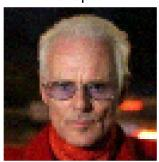  
PSNR: 26.59 dESSIM: 0.7368

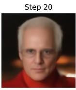  
PSNR: 24.77 dBSSIM: 0.7299

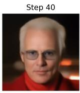  
PSNR: 28.25 dBSSIM: 0.8283

(b) HP-PnP-Flow  
  
PSNR: 30.89 dBSSIM: 0.8841

  
PSNR: 32.68 dBSSIM: 0.9186

  
PSNR: 33.43 dBSSIM: 0.9298

Figure 10: Super-resolution on CelebA (×2, σ = 0.05).  
  
clean img  
PSNR: 100.00 dB SSIM: 1.0000

  
PSNR: 23.30 dBSSIM: 0.6207

  
PSNR: 14.48 dBSSIM: 0.5415

  
PSNR: 18.10 dBSSIM: 0.6335

  
PSNR: 23.51 dBSSIM: 0.7517

  
PSNR: 25.05 dBSSIM: 0.7922

  
Step 500  
PSNR: 28.90 dBSSIM: 0.8532

(a) PnP-Flow  
clean img  
  
PSNR: 100.00 dB SSIM: 1.0000

  
PSNR: 23.30 dBSSIM: 0.6207

  
PSNR: 24.67 dESSIM: 0.7765

  
PSNR: 26.43 dBSSIM: 0.8126

(b) HP-PnP-Flow  
  
PSNR: 28.14 dBSSIM: 0.8434

  
PSNR: 29.16 dBSSIM: 0.8668

Step 100  
  
PSNR: 29.28 dBSSIM: 0.8560

Figure 11: Super-resolution on AFHQ-Cat (×4, σ = 0.05).

clean img

clean img

Step 200  
  
PSNR: 100.00 dB SSIM: 1.0000

  
PSNR: 10.03 dBSSIM: 0.2354  
Step 20

  
PSNR: 16.11 dBSSIM: 0.6767  
Step 40

  
PSNR: 21.94 dBSSIM: 0.8043  
Step 60

  
PSNR: 25.02 dESSIM: 0.8660  
Step 80

  
PSNR: 28.57 dBSSIM: 0.9142  
Step 100

  
PSNR: 34.49 dBSSIM: 0.9711  
clean img

(a) PnP-Flow  
  
PSNR: 100.00 dB SSIM: 1.0000

  
PSNR: 10.03 dESSIM: 0.2354  
Step 20

  
PSNR: 28.24 dBSSIM: 0.9081  
Step 40

  
PSNR: 31.35 dBSSIM: 0.9431  
Step 60

(b) HP-PnP-Flow  
  
PSNR: 34.03 dESSIM: 0.9644  
Step 80

  
PSNR: 35.25 dBSSIM: 0.9743  
Step 100

  
PSNR: 35.85 dBSSIM: 0.9787

Figure 12: Random inpainting on CelebA (70% masked, σ = 0.01).  
  
PSNR: 100.00 dB SSIM: 1.0000

  
PSNR: 11.35 dBSSIM: 0.1692

  
PSNR: 20.11 dBSSIM: 0.5444

  
PSNR: 23.93 dBSSIM: 0.6889

  
PSNR: 26.52 dBSSIM: 0.7634

  
PSNR: 30.31 dBSSIM: 0.8665

  
PSNR: 36.07 dBSSIM: 0.9602

(a) PnP-Flow  
  
PSNR: 100.00 dB SSIM: 1.0000

  
PSNR: 11.35 dBSSIM: 0.1692

  
PSNR: 27.10 dBSSIM: 0.7839

  
PSNR: 30.87 dBSSIM: 0.8774

(b) HP-PnP-Flow  
  
PSNR: 33.67 dBSSIM: 0.9252

  
PSNR: 35.46 dBSSIM: 0.9509

  
PSNR: 36.54 dBSSIM: 0.9640

Figure 13: Random inpainting on AFHQ-Cat (70% masked, σ = 0.01).

Step 60  
Step 50  
Step 0  
Step 20  
Step 0  
Figure 15: Box inpainting on AFHQ-Cat (80 × 80, σ = 0.05).  
  
PSNR: 100.00 dB SSIM: 1.0000

Step 0  
  
PSNR: 23.83 dBSSIM: 0.7830

Step 20  
  
PSNR: 20.86 dBSSIM: 0.5490

Step 40  
  
PSNR: 23.89 dBSSIM: 0.6649

Step 60  
  
PSNR: 26.19 dBSSIM: 0.7728

Step 80  
  
PSNR: 28.86 dBSSIM: 0.8509  
Step 100

  
PSNR: 31.70 dBSSIM: 0.9418

clean img  
  
PSNR: 100.00 dB SSIM: 1.0000

  
PSNR: 23.83 dESSIM: 0.7830

(a) PnP-Flow  
  
PSNR: 22.27 dBSSIM: 0.6198

  
PSNR: 24.61 dBSSIM: 0.7342

(b) HP-PnP-Flow  
  
PSNR: 27.86 dBSSIM: 0.8133

  
PSNR: 31.10 dBSSIM: 0.9014

  
PSNR: 33.77 dBSSIM: 0.9547

Figure 14: Box inpainting on CelebA (40 × 40, σ = 0.05).  
clean img  
  
PSNR: 100.00 dB SSIM: 1.0000

  
PSNR: 23.07 dBSSIM: 0.7415

  
PSNR: 22.19 dBSSIM: 0.5422

  
PSNR: 24.74 dBSSIM: 0.6547

  
PSNR: 25.78 dBSSIM: 0.7055

  
Step 80  
PSNR: 26.22 dBSSIM: 0.7661

  
(a) PnP-Flow  
Step 100  
PSNR: 27.15 dBSSIM: 0.8798

clean img  
  
PSNR: 100.00 dB SSIM: 1.0000  
PSNR: 23.07 dBSSIM: 0.7415

  
PSNR: 22.56 dBSSIM: 0.6052

  
(b) HP-PnP-Flow  
PSNR: 25.50 dBSSIM: 0.6943

  
PSNR: 27.01 dBSSIM: 0.7569

  
PSNR: 28.20 dBSSIM: 0.8215

Step 60  
  
PSNR: 29.38 dBSSIM: 0.9041