# Holi-World

# Building Holistic World Intelligence from Human-Ego Experience

Hao Li1,2\*, Xiyuan Zheng1,2\*, Yuanyuan Gao1,3\*, Yalun Dai1,2, Xinhao Ji1,4, Xuan-Li Chen1, Jing Zhao1, Fangzhou Hong1, Zhaoxi Chen1, Ziwei Liu1,2†

1Ropedia 2NTU 3HKUST 4PKU \*Equal contribution †Corresponding author

§ Code: github.com/Ropedia/holi-world Model: huggingface.co/ropedia-ai/holiworld-vl Dataset: huggingface.co/datasets/ropedia-ai/holiworld-data

## Abstract

Human egocentric experience offers a rich foundation for learning how the world is organized and how it changes through interaction. Realizing this potential at scale requires turning growing volumes of recordings into learning resources that connect scene structure, object semantics, and interaction histories across viewpoints and time, while reducing dependence on costly manual annotation. We introduce HOLI-WORLD, an integrated ecosystem connecting experience capture, world representation, automated data construction, model learning, and independent evaluation. To support learning at scale, HOLIWORLD-Foundry combines complementary static and dynamic perception to automatically construct world records that connect persistent scene structure and evolving object states with interaction histories and supporting observations. HOLIWORLD-Data organizes these records from approximately 100 self-collected scenes into grounded learning resources, including approximately 80K QA pairs used to train HOLIWORLD-VL-4B. Independent human annotations of heldout recordings form HOLIWORLD-Bench, supporting evaluation of both annotation quality and learned spatial and temporal understanding. Experiments on ScanNet, ScanNet++, Aria Digital Twin, and HOLIWORLD-Bench demonstrate strong performance in static perception and dynamic tracking, while training on HOLIWORLD-Data substantially improves HOLIWORLD-VL-4B’s spatial and temporal reasoning on HOLI-WORLD-Bench and EgoDynamic4D. HOLIWORLD provides a practical foundation for expanding learning resources from the continuous flow of human experience and advancing machine understanding of the dynamic world.

## 1. Introduction

Learning how the physical world is organized and how it changes through interaction is a fundamental goal of artificial intelligence and an essential step toward artificial general intelligence (AGI) [39, 18, 19]. Although vision–language learning and predictive video modeling enable machines to recognize objects, describe scenes, interpret activities, and anticipate visual changes [35, 20, 23, 3, 1], building a coherent understanding of the world across viewpoints and time remains an open challenge [44, 41, 22]. Everyday human experience naturally brings these dimensions together: moving through an environment reveals its enduring spatial structure, while interacting with objects reveals how they are used and how their states and relationships change. Therefore, we place human experience at the center of learning world intelligence, asking how it should be captured, organized, and learned from to support an understanding of environments, objects, and interactions as parts of a shared, evolving world.

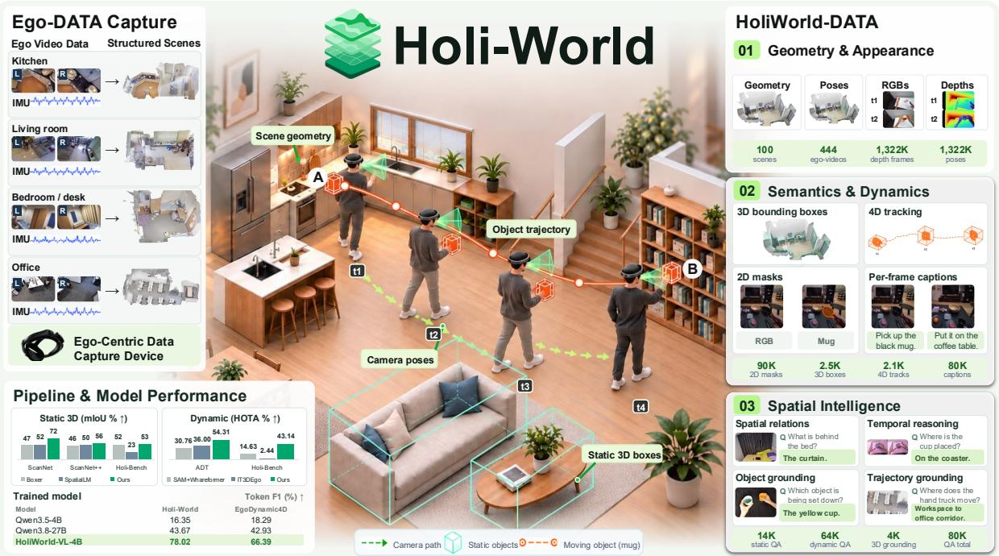  
Figure 1 | Overview of HOLIWORLD. HOLIWORLD connects in-the-wild egocentric capture, automated static and dynamic annotation, and vision-language learning. Scene geometry, object semantics, and interaction histories form aligned multimodal supervision for grounding and spatial and temporal reasoning. Representative annotations and results illustrate data coverage, annotation quality, and HOLIWORLD-VL performance.

Egocentric data offers a direct route to learning about the world through the breadth of human life. It records environments as people experience them, bringing together the places they inhabit, the objects they use, and the activities through which their surroundings change [36, 9, 40]. Large-scale efforts [13, 14, 26, 45] have expanded this record across diverse people, places, and activities. However, turning these recordings into detailed learning supervision often requires substantial human input, tying further expansion to additional annotation and curation costs [10]. The challenge is therefore to scale high-quality supervision with incoming experience while retaining the spatial and temporal information needed to understand environments, objects, and interactions as parts of an evolving world.

Recent advances provide complementary capabilities for automating this process: reconstruction and semantic annotation of predominantly static scenes for spatial supervision [12], and egocentric tracking of object identities and 3D locations over time [48, 31]. Turning these capabilities into coherent learning resources requires connecting scene geometry and object semantics with interaction histories, then deriving supervision that remains traceable to the underlying observations. To this end, we introduce HOLIWORLD, an integrated ecosystem for automatically constructing high-quality learning resources at scale from egocentric recordings that we collect in the wild using our capture device. At its core, HOLIWORLD-Foundry first reconstructs scene geometry and camera poses, then uses VLM-derived motion and interaction cues to separate static objects from dynamic tracking targets. For static objects, it lifts image detections into 3D and consolidates them with scene point-cloud detections to recover object geometry and semantics. For dynamic objects, it associates identities across interaction segments, tracks object regions in image space, and recovers 3D states and trajectories in shared world coordinates. Built on these multimodal records, HOLIWORLD-Data organizes approximately 100 scenes and 444 egocentric videos across four levels: raw observations, reconstructed geometry, object and interaction semantics, and spatial intelligence supervision. By further parsing geometric relations, object trajectories, and interaction states, we construct approximately 80K evidence-driven QA pairs covering spatial relations, temporal changes, and interactions, with each answer linked to its supporting observations and annotations. We train HOLIWORLD-VL on this supervision for visual grounding and spatial reasoning, providing a downstream test of the generated data’s learning value. Finally, we establish HOLIWORLD-Bench through independent human annotation of held-out recordings, providing reference annotations for evaluating both Foundry’s world-record accuracy and HOLIWORLD-VL’s spatial understanding.

Experiments evaluate HOLIWORLD through both annotation quality and downstream spatial reasoning. For static perception, HOLIWORLD-Foundry achieves an AP25 of 0.68 on ScanNet [8], compared with 0.40 for the strongest baseline in our evaluation. For dynamic tracking, it achieves a HOTA0.1 of 54.31% on 20 Aria Digital Twin sequences [29], compared with 36.00% for IT3DEgo [48] with ground-truth-guided initialization. The resulting supervision also supports substantial improvements in downstream reasoning: compared with the original Qwen3.5-4B, HOLIWORLD-VL-4B improves Token F1 from 16.35% to 78.02% on HOLIWORLD-Bench and from 18.29% to 66.39% on EgoDynamic4D [15].

Our contributions are threefold:

• We introduce HOLIWORLD, an integrated ecosystem that provides a practical blueprint for learning world intelligence from human egocentric experience. It connects experience capture, world representation, automated data construction, model learning, and independent evaluation around a shared representation of the evolving world.

• We develop HOLIWORLD-Foundry to automatically construct world records that preserve persistent scene structure and evolving object states. Complementary static and dynamic perception links geometry, semantics, and interaction histories through persistent identities and supporting observations, enabling scalable construction of grounded supervision.

• We construct HOLIWORLD-Data to support grounding and spatial and temporal reasoning, and use these resources to train HOLIWORLD-VL. We further establish HOLIWORLD-Bench through independent human annotation, providing reference data for evaluating both the quality of automatically constructed world records and the capabilities of learned models.

## 2. Related Work

## 2.1. Egocentric Datasets and Annotations

Large-scale egocentric datasets cover diverse human activities and environments [9, 13, 14]. EPIC Fields and Aria Digital Twin add camera and scene geometry [40, 29], while HD-EPIC [30] connects actions, object movements, and gaze to 3D digital twins through detailed manual annotation. However, extending such detailed supervision to new recordings entails further annotation effort [10, 30]. HOLIWORLD addresses this scaling bottleneck by automatically recovering scene structure, object states, and interaction annotations from newly captured recordings and converting them into learning supervision, reducing dependence on manual labeling as new experience is collected.

## 2.2. 3D Scene Reconstruction and Object Tracking

Holi-Spatial [12] automates static scene reconstruction, semantic annotation, and spatial QA generation at scale, while Boxer [11] consolidates multi-view detections into static 3D boxes. However, static scene consolidation does not retain the successive object states needed to describe motion and interactions. Egocentric tracking provides complementary capabilities: IT3DEgo and EgoSeg3D [48, 4] maintain object identities and locations over time, and LMK, introduced for the Out of Sight, Not Out of Mind (OSNOM) task [31], maintains spatial memory beyond the current view. HOLIWORLD-Foundry connects these static and dynamic perception objectives within an automated data construction pipeline. Shared world coordinates and persistent identities link scene geometry, evolving object states, and interaction evidence, enabling spatial and temporal supervision to refer to the same objects and supporting observations.

## 2.3. Spatial and Temporal Reasoning in Vision–Language Models

Dedicated spatial supervision [6, 27] and geometry-aware visual representations [50, 49, 42] improve spatial reasoning, while video benchmarks [44, 22] test these capabilities across observations. ST-Think and EgoReasoner [43, 51] further study reasoning over egocentric spatial and temporal information. EgoDynamic4D [15] constructs dynamic QA from existing annotated 4D resources and introduces a model integrating static and dynamic scene information. We follow its QA patterns, while addressing the upstream challenge of automatically constructing the underlying annotations from new recordings. HOLIWORLD connects experience capture, automated annotation, supervision generation, and model training, allowing new recordings to expand the learning resources. Independent human-annotated evaluation then assesses both the accuracy of the recovered records and the capabilities learned from them.

## 3. Method

## 3.1. HoliWorld Overview

HoliWorld converts egocentric recordings into spatially and temporally aligned supervision (Fig. 2). The Eagle Capture Device records synchronized stereo RGB and IMU measurements; HoliWorld-Foundry reconstructs scenes and annotates static objects and dynamic tracks. HoliWorld-Data organizes these outputs into grounding, captioning, and spatial QA supervision for HoliWorld-VL. Independent human annotations of held-out recordings form HoliWorld-Bench for evaluating Foundry’s annotation quality and HoliWorld-VL’s spatial understanding.

## 3.2. HoliWorld Foundry

## 3.2.1. Geometric Preparation and Shared Semantic Cues

As illustrated in Fig. 3, we first recover camera poses and sparse points from stereo RGB and IMU using visual-inertial SLAM, then estimate depth and dense points from RGB keyframes and these poses with Depth Anything 3 (DA3) [21]. Using RGB observations and this geometry, we optimize a 3D Gaussian scene representation [16] $\mathcal { G }$ , render refined depth at the observed poses, and complete dynamic regions with per-frame DA3 depth estimation. We retain $\mathcal { G }$ and the reconstructed scene point cloud ${ \mathcal { P } } ,$ and organize the resulting observations as

$$
O = \{ ( I _ { t } , D _ { t } , { \bf K } _ { t } , { \bf T } _ { t } ) \} _ { t = 1 } ^ { T } ,\tag{1}
$$

where $I _ { t }$ is an RGB frame, $D _ { t }$ is a depth map, $\mathbf { K } _ { t }$ is the camera intrinsic matrix, and $\mathbf { T } _ { t }$ maps camera coordinates to world coordinates. To route static and dynamic objects to their respective

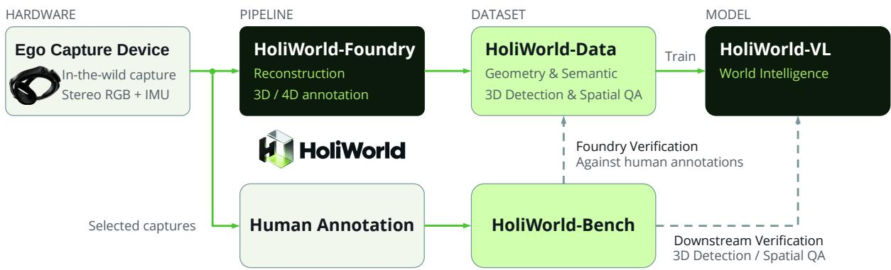  
Figure 2 | The HOLIWORLD ecosystem. It connects egocentric capture, Foundry, Data, and VL. Humanannotated Bench evaluates annotation quality and spatial understanding.

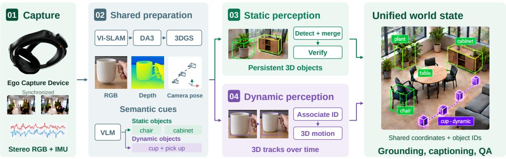  
Figure 3 | HoliWorld-Foundry overview. Shared preparation reconstructs geometry and routes objects to static or dynamic perception. Static perception (03) detects, merges, and verifies persistent 3D objects; dynamic perception (04) associates identities and recovers 3D tracks. Both outputs are fused into a unified world state.

perception pipelines, a vision–language model (VLM) extracts categories, attributes, motion cues, and interaction descriptions from RGB keyframes in O; categories guide static image-based proposals, while motion and interaction cues identify dynamic tracking targets.

## 3.2.2. Static Object Perception

Dual-path 3D detection. To capture both object details and scene-level geometry, we combine image-based and point-cloud-based 3D detection (Fig. 4A). In the image-based path, we run Boxer [11] separately on the left and right RGB streams to capture complementary object details. Open-vocabulary 2D detections are lifted into metric 3D boxes using the corresponding depth and camera poses, then associated across frames. In parallel, TR3D [38] detects objects in the reconstructed scene point cloud P, capturing large-object extents beyond individual views.

Box merging and geometric filtering. Across these complementary sources, multiple proposals may refer to the same object, while others have little geometric support. We therefore use lowcost geometric checks to merge spatially compatible boxes and discard those with insufficient point support in P before VLM validation (Fig. 4B). For validation, we also preserve one fallback per selected box when available: the rank-1 alternative in its candidate cluster, or, if unavailable, a directly suppressed candidate linked by IoU suppression. Each box retains its own supporting evidence.

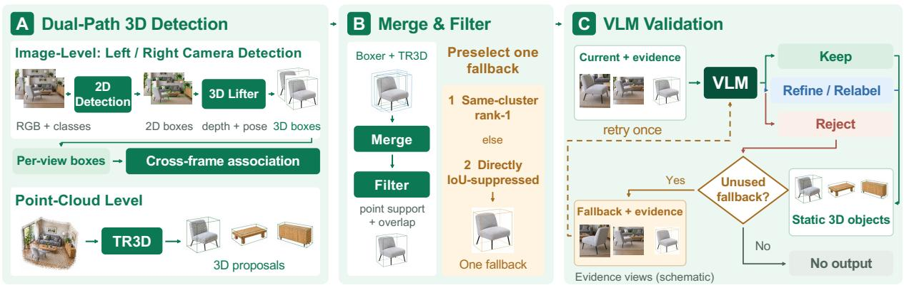

Figure 4 | Static object perception. (A) Complementary image and point-cloud paths generate 3D candidates. (B) Geometric merging and filtering retain a current candidate and one preselected fallback. (C) VLM validation uses each candidate’s own evidence, with at most one fallback retry. Synthetic illustrations depict inputs and intermediate states.  
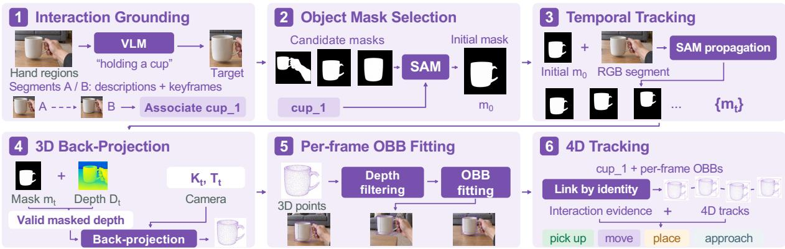  
Figure 5 | Dynamic object perception. Cross-segment identity association guides mask selection and within-segment propagation. Valid masked depth yields filtered 3D points and per-frame 3D oriented bounding boxes (OBBs). Linking boxes by identity produces 4D tracks; tracks and interaction evidence jointly support motion cues. Synthetic illustrations depict inputs and intermediate states.

VLM validation. The remaining boxes may still have inaccurate extents or incorrect category labels. A VLM therefore checks each selected box against source observations and supplementary views rendered from G (Fig. 4C). Based on this evidence, it can keep the box, refine its geometry, relabel its category, or reject it. If the selected box is rejected, we evaluate its preselected fallback once using the fallback’s own evidence. If no unused fallback is available or the retry fails, no box is retained. Accepted boxes form Bsta with links to their supporting observations.

## 3.2.3. Dynamic Object Perception

Interaction grounding and identity association. Manipulated objects may disappear from view and reappear in later interaction segments. To recognize the same object across these interruptions, we use hand regions and VLM interaction descriptions to identify the target in each segment, then compare descriptions and keyframe evidence across segments. This temporal label continuity establishes consistent object identities that guide target mask selection (Fig. 5).

Identity-guided mask tracking. The associated identities specify which object to follow, while frame-level masks are needed to localize it over time. Guided by these identities, the Segment Anything Model (SAM) [17, 37] selects and initializes the target mask, then propagates it within each interaction segment to obtain {��}. We assume at most one moving object at each time,

with $m _ { t }$ denoting its foreground pixels.

3D recovery and motion cues. Image-space motion also reflects camera movement. To recover object states in world coordinates, we back-project the pixels of each valid tracked mask using the DA3-completed dynamic depths in $D _ { t }$ and the camera pose:

$$
\begin{array} { r } { \boldsymbol { \mathcal { X } } _ { t } = \left\{ \mathbf { T } _ { t } \left( D _ { t } ( \mathbf { u } ) \mathbf { K } _ { t } ^ { - 1 } \bar { \mathbf { u } } \right) \Big | \mathbf { u } \in m _ { t } , D _ { t } ( \mathbf { u } ) \mathrm { ~ i s ~ v a l i d } \right\} , } \end{array}\tag{2}
$$

where u¯ is the homogeneous image coordinate, $\mathbf { T } _ { t } ( \cdot )$ applies the camera-to-world rigid transformation, and $X _ { t }$ contains the object-supported world points. After filtering unsupported depth samples, we fit an OBB to each point set and link boxes with the same identity across time to form a dynamic 4D track.

## 3.2.4. Unified World Representation

Object records connect instance identities and categories to image evidence, 3D geometry, and interaction cues. We express the Foundry output at time � as

$$
S ( t ) = \big ( O _ { t } , \mathcal { U } ( t ) , \mathcal { G } , \mathcal { P } , \mathcal { B } ^ { \mathrm { s t a } } , \mathcal { B } ^ { \mathrm { d y n } } ( t ) , \mathcal { Z } ( t ) \big ) ,\tag{3}
$$

where ${ \cal O } _ { t } = \left( I _ { t } , D _ { t } , { \bf K } _ { t } , { \bf T } _ { t } \right)$ is the input observation, $\mathcal { U } ( t )$ contains the detected 2D boxes and tracked masks, and ${ \mathcal { Z } } ( t )$ records the associated labels, identities, confidence scores, interaction semantics, and evidence links. Static instances persist across observations; dynamic instances retain time-indexed states. This representation lets supervision refer to specific objects, times, and supporting observations.

## 3.3. HoliWorld-Data

HoliWorld-Data organizes the world records constructed by Foundry into grounding, captioning, and spatial, temporal, and interaction QA supervision. The available evidence determines the scope of these tasks: static objects and their geometry support spatial understanding; dynamic tracks with consistent object identities support motion and temporal understanding; and tracks paired with interaction semantics support descriptions of object manipulation and state changes. Each example retains links to source observations and annotations, allowing its target output to be traced to specific objects, times, and supporting evidence.

QA pairs construction. We construct QA pairs from the spatial, temporal, and interaction annotations in Foundry’s world records, following the QA patterns of EgoDynamic4D [15]. Grounding tasks associate referring expressions with the corresponding 2D

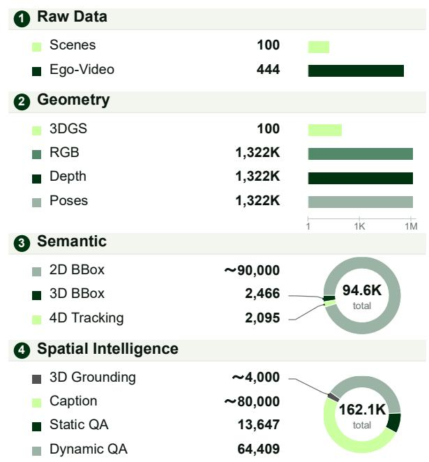  
Figure 6 | HoliWorld-Data composition and its spatial-temporal supervision.

observations, static 3D boxes, or dynamic tracks. Spatial QA uses object geometry and camera poses to derive direction, distance, containment, support, and viewpoint-dependent relations. Temporal QA compares the states of the same object over time to describe motion, event ordering, and duration. Interaction QA additionally uses interaction semantics and source observations to describe manipulated objects and state changes. Scene captions and inventory questions aggregate object records across frames to describe the observed environment. Dynamic supervision follows Foundry’s current assumption of at most one moving object at each time.

Dataset composition. HoliWorld-Data contains roughly 100 scenes and 444 egocentric videos, with approximately 100 3D Gaussian splatting (3DGS) reconstructions, 1,322K RGB frames with corresponding depth maps and camera poses, 90K 2D boxes, 2,466 static 3D boxes, and 2,095 dynamic tracks (Fig. 6). These records support about 4K 3D grounding annotations and 80K captions, together with 13,647 static QA pairs and 64,409 dynamic QA pairs, totaling about 80K QA pairs.

## 4. Experiments

We evaluate the pipeline’s ability to generate object-centric 3D annotations for both static scenes and moving objects. Sections 4.1 and 4.2 present the results for static object perception and dynamic object tracking. Section 4.4 examines the contributions of key pipeline components through controlled ablations. Detailed experimental settings are provided in Appendix Sections A.1 and A.2.

## 4.1. Static 3D Object Perception

As shown in Table 1, HOLIWORLD-FOUNDRY achieves the highest $\mathrm { A P } _ { 2 5 }$ and $\mathrm { A P } _ { 5 0 }$ on all three datasets. On ScanNet [8] and ScanNet++ [47], $\mathrm { A P } _ { 5 0 }$ reaches 0.55 and 0.13, respectively, compared with 0.12 and 0.05 for the strongest baselines, indicating more accurate detection under stricter geometric matching. The method also leads on the more complex real-world scenes in HoliWorld-Bench. Fig. 7 shows more complete object coverage and better-aligned box extents across representative scenes, consistent with these quantitative gains.

Table 1 | Static 3D perception on ScanNet, ScanNet++, and HoliWorld-Bench ([0, 1] scale). AP uses 3D IoU thresholds of 0.25/0.50; mIoU uses pairs matched at IoU 0.25. Best and second-best results are highlighted in deep green and light green .
<table><tr><td></td><td colspan="3">ScanNet</td><td colspan="3">ScanNet++</td><td colspan="3">HoliWorld-Bench</td></tr><tr><td>Method</td><td> $\mathrm { A P } _ { 2 5 }$  ←</td><td> $\mathrm { A P } _ { 5 0 }$  ←</td><td>mIoU↑</td><td> $\mathrm { A P } _ { 2 5 } \uparrow$ </td><td> $\mathrm { A P } _ { 5 0 } \uparrow$ </td><td>mIoU↑</td><td> $\mathrm { A P } _ { 2 5 }$  ←</td><td> $\mathrm { A P } _ { 5 0 }$  ←</td><td>mIoU↑</td></tr><tr><td colspan="10">Model-based methods</td></tr><tr><td>SpatialLM</td><td>0.18</td><td>0.09</td><td>0.52</td><td>0.03</td><td>0.01</td><td>0.50</td><td>0.04</td><td>0.00</td><td>0.23</td></tr><tr><td>LLaVA-3D</td><td>0.02</td><td>0.00</td><td>0.34</td><td>0.00</td><td>0.00</td><td>0.34</td><td>0.00</td><td>0.00</td><td>0.00</td></tr><tr><td>SceneScript</td><td>0.00</td><td>0.00</td><td>0.00</td><td>0.00</td><td>0.00</td><td>0.00</td><td>0.00</td><td>0.00</td><td>0.00</td></tr><tr><td>Map-Det3D</td><td>0.40</td><td>0.12</td><td>0.48</td><td>0.18</td><td>0.05</td><td>0.48</td><td>0.12</td><td>0.01</td><td>0.37</td></tr><tr><td colspan="10">3DGS-based methods</td></tr><tr><td>M3-Spatial</td><td>0.00</td><td>0.00</td><td>0.37</td><td>0.00</td><td>0.00</td><td>0.60</td><td>0.06</td><td>0.00</td><td>0.28</td></tr><tr><td>LangŠplat</td><td>0.02</td><td>0.00</td><td>0.45</td><td>0.01</td><td>0.00</td><td>0.33</td><td>0.01</td><td>0.00</td><td>0.10</td></tr><tr><td colspan="10">Spatial pipeline frameworks</td></tr><tr><td>Boxer</td><td>0.32</td><td>0.09</td><td>0.47</td><td>0.23</td><td>0.05</td><td>0.46</td><td>0.16</td><td>0.07</td><td>0.52</td></tr><tr><td>Holi-Spatial</td><td>0.33</td><td>0.10</td><td>0.47</td><td>0.17</td><td>0.05</td><td>0.45</td><td>0.07</td><td>0.01</td><td>0.37</td></tr><tr><td>Ours</td><td>0.68</td><td>0.55</td><td>0.72</td><td>0.30</td><td>0.13</td><td>0.56</td><td>0.24</td><td>0.12</td><td>0.53</td></tr></table>

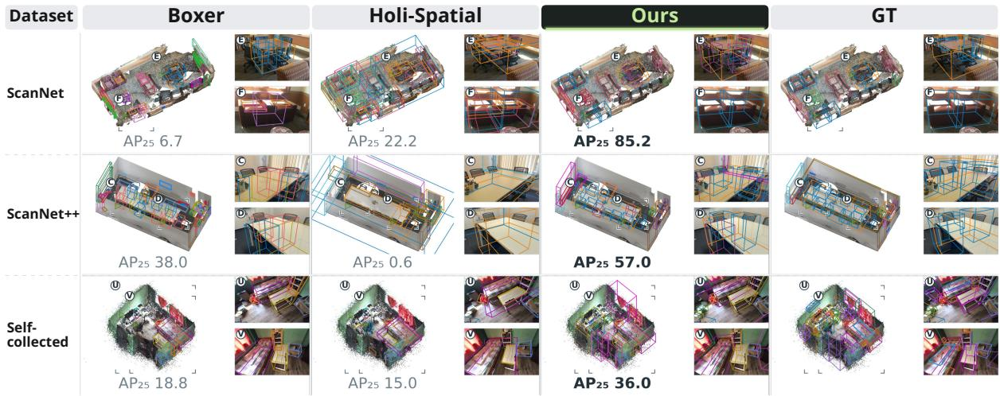  
Figure 7 | Qualitative static 3D object perception results across representative scenes.

## 4.2. Dynamic 3D Object Perception and Tracking

In Table 2, HOLIWORLD-FOUNDRY attains HOTA scores of 54.31% on ADT and 43.14% on HoliWorld-Bench, compared with 36.00% and 15.13% for the strongest baselines, respectively. Higher AssA and PCL indicate more consistent identities and broader trajectory coverage across both datasets. Box metrics provide a complementary comparison of spatial extents on matched objects. Fig. 8 illustrates trajectories that more closely follow the reference paths across the shown interaction stages.

Table 2 | Dynamic tracking on ADT20 and HoliWorld-Bench (%) at a 0.1 m trajectory tolerance. ∗GT first-visible mask initialization; †GT category queries. See Appendix A.2 for input adaptations and evaluation protocols. Best and second-best results are highlighted in deep green and light green .
<table><tr><td></td><td colspan="6">ADT20</td><td colspan="6">HoliWorld-Bench</td></tr><tr><td></td><td colspan="3">Bounding box</td><td colspan="3">Trajectory</td><td colspan="3">Bounding box</td><td colspan="3">Trajectory</td></tr><tr><td>Method</td><td>IoU↑ GTC↑</td><td></td><td>PP↑</td><td>HOTA↑ AssA↑</td><td></td><td>PCL↑</td><td>IoU↑</td><td>GTC↑</td><td>PP↑</td><td>HOTA↑ AssA↑</td><td></td><td>PCL↑</td></tr><tr><td colspan="9">Instance segmentation and tracking pipeline</td><td></td><td></td><td></td></tr><tr><td>EgoSeg3D</td><td></td><td></td><td></td><td>21.89</td><td>37.11</td><td>36.47</td><td></td><td></td><td></td><td>5.76</td><td>21.78</td><td>36.84</td></tr><tr><td>IT3DEgo*</td><td></td><td></td><td></td><td>36.00</td><td>53.60</td><td>34.64</td><td></td><td></td><td></td><td>2.44</td><td>4.36</td><td>7.89</td></tr><tr><td>SAM+Whareformer*</td><td></td><td></td><td></td><td>30.76</td><td>40.99</td><td>31.26</td><td>一</td><td>一</td><td></td><td>14.63</td><td>20.97</td><td>36.84</td></tr><tr><td colspan="9">3D object perception and tracking pipelines</td><td></td><td></td><td></td><td></td></tr><tr><td>SAM+LMK*</td><td>7.96</td><td>21.27</td><td>14.53</td><td>26.10</td><td>30.76</td><td>21.45</td><td>20.28</td><td>50.84</td><td>21.30</td><td>15.13</td><td>14.35</td><td>23.68</td></tr><tr><td>Ours</td><td>30.88</td><td>43.03</td><td>56.25</td><td>54.31</td><td>71.94</td><td>47.95</td><td>41.79</td><td>53.18</td><td>76.49</td><td>43.14</td><td>56.54</td><td>57.89</td></tr></table>

## 4.3. Downstream Spatial and Temporal Understanding

Fine-tuning Qwen3.5-4B [33] on HoliWorld-Data raises Token F1 from 16.35% to 78.02% on HoliWorld-Bench and from 18.29% to 66.39% on EgoDynamic4D (Table 3), supporting the value of the generated supervision for spatial and temporal reasoning. The resulting HoliWorld-VL-4B also surpasses zero-shot Qwen3.8-27B [34] on all four metrics across both benchmarks. The gains in yes/no, multiple-choice, and numerical accuracy complement the Token F1 improvements, indicating that the generated supervision benefits multiple question formats across the two benchmarks.

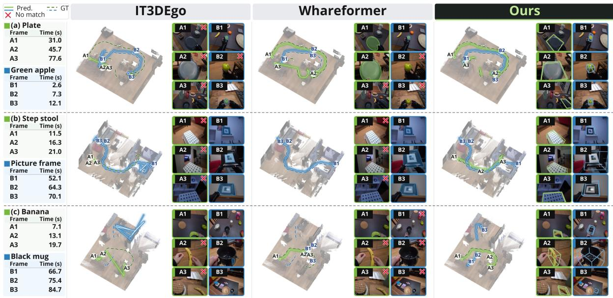  
Figure 8 | Dynamic tracking in three scenes. Solid/dashed curves show predicted/GT trajectories; panels show initial, middle, and final observations. Red crosses mark unmatched observations.

Table 3 | Spatial reasoning results (%). F1 denotes Token F1; Y/N, MCQ, and Num. report yes/no, multiple-choice, and numerical accuracy. Best and second-best results are highlighted in deep green and light green .
<table><tr><td></td><td colspan="4">HoliWorld-Bench</td><td colspan="4">EgoDynamic4D</td></tr><tr><td>Model</td><td>F1↑</td><td>Y/N↑</td><td>MCQ↑</td><td>Num.↑</td><td>F1↑</td><td>Y/N↑</td><td>MCQ↑</td><td>Num.↑</td></tr><tr><td>Qwen3.5-4B</td><td>16.35</td><td>34.86</td><td>62.00</td><td>10.80</td><td>18.29</td><td>59.47</td><td>79.16</td><td>0.02</td></tr><tr><td>Qwen3.8-27B</td><td>43.67</td><td>82.85</td><td>75.00</td><td>66.13</td><td>42.93</td><td>61.07</td><td>57.54</td><td>0.16</td></tr><tr><td>HoliWorld-VL-4B</td><td>78.02</td><td>93.52</td><td>94.00</td><td>81.84</td><td>66.39</td><td>99.67</td><td>94.92</td><td>16.33</td></tr></table>

## 4.4. Ablation Studies

Static components. Fig. 9(a–b) illustrates complementary geometric coverage: image-based lifting method captures more small objects, point-cloud detection recovers larger extents, and stereo fusion combines observations from both views. Caption guidance recovers missed entities (c). VLM verification shows modest changes in geometric metrics, while the qualitative examples illustrate corrections to object labels and unsuitable candidates (d), suggesting a complementary role in semantic annotation. Detailed AP25 and mIoU comparisons are reported in Table 5 (Appendix A.3).

Dynamic components. Fig. 9(e–f) highlights two complementary requirements for reliable trajectories. Cross-interaction label continuity reduces identity fragmentation across repeated observations, while SAM association supplies temporally consistent masks for 3D lifting, reducing the trajectory deviations seen with per-frame detection. Together, they preserve both object correspondence and spatial continuity. Corresponding HOTA and PCL gains on both datasets are reported in Table 5 (Appendix A.3).

## 5. Conclusion

In this paper, we presented HOLIWORLD, an integrated ecosystem that places human egocentric experience at the center of learning world intelligence. Through complementary static and dynamic perception, HOLIWORLD-Foundry automatically constructs world records linking scene geometry, object semantics, and interaction histories to supporting observations. These records form HOLIWORLD-Data and support HOLIWORLD-VL training, while independently annotated HOLIWORLD-Bench provides reference data for evaluating annotation quality and learned capabilities. Experiments demonstrate improved static perception and dynamic tracking, alongside gains in spatial and temporal reasoning on HOLIWORLD-Bench and EgoDynamic4D. HOLIWORLD provides a practical foundation for expanding these grounded learning resources with new recordings, enabling machines to learn how the world is organized and how it changes through interaction.

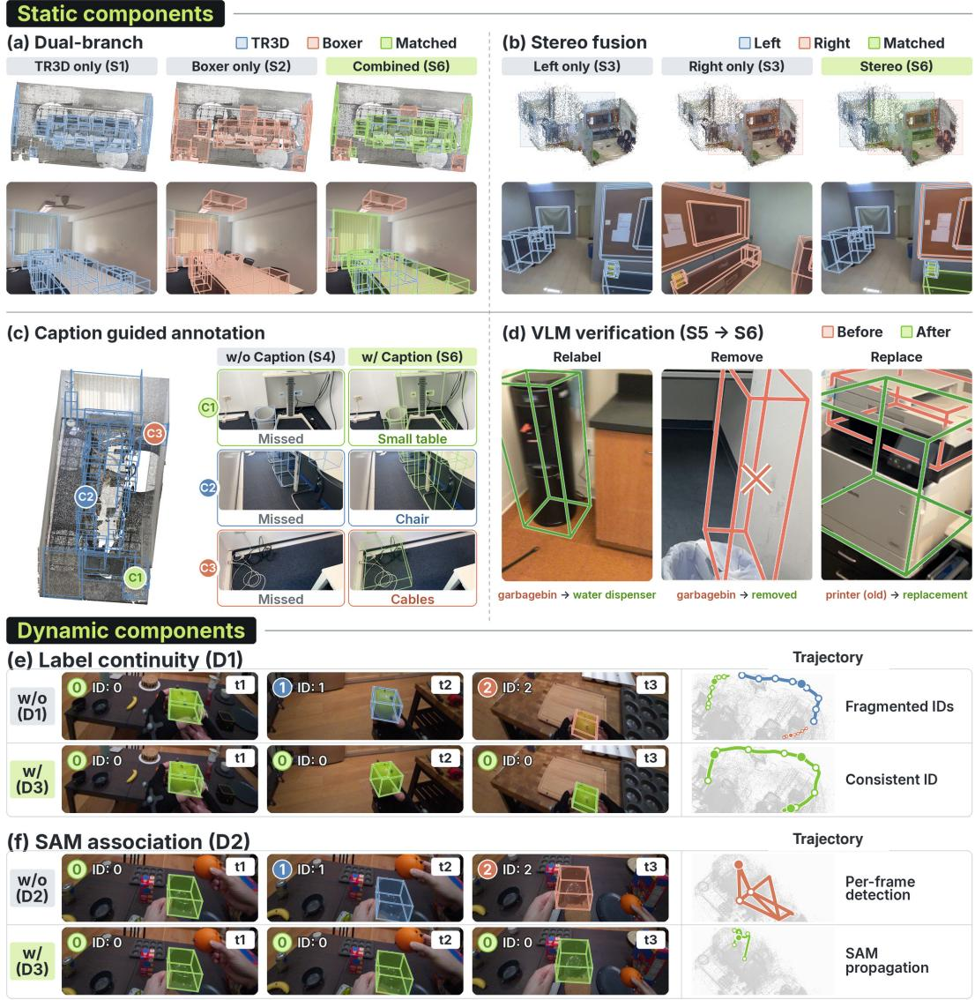  
Figure 9 | Qualitative ablation results for the static and dynamic components.

## References

[1] Mido Assran, Adrien Bardes, David Fan, and 1 others. 2025. V-JEPA 2: Self-supervised video models enable understanding, prediction and planning. arXiv preprint arXiv:2506.09985.

[2] Armen Avetisyan, Christopher Xie, Henry Howard-Jenkins, Tsun-Yi Yang, Samir Aroudj, Suvam Patra, Fuyang

Zhang, Duncan Frost, Luke Holland, Campbell Orme, Jakob Engel, Edward Miller, Richard Newcombe, and Vasileios Balntas. 2025. SceneScript: Reconstructing scenes with an autoregressive structured language model. In Computer Vision – ECCV 2024, pages 247–263.

[3] Shuai Bai, Keqin Chen, Xuejing Liu, Jialin Wang, Wenbin Ge, Sibo Song, Kai Dang, Peng Wang, Shijie Wang, Jun Tang, Humen Zhong, Yuanzhi Zhu, Mingkun Yang, Zhaohai Li, Jianqiang Wan, Pengfei Wang, Wei Ding, Zheren Fu, Yiheng Xu, and 8 others. 2025. Qwen2.5-VL technical report. arXiv preprint arXiv:2502.13923.

[4] Yash Bhalgat, Vadim Tschernezki, Iro Laina, Joao F. Henriques, Andrea Vedaldi, and Andrew Zisserman. 2024. 3D-aware instance segmentation and tracking in egocentric videos. In Asian Conference on Computer Vision.

[5] Jacob Chalk, Saptarshi Sinha, Dima Damen, Yannis Kalantidis, and Diane Larlus. 2026. Whareformer: Learning to track what is where in long egocentric videos. In European Conference on Computer Vision (ECCV).

[6] Boyuan Chen, Zhuo Xu, Sean Kirmani, Brian Ichter, Dorsa Sadigh, Leonidas Guibas, and Fei Xia. 2024. SpatialVLM: Endowing vision-language models with spatial reasoning capabilities. In Proceedings ofthe IEEE/CVF Conference on Computer Vision and Pattern Recognition (CVPR), pages 14455–14465.

[7] Ho Kei Cheng, Seoung Wug Oh, Brian Price, Alexander Schwing, and Joon-Young Lee. 2023. Tracking anything with decoupled video segmentation. In Proceedings of the IEEE/CVF International Conference on Computer Vision (ICCV).

[8] Angela Dai, Angel X. Chang, Manolis Savva, Maciej Halber, Thomas Funkhouser, and Matthias Nießner. 2017. ScanNet: Richly-annotated 3D reconstructions of indoor scenes. In Proceedings of the IEEE Conference on Computer Vision and Pattern Recognition (CVPR).

[9] Dima Damen, Hazel Doughty, Giovanni Maria Farinella, Antonino Furnari, Evangelos Kazakos, Jian Ma, Davide Moltisanti, Jonathan Munro, Toby Perrett, Will Price, and Michael Wray. 2022. Rescaling egocentric vision: Collection, pipeline and challenges for EPIC-KITCHENS-100. International Journal ofComputer Vision, 130:33–55.

[10] Ahmad Darkhalil, Dandan Shan, Bin Zhu, Jian Ma, Amlan Kar, Richard Higgins, Sanja Fidler, David Fouhey, and Dima Damen. 2022. EPIC-KITCHENS VISOR benchmark: Video segmentations and object relations. In Advances in Neural Information Processing Systems, volume 35.

[11] Daniel DeTone, Tianwei Shen, Fan Zhang, Lingni Ma, Julian Straub, Richard Newcombe, and Jakob Engel. 2026. Boxer: Robust lifting of open-world 2D bounding boxes to 3D. In European Conference on Computer Vision (ECCV).

[12] Yuanyuan Gao, Hao Li, Yifei Liu, Xinhao Ji, Yuning Gong, Yuanjun Liao, Fangfu Liu, Manyuan Zhang, Yuchen Yang, Dan Xu, Xue Yang, Huaxi Huang, Hongjie Zhang, Ziwei Liu, Xiao Sun, Dingwen Zhang, and Zhihang Zhong. 2026. Holi-Spatial: Evolving video streams into holistic 3D spatial intelligence. In Proceedings of the 43rd International Conference on Machine Learning (ICML).

[13] Kristen Grauman, Andrew Westbury, Eugene Byrne, Zachary Chavis, Antonino Furnari, Rohit Girdhar, Jackson Hamburger, Hao Jiang, Miao Liu, Xingyu Liu, Miguel Martin, Tushar Nagarajan, Ilija Radosavovic, Santhosh Kumar Ramakrishnan, Fiona Ryan, Jayant Sharma, Michael Wray, Mengmeng Xu, Eric Zhongcong Xu, and 66 others. 2022. Ego4D: Around the world in 3,000 hours of egocentric video. In Proceedings ofthe IEEE/CVF Conference on Computer Vision and Pattern Recognition, pages 18995–19012.

[14] Kristen Grauman, Andrew Westbury, Lorenzo Torresani, Kris Kitani, Jitendra Malik, and 1 others. 2024. Ego-Exo4D: Understanding skilled human activity from first- and third-person perspectives. In Proceedings of the IEEE/CVF Conference on Computer Vision and Pattern Recognition.

[15] Junsheng Huang, Shengyu Hao, Bo-Cheng Hu, Hongwei Wang, and Gaoang Wang. 2026. Understanding dynamic scenes in egocentric 4D point clouds. Proceedings of the AAAI Conference on Artificial Intelligence, 40(7):5031– 5039.

[16] Bernhard Kerbl, Georgios Kopanas, Thomas Leimkühler, and George Drettakis. 2023. 3d gaussian splatting for real-time radiance field rendering. ACM Trans. Graph., 42(4):139–1.

[17] Alexander Kirillov, Eric Mintun, Nikhila Ravi, Hanzi Mao, Chloe Rolland, Laura Gustafson, Tete Xiao, Spencer Whitehead, Alexander C. Berg, Wan-Yen Lo, Piotr Dollár, and Ross Girshick. 2023. Segment anything. In Proceedings of the IEEE/CVF International Conference on Computer Vision (ICCV), pages 4015–4026.

[18] Brenden M. Lake, Tomer D. Ullman, Joshua B. Tenenbaum, and Samuel J. Gershman. 2017. Building machines that learn and think like people. Behavioral and Brain Sciences, 40:e253.

[19] Yann LeCun. 2022. A path towards autonomous machine intelligence. Position paper, version 0.9.2.

[20] Junnan Li, Dongxu Li, Silvio Savarese, and Steven Hoi. 2023. BLIP-2: Bootstrapping language-image pre-training with frozen image encoders and large language models. In Proceedings of the 40th International Conference on Machine Learning, volume 202, pages 19730–19742.

[21] Haotong Lin, Sili Chen, Jun Hao Liew, Donny Y. Chen, Zhenyu Li, Yang Zhao, Sida Peng, Hengkai Guo, Xiaowei Zhou, Guang Shi, Jiashi Feng, and Bingyi Kang. 2026. Depth Anything 3: Recovering the visual space from any views. In International Conference on Learning Representations (ICLR).

[22] Jingli Lin, Runsen Xu, Shaohao Zhu, Sihan Yang, Peizhou Cao, Yunlong Ran, Miao Hu, Chenming Zhu, Yiman Xie, Yilin Long, Wenbo Hu, Dahua Lin, Tai Wang, and Jiangmiao Pang. 2025. MMSI-Video-Bench: A holistic benchmark for video-based spatial intelligence. arXiv preprint arXiv:2512.10863.

[23] Haotian Liu, Chunyuan Li, Qingyang Wu, and Yong Jae Lee. 2023. Visual instruction tuning. In Advances in Neural Information Processing Systems, volume 36.

[24] Shilong Liu, Zhaoyang Zeng, Tianhe Ren, Feng Li, Hao Zhang, Jie Yang, Qing Jiang, Chunyuan Li, Jianwei Yang, Hang Su, Jun Zhu, and Lei Zhang. 2025. Grounding DINO: Marrying DINO with grounded pre-training for open-set object detection. In Computer Vision – ECCV 2024, pages 38–55.

[25] Jonathon Luiten, Aljosa Osep, Patrick Dendorfer, Philip Torr, Andreas Geiger, Laura Leal-Taixe, and Bastian Leibe. 2021. HOTA: A higher order metric for evaluating multi-object tracking. International Journal of Computer Vision, 129(2):548–578.

[26] Lingni Ma, Yuting Ye, Fangzhou Hong, Vladimir Guzov, Yifeng Jiang, Rowan Postyeni, Luis Pesqueira, Alexander Gamino, Vijay Baiyya, Hyo Jin Kim, Kevin Bailey, David Soriano Fosas, C. Karen Liu, Ziwei Liu, Jakob Engel, Renzo De Nardi, and Richard Newcombe. 2024. Nymeria: A massive collection of multimodal egocentric daily motion in the wild. In European Conference on Computer Vision.

[27] Wufei Ma, Luoxin Ye, Celso M de Melo, Alan Yuille, and Jieneng Chen. 2025. SpatialLLM: A compound 3Dinformed design towards spatially-intelligent large multimodal models. In Proceedings of the IEEE/CVF Conference on Computer Vision and Pattern Recognition, pages 17249–17260.

[28] Yongsen Mao, Junhao Zhong, Chuan Fang, Jia Zheng, Rui Tang, Hao Zhu, Ping Tan, and Zihan Zhou. 2025. SpatialLM: Training large language models for structured indoor modeling. In Advances in Neural Information Processing Systems, volume 38.

[29] Xiaqing Pan, Nicholas Charron, Yongqian Yang, Scott Peters, Thomas Whelan, Chen Kong, Omkar Parkhi, Richard Newcombe, and Yuheng (Carl) Ren. 2023. Aria Digital Twin: A new benchmark dataset for egocentric 3D machine perception. In Proceedings of the IEEE/CVF International Conference on Computer Vision (ICCV), pages 20133–20143.

[30] Toby Perrett, Ahmad Darkhalil, Saptarshi Sinha, Omar Emara, Sam Pollard, Kranti Kumar Parida, Kaiting Liu, Prajwal Gatti, Siddhant Bansal, Kevin Flanagan, Jacob Chalk, Zhifan Zhu, Rhodri Guerrier, Fahd Abdelazim, Bin Zhu, Davide Moltisanti, Michael Wray, Hazel Doughty, and Dima Damen. 2025. HD-EPIC: A highly-detailed egocentric video dataset. In Proceedings of the IEEE/CVF Conference on Computer Vision and Pattern Recognition, pages 23901–23913.

[31] Chiara Plizzari, Shubham Goel, Toby Perrett, Jacob Chalk, Angjoo Kanazawa, and Dima Damen. 2025. Spatial cognition from egocentric video: Out of sight, not out of mind. In International Conference on 3D Vision (3DV).

[32] Minghan Qin, Wanhua Li, Jiawei Zhou, Haoqian Wang, and Hanspeter Pfister. 2024. LangSplat: 3D language gaussian splatting. In Proceedings of the IEEE/CVF Conference on Computer Vision and Pattern Recognition, pages 20051–20060.

[33] Qwen Team. 2026. Qwen3.5: Towards native multimodal agents.

[34] Qwen Team. 2026. Qwen3.8-Max: A new bar for coding and cowork.

[35] Alec Radford, Jong Wook Kim, Chris Hallacy, Aditya Ramesh, Gabriel Goh, Sandhini Agarwal, Girish Sastry, Amanda Askell, Pamela Mishkin, Jack Clark, Gretchen Krueger, and Ilya Sutskever. 2021. Learning transferable visual models from natural language supervision. In Proceedings of the 38th International Conference on Machine Learning, volume 139, pages 8748–8763.

[36] Francesco Ragusa, Antonino Furnari, Salvatore Livatino, and Giovanni Maria Farinella. 2021. The MECCANO dataset: Understanding human-object interactions from egocentric videos in an industrial-like domain. In Proceedings ofthe IEEE/CVF Winter Conference on Applications ofComputer Vision, pages 1569–1578.

[37] Nikhila Ravi, Valentin Gabeur, Yuan-Ting Hu, Ronghang Hu, Chaitanya Ryali, Tengyu Ma, Haitham Khedr, Roman Rädle, Chloe Rolland, Laura Gustafson, Eric Mintun, Junting Pan, Kalyan Vasudev Alwala, Nicolas Carion, Chao-Yuan Wu, Ross Girshick, Piotr Dollár, and Christoph Feichtenhofer. 2025. SAM 2: Segment anything in images and videos. In International Conference on Learning Representations (ICLR).

[38] Danila Rukhovich, Anna Vorontsova, and Anton Konushin. 2023. Tr3d: Towards real-time indoor 3d object detection. In 2023 IEEE International Conference on Image Processing (ICIP), pages 281–285. IEEE.

[39] Joshua B. Tenenbaum, Charles Kemp, Thomas L. Griffiths, and Noah D. Goodman. 2011. How to grow a mind: Statistics, structure, and abstraction. Science, 331(6022):1279–1285.

[40] Vadim Tschernezki, Ahmad Darkhalil, Zhifan Zhu, David Fouhey, Iro Laina, Diane Larlus, Dima Damen, and Andrea Vedaldi. 2023. EPIC Fields: Marrying 3D geometry and video understanding. In Advances in Neural Information Processing Systems, volume 36.

[41] Qineng Wang, Baiqiao Yin, Pingyue Zhang, Jianshu Zhang, Kangrui Wang, Zihan Wang, Jieyu Zhang, Keshigeyan Chandrasegaran, Han Liu, Ranjay Krishna, Saining Xie, Jiajun Wu, Fei-Fei Li, and Manling Li. 2026. Spatial mental modeling from limited views. In International Conference on Learning Representations.

[42] Diankun Wu, Fangfu Liu, Yi-Hsin Hung, and Yueqi Duan. 2025. Spatial-MLLM: Boosting MLLM capabilities in visual-based spatial intelligence. In Advances in Neural Information Processing Systems, volume 38.

[43] Peiran Wu, Yunze Liu, Miao Liu, and Junxiao Shen. 2026. ST-Think: How multimodal large language models reason about 4D worlds from ego-centric videos. In Proceedings of the IEEE/CVF Winter Conference on Applications of Computer Vision, pages 5174–5183.

[44] Jihan Yang, Shusheng Yang, Anjali W. Gupta, Rilyn Han, Fei-Fei Li, and Saining Xie. 2025. Thinking in space: How multimodal large language models see, remember, and recall spaces. In Proceedings of the IEEE/CVF Conference on Computer Vision and Pattern Recognition, pages 10632–10643.

[45] Jingkang Yang, Shuai Liu, Hongming Guo, Yuhao Dong, Xiamengwei Zhang, Sicheng Zhang, Pengyun Wang, Zitang Zhou, Binzhu Xie, Ziyue Wang, Bei Ouyang, Zhengyu Lin, Marco Cominelli, Zhongang Cai, Bo Li, Yuanhan Zhang, Peiyuan Zhang, Fangzhou Hong, Joerg Widmer, and 3 others. 2025. EgoLife: Towards egocentric life assistant. In Proceedings of the IEEE/CVF Conference on Computer Vision and Pattern Recognition, pages 28885–28900.

[46] Yung-Hsu Yang, Luigi Piccinelli, Samuel Rota Bulò, Sunghwan Hong, Denis Rozumny, Johannes Schönberger, Zuria Bauer, Hermann Blum, Peter Kontschieder, and Marc Pollefeys. 2026. Map-Det3D: Metric feed-forward 3D reconstruction prior for multi-view 3D object detection from streaming inputs. In European Conference on Computer Vision (ECCV).

[47] Chandan Yeshwanth, Yueh-Cheng Liu, Matthias Nießner, and Angela Dai. 2023. ScanNet++: A high-fidelity dataset of 3D indoor scenes. In Proceedings of the International Conference on Computer Vision (ICCV).

[48] Yunhan Zhao, Haoyu Ma, Shu Kong, and Charless Fowlkes. 2024. Instance tracking in 3D scenes from egocentric videos. In Proceedings of the IEEE/CVF Conference on Computer Vision and Pattern Recognition.

[49] Duo Zheng, Shijia Huang, and Liwei Wang. 2025. Video-3D LLM: Learning position-aware video representation for 3D scene understanding. In Proceedings of the IEEE/CVF Conference on Computer Vision and Pattern Recognition, pages 8995–9006.

[50] Chenming Zhu, Tai Wang, Wenwei Zhang, Jiangmiao Pang, and Xihui Liu. 2025. LLaVA-3D: A simple yet effective pathway to empowering LMMs with 3D capabilities. In Proceedings of the IEEE/CVF International Conference on Computer Vision (ICCV), pages 4295–4305.

[51] Fangrui Zhu, Yunfeng Xi, Jianmo Ni, Mu Cai, Boqing Gong, Long Zhao, Chen Qu, Ian Miao, Yi Li, Cheng Zhong, Huaizu Jiang, and Shwetak Patel. 2026. EgoReasoner: Learning egocentric 4D reasoning via task-adaptive structured thinking. arXiv preprint arXiv:2603.06561.

[52] Xueyan Zou, Yuchen Song, Ri-Zhao Qiu, Xuanbin Peng, Jianglong Ye, Sifei Liu, and Xiaolong Wang. 2025. 3D-spatial multimodal memory. In International Conference on Learning Representations (ICLR).

## Appendix Contents

A Experimental Details 16   
A.1 Static Perception Evaluation Details 16   
A.2 Full Dynamic Tracking Results 16   
A.3 Additional Ablation Results 18   
A.4 Holi-World Static and Dynamic QA 19   
B Reproducibility and Responsible Use 20

## A. Experimental Details

## A.1. Static Perception Evaluation Details

Data and metrics. We evaluate on 20 sequences from each of ScanNet and ScanNet++, using their official GT 3D annotations, and 20 self-collected in-house sequences with manually annotated GT. $\mathrm { A P } _ { 2 5 }$ and $\mathrm { A P } _ { 5 0 }$ use 3D IoU thresholds of 0.25 and 0.50, respectively. Matched-box mIoU is averaged over box pairs matched at IoU 0.25. All static metrics use a [0, 1] scale; dashes indicate unavailable results.

Baselines. The comparison covers model-based methods, including the generalist scene models SpatialLM [28], LLaVA-3D [50], and SceneScript [2], and the specialist detector Map-Det3D [46]; 3DGS-based methods M3-Spatial [52] and LangSplat [32], which encode semantics in Gaussian representations; and spatial pipelines Boxer [11] and Holi-Spatial [12], which integrate multiple perception and geometric processing stages.

Additional analysis. At IoU 0.50, HOLIWORLD-FOUNDRY reaches $\mathrm { A P } _ { 5 0 }$ of 0.55 on ScanNet and 0.13 on ScanNet++, compared with the strongest baseline scores of 0.12 and 0.05 (Table 1). These gains persist under stricter geometric matching. On the in-house data, the improvement over Boxer is more pronounced in AP than in matched-box mIoU, suggesting that improved detection contributes beyond the extent accuracy of successfully matched boxes. Because mIoU is conditional on matching, it should be read jointly with AP when assessing overall perception quality. Fig. 10 compares all evaluated methods qualitatively.

## A.2. Full Dynamic Tracking Results

Table 4 and Figure 11 report the full quantitative and qualitative comparisons.

Metrics. $\mathrm { H O T A _ { 0 . 1 } }$ , Det $\mathrm { A _ { 0 . 1 } }$ , and $\mathrm { \ A s s { A _ { 0 . 1 } } }$ follow Luiten et al. [25], using a 0.1 m worldcoordinate center-distance tolerance. They measure joint detection and association quality, detection accuracy, and identity association consistency, respectively. $\mathrm { P C L } _ { 0 . 1 }$ measures correctly localized GT instance-frames under a fixed, sequence-global one-to-one GT–prediction assignment that maximizes matches within 0.1 m; unassigned trajectories, missing predictions, and localization failures count as incorrect. Recall $\mathrm { R _ { 0 . 1 } }$ , precision $\mathrm { { P 0 . 1 } }$ , and TP-L2 use HOTA’s framelevel matches to measure GT coverage, prediction reliability, and mean center error among successful matches. Box geometry is assessed separately using IoU, GT coverage (GTC), and prediction precision (PP). All metrics are percentages except TP-L2, which is in meters.

Baselines and inputs. EgoSeg3D† [4] receives sequence-level GT category queries. Its GroundingDINO–SAM-v1–DEVA frontend [24, 17, 7] generates and propagates masks before 3D lifting and native association. For IT3DEgo∗ [48], we provide a predefined target set and convert each target’s first-visible GT mask to a bounding box for its native SVOE enrollment interface; subsequent mask/proposal inference and memory updates use the original pipeline.

SAM+Whareformer∗ [5] and SAM+LMK∗ [31] share a SAM2 propagation frontend [37], initialized with each target’s GT mask at its first visible frame in the video, irrespective of when it starts moving. Propagation continues through the remaining video to supply mask observations for native association. An adapter derives Whareformer’s world centers from masks, depth, and camera poses; LMK retains its native 3D center/scale outputs. Ours uses no annotation-derived test-time inputs. GT initialization defines baseline inputs only, not evaluation correspondences.

Evaluation and binding rules. We evaluate 20 sequences each from ADT and HoliWorld-

LLaVA-3D

SceneScript ASE

SceneScript non-Manh.

Map-Det3D

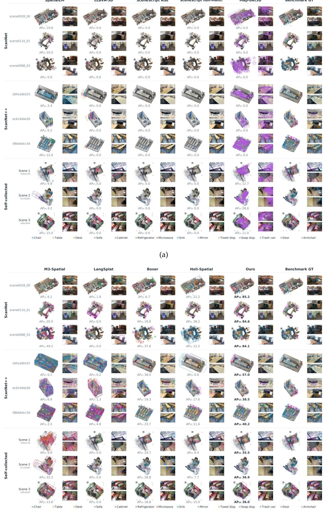  
(b)  
Figure 10 | Qualitative comparison of static 3D object perception across methods and scenes. Panels (a) and (b) show complementary subsets of the evaluated methods.

Bench over the full RGB timeline, including out-of-view periods, wherever a valid GT pose is available within 20 ms. Missing predictions remain evaluation failures, and sequence scores are averaged equally. We group pipelines by whether they output 3D boxes. Output-dependent GT– prediction binding uses nearest world-coordinate centers; for pipelines with 3D boxes, candidate tracks must additionally have maximum 3D IoU > 0.5. IoU, GTC, and PP are computed on the resulting bound-object subset. This binding does not filter trajectory evaluation: all methods use the common distance-based scoring described above, with native predicted identities and PCL’s own sequence-global assignment.

Table 4 | Full dynamic tracking results on ADT20 and HoliWorld-Bench (%; TP-L2 in meters). ∗GT first-visible mask initialization (converted to boxes for IT3DEgo); †GT category queries. Ours uses no annotation-derived test-time inputs. Box metrics use bound objects; dashes denote unavailable results. Best and second-best results are highlighted in deep green and light green .
<table><tr><td rowspan="2">Method</td><td colspan="3">Bounding box</td><td colspan="7">Trajectory</td></tr><tr><td>IoU↑</td><td>GTC↑</td><td>PP↑</td><td>HOTA0.1 ↑</td><td>DetA0.1 ↑</td><td>AssA0.1 ↑</td><td>PCL0.1 ↑</td><td>R0.1 ↑</td><td>P0.1 ↑</td><td>TP-L2↓</td></tr><tr><td colspan="9">ADT20</td><td></td></tr><tr><td>2D instance tracking pipelines</td><td></td><td></td><td></td><td></td><td>13.78</td><td></td><td></td><td></td><td></td><td></td></tr><tr><td colspan="9">EgoSeg3D†</td></tr><tr><td>IT3DEgo*</td><td></td><td></td><td></td><td>21.89 36.00</td><td>24.63</td><td>37.11 53.60</td><td>36.47 34.64</td><td>46.96 35.69</td><td>16.67 40.93</td><td>0.0432 0.0490</td></tr><tr><td>SAM+Whareformer*</td><td>一</td><td></td><td></td><td>30.76</td><td>23.60</td><td>40.99</td><td>31.26</td><td>33.35</td><td>41.33</td><td>0.0497</td></tr><tr><td colspan="9">3D object perception and tracking pipelines</td></tr><tr><td>SAM+LMK*</td><td>7.96</td><td>21.27</td><td>14.53</td><td>26.10</td><td>22.84</td><td>30.76</td><td>21.45</td><td>27.87</td><td>52.17</td><td>0.0485</td></tr><tr><td>Ours</td><td>30.88</td><td>43.03</td><td>56.25</td><td>54.31</td><td>42.13</td><td>71.94</td><td>47.95</td><td>49.56</td><td>76.68</td><td>0.0333</td></tr><tr><td colspan="9">HoliWorld-Bench (in-house)</td></tr><tr><td colspan="9">2D instance tracking pipelines</td></tr><tr><td>EgoSeg3D†</td><td></td><td></td><td></td><td>5.76</td><td>1.52</td><td>21.78</td><td>36.84</td><td>42.11</td><td>1.55</td><td>0.0094</td></tr><tr><td>IT3DEgo*</td><td>一</td><td></td><td>一</td><td>2.44</td><td>1.36</td><td>4.36</td><td>7.89</td><td>7.89</td><td>1.62</td><td>0.0479</td></tr><tr><td>SAM+Whareformer*</td><td></td><td></td><td></td><td>14.63</td><td>10.20</td><td>20.97</td><td>36.84</td><td>39.47</td><td>12.10</td><td>0.0113</td></tr><tr><td colspan="9">3D object perception and tracking pipelines</td></tr><tr><td>SAM+LMK*</td><td>20.28</td><td>50.84</td><td>21.30</td><td>15.13</td><td>15.96</td><td>14.35</td><td>23.68</td><td>39.47</td><td>21.13</td><td>0.0113</td></tr><tr><td>Ours</td><td>41.79</td><td>53.18</td><td>76.49</td><td>43.14</td><td>32.91</td><td>56.54</td><td>57.89</td><td>68.42</td><td>38.81</td><td>0.0280</td></tr></table>

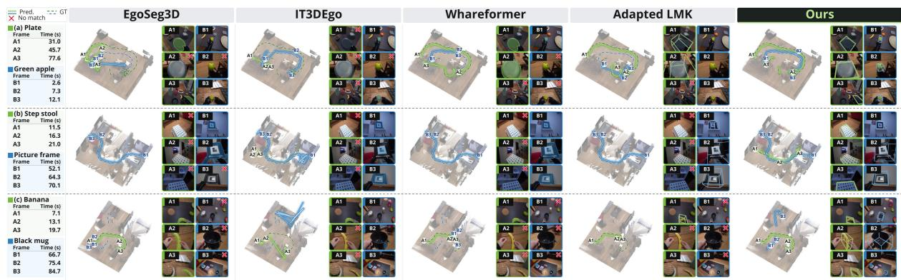  
Figure 11 | Qualitative dynamic tracking comparison across all evaluated methods.

## A.3. Additional Ablation Results

Table 5 reports component-wise results; Figure 12 compares the two static perception branches.

Table 5 | Component ablations. Static AP /mIoU: [0, 1]; dynamic HOTA/PCL: % at 0.1 m. Checkmarks/crosses: enabled/disabled; dashes: unavailable or inapplicable. Shaded rows (S6, D3) enable all components.
<table><tr><td rowspan="3"></td><td colspan="5">Components</td><td colspan="4">Static data</td><td colspan="4">Dynamic data</td></tr><tr><td colspan="4">Static</td><td colspan="2">Dynamic</td><td colspan="2">ScanNet</td><td colspan="2">HoliWorld-Bench</td><td colspan="2">ADT20</td><td colspan="2">HoliWorld-Bench</td></tr><tr><td colspan="4">Steeeo Capton Boxer TD</td><td>Labe-Cont.</td><td>SA-occ</td><td></td><td></td><td></td><td></td><td></td><td></td><td></td><td></td></tr><tr><td>S1</td><td>X</td><td></td><td></td><td></td><td></td><td></td><td></td><td>0.58</td><td>0.80</td><td>0.10</td><td>mIoU↑</td><td>HOTA↑ PCL↑</td><td></td><td>HOTA↑ PCL↑</td></tr><tr><td>S2</td><td></td><td>X</td><td></td><td></td><td></td><td></td><td>0.32</td><td>0.30</td><td>0.20</td><td>0.47 0.52</td><td>一</td><td>一 一</td><td></td><td>一</td></tr><tr><td>S3</td><td></td><td>X</td><td></td><td>J</td><td></td><td></td><td></td><td></td><td>0.20</td><td>0.53</td><td></td><td></td><td></td><td></td></tr><tr><td>S4</td><td>√</td><td>√</td><td></td><td>X</td><td></td><td></td><td>0.67</td><td>0.70</td><td>0.21</td><td>0.52</td><td></td><td>1</td><td></td><td></td></tr><tr><td>S5</td><td></td><td></td><td></td><td>X</td><td></td><td></td><td>0.68</td><td>0.72</td><td>0.24</td><td>0.52</td><td></td><td></td><td></td><td></td></tr><tr><td>S6</td><td></td><td></td><td></td><td></td><td></td><td></td><td>0.68</td><td>0.72</td><td>0.24</td><td>0.53</td><td></td><td></td><td></td><td></td></tr><tr><td>D1</td><td></td><td></td><td></td><td></td><td>X</td><td></td><td></td><td></td><td></td><td>一</td><td>44.09</td><td>42.62</td><td>32.86</td><td>45.30</td></tr><tr><td>D2</td><td></td><td></td><td></td><td></td><td></td><td></td><td></td><td></td><td></td><td>一</td><td>38.38</td><td>34.08</td><td>38.89</td><td>51.04</td></tr><tr><td>D3</td><td></td><td></td><td></td><td></td><td></td><td></td><td></td><td></td><td></td><td></td><td>54.31</td><td>47.95</td><td>43.14</td><td>57.89</td></tr></table>

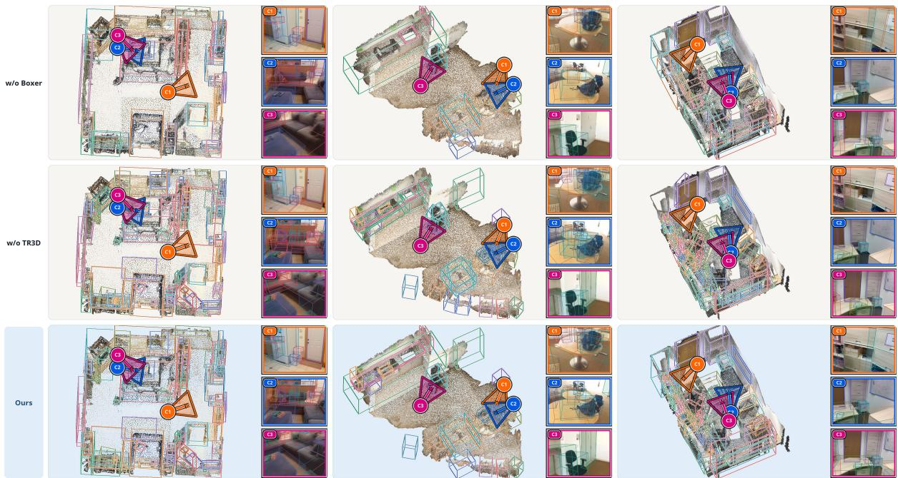  
Figure 12 | Qualitative ablation of dual-branch static object perception across three scenes. Rows show results without 3D lifting (w/o Boxer), without point-cloud detection (w/o TR3D), and with both branches (Ours). C1–C3 identify camera viewpoints and their corresponding image projections.

## A.4. Holi-World Static and Dynamic QA

30 QA types. We design 30 fine-grained QA types, broadly divided into static and dynamic reasoning. The static category contains 11 types that evaluate camera motion and object-level spatial relationships, including distance, depth, height, and relative position under single- and multi-view settings. The dynamic category comprises seven trajectory-based types for motion status, timing, direction, sequence, and path characteristics, together with 12 caption-based types covering action recognition, object interaction, temporal grounding, interaction phases, event ordering, state transitions, and contrastive hard negatives. As illustrated in Fig. 13, these questions combine visual observations with 3D bounding boxes, object trajectories, and temporally aligned captions, while their answers span categorical labels, numerical values, multiple-choice options, time intervals, and free-form descriptions.

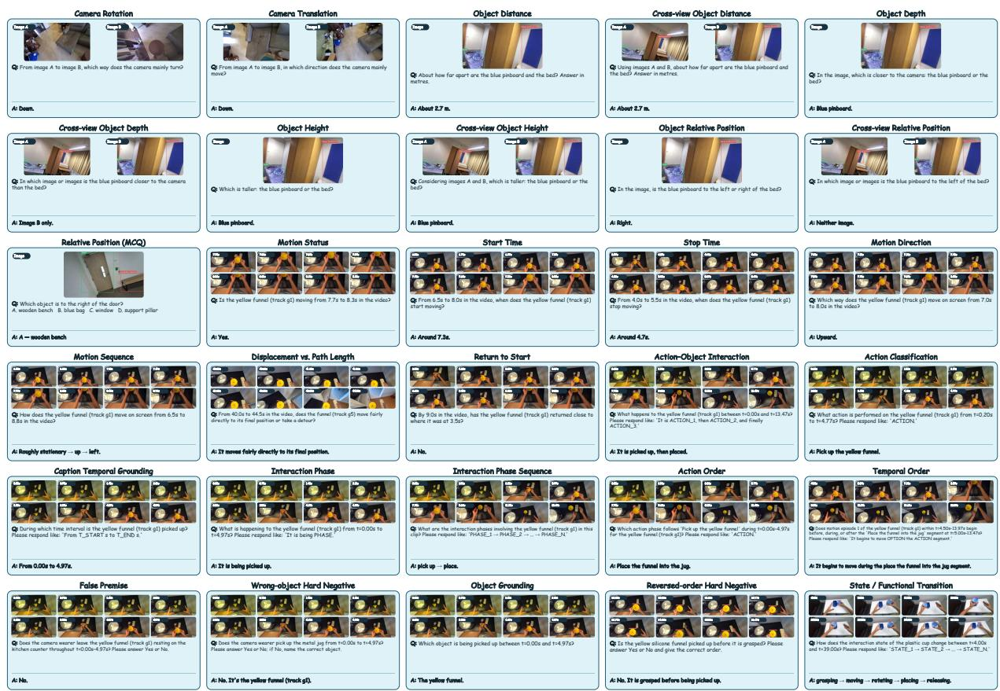  
Figure 13 | Examples of the 30 QA types in Holi-World, covering static mapping, dynamic trajectory, and dynamic caption reasoning.

## B. Reproducibility and Responsible Use

Reproducibility. To ensure reproducibility, Section 3 details the HoliWorld pipeline, covering geometric reconstruction, static object perception, dynamic tracking, and supervision construction, alongside dataset composition and QA construction. Appendix A further specifies evaluation datasets, metric definitions, baseline adaptations, matching protocols, and ablation configurations.

Responsible use. HoliWorld is designed for research on scene geometry and spatial-temporal understanding. Responsible data collection and release therefore require appropriate consent, review and redaction of identifying content, and compliance with dataset and model licenses. The pipeline should not be used for non-consensual surveillance or high-stakes decisions without additional safeguards and validation.