# InfiniDream: Open-Ended Photorealistic 3D Worlds Through Procedural Generation

Yi-Chuan Huang1,2, Hao-Jen Chien2, Zheng-Hui Huang1,3, Yu-Lun Liu2, Kaipeng Zhang1, Zhixiang Wang1

1Alaya Lab 2National Yang Ming Chiao Tung University 3National Taiwan University

Procedural generation plays a key role in synthetic data creation and game development, offering greater controllability, editability, and diversity than static mesh representations. However, VLMbased code generation often produces relatively simple 3D assets, while sophisticated photorealistic procedural systems require extensive manual development. Existing VLM-guided procedural methods remain largely constrained by predefined factories and APIs, limiting their ability to create novel asset types. We introduce InfiniDream, a VLM-driven framework for open-ended procedural 3D world generation. First, we propose Symbolically Constrained Asset Generation, which leverages existing procedural algorithms to create novel, photorealistic assets while preserving editability and seed-based diversity. Second, we develop an end-to-end text-to-world pipeline that combines semantic scene planning with Deterministic Frustum-Guided Grid Placement to construct large-scale 3D worlds with precise object placement, procedural population, and animation. Extensive evaluations on 100 object and 20 scene generation tasks demonstrate improvements across four perceptual metrics. Diversity analysis, ablation studies, and human preference evaluations further validate the effectiveness of our framework.

Project page: https://yichuanh.github.io/infinidream-page/ Code: https://github.com/yichuanH/InfiniDream Correspondence: Zhixiang Wang <zhixiang.wang@shanda.com>

Date: October 20, 2026

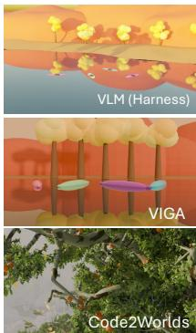  
Comparisons

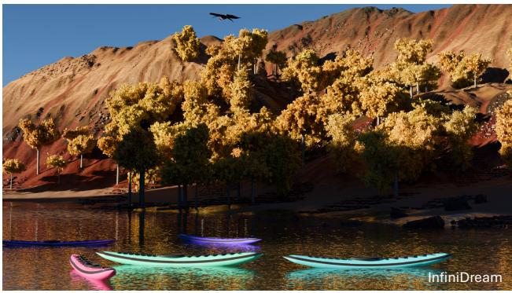

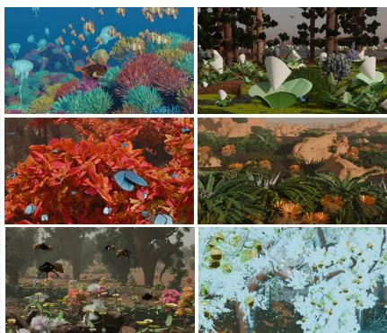  
Open-Ended Worlds

Figure 1 Beyond Predefined Factories: Rich, Editable Procedural Worlds. InfiniDream extends an existing procedural generator to create novel assets and visually rich 3D scenes. We compare its results with existing VLM-based 3D scene generation methods.

## 1 Introduction

Procedural generation creates 3D assets and scenes through executable programs, offering editability, diversity, and scalability. These advantages have made it widely applicable to synthetic data generation, game development, and virtual world creation [70]. However, conventional procedural generation methods rely heavily on handcrafted rules and predefined asset generators, limiting the variety of generated content and their ability to create novel assets and scenes.

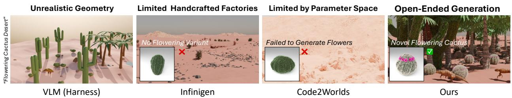  
Figure 2 Motivation: Beyond predefined procedural factories. Given a flowering cactus desert prompt, VLM-based code generation produces simplified geometry, predefined factories offer limited variations, and parameter-based generation struggles to introduce new features. InfiniDream extends existing procedural generators to create novel assets within rich, photorealistic 3D worlds

Recent advances in the code generation and tool-use capabilities of large language models (LLMs) and vision-language models (VLMs) have enabled the generation and editing of 3D assets and scenes through executable Blender code [28, 55, 73, 110, 24, 96]. However, while existing approaches can construct scenes by composing assets or directly synthesizing geometry through code, generating large-scale 3D scenes with consistently rich geometric details, complex materials, and photorealistic appearance remains challenging.

Infinigen [70] is built on over 40,000 lines of code, including carefully handcrafted procedural asset factories, to generate photorealistic, editable 3D scenes. However, its generative capabilities remain constrained by predefined asset categories and procedural rules.

Recent studies have explored using LLMs and VLMs to control sophisticated procedural generation systems through function orchestration, parameter adjustment, and the composition of existing generators [82, 119, 117]. While these approaches improve the controllability of procedural scene generation, methods that primarily operate within predefined functions and parameter spaces remain limited in their ability to create novel asset types beyond the capabilities of existing generators.

Another line of research explores large-scale 3D world generation using retrieved or generatively synthesized mesh assets [23, 92]. Although these methods support instance-level editing, their mesh-based assets lack the parameterized editability and seed-based diversity of procedural generators. Producing diverse object variations often requires direct mesh manipulation or regeneration.

Figure 2 highlights three limitations: VLM Harness produces less photorealistic scenes, Infinigen is restricted to predefined factories, and Code2Worlds [117], a recent VLM-guided Infinigen framework, is limited to function calls and parameter adjustment. These limitations motivate open-ended procedural generation beyond existing factory capabilities.

To address these challenges, we introduce InfiniDream, a VLM-driven framework for open-ended procedural 3D world generation, designed to achieve realism, openendedness, editability, diversity, and scalability. By employing VLM reasoning to compose and extend sophisticated procedural programs, InfiniDream generates novel assets beyond predefined factories while leveraging existing procedural algorithms. Our framework enables the creation of photorealistic, editable, and diverse large-scale 3D worlds from natural language descriptions.

At the asset level, Fig. 3 further motivates our Symbolically Constrained Editing (SCE) strategy, which combines the flexibility of VLM-based code generation with the rich procedural structures of existing factories.

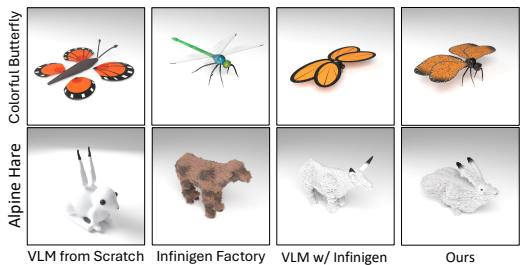  
Figure3 Comparisonofproceduralassetgeneration strategies. From left to right: VLM-generated Blender code from scratch, predefined Infinigen factories, VLM Agent Harness with full Infinigen access, and our symbolically constrained editing.

Our main contributions are summarized as follows:

1. Open-Ended Procedural Asset Generation. We propose Symbolically Constrained Editing (SCE) to generate novel, photorealistic procedural assets with rich geometric details beyond predefined factories, while preserving editability and seed-based diversity.

2. Scalable Procedural World Generation. We introduce an end-to-end text-to-world framework combining semantic scene planning and deterministic frustum-guided grid placement to generate large-scale, editable 3D worlds.

3. Comprehensive Experimental Validation. We conduct extensive object- and scene-level evaluations, diversity analysis, ablation studies, and human preference studies to validate the effectiveness of InfiniDream.

## 2 Related Work

Procedural 3D Asset Generation. Procedural modeling encodes 3D content as executable rules, from Lsystems [50, 66] and shape grammars [97, 60] to learned procedural shape and CAD programs [77, 89, 36, 37, 38, 72, 98, 41]. Advances in code generation [4] and tool use [75, 109] now let language models synthesize editable 3D assets as Blender code [13, 55, 73, 96, 105, 9, 69], other shape programs [114, 39, 94, 49], or CAD scripts for mechanical parts [2, 93, 74, 57]. Multimodal reasoning, retrieval augmentation [43], and iterative visual feedback [2, 93, 94, 49] further improve reconstruction, editing, and visual fidelity [29, 110, 24, 96]. Procedural material graphs are likewise generated or inferred from images [78, 21, 27, 44, 45], whereas inverse procedural modeling fits predefined procedural generators to targets [85, 91, 81, 63, 118] and remains bounded by their categories. Still, reliably synthesizing complex procedural geometry with rich geometric details and photorealistic appearance remains challenging. Benchmarks for 3D code generation [19, 96, 13, 2, 20, 107, 52] assess executability, geometric fidelity, and the benefits of execution feedback [6] and agentic coding [106]. However, 3DCodeBench [19] draws its procedural modeling categories from predefined Infinigen factories [70, 71], leaving procedural asset generation beyond these categories underexplored.

3D World Generation. Procedural content generation [80, 25, 76] has long produced noise-based terrains [64, 61] and cities [62], and now yields photorealistic natural and indoor scenes [70, 71, 69], simulation-ready assets [40], and houses for embodied AI [11]. Language models have been leveraged for 3D scene planning, spatial reasoning, and executable scene construction [28, 82, 119, 117, 15, 108, 3, 17, 83, 1, 116, 86, 22], and one line couples them with existing procedural generators through function orchestration, parameter adjustment, and composition of predefined procedural assets [82, 119, 67, 117, 115, 53, 87, 54]. Related approaches [28, 110, 117] also explore hierarchical generation [17, 84, 95], iterative visual feedback [51], physics-aware dynamic simulation [56], and looping animation of static 3D scenes [103]. However, methods restricted to orchestrating predefined procedural generators remain confined to their asset categories and parameter spaces, while semantically consistent and geometrically precise object placement in complex scenes remains challenging. Another line of work builds large-scale worlds [23, 92] from procedural layouts, retrieved assets [10, 108, 1, 12], generative 3D models [65, 26, 113, 101], and object-level composition [95, 31, 59], expanding generatable content and enabling instance-level manipulation. However, these approaches and neural scene generators [35, 46, 16, 112, 111, 88, 30, 5, 8, 18, 120, 14, 7, 48, 102, 42, 99, 58] generally lack the reusable procedural structures and high-level parameters needed for procedural editing and seed-based geometric variation. Orthogonally, recent work decouples explicit world states from generative video rendering [32, 34, 47] and benchmarks whether video models render what a program specifies [33]; such systems still require an explicit world specification, which procedural world generation can supply. InfiniDream addresses these gaps: it enables open-ended procedural asset generation beyond predefined factories and integrates it into scalable, fully procedural 3D world generation, while preserving procedural editability and seed-based diversity.

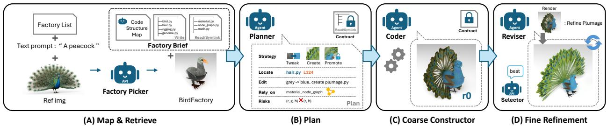  
Figure 4 Procedural asset generation through SCE. (A) Factory mapping and retrieval. (B) Structured editing plan. (C) Coarse asset construction. (D) Render-guided fine refinement. Existing procedural algorithms are reused under explicit editing constraints.

## 3 Method

We introduce InfiniDream, a VLM-driven framework for open-ended procedural 3D world generation. Given a text prompt, our framework selects a suitable initial scene and employs a Director to produce a structured Scene Plan specifying asset requirements, semantic placement constraints, and motion. Our framework consists of two core components: Symbolically Constrained Asset Generation, which creates novel procedural assets through constrained editing, and Deterministic Frustum-Guided Grid Placement, which translates semantic constraints into precise 3D object placements. Finally, procedural asset pooling, terrain refinement, and animation enable diverse, large-scale world generation.

## 3.1 Symbolically Constrained Asset Generation

Since directly providing a VLM with the entire Infinigen codebase often leads to imprecise editing (Fig. 3), we propose Symbolically Constrained Editing (SCE), which extracts key code structures and explicit editing constraints, transforming a large procedural codebase into a manageable editing space (Fig. 4).

## 3.1.1 Factory Mapping and Retrieval

Given a text description and an optional reference image, the system retrieves the most relevant Infinigen factory and constructs a Factory Brief (Fig. 4(A)). It contains a Code Structure Map identifying key functions and dependencies, an Editable Surface consisting of asset-specific modules dynamically identified through depth-limited dependency analysis, and Linked Infrastructure providing read-only access to shared lowlevel algorithms (e.g., node graphs) via symbolic links. Together, these components establish explicit code-level constraints that restrict editing while preserving the underlying procedural algorithms. Further implementation details are provided in Appendix G.

## 3.1.2 Structured Planning and Coarse Construction

The Planner produces a structured Editing Plan specifying the editing strategy (Strategy), target locations (Locate), required modifications (Edit), dependencies (Rely-on), and potential risks (Risks), as shown in Fig. 4(B). The plan also accounts for seed-dependent logic to preserve controllable procedural variation.

We define three editing strategies: Tweak adjusts existing parameters and high-level logic; Create introduces new procedural functions; and Promote selectively extends editing permissions to protected modules when necessary. These strategies enable controlled expansion of the editing space.

The Coarse Constructor executes the Editing Plan under these constraints (Fig. 4(C)), preserving the original factory entry points and function signatures to maintain compatibility with the population pipeline and random seed control. It reuses existing algorithms to construct a coarse procedural asset. SCE preserves seed-dependent randomness by adjusting sampling ranges rather than fixing parameters to match the reference image.

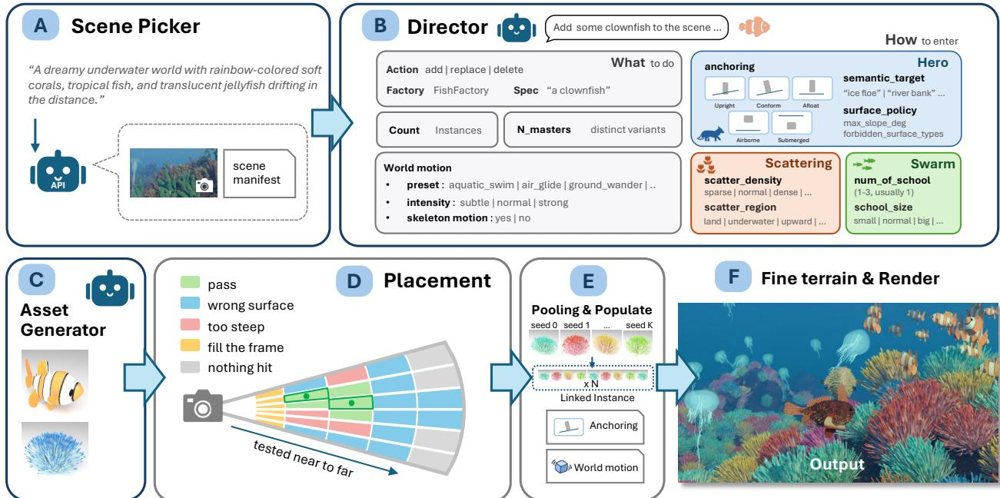  
Figure 5 Overview of InfiniDream’s end-to-end world generation pipeline. (A) Scene Picker collects the user instruction and current scene information. (B) Director generates a structured Scene Plan. (C) Asset Generator creates procedural assets. (D) Deterministic frustum-guided placement identifies valid object locations. (E) Population instantiates diverse assets. (F) Terrain refinement and rendering produce the final scene.

## 3.1.3 Fine Refinement

As shown in Fig. 4(D), the Reviser iteratively compares rendered results with the target description and reference image, identifying discrepancies in geometry, materials, and visual details. It then performs targeted code modifications within the established editing boundaries. A Selector identifies the best candidate across refinement iterations.

Through constrained editing and iterative refinement, SCE generates novel procedural assets while preserving procedural editability and seed-controlled diversity.

## 3.2 Semantic Placement Reasoning

Given a text prompt and current scene information, the Director first formulates a natural-language plan and converts it into a structured Scene Plan specifying editing operations (add, replace, and delete), asset requirements, and semantic placement constraints (Fig. 5(A–B)).

The Director selects among three placement modes: Hero for semantically significant objects, Scattering for large-area distributions, and Swarm for collective entities. Hero placement supports seven Anchoring types (rooted, upright, tilted, conform, afloat, airborne, and submerged). A Semantic Target and Surface Policy further specify target regions, permissible surface types, slope limits, and support conditions. Scattering and Swarm are controlled by density, coverage, and group size.

The Director also determines the instance count N, distinct procedural prototypes K, World Motion, and Local Animation. World Motion specifies object trajectories and swept envelopes for collision checking. VLM decisions are restricted to discrete semantic operations and constraints, leaving continuous geometric computations to deterministic placement.

## 3.3 Deterministic Frustum-Guided Grid Placement

To avoid repeated VLM-based coordinate prediction and costly render-based verification, we propose Deterministic Frustum-Guided Grid Placement, which translates the Director’s semantic constraints into

candidate 3D positions (Fig. 5(D)). Candidates are evaluated in a near-to-far order without additional VLM calls or iterative rendering.

## 3.3.1 Frustum-based Candidate Generation

Given the specified placement region, we discretize the camera’s image plane into a 2D grid and generate 3D candidate positions along the corresponding camera rays. For surface-supported objects, candidates are determined by ray intersections with scene geometry. For airborne and submerged objects, candidates are sampled at discrete depth intervals along each ray.

## 3.3.2 Constraint-based Filtering and Depth-aware Placement

Each candidate undergoes five deterministic checks: (1) Visibility, (2) Collision with motion swept envelopes, (3) Inter-instance Spacing, (4) Surface Policy, including surface type, slope limits, and full support, and (5) Projected-area Band, requiring $a _ { \mathrm { m i n } } \leq a ( p ) \leq a _ { \mathrm { m a x } }$

Given depth-sorted candidates ${ \mathcal { C } } = \{ p _ { 1 } , \ldots , p _ { n } \}$ , where $g _ { j } ( p ) \in \{ 0 , 1 \}$ indicates satisfaction of constraint j, we select the nearest valid candidate:

$$
i ^ { * } = \operatorname * { m i n } \left\{ i \left| \bigwedge _ { j = 1 } ^ { 5 } g _ { j } ( p _ { i } ) = 1 \right. \right\} , \qquad p ^ { * } = p _ { i ^ { * } } .\tag{1}
$$

Combined with projected-area bounds, near-to-far search enables implicit size-aware placement, favoring closer positions for smaller objects and farther positions for larger ones. For multiple instances, the initial search depth increases progressively, while previously placed objects are included in subsequent collision checks. If no valid position exists, hierarchical constraint relaxation is applied (Appendix H).

## 3.4 Scalable Population and Animation

We combine the procedural assets generated in Sec. 3.1 with the validated placements from Sec. 3.3 through semantically controlled asset pooling, terrain refinement, and procedural animation (Fig. 5(E)).

Semantically Budgeted Asset Pooling. To reduce the repeated construction cost of complex procedural assets, we extend Infinigen’s asset pooling mechanism to independent object population. The Director determines the number of instances N and distinct procedural prototypes K based on scene requirements. For assets supporting seed-based variation, we generate K prototypes using different factory seeds and create N instances through linked duplication:

$$
\mathcal { M } = \{ M _ { k } = G ( s _ { k } ) \} _ { k = 1 } ^ { K } , \qquad I _ { i } = \mathrm { C l o n e } \left( M _ { ( ( i - 1 ) \bmod K ) + 1 } \right) .\tag{2}
$$

Here, G denotes the procedural generator, $s _ { k }$ is the seed for the k-th prototype, and $I _ { i }$ is the i-th instance. This mechanism reduces expensive asset constructions from N to K while maintaining seed-based diversity across prototypes. Assets unsuitable for pooling are generated independently.

Population, Terrain Refinement, and Animation. Procedural assets are placed according to their Anchoring modes and integrated with Infinigen’s fine terrain pipeline. Animation combines World Motion and Local Animation, with shared motion specifications ensuring consistency between placement constraints and actual trajectories. The final scene is then refined and rendered (Fig. 5(E–F)).

## 4 Experiments

We evaluate InfiniDream at both the object and scene levels, complemented by diversity experiments, ablation studies, and a user study.

Table 1 Object-level comparison. Results on 100 tasks across six categories.
<table><tr><td>Method</td><td>CLIP↑</td><td>SigLIP2↑</td><td>DINOv3↑</td><td>IR↑</td><td>Exec. (%)↑</td></tr><tr><td>VLM (One-shot)</td><td>27.21</td><td>0.120</td><td>0.419</td><td>-1.17</td><td>85</td></tr><tr><td>VLM (Harness)</td><td>29.20</td><td>0.139</td><td>0.498</td><td>-0.82</td><td>99</td></tr><tr><td>VIGA</td><td>27.20</td><td>0.113</td><td>0.395</td><td>-1.19</td><td>90</td></tr><tr><td>BlenderRAG</td><td>27.56</td><td>0.127</td><td>0.406</td><td>-1.15</td><td>91</td></tr><tr><td>Infinigen</td><td>22.84</td><td>0.079</td><td>0.253</td><td>-1.90</td><td>-</td></tr><tr><td>InfiniDream</td><td>30.07</td><td>0.148</td><td>0.554</td><td>-0.62</td><td>98</td></tr></table>

Table 2 Scene-level comparison. Results on 20 scene generation tasks.
<table><tr><td>Method</td><td>CLIP↑</td><td>SigLIP2↑</td><td>DINOv3↑</td><td>IR↑</td></tr><tr><td>VLM (Harness)</td><td>28.85</td><td>0.126</td><td>0.321</td><td>-0.894</td></tr><tr><td>VIGA</td><td>27.14</td><td>0.121</td><td>0.246</td><td>-1.433</td></tr><tr><td>Infinigen</td><td>25.21</td><td>0.079</td><td>0.182</td><td>-1.710</td></tr><tr><td>Code2Worlds</td><td>22.76</td><td>0.072</td><td>0.114</td><td>-2.014</td></tr><tr><td>InfiniDream</td><td>29.64</td><td>0.143</td><td>0.361</td><td>-0.877</td></tr></table>

## 4.1 Evaluation Protocol and Baselines

Object-level Evaluation. We compare InfiniDream against five baselines: VLM (one-shot), VLM (harness), VIGA [110], BlenderRAG [73], and Infinigen [70]. Following 3DCodeBench [19], we adopt its codebase for the two VLM baselines, evaluating single-turn code generation and iterative refinement with a native coding-agent harness. The remaining baselines represent visual-feedback refinement, retrieval-augmented generation, and original Infinigen factory outputs, respectively.

Scene-level Evaluation. We compare large-scale world generation against VLM (harness), VIGA [110], Infinigen [70], and Code2Worlds [117], representing agentic code generation, visual-feedback refinement, original procedural scene generation, and LLM-driven hierarchical procedural orchestration, respectively.

Implementation and Metrics. We use Claude Opus 4.8 for InfiniDream and all VLM-based baselines, with Blender 4.x for generation and rendering. We evaluate 100 object-level tasks across six categories and 20 scene-level tasks at resolutions of 1024 × 1024 and 960 × 540, respectively.

We report CLIP [68], SigLIP2 [90], DINOv3 [79], and ImageReward [104]. At the object level, CLIP, SigLIP2, and ImageReward are averaged over four fixed views (45◦, 135◦, 225◦, and 315◦), while DINOv3 compares the front view against four held-out reference images, independently generated from the same text prompt, and reports the mean cosine similarity. We additionally report code executability. Scene-level metrics use each method’s primary camera view. For scene-level DINOv3, each method’s primary camera view is compared against a single per-prompt scene reference image, generated by Gemini 3 Pro Image from the same scene prompt as a photorealistic wide-angle photograph of the entire scene; the same reference is shared by all methods and is never provided to any method during generation. Further details are provided in the Appendix.

Diversity Evaluation. We compare InfiniDream with TRELLIS.2 [100] on 15 text prompts. For each prompt, InfiniDream generates five variations using different random seeds, while TRELLIS.2 uses five independently generated reference images. We measure semantic consistency using SigLIP2 and visual diversity using average pairwise DINOv2 feature distance.

## 4.2 Experimental Results

## Qualitative Comparisons

Figures 6 and 7 present qualitative comparisons of InfiniDream with existing methods at the object and scene levels, highlighting differences in geometric detail, photorealism, and scene composition.

## Quantitative Comparisons

As shown in Tables 1 and 2, InfiniDream achieves the highest scores across all four perceptual metrics at both the object and scene levels.

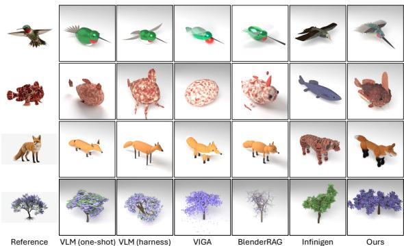  
Figure6 Qualitativecomparisonofobject-levelgeneration. Generated 3D assets under identical text prompts.

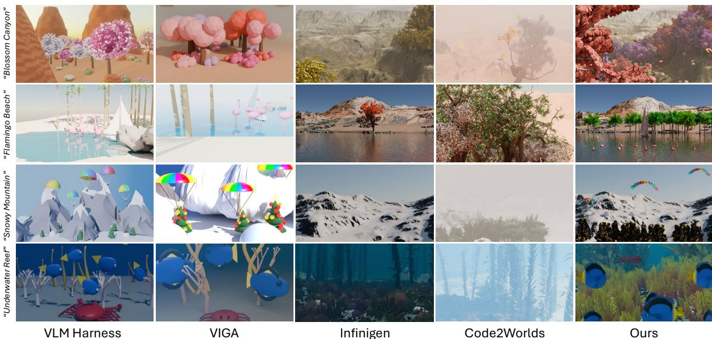  
Figure 7 From text to richly detailed 3D worlds. Qualitative comparisons across four diverse environments, highlighting scene richness, visual fidelity, and semantic alignment. All methods use identical text prompts.

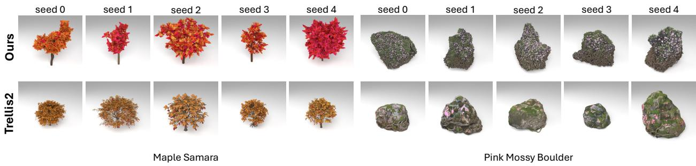  
Figure 8 High-quality and diverse procedural assets. InfiniDream generates five variations by changing random seeds, while TRELLIS.2 uses five independently generated reference images.

## Human Preference Study

We conduct a human preference study with 30 participants across 10 object and 10 scene tasks. Participants compare results from competing methods based on semantic alignment and visual quality. Table 3 reports InfiniDream’s preference rates for each criterion and overall.

## 4.3 Diversity Analysis

For each text prompt, InfiniDream generates five variations using different random seeds, while TRELLIS.2 uses five independently generated reference images. We evaluate semantic consistency using SigLIP2 and visual diversity using average pairwise DINOv2 feature distance. InfiniDream achieves greater visual diversity while maintaining comparable semantic alignment (Fig. 8, Table 4).

Table 3 Human preference study. Preference rates for InfiniDream.
<table><tr><td>Level</td><td>Align. (%)</td><td>Quality (%)</td><td>Overall (%)</td></tr><tr><td>Object</td><td>81.3</td><td>73.7</td><td>77.5</td></tr><tr><td>Scene</td><td>91.0</td><td>75.3</td><td>83.2</td></tr></table>

Table 4 Diversity comparison. Five variations per prompt.
<table><tr><td>Method</td><td>SigLIP2↑</td><td>DINOv2 Dist.↑</td></tr><tr><td>TRELLIS.2</td><td>0.1317</td><td>0.6084</td></tr><tr><td>InfiniDream</td><td>0.1225</td><td>0.6704</td></tr></table>

Table 5 Quantitative object-level ablation. Evaluation of generation components and refinement strategies across 25 animal and plant tasks, measuring semantic alignment, visual similarity, and perceptual quality.
<table><tr><td>Configuration</td><td>CLIP↑</td><td>SigLIP2↑</td><td>DINOv3↑</td><td>IR↑</td></tr><tr><td>w/o Ref. Image</td><td>28.68</td><td>0.1338</td><td>0.363</td><td>-0.978</td></tr><tr><td>Random Factory</td><td>27.39</td><td>0.1157</td><td>0.296</td><td>-1.520</td></tr><tr><td>w/o Planner</td><td>28.72</td><td>0.1274</td><td>0.368</td><td>-1.023</td></tr><tr><td>Agent (Infinigen)</td><td>29.01</td><td>0.1343</td><td>0.387</td><td>-0.968</td></tr><tr><td>w/o Refiner</td><td>28.80</td><td>0.1192</td><td>0.334</td><td>-1.420</td></tr><tr><td>3 Rounds</td><td>29.33</td><td>0.1354</td><td>0.438</td><td>-0.824</td></tr><tr><td>Full</td><td>30.37</td><td>0.1417</td><td>0.494</td><td>-0.580</td></tr></table>

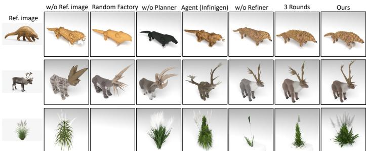  
Figure 9 Qualitative object-level ablation. Visual comparison of different generation strategies, illustrating the effects of reference images, factory selection, structured planning, and iterative refinement on asset geometry, fine-grained details, and visual appearance.

Table 6 Quantitative scene-level placement ablation. Evaluation on 20 scenes measuring object readability, ground contact, and contact spread.
<table><tr><td>Configuration</td><td>Unread. (%)</td><td>Ground P95 (m)↓</td><td>Spread P95 (m)↓</td></tr><tr><td>w/o Grid Search</td><td>27.4</td><td>0.15</td><td>0.25</td></tr><tr><td>w/o Anchoring</td><td>40.3</td><td>0.48</td><td>0.74</td></tr><tr><td>w/o Semantic Target</td><td>14.0</td><td>0.15</td><td>0.38</td></tr><tr><td>Agent (Placement)</td><td>50.9</td><td>0.54</td><td>0.75</td></tr><tr><td>Full (Ours)</td><td>7.8</td><td>0.15</td><td>0.24</td></tr></table>

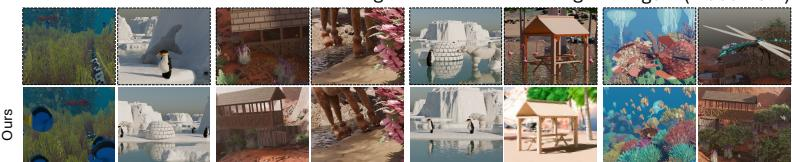  
Figure 10 Qualitative scene-level placement ablation. Visual comparison of different placement strategies, illustrating the effects of semantic planning, grid-based placement, and anchoring constraints on object visibility, spatial arrangement, and scene composition.

## 4.4 Ablation Studies

## Object-level Ablation

We evaluate six ablation settings on 25 animal and plant tasks: (1) w/o Ref. Image, (2) Random Factory, (3) w/o Planner, (4) Agent (Infinigen), (5) w/o Refiner, and (6) 3 Rounds. The full pipeline allows up to six refinement rounds. For Agent (Infinigen), Claude Opus 4.8 is given the entire Infinigen codebase and Bash access to autonomously write and edit code, render and inspect results, and determine when to stop within six rounds, without our structured planning or editing constraints. Quantitative and qualitative results are shown in Table 5 and Fig. 9.

Scene-level Ablation. We evaluate four settings on 20 scenes: (1) w/o Grid Search, using direct 3D coordinate prediction; (2) w/o Anchoring, reverting to Infinigen’s grounding; (3) w/o Semantic Target, removing semantic surface constraints; and (4) Agent (Placement), allowing a VLM agent to autonomously place our generated 3D assets in the same selected coarse scene given the text prompt, without our placement pipeline.

We evaluate three placement metrics: Unreadable Rate, the percentage of objects outside the camera view or occupying less than 0.1% of the image area; Ground-contact Error, the absolute distance between an object’s lowest contact point and its supporting surface, capturing floating or penetration; and Contact Spread, the difference between the maximum and minimum terrain-relative gaps across sampled contact points, capturing uneven grounding and partial suspension (surface-supported objects only; see Appendix J). We report the 95th percentile (P95) for the latter two metrics. For Contact Spread, P95 is computed over per-object values pooled across all surface-supported requested-add objects in the 20 scenes. Results are shown in Table 6 and Fig. 10.

## 5 Conclusion

We presented InfiniDream, a VLM-driven framework for open-ended procedural 3D world generation. By combining Symbolically Constrained Asset Generation with semantic planning and deterministic placement,

InfiniDream creates novel, photorealistic, and editable procedural assets and composes them into diverse, large-scale 3D worlds. Extensive experiments demonstrate its effectiveness at both the object and scene levels.

Limitationsand FutureWork. Our current animation pipeline relies on a predefined set of motion types. Future work could explore VLM-generated animation code to support more complex and customized motions. We also aim to extend InfiniDream to indoor environments with more complex spatial relationships and object interactions.

## References

[1] R. Aguina-Kang, M. Gumin, D. H. Han, S. Morris, S. J. Yoo, A. Ganeshan, R. K. Jones, Q. A. Wei, K. Fu, and D. Ritchie. Open-universe indoor scene generation using llm program synthesis and uncurated object databases, 2024.

[2] K. Alrashedy, P. Tambwekar, Z. Zaidi, M. Langwasser, W. Xu, and M. Gombolay. Generating cad code with vision-language models for 3d designs, 2025.

[3] A. Çelen, G. Han, K. Schindler, L. Van Gool, I. Armeni, A. Obukhov, and X. Wang. I-Design: Personalized LLM interior designer. In Computer Vision – ECCV 2024 Workshops, volume 15624 of Lecture Notes in Computer Science, pages 217–234, 2024.

[4] M. Chen, J. Tworek, H. Jun, Q. Yuan, H. P. d. O. Pinto, J. Kaplan, H. Edwards, Y. Burda, N. Joseph, G. Brockman, et al. Evaluating large language models trained on code. arXiv preprint arXiv:2107.03374, 2021.

[5] T.-H. Chen, Y.-H. Chen, T. Tu, J.-Y. Lee, C.-Y. Wu, F. Lin, H. Zhang, D. Paz, X. Huang, Y. Guo, et al. Pantheon360: Taming digital twin generation via 3d-aware 360 {\deg} video diffusion. arXiv preprint arXiv:2605.25449, 2026.

[6] X. Chen, M. Lin, N. Schärli, and D. Zhou. Teaching large language models to self-debug. In International Conference on Learning Representations (ICLR), 2024.

[7] Z. Chen, G. Wang, and Z. Liu. Scenedreamer: Unbounded 3d scene generation from 2d image collections. IEEE Transactions on Pattern Analysis and Machine Intelligence, 45(12):15562–15576, Dec. 2023.

[8] D. Cohen-Bar, E. Richardson, G. Metzer, R. Giryes, and D. Cohen-Or. Set-the-scene: Global-local training for generating controllable NeRF scenes. In Proceedings of the IEEE/CVF International Conference on Computer Vision (ICCV) Workshops, pages 2920–2929, 2023.

[9] B. Dai, L. R. Luo, Q. Tang, J. Wang, X. Lian, H. Xu, M. Qin, X. Xu, B. Dai, H. Wang, Z. Lyu, and J. Pang. Meshcoder: Llm-powered structured mesh code generation from point clouds, 2025.

[10] M. Deitke, D. Schwenk, J. Salvador, L. Weihs, O. Michel, E. VanderBilt, L. Schmidt, K. Ehsani, A. Kembhavi, and A. Farhadi. Objaverse: A universe of annotated 3D objects. In Proceedings of the IEEE/CVF Conference on Computer Vision and Pattern Recognition (CVPR), pages 13142–13153, 2023.

[11] M. Deitke, E. VanderBilt, A. Herrasti, L. Weihs, K. Ehsani, J. Salvador, W. Han, E. Kolve, A. Kembhavi, and R. Mottaghi. ProcTHOR: Large-scale embodied AI using procedural generation. In Advances in Neural Information Processing Systems (NeurIPS), volume 35, pages 5982–5994, 2022.

[12] J. Deng, W. Chai, J. Huang, Z. Zhao, Q. Huang, M. Gao, J. Guo, S. Hao, W. Hu, J.-N. Hwang, X. Li, and G. Wang. CityCraft: A real crafter for 3D city generation. arXiv preprint arXiv:2406.04983, 2024.

[13] Y. Du, S. Chen, W. Zan, P. Li, M. Wang, D. Song, B. Li, Y. Hu, and B. Wang. Blenderllm: Training large language models for computer-aided design with self-improvement, 2024.

[14] P. Engstler, A. Shtedritski, I. Laina, C. Rupprecht, and A. Vedaldi. SynCity: Training-free generation of 3D worlds. In Proceedings of the IEEE/CVF International Conference on Computer Vision (ICCV), pages 27585–27595, 2025.

[15] W. Feng, W. Zhu, T.-J. Fu, V. Jampani, A. Akula, X. He, S. Basu, X. E. Wang, and W. Y. Wang. LayoutGPT: Compositional visual planning and generation with large language models. In Advances in Neural Information Processing Systems (NeurIPS), volume 36, pages 18225–18250, 2023.

[16] R. Fridman, A. Abecasis, Y. Kasten, and T. Dekel. SceneScape: Text-driven consistent scene generation. In Advances in Neural Information Processing Systems (NeurIPS), volume 36, pages 39897–39914, 2023.

[17] R. Fu, Z. Wen, Z. Liu, and S. Sridhar. AnyHome: Open-vocabulary generation of structured and textured 3D homes. In European Conference on Computer Vision (ECCV), pages 52–70, 2024.

[18] G. Gao, W. Liu, A. Chen, A. Geiger, and B. Schölkopf. GraphDreamer: Compositional 3D scene synthesis from scene graphs. In Proceedings of the IEEE/CVF Conference on Computer Vision and Pattern Recognition (CVPR), pages 21295–21304, 2024.

[19] Y. Gao, L. Shu, G. Ye, X. Xiong, A. Makadia, M. Guo, L. Itti, and J. Chen. 3dcodebench: Benchmarking agentic procedural 3d modeling via code, 2026.

[20] Y. Gu, I. Huang, J. Je, G. Yang, and L. Guibas. BlenderGym: Benchmarking foundational model systems for graphics editing. In Proceedings of the IEEE/CVF Conference on Computer Vision and Pattern Recognition (CVPR), pages 18574–18583, 2025.

[21] P. Guerrero, M. Hašan, K. Sunkavalli, R. Mˇech, T. Boubekeur, and N. J. Mitra. Matformer: a generative model for procedural materials. ACM Transactions on Graphics, 41(4):1–12, 2022.

[22] M. Gumin, D. H. Han, S. J. Yoo, A. Ganeshan, R. K. Jones, K. Fu, R. Aguina-Kang, S. Morris, and D. Ritchie. Procedural scene programs for open-universe scene generation: LLM-free error correction via program search. In Proceedings of the SIGGRAPH Asia 2025 Conference Papers, pages 141:1–141:11, 2025.

[23] C. Guo, J. Li, Y. Li, and Z. Huang. Worldclaw: Agentic 3d open-world generation at scale, 2026.

[24] G. He, R. Luo, W.-C. Ma, and H. Averbuch-Elor. Thinking in blender: Staged executable inverse graphics with vision-language models, 2026.

[25] M. Hendrikx, S. Meijer, J. Van Der Velden, and A. Iosup. Procedural content generation for games: A survey. ACM Transactions on Multimedia Computing, Communications, and Applications, 9(1):1:1–1:22, 2013.

[26] Y. Hong, K. Zhang, J. Gu, S. Bi, Y. Zhou, D. Liu, F. Liu, K. Sunkavalli, T. Bui, and H. Tan. LRM: Large reconstruction model for single image to 3D. In International Conference on Learning Representations (ICLR), 2024.

[27] Y. Hu, P. Guerrero, M. Hasan, H. Rushmeier, and V. Deschaintre. Generating procedural materials from text or image prompts. In Special Interest Group on Computer Graphics and Interactive Techniques Conference Conference Proceedings, page 1–11. ACM, 2023.

[28] Z. Hu, A. Iscen, A. Jain, T. Kipf, Y. Yue, D. A. Ross, C. Schmid, and A. Fathi. Scenecraft: An llm agent for synthesizing 3d scenes as blender code. In Proceedings of the 41st International Conference on Machine Learning, volume 235, pages 19252–19282. PMLR, 2024.

[29] I. Huang, G. Yang, and L. Guibas. Blenderalchemy: Editing 3d graphics with vision-language models. In Proceedings of the European Conference on Computer Vision, 2024.

[30] T.-W. Huang, F.-E. Yang, M.-H. Chen, Y.-Y. Lin, and Y.-L. Liu. Vlm-dreamer: Vlm-imagined bidirectional inpainting for single-image 360 scene generation. In 2026 IEEE International Conference on Image Processing (ICIP), pages 1–6. IEEE, 2026.

[31] Z. Huang, Y.-C. Guo, X. An, Y. Yang, Y. Li, Z.-X. Zou, D. Liang, X. Liu, Y.-P. Cao, and L. Sheng. MIDI: Multi-instance diffusion for single image to 3D scene generation. In Proceedings of the IEEE/CVF Conference on Computer Vision and Pattern Recognition (CVPR), pages 23646–23657, 2025.

[32] Z.-H. Huang, G. Lin, J. Lin, Y.-C. Huang, R. Yu, M. Niu, S. Yang, Y.-L. Liu, Y.-Y. Chuang, K. Zhang, et al. Programmable world model. arXiv preprint arXiv:2609.10540, 2026.

[33] Z.-H. Huang, G. Lin, Y.-J. Tsai, J.-K. Zhu, F. Lan, Y.-L. Liu, Y.-Y. Chuang, K. Zhang, and Z. Wang. Prowbench: Do video models render what the program specifies? arXiv preprint arXiv:2610.02205, 2026.

[34] Z.-H. Huang, Z. Wang, J. Tan, R. Yu, Y. Zhang, B. Zheng, Y.-L. Liu, Y.-Y. Chuang, and K. Zhang. Generative world renderer. arXiv preprint arXiv:2604.02329, 2026.

[35] L. Höllein, A. Cao, A. Owens, J. Johnson, and M. Nießner. Text2room: Extracting textured 3d meshes from 2d text-to-image models, 2023.

[36] R. K. Jones, T. Barton, X. Xu, K. Wang, E. Jiang, P. Guerrero, N. J. Mitra, and D. Ritchie. ShapeAssembly: Learning to generate programs for 3D shape structure synthesis. ACM Transactions on Graphics, 39(6), 2020.

[37] R. K. Jones, D. Charatan, P. Guerrero, N. J. Mitra, and D. Ritchie. Shapemod: macro operation discovery for 3d shape programs. ACM Trans. Graph., 40(4), July 2021.

[38] R. K. Jones, P. Guerrero, N. J. Mitra, and D. Ritchie. ShapeCoder: Discovering abstractions for visual programs from unstructured primitives. ACM Transactions on Graphics, 42(4):49:1–49:17, 2023.

[39] R. K. Jones, P. Guerrero, N. J. Mitra, and D. Ritchie. Shapelib: Designing a library of programmatic 3d shape abstractions with large language models, 2026.

[40] A. Joshi, B. Han, J. Nugent, M. Gonzalez Saez-Diez, Y. Zuo, J. Liu, H. Wen, S. Alexandropoulos, K. Kayan, A. Calveri, T. Sun, G. Liu, Y. Shao, A. Raistrick, and J. Deng. Procedural generation of articulated simulation-ready assets. In Conference on Robot Learning (CoRL), 2026. arXiv:2505.10755.

[41] M. S. Khan, S. Sinha, T. U. Sheikh, D. Stricker, S. A. Ali, and M. Z. Afzal. Text2CAD: Generating sequential CAD designs from beginner-to-expert level text prompts. In Advances in Neural Information Processing Systems (NeurIPS), volume 37, pages 7552–7579, 2024.

[42] J.-Y. Lee, Y.-R. Liu, S.-R. Tsai, W.-C. Chang, C.-H. Wu, J. Chan, Z. Zhao, C. H. Lin, and Y.-L. Liu. Skyfall-gs: Synthesizing immersive 3d urban scenes from satellite imagery. In European Conference on Computer Vision, pages 431–454. Springer, 2026.

[43] P. Lewis, E. Perez, A. Piktus, F. Petroni, V. Karpukhin, N. Goyal, H. Küttler, M. Lewis, W.-t. Yih, T. Rocktäschel, S. Riedel, and D. Kiela. Retrieval-augmented generation for knowledge-intensive NLP tasks. In Advances in Neural Information Processing Systems (NeurIPS), volume 33, pages 9459–9474, 2020.

[44] B. Li, Y. Hu, P. Guerrero, M. Hasan, L. Shi, V. Deschaintre, and W. Matusik. Procedural material generation with reinforcement learning. ACM Trans. Graph., 43(6), Nov. 2024.

[45] B. Li, R. Wu, A. Solar-Lezama, C. Zheng, L. Shi, B. Bickel, and W. Matusik. VLMaterial: Procedu ral material generation with large vision-language models. In International Conference on Learning Representations (ICLR), 2025.

[46] M.-F. Li, Y.-F. Ku, H.-X. Yen, C. Liu, Y.-L. Liu, A. Y. Chen, C.-H. Kuo, and M. Sun. Genrc: Generative 3d room completion from sparse image collections. In European Conference on Computer Vision, pages 146–163. Springer, 2024.

[47] R. Liang, Z. Gojcic, H. Ling, J. Munkberg, J. Hasselgren, C.-H. Lin, J. Gao, A. Keller, N. Vijaykumar, S. Fidler, et al. Diffusionrenderer: Neural inverse and forward rendering with video diffusion models. In 2025 IEEE/CVF Conference on Computer Vision and Pattern Recognition (CVPR), pages 26069–26080. IEEE, 2025.

[48] C. H. Lin, H.-Y. Lee, W. Menapace, M. Chai, A. Siarohin, M.-H. Yang, and S. Tulyakov. InfiniCity: Infinite-scale city synthesis. In Proceedings of the IEEE/CVF International Conference on Computer Vision (ICCV), pages 22808–22818, 2023.

[49] Y. Lin, Y. Yang, Z. Hu, M. Zhou, F. Zhang, X. Cao, J. Liu, and Y. Yao. Procedura: Agentic 3D modeling with procedural control. arXiv preprint arXiv:2608.26238, 2026.

[50] A. Lindenmayer. Mathematical models for cellular interactions in development I. Filaments with one-sided inputs. Journal of Theoretical Biology, 18(3):280–299, 1968.

[51] L. Ling, C.-H. Lin, T.-Y. Lin, Y. Ding, Y. Zeng, Y. Sheng, Y. Ge, M.-Y. Liu, A. Bera, and Z. Li. Scenethesis: A language and vision agentic framework for 3D scene generation. In International Conference on Learning Representations (ICLR), 2026.

[52] L. Liu, B. Gong, A. D. Parakkat, and M. Ovsjanikov. 3DHarnessBench: Probing agentic 3D-to-code capabilities of frontier vision-language models. arXiv preprint arXiv:2609.06535, 2026.

[53] X. Liu, C.-K. Tang, and Y.-W. Tai. WorldCraft: Photo-realistic 3D world creation and customization via LLM agents. arXiv preprint arXiv:2502.15601, 2025.

[54] Z. Liu, Z. Tang, R. Wu, X. Zheng, J. Hu, K.-H. Hui, H. Xie, B. Dai, and Z. Liu. Imagine a city: CityGenAgent for procedural 3D city generation. arXiv preprint arXiv:2602.05362, 2026.

[55] S. Lu, G. Chen, N. A. Dinh, I. Lang, A. Holtzman, and R. Hanocka. Ll3m: Large language 3d modelers, 2025.

[56] J. Lv, Y. Huang, M. Yan, J. Huang, J. Liu, Y. Liu, Y. Wen, X. Chen, and S. Chen. GPT4Motion: Scripting physical motions in text-to-video generation via blender-oriented GPT planning. In Proceedings of the IEEE/CVF Conference on Computer Vision and Pattern Recognition (CVPR) Workshops, pages 1430–1440, 2024.

[57] D. Mallis, A. S. Karadeniz, S. Cavada, D. Rukhovich, N. Foteinopoulou, K. Cherenkova, A. Kacem, and D. Aouada. Cad-assistant: Tool-augmented vllms as generic cad task solvers, 2025.

[58] Q. Meng, L. Li, M. Nießner, and A. Dai. LT3SD: Latent trees for 3D scene diffusion. In Proceedings of the IEEE/CVF Conference on Computer Vision and Pattern Recognition (CVPR), pages 650–660, 2025.

[59] Y. Meng, H. Wu, Y. Zhang, and W. Xie. SceneGen: Single-image 3D scene generation in one feedforward pass. In International Conference on 3D Vision (3DV), 2026. arXiv:2508.15769.

[60] P. Müller, P. Wonka, S. Haegler, A. Ulmer, and L. Van Gool. Procedural modeling of buildings. ACM Transactions on Graphics, 25(3):614–623, 2006.

[61] F. K. Musgrave, C. E. Kolb, and R. S. Mace. The synthesis and rendering of eroded fractal terrains. In Proceedings of the 16th Annual Conference on Computer Graphics and Interactive Techniques, SIGGRAPH ’89, page 41–50, New York, NY, USA, 1989. Association for Computing Machinery.

[62] Y. I. H. Parish and P. Müller. Procedural modeling of cities. In Proceedings of the 28th Annual Conference on Computer Graphics and Interactive Techniques, SIGGRAPH ’01, page 301–308, New York, NY, USA, 2001. Association for Computing Machinery.

[63] O. Pearl, I. Lang, Y. Hu, R. A. Yeh, and R. Hanocka. GeoCode: Interpretable shape programs. Computer Graphics Forum, page e15276, 2025.

[64] K. Perlin. An image synthesizer. ACM SIGGRAPH Computer Graphics, 19(3):287–296, 1985.

[65] B. Poole, A. Jain, J. T. Barron, and B. Mildenhall. DreamFusion: Text-to-3D using 2D diffusion. In International Conference on Learning Representations (ICLR), 2023.

[66] P. Prusinkiewicz and A. Lindenmayer. The Algorithmic Beauty of Plants. Springer-Verlag, New York, 1990.

[67] Z. Qian, A. Sharifi, T. Carroll, and S.-N. Lim. Scene co-pilot: Procedural text to video generation with human in the loop, 2024

[68] A. Radford, J. W. Kim, C. Hallacy, A. Ramesh, G. Goh, S. Agarwal, G. Sastry, A. Askell, P. Mishkin, J. Clark, G. Krueger, and I. Sutskever. Learning transferable visual models from natural language supervision, 2021.

[69] A. Raistrick, K. Kayan, J. Nugent, D. Yan, L. Mei, M. Parakh, H. Wen, D. Li, Y. Zuo, E. Liang, and J. Deng. ProcFunc: Function-oriented abstractions for procedural 3D generation in Python. arXiv preprint arXiv:2604.26943, 2026.

[70] A. Raistrick, L. Lipson, Z. Ma, L. Mei, M. Wang, Y. Zuo, K. Kayan, H. Wen, B. Han, Y. Wang, A. Newell, H. Law, A. Goyal, K. Yang, and J. Deng. Infinite photorealistic worlds using procedural generation. In Proceedings of the IEEE/CVF Conference on Computer Vision and Pattern Recognition, pages 12630–12641, 2023.

[71] A. Raistrick, L. Mei, K. Kayan, D. Yan, Y. Zuo, B. Han, H. Wen, M. Parakh, S. Alexandropoulos, L. Lipson, Z. Ma, and J. Deng. Infinigen indoors: Photorealistic indoor scenes using procedural generation. In Proceedings of the IEEE/CVF Conference on Computer Vision and Pattern Recognition (CVPR), pages 21783–21794, 2024.

[72] D. Ritchie, P. Guerrero, R. K. Jones, N. J. Mitra, A. Schulz, K. D. D. Willis, and J. Wu. Neurosymbolic models for computer graphics. Computer Graphics Forum, 42(2):545–568, 2023.

[73] M. Rondelli, F. Pivi, and M. Gabbrielli. Blenderrag: High-fidelity 3d object generation via retrievalaugmented code synthesis, 2026.

[74] D. Rukhovich, E. Dupont, D. Mallis, K. Cherenkova, A. Kacem, and D. Aouada. CAD-Recode: Reverse engineering CAD code from point clouds. In Proceedings of the IEEE/CVF International Conference on Computer Vision (ICCV), pages 9801–9811, 2025.

[75] T. Schick, J. Dwivedi-Yu, R. Dessì, R. Raileanu, M. Lomeli, L. Zettlemoyer, N. Cancedda, and T. Scialom. Toolformer: Language models can teach themselves to use tools, 2023.

[76] N. Shaker, J. Togelius, and M. J. Nelson. Procedural Content Generation in Games. Springer, 2016.

[77] G. Sharma, R. Goyal, D. Liu, E. Kalogerakis, and S. Maji. CSGNet: Neural shape parser for constructive solid geometry. In Proceedings of the IEEE/CVF Conference on Computer Vision and Pattern Recognition (CVPR), pages 5515–5523, 2018.

[78] L. Shi, B. Li, M. Hašan, K. Sunkavalli, T. Boubekeur, R. Mech, and W. Matusik. Match: differentiable material graphs for procedural material capture. ACM Trans. Graph., 39(6), Nov. 2020.

[79] O. Siméoni, H. V. Vo, M. Seitzer, F. Baldassarre, M. Oquab, C. Jose, V. Khalidov, M. Szafraniec, S. Yi, M. Ramamonjisoa, F. Massa, D. Haziza, L. Wehrstedt, J. Wang, T. Darcet, T. Moutakanni, L. Sentana, C. Roberts, A. Vedaldi, J. Tolan, J. Brandt, C. Couprie, J. Mairal, H. Jégou, P. Labatut, and P. Bojanowski. Dinov3, 2025.

[80] R. M. Smelik, T. Tutenel, R. Bidarra, and B. Benes. A survey on procedural modelling for virtual worlds. Computer Graphics Forum, 33(6):31–50, 2014.

[81] O. Stava, S. Pirk, J. Kratt, B. Chen, R. M´zch, O. Deussen, and B. Benes. Inverse procedural modelling of trees. Comput. Graph. Forum, 33(6):118–131, Sept. 2014.

[82] C. Sun, J. Han, W. Deng, X. Wang, Z. Qin, and S. Gould. 3d-gpt: Procedural 3d modeling with large language models, 2023.

[83] F.-Y. Sun, W. Liu, S. Gu, D. Lim, G. Bhat, F. Tombari, M. Li, N. Haber, and J. Wu. LayoutVLM: Differentiable optimization of 3D layout via vision-language models. In Proceedings of the IEEE/CVF Conference on Computer Vision and Pattern Recognition (CVPR), pages 29469–29478, 2025.

[84] W. Sun, X. Li, M. Li, K. Xu, X. Meng, and L. Meng. Hierarchically-structured open-vocabulary indoor scene synthesis with pre-trained large language model. In Proceedings of the AAAI Conference on Artificial Intelligence, pages 7122–7130, 2025.

[85] J. O. Talton, Y. Lou, S. Lesser, J. Duke, R. Mˇech, and V. Koltun. Metropolis procedural modeling. 30(2), Apr. 2011.

[86] H. I. I. Tam, H. I. D. Pun, A. T. Wang, A. X. Chang, and M. Savva. SceneMotifCoder: Example-driven visual program learning for generating 3D object arrangements. In International Conference on 3D Vision (3DV), pages 179–188, 2025.

[87] S. Tang, K. Zhao, L. Wang, Y. Li, X. Liu, J. Zou, Q. Wang, and X. Chu. UnrealLLM: Towards highly controllable and interactable 3D scene generation by LLM-powered procedural content generation. In W. Che, J. Nabende, E. Shutova, and M. T. Pilehvar, editors, Findings of the Associationfor Computational Linguistics: ACL 2025, pages 19417–19435, Vienna, Austria, July 2025. Association for Computational Linguistics.

[88] H. Team, Z. Wang, Y. Liu, J. Wu, Z. Gu, H. Wang, X. Zuo, T. Huang, W. Li, S. Zhang, Y. Lian, Y. Tsai, L. Wang, S. Liu, P. Jiang, X. Yang, D. Guo, Y. Tang, X. Mao, J. Yu, J. Yu, J. Zhang, M. Chen, L. Dong, Y. Jia, C. Zhang, Y. Tan, H. Zhang, Z. Ye, P. He, R. Wu, M. Chen, Z. Li, W. Qin, L. Wang, Y. Sun, L. Niu, X. Yuan, X. Yang, Y. He, J. Xiao, Y. Tao, J. Zhu, J. Xue, K. Liu, C. Zhao, X. Wu, T. Liu, P. Chen, D. Wang, Y. Liu, Linus, J. Jiang, T. Wang, and C. Guo. Hunyuanworld 1.0: Generating immersive, explorable, and interactive 3d worlds from words or pixels, 2025.

[89] Y. Tian, A. Luo, X. Sun, K. Ellis, W. T. Freeman, J. B. Tenenbaum, and J. Wu. Learning to infer and execute 3d shape programs, 2019.

[90] M. Tschannen, A. Gritsenko, X. Wang, M. F. Naeem, I. Alabdulmohsin, N. Parthasarathy, T. Evans, L. Beyer, Y. Xia, B. Mustafa, O. Hénaff, J. Harmsen, A. Steiner, and X. Zhai. Siglip 2: Multilingual vision-language encoders with improved semantic understanding, localization, and dense features, 2025.

[91] C. A. Vanegas, I. Garcia-Dorado, D. G. Aliaga, B. Benes, and P. Waddell. Inverse design of urban procedural models. ACM Transactions on Graphics, 31(6), 2012.

[92] D. Wang, H. Jung, T. Monnier, K. Sohn, C. Zou, X. Xiang, Y.-Y. Yeh, D. Liu, Z. Huang, T. Nguyen-Phuoc, Y. Fan, S. Oprea, Z. Wang, R. Shapovalov, N. Sarafianos, T. Groueix, A. Toisoul, P. Dhar, X. Chu, M. Chen, G. Y. Park, R. Ranjan, and A. Vedaldi. Worldgen: From text to traversable and interactive 3d worlds. In Proceedings of the IEEE/CVF Conference on Computer Vision and Pattern Recognition, pages 27124–27135, 2026.

[93] R. Wang, Y. Yuan, S. Sun, and J. Bian. Text-to-CAD generation through infusing visual feedback in large language models. In International Conference on Machine Learning (ICML), 2025.

[94] R.-H. Wang, S.-T. Wei, J.-Q. He, H.-Y. Wei, B. Chen, and P.-S. Wang. aDSL: Agentic 3D creation via joint agent-program design. arXiv preprint arXiv:2608.17975, 2026.

[95] Y. Wang, X. Qiu, J. Liu, Z. Chen, J. Cai, Y. Wang, T.-H. Wang, Z. Xian, and C. Gan. Architect: Generating vivid and interactive 3D scenes with hierarchical 2D inpainting. In Advances in Neural Information Processing Systems (NeurIPS), volume 37, pages 67575–67603, 2024.

[96] Y. Wang, P. Wang, L. Li, Z. Yang, K. Q. Lin, and Y. Cheng. 3d-cos: A new 3d reconstruction paradigm based on vlm code synthesis, 2026.

[97] P. Wonka, M. Wimmer, F. Sillion, and W. Ribarsky. Instant architecture. ACM Transactions on Graphics (TOG), 22(3):669–677, 2003.

[98] R. Wu, C. Xiao, and C. Zheng. DeepCAD: A deep generative network for computer-aided design models. In Proceedings of the IEEE/CVF International Conference on Computer Vision (ICCV), pages 6772–6782, 2021.

[99] Z. Wu, Y. Li, H. Yan, T. Shang, W. Sun, S. Wang, R. Cui, W. Liu, H. Sato, H. Li, and P. Ji. BlockFusion: Expandable 3D scene generation using latent tri-plane extrapolation. ACM Transactions on Graphics, 43(4), 2024.

[100] J. Xiang, X. Chen, S. Xu, R. Wang, Z. Lv, Y. Deng, H. Zhu, Y. Dong, H. Zhao, N. J. Yuan, and J. Yang. Native and compact structured latents for 3d generation, 2025.

[101] J. Xiang, Z. Lv, S. Xu, Y. Deng, R. Wang, B. Zhang, D. Chen, X. Tong, and J. Yang. Structured 3D latents for scalable and versatile 3D generation. In Proceedings of the IEEE/CVF Conference on Computer Vision and Pattern Recognition (CVPR), pages 21469–21480, 2025.

[102] H. Xie, Z. Chen, F. Hong, and Z. Liu. CityDreamer: Compositional generative model of unbounded 3D cities. In Proceedings of the IEEE/CVF Conference on Computer Vision and Pattern Recognition (CVPR), pages 9666–9675, 2024.

[103] Y.-Z. Xie, T.-W. Chou, Y.-H. Li, K. Zhang, Z. Wang, and Y.-L. Liu. Ouroworld: Bringing any 3d world alive as diverse, endlessly looping 3d cinemagraphs. arXiv preprint arXiv:2610.12461, 2026.

[104] J. Xu, X. Liu, Y. Wu, Y. Tong, Q. Li, M. Ding, J. Tang, and Y. Dong. Imagereward: Learning and evaluating human preferences for text-to-image generation, 2023.

[105] Y. Yamada, K. Chandu, B. Y. Lin, J. Hessel, I. Yildirim, and Y. Choi. L3GO: Language agents with chain-of-3D-thoughts for generating unconventional objects. In Proceedings of the 2025 Conference of the Nations of the Americas Chapter of the Association for Computational Linguistics: Human Language Technologies (System Demonstrations), pages 456–469, 2025.

[106] J. Yang, C. E. Jimenez, A. Wettig, K. Lieret, S. Yao, K. Narasimhan, and O. Press. SWE-agent: Agent-computer interfaces enable automated software engineering. In Advances in Neural Information Processing Systems (NeurIPS), volume 37, pages 50528–50652, 2024.

[107] Y. Yang, Z. Hu, Y. Lin, M. Zhou, J. Xu, F. Zhang, J. Liu, and Y. Yao. P3D-Bench: Benchmarking MLLMs for parametric 3D generation and structural reasoning. arXiv preprint arXiv:2606.11152, 2026.

[108] Y. Yang, F.-Y. Sun, L. Weihs, E. VanderBilt, A. Herrasti, W. Han, J. Wu, N. Haber, R. Krishna, L. Liu, C. Callison-Burch, M. Yatskar, A. Kembhavi, and C. Clark. Holodeck: Language guided generation of 3D embodied AI environments. In Proceedings of the IEEE/CVF Conference on Computer Vision and Pattern Recognition (CVPR), pages 16227–16237, 2024.

[109] S. Yao, J. Zhao, D. Yu, N. Du, I. Shafran, K. Narasimhan, and Y. Cao. ReAct: Synergizing reasoning and acting in language models. In International Conference on Learning Representations (ICLR), 2023.

[110] S. Yin, J. Ge, Z. Z. Wang, C. Wang, X. Li, M. J. Black, T. Darrell, A. Kanazawa, and H. Feng. Vision-as-inverse-graphics agent via interleaved multimodal reasoning, 2026.

[111] H.-X. Yu, H. Duan, C. Herrmann, W. T. Freeman, and J. Wu. WonderWorld: Interactive 3D scene generation from a single image. In Proceedings of the IEEE/CVF Conference on Computer Vision and Pattern Recognition (CVPR), pages 5916–5926, 2025.

[112] H.-X. Yu, H. Duan, J. Hur, K. Sargent, M. Rubinstein, W. T. Freeman, F. Cole, D. Sun, N. Snavely, J. Wu, and C. Herrmann. WonderJourney: Going from anywhere to everywhere. In Proceedings of the IEEE/CVF Conference on Computer Vision and Pattern Recognition (CVPR), pages 6658–6667, 2024.

[113] L. Zhang, Z. Wang, Q. Zhang, Q. Qiu, A. Pang, H. Jiang, W. Yang, L. Xu, and J. Yu. Clay: A controllable large-scale generative model for creating high-quality 3d assets, 2024.

[114] S. Zhang, C. Jiang, Z. Li, and J. Deng. ShapeCraft: LLM agents for structured, textured and interactive 3D modeling. In Advances in Neural Information Processing Systems (NeurIPS), 2025.

[115] S. Zhang, M. Zhou, Y. Wang, C. Luo, R. Wang, Y. Li, Z. Zhang, and J. Peng. CityX: Controllable procedural content generation for unbounded 3D cities. arXiv preprint arXiv:2407.17572, 2024.

[116] Y. Zhang, Z. Li, M. Zhou, S. Wu, and J. Wu. The scene language: Representing scenes with programs, words, and embeddings. In Proceedings of the IEEE/CVF Conference on Computer Vision and Pattern Recognition (CVPR), pages 24625–24634, 2025.

[117] Y. Zhang, Y. Wang, Z. Zhang, and H. Tang. Code2worlds: Empowering coding llms for 4d world generation, 2026.

[118] W. Zhao, Y.-P. Cao, J. Xu, Y. Dong, and Y. Shan. DI-PCG: Diffusion-based efficient inverse procedural content generation for high-quality 3D asset creation. In Proceedings of the IEEE/CVF Conference on Computer Vision and Pattern Recognition (CVPR), pages 11061–11072, 2025.

[119] M. Zhou, Y. Wang, J. Hou, S. Zhang, Y. Li, C. Luo, J. Peng, and Z. Zhang. Scenex: Procedural controllable large-scale scene generation. Proceedings of the AAAI Conference on Artificial Intelligence, 39(10):10806–10814, 2025.

[120] X. Zhou, X. Ran, Y. Xiong, J. He, Z. Lin, Y. Wang, D. Sun, and M.-H. Yang. GALA3D: Towards text-to-3D complex scene generation via layout-guided generative Gaussian splatting. In International Conference on Machine Learning (ICML), volume 235 of Proceedings of Machine Learning Research, pages 62108–62118, 2024.

## Appendix

## A Additional Object-level Comparisons

We provide additional qualitative comparisons of object-level generation across diverse asset categories in Fig. 11. All methods are evaluated using identical text prompts under the same experimental protocol described in Sec. 4.1. These additional examples further illustrate differences in geometric complexity, material details, and visual fidelity among the compared methods.

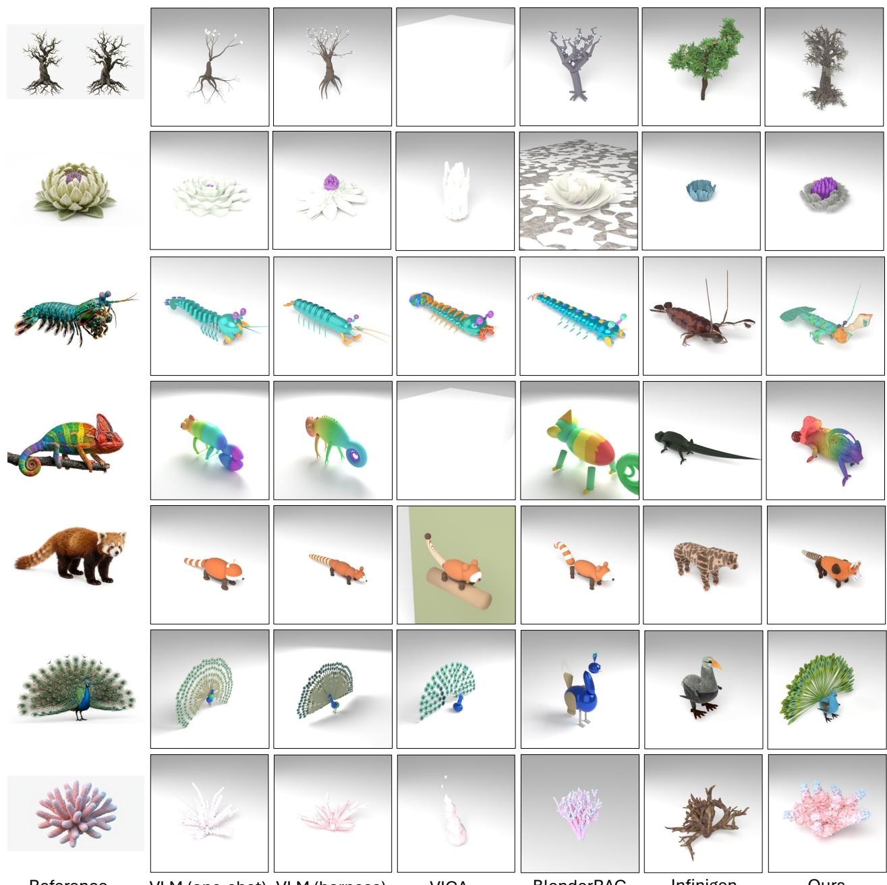  
Reference  
VIGA  
VLM (harness)VLM (one-shot)  
BlenderRAG  
Infinigen  
Ours

Figure 11 Additional qualitative comparisons of object-level generation. More examples comparing InfiniDream with existing methods under identical text prompts.

## B Additional Scene-level Comparisons

We provide additional qualitative comparisons of scene-level generation across diverse environments in Fig. 12. All methods are evaluated using identical text prompts under the same experimental protocol described in Sec. 4.1. These additional results illustrate differences in scene composition, geometric detail, semantic alignment, and visual fidelity across the compared methods.

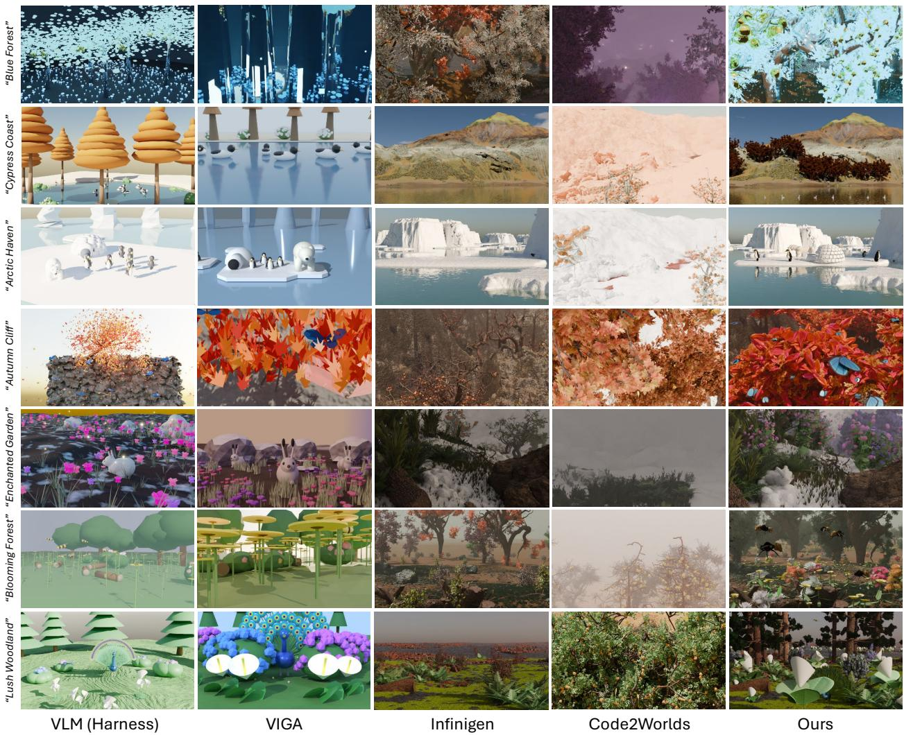  
Figure 12 Additional qualitative comparisons of scene-level generation. More examples of 3D world generation across diverse environments under identical text prompts.

## C Additional Qualitative Comparison with GPT-6 Astra

We provide an additional qualitative comparison with GPT-6 Astra in Fig. 13. This comparison is included as supplementary evidence beyond the main benchmark suite. Importantly, InfiniDream still uses Claude Opus 4.8 as the underlying VLM, while GPT-6 Astra serves as an additional strong proprietary baseline. Under identical text prompts, the results highlight differences in visual fidelity, geometric detail, material richness, and overall semantic composition.

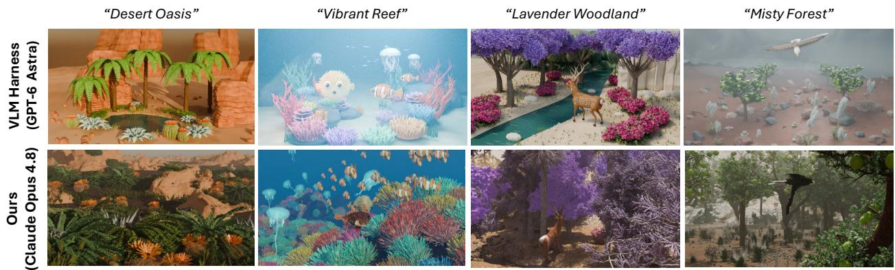  
Figure 13 Additional qualitative comparison with GPT-6 Astra. We compare InfiniDream, implemented with Claude Opus 4.8, against GPT-6 Astra on representative examples under identical text prompts. The results provide additional evidence of InfiniDream’s ability to generate visually rich and semantically coherent procedural assets and scenes.

## D Additional Diversity Results

We provide additional qualitative diversity comparisons between InfiniDream and TRELLIS.2 in Fig. 14. For each text prompt, InfiniDream generates five procedural variations by changing random seeds, while TRELLIS.2 generates five assets from independently generated reference images. These examples further illustrate the diversity of InfiniDream’s procedural assets while preserving semantic consistency and visual quality.

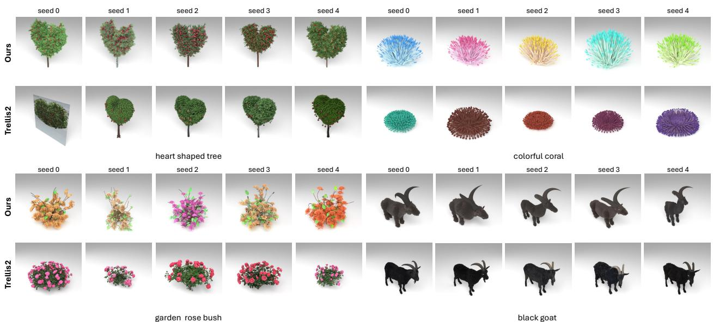  
Figure 14 Additional qualitative diversity comparisons with TRELLIS.2. Five variations are generated for each text prompt. InfiniDream achieves procedural diversity by varying random seeds, whereas TRELLIS.2 uses independently generated reference images.

## E Object-level Comparison with Code2Worlds

We further compare InfiniDream with Code2Worlds on the 29 out of 100 object-level tasks supported by Code2Worlds. Due to its limited factory coverage, we report this comparison separately from the main benchmark.

As shown in Fig. 15 and Table 7, InfiniDream achieves higher scores across all four metrics. Code2Worlds can exploit the parameter space of existing factories, such as adjusting the color of a fish, but cannot introduce novel procedural features beyond predefined generators. In contrast, InfiniDream extends existing procedural code to generate new geometric structures and fine-grained details, enabling more flexible open-ended asset generation.

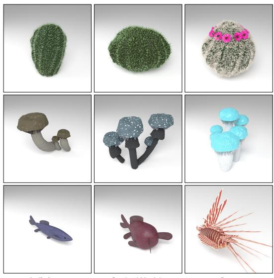

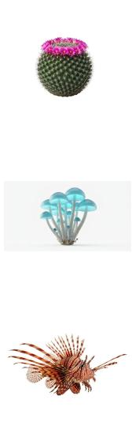  
Reference  
Infinigen  
Code2Worlds  
Ours

Table 7 Quantitative comparison. Results on 29 supported tasks.
<table><tr><td>Metric</td><td>InfiniDream</td><td>Code2Worlds</td></tr><tr><td>CLIP ↑</td><td>30.24</td><td>22.56</td></tr><tr><td>SigLIP2 ↑</td><td>0.153</td><td>0.080</td></tr><tr><td>ImageReward ↑</td><td>-0.35</td><td>-1.94</td></tr><tr><td>DINOv3 ↑</td><td>0.583</td><td>0.281</td></tr></table>

Figure 15 Object-level comparison with Code2Worlds.

## F Man-Made Asset Generation

Beyond natural assets, InfiniDream can retrieve and extend factories for man-made objects. As shown in Fig. 16, while VIGA performs well on geometric objects, InfiniDream achieves comparable structural quality with rich geometric and material details, demonstrating its versatility across both organic and man-made assets.

  
Reference

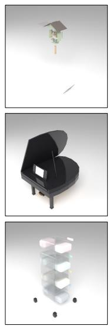  
VLM (one-shot)

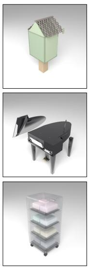  
VLM (harness)  
VIGA

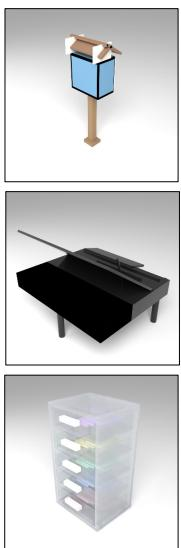  
BlenderRAG

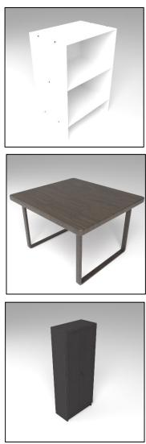  
Infinigen

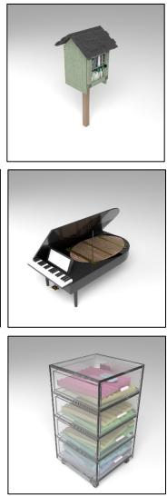  
Ours

Figure 16 Qualitative comparison of man-made asset generation. InfiniDream produces structurally coherent man-made objects with rich geometric and material details.

## G Implementation Details of Symbolically Constrained Editing

Reference Synthesis and Factory Retrieval. We use Gemini 3 Pro Image to generate an isolated reference object against a white background. Claude Opus 4.8 retrieves the most relevant Infinigen factory, with deterministic lexical matching as a fallback.

Factory Brief Construction. Starting from the selected factory, we perform AST-based import graph traversal with a maximum depth of two. Asset-specific modules form the Editable Surface, while shared modules remain read-only Linked Infrastructure. Unrelated dependencies are pruned, and a VLM summarizes the remaining code into a cached Code Structure Map.

Constrained Code Editing. The Planner produces an Editing Plan specifying Strategy, Locate, Edits, Rely-on, and Risks. The Constructor can modify existing modules (Tweak), promote protected modules (Promote), or synthesize new procedural modules (Create). Editing is restricted to the working directory, preserving the original factory interface and seed-dependent randomness.

Iterative Refinement. Modified modules are integrated into a symbolic-link overlay of the original Infinigen codebase. A vision-based Reviser guides targeted refinement, while execution failures trigger tracebackbased repair. The pipeline supports up to six rounds with early stopping. A vision-based Selector chooses the best successful candidate, whose code snapshot is used to reconstruct the final executable generator.

## H Implementation Details of Deterministic Frustum-Guided Grid Placement

Candidate Generation. We discretize the Director’s screen-space region into a 9 × 5 grid (17 × 9 for six or more instances). Surface candidates are obtained through ray-scene intersections, while airborne and submerged candidates are sampled along camera rays using geometric depth intervals (×1.3, up to 80 m). Larger objects are placed first, with deterministic hashing ensuring reproducibility. The entire placement process requires no additional VLM calls.

Constraints and Relaxation. Projected area is estimated from the proxy bounding box, with a preferred minimum of 1.2%, a relaxed minimum of 0.2%, and an absolute maximum of 25%. Collision checks account for motion-dependent swept envelopes, while surface placement additionally enforces slope limits and four-corner footprint support. When no valid candidate is found, constraints are progressively relaxed and the search region is expanded. Water-related constraints remain enforced, and all relaxations are recorded in the resulting placement plan.

## I Baseline Implementation Details

Baseline Implementations. We adopt the official implementations of all baselines, adding Claude Opus 4.8 API adapters where necessary. The VLM (one-shot) and VLM (harness) baselines follow 3DCodeBench, with the latter supporting autonomous code execution and iterative refinement.

SigLIP2 Score Computation. All SigLIP2 scores in this paper (Tables 1, 2, 4, 5, 7) are computed with google/siglip2-base-patch16-224 and reported as the cosine similarity between L2-normalized image and text embeddings, recovered from the model’s image–text logits via cos = (logit − b)/t, where t = 112.67 and b = −16.77 are SigLIP2’s learned temperature and bias. Scores are averaged over the four azimuth views at the object level (Tables 1, 5, 7), the primary camera view at the scene level (Table 2), and the five variations per prompt in the diversity evaluation (Table 4).

Object-level Baselines. All methods receive identical text prompts and reference images, except BlenderRAG, which only supports text inputs. Each task has five Gemini-generated reference images: ref\_00 is the conditioning reference provided to the generation methods, while ref\_01–ref\_04 are held out exclusively for evaluation (DINOv3) and the human study and are never shown to any method; the conditioning reference is never used for scoring. All assets are evaluated under identical camera, lighting, background, and rendering settings. Failed generations are retained as blank renders rather than excluded.

Scene-level Baselines. All scene-level methods receive identical text prompts and follow their respective official scene generation and camera selection pipelines. For InfiniDream, the Scene Picker automatically retrieves the most relevant initial coarse scene based on the input prompt from a library of 70 pre-generated environments (14 biomes with five seeds each), which is then used as the basis for subsequent procedural editing. The library was built before the benchmark prompts were finalized and was not modified afterwards. For reproducibility, the Scene Picker’s selection is made once per task, and the chosen base scene and seed are then fixed across all benchmark and ablation runs. The other baselines do not use this library. Code2Worlds selects from its available procedural factories even when no closely matching category exists.

Failure Handling. We resolve version- and environment-related execution issues wherever possible to ensure that baselines run as intended. We do not report a separate scene-level executability metric.

## J Ablation Study Details

Object-level Ablation. We provide additional implementation details for the six ablation settings: (1) w/o Ref. Image removes the reference image from the generation pipeline; (2) Random Factory replaces factory retrieval with random selection; (3) w/o Planner removes structured planning and replaces the Editing Plan with empty content; (4) Agent (Infinigen) gives a Claude Opus 4.8 coding-agent harness access to the entire Infinigen codebase and Bash tools, allowing autonomous code generation, rendering, and refinement without SCE constraints, for up to six rounds; (5) w/o Refiner removes fine-level refinement; and (6) 3 Rounds limits the refinement budget to three rounds, compared with six in the full method.

Scene-level Ablation. We evaluate four placement variants: (1) w/o Grid Search removes discrete semantic planning and grid-based placement, allowing the Director to predict continuous 3D coordinates directly; (2) w/o Anchoring replaces our seven anchoring types with Infinigen’s original grounding mechanism; (3) w/o Semantic Target removes semantic surface constraints from grid search, allowing placements on semantically inappropriate surfaces; and (4) Agent (Placement) provides a VLM agent with our generated 3D assets, the text prompt, and the same selected coarse scene, allowing autonomous placement without our placement pipeline.

Contact Spread. For each object, we select the lowest 12% of sampled points and cluster them into four contact regions using k-means. The lowest point in each region is selected, and its vertical gap to the underlying terrain is computed via ray casting. Contact Spread is defined as the difference between the maximum and minimum gaps, capturing uneven grounding independently of terrain elevation.

Both contact metrics are computed only for surface-supported objects (rooted, upright, tilted, conform, and afloat; afloat is measured against the water surface); airborne and submerged objects are excluded, while the Unreadable Rate covers all placed objects. Ground-contact Error uses the absolute gap, so floating and penetration both count by magnitude. Objects whose contact rays find no supporting surface, or that failed to populate, are excluded. P95 is the nearest-rank 95th percentile of per-object values pooled across all surface-supported requested-add objects in the 20 scenes. For Agent (Placement), anchoring types are inferred from the full-pipeline runs; objects without a counterpart, and plant assets whose lowest vertices are foliage rather than ground contacts, are excluded from its contact statistics.

## K Detailed Capability Comparison

We provide a detailed capability comparison of representative 3D generation methods in Table 8. The comparison covers three asset-level and five scene-level capabilities, highlighting InfiniDream’s integration of open-ended procedural asset generation with scalable world construction.

Table 8 Capability comparison of representative 3D generation methods. We compare three asset-level and five scene-level capabilities. “Novel Proc. Assets” denotes the creation of procedural generators beyond predefined factories, while “Proc. Editing” includes editable procedural representations. “Placement Reasoning” refers to semantic spatial planning, whereas “Semantic Anchoring” requires semantic support-surface selection and geometry-aware contact alignment. ✓ indicates explicit support, △ partial support, and × support not established under our criteria.
<table><tr><td></td><td colspan="3">Asset-level</td><td colspan="5">Scene-level</td></tr><tr><td>Method</td><td>Novel Proc. Assets</td><td>Seed Diversity</td><td>Proc. Editing</td><td>Text-to- Scene</td><td>Placement Reasoning</td><td>Semantic Anchoring</td><td>Scalable Population</td><td>Animation</td></tr><tr><td>VIGA [110]</td><td>√</td><td>X</td><td></td><td>√</td><td>V</td><td>X</td><td>X</td><td>了</td></tr><tr><td>LL3M [55]</td><td>√</td><td>X</td><td></td><td>X</td><td>X</td><td>X</td><td>X</td><td>X</td></tr><tr><td>Infinigen [70]</td><td>X</td><td>√</td><td>V</td><td>X</td><td>X</td><td>X</td><td>√</td><td>√</td></tr><tr><td>3D-GPT [82]</td><td>X</td><td>V</td><td>V</td><td>V</td><td>√</td><td>X</td><td>V</td><td>V</td></tr><tr><td>SceneX [119]</td><td>X</td><td>L</td><td>V</td><td>√</td><td>√</td><td>△</td><td>√</td><td>√</td></tr><tr><td>Code2Worlds [117]</td><td>X</td><td>L</td><td>√</td><td>V</td><td>√</td><td>X</td><td>V</td><td>√</td></tr><tr><td>WorldClaw [23]</td><td>X</td><td>X</td><td>X</td><td>V</td><td>√</td><td>√</td><td>√</td><td>X</td></tr><tr><td>WorldGen [92]</td><td>X</td><td>X</td><td>X</td><td>V</td><td>V</td><td>△</td><td>√</td><td>X</td></tr><tr><td>InfiniDream</td><td>√</td><td></td><td>V</td><td></td><td>7</td><td>V</td><td>V</td><td></td></tr></table>

## L Human Evaluation Details

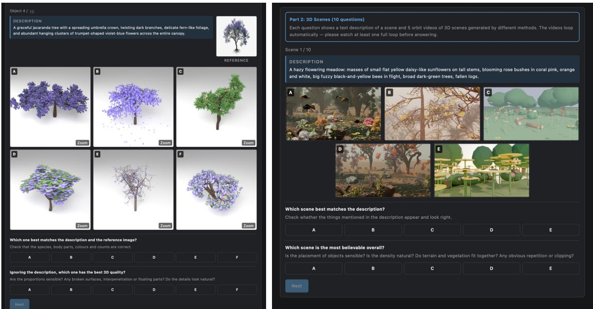  
Figure 17 Human evaluation interface. Participants compare anonymized generation results and independently select their preferred method for semantic alignment and visual quality at both the object and scene levels.

Study Setup. We conduct a forced-choice preference study on 10 object and 10 scene generation tasks. For each object, participants are shown the text prompt, a held-out reference image not provided to any generation method, and front-view renders (1024 × 1024) from six methods: InfiniDream, BlenderRAG, VIGA, VLM (one-shot), VLM (harness), and Infinigen.

For each scene, participants compare 5-second orbit videos (854 × 480) from five methods: InfiniDream, VIGA, VLM (harness), Code2Worlds, and Infinigen. All results are presented without cropping or background normalization.

The object subset covers animals, marine life, plants, and natural props, while the scene subset spans seven

distinct environment types.

Evaluation Protocol. As illustrated in Fig. 17, all methods are anonymized, and both task order and method positions are randomized independently for each participant. Each task contains two forced-choice questions evaluating semantic alignment and visual quality.

For objects, participants select the result that best matches the description and reference image, and the result with the highest 3D quality. For scenes, participants evaluate text alignment and overall scene realism, considering object placement, naturalness, and visual artifacts.

Each participant completes 40 judgments across both levels. We recruit 30 participants, yielding 20 judgments per level per participant.