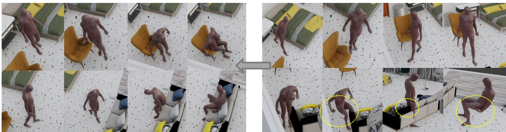
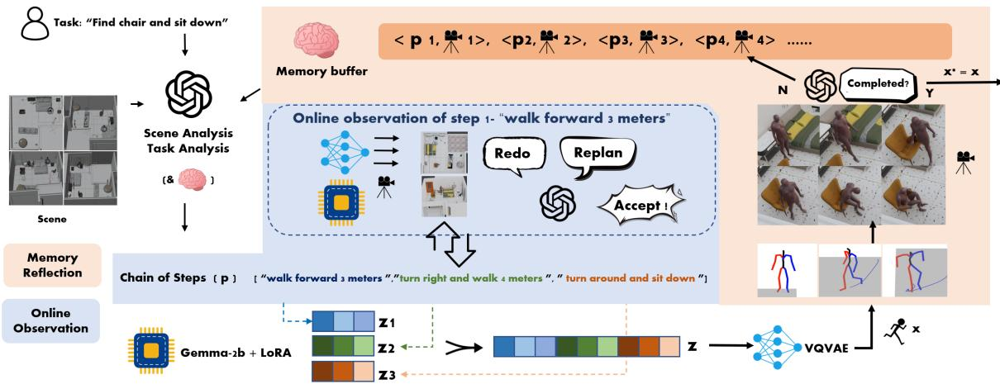
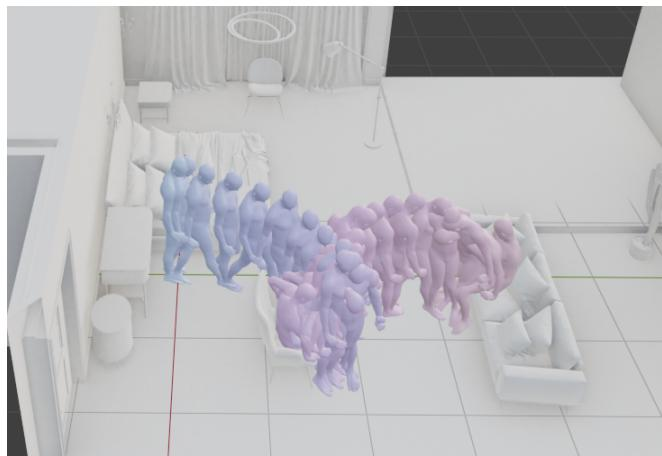
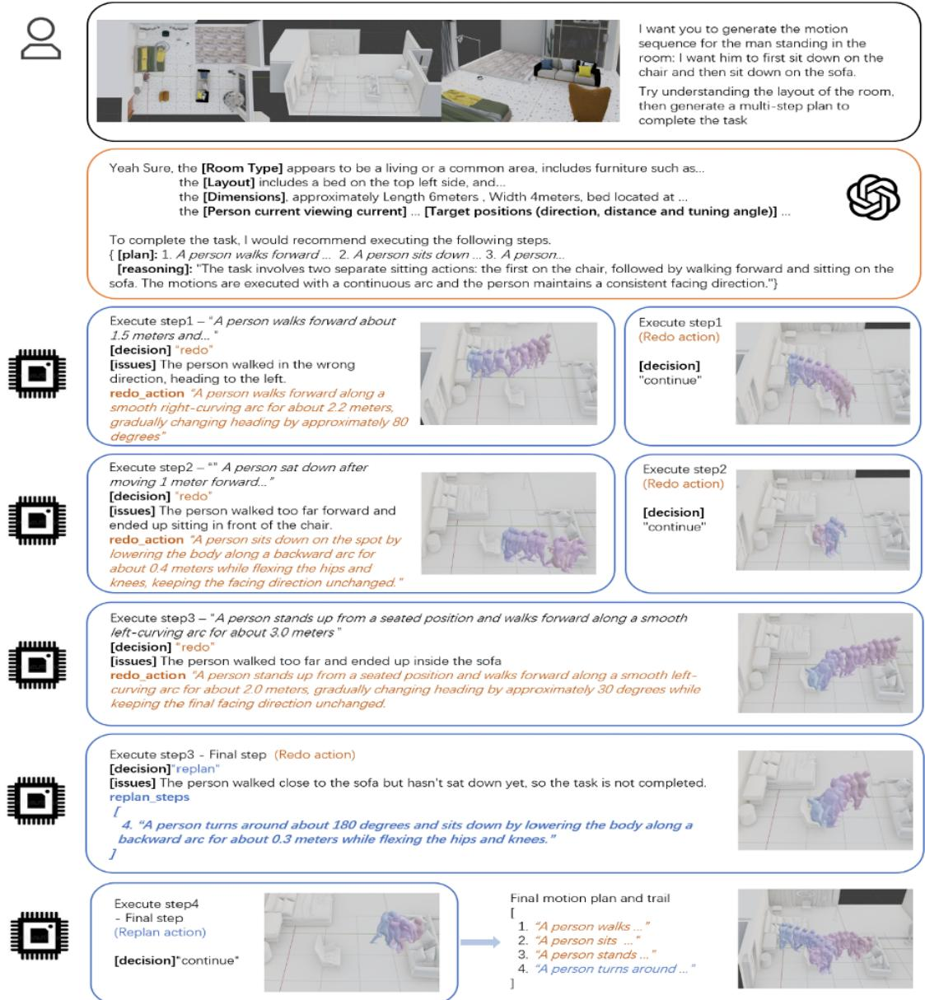
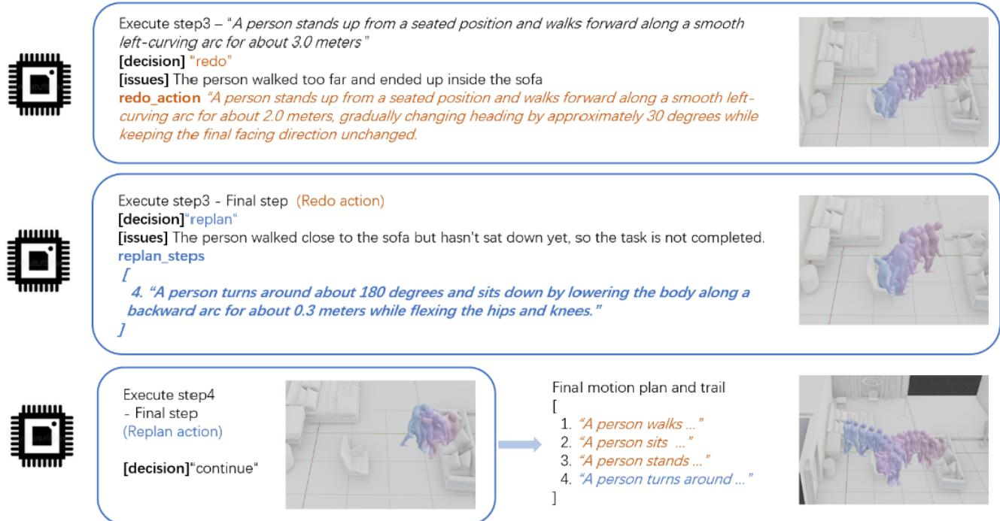

# InteractAgent: Agentic Human Motion Interaction with Memory-Augmented Reflection

Tao Zhang1∗ Senhe Zhang1∗ Zeyu Zhang2∗ Yujia Zhang1 Dong Gong2†

1AI Geeks 2UNSW Sydney

∗Equal contribution. †Corresponding author: dong.gong@unsw.edu.au.

  
Figure 1. InteractAgent vs. Naive: InteractAgent (left) couples Online Observation with Memory-Augmented Reflection, iteratively refining motion plans to achieve long-horizon, physically plausible human–scene interactions from images and language only. A naive text-to-motion baseline (right) lacks feedback and quickly accumulates errors, resulting in severe penetration and incomplete tasks.

## Abstract

Long-horizon human-scene interaction requires coordinated spatial reasoning, physical feasibility, and the ability to recover from compounding execution errors. Textdriven motion models are largely scene-agnostic and lack closed-loop correction, while geometry-conditioned approaches depend on paired scene–motion training or explicit 3D preprocessing that limits generalization to novel layouts and open-vocabulary goals. We present InteractAgent, an agentic multimodal LLM system for long-horizon human-scene interaction that plans, executes, observes, and reflects in a closed loop, using a single MLLM as both planner and evaluator and a frozen MotionLLM as the executor. InteractAgent integrates Online Observation for step-wise recovery decisions (continue/redo/replan) and Memory-Augmented Reflection for multi-round plan refinement with adaptive stopping. On UniHSI, InteractAgent improves task success and reduces penetration compared with training-free baselines. Code: https://github. com/AIGeeksGroup/InteractAgent.

## 1. Introduction

Understanding and synthesizing human behavior within complex environments is fundamental to embodied artificial intelligence. A key challenge lies in generating longhorizon human–scene interactions: temporally extended motion sequences where agents navigate, manipulate objects, and accomplish tasks in structured 3D spaces. Such scenarios require joint reasoning over spatial layouts, physical constraints, and semantic goals while maintaining temporal coherence. Recent advances in human motion generation have achieved impressive progress through largescale pretraining [8, 14, 32]. However, these models typically operate in scene-agnostic latent spaces—motion is generated independently of environmental context, lacking awareness of object locations, affordances, or contact constraints. A generated “sit on the chair” motion may exhibit plausible kinematics in isolation, yet produce severe penetration when placed in a real scene.

To incorporate scene awareness, prior work has introduced explicit geometric constraints [11, 15, 30], learning contact-conditioned models tied to precise 3D scene meshes. While effective, these approaches require geometry-conditioned training and scene-specific annotations, limiting scalability to novel layouts or openvocabulary instructions. Furthermore, they function as black-box predictors, offering little transparency into the planning process. We take a different perspective and propose training-free reflection for scene-aware motion generation. Rather than learning scene–motion mappings, we leverage a single pretrained multimodal large language model (MLLM) together with motion language models (MotionLLMs) to perform zero-shot planning directly from visual observations and natural-language instructions. Our framework, InteractAgent, integrates scene understanding, task decomposition, and motion synthesis through explicit reasoning, enabling both interpretability and generalization without task-specific finetuning.

The central insight is that reflection—observing outcomes, diagnosing errors, and iteratively refining plans— provides a powerful inductive bias for long-horizon interaction. We introduce two complementary mechanisms. Online Observation performs step-wise feedback: after each action, the MLLM evaluates the rendered motion and decides whether to continue, redo, or replan, preventing early errors from propagating. Memory-Augmented Reflection operates at the task level by accumulating planning– execution pairs across attempts and refining strategies through multi-round reasoning with an adaptive stopping criterion. Together, these mechanisms bridge local robustness and global optimization, enabling self-improvement without supervision.

Despite recent advances in human–scene interaction modeling, existing approaches exhibit two fundamental limitations. First, geometry-conditioned HSI models require paired motion–scene annotations and specialized training, restricting scalability to new environments. Second, training-free text-to-motion models lack spatial grounding and cannot self-correct once an action deviates, causing long-horizon errors to accumulate. Neither family of methods provides interactive, iterative, reflective planning—a capability essential for long-horizon tasks where perception and action must form a closed loop.

These observations motivate a new perspective: can a system generate scene-aware motion purely through multimodal reasoning and reflection, without any task-specific training or geometry preprocessing?

Contributions. In this work we propose InteractAgent, a training-free reflective framework for generating longhorizon human–scene interactions. Our main contributions are:

• Training-free perception-to-action pipeline. We integrate scene understanding, task decomposition, and motion synthesis solely through multimodal prompting— requiring no geometry-conditioned training or taskspecific finetuning. A single MLLM serves as the unified planner and evaluator.

• Dual-layer reflection for robust long-horizon planning. We introduce Online Observation for step-wise closed-loop correction and Memory-Augmented Reflection for multi-round task-level optimization, jointly stabilizing long-horizon execution.

• Adaptive stopping for efficient refinement. An adaptive stopping mechanism automatically determines the number of reflection rounds, improving efficiency while preserving global consistency.

• Extensive evaluation on UniHSI and TRUMANS. We show that InteractAgent achieves competitive success rates and significantly lower penetration errors than training-free and single-pass baselines, while providing interpretable reasoning traces for inspection and intervention.

## 2. Related Work

Human motion generation. Human motion generation aims to synthesize realistic, temporally coherent, and semantically meaningful motion under text, audio, or control signals. Early work relied on recurrent or transformer-based models trained on MoCap datasets. Text-to-motion methods such as Guo et al. [8] and T2M-GPT [32] learn a shared latent space or VQ-VAE codebook to map text to discrete motion tokens, while MotionGPT [14] unifies motion and text as a single “language”. MoMask [9] improves temporal coherence via hierarchical quantization and masked motion modeling. Diffusion-based approaches further enhance realism and controllability: Pi et al. [22] use hierarchical diffusion for detailed human–object motion, and Wang et al. [27] propose a cross-modal encoder–decoder mixture for text-driven 3D motion. However, these models operate in scene-agnostic latent spaces and do not explicitly account for environmental constraints, contacts, or navigation, limiting their use in embodied, scene-grounded settings.

Human motion interaction. To go beyond single-agent motion, prior work studies human–human (HHI), human– object (HOI), and human–scene (HSI) interactions. HOI frameworks [18, 19, 23] model affordances and contact dynamics through object-conditioned synthesis, grasping datasets, or controllable interaction goals. HSI methods [11] incorporate 3D layouts and pose–scene embeddings to generate physically plausible motion in structured environments. A variety of datasets and simulators support grounded interaction learning: BEHAVE [2] captures multiview RGB-D human–object interactions, HOISim [31] provides simulation-based HOI data, and Wang et al. [24] generate long-term motion-in-scene sequences. Holistic++ [3] jointly infers layout, human pose, and affordances, while

Wu et al. [29] map natural-language instructions to 3D interactive motions. These approaches significantly improve realism but rely on hand-crafted scene features or geometryconditioned training, and they lack the high-level semantic reasoning needed for adaptive planning in novel environments.

Vision-language models for scene understanding. Vision-language models (VLMs) and multimodal LLMs (MLLMs) enable cross-modal reasoning and grounding between perception and language. BLIP-2 [17] and PaLM-E [5] align visual encoders with large language models for semantic localization, reasoning, and action grounding. VIMA [16] and RT-2 [35] further demonstrate that multimodal models can serve as general-purpose planners for embodied control. Qwen-VL [1] improves high-resolution visual reasoning and spatial understanding. 3D-aware extensions such as Scene-LLM [7] and 3D-LLM [13] inject 3D geometry for 3D-aware reasoning and manipulation. Chen et al. [4] use VLMs to mine pose knowledge for human pose estimation, while EgoNav [26], UniEgoMotion [20], and Wang et al. [25] tackle egocentric motion forecasting and pose estimation by leveraging human– scene relationships. Human-centric metrics [6] quantify spatial affordance and reachability. Together, these works suggest that coupling a grounding-capable MLLM with tokenized motion models (e.g., MotionGPT, T2M-GPT, MoMask) can support a perception–planning–generation pipeline. Our framework builds on this idea and explicitly connects MLLM-based scene analysis, reflective planning, and a MotionLLM executor to achieve end-to-end motion generation from visual perception to 3D realization.

## 3. Method

In InteractAgent, we rely on a single multimodal large language model (MLLM) that accepts both images and text and produces structured outputs in natural language. For clarity of exposition, we describe separate “VLM” and “LLM” roles (for scene analysis, plan generation, evaluation, and reflection), but in practice all these roles are instantiated by the same underlying MLLM backbone. Unless otherwise specified, we use GPT-4o as this backbone in all experiments and study alternative backbones (e.g., Qwen-VL-Max) only in ablations.

For motion synthesis, we use a separate MotionLLM executor that maps a sequence of natural-language actions to a full 3D human motion trajectory. In all our experiments, this executor $Q$ is instantiated with the MotionLLM module from the Motion-Agent framework, which combines a Gemma-2B language backbone with a VQ-VAE motion decoder and SMPL-X reconstruction. We treat Q as a fixed component: no finetuning or modification is performed on this module, and our contributions focus on how to plan and reflect around it.

## 3.1. Overview

InteractAgent bridges visual perception and human motion synthesis by explicitly grounding motion planning in the surrounding scene. Given one or more scene images and a high-level task description, the system first performs MLLM-based scene analysis, then decomposes the task into atomic actions, and finally invokes a frozen MotionLLM executor to synthesize a full 3D motion sequence.

Concretely, a single multimodal LLM handles four roles: scene understanding, action sequence generation, step-wise online observation, and memory-augmented reflection. The MotionLLM is used purely as an executor that converts natural-language action descriptions into SMPL-X motion trajectories. Our contributions therefore focus on how to plan and reflect around this fixed executor via dual-layer reflection, rather than designing new motion architectures.

## 3.2. Scene Motion Planning Pipeline

InteractAgent establishes an end-to-end pipeline that connects visual perception with motion synthesis. Given a scene observation s (e.g., RGB images or multi-view renderings) and a high-level task description t, the planner produces a structured motion sequence $\mathbf { x } = \{ \mathbf { x } _ { 1 } , \ldots , \mathbf { x } _ { L } \}$ that realizes the intended behavior within the environment.

We encode the long-horizon interaction history as a single trajectory visualization image (Fig. 3) and use it as a compact reflection signal for the MLLM.

Formally, we denote the underlying motion executor by $Q ,$ which maps a sequence of natural-language action descriptions to a full motion trajectory:

$$
Q : { \bf p } = \{ { \bf p } _ { 1 } , \ldots , { \bf p } _ { K } \} \longrightarrow { \bf x } .
$$

For clarity, we omit the implicit dependence of $Q$ on the scene s and task t, and refer to it simply as the MotionLLM executor used throughout Algorithms 1 and 2.

Scene Understanding. To initialize the process, the scene is first provided as a prompt to the MLLM, which interprets spatial layouts, object affordances, and potential interaction sites:

$$
\begin{array} { r } { { \bf g } = f _ { \mathrm { M L L M } } ( { \bf s } ) . } \end{array}
$$

The scene representation g encodes entities, relations, and spatial structure for downstream reasoning.

Action Sequence Generation. Conditioned on g and the task prompt t, the same MLLM decomposes the task into a sequence of atomic, executable natural-language actions:

$$
\mathbf { p } = \{ \mathbf { p } _ { 1 } , \dots , \mathbf { p } _ { K } \} , \quad \mathbf { p } _ { k } \in \mathrm { N L } .
$$

  
Figure 2. Overview of InteractAgent. Our framework couples a single multimodal LLM with a frozen MotionLLM executor. Two key components enable training-free, long-horizon interaction generation: (1) Online Observation provides step-wise visual feedback during execution, allowing the MLLM to correct local deviations; (2) Memory-Augmented Reflection aggregates planning–execution histories across rounds and refines future plans at the trajectory level. Together, these mechanisms form a dual-layer reflective loop that progressively improves motion quality and scene consistency.

  
Figure 3. Trajectory visualization image used as a compact reflection signal for the MLLM.

Each action describes a short, unambiguous motion primitive (e.g., “turn left”, “walk forward 1.5 meters”).

Action-to-Motion Execution. We do not design a new motion synthesis model. Instead, InteractAgent directly calls the frozen MotionLLM executor to realize the entire action list:

$$
\mathbf { x } = Q ( \mathbf { p } ) .
$$

Internally, MotionLLM encodes the natural-language sequence, predicts motion tokens, decodes them with a VQ-VAE motion decoder, and reconstructs SMPL-X parameters. We treat this process as an internal implementation detail of Q and focus on how to generate and refine p via reflection.

This pipeline constitutes the forward execution path of InteractAgent—from perceptual grounding to motion realization on top of a fixed MotionLLM executor. To enhance robustness through step-wise feedback, we introduce Online Observation (Section 3.3) and Memory-Augmented Reflection (Section 3.4), both implemented via the same MLLM backbone.

## 3.3. Online Observation

While the scene motion planning pipeline provides a structured perception-to-action flow, it executes the entire action sequence in an open-loop manner, assuming all predicted actions are correct once generated. In practice, earlystep inaccuracies (e.g., over- or under-estimated displacements) often propagate through subsequent actions, resulting in physically inconsistent or semantically implausible motions. Such forward error accumulation not only degrades overall realism but also complicates global reflection, as it becomes difficult to isolate whether the degradation stems from local planning errors or model stochasticity.

To alleviate this issue, we introduce an Online Observation mechanism that integrates step-wise reflection and local replanning during execution. After each atomic action p is generated and executed by the MotionLLM executor,

$$
\mathbf { x } _ { k } = Q ( \mathbf { p } _ { k } ) ,
$$

the resulting visual outcome $\mathbf { v } _ { k }$ is rendered (e.g., as a short clip or keyframes) and evaluated through the same MLLM, forming an observation pair $\left( \mathbf { p } _ { k } , \mathbf { v } _ { k } \right)$ .

The MLLM evaluates the alignment between planned action $\mathbf { p } _ { k }$ and rendered outcome $\mathbf { v } _ { k }$ , producing a score and textual feedback:

$$
( \operatorname { s c o r e } _ { k } , \operatorname { f e e d b a c k } _ { k } ) = f _ { \mathrm { M L L M } } ( \mathbf { p } _ { k } , \mathbf { v } _ { k } ) .
$$

Based on this feedback, the language interface of the MLLM makes a discrete decision

$$
d _ { k } \in \{ \mathrm { c o n t i n u e , r e d o , r e p l a n } \} ,
$$

corresponding to one of three strategies:

• Continue: if score $k > \tau _ { \mathrm { a c c e p t } } ,$ accept the current action $\mathbf { p } _ { k }$ and proceed with the next planned step;

• Redo: detect misalignment in the current action, locally correct and regenerate $\mathbf { p } _ { k }$ before continuing the sequence;

• Replan: detect trajectory drift, accept $\mathbf { p } _ { k }$ but regenerate the remaining actions $\left\{ \mathbf { p } _ { k + 1 } , \ldots , \mathbf { p } _ { K } \right\}$ conditioned on the updated scene state.

Through this process, each step produces an optimized action $\mathbf { p } _ { k } ^ { * } .$ , and the planner maintains an updated list of refined actions

$$
\mathbf { p } ^ { * } = \{ \mathbf { p } _ { 1 } ^ { * } , \mathbf { p } _ { 2 } ^ { * } , \ldots , \mathbf { p } _ { K } ^ { * } \} .
$$

This list captures the locally adjusted and globally consistent plan emerging from the online reflection loop. After completing all steps, the optimized sequence is executed once more by the MotionLLM executor to obtain the final trajectory:

$$
\mathbf { x } ^ { * } = Q ( \mathbf { p } ^ { * } ) .
$$

The full procedure is summarized in Algorithm 1.

By embedding reflection within each execution step, InteractAgent continuously aligns its planned actions with the observed outcomes, forming a closed-loop perception– action cycle. This design transforms the planner from an offline generator into an execution-aware interactive system that perceives, acts, and self-adjusts in real time. To prevent excessive local oscillation, Online Observation enforces a maximum number of correction attempts for each action step. If repeated redo or replan decisions exceed this limit, the system terminates early and accepts the most recent action $\mathbf { p } _ { k }$ as the final outcome for that step. Once the limit is reached, the planner does not attempt additional adjustments and proceeds using only the last generated version of the action, discarding previous failed attempts.

While Online Observation provides stable step-wise correction, it remains limited to short-horizon improvements. To further enhance long-term consistency and task-level reasoning, we introduce a Memory-Augmented Reflection mechanism.

## 3.4. Memory-Augmented Reflection

Online Observation focuses on local corrections within a single execution of a task. However, long-horizon behaviors often require global adjustments that can only be discovered by comparing multiple executions of the same task. To this end, we augment InteractAgent with a trajectory-level memory that accumulates planning–execution pairs across attempts and enables global reflection.

Algorithm 1 Online Observation (Step-wise)   
Input: Scene ${ \bf s } ;$ initial task plan $\mathbf { p } = \{ \mathbf { p } _ { 1 } , \dots , \mathbf { p } _ { K } \}$ ; Mo  
tionLLM executor $Q ;$ MLLM evaluator $f _ { \mathrm { M L L M } } ;$ max   
retries per step $R _ { \mathrm { m a x } }$   
Output: Refined action list $\mathbf { p } ^ { * }$ , final motion $\mathbf { x } ^ { * }$   
1: $\mathbf { p } ^ { * }  [ ]$   
2: for $k = 1$ to $K$ do   
3: retry count $\gets 0$ ▷ Initialize retry counter   
4: repeat   
5: $\mathbf { x } _ { k }  Q ( \mathbf { p } _ { k } )$   
6: $\mathbf { v } _ { k }  \mathrm { R e n d e r } ( \mathbf { x } _ { k } )$   
7: $( \mathrm { s c o r e } _ { k } , \mathrm { f e e d b a c k } _ { k } ) \gets f _ { \mathrm { M L L M } } ( \mathbf { p } _ { k } , \mathbf { v } _ { k } )$   
8: $d _ { k } \in$ {continue, redo, replan} based on   
feedbackk   
9: if $d _ { k } \neq$ continue then   
10: retry count ← retry count $+ 1$   
11: end if   
12: if $d _ { k } =$ redo then   
13: regenerate $\mathbf { p } _ { k }$ using MLLM feedback   
14: else if $d _ { k } =$ replan then   
15: replan $\{ \mathbf { p } _ { k + 1 } , \hdots , \mathbf { p } _ { K } \}$ conditioned on cur  
rent state   
16: end if   
17: until $d _ { k } =$ continue or retry count $\geq R _ { \mathrm { m a x } }$   
18: $\mathbf { p } _ { k } ^ { * }  \mathbf { p } _ { k }$ ▷ Accept last attempt   
19: end for   
20: $\mathbf { x } ^ { * }  Q ( \mathbf { p } ^ { * } )$   
21: return $\mathbf { p } ^ { * } , \mathbf { x } ^ { * }$

Iterative Reflection Process. Given a specific task defined by scene s and goal t, the model executes the complete planning and motion generation process multiple times. Each execution produces a planned action sequence pi and the corresponding rendered outcome $\mathbf { v } _ { i } ,$ which form a planning–result pair $\left( \mathbf { p } _ { i } , \mathbf { v } _ { i } \right)$ . These pairs are accumulated as memory:

$$
{ \mathcal { M } } _ { i } = \{ ( \mathbf { p } _ { 1 } , \mathbf { v } _ { 1 } ) , ( \mathbf { p } _ { 2 } , \mathbf { v } _ { 2 } ) , \ldots , ( \mathbf { p } _ { i } , \mathbf { v } _ { i } ) \} .
$$

This memory encapsulates both successful and suboptimal past attempts, providing visual evidence of how different planning strategies manifest as physical motion.

At the $( i + 1 )$ -th iteration, the model performs reflection by reasoning over the accumulated memory $\mathcal { M } _ { i }$ when generating a new plan:

$$
\mathbf { p } _ { i + 1 } = f _ { \mathrm { r e f l e c t } } ( \mathcal { M } _ { i } , \mathbf { s } , \mathbf { t } ) ,
$$

where $f _ { \mathrm { r e f l e c t } }$ is implemented by prompting the same MLLM $f _ { \mathrm { M L L M } }$ with the task description, scene context, and all previous planning–execution pairs. The MLLM can directly observe rendered videos $\{ \mathbf { v } _ { 1 } , \ldots , \mathbf { v } _ { i } \}$ to identify patterns of failure—such as persistent penetration errors, trajectory drift, or incomplete task execution—and adjust its planning strategy accordingly.

The newly generated plan $\mathbf { p } _ { i + 1 }$ is then executed and rendered as $\mathbf { v } _ { i + 1 }$ , after which the pair is appended to memory:

$$
\mathcal { M } _ { i + 1 } = \mathcal { M } _ { i } \cup \{ ( \mathbf { p } _ { i + 1 } , \mathbf { v } _ { i + 1 } ) \} .
$$

Through this iterative process, the memory gradually accumulates planning–execution correspondences that guide the model toward more coherent and physically consistent motion generation.

Importantly, unlike step-wise Online Observation— which only retains the most recent attempt when its retry limit is reached—the memory module preserves all planning–execution pairs collected across iterations. Even if the system reaches the maximum number of reflection rounds and the task remains incomplete, the full memory $\mathcal { M } _ { i }$ is kept intact. This enables the reflection model to ex ploit the entire trajectory of past successes, failures, and partial improvements, rather than relying solely on the final attempt.

Adaptive Stopping Criterion. Unlike fixed-iteration approaches, our framework incorporates an adaptive stopping mechanism to balance quality and computational efficiency. After each reflection round, the MLLM evaluates the generated motion $\mathbf { v } _ { i }$ against the task requirements t and provides a judgment on whether the result is satisfactory. If the evaluation confirms that task requirements are met, the system terminates early and outputs the current result. Otherwise, it continues refining until reaching the maximum reflection budget $N _ { \mathrm { m a x } }$ (typically 5 rounds in our experiments).

This adaptive design offers several advantages: (1) $E f \mathscr { f } \mathscr { a } \mathscr { - }$ ciency—simple tasks often converge in 1–2 rounds, avoiding unnecessary computation; (2) Flexibility—the system automatically allocates more iterations to complex scenarios that require deeper refinement.

Final Output. After convergence or reaching $N _ { \mathrm { m a x } }$ rounds, the system outputs the motion from the final iteration:

$$
\mathbf { x } _ { \mathrm { f i n a l } } = Q ( \mathbf { p } _ { i } ) ,
$$

where i denotes the stopping iteration and $Q$ is the Motion-LLM executor defined above. This final motion represents the outcome of a complete self-reflection cycle, incorporating lessons learned from multiple attempts to produce a globally consistent, physically plausible, and semantically grounded interaction sequence.

Algorithm 2 Memory-Augmented Reflection (with Adap  
tive Stopping)   
Input: Scene ${ \bf s } ;$ task description $\mathbf { t } ;$ initial plan $\mathbf { p } _ { 0 } ;$ Mo  
tionLLM executor $Q ;$ MLLM-based evaluator fMLLM;   
max rounds $N _ { \mathrm { m a x } } .$   
Output: Trajectory memory $\mathcal { M } _ { \mathrm { f i n a l } }$ containing all at  
tempts   
1: $\mathbf { x } _ { 0 }  Q ( \mathbf { p } _ { 0 } )$   
2: $\mathbf { v } _ { 0 }  \mathrm { R e n d e r } ( \mathbf { x } _ { 0 } )$   
3: $\mathcal { M } _ { 0 } \gets \{ ( \mathbf { p } _ { 0 } , \mathbf { v } _ { 0 } ) \}$   
4: for $i = 1$ to $N _ { \mathrm { m a x } }$ do   
5: $\mathbf { p } _ { i } \gets f _ { \mathrm { r e f l e c t } } ( \mathcal { M } _ { i - 1 } , \mathbf { s } , \mathbf { t } )$   
6: $\mathbf { x } _ { i }  Q ( \mathbf { p } _ { i } )$   
7: $\mathbf { v } _ { i }  \mathrm { R e n d e r } ( \mathbf { x } _ { i } )$   
8: $\mathcal { M } _ { i }  \mathcal { M } _ { i - 1 } \cup \{ ( \mathbf { p } _ { i } , \mathbf { v } _ { i } ) \}$   
9: statusi $ f _ { \mathrm { M L L M } } ( \mathbf { p } _ { i } , \mathbf { v } _ { i } , \mathbf { t } )$   
10: if status = Pass then   
11: break ▷ Task requirements satisfied   
12: end if   
13: end for   
14: $\mathcal { M } _ { \mathrm { f i n a l } }  \mathcal { M } _ { i }$   
15: return ${ \mathcal { M } } _ { \mathrm { f i n a l } }$

The overall reflection process is summarized in Algorithm 2.

By integrating memory-augmented reflection with adaptive stopping, InteractAgent transforms from a one-shot generator into a self-improving system that learns from its own experiences—bridging short-term step-wise correction (Section 3.3) and long-term task-level optimization for robust, scene-aware human motion generation.

## 4. Experiments

We evaluate our training-free reflection framework on language-driven, long-horizon human–scene interaction tasks. Based on the structure of the framework and the nature of our tasks, we select representative datasets and metrics to assess both task-level success and physical plausibility. All experiments are designed to verify how reflection improves the quality and consistency of long-horizon human–scene interactions.

## 4.1. Datasets and Metrics

Previous human–scene interaction datasets mainly focus on short and constrained interactions [10, 21, 33], often limited to single-object contact or short motion clips without long-horizon reasoning. To comprehensively evaluate our training-free reflection framework, we draw from two complementary resources.

TRUMANS [15] provides physically detailed indoor scenes with dynamic object configurations, supporting realistic assessment of motion plausibility.

UniHSI [30] introduces language-driven, arbitrarylength interaction tasks, aligning closely with our textconditioned planning structure.

While these datasets originally target different tasks, we adapt their scene layouts and object configurations to fit our reflection framework, focusing on the ability to interpret textual instructions and generate coherent long-horizon motions. All motions are represented in the SMPL-X format and visualized within the reconstructed 3D scenes.

For quantitative evaluation, we assess the framework at both the task level and the motion level. Following Hassan et al. [12], we use Execution Success Rate (ESR) to measure whether each interaction task is successfully completed. To further evaluate the overall physical quality of generated motion sequences, we adopt Physical Validity (PV), which measures the extent of body–scene penetration [34] throughout the sequence.

$$
s _ { \mathrm { i n t e r - p e n } } = \sum _ { v _ { i } \in V } - ( \Psi _ { O } ( v _ { i } ) ) _ { - }\tag{1}
$$

where $\Psi _ { O }$ is the object signed distance field, (·) clips all positive distance values to zero, and V is the set of body vertices. In our setting, the number of frames varies significantly across tasks, and long-horizon sequences often contain large portions of non-interactive movement (e.g., walking or navigation before actual interaction). Directly averaging sinter-pene over all frames would therefore dilute meaningful penetration events.

To obtain a more reliable measure of physical consistency, we report: (1) the maximum penetration across all frames, and (2) the top-k mean penetration among the highest-penetration frames. These two statistics capture the severity and the persistence of penetration respectively, providing a more robust evaluation for long-horizon interaction tasks with highly imbalanced interactive durations.

Together, ESR and PV jointly capture both how well the task is achieved and how physically plausible the resulting motion is.

## 4.2. Implementation Details

Unless otherwise specified, we instantiate the multimodal large language model (MLLM) with GPT-4o via its official API. All scene-analysis, online-observation, and reflection prompts share a unified JSON-based output format. No task-specific finetuning is performed on either the MLLM or the motion backbone.

For motion synthesis, we adopt the public MotionLLM executor from the Motion-Agent framework, which uses a Gemma-2B language backbone, a VQ-VAE motion decoder, and SMPL-X reconstruction. We keep all motion hyperparameters and codebook settings from the released implementation. Action descriptions are passed as naturallanguage sequences and decoded into SMPL-X parameters at 30 FPS. Rendering is performed in the TRUMANS and UniHSI scenes.

<table><tr><td rowspan="2">Methods</td><td colspan="2">Success Rate (%) ↑ | pemax ↓|pe10%↓</td><td rowspan="2"></td><td rowspan="2"></td></tr><tr><td>Low</td><td>Mid High</td></tr><tr><td>UniHSI-CoCo</td><td>85.1 47.7</td><td>17.7</td><td>18.2</td><td>9.3</td></tr><tr><td>Naive</td><td>25.5 18.2</td><td>4.4</td><td>528.4</td><td>113.6</td></tr><tr><td>Online</td><td>74.4 52.3</td><td>31.1</td><td>102.7</td><td>54.5</td></tr><tr><td>Ref + Offline</td><td>72.3 47.7</td><td>26.7</td><td>62.3</td><td>36.8</td></tr><tr><td>InteractAgent</td><td>84.3 79.5</td><td>64.4</td><td>48.6</td><td>29.7</td></tr></table>

Table 1. Result of methods on tasks of different complexity levels. Success Rate (SR, %) and penetration errors are reported.

For reflection, we set the maximum number of rounds $N _ { \mathrm { m a x } } = 5$ unless otherwise noted. For Online Observation, each atomic action allows up to $R _ { \mathrm { m a x } } ~ = ~ 2$ local retries. Experiments run on a single NVIDIA A6000 GPU, with motion generation time dominated by rendering and MLLM inference.

Main Result. Table 1 presents the main quantitative results of our full system and its model variants under task configurations of low, medium, and high complexity. We compare the naive open-loop baseline, the Online-Observation-only variant, the offline memory-reflection variant, and our complete InteractAgent framework to analyze the individual and collaborative effects of our core designs. Compared with the naive one-shot motion generation pipeline, which suffers from severe error accumulation and achieves only a low overall success rate (25.5%, 18.2%, and 4.4% for low, mid, and high complexity tasks), Online Observation significantly boosts task success to 74.4%, 52.3%, and 31.1% by enabling step-wise execution correction and suppressing local trajectory drift.

Individual effects of core modules. In comparison, Memory-Augmented Reflection targets global systematic planning failures and substantially improves physical plausibility; when applied alone, it reduces the maximum penetration error $\mathrm { p e } _ { \mathrm { m a x } }$ from 528.4 to 62.3, achieving a nearly 10-fold reduction in physical violation. Further comparison demonstrates the necessity of online scene grounding: offline memory reflection yields limited performance gains on mid- and high-level tasks, while our full online memory refinement continuously updates scene states and effectively eliminates long-horizon error accumulation.

Full model performance and analysis. The integration of Online Observation and Memory-Augmented Reflection yields the best overall performance across all task difficulties, lifting the success rate to 84.3% / 79.5% / 64.4% and further reducing physical penetration artifacts. Overall, the two core modules exhibit clear complementary effects: Online Observation stabilizes local step-wise execution, while Memory-Augmented Reflection globally optimizes planning logic and physical consistency. Our training-free InteractAgent even narrows the performance gap with supervised geometry-conditioned baselines, while maintaining superior generalization ability toward open-vocabulary long-horizon human-scene interaction tasks.

<table><tr><td>LLM Type</td><td>SR (%) ↑</td><td>PC (%) ↑</td></tr><tr><td>Human</td><td>72</td><td>一</td></tr><tr><td>w. Qwen-VL-Max p</td><td>56</td><td>75</td></tr><tr><td>w. GPT-40</td><td>64</td><td>81</td></tr></table>

Table 2. Comparison of SR and PC (Y/N decided by human) across different LLM types.
<table><tr><td>Motion Executor</td><td>SR (%)↑</td><td> $\mathrm { p e } _ { \mathrm { m a x } } \downarrow$ </td><td>pe10%↓</td></tr><tr><td>MotionLLM</td><td>70</td><td>48.6</td><td>29.7</td></tr><tr><td>MG-MotionLLM</td><td>72</td><td>23.3</td><td>16.9</td></tr><tr><td>MG stateless</td><td>70</td><td>46.2</td><td>24.3</td></tr></table>

Table 3. Comparison of SR and penetration between Motion Executors.

## Ablation Study.

Ablation on LLM Planner. We study how the choice of multimodal LLM affects planning robustness. Table 2 compares GPT-4o and Qwen-VL-Max under identical settings. GPT-4o yields higher Planning Correctness (PC) and SR, while Qwen-VL-Max provides competitive grounding but struggles more on complex multi-step reasoning.

Ablation on MotionLLM Executor. While InteractAgent is designed to be executor-agnostic, executor quality influences physical validity. We replace the default MotionLLM with alternative motion backbones while keeping the high-level agent unchanged (Table 3). MG-MotionLLM [28] reduces penetration substantially, suggesting task completion is planning-limited whereas physical plausibility depends on the motion executor.

Summary. Our ablation results demonstrate that (1) Online Observation and Memory-Augmented Reflection address complementary failure modes, together enabling robust long-horizon interaction; (2) the MLLM backbone strongly influences reasoning quality but does not require any task-specific adaptation; and (3) the full system consistently achieves the highest task success and physical plausibility.

## 5. Limitations and Future Work

Our framework enables training-free, reflection-driven interaction generation, while highlighting several directions for future work. First, downstream MotionLLMs remain a key bottleneck: subtle linguistic distinctions can map to similar motion tokens, limiting fine-grained control. Combining our reflective planner with stronger motion generators or continuous motion representations may improve fidelity.

Second, visually grounded feedback offers greater flexibility than geometry-conditioned pipelines, but currently provides less geometric precision. This motivates evaluation protocols that jointly assess semantic correctness, scene awareness, and physical plausibility, rather than relying solely on fine-grained contact metrics.

Third, existing metrics do not capture reasoning consistency, iterative improvement, or adaptive stopping behavior, as also noted in UniHSI [30]. Reflection-aware metrics will therefore be important for evaluating future agentic multimodal systems.

Finally, memory usage grows with the number of reflection rounds due to current MLLM context limits. Since substantial gains arise from only a few iterations, future work may explore structured memory, compression, and hierarchical reasoning for more complex tasks.

Overall, these limitations point toward rich research opportunities. We believe our framework lays the groundwork for more capable reflective agents, and future work will explore stronger motion models, reflection-aware benchmarks, and extensions to multi-agent coordination and realworld robotic embodiment.

## 6. Conclusion

Although our reflection-based framework demonstrates strong generalization and interpretable long-horizon behavior, several limitations remain.

First, the overall performance is fundamentally bounded by the capacity of the downstream MotionLLM. While the LLM exhibits reliable reasoning and step-wise reflection, the motion generator lacks sensitivity to subtle linguistic variations—different motion intents may be quantized into similar token sequences—forming a bottleneck for finegrained control. Future work will investigate coupling our framework with higher-capacity motion models or continuous, non-quantized motion representations.

## References

[1] Jinze Bai, Shuai Bai, Shusheng Yang, Shijie Wang, Sinan Tan, Peng Wang, Junyang Lin, Chang Zhou, and Jingren Zhou. Qwen-vl: a versatile vision-language model for understanding, localization, text reading, and beyond. arXiv preprint arXiv:2308.12966, 2023. 3

[2] Bharat Lal Bhatnagar, Xianghui Xie, Ilya A Petrov, Cristian Sminchisescu, Christian Theobalt, and Gerard Pons-Moll. Behave: Dataset and method for tracking human object interactions. In Proceedings of the IEEE/CVF Conference on Computer Vision and Pattern Recognition, pages 15935– 15946, 2022. 2

[3] Yixin Chen, Siyuan Huang, Tao Yuan, Siyuan Qi, Yixin Zhu, and Song-Chun Zhu. Holistic++ scene understanding: Single-view 3d holistic scene parsing and human pose estimation with human-object interaction and physical commonsense. In Proceedings of the IEEE/CVF International Conference on Computer Vision, pages 8648–8657, 2019. 2

[4] Yilei Chen, Xuemei Xie, and Fu Li. Vision-language model guided pose knowledge mining for human pose estimation. Journal of Computational Design and Engineering, 12(9): 32–45, 2025. 3

[5] Danny Driess, Fei Xia, Mehdi SM Sajjadi, Corey Lynch, Aakanksha Chowdhery, Ayzaan Wahid, Jonathan Tompson, Quan Vuong, Tianhe Yu, Wenlong Huang, et al. Palm-e: An embodied multimodal language model. arXiv preprint arXiv:2303.03378, 2023. 3

[6] Qiang Fu, Hongbo Fu, Hai Yan, Bin Zhou, Xiaowu Chen, and Xueming Li. Human-centric metrics for indoor scene assessment and synthesis. Graphical Models, 110:101073, 2020. 3

[7] Rao Fu, Jingyu Liu, Xilun Chen, Yixin Nie, and Wenhan Xiong. Scene-llm: Extending language model for 3d visual understanding and reasoning. arXiv preprint arXiv:2403.11401, 2024. 3

[8] Chuan Guo, Shihao Zou, Xinxin Zuo, Sen Wang, Wei Ji, Xingyu Li, and Li Cheng. Generating diverse and natural 3d human motions from text. In Proceedings of the IEEE/CVF conference on computer vision and pattern recognition, pages 5152–5161, 2022. 1, 2

[9] Chuan Guo, Yuxuan Mu, Muhammad Gohar Javed, Sen Wang, and Li Cheng. Momask: Generative masked modeling of 3d human motions. In Proceedings of the IEEE/CVF Conference on Computer Vision and Pattern Recognition, pages 1900–1910, 2024. 2

[10] Mohamed Hassan, Duygu Ceylan, Ruben Villegas, Jun Saito, Jimei Yang, Yi Zhou, and Michael J Black. Stochastic scene-aware motion prediction. In Proceedings of the IEEE/CVF International Conference on Computer Vision, pages 11374–11384, 2021. 6

[11] Mohamed Hassan, Partha Ghosh, Joachim Tesch, Dimitrios Tzionas, and Michael J Black. Populating 3d scenes by learning human-scene interaction. In Proceedings of the IEEE/CVF Conference on Computer Vision and Pattern Recognition, pages 14708–14718, 2021. 1, 2

[12] Mohamed Hassan, Yunrong Guo, Tingwu Wang, Michael Black, Sanja Fidler, and Xue Bin Peng. Synthesizing phys-

ical character-scene interactions. In ACM SIGGRAPH 2023 Conference Proceedings, pages 1–9, 2023. 7

[13] Yining Hong, Haoyu Zhen, Peihao Chen, Shuhong Zheng, Yilun Du, Zhenfang Chen, and Chuang Gan. 3d-llm: Injecting the 3d world into large language models. Advances in Neural Information Processing Systems, 36:20482–20494, 2023. 3

[14] Biao Jiang, Xin Chen, Wen Liu, Jingyi Yu, Gang Yu, and Tao Chen. Motiongpt: Human motion as a foreign language. Advances in Neural Information Processing Systems, 36:20067–20079, 2023. 1, 2

[15] Nan Jiang, Zhiyuan Zhang, Hongjie Li, Xiaoxuan Ma, Zan Wang, Yixin Chen, Tengyu Liu, Yixin Zhu, and Siyuan Huang. Scaling up dynamic human-scene interaction mod eling. In Proceedings of the IEEE/CVF Conference on Com puter Vision and Pattern Recognition, pages 1737–1747, 2024. 1, 6

[16] Yunfan Jiang, Agrim Gupta, Zichen Zhang, Guanzhi Wang, Yongqiang Dou, Yanjun Chen, Li Fei-Fei, Anima Anandkumar, Yuke Zhu, and Linxi Fan. Vima: General robot manipulation with multimodal prompts. arXiv preprint arXiv:2210.03094, 2022. 3

[17] Junnan Li, Dongxu Li, Silvio Savarese, and Steven Hoi. Blip-2: Bootstrapping language-image pre-training with frozen image encoders and large language models. In International conference on machine learning, pages 19730– 19742. PMLR, 2023. 3

[18] Jiaman Li, Jiajun Wu, and C Karen Liu. Object motion guided human motion synthesis. ACM Transactions on Graphics (TOG), 42(6):1–11, 2023. 2

[19] Jiaman Li, Alexander Clegg, Roozbeh Mottaghi, Jiajun Wu, Xavier Puig, and C Karen Liu. Controllable human-object interaction synthesis. In European Conference on Computer Vision, pages 54–72. Springer, 2024. 2

[20] Chaitanya Patel, Hiroki Nakamura, Yuta Kyuragi, Kazuki Kozuka, Juan Carlos Niebles, and Ehsan Adeli. Uniegomotion: A unified model for egocentric motion reconstruction, forecasting, and generation. In Proceedings of the IEEE/CVF International Conference on Computer Vision, pages 10318– 10329, 2025. 3

[21] Xue Bin Peng, Ze Ma, Pieter Abbeel, Sergey Levine, and Angjoo Kanazawa. Amp: Adversarial motion priors for stylized physics-based character control. ACM Transactions on Graphics (ToG), 40(4):1–20, 2021. 6

[22] Huaijin Pi, Sida Peng, Minghui Yang, Xiaowei Zhou, and Hujun Bao. Hierarchical generation of human-object interactions with diffusion probabilistic models. In Proceedings ofthe IEEE/CVF International Conference on Computer Vi sion, pages 15061–15073, 2023. 2

[23] Omid Taheri, Nima Ghorbani, Michael J Black, and Dimitrios Tzionas. Grab: A dataset of whole-body human grasping of objects. In European conference on computer vision, pages 581–600. Springer, 2020. 2

[24] Jiashun Wang, Huazhe Xu, Jingwei Xu, Sifei Liu, and Xiaolong Wang. Synthesizing long-term 3d human motion and interaction in 3d scenes. In Proceedings ofthe IEEE/CVF Con ference on Computer Vision and Pattern Recognition, pages 9401–9411, 2021. 2

[25] Jian Wang, Diogo Luvizon, Weipeng Xu, Lingjie Liu, Kripasindhu Sarkar, and Christian Theobalt. Scene-aware egocentric 3d human pose estimation. In Proceedings of the IEEE/CVF Conference on Computer Vision and Pattern Recognition, pages 13031–13040, 2023. 3

[26] Weizhuo Wang, C Karen Liu, and Monroe Kennedy III. Egonav: Egocentric scene-aware human trajectory prediction. arXiv preprint arXiv:2403.19026, 2024. 3

[27] XiangYang Wang, Peng Li, and Rui Wang. Cedt2m: textdriven human motion generation via cross-modal mixture of encoder-decoder. Neural Computing and Applications, pages 1–19, 2025. 2

[28] Bizhu Wu, Jinheng Xie, Keming Shen, Zhe Kong, Jianfeng Ren, Ruibin Bai, Rong Qu, and Linlin Shen. Mg-motionllm: A unified framework for motion comprehension and generation across multiple granularities. In Proceedings of the Computer Vision and Pattern Recognition Conference, pages 27849–27858, 2025. 8

[29] Zhen Wu, Jiaman Li, Pei Xu, and C Karen Liu. Humanobject interaction from human-level instructions. In Proceedings of the IEEE/CVF International Conference on Computer Vision, pages 11176–11186, 2025. 3

[30] Zeqi Xiao, Tai Wang, Jingbo Wang, Jinkun Cao, Wenwei Zhang, Bo Dai, Dahua Lin, and Jiangmiao Pang. Unified human-scene interaction via prompted chain-of-contacts. In The Twelfth International Conference on Learning Representations, 2024. 1, 7

[31] Marsil Zakour, Alaeddine Mellouli, and Rahul Chaudhari. Hoisim: Synthesizing realistic 3d human-object interaction data for human activity recognition. In 2021 30th IEEE International Conference on Robot & Human Interactive Communication (RO-MAN), pages 1124–1131. IEEE, 2021. 2

[32] J Zhang, Y Zhang, X Cun, S Huang, Y Zhang, H Zhao, H Lu, and X Shen. T2m-gpt: Generating human motion from textual descriptions with discrete representations. In Proceedings of the IEEE/CVF Conference on Computer Vision and Pattern Recognition, 2023. 1, 2

[33] Kaifeng Zhao, Shaofei Wang, Yan Zhang, Thabo Beeler, and Siyu Tang. Compositional human-scene interaction synthesis with semantic control. In European Conference on Computer Vision, pages 311–327. Springer, 2022. 6

[34] Kaifeng Zhao, Yan Zhang, Shaofei Wang, Thabo Beeler, and Siyu Tang. Synthesizing diverse human motions in 3d indoor scenes. In Proceedings of the IEEE/CVF international conference on computer vision, pages 14738–14749, 2023. 7, 11

[35] Brianna Zitkovich, Tianhe Yu, Sichun Xu, Peng Xu, Ted Xiao, Fei Xia, Jialin Wu, Paul Wohlhart, Stefan Welker, Ayzaan Wahid, et al. Rt-2: Vision-language-action models transfer web knowledge to robotic control. In Conference on Robot Learning, pages 2165–2183. PMLR, 2023. 3

## A. Datasets and Metrics

## A.1. Datasets

Previous human–scene interaction datasets mainly focus on short and constrained interactions, often limited to single-object contact or short motion clips without long-horizon reasoning. To comprehensively evaluate our training-free reflection framework, we draw from two complementary resources.

TRUMANS provides physically detailed indoor scenes with dynamic object configurations, supporting realistic assessment of motion plausibility.

UniHSIintroduces language-driven, arbitrary-length interaction tasks, aligning closely with our text-conditioned planning structure.

While these datasets originally target different tasks, we adapt their scene layouts and object configurations to fit our reflection framework, focusing on the ability to interpret textual instructions and generate coherent long-horizon motions. All motions are represented in the SMPL-X format and visualized within the reconstructed 3D scenes.

## A.2. Metrics

## A.2.1. ESR

For quantitative evaluation, we assess the framework at both the task level and the motion level. Following Hassan et al., we use Execution Success Rate (ESR) to measure whether each interaction task is successfully completed.

## A.2.2. PV

To further evaluate the overall physical quality of generated motion sequences, we adopt Physical Validity (PV), which measures the extent of body–scene penetration throughout the sequence following prior work [34]. Let $\Psi _ { O }$ denote the object signed distance field (SDF), (·) retain negative distance values while clipping positive values to zero, and V denote the set of body vertices. The penetration score for each frame is defined as

$$
s _ { \mathrm { i n t e r - p e n e } } = - \sum _ { v _ { i } \in V } \left( \Psi _ { O } ( v _ { i } ) \right) _ { - }\tag{2}
$$

The negative sign converts the accumulated negative SDF values into a non-negative penetration score, where a larger value indicates more severe body–scene penetration.

In our setting, sequence lengths vary substantially across tasks, and long-horizon motions often contain large portions of non-interactive movement, such as walking or navigation before the actual interaction. Directly averaging sinter-pene over all frames would therefore dilute meaningful penetration events and make results sensitive to sequence length.

To obtain a more reliable measure of physical consistency, we report two complementary statistics: (1) the maximum penetration, $\mathrm { p e } _ { \mathrm { m a x } } ,$ across all frames, and (2) the top-10% mean penetration, $\mathrm { p e } _ { 1 0 \% }$ , computed over the frames with the highest penetration scores. The former captures the severity of the worst physical violation, while the latter measures whether substantial penetration persists across multiple frames rather than occurring as an isolated event. These statistics provide a more robust evaluation for long-horizon interaction tasks with highly imbalanced interactive and non-interactive durations.

Together, Execution Success Rate (ESR) and Physical Validity (PV) evaluate both whether the instructed task is successfully completed and whether the generated motion remains physically plausible within the scene.

## A.2.3. Cost metrics

Since InteractAgent is a modular framework whose actual latency depends on the selected MLLM, motion executor, hardware, and API conditions, we report hardware-independent operation counts as proxies for computational cost. We decompose the framework overhead into three components: multimodal queries, motion-model executions, and trajectory rendering.

We define one visual-query unit (VQU) as one MLLM request containing a prompt and one rendered trajectory observation. This normalization accounts for the amount of visual evidence processed rather than the implementation-specific number of API requests. For example, evaluating K candidate trajectories in Greedy or Beam Search is counted as K VQUs, even if the candidates can technically be batched into a single API request, because such a request processes substantiall more visual content than a standard single-observation query.

A motion execution denotes one invocation of MotionLLM, including motion-token generation and VQ-VAE decoding. This count provides an executor-independent proxy because absolute runtime varies with the selected motion model and hardware.

A rendering operation denotes the generation of one trajectory visualization. In our implementation, rendering primarily involves scene loading and initialization, while the marginal cost of adding sampled keyframes is relatively small. Using simplified human meshes without complex materials, rendering trajectories containing 10–30 keyframes differs in runtime by only approximately 1.2×–1.4×.

Because each visual query in the evaluated methods is paired with a newly rendered trajectory, the numbers of rendering operations and VQUs are nearly identical. We therefore report VQUs and motion executions as the primary framework-leve cost proxies, while noting that VQUs also closely reflect the associated rendering overhead.

## B. Qualitative Examples

## B.1. Online Observation Example

  
Figure B.1: Online Observation example.

Please analyze this scene image and provide a detailed description including:

  
Figure B.2: Online Observation example (steps 3–4 and final plan).

## C. Prompt Templates

Please analyze these two images: the first is a bird’s-eye view,   
the second is a first-person view.

Please provide the following information:

1. Room type and layout   
2. Room dimensions (length x width, in meters)   
3. Current viewing direction (facing where)   
4. Distance from current position to various furniture (in meters)   
5. Required turning angle to reach target position

Important: The first-person view shows your current facing direction, which is the starting point for motion planning. Please accurately determine the current orientation and calculate the required turning angle to reach the target position.

Note: In first-person view, what you see ahead is your forward direction (0 degrees), left is -90 degrees, right is +90 degrees. Please calculate turning angles based on this coordinate system.

6. Height info: Height information for objects and surfaces

7. Starting position: Suggest a reasonable starting position for the person (e.g., "entrance", "center of room", "near the door")

8. Spatial metrics for planning:

\- Approximate distances between key objects (in meters)

\- Clearance widths of narrow passages (in meters)

\- Relative angular directions to target objects (degrees)

\- Whether movement requires sidestepping, turning in place, or wall-following

9. Navigational affordances:

\- Which paths are straight-walkable

\- Which paths require body rotation or lateral movement

\- Which areas are not passable by normal walking

Please provide a comprehensive analysis that can be used for motion planning and trajectory generation.