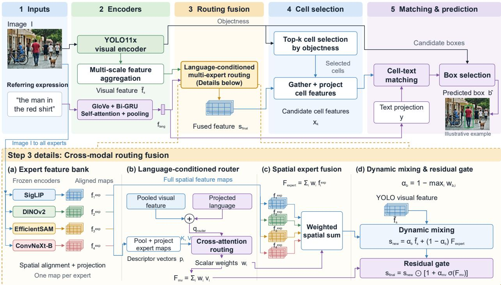
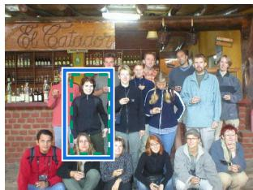
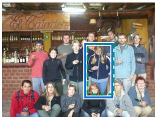
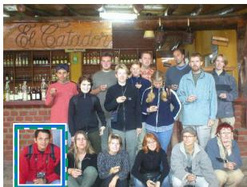
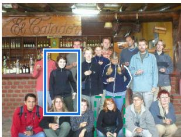
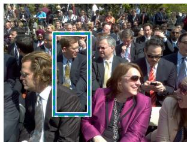
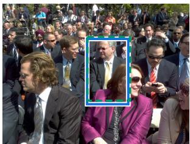
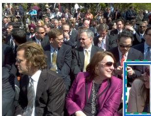
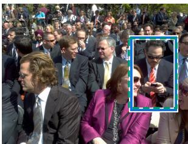

# LAMER: LANGUAGE-CONDITIONED MULTI-EXPERT ROUTING FOR WEAKLY SUPERVISED REFERRING EXPRESSION COMPREHENSION

Yu Yu Chang1, Tzu-Hsuan Weng1, Youssef Mohamed Amin2, Mohaned Ahmed Elsayed2, Hung-Hsuan Chen1, Min-Te Sun1, Sherine Shawky2

1National Central University, Taoyuan, Taiwan

2Pharos University in Alexandria, Alexandria, Egypt

oscarw510gc@gmail.com, 112403057@cc.ncu.edu.tw, 202304504@pua.edu.eg, 202304056@pua.edu.eg,hhchen1105@acm.org, msun0807@gmail.com, sherine.shawky@pua.edu.eg

## ABSTRACT

Referring Expression Comprehension (REC) localizes the image region described by a natural language expression, underpinning applications such as autonomous navigation, human-robot interaction, and medical image analysis. Under weak supervision, REC is challenged by the visual-linguistic semantic gap and the difficulty of inferring region-text correspondences from coarse image-level signals alone. Moreover, no single visual encoder captures all complementary properties—semantic alignment, fine-grained texture, and boundary awareness—while naively fusing multiple pretrained encoders yields heterogeneous, hard-to-reconcile representations. We propose LaMER, a weakly supervised REC framework that dynamically aggregates four frozen expert encoders through a language-conditioned Cross-Modal Routing Fusion module, adapting expert selection to each referring expression without instance-level bounding-box supervision. A Cell-Text Matching Head with Negative Anchor Augmentation, trained with a multi-objective loss combining contrastive, reconstruction, alignment, and load-balancing terms, further stabilizes optimization. LaMER achieves 77.67%, 62.81%, and 69.49% Acc@IoU≥ 0.5 on RefCOCO, RefCOCO+, and RefCOCOg, surpassing DViN and WeakMCN by up to 16.49 and 14.49 points, with ablations validating each component.

## 1 Introduction

Understanding and localizing natural language references to visual content is a core requirement for intelligent systems operating in the real world. Referring Expression Comprehension (REC), the task of localizing the image region described by a natural language expression, underpins applications such as autonomous navigation [1], human-robot interaction [2], and medical image analysis [3], where systems must identify the target object among multiple visually similar candidates.

REC remains fundamentally challenged by a visual-linguistic semantic gap between continuous visual representations and discrete language tokens, an absence of instance-level supervision, and the difficulty of integrating heterogeneous visual representations. These challenges intensify under weak supervision, where models learn solely from imagelevel signals, making the quality of visual representations the primary bottleneck: features must be both spatially discriminative and semantically aligned with the language query. Yet no single visual encoder simultaneously captures all complementary visual cues—semantic alignment, fine-grained texture, structure, and boundary awareness. Integrating multiple specialized pretrained encoders through a Mixture-of-Experts (MoE) paradigm [4] is a promising direction, but heterogeneous experts produce representations optimized for different objectives and feature distributions, making naive fusion ineffective; a learned language-conditioned router further risks collapsing onto a small subset of experts without appropriate load-balancing regularization.

We review existing REC methods in detail in Section 2. In brief, fully supervised approaches [5, 6, 7, 8, 9, 10, 11] achieve strong performance but depend on costly instance-level annotations that limit scalability [12], while recent weakly supervised methods [13, 14] instead pair open-vocabulary detectors [15, 16] with a single visual backbone. This reliance on one encoder limits the diversity of visual characteristics captured, leaving a gap in aggregating heterogeneous visual representations under weak supervision.

To address these limitations, we propose LaMER (Language-Conditioned Multi-Expert Routing for Weakly Supervised Referring Expression Comprehension), a weakly supervised REC framework that dynamically aggregates complementary visual representations from heterogeneous pretrained visual experts. Instead of a single visual backbone, LaMER leverages multiple frozen expert encoders and aggregates their outputs through a learned gating mechanism in a Cross-Modal Routing Fusion module and a Cell-Text Matching Head with Negative Anchor Augmentation, trained with a multi-objective optimization strategy that stabilizes expert routing and improves grounding performance without requiring bounding-box annotations.

Extensive experiments on RefCOCO, RefCOCO+, and RefCOCOg show that LaMER outperforms the state-of-the-art weakly supervised methods DViN and WeakMCN by up to 16.49 and 14.49 percentage points, with comprehensive ablations validating the effectiveness of each proposed component. The main contributions of this paper are summarized as follows:

• We propose LaMER, a weakly supervised referring expression comprehension framework that introduces a language-conditioned multi-expert routing mechanism for aggregating complementary visual representations from heterogeneous pretrained visual encoders.

• We design a Cross-Modal Routing Fusion module and an Expert Feature Bank, enabling learned weighted integration of heterogeneous visual representations.

• We introduce a Cell-Text Matching Head with Negative Anchor Augmentation and optimize the framework using a multi-objective training strategy that stabilizes expert routing and improves weakly supervised grounding without requiring bounding-box annotations.

• Extensive experiments on RefCOCO, RefCOCO+, and RefCOCOg demonstrate state-of-the-art performance among weakly supervised REC methods, while comprehensive ablation studies verify the effectiveness of each proposed component.

## 2 Related Work and Preliminaries

## 2.1 Open-Vocabulary Object Detection

Open-vocabulary object detection (OVD) extends detection beyond predefined categories to novel concepts described through natural language. Early semantic-transfer approaches were limited by weak visual-semantic alignment; large-scale vision-language pretraining (e.g., CLIP, ALIGN) improved this via contrastive learning on image-text pairs. Building on such models, ViLD [15] distills a frozen CLIP teacher into a detector; GLIP and RegionCLIP reformulate detection as phrase grounding; YOLO-World [16] introduces a lightweight vision-language pathway for real-time inference. Despite these advances, OVD models remain designed for category-level recognition and are insufficient for compositional expressions involving attributes, spatial relationships, and context—so directly applying OVD representations to REC remains challenging.

## 2.2 Referring Expression Comprehension

Referring Expression Comprehension (REC) aims to localize the image region described by a natural language expression, requiring models to identify the intended instance among visually similar candidates. Existing approaches divide into fully supervised and weakly supervised paradigms.

Fully supervised REC. Early REC approaches relied on modular architectures that decomposed expressions into semantic components such as object categories, attributes, and spatial relationships [5, 6], while graph-based methods modeled objects as nodes and exploited relational reasoning over scene structures [7, 8]. With Transformer-based visionlanguage architectures, approaches such as TransVG [9], MDETR [10], and SeqTR [11] achieved strong performance through end-to-end cross-modal interaction and localization, but their dependence on expensive instance-level bounding box annotations limits scalability to large-scale scenarios [12].

Zero-shot and weakly supervised REC. To reduce dependence on annotations, studies investigate weakly supervised and zero-shot REC, learning grounding from image-level supervision or transferring it from pretrained vision-language models, formulating REC as region-text matching over open-vocabulary detector proposals [15, 16]. RefCLIP [13], APL [14], DViN [17], and WeakMCN [18] improve weakly supervised grounding through enhanced visual-language alignment and auxiliary learning; [19] augment RefCLIP’s anchor-matching backbone with cross-modality attention, while [20] distill teacher-grounder knowledge under a ground-truth-proposal regime rather than LaMER’s fully automatic candidate generation. QueryMatch [21] and AlignCAT [22] replace anchor-level matching with querybased representations from a Mask2Former detector; [23] adopt a grounding DINO backbone with VLM-derived pseudo-labels; [24] propose confidence-aware pseudo-label self-correction; and [25] propose SVCR, routing multiple pretrained visual foundation models into structured relational features—the closest architectural precedent to LaMER’s multi-expert routing.

However, most of these recent methods rely on a single visual backbone, limiting their ability to capture the diverse visual properties complex expressions require, and lack mechanisms to dynamically select complementary visual information per expression. LaMER addresses this gap via a language-conditioned routing mechanism over heterogeneous, frozen visual expert encoders, building on three established techniques—attention, mixture-of-experts routing, and contrastive learning—each mapped to a specific module or loss in Section 3; a self-contained review is provided in Appendix A.

## 3 Proposed Method

## 3.1 Overview

LaMER couples a YOLO11x-based visual encoder [26] and a Bi-GRU language encoder with a Cross-Modal Routing Fusion module that assigns soft weights to four frozen expert encoders and dynamically mixes them with the backbone feature through a learnable residual gate, strengthening cross-modal alignment under weak supervision.

The fused representation is subsequently processed by the Cell-Text Matching Head, which performs region-text alignment through anchor-level contrastive matching. Negative Anchor Augmentation adds challenging negatives during training to improve discrimination, and LaMER is optimized with a multi-objective loss combining contrastive, reconstruction, alignment, and load-balancing objectives, enabling stable routing without instance-level bounding-box annotations.

## 3.2 Research Challenges

Beyond the visual-linguistic semantic gap and the absence of instance-level supervision introduced in Section 1, realizing this design raises two further architecture-specific challenges:

1. Visual Expert Heterogeneity: The four frozen experts—SigLIP (image-text contrastive learning), DINOv2 (self-supervised learning), EfficientSAM (mask prediction), and ConvNeXt (supervised classification)—are pretrained under heterogeneous objectives and exhibit substantially different feature distributions, making simple fusion strategies such as averaging or concatenation ineffective.

2. Dynamic Routing Stability: Training a language-conditioned router jointly with the grounding objective may collapse it toward a single dominant expert; balancing expert utilization against the grounding objective requires carefully designed load-balancing losses, as overly strong regularization can interfere with the primary task.

## 3.3 Proposed System Architecture

As illustrated in Figure 1, the system consists of five components: the YOLO11x visual encoder, the Bi-GRU language encoder, the Expert Feature Bank, the Cross-Modal Routing Fusion module, and the Cell-Text Matching Head. The input image $\boldsymbol { I } \in \dot { \mathbb { R } } ^ { H \times W \times 3 }$ and referring expression $Q = \{ w _ { 1 } , \ldots , w _ { T } \}$ are fed in parallel into the visual and language encoders, extracting multi-scale visual features and a 512-dimensional context-aware language representation. These visual features are enriched by four frozen experts in the Expert Feature Bank—SigLIP SO400M [27], DINOv2 ViT-L/14 [28], EfficientSAM (ViT-T) [29], and ConvNeXt-B [30]—each projected to a common 13 × 13, 1024-channel resolution. The Cross-Modal Routing Fusion module weights each expert’s contribution by conditioning on a joint visual-linguistic query, producing a fused visual feature passed to the Cell-Text Matching Head, which selects the top-K cells by objectness, matches them against the query, and produces the final bounding box $\boldsymbol { \hat { b } } = ( x , y , w , h )$ without bounding-box supervision during training.

  
Figure 1: Overall architecture of the proposed LaMER framework.

## 3.3.1 Data Preprocessing

This stage converts raw image–text pairs from the RefCOCO, RefCOCO+, and RefCOCOg datasets [31, 32, 33] into a format suitable for the encoding and grounding modules; consistent with the weakly supervised setting, ground-truth boxes are withheld during training and used only for evaluation. Images are resized to 416 × 416 pixels for the YOLO11x backbone, and each of the four expert encoders receives its own resolution- and normalization-matched view, since they were pretrained under different conventions; full per-branch preprocessing values are given in Appendix B. We tokenize each referring expression into GloVe [34] word-index sequences, padded or truncated to $T _ { \mathrm { m a x } } = 1 5$ tokens.

## 3.3.2 Feature Extraction

Three parallel branches process the preprocessed image and referring expression, producing the visual and linguistic representations that the Cross-Modal Routing Fusion module consumes.

YOLO11x [26] serves as the primary visual encoder, chosen for its ability to jointly produce region proposals and semantically rich multi-scale features within a single backbone. It builds hierarchical representations through C3k2 blocks with progressively larger receptive fields, an SPPF layer, and a C2PSA (Cross-Stage Partial with Spatial Attention) module at its final stage; the backbone is kept frozen except for C2PSA, which is selectively unfrozen so its spatial attention can adapt to the grounding task without disturbing the earlier general-purpose layers. The encoder outputs three feature maps at different spatial scales— $- f _ { L } \in \mathbb { R } ^ { \breve { B } \times 1 0 2 4 \times 1 3 \times 1 3 }$ $f _ { M } \in \mathbf { \bar { \mathbb { R } } } ^ { \bar { B } \times 5 1 2 \times 2 \mathbf { \bar { 6 } } \times 2 6 }$ , and $f _ { S } \in \mathbb { R } ^ { B \times 2 5 6 \times 5 2 \times 5 2 } .$ and objectness scores from the frozen detection heads serve as the anchor candidates used in Section 3.3.3. The referring expression is encoded with a Bidirectional GRU (Bi-GRU) over frozen GloVe [34] word embeddings (300-dimension), chosen so that spatial modifiers common in referring expressions (e.g., “on the left”) are contextualized using information from both directions rather than only after the head noun. Each direction maintains a 256-dimension hidden state; the concatenated forward/backward outputs form a 512-dimension contextual token representation, further refined by three layers of multi-head self-attention and compressed by attention-based pooling into a global language feature $\check { f } _ { \mathrm { l a n g } } \in \mathbb { R } ^ { \check { B } \times 5 1 2 }$ . Following preprocessing (Section 3.3.1), each of the four frozen experts in the Expert Feature Bank — SigLIP SO400M [27], DINOv2 ViT-L/14 [28], EfficientSAM (ViT-T) [29], and ConvNeXt-B [30] — produces a complementary representation covering cross-modal semantic alignment, fine-grained self-supervised structure, boundary-aware localization, and local texture, respectively, each projected to 1024 channels and spatially aligned to $1 3 \times 1 3$ to match $f _ { L }$

## 3.3.3 Cross-Modal Routing Fusion

The Cross-Modal Routing Fusion module integrates the multi-scale YOLO11x features with the four expert representations under a joint visual-linguistic query, operating in four stages: multi-modal fusion, cross-attention routing, expert fusion with dynamic mixing, and top-k cell selection.

Multi-Modal Fusion. Before routing, a grounding projection adapts the YOLO11x feature maps to the task: $f _ { L }$ passes through a bottleneck projection $( 1 0 2 4 \dot { - } 5 1 2  5 \bar { 1 } \dot { 2 } \dot { - } 1 0 2 4 )$ to remap the C2PSA spatial attention features, while the medium- and fine-scale features pass through identity-initialized $1 \times 1$ convolutions for stable scale-specific adjustment. The three projected maps are integrated by a custom multi-scale fusion module, MultiScaleFusion, following a Feature Pyramid Network design [35], combining an upsampling path that propagates high-level semantics to finer scales with a downsampling path that aggregates fine-grained detail into coarser scales:

$$
\tilde { f } _ { s } , \tilde { f } _ { m } , \tilde { f } _ { l } = \mathrm { M u l t i S c a l e F u s i o n } ( f _ { L } , f _ { M } , f _ { S } ) ,\tag{1}
$$

where $\tilde { f } _ { s } \in \mathbb { R } ^ { B \times 1 0 2 4 \times 1 3 \times 1 3 }$ serves as the primary visual representation for routing. A joint visual-linguistic router query is then formed by adding the globally pooled $\tilde { f } _ { s }$ to the projected language feature:

$$
q _ { \mathrm { r o u t e r } } = \mathrm { A v g P o o l } ( \tilde { f } _ { s } ) + W _ { \mathrm { l a n g } } f _ { \mathrm { l a n g } } \in \mathbb { R } ^ { B \times 1 0 2 4 } ,\tag{2}
$$

where $W _ { \mathrm { l a n g } } \in \mathbb { R } ^ { 5 1 2 \times 1 0 2 4 }$ projects the language feature into the routing space.

Cross-Attention Router. Since a static fusion strategy cannot reflect the differing usefulness of the 4 experts for grounding, a soft routing mechanism based on scaled dot-product attention learns continuous weights to all four experts simultaneously, keeping every expert active rather than committing to a hard selection. Each expert’s feature map is globally pooled and projected into a shared descriptor $p _ { i } \in \mathbb { R } ^ { B \times 1 0 \breve { 2 } 4 }$ , stacked into $P \in \mathbb { R } ^ { B \times 4 \times 1 0 ^ { 2 } 4 }$ . With projections $\bar { q } = \dot { W _ { Q } } \dot { q } _ { \mathrm { r o u t e r } } , K = \mathbf { \dot { W } } _ { K } P , V = W _ { V } P$ , the routing weights and mixed-value representation follow scaled dot-product attention:

$$
w = \mathrm { s o f t m a x } \left( \frac { q K ^ { \top } } { \sqrt { d } } \right) \in \mathbb { R } ^ { B \times 4 } , \quad F _ { m v } = \sum _ { i = 1 } ^ { 4 } w _ { i } \cdot v _ { i } \in \mathbb { R } ^ { B \times d } ,\tag{3}
$$

where $w _ { i }$ is the i-th expert’s routing weight, and $F _ { m v }$ encodes expert selection and value blending.

Expert Fusion and Dynamic Mixing. The routing weights are applied to the full spatial feature maps of the four experts to produce a weighted expert representation $\begin{array} { r } { F _ { \mathrm { e x p e r t } } = \sum _ { i = 1 } ^ { 4 } { w _ { i } \cdot f _ { i } ^ { \mathrm { e x p } } } } \end{array}$ . This is blended with the YOLO11x backbone feature through a per-sample mixing coefficient derived from the peak routing weight:

$$
\alpha _ { b } = 1 - \operatorname* { m a x } _ { i } w _ { b , i } , \qquad s _ { \mathrm { n e w } } = \alpha _ { b } \cdot \tilde { f } _ { s } + ( 1 - \alpha _ { b } ) \cdot F _ { \mathrm { e x p e r t } } ,\tag{4}
$$

so that a concentrated routing distribution shifts the blend toward the dominant expert, while a flatter distribution retains more of the YOLO11x backbone feature. A learnable residual gate conditioned on $F _ { m v }$ then applies a final channel-wise adjustment:

$$
s _ { \mathrm { f i n a l } } = s _ { \mathrm { n e w } } \cdot ( 1 + \alpha _ { m v } \cdot \sigma ( F _ { m v } ) ) ,\tag{5}
$$

where $\alpha _ { m v }$ is a scalar initialized to zero, so the gate begins as an identity mapping and only gradually contributes as training progresses, and σ is the sigmoid function.

Top-k Cell Selection. After fusion, the $1 3 \times 1 3 = 1 6 9$ grid cells are ranked by the mean objectness of their four anchor proposals from the YOLO11x detection head $( 1 3 \times 1 3 \times 4 = 6 7 6$ proposals in total), and the top $k = 1 7$ cells are selected:

$$
A _ { \mathrm { s e l } } = \mathrm { T o p K } \left( \left\{ \bar { o } _ { c } \right\} _ { c = 1 } ^ { 1 6 9 } \right) ,\tag{6}
$$

where $\bar { o } _ { c }$ is the mean objectness of the anchors in cell c and $A _ { \mathrm { s e l } }$ is the set of selected cells. The spatial features at the corresponding grid positions in $s _ { \mathrm { f i n a l } }$ are extracted and projected to 512 dimensions, yielding $X \stackrel { \bullet } { \in } \mathbb { R } ^ { B \times 1 7 \times 5 1 2 }$ , while the language feature $f _ { \mathrm { l a n g } }$ is projected to $Y \in \mathbb { R } ^ { B \times 1 \times 5 ^ { 1 2 } }$ . The pair $( X , Y )$ is then passed to the Cell-Text Matching Head.

## 3.3.4 Cell-Text Matching Head

The Cell-Text Matching Head receives the top-k anchor feature matrix $X \in \mathbb { R } ^ { B \times 1 7 \times 5 1 2 }$ and the global language feature $Y \in \mathbb { R } ^ { B \times 1 \times 5 1 2 }$ from Top-k Cell Selection, and produces the final grounding prediction through contrastive cell-text matching.

A pairwise similarity score is first computed between each of the 17 anchor representations and the language query via scaled dot-product:

$$
S = \frac { X Y ^ { \top } } { \sqrt { d } } \in \mathbb { R } ^ { B \times 1 7 } ,\tag{7}
$$

where $d = 5 1 2 .$ . To increase discriminative difficulty, Negative Anchor Augmentation appends the top-2 highest-scoring anchors from other samples within the same batch as hard negatives, forcing the model to distinguish the target from semantically plausible candidates drawn from entirely different images rather than trivially low-scoring distractors.

At inference, the prediction is the anchor with the highest similarity score:

$$
\hat { k } = \arg \operatorname* { m a x } _ { k \in \{ 1 , \dots , 1 7 \} } S _ { k } ,\tag{8}
$$

whose coordinates $( x , y , w , h )$ are decoded from the YOLO11x detection head as the final predicted bounding box ${ \hat { b } } .$

## 3.3.5 Loss Function

The primary weakly supervised signal is the anchor-prompt contrastive loss $\mathcal { L } _ { \mathrm { a n c h o r } }$ , aligning the top-17 anchor visual features with the language query via the augmented InfoNCE-style [36] objective above.

The reconstruction loss ${ \mathcal { L } } _ { \mathrm { r e c o n } }$ adds cross-modal regularization: a three-layer MLP decoder reconstructs the mean of the top-17 anchor visual features back into the language feature space:

$$
\mathcal { L } _ { \mathrm { r e c o n } } = \Big \| \frac { 1 } { 1 7 } \sum _ { k = 1 } ^ { 1 7 } \mathrm { D e c o d e r } ( x _ { k } ) - f _ { \mathrm { l a n g } } \Big \| _ { 2 } ^ { 2 } ,\tag{9}
$$

encouraging selected anchors to retain semantic consistency with the query even after expert fusion.

To discourage expert collapse, a load-balancing loss $\mathcal { L } _ { \mathrm { s p a r s e } }$ penalizes deviation of the batch-averaged routing distribution from a uniform prior:

$$
\mathcal { L } _ { \mathrm { s p a r s e } } = \mathbf { M S E } \big ( \bar { w } , \frac { 1 } { 4 } \mathbf { 1 } \big ) , \qquad \bar { w } = \frac { 1 } { B } \sum _ { b = 1 } ^ { B } w _ { b } ,\tag{10}
$$

where $w _ { b } \in \mathbb { R } ^ { 4 }$ is the b-th sample’s routing weight vector.

The text-visual alignment loss $\mathcal { L } _ { \mathrm { a l i g n } }$ gives the routing module a more direct cross-modal signal, applying InfoNCE [36] at $\tau = 0 . 5$ between projections of the fused expert features and the language feature:

$$
\begin{array} { r } { \mathcal { L } _ { \mathrm { a l i g n } } = \mathrm { I n f o N C E } \left( \mathrm { P r o j } _ { \mathrm { e x p e r t } } ( F _ { \mathrm { e x p e r t } } ) , \mathrm { P r o j } _ { \mathrm { t e x t } } ( f _ { \mathrm { l a n g } } ) ; \tau = 0 . 5 \right) , } \end{array}\tag{11}
$$

where both projectors are two-layer MLPs mapping to $\mathbb { R } ^ { 1 2 8 }$ ; without this loss the router would receive cross-modal gradient only indirectly through $\dot { \mathcal { L } } _ { \mathrm { a n c h o r } }$

Finally, the box regression loss ${ \mathcal { L } } _ { \mathrm { b o x } }$ provides optional spatial supervision: a soft-attention weighted average of the selected anchors initializes a prediction refined by a two-layer MLP residual head, supervised with Generalized IoU [37]:

$$
\begin{array} { r } { \mathcal { L } _ { \mathrm { b o x } } = \mathcal { L } _ { \mathrm { G I o U } } ( \hat { b } _ { \mathrm { p r e d } } , b _ { \mathrm { g t } } ) . } \end{array}\tag{12}
$$

The overall training objective is a weighted sum of the five terms:

$$
{ \mathcal { L } } _ { \mathrm { t o t a l } } = { \mathcal { L } } _ { \mathrm { a n c h o r } } + { \mathcal { L } } _ { \mathrm { r e c o n } } + \lambda _ { \mathrm { s p a r s e } } { \mathcal { L } } _ { \mathrm { s p a r s e } } + \lambda _ { \mathrm { a l i g n } } { \mathcal { L } } _ { \mathrm { a l i g n } } + \lambda _ { \mathrm { b o x } } { \mathcal { L } } _ { \mathrm { b o x } } .\tag{13}
$$

${ \mathcal L } _ { \mathrm { b o x } }$ and its refinement head support optional supervised fine-tuning, but we set $\lambda _ { \mathrm { b o x } } = 0$ in all reported experiments, so ground-truth boxes never contribute gradient signal, and predictions are decoded directly from the selected anchor, consistent with the weakly supervised setting.

## 4 Experiments

## 4.1 Datasets

We evaluate on three standard REC benchmarks: RefCOCO and RefCOCO+ [31], both built on MS-COCO train2014 images via the interactive ReferItGame protocol [33] and split following the UNC convention (testA: person queries, testB: non-person queries), and RefCOCOg [32], collected non-interactively via Amazon Mechanical Turk [38] with longer, more descriptive expressions (8.4 words on average vs. 3.5 for RefCOCO), split following the UMD convention. RefCOCO+ additionally prohibits spatial terms (e.g., “left”/“right”), isolating appearance-based grounding. Table 1 summarizes dataset statistics; Appendix B provides full per-dataset details.

Table 1: Statistics of the benchmark datasets.
<table><tr><td>Dataset</td><td>Images</td><td>Objects</td><td>Expressions</td><td>Train / Val / Test</td></tr><tr><td>RefCOCO</td><td>19,994</td><td>50,000</td><td>142,210</td><td>120.6k / 10.8k / 10.7k</td></tr><tr><td>RefCOCO+</td><td>19,992</td><td>49,856</td><td>141,564</td><td>120.1k / 10.7k / 10.6k</td></tr><tr><td>RefCOCOg</td><td>25,799</td><td>49,822</td><td>95,010</td><td>80.5k / 4.8k / 9.6k</td></tr></table>

Table 2: Comparison with state-of-the-art methods on REC datasets.
<table><tr><td></td><td>RefCOCO val testA testB</td><td></td><td>RefCOCO+</td><td>RefCOCOg</td></tr><tr><td>Method</td><td></td><td></td><td>val testA testB</td><td>val</td></tr><tr><td>GT Proposals VC [40]</td><td></td><td></td><td>34.6</td><td>30.3</td></tr><tr><td>ARN [12]</td><td>33.3</td><td>30.1</td><td>34.5 36.4</td><td>39.6</td></tr><tr><td>KPRN [41]</td><td>38.1 36.4</td><td>36.5</td><td>37.2 36.1</td><td>38.4</td></tr><tr><td>DTWRÈG [42]</td><td>36.3 35.3</td><td>37.7</td><td>39.2 40.0</td><td>43.2</td></tr><tr><td>EARN [43]</td><td>39.2 41.1</td><td>37.7 38.6</td><td>37.6</td><td>45.3</td></tr><tr><td>Adaptive KD [20]†</td><td>38.1 38.3 39.8 39.9</td><td>37.5 40.2 40.1</td><td>40.1 41.1</td><td>48.0</td></tr><tr><td>Det Proposals</td><td></td><td></td><td></td><td></td></tr><tr><td>VC [40]</td><td>32.7</td><td>27.2</td><td>34.7</td><td>29.7</td></tr><tr><td>ARN [12]</td><td></td><td></td><td>32.8 34.4</td><td></td></tr><tr><td>IGN [44]</td><td>32.2 35.3</td><td>30.3</td><td></td><td>33.1</td></tr><tr><td>DTWREG [42]</td><td>34.8 37.6</td><td>32.6 34.3</td><td>36.9</td><td>34.9</td></tr><tr><td>RefCLIP [13]</td><td>38.4 39.5</td><td>37.0 38.9</td><td>39.9</td><td>42.5</td></tr><tr><td></td><td>60.4 58.6</td><td>57.1 40.4</td><td>40.5</td><td>47.9</td></tr><tr><td>QueryMatch [21]</td><td>66.0 66.0</td><td>65.5 44.8</td><td>46.7 41.5</td><td>48.5</td></tr><tr><td>APL[14]</td><td>64.5 61.9</td><td>63.6 42.7</td><td>42.8</td><td>50.2</td></tr><tr><td>CMA[19]</td><td>63.9 61.4</td><td>63.8 41.8</td><td>42.1 40.4</td><td>48.4</td></tr><tr><td>DViN [17]</td><td>67.7 70.9</td><td>59.4 52.5</td><td>57.5</td><td>55.0</td></tr><tr><td>WeakMCN [18]</td><td>69.2 70.8</td><td>63.4 51.9</td><td>57.4 43.3</td><td>55.0</td></tr><tr><td>AlignCAT [22]]</td><td>69.0 70.3</td><td>66.6 47.2</td><td>52.2 41.9</td><td>54.7</td></tr><tr><td>NRG [23]</td><td>69.6 73.2</td><td>67.7 56.0</td><td>64.5 46.2</td><td>58.3</td></tr><tr><td>SVCR [25]</td><td>71.1 72.6</td><td>65.6</td><td>54.2 60.2</td><td>44.6 57.0</td></tr><tr><td>SVCR [25] (YOLOv5)</td><td>74.5 76.9</td><td>70.5</td><td>56.4 64.2</td><td>60.4</td></tr><tr><td>LaMER (Ours)</td><td>77.7 79.1</td><td>75.9</td><td>62.8 67.9</td><td>48.7 57.0 69.5</td></tr></table>

†Adaptive KD trains on ground-truth-derived triads, an easier setting than the Det Proposals methods below; listed under GT Proposals for like-for-like grouping, not as a weaker model. LaMER’s RefCOCOg result is on the UMD validation split; baseline RefCOCOg results are quoted from the original papers, and WeakMCN results from its official repository.

## 4.2 Evaluation Metrics

Following standard practice in REC evaluation, we adopt Accuracy at IoU threshold 0.5 (Acc@IoU≥ 0.5) as the evaluation metric: a prediction is correct if the Intersection over Union between the predicted box $\hat { b }$ and ground-truth box $b ^ { * }$ exceeds 0.5,

$$
\mathrm { I o U } ( \hat { b } , b ^ { * } ) = \frac { \mathrm { A r e a } ( \hat { b } \cap b ^ { * } ) } { \mathrm { A r e a } ( \hat { b } \cup b ^ { * } ) } ,\tag{14}
$$

and the overall metric is the fraction of the N test samples satisfying this threshold.

## 4.3 Experimental Setup

LaMER is optimized with Adam [39] under a warmup-cosine schedule for 55 epochs (batch size 32, gradient accumulation over 2 steps), with the YOLO11x backbone and GloVe embeddings frozen except for the C2PSA attention block, which is selectively fine-tuned. Full hyperparameters and hardware configuration are provided in Appendix B.

## 4.4 Experimental Results and Analysis

## 4.4.1 Comparison with State-of-the-Art Methods

Table 2 reports Acc@IoU≥ 0.5 for LaMER against representative weakly supervised REC methods, grouped by proposal source: GT Proposals methods rely on ground-truth region candidates at inference, while Det Proposals methods, including LaMER, generate candidates automatically via a pretrained detector without any annotation—a harder setting, since the candidate set is not guaranteed to contain the correct region. Despite this handicap, LaMER leads all Det Proposals baselines and surpasses every GT Proposals method across all three benchmarks.

Table 3: Cumulative ablation study of LaMER.
<table><tr><td rowspan="2">Method</td><td colspan="3">RefCOCO</td><td colspan="3">RefCOCO+</td></tr><tr><td>val</td><td>testA</td><td>testB</td><td>val</td><td>testA testB</td><td></td></tr><tr><td>YOLO11x + 4 Experts</td><td>74.1</td><td>74.2</td><td>72.9</td><td>56.2</td><td>61.3</td><td>50.9</td></tr><tr><td>+ Cross-Attn Router</td><td>76.6</td><td>77.9</td><td>73.6</td><td>60.8</td><td>65.9</td><td>55.4</td></tr><tr><td>+ MultiScale Fusion</td><td>77.5</td><td>78.3</td><td>74.2</td><td>60.2</td><td>65.5</td><td>53.8</td></tr><tr><td>+ Bottleneck Proj.</td><td>77.6</td><td>78.7</td><td>75.4</td><td>62.3</td><td>67.6</td><td>56.2</td></tr><tr><td>+ Unfreeze C2PŠA</td><td>77.7</td><td>79.1</td><td>75.9</td><td>62.8</td><td>67.9</td><td>57.0</td></tr></table>

Against the strongest prior Det Proposals method, WeakMCN, LaMER’s gains widen as the task grows harder: +8.45/+8.33/+12.45 on RefCOCO val/testA/testB; +10.88/+10.47/+13.73 on RefCOCO+, which prohibits spatial terms and forces appearance-based reasoning, indicating the Expert Feature Bank’s texture- and structure-sensitive experts supply discriminative information single-encoder methods lack; and the largest margin overall, +14.49 over WeakMCN and +19.27 over APL, on RefCOCOg, whose longer expressions combine appearance and relational cues—suggesting the Cross-Attention Router adapts its expert weighting more effectively to multi-clause queries.

Query-based matching (QueryMatch [21], AlignCAT [22]) and enhanced anchor-matching (CMA [19]) all trail LaMER by 8 to 26 points, indicating that stronger cross-modal alignment alone does not close the gap left by a single visual backbone. NRG [23], fine-tuning Grounding DINO via LoRA with VLM-derived pseudo-labels, trails by 3.4 to 11.2 points. The closest competitor is SVCR [25], routing multiple foundation models into relational representations: under its default YOLOv3 backbone, SVCR trails by 6.5 to 12.5 points, narrowing to +2.16 on RefCOCO testA with a stronger YOLOv5 backbone. Even so, LaMER outperforms both SVCR and NRG on every split under every backbone setting.

## 4.5 Ablation Studies

We ablate each component on RefCOCO and RefCOCO+ under Acc@IoU≥ 0.5. The expert-combination and encoder-count studies are reported in Appendix C; here we focus on the cumulative component ablation.

## 4.5.1 Cumulative Component Ablation

Table 3 adds each architectural component incrementally. The baseline of YOLO11x with four statically fused expert reaches 74.11% and 56.22% on the RefCOCO and RefCOCO+ val splits. The Cross-Attention Router yields the largest single gain (+2.51 and +4.53 points), confirming that learned expert weighting is central to exploiting complementary experts. Multi-Scale Fusion further improves RefCOCO val by +0.83, though RefCOCO+ val regresses slightly (−0.57) at this stage; the Bottleneck grounding projection recovers this, adding +2.09 on RefCOCO+ val, so the two components are complementary. Selectively unfreezing C2PSA provides a final, smaller gain (+0.40/+0.30 testA), consistent with its role of limited task-specific adaptation.

## 4.6 Qualitative Analysis

Figure 2 pairs two images with eight referring expressions. The predictions follow the queries: across the two scenes, the model resolves seven different people, including distinctions that rest on clothing color, hair color, relative position, and partial visibility. Panel (d) is the one failure, where the annotated target is among the candidate boxes but the model returns the box of (a).

## 5 Conclusion and Future Work

This work presents LaMER, a weakly supervised REC framework that aggregates complementary visual representations in a query-adaptive manner without instance-level supervision. It couples a YOLO11x visual encoder and a Bi-GRU language encoder with an Expert Feature Bank of four frozen encoders via a Cross-Modal Routing Fusion module and a Cell-Text Matching Head with Negative Anchor Augmentation. Trained end-to-end with a multi-objective loss, LaMER achieves 77.67%, 62.81%, and 69.49% Acc@IoU≥ 0.5 on RefCOCO, RefCOCO+, and RefCOCOg, surpassing DViN and WeakMCN by up to +16.49% and +14.49%, with ablations confirming each component’s contribution. Future work includes extending LaMER to weakly supervised Referring Expression Segmentation and exploring adaptive sparse expert routing to reduce inference overhead.

  
(a) woman in black sweatshirt standing with brown hair

  
(b) woman in dark blue jacket with long blond hair

  
(c) far left

  
(d) girl glasses black shirt front

  
(e) second row man yellow tie on the left

  
(f) center man white hair yellow tie

  
(g) bottom right girl half out

  
(h) man right striped tie  
Figure 2: Same image, different queries. Blue: LaMER prediction; green dashed: annotated target. Panels (a)–(d) are from a ReferItGame test image and (e)–(h) from a RefCOCO testA image. The queries in (a)–(c) and (e)–(h) lead LaMER to seven different people; in (d) the target is among the candidate boxes, but LaMER returns the box of (a).

## References

[1] Thierry Deruyttere, Simon Vandenhende, Dusan Grujicic, Luc Van Gool, and Marie-Francine Moens. Talk2car: Taking control of your self-driving car. In Proceedings ofthe 2019 Conference on Empirical Methods in Natural Language Processing and the 9th International Joint Conference on Natural Language Processing (EMNLP-IJCNLP), pages 2088–2098, 2019.

[2] Mohit Shridhar, Dixant Mittal, and David Hsu. INGRESS: Interactive visual grounding of referring expressions. The International Journal ofRobotics Research, 39(2–3):217–232, 2020.

[3] Zhihao Lei, Yankai Wei, Sheng Zhang, Suraj Jha, Bhavya Bhatt, and Petr Motlicek. Medical phrase grounding with region-phrase context contrastive alignment. In Proceedings of the International Conference on Medical Image Computing and Computer-Assisted Intervention (MICCAI), 2023.

[4] Noam Shazeer, Azalia Mirhoseini, Krzysztof Maziarz, Andy Davis, Quoc Le, Geoffrey Hinton, and Jeff Dean. Outrageously large neural networks: The sparsely-gated mixture-of-experts layer. International Conference on Learning Representations (ICLR), 2017.

[5] Licheng Yu, Hao Shi, Frank Yu, Xin Tian, Zhelin Huang, Varun K. Nagaraja, Yejin Choi, and Tamara L. Berg. Mattnet: Modular attention network for referring expression comprehension. In Proceedings of the IEEE Conference on Computer Vision and Pattern Recognition (CVPR), pages 1307–1315, 2018.

[6] Ronghang Hu, Marcus Rohrbach, Jacob Andreas, Trevor Darrell, and Kate Saenko. Modeling relationships in referential expressions with compositional modular networks. In Proceedings of the IEEE Conference on Computer Vision and Pattern Recognition (CVPR), pages 4418–4427, 2017.

[7] Peng Wang, Qi Wu, Jiewei Cao, Chunhua Shen, Lianli Gao, and Anton van den Hengel. Neighbourhood watch: Referring expression comprehension via language-guided graph attention networks. In Proceedings ofthe IEEE/CVF Conference on Computer Vision and Pattern Recognition (CVPR), pages 1960–1968, 2019.

[8] Sibei Yang, Guanbin Li, and Yizhou Yu. Graph-structured referring expression reasoning in the wild. In Proceedings ofthe IEEE/CVF Conference on Computer Vision and Pattern Recognition (CVPR), pages 9952– 9962, 2020.

[9] Jiajun Deng, Zhengyuan Yang, Tianlang Chen, Wengang Zhou, and Houqiang Li. Transvg: End-to-end visual grounding with transformers. In Proceedings of the IEEE/CVF International Conference on Computer Vision (ICCV), 2021.

[10] Aishwarya Kamath, Mannat Singh, Yann LeCun, Gabriel Synnaeve, Ishan Misra, and Nicolas Carion. Mdetr: Modulated detection for end-to-end multi-modal understanding. In Proceedings ofthe IEEE/CVF International Conference on Computer Vision (ICCV), pages 1780–1790, 2021.

[11] Seokeon Choi, Sunghun Park, Sangdoo Kim, and Nojun Kwak. Seqtr: Sequence transformer for end-to-end text-to-image grounding. In Proceedings ofthe European Conference on Computer Vision (ECCV), 2022.

[12] Xuejing Liu, Liang Li, Shuhui Wang, Zheng-Jun Zha, Dechao Meng, and Qingming Huang. Adaptive reconstruction network for weakly supervised referring expression grounding. In Proceedings ofthe IEEE/CVF International Conference on Computer Vision (ICCV), pages 2611–2620, 2019.

[13] Lei Jin, Gen Luo, Yiyi Zhou, Xiaoshuai Sun, Guannan Jiang, Annan Shu, and Rongrong Ji. Refclip: A universal teacher for weakly supervised referring expression comprehension. In Proceedings ofthe IEEE/CVF Conference on Computer Vision and Pattern Recognition (CVPR), pages 2681–2690, 2023.

[14] Yaxin Luo, Jiayi Ji, Xiaofu Chen, Yuxin Zhang, Tianhe Ren, and Gen Luo. Apl: Anchor-free prompt learning for one-stage weakly supervised referring expression comprehension. In European Conference on Computer Vision (ECCV), pages 198–215, 2024.

[15] Xiuye Gu, Tsung-Yi Lin, Weicheng Kuo, and Yin Cui. Open-vocabulary object detection via vision and language knowledge distillation. In International Conference on Learning Representations (ICLR), 2022.

[16] Tianheng Cheng, Lin Song, Yixiao Ge, Wenyu Liu, Xinggang Wang, and Ying Shan. Yolo-world: Real-time open-vocabulary object detection. In Proceedings of the IEEE/CVF Conference on Computer Vision and Pattern Recognition (CVPR), 2024.

[17] Xiaofu Chen, Yaxin Luo, Gen Luo, Jiayi Ji, Henghui Ding, and Yiyi Zhou. Dvin: Dynamic visual routing network for weakly supervised referring expression comprehension. In Proceedings of the IEEE/CVF Conference on Computer Vision and Pattern Recognition (CVPR), pages 14347–14357, 2025.

[18] Silin Cheng, Yang Liu, Xinwei He, Sebastien Ourselin, Lei Tan, and Gen Luo. Weakmcn: Multi-task collaborative network for weakly supervised referring expression comprehension and segmentation. In Proceedings of the Computer Vision and Pattern Recognition Conference (CVPR), pages 9175–9185, 2025.

[19] Ting-Yu Chu, Yong-Xiang Lin, Ching-Chun Huang, and Kai-Lung Hua. Enhancing anchor-based weakly supervised referring expression comprehension with cross-modality attention. In Proceedings of the Asian Conference on Computer Vision (ACCV), pages 2767–2782, 2024.

[20] Jinpeng Mi, Stefan Wermter, and Jianwei Zhang. Adaptive knowledge distillation and integration for weakly supervised referring expression comprehension. Knowledge-Based Systems, 286:111437, 2024.

[21] Shengxin Chen, Gen Luo, Yiyi Zhou, Xiaoshuai Sun, Guannan Jiang, and Rongrong Ji. Querymatch: A querybased contrastive learning framework for weakly supervised visual grounding. In Proceedings ofthe 32nd ACM International Conference on Multimedia (MM), pages 4177–4186, 2024.

[22] Yidan Wang, Chenyi Zhuang, Wutao Liu, Pan Gao, and Nicu Sebe. Aligncat: Visual-linguistic alignment of category and attribute for weakly supervised visual grounding. In Proceedings ofthe 33rd ACM International Conference on Multimedia, 2025.

[23] Yunlong He, Ziqi Gu, Tong Zhang, Zhen Cui, and Chunyan Xu. From noisy candidates to reliable grounding in weakly-supervised referring expression comprehension. In Proceedings of the International Conference on Multimedia Retrieval (ICMR), pages 317–326, 2026.

[24] Yang Liu, Jiahua Zhang, Yao Wu, Zheng Zhao, Qingchao Chen, and Yuxin Peng. Confidence-aware pseudo-label self-correction for weakly supervised visual grounding. IEEE Transactions on Pattern Analysis and Machine Intelligence, 48(8):8901–8918, 2026.

[25] Lian Xu, Mohammed Bennamoun, Farid Boussaid, Hamid Laga, Yulan Guo, and Dan Xu. Learning structured visual compositional representations for weakly supervised referring expression comprehension. arXiv:2607.04638, 2026.

[26] Rahima Khanam and Muhammad Hussain. Yolov11: An overview of the key architectural enhancements. arXiv preprint arXiv:2410.17725, 2024.

[27] Xiaohua Zhai, Basil Mustafa, Alexander Kolesnikov, and Lucas Beyer. Sigmoid loss for language image pre-training, 2023.

[28] Maxime Oquab, Timothée Darcet, Théo Moutakanni, et al. Dinov2: Learning robust visual features without supervision. arXiv preprint arXiv:2304.07193, 2023.

[29] Yunyang Xiong, Balaji Varadarajan, Lemeng Wu, Xiaoyu Zhu, Fanyi Xiao, Chenchen Zhu, Zechun Dai, Dilin Wang, Zhichao Liang, and Vikas Chandra. Efficientsam: Leveraged masked image pretraining for efficient segment anything. In Proceedings ofthe IEEE/CVF Conference on Computer Vision and Pattern Recognition (CVPR), pages 13111–13121, 2024.

[30] Zhuang Liu, Hanzi Mao, Chao-Yuan Wu, Christoph Feichtenhofer, Trevor Darrell, and Saining Xie. A convnet for the 2020s. In Proceedings ofthe IEEE/CVF Conference on Computer Vision and Pattern Recognition (CVPR), pages 11976–11986, 2022.

[31] Licheng Yu, Patrick Poirson, Shan Yang, Alexander C. Berg, and Tamara L. Berg. Modeling context in referring expressions. In European Conference on Computer Vision (ECCV), 2016.

[32] Junhua Mao, Jonathan Huang, Alexander Toshev, Oana Camburu, Alan Yuille, and Kevin Murphy. Generation and comprehension of unambiguous object descriptions. In IEEE Conference on Computer Vision and Pattern Recognition (CVPR), 2016.

[33] Sahar Kazemzadeh, Vicente Ordonez, Mark Matten, and Tamara L. Berg. Referitgame: Referring to objects in photographs of natural scenes. In Conference on Empirical Methods in Natural Language Processing (EMNLP), 2014.

[34] Jeffrey Pennington, Richard Socher, and Christopher D. Manning. Glove: Global vectors for word representation. In Proceedings of the 2014 Conference on Empirical Methods in Natural Language Processing (EMNLP), pages 1532–1543, 2014.

[35] Tsung-Yi Lin, Piotr Dollár, Ross Girshick, Kaiming He, Bharath Hariharan, and Serge Belongie. Feature pyramid networks for object detection. In Proceedings of the IEEE Conference on Computer Vision and Pattern Recognition (CVPR), pages 936–944, 2017.

[36] Aaron van den Oord, Yazhe Li, and Oriol Vinyals. Representation learning with contrastive predictive coding. arXiv preprint arXiv:1807.03748, 2018.

[37] Hamid Rezatofighi, Nathan Tsoi, JunYoung Gwak, Amir Sadeghian, Ian Reid, and Silvio Savarese. Generalized intersection over union: A metric and a loss for bounding box regression. In Proceedings of the IEEE/CVF Conference on Computer Vision and Pattern Recognition (CVPR), pages 658–666, 2019.

[38] Amazon Web Services. Amazon mechanical turk. https://www.mturk.com, 2005.

[39] Diederik P. Kingma and Jimmy Ba. Adam: A method for stochastic optimization. In 3rd International Conference on Learning Representations (ICLR), 2015.

[40] Yulei Niu, Hanwang Zhang, Zhiwu Lu, and Shih-Fu Chang. Variational context: Exploiting visual and textual context for grounding referring expressions. In Proceedings ofthe IEEE/CVF Conference on Computer Vision and Pattern Recognition (CVPR), pages 1992–2001, 2018.

[41] Xuejing Liu, Liang Li, Shuhui Wang, Zheng-Jun Zha, Li Su, and Qingming Huang. Knowledge-guided pairwise reconstruction network for weakly supervised referring expression grounding. In Proceedings ofthe 27th ACM International Conference on Multimedia (ACM MM), pages 539–547, 2019.

[42] Mingjie Sun, Jimin Xiao, Eng Gee Lim, Si Liu, and John Y. Goulermas. Discriminative triad matching and reconstruction for weakly referring expression grounding. IEEE Transactions on Pattern Analysis and Machine Intelligence, 43(11):4189–4195, 2021.

[43] Xuejing Liu, Liang Li, Shuhui Wang, Zheng-Jun Zha, Zechao Li, Qi Tian, and Qingming Huang. Entity-enhanced adaptive reconstruction network for weakly supervised referring expression grounding. IEEE Transactions on Pattern Analysis and Machine Intelligence, 45(3):3003–3018, 2022.

[44] Zhu Zhang, Zhou Zhao, Zhijie Lin, Xiuqiang He, et al. Counterfactual contrastive learning for weakly-supervised vision-language grounding. In Advances in Neural Information Processing Systems (NeurIPS), volume 33, pages 18123–18134, 2020.

[45] Ashish Vaswani, Noam Shazeer, Niki Parmar, Jakob Uszkoreit, Llion Jones, Aidan N. Gomez, Lukasz Kaiser, and Illia Polosukhin. Attention is all you need. In Advances in Neural Information Processing Systems (NeurIPS), volume 30, pages 5998–6008, 2017.

[46] Alexey Dosovitskiy, Lucas Beyer, Alexander Kolesnikov, Dirk Weissenborn, Xiaohua Zhai, Thomas Unterthiner, Mostafa Dehghani, Matthias Minderer, Georg Heigold, Sylvain Gelly, Jakob Uszkoreit, and Neil Houlsby. An image is worth 16x16 words: Transformers for image recognition at scale. In International Conference on Learning Representations (ICLR), 2021.

[47] Alexander Kirillov, Eric Mintun, Nikhila Ravi, Hanzi Mao, Chloe Rolge, Laura Xiao, Tete Wan, Laura Gustafson, Sean Hälfär, Nace Wu, et al. Segment anything. In Proceedings of the IEEE/CVF International Conference on Computer Vision (ICCV), pages 4015–4026, 2023.

[48] Kaiming He, Xinlei Chen, Saining Xie, Yanghao Li, Piotr Dollár, and Ross Girshick. Masked autoencoders are scalable vision learners. In Proceedings ofthe IEEE/CVF Conference on Computer Vision and Pattern Recognition (CVPR), pages 16000–16009, 2022.

[49] Mathilde Caron, Hugo Touvron, Ishan Misra, Hervé Jégou, Julien Mairal, Piotr Bojanowski, and Armand Joulin. Emerging properties in self-supervised vision transformers. In Proceedings of the IEEE/CVF International Conference on Computer Vision (ICCV), pages 9650–9660, 2021.

[50] Nabil Omi, Siddhartha Sen, and Ali Farhadi. Load balancing mixture of experts with similarity preserving routers. arXiv preprint arXiv:2506.14038, 2025.

## A Background

This appendix reviews the three established techniques LaMER builds on – attention mechanisms, mixture-of-experts routing, and contrastive learning – and how each maps onto a specific module or loss described in Section 3.

Attention Mechanisms. Attention mechanisms model dependencies within or between sequences by computing relevance scores between queries and key-value pairs, dispensing with recurrence to enable parallel computation [45]. Scaled Dot-Product Attention computes a weighted sum of values based on query-key similarity, while Multi-Head Attention runs several such operations in parallel across distinct learned subspaces, allowing the model to jointly attend to different types of relationships within the input. LaMER uses both mechanisms directly: scaled dot-product attention forms the basis of the Cross-Attention Router (Section 3.3.3), and multi-head self-attention refines the language representation (Section 3.3.1). Several of LaMER’s frozen expert encoders also build on the closely related Vision Transformer architecture [46]: the Segment Anything Model [47] uses a ViT image encoder pretrained via Masked Autoencoders [48] to produce spatially rich embeddings, while DINO-ViT [49] uses self-supervised distillation to learn structural, label-free visual representations. LaMER leverages both properties through its EfficientSAM and DINOv2 experts, respectively.

Mixture of Experts. To enhance model capacity and adaptability without a proportional increase in computational cost, the Mixture of Experts (MoE) paradigm [4] is widely utilized. An MoE layer consists of a set of N expert networks $\{ E _ { i } \} _ { i = 1 } ^ { N }$ and a gating network $G ,$ , which dynamically routes inputs to different experts for conditional computation. For an input x, the output is a weighted sum of the experts’ outputs, typically using a Top-K routing strategy where only the k experts with the highest gating scores are activated:

$$
y = \sum _ { i = 1 } ^ { N } G ( x ) _ { i } E _ { i } ( x )\tag{15}
$$

$$
G ( x ) = { \mathrm { S o f t m a x } } ( { \mathrm { T o p K } } ( H ( x ) , k ) )\tag{16}
$$

where $G ( x ) _ { \mathit { i } }$ i indicates the gating weight for the i-th expert, $E _ { i } ( x )$ is the output of the i-th expert, and $H ( x )$ represents the raw logits produced by the gating network.

Load Balancing. During MoE training, a frequently encountered issue is expert collapse, where the gating mechanism disproportionately assigns most inputs to a small subset of experts, resulting in the remaining experts being rarely activated. To alleviate this imbalance and promote more even expert participation, an auxiliary load balancing loss is introduced and defined as follows:

$$
L _ { a u x } = N \sum _ { i = 1 } ^ { N } f _ { i } \cdot P _ { i }\tag{17}
$$

where $N$ represents the total number of experts. In this formulation, $f _ { i }$ indicates the empirical fraction of samples routed to expert $i ,$ while $P _ { i }$ denotes the average routing probability assigned to expert i by the gating network:

$$
f _ { i } = \frac { 1 } { B } \sum _ { j = 1 } ^ { B } \mathcal { H } [ i \in T _ { j } ]\tag{18}
$$

$$
P _ { i } = \frac { 1 } { B } \sum _ { j = 1 } ^ { B } G ( x _ { j } ) _ { i }\tag{19}
$$

where $T _ { j }$ refers to the set of top-k experts chosen for input $x _ { j } , G ( x _ { j } ) _ { i }$ is the gating network’s predicted probability of selecting expert i given $x _ { j } .$ , and B is the batch size. By minimizing $L _ { a u x } ,$ the model is encouraged to distribute inputs more evenly across experts, thereby improving overall expert utilization and reducing the risk of collapse [50]. While Eq. (17) presents the canonical load-balancing formulation, Section 3.3.3 introduces an MSE-based variant (Eq. (10)) tailored to LaMER’s four-expert, per-sample routing setting.

Contrastive Learning. Contrastive learning is a representation learning paradigm that structures an embedding space by pulling semantically related sample pairs closer together while pushing apart unrelated pairs. In multimodal learning settings, this approach is commonly used to align latent representations across different modalities. By constructing paired samples from different modalities or views, the model learns to map heterogeneous inputs into a shared embedding space, enabling semantic correspondence between representations.

A widely adopted objective function for contrastive learning is the InfoNCE loss. Given a batch containing N paired samples, the loss for the i-th pair is defined as:

$$
{ \cal L } _ { \mathrm { I n f o N C E } } = - \log \frac { \exp ( \sin ( z _ { i } ^ { ( 1 ) } , z _ { i } ^ { ( 2 ) } ) / \tau ) } { \sum _ { j = 1 } ^ { N } \exp ( \sin ( z _ { i } ^ { ( 1 ) } , z _ { j } ^ { ( 2 ) } ) / \tau ) }\tag{20}
$$

where $z _ { i } ^ { ( 1 ) }$ and $z _ { i } ^ { ( 2 ) }$ denote the embeddings of the two corresponding views or modalities in the i-th paired sample, sim(·) typically represents cosine similarity, and τ is a temperature hyperparameter that controls the smoothness of the similarity distribution. This objective increases the similarity between matched pairs while relatively decreasing the similarity to mismatched pairs within the batch, thereby encouraging the learning of discriminative and well-aligned representations.

## B Implementation Details

## B.1 Dataset Details

RefCOCO [31] is built on the MS-COCO train2014 image collection, collected through the ReferItGame [33] platform, an interactive two-player game in which one annotator describes a target object while the other identifies it. The dataset contains 142,210 referring expressions over 50,000 annotated objects across 19,994 images, with an average expression length of 3.5 words. Following the standard UNC split, the data is divided into 120,624 training, 10,834 validation, 5,657 testA, and 5,095 testB expressions. TestA contains expressions referring exclusively to people, while testB covers all other object categories.

RefCOCO+ [31] shares the same images and collection protocol as RefCOCO but explicitly prohibits spatial location terms such as “left” or “right,” requiring annotators to rely purely on appearance-based cues such as color, texture, and category. The dataset contains 141,564 expressions over 49,856 objects across 19,992 images, with an average query length of 3.53 words, and follows the same UNC split structure as RefCOCO: 120,191 training, 10,758 validation, 5,726 testA, and 4,889 testB expressions.

RefCOCOg [32] is also built on MS-COCO train2014 images, but is collected non-interactively through Amazon Mechanical Turk [38] rather than a two-player game, resulting in longer and more descriptive expressions. The dataset contains 95,010 expressions over 49,822 objects across 25,799 images , with an average expression length of 8.4 words. Unlike the other two datasets, RefCOCOg does not use a testA/testB split; following the UMD partition, it uses a single, undivided test set that ensures no image appears in more than one subset.

## B.2 Experimental Environment

All experiments are conducted on a server equipped with two NVIDIA GeForce RTX 5090 GPUs (32 GB GDDR7 each), an AMD EPYC 9654 96-core CPU, and 256 GB of system RAM, running Ubuntu 22.04 LTS with CUDA 13.0 and PyTorch 2.11.0.

Table 4: Experimental environment configuration.
<table><tr><td>Component</td><td>Specification</td></tr><tr><td>Operating System</td><td>Ubuntu 22.04 LTS</td></tr><tr><td>CPU</td><td>AMD EPYC 9654 (96 cores)</td></tr><tr><td>System Memory</td><td>256 GB</td></tr><tr><td>GPU</td><td>2× RTX 5090 (32 GB GDDR7)</td></tr><tr><td>CUDA Version</td><td>13.0</td></tr><tr><td>DL Framework</td><td>PyTorch 2.11.0</td></tr></table>

## B.3 Training Hyperparameters

The model is optimized using Adam [39] $( \beta _ { 1 } = 0 . 9 , \beta _ { 2 } = 0 . 9 8 , \epsilon = 1 0 ^ { - 9 } )$ with a warmup cosine annealing learning rate schedule: a 5-epoch warmup from $1 0 ^ { - 7 }$ , a peak learning rate of $2 \times 1 0 ^ { - 4 }$ , and a minimum of $1 0 ^ { - 6 }$ . Training runs for 55 epochs, determined empirically via validation performance on RefCOCO, with a total batch size of 32 (16 per GPU) and gradient accumulation over 2 steps (effective batch size 64). The maximum query length is 15 tokens for RefCOCO and ${ \mathrm { R e f C O C O + } } ,$ , and 20 for RefCOCOg. Gradient clipping (max norm 0.15) and an Exponential Moving Average (EMA) of model weights are applied to stabilize and improve generalization, and automatic mixed precision (AMP) is used throughout. The YOLO11x backbone and GloVe embeddings are initialized from pretrained weights and kept frozen, with the exception of the C2PSA attention block at layer 10 of the YOLO11x backbone, which is partially fine-tuned to adapt to the grounding task.

## B.4 Per-Branch Preprocessing

Input images are resized to 416 × 416 pixels and normalized with ImageNet statistics $( \mathrm { m e a n } = [ 0 . 4 8 5 , 0 . 4 5 6 , 0 . 4 0 6 ]$ $\mathrm { s t \bar { d } = [ 0 . \bar { 2 } 2 9 , 0 . 2 2 4 , 0 . 2 2 5 ] ) }$ ). Because the four expert encoders in the Expert Feature Bank were pretrained under different resolutions and normalization conventions, each requires its own preprocessing branch: SigLIP SO400M receives 384 × 384 input, re-normalized to its own statistics (mean $: = \mathrm { s t d } = \bar { [ 0 . 5 , 0 . 5 , 0 . 5 ] ) }$ ; with a 14 × 14 patch size, this yields $2 7 \times 2 7 = 7 2 9$ patch tokens, later pooled to the target 13 × 13 grid. DINOv2 ViT-L/14 receives $3 6 4 \times 3 6 4$ input under standard ImageNet normalization. EfficientSAM (ViT-T) receives $1 0 2 4 \times 1 0 2 4$ input, also under ImageNet normalization. ConvNeXt-B operates directly on the same 416 × 416 ImageNet-normalized image as YOLO, requiring no additional resizing, since its cumulative 32× downsampling stride natively produces $1 3 \times { \bar { 1 } } 3$ feature maps. Each referring expression is tokenized and mapped to GloVe [34] word-index sequences, padded or truncated to a maximum length of $T _ { \mathrm { m a x } } ^ { \mathrm { ^ { - } } } = 1 5$ tokens (20 for RefCOCOg).

## C Additional Ablation Studies

This appendix reports two additional ablation studies referenced in Section 4, both conducted on RefCOCO and RefCOCO+ under Acc@IoU≥ 0.5.

## C.1 Effect of Expert Feature Combinations

Table 5 evaluates individual and combined expert configurations. Used in isolation, every expert encoder underperforms the YOLO11x baseline on RefCOCO (67.21% val), with DINOv2 ViT-L achieving the strongest single-encoder result at 60.30%; CLIP alone yields only 37.51%, indicating that a single cross-modal encoder is insufficient for the fine-grained localization required under weak supervision. Progressively combining experts with YOLO11x yields consistent, substantial gains: adding DINOv2 ViT-L alone raises RefCOCO val from 67.21% to 74.23%, and subsequent additions of SigLIP and EfficientSAM further improve performance to 76.37% and 76.87%. Including ConvNeXt-B as the fourth expert reaches the full LaMER configuration at 77.67% on RefCOCO val and 62.81% on RefCOCO+ val, indicating that each expert contributes incremental, complementary information rather than redundant signal.

## C.2 Ablation of Visual Encoder Count

Table 6 varies the number of experts retained by the router at inference. Restricting the model to a single expert collapses performance to 38.06% and 29.15% on RefCOCO and RefCOCO+ val, far below any multi-expert configuration, confirming that cross-expert complementarity, rather than any individual encoder, drives the routing mechanism’s effectiveness. Expanding to Top-2 recovers most of the gap (75.48% and 59.27%), and performance continues to improve monotonically through Top-3 and Top-4, with larger gains on RefCOCO+ than RefCOCO from Top-2 onward.

Table 5: Comparison of different mixtures of visual features on RefCOCO and RefCOCO+.
<table><tr><td rowspan="2">Expert Encoder</td><td colspan="3">RefCOCO</td><td colspan="3">RefCOCO+</td></tr><tr><td>val</td><td>testA</td><td>testB</td><td>val</td><td></td><td>testA testB</td></tr><tr><td>YOLO11x (Base) CLIP</td><td>67.2 37.5</td><td>65.4 44.1</td><td>70.9</td><td>38.1</td><td>37.7</td><td>39.4</td></tr><tr><td>SigLIP-ViT</td><td>49.3</td><td>55.7</td><td>30.2 46.2</td><td>36.6 39.7</td><td>41.8 46.6</td><td>27.0 31.4</td></tr><tr><td>DINOv2 ViT-B</td><td>59.1</td><td>59.5</td><td>56.3</td><td>40.5</td><td>48.0</td><td>34.1</td></tr><tr><td>DINOv2 ViT-L</td><td>60.3</td><td>61.6</td><td>59.6</td><td>42.5</td><td>49.0</td><td>35.8</td></tr><tr><td>ConvNeXt-B</td><td>29.4</td><td>34.7</td><td>24.0</td><td>29.2</td><td>34.2</td><td>24.0</td></tr><tr><td>EffSAM-ViT</td><td>45.9</td><td>48.6</td><td>45.4</td><td>31.5</td><td>34.7</td><td>29.5</td></tr><tr><td>+ DINOv2</td><td>74.2</td><td>75.8</td><td>75.0</td><td></td><td></td><td></td></tr><tr><td> $+ \mathrm { D I N O } + \mathrm { S i g }$ </td><td>76.4</td><td></td><td></td><td>56.5</td><td>59.1</td><td>52.0</td></tr><tr><td> $+ \mathrm { D } + \mathrm { S i g } + \mathrm { S A M }$ </td><td>76.9</td><td>77.3 78.4</td><td>75.6 75.8</td><td>58.4 59.5</td><td>62.9 62.8</td><td>53.3 54.1</td></tr></table>

Table 6: Ablation of the number of visual experts.
<table><tr><td colspan="4">RefCOCO</td></tr><tr><td>Top-N</td><td>val testA</td><td>testB</td><td>val testA testB</td></tr><tr><td>Top-1</td><td>38.1 38.6</td><td>38.3</td><td>29.2 29.2 26.6</td></tr><tr><td>Top-2 75.5</td><td>76.4</td><td>74.0 59.3</td><td>64.9 53.2</td></tr><tr><td>Top-3 77.1</td><td>78.8</td><td>75.5 61.0</td><td>67.5 55.1</td></tr><tr><td>Top-4 77.7</td><td>79.1</td><td>75.9</td><td>62.8 67.9 57.0</td></tr></table>

This monotonic trend indicates that soft attention-based routing continues to extract complementary information as more experts are made available, without the diminishing returns typically associated with hard, single-expert selection.

## C.3 Routing Weight Analysis

This appendix reports the routing weights behind the qualitative results of Section 4.6 and measures how much they contribute to the predictions.

Table 7: IoU with the annotated target and router weights over the four experts, for panels (a)–(h) of Figure 2.
<table><tr><td></td><td>(a)</td><td>(b)</td><td>(c)</td><td>(d)</td><td>(e)</td><td>(f)</td><td>(g)</td><td>(h)</td></tr><tr><td>IoU</td><td>0.72</td><td>0.82</td><td>0.90</td><td>0.00</td><td>0.97</td><td>0.87</td><td>0.83</td><td>0.90</td></tr><tr><td>SigLIP</td><td>0.29</td><td>0.31</td><td>0.27</td><td>0.30</td><td>0.28</td><td>0.26</td><td>0.27</td><td>0.26</td></tr><tr><td>DINOv2</td><td>0.17</td><td>0.10</td><td>0.29</td><td>0.15</td><td>0.18</td><td>0.14</td><td>0.25</td><td>0.14</td></tr><tr><td>EfficientSAM</td><td>0.49</td><td>0.53</td><td>0.31</td><td>0.50</td><td>0.50</td><td>0.58</td><td>0.44</td><td>0.57</td></tr><tr><td>ConvNeXt</td><td>0.05</td><td>0.06</td><td>0.12</td><td>0.05</td><td>0.04</td><td>0.02</td><td>0.04</td><td>0.03</td></tr></table>

Table 7 gives the weights for the eight panels of Figure 2. They stay within narrow bands—SigLIP [0.26, 0.31], DINOv2 [0.10, 0.29], EfficientSAM [0.31, 0.58], ConvNeXt [0.02, 0.12]—averaging [0.28, 0.18, 0.49, 0.05], and EfficientSAM is the highest-weighted expert in all eight. Two quantities inherit this stability: the mixing coefficient $\alpha _ { b } = 1 - \operatorname* { m a x } _ { i }$ wi of Eq. (4) stays in [0.42, 0.69], and the mean utilization is far from the uniform prior of Eq. (10), so $\mathcal { L } _ { \mathrm { s p a r s e } }$ moderates the imbalance without removing it, while still keeping every expert active.