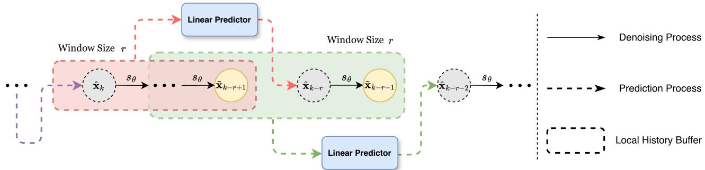
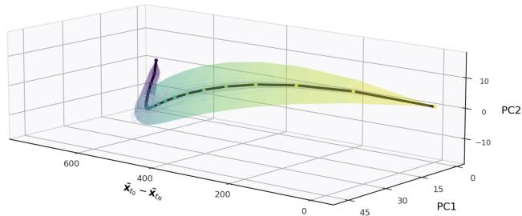
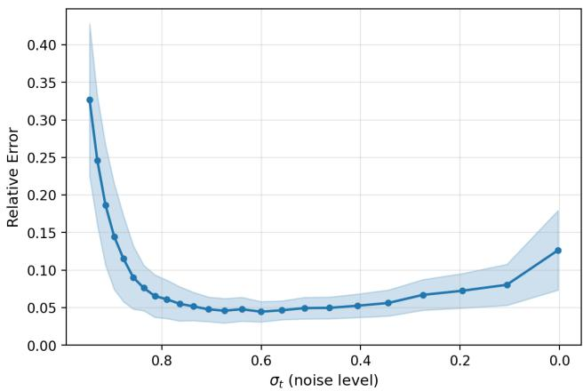
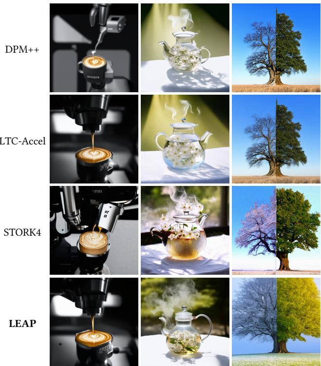
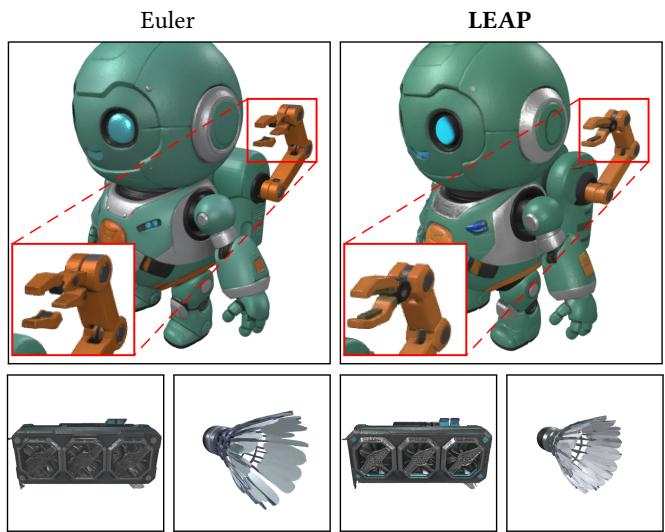
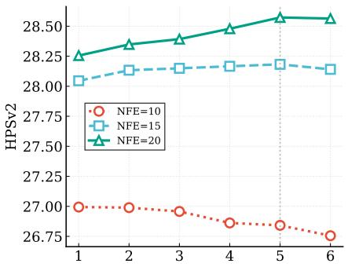
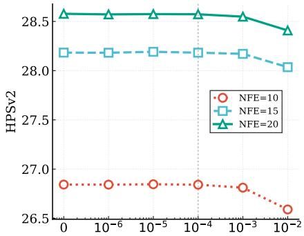
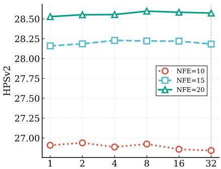
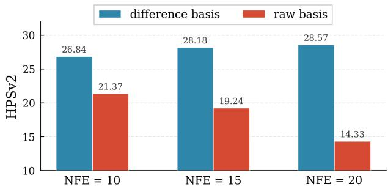
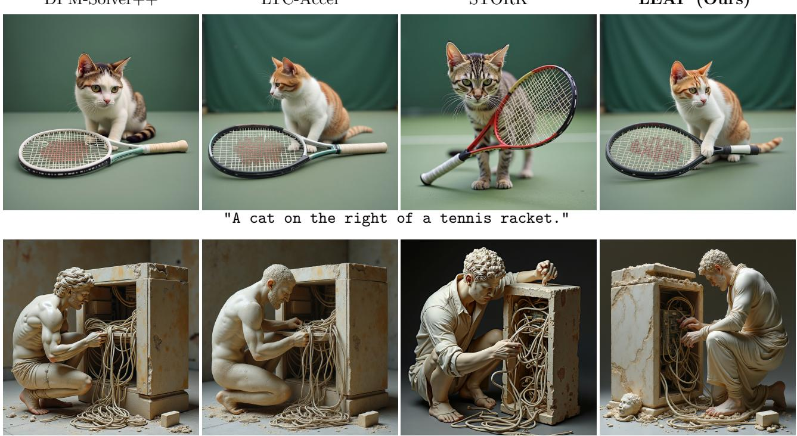

# LEAP: Accelerating ODE-based Difusion Sampling with Optimal Linear Leaps

Haowei Zheng∗† zhwei7107@zju.edu.cn Zhejiang University Hangzhou, China

Zhenyu Zhou∗† zhyzhou@zju.edu.cn Zhejiang University Hangzhou, China

Can Wang∗† wcan@zju.edu.cn Zhejiang University Hangzhou, China

Jiawei Chen∗†   
sleepyhunt@zju.edu.cn   
Zhejiang University   
Hangzhou, China

Defang Chen‡ defchern@berkeley.edu University of California, Berkeley California, United States

## Abstract

Difusion models primarily rely on general-purpose ODE-based numerical methods for training-free accelerated sampling, but per- formance degrades with coarse time discretization. In this paper, we propose optimal linear leaps (LEAP), a specialized method grounded in theoretical and empirical investigations of sampling trajectory geometry. Built upon low-dimensionality and cross-trajectory con-sistency, LEAP formulates a supervised least-squares optimization problem within the local trajectory subspace, achieving a precise ap-proximation of future states without model evaluations. Extensive experiments demonstrate that LEAP outperforms previous methods across diverse modalities, including text-to-image (Stable Difusion 3.5, FLUX.1-dev) and image-to-3D (TRELLIS.2) generation. Furthermore, LEAP can be seamlessly integrated into existing solver-based methods, ofering a plug-and-play enhancement for modern difu- sion models. Code is available at https://github.com/zju-pi/LEAP.

## CCS Concepts

• Computing methodologies → Computer vision.

## Keywords

Difusion Models, Training-free Acceleration, Solver-based

## ACM Reference Format:

Haowei Zheng, Zhenyu Zhou, Jiawei Chen, Can Wang, and Defang Chen. 2026. LEAP: Accelerating ODE-based Difusion Sampling with Optimal Linear Leaps. In Proceedings of the 34th ACM International Conference on Multimedia (MM ’26), November 10–14, 2026, Rio de Janeiro, Brazil. ACM, New York, NY, USA, 18 pages. https://doi.org/10.1145/3767308.3836106

## 1 Introduction

Difusion-based generative models [9, 29, 32, 33] have achieved unprecedented success in multimedia content synthesis, ranging from image [24, 25, 27], video [3, 10], audio [6, 13], and 3D [11, 41]. Despite their remarkable generation quality, the slow sampling process imposes a critical bottleneck for latency-sensitive applications.

To address this issue, numerous acceleration techniques have been proposed. Training-based approaches distill a pre-trained multi-step model into an extremely few-step student model [12, 20, 28, 31]. However, distilling modern difusion models with billions of parameters (e.g., 8B Stable Difusion 3.5 [8] and 12B FLUX [2]) is challenging and inflexible to accommodate community-tuned vari- ants and LoRA modules. In contrast, training-free methods require minimal parameter updates, ofering superior plug-and-play flexibility. Recent progress includes (i) solver-based method for calculating ordinary diferential equations (ODEs) [16, 18, 30, 46, 49], (ii) optimized timestep scheduling [4, 26, 43], and (iii) feature caching [14, 21, 39, 44]. Existing high-order multi-step solvers [16, 18, 46] estimate future states via a linear combination of historical states where the coeficients are derived from numerical analysis, assum- ing suficiently small and near-uniform step sizes. However, practical acceleration typically employs large and non-uniform step sizes, making their assumptions and associated convergence guarantees less reliable. Concurrently, emerging research on the geometric regularity of difusion trajectories [4, 5, 36, 38] has uncovered intriguing empirical patterns, such as cross-trajectory consistency and low-dimensional concentration. While previous studies have qualitatively observed these regularities, a rigorous mathematical foundation remains lar el absent. To move be ond heuristic de- signs toward a principled approach, a deeper and more rigorous investigation into the underlying mechanics is essential.

To bridge this gap, we conduct a comprehensive theoretical analysis of the geometric properties inherent in difusion trajectories, yielding the following two theoretical insights. Firstly, we establish a theoretical bound on the alignment error between trajectories af- ter orthogonal rotational alignment, revealing the cross-trajectory consistency of difusion models. Secondly, we rigorously character- ize the intrinsic low-dimensionality of difusion sampling trajecto-ries, proving that individual paths are confined to a low-dimensional subspace. Our analysis reveals that despite diferent noise initializations, these generative paths share consistent low-dimensional dynamics.

Leveraging these two mathematically grounded priors, we propose optimal linear leaps (LEAP), a training-free, solver-based ac-celeration framework. In contrast to traditional numerical solvers

∗State Key Laboratory of Blockchain and Data Security, Zhejiang University.   
†Hangzhou High-Tech Zone (Binjiang) Institute of Blockchain and Data Security.   
‡Corresponding author.

  
Figure 1: Overview of the proposed LEAP. A linear predictor (blue boxes) extrapolates the subsequent score from a sliding history bufer of size � (dashed boxes), yielding an approximated state xˆ (grey circles) without model evaluations. To prevent error drift, a model evaluation subsequently refines this approximation into a corrected state x˜ (yellow circles).

that rely on rigid Taylor coeficients, our method introduces a data- driven multi-step strategy powered by least-squares optimization. The intrinsic low-dimensionality of difusion trajectories suggests that local path segments can be accurately characterized by a linear subspace. Leveraging this geometric regularity, we formulate the prediction as a least-squares optimization problem, which identifies the optimal linear coeficients by minimizing the discrep- ancy between linearly extrapolated historical states and multi-step ground-truth trajectory samples. Motivated by the cross-trajectory consistency, we demonstrate that the optimal linear extrapolation coeficients are sample-agnostic. This property guarantees the transferability of coeficients derived from a limited set of reference tra- jectories before inference, bypassing the overhead for per-sample optimization. LEAP significantly enhances the sampling eficiency while preserving high generation quality. Crucially, as it operates entirely at the macroscopic trajectory level, our approach functions as a model-agnostic and plug-and-play module. This allows for seamless integration into diverse difusion models without any architectural modifications. Extensive experiments across diverse modalities, including text-to-image generation and text-to-3D generation demonstrate the superior performance and versatility of our method.

In summary, our main contributions are as follows:

• We prove the intrinsic low-dimensionality and geometric isomorphism of generative trajectories across diverse noise initial- izations.

• Motivated by these theoretical insights, we propose LEAP, a novel multi-step ODE solver that leverages least-squares alignment to learn sample-agnostic extrapolation coeficients, enabling highly accurate linear leaps with minimal computational overhead.

• Extensive experiments across diverse generative tasks that spanning both text-to-tmage synthesis and complex image-to-3D generation demonstrate the efectiveness of our method com- pared to state-of-the-art training-free baselines.

## 2 Preliminary

Difusion Models. Continuous-time difusion models progressively corrupt data $\mathbf { x } _ { 0 } \sim p _ { d a t a } ( \mathbf { x } )$ into a tractable noise distribution $\mathbf { x } _ { T } \sim$

$p _ { p r i o r } ( \mathbf { x } )$ via a forward Stochastic Diferential Equation (SDE) [33]:

$$
\mathrm { d } \mathbf { x } _ { t } = f ( t ) \mathbf { x } _ { t } \mathrm { d } t + g ( t ) \mathrm { d } \mathbf { w } _ { t } , \qquad t \in [ 0 , T ] ,\tag{1}
$$

where $\mathbf { w } _ { t }$ is the standard Wiener process [22], while $f ( t )$ and $g ( t )$ denote the drift and difusion coeficients. Crucially, the genera- tive process that reverses the forward SDE to recover the data dis- tribution is governed by the reverse-time SDE $\mathrm { d } { \mathbf { x } } _ { t } = [ f ( t ) { \mathbf { x } } _ { t } -$ $g ( t ) ^ { 2 } \nabla _ { \mathbf { x } _ { t } } \log p _ { t } ( \mathbf { x } _ { t } ) ] { \mathrm { d } } t + g ( t ) { \mathrm { d } } \bar { \mathbf { w } } _ { t }$ , where $\bar { \mathbf { w } } _ { t }$ denotes a standard Wiener process in the reverse-time direction. To implement the generative process, difusion models estimate the intractable score function $\nabla _ { \mathbf { x } _ { t } }$ log $p _ { t } ( \mathbf { x } _ { t } )$ using a neural network $s _ { \theta } ( \mathbf { x } _ { t } , t )$ trained by score matching objectives. For any difusion SDE, there exists an Ordinary Diferential Equation (ODE) [33] that shares the identical marginal distributions $p _ { t } ( \mathbf { x } )$ for all $t \in [ 0 , T ]$ , which is known as the Probability Flow ODE (PF-ODE):

$$
\mathrm { d } \mathbf { x } _ { t } = \left[ f ( t ) \mathbf { x } _ { t } - \frac { 1 } { 2 } g ( t ) ^ { 2 } \nabla _ { \mathbf { x } _ { t } } \log \mathcal { p } _ { t } ( \mathbf { x } _ { t } ) \right] \mathrm { d } t .\tag{2}
$$

By casting the generative process as a numerical initial value problem, PF-ODE enables deterministic sampling and underpins various training-free solver-based acceleration methods [18, 46].

Flow-based Models. Instead of explicitly defining a difusion process through an SDE, flow-based generative models formulate a continuous-time Normalizing Flow [1, 15, 17]. These models learn a time-dependent vector field $v ( \mathbf { x } _ { t } , t )$ that transports noise to the data distribution via a deterministic ODE:

$$
\mathrm { d } \mathbf { x } _ { t } = v ( \mathbf { x } _ { t } , t ) \mathrm { d } t .\tag{3}
$$

To circumvent the direct estimation of intractable marginal vector fields, Flow Matching introduces a simulation-free objective which regresses a neural vector field $v _ { \theta } ( \mathbf { x } _ { t } , t )$ towards a conditional vector field $\mathbf { u } _ { t } ( \mathbf { x } _ { t } | \mathbf { x } _ { 0 } )$ that defines the target probability path �� (x):

$$
\mathbb { E } _ { t , \rho _ { 0 } ( \mathbf { x } _ { 0 } ) , \rho _ { t } ( \mathbf { x } _ { t } | \mathbf { x } _ { 0 } ) } \left[ \| v _ { \theta } ( \mathbf { x } _ { t } , t ) - \mathbf { u } _ { t } ( \mathbf { x } _ { t } \mid \mathbf { x } _ { 0 } ) \| _ { 2 } ^ { 2 } \right] .\tag{4}
$$

Specifically, by setting $T = 1 ,$ , analytically solving Eq. 1 yields a reparameterization of $\mathbf { X } _ { t }$ as

$$
\begin{array} { r } { \mathbf { x } _ { t } = \alpha _ { t } \mathbf { x } _ { 0 } + \sigma _ { t } \mathbf { x } _ { 1 } , \qquad \mathbf { x } _ { 1 } \sim N ( \mathbf { 0 } , \mathbf { I } ) . } \end{array}\tag{5}
$$

where

$$
\alpha _ { t } = \exp \left( \int _ { 0 } ^ { t } f ( u ) \mathrm { d } u \right) , \quad \sigma _ { t } = \left( \int _ { 0 } ^ { t } g ( u ) ^ { 2 } \exp \left( - 2 \int _ { 0 } ^ { u } f ( s ) \mathrm { d } s \right) \mathrm { d } u \right) ^ { 1 / 2 } .\tag{6}
$$

  
Figure 2: Visualizing the trajectory regularity of difusion models. Following the visualization protocol in [5], we project 100 sampling trajectories generated with distinct noise and prompt initializations using SD3.5-Medium [8].

The conditional velocity field is thus given by

$$
\mathbf { u } _ { t } ( \mathbf { x } _ { t } \mid \mathbf { x } _ { 0 } ) = { \frac { { \dot { \sigma } } _ { t } } { \sigma _ { t } } } \mathbf { x } _ { t } + \left( { \dot { \alpha } } _ { t } - \alpha _ { t } { \frac { { \dot { \sigma } } _ { t } } { \sigma _ { t } } } \right) \mathbf { x } _ { 0 } .\tag{7}
$$

Contemporary cutting-edge text-to-image models increasingly favor the Flow Matching framework due to its conceptual simplicity and flexible path design [2, 8]. Since they inherit the architecture and training conventions of difusion models, we still refer to the flow-based formulation as “difusion” when no ambiguity arises.

Trajectory Regularity. While difusion models operate in an immensely high-dimensional ambient space, recent empirical observations reveal that their sampling trajectories exhibit remark- able geometric regularity [4, 5, 37]. Principal Component Analysis (PCA) on individual sampling trajectory exhibits that the generative dynamics are inherently low-dimensional where the explained variance is dominated by the first few principal components. Furthermore, as illustrated in Fig. 2, when projecting multiple trajectories with distinct noise and prompt initializations into a shared 3D space, they bundle into a smooth ‘tube’. This visual alignment high lights a striking cross-trajectory consistency, indicating that diferent difusion paths share nearly isomorphic macroscopic dynamics. Together, this inter-trajectory low-dimensionality and inter-trajectory consistency constitute the trajectory regularity, serving as the foundational intuition for our subsequent theoretical analysis and the design of our acceleration algorithm.

## 3 Methodology

## 3.1 The Intrinsic Geometry of Generative Trajectories

While previous works [4, 5] have observed strong geometric regu-larity of ODE sampling trajectories to justify existing accelerated sampling methods, a theoretical understanding remains unclear. In this section, we prove that difusion sampling trajectories can be efectively aligned through orthogonal transformation and are embedded in low-dimensional subspaces. To this end, we perform an analysis within the Gaussian mixture model (GMM) framework with shared spherical covariance to analytically characterize difu- sion dynamics. Since GMMs are universal approximators capable of modeling highly complex data manifolds, this assumption not only facilitates closed-form mathematical derivations but also ensures the broad applicability of our theoretical findings. Under this mild assumption, the data distribution is given by

$$
{ p _ { \mathrm { d a t a } } } ( \mathbf { x } ) = \sum _ { s = 1 } ^ { S } { { \pi } _ { s } } N ( \mu _ { s } , { \sigma _ { 0 } ^ { 2 } } { \mathbf { I } } _ { d } ) , \quad { \pi } _ { s } > 0 , \quad \sum _ { r = 1 } ^ { S } { { \pi } _ { s } } = 1 ,\tag{8}
$$

where � is the number of components, $\pi _ { s }$ are the mixing weights and $\pmb { \mu } _ { s }$ are the cluster means. Let

$$
U : = \mathrm { s p a n } \{ \mu _ { 1 } , \dots , \mu _ { S } \} , \quad r : = \mathrm { d i m } ( U ) , \quad R : = \operatorname* { m a x } _ { 1 \leq s \leq S } \| \mu _ { s } \| .
$$

We consider the exact PF-ODE associated with the variance- preserving forward difusion. Let $t \in [ 0 , T ]$ denote the standard forward difusion time. Denote $\mathbf { x } _ { t } ^ { ( m ) }$ the �-th sampling trajectory evolving backward in time which is initialized from a pure noise state $\mathbf { x } _ { T } ^ { ( m ) } \sim p _ { T }$ . To analyze the trajectory at discrete intervals, we consider a backward time grid $T = t _ { N } > t _ { N - 1 } > \cdot \cdot \cdot > t _ { 0 } = 0$ and define the trajectory states as

$$
\mathbf { D } _ { n } ^ { ( m ) } : = \mathbf { x } _ { t _ { n } } ^ { ( m ) } - \mathbf { x } _ { T } ^ { ( m ) } ,\tag{9}
$$

which represents the displacement from the initial noise. Let

$$
\alpha _ { T } : = \exp \Big ( - \frac { 1 } { 2 } \int _ { 0 } ^ { T } \beta ( s ) d s \Big ) , \qquad \nu _ { T } ^ { 2 } : = \alpha _ { T } ^ { 2 } \sigma _ { 0 } ^ { 2 } + ( 1 - \alpha _ { T } ^ { 2 } ) .\tag{10}
$$

For brevity, we present a simplified statement with a proofsketch below. The complete theorem including all constants and rigorous proof is detailed in the Appendix A.

Theorem 3.1 (Cross-trajectory consistency). Suppose that $\mathbf { x } _ { T } ^ { ( 1 ) } , \ldots , \mathbf { x } _ { T } ^ { ( M ) }$ are i.i.d. samples from the exact noised marginal ${ \mathit { p } } _ { T }$ Then for every $\delta \in ( 0 , 1 )$ ), with probability at least $1 - \delta ,$

$$
\begin{array} { r l r } {  { \operatorname* { m a x } _ { 1 \leq m _ { 1 } , m _ { 2 } \leq M } \operatorname* { i n f } _ { \mathbf { \delta H } \in O ( d ) } \operatorname* { m a x } _ { 0 \leq n \leq N } \| \mathbf { D } _ { n } ^ { ( m _ { 1 } ) } - \mathbf { H D } _ { n } ^ { ( m _ { 2 } ) } \| } } \\ & { } & \\ & { } & { \leq C _ { T , 1 } \nu _ { T } ( \sqrt { r } + \sqrt { \log \frac { M } { \delta } } ) + C _ { T , 2 } R , } \end{array}\tag{11}
$$

where $C _ { T , 1 } , C _ { T , 2 } > 0$ depend only on the difusion schedule and not on �, �, or the mixture parameters.

Corollary 3.2 (Asymptotic consistency). $I f r + \log M = o ( d )$ and $R = o \left( \nu _ { T } \sqrt { d } \right)$ , then for every fixed $\delta \in ( 0 , 1 )$

$$
\frac { 1 } { \nu _ { T } \sqrt { d } } \operatorname* { m a x } _ { 1 \leq m _ { 1 } , m _ { 2 } \leq M } \operatorname* { i n f } _ { \mathbf { H } \in O ( d ) } \operatorname* { m a x } _ { 0 \leq n \leq N } \Bigl \| \mathbf { D } _ { n } ^ { ( m _ { 1 } ) } - \mathbf { H D } _ { n } ^ { ( m _ { 2 } ) } \Bigr \| \xrightarrow [ d \to \infty ] \mathbb { P } 0 .\tag{12}
$$

Proof sketch. Let $P$ and $Q = \mathbf { I } - P$ denote the orthogonal pro- jections onto � and $U ^ { \perp }$ , respectively. In the Appendix A, we show that the reverse-time PF-ODE can be written as

$$
\mathrm { d } \mathbf { x } _ { t } = \left[ a _ { t } \mathbf { x } _ { t } + b _ { t } \mathbf { m } _ { t } ( P \mathbf { x } _ { t } ) \right] \mathrm { d } t ,\tag{13}
$$

where $\mathbf { m } _ { t } ( \cdot ) \in U$ is the posterior mean of the component centers at time �. Consequently, separating the dynamics yields

$$
Q \mathrm { d } \mathbf { x } _ { t } = a _ { t } Q \mathbf { x } _ { t } \mathrm { d } t , \qquad P \mathrm { d } \mathbf { x } _ { t } = \left[ a _ { t } P \mathbf { x } _ { t } + b _ { t } \mathbf { m } _ { t } ( P \mathbf { x } _ { t } ) \right] \mathrm { d } t .\tag{14}
$$

Therefore, the $U ^ { \perp }$ -component evolves by a common scalar rescaling, while all mixture-specific non-linear efects are confined to the $r \mathrm { - }$ dimensional subspace � .

Geometrically, this implies that after applying the orthogonal alignment, the maximum discrepancy between any pair of trajectories is determined by two factors: the norm diference of the initial noise within the orthogonal complement $( \mathrm { i . e . , } \big | \| Q \mathbf { x } _ { T } ^ { ( m _ { 1 } ) } \big | \big | -$ $\big \| Q \mathbf { x } _ { T } ^ { ( m _ { 2 } ) } \big \| \big \| \big )$ , and the absolute magnitude of the signal component within the data subspace $( \mathrm { i . e . , } \| P \mathbf { x } _ { T } ^ { ( m ) } \| )$ . Since $Q \mathbf { x } _ { T } ^ { ( m ) }$ is a Gaussian vector in dimension $d - r ,$ its norm concentrates uniformly over �, such that the norm diference is bounded b $O \big ( \nu _ { T } \sqrt { \log ( M / \delta ) } \big )$ . On the other hand, ${ \cal P } { \bf x } _ { T } ^ { ( m ) }$ lives in an �-dimensional subspace and its norm satisfies

$$
\| P \mathbf { x } _ { T } ^ { ( m ) } \| = O \left( \alpha _ { T } R + \nu _ { T } \Big ( \sqrt { r } + \sqrt { \log ( M / \delta ) } \Big ) \right)\tag{15}
$$

uniformly over � with high probability. Combining these bounds yields Thm. 3.1, and Cor. 3.2 follows by normalization with $\nu _ { T } { \sqrt { d } }$ □

Remark. Cor. 3.2 indicates that in high-dimensional settings $( d  \infty )$ which matches setting of difusion models, the error bound in Thm. 3.1 becomes practically efectively vanishes. This provides a strong theoretical guarantee that our cross-trajectory alignment is highly accurate in realistic generation scenarios.

Corollary 3.3 (Intrinsic low-dimensionality of individual trajectories). Underthe assumptions ofThm. 3.1,foreach sampling trajectory $\mathbf { x } _ { t } ^ { ( m ) }$ , there exists a linear subspace

$$
S _ { m } : = U \oplus \operatorname { s p a n } \{ Q \mathbf { x } _ { T } ^ { ( m ) } \}\tag{16}
$$

with dim $( S _ { m } ) \leq r + 1 ;$ , such that

$$
\mathbf { x } _ { t _ { n } } ^ { ( m ) } \in S _ { m } , \qquad 0 \leq n \leq N .\tag{17}
$$

Equivalently, $i f \mathbf { X } ^ { ( m ) } \in \mathbb { R } ^ { ( N + 1 ) \times d }$ denotes the trajectory matrix whose �-th row is $( \mathbf { x } _ { t _ { n } } ^ { ( m ) } ) ^ { \top }$ , then

$$
\operatorname { r a n k } ( \mathbf { X } ^ { ( m ) } ) \leq r + 1 .\tag{18}
$$

Remark. Cor. 3.3 reveals that all trajectory variance is captured by at most � + 1 principal components. However, this $( r + 1 )$ dimensional subspace $S _ { m }$ is sample-dependent, as it is spanned by the initial noise vector $Q \mathbf { x } _ { T } ^ { ( m ) }$ . The following corollary establishes a remarkable geometric invariance: by applying a suitable orthogonal transformation to each trajectory, all trajectories can be perfectly aligned into a single, shared low-dimensional subspace.

Corollary 3.4 (Universal low-dimensional alignment of diffusion trajectories). For any fixed unit vector e ∈ $U ^ { \perp }$ , there exist orthogonal matrices $\mathbf { H } _ { 1 } , \dots , \mathbf { H } _ { M } \in O ( d )$ satisfying ${ \bf H } _ { m } | _ { U } = { \bf I }$ and

$$
\mathbf { H } _ { m } { \cal Q } \mathbf { x } _ { T } ^ { ( m ) } = \| { \cal Q } \mathbf { x } _ { T } ^ { ( m ) } \| \mathbf { e } , \qquad \forall m \in \{ 1 , \ldots , M \} .\tag{19}
$$

Under such transformations, the aligned trajectories defined by

$$
\bar { \mathbf { x } } _ { t _ { n } } ^ { ( m ) } : = \mathbf { H } _ { m } \mathbf { x } _ { t _ { n } } ^ { ( m ) }\tag{20}
$$

all reside in the same $( r + 1 )$ -dimensional subspace

$$
{ \bar { S } } : = U \oplus { \mathrm { s p a n } } \{ \mathbf { e } \} .\tag{21}
$$

PF-ODE exhibits two complementary structural properties: crosstrajectory consistency and intrinsic individual low-dimensionality. Thm. 3.1 establishes that, diferent sampling trajectories can be highly aligned through simple orthogonal transformation. Cor. 3.3 further demonstrates that each trajectory is strictly confined to an $( r + 1 )$ -dimensional subspace. Notably, after a simple per-trajectory alignment introduced by Cor. 3.4, the entire collection of trajectories resides within a universal (� + 1)-dimensional subspace. Therefore, the high-dimensional sampling dynamics are efectively governed by only a few latent coordinates: one radial coordinate in $U ^ { \perp }$ and at most � coordinates within the mean subspace �.

  
Figure 3: Relative prediction error vs. noise level $\sigma _ { t }$ . We quantify the projection error of each score onto the subspace spanned by its corresponding historical bufer. The relative error is strictly bounded, using a small window size of $r = 3 .$

More importantly, the intrinsic low-dimensionality established in Cor. 3.3 implies that, within any local window of a given trajectory, both the historical scores and the target output reside in a subspace. While this geometric regularity is rigorously established under mild assumption, its validity in real-world generative scenarios warrants empirical verification. To bridge this gap, we investigate the local score dynamics using sampling trajectories from Stable Difusion 3.5. Specifically, we quantify the orthogonal projection error of the current score $\mathbf { s } _ { t }$ onto the local subspace spanned by a short historical bufer, denoted as span $\begin{array} { r l } {  { \mathrm { 1 } \big ( \mathbf { s } _ { t + r } , \mathbf { s } _ { t + r - 1 } , \ldots \mathbf { s } _ { t + r } , \mathbf { s } _ { t + r + 1 } \big ) } \qquad } & { { } } \end{array}$ . As illustrated in Fig. 3, the relative projection error is strictly bounded, dropping to a mere 4%–5% even with a small window size $r = 3$ This empirical finding confirms that even for highly complex data distributions, the immediate future score remains strictly confined within the linear span of its recent history. This empirical evident for low-dimensionality seamlessly transforms our theoretical in- sights into a practical algorithm, leading to our linear extrapolation framework in the subsequent section.

## 3.2 Optimal Linear Leaps with Aligned Trajectories

In this section, we present our method grounded in the the local linear dependence established above. This geometric regularity underpins the use of a linear extrapolator to predict next score function. The overall pipeline of our approach is illustrated in Fig. 1. To formalize this process, suppose we collect an ensemble of � fine-grained reference sampling trajectories. For the �-th trajectory $( m = 1 , \ldots , M )$ , denote $\tilde { \mathbf { s } } _ { n } ^ { ( m ) }$ the model output (e.g., estimated score function) at timestep $t _ { n } .$ , and let $\tilde { \mathbf { x } } _ { n - 1 } ^ { ( m ) }$ be the next state updated using $\tilde { \mathbf { s } } _ { n } ^ { ( m ) }$

Given a window size �, our objective at timestep $t _ { n }$ is to predict the next model output $\tilde { \bf s } _ { n - 1 }$ by utilizing � stored previous model outputs along the sampling trajectory. Denote the local history matrix of scores and the corresponding target by

Algorithm 1 Coeficient Bank Construction   
Require: Reference score trajectories $\{ \mathcal { T } ^ { ( m ) } \} _ { m = 1 } ^ { M } ,$ , where $\mathcal { T } ^ { ( m ) } =$   
$\{ \tilde { \mathbf { s } } _ { N } ^ { ( m ) } , \tilde { \mathbf { s } } _ { N - 1 } ^ { ( m ) } , . . . , \tilde { \mathbf { s } } _ { 1 } ^ { ( m ) } \}$ ; window size �; ridge coeficient �   
Ensure: Coeficient bank $C = \{ \mathbf { c } _ { N - r + 1 } , \mathbf { c } _ { N - r } , \ldots , \mathbf { c } _ { 1 } \}$   
1: for $n = N - r + 1 , N - r , . . . , 1$ do   
2: for $m = 1 , 2 , \ldots , M$ do   
3: for $j = 1 , \ldots , r - 1$ do   
4: $\Delta _ { n , j } ^ { ( m ) }  \tilde { \mathbf { s } } _ { n + j } ^ { ( m ) } - \tilde { \mathbf { s } } _ { n + j - 1 } ^ { ( m ) }$   
5: end for   
6: $\mathbf { B } _ { n } ^ { ( m ) } \gets \left[ \Delta _ { n , r - 1 } ^ { ( m ) } , \dots , \Delta _ { n , 1 } ^ { ( m ) } , \tilde { \mathbf { s } } _ { n } ^ { ( m ) } \right]$   
7: end for   
8: $\begin{array} { r } { \mathbf { c } _ { n } ^ { \star } \gets \arg \operatorname* { m i n } _ { \mathbf { c } \in \mathbb { R } ^ { r } } \sum _ { m = 1 } ^ { M } \left\| \tilde { \mathbf { s } } _ { n - 1 } ^ { ( m ) } - \mathbf { B } _ { n } ^ { ( m ) } \mathbf { c } \right\| _ { 2 } ^ { 2 } + \lambda \| \mathbf { c } \| _ { 2 } ^ { 2 } } \end{array}$   
9: end for   
10: return $C = \{ \mathbf { c } _ { N - r + 1 } ^ { \star } , \mathbf { c } _ { N - r } ^ { \star } , \ldots , \mathbf { c } _ { 1 } ^ { \star } \}$

Algorithm 2 LEAP Sampling (Predict-Correct)   
Require: Initial state $\tilde { \mathbf { x } } _ { N } ;$ coeficient bank C; window size �; score   
network ��   
Ensure: Final sample $\tilde { \mathbf { x } } _ { 0 }$   
1: Warm-up: run base sampler for � steps   
2: $\mathcal { B } \gets \{ \tilde { \mathbf { s } } _ { N } , \tilde { \mathbf { s } } _ { N - 1 } , . . . , \tilde { \mathbf { s } } _ { N - r + 1 } \}$   
3: Update current state to x˜ �−�   
4: for $n = N - r + 1$ down to 3 step 2 do   
5: Predict:   
6: Compute diferences $\Delta _ { n , j }$ from B for $j = 1 , \ldots , r - 1$   
7: $\begin{array} { r } { \hat { \mathbf { s } } _ { n - 1 } \gets \mathbf { c } _ { n , r - 1 } \tilde { \mathbf { s } } _ { n } + \sum _ { j = 0 } ^ { r - 2 } \mathbf { c } _ { n , j } \Delta _ { n , r - j - 1 } } \end{array}$   
8: Evolve to $\hat { \mathbf { x } } _ { n - 2 }$ via numerical solver using $\hat { \bf s } _ { n - 1 }$   
9: Append $\hat { \bf s } _ { n - 1 }$ to B and remove the oldest score   
10: Correct:   
11: Evaluate exact score $\tilde { \mathbf { s } } _ { n - 2 } \gets s _ { \theta } ( \hat { \mathbf { x } } _ { n - 2 } )$   
12: Evolve to $\tilde { \mathbf { x } } _ { n - 3 }$ via numerical solver using $\tilde { \bf s } _ { n - 2 }$   
13: Append $\tilde { \bf s } _ { n - 2 }$ to $\mathcal { B }$ and remove the oldest score   
14: end for   
15: return $\tilde { \mathbf { x } } _ { 0 }$

$$
\mathbf { H } _ { n } ^ { ( m ) } = \left[ \tilde { \mathbf { s } } _ { n + r - 1 } ^ { ( m ) } , \tilde { \mathbf { s } } _ { n + r - 2 } ^ { ( m ) } , \hdots , \tilde { \mathbf { s } } _ { n } ^ { ( m ) } \right] \in \mathbb { R } ^ { d \times r } .\tag{22}
$$

We seek an optimal coeficient vector ${ \mathbf w } _ { n } \in \mathbb { R } ^ { r }$ that satisfies:

$$
\tilde { \mathbf { s } } _ { n - 1 } ^ { ( m ) } \approx \mathbf { H } _ { n } ^ { ( m ) } \mathbf { w } _ { n } .\tag{23}
$$

The cross-trajectory consistency presented in Thm. 3.1 demonstrates that, after proper alignment, diferent trajectories follow nearly isomorphic low-dimensional dynamics. Consequently, a single coeficient vector ${ \bf w } _ { n }$ can efectively characterize the score evolu- tion of diferent reference trajectories at a given sampling timestep, enabling the extraction of a universal local extrapolation law. For mally, we derive the step-wise optimal predictor within the family of linear extrapolators by solving the following multi-trajectory least-squares problem:

$$
\mathbf { w } _ { n } ^ { \star } = \arg \operatorname* { m i n } _ { \mathbf { w } \in \mathbb { R } ^ { r } } \sum _ { m = 1 } ^ { M } \left\| \tilde { \mathbf { s } } _ { n - 1 } ^ { ( m ) } - \mathbf { H } _ { n } ^ { ( m ) } \mathbf { w } \right\| _ { 2 } ^ { 2 } .\tag{24}
$$

While the formulation above is conceptually straightforward, directly regressing on $\left[ \tilde { \mathbf { s } } _ { n + r - 1 } , \tilde { \mathbf { s } } _ { n + r - 2 } , \ldots , \tilde { \mathbf { s } } _ { n } \right]$ is often numerically ill-posed. Since consecutive model outputs along smooth segments of the difusion path are highly correlated, the columns of the history matrix tend to be nearly collinear. As a result, the associ- ated least-squares system becomes poorly conditioned, making the fitted coeficients sensitive to finite-sample error, imperfect cross- trajectory alignment, and numerical instabilities. To mitigate this issue, we reparameterize the local subspace using a diference basis rather than the raw basis. Specifically, for each trajectory window, we define the first-order diferences of the scores as:

$$
\Delta _ { n , j } ^ { ( m ) } : = \tilde { \mathbf { s } } _ { n + j } ^ { ( m ) } - \tilde { \mathbf { s } } _ { n + j - 1 } ^ { ( m ) } , \qquad j = 1 , \dotsc , r - 1 ,\tag{25}
$$

and define the modified history matrix as:

$$
\mathbf { B } _ { n } ^ { ( m ) } = \left[ \Delta _ { n , r - 1 } ^ { ( m ) } , \ldots , \Delta _ { n , 1 } ^ { ( m ) } , \tilde { \mathbf { s } } _ { n } ^ { ( m ) } \right] \in \mathbb { R } ^ { d \times r } .\tag{26}
$$

Rather than directly estimating $\mathbf { w } _ { n } ,$ we fit an auxiliary coeficient vector ${ \mathbf c } _ { n } \in \mathbb { R } ^ { r }$ such that

$$
\tilde { \mathbf { s } } _ { n - 1 } ^ { ( m ) } \approx \mathbf { B } _ { n } ^ { ( m ) } \mathbf { c } _ { n } .\tag{27}
$$

In practice, we aggregate samples from all reference trajectories and solve a ridge regression problem within the diference basis for each timestep $n = N - 1 , N - 2 , . . . , r ;$

$$
\mathbf { c } _ { n } ^ { \star } = \arg \operatorname* { m i n } _ { \mathbf { c } \in \mathbb { R } ^ { r } } \sum _ { m = 1 } ^ { M } \left\| \widetilde { \mathbf { s } } _ { n - 1 } ^ { ( m ) } - \mathbf { B } _ { n } ^ { ( m ) } \mathbf { c } \right\| _ { 2 } ^ { 2 } + \lambda \| \mathbf { c } \| _ { 2 } ^ { 2 } .\tag{28}
$$

Once the step-wise coeficient bank $C = \{ \mathbf { c } _ { N - r + 1 } , \mathbf { c } _ { N - r } , \ldots , \mathbf { c } _ { 1 } \}$ has been solved, inference proceeds in two phases. First, we execute a warm-up phase by running the initial � denoising steps in a standard way. This initializes the history bufer with the initial � model outputs and their corresponding states:

$$
\bigl \{ \tilde { \mathbf { s } } _ { N } , \tilde { \mathbf { s } } _ { N - 2 } , \ldots , \tilde { \mathbf { s } } _ { N - r + 1 } \bigr \} , \qquad \bigl \{ \tilde { \mathbf { x } } _ { N } , \tilde { \mathbf { x } } _ { N - 2 } , \ldots , \tilde { \mathbf { x } } _ { N - r } \bigr \} .\tag{29}
$$

This warm-up phase provides the minimum context required by the extrapolator. Moving forward, we employ an interleaved sampling strategy that alternates between a network-free prediction step and a network-based correction step. Specifically, suppose the current history bufer contains � most recent scores:

$$
\big \{ \tilde { \mathbf { s } } _ { n + r - 1 } , \tilde { \mathbf { s } } _ { n + r - 2 } , \hdots , \tilde { \mathbf { s } } _ { n } \big \} .\tag{30}
$$

We first predict the next model output using the learned step-wise coeficients:

$$
\hat { \mathbf { s } } _ { n - 1 } : = \mathbf { c } _ { n , r - 1 } \tilde { \mathbf { s } } _ { n } + \sum _ { j = 0 } ^ { r - 2 } \mathbf { c } _ { n , j } \Delta _ { n , r - j - 1 } .\tag{31}
$$

The extrapolated score $\hat { \bf s } _ { n - 1 }$ is then utilized to evolve the trajectory to $\hat { \mathbf { x } } _ { n - 2 }$ via numerical solvers, eliminating the need for an explicit network evaluation. The extrapolated score $\hat { \mathsf { \pmb { s } } } _ { n - 1 }$ then serves as a proxy for $\tilde { \bf s } _ { n - 1 }$ and is pushed into the history bufer, displacing the oldest entry to maintain a fixed window size of �.

Extrapolation alone inevitably accumulates numerical drift over time. To ensure trajectory stability, we implement an interleaved Predict-Correct scheme. Following the short warm-up stage, the solver alternates between network-free extrapolation and exact network evaluation, balancing computational eficiency with nu- merical robustness, providing a practical acceleration framework for difusion sampling. Given the step-wise optimality of our linear extrapolators and their capability to bypass redundant network evaluations, we name our method as Optimal Linear Leaps (LEAP). The full algorithms of coeficient bank construction and LEAP sam- pling are provided in Algorithm 1 and 2.

## 4 Experiments

We evaluate the proposed LEAP on three cutting-edge difusion models: SD3.5-Medium [8] and FLUX.1-Dev [2] for text-image task and TRELLIS.2 [41] for image-3D task. The quality of generated images is quantitatively evaluated using three metrics, including ImageReward [42], CLIP Score [23], and HPSv2 [40]. The prompts are drawn from the DrawBench [27] dataset. For image-3D task, we evaluate 3D object on a test set of 100 randomly sampled images from the Google Scanned Objects (GSO) dataset [7] by PSNR and CLIP Score. B default, we fix a window size of � = 5 and set the ridge regularization coeficient to � = 0.0001 across all experiments. Unless otherwise specified, LEAP is compared with existing state- of-the-art solvers under identical inference settings.

## 4.1 Main Results

Text-to-image Generation. We evaluate LEAP on text-to-image generation, benchmarking it against representative solvers including Euler method [30], DPM++ [19], UniPC [46], iPNDM [35], LTC-Accel [50] and STORK-4 [34]. As shown in Tab. 1, LEAP consistently achieves top-tier performance across diverse sampling budgets, efectively preserving both text-image alignment and perceptual quality for accelerated sampling. Moreover, LEAP consistently enhances the performance ofboth first-order and higher-order solvers, demonstrating its versatile plug-and-play capability. By leverag- ing a pre-computed, step-wise coeficient bank, LEAP seamlessly adapts any solver without any solver-specific hyperparameter tuning or model fine-tuning, making it a solver-agnostic enhancement module. Fig. 4 provides a qualitative comparison of LEAP against state-of-the-art solvers on SD3.5-Medium. Our LEAP exhibits su- perior performance across four challenging scenarios including (1) text rendering: LEAP accurately synthesizes legible text, whereas baselines sufer from typographic errors; (2) physical lighting: LEAP captures realistic transparency and intricate light refraction; (3) at tribute binding: LEAP precisely binds the localized attributes to their respective partitions without semantic leakage.

Image-to-3D Generation. We further validate LEAP on imageto-3D generation using the TRELLIS.2 [41] architecture. As presented in Tab. 2, our method achieves systematic improvements in both PSNR and CLIP Score over the baseline on GSO dataset. The qualitative results shown in Fig. 5 demonstrate LEAP’s supe- rior capability in (1) topological correctness, maintaining precise connectivity in complex jointed structures; (2) surface fidelity; (3) geometric completeness, efectively generating intricate and highfrequency geometries, yielding sharper textural details and superior color accuracy.

## 4.2 Ablation Study

To systematically validate the contribution of each key design choice in the proposed method, we conduct comprehensive ab- lation studies on SD3.5-Medium. To ensure a rigorous comparison, we isolate the impact of each component by maintaining a fixed �-step sampling schedule, identical random seeds and a consistent ensemble of reference trajectory (default � = 32). (a) Window Size �. As shown in Fig 6a, we adopt � = 5 as the default window size, as it delivers peak or near-peak performance in most scenarios. (b) Penalty Strength �. Fig. 6b demonstrates that LEAP is robust to the penalty coeficient � across a wide range of values. We re- tain this penalty term across all experiments to ensure theoretical consistency and numerical stability. (c) Number of Reference Trajectories �. As shown in Fig 6c, LEAP exhibits remarkable data eficiency, maintaining high performance even with minimal reference data (� ≤ 2). This observation perfectly corroborates our theoretical analysis regarding cross-trajectory consistency. We default to � = 32 to ensure statistically robust coverage across diverse prompts. (d) Basis Construction. Fig. 7 underscores the critical role of our diference-basis reparameterization. The diference basis efectively rectifies the ill-conditioning, ensuring numerical stability and enabling consistent quality improvements across all NFE settings.

Figure 4: Text-to-image generation on SD3.5-Medium using 10 inference steps across diverse prompts.  
  
Figure 5: Image-to-3D generation on TRELLIS.2 using 10 inference steps across diferent image prompts.

Table 1: Quantitative results on SD3.5-Medium and FLUX.1-dev. The best and second-best results are marked in bold and underlined, respectively. Our proposed method (LEAP) is highlighted with a gray background.
<table><tr><td rowspan="2">Steps</td><td rowspan="2">Method</td><td colspan="3">SD3.5-Medium</td><td colspan="3">FLUX.1-dev</td></tr><tr><td>HPSv2 ↑</td><td>ImageReward ↑</td><td>CLIPScore ↑</td><td>HPSv2 ↑</td><td>ImageReward ↑</td><td>CLIPScore ↑</td></tr><tr><td rowspan="7">10</td><td>Euler</td><td>25.8866</td><td>0.6653</td><td>32.7920</td><td>28.3538</td><td>0.8110</td><td>30.6939</td></tr><tr><td>DPM++</td><td>26.4565</td><td>0.7178</td><td>32.9027</td><td>28.6365</td><td>0.8331</td><td>30.7257</td></tr><tr><td>iPNDM</td><td>26.4041</td><td>0.7063</td><td>32.7579</td><td>28.8272</td><td>0.8956</td><td>30.9178</td></tr><tr><td>UniPC</td><td>26.4450</td><td>0.7122</td><td>32.6428</td><td>28.8193</td><td>0.8839</td><td>31.0634</td></tr><tr><td>LTC-Accel</td><td>26.2546</td><td>0.7324</td><td>33.1578</td><td>28.9543</td><td>0.9193</td><td>31.1217</td></tr><tr><td>STORK-4</td><td>26.0567</td><td>0.6619</td><td>32.8704</td><td>29.2846</td><td>0.9729</td><td>31.2895</td></tr><tr><td>LEAP (Euler)</td><td>26.8419</td><td>0.7692</td><td>33.2982</td><td>29.0536</td><td>0.9204</td><td>30.9412</td></tr><tr><td></td><td>LEAP (DPM++)</td><td>27.0237</td><td>0.8177</td><td>33.2850</td><td>29.4004</td><td>0.9816</td><td>31.4320</td></tr><tr><td rowspan="7">15</td><td>Euler</td><td>27.4725</td><td>0.8416</td><td>33.4644</td><td>29.2580</td><td>0.9470</td><td>31.0488</td></tr><tr><td>DPM++</td><td>27.8642</td><td>0.8438</td><td>33.4704</td><td>29.5030</td><td>0.9588</td><td>31.2782</td></tr><tr><td>iPNDM</td><td>27.9220</td><td>0.8770</td><td>33.4416</td><td>29.5056</td><td>0.9491</td><td>31.3836</td></tr><tr><td>UniPC</td><td>27.8680</td><td>0.8788</td><td>33.4703</td><td>29.4668</td><td>0.9414</td><td>31.2339</td></tr><tr><td>LTC-Accel</td><td>27.8174</td><td>0.9196</td><td>33.7184</td><td>29.5874</td><td>0.9576</td><td>31.1906</td></tr><tr><td>STORK-4</td><td>27.4224</td><td>0.8253</td><td>33.5179</td><td>29.9693</td><td>1.0308</td><td>31.3041</td></tr><tr><td>LEAP (Euler)</td><td>28.1826</td><td>0.9522</td><td>33.6817</td><td>29.6785</td><td>0.9719</td><td>31.1046</td></tr><tr><td></td><td>LEAP (DPM++)</td><td>28.2152</td><td>0.9806</td><td>33.5617</td><td>29.9024</td><td>1.0101</td><td>31.4981</td></tr><tr><td rowspan="7">20</td><td>Euler</td><td>28.2691</td><td>0.9201</td><td>33.6945</td><td>29.4556</td><td>0.9398</td><td>30.9759</td></tr><tr><td>DPM++</td><td>28.4878</td><td>0.9560</td><td>33.7391</td><td>29.6523</td><td>0.9460</td><td>31.0277</td></tr><tr><td>iPNDM</td><td>28.4252</td><td>0.9317</td><td>33.9325</td><td>29.6963</td><td>0.9886</td><td>31.2203</td></tr><tr><td>UniPC</td><td>28.4756</td><td>0.9364</td><td>33.7757</td><td>29.6773</td><td>0.9840</td><td>31.1858</td></tr><tr><td>LTC-Accel</td><td>28.3403</td><td>0.9547</td><td>33.7901</td><td>29.7326</td><td>0.9884</td><td>31.1142</td></tr><tr><td>STORK-4</td><td>28.1835</td><td>0.9035</td><td>33.8360</td><td>29.7927</td><td>1.0066</td><td>31.2650</td></tr><tr><td>LEAP (Euler)</td><td>28.5727</td><td>0.9701</td><td>33.7192</td><td>29.9370</td><td>1.0320</td><td>31.3433</td></tr><tr><td></td><td>LEAP (DPM++)</td><td>28.6259</td><td>0.9915</td><td>33.5356</td><td>30.1514</td><td>1.0514</td><td>31.6484</td></tr></table>

Table 2: Quantitative comparison of image-to-3D generation on the GSO dataset via TRELLIS.2.
<table><tr><td rowspan="2">Method</td><td colspan="5">PSNR ↑</td><td colspan="5">CLIP Score ↑</td></tr><tr><td>10</td><td>15</td><td>20</td><td>25</td><td>30</td><td>10</td><td>15</td><td>20</td><td>25</td><td>30</td></tr><tr><td>Euler</td><td>7.250</td><td>7.396</td><td>7.235</td><td>7.361</td><td>7.405</td><td>0.8638</td><td>0.8654</td><td>0.8682</td><td>0.8650</td><td>0.8658</td></tr><tr><td>LEAP (Euler)</td><td>7.414</td><td>7.537</td><td>7.337</td><td>7.410</td><td>7.408</td><td>0.8677</td><td>0.8674</td><td>0.8693</td><td>0.8678</td><td>0.8709</td></tr></table>

## 5 Related Works

Fast numerical solvers. A predominant branch of training-free acceleration methods focuses on improving the numerical solver employed in reverse-time sampling. Early work such as DDIM [30] established the ODE-based paradigm for fast deterministic gener- ation. Subsequent research has developed increasingly efective high-order and multi-step solvers. PNDM [16] introduced multistep pseudo numerical methods, showing that leveraging historical samples can significantly improve the quality-speed trade-of over first-order samplers. Its improved implementation, iPNDM [35], is frequently utilized in modern difusion sampling. DEIS [45] further exploited the semi-linear structure of difusion dynamics through an exponential-integrator formulation. Similarly, DPM-Solver [18] and DPM++ [19] derived dedicated high-order solvers by analytically isolating the linear components, significantly reducing dis-cretization errors, and have emerged as a robust practical stan- dard, particularly for guided sampling scenarios. UniPC [46] unified the predictor-corrector paradigm. Subsequent refinements such as DPM-Solver-v3 [48] and DC-Solver [47], further improved solver parameterization and correction stability. LTC-Accel [50] leverages the local transition coherence of generative trajectories to dynamically approximate adjacent network outputs, achieving trainingfree acceleration. STORK [34] addressed numerical stifness and removed the reliance on semi-linear assumptions and proposed a stabilized solver. Despite their diferences, these methods still con struct update rules primarily from numerical analysis or step-wise trend heuristics. In contrast, our method revisits multi-step solving from a trajectory-geometric perspective and seeks to exploit the intrinsic low-dimensional and cross-trajectory consistent structure of generative trajectories more directly.

  
(a) Window Size (�)

  
(b) Penalty Strength (�)

  
(c) Number of Reference Trajectories (�)

Figure 6: Ablation studies on key hyperparameters in Stable Difusion 3.5-Medium. We evaluate the impact of (a) Window Size, (b) Penalty Strength, and (c) Number of Tokens on the HPSv2 score across diferent NFEs. The default configuration is indicated by the dashed vertical line.  
  
Figure 7: Ablation study on basis construction in Stable Diffusion 3.5-Medium. Our proposed diferent basis efectively addresses the issue of ill-conditioning.

Difusion sampling dynamics. Prior research on difusion sampling dynamics has mainly established trajectory regularity through empirical observations, supported by preliminary theoretical insights under idealized settings. Notably, Wang et al. [37] observed that individual reverse-time sampling trajectories are efectively low-dimensional, often resembling two-dimensional ro- tations. Chen et al. [5] studied deterministic PF-ODE trajectories, finding that each trajectory closely follows the displacement between its endpoints, with residuals neatly captured by two or three orthogonal directions, yielding a characteristic boomerang-like shape. Their subsequent work [4] strengthened the cross-trajectory consistency claim by aligning projected trajectories with orthogonal Procrustes, revealing a nearly canonical trajectory shape af- ter sample-specific rotations and reflections. While these works have empirically uncovered the trajectory regularity of difusion sampling dynamics, their theoretical grounding relies largely on KDE-based surrogates of the empirical data distribution, analytically tractable Gaussian models, and supportive Gaussian-mixture calculations. To the best of our knowledge, prior literature lacks a unified theorem within a Mixture-of-Gaussian framework that jointly formalizes both trajectory low-dimensionality and crosstrajectory isomorphism. In contrast, our work provides a principled derivation that simultaneously establishes these two properties.

## 6 Conclusion

In this paper, we introduced LEAP, a novel, training-free multi-step ODE solver that efectively addresses the performance degradation of difusion models in low-NFE regimes. Our approach is built upon a rigorous investigation of the geometric properties of difusion sampling trajectories. By proving the intrinsic low-dimensionality and cross-trajectory consistency of generative paths, we formulated a supervised least-squares optimization within the local trajectory subspace. This allows LEAP to derive optimal, sample-agnostic extrapolation coeficients, achieving accurate future state approximations with minimal computational overhead. Extensive evaluations demonstrate that LEAP serves as a versatile, plug-and-play enhance- ment for modern large-scale difusion models. LEAP consistently outperforms state-of-the-art baselines across diverse modalities, including text-to-image generation using Stable Difusion 3.5 and FLUX.1-Dev and image-to-3D generation using TRELLIS.2. Future work will delve deeper into the geometric properties of difusion sampling trajectories under practical settings to further align our theoretical framework with realistic, finite-step sampling scenarios.

## Acknowledgments

This work is supported by the National Natural Science Foundation of China (No. 62476244), the Starry Night Science Fund of Zhejiang University Shanghai Institute for Advanced Study, China (Grant No: SN-ZJU-SIAS-001) and the advanced computing resources provided by the Supercomputing Center of Hangzhou City University.

## References

[1] Michael S Albergo and Eric Vanden-Eijnden. 2022. Building normalizing flows with stochastic interpolants. arXiv preprint arXiv:2209.15571 (2022).

[2] Black Forest Labs. 2024. FLUX.1 [dev]. https://github.com/black-forest-labs/flux.

[3] Andreas Blattmann, Tim Dockhorn, Sumith Kulal, Daniel Mendelevitch, Maciej Kilian, Dominik Lorenz, Yam Levi, Zion English, Vikram Voleti, Adam Letts, et al. 2023. Stable video difusion: Scaling latent video difusion models to large datasets. arXiv preprint arXiv:2311.15127 (2023).

[4] Defang Chen, Zhenyu Zhou, Can Wang, and Siwei Lyu. 2025. Geometric regularity in deterministic sampling dynamics of difusion-based generative models. Journal ofStatistical Mechanics: Theory and Experiment 2025, 12 (2025), 124002.

[5] Defang Chen, Zhenyu Zhou, Can Wang, Chunhua Shen, and Siwei Lyu. 2024. On the Trajector Re ularit of ODE-based Difusion Sam lin . In International Conference on Machine Learning. 7905–7934.

[6] Nanxin Chen, Yu Zhang, Heiga Zen, Ron J Weiss, Mohammad Norouzi, and William Chan. 2020. Wave rad: Estimatin radients for waveform eneration. arXiv preprint arXiv:2009.00713 (2020).

[7] Laura Downs, Anthony Francis, Nate Koenig, Brandon Kinman, Ryan Hickman, Krista Reymann, Thomas B McHugh, and Vincent Vanhoucke. 2022. Google scanned objects: A high-quality dataset of 3d scanned household items. In 2022 International Conference on Robotics and Automation (ICRA). Ieee, 2553–2560.

[8] Patrick Esser, Sumith Kulal, Andreas Blattmann, Rahim Entezari, Jonas Müller, Harry Saini, Yam Levi, Dominik Lorenz, Axel Sauer, Frederic Boesel, et al. 2024. Scaling rectified flow transformers for high-resolution image synthesis. In Fortyfirst international conference on machine learning.

[9] Jonathan Ho, Ajay Jain, and Pieter Abbeel. 2020. Denoising difusion probabilistic models. Advances in neural information processing systems 33 (2020), 6840–6851.

[10] Jonathan Ho, Tim Salimans, Alexey Gritsenko, William Chan, Mohammad Norouzi and David J Fleet. 2022. Video difusion models. Advances in neural information processing systems 35 (2022), 8633–8646.

[11] Team Hunyuan3D, Shuhui Yang, Mingxin Yang, Yifei Feng, Xin Huang, Sheng Zhang, Zebin He, Di Luo, Haolin Liu, Yunfei Zhao, et al. 2025. Hunyuan3d 2.1: From images to high-fidelity 3d assets with production-ready pbr material. arXiv preprint arXiv:2506.15442 (2025).

[12] Dongjun Kim, Chieh-Hsin Lai, Wei-Hsiang Liao, Naoki Murata, Yuhta Takida, Toshimitsu Uesaka, Yutong He, Yuki Mitsufuji, and Stefano Ermon. 2023. Consis tency trajectory models: Learning probability flow ode trajectory of difusion. arXiv preprint arXiv:2310.02279 (2023).

[13] Zhifeng Kong, Wei Ping, Jiaji Huang, Kexin Zhao, and Bryan Catanzaro. 2020. Difwave: A versatile difusion model for audio synthesis. arXiv preprint arXiv:2009.09761 (2020).

[14] Senmao Li, Taihang Hu, Joost van de Weijer, Fahad S Khan, Tao Liu, Linxuan Li, Shiqi Yang, Yaxing Wang, Ming-Ming Cheng, andJian Yang. 2024. Faster difusion: Rethinkin the role of the encoder for difusion model inference. Advances in Neural Information Processing Systems 37 (2024), 85203–85240.

[15] Yaron Lipman, Ricky TQ Chen, Heli Ben-Hamu, Maximilian Nickel, and Matt Le. 2022. Flow matching for generative modeling. arXiv preprint arXiv:2210.02747 (2022).

[16] Lu in Liu, Yi Ren, Zhijie Lin, and Zhou Zhao. 2022. Pseudo numerical methods for difusion models on manifolds. arXiv preprint arXiv:2202.09778 (2022).

[17] Xingchao Liu, Chengyue Gong, and Qiang Liu. 2022. Flow straight and fast: Learning to generate and transfer data with rectified flow. arXiv preprint arXiv:2209.03003 (2022).

[18] Cheng Lu, Yuhao Zhou, Fan Bao, Jianfei Chen, Chongxuan Li, and Jun Zhu. 2022. Dpm-solver: A fast ode solver for difusion probabilistic model sampling in around 10 steps. Advances in neural information processing systems 35 (2022), 5775–5787.

[19] Cheng Lu, Yuhao Zhou, Fan Bao, Jianfei Chen, Chongxuan Li, and Jun Zhu. 2025. Dpm-solver++: Fast solver for guided sampling of difusion probabilistic models. Machine Intelligence Research 22, 4 (2025), 730–751.

[20] Simian Luo, Yiqin Tan, Longbo Huang, Jian Li, and Hang Zhao. 2023. Latent consistency models: Synthesizing high-resolution images with few-step inference. arXiv preprint arXiv:2310.04378 (2023).

[21] Xinyin Ma, Gongfan Fang, and Xinchao Wang. 2024. Deepcache: Accelerating difusion models for free. In Proceedings of the IEEE/CVF conference on computer vision and pattern recognition. 15762–15772.

[22] Bernt Oksendal. 2013. Stochastic diferential equations: an introduction with applications. Springer Science & Business Media.

[23] Alec Radford, Jong Wook Kim, Chris Hallacy, Aditya Ramesh, Gabriel Goh, Sandhini Agarwal, Girish Sastry, Amanda Askell, Pamela Mishkin, Jack Clark, et al. 2021. Learning transferable visual models from natural language supervision. In International conference on machine learning. PmLR, 8748–8763.

[24] Aditya Ramesh, Prafulla Dhariwal, Alex Nichol, Casey Chu, and Mark Chen. 2022. Hierarchical text-conditional image generation with clip latents. arXiv preprint arXiv:2204.06125 1, 2 (2022), 3.

[25] Robin Rombach, Andreas Blattmann, Dominik Lorenz, Patrick Esser, and Björn Ommer. 2022. High-resolution image synthesis with latent difusion models. In Proceedings of the IEEE/CVF conference on computer vision and pattern recognition. 10684–10695.

[26] Amirmojtaba Sabour, Sanja Fidler, and Karsten Kreis. 2024. Align your steps: Optimizing sampling schedules in difusion models. arXiv preprint arXiv:2404.14507 (2024).

[27] Chitwan Saharia, William Chan, Saurabh Saxena, Lala Li, Jay Whang, Emily L Denton, Kamyar Ghasemipour, Raphael Gontijo Lopes, Burcu Karagol Ayan, Tim Salimans, et al. 2022. Photorealistic text-to-image difusion models with deep language understanding. Advances in neural information processing systems 35 (2022), 36479–36494.

[28] Tim Salimans and Jonathan Ho. 2022. Progressive distillation for fast sampling of difusion models. arXiv preprint arXiv:2202.00512 (2022).

[29] Jascha Sohl-Dickstein, Eric Weiss, Niru Maheswaranathan, and Surya Ganguli. 2015. Deep unsupervised learning using nonequilibrium thermodynamics. In International conference on machine learning. pmlr, 2256–2265.

[30] Jiaming Song, Chenlin Meng, and Stefano Ermon. 2020. Denoising difusion implicit models. arXiv preprint arXiv:2010.02502 (2020)

[31] Yang Song, Prafulla Dhariwal, Mark Chen, and Ilya Sutskever. 2023. Consistency models. (2023).

[32] Yang Song and Stefano Ermon. 2020. Improved techniques for training scorebased generative models. Advances in neural information processing systems 33 (2020), 12438–12448.

[33] Yang Song, Jascha Sohl-Dickstein, Diederik P Kingma, Abhishek Kumar, Stefano Ermon, and Ben Poole. 2020. Score-based generative modeling through stochastic diferential equations. arXiv preprint arXiv:2011.13456 (2020).

[34] Zheng Tan, Weizhen Wang, Andrea L Bertozzi, and Ernest K Ryu. 2025. STORK: Faster Difusion And Flow Matching Sampling By Resolving Both Stifness And Structure-Dependence. arXiv preprint arXiv:2505.24210 (2025).

[35] Patrick von Platen, Suraj Patil, Anton Lozhkov, Pedro Cuenca, Nathan Lambert, Kashif Rasul, Mishig Davaadorj, and Thomas Wolf. 2022. Difusers: State-of-theart difusion models. https://github.com/huggingface/difusers.

[36] Zhengchao Wan, Qingsong Wang, Gal Mishne, and Yusu Wang. 2025. Elucidating flow matching ODE dynamics via data geometry and denoisers. In Forty-second International Conference on Machine Learning.

[37] Binxu Wang and John J Vastola. 2023. Difusion models generate images like painters: an analytical theory of outline first, details later. arXiv preprint arXiv:2303.02490 (2023).

[38] Guangyi Wang, Wei Peng, Lijiang Li, Wenyu Chen, Yuren Cai, and Songzhi Su. 2024. Difusion Sampling Correction via Approximately 10 Parameters. arXiv preprint arXiv:2411.06503 (2024).

[39] Felix Wimbauer, Bichen Wu, Edgar Schoenfeld, Xiaoliang Dai, Ji Hou, Zijian He, Artsiom Sanakoyeu, Peizhao Zhang, Sam Tsai, Jonas Kohler, et al. 2024. Cache me if you can: Accelerating difusion models through block caching. In Proceedings of the IEEE/CVF Conference on Computer Vision and Pattern Recognition. 6211–6220.

[40] Xiaoshi Wu, Yiming Hao, Keqiang Sun, Yixiong Chen, Feng Zhu, Rui Zhao, and Hongsheng Li. 2023. Human preference score v2: A solid benchmark for evaluat- ing human preferences oftext-to-image synthesis. arXiv preprint arXiv:2306.09341 (2023).

[41] Jianfeng Xiang, Xiaoxue Chen, Sicheng Xu, Ruicheng Wang, Zelong Lv, Yu Deng, Hongyuan Zhu, Yue Dong, Hao Zhao, Nicholas Jing Yuan, et al. 2025. Native and compact structured latents for 3d generation. arXiv preprint arXiv:2512.14692 (2025).

[42] Jiazheng Xu, Xiao Liu, Yuchen Wu, Yuxuan Tong, Qinkai Li, Ming Ding, Jie Tang, and Yuxiao Dong. 2023. Imagereward: Learning and evaluating human preferences for text-to-image generation. Advances in Neural Information Processing Systems 36 (2023), 15903–15935.

[43] Shuchen Xue, Zhaoqiang Liu, Fei Chen, Shifeng Zhang, Tianyang Hu, Enze Xie, and Zhenguo Li. 2024. Accelerating difusion sampling with optimized time steps. In Proceedings of the IEEE/CVF Conference on Computer Vision and Pattern Recognition. 8292–8301.

[44] Zichao Yu, Zhen Zou, Guojiang Shao, Chenwei Zhang, Shengze Xu, Jie Huang, Feng Zhao, Xiaodong Cun, and Wenyi Zhang. 2025. Ab-cache: Training-free acceleration of difusion models via adams-bashforth cached feature reuse. In Proceedings ofthe 33rd ACMInternational Conference on Multimedia. 10408–10417.

[45] Qinsheng Zhang and Yongxin Chen. 2022. Fast sampling of difusion models with exponential integrator. arXiv preprint arXiv:2204.13902 (2022).

[46] Wenliang Zhao, Lujia Bai, Yongming Rao, Jie Zhou, and Jiwen Lu. 2023. Unipc: A unified predictor-corrector framework for fast sampling of difusion models. Advances in Neural Information Processing Systems 36 (2023), 49842–49869.

[47] Wenliang Zhao, Haolin Wang, Jie Zhou, and Jiwen Lu. 2024. Dc-solver: Improving predictor-corrector difusion sampler via dynamic compensation. In European Conference on Computer Vision. Springer, 450–466.

[48] Kaiwen Zheng, Cheng Lu, Jianfei Chen, and Jun Zhu. 2023. Dpm-solver-v3: Improved difusion ode solver with empirical model statistics. Advances in Neural Information Processing Systems 36 (2023), 55502–55542.

[49] Zhenyu Zhou, Defang Chen, Can Wang, and Chun Chen. 2024. Fast ode-based sampling for difusion models in around 5 steps. In Proceedings ofthe IEEE/CVF Conference on Computer Vision and Pattern Recognition. 7777–7786.

[50] Shangwen Zhu, Han Zhang, Zhantao Yang, Qianyu Peng, Zhao Pu, Huangji Wang, and Fan Cheng. 2025. Accelerating Difusion Sampling via Exploiting Local Transition Coherence. In Proceedings ofthe IEEE/CVF International Conference on Computer Vision. 18284–18293.

## A Proofs for Section 3.1

This appendix section proves Theorems and Corollaries from Section 3.1. First, we provide an exact decomposition of the PF-ODE under a mild assumption. Next, we prove the deterministic pairwise alignment bound. Finally, we apply the Gaussian concentration theorem to get a high-probability bound.

## A.1 Notations

Consider the variance-preserving forward difusion situation:

$$
d \mathbf { X } _ { t } = - \frac { 1 } { 2 } \beta ( t ) \mathbf { X } _ { t } d t + \sqrt { \beta ( t ) } d \mathbf { W } _ { t } , \qquad t \in [ 0 , T ] ,\tag{32}
$$

where $\beta : [ 0 , T ]  ( 0 , \infty )$ is integrable. We define

$$
\alpha _ { t } : = \exp \Big ( - \frac { 1 } { 2 } \int _ { 0 } ^ { t } \beta ( s ) d s \Big ) , \qquad \nu _ { t } ^ { 2 } : = \alpha _ { t } ^ { 2 } \sigma _ { 0 } ^ { 2 } + ( 1 - \alpha _ { t } ^ { 2 } ) .\tag{33}
$$

Suppose data distribution satisfies GMM assumption:

$$
p _ { 0 } ( { \bf x } ) = \sum _ { m = 1 } ^ { M } \pi _ { m } { \cal N } ( \mu _ { m } , \sigma _ { 0 } ^ { 2 } { \bf I } _ { d } ) , \qquad \pi _ { m } > 0 , \qquad \sum _ { m = 1 } ^ { M } \pi _ { m } = 1 .\tag{34}
$$

To describe the layout of the mixed distribution center, we define the space formed by their means as

$$
U : = \mathrm { s p a n } \{ \pmb { \mu } _ { 1 } , . . . , \pmb { \mu } _ { M } \} , \qquad r : = \mathrm { d i m } ( U ) , \qquad R : = \operatorname* { m a x } _ { 1 \leq m \leq M } \| \pmb { \mu } _ { m } \| .\tag{35}
$$

We also let � to be the orthogonal projection onto �, with $\boldsymbol { Q } : = \mathbf { I } - \boldsymbol { P } ,$

## A.2 Structural lemmas

We now begin to derive the closed-form expressions of PF-ODE dy- namics. We start our proofs by formulating the marginal probability density of the forward difusion.

Lemma A.1 (Closed Form of Marginal Probability Function). For every $t \in [ 0 , T ]$ , we have

$$
{ p } _ { t } ( { \bf x } ) = \sum _ { s = 1 } ^ { S } \pi _ { s } N ( \alpha _ { t } { \pmb \mu } _ { s } , \nu _ { t } ^ { 2 } { \bf I } _ { d } ) .\tag{36}
$$

Proof. Suppose $C \in \{ 1 , . . . , S \}$ satisfy condition $\mathbb { P } ( C = s ) = \pi _ { s }$ and suppose the conditional probability density of the initial state is

$$
p ( \mathbf { x } _ { 0 } \mid C = s ) = N ( \mathbf { x } _ { 0 } ; { \pmb \mu } _ { s } , \sigma _ { 0 } ^ { 2 } \mathbf { I } _ { d } ) .\tag{37}
$$

Because forward difusion process defines the transition probability density:

$$
p ( \mathbf { x } _ { t } \mid \mathbf { x } _ { 0 } ) = N ( \mathbf { x } _ { t } ; \alpha _ { t } \mathbf { x } _ { 0 } , ( 1 - \alpha _ { t } ^ { 2 } ) \mathbf { I } _ { d } ) .\tag{38}
$$

Hence, conditional on $C = s ,$ the probability density ofx� is obtained by the following equation:

$$
\begin{array} { l } { p ( \mathbf { x } _ { t } \mid C = s ) = \displaystyle \int p ( \mathbf { x } _ { t } \mid \mathbf { x } _ { 0 } ) p ( \mathbf { x } _ { 0 } \mid C = s ) \mathrm { d } \mathbf { x } _ { 0 } } \\ { \displaystyle = N \big ( \mathbf { x } _ { t } ; \alpha _ { t } \pmb { \mu } _ { s } , ( \alpha _ { t } ^ { 2 } \sigma _ { 0 } ^ { 2 } + 1 - \alpha _ { t } ^ { 2 } ) \mathbf { I } _ { d } \big ) } \\ { \displaystyle = N ( \mathbf { x } _ { t } ; \alpha _ { t } \pmb { \mu } _ { s } , \nu _ { t } ^ { 2 } \mathbf { I } _ { d } ) . } \end{array}\tag{39}
$$

Averaging over � gives the claim.

Lemma A.2 (Closed-form of score function). Define

$$
w _ { s } ( \mathbf { x } , t ) : = \frac { \pi _ { s } \exp \Big ( \frac { \alpha _ { t } } { \nu _ { t } ^ { 2 } } \langle \mathbf { x } , \pmb { \mu } _ { s } \rangle - \frac { \alpha _ { t } ^ { 2 } } { 2 \nu _ { t } ^ { 2 } } \| \pmb { \mu } _ { s } \| ^ { 2 } \Big ) } { \sum _ { j = 1 } ^ { S } \pi _ { j } \exp \Big ( \frac { \alpha _ { t } } { \nu _ { t } ^ { 2 } } \langle \mathbf { x } , \pmb { \mu } _ { j } \rangle - \frac { \alpha _ { t } ^ { 2 } } { 2 \nu _ { t } ^ { 2 } } \| \pmb { \mu } _ { j } \| ^ { 2 } \Big ) } ,\tag{40}
$$

and

$$
\mathbf { m } _ { t } ( \mathbf { x } ) : = \sum _ { s = 1 } ^ { S } w _ { s } ( \mathbf { x } , t ) \pmb { \mu } _ { s } .
$$

Then

(41)

$$
\nabla \log { p _ { t } ( \mathbf { x } ) } = - \frac { 1 } { \nu _ { t } ^ { 2 } } \big ( \mathbf { x } - \alpha _ { t } \mathbf { m } _ { t } ( \mathbf { x } ) \big ) .\tag{42}
$$

Proof. By Lemma A.1,

$$
p _ { t } ( \mathbf { x } ) = \sum _ { s = 1 } ^ { S } \pi _ { s } \phi _ { \nu _ { t } ^ { 2 } \mathbf { I } _ { d } } ( \mathbf { x } - \alpha _ { t } \pmb { \mu } _ { s } ) ,\tag{43}
$$

where $\phi _ { \Sigma }$ denotes the Gaussian density with covariance Σ. Therefore,

$$
\nabla p _ { t } ( \mathbf { x } ) = - \frac { 1 } { \nu _ { t } ^ { 2 } } \sum _ { s = 1 } ^ { S } \pi _ { s } ( \mathbf { x } - \alpha _ { t } \pmb { \mu } _ { s } ) \phi _ { \nu _ { t } ^ { 2 } \mathbf { I } _ { d } } ( \mathbf { x } - \alpha _ { t } \pmb { \mu } _ { s } ) .\tag{44}
$$

Therefore, the closed-form of score function can be derived by dividing Eq. 44 by $p _ { t } ( \mathbf { x } )$ :

$$
\nabla \log \mathcal { P } _ { t } ( \mathbf { x } ) = - \frac { 1 } { \nu _ { t } ^ { 2 } } \Big ( \mathbf { x } - \alpha _ { t } \sum _ { s = 1 } ^ { S } w _ { s } ( \mathbf { x } , t ) \mu _ { s } \Big ) = - \frac { 1 } { \nu _ { t } ^ { 2 } } \big ( \mathbf { x } - \alpha _ { t } \mathbf { m } _ { t } ( \mathbf { x } ) \big ) .\tag{45}
$$

Lemma A.3 (Sufficiency of Mean Subspace). For every x ∈ R� and $t \in [ 0 , T ]$ ，

$$
w _ { s } ( \mathbf { x } , t ) = w _ { s } ( P \mathbf { x } , t ) , \qquad \mathbf { m } _ { t } ( \mathbf { x } ) = \mathbf { m } _ { t } ( P \mathbf { x } ) \in U .\tag{46}
$$

Furthermore, let $\mathbf { X } _ { t \in [ 0 , T ] }$ be a PF-ODE trajectory. Its derivative with respect to � is given by

$$
\frac { d { \mathbf x } _ { t } } { d t } = a _ { t } { \mathbf x } _ { t } + b _ { t } \mathbf m _ { t } ( P { \mathbf x } _ { t } ) ,\tag{47}
$$

where

$$
a _ { t } : = \frac { 1 } { 2 } \beta ( t ) \Big ( 1 - \nu _ { t } ^ { - 2 } \Big ) , \qquad b _ { t } : = \frac { 1 } { 2 } \beta ( t ) \alpha _ { t } \nu _ { t } ^ { - 2 } .\tag{48}
$$

Proof. Note that the expression for $w _ { s } ( \mathbf { x } , t )$ only depends on x through the inner products $\langle \mathbf { x } , \pmb { \mu } _ { s } \rangle$ . Since for $\pmb { \mu } _ { s } \in U _ { : }$ , we have

$$
\begin{array} { r } { \langle \mathbf { x } , \pmb { \mu } _ { s } \rangle = \langle P \mathbf { x } , \pmb { \mu } _ { s } \rangle , } \end{array}\tag{49}
$$

which leads to $w _ { s } ( \mathbf { x } , t ) = w _ { s } ( P \mathbf { x } , t )$ . Furthermore, it is obvious that $\mathbf { m } _ { t } ( x ) \in U$ because it is simply a sum of vectors $\mu _ { s } \in U$

$$
\mathbf { m } _ { t } ( \mathbf { x } ) = \sum _ { s = 1 } ^ { S } w _ { s } ( \mathbf { x } , t ) \pmb { \mu } _ { s } .\tag{50}
$$

In forward process, the PF-ODE is

$$
\begin{array} { r l } & { \displaystyle \frac { d \mathbf { x } _ { t } } { d t } = - \frac { 1 } { 2 } \beta ( t ) \mathbf { x } _ { t } - \frac { 1 } { 2 } \beta ( t ) \nabla \log p _ { t } ( \mathbf { x } _ { t } ) } \\ & { \displaystyle \qquad = \frac { 1 } { 2 } \beta ( t ) \Big [ \mathbf { x } _ { t } - \nu _ { t } ^ { - 2 } \mathbf { x } _ { t } + \alpha _ { t } \nu _ { t } ^ { - 2 } \mathbf { m } _ { t } ( \mathbf { x } _ { t } ) \Big ] . } \end{array}\tag{51}
$$

Using Eq. 46 immediately yields Eq.47.

Lemma A.4 (Exact � ⊕ $U ^ { \perp }$ decomposition). Let

$$
\Phi \big ( t _ { 2 } , t _ { 1 } \big ) : = \exp \Big ( \int _ { t _ { 1 } } ^ { t _ { 2 } } a _ { v } d v \Big ) , \qquad \rho _ { t } : = \Phi ( t , T ) .\tag{52}
$$

Then we obtain the following equation by integrating from � to �:

$$
Q { \bf x } _ { t } = \rho _ { t } Q { \bf x } _ { T } ,\tag{53}
$$

and

$$
P \mathbf { x } _ { t } = \rho _ { t } P \mathbf { x } _ { T } - \int _ { t } ^ { T } \Phi ( t , \tau ) b _ { \tau } \mathbf { m } _ { \tau } ( P \mathbf { x } _ { \tau } ) d \tau .\tag{54}
$$

As a result,

$$
\begin{array} { r } { Q \mathbf { D } _ { t } = ( \rho _ { t } - 1 ) Q \mathbf { x } _ { T } . } \end{array}\tag{55}
$$

Proof. Apply � to Eq. 47. Since m $( P \mathbf { x } _ { t } ) \in U$ , we obtain

$$
Q \frac { d { \bf x } _ { t } } { d t } = a _ { t } Q { \bf x } _ { t } ,\tag{56}
$$

whose exact solution is

$$
Q { \bf x } _ { t } = \exp \Big ( \int _ { T } ^ { t } a _ { v } d v \Big ) Q { \bf x } _ { T } = \rho _ { t } Q { \bf x } _ { T } .\tag{57}
$$

Similarly, for the projection $P ,$ we can obtain that

$$
P \frac { d \mathbf { x } _ { t } } { d t } = a _ { t } P \mathbf { x } _ { t } + b _ { t } \mathbf { m } _ { t } ( P \mathbf { x } _ { t } ) ,\tag{58}
$$

and the variation-of-constants formula (integrating from � to �) leads to

$$
P \mathbf { x } _ { t } = \rho _ { t } P \mathbf { x } _ { T } + \int _ { T } ^ { t } \Phi ( t , \tau ) b _ { \tau } \mathbf { m } _ { \tau } ( P \mathbf { x } _ { \tau } ) d \tau .\tag{59}
$$

Subtracting �x� immediately gives the Eq. 55.

Lemma A.5 (Mean-Subspace Displacement Bound). Define

$$
A _ { T } : = \operatorname* { s u p } _ { 0 \leq t \leq T } | \rho _ { t } - 1 | , \qquad B _ { T } : = \operatorname* { s u p } _ { 0 \leq t \leq T } \int _ { t } ^ { T } \Phi ( t , \tau ) | b _ { \tau } | d \tau .\tag{60}
$$

Then every trajectory satisfies

$$
\operatorname* { s u p } _ { 0 \leq t \leq T } \| P \mathbf { D } _ { t } \| \leq A _ { T } \| P \mathbf { x } _ { T } \| + B _ { T } R .\tag{61}
$$

Proof. By Lemma A.4,

$$
P \mathbf { D } _ { t } = ( \rho _ { t } - 1 ) P \mathbf { x } _ { T } - \int _ { t } ^ { T } \Phi ( t , \tau ) b _ { \tau } \mathbf { m } _ { \tau } ( P \mathbf { x } _ { \tau } ) d \tau .\tag{62}
$$

Since $\mathbf { m } _ { \tau } ( P \mathbf { x } _ { \tau } )$ is a convex combination of $\pmb { \mu } _ { 1 } , \ldots , \pmb { \mu } _ { M }$ , it’s obvious that

$$
\left\| \mathbf { m } _ { \tau } ( P \mathbf { x } _ { \tau } ) \right\| \leq R .\tag{63}
$$

Hence by using the triangle inequality, we have

$$
\| P \mathbf { D } _ { t } \| \leq | \rho _ { t } - 1 | \| P \mathbf { x } _ { T } \| + \int _ { t } ^ { T } \Phi ( t , \tau ) | b _ { \tau } | R d \tau .\tag{64}
$$

Taking the supremum over $t \in [ 0 , T ]$ proves the lemma.

Lemma A.6 (Minimum orthogonal alignment error). For any ${ \mathbf { u } } , { \mathbf { v } } \in \mathbb { R } ^ { m }$ ,

$$
\operatorname* { m i n } _ { \mathbf { H } \in O ( m ) } \| \mathbf { u } - \mathbf { H } \mathbf { v } \| = { \Big | } \| \mathbf { u } \| - \| \mathbf { v } \| { \Big | } .\tag{65}
$$

Proof. For any H $\in O ( m )$ , the inequality

$$
\| \mathbf { u } - \mathbf { H } \mathbf { v } \| \geq \left| \| \mathbf { u } \| - \| \mathbf { H } \mathbf { v } \| \right| = \left| \| \mathbf { u } \| - \| \mathbf { v } \| \right|\tag{66}
$$

always holds. Conversely, if $\mathbf { u } , \mathbf { v } \neq 0 ,$ choose H $\in O ( m )$ such that

$$
\mathbf { H } { \frac { \mathbf { v } } { \lVert \mathbf { v } \rVert } } = { \frac { \mathbf { u } } { \lVert \mathbf { u } \rVert } } .\tag{67}
$$

Then $\mathbf { H } \mathbf { v } = ( \lVert \mathbf { v } \rVert / \lVert \mathbf { u } \rVert ) \mathbf { u } ,$ so

$$
\left\| \mathbf { u } - \mathbf { H } \mathbf { v } \right\| = \left\| \mathbf { u } - { \frac { \left\| \mathbf { v } \right\| } { \left\| \mathbf { u } \right\| } } \mathbf { u } \right\| = \left| \left\| \mathbf { u } \right\| - \left\| \mathbf { v } \right\| \right| .\tag{68}
$$

Finally, if $\mathbf { u } = 0 \ \mathrm { o r } \ \mathbf { v } = 0 $ , the result holds trivially.

## A.3 A uniform high-probability bound

Building upon the deterministic trajectory decomposition provided in the previous subsection, this part gives a uniform high-probability bound for pairwise trajectory alignment proof.

Proposition $\mathsf { A . 7 }$ (Deterministic pairwise alignment). Suppose $\mathbf { x } _ { t \in [ 0 , T ] } ^ { ( 1 ) }$ and $\mathbf { x } _ { t \in [ 0 , T ] } ^ { ( 2 ) }$ are two exact PF-ODE trajectories with starting noise $\mathbf { x } _ { T } ^ { ( 1 ) }$ and $\mathbf { x } _ { T } ^ { ( 2 ) }$ . Then there exists H $\in O ( d )$ such that

$$
\operatorname* { s u p } _ { 0 \leq t \leq T } \| \mathbf { D } _ { t } ^ { ( 1 ) } - \mathbf { H D } _ { t } ^ { ( 2 ) } \| \leq A _ { T } \big | \| Q \mathbf { x } _ { T } ^ { ( 1 ) } \| - \| Q \mathbf { x } _ { T } ^ { ( 2 ) } \| \big |
$$

$$
+ A _ { T } \left( \lVert P \mathbf { x } _ { T } ^ { ( 1 ) } \rVert + \lVert P \mathbf { x } _ { T } ^ { ( 2 ) } \rVert \right) + 2 B _ { T } R .\tag{69}
$$

Consequently,

$$
\begin{array} { r l } { \displaystyle \underset { 0 \leq n \leq N } { \operatorname* { m a x } } \ : \| \mathbf { D } _ { n } ^ { ( 1 ) } - \mathbf { H D } _ { n } ^ { ( 2 ) } \| \leq A _ { T } \Big | \| Q \mathbf { x } _ { T } ^ { ( 1 ) } \| - \| Q \mathbf { x } _ { T } ^ { ( 2 ) } \| \Big | } & { } \\ { \displaystyle + A _ { T } \big ( \| P \mathbf { x } _ { T } ^ { ( 1 ) } \| + \| P \mathbf { x } _ { T } ^ { ( 2 ) } \| \big ) + 2 B _ { T } R . } \end{array}\tag{70}
$$

Proof. Decompose $\mathbb { R } ^ { d } = U \oplus U ^ { \perp }$ . By Lemma A.6, there exists $\mathbf { H } _ { Q } \in O ( U ^ { \perp } )$ such that

$$
\| Q \mathbf { x } _ { T } ^ { ( 1 ) } - \mathbf { H } _ { Q } Q \mathbf { x } _ { T } ^ { ( 2 ) } \| = \big | \| Q \mathbf { x } _ { T } ^ { ( 1 ) } \| - \| Q \mathbf { x } _ { T } ^ { ( 2 ) } \| \big | .\tag{71}
$$

Choose any $\mathbf { H } _ { P } \in O ( U )$ and define

$$
\mathbf { H } : = \mathbf { H } _ { P } \oplus \mathbf { H } _ { Q } \in O ( d ) .\tag{72}
$$

By Lemma A.4,

$$
Q \mathbf { D } _ { t } ^ { ( k ) } = ( \rho _ { t } - 1 ) Q \mathbf { x } _ { T } ^ { ( k ) } .\tag{73}
$$

Hence

$$
Q \big ( \mathbf { D } _ { t } ^ { ( 1 ) } - \mathbf { H } \mathbf { D } _ { t } ^ { ( 2 ) } \big ) = ( \rho _ { t } - 1 ) \big ( Q \mathbf { x } _ { T } ^ { ( 1 ) } - \mathbf { H } _ { Q } Q \mathbf { x } _ { T } ^ { ( 2 ) } \big ) ,
$$

so

(74)

$$
\operatorname* { s u p } _ { 0 \leq t \leq T } \| Q ( \mathbf { D } _ { t } ^ { ( 1 ) } - \mathbf { H D } _ { t } ^ { ( 2 ) } ) \| \leq A _ { T } \big | \| Q \mathbf { x } _ { T } ^ { ( 1 ) } \| - \| Q \mathbf { x } _ { T } ^ { ( 2 ) } \| \big | .\tag{75}
$$

For the �-component, Lemma A.5 gives

$$
\begin{array} { r l } { \| P ( \mathbf { D } _ { t } ^ { ( 1 ) } - \mathbf { H D } _ { t } ^ { ( 2 ) } ) \| \leq \| P \mathbf { D } _ { t } ^ { ( 1 ) } \| + \| P \mathbf { D } _ { t } ^ { ( 2 ) } \| } & { } \\ { \leq A _ { T } \| P \mathbf { x } _ { T } ^ { ( 1 ) } \| + B _ { T } R + A _ { T } \| P \mathbf { x } _ { T } ^ { ( 2 ) } \| + B _ { T } R . } \end{array}\tag{76}
$$

Combining the � and $U ^ { \perp }$ parts via the triangle inequality proves the continuous-time bound. The discrete-time bound follows from

$$
\operatorname* { m a x } _ { 0 \leq n \leq N } \| \mathbf { D } _ { n } ^ { ( 1 ) } - \mathbf { H D } _ { n } ^ { ( 2 ) } \| \leq \operatorname* { s u p } _ { 0 \leq t \leq T } \| \mathbf { D } _ { t } ^ { ( 1 ) } - \mathbf { H D } _ { t } ^ { ( 2 ) } \| .\tag{77}
$$

Lemma A.8 (Gaussian norm concentration). $I f \mathbf { g } \sim N ( 0 , \mathbf { I } _ { m } )$ then for every $t > 0 _ { : }$

$$
\mathbb { P } \big ( | \| \mathbf { g } \| - \mathbb { E } \| \mathbf { g } \| | \geq t \big ) \leq 2 e ^ { - t ^ { 2 } / 2 } , \qquad \mathbb { E } \| \mathbf { g } \| \leq \sqrt { m } .\tag{78}
$$

Proof. The map g ↦→ ∥g∥ is 1-Lipschitz, so the first inequality is the standard Gaussian concentration inequality. The second follows from Jensen’s inequality:

$$
\mathbb { E } \| \mathbf { g } \| \leq \sqrt { \mathbb { E } \| \mathbf { g } \| ^ { 2 } } = \sqrt { m } .\tag{79}
$$

Theorem A.9 (Explicit version of Theorem 3.1). Suppose that $\mathbf { x } _ { T } ^ { ( 1 ) } , \dots , \mathbf { x } _ { T } ^ { ( M ) }$ are i.i.d. samples from the exact noised marginal ${ \mathit { p } } _ { T }$ Then for every $\delta \in ( 0 , 1 )$ , with probability at least $1 - \delta ,$

$$
\begin{array} { r l r } { \displaystyle \operatorname* { m a x } _ { 1 \leq a , b \leq M } \displaystyle \operatorname* { i n f } _ { \mathbf { H } \in O ( d ) } \displaystyle \operatorname* { m a x } _ { 0 \leq n \leq N } \| { \mathbf D } _ { n } ^ { ( a ) } - \mathbf { H D } _ { n } ^ { ( b ) } \| } & \\ { \displaystyle 1 \leq a \sqrt { 2 } A _ { T } \nu _ { T } \sqrt { \log \frac { 4 M } { \delta } } } & \\ { \displaystyle } & { \qquad + \ 2 A _ { T } \Big ( \alpha _ { T } R + \nu _ { T } \Big [ \sqrt { r } + \sqrt { 2 \log \frac { 2 M } { \delta } } \Big ] \Big ) + 2 B _ { T } R . } \end{array}\tag{80}
$$

Proof. By Lemma A.1, the noised marginal at time � is

$$
{ \displaystyle p _ { T } ( { \bf x } ) = \sum _ { m = 1 } ^ { M } \pi _ { m } N ( \alpha _ { T } \pmb { \mu } _ { m } , \nu _ { T } ^ { 2 } { \bf I } _ { d } ) } .\tag{81}
$$

Hence each sample can be represented as

$$
\begin{array} { r } { \mathbf { x } _ { T } ^ { ( k ) } = \alpha _ { T } \pmb { \mu } _ { C _ { k } } + \nu _ { T } \mathbf { g } ^ { ( k ) } , } \end{array}\tag{82}
$$

where $C _ { k } \ \in \ \{ 1 , . . . , M \} , \mathbb { P } ( C _ { k } \ = \ m ) \ = \ \pi _ { m }$ , and $\mathbf { g } ^ { ( k ) } \sim \mathcal { N } ( 0 , \mathbf { I } _ { d } )$ Since $\pmb { \mu } _ { C _ { k } } \in U$

$$
Q \mathbf { x } _ { T } ^ { ( k ) } = \nu _ { T } Q \mathbf { g } ^ { ( k ) } \sim N ( 0 , \nu _ { T } ^ { 2 } \mathbf { I } _ { d - r } ) ,\tag{83}
$$

and

$$
P \mathbf { x } _ { T } ^ { ( k ) } = \alpha _ { T } \pmb { \mu } _ { C _ { k } } + \nu _ { T } P \mathbf { g } ^ { ( k ) } .\tag{84}
$$

We first control the �-component. By Lemma A.8 and a union bound, with probability at least $1 - \delta / 2$

$$
\operatorname* { m a x } _ { 1 \leq k \leq M } \Bigl | \| Q \mathbf { x } _ { T } ^ { ( k ) } \| - \mathbb { E } \| Q \mathbf { x } _ { T } ^ { ( k ) } \| \Bigr | \leq \nu _ { T } \sqrt { 2 \log \frac { 4 M } { \delta } } .\tag{85}
$$

Therefore, on this event,

$$
\operatorname* { m a x } _ { 1 \leq a , b \leq M } \Bigl | \| Q \mathbf { x } _ { T } ^ { ( a ) } \| - \| Q \mathbf { x } _ { T } ^ { ( b ) } \| \Bigr | \leq 2 \nu _ { T } \sqrt { 2 \log \frac { 4 M } { \delta } } .\tag{86}
$$

Next we control the �-component. Since $P \mathbf { g } ^ { ( k ) } \sim N ( 0 , \mathbf { I } _ { r } )$ on $U _ { \textrm { \scriptsize : } }$ Lemma A.8 and $\| \mu _ { C _ { k } } \| \le R$ imply that, with probability at least $1 - \delta / 2$

$$
\operatorname* { m a x } _ { 1 \leq k \leq M } \| P \mathbf { x } _ { T } ^ { ( k ) } \| \leq \alpha _ { T } R + \nu _ { T } \bigg ( \sqrt { r } + \sqrt { 2 \log \frac { 2 M } { \delta } } \bigg ) .\tag{87}
$$

On the intersection of these two events, whose probability is at least $1 - \delta ,$ Proposition $\mathsf { A . 7 }$ gives, for every pair (�, �), some orthogonal matrix $\mathbf { H } _ { a , b } \in O ( d )$ such that

$$
\begin{array} { l } { { \displaystyle \operatorname* { m a x } _ { 0 \le n \le N } \| { \bf D } _ { n } ^ { ( a ) } - { \bf H } _ { a , b } { \bf D } _ { n } ^ { ( b ) } \| } } \\ { ~ } \\ { { \displaystyle \le A _ { T } \cdot 2 \nu _ { T } \sqrt { 2 \log \frac { 4 M } { \delta } } } } \\ { { \displaystyle ~ + A _ { T } \cdot 2 \Big ( \alpha _ { T } R + \nu _ { T } \Big [ \sqrt { r } + \sqrt { 2 \log \frac { 2 M } { \delta } } \Big ] \Big ) + 2 B _ { T } R } . } \end{array}\tag{88}
$$

Taking the maximum over (�, �) and then the infimum over $\mathbf { H } \in$ �(�) yields the stated inequality. □

Proof of Corollary 3.2. Divide the bound in Theorem A.9 by $\nu _ { T } { \sqrt { d } } .$ . This gives

$$
\begin{array} { r l } & { \displaystyle \frac { 1 } { \nu _ { T } \sqrt { d } } \displaystyle \operatorname* { m a x } _ { 1 \leq a , b \leq n } \operatorname* { i n f } _ { \mathbf { H } \in O ( d ) } \operatorname* { m a x } _ { \mathbf { \ell } \in { \cal L } } \| { \mathbf { D } } _ { \ell } ^ { ( a ) } - \mathbf { H D } _ { \ell } ^ { ( b ) } \| } \\ & { \leq 2 \sqrt { 2 } A _ { T } \sqrt { \displaystyle \frac { \log ( 4 M / \delta ) } { d } } + 2 A _ { T } \sqrt { \displaystyle \frac { r } { d } } } \\ & { \quad \quad + 2 A _ { T } \sqrt { \displaystyle \frac { 2 \log ( 2 M / \delta ) } { d } } + 2 A _ { T } \displaystyle \frac { \alpha _ { T } R } { { \nu _ { T } \sqrt { d } } } + 2 B _ { T } \displaystyle \frac { R } { { \nu _ { T } \sqrt { d } } } . } \end{array}\tag{89}
$$

Since � + log $n = o ( d )$ and $R = o \left( \nu _ { T } \sqrt { d } \right)$ , the right-hand side con- verges to 0 for every fixed $\delta \in ( 0 , 1 )$ . This proves the claim. □

## A.4 Proofs of the low-dimensionality Corollary

We now show that under mild assumptions, each PF-ODE trajectory is confined to a low-dimensional subspace. Moreover, a simple alignment brings all trajectories into a single shared subspace.

Corollary A.10 (Explicit version of Corollary 3.3). Suppose $\mathbf { x } _ { t \in [ 0 , T ] } ^ { ( k ) }$ is an exact PF-ODE trajectory. Then

$$
\mathbf { x } _ { t } ^ { ( k ) } \in S _ { k } : = U \oplus \mathsf { s p a n } \{ Q \mathbf { x } _ { T } ^ { ( k ) } \} , \qquad \forall t \in [ 0 , T ] .\tag{90}
$$

In particular,

$$
\dim ( S _ { k } ) \leq r + 1 .\tag{91}
$$

Hence, on any discrete reverse-time grid $T = t _ { 0 } > t _ { 1 } > \cdot \cdot \cdot > t _ { L } = 0 _ { : }$ the trajectory matrix

$$
\mathbf { X } ^ { ( k ) } \in \mathbb { R } ^ { ( L + 1 ) \times d } , \qquad r o w _ { \ell } ( \mathbf { X } ^ { ( k ) } ) = ( \mathbf { x } _ { \ell } ^ { ( k ) } ) ^ { \top } ,\tag{92}
$$

satisfies

$$
\operatorname { r a n k } ( \mathbf { X } ^ { ( k ) } ) \leq r + 1 .\tag{93}
$$

Equivalently, the empirical trajectory covariance

$$
\Sigma _ { \mathrm { t r a j } } ^ { ( k ) } : = \frac { 1 } { M + 1 } \sum _ { m = 0 } ^ { M } \bigl ( \mathbf { x } _ { \ell } ^ { ( k ) } - \bar { \mathbf { x } } ^ { ( k ) } \bigr ) \bigl ( \mathbf { x } _ { \ell } ^ { ( k ) } - \bar { \mathbf { x } } ^ { ( k ) } \bigr ) ^ { \intercal }\tag{94}
$$

has rank at most $r + 1 .$ , and therefore

$$
\lambda _ { j } \left( \Sigma _ { \mathrm { t r a j } } ^ { ( k ) } \right) = 0 , \qquad j \geq r + 2 .\tag{95}
$$

Proof. By Lemma A.4,

$$
Q \mathbf { x } _ { t } ^ { ( k ) } = \rho _ { t } Q \mathbf { x } _ { T } ^ { ( k ) } ,\tag{96}
$$

which lies in the one-dimensional subspace span $\{ Q \mathbf { x } _ { T } ^ { ( k ) } \}$ . On the other hand,

$$
P \mathbf { x } _ { t } ^ { ( k ) } \in U\tag{97}
$$

for all $t \in [ 0 , T ]$ . Therefore,

$$
\mathbf { x } _ { t } ^ { ( k ) } = { P } \mathbf { x } _ { t } ^ { ( k ) } + { Q } \mathbf { x } _ { t } ^ { ( k ) } \in { U } \oplus \operatorname { s p a n } \{ { Q } \mathbf { x } _ { T } ^ { ( k ) } \} .\tag{98}
$$

This proves that the whole trajectory lies in the linear subspace $S _ { k }$ with dim $( S _ { k } ) \le r + 1$ . Since every row of $\mathbf { \partial } \cdot \mathbf { \partial } _ { \mathbf { X } } ( k )$ belongs to $S _ { k }$ , we have

$$
\mathrm { r a n k } ( \mathbf { X } ^ { ( k ) } ) \leq \dim ( S _ { k } ) \leq r + 1 .\tag{99}
$$

Since $S _ { k }$ is a linear subspace, it contains the centered trajectory vectors. Thus, the image of the covariance matrix $\Sigma _ { \mathrm { t r a j } } ^ { ( k ) }$ lies within $s _ { k } ,$ implying

$$
\mathrm { r a n k } \Big ( \Sigma _ { \mathrm { t r a j } } ^ { ( k ) } \Big ) \leq r + 1 .\tag{100}
$$

This directly leads to the conclusion about the eigenvalues. □

Corollary A.11 (Explicit version of Corollary 3.4). Fix any unit vector e ∈ $U ^ { \perp }$ . For each trajectory �, choose an orthogonal matrix $\mathbf { H } _ { k } \in O ( d )$ such that

$$
\mathbf { H } _ { k } | _ { U } = \mathbf { I } , \qquad \mathbf { H } _ { k } Q \mathbf { x } _ { T } ^ { ( k ) } = \| Q \mathbf { x } _ { T } ^ { ( k ) } \| \mathbf { e } .\tag{101}
$$

Define the aligned trajectory

$$
\tilde { \mathbf { x } } _ { t } ^ { ( k ) } : = \mathbf { H } _ { k } \mathbf { x } _ { t } ^ { ( k ) } .\tag{102}
$$

Then

$$
\tilde { \mathbf { x } } _ { t } ^ { ( k ) } \in \widetilde { S } : = U \oplus \mathrm { s p a n } \{ \mathbf { e } \} , \qquad \forall k , \forall t \in [ 0 , T ] .\tag{103}
$$

In particular,

$$
\mathrm { d i m } ( \widetilde { S } ) \leq r + 1 .\tag{104}
$$

Hence, $i f \widetilde { \mathbf { X } } \in \mathbb { R } ^ { n ( L + 1 ) \times d }$ denotes the pooled aligned trajectory matrix obtained by stacking all aligned trajectory states, then

$$
\operatorname { r a n k } ( { \widetilde { \mathbf { X } } } ) \leq r + 1 .\tag{105}
$$

Equivalently, the pooled covariance of the aligned trajectories has rank at most � + 1.

Proof. By construction, $\mathrm { H } _ { k }$ acts as the identity on �. Therefore, since $P \mathbf { x } _ { t } ^ { ( k ) } \in U$

$$
\mathbf { H } _ { k } P \mathbf { x } _ { t } ^ { ( k ) } = P \mathbf { x } _ { t } ^ { ( k ) } \in U .\tag{106}
$$

Moreover, using Lemma A.4,

$$
Q \mathbf { x } _ { t } ^ { ( k ) } = \rho _ { t } Q \mathbf { x } _ { T } ^ { ( k ) } ,\tag{107}
$$

and thus

$$
\mathbf { H } _ { k } Q \mathbf { x } _ { t } ^ { ( k ) } = \rho _ { t } \mathbf { H } _ { k } Q \mathbf { x } _ { T } ^ { ( k ) } = \rho _ { t } \| Q \mathbf { x } _ { T } ^ { ( k ) } \| \mathbf { e } \in \mathrm { s p a n } \{ \mathbf { e } \} .\tag{108}
$$

Combining the � -part and the $U ^ { \perp }$ -part gives

$$
\widetilde { \mathbf { x } } _ { t } ^ { ( k ) } = \mathbf { H } _ { k } \mathbf { x } _ { t } ^ { ( k ) } \in U \oplus \mathrm { s p a n } \{ \mathbf { e } \} = \widetilde { S } .\tag{109}
$$

Therefore all aligned trajectories share a single subspace $\widetilde s$ ofdimen- sion at most $r + 1$ , which immediately yields the rank results. □

Remark 1 (Connection to least-squares reconstruction). The above corollaries provide a direct explanation for the least-squares resid- ual observed in practice. Specifically, every state $\mathbf { x } _ { n } ^ { ( k ) }$ on a given trajectory � belongs to the same linear subspace $S _ { k }$ with

$$
\dim ( S _ { k } ) \leq r + 1 .\tag{110}
$$

Therefore, if a history bufer

$$
\{ \mathbf { x } _ { n - B } ^ { ( k ) } , \mathbf { x } _ { n - B + 1 } ^ { ( k ) } , . . . , \mathbf { x } _ { n - 1 } ^ { ( k ) } \}\tag{111}
$$

spans $S _ { k }$ , then the least-squares reconstruction error of $\mathbf { x } _ { n } ^ { ( k ) }$ from this bufer is exactly zero:

$$
\operatorname* { m i n } _ { \mathbf { c } \in \mathbb { R } ^ { B } } \left\| \mathbf { x } _ { n } ^ { ( k ) } - \sum _ { j = 1 } ^ { B } c _ { j } \mathbf { x } _ { n - j } ^ { ( k ) } \right\| = 0 .\tag{112}
$$

Thus, in the exact spherical GMM setting, a suficiently rich short bufer already determines the future point by linear regression. In realistic difusion models we do not expect this identity to hold exactly, but small least-squares residuals strongly suggest that the denoising dynamics remain approximately low-dimensional.

Table 3: LEAP combined with diferent base solvers in SD3.5- Medium. All results use the same 15-step schedule and � = 5 in LEAP’s setting.
<table><tr><td>Solver + Method</td><td>HPSv2↑</td><td>ImageReward↑</td><td>CLIPScore↑</td></tr><tr><td>Euler</td><td>27.4725</td><td>0.8416</td><td>33.4644</td></tr><tr><td>LEAP (Euler)</td><td>28.1826</td><td>0.9522</td><td>33.6817</td></tr><tr><td>DPM++</td><td>27.8642</td><td>0.8438</td><td>33.4704</td></tr><tr><td>LEAP (DPM++)</td><td>28.2152</td><td>0.9806</td><td>33.5617</td></tr><tr><td>iPNDM</td><td>27.9220</td><td>0.8770</td><td>33.4416</td></tr><tr><td>LEAP (iPNDM)</td><td>28.2204</td><td>0.9642</td><td>33.6601</td></tr><tr><td>UniPC</td><td>27.8680</td><td>0.8788</td><td>33.4703</td></tr><tr><td>LEAP (UniPC)</td><td>28.2309</td><td>0.9800</td><td>33.6077</td></tr></table>

Table 4: Ablation on the prediction-to-correction (P:C) schedule on SD3.5-Medium.
<table><tr><td>NFE</td><td>P:C</td><td>HPSv2↑</td><td>ImageReward↑</td><td>CLIPScore↑</td></tr><tr><td rowspan="2">10</td><td>1:1</td><td>26.8419</td><td>0.7692</td><td>33.2982</td></tr><tr><td>1:2</td><td>26.3182</td><td>0.7224</td><td>33.1515</td></tr><tr><td rowspan="2">15</td><td>1:1</td><td>28.1826</td><td>0.9522</td><td>33.6817</td></tr><tr><td>1:2</td><td>27.9594</td><td>0.9004</td><td>33.7109</td></tr><tr><td rowspan="2">20</td><td>1:1</td><td>28.5727</td><td>0.9701</td><td>33.7192</td></tr><tr><td>1:2</td><td>28.3575</td><td>0.9499</td><td>33.8125</td></tr></table>

## B Experimental Results

## B.1 Ablation Study

B.1.1 Compatibility with Diferent Base Solvers. To further evalu-ate the robustness and generalization ability of LEAP, we conduct an additional ablation experiment by integrating LEAP with various widely used ODE solvers, including Euler, DPM++, iPNDM, and UniPC. This experiment is conducted on SD3.5 with NFE=15 and � = 5. As shown in Table 3, LEAP improves human preference and text-image alignment metrics (HPSv2, ImageReward, and CLIPScore) across all tested baseline solvers.

B.1.2 Predict-correct schedule. We further test the ratio between prediction and correction steps. Consecutive linear predictions are theoretically degradate to our current implementation as the same linear subspace is used. We thus add results regarding 2-step consecutive corrections below, which are inferior to our default 1:1 setting, as shown in Table 4.

## B.2 Robustness, Transferability, and Generalization

B.2.1 Prompt-distribution robustness. The coeficient bank is con-structed using reference prompts sampled from DrawBench, while evaluation is conducted on four prompt categories from the HPSv2 benchmark. As shown in Table 5, LEAP improves Euler across every category for HPSv2, ImageReward, and CLIPScore. These results indicate that LEAP remains efective under a prompt distribution shift.

Table 5: Ablation study on prompt distributions (NFE= 15). Reference prompts are sampled from DrawBench, while eval uation prompts are sampled from the HPSv2 benchmark.
<table><tr><td>Metric</td><td>Method</td><td>Anime</td><td>ConceptArt</td><td>Paintings</td><td>Photo</td></tr><tr><td>HPSv2</td><td>Euler</td><td>30.14</td><td>28.63</td><td>28.99</td><td>26.56</td></tr><tr><td></td><td>LEAP (Euler)</td><td>31.22</td><td>30.15</td><td>30.14</td><td>27.37</td></tr><tr><td>ImageReward</td><td>Euler</td><td>1.10</td><td>1.02</td><td>1.06</td><td>0.80</td></tr><tr><td></td><td>LEAP (Euler)</td><td>1.18</td><td>1.15</td><td>1.16</td><td>0.96</td></tr><tr><td>CLIPScore</td><td>Euler</td><td>35.18</td><td>33.61</td><td>33.41</td><td>32.28</td></tr><tr><td></td><td>LEAP (Euler)</td><td>35.19</td><td>33.96</td><td>33.69</td><td>32.79</td></tr></table>

B.2.2 Coeficient transferability. We evaluate whether learned co-eficients can be reused beyond the solver, model, or sampling schedule from which it was constructed. Specifically, we study cross-model, cross-solver, and cross-step transfer. As reported in Table 6, every transferred configuration improves its corresponding baseline on all three metrics.

Table 6: Transferability of the coeficient bank. Cross-model and cross-solver results use 10 $\mathbf { N F E ; }$ cross-step results use 15 NFE.
<table><tr><td>Transfer setting</td><td>Method</td><td>HPSv2↑</td><td>ImageReward↑</td><td>CLIPScore↑</td></tr><tr><td rowspan="2">Cross-model</td><td>Euler</td><td>25.89</td><td>0.67</td><td>32.79</td></tr><tr><td>LEAP (FLUX coeffs.)</td><td>26.97</td><td>0.75</td><td>33.26</td></tr><tr><td rowspan="2">Cross-solver</td><td>DPM++</td><td>26.46</td><td>0.72</td><td>32.90</td></tr><tr><td>LEAP (Euler coeffs.)</td><td>27.01</td><td>0.80</td><td>33.48</td></tr><tr><td rowspan="2">Cross-step</td><td>Euler</td><td>27.47</td><td>0.84</td><td>33.46</td></tr><tr><td>LEAP (10-NFE coeffs.)</td><td>28.17</td><td>0.91</td><td>33.69</td></tr></table>

## B.3 Additional Qalitative Results

We first provide additional qualitative results for both text-image task and image-3D task under the same setting in Sec.4.1. For textimage task, the qualitative results are shown in Fig. 9. For image-3D task, the qualitative results are shown in Fig. 10.

## B.4 Experimental Details

B.4.1 Hyperparameters. In this subsection, we discuss our experiment setup in greater detail. In Sec. 4, we evaluate the proposed LEAP on three difusion models: SD3.5-Medium [8] and FLUX.1- Dev [2] for text-image task and TRELLIS.2 [41] for image-3D task.

We test LEAP against previous solvers in text-to-image tasks, including DPM++ [19], STORK [34], and LTC-Accel [50]. In our eval uation, DPM++ is configured to its second-order version, STORK utilizes $k = 4 , n = 1$ , and $s \ = \ 9 ,$ , while LTC-Accel adopts $r \ = \ 2$ and � = 0.1 for both quantitative and qualitative assessments. We use a fixed window size of � = 5 and set the ridge regularization coeficient to � = 0.0001 as the default experiments settings of LEAP.

In the context of image-to-3D tasks, we benchmark our approach against the Euler baseline. For these experiments, we maintain the exact same configuration as mentioned in the text-to-image tasks described above.

B.4.2 Prompts. In the text-to-image qualitative experiments, we adopt the following text prompts to generate images:

• "A close-up ofa futuristic barista robot pouring latte art in the shape of a perfect hexagon. The robot’s metallic arm has the word ’SPEED’ etched into it. High contrast, cinematic lighting, photorealistic."

• "A transparent glass teapot filled with blooming jasmine flowers. Steam is rising, and sunlight is refracting through the water and glass, casting complex caustics onto a white tablecloth.",

• "A swarm of tiny, glowing robotic drones weaving an intricate, glowinglaser web between two giant, ancient redwood trees in a foggy forest. The web perfectly forms the exact shape of a rigid, symmetrical pentagram. Volumetric fog. "

In the image-to-3D qualitative experiments, we use Nano Ba- nana2 to generate reference images, as shown in Fig. 8.

Figure 8: Reference images adopted in image-3D qualitative experiments.  
DPM-Solver++  
LTC-Accel  
STORK  
LEAP (Ours)  
"An IT-guy trying to fix hardware of a PC tower is being tangled by the PC cables like Laokoon. Marble, copy after Hellenistic original from ca. 200 BC. Found in the Baths of Trajan, 1506."  
  
"A sign that says ‘Hello World’."

Figure 9: Additional qualitative comparison on the FLUX model (Part 1).

DPM-Solver++  
LTC-Accel  
STORK4  
LEAP (Ours)  
  
"A mechanical or electrical device for measuring time."

Figure 9: Additional qualitative comparison on the FLUX model (Continued).

  
Figure 10: Additional image-3D qualitative results. Columns from left to right show the input conditions, generation results from the baseline solver (NFE=10), and results from our proposed LEAP method (NFE=10).