# LEVI: BENCHMARKING VISUAL IDENTITY FIDELITY WITH VERIFIABLE LOW-ENTROPY CONSTRUCTS

Xiao Ma1 Zhonghao Zhan2 Hamed Haddadi2 Qi Chen1

1ZODA 2Imperial College London

{mx,chenqi}@molardata.com {z.zhan,h.haddadi}@imperial.ac.uk

## ABSTRACT

Modern generative models can produce visually plausible images while violating exact identity constraints. Evaluating such failures requires distinguishing violations of the requested identity from permissible variation in appearance. We introduce Low-Entropy Visual Identity (LEVI), which characterizes visual identities determined by compact facts and explicit rules. The low-entropy requirement concerns identity uncertainty, while appearance may remain diverse. We formulate identity fidelity in terms of the probability that a conditional image distribution assigns to the identities permitted by the prompt. Visual Identity Spaces (VIS) formalize this distinction by specifying admissible identity values and which different realizations express the same identity. Building on this formulation, we develop Verifiable Visual Grammar (VVG), a declarative language whose typed primitives and compositional constraints describe identity-bearing structures. Using this grammar, we build a benchmark for image generation. It assesses each output against the task’s identity requirements, drawing evidence from the final pixels. The curated benchmark contains 1,375 tasks spanning 120 base identity spaces across six domains. Among ten evaluated model configurations, the highest whole-task pass rate is 58.69%. These results reveal a persistent gap between visually plausible images and faithful realization of their specified identities. Project page (forthcoming): https://maxiao0234.github.io/LEVI/.

## 1 INTRODUCTION

Modern generative models have advanced in visual quality and instruction following, translating complex text requests into detailed, coherent images. Their capabilities now extend from natural scene synthesis to visual creation with more demanding content and layout requirements, such as integrating text and graphics into posters and infographics (Google, 2026; ByteDance Seed, 2026). Improvements in overall presentation, however, do not always ensure that critical details satisfy the request (Zhang et al., 2025; Kamath et al., 2025). Figure 1 illustrates plausible images whose identities are altered: a sign retains a realistic appearance while its character sequence changes. Similar discrepancies affect objects whose identities depend on geometry or relations among their elements. These details may occupy a small part of the image yet change what the object expresses, requiring assessment beyond overall visual quality.

These failures involve a distinction between identity certainty and appearance diversity. For the text in Figure 1, the font or material may vary while the specified character sequence remains fixed. Global metrics such as FID and CLIPScore (Heusel et al., 2017; Hessel et al., 2021) and referencebased similarity do not separate a wrong identity from a legitimate change in appearance, and recent benchmarks with executable checks (Zhang et al., 2025; Liu et al., 2026a; Zhao et al., 2026) do not define when different-looking outputs express the same target (Table 1). We model visual identity explicitly and use the conditional entropy chain rule to distinguish these two sources of uncertainty. When a condition fully specifies the identity, the desired identity uncertainty is zero, although appearance can remain diverse. Since a model that always draws the same wrong word also has zero identity entropy, we measure identity fidelity: the probability of realizing an identity permitted by the prompt, which gives equal credit to every valid appearance. Evaluating this property requires specifying which facts determine identity and which changes preserve it.

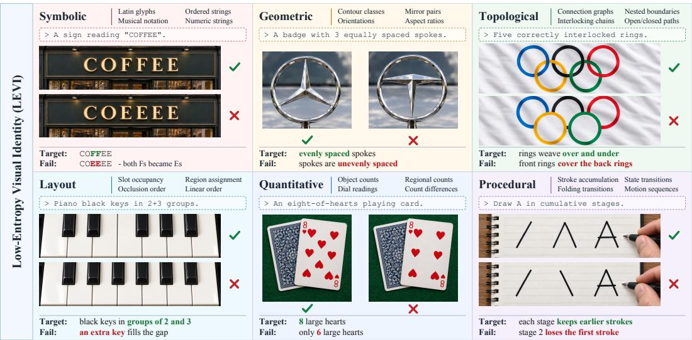  
Figure 1: Visual plausibility can coexist with identity errors. Each domain pairs matching (✓) and failing (×) examples for one prompt. Target/Fail rows identify the mismatch; header entries list representative VIS. All examples are conceptual.

We introduce Low-Entropy Visual Identity (LEVI) , a benchmark for image generation in which identity is tightly constrained while appearance remains diverse. To specify what must be preserved, we formalize Visual Identity Spaces (VIS), which describe admissible identity values and define when different images express the same identity. This distinction allows us to assess whether an image preserves a specified identity while accepting permissible variation in appearance. A VIS may describe a standalone identity, while compatible spaces can be composed under shared constraints to express identities that depend on several components. Defined transformations and projections relate identities within and across spaces.

To turn these spaces into benchmark tasks, we develop Verifiable Visual Grammar (VVG), a declar ative language for describing identity-bearing structures. Its typed components and rules specify how elements can be combined and which relations must hold, giving each description an identity under VIS semantics. Using VVG, we construct a benchmark spanning six identity domains: Sym bolic, Geometric, Topological, Layout, Quantitative, and Procedural, illustrated in Figure 1. Tasks test both individual and combined identity requirements. Evaluation reads evidence from the final image and checks whether it satisfies the target specified at construction, linking task definition and scoring through the same identity semantics. Table 1 compares LEVI with existing image-generation benchmarks in terms of visual targets, rule requirements, verification, and identity modeling. At the identity level, we examine whether a benchmark supports constructing verifiable visual structures with explicit semantics, expressing standalone and composed identity requirements, and treating visually different realizations of the same identity as equivalent during evaluation.

## Our contributions are as follows:

• We introduce LEVI and formalize visual identity fidelity. By modeling visual identity, we use conditional entropy to distinguish identity uncertainty from appearance diversity. VIS specifies admissible identities and their equivalent realizations, allowing fidelity to be defined as the probability of realizing the specified identity.

• We develop VVG to turn identity semantics into constructible and verifiable visual requirements. Typed components, relations, and compositional constraints express identitybearing structures, supporting task construction from standalone and composed identity requirements and verification of generated images under the same semantics.

• We construct the LEVI benchmark with 120 base identity spaces and 1,375 curated tasks across six domains. Among ten evaluated model configurations, the highest whole-task pass rate is 58.69%. Identity-space analysis reveals differences obscured by overall rankings, while composition counts alone do not explain difficulty.

Table 1: Comparison with recent image-generation benchmarks. ✓ denotes explicit support in the primary protocol and × denotes no explicit support. LEVI denotes the proposed design.
<table><tr><td>Benchmark</td><td>Structured domains</td><td>Rule-governed targets</td><td>Executable checks</td><td>Verifiable construction</td><td>Identity-space expressivity</td><td>Identity equivalence</td></tr><tr><td>STRICT</td><td>X</td><td>X</td><td>V</td><td>X</td><td>X</td><td>×</td></tr><tr><td>MMMG</td><td>√</td><td>X</td><td>√</td><td>X</td><td>X</td><td>X</td></tr><tr><td>StructBench</td><td>√</td><td>×</td><td>×</td><td>×</td><td>×</td><td>×</td></tr><tr><td>SpatialGenEval</td><td>X</td><td>X</td><td>X</td><td>X</td><td>×</td><td>×</td></tr><tr><td>MathGen</td><td>X</td><td>√</td><td>√</td><td>X</td><td>X</td><td>×</td></tr><tr><td>GraphicDesignBench</td><td>√</td><td>X</td><td>√</td><td>X</td><td>X</td><td>X</td></tr><tr><td>RIGBench</td><td>√</td><td>√</td><td>X</td><td>X</td><td>×</td><td>X</td></tr><tr><td>GenPuzzle</td><td>√</td><td>√</td><td>√</td><td>X</td><td>X</td><td>×</td></tr><tr><td>TRACEBench</td><td>X</td><td>√</td><td>X</td><td>√</td><td>X</td><td>X</td></tr><tr><td>LEVI (ours)</td><td>√</td><td>√</td><td>√</td><td>√</td><td>√</td><td>√</td></tr></table>

## 2 RELATED WORK

Image-generation evaluation. Image-generation benchmarks increasingly assess whether an image satisfies specific requirements beyond overall visual quality. Global measures such as FID and CLIPScore summarize distributional similarity or image–text alignment (Heusel et al., 2017; Hessel et al., 2021), whereas TIFA, GenEval, and T2I-CompBench++ examine objects, attributes, counts, and relations (Hu et al., 2023; Ghosh et al., 2023; Huang et al., 2023). GenEval 2 and FineGRAIN further investigate fine-grained assessment and its agreement with human judgment (Kamath et al., 2025; Hayes et al., 2025). Knowledge and spatial benchmarks extend the target to factual dependencies and spatial relations (Huang et al., 2025; Luo et al., 2025; Wang et al., 2026d). Reasoning oriented evaluations require deriving the visual content from implicit instructions or contextual rules (Sun et al., 2026; Liu et al., 2026b; Zhao et al., 2026). These developments establish the importance of precise visual requirements. LEVI focuses on their identity semantics: which facts determine the target and which changes preserve it.

Visual identity and target specification. Defining a visual target requires separating identity from its appearance. Reference-conditioned benchmarks assess whether a generated subject or product retains the properties of its reference (Peng et al., 2025; Singhania et al., 2025; Khanna et al., 2026; Zheng et al., 2026). MMIG-Bench combines identity, semantic, and aesthetic assessment (Hua et al., 2025). For text, graphics, and mathematical images, target properties can instead be specified through strings, structural descriptions, and task-specific constraints (Zhang et al., 2025; Zou et al., 2024; Nishina & Matsui, 2024; Deganutti et al., 2026; Zhuo et al., 2026; Liu et al., 2026a). TRACE-Bench makes the link between specification and assessment explicit: a compositional operator formula drives both multi-reference task construction and aligned evaluation (Wang et al., 2026a). LEVI develops this connection at the level of identity spaces. VIS specifies admissible identities and equivalent realizations, including standalone spaces and their compatible compositions; VVG expresses structures under those semantics. Table 1 distinguishes this identity formulation from task scope, target rules, and evaluation methods.

Verification of generated images. Verification must recover the relevant facts from the generated pixels. ControlNet++ checks re-extracted spatial conditions, while DiffQRCoder assesses whether a rendered code remains readable (Li et al., 2024; Liao et al., 2024). MathGen and ProVisE use external procedures to assess visual outputs (Liu et al., 2026a; Wang et al., 2026c); GenPuzzle combines programmatic checks for discrete outputs with task-specific visual judging (Zhao et al., 2026). VBVR applies rule-based scorers to generative visual reasoning (Wang et al., 2026b), and SpatialReward connects grounded observations with spatial relation checks (Zhou et al., 2026). The reliability of the observation procedure remains consequential: MJ-Bench evaluates systematic weaknesses of multimodal judges (Chen et al., 2024). LEVI separates visual readout from the fixed identity check. The reader supplies observed evidence, and the checker applies the same identity semantics used in construction, preserving the distinction between an identity violation and a measurement failure.

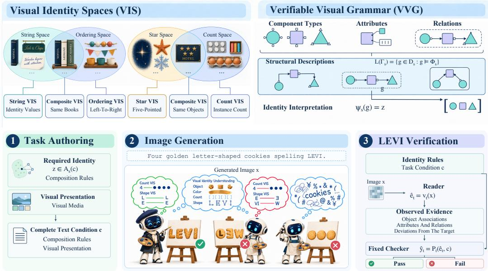  
Figure 2: From visual identity to output-based verification. Top: VIS groups equivalent realizations and combines compatible identities; VVG describes a structure g whose interpretation is an identity z. Types, attributes, and relations jointly define admissible descriptions. Bottom: task authoring supplies a complete text condition, generation produces pixels, and verification checks evidence against the shared identity conditions. Robots illustrate conceptual distinctions in identity understanding.

## 3 METHOD

We distinguish uncertainty about identity from diversity in its visual realization. Identity fidelity measures agreement with the target; VIS organizes admissible values and their equivalence; VVG expresses these requirements as structures that support construction and evaluation.

## 3.1 LOW-ENTROPY VISUAL IDENTITY

Image generators model a conditional distribution $q _ { \theta } ( X \mid C )$ over images X given text $C .$ . The condition constrains visual identity while allowing variation in its realization. Let s specify the identity rules and let the deterministic map $\phi _ { s }$ assign each image its expressed identity, giving $\overrightharpoon { Z } _ { s } = \phi _ { s } ( X )$ Using discrete representations, with continuous quantities quantized at a specified resolution, the conditional entropy chain rule (Cover & Thomas, 2006) gives

$$
H ( X \mid C = c ) = H ( Z _ { s } \mid C = c ) + H ( X \mid Z _ { s } , C = c ) .\tag{1}
$$

Under $q _ { \theta } .$ , the first term measures uncertainty about the expressed identity, and the second measures variation among realizations of a given identity. Low-Entropy Visual Identity (LEVI) concerns tightly specified identities with diverse visual realizations. For an exact target $z ^ { \star }$ , the desired generation distribution assigns all probability to its realizations, giving zero identity entropy while retaining permissible visual variation.

Entropy measures the concentration of generated identities. Identity fidelity (IF) measures their agreement with the condition. Writing $A _ { s } ( c )$ for the permitted identity values, we define

$$
\mathrm { I F } _ { \theta } ( c , s ) = \operatorname* { P r } _ { X \sim q _ { \theta } ( \cdot | c ) } [ \phi _ { s } ( X ) \in A _ { s } ( c ) ] .\tag{2}
$$

For an exact target, $A _ { s } ( c ) = \{ z ^ { \star } \}$ . This probability aggregates all permitted realizations, giving equivalent appearances equal credit.

## 3.2 VISUAL IDENTITY SPACES

A Visual Identity Space (VIS) specifies which visual differences change identity. For an ordered sequence of symbols, a painted △ ◦ □ and an engraved version can express the same identity, while exchanging the circle and square changes it. The declared rules specify which changes of appearance are allowed. Under identity rules $s ,$ let $\mathcal { X } _ { s } ^ { \mathrm { a d m } }$ contain images expressing admissible identities. The relation $x \sim _ { s } x ^ { \prime }$ groups images that express the same identity into an equivalence class. These classes form the corresponding VIS:

$$
\mathcal { Z } _ { s } = \mathcal { X } _ { s } ^ { \mathrm { a d m } } / { \sim } _ { s } , \qquad \phi _ { s } ( x ) = [ x ] _ { \sim _ { s } } , \quad x \in \mathcal { X } _ { s } ^ { \mathrm { a d m } } .\tag{3}
$$

Each point $z \in \mathcal { Z } _ { s }$ represents one identity, and $\phi _ { s }$ maps its equivalent image realizations to that point. Variation within a class preserves identity; movement between classes changes it. Images outside the admissible domain receive the value ⊥, so Equation 2 remains defined for every output.

An identity space can stand alone or combine with other spaces. When component values $z _ { 1 } , \ldots , z _ { m }$ completely determine a composite identity, its space can be written as

$$
\mathcal Z _ { s } = \left\{ ( z _ { 1 } , \ldots , z _ { m } ) \in \prod _ { j = 1 } ^ { m } \mathcal Z _ { s _ { j } } : \chi _ { s } ( z _ { 1 } , \ldots , z _ { m } ) = 1 \right\} ,\tag{4}
$$

where $\chi _ { s } = 1$ selects combinations that can be jointly realized. This representation includes component identities and every relation that determines their joint identity. Components can belong to the same or different domains; compatibility constraints allow them to depend on one another. The spaces may be discrete, continuous, or mixed.

Figure 2 gives two concrete combinations. The book spines jointly specify the strings VISION, ENTROPY, and VERIFICATION and their left-to-right order on the same books. The hotel sign combines a five-pointed star identity with a count of five instances of that shape. Composition binds these requirements to the same objects, retaining both component identities and their relations. The six identity domains organize these visual facts; each can contain multiple VIS with its own identity values and equivalence rules.

## 3.3 VERIFIABLE VISUAL GRAMMAR

VIS specifies the meaning of a visual identity. Verifiable Visual Grammar (VVG) expresses that identity through a declarative structural description. A grammar $\Gamma _ { s }$ defines component types and interfaces, assigns attributes to their components, and constrains valid relations and combinations. In the sequence example, components are symbol occurrences, each owns a symbol value, and successor relations specify their order. Constraints require values from the declared alphabet and one complete linear sequence. A description $g$ fixes these values and relations; the language $\mathcal { L } ( \Gamma _ { s } )$ contains the descriptions satisfying the constraints. An interpretation map assigns each description its identity:

$$
\psi _ { s } : { \mathcal { L } } ( \Gamma _ { s } ) \longrightarrow { \mathcal { Z } } _ { s } , \qquad g \longmapsto z\tag{5}
$$

Here, g specifies a structure and $\psi _ { s } ( g )$ gives its meaning in VIS. Descriptions that map to the same point express the same identity. A target $z ^ { \star }$ can therefore be specified by any valid description satisfying $\psi _ { s } ( g ) = z ^ { \star }$ , allowing construction to vary while preserving the intended identity. Grammar membership and task acceptance are distinct: both $\triangle \circ \square$ and $\triangle \boxed { \scriptsize { \textrm { Z o } } }$ are legal sequences, but only the first satisfies an exact request for that order.

A description is verifiable when each identity-defining attribute and relation is linked to observable image evidence and an explicit decision rule. These rules specify what must hold in the generated image, allowing the constraints used in construction to be checked on its visual realization. For the sequence, the reader recovers the visible symbols and their order, and the checker compares this evidence with the requested sequence under the same identity rules. Figure 2 connects these semantics to task authoring and output-based verification.

Instantiation assigns component values, composition establishes their declared relations, and transformations modify the description consistently with VIS operations. Each resulting structure therefore has an explicit identity interpretation.

Visual media give the resulting structures concrete form. Their appearance can vary within the equivalence class of the specified identity. The required identity and composition rules are expressed in the complete text condition c, together with the visual presentation. This condition is passed to image generation, while the structural description supplies the target for subsequent verification.

## 3.4 IDENTITY-GROUNDED BENCHMARKING

The benchmark evaluates identity fidelity by connecting the target specified during construction to the content of the generated image. For an exact identity, $\psi _ { s } ( g ) = z ^ { \star }$ specifies that target and $\phi _ { s } ( x ) = z ^ { \star }$ defines successful realization. The target description determines the attributes and relations relevant to this comparison, while the equivalence rules specify the visual variation that evaluation accepts.

Each identity requirement is associated with evidence that can be observed in the final image and a rule for deciding whether it is satisfied. Readout records the relevant content together with its object associations, so that attributes and relations can be assigned to the components they describe. This evidence preserves the generated structure, including its deviations from the target. The checker then applies the target requirements to these observations.

Figure 2 connects this evidence-based assessment to task construction and image generation. For task $t ,$ a reader $v _ { t }$ extracts evidence $\widehat { e } _ { t }$ from image x. A fixed checker $P _ { t }$ assesses it under the identity rules and task condition c. For resolved evidence,

$$
\widehat { e } _ { t } = v _ { t } ( x ) , \qquad \widehat { y } _ { t } = P _ { t } ( \widehat { e } _ { t } , c ) , \quad \widehat { y } _ { t } \in \{ 0 , 1 \} .\tag{6}
$$

The semantic map $\phi _ { s }$ defines the identity expressed by an image, while the reader and checker provide an evidence-based estimate of agreement with the target. For a composite identity, the decision combines requirements on individual components with those on their joint structure. Successful realization requires these conditions to hold together. The same evidence also identifies which component or relation accounts for an identity violation, connecting the overall judgment to interpretable differences in the output.

Equivalence rules determine how variation in appearance enters this assessment. Realizations within a permitted identity class satisfy the same identity criterion even as their appearance varies. Applying these rules consistently across construction and checking gives model comparison a common semantic basis, while retaining the identity-specific requirements of each task.

## 4 EVALUATION AND ANALYSIS

We evaluate visual identity fidelity at three levels: overall performance across models, variation across identity domains, and behavior within individual and composite VIS. Qualitative comparisons connect these scores to the visible facts that distinguish faithful realizations from errors.

## 4.1 BENCHMARK AND EVALUATION SETUP

The curated benchmark contains 1,375 tasks spanning all 120 base visual identity spaces (B-VIS), each assigned to one of six domains. Tasks instantiate individual spaces or combine compatible identities and relations into composite VIS. A task can therefore contribute to several domain subsets. Figure 3 contrasts the catalogue’s domain composition with task involvement in the evaluation set and compares the models’ performance profiles.

The ten configurations in Table 2 each receive the complete text prompt without reference images or construction records. Evaluation covers 13,750 model–task cases, with one output per case.

The reported metric is the fraction of retained tasks whose required conditions all pass automatic assessment. GPT-6-Sol with medium reasoning effort assesses the generated image against the prompt and its identity criteria. Missing images and unresolved cases receive zero credit and remain distinct from observed identity violations.

The challenge set was curated post hoc for redundancy, ambiguity, sampling balance, and observed ease across models. Reported rates are conditional on this selection. Task-specific judging instructions include two revisions, whose equivalence has not been established; their provenance is

Figure 3: Domain coverage and top-five model profiles. (a) B-VIS catalogue share (grey) and task involvement (colour). Whole-task pass rates (%) are (b) B-VIS-balanced or (c) task-weighted. Radar axes share a 0–100% scale; domain subsets overlap.  
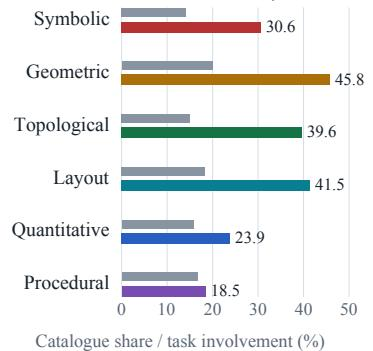  
(a) Domain coverage

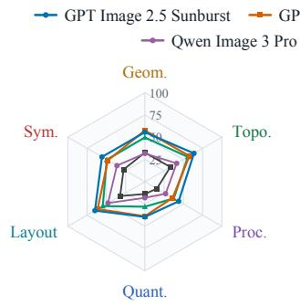  
(b) B-VIS-balanced

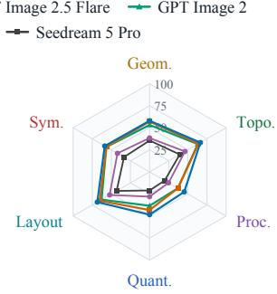  
(c) Task-weighted  
retained. Independent human agreement has not been measured. One missing output and one output with mismatched model provenance receive zero credit, leaving 13,748 assessed outputs within the full denominator.

## 4.2 OVERALL PERFORMANCE

Table 2 ranks the ten configurations by overall whole-task pass rate. GPT Image 2.5 Sunburst leads at 58.69%, followed by Flare at 55.71% and GPT Image 2 at 53.24%. Qwen Image 3 Pro ranks fourth at 39.71%, 13.53 percentage points behind GPT Image 2. Even the leading configuration fails to receive credit on more than two fifths of tasks.

Table 2: Whole-task pass rates (%, ↑) on the post-hoc curated challenge set. Medals mark the top three overall; bold/underline mark the best/second-best per column.
<table><tr><td>Rank Model</td><td></td><td>Overall</td><td>Sym.</td><td>Geom.</td><td>Topo.</td><td>Layout</td><td>Quant.</td><td>Proc.</td></tr><tr><td>9</td><td>GPT Image 2.5 Sunburst</td><td>58.69</td><td>58.67</td><td>57.94</td><td>66.42</td><td>68.42</td><td>48.48</td><td>45.28</td></tr><tr><td>②</td><td>GPT Image 2.5 Flare</td><td>55.71</td><td>56.53</td><td>57.14</td><td>63.85</td><td>65.26</td><td>43.29</td><td>37.01</td></tr><tr><td>0</td><td>GPT Image 2</td><td>53.24</td><td>56.53</td><td>53.17</td><td>62.94</td><td>62.81</td><td>38.41</td><td>37.01</td></tr><tr><td>4</td><td>Qwen Image 3 Pro</td><td>39.71</td><td>42.04</td><td>38.41</td><td>46.24</td><td>52.28</td><td>28.05</td><td>24.80</td></tr><tr><td>5</td><td>Seedream 5 Pro</td><td>33.67</td><td>33.49</td><td>35.56</td><td>39.45</td><td>43.16</td><td>21.04</td><td>19.69</td></tr><tr><td>6</td><td>Nano Banana 2</td><td>32.44</td><td>34.44</td><td>34.76</td><td>37.25</td><td>39.30</td><td>19.82</td><td>21.65</td></tr><tr><td>7</td><td>Nano Banana Pro</td><td>30.91</td><td>35.87</td><td>31.75</td><td>33.76</td><td>37.89</td><td>20.43</td><td>22.44</td></tr><tr><td>8</td><td>Grok Image 2</td><td>28.29</td><td>34.68</td><td>27.94</td><td>33.21</td><td>34.74</td><td>19.51</td><td>18.90</td></tr><tr><td>9</td><td>MAI Image 2.5</td><td>23.49</td><td>29.69</td><td>24.92</td><td>25.32</td><td>30.18</td><td>14.63</td><td>13.39</td></tr><tr><td>10</td><td>FLUX.2 Max</td><td>15.27</td><td>19.71</td><td>14.76</td><td>19.08</td><td>19.82</td><td>8.54</td><td>6.69</td></tr></table>

Sunburst also leads every task-weighted domain column. Flare places second, tying GPT Image 2 on Symbolic (56.53%) and Procedural (37.01%).

## 4.3 DOMAIN-LEVEL ANALYSIS

Figure 3 presents two complementary views of LEVI capability. The task-weighted view measures overall task-solving capability under the evaluated task distribution: success requires all identity conditions in a task to hold. The B-VIS-balanced view highlights strengths and weaknesses across LEVI identity categories by giving each represented B-VIS equal weight within its domain, rather than allowing frequently sampled identity types to dominate. Both views retain the same whole-task success criterion.

Reweighting changes the Geometric leader: Flare reaches 57.57% under B-VIS balancing, compared with Sunburst’s 55.58%. Sunburst retains the lead in the other five domains. Thus, the frequency of individual identity types affects the observed model ordering even within a domain.

The whole-task profiles in Figure 3(c) show a common contraction on Quantitative and Procedural task subsets. Sunburst reaches 68.42% on Layout and 66.42% on Topological, compared with 48.48% on Quantitative and 45.28% on Procedural. Every configuration scores lower on both of the latter subsets than on its Layout subset. These gaps describe performance on different task populations, rather than independent measurements of domain-specific reasoning abilities.

The middle of the leaderboard also contains rank reversals. Nano Banana 2 exceeds Nano Banana Pro overall by 1.53 points, yet Pro performs better on Symbolic (35.87% versus 34.44%) and Procedural (22.44% versus 21.65%). Domain membership identifies what a task involves, not which condition caused its failure. A topology-and-layout task contributes to both subsets even when only one of its requirements is violated.

## 4.4 IDENTITY SPACES AND COMPOSITION

The mean pass rates across ten models are 35.45%, 35.46%, and 38.31% for tasks involving one, two, and at least three distinct B-VIS types. Cross-domain tasks reach 38.24%, compared with 34.11% for single-domain tasks. These are different task populations, not matched component additions: more identity types do not imply lower success in this set. Table 3 reports the full structure breakdown. Within domains, Sunburst reaches 60.65% on tasks involving orientation but 43.48% on height order.

Table 3: Whole-task pass rates (%) by task structure. Share is the fraction of tasks in each group; Mean averages all ten models. The two groupings partition the same task set separately.
<table><tr><td>Task structure</td><td>Share (%)</td><td>Mean</td><td>Sunburst</td><td>Flare</td><td>GPT Image 2</td></tr><tr><td>One B-VIS type</td><td>10.40</td><td>35.45</td><td>62.24</td><td>52.45</td><td>49.65</td></tr><tr><td>Two B-VIS types</td><td>30.62</td><td>35.46</td><td>56.06</td><td>52.97</td><td>50.59</td></tr><tr><td>Three or more B-VIS types</td><td>58.98</td><td>38.31</td><td>59.43</td><td>57.71</td><td>55.24</td></tr><tr><td>Single-domain</td><td>26.69</td><td>34.11</td><td>55.31</td><td>50.95</td><td>50.41</td></tr><tr><td>Cross-domain</td><td>73.31</td><td>38.24</td><td>59.92</td><td>57.44</td><td>54.27</td></tr></table>

## 4.5 VISIBLE IDENTITY ERRORS

Figure 4 compares five models on four tasks, with a vector illustration of the target at the left of each row. The references make the identity requirements visible but are not supplied to the models. The cases illustrate correct realizations, local errors, and larger structural departures under the same prompt.

These illustrative cases have one or two passing outputs per row. In the two-tray task, Sunburst and GPT Image 2 preserve the requested counts and arrangements; the other three models produce twelve rings instead of ten. The blister task exposes local state errors: GPT Image 2 opens the bottom row, Qwen omits the middle-left seal, and Nano Banana Pro retains seals in the top row. FLUX.2 Max changes the row count.

On the keyboard, Qwen repeats small ellipses, Nano Banana Pro introduces nine key positions, and FLUX.2 Max extends paint across the exposed base. For the umbrella, Qwen produces ten panels; Nano Banana Pro and FLUX.2 Max change the specified color order. The reference encodes the required identity, not an appearance template; these selected cases do not estimate error frequencies.

Figure 4: Identity-level comparisons, one task per row. Vector references illustrate the text-only targets; outputs are uncropped. Pass/fail denotes whole-task assessment.

Vector reference

GPT Image 2.5 Sunburst

GPT Image 2

Qwen Image 3 Pro

Nano Banana Pro

(a) Two trays: 12 five-point stars in 3-by-4 rows; 10 rings in 2-by-5 rows.

FLUX.2 Max

★★★★ ★★★★

  
Pass

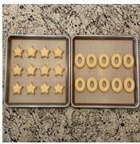  
Pass

  
Fail

  
Fail

  
Fail  
(b) Blister pack: 3-by-7 cavities; sealed columns by row: none / 1,2,3,4 / all seven.

  
Pass

  
Fail

  
Fail

  
Fail

  
Fail  
(c) Six key positions: lower-middle cap absent; one shared ellipse, no paint on the exposed base.

  
Pass

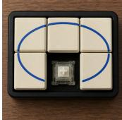  
Pass

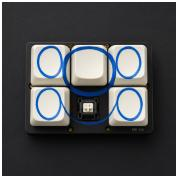  
Fail

  
Fail

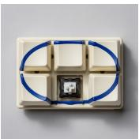  
Fail

(d) Eight panels, clockwise from the top seam: blue, red, yellow, blue, yellow, red, red, yellow.  
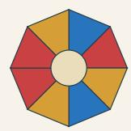

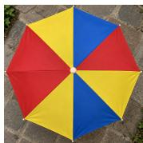  
Pass

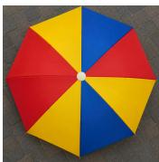  
Pass

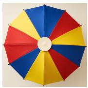  
Fail

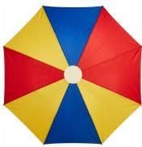  
Fail

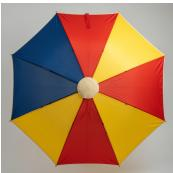  
Fail

## 5 DISCUSSION AND CONCLUSION

LEVI separates identity requirements from permissible appearance variation. VIS defines the identities and their equivalence; VVG makes their visual requirements explicit. Across 1,375 curated tasks and ten model configurations, the highest whole-task pass rate is 58.69%. B-VIS balancing changes the Geometric leader, while component-type counts do not explain task difficulty. The examples expose concrete errors in counts, spatial assignments, and local component states despite recognizable objects. Identity-level evaluation makes these distinctions inspectable.

Limitations. Single outputs do not measure generation variability. Scores depend on post-hoc curation and automatic judgments with task-specific instruction revisions (Section 4.1). Domain and construction-batch imbalance remains after B-VIS reweighting. Whole-task rates cannot isolate component errors or establish intrinsic domain difficulty; those claims require matched comparisons and independent human validation.

## REFERENCES

ByteDance Seed. Beyond generation, it understands design: Introducing Seedream 5.0 Pro, July 2026. URL https://seed.bytedance.com/en/blog/beyond-generation-i t-understands-design-introducing-seedream-5-0-pro.

Zhaorun Chen et al. MJ-Bench: Is your multimodal reward model really a good judge for text-toimage generation? arXiv preprint arXiv:2407.04842, 2024. URL https://arxiv.org/ab s/2407.04842.

Thomas M. Cover and Joy A. Thomas. Elements of Information Theory. Wiley-Interscience, 2 edition, 2006.

Adrienne Deganutti, Elad Hirsch, Haonan Zhu, Jaejung Seol, and Purvanshi Mehta. Graphic-Design-Bench: A comprehensive benchmark for evaluating AI on graphic design tasks. arXiv preprint arXiv:2604.04192, 2026. URL https://arxiv.org/abs/2604.04192.

Dhruba Ghosh, Hanna Hajishirzi, and Ludwig Schmidt. GenEval: An object-focused framework for evaluating text-to-image alignment. arXiv preprint arXiv:2310.11513, 2023. URL https: //arxiv.org/abs/2310.11513.

Google. Nano Banana 2: Combining pro capabilities with lightning-fast speed, February 2026. URL https://blog.google/innovation-and-ai/technology/ai/nano-banan a-2/.

Kevin David Hayes, Micah Goldblum, Vikash Sehwag, Gowthami Somepalli, Ashwinee Panda, and Tom Goldstein. FineGRAIN: Evaluating failure modes of text-to-image models with vision language model judges. In Advances in Neural Information Processing Systems Datasets and Benchmarks Track, 2025. URL https://arxiv.org/abs/2512.02161.

Jack Hessel, Ari Holtzman, Maxwell Forbes, Ronan Le Bras, and Yejin Choi. CLIPScore: A reference-free evaluation metric for image captioning. In Proceedings of the 2021 Conference on Empirical Methods in Natural Language Processing, 2021. URL https://arxiv.org/ abs/2104.08718.

Martin Heusel, Hubert Ramsauer, Thomas Unterthiner, Bernhard Nessler, and Sepp Hochreiter. GANs trained by a two time-scale update rule converge to a local Nash equilibrium. In Advances in Neural Information Processing Systems, 2017. URL https://arxiv.org/abs/1706 .08500.

Yushi Hu, Benlin Liu, Jungo Kasai, Yizhong Wang, Mari Ostendorf, Ranjay Krishna, and Noah A. Smith. TIFA: Accurate and interpretable text-to-image faithfulness evaluation with question answering. arXiv preprint arXiv:2303.11897, 2023. URL https://arxiv.org/abs/2303 .11897.

Hang Hua, Ziyun Zeng, Yizhi Song, Yunlong Tang, Liu He, Daniel G. Aliaga, Wei Xiong, and Jiebo Luo. MMIG-Bench: Towards comprehensive and explainable evaluation of multi-modal image generation models. arXiv preprint arXiv:2505.19415, 2025. URL https://arxiv.org/ab s/2505.19415.

Kaiyi Huang, Chengqi Duan, Kaiyue Sun, Enze Xie, Zhenguo Li, and Xihui Liu. T2I-CompBench++: An enhanced and comprehensive benchmark for compositional text-to-image generation. arXiv preprint arXiv:2307.06350, 2023. URL https://arxiv.org/abs/23 07.06350.

Ziwei Huang, Wanggui He, Quanyu Long, Yandi Wang, Haoyuan Li, Zhelun Yu, Fangxun Shu, Weilong Dai, Hao Jiang, Fei Wu, and Leilei Gan. T2I-FactualBench: Benchmarking the factuality of text-to-image models with knowledge-intensive concepts. In Proceedings of the 63rd Annual Meeting of the Association for Computational Linguistics, pp. 27501–27524, 2025. URL http s://aclanthology.org/2025.acl-long.1334/.

Amita Kamath, Kai-Wei Chang, Ranjay Krishna, Luke Zettlemoyer, Yushi Hu, and Marjan Ghazvininejad. GenEval 2: Addressing benchmark drift in text-to-image evaluation. arXiv preprint arXiv:2512.16853, 2025. URL https://arxiv.org/abs/2512.16853.

Mukund Khanna, Raj Singh Yadav, and Kunal Singh. ProductConsistency: Improving product identity preservation in instruction-based image editing via SFT and RL. arXiv preprint arXiv:2606.19103, 2026. URL https://arxiv.org/abs/2606.19103.

Ming Li, Taojiannan Yang, Huafeng Kuang, Jie Wu, Zhaoning Wang, Xuefeng Xiao, and Chen Chen. ControlNet++: Improving conditional controls with efficient consistency feedback. arXiv preprint arXiv:2404.07987, 2024. URL https://arxiv.org/abs/2404.07987.

Jia-Wei Liao, Winston Wang, Tzu-Sian Wang, Li-Xuan Peng, Ju-Hsuan Weng, Cheng-Fu Chou, and Jun-Cheng Chen. DiffQRCoder: Diffusion-based aesthetic QR code generation with scanning robustness guided iterative refinement. arXiv preprint arXiv:2409.06355, 2024. URL https: //arxiv.org/abs/2409.06355.

Ruiyao Liu et al. MathGen: Revealing the illusion of mathematical competence through text-toimage generation. arXiv preprint arXiv:2603.27959, 2026a. URL https://arxiv.org/ab s/2603.27959.

Yutong Liu, Nan Huang, Xu Cao, and James M. Rehg. Thinking in pictures: A systematic benchmark for reasoning-driven image generation. arXiv preprint arXiv:2609.02864, 2026b. URL https://arxiv.org/abs/2609.02864.

Yuxuan Luo, Yuhui Yuan, Jun-Wen Chen, Haonan Cai, Ziyi Yue, Yu-Wei Yang, Fatima Zohra Daha, Ji Li, and Zhouhui Lian. MMMG: A massive, multidisciplinary, multi-tier generation benchmark for text-to-image reasoning. arXiv preprint arXiv:2506.10963, 2025. URL https://arxiv. org/abs/2506.10963.

Kunato Nishina and Yusuke Matsui. SVGEditBench: A benchmark dataset for quantitative assessment of LLM’s SVG editing capabilities. In CVPR Workshop on Graphic Design Understanding and Generation, 2024. URL https://arxiv.org/abs/2404.13710.

Yuang Peng, Yuxin Cui, Haomiao Tang, Zekun Qi, Runpei Dong, Jing Bai, Chunrui Han, Zheng Ge, Xiangyu Zhang, and Shu-Tao Xia. DreamBench++: A human-aligned benchmark for personalized image generation. In International Conference on Learning Representations, 2025. URL https://arxiv.org/abs/2406.16855.

Aditi Singhania et al. Beyond the pixels: VLM-based evaluation of identity preservation in reference-guided synthesis. arXiv preprint arXiv:2511.08087, 2025. URL https://arxi v.org/abs/2511.08087.

Kaiyue Sun, Rongyao Fang, Chengqi Duan, Xian Liu, Aoxue Li, and Xihui Liu. T2I-ReasonBench: Benchmarking reasoning-informed text-to-image generation. In Findings of the Association for Computational Linguistics: ACL 2026, pp. 8919–8944, 2026. URL https://aclantholo gy.org/2026.findings-acl.433/.

Haoran Wang, Chaofan Ma, Ran Yi, and Lizhuang Ma. TRACE-Bench: Decomposing and diagnosing multi-reference image generation. arXiv preprint arXiv:2608.16765, 2026a. URL https://arxiv.org/abs/2608.16765.

Maijunxian Wang et al. A very big video reasoning suite. arXiv preprint arXiv:2602.20159, 2026b. URL https://arxiv.org/abs/2602.20159.

Xu Wang, Kaixiang Yao, Miao Pan, Xiaohe Zhou, Xuanyu Liu, Wenqi Zhang, and Xuhong Zhang. Show, don’t tell: Evaluating spatial cognition in generative pixels rather than LLM text. arXiv preprint arXiv:2607.21072, 2026c. URL https://arxiv.org/abs/2607.21072.

Zengbin Wang, Xuecai Hu, Yong Wang, Feng Xiong, Manyuan Zhang, and Xiangxiang Chu. Everything in its place: Benchmarking spatial intelligence of text-to-image models. arXiv preprint arXiv:2601.20354, 2026d. URL https://arxiv.org/abs/2601.20354.

Tianyu Zhang et al. STRICT: Stress test of rendering images containing text. In Proceedings of the 2025 Conference on Empirical Methods in Natural Language Processing, 2025. URL https://arxiv.org/abs/2505.18985.

Changpeng Zhao, Yiren Song, and Jinpeng Wang. GenPuzzle: Benchmarking visual reasoning in image generation models. arXiv preprint arXiv:2609.05902, 2026. URL https://arxiv.or g/abs/2609.05902.

Peng Zheng, Ruiqi Liu, Rui Ma, and Zuxuan Wu. CopyCat: Improving fine-grained subject consistency in subject-to-image models within seconds. arXiv preprint arXiv:2608.00674, 2026. URL https://arxiv.org/abs/2608.00674.

Sashuai Zhou, Qiang Zhou, Junpeng Ma, Yue Cao, Ruofan Hu, Ziang Zhang, Xiaoda Yang, Zhibin Wang, Jun Song, Cheng Yu, Bo Zheng, and Zhou Zhao. SpatialReward: Verifiable spatial re ward modeling for fine-grained spatial consistency in text-to-image generation. arXiv preprint arXiv:2603.22228, 2026. URL https://arxiv.org/abs/2603.22228.

Le Zhuo et al. Factuality matters: When image generation and editing meet structured visuals. In International Conference on Learning Representations, 2026. URL https://arxiv.org/ abs/2510.05091.

Bocheng Zou, Mu Cai, Jianrui Zhang, and Yong Jae Lee. VGBench: Evaluating large language models on vector graphics understanding and generation. arXiv preprint arXiv:2407.10972, 2024. URL https://arxiv.org/abs/2407.10972.

## A IDENTITY SEMANTICS AND TASK CONSTRUCTION

## A.1 IDENTITY SPACES AND ADMISSIBLE ANSWERS

Under the identity rules s defined in Section 3.2, each point of $\mathcal { Z } _ { s }$ collects all image realizations of the same identity. A coordinate representation must distinguish these classes and satisfy their legality constraints. For an ordered symbol sequence, the coordinates record symbol values and order; for a composite identity, they also record any relations needed to bind the components. Equivalent descriptions count as one identity, and legal coordinates may depend on one another.

The permitted answer set $A _ { s } ( c )$ follows the prompt. An exact request for $( \triangle , \circ , \sqsubseteq )$ permits one sequence; a request for one of each symbol in any order permits all six permutations. Identity fidelity (Equation 2) credits the probability mass of all these permitted identities, including their allowed appearance variations. A vector reference illustrates one valid realization without excluding the others. Images outside the admissible identity domain map to ⊥; uncertainty in an automatic reader is a separate assessment issue.

## A.2 COMPOSITION AND TRANSFORMATIONS

Consider finite, nonempty sequences over $\Sigma = \{ \triangle , \circ , \bigsqcup \}$ and the example $z = ( \triangle , \circ , \bigtriangledown )$ . Table 4 distinguishes operations on this example. Composition must preserve object bindings: pairing z with a count of the same occurrences requires $n = | z |$ . Any spatial or attachment relation that determines the joint identity must also be specified.

Table 4: Four operations illustrated with the same symbol sequence.
<table><tr><td>Operation</td><td>Example</td><td>Semantic effect</td></tr><tr><td>Composition</td><td>Pair z with its count:  $( z , 3 )$  is compatible;  $( z , 4 )$  is not.</td><td>Retains component identities and their shared-object constraints.</td></tr><tr><td>Projection</td><td> $P ( z ) = | z | = 3 .$ </td><td>Keeps count; discards symbol values and order.</td></tr><tr><td>Transformation</td><td> $\mathrm { R e v e r s e } \ z \ \mathrm { t o } \ ( \bigtriangledown , \circ , \bigtriangleup )$ </td><td>Changes identity according to a specified rule.</td></tr><tr><td>Refinement</td><td>Replace a count-only specification with an ordered-symbol specification.</td><td>Separates identities previously grouped to- gether.</td></tr></table>

Painting or engraving the same sequence changes its realization when material is not identitydetermining. For a structural transformation $\widetilde { T }$ implementing identity operation $T ,$ , the VVG interpretation ψ must satisfy

$$
\psi _ { s ^ { \prime } } ( \widetilde { T } ( g ) ) = T ( \psi _ { s } ( g ) ) ,\tag{7}
$$

where $g$ is a legal description under $s ,$ and the transformed description is legal under the target rules $s ^ { \prime } .$

## A.3 A WORKED TASK AND THE ENTROPY DECOMPOSITION

From identity to a text-to-image task. The following illustrative task connects the definitions to a concrete image request; it is not an additional evaluated benchmark item.

1. Identity. Three symbol occurrences in the left-to-right order $( \triangle , \circ , \square )$ . Color and material may vary while the symbols remain recognizable and distinct.

2. VVG description. Create three typed symbol nodes, assign their values, and connect them in one successor chain. Bind this chain to their left-to-right arrangement on a single plaque. The count is derived from the nodes rather than supplied as an independent value.

3. Complete prompt. “A front-facing photograph of a single rectangular plaque on a wall. The plaque displays exactly three separate symbols in one horizontal row: a triangle, a circle, and a square, from left to right. All three symbols are fully visible. There are no other symbols or text on the plaque.”

4. Evidence and decision. Identify the plaque and read every symbol on it in left-to-right order, retaining extra or malformed marks for inspection. Accept when the plaque, visibility, and arrangement requirements hold and the observed sequence is exactly $( \triangle , \circ , \square )$ . A changed material is permitted; an extra symbol or swapped pair violates the request.

The generator receives the prompt, not the VVG description or vector reference. A legal description may express a different sequence, so grammar membership alone does not establish task success. Likewise, a rendering preserves the intended identity only if its pixels retain the specified facts and object associations. Actual automatic assessment in the reported experiments follows Section 4.1.

Entropy and correctness. For a fixed prompt $C = c ,$ let $X \sim q _ { \theta } ( \cdot \mid c )$ and $Z _ { s } = \phi _ { s } ( X )$ . Since $\phi _ { s }$ is deterministic, $H ( Z _ { s } \mid X , C = c ) = 0$ . The chain rule therefore gives

$$
{ \begin{array} { r l } & { H ( X , Z _ { s } \mid C = c ) = H ( X \mid C = c ) } \\ & { \qquad = H ( Z _ { s } \mid C = c ) + H ( X \mid Z _ { s } , C = c ) . } \end{array} }\tag{8}
$$

The two terms distinguish identity uncertainty from appearance variation within an identity. Entropies use base-two logarithms and discrete representations; continuous quantities require a declared quantization. For identity coordinates, dependence is retained through

$$
H ( Z _ { 1 } , \dots , Z _ { k } \mid C = c ) = \sum _ { j = 1 } ^ { k } H ( Z _ { j } \mid Z _ { < j } , C = c ) ,\tag{9}
$$

where $Z _ { < j }$ denotes the preceding coordinates. A count derived from a complete object list adds zero conditional uncertainty. Finally, always generating one wrong identity gives zero identity entropy and zero fidelity; generating only permitted identities can give positive entropy and perfect fidelity. The empirical whole-task pass rate measures success under the chosen task set and assessment procedure.

## B TASK TYPES AND REPRESENTATIVE EXAMPLES

Across the six domains, correctness depends on bindings: polarity to a particular letter, height to a channel, connections to endpoints, objects to positions, counts to regions, and additions to stages. The examples vary their physical media while keeping these requirements explicit. Matching totals or recognizing the object category alone cannot establish identity fidelity.

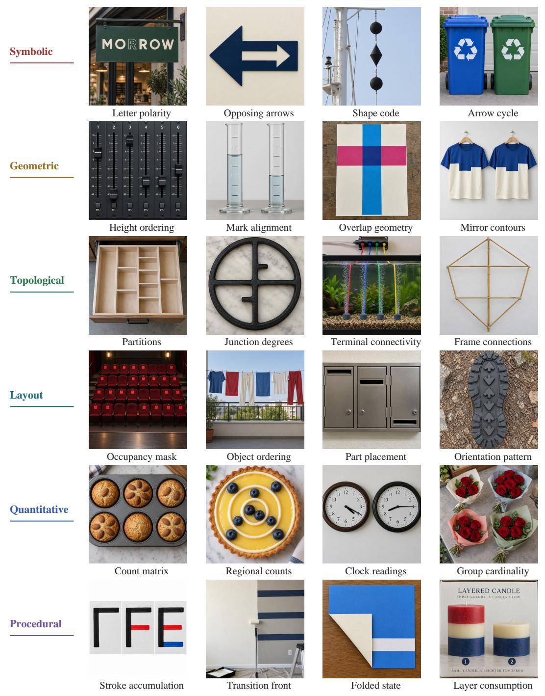  
Figure 5: Twenty-four tasks across six identity domains. All images are uncropped GPT Image 2.5 Sunburst outputs. Labels name the requested mechanism, not a pass/fail verdict; the selection illustrates diversity rather than error frequency.

GPT Image 2

## C PROMPT AND DECISION ANALYSIS

We examine six additional tasks, distinct from the overview in Appendix B and from Figure 4. Each case includes its original prompt, the identity evidence to inspect, an existing vector reference, and five model outputs. The reference is a schematic of the required identity, not an appearance template or an input to the generators. The figures reproduce recorded automatic PASS/FAIL labels; an asterisk marks an original review flag. No historical score is changed.

## C.1 SYMBOLIC: BINDING COLOR BANDS TO TOPMARKS

## Original prompt.

A frontal dockside photograph of two full-size navigation buoys on separate maintenance cradles. The left body has red, green and red horizontal bands from top to bottom and one red cylindrical topmark. The right has green, red and green bands and one green cone pointing upward. Both entire bodies and topmarks are large, separate and unobscured. No written navigation codes appear.

Identity evidence. Read each buoy as one tuple: its top-to-bottom band sequence and its own topmark. The left target is (red, green, red; red cylinder), and the right target is (green, red, green; upward green cone). Cradle geometry and weathering may vary. Correct bands attached to the wrong topmark would change the identity.

Vector reference Identity schematic

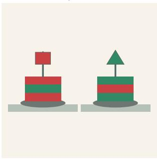

PASS  
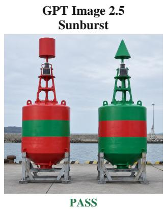

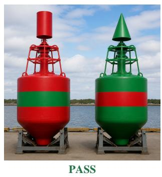

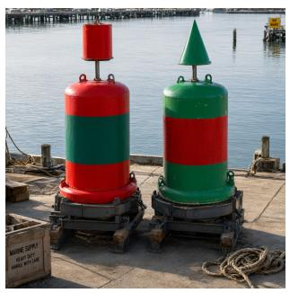

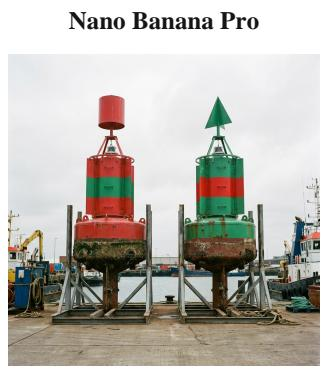

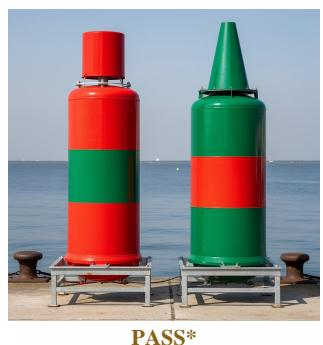  
Figure 6: Symbolic: binding color bands to topmarks. The reference encodes the identity requirement; model labels are recorded automatic outcomes (∗: review flagged).

Model comparison. The outputs vary in body shape, framing, and weathering while retaining the two band sequences. Sunburst, GPT Image 2, Qwen, and Nano Banana Pro have unflagged stored PASS outcomes. The FLUX.2 Max PASS carries an original review flag. This case illustrates appearance variation around a shared symbolic requirement.

## C.2 GEOMETRIC: ASYMMETRIC SHARED BOUNDARIES

## Original prompt.

A frontal close photograph of two separate two-color vinyl panels on a shop window. In each panel an upper blue sheet and lower ivory sheet touch along one continuous interlocking seam, with no gap or overlap. The left seam forms a tall M-shaped profile with two vertical outer legs and one central downward V; the V trough lies distinctly to the right of the midpoint between the legs. The right panel has the same M-shaped structure with two outer legs and one central trough, but its trough lies distinctly to the left of the midpoint between the legs. Exact dimensions need not match between panels. The two panels use the same blue-above and ivory-below color assignment. The M shape is made only by the shared boundary, with no printed letter strokes.

Identity evidence. Read the shared blue/ivory boundary in each panel, including its two outer legs and single central trough. Compare the trough with the midpoint between the legs: right of center in the left panel and left of center in the right panel. Exact dimensions may differ. Extra printed strokes cannot substitute for the boundary.

Vector reference Identity schematic

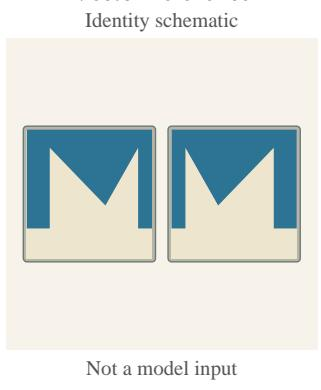

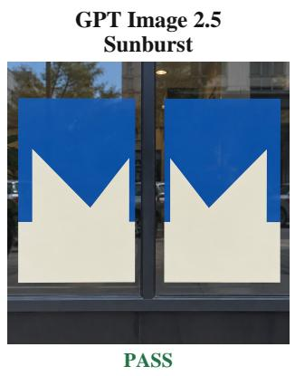

GPT Image 2  
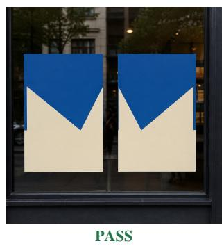  
FLUX.2 Max

Qwen Image 3 Pro  
  
FAIL

  
FAIL

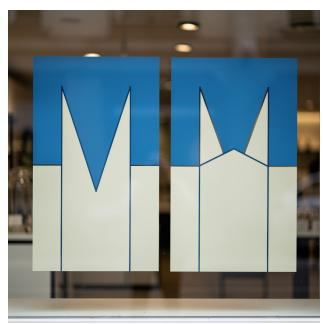  
FAIL  
Figure 7: Geometric: asymmetric shared boundaries. The reference encodes the identity requirement; model labels are recorded automatic outcomes (∗: review flagged).

Model comparison. Sunburst and GPT Image 2 retain the opposing trough offsets. Qwen introduces additional cut-ins and letter-like shapes; Nano Banana Pro adds outlined M strokes; FLUX.2 Max introduces line structure and an incorrect boundary profile. The same letter-like impression can therefore arise from structures with different geometric identities.

## C.3 TOPOLOGICAL: ONE LOOP AND TWO FREE ENDS

## Original prompt.

An overhead close photograph of a simple thick-cord coaster ornament lying flat. One clearly closed rope loop joins two short loose tails at a single broad knot at its lower edge. Exactly four rope arms meet there: the two sides of the loop and the two tails. There is exactly one loop and two free tail tips, with no other branches or small woven holes.

Identity evidence. Trace the closed loop, the single lower junction, and every tail to its free tip. The target has one loop, two free tips, and four arms incident at the junction. Rope texture and the shape of the loop may vary, provided they do not introduce another branch or opening.

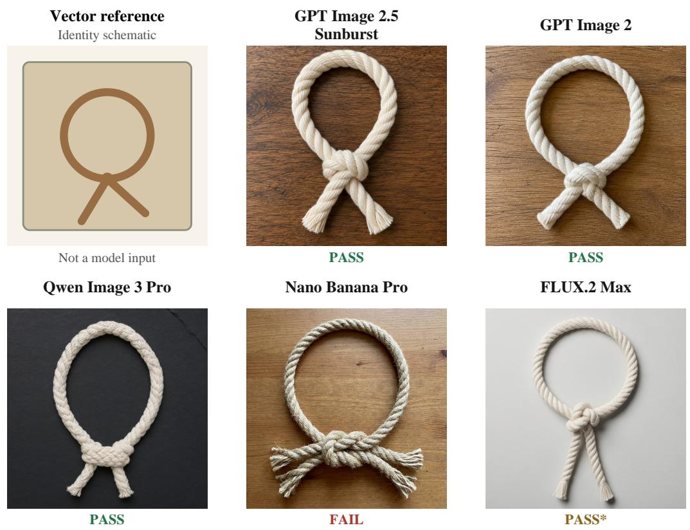  
Figure 8: Topological: one loop and two free ends. The reference encodes the identity requirement; model labels are recorded automatic outcomes (∗: review flagged).

Model comparison. Sunburst, GPT Image 2, and Qwen show one loop with two tails. Nano Banana Pro produces four distinct tail tips around the knot, changing the branch structure despite a recognizable loop ornament. The FLUX.2 Max outcome is flagged in the source record; the asterisk preserves that uncertainty.

GPT Image 2

## C.4 LAYOUT: OCCUPANCY AND INDICATOR BINDING

## Original prompt.

A near-overhead close photograph of a real battery charger with two rows of four separate battery slots. In the top row, only the first and third slots contain batteries. In the bottom row, only the second and third slots contain batteries. Every occupied slot has exactly one green status light immediately below it; every empty slot has its status light dark. All batteries and slot floors are visible, with no extra loose batteries or additional indicators.

Identity evidence. Index the two rows and four columns from the viewer left. The occupied-slot sets are (1,3) and (2,3); the lit-indicator sets must match them exactly. Evidence must bind each light to its slot. Four batteries in total is insufficient if the grid, positions, or light assignments differ.

Nano Banana Pro  
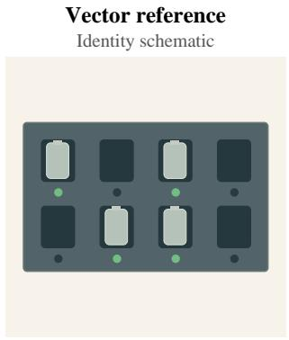

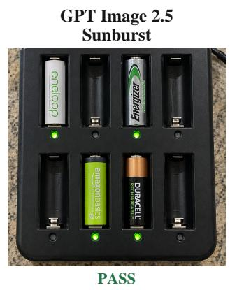

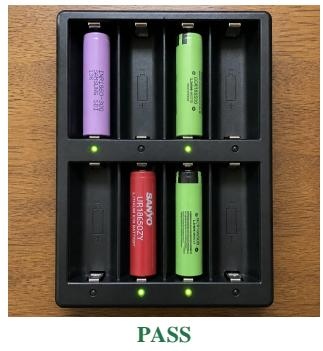

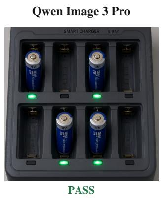

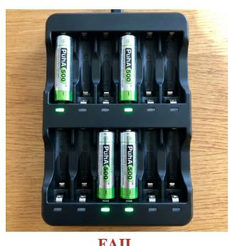

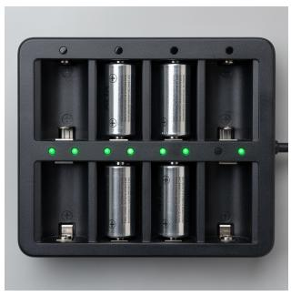  
Figure 9: Layout: occupancy and indicator binding. The reference encodes the identity requirement; model labels are recorded automatic outcomes (∗: review flagged).

Model comparison. Sunburst, GPT Image 2, and Qwen preserve the two-by-four layout and the requested occupied slots. Nano Banana Pro expands each row to six slots. FLUX.2 Max adds extra green indicators and breaks the one-light-per-slot correspondence. These errors remain visible even when the object is clearly a charger.

PASS

PASS

FAIL

## C.5 QUANTITATIVE: COUNTS INSIDE AND OUTSIDE A FRAME

## Original prompt.

An overhead close photograph of one five-rod wooden abacus. Each rod has one upper bead. The lower bead counts from left to right are four, four, three, four, four. One separate matching loose bead lies below and outside the frame. Do not thread it onto the center rod or count it as part of a neighboring rod. All rods and beads are visible; no numerals or arithmetic appear.

Identity evidence. Read the five upper-bead counts, the five lower-bead counts, and loose beads outside the frame separately. The targets are (1,1,1,1,1), (4,4,3,4,4), and one loose bead. Bead positions along a rod are unrestricted; moving the loose bead onto a rod changes the required regional counts.

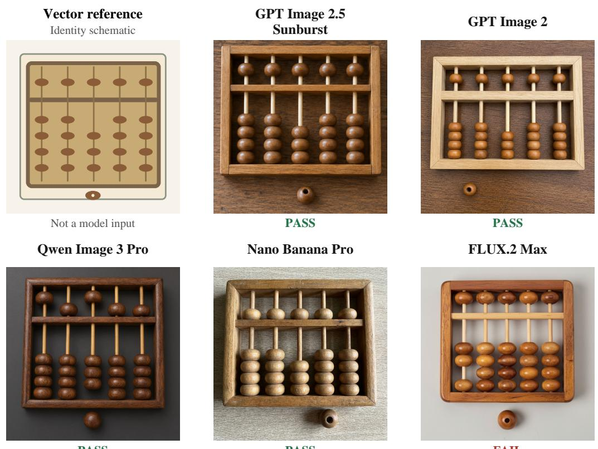  
Figure 10: Quantitative: counts inside and outside a frame. The reference encodes the identity requirement; model labels are recorded automatic outcomes (∗: review flagged).

Model comparison. The first four configurations have stored PASS outcomes and preserve the five-rod structure with one loose bead below it. FLUX.2 Max shows only two lower beads on the leftmost rod instead of four. The separate bead outside the frame cannot compensate for a deficit on a particular rod.

## C.6 PROCEDURAL: A LOCALIZED DELETION STATE

## Original prompt.

A near-frontal photograph of a chalkboard with a locally erased B. The left stem and lower bowl remain complete. A broad right-side section of the upper bowl has been erased, leaving clearly separated upper and lower stroke endpoints. The erased area is blank, not covered by white paper. Do not erase the lower bowl or stem or add a complete B alongside.

Identity evidence. Read the left stem, lower bowl, and two endpoints bordering the erased upperright arc. The stem and lower bowl must remain complete, while the erased interval exposes blank board. This is a visible intermediate state under a deletion rule; no hidden drawing or erasing history is inferred.

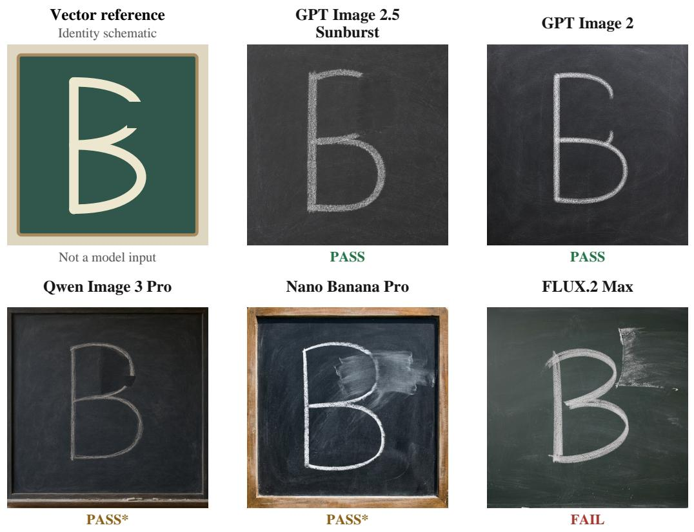  
Figure 11: Procedural: a localized deletion state. The reference encodes the identity requirement; model labels are recorded automatic outcomes (∗: review flagged).

Model comparison. Sunburst and GPT Image 2 leave an open upper-right arc while retaining the stem and lower bowl. Qwen and Nano Banana Pro have flagged PASS records: a dark patch and chalk residue, respectively, complicate the erased-area interpretation. FLUX.2 Max retains a complete B, giving a clear counterexample to the requested deletion.

## D EXTENDED EXPERIMENTAL RESULTS

All analyses below use the same 1,375 retained tasks and ten configurations as the main results. They are deterministic summaries of the existing outcomes; no additional generations or judgments are introduced. A whole-task PASS requires all recorded conditions to pass. Missing and provenanceheld outputs receive zero credit in every retained-task denominator.

## D.1 B-VIS-BALANCED AND IDENTITY-LEVEL RESULTS

B-VIS-balanced domain results. For each represented B-VIS, we compute the whole-task pass rate among tasks containing it, then average these rates equally within its domain. This extends the five-model balanced profiles in the main text to all ten configurations. Unrepresented types are not assigned zero.

Table 5: B-VIS-balanced whole-task pass rates (%). Domain columns use equal weight per represented B-VIS.
<table><tr><td>Configuration</td><td>Sym.</td><td>Geom.</td><td>Topo.</td><td>Layout</td><td>Quant.</td><td>Proc.</td></tr><tr><td>GPT Image 2.5 Sunburst</td><td>55.70</td><td>55.58</td><td>63.73</td><td>64.81</td><td>39.52</td><td>43.89</td></tr><tr><td>GPT Image 2.5 Flare</td><td>48.03</td><td>57.57</td><td>57.80</td><td>61.35</td><td>38.76</td><td>36.11</td></tr><tr><td>GPT Image 2</td><td>49.46</td><td>49.72</td><td>55.82</td><td>54.63</td><td>28.04</td><td>37.49</td></tr><tr><td>Qwen Image 3 Pro</td><td>36.24</td><td>31.75</td><td>41.29</td><td>47.90</td><td>18.07</td><td>26.92</td></tr><tr><td>Seedream 5 Pro</td><td>27.55</td><td>32.74</td><td>33.08</td><td>32.17</td><td>13.75</td><td>15.59</td></tr><tr><td>Nano Banana 2</td><td>29.93</td><td>31.05</td><td>28.87</td><td>28.03</td><td>14.11</td><td>25.18</td></tr><tr><td>Nano Banana Pro</td><td>28.75</td><td>30.20</td><td>29.17</td><td>33.52</td><td>15.75</td><td>20.85</td></tr><tr><td>Grok Image 2</td><td>25.58</td><td>25.21</td><td>28.47</td><td>29.85</td><td>15.36</td><td>18.34</td></tr><tr><td>MAI Image 2.5</td><td>24.80</td><td>23.93</td><td>18.91</td><td>27.95</td><td>9.05</td><td>11.94</td></tr><tr><td>FLUX.2 Max</td><td>17.68</td><td>13.77</td><td>15.03</td><td>13.23</td><td>4.84</td><td>5.42</td></tr></table>

Flare reaches 57.57% on Geometric under B-VIS balancing, compared with 55.58% for Sunburst. This reverses their task-weighted ordering. Both aggregations measure complete-task success; neither isolates the accuracy of an individual component.

Within-domain profiles. To examine variation within these domain averages, Figure 12 groups tasks by individual B-VIS. The two most frequent types per domain are selected independently of model performance.  
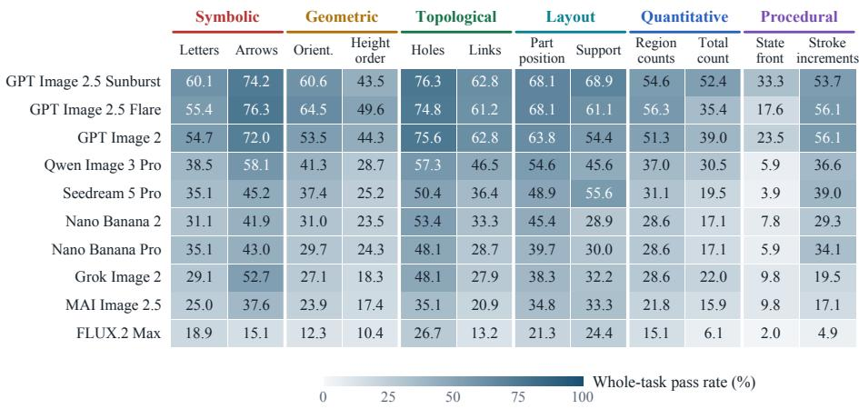  
Figure 12: Whole-task pass rates (%) for the two most frequent B-VIS in each domain. Columns overlap when a task involves several types.

For Sunburst, orientation and height-order groups reach 60.65% and 43.48%, respectively. Flare leads Sunburst on partition counts (56.30% versus 54.62%) but trails on total count (35.37% versus 52.44%). Domain averages therefore conceal differences between identity types.

## D.2 COMPOSITION STRATA

Table 6 reports all configurations by the number of distinct B-VIS types and by domain involvement. These strata differ in task content, so their differences describe the retained set rather than a controlled composition penalty.

Table 6: Whole-task pass rates (%) by composition stratum. Type counts count distinct B-VIS, not object instances.
<table><tr><td></td><td> $1 \mathrm { t y p e }$   $n = 1 4 3$ </td><td> $2 \mathrm { t y p e s }$   $n = 4 2 1$ </td><td> $3 + \mathrm { t y p e s }$   $n = 8 1 1$ </td><td>Single domain  $n = 3 6 7$ </td><td>Cross-domain  $n = 1 0 0 8$ </td></tr><tr><td>Configuration GPT Image 2.5 Sunburst</td><td>62.24</td><td>56.06</td><td>59.43</td><td>55.31</td><td>59.92</td></tr><tr><td>GPT Image 2.5 Flare</td><td>52.45</td><td>52.97</td><td>57.71</td><td>50.95</td><td>57.44</td></tr><tr><td>GPT Image 2</td><td>49.65</td><td>50.59</td><td>55.24</td><td>50.41</td><td>54.27</td></tr><tr><td>Qwen Image 3 Pro</td><td>42.66</td><td>37.53</td><td>40.32</td><td>37.60</td><td>40.48</td></tr><tr><td>Seedream 5 Pro</td><td>28.67</td><td>31.83</td><td>35.51</td><td>29.97</td><td>35.02</td></tr><tr><td>Nano Banana 2</td><td>32.87</td><td>33.97</td><td>31.57</td><td>31.34</td><td>32.84</td></tr><tr><td>Nano Banana Pro</td><td>29.37</td><td>32.30</td><td>30.46</td><td>25.89</td><td>32.74</td></tr><tr><td>Grok Image 2</td><td>23.78</td><td>25.18</td><td>30.70</td><td>26.16</td><td>29.07</td></tr><tr><td>MAI Image 2.5</td><td>20.28</td><td>19.95</td><td>25.89</td><td>20.44</td><td>24.60</td></tr><tr><td>FLUX.2 Max</td><td>12.59</td><td>14.25</td><td>16.28</td><td>13.08</td><td>16.07</td></tr></table>

## D.3 SHARED SUCCESSES AND COMPLEMENTARITY

Table 7 groups tasks by the number of configurations receiving a PASS. This counts configurations on the observed outputs; it is not repeated-sampling success probability for a model.

Table 7: Distribution of the number of passing configurations per task, out of ten.
<table><tr><td>Passing configurations</td><td>Tasks</td><td>Share (%)</td></tr><tr><td>0</td><td>243</td><td>17.67</td></tr><tr><td>1</td><td>170</td><td>12.36</td></tr><tr><td>2</td><td>132</td><td>9.60</td></tr><tr><td>3</td><td>149</td><td>10.84</td></tr><tr><td>4</td><td>142</td><td>10.33</td></tr><tr><td>5</td><td>129</td><td>9.38</td></tr><tr><td>6</td><td>145</td><td>10.55</td></tr><tr><td>7</td><td>112</td><td>8.15</td></tr><tr><td>8</td><td>60</td><td>4.36</td></tr><tr><td>9</td><td>51</td><td>3.71</td></tr><tr><td>10</td><td>42</td><td>3.05</td></tr></table>

No configuration receives a PASS on 243 tasks (17.67%); all ten receive a PASS on 42 (3.05%). At least one receives a PASS on 1132 tasks. This union is a descriptive upper bound from the recorded outputs, not the result of a deployed selection system.

Table 8: Paired task outcomes for the three highest-scoring configurations. A and B refer to the left and right names; every row sums to 1,375.
<table><tr><td>A/B</td><td>Both pass A only</td><td></td><td>B only</td><td>Neither</td></tr><tr><td>Sunburst / Flare</td><td>611</td><td>196</td><td>155</td><td>413</td></tr><tr><td>Sunburst / GPT Image 2</td><td>602</td><td>205</td><td>130</td><td>438</td></tr><tr><td>Flare / GPT Image 2</td><td>572</td><td>194</td><td>160</td><td>449</td></tr></table>

Sunburst’s net advantage over Flare is 41 tasks, comprising 196 Sunburst-only successes and 155 Flare-only successes. The aggregate ordering therefore does not imply that one model’s successful tasks contain the other’s.

## E EVALUATION PROVENANCE AND REPRODUCTION NOTES

The results preserve the original one-output-per-configuration-per-task design. Generation uses the complete text prompt without a vector reference. The automatic reader is GPT-6-Sol with medium reasoning effort, as stated in Section 4.1. Task-specific instructions come from two recorded versions: the earlier prompt-visible protocol (499 tasks) and reconciled criteria (876 tasks). Their task populations differ and protocol equivalence has not been established.

Table 9: Provenance split and review flags in the retained outcomes. Review flags are diagnostic and can coexist with a stored PASS or FAIL; they are not the two non-assessed slots.
<table><tr><td>Configuration</td><td>Earlier PASS</td><td>Reconciled PASS</td><td>Review flags</td></tr><tr><td>GPT Image 2.5 Sunburst</td><td>320/499</td><td>487/876</td><td>420</td></tr><tr><td>GPT Image 2.5 Flare</td><td>296/499</td><td>470/876</td><td>380</td></tr><tr><td>GPT Image 2</td><td>281/499</td><td>451/876</td><td>426</td></tr><tr><td>Qwen Image 3 Pro</td><td>215/499</td><td>331/876</td><td>553</td></tr><tr><td>Seedream 5 Pro</td><td>182/499</td><td>281/876</td><td>608</td></tr><tr><td>Nano Banana 2</td><td>191/499</td><td>255/876</td><td>597</td></tr><tr><td>Nano Banana Pro</td><td>179/499</td><td>246/876</td><td>629</td></tr><tr><td>Grok Image 2</td><td>173/499</td><td>216/876</td><td>585</td></tr><tr><td>MAI Image 2.5</td><td>143/499</td><td>180/876</td><td>655</td></tr><tr><td>FLUX.2 Max</td><td>98/499</td><td>112/876</td><td>656</td></tr></table>

The challenge set was curated after generation for redundancy, ambiguity, balance, and observed ease. These results characterize that retained set. A flagged stored verdict is retained in the tables; independent human agreement and repeated-generation variability have not been measured. The erased-chalk example above shows why a stored label and an unambiguous visual explanation should be distinguished.

To reproduce the aggregation, match each task with its configuration-specific records, retain the fixed 1,375-task roster, assign credit only to stored PASS outcomes, and retain missing or provenance-held slots with zero credit. Domain and B-VIS subsets are formed from the frozen task memberships, not inferred from the generated image. For each example, retain the original prompt, original image, model identifier, criterion version, and recorded outcome. The supplementary source package records these paths and image hashes so the figures can be traced to the evaluated outputs.