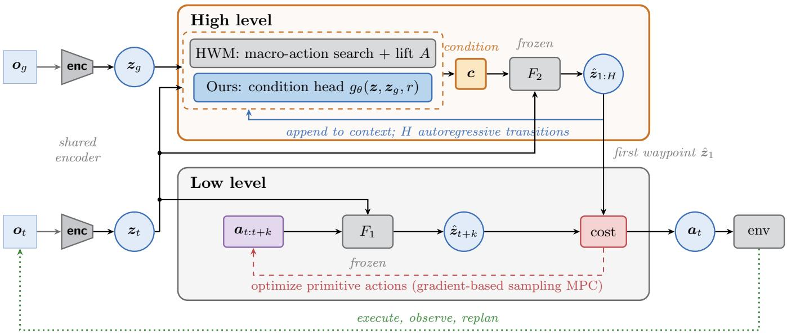
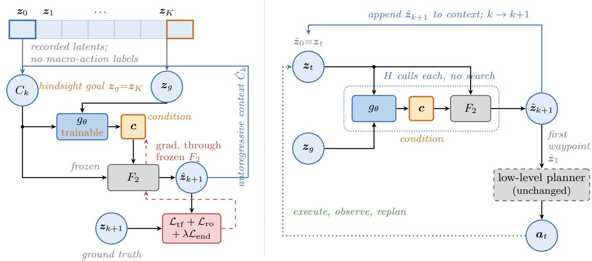
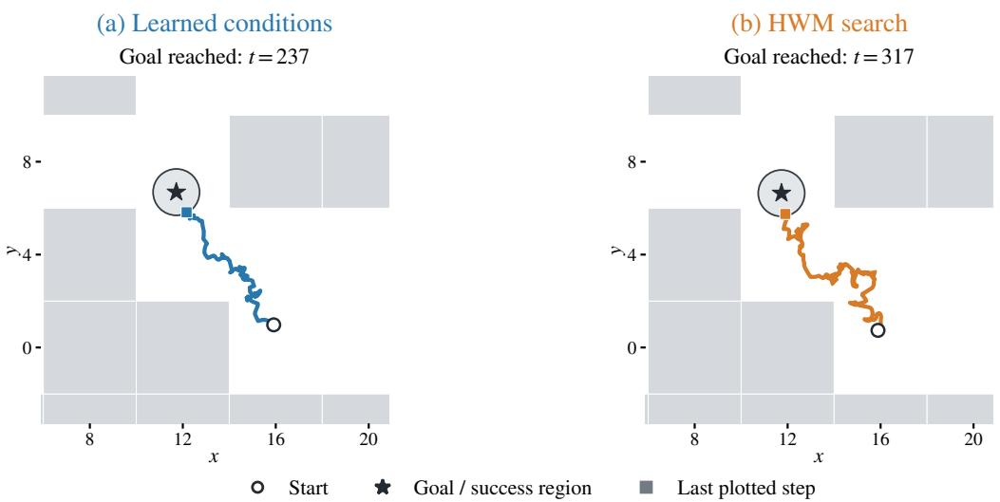
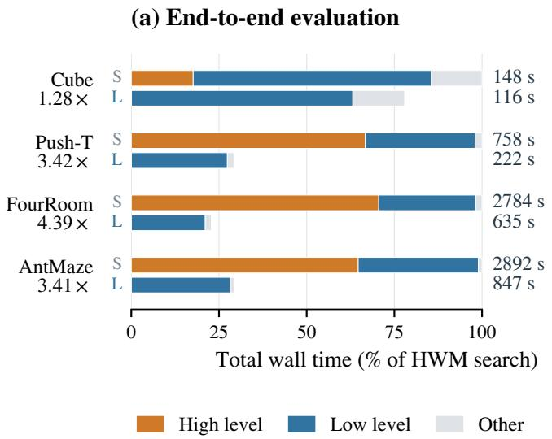
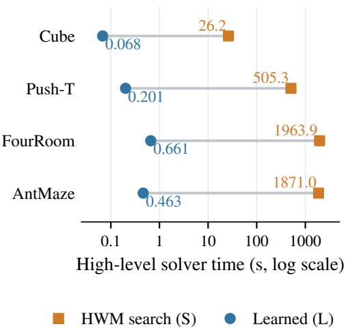
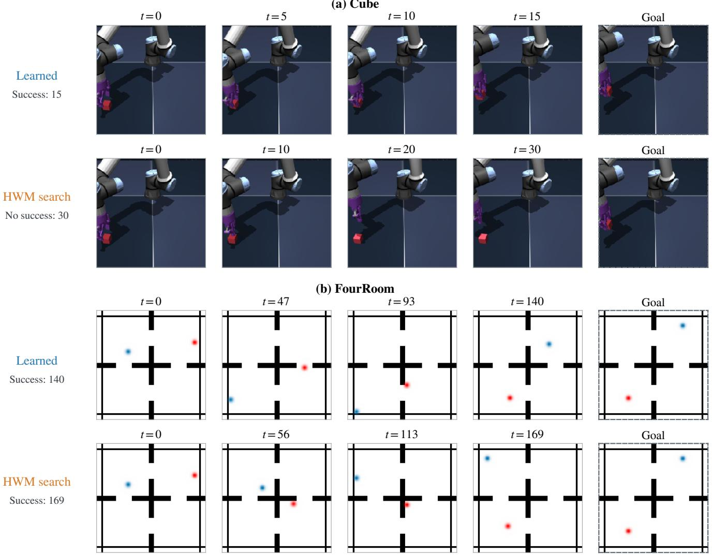

# Learning Goal-Conditioned Subgoals through Frozen Hierarchical World Models

Kaibo Xiang

Qingfeng Liu\*

Department of Industrial and Systems Engineering, Hosei University

kaiboxiang9@gmail.com qliu@hosei.ac.jp

## Abstract

Hierarchical world models plan over long horizons by passing predicted states from a coarse model to a lower-level controller. Choosing these states can be expensive: the upper-level planner repeatedly differentiates through candidate macro-action trajectories. We replace this search with a lightweight goalconditioned network trained through the frozen high-level predictor. The network supplies a conditioning vector, while the predictor generates the next latent waypoint. Training uses hindsight goals and state-prediction losses on offline trajectories, without search-solution targets or macro-action labels. Inference retains an autoregressive high-level rollout, but requires no high-level candidate optimization. We evaluate this approach on the shared-latent HWM checkpoints distributed with H-JEPA, using three backbone seeds and three head initializations per backbone. With a common evaluation protocol, mean success is 70.4% on Cube, 48.7% on Push-T, 100.0% on FourRoom, and 71.1% on Visual AntMaze. The method improves over the corresponding HWM search baseline on three environments and has the same mean on Push-T. Dedicated measurements on an NVIDIA L40S give 1.28–4.39× endto-end speedups for batched evaluation. Ablations identify state-adaptive conditioning as a consistent contributor, while predictor-mediated subgoals and unrestricted conditions have environment-dependent benefits.

## 1. Introduction

Visual world models support control by predicting the consequences of actions in a compact latent space [14, 15, 20, 24, 40]. Long-horizon planning remains difficult because the action search grows with temporal depth and prediction errors accumulate. Hierarchical models address this challenge by decomposing control across temporal scales: a coarse model predicts latent waypoints that a finer planner tries to reach. HWM [39] uses a shared latent space across levels, while H-JEPA [38] learns a separate representation at each level.

Choosing the high-level plan can itself be expensive. The planner optimizes candidate macro-action sequences by repeatedly rolling out and differentiating through the coarse predictor. The released two-level configurations permit up to 9,000–72,000 candidate-trajectory updates per decision.

Although early stopping reduces this budget, high-level optimization accounts for a large fraction of evaluation time in the measured settings.

We propose to learn the inputs to this frozen predictor. Its conditioning interface provides a useful point of intervention: a small network maps a latent state, a goal, and a remainingstep input to a condition, and the coarse model turns that condition into the next waypoint. Figure 1 shows the resulting hierarchy. The encoder and both predictive models stay frozen, and the low level retains its action optimizer. The learned head removes upper-level candidate optimization while preserving autoregressive prediction through the world model.

The head learns from offline trajectories using their endpoints as hindsight goals. Teacher-forced prediction provides local transition supervision, autoregressive rollout loss trains on generated contexts, and an endpoint term emphasizes arrival at the goal. Gradients pass through the frozen predictor to update the head. This objective uses observed state sequences, without macro-action labels or search-solution targets. It consequently learns a goal-conditioned controller through the model rather than distilling a particular search algorithm.

We evaluate on the shared-latent HWM checkpoints distributed with H-JEPA, with three backbone seeds and three head initializations per backbone. Relative to HWM search with the same low-level objective, mean success increases from 51.3% to 70.4% on Cube, 72.0% to 100.0% on Four-Room, and 35.3% to 71.1% on Visual AntMaze; Push-T has the same mean, 48.7%. Dedicated NVIDIA L40S measurements give 1.28–4.39× end-to-end speedups for batched evaluation. Ablations show that state-adaptive conditioning consistently helps, while the benefit of routing subgoals through the predictor or restricting conditions to macro-action embeddings depends on the environment.

Our contributions are:

• A lightweight goal-conditioned head that replaces high-level macro-action optimization by learning predictor conditions through a frozen hierarchical world model.

• An evaluation across four visual-control environments, three backbones, and three heads per backbone, with a common success protocol and separate measurements of online and training cost.

• Controlled ablations of predictor-mediated subgoals, condition dimensionality, head inputs, and training losses that identify the design choices supported by these experiments.

  
Figure 1. Replacing upper-level search within a frozen hierarchy. The encoder E maps the observation and goal into latent states. HWM obtains predictor conditions by optimizing macro-actions; our head ${ \mathit { g } } \theta ,$ with trainable parameters $\theta ,$ produces a condition c from the state, goal, and remaining-step input. The frozen coarse predictor $F _ { 2 }$ generates a latent trajectory over H coarse transitions. Its first waypoint becomes the target for the low-level model-predictive control (MPC) planner, which optimizes primitive actions through the frozen fine predictor $F _ { 1 }$ Blue-filled blocks denote the trainable head, gray blocks frozen modules, and dashed red arrows action optimization.

## 2. Related Work

Latent world models and hierarchical planning. World Models [14], PlaNet [15], Dreamer [16, 17, 19], and TD-MPC [20, 21] demonstrate predictive control and policy learning in latent spaces. DINO-WM [40] and LeWM [24] plan with visual representations without requiring pixel reconstruction for control. For navigation, Bar et al. [7] plan with actionconditioned video predictions. JEPA [22] motivates prediction in representation space; I-JEPA and V-JEPA [4, 5, 8] develop this approach for images and video. HWM [39] shares a latent space across temporal scales, while H-JEPA [38] learns an abstraction at each level. We operate on the former architecture, using the latter project’s released models and tasks.

Test-time optimization. Sampling and gradient-based planners optimize action sequences through learned dynamics. Examples include CEM [11, 32], PETS [10], PDDM [26], iCEM [31], MPPI [37], and differentiable MPC [2]. Rather than improving the optimizer, we replace the upper-level optimization with learned conditional inference. We retain the lower-level optimizer and therefore do not remove all test-time search.

Goal-conditioned and hierarchical policies. Options [6, 35], FeUdal Networks [36], HIRO [25], HAC [23], and Director [18] use temporal abstraction in reinforcement learning. Hindsight goal relabeling [3], visual goal representations [27], goal-conditioned supervised learning [13], and offline goalconditioned methods [12, 29] provide ways to learn conditional controllers. Our head similarly learns from hindsight goals, but its output conditions a frozen coarse predictor rather than directly specifying a primitive action or an unconstrained subgoal.

Learning to replace planning. Amortized optimization learns a map that avoids repeatedly solving related optimization problems [1]. Search-supervised systems such as AlphaZero and MuZero [33, 34] explicitly learn from solver outputs. Our training targets are observed latent states, not optimized plans. Closest to our setting, Nguyen et al. [28] learn goal-conditioned latent inverse dynamics to replace planning in a flat world model. We instead learn conditions for a coarse predictor within a two-level controller, while keeping primitive-action planning. The two interfaces could be combined to learn conditions at the high level and actions at the low level.

## 3. Method

## 3.1. Frozen two-level world model

Let $o _ { t }$ be the observation at environment step $t , o _ { g }$ the goal observation, and E the frozen observation encoder. Their latent states are $z _ { t } = E ( o _ { t } )$ and $z _ { g } = E ( o _ { g } )$ in $\mathbb { R } ^ { d } .$ , where d is the latent dimension. The frozen predictors $F _ { 1 }$ and $F _ { 2 }$ operate at fine and coarse temporal scales. For the HWM checkpoints used here, the upper state encoder is the identity, so both predictors use the same state space. We have d = 192 for Cube, Push-T, and FourRoom, and d = 384 for AntMaze. A coarse transition spans ten raw environment steps. Below, t indexes environment time, whereas j and k index coarse positions within a trajectory segment or a newly initialized rollout.

Table 1. Initial upper-level planning budgets. Here N is the number of candidate trajectories, $T _ { \mathrm { m a x } }$ the optimization-update limit, and H the number of coarse transitions. Early stopping reduces the search work; our planner makes H head calls and H predictor calls without high-level optimization.
<table><tr><td>Environment</td><td>N</td><td> $T _ { \mathrm { m a x } }$ </td><td>H</td><td> $N T _ { \mathrm { m a x } }$ </td></tr><tr><td>Cube</td><td>100</td><td>90</td><td>2</td><td>9,000</td></tr><tr><td>Push-T</td><td>400</td><td>90</td><td>8</td><td>36,000</td></tr><tr><td>FourRoom</td><td>800</td><td>90</td><td>12</td><td>72,000</td></tr><tr><td>AntMaze</td><td>200</td><td>90</td><td>9</td><td>18,000</td></tr></table>

The high-level model receives a condition $c \in \mathbb { R } ^ { d }$ . In HWM search, a frozen lift $A : \mathbb { R } ^ { 4 }  \mathbb { R } ^ { d }$ maps a four-dimensional macro-action a to $\pmb { c } = A ( \pmb { a } )$ . Let H be the active number of coarse transitions and ${ \pmb a } _ { 0 : H - 1 } = ( { \pmb a } _ { 0 } , \dots , { \pmb a } _ { H - 1 } )$ a candidate sequence. The rollout operator Roll $F _ { 2 }$ returns the predicted state sequence $\bar { z } _ { 0 : H }$ initialized at $\bar { z } _ { 0 } = z _ { t } ;$ A acts separately on each macro-action. The released upper-level cost is terminal squared latent distance, $J ( \bar { z } _ { 0 : H } , z _ { g } ) = \| \bar { z } _ { H } - z _ { g } \| _ { 2 } ^ { 2 }$ . Thus search approximately solves

$$
{ \pmb a } _ { 0 : H - 1 } ^ { * } = \arg \operatorname* { m i n } _ { { \pmb a } _ { 0 : H - 1 } } J ( \mathrm { R o l l } _ { F _ { 2 } } ( z _ { t } , A ( { \pmb a } _ { 0 : H - 1 } ) ) , z _ { g } ) .\tag{1}
$$

The implemented solver approximates this optimum with a finite number of gradient updates and early stopping. Candidates are initialized from a Gaussian fitted to training macro-actions and clipped to their empirical per-coordinate bounds [38]. Search therefore operates in a data-anchored macro-action space. Let N be the number of candidates and $T _ { \mathrm { m a x } }$ the maximum number of optimization updates. Table 1 lists the initial budgets; $N T _ { \mathrm { m a x } }$ is an upper bound on candidate-trajectory updates, not a count of predictor forward calls.

The first predicted state becomes the target for the low level, which optimizes primitive actions through $F _ { 1 }$ . Execution commits ten environment steps before replanning, truncated at the episode budget. The released horizon schedule reduces the active horizon near the episode’s end; an upper level at horizon one is bypassed and the lower level targets the goal directly.

## 3.2. Goal-conditioned predictor inputs

Let $g _ { \theta }$ be the condition head with trainable parameters θ. For a latent state z, goal $z _ { g } ,$ and nonnegative integer remaining-step input r, it produces

$$
\pmb { c } = g _ { \theta } ( z , z _ { g } , r ) \in \mathbb { R } ^ { d } .\tag{2}
$$

The head concatenates the state, goal, and a 16-dimensional sinusoidal encoding of r. Layer normalization and two hidden layers of width 512 with Gaussian error linear unit (GELU) activations produce the condition. There are 567,264 parameters when $d = 1 9 2$ , and 863,136 when $d = 3 8 4$ . Unlike $A ( { \pmb a } )$

this output is not restricted to the image of the macro-action lift.

The head acts pointwise on states, while the frozen transformer uses an ordered context of up to three state/condition pairs. At prediction step $k ,$ define the index set $\begin{array} { r l } { \mathcal { T } _ { k } } & { { } = } \end{array}$ $\{ \operatorname* { m a x } ( 0 , k \textrm { -- } 2 ) , \dots , k \}$ and the state sequence $\begin{array} { r l } { C _ { k } } & { { } = } \end{array}$ $( z _ { j } ) _ { j \in \mathcal { T } _ { k } }$ , ordered by increasing j. Let $r _ { k , j }$ be the clock input assigned to context position $j$ at this call, and $\pmb { r } _ { k } = ( r _ { k , j } ) _ { j \in \pmb { \mathcal { T } } _ { k } }$ the corresponding ordered vector. We write $F _ { 2 }$ for the predictor’s last output, which is the next latent state, and define the head-conditioned transition operator $P _ { \theta }$ by

$$
\begin{array} { r l } & { P _ { \theta } \big ( C _ { k } , z _ { g } , r _ { k } \big ) } \\ & { \quad = F _ { 2 } \Big ( C _ { k } , \big ( g _ { \theta } ( z _ { j } , z _ { g } , r _ { k , j } ) \big ) _ { j \in \mathcal { T } _ { k } } \Big ) . } \end{array}\tag{3}
$$

The second argument of $F _ { 2 }$ is an ordered condition sequence aligned with $C _ { k }$ . With predicted states $\hat { z } _ { j }$ , we use the same index set to form $\hat { C } _ { k } = ( \hat { z } _ { j } ) _ { j \in \mathcal { T } _ { k } }$ . HWM search retains its released one-state rollout context; the learned planner uses up to three states. Backbone weights are fixed in both cases.

At inference, initialize $\hat { z } _ { 0 } ~ = ~ z _ { t }$ and predict for $k \_ =$ $0 , \ldots , H - 1$ . For nonterminal calls, $\begin{array} { r } { r _ { k , j } = H - j ; } \end{array}$ at the terminal call $k = H - 1$ , the released implementation sets $r _ { k , j } = 0$ for every retained position. The latest-state inputs are consequently $H , H { - } 1 , \ldots , 2 , 0$ . After the full rollout, the first predicted waypoint $\hat { z } _ { 1 }$ becomes the lower-level target. Each rollout makes H vectorized head calls and H predictor calls, including predictions after the first waypoint. Algorithm 2 includes this clock convention and the horizon-one bypass.

## 3.3. Learning from hindsight trajectories

Let K be the number of coarse transitions in a training segment. We cache offline embeddings and sample segments $\big ( z _ { 0 } , \dots , z _ { K } \big )$ of $K + 1$ states, with the final state relabeled as the hindsight goal $z _ { g } = z _ { K }$ . Training uses clock values $r _ { k , j } = K - j$ , so the latest-state inputs are $K , K - 1 , \ldots , 1$ The evaluated controller uses the terminal-zero inference convention described above.

For latent vectors $u , v \in \mathbb { R } ^ { d }$ , define their mean absolute error (MAE), averaging absolute coordinate differences, as

$$
\mathrm { M A E } ( \boldsymbol { \mathbf { \mathit { u } } } , \boldsymbol { \mathbf { \mathit { v } } } ) = \frac { 1 } { d } \sum _ { q = 1 } ^ { d } | u _ { q } - v _ { q } | .\tag{4}
$$

All training terms use this coordinate-mean L1 error; the search cost in Eq. 1 instead uses squared L2 distance. The following equations describe one segment, and training averages the objective over a mini-batch.

Teacher-forced prediction loss. The teacher-forced loss ${ \mathcal L } _ { \mathrm { t f } }$ evaluates each transition using its recorded state context $C _ { k } \mathrm { : }$

$$
\mathcal { L } _ { \mathrm { t f } } = \frac { 1 } { K } \sum _ { k = 0 } ^ { K - 1 } \mathrm { M A E } ( P _ { \theta } ( C _ { k } , z _ { g } , r _ { k } ) , z _ { k + 1 } ) .\tag{5}
$$

It teaches the head to produce conditions that predict observed local transitions, with the preceding states supplied by the data.

(b) Condition Head: Inference

  
Figure 2. Learning and using predictor conditions. (a) A segment of K coarse transitions contains latent states $z _ { 0 } , \dots , z _ { K } ;$ its endpoint is the hindsight goal. The condition head gθ supplies inputs to frozen predictor $F _ { 2 } .$ Teacher-forced predictions use recorded contexts, while autoregressive predictions use generated contexts. Both are supervised by the recorded trajectory, with an additional endpoint weight. Dashed red arrows indicate gradients updating only the head. (b) At inference, the head reads each context state, the goal, and its clock input. Each of the H coarse transitions makes one vectorized head call and one predictor call. The generated state is appended to the context; only the first waypoint is sent to low-level MPC.

Autoregressive rollout loss. To train on contexts generated by the model itself, initialize $\hat { z } _ { 0 } = z _ { 0 }$ and recursively predict

$$
\begin{array} { r } { \hat { z } _ { k + 1 } = P _ { \theta } ( \hat { C } _ { k } , z _ { g } , r _ { k } ) , \quad k = 0 , \dots , K - 1 . } \end{array}\tag{6}
$$

The rollout trajectory loss ${ \mathcal { L } } _ { \mathrm { r o } }$ compares every generated future state with its recorded counterpart:

$$
\mathcal { L } _ { \mathrm { r o } } = \frac { 1 } { K } \sum _ { k = 1 } ^ { K } \mathrm { M A E } ( \hat { \boldsymbol { z } } _ { k } , \boldsymbol { z } _ { k } ) .\tag{7}
$$

This supervises prediction under self-generated contexts and penalizes errors accumulated along the trajectory. Gradients propagate through the complete rollout without detaching intermediate predictions.

Endpoint loss. The endpoint loss $\mathcal { L } _ { \mathrm { e n d } }$ emphasizes arrival at the hindsight goal after K transitions:

$$
\begin{array} { r } { \mathcal { L } _ { \mathrm { e n d } } = \mathrm { M A E } ( \hat { z } _ { K } , z _ { g } ) . } \end{array}\tag{8}
$$

The same endpoint already appears in ${ \mathcal L } _ { \mathrm { r o } }$ with weight $1 / K$ This separate term gives it additional weight; it does not introduce a different supervision target.

Total training objective. Let $\lambda \geq 0$ control this additional endpoint weight. Our default objective is

$$
\begin{array} { r } { \mathcal { L } = \mathcal { L } _ { \mathrm { t f } } + \mathcal { L } _ { \mathrm { r o } } + \lambda \mathcal { L } _ { \mathrm { e n d } } , \qquad \lambda = 1 . } \end{array}\tag{9}
$$

Thus the autoregressive endpoint has total weight $1 / K + \lambda$ Local prediction, rollout tracking, and endpoint emphasis are design choices whose individual effects are tested in Sec. 4.4. Algorithm 1 summarizes training. Gradients pass through $F _ { 2 }$ to optimize only $\theta ;$ the encoder, action lift, and both predictors stay fixed. The objective uses observation sequences, including proprioception when required, without macro-action labels. The backbone’s earlier pretraining does use action information.

The head is trained to predict observed trajectories under hindsight goals, rather than to recover the optimized macroaction sequence in Eq. 1. An unrestricted condition need not correspond to an executable macro-action, and low prediction error alone gives no guarantee of low-level reachability.

## 4. Experiments

## 4.1. Evaluation protocol

Tasks and backbones. We use the four fixed 50-task sets distributed with H-JEPA: Cube from OGBench [30], Push-T [9], FourRoom Distractors, and Visual AntMaze. Episode budgets are 30, 90, 210, and 350 environment steps, respectively. We use HWM backbone seeds 42, 43, and 44, with head initializations 0, 1, and 2 for each backbone. AntMaze embeddings use the same proprioceptive normalization during training and control. FourRoom head checkpoints are selected on a separately collected validation set of 150 trajectories. Data and selection details are provided in the supplement.

Algorithm 1: Learning a condition head through a   
frozen predictor   
Input: cached training segments; fixed validation windows;   
frozen $F _ { 2 } ;$ segment length $K ;$ endpoint weight λ   
1 Initialize head parameters θ and AdamW optimizer;   
2 for each training update do   
3 Sample a mini-batch of K-transition segments;   
4 Set each goal to $z _ { K }$ and clocks to $\begin{array} { r } { r _ { k , j } = K - j ; } \end{array}$   
5 Predict teacher-forced transitions from recorded contexts   
$C _ { k }$ using Eq. 3;   
6 Initialize $\hat { z } _ { 0 } = z _ { 0 } ;$   
7 for $k = 0 , \ldots , K - 1$ do   
8 Form $\hat { C } _ { k }$ from indices $\mathcal { T } _ { k }$ and predict $\hat { z } _ { k + 1 }$ using   
Eq. 6;   
9 Average Eq. 9 over the mini-batch;   
10 Backpropagate through $F _ { 2 }$ and the rollout; clip the head   
gradient; update only $\theta ;$   
11 Periodically retain the head with minimum endpoint   
MAE on the fixed validation windows;   
Output: validation-selected condition head gθ

Algorithm 2: Hierarchical control with learned condi   
tions   
Input: frozen ${ \overline { { E , F _ { 1 } , F _ { 2 } ; } } }$ trained gθ; goal observation $o _ { g } ;$   
released horizon schedule   
1 Encode goal $z _ { g } = E ( o _ { g } ) ;$   
2 while evaluation budget remains do   
3 Observe $o _ { t } ;$ ; encode $z _ { t } = E ( o _ { t } )$ ; compute active horizon   
$H ;$   
4 if $H > 1$ then   
5 Initialize $\hat { z } _ { 0 } = z _ { t } ;$   
6 for $k = 0 , \ldots , H - 1$ do   
7 Form $\hat { C } _ { k } = ( \hat { z } _ { j } ) _ { j \in \mathcal { T } _ { k } }$ in temporal order;   
8 Set $r _ { k , j } = H - j { \mathrm { ~ f o r ~ } } j \in { \mathbb { Z } } _ { k } ; { \mathrm { i f ~ } } k = H - 1 ,$ , set   
all clocks to zero;   
9 Predict $\hat { z } _ { k + 1 } = P _ { \theta } ( \hat { C } _ { k } , z _ { g } , r _ { k } )$   
10 Use $\hat { z } _ { 1 }$ as the lower-level target;   
11 else   
12 Use $z _ { g }$ as the lower-level target;   
13 Optimize primitive actions through $F _ { 1 }$ toward the target;   
14 Execute the scheduled action prefix and observe;

Training and selection. The optimizer and head architecture are shared across environments: AdamW, learning rate $1 0 ^ { - 3 }$ , cosine decay, 20,000 updates, batch size 256, and gradient clipping at 1.0. Segment transition counts K are 2, 8, 12, and 9 for Cube, Push-T, FourRoom, and AntMaze. These equal the initial high-level planning horizons; we assess sensitivity to training length in Sec. 4.4. We select the minimum endpoint MAE on the same 256 validation windows, evaluated every 2,000 updates. Task success is not used to select head checkpoints.

Baselines and common settings. HWM search uses the identical frozen backbone as our head. H-JEPA search and the flat model use their separately trained checkpoints at the same model seeds. A simple baseline supplies equally spaced latent waypoints between the observed state and goal, retaining the same low-level controller. All success-rate experiments use the same tasks, budgets, and evaluation chunk size of one. The low-level macro-action matching coefficient is zero for both hierarchical search baselines and our method. Other optimizer settings retain the released values. Search budgets use the released defaults in Table 1.

Replication and uncertainty. For the learned method, we average three head runs within each backbone, then report the mean and standard error (SE) across the three backbone means. Baselines have one run per backbone and report the standard error across those three runs. All runs evaluate the same 50 tasks; nine heads do not constitute 450 independent tasks. Some environment reset randomness is not fixed by the task assets, so run variability includes more than head initialization. Error bars describe this replication design, not uncertainty over a newly sampled population of tasks.

## 4.2. Task success

Table 2 reports the final results. Mean success improves over HWM search from 51.3% to 70.4% on Cube, from 72.0% to 100.0% on FourRoom, and from 35.3% to 71.1% on AntMaze. Push-T has the same mean, 48.7%, for HWM search and learned conditions. These comparisons support replacing the fixed HWM upper-level search on these benchmarks; they do not establish dominance over all possible search settings.

The separately trained H-JEPA baseline reaches 46.7%, 40.7%, 78.7%, and 37.3% on Cube, Push-T, FourRoom, and AntMaze under this protocol. Flat planning is lower on all four task sets. This is consistent with useful temporal decomposition in these tasks, although the flat and hierarchical models differ in training as well as control. Linear latent interpolation performs poorly: 4.7% on Cube, 1.3% on Push-T, and 0% on both navigation environments. Thus the learned results are not explained by simply placing equally spaced subgoals on the straight line to the goal.

All nine FourRoom head runs solve all 50 fixed tasks. Perbackbone and per-head results appear in the supplement. Figure 3 shows an AntMaze example.

## 4.3. Online and training cost

We measure the preselected backbone-42/head-0 model and its HWM search baseline on dedicated NVIDIA L40S allocations, with synchronized solver instrumentation. Timing uses one parallel batch of 50 environments rather than the chunk-one protocol used to compare success. It estimates batched evaluation cost, not single-task or real-time action latency. For Cube and Push-T, the timing baseline retains the released actionmatching coefficient 0.2, whereas the head uses zero; these are the timing configurations rather than a strict isolation of the high-level component.

Figure 4 shows end-to-end speedups of 1.28× on Cube, 3.42× on Push-T, 4.39× on FourRoom, and $3 . 4 1 \times \mathrm { ~ \ o n ~ }$

Table 2. Success on the fixed 50-task benchmark sets (%). Mean ± SE across three backbone seeds; the learned planner first averages three head initializations within each backbone. All success experiments use chunk size one. Both hierarchical search baselines use zero low-level macro-action matching weight, matching the learned planner. AntMaze uses consistently normalized training/control inputs; FourRoom uses separately collected validation trajectories for head selection. Bold identifies our method, not a significance test.
<table><tr><td>Environment</td><td></td><td>HWM search H-JEPA search</td><td>Flat</td><td></td><td>Linear subgoals Learned conditions</td></tr><tr><td>Cube</td><td> $5 1 . 3 \pm 5 . 5$ </td><td> $4 6 . 7 \pm 6 . 7$ </td><td> $2 6 . 0 \pm 1 . 2$ </td><td> $4 . 7 \pm 1 . 8$ </td><td> ${ \bf 7 0 . 4 \pm 2 . 5 }$ </td></tr><tr><td>Push-T</td><td> $4 8 . 7 \pm 2 . 4$ </td><td> $4 0 . 7 \pm 5 . 9$ </td><td> $4 6 . 7 \pm 2 . 9$ </td><td> $1 . 3 \pm 0 . 7$ </td><td> ${ \bf 4 8 . 7 \pm 2 . 9 }$ </td></tr><tr><td>FourRoom</td><td> $7 2 . 0 \pm 7 . 0$ </td><td> $7 8 . 7 \pm 6 . 4$ </td><td> $4 0 . 0 \pm 3 . 1$ </td><td> $0 . 0 \pm 0 . 0$ </td><td> $\mathbf { 1 0 0 . 0 \pm 0 . 0 }$ </td></tr><tr><td>AntMaze</td><td> $3 5 . 3 \pm 0 . 7$ </td><td> $3 7 . 3 \pm { 1 . 8 }$ </td><td> $1 8 . 0 \pm 3 . 1$ </td><td> $0 . 0 \pm 0 . 0$ </td><td> ${ \bf 7 1 . 1 \pm 1 . 9 }$ </td></tr></table>

  
Figure 3. AntMaze navigation, task 0. Recorded planar positions for learned conditions (a) and HWM search (b), using backbone 42 and learned-head initialization 0. Axes use native simulator coordinates; grey regions are walls and shaded circles are goal regions. Each panel marks its realized start and goal under the original stochastic resets. Paths end at first success, or at the 350-step budget on failure; panel labels give the observed outcomes and steps. Aggregate success is reported in Table 2.

AntMaze. The high-level solver totals decrease from 26.2– 1963.9 seconds per evaluation batch to 0.068–0.661 seconds. The low level remains the principal cost for the learned planner. Its elapsed time can also change because different subgoals alter predicted trajectories and data-dependent early stopping.

Training the nine heads per environment takes a median of 6.9 minutes per head on Cube, 32.2 on Push-T, 24.0 on FourRoom, and 26.0 on AntMaze. These are L40S wall times for optimization and periodic validation, excluding embedding preparation. Consequently, online savings do not imply lower total cost for every workload. A deployment must amortize both representation-cache preparation and head training over subsequent control. The supplement gives ranges and complete timing totals. No inference-time gradient is needed at the high level; low-level search still differentiates through $F _ { 1 }$

## 4.4. What the head needs to learn

We retrain ablations at backbone seed 42 with three head initializations, the same training samples for a given segment length, and the same validation windows. Table 3 reports means and sample standard deviations (SD) across complete runs. AntMaze uses the same normalized inputs as the main method. Unmeasured configurations are marked explicitly;

they are not treated as zero success.

Routing subgoals through the predictor. The direct variant outputs the next latent state and bypasses $F _ { 2 } .$ . Its mean is similar to or higher than the full method on Cube and Push-T, and nearly saturated on FourRoom. On AntMaze, using $F _ { 2 }$ increases the mean from 59.3% to 70.7% in this fixedbackbone comparison. We therefore find an environmentdependent benefit, rather than evidence that direct regression must fail or that predictor outputs are guaranteed reachable.

Conditioning on the current state. Masking the head’s state input reduces mean success from 68.7% to 52.0% on Cube, 44.0% to 0.7% on Push-T, 100.0% to 6.7% on Four-Room, and 70.7% to 2.0% on AntMaze. The head needs to adapt its condition to the current state in these experiments. However, the frozen predictor still reads states; the masked variant is not a wholly open-loop controller.

Four-dimensional versus unrestricted conditions. We train a head that outputs a four-dimensional macro-action, then apply the frozen lift A before $F _ { 2 }$ . This constrained head reaches 73.3% on Cube and 70.7% on AntMaze, compared with 68.7% and 70.7% for unrestricted conditions. Push-T is 40.7% versus 44.0%. These results do not support a universal need to leave the macro-action embedding. The final AntMaze head does depart from the leading four-dimensional subspace obtained by principal component analysis (PCA) of action-derived conditions, but such departure is a descriptive diagnostic, not a nonlinear-manifold membership test or an explanation of the success improvement.

(b) Upper-level computation  
  
Figure 4. Dedicated L40S batched evaluation timing. Each measurement evaluates 50 tasks in parallel with backbone 42 and head initialization 0. (a) Paired wall times normalized to HWM search within each environment; labels give absolute seconds and end-to-end speedup. S denotes search and L learned conditions. (b) Accumulated high-level solver time on a logarithmic axis. There is one paired measurement per environment. Timing uses a different batching protocol from success evaluation, and retains the released search matching coefficient on Cube/Push-T; see Sec. 4.3.

Table 3. Representation and head-input ablations. Success (%), mean ± sample SD over three head runs at backbone 42. These are within-backbone experiments; their full-method row need not equal the three-backbone main table. AntMaze uses normalized inputs in every listed arm. “No head state input” leaves the frozen predictor’s state input intact. A dash denotes an experiment not performed.
<table><tr><td>Variant</td><td>Cube</td><td>Push-T</td><td>FourRoom</td><td>AntMaze</td></tr><tr><td>Full objective</td><td> $6 8 . 7 \pm 4 . 2$ </td><td> $4 4 . 0 \pm 2 . 0$ </td><td> $1 0 0 . 0 \pm 0 . 0$ </td><td> $7 0 . 7 \pm 6 . 1$ </td></tr><tr><td>Direct subgoals</td><td> $6 9 . 3 \pm 4 . 2$ </td><td> $4 6 . 0 \pm 4 . 0$ </td><td> $9 8 . 7 \pm 1 . 2 $ </td><td> $5 9 . 3 \pm 4 . 2$ </td></tr><tr><td>No head state input</td><td> $5 2 . 0 \pm 3 . 5$ </td><td> $0 . 7 \pm 1 . 2$ </td><td> $6 . 7 \pm 3 . 1$ </td><td> $2 . 0 \pm 2 . 0$ </td></tr><tr><td>4D conditions via A</td><td> $7 3 . 3 \pm 1 . 2$ </td><td> $4 0 . 7 \pm 8 . 3$ </td><td></td><td> $7 0 . 7 \pm 5 . 0$ </td></tr></table>

Losses, labels, and temporal scale. The full loss sweep on Cube and Push-T is reported in the supplement. Removing individual terms does not consistently hurt Cube; on Push-T, removing ${ \mathcal { L } } _ { \mathrm { r o } }$ decreases the mean from 44.0% to 33.3%, while teacher forcing alone reaches 31.3%. Removing $\mathcal { L } _ { \mathrm { e n d } }$ only removes the extra endpoint weight, since Eq. 7 still supervises the final state. The shared three-term objective is therefore a practical default, with no evidence that each term is necessary in every environment. Predicting action-derived condition labels matches the full method on Cube and is worse on Push-T. Shortening training segments substantially reduces success in the measured environments, and doubling their length hurts Push-T. Segment length is a consequential environmentspecific choice.

## 5. Discussion and Limitations

What is learned. The results support learning state-adaptive conditions for a fixed predictor. Prediction-mediated subgoals help most clearly on AntMaze, whereas direct regression and four-dimensional conditions are competitive in other environments. The head and search planner also use different context lengths. These comparisons favor a practical controller replacement, but do not isolate a unique mechanism for its success. Low prediction error remains an imperfect surrogate for physical reachability, and the lower controller can still fail to reach a predicted waypoint.

Data and generalization. The evaluation covers four fixed task sets and three shared-latent HWM backbones per environment. Cube and Push-T tasks come from the public validation datasets also used for head selection, so the scores describe these benchmark sets rather than an untouched test population. FourRoom uses separately collected head-validation trajectories, with no exact complete state/action trajectory duplicates in training; independence of frozen-backbone selection remains unverified. Broader assessment requires independent task collections, repeated environment seeds, and evaluation on learned upper representations or other world-model families.

Computational scope. Timing covers one preselected head and backbone per environment at a batch size of 50 on an L40S. The low level remains the main cost after upper-level search is removed, and total deployment cost also includes cache preparation and head training. Hardware, batching, search budgets, and the number of subsequent decisions will determine the practical savings. Three backbone seeds and three heads per backbone also leave limited power for small architectural differences.

## 6. Conclusion

A goal-conditioned network trained through a frozen coarse predictor can replace macro-action optimization in a hierarchical world model. Hindsight state supervision learns useful predictor inputs without search targets or macro-action labels. On the evaluated shared-latent HWM checkpoints, this improves mean task success on three of four environments, preserves the mean on Push-T, and substantially reduces batched online evaluation cost. The method retains autoregressive high-level prediction and low-level search. Its architectural advantages depend on the environment, and testing on independent tasks and learned upper representations is a necessary next step toward broader claims.

## Acknowledgments

This work was supported by JSPS KAKENHI (Grant Number JP25K05040).

## References

[1] Brandon Amos. Tutorial on amortized optimization. Foundations and Trends in Machine Learning, 16(5):592–732, 2023.

[2] Brandon Amos, Ivan Jimenez, Jacob Sacks, Byron Boots, and J. Zico Kolter. Differentiable MPC for end-to-end planning and control. In Advances in Neural Information Processing Systems (NeurIPS), pages 8289–8300, 2018.

[3] Marcin Andrychowicz, Filip Wolski, Alex Ray, Jonas Schneider, Rachel Fong, Peter Welinder, Bob McGrew, Josh Tobin, Pieter Abbeel, and Wojciech Zaremba. Hindsight experience replay. In Advances in Neural Information Processing Systems (NeurIPS), pages 5048–5058, 2017.

[4] Mahmoud Assran, Quentin Duval, Ishan Misra, Piotr Bojanowski, Pascal Vincent, Michael Rabbat, Yann LeCun, and Nicolas Ballas. Self-supervised learning from images with a joint-embedding predictive architecture. In Proceedings of the IEEE/CVF Conference on Computer Vision and Pattern Recognition (CVPR), pages 15619–15629, 2023.

[5] Mido Assran, Adrien Bardes, David Fan, Quentin Garrido, Russell Howes, Mojtaba Komeili, et al. V-JEPA 2: Self-supervised

video models enable understanding, prediction and planning. arXiv preprint arXiv:2506.09985, 2025.

[6] Pierre-Luc Bacon, Jean Harb, and Doina Precup. The optioncritic architecture. In Proceedings of the AAAI Conference on Artificial Intelligence, pages 1726–1734, 2017.

[7] Amir Bar, Gaoyue Zhou, Danny Tran, Trevor Darrell, and Yann LeCun. Navigation world models. In Proceedings of the IEEE/CVF Conference on Computer Vision and Pattern Recognition (CVPR), pages 15791–15801, 2025.

[8] Adrien Bardes, Quentin Garrido, Jean Ponce, Xinlei Chen, Michael Rabbat, Yann LeCun, Mahmoud Assran, and Nicolas Ballas. Revisiting feature prediction for learning visual representations from video. Transactions on Machine Learning Research, 2024.

[9] Cheng Chi, Siyuan Feng, Yilun Du, Zhenjia Xu, Eric Cousineau, Benjamin Burchfiel, and Shuran Song. Diffusion policy: Visuomotor policy learning via action diffusion. In Robotics: Science and Systems (RSS), 2023.

[10] Kurtland Chua, Roberto Calandra, Rowan McAllister, and Sergey Levine. Deep reinforcement learning in a handful of trials using probabilistic dynamics models. In Advances in Neural Information Processing Systems (NeurIPS), pages 4754–4765, 2018.

[11] Pieter-Tjerk de Boer, Dirk P. Kroese, Shie Mannor, and Reuven Y. Rubinstein. A tutorial on the cross-entropy method. Annals ofOperations Research, 134(1):19–67, 2005.

[12] Benjamin Eysenbach, Tianjun Zhang, Sergey Levine, and Ruslan Salakhutdinov. Contrastive learning as goal-conditioned reinforcement learning. In Advances in Neural Information Processing Systems (NeurIPS), 2022.

[13] Dibya Ghosh, Abhishek Gupta, Ashwin Reddy, Justin Fu, Col ine Devin, Benjamin Eysenbach, and Sergey Levine. Learning to reach goals via iterated supervised learning. In International Conference on Learning Representations (ICLR), 2021.

[14] David Ha and Jürgen Schmidhuber. World models. arXiv preprint arXiv:1803.10122, 2018.

[15] Danijar Hafner, Timothy Lillicrap, Ian Fischer, Ruben Villegas, David Ha, Honglak Lee, and James Davidson. Learning latent dynamics for planning from pixels. In Proceedings ofthe 36th International Conference on Machine Learning (ICML), pages 2555–2565, 2019.

[16] Danijar Hafner, Timothy Lillicrap, Jimmy Ba, and Mohammad Norouzi. Dream to control: Learning behaviors by latent imagination. In International Conference on Learning Representations (ICLR), 2020.

[17] Danijar Hafner, Timothy Lillicrap, Mohammad Norouzi, and Jimmy Ba. Mastering Atari with discrete world models. In International Conference on Learning Representations (ICLR), 2021.

[18] Danijar Hafner, Kuang-Huei Lee, Ian Fischer, and Pieter Abbeel. Deep hierarchical planning from pixels. In Advances in Neural Information Processing Systems (NeurIPS), 2022.

[19] Danijar Hafner, Jurgis Pasukonis, Jimmy Ba, and Timothy Lillicrap. Mastering diverse control tasks through world models. Nature, 640(8059):647–653, 2025.

[20] Nicklas Hansen, Hao Su, and Xiaolong Wang. Temporal difference learning for model predictive control. In Proceedings of the 39th International Conference on Machine Learning (ICML), pages 8387–8406, 2022.

[21] Nicklas Hansen, Hao Su, and Xiaolong Wang. TD-MPC2: Scalable, robust world models for continuous control. In International Conference on Learning Representations (ICLR), 2024.

[22] Yann LeCun. A path towards autonomous machine intelligence. OpenReview preprint, version 0.9.2, 2022.

[23] Andrew Levy, George Konidaris, Robert Platt, and Kate Saenko. Learning multi-level hierarchies with hindsight. In International Conference on Learning Representations (ICLR), 2019.

[24] Lucas Maes, Quentin Le Lidec, Damien Scieur, Yann LeCun, and Randall Balestriero. LeWorldModel: Stable end-to-end joint-embedding predictive architecture from pixels. arXiv preprint arXiv:2603.19312, 2026.

[25] Ofir Nachum, Shixiang Gu, Honglak Lee, and Sergey Levine. Data-efficient hierarchical reinforcement learning. In Advances in Neural Information Processing Systems (NeurIPS), pages 3303–3313, 2018.

[26] Anusha Nagabandi, Kurt Konolige, Sergey Levine, and Vikash Kumar. Deep dynamics models for learning dexterous manipulation. In Proceedings of the Conference on Robot Learning (CoRL), pages 1101–1112, 2020.

[27] Ashvin Nair, Vitchyr Pong, Murtaza Dalal, Shikhar Bahl, Steven Lin, and Sergey Levine. Visual reinforcement learning with imagined goals. In Advances in Neural Information Processing Systems (NeurIPS), pages 9191–9200, 2018.

[28] Hoang Nguyen, Xiaohao Xu, and Xiaonan Huang. Latent geometry beyond search: Amortizing planning in world models. arXiv preprint arXiv:2605.08732, 2026.

[29] Seohong Park, Dibya Ghosh, Benjamin Eysenbach, and Sergey Levine. HIQL: Offline goal-conditioned RL with latent states as actions. In Advances in Neural Information Processing Systems (NeurIPS), 2023.

[30] Seohong Park, Kevin Frans, Benjamin Eysenbach, and Sergey Levine. OGBench: Benchmarking offline goal-conditioned RL. In International Conference on Learning Representations (ICLR), 2025.

[31] Cristina Pinneri, Shambhuraj Sawant, Sebastian Blaes, Jan Achterhold, Joerg Stueckler, Michal Rolinek, and Georg Martius. Sample-efficient cross-entropy method for real-time planning. In Proceedings of the Conference on Robot Learning (CoRL), pages 1049–1065, 2021.

[32] Reuven Y. Rubinstein and Dirk P. Kroese. The Cross-Entropy Method: A Unified Approach to Combinatorial Optimization, Monte-Carlo Simulation and Machine Learning. Springer, 2004.

[33] Julian Schrittwieser, Ioannis Antonoglou, Thomas Hubert, Karen Simonyan, Laurent Sifre, Simon Schmitt, Arthur Guez, Edward Lockhart, Demis Hassabis, Thore Graepel, Timothy Lillicrap, and David Silver. Mastering Atari, Go, chess and shogi by planning with a learned model. Nature, 588(7839): 604–609, 2020.

[34] David Silver, Thomas Hubert, Julian Schrittwieser, Ioannis Antonoglou, Matthew Lai, Arthur Guez, Marc Lanctot, Laurent Sifre, Dharshan Kumaran, Thore Graepel, Timothy Lillicrap, Karen Simonyan, and Demis Hassabis. A general reinforcement learning algorithm that masters chess, shogi, and go through self-play. Science, 362(6419):1140–1144, 2018.

[35] Richard S. Sutton, Doina Precup, and Satinder Singh. Between MDPs and semi-MDPs: A framework for temporal abstraction in reinforcement learning. Artificial Intelligence, 112(1–2): 181–211, 1999.

[36] Alexander Sasha Vezhnevets, Simon Osindero, Tom Schaul, Nicolas Heess, Max Jaderberg, David Silver, and Koray Kavukcuoglu. FeUdal networks for hierarchical reinforcement learning. In Proceedings ofthe 34th International Conference on Machine Learning (ICML), pages 3540–3549, 2017.

[37] Grady Williams, Paul Drews, Brian Goldfain, James M. Rehg, and Evangelos A. Theodorou. Aggressive driving with model predictive path integral control. In IEEE International Conference on Robotics and Automation (ICRA), pages 1433–1440, 2016.

[38] Wancong Zhang, Basile Terver, Michael Rabbat, Yann LeCun, and Randall Balestriero. H-JEPA: End-to-end learning of hierarchical world models for visual planning. arXiv preprint arXiv:2610.06805, 2026.

[39] Wancong Zhang, Basile Terver, Artem Zholus, Soham Chitnis, Harsh Sutaria, Mido Assran, Randall Balestriero, Amir Bar, Yann LeCun, and Nicolas Ballas. Hierarchical planning with latent world models. arXiv preprint arXiv:2604.03208, 2026.

[40] Gaoyue Zhou, Hengkai Pan, Yann LeCun, and Lerrel Pinto. DINO-WM: World models on pre-trained visual features enable zero-shot planning. In Proceedings ofthe 42nd International Conference on Machine Learning (ICML), pages 79115–79135, 2025.

# Supplementary Material

## A. Task protocol and statistical units

Every task-success cell evaluates the same 50 tasks for its environment, using the provided task file and task order. Evaluation chunk size is one for every method. Model seeds are 42, 43, and 44; a task’s planner random stream follows the evaluator’s per-task seeding rule. The learned method has head initializations 0, 1, and 2 for each backbone, with training segments sampled using a common NumPy generator initialized at zero. This pairs the segment sequence across heads and across variants with the same training length.

State-prediction and validation errors use mean absolute error (MAE) across latent coordinates, as defined in the main paper. Let b ∈ {42, 43, 44} index the backbone seed, $h \in \{ 0 , 1 , 2 \}$ the head initialization, and $s _ { b , h }$ the percentage of successful tasks for that run. Denote the within-backbone mean by ${ \bar { s } } _ { b } ,$ , the overall mean by s¯, and the standard error across backbone means by $\mathrm { S E _ { b a c k b o n e } }$ . With SD denoting sample standard deviation (denominator two for three values), these statistics are

$$
\begin{array} { c } { { \displaystyle \bar { s } _ { b } = \frac { 1 } { 3 } \sum _ { h = 0 } ^ { 2 } s _ { b , h } , } } \\ { { \displaystyle \mathrm { S E } _ { \mathrm { b a c k b o n e } } = \frac { \mathrm { S D } ( \bar { s } _ { 4 2 } , \bar { s } _ { 4 3 } , \bar { s } _ { 4 4 } ) } { \sqrt { 3 } } . } } \end{array}
$$

$$
\bar { s } = \frac { 1 } { 3 } \sum _ { b = 4 2 } ^ { 4 4 } \bar { s } _ { b } ,\tag{S1}
$$

(S2)

Baselines have one run per backbone and report the analogous standard error across three values. Repeated task outcomes are not pooled as independent Bernoulli samples. FourRoom’s zero standard error describes agreement on these tasks, with uncertainty on new tasks unmeasured.

Ablations report the mean and sample standard deviation of three head runs at backbone 42. Some environment reset seeds are unspecified, including FourRoom’s stochastic distractor. Run spread therefore combines head initialization, numerical execution, and environment randomness. Paired task IDs do not ensure identical observation noise.

Table S1. Learned-condition models: per-head success (%). All heads complete 20,000 training updates and are selected by validation endpoint MAE. AntMaze uses the evaluation normalizer for cached proprioception, and FourRoom uses its separately collected validation set. Each row is one fixed backbone.
<table><tr><td>Environment</td><td>Backbone</td><td>Head 0</td><td>Head 1</td><td>Head 2</td><td>Mean</td></tr><tr><td>Cube</td><td>42</td><td>64</td><td>72</td><td>70</td><td>68.7</td></tr><tr><td>Cube</td><td>43</td><td>64</td><td>70</td><td>68</td><td>67.3</td></tr><tr><td>Cube</td><td>44</td><td>76</td><td>76</td><td>74</td><td>75.3</td></tr><tr><td>Push-T</td><td>42</td><td>42</td><td>44</td><td>46</td><td>44.0</td></tr><tr><td>Push-T</td><td>43</td><td>50</td><td>52</td><td>60</td><td>54.0</td></tr><tr><td>Push-T</td><td>44</td><td>42</td><td>52</td><td>50</td><td>48.0</td></tr><tr><td>FourRoom</td><td>42</td><td>100</td><td>100</td><td>100</td><td>100.0</td></tr><tr><td>FourRoom</td><td>43</td><td>100</td><td>100</td><td>100</td><td>100.0</td></tr><tr><td>FourRoom</td><td>44</td><td>100</td><td>100</td><td>100</td><td>100.0</td></tr><tr><td>AntMaze</td><td>42</td><td>72</td><td>76</td><td>64</td><td>70.7</td></tr><tr><td>AntMaze</td><td>43</td><td>70</td><td>70</td><td>64</td><td>68.0</td></tr><tr><td>AntMaze</td><td>44</td><td>76</td><td>72</td><td>76</td><td>74.7</td></tr></table>

## B. Data, normalization, and model selection

Offline trajectories. The datasets contain 9,800 training and 200 validation trajectories for Cube, 18,685 and 21 for Push-T, and 25,000 and 1,250 for AntMaze. FourRoom uses 3,750 training trajectories and 150 validation trajectories collected separately. The coarse training transition spans ten raw frames. Embedding caches retain trajectory boundaries, and sampled segments never cross between episodes.

FourRoom validation. Training collection uses seed 3072 and validation collection uses seed 1003072. Comparison of complete state/action sequences finds no exact validation-trajectory duplicate among the 3,750 training trajectories. This check excludes identical complete trajectories; it does not exclude shared states, partial paths, or common geometry. The validation set is used only for head checkpoint selection. Frozen backbone weights are retained, so this procedure does not independently certify their historical selection or hyperparameter choices.

Table S2. Baseline results (%). Every listed cell uses chunk size one. HWM and H-JEPA search both use zero low-level macro-action matching weight. The flat and H-JEPA models have their own pretrained weights; only HWM search shares the learned planner’s backbone. Linear waypoints use the same frozen HWM encoder and low-level controller.
<table><tr><td>Environment</td><td>Planner</td><td>42</td><td>43</td><td>44</td><td> $\mathbf { M e a n } \pm \mathbf { S E }$ </td></tr><tr><td>Cube</td><td>HWM search</td><td>48</td><td>44</td><td>62</td><td> $5 1 . 3 \pm 5 . 5$ </td></tr><tr><td>Cube</td><td>H-JEPA search</td><td>60</td><td>40</td><td>40</td><td> $4 6 . 7 \pm 6 . 7$ </td></tr><tr><td>Cube</td><td>Flat</td><td>24</td><td>26</td><td>28</td><td> $2 6 . 0 \pm 1 . 2$ </td></tr><tr><td>Cube</td><td>Linear</td><td>4</td><td>2</td><td>8</td><td> $4 . 7 \pm 1 . 8$ </td></tr><tr><td>Push-T</td><td>HWM search</td><td>50</td><td>44</td><td>52</td><td> $4 8 . 7 \pm 2 . 4$ </td></tr><tr><td>Push-T</td><td>H-JEPA search</td><td>32</td><td>52</td><td>38</td><td> $4 0 . 7 \pm 5 . 9$ </td></tr><tr><td>Push-T</td><td>Flat</td><td>42</td><td>52</td><td>46</td><td> $4 6 . 7 \pm 2 . 9$ </td></tr><tr><td>Push-T</td><td>Linear</td><td>2</td><td>2</td><td>0</td><td> $1 . 3 \pm 0 . 7$ </td></tr><tr><td>FourRoom</td><td>HWM search</td><td>80</td><td>58</td><td>78</td><td> $7 2 . 0 \pm 7 . 0$ </td></tr><tr><td>FourRoom</td><td>H-JEPA search</td><td>86</td><td>66</td><td>84</td><td> $7 8 . 7 \pm 6 . 4$ </td></tr><tr><td>FourRoom</td><td>Flat</td><td>42</td><td>44</td><td>34</td><td> $4 0 . 0 \pm 3 . 1$ </td></tr><tr><td>FourRoom</td><td>Linear</td><td>0</td><td>0</td><td>0</td><td> $0 . 0 \pm 0 . 0$ </td></tr><tr><td>AntMaze</td><td>HWM search</td><td>36</td><td>36</td><td>34</td><td> $3 5 . 3 \pm 0 . 7$ </td></tr><tr><td>AntMaze</td><td>H-JEPA search</td><td>40</td><td>34</td><td>38</td><td> $3 7 . 3 \pm { 1 . 8 }$ </td></tr><tr><td>AntMaze</td><td>Flat</td><td>14</td><td>16</td><td>24</td><td> $1 8 . 0 \pm 3 . 1$ </td></tr><tr><td>AntMaze</td><td>Linear</td><td>0</td><td>0</td><td>0</td><td> $0 . 0 \pm 0 . 0$ </td></tr></table>

Benchmark task membership. The Cube and Push-T task assets are drawn from their public validation data: all 50 stored pixel windows in each task set match windows in the corresponding validation trajectories. The files are goal\_offset\_20\_pickup\_val.pt and $\mathsf { g o a l \_ o f f s e t \_ } 7 5 \_ \mathsf { v a l }$ .pt, respectively. FourRoom and AntMaze use the provided navigation task assets. We do not claim exhaustive exclusion of task-state or partial-trajectory overlap with training. Because public validation data also select head checkpoints, these are benchmark-set results rather than performance on an untouched end-to-end test set.

AntMaze inputs. The observation encoder combines a 256-dimensional visual embedding with a 128-dimensional proprioceptive embedding, giving latent dimension $d = 3 8 4$ . Proprioception is formed by concatenating qpos[2:] and qvel; both cache generation and control apply the checkpoint’s evaluation mean and standard deviation before the proprioceptive encoder. Pixel preprocessing is identical in the two paths. All AntMaze heads, ablations, and head timing measurements reported here use this input convention.

Checkpoint selection. We draw 256 validation windows using NumPy random seed 7 and reuse exactly those windows at every validation check. Each run is checked every 2,000 updates through update 20,000. The checkpoint with minimum autoregressive endpoint MAE is selected. Validation is on this fixed subset, not the entire validation corpus; main-task success is never the head-selection criterion. All variants, including short- and long-segment training, use the environment’s default validation horizon and the same windows. Test-set maxima over model seeds, head initializations, or search budgets are not used in the main comparison.

## C. Architecture and training details

We use the main paper’s notation: $z \in \mathbb { R } ^ { d }$ is a latent state, $z _ { g } \in \mathbb { R } ^ { d }$ the goal, K the number of training transitions, and $F _ { 2 }$ the frozen coarse predictor. Let r be a nonnegative integer remaining-step input. For frequency indices $\ell = 0 , \ldots , 7$ , define $\omega _ { \ell } = 2 ^ { \ell } \pi / 1 6$ . We write ∥ or semicolons for vector concatenation. The 16-dimensional sinusoidal encoding PE(r) is

$$
\begin{array} { r } { \mathrm { P E } ( r ) = \big ( \sin ( \omega _ { \ell } r ) \big ) _ { \ell = 0 } ^ { 7 } \big \| \big ( \cos ( \omega _ { \ell } r ) \big ) _ { \ell = 0 } ^ { 7 } , } \end{array}\tag{S3}
$$

The condition head receives the concatenation of state, goal, and this encoding:

$$
[ z ; z _ { g } ; \mathrm { P E } ( r ) ] \in \mathbb { R } ^ { 2 d + 1 6 } .\tag{S4}
$$

The network applies layer normalization, a linear layer from $2 d + 1 6$ to 512 units, a Gaussian error linear unit (GELU), another 512-unit linear layer and GELU, then a linear output layer with d units. Head parameter counts are 567,264 for $d = 1 9 2$ and

Table S3. Training horizon and frozen predictor size. K counts transitions, while a segment has $K + 1$ states. Frozen coarse-predictor $( F _ { 2 } )$ parameters are reported in millions.
<table><tr><td>Environment</td><td>d K</td><td></td><td>States</td><td> $F _ { 2 }$  params (M)</td></tr><tr><td>Cube</td><td>192</td><td>2</td><td>3</td><td>11.584128</td></tr><tr><td>Push-T</td><td>192</td><td>8</td><td>9</td><td>11.584128</td></tr><tr><td>FourRoom</td><td>192</td><td>12</td><td>13</td><td>4.837504</td></tr><tr><td>AntMaze</td><td>384</td><td>9</td><td>10</td><td>10.247552</td></tr></table>

863,136 for $d = 3 8 4 .$ The predictor context contains at most three state/condition pairs, ordered in time; early steps use the available shorter context. During a high-level rollout, later context states are generated latents.

The head uses AdamW with learning rate $1 0 ^ { - 3 }$ , weight decay $1 0 ^ { - 4 }$ , cosine decay over 20,000 updates, batch size 256, and gradient-norm clipping at 1.0. The additional endpoint-loss weight λ is one unless ablated. Backbone parameters receive no updates; their state tensors and normalizer are unchanged after head training. Differentiating through a frozen predictor is still required to optimize its inputs and therefore incurs forward and backward computation through that predictor.

Training samples an eligible trajectory uniformly, then a valid start uniformly within it. In a level-one cache with stride five raw frames, a K-transition segment uses 2K + 1 cache entries and selects every second entry. Eligibility requires an episode long enough for the entire segment. This detail matters when changing K: doubling Push-T’s training horizon leaves 2,727 eligible trajectories rather than 18,685. The long-horizon experiment therefore changes the available training population as well as temporal scale.

Training uses the three MAE terms defined in the main paper. The autoregressive endpoint has total weight $1 / K + \lambda ,$ including its contribution inside the rollout loss. An update makes 2K batched coarse-predictor calls: K teacher-forced and K autoregressive. Encoder evaluation occurs during cache preparation.

Training cost. Table S4 summarizes nine L40S training runs per environment, including optimization and validation but excluding cache loading and preparation. Execution conditions also contribute to the spread. Let $C _ { \mathrm { c a c h e } }$ and $C _ { \mathrm { t r a i n } }$ denote one-time cache-preparation and head-training wall times, and $C _ { \mathrm { o n l i n e } }$ wall time per evaluation at fixed batch size and hardware. Total time for M evaluations is $C _ { \mathrm { c a c h e } } + C _ { \mathrm { t r a i n } } + M C _ { \mathrm { o n l i n e } }$ . Unmeasured cache-preparation time prevents a complete break-even estimate.

Table S4. Per-head training wall time. Each run performs 20,000 updates. Nine runs are summarized per environment; values are minutes. Cache preparation is excluded.
<table><tr><td>Environment</td><td>Heads</td><td>Median (min)</td><td>Range (min)</td></tr><tr><td>Cube</td><td>9</td><td>6.9</td><td>6.9-8.3</td></tr><tr><td>Push-T</td><td>9</td><td>32.2</td><td>28.6–43.3</td></tr><tr><td>FourRoom</td><td>9</td><td>24.0</td><td>23.6–30.4</td></tr><tr><td>AntMaze</td><td>9</td><td>26.0</td><td>25.7–31.4</td></tr></table>

Table S5. Batched evaluation timing on L40S. Units are seconds for a batched evaluation of 50 tasks. Speedup is the ratio of total evaluation wall times. There is one pair per environment, without an across-run confidence interval. HWM search retains its released matching coefficient 0.2 on Cube/Push-T; the learned planner uses zero, as required by its unrestricted condition interface. Both use zero on FourRoom/AntMaze. AntMaze head inputs use normalized proprioception.
<table><tr><td>Environment</td><td>Method</td><td>High (s)</td><td>Low (s)</td><td>Total (s)</td><td>Speedup</td></tr><tr><td>Cube</td><td>HWM search</td><td>26.189</td><td>100.80</td><td>148.44</td><td></td></tr><tr><td>Cube</td><td>Learned conditions</td><td>0.068</td><td>93.65</td><td>115.66</td><td>1.28×</td></tr><tr><td>Push-T</td><td>HWM search</td><td>505.278</td><td>237.39</td><td>757.51</td><td></td></tr><tr><td>Push-T</td><td>Learned conditions</td><td>0.201</td><td>207.31</td><td>221.56</td><td>3.42×</td></tr><tr><td>FourRoom</td><td>HWM search</td><td>1963.936</td><td>768.98</td><td>2784.24</td><td></td></tr><tr><td>FourRoom</td><td>Learned conditions</td><td>0.661</td><td>586.35</td><td>634.73</td><td>4.39×</td></tr><tr><td>AntMaze</td><td>HWM search</td><td>1871.047</td><td>991.06</td><td>2892.24</td><td>一</td></tr><tr><td>AntMaze</td><td>Learned conditions</td><td>0.463</td><td>816.15</td><td>846.92</td><td>3.41×</td></tr></table>

## D. Inference details and baseline definitions

Upper-level clock and rollout. Let H be the active number of coarse rollout transitions, $k = 0 , \ldots , H - 1$ the prediction-call index, and $j \in \mathcal { T } _ { k } = \{ \mathrm { m a x } ( 0 , k - 2 ) , \ldots , k \}$ a retained context position. The remaining-step input at that position is $r _ { k , j } = H - j$ for $k < H - 1$ , and zero for all positions when $k = H - 1$ . Thus the latest-state inputs are H, $H - 1 , \ldots , 2 , 0$ . Both head and predictor are evaluated H times, giving H + 1 states including the initial state. Training instead uses $r _ { k , j } = K - j$ , with latest-state inputs $K , K - 1 , \ldots , 1$ . The terminal inference convention differs from the final training clock. Algorithm 2 in the main paper states the inference rule explicitly.

Horizon and execution schedule. The configured initial high-level horizons are 2, 8, 12, and 9 for Cube, Push-T, FourRoom, and AntMaze. The schedule recomputes the active horizon from the remaining evaluation budget, rather than decrementing a head clock once per environment step. A high-level horizon of one is bypassed. Primitive action blocks span five raw steps, and the controller normally executes two blocks before replanning. Episode budgets are 30, 90, 210, and 350 raw steps. The lower planner otherwise retains the released horizon and optimization settings.

Linear waypoints. For the linear baseline, let $z _ { \mathrm { 0 } }$ be the current observed latent and $\hat { z } _ { k }$ its kth waypoint. With goal $z _ { g }$ and active horizon H, it predicts

$$
\hat { z } _ { k } = z _ { 0 } + \frac { k } { H } ( z _ { g } - z _ { 0 } ) , \quad k = 1 , \ldots , H .\tag{S5}
$$

It hands the first waypoint to the same low-level controller and replans using the current observation and active horizon. In the context-based implementation, the latest predicted state z and its clock input r give the next state as $z + ( z _ { g } - z ) /$ max(r, 1); the terminal zero clock yields the goal. This generates equally spaced waypoints over the full active horizon, without a learned dynamics model, trainable head, or high-level search.

Macro-action matching coefficient. The released lower-level controller can match its predicted action embedding to the upper-level macro-action as an auxiliary objective. Its coefficient is 0.2 on Cube and Push-T, and zero on FourRoom and AntMaze. Our unrestricted head does not supply a native macro-action, so this term is disabled. For the main success comparison, it is also disabled in both hierarchical search baselines. This is an action-embedding matching term, not simply a penalty on primitive-action magnitude.

Baseline optimization. Upper search uses at most 90 AdamW updates, with candidate counts 100, 400, 800, and 200 for Cube, Push-T, FourRoom, and AntMaze. Its objective sums squared coordinate differences between the terminal predicted state and the goal; only the final state is scored at the upper level. Early stopping uses the released solver criterion. Macro-action candidates are initialized from training statistics and clipped to per-coordinate training quantiles. The search rollout uses its released one-state context, whereas learned-condition rollouts use up to three state/condition pairs. All other search hyperparameters and task budgets retain their released values. These are fixed operating points without a new independent hyperparameter sweep.

## E. Complete ablations

All tables in this section fix backbone seed 42. Each head is trained with initializations 0, 1, and 2, and selected independently by the common validation criterion. The full method in these tables is the backbone-42 subset of the main method. Sample standard deviations describe total run spread, not the standard error across backbones.

Prediction-mediated and direct subgoals. The direct head has the same inputs and hidden architecture as the full head, but its output is the next latent state. Teacher-forcing, rollout, and endpoint losses are computed directly on that output; $F _ { 2 }$ is bypassed during its state prediction. The four-dimensional variant outputs a macro-action and applies the frozen lift A before $F _ { 2 }$ . Both are trained end to end with the same state losses. A restricted output is therefore a trained control variant, not a projection of the unrestricted head after training.

Head inputs. The no-state variant masks the head’s state input during teacher forcing, autoregressive training, and deployment. $F _ { 2 }$ still receives the true or predicted latent context. This removes a state input from the condition generator without removing all state dependence from control. The no-horizon variant sets the head’s remaining-step input to zero during both training and deployment.

Loss and supervision variants. Without teacher forcing, rollout loss, or endpoint loss, the corresponding objective coefficient is zero; teacher forcing only disables both rollout and endpoint terms. Removing the separate endpoint loss leaves the endpoint error inside the rollout loss. Removing rollout loss retains the autoregressive endpoint term, so that variant still backpropagates through a generated trajectory. Endpoint weights 0.1 and 10 change only λ. All variants are still selected using the same autoregressive endpoint validation error. In supervised-condition training, the target is $A ( { \pmb a } )$ , where $\pmb { a } \in \mathbb { R } ^ { 4 }$ is a macro-action inferred by the frozen action encoder from recorded action sequences and A is the frozen macro-action lift. In supervised-macro action training, the target is a itself, followed by A at deployment. Both use coordinate-mean L1 regression to these labels. They require action information that the main head objective does not need; neither uses optimized search solutions.

Short and long segments. The short choice uses max(1, $\lfloor K / 2 \rfloor )$ transitions, and the long choice uses 2K. Checkpoint selection still uses default-K validation windows. This design holds the selection task fixed, but does not hold training sample eligibility fixed. We therefore interpret the results as sensitivity to this complete segment-sampling choice, not a pure isolated effect of temporal length.

Table S6. Cube: complete ablations. Success (%), three head initializations at backbone 42. The last column is mean ± sample SD. Default training length is two transitions; short and long lengths are one and four.
<table><tr><td>Variant</td><td>Head 0</td><td>Head 1</td><td>Head 2</td><td>Mean ± SD</td></tr><tr><td>Full objective</td><td>64</td><td>72</td><td>70</td><td> $6 8 . 7 \pm 4 . 2$ </td></tr><tr><td>Without teacher forcing</td><td>68</td><td>66</td><td>68</td><td> $6 7 . 3 \pm 1 . 2$ </td></tr><tr><td>Without rollout loss</td><td>74</td><td>68</td><td>72</td><td> $7 1 . 3 \pm 3 . 1$ </td></tr><tr><td>Without endpoint loss</td><td>70</td><td>72</td><td>68</td><td> $7 0 . 0 \pm 2 . 0$ </td></tr><tr><td>Teacher forcing only</td><td>68</td><td>70</td><td>74</td><td> $7 0 . 7 \pm 3 . 1$ </td></tr><tr><td> $\lambda = 0 . 1$ </td><td>76</td><td>64</td><td>68</td><td> $6 9 . 3 \pm 6 . 1$ </td></tr><tr><td> $\lambda = 1 0$ </td><td>66</td><td>62</td><td>68</td><td> $6 5 . 3 \pm 3 . 1$ </td></tr><tr><td>Short training segments</td><td>14</td><td>14</td><td>12</td><td> $1 3 . 3 \pm 1 . 2$ </td></tr><tr><td>Long training segments</td><td>60</td><td>74</td><td>70</td><td> $6 8 . 0 \pm 7 . 2$ </td></tr><tr><td>4D conditions via A</td><td>74</td><td>72</td><td>74</td><td> $7 3 . 3 \pm 1 . 2$ </td></tr><tr><td>Supervised lifted conditions</td><td>68</td><td>70</td><td>68</td><td> $6 8 . 7 \pm 1 . 2$ </td></tr><tr><td>Supervised macro-actions</td><td>74</td><td>70</td><td>72</td><td> $7 2 . 0 \pm 2 . 0$ </td></tr><tr><td>Direct subgoals</td><td>66</td><td>74</td><td>68</td><td> $6 9 . 3 \pm 4 . 2$ </td></tr><tr><td>No head state input</td><td>50</td><td>50</td><td>56</td><td> $5 2 . 0 \pm 3 . 5$ </td></tr><tr><td>No horizon input</td><td>78</td><td>70</td><td>60</td><td> $6 9 . 3 \pm 9 . 0$ </td></tr></table>

Table S7. Push-T: complete ablations. Success (%), three head initializations at backbone 42. The last column is mean ± sample SD. Default training length is eight transitions; short and long lengths are four and sixteen.
<table><tr><td>Variant</td><td>Head 0</td><td>Head 1</td><td>Head 2</td><td> $\mathbf { M e a n } \pm \mathbf { S D }$ </td></tr><tr><td>Full objective</td><td>42</td><td>44</td><td>46</td><td> $4 4 . 0 \pm 2 . 0$ </td></tr><tr><td>Without teacher forcing</td><td>38</td><td>42</td><td>54</td><td> $4 4 . 7 \pm 8 . 3$ </td></tr><tr><td>Without rollout loss</td><td>36</td><td>36</td><td>28</td><td> $3 3 . 3 \pm 4 . 6$ </td></tr><tr><td>Without endpoint loss</td><td>38</td><td>40</td><td>44</td><td> $4 0 . 7 \pm 3 . 1$ </td></tr><tr><td>Teacher forcing only</td><td>24</td><td>30</td><td>40</td><td> $3 1 . 3 \pm 8 . 1$ </td></tr><tr><td> $\lambda = 0 . 1$ </td><td>42</td><td>40</td><td>46</td><td> $4 2 . 7 \pm 3 . 1$ </td></tr><tr><td> $\lambda = 1 0$ </td><td>20</td><td>26</td><td>22</td><td> $2 2 . 7 \pm 3 . 1$ </td></tr><tr><td>Short training segments</td><td>20</td><td>24</td><td>32</td><td> $2 5 . 3 \pm 6 . 1$ </td></tr><tr><td>Long training segments</td><td>26</td><td>16</td><td>16</td><td> $1 9 . 3 \pm 5 . 8$ </td></tr><tr><td>4D conditions via A</td><td>50</td><td>38</td><td>34</td><td> $4 0 . 7 \pm 8 . 3$ </td></tr><tr><td>Supervised lifted conditions</td><td>20</td><td>28</td><td>26</td><td> $2 4 . 7 \pm 4 . 2$ </td></tr><tr><td>Supervised macro-actions</td><td>24</td><td>30</td><td>28</td><td> $2 7 . 3 \pm 3 . 1$ </td></tr><tr><td>Direct subgoals</td><td>46</td><td>50</td><td>42</td><td> $4 6 . 0 \pm 4 . 0$ </td></tr><tr><td>No head state input</td><td>0</td><td>2</td><td>0</td><td> $0 . 7 \pm 1 . 2$ </td></tr><tr><td>No horizon input</td><td>44</td><td>58</td><td>40</td><td> $4 7 . 3 \pm 9 . 5$ </td></tr></table>

Reduced objectives have similar or higher means on Cube, whereas Push-T is more sensitive to rollout loss and endpoint weighting. Four-dimensional conditions are competitive on Cube and AntMaze, while removing head state inputs hurts all

Table S8. FourRoom: complete ablations. Every run uses the separately collected validation set for checkpoint selection. Default, short, and long training lengths are twelve, six, and twenty-four transitions. Only the listed variants were evaluated.
<table><tr><td>Variant</td><td>Head 0</td><td>Head 1</td><td>Head 2</td><td> $\mathbf { M e a n } \pm \mathbf { S D }$ </td></tr><tr><td>Full objective</td><td>100</td><td>100</td><td>100</td><td> $1 0 0 . 0 \pm 0 . 0$ </td></tr><tr><td>Short training segments</td><td>30</td><td>34</td><td>36</td><td> $3 3 . 3 \pm { 3 . 1 }$ </td></tr><tr><td>Long training segments</td><td>100</td><td>100</td><td>100</td><td> $1 0 0 . 0 \pm 0 . 0$ </td></tr><tr><td>Direct subgoals</td><td>98</td><td>98</td><td>100</td><td> $9 8 . 7 \pm 1 . 2 $ </td></tr><tr><td>No head state input</td><td>10</td><td>4</td><td>6</td><td> $6 . 7 \pm 3 . 1$ </td></tr></table>

Table S9. AntMaze: complete ablations. Every listed run uses identical normalized proprioceptive preprocessing during training and control. The backbone is fixed at seed 42 and the training length is nine transitions. Only the listed variants were evaluated.
<table><tr><td>Variant</td><td>Head 0</td><td>Head 1</td><td>Head 2</td><td> $\mathbf { M e a n } \pm \mathbf { S D }$ </td></tr><tr><td>Full objective</td><td>72</td><td>76</td><td>64</td><td> $7 0 . 7 \pm 6 . 1$ </td></tr><tr><td>4D conditions via A</td><td>76</td><td>66</td><td>70</td><td> $7 0 . 7 \pm 5 . 0$ </td></tr><tr><td>Direct subgoals</td><td>58</td><td>64</td><td>56</td><td> $5 9 . 3 \pm 4 . 2$ </td></tr><tr><td>No head state input</td><td>2</td><td>0</td><td>4</td><td> $2 . 0 \pm 2 . 0$ </td></tr></table>

environments. State-adaptive conditioning consistently helps; the best output constraint and loss combination depend on the task.   
Three head runs leave small differences unresolved.

## F. Dedicated evaluation timing

Table S5 gives synchronized timing for the preselected backbone-42/head-0 model. Each pair runs on a dedicated NVIDIA L40S and evaluates 50 environments in one parallel batch, with the same task set and execution budget on the two sides. This measures batched evaluation cost separately from the chunk-one success protocol; it does not estimate sequential single-task latency.

The high and low columns accumulate synchronized solver wall time at the respective level. Total evaluation time additionally includes observation processing, simulation, and other evaluation work. Subgoal choice changes trajectories and data-dependent early stopping, so equal solver call counts can still yield different low-level times.

Solver calls. In the timed evaluations, both methods make four low-level calls and one high-level call on Cube, ten and seven on Push-T, twenty-two and nineteen on FourRoom, and thirty-six and thirty-one on AntMaze. A call operates on the parallel batch. The horizon schedule determines the difference between the two levels.

Removing candidate optimization leaves two, eight, twelve, or nine head/predictor calls at the initial horizons, respectively. The lower planner still performs gradient-based action optimization. Speedups therefore depend on the original search budget, the low-level workload, batch size, and hardware. The reported measurements exclude cache construction from any break-even calculation.

## G. A linear condition-space diagnostic

For backbone 42 and head initialization 0 on normalized AntMaze, we fit principal component analysis (PCA) to 20,000 action-derived training conditions $A ( a )$ . After centering at their mean, we retain four principal components. We calibrate projection residuals on 10,000 separate action-derived validation conditions and evaluate 4,096 learned conditions from fixed validation segments, with sampling seed 314159.

The components explain 99.95% of training-condition variance. Mean Euclidean projection residual is 0.386 for action-derived validation conditions and 49.923 for learned conditions; all sampled learned conditions exceed the former distribution’s 95th percentile, 0.909. On these segments, mean one-step state MAE is 0.119 with learned conditions and 0.188 with recorded-action conditions.

This measures departure from a fitted affine subspace, rather than membership in the nonlinear image of A or physical waypoint reachability. The four-dimensional head also matches unrestricted conditions in AntMaze task success. These diagnostics characterize conditioning distributions without establishing a cause of improved control or estimating task-success uncertainty.

## H. Qualitative rollouts

Figure S1 compares learned conditions (upper row of each panel) with HWM search (lower row) on task 0 of Cube and FourRoom. Both use backbone 42; the learned head uses initialization 0. These single rollouts illustrate behavior; aggregate success rates are given in the tables. An active high-level decision executes one autoregressive rollout with H condition-head calls and H frozen-predictor calls, without candidate search. The low-level action optimizer is retained.

  
Figure S1. Goal-referenced task-0 rollouts. Four observations per row are sampled uniformly through first success, or through the full budget on failure; each has its own recorded environment step t. The dashed final column is the task goal observation. (a) Cube: learned conditions first succeed at step 15; HWM search does not within 30 steps. (b) FourRoom: first success is at steps 140 and 169, respectively. Red is the controlled agent; blue is a moving distractor and need not match the goal image.

## I. Reproduction details

The experiments use Python 3.11.13 and PyTorch 2.7.1 with CUDA 12.8. The model source is based on commit 840e76b5 of the H-JEPA codebase with the goal-conditioned rollout implementation accompanying the model package. Encoder embeddings, action lifts, normalizers, and predictors are fixed. Task-success runs retain the original reset semantics and per-task planner seeds, with chunk size one and the common zero matching coefficient described above.