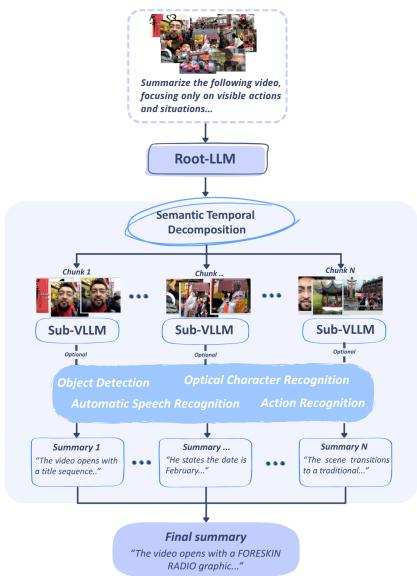
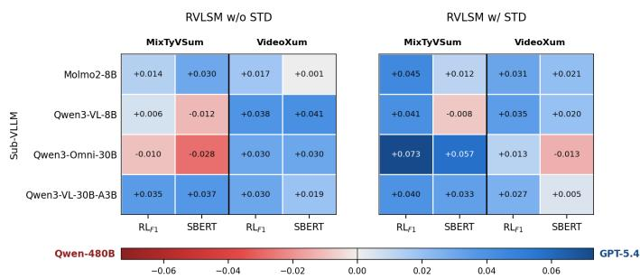
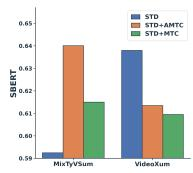
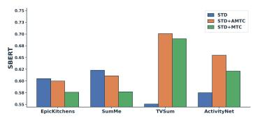
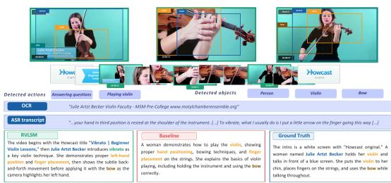
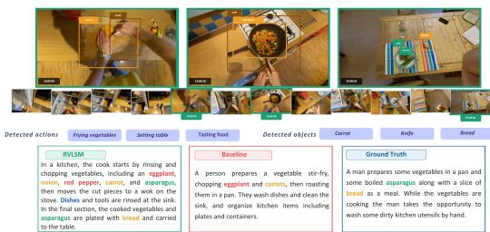

# Long-form Video-to-Text Summarization using Recursive Language Models

Alessia Intini1, Lorenzo Vaiani1, Enrico Chen1, Luca Cagliero1

1Politecnico di Torino {name.surname}@polito.it

## Abstract

While VideoLLMs have made significant progress in under- standing short video benchmarks, they often struggle to sum- marize long-form ones. This is mainly due to performance degradation caused by long-context prompts, the inherent dif- ficulty of preserving temporal continuity and a lack of seman tically rich concepts in event descriptions.

To tackle these issues, this paper introduces the first recursive Video Language Summarization Model (RVLSM) designed for video processing and tailored to long-form video-to-text summarization. RVLSM recursively decomposes videos into semantically coherent segments and delegates chunk-level rea- soning to VideoLLM sub-models and external tools. It em- ploys (1) Semantic Temporal Decomposition (STD), which preserves temporal coherence and continuity through a scene- aware chunking strategy that dynamically partitions videos according to semantic boundaries, and (2) Adaptive Multimodal Tool Calling (AMTC), which ensures semantic rich-ness of the summary via a routing mechanism that selectively invokes auxiliary modules such as action recognition, opti- cal character recognition, automatic speech recognition, and object detection.

Experiments on the VideoXum and MixTyVSum benchmarks show that RVLSM consistently improves over zero-shot Vide- oLLM baselines across multiple model settings and perfor- mance metrics, and is competitive with a state-of-the-art fine- tuned model for video-to-text summarization. Importantly, the named entities in the RVLSM’s summaries align more closely with those detected in the ground-truth summaries than those detected by baseline and state-of-the-art methods, confirming the saliency of the event descriptions it generates.

## Introduction

Recent advances in VideoLLMs have significantly improved their understanding capabilities across diferent tasks, in- cluding video-to-text summarization. To create meaningful summaries of long-form videos, models must identify and correlate key events and behaviors that occur over a long period of time, which requires efectively capturing and pro- cessing long-range temporal dependencies (Li et al. 2026).

Despite recent improvements, the performance of Vide- oLLMs on long-form videos is challenged by the following issues:

• Information compression: long videos are frequently compressed through sparse frame sampling, temporal pooling, or fixed-duration chunking, forcing models to reason over aggressively condensed visual representa- tions (Wang et al. 2025). While often suficient for short clips, these strategies become increasingly problematic for long-horizon and dense-event videos.

  
Figure 1: Sketch of the RVLSM paradigm. The Root-LLM decomposes the long video, recursively invokes Sub-LLMs and external tools (action recognition, object detection, etc.), and composes the summary from the intermediate outcomes.

• Context saturation: LLMs are prone to hallucination and performance drops when their context window is largely filled (Zhang et al. 2024). Since the position of multi-modal information also matters, this is typically exacer- bated by the lost-in-the-middle issue.

• Temporal coherence degradation: on videos spanning multiple scenes, subjects, or actions, VideoLLMs struggle to preserve the temporal continuity of the event structure and the semantic saliency of event descriptions. Long- form video-to-text summarization thus requires reason- ing over temporally distributed events while maintaining chronological consistency and exhaustive coverage of the underlying concepts (Niu et al. 2025).

• Limited semantic richness of the event descriptions: summaries typically mention the key events occurring in the video, but the semantic concepts in the textual descriptions are not necessarily aligned with human ex- pectations (Cagliero et al. 2025).

To tackle the above issues, in this paper we present the first adaptation of the Recursive Language Models (RLMs) (Zhang, Kraska, and Khattab 2026) towards long- form video-to-text summarization. RLM is a recently pro- posed inference paradigm for textual LLMs, where long tex- tual context is treated as an external object inside persistent Read-Eval-Print Loop (REPL) environments, allowing a root-LLM to recursively invoke sub-VLLMs or external tools over portions of the input through programmatic decomposi- tion. Although they have proven to be efective in document summarization (Zhang, Kraska, and Khattab 2026), the existing framework is limited to the textual modality, overlooking the unique challenges of video-to-text summarization.

We present Recursive Video Language Summarization Models (RVLSMs), a recursive framework for long-form video-to-text summarization that extends the RLM paradigm to multimodal video reasoning. Importantly, the proposed approach is agnostic to the pretrained LLM used. RVLSM treats the input video as an external multimodal object and re-cursively summarizes semantically coherent video segments through VideoLLM sub-calls and external tools (see Fig- ure 1). Unlike static multimodal augmentation pipelines, RVLSM employs a heuristic routing mechanism to select the appropriate analysis configuration for each chunk based on previously generated summaries, enabling sequential context-aware evidence acquisition across the video timeline. Specifically, RVLSM employs (1) Semantic Temporal Decomposition (STD), which chunks videos according to scene transitions and additional contextual features to preserve tem- poral coherence, and (2) Adaptive Multimodal Tool Calling (AMTC), which calls auxiliary external tools for object detection, action recognition, automatic speech recognition and optical character recognition through a programmable Root- LLM planner to ensure semantic richness of the summary.

RVLSM addresses information compression and context saturation via the RLM paradigm, temporal coherence degra- dation using the STD component, and lack of semantic rich- ness of the summary using the AMTC component. Using RVLSM, we address the following Research Questions: RQ1) Is RLM beneficial for LLM-based video-to-text summariza- tion of long-form videos compared to non-recursive zero- shot baselines? (see the results in Table 1). RQ2) What are the efects of the main RVLSMs’s components? (see the ablation study in Figure 3 and Table 1). RQ3) Are the RVLSMs’s summaries more closely aligned with human-generated ones in terms of presence of diferent NLP entities? (see the results in Table 2).

The main paper contributions are summarized below:

• We introduce the Recursive Video Language Summarization Model (RVLSM), a new recursive REPL-based framework for long-form video-to-text summarization ag- nostic to the pretrained LLMs used.

• On two video benchmarks, we demonstrate that the

RVLSM consistently improves over zero-shot VideoLLM baselines across multiple model settings and performance metrics , and is competitive with a state-ofthe-art fine-tuned model for video-to-text summarization (e.g., SBERT F1 on MixtyVSum: RVLSM 0.64 vs. Baseline non-recursive 0.57 vs. V2Xum Baseline 0.44).

• We show RVLSM’s summaries align more closely with those detected in the ground-truth summaries than those detected by baseline and state-of-the-art methods (e.g., F1 MicroAverage on MixtyTVSum: RVLSM 0.14 vs. Baseline non-recursive 0.07 vs. V2Xum Baseline 0.03), confirming the saliency of the event descriptions the model produces.

## Related Work

## Video-to-text Summarization

Video-to-text summarization has traditionally focused on ex- tractive methods that select key frames or representative clips from long videos (Gong et al. 2014; Zhang et al. 2016; Lin, hua Zhong, and Fares 2022). More recent approaches have introduced reinforcement learning for learning compact video representations (Zhou, Qiao, and Xiang 2018; Wang, Wu, and Yan 2024). With the emergence of video LLMs, recent methods have shifted toward abstractive video-to-text sum- marization, directly generating natural language descriptions from visual and multimodal inputs (Mu, Chin, and Chiu 2024; Cagliero et al. 2025; Lee, Gong, and Cho 2025; Hua et al. 2025). Despite strong performance on short videos, current VideoLLMs remain constrained by limited temporal context windows and typically rely on sparse frame sampling or fixed temporal compression strategies.

## Long-form Video Understanding

Recent work has studied how to extend VideoLLMs capa- bilities to longer temporal horizons through memory mod- ules, hierarchical architectures, sparse attention mechanisms, or temporal compression strategies (Wu et al. 2024; Song et al. 2024; Wang et al. 2026). Hierarchical summarization pipelines commonly split long videos into fixed-duration seg- ments before independently summarizing each chunk (Pennec et al. 2026). Although efective in reducing memory usage, fixed chunking may fragment semantically coher- ent events across temporal boundaries. RVLSM, instead, performs scene-aware temporal decomposition through dy- namic scene-based chunking, enabling recursive reasoning over semantically coherent video segments.

## Position of the Present Work

To the best of our knowledge, this is the first attempt to apply RLMs to long-context inputs in the video modality, targeting video-to-text summarization because its program- matic and recursive nature can overcome the aforementioned limitations.

## Recursive Video Language Summarization Model

Given a base VideoLLM M with limited temporal context capacity, a Recursive Video Language Summarization Model (RVLSM) is an inference-time scafold around M that treats the input video as part of an external environment while pre- serving the ability to densely process its temporal structure through recursive sub-calls. Given an input video

Algorithm 1: Recursive Video Language Summarization   
Model   
Require: Input video V, query q   
Ensure: Final summary S   
1: $E  \mathrm { I n i t R E P L } ( \dot { V } )$   
2: E ← AddFunctions(E)   
3: $( c _ { 1 } , \dotsc , c _ { N } ) $ ChunkVideoByScenes(V)   
4: $\dot { \boldsymbol { s } } \gets [ ]$   
5: for $i \stackrel { \sim } { = } 1 , \ldots , N$ do   
6: if i = 1 then   
7: ri ← EnrichedVideoQuery(ci, q)   
8: else   
9: ri ← AdaptiveToolSelector $\left( s _ { i - 1 } \right)$   
10: $s _ { i } \gets r _ { i } ( c _ { i } , q )$   
11: $S  S \parallel [ s _ { i } ]$   
12: S ← RootLLM(S, q)   
13: return S

$$
V = \{ f _ { 1 } , f _ { 2 } , \dots , f _ { T } \} ,
$$

where $f _ { i }$ denotes the $i _ { t h }$ video frame and its associated audio stream, RVLSM interacts with a persistent REPL envi- ronment $E$ to generate an abstractive summary S. According to the RLM paradigm, instead of directly loading the entire video into the context window of a VideoLLM, RVLSM stores the video as an external object inside the REPL environment. The Root-LLM recursively decomposes the input video into semantically coherent temporal regions and dele- gates chunk-level summarization to sub-LLM calls.

Al orithm 1 describes the overall execution rocess. Given a video V, RVLSM initializes a REPL environment containing the input video together with functions for scene-aware chunking, recursive VideoLLM querying, and multimodal tool execution. The Root-LLM iteratively dispatches sub- calls to VideoLLM sub-models, collecting chunk-level sum- maries, and finally aggregates them into a single coherent abstractive summary.

RVLSM introduces two key modifications tailored to long- video understanding: scene-aware Semantic Temporal Decomposition (STD) and Adaptive Multimodal Tool Calling (AMTC).

## Semantic Temporal Decomposition

Unlike standard fixed-duration chunking, the STD module performs an adaptive scene-based segmentation of the video. Given an input video $V ,$ the chunking module produces a sequence of chunks:

$$
V = \{ c _ { 1 } , c _ { 2 } , \dots , c _ { N } \}
$$

where each chunk $c _ { i }$ corresponds to a scene-consistent temporal segment. A minimum chunk duration of 30 sec- onds is enforced, ensuring that no segment is too short to carry meaningful semantic content. All chunks are tempo- rally disjoint, chronologically ordered, and exhaustive over the input video.

Algorithm 2: AdaptiveToolSelector   
Require: Previous chunk summary $s _ { i - 1 }$   
Ensure: Video Query function $r _ { i }$   
1: C ← {actions, speech, text, objects} ▷ signal categories   
2: Rc ← predefined keyword root set, for each $c \in { \mathcal { C } }$   
3: SingleModalityQuery ← {   
4: actions → ActionQuery (action recognition),   
5: speech → ASRQuery (automatic speech recognition),   
6: text → OCRQuery (optical character recognition),   
7: objects → ObjectQuery (object detection)   
8: }   
9: for $c \in { \mathcal { C } }$ do   
10: $\mathrm { r a w } [ c ] \gets | \{ r \in R _ { c } : r \subseteq s _ { i - 1 } \} |$ ▷ keyword matches   
11: scores[c] ← raw[c] / |Rc|   
12: total $ \textstyle \sum _ { c \in { \mathcal { C } } }$ scores[c]   
13: top ← arg maxc∈C scores[c]   
14: if total = 0 or scores $[ \mathrm { t o p } ] \stackrel { \cdot } { < } 0 . 0 5$ then   
15: return VideoQuery ▷ no specific category   
16: else if scores[top] $< 0 . 6$ · total then   
17: return EnrichedVideoQuery ▷ no dominant category   
18: else   
19: return SingleModalityQuery(top) ▷ dominant category

## REPL Environment and Recursive Video Queries

RVLSM operates inside a persistent Python REPL environ- ment containing the input video and a collection ofexecutable functions. The environment exposes functions for retrieving video metadata, performing scene-aware semantic temporal decomposition, querying VideoL $\mathbf { \nabla } \cdot \mathbf { M } \mathbf { s } ,$ and extracting multi- modal signals from video chunks. The Root-LLM interacts with the environment iteratively by generating executable Python code. Intermediate summaries and tool outputs are stored as variables inside the REPL, allowing subsequent recursive calls to access previously computed information.

For each chunk $c _ { i }$ , RVLSM invokes a sub-VLLM:

$$
s _ { i } = \mathcal { M } _ { s u b } ( c _ { i } , q _ { i } , k _ { i } ) ,
$$

where $\mathcal { M } _ { s u b }$ denotes the sub-VLLM, $q _ { i }$ is the chunk-specific summarization query, and $k _ { i }$ denotes optional multimodal information extracted through external tools. Experiments focus on a sin le recursive level in which the Root-LLM del- egates chunk-level summarization to VideoLLM sub-calls. The framework generalizes to deeper recursive hierarchies over temporal sub-events.

## Adaptive Multimodal Tool Calling

To complement recursive calls to VideoLLMs, RVLSM aug- ments chunk-level analysis through external tools specialized for video understanding. The REPL environment provides access to auxiliary multimodal analysis functions that ex- tract semantic signals from each video chunk.

Specifically, RVLSM can invoke object detection, action recognition, automatic speech recognition (ASR), and Optical Character Recognition (OCR). The extracted knowledge is injected into the VideoLLM sub-model prompt alongside the video chunk, providing structured perceptual grounding that enhances the quality of the generated chunk-level sum- mary.

Unlike static multimodal augmentation pipelines, RVLSM performs heuristic adaptive tool selection. The first chunk is analyzed using full multimodal extraction in order to es- tablish an initial semantic context. For subsequent chunks the Root-LLM selects the appropriate analysis configuration based on the previous chunk summary:

$$
r _ { i } = \mathcal { R } ( s _ { i - 1 } ) ,
$$

where R denotes the routing mechanism.

The procedure described in Algorithm 2 focuses on the AdaptiveToolSelector. Each perceptual signal is associ- ated with one of four categories (actions, speech,text, and objects) corresponding respectively to action recognition, automatic speech recognition, optical character recognition, and object detection. Every category is paired with a predefined set of representative keywords (its root set), against which the previous chunk summary $s _ { i - 1 }$ is matched. A nor- malized keyword-matching score is then computed for each category by dividing the raw number of matches by the size of the corresponding keyword set, so that categories with larger keyword sets are not favored. The selector defaults to VideoQuery when no signal is detected, to EnrichedVideo-Query when no category dominates, and to the corresponding SingleModalityQuery otherwise.

## Hierarchical Summary Aggregation

After all chunks have been recursively summarized, the Root- LLM aggregates the local summaries into a single global summary. Let

$$
\boldsymbol { S } = \left\{ s _ { 1 } , s _ { 2 } , \ldots , s _ { N } \right\}
$$

be the ordered set of chunk summaries produced by the recursive VideoLLM calls. The Root-LLM receives the com- plete sequence S and synthesizes a final abstractive sum-mary:

$$
S = \mathcal { M } _ { r o o t } ( s _ { 1 } , s _ { 2 } , \ldots , s _ { N } ) .
$$

The Root-LLM is directed to maintain chronological order and consistency in the final summary.

## Evaluation Setup

Hardware All experiments were run on a machine equipped with an Intel® CoreTM i9-10980XE CPU, 1× NVIDIA® A40 48GB GPU, 128 GB of RAM running Ubuntu 22.04 LTS. The overall cost is approximately 1,400 GPU hours, with several runs across various combinations of dataset, model, and setting. On average, each run consumes approximately 9.0M input tokens and ∼200K output tokens, resulting in an average API cost of \$5.58 per run across al tested models and datasets.

Datasets We evaluate RVLSM on two long video-to-text summarization benchmarks: VideoXum (Lin et al. 2024) and MixTyVSum (Cagliero et al. 2025). VideoXum focuses on holistic narrative summarization of open-domain videos, while MixTyVSum emphasizes dense event-centric summa- rization with temporal and spatial annotations. Following our long-video setting, we restrict VideoXum to videos longer than 230 seconds and we removed MSVD(Hendria 2025) videos from MixTyVSum, because they are all shorter than 20 seconds. Additional details are provided in the Supple- mentary Document.

Performance Metrics We compare the generated sum-maries with the ground truth using the F1-Score values of the following established metrics: ROUGE-1, ROUGE-2, ROUGE-L (Lin 2004) and SBERT (Reimers and Gurevych 2019), computed as the cosine similarity between the Sentence-BERT embeddings of the generated and refer- ence summaries. We further report METEOR (Banerjee and Lavie 2005), BLEU-4 (Papineni et al. 2002), and CIDEr (Oliveira dos Santos, Colombini, and Avila 2021), three metrics commonly adopted for video captioning and summarization evaluation. For the Named Entity Recogni- tion analysis, we report Precision, Recall, and F1 score. More details in the Supplementary Document. Aggregated values are computed as the micro-average over TP, FP, and FN across entity types.

Models Following the RLM paradigm (Zhang, Kraska, and Khattab 2026), our pipeline distinguishes between two types of models. The Root-LLM is a coding-oriented LLM acting as the main orchestrator: it decomposes the input, manages intermediate variables, and dispatches sub-calls within the REPL environment. The sub-LLM is, in our context, a mul- timodal Video LLM invoked recursively by the root-LLM to process individual video segments and return structured descriptions. We experimented with two root-LLMs (GPT-5.4 (Singh et al. 2026) and Qwen3-Coder-480B-A35B (Qwen Team 2025)) and four sub-LLMs (Molmo2-8B (Clark et al. 2026), Qwen3-VL-8B-Instruct, Qwen/Qwen3-VL-30B-Instruct (Bai et al. 2025), and Qwen/Qwen3-Omni-30B-A3B-Instruct (Xu et al. 2025)). Further details are given in the Supplementary Document.

Auxiliary Modules For Named Entity Recognition we use SpaCy (Honnibal et al. 2020) (en\_core\_web\_sm model). For scene-aware STD we use PySceneDetect (Castellano 2014). Object-level semantic signals are extracted using YOLOv8 (Jocher and Qiu 2023) pretrained on the COCO dataset, applied every 10 frames. Action-level semantic ev- idence is obtained through MMAction2 (MMAction2 Contributors 2020) using a TSN model (ResNet-50, Kinetics-400), retaining only predictions above a confidence threshold of 0.80. Automatic speech recognition is extracted using Whisper (Radford et al. 2022) (medium variant), and optical character recognition is detected using EasyOCR (AI 2020).

## Main Results and Discussion

Peformance comparison (RQ1): Is RLM beneficial for LLM-based video-to-text summarization of long-form videos compared to non-recursive zero-shot baselines? Table 1 reports the main summarization results on MixTyV- Sum and VideoXum across the diferent sub-VLLM set- tings. Recursive video-to-text summarization outperforms the monolithic zero-shot baselines, demonstrating the benefit of STD for long videos. In fact, on MixTyVSum, the strongest performance is obtained by RVLSM with STD paired with

Qwen3-Omni-30B, which achieves the highest ROUGE-1, ROUGE-2, and ROUGE-L scores; on VideoXum, RVLSM with Qwen3-VL-30B yields the best results overall, attaining both the highest ROUGE scores and the highest SBERT similarity. METEOR follows the same ordering as ROUGE across both benchmarks, corroborating this ranking.

The comparison with the fine-tuned V2Xum-LLaMA- 7B (Hua et al. 2025) is informative for assessing generalization. On VideoXum, on which it was optimized, the fine- tuned model retains an advantage on surface-overlap metrics, yet the best zero-shot RVLSM configuration still surpasses it on ROUGE-1, METEOR, and, most notably, on SBERT similarity (0.6380 vs. 0.5573), indicating that recursive sum-marization captures the semantics ofthe reference summaries even without task-specific training. On MixTyVSum the pic- ture reverses: the fine-tuned model falls below the zero-shot sub-VLLMs on nearly all metrics, whereas RVLSM improves over both baselines by a wide margin. This suggests that a model tuned to a single summarization distribution trans- fers poorly across benchmarks, while the recursive approach generalizes robustly.

Choice of the Root-LLM: Proprietary vs. Opensource The choice of Root-LLM markedly afects recursive sum- marization quality. Figure 2 shows, for each combination of sub-VLLM and metric, the diferences in performance scores between using GPT-5.4 and Qwen-480B as Root-LLM, under both fixed-duration (w/o STD) and scene-aware (w/ STD) decomposition. Results show that the peformance is roughly comparable, underscoring the practical advantages of using opensource tools.

  
Figure 2: Proprietary and open-source Root-LLM: perfor- mance gap between GPT-5.4 and Qwen-480B across datasets and settings (w/ and w/o STD).

Ablation study (RQ2): what are the efects of the main RVLSMs’s components? We examine the role of Adaptive Multimodal Tool Calling (AMTC) by comparing three scenarios: RVLSM+STD, which employs scene- aware decomposition without multimodal tool integration; RVLSM+MTC, which uses multimodal tools but not adap- tively; and RVLSM+AMTC, which employs multimodal tools adaptively. Table 1 reports the performance of the two sub-VLLMs under these strategies, and Figure 3a summa- rizes the corresponding SBERT behavior on the two bench- marks.

A clear divergence arises between the benchmarks due to difering annotation styles. On MixTyVSum, which features action-oriented and semantically dense summaries, adaptive injection enhances semantic quality (SBERT and METEOR). However, this can lead to a decline in ROUGE scores, par- ticularly for Qwen3-Omni-30B, which performs best with STD alone, indicating a trade-of between semantic detail and lexical overlap. Conversely, on VideoXum, where sum- maries are more generic, injection is largely inefective, with RVLSM+STD achieving the best scores across most metrics for both sub-VLLMs.

  
(a)

  
(b)  
Figure 3: SBERT comparison on MixTyVSum and VideoXum (a) and across the MixTyVSum subsets (b).

Additionally, Figure 3b decomposes SBERT by source dataset and shows that the benefit of injection depends on how well STD alone already captures the video con- tent. On structured, procedural subsets such as EpicK- itchens and SumMe, STD is already strong and injection yields no gain or a marginal drop; on more diverse sub- sets such as TVSum and ActivityNet, adaptive injection provides substantial improvements (TVSum: STD=0.551 to AMTC=0.701; ActivityNet: STD=0.575 to AMTC=0.655). Across all four subsets, RVLSM+AMTC consistently outper- forms RVLSM+MTC, and its advantage is largest precisely in the structured domains where indiscriminate injection is most harmful (EpicKitchens: MTC=0.577 to AMTC=0.600; SumMe: MTC=0.577 to AMTC=0.611). This confirms the benefit of adaptive tool selection over unconditional invoca- tion: applying every multimodal analysis regardless of con- text introduces noise that ofsets, and in structured domains, outweighs the benefit of the injected signal.

Semantic alignment (RQ3): are RVLSMs’s summaries closely aligned with human-generated ones? We empirically verify whether the RVLSM’s summaries are more closely aligned with human expectations than baseline meth- ods in terms of NLP entities retrieved in the ground-truth summary. The core idea is to verify the semantic alignment in terms of matching with semantically rich concepts. Ta- ble 2 reports the Precision, Recall, and F1 MicroAverages separately for each entity type.

On MixTyVSum, RVLSM attains the best aggregate scores (F1=0.170 to 0.081 for the VideoLLM baseline) and leads on most entity types, including work\_of\_art, date, and per- son, where the baselines recover no entity. Overall, RVLSM recovers salient entities that surface-overlap metrics tend to overlook. We also evaluate extracted named entities on V2Xum-generated summaries. However, only a few cardi- nal are detected, leading to all zeros matric values for all other entities. More results are reported in the Supplementary Document.

<table><tr><td>Sub-VLLM</td><td>Method</td><td>R1F1↑</td><td>R2F1 ↑</td><td>RLF1↑</td><td>SBERT ↑</td><td>METEOR ↑</td><td>BLEU-4 ↑</td><td>CIDEr ↑</td></tr><tr><td colspan="7">MixTyVSum dataset</td><td></td><td></td></tr><tr><td colspan="7">Fine-Tuned Baseline</td><td></td><td></td></tr><tr><td colspan="2">V2Xum-LLaMA-7B (Fine-Tuned)</td><td>0.2115</td><td>0.0392</td><td>0.1603</td><td>0.4463</td><td>0.1092</td><td>0.0043</td><td>0.0152</td></tr><tr><td colspan="9">Zero-Shot Baselines</td></tr><tr><td rowspan="4">Molmo2-8B Qwen3-VL-8B Qwen3-Omni-30B Qwen3-VL-30B</td><td></td><td>0.3212</td><td>0.0694</td><td>0.2018</td><td>0.5445</td><td>0.1416</td><td>0.0124</td><td>0.0260</td></tr><tr><td></td><td>0.2669</td><td>0.0504</td><td>0.1797</td><td>0.5664</td><td>0.1245</td><td>0.0169</td><td>0.0474</td></tr><tr><td></td><td>0.2946 0.3132</td><td>0.0682 0.0736</td><td>0.1947</td><td>0.5788 0.5794</td><td>0.1624 0.1538</td><td>0.0137 0.0146</td><td>0.0435 0.0459</td></tr><tr><td colspan="8">0.2057</td></tr><tr><td rowspan="5">Qwen3-Omni-30B Qwen3-VL-30B</td><td>w/ STD</td><td>0.3606</td><td>0.0920</td><td>RVLSM (ours) 0.2298</td><td>0.5859</td><td>0.1527</td><td>0.0149</td><td>0.0542</td></tr><tr><td>+MTC</td><td>0.3233</td><td>0.0719</td><td>0.2083</td><td>0.5778</td><td>0.1737</td><td>0.0130</td><td>0.0536</td></tr><tr><td>+AMTC</td><td>0.3068</td><td>0.0643</td><td>0.1924</td><td>0.6063</td><td>0.1652</td><td>0.0120</td><td>0.0570</td></tr><tr><td>w/ STD</td><td>0.3234</td><td>0.0753</td><td>0.2113</td><td>0.5958</td><td>0.1547</td><td>0.0121</td><td>0.0513</td></tr><tr><td>+MTC +AMTC</td><td>0.3303 0.3192</td><td>0.0803 0.0683</td><td>0.2142 0.2051</td><td>0.6149 0.6401</td><td>0.1724 0.1801</td><td>0.0140 0.0146</td><td>0.0568 0.0531</td></tr><tr><td colspan="8">VideoXum dataset</td></tr><tr><td colspan="8"></td></tr><tr><td colspan="2">V2Xum-LLaMA-7B (F.T.)</td><td>0.3228</td><td>0.1016</td><td>Fine-Tuned Baseline 0.2475</td><td>0.5573</td><td>0.1826</td><td>0.0292</td><td>0.1386</td></tr><tr><td colspan="9">Zero-Shot Baselines</td></tr><tr><td colspan="2">Molmo2-8B</td><td>0.2860</td><td>0.0651</td><td>0.1843</td><td>0.5975</td><td>0.1920</td><td>0.0142</td><td>0.0208</td></tr><tr><td colspan="2">Qwen3-VL-8B</td><td>0.2761</td><td>0.0428</td><td>0.1840</td><td>0.5799</td><td>0.1558</td><td>0.0122</td><td>0.0478</td></tr><tr><td colspan="2">Qwen3-Omni-30B</td><td>0.3041</td><td>0.0606</td><td>0.2001</td><td>0.5949</td><td>0.1913</td><td>0.0146</td><td>0.0344</td></tr><tr><td colspan="2">Qwen3-VL-30B</td><td>0.3230</td><td>0.0715</td><td>0.2154</td><td>0.6053</td><td>0.1958</td><td>0.0224</td><td>0.0544</td></tr><tr><td colspan="9">RVLSM (ours)</td></tr><tr><td rowspan="4">Qwen3-Omni-30B</td><td>w/ STD</td><td>0.3035</td><td>0.0584</td><td>0.2011</td><td>0.5911</td><td>0.1806</td><td>0.0143</td><td>0.0681</td></tr><tr><td>+MTC</td><td>0.2929</td><td>0.0497</td><td>0.1962</td><td>0.5840</td><td>0.1552</td><td>0.0108</td><td>0.0506</td></tr><tr><td>+AMTC</td><td>0.2815</td><td>0.0449</td><td>0.1929</td><td>0.6010</td><td>0.1912</td><td>0.0121</td><td>0.0356</td></tr><tr><td>w/ STD</td><td>0.3326</td><td>0.0745</td><td>0.2257</td><td>0.6380</td><td>0.2023</td><td>0.0176</td><td>0.0739</td></tr><tr><td rowspan="2">Qwen3-VL-30B</td><td>+MTC +AMTC</td><td>0.3024</td><td>0.0571</td><td>0.2077</td><td>0.6094</td><td>0.1589</td><td>0.0124 0.0132</td><td>0.0714</td></tr><tr><td></td><td>0.3100</td><td>0.0595</td><td>0.2031</td><td>0.6134</td><td>0.1873</td><td></td><td>0.0532</td></tr></table>

Table 1: Performance comparison between RVLSM (ours), the traditional (non-recursive) VideoLLM baselines, and the recently proposed V2Xum model (Hua et al. 2025) fine-tuned on VideoXum. The RVLSM block reports the recursive pipeline with sceneaware STD, and its combination with multimodal tool calling (STD+MTC) and adaptive multimodal tool calling (STD+AMTC), across two representative Sub-VLLMs.

## LLM-as-a-Judge

To complement automatic metrics, an LLM-as-a-Judge A/B test (Zheng et al. 2023) is conducted using Gemini 3.1 Pro (gemini-3.1-pro-preview) across all three configurations Qwen3-VL-30B compared with the baseline. Re-sults in Table 3 confirm the trends observed through auto- matic metrics, with the use of STD and the AMTC achieving the best overall performance.

## Qualitative Analysis

This section presents two representative examples highlight- ing scenarios in which the RVLSM approach shows clear advantages over the baseline. Figure 4 reports the result gen- erated from a sample video of the VideoXum dataset, where the RVLSM summary exploits OCR injection to accurately identify the on-screen information and the ASR transcript to detail the specific technique demonstrated. In contrast, the baseline produces a generic description that mentions neither the instructor’s identity nor the specific content, confirming that without recursive decomposition relevant information dispersed over time tends to be lost. A second case is shown in Figure 5, a summary generated from EpicKitchens as part of the MixTyVSum annotations. Here the baseline captures only a subset of ingredients and omits secondary activities such as dishwashing and table setting, whereas the RVLSM, leveraging its recursive structure, reconstructs the full se- quence of events in close alignment with the ground truth. This exam le illustrates how the framework scales with video duration, yielding greater improvements as content becomes longer and more complex.

  
Figure 4: A qualitative example from VideoXum showing the summaries generated by RVLSM w/STD + AMTC, com- pared to the zero-shot baseline and the ground truth

<table><tr><td rowspan="2">Entity type</td><td colspan="2">RVLSM (ours)</td><td colspan="2">Baseline VideoLLM</td></tr><tr><td>P↑</td><td>R↑ F1↑</td><td>P↑</td><td>R↑ F1 ↑</td></tr><tr><td>CARDINAL</td><td></td><td>0.393 0.204 0.268</td><td>0.125 0.024</td><td>0.041</td></tr><tr><td>GPE</td><td></td><td></td><td>0.1880.3000.231 0.333 0.2500.286</td><td></td></tr><tr><td></td><td></td><td></td><td>WORK_OF_ART 0.308 0.190 0.235 0.000 0.000 0.000</td><td></td></tr><tr><td>DATE</td><td></td><td></td><td>0.2220.1820.2000.1430.1000.118</td><td></td></tr><tr><td>PERSON</td><td></td><td></td><td>0.1280.3120.1820.0000.000 0.000</td><td></td></tr><tr><td>EVENT</td><td></td><td></td><td>0.000 0.000 0.0000.0000.000 0.000</td><td></td></tr><tr><td>ORG</td><td></td><td></td><td>0.0830.2350.1230.0000.0000.000</td><td></td></tr><tr><td>NORP</td><td></td><td></td><td>0.000 0.000 0.000 0.200 0.500 0.286</td><td></td></tr><tr><td>ORDINAL</td><td></td><td></td><td>0.167 0.027 0.047 1.000 0.031 0.061</td><td></td></tr><tr><td>FAC</td><td>0.0000.000</td><td>0.000</td><td>0.500 1.000</td><td>0.667</td></tr><tr><td>Mean</td><td></td><td>0.170 0.170 0.170</td><td>0.1360.058</td><td>0.081</td></tr></table>

Table 2: Precision, Recall, and F1 of the entities detected on MixTyVSum by RVLSM (GPT-5.4 root, Qwen3-VL-30B sub-model) and the VideoLLM baseline (same sub-model). Best value per entity type and metric in bold.
<table><tr><td>Selected Methods</td><td>Wins</td><td>Win %</td></tr><tr><td>RVLSMw/ STD</td><td>106</td><td>34.2%</td></tr><tr><td>RVLSMAMTC</td><td>91</td><td>29.2%</td></tr><tr><td>RVLSMw/o STD</td><td>69</td><td>22.2%</td></tr><tr><td>Baseline</td><td>45</td><td>14.4%</td></tr></table>

Table 3: LLM-as-a-Judge evaluation on the VideoXum and MixTyVSum datasets, using Qwen3-VL-30B as sub-VLLM and GPT-5.4 as Root-LLM.

## Statistical Significance Tests

To rank the summarizers on each benchmark, we apply the Borda Count re-ranking strategy (van Erp and Schomaker 2000), a group consensus function that merges the per-video rankings (231 for VideoXum, 60 for MixTyVSum) into a sin-gle one by assigning decreasing integer scores to each rank- ing and summing them. The RVLSM approaches w/ STD dominate on both benchmarks: on MixTyVSum, Qwen3- Omni-30B and Qwen3-VL-30B rank first and second (242 and 221) ahead ofthe best w/o STD model (205), and Qwen3- VL-30B leads on VideoXum.

## Conclusions and future work

We introduced the recursive Video Language Summarization Model (RVLSM), which extends the RLM paradigm to long- video abstractive summarization through Semantic Tempo- ral Decomposition (STD) and Adaptive Multimodal Tool Calling (AMTC). Across multiple VideoLLMs and benchmarks, RVLSM yields consistent improvements that grow with video duration, while our ablation shows that the value of knowledge injection depends on the informativeness of the visual signal, motivating adaptive rather than indiscriminate augmentation. Future work will explore deeper recursion, aggregating summaries over multiple hierarchical levels, and Deep Reinforcement Learning to mitigate specific limitations of the RLM approach.

  
Figure 5: A qualitative example from MixTyVSum showing the summaries generated by RVLSM w/ STD + AMTC, compared to the zero-shot baseline and the ground truth.

## Limitations

Despite promising results, our approach has several limita- tions that point to directions for future work.

Routing Mechanism. The current routing relies on heuristic keyword matching; more principled alternatives, such as learned or reinforcement-learning-based routing optimized for summarization quality, are a promising direction.

Dataset Availability. The benefits of RVLSM would likely be more pronounced on longer videos, yet benchmarks with very long videos and high-quality reference summaries re- main scarce due to the annotation efort required.

Chunking Quality. Visual scene detection may yield se-mantically incoherent segments when transitions are subtle, as in egocentric videos; multimodal boundary detection com- bining visual, audio, and action signals could mitigate this.

Annotation Sensitivity. Evaluation depends on the annotation style of the reference summaries: generic and event- driven ones respond very diferently to knowledge injection, suggesting that standard metrics may not assess model qual- ity in an annotation-agnostic way.

## Ethics, risks, and Generative AI Statement

The video data and annotations used in this work were ob- tained from third-party sources and do not introduce ethical concerns, such as unethical or ofensive content, related to the input data. Due to the non-deterministic nature of the gener- ative process, we cannot ensure that the summarized outputs are free of hallucination. However, the output summaries have been reviewed by at least two PhD-level researchers prior to the final evaluation. Generative AI was used as a re- search engine and its outputs were carefully reviewed by the authors; minor AI support also includes writing suggestions such as grammar corrections. The project code is publicly available under the CC BY-NC license. Part of the project builds upon the original RLM architecture (Zhang, Kraska, and Khattab 2026); credits to the owner, changes, and specific settings are reported in the code repository.

## References

AI, J. 2020. EasyOCR: Ready-to-use OCR with 80+ Sup- ported Languages. https://github.com/JaidedAI/EasyOCR.

Bai, S.; Cai, Y.; Chen, R.; Chen, K.; Chen, X.; Cheng, Z.; Deng, L.; Ding, W.; Gao, C.; Ge, C.; Ge, W.; Guo, Z.; Huang, Q.; Huang, J.; Huang, F.; Hui, B.; Jiang, S.; Li, Z.; Li, M.; Li, M.; Li, K.; Lin, Z.; Lin, J.; Liu, X.; Liu, J.; Liu, C.; Liu, Y.; Liu, D.; Liu, S.; Lu, D.; Luo, R.; Lv, C.; Men, R.; Meng, L.; Ren, X.; Ren, X.; Song, S.; Sun, Y.; Tang, J.; Tu, J.; Wan, J.; Wang, P.; Wang, P.; Wang, Q.; Wang, Y.; Xie, T.; Xu, Y.; Xu, H.; Xu, J.; Yang, Z.; Yang, M.; Yang, J.; Yang, A.; Yu, B.; Zhang, F.; Zhang, H.; Zhang, X.; Zheng, B.; Zhong, H.; Zhou, J.; Zhou, F.; Zhou, J.; Zhu, Y.; and Zhu, K. 2025. Qwen3-VL Technical Re ort. arXiv:2511.21631.

Banerjee, S.; and Lavie, A. 2005. METEOR: An Automatic Metric for MT Evaluation with Improved Correlation with Human Judgments. In Goldstein, J.; Lavie, A.; Lin, C.-Y.; and Voss, C., eds., Proceedings of the ACL Workshop on Intrinsic and Extrinsic Evaluation Measuresfor Machine Translation and/or Summarization, 65–72. Ann Arbor, Michigan: Asso-ciation for Computational Linguistics.

Cagliero, L.; Vaiani, L.; Pastor, E.; Koudounas, A.; Baralis, E.; Mazzia, V.; Pollastrini, S.; Gueudre, T.; Giollo, M.; Am- berti, D.; and Wu, Y. 2025. Detecting and Mitigating Chal- lenges in Zero-Shot Video Summarization with Video LLMs. In Che, W.; Nabende, J.; Shutova, E.; and Pilehvar, M. T., eds., Findings ofthe Associationfor Computational Linguistics: ACL 2025, 286–301. Vienna, Austria: Association for Computational Linguistics. ISBN 979-8-89176-256-5.

Castellano, B. 2014. PySceneDetect: Video Scene Cut De- tection and Analysis Tool. https://github.com/Breakthrough/ PySceneDetect. Accessed: 2025.

Clark, C.; Zhang, J.; Ma, Z.; Park, J. S.; Salehi, M.; Tripathi, R.; Lee, S.; Ren, Z.; Kim, C. D.; Yang, Y.; Shao, V.; Yang, Y.; Huang, W.; Gao, Z.; Anderson, T.; Zhang, J.; Jain, J.; Stoica, G.; Han, W.; Farhadi, A.; and Krishna, R. 2026. Molmo2: Open Weights and Data for Vision-Language Models with Video Understanding and Grounding. arXiv:2601.10611.

Gong, B.; Chao, W.-L.; Grauman, K.; and Sha, F. 2014. Diverse Sequential Subset Selection for Supervised Video Summarization. In Ghahramani, Z.; Welling, M.; Cortes, C.; Lawrence, N.; and Weinberger, K., eds., Advances in Neural Information Processing Systems, volume 27. Curran Associates, Inc.

Hendria, W. F. 2025. MSVD-Indonesian: A Bench- mark for Multimodal Video-Text Tasks in Indonesian. arXiv:2306.11341.

Honnibal, M.; Montani, I.; Van Landeghem, S.; and Boyd, A. 2020. spaCy: Industrial-strength Natural Language Pro- cessing in Python.

Hua, H.; Tang, Y.; Xu, C.; and Luo, J. 2025. V2Xum-LLM: cross-modal video summarization with temporal prompt in- struction tuning. In Proceedings of the Thirty-Ninth AAAI Conference on Artificial Intelligence and Thirty-Seventh Conference on Innovative Applications of Artificial Intelligence and Fifteenth Symposium on Educational Advances in

Artificial Intelligence, AAAI’25/IAAI’25/EAAI’25. AAAIPress. ISBN 978-1-57735-897-8.

Jocher, G.; and Qiu, J. 2023. Ultralytics YOLO. https: //github.com/ultralytics/ultralytics. Version 8.0.

Lee, M. J.; Gong, D.; and Cho, M. 2025. Video summa- rization with large language models. In Proceedings of the Computer Vision and Pattern Recognition Conference, 18981–18991.

Li, H.; Zhu, Y.; Shang, Z.; Wang, Z.; and Wu, X. 2026. A Comprehensive Survey on Video Summarization: Chal- lenges and Advances. IEEE Transactions on Circuits and Systemsfor Video Technology, 36(1): 1216–1233.

Lin, C.-Y. 2004. ROUGE: A Package for Automatic Evalua- tion ofSummaries. In Text Summarization Branches Out, 74– 81. Barcelona, Spain: Association for Computational Lin- guistics.

Lin, J.; Hua, H.; Chen, M.; Li, Y.; Hsiao, J.; Ho, C.; and Luo, J. 2024. VideoXum: Cross-Modal Visual and Textural Sum- marization of Videos. IEEE Transactions on Multimedia, 26: 5548–5560.

Lin, J.; hua Zhong, S.; and Fares, A. 2022. Deep hierarchi- cal LSTM networks with attention for video summarization. Computers and Electrical Engineering, 97: 107618.

MMAction2 Contributors. 2020. MMAction2: The Updated OpenMMLab Video Understanding Toolbox. https://github. com/open-mmlab/mmaction2.

Mu, K.-C.; Chin, Z.-Y.; and Chiu, W.-C. 2024. Realizing Video Summarization from the Path of Language-based Se- mantic Understanding. arXiv preprint arXiv:2410.04511.

Niu, J.; Li, Y.; Miao, Z.; Ge, C.; Zhou, Y.; He, Q.; Dong, X.; Duan, H.; Ding, S.; Qian, R.; Zhang, P.; Zang, Y.; Cao, Y.; He, C.; and Wang, J. 2025. OVO-Bench: How Far is Your Video-LLMs from Real-World Online Video Understanding? In Proceedings of the IEEE/CVF Conference on Computer Vision and Pattern Recognition (CVPR), 18902–18913.

Oliveira dos Santos, G.; Colombini, E. L.; and Avila, S. 2021. CIDEr-R: Robust Consensus-based Image Description Evaluation. In Xu, W.; Ritter, A.; Baldwin, T.; and Rahimi, A., eds., Proceedings ofthe Seventh Workshop on Noisy Usergenerated Text (W-NUT2021), 351–360. Online: Association for Computational Linguistics.

Papineni, K.; Roukos, S.; Ward, T.; and Zhu, W.-J. 2002. Bleu: a Method for Automatic Evaluation of Machine Trans- lation. In Isabelle, P.; Charniak, E.; and Lin, D., eds., Proceedings of the 40th Annual Meeting of the Association for Computational Linguistics, 311–318. Philadelphia, Pennsyl-vania, USA: Association for Computational Linguistics.

Pennec, G.; Liu, Z.; Asher, N.; Muller, P.; and Chen, N. 2026. Minimal Clips, Maximum Salience: Long Video Sum- marization via Key Moment Extraction. In Proceedings of the 16th International Workshop on Spoken Dialogue System Technology, 205–221. Trento, Italy: Association for Computational Linguistics.

Qwen Team. 2025. Qwen3-Coder-480B-A35B-Instruct. https://huggingface.co/Qwen/Qwen3-Coder-480B-A35B-Instruct.

Radford, A.; Kim, J. W.; Xu, T.; Brockman, G.; McLeavey, C.; and Sutskever, I. 2022. Robust Speech Recognition via Large-Scale Weak Supervision. arXiv:2212.04356.

Reimers, N.; and Gurevych, I. 2019. Sentence-BERT: Sen- tence Embeddings using Siamese BERT-Networks. In Inui, K.; Jiang, J.; Ng, V.; and Wan, X., eds., Proceedings of the 2019 Conference on Empirical Methods in Natural Language Processing and the 9th International Joint Conference on Natural Language Processing (EMNLP-IJCNLP), 3982– 3992. Hong Kong, China: Association for Computational Linguistics.

Singh, A.; Fry, A.; Perelman, A.; Tart, A.; Ganesh, A.; El- Kishky, A.; McLaughlin, A.; Low, A.; Ostrow, A.; Anan- thram, A.; et al. 2026. OpenAI GPT-5 System Card. arXiv:2601.03267.

Song, E.; Chai, W.; Wang, G.; Zhang, Y.; Zhou, H.; Wu, F.; Chi, H.; Guo, X.; Ye, T.; Zhang, Y.; et al. 2024. Moviechat: From dense token to sparse memory for long video under- standing. In Proceedings of the IEEE/CVF Conference on Computer Vision and Pattern Recognition, 18221–18232.

van Erp, M.; and Schomaker, L. 2000. Variants of the Borda count method for combining ranked classifier hypotheses. In Schomaker, L.; and Vuurpijl, L., eds., Proceedings 7th International Workshop on frontiers in handwriting recognition (7th IWFHR), 443–452. International Unipen Foundation. ISBN 90-76942-01-3. Date\_submitted:2004 Rights: Univer- sity of Groningen; 7th International Workshop on Frontiers in Handwriting Recognition ; Conference date: 11-09-2000 Through 13-09-2000.

Wang, G.; Wu, X.; and Yan, J. 2024. Progressive reinforce- ment learning for video summarization. Information Sciences, 655: 119888.

Wang, W.; He, Z.; Hong, W.; Cheng, Y.; Zhang, X.; Qi, J.; Ding, M.; Gu, X.; Huang, S.; Xu, B.; Dong, Y.; and Tang, J. 2025. LVBench: An Extreme Long Video Understanding Benchmark. In Proceedings ofthe IEEE/CVF International Conference on Computer Vision (ICCV), 22958–22967.

Wang, Z.; Chen, B.; Yue, Z.; Wang, Y.; Qiao, Y.; Wang, L.; and Wang, Y. 2026. VideoChat-A1: Thinking with Long Videos by Chain-of-Shot Reasoning. Proceedings of the AAAI Conference on Artificial Intelligence, 40(13): 10467–10475.

Wu, H.; Li, D.; Chen, B.; and Li, J. 2024. Longvideobench: A benchmark for long-context interleaved video-language understanding. Advances in Neural Information Processing Systems, 37: 28828–28857.

Xu, J.; Guo, Z.; Hu, H.; Chu, Y.; Wang, X.; He, J.; Wang, Y.; Shi, X.; He, T.; Zhu, X.; Lv, Y.; Wang, Y.; Guo, D.; Wang, H.; Ma, L.; Zhang, P.; Zhang, X.; Hao, H.; Guo, Z.; Yang, B.; Zhang, B.; Ma, Z.; Wei, X.; Bai, S.; Chen, K.; Liu, X.; Wang, P.; Yang, M.; Liu, D.; Ren, X.; Zheng, B.; Men, R.; Zhou, F.; Yu, B.; Yang, J.; Yu, L.; Zhou, J.; and Lin, J. 2025. Qwen3-Omni Technical Report. arXiv:2509.17765.

Zhang, A. L.; Kraska, T.; and Khattab, O. 2026. Recursive Language Models. arXiv:2512.24601.

Zhang, K.; Chao, W.-L.; Sha, F.; and Grauman, K. 2016. Video summarization with long short-term memory. In European conference on computer vision, 766–782. Springer.

Zhang, Z.; Chen, R.; Liu, S.; Yao, Z.; Ruwase, O.; Chen, B.; Wu, X.; and Wang, Z. 2024. Found in the Middle: How Language Models Use Long Contexts Better via Plug-and- Play Positional Encoding. In Globerson, A.; Mackey, L.; Belgrave, D.; Fan, A.; Paquet, U.; Tomczak, J.; and Zhang, C., eds., Advances in Neural Information Processing Systems, volume 37, 60755–60775. Curran Associates, Inc.

Zheng, L.; Chiang, W.-L.; Sheng, Y.; Zhuang, S.; Wu, Z.; Zhuang, Y.; Lin, Z.; Li, Z.; Li, D.; Xing, E. P.; Zhang, H.; Gonzalez, J. E.; and Stoica, I. 2023. Judging LLM-as-a- judge with MT-bench and Chatbot Arena. In Proceedings ofthe 37th International Conference on Neural Information Processing Systems, NIPS ’23. Red Hook, NY, USA: Curran Associates Inc.

Zhou, K.; Qiao, Y.; and Xiang, T. 2018. Deep reinforce-ment learning for unsupervised video summarization with diversity-representativeness reward. In Proceedings of the Thirty-Second AAAI Conference on Artificial Intelligence, AAAI’18. AAAI Press. ISBN 978-1-57735-800-8.