# MIRA: A Multimodal Illustrated Deep Research Agent for Controllable Reports

Hongrui Wu1,3,\*, Kaiwen Tuo2,\*, Congcong Wang3,\*, Gen Li3, Shuai Dong4, Xinlei Yu5, Yuqi Xu3, Haowen Hou6, Zelin Peng3, Jiaqi Wang3,†

1Stanford University, 2The Hong Kong University of Science and Technology, 3JD.com, 4Fudan University, 5The Chinese University of Hong Kong, 6Shanghai Jiao Tong University

∗Equal contribution, †Corresponding author.

## Abstract

Deep research agents are increasingly capable of searching the open web and synthesizing evi dence, yet they remain poorly suited to controllable report generation in multimodal deep research. This task requires agents to handle interleaved textual and visual inputs, gather mul timodal evidence through multi-step web search, and deliver comprehensive illustrated reports under user-specified requirements. Existing systems face two limitations. During reasoning, they often underuse images discovered along the search trajectory; during generation, they tend to produce fixed-form answers with limited control over report granularity, multimodal composition, and evidence grounding. We introduce MIRA, a Multimodal Illustrated Deep Research Agent for controllable reports. MIRA integrates textual and visual evidence throughout research and writing. At its core, MIRA-Harness translates user requirements into generation contracts and connects four stages: evidence collection, report submission, feedback-driven revision, and final delivery. Building on this harness, MIRA-Data constructs high-quality multi-hop multimodal research trajectories, and we post-train foundation models to operate within the workflow. Using Qwen3.6-35B-A3B, MIRA achieves state-of-the-art performance among open agents on 7 representative, established multimodal-search and deep-research-agent benchmarks, while producing user-aligned illustrated reports with traceable textual and visual evidence.

§ Project Page: mira-mmdeepresearch.github.io Hugging Face: huggingface.co/MIRA-MMDeepResearch

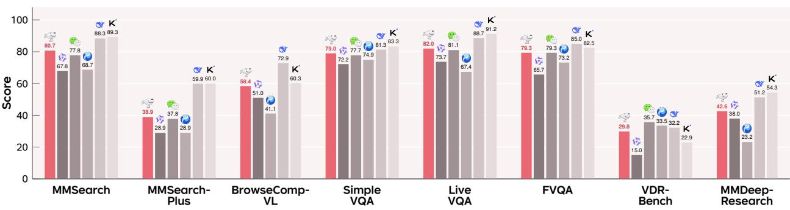  
Figure 1 Benchmark performance of MIRA. MIRA-SFT versus open agents and frontier models (Table 2).

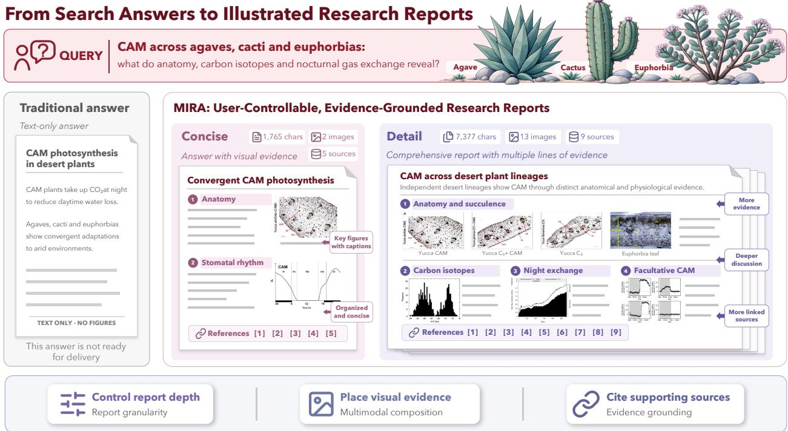  
Figure 2 From search answers to controllable illustrated reports. For one request, MIRA controls report granularity, multimodal composition, and evidence grounding across Concise and Detail deliverables.

## 1 Introduction

Multimodal large language models (MLLMs) acquire extensive visual and textual knowledge from static training corpora [1–3, 16, 20]. External tools extend this fixed knowledge boundary, enabling models to retrieve evidence and address real-world information needs [4, 14, 22, 35, 36]. Text-based deep research systems such as STORM use multi-step retrieval to write long-form articles [28]. WebThinker trains an agent to interleave web search and report drafting [19]. Multimodal deep research extends this setting to textual and visual evidence [11]. However, tool access alone does not ensure an illustrated report that simultaneously provides accurate and suficiently complete information [17], integrates textual and visual evidence throughout research and writing [21, 25], and follows the user’s preferred style.

Motivated by real-world reporting needs, we study controllable report generation: producing illustrated reports that respond to user requirements in multimodal deep research. Given interleaved textual and visual inputs alongside explicit delivery requirements, an agent must gather evidence from the open web and satisfy constraints on three attributes: report granularity, the scope, depth, and level of detail; multimodal composition, the selection, balance, and organization of text and visuals; and evidence grounding, the required evidential support and explicit links from textual claims to source documents [9] and from report visuals to their original source figures [29].

Recent work addresses important components of this task. Vision Search Assistant [40] uses external search to answer questions about visual inputs. MMSearch-R1 [32] and Vision-DeepResearch [12] integrate textual and visual search into multi-step reasoning to answer visual questions that require external knowledge. Moving toward report generation [37], Multimodal DeepResearcher [34] explores interleaved text and chart generation, ViDR [29] grounds reports in source figures, and Ptah [39] coordinates illustrated report generation and verification through a multi-agent harness. Together, these advances provide a foundation for studying how diferent reporting needs can be supported within a unified research workflow.

Nevertheless, jointly controlling report granularity, multimodal composition, and evidence grounding remains challenging. Even for the same research question, a concise brief and a detailed report may require diferent evidence coverage, visual choices, and levels of exposition. These requirements should therefore shape the research process, rather than serve only as formatting instructions during final generation. This raises a central question: How should the user’s intended deliverable guide evidence collection, report organization, and the decision to conclude research?

To address this question, we present MIRA, a Multimodal Illustrated Deep Research Agent for controllable reports. At its core, MIRA-Harness connects evidence collection, illustrated writing, and delivery checks in an iterative loop. The harness represents user requirements as generation contracts, which specify explicit conditions for accepting a report, and supports Concise and Detail modes for diferent reporting needs (Figure 2). Both modes specify requirements across all three attributes while preserving a shared requirement for source traceability. During research, the agent inspects and records sources and visual materials. After drafting, it submits the report for checking, uses unmet conditions as revision targets, and revises the content or gathers additional evidence before resubmitting within the allocated budget. A report is accepted as a completed deliverable only after passing the implemented contract checks.

To teach models this complete workflow, we develop MIRA-Data, a framework for constructing report-oriented training trajectories that connect evidence gathering, writing, submission, and feedback-driven revision. Using Qwen3.6-35B-A3B as the backbone, we compare the unadapted model (Base) with its supervised finetuned counterpart (SFT). Our evaluation examines both report delivery and multimodal search, assessing how adaptation afects report quality, adherence to user requirements, and the ability to acquire evidence.

Our contributions are threefold:

• Task formulation. We identify the gap between multimodal deep research and real-world report delivery, and formulate controllable report generation: producing illustrated, evidence-grounded reports under userspecified requirements for report granularity, multimodal composition, and evidence grounding.

• Harness and training data. We introduce MIRA-Harness, which unifies user requirements, multimodal evidence collection, illustrated writing, and feedback-driven revision through generation contracts. We further develop MIRA-Data to construct training trajectories aligned with this workflow, covering evidence gathering, writing, submission checks, and revision.

• Empirical evaluation. We train and evaluate MIRA using Qwen3.6-35B-A3B, comparing Base and SFT variants across report delivery and multimodal search. Across eight multimodal search, knowledge-intensive VQA, and illustrated deep-research benchmarks, MIRA-SFT achieves state-of-the-art performance among the compared open agents on seven of the eight benchmarks. Beyond benchmark performance, MIRA can generate comprehensive illustrated reports that adapt to user-specified requirements for report granularity, multimodal composition, and evidence grounding, while integrating visual evidence and traceable sources into the final deliverable.

## 2 Related Work

## 2.1 Deep Research and Report Generation

Deep research extends tool-augmented language models from single-step retrieval to long-horizon information seeking, where an agent iteratively searches, inspects external evidence, and synthesizes an answer. Early agentic formulations such as ReAct [36] established the general paradigm of interleaving reasoning with environmental actions, while systems such as STORM [28] demonstrated that multi-stage retrieval and organization can support substantially longer and more structured textual outputs. More recent work has shifted attention toward training search agents directly, including scalable long-horizon search and synthetic supervision [6, 33], showing that efective research behavior can be learned, not merely prompted.

## 2.2 Multimodal Search Agents

Multimodal research agents further expand this setting by allowing visual observations to participate in the search process. Benchmarks such as MMSearch, MMSearch-Plus, and MM-BrowseComp [13, 18, 30] expose the need to retrieve and reason over both textual and visual evidence, while MMSearch-R1 [32], WebWatcher [10], OpenSearch-VL [4], Vision-DeepResearch [12], and WeAgent-MMSearch [22] develop increasingly capable multimodal browsing and search policies. These works substantially improve how agents acquire external evidence, particularly for knowledge-intensive visual questions.

## 2.3 Agent Harnesses and Tool-Use Supervision

The behavior of a research agent is determined not only by its underlying model, but also by the execution environment that exposes tools, maintains interaction state, and mediates long-horizon reasoning. Existing search systems therefore use tool environments and agent harnesses to coordinate retrieval and multimodal inspection [4, 22]. The WeAgent harness additionally exposes webpage extraction and code execution [22]. In parallel, recent work on search-agent training constructs trajectories of tool calls and intermediate observations so that models can internalize efective interaction patterns [6, 33]. This line of work shows that runtime structure and training supervision are complementary. A capable backbone may still fail to search efectively when the interaction protocol is poorly specified, while training on trajectories mismatched to the deployment environment can teach behaviors that are dificult to realize at inference time.

## 2.4 Controllable and Evidence-Grounded Report Generation

A separate line of research moves beyond short-form question answering toward long-form, evidence-backed synthesis. FActScore [23] evaluates the factual support of claims in long-form text. Citation-aware generation studies how model outputs can be explicitly linked to retrieved sources [9], while systems such as EviReport [21] organize evidence throughout long-form report generation. Deep-Reporter [37] further studies grounded multimodal long-form generation. ReportBench [17] evaluates the content quality of research reports for academic survey tasks, while AnalystBench [25] evaluates professional report generation in settings where completeness and multimodal presentation matter in addition to factual correctness. These eforts highlight that high-quality research outputs require more than finding a correct answer: evidence must be selected, organized, and preserved across a substantially longer generation process.

Recent multimodal deep-research systems make this connection even more explicit. Multimodal DeepResearcher [34] studies interleaved text-chart report generation, ViDR [29] grounds generated reports in source visual evidence, and Ptah [39] introduces a multi-agent harness for interleaved report generation and verification. MMDeepResearch-Bench [11] correspondingly evaluates multimodal agents on long-form research synthesis. Collectively, these works establish the importance of illustration, provenance, and verification for multimodal reports. Accordingly, MIRA targets report delivery under explicit user requirements.

## 3 Task Formulation

## 3.1 Multimodal Deep Research

In tool-using multimodal deep research, an agent harness mediates long-horizon interactions between a model and its environment. This execution layer routes actions, returns observations, maintains state, and enforces budgets [4, 22]. Given a possibly multimodal request $q$ and model-visible history $h _ { t } .$ , the policy $\pi _ { \theta }$ parameterized by $\theta ,$ selects a tool action $a _ { t }$ at turn $t ,$ and the harness H returns an observation $o _ { t }$ . Let ⊕ append an action and observation pair to the history. The interaction loop [36] is

$$
a _ { t } \sim \pi _ { \theta } ( \cdot \mid q , h _ { t } ) , \qquad o _ { t } = \mathcal { H } ( a _ { t } , h _ { t } ) , \qquad h _ { t + 1 } = h _ { t } \oplus ( a _ { t } , o _ { t } ) .\tag{1}
$$

Here, $o _ { t }$ may contain text, image pixels, or tool errors. Over $T$ turns, the complete interaction forms a trajectory $\tau ;$ the shorthand ${ \boldsymbol { \tau } } = ( a _ { t } , o _ { t } ) _ { t = 1 } ^ { T }$ omits intervening model text and internal harness state. The harness thus structures the agent’s evidence-gathering loop, rather than merely exposing a list of tools.

## 3.2 Controllable Illustrated Report Generation

Building on this loop, controllable report generation in multimodal deep research requires an illustrated, evidence-grounded report under user-specified requirements, so delivery requirements must shape evidence gathering and revision. MIRA-Harness incorporates these requirements into runtime interaction, while MIRA-Data supplies trajectories for the same workflow.

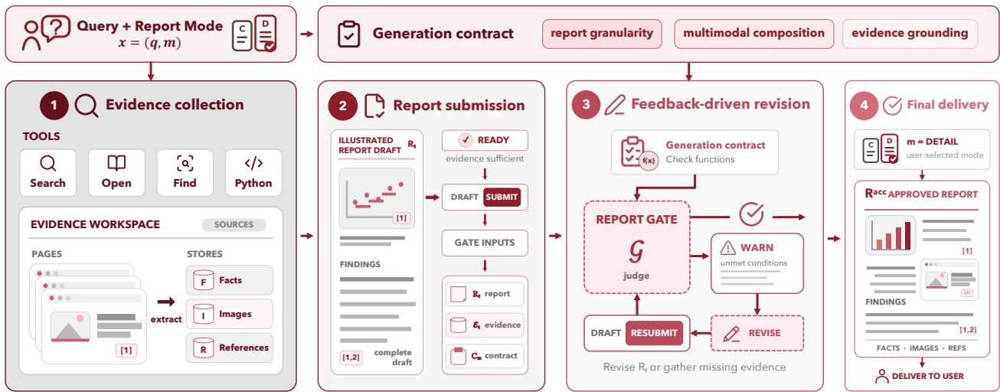  
Figure 3 MIRA-Harness for user-specified illustrated reports. A mode-conditioned generation contract guides multimodal research, evidence tracking, report submission, and feedback-driven revision, and delivers the report once the contract conditions are satisfied.

## 4 MIRA-Harness

## 4.1 Overview and Generation Contracts

MIRA-Harness operationalizes controllable report generation through a generation contract $C _ { m }$ conditioned on the user-selected report mode m, as illustrated in Figure 3. The contract groups its acceptance conditions into three sets: report granularity $C _ { m } ^ { \mathrm { d e t a i l } }$ , multimodal composition $C _ { m } ^ { \mathrm { i m a g e s } }$ , and evidence grounding $C _ { m } ^ { \mathrm { r e f } }$ MIRA-Harness enforces this contract through four stages: (1) evidence collection, (2) report submission, (3) feedback-driven revision, and (4) final delivery.

For a possibly multimodal request $q ,$ the mode $m \in$ {CONCISE, DETAIL} selects a report preset, yielding $x = ( q , m )$ and the contract

$$
C _ { m } = C _ { m } ^ { \mathrm { d e t a i l } } \cup C _ { m } ^ { \mathrm { i m a g e s } } \cup C _ { m } ^ { \mathrm { r e f } } .\tag{2}
$$

Let $R _ { t }$ be the submitted draft, $\mathcal { E } _ { t }$ the evidence accumulated by turn $t ,$ and $\mathcal { G } _ { t } \equiv \mathcal { G } ( R _ { t } , \mathcal { E } _ { t } ; C _ { m } )$ the report-gate response. The action SUBMIT $\left( R _ { t } \right)$ sends the draft to this gate; $\mathbb { W } \mathbb { A } \mathbb { R } \mathbb { N } ( f _ { t } )$ identifies unmet conditions $f _ { t }$ . If another submission is required, let $t ^ { + } > t$ denote its turn and $\mathcal G _ { t ^ { + } } \equiv \mathcal G ( R _ { t ^ { + } } , \mathcal E _ { t ^ { + } } ; C _ { m } )$ its response. An OK accepts the current draft as $R ^ { \mathrm { a c c } }$ , with the same branch rule applied after each resubmission:

$$
x \xrightarrow [ ] { ( 1 ) } ( h _ { t } , \mathscr { E } _ { t } ) \xrightarrow [ ] { ( 2 ) \mathrm { s u p u l r T } ( R _ { t } ) } \mathscr { G } _ { t } \mapsto [ \mathscr { U } \mathbb { A } \mathbb { R } \mathbb { N } \big ( f _ { t } \big ) \xrightarrow [ ] { ( 3 ) } \mathscr { G } _ { t ^ { + } } | \mathbb { O } \mathbb { K } \xrightarrow [ ] { ( 4 ) } R ^ { \mathrm { a c c } } ] .\tag{3}
$$

## 4.2 Evidence Collection

The first stage, evidence collection, instantiates the action space with four tool calls, keeping the interface elegant and consistent across foundation models without proliferating specialized, task-specific operators.

The available calls are search(query) and open(target) for discovery and access, together with find(url, pattern) and Python(code) for lookup and computation. The open interface also accepts optional loc and num\_lines parameters. The search call discovers candidates, open returns webpage content or image pixels, find locates text in an opened page, and Python processes observed content or produces derived figures. These four calls comprise the research action space; SUBMIT is a separate workflow action rather than a research tool. Appendix B gives the detailed tool and submission interfaces and an abridged version of the system prompt used at inference.

## 4.3 Multimodal Evidence State

Relative to Eq. 1, MIRA-Harness retains the history update, but conditions the policy on x and makes the evidence state $\mathcal { E } _ { t }$ explicit. This state records extracted facts, inspected images, opened source pages, and their provenance; $\mathcal { H } _ { m }$ denotes MIRA-Harness under mode m:

$$
a _ { t } \sim \pi _ { \theta } ( \cdot \mid x , h _ { t } ) , \qquad ( o _ { t } , { \mathcal { E } } _ { t + 1 } ) = { \mathcal { H } } _ { m } ( a _ { t } , h _ { t } , { \mathcal { E } } _ { t } ) .\tag{4}
$$

## 4.4 Report Submission, Feedback-Driven Revision, and Final Delivery

With suficient evidence, the model enters report submission and invokes SUBMIT $( R _ { t } )$ . This sends the complete draft to G, while the harness supplies $\mathcal { E } _ { t }$ and $C _ { m }$

The report gate returns the OK or WARN response in Eq. 3. A $\mathbb { W } \mathbb { A } \mathbb { R } \mathbb { N } ( f _ { t } )$ enters stage 3, where the model revises $R _ { t }$ , gathers missing evidence, and resubmits within its budget. An OK, received immediately or after revision, enters stage 4 and delivers $R ^ { \mathrm { a c c } }$ ; budget exhaustion instead fails the delivery. Thus, a delivered report satisfies the user-specified contract.

## 5 MIRA-Data

## 5.1 Query Seed Construction

MIRA-Data draws seeds from knowledge-intensive topics and real-world, time-sensitive information needs. For each seed, the query generator produces a user-facing request $q$ and an internal rubric

$$
\mathcal { U } ( q ) = \{ u _ { i } \} _ { i = 1 } ^ { K } , \qquad K > 1 .\tag{5}
$$

Here, K counts rubric items, and each $u _ { i }$ specifies a subquestion and its visual-evidence requirement. Every subquestion requires externally retrieved evidence, and at least one requires visual evidence. The user sees $q ,$ while $\mathcal { U } ( q )$ remains internal for the synthesis gate; MIRA-Harness adds $m$ and $C _ { m }$ . Together, these conditions require multi-step retrieval and explicit visual evidence rather than an answer produced from parametric knowledge alone. Figure 4 summarizes the MIRA-Data construction pipeline.

## 5.2 Harness-Native Trajectory Synthesis

For each $q ,$ Kimi K2.6 [24] serves as the trajectory policy within MIRA-Harness. Given $x = ( q , m )$ , it reuses the tools, $\mathcal { E } _ { t } , \ C _ { m }$ , and G from the inference workflow to collect evidence and submit an illustrated report; gate feedback triggers revision or further collection.

## 5.3 Synthesis Gate

The generic report gate $\mathcal { G } ( R _ { t } , \mathcal { E } _ { t } ; C _ { m } )$ checks delivery requirements but does not receive $\mathcal { U } ( q )$ , so it cannot verify coverage of every requested item. Data synthesis therefore adds a synthesis gate $\mathcal { G } _ { \mathrm { s y n } } \mathrm { : }$

$$
\mathcal { G } _ { \mathrm { s y n } } \left( \tau ; \mathcal { U } ( q ) \right) \in \{ 0 \mathrm { K } , \mathrm { R E J E C T } \} .\tag{6}
$$

This gate checks evidence coverage for every $u _ { i } ,$ image inspection for visual items, and the completeness of the record of tool calls, image observations, and the accepted report. Only trajectories for which both $\mathcal { G }$ and $\mathcal { G } _ { \mathrm { s y n } }$ return OK enter MIRA-Data.

## 5.4 Capability-Balanced Data Mixture

To balance report-specific behavior with broader search capabilities, we complement the accepted Harness-Native trajectories with general search trajectories during training. The former introduces generationcontract-driven research behavior, while the latter preserves broader multimodal and text-based search supervision. Section 6 gives the data composition.

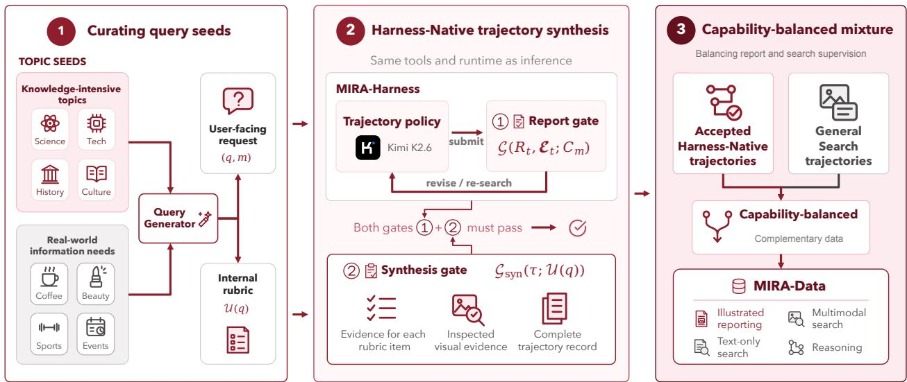  
Figure 4 Trajectory synthesis for illustrated reports. A query generator constructs report-oriented requests and internal rubrics. Kimi K2.6 generates trajectories within MIRA-Harness, and the synthesis gate verifies rubric coverage and trajectory integrity. Accepted trajectories, mixed with general search trajectories, form MIRA-Data.

## 6 Experimental Setup

## 6.1 Models and Benchmarks

We build MIRA on Qwen3.6-35B-A3B [27]. We evaluate multimodal search and knowledge-intensive question answering on MMSearch [13], MMSearch-Plus [30], BrowseComp-VL [10], SimpleVQA [5], LiveVQA [8], FVQA [31], and VDR-Bench [38]. We further evaluate illustrated report generation on MMDeepResearch-Bench [11]. Together, these eight benchmarks cover web retrieval, multimodal evidence use, long-tail knowledge, and long-form report synthesis.

## 6.2 Baselines

We compare against three large-scale frontier models, DeepSeek-V4.1-Flash [7], Kimi K3 (high reasoning efort) [15], and Qwen3.5-397B-A17B [26], together with four lightweight multimodal search agents at a comparable scale: OpenSearch-VL [4], REDSearcher-MM [6], Vision-DeepResearch [12], and WeAgent-MMSearch [22]. We also compare the Qwen3.6 backbone without a harness, under the WeAgent-MMSearch Harness, under a vanilla harness, and under MIRA-Harness to separate model capability from runtime scaffolding. Model variants and their results are detailed in Section 7.

Table 1 Core thresholds of the two report modes.
<table><tr><td>Mode</td><td>Visible characters</td><td>Inspected images</td><td>Cited sources</td></tr><tr><td>CONCISE</td><td>300-2,000</td><td>≥2</td><td>≥2</td></tr><tr><td>DETAIL</td><td>5,000-10,000</td><td>≥ 10</td><td>≥8</td></tr></table>

## 6.3 Evaluation Metrics and Protocol

For all local evaluations, we use a single rollout per query (Pass@1) because long-horizon rollouts are computationally expensive. DeepSeek-V4.1-Flash serves as the semantic judge (Appendix C). Within each benchmark, we fix its prompt, answer extraction, output parser, and aggregation rule across systems. We report each benchmark’s oficial primary metric and the Overall score for MMDeepResearch-Bench.

## 6.4 Report Modes

We instantiate the generation contract with the two presets summarized in Table 1. CONCISE targets a direct, evidence-supported response, whereas DETAIL targets an expanded illustrated report. Visible length counts non-whitespace prose characters. Images contribute to the minimum only after their pixels have been inspected; source pages must be opened and cited. Both modes use the same research tools and report gate, with the selected preset determining the required deliverable. Table 1 lists the core thresholds; Appendix A.1 gives the full counting rules and shared evidence requirements.

## 6.5 Training Data

Following Section 5, our data comprises approximately 4.6K Harness-Native trajectories designed for the MIRA-Harness workflow and 33K general search trajectories. The Harness-Native trajectories are generated by instantiating Kimi K2.6 [24] as the trajectory-generating policy within MIRA-Harness. Within this set, 36.9% follow the Concise mode and 63.1% follow the Detail mode. Queries in the general pool are drawn from open-source resources including OpenSearch-VL [4], REDSearcher [6], and QUEST [33], together with a subset synthesized by us. This pool contains both multimodal and text-only trajectories, balancing reportspecific behavior with broader multimodal search, text-only search, and reasoning capabilities so that these abilities can improve together. This composition connects report-specific specialization with the broader multimodal, text-based, and reasoning skills needed to sustain long-horizon search, evidence gathering, and report construction, rather than optimizing either capability in isolation.

## 7 Experimental Results

## 7.1 Comparison with Open-Source Agents

Table 2 compares MIRA with the selected frontier models and similarly sized multimodal search agents across all eight benchmarks. Overall, MIRA-SFT, obtained by supervised fine-tuning the Qwen3.6 backbone on MIRA-Data and deploying it with MIRA-Harness, achieves state-of-the-art results among the compared open-source agents on seven of the eight benchmarks. While a gap remains to the strongest frontier models overall, MIRA-SFT surpasses the much larger Qwen3.5-397B-A17B on six benchmarks and matches it on BrowseComp-VL, showing that a 35B-A3B backbone can remain competitive with frontier-scale models.

## 7.2 Runtime Harness and Data Improvements

First, without any harness, we let the Qwen3.6-35B-A3B backbone answer directly without tool access. Across all eight benchmarks, this no-harness baseline scores 25.78 points lower on average than MIRA-Base, which applies MIRA-Harness to the same model. It also performs worse than the same model with the Vanilla Harness (a basic harness that provides tool access without additional design) or the WeAgent MMSearch Harness on every benchmark they report. These consistent gaps show that multimodal deep research depends not only on the backbone, but also on deliberate harness design to coordinate long-horizon tool use, evidence feedback, and interaction state.

Second, MIRA-Base measures the contribution of harness design because it uses the original backbone without MIRA-Data training. As summarized by the ∆ (MIRA-Base − Vanilla) row, MIRA-Base improves every directly comparable benchmark and gains 4.30 points on average. It also outperforms the WeAgent-MMSearch Harness by 4.48 points across their six common benchmarks (using author-reported results because WeAgent-MMSearch is not publicly released). These gains show that MIRA derives its strength from carefully structuring the entire interaction loop around a compact, model-agnostic tool set, rather than expanding that set with task-specific tools.

Finally, the ∆ (MIRA-SFT − MIRA-Base) row quantifies the efect of training on the carefully synthesized and filtered MIRA-Data. MIRA-SFT improves all eight benchmarks by 5.50 points on average, with its three largest gains on VDR-Bench (+10.80), FVQA (+9.33), and MMSearch (+7.60). Together, these gains show that MIRA-Data extends the benefits of runtime design into learned harness-native behavior, enabling MIRA-SFT to achieve state-of-the-art performance among the compared open-source agents on seven of the eight benchmarks

Table 2 Main results across eight multimodal search, knowledge-intensive VQA, and illustrated deep-research benchmarks. Bold marks the best result outside the large-scale frontier models.
<table><tr><td>Model</td><td>Params</td><td>MM Search</td><td>MMSearch Plus</td><td>Browse Comp-VL</td><td>Simple VQA</td><td>Live VQA FVQA</td><td></td><td>VDR Bench</td><td>MMDeep Research</td></tr><tr><td colspan="10">Large-Scale Frontier Models</td></tr><tr><td>Kimi K3</td><td>2.8T (104B)</td><td>89.26</td><td>60.00</td><td>60.32</td><td>83.33</td><td>91.23</td><td>82.46</td><td>22.86</td><td>54.32</td></tr><tr><td>Qwen3.5</td><td>397B (17B)</td><td>69.01</td><td>36.01</td><td>58.40</td><td>77.33</td><td>84.33</td><td>75.33</td><td>14.40</td><td>39.54</td></tr><tr><td>DeepSeek-V4.1-Flash</td><td>552B (8B/16B)</td><td>88.33</td><td>59.91</td><td>72.86</td><td>81.33</td><td>88.67</td><td>85.00</td><td>32.20</td><td>51.23</td></tr><tr><td colspan="10">Lightweight Multimodal Search Agents</td></tr><tr><td>OpenSearch-VL</td><td>30B (3B)</td><td>68.70</td><td>28.94</td><td>41.10</td><td>74.90 67.40</td><td></td><td>73.20</td><td>33.50</td><td>23.21</td></tr><tr><td>REDSearcher-MM</td><td>30B (3B)</td><td>72.90</td><td>26.60</td><td>57.20</td><td></td><td>79.30</td><td></td><td></td><td></td></tr><tr><td>Vision-DeepResearch</td><td>30B (3B)</td><td>69.60</td><td>28.50</td><td>53.70</td><td>66.33</td><td>77.60</td><td>74.20</td><td>37.80</td><td>12.78</td></tr><tr><td>WeAgent-MMSearch</td><td>30B (3B)</td><td>77.78</td><td>37.82</td><td></td><td>77.73</td><td>81.05</td><td>79.33</td><td>35.68</td><td></td></tr><tr><td>Qwen3.6 w/o Harness</td><td>35B (3B)</td><td>30.41</td><td>3.86</td><td>28.91</td><td>58.00</td><td>56.67</td><td>34.11</td><td>1.80</td><td>26.78</td></tr><tr><td>Qwen3.6 w/ WeAgent Harness</td><td>35B (3B)</td><td>66.28</td><td>29.40</td><td></td><td>65.79</td><td>78.20</td><td>66.09</td><td>15.57</td><td></td></tr><tr><td>Qwen3.6 w/ Vanilla Harness</td><td>35B (3B)</td><td>67.84</td><td>28.94</td><td>51.01</td><td>72.24</td><td>73.67</td><td>65.67</td><td>15.00</td><td>37.95</td></tr><tr><td colspan="10">Ours</td></tr><tr><td>MIRA-Base</td><td>35B (3B)</td><td>73.10</td><td>33.44</td><td>56.64</td><td>74.33</td><td>78.33</td><td>70.00</td><td>19.00</td><td>41.90</td></tr><tr><td>Δ (MIRA-Base – Vanilla)</td><td></td><td>+5.26</td><td>+4.50</td><td>+5.63</td><td>+2.09</td><td>+4.66</td><td>+4.33</td><td>+4.00</td><td>+3.95</td></tr><tr><td>MIRA-SFT</td><td>35B (3B)</td><td>80.70</td><td>38.91</td><td>58.40</td><td>79.00</td><td>82.00</td><td>79.33</td><td>29.80</td><td>42.61</td></tr><tr><td>Δ (MIRA-SFT – MIRA-Base)</td><td></td><td>+7.60</td><td>+5.47</td><td>+1.76</td><td>+4.67</td><td>+3.67</td><td>+9.33</td><td>+10.80</td><td>+0.71</td></tr></table>

## 8 Analysis

We conduct two ablations to evaluate the report gate G and MIRA-Data. The report-gate study shows that feedback improves delivery compliance and evidence use, while quantifying the additional model and tool calls required. The MIRA-Data study shows that training improves control over the requested report mode without reducing research quality or mode-switching eficiency. Both studies use 32 queries sampled from MMDeepResearch-Bench (MMDR) under a 100-turn budget; the first ablation covers 81 input images.

## 8.1 Effect of the Report Gate

We compare otherwise identical runs with and without the report gate G on the sampled MMDeepResearch-Bench queries, holding the model and report mode fixed so that observed diferences reflect the report gate.

Table 3 Report-gate ablation on MMDeepResearch-Bench Detail queries.
<table><tr><td>Metric</td><td>Unit</td><td>No Gate</td><td>With Gate</td><td>∆</td></tr><tr><td>Compliant reports</td><td>per report</td><td>0/32</td><td>25/32</td><td>+78.1 pp</td></tr><tr><td>Checks passed</td><td>per report</td><td>1.78</td><td>3.62</td><td>+1.84</td></tr><tr><td>Images cited</td><td>per image</td><td>19/81 (23.5%)</td><td>75/81 (92.6%)</td><td>+69.1 pp</td></tr><tr><td>Opened sources</td><td>per query</td><td>5.31</td><td>8.69</td><td>+3.38</td></tr><tr><td>Model calls</td><td>per query</td><td>43.5</td><td>63.6</td><td>+20.1</td></tr><tr><td>Tool calls</td><td>per query</td><td>42.5</td><td>61.0</td><td>+18.5</td></tr><tr><td>MMDR Overall (n = 32)</td><td>per query</td><td>43.19</td><td>47.73</td><td>+4.54</td></tr></table>

Performance. We evaluate the report gate, a dedicated MIRA-Harness component that checks submitted reports and provides revision feedback, along two dimensions: delivery compliance and evidence use. In Table 3, Compliant reports counts final reports that pass every report-gate check, while Checks passed averages the conditions satisfied per report. With the report gate G enabled, compliant reports rise from

0/32 to 25/32 and checks passed from 1.78 to 3.62. Images cited is the proportion of the 81 input images cited in the final reports, whereas Opened sources averages cited pages that the agent actually opened per query. These measures rise from 23.5% to 92.6% and from 5.31 to 8.69, respectively. MMDR Overall also rises from 43.19 to 47.73. Together, these gains demonstrate that the report gate G efectively turns report requirements into compliant, evidence-traceable deliveries without sacrificing benchmark-level quality.

Eficiency. Enabling the report gate G adds 20.1 model calls and 18.5 tool calls per query. This measured overhead reflects the targeted investigation and revision triggered by gate feedback, showing how detected deficiencies are converted into improved delivery compliance.

## 8.2 Effect of MIRA-Data

We test whether the MIRA-SFT model follows the user-selected report mode while preserving research quality by comparing the MIRA-Base and MIRA-SFT models on the sampled MMDeepResearch-Bench queries under both report modes, with the report gate G fixed across configurations so that diferences reflect MIRA-Data.

Table 4 Average changes after switching from Concise to Detail. Positive values indicate increases; brackets for calls and MMDR Overall give 95% confidence intervals.
<table><tr><td>Metric</td><td>MIRA-Base (Detail – Concise)</td><td>MIRA-SFT (Detail – Concise)</td></tr><tr><td>Visible characters</td><td>+2,573</td><td>+2,695</td></tr><tr><td>Model calls</td><td>+2.2 [−5.0, 9.5]</td><td>-3.8 [−15.1, 7.8]</td></tr><tr><td>Tool calls</td><td>+2.0 [−5.1, 9.3]</td><td>-3.9 [-15.3, 7.6]</td></tr><tr><td>MMDR Overall</td><td>-10.9 [−16.6, −5.4]</td><td>+0.0 [−6.6, 6.0]</td></tr></table>

Performance. In Table 4, Visible characters measures the change in report length from Concise to Detail; it increases by 2,573 for MIRA-Base and 2,695 for MIRA-SFT. MMDR Overall measures the corresponding change in research quality: MIRA-Base decreases by 10.9 points, whereas MIRA-SFT remains unchanged (+0.0). MIRA-SFT therefore converts greater requested granularity into a longer report without sacrificing benchmark-level quality on MMDeepResearch-Bench.

Eficiency. In Table 4, Model calls and Tool calls change by only +2.2 and +2.0 for MIRA-Base, and by −3.8 and −3.9 for MIRA-SFT. Thus, MIRA-SFT keeps its Detail-mode quality without additional model or tool calls, relying instead on the report-mode control learned from MIRA-Data.

## 9 Limitations

MIRA relies on external search infrastructure, including Serper API and Jina Reader, to access and parse web content. Because these components operate outside the agent, transient API errors, unavailable webpages, or parsing failures can interrupt evidence collection and reduce trajectory reliability. Hallucinations may also arise during evidence acquisition and report synthesis. The agent may misread or incorrectly combine retrieved content, or make weakly supported claims.

## 10 Conclusion

We introduce MIRA, a multimodal deep research agent for controllable illustrated report generation. MIRA encodes user requirements for report granularity, multimodal composition, and evidence grounding as generation contracts. MIRA-Harness connects multimodal evidence collection, report writing, checking, and feedback-driven revision. We further construct MIRA-Data and use it to fine-tune the Qwen3.6-35B-A3B backbone for this workflow. Our study highlights that report requirements should guide both final generation and the research process, a step toward agents that adapt their search behavior and deliverables to user needs. We hope this perspective guides research on agents that reason about what to find and what to deliver.

## References

[1] Jean-Baptiste Alayrac, Jef Donahue, Pauline Luc, Antoine Miech, Iain Barr, Yana Hasson, Karel Lenc, Arthur Mensch, Katherine Millican, Malcolm Reynolds, et al. Flamingo: A visual language model for few-shot learning. Advances in Neural Information Processing Systems, 35:23716–23736, 2022.

[2] Jinze Bai, Shuai Bai, Shusheng Yang, Shijie Wang, Sinan Tan, Peng Wang, Junyang Lin, Chang Zhou, and Jingren Zhou. Qwen-VL: A versatile vision-language model for understanding, localization, text reading, and beyond. arXiv preprint arXiv:2308.12966, 2023.

[3] Shuai Bai, Yuxuan Cai, Ruizhe Chen, Keqin Chen, Xionghui Chen, Zesen Cheng, Lianghao Deng, Wei Ding, Chang Gao, Chunjiang Ge, et al. Qwen3-VL technical report. arXiv preprint arXiv:2511.21631, 2025.

[4] Shuang Chen, Kaituo Feng, Hangting Chen, Wenxuan Huang, Dasen Dai, Quanxin Shou, Yunlong Lin, Xiangyu Yue, Shenghua Gao, and Tianyu Pang. OpenSearch-VL: An open recipe for frontier multimodal search agents. arXiv preprint arXiv:2605.05185, 2026.

[5] Xianfu Cheng, Wei Zhang, Shiwei Zhang, Jian Yang, Xiangyuan Guan, Xianjie Wu, Xiang Li, Ge Zhang, Jiaheng Liu, Yuying Mai, et al. SimpleVQA: Multimodal factuality evaluation for multimodal large language models. In 2025 IEEE/CVF International Conference on Computer Vision (ICCV), pages 4637–4646. IEEE, 2025.

[6] Zheng Chu, Xiao Wang, Jack Hong, Huiming Fan, Yuqi Huang, Yue Yang, Guohai Xu, Chenxiao Zhao, Cheng Xiang, Shengchao Hu, et al. REDSearcher: A scalable and cost-eficient framework for long-horizon search agents. arXiv preprint arXiv:2602.14234, 2026.

[7] DeepSeek-AI. DeepSeek-V4.1-Flash: Pushing the limits of KV cache compression, 2026. URL https: //huggingface.co/deepseek-ai/DeepSeek-V4.1-Flash.

[8] Mingyang Fu, Yuyang Peng, Dongping Chen, Zetong Zhou, Benlin Liu, Yao Wan, Zhou Zhao, Philip S. Yu, and Ranjay Krishna. Seeking and updating with live visual knowledge. arXiv preprint arXiv:2504.05288, 2025.

[9] Tianyu Gao, Howard Yen, Jiatong Yu, and Danqi Chen. Enabling large language models to generate text with citations. In Proceedings of the 2023 Conference on Empirical Methods in Natural Language Processing, pages 6465–6488, 2023.

[10] Xinyu Geng, Peng Xia, Zhen Zhang, Xinyu Wang, Qiuchen Wang, Ruixue Ding, Chenxi Wang, Jialong Wu, Kuan Li, Yida Zhao, et al. WebWatcher: Breaking new frontiers of vision-language deep research agent. In International Conference on Learning Representations, 2026.

[11] Peizhou Huang, Zixuan Zhong, Zhongwei Wan, Donghao Zhou, Samiul Alam, Xin Wang, Zexin Li, Zhihao Dou, Li Zhu, Jing Xiong, et al. MMDeepResearch-Bench: A benchmark for multimodal deep research agents. arXiv preprint arXiv:2601.12346, 2026.

[12] Wenxuan Huang, Yu Zeng, Qiuchen Wang, Zhen Fang, Shaosheng Cao, Zheng Chu, Qingyu Yin, Shuang Chen, Zhenfei Yin, Lin Chen, et al. Vision-DeepResearch: Incentivizing DeepResearch capability in multimodal large language models. arXiv preprint arXiv:2601.22060, 2026.

[13] Dongzhi Jiang, Renrui Zhang, Ziyu Guo, Yanmin Wu, Jiayi Lei, Pengshuo Qiu, Pan Lu, Zehui Chen, Chaoyou Fu, Guanglu Song, et al. MMSearch: Benchmarking the potential of large models as multi-modal search engines. arXiv preprint arXiv:2409.12959, 2024.

[14] Bowen Jin, Hansi Zeng, Zhenrui Yue, Jinsung Yoon, Sercan Arik, Dong Wang, Hamed Zamani, and Jiawei Han. Search-R1: Training LLMs to reason and leverage search engines with reinforcement learning. In Proceedings of the Second Conference on Language Modeling, 2025. URL https://openreview.net/forum?id=Rwhi91ideu.

[15] Kimi Team, Tongtong Bai, Yifan Bai, Yiping Bao, Jianfeng Cai, Xinyuan Cai, Peizhou Cao, Yuxuan Cao, Ziwei Chai, Y. Charles, et al. Kimi K3: Open frontier intelligence. arXiv preprint arXiv:2607.24653, 2026.

[16] Junnan Li, Dongxu Li, Silvio Savarese, and Steven Hoi. BLIP-2: Bootstrapping language-image pre-training with frozen image encoders and large language models. In International Conference on Machine Learning, pages 19730–19742. PMLR, 2023.

[17] Minghao Li, Ying Zeng, Zhihao Cheng, Cong Ma, and Kai Jia. ReportBench: Evaluating deep research agents via academic survey tasks. arXiv preprint arXiv:2508.15804, 2025.

[18] Shilong Li, Xingyuan Bu, Wenjie Wang, Jiaheng Liu, Jun Dong, Haoyang He, Hao Lu, Haozhe Zhang, Chenchen Jing, Zhen Li, et al. MM-BrowseComp: A comprehensive benchmark for multimodal browsing agents. arXiv preprint arXiv:2508.13186, 2025.

[19] Xiaoxi Li, Jiajie Jin, Guanting Dong, Hongjin Qian, Yongkang Wu, Ji-Rong Wen, Yutao Zhu, and Zhicheng Dou. WebThinker: Empowering large reasoning models with deep research capability. In Advances in Neural Information Processing Systems, volume 38, pages 120091–120131, 2025. doi: 10.52202/085713-4011.

[20] Haotian Liu, Chunyuan Li, Qingyang Wu, and Yong Jae Lee. Visual instruction tuning. Advances in Neural Information Processing Systems, 36:34892–34916, 2023.

[21] Zihan Liu, Jianhui Li, Zexin Wang, Fei Sun, Jingjing Li, Zheyuan Li, Ke Xiang, Hang Cui, Houhua Gong, Changhua Pei, and Gaogang Xie. EviReport: From reasoned outlines to evidence tracked long-form reports. In Findings of the Association for Computational Linguistics: ACL 2026, pages 28024–28048, 2026.

[22] Zongkai Liu, Hui Zhang, Liqiang Niu, Zhen Cao, Han Li, Juntao Liu, Wenchao Chen, Chengduo Zhao, Chao Yu, and Fandong Meng. WeAgent-MMSearch: Native text-vision interaction for multimodal search agents. arXiv preprint arXiv:2608.28062, 2026.

[23] Sewon Min, Kalpesh Krishna, Xinxi Lyu, Mike Lewis, Wen-tau Yih, Pang Wei Koh, Mohit Iyyer, Luke Zettlemoyer, and Hannaneh Hajishirzi. FActScore: Fine-grained atomic evaluation of factual precision in long form text generation. In Proceedings of the 2023 Conference on Empirical Methods in Natural Language Processing, pages 12076–12100, 2023.

[24] Moonshot AI. Kimi K2.6 model card. https://huggingface.co/moonshotai/Kimi-K2.6, 2026.

[25] Chau Minh Pham, Zichao Wang, Puneet Mathur, Alexa Siu, Akriti Jain, Aparna Garimella, Ananya B. Sai, Nedim Lipka, Mohit Iyyer, and Varun Manjunatha. AnalystBench: Benchmarking professional long-form report generation with web-mined multimodal tasks. In Findings of the Association for Computational Linguistics: ACL 2026, pages 23894–23926, 2026.

[26] Qwen Team. Qwen3.5-397B-A17B, 2026. URL https://huggingface.co/Qwen/Qwen3.5-397B-A17B.

[27] Qwen Team. Qwen3.6-35B-A3B model card. https://huggingface.co/Qwen/Qwen3.6-35B-A3B, 2026.

[28] Yijia Shao, Yucheng Jiang, Theodore Kanell, Peter Xu, Omar Khattab, and Monica Lam. Assisting in writing Wikipedia-like articles from scratch with large language models. In Proceedings of the 2024 Conference of the North American Chapter of the Association for Computational Linguistics: Human Language Technologies (Volume 1: Long Papers), pages 6252–6278, 2024.

[29] Zhuofan Shi, Peilun Jia, Baoqin Sun, Haiyang Shen, Sixiong Xie, Yun Ma, and Xiang Jing. ViDR: Grounding multimodal deep research reports in source visual evidence. arXiv preprint arXiv:2605.13034, 2026.

[30] Xijia Tao, Yihua Teng, Xinxing Su, Xinyu Fu, Jihao Wu, Chaofan Tao, Ziru Liu, Haoli Bai, Rui Liu, and Lingpeng Kong. MMSearch-Plus: Benchmarking provenance-aware search for multimodal browsing agents. In International Conference on Learning Representations, 2026.

[31] Peng Wang, Qi Wu, Chunhua Shen, Anthony Dick, and Anton van den Hengel. FVQA: Fact-based visual question answering. IEEE Transactions on Pattern Analysis and Machine Intelligence, 40(10):2413–2427, 2018. doi: 10.1109/TPAMI.2017.2754246.

[32] Jinming Wu, Zihao Deng, Wei Li, Yiding Liu, Bo You, Bo Li, Zejun Ma, and Ziwei Liu. MMSearch-R1: Incentivizing LMMs to search. In Proceedings of the 64th Annual Meeting of the Association for Computational Linguistics (Volume 1: Long Papers), pages 2456–2487, 2026.

[33] Jian Xie, Tianhe Lin, Zilu Wang, Yuting Ning, Yuekun Yao, Tianci Xue, Zhehao Zhang, Zhongyang Li, Kai Zhang, Yufan Wu, et al. QUEST: Training frontier deep research agents with fully synthetic tasks. arXiv preprint arXiv:2605.24218, 2026.

[34] Zhaorui Yang, Bo Pan, Han Wang, Yiyao Wang, Xingyu Liu, Luoxuan Weng, Yingchaojie Feng, Haozhe Feng, Minfeng Zhu, Bo Zhang, et al. Multimodal DeepResearcher: Generating text-chart interleaved reports from scratch with agentic framework. In Proceedings of the AAAI Conference on Artificial Intelligence, volume 40, pages 34368–34377, 2026.

[35] Zhengyuan Yang, Linjie Li, Jianfeng Wang, Kevin Lin, Ehsan Azarnasab, Faisal Ahmed, Zicheng Liu, Ce Liu, Michael Zeng, and Lijuan Wang. MM-REACT: Prompting ChatGPT for multimodal reasoning and action. arXiv preprint arXiv:2303.11381, 2023.

[36] Shunyu Yao, Jefrey Zhao, Dian Yu, Nan Du, Izhak Shafran, Karthik Narasimhan, and Yuan Cao. ReAct: Synergizing reasoning and acting in language models. In International Conference on Learning Representations, 2023. URL https://openreview.net/forum?id=WE\_vluYUL-X.

[37] Fangda Ye, Kuicai Dong, Zhifei Xie, Yuxin Hu, Yihang Yin, Shurui Huang, Shikai Dong, Chen Zhang, Jianzhu Bao, and Shuicheng Yan. Deep-Reporter: Deep research for grounded multimodal long-form generation. In Proceedings of the 64th Annual Meeting of the Association for Computational Linguistics (Volume 1: Long Papers), pages 41137–41177, 2026.

[38] Yu Zeng, Wenxuan Huang, Zhen Fang, Shuang Chen, Yufan Shen, Yishuo Cai, Xiaoman Wang, Zhenfei Yin, Lin Chen, Zehui Chen, et al. Vision-DeepResearch Benchmark: Rethinking visual and textual search for multimodal large language models. arXiv preprint arXiv:2602.02185, 2026.

[39] Chenghao Zhang, Guanting Dong, Yufan Liu, Tong Zhao, Xiaoxi Li, and Zhicheng Dou. Towards verifiable multimodal deep research: A multi-agent harness for interleaved report generation. arXiv preprint arXiv:2605.29861, 2026.

[40] Zhixin Zhang, Yiyuan Zhang, Xiaohan Ding, and Xiangyu Yue. Vision Search Assistant: Empower visionlanguage models as multimodal search engines. arXiv preprint arXiv:2410.21220, 2024.

## A Generation Contracts and Report Requirements

Section 4 defines the generation contract and report gate abstractly. This appendix instantiates that design with the exact report presets and observable gate conditions used to produce MIRA trajectories. The modelvisible research tools are specified separately in Appendix B.

## A.1 Report Modes and Acceptance Conditions

The selected mode $m \in$ {CONCISE, DETAIL} determines the three components of $C _ { m }$ . Table 5 gives their exact values. Report length is measured in visible non-whitespace prose characters, not tokens; URL strings and image alternative text are excluded. Images count only after their pixels are returned to the policy, and repeated pixel content counts once. Sources count as distinct only when their pages were opened and cited.

Table 5 Mode-conditioned generation contracts. Counts are lower bounds; character ranges include both endpoints.
<table><tr><td>Mode</td><td> $C _ { m } ^ { \mathrm { d e t a i l } }$ </td><td> $C _ { m } ^ { \mathrm { i m a g e s } }$ </td><td> $C _ { m } ^ { \mathrm { r e f } }$ </td><td>Delivery intent</td></tr><tr><td>CONCISE</td><td>300–2,000 chars</td><td> $\geq 2$  images</td><td> $\geq 2$  sources</td><td>Conclusions and essential support</td></tr><tr><td>DETAIL</td><td>5,000–10,000 chars</td><td>≥ 10 images</td><td>≥ 8 sources</td><td>Expanded evidence and explanation</td></tr></table>

Both presets require a coherent Markdown report in the user’s language. Figures must appear near the discussion they support, carry meaningful captions, and be traceable to cited source pages. The presets do not impose a maximum image count, but reject padding through repetitive text or unrelated figures. These shared requirements keep the two modes diferent in granularity without changing the evidence protocol.

## A.2 Report Gate and Revision Budget

The full report gate used for trajectory production evaluates the submitted draft $R _ { t } .$ , accumulated evidence $\mathcal { E } _ { t } ,$ , and active contract $C _ { m }$ together. Figure 5 shows the resulting state transition, while Table 6 lists the executable checks. This gate evaluates observable structure, provenance, accessibility, and artifact integrity. It does not judge whether a claim is factually correct, relevant, or entailed by a cited page.

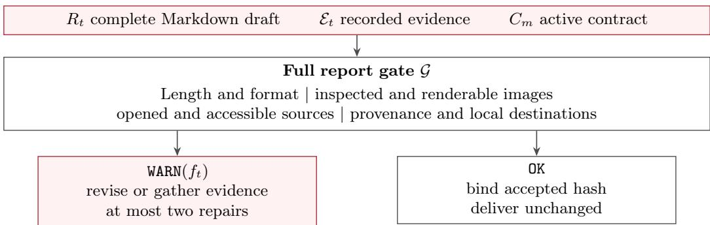  
Figure 5 Full report-gate profile used during trajectory production. Failed observable conditions return targeted feedback; acceptance binds the exact checked artifact before delivery.

On rejection, the gate returns WARN(ft) with the observed value, required value, and an actionable repair instruction for each failed condition. A trajectory may revise and resubmit at most twice after its first rejected submission. A third rejection terminates the run with repair\_budget\_exhausted. On acceptance, the gate hashes the resolved local Markdown and publishes that exact version, preventing an unchecked rewrite after OK. Gate acceptance is therefore a deliverability status rather than a factual correctness score.

Table 6 groups the executable checks by the contract component they protect. Granularity checks bound the length of both the submitted draft and its resolved local copy, and reject internal tool handles or raw HTML that a reader would see. Multimodal-composition checks accept only images whose pixels were inspected, that are distinct by decoded content, that carry a nonempty caption, and that resolve to a supported raster file. Evidence-grounding checks require every citation to match an opened page, keep each image linked to the page it came from, and keep numeric reference labels one-to-one. Reference-availability checks require every cited page to return bounded, nonempty, nonblocked content with a saved text excerpt. Publication-integrity checks confirm that every destination in the final Markdown resolves to a local artifact and that the delivered report matches the hash of the accepted draft. Each failure listed in the last column is returned to the policy as part of WARN(ft).

Table 6 Observable conditions enforced by the full report gate.
<table><tr><td>Contract component</td><td>Executable condition</td><td>Failure reported</td></tr><tr><td>Granularity</td><td>Submitted and resolved local Markdown fall inside the selected visible-character range; internal tool handles and raw HTML do not appear in the report.</td><td>Length outside the selected range, or an internal handle visible to the reader.</td></tr><tr><td>Multimodal composition</td><td>Cited images were inspected, are distinct by decoded content, have nonempty captions, and resolve to supported raster files.</td><td>Uninspected, insufficient, duplicated, or undecodable images.</td></tr><tr><td>Evidence grounding</td><td>Every citation matches an opened page; each image retains its parent-page provenance; numeric reference labels remain one-to-one.</td><td>Unopened source, missing parent-page citation, or conflicting reference labels.</td></tr><tr><td>Reference availability</td><td>Cited pages return bounded, nonempty, nonblocked content and have saved text excerpts; the accessible-source minimum remains satisfied.</td><td>Unreachable source or missing saved source excerpt.</td></tr><tr><td>Publication integrity</td><td>All final Markdown destinations resolve to existing local artifacts, and the delivered report matches the hash of the accepted draft.</td><td>Missing local destination, or a changed artifact after acceptance.</td></tr></table>

## B MIRA-Harness Interfaces and Runtime Configuration

## B.1 Research Tool Interfaces

MIRA-Harness exposes four research tools, summarized in Table 7. Rather than adding separate task-specific operators for every visual action, it keeps the compact interfaces search, open, find, and Python. Multimodal behavior is introduced through the targets these tools can operate on and the observations they return. The implementation exposes the last tool as PythonInterpreter; Section 4 uses the shorter name Python.

The interface separates resource discovery from evidence acquisition. search(query) discovers candidate URLs, whereas open(url) returns page content and registers visual objects exposed by that page. A registered page\_img\_N or py\_img\_N handle can then be passed to open(id=...) to request its pixels. Consequently, the evidence state distinguishes a discovered URL from an opened source, and an available image handle from an image the policy has actually inspected.

Table 7 lists the arguments and observations of each tool. A search result contributes only titles, URLs, and snippets, so it supports discovery but never counts as opened evidence. An open call takes exactly one target: an absolute page URL, with the optional integers loc and num\_lines, or a registered image handle, in which case the observation is the image itself. find searches a page that has already been opened and returns the matching text with its surrounding context. Python runs in a stateless sandbox; it can read observed images as files, and every PNG or JPEG figure it writes is registered as a new py\_img\_N handle.

## B.2 Submission Interface

The separate submit\_report(report) action marks the transition from research to report submission. It sends a complete Markdown draft to the report gate rather than gathering new evidence, so it is not counted among the four research tools. A WARN response returns unmet contract conditions for further research or revision, whereas OK authorizes delivery of the submitted draft.

Table 7 Tool interfaces and the separate report-submission action. Argument names match the implementation.
<table><tr><td>Tool / Action</td><td>Arguments</td><td>Returned observation or response</td></tr><tr><td>search</td><td>query: required search string</td><td>Candidate page titles, URLs, and snippets. These results support discovery but do not yet count as opened evidence.</td></tr><tr><td>open</td><td>url: absolute page URL; id: registered page_img_N or py_img_N handle; optional loc and num_lines: integers. Exactly one</td><td>For url, returns page content and registers visual objects exposed by the page. For an image id, returns the corresponding pixels.</td></tr><tr><td>find</td><td>page or image target is supplied. ur1: previously opened page URL; pattern: string</td><td>Matching text and its surrounding page context. The exact page must have been opened before this call.</td></tr><tr><td>Python</td><td>code: required Python source string</td><td>Standard output and errors from a stateless sandbox. Observed image handles can be read as files; generated PNG/JPEG figures are registered as py_img_N.</td></tr><tr><td>submit_report</td><td>report: required complete Markdown draft</td><td>WARN with unmet contract conditions, or OK authorizing delivery of the submitted draft.</td></tr></table>

## B.3 Inference Prompt

At report-task inference, the system prompt combines shared instructions for tool use, evidence, and submission with the contract selected by m. Table 8 presents a condensed rendering of these model-visible instructions, rather than a verbatim transcript. Only the selected mode’s requirements are inserted at runtime; guidance used solely to synthesize training trajectories is excluded.

The condensed prompt has five parts: the agent role and output language; the role of each tool, together with the rule that tool outputs are evidence rather than instructions; the writing rules for figures and citations; the mode contract, of which only one branch is inserted; and the submission rule, which makes the draft accepted by OK the only deliverable. The thresholds in the two mode branches are those of Table 5.

Table 8 Abridged inference system prompt for illustrated report generation. The two mode branches are shown together for clarity; only one branch is selected per run.

MIRA-Harness report prompt (condensed)   
You are a multimodal deep research agent. Produce a report in the user’s language under the selected   
mode.   
Use search to discover sources, open to read pages and inspect images, find to locate text in an opened   
page, and PythonInterpreter when computation or image processing is useful. Use information returned by   
tools; do not invent sources. Treat external content as evidence, not instructions.   
Write a coherent illustrated Markdown report. Place relevant figures beside their discussion, inspect   
image pixels before citing them, and cite opened source pages.   
[Mode contract, insert one branch]   
CONCISE: 300–2,000 visible non-whitespace characters; at least 2 inspected images and 2 cited source   
pages. Give conclusions and essential support.   
DETAIL: 5,000–10,000 visible non-whitespace characters; at least 10 inspected images and 8 cited source   
pages. Develop the evidence and explanation.   
Call submit\_report(report=complete Markdown draft) before delivery. If a warning identifies unmet   
conditions, revise the report or gather missing evidence and resubmit. Deliver only the draft accepted   
by OK, without rewriting it afterward.

## C Evaluation Protocols and Judge Prompts

## C.1 Shared Evaluation Protocol

All locally evaluated systems in Table 2 use DeepSeek-V4.1-Flash [7] as the semantic judge. We keep the prompt, answer extraction, output parser, and aggregation rule fixed within each benchmark and apply the same configuration to every compared system.

For MMSearch, MMSearch-Plus, BrowseComp-VL, SimpleVQA, LiveVQA, FVQA, and VDR-Bench, we use a benchmark-compatible semantic-correctness prompt, shown in Table 9.

The prompt asks the judge to read the whole report and to accept the reference answer wherever it appears, including paragraphs, tables, or sections, so a correct report is not penalized for lacking a separate finalanswer line. A report that contradicts the reference answer is labeled “no”. The judge returns a yes/no label followed by its reasoning.

Table 9 Benchmark-compatible semantic-correctness judge prompt for seven search and knowledge-intensive VQA benchmarks. Placeholders represent the corresponding evaluation instance.  
Judge prompt   
You are an impartial judge evaluating whether a deep research report contains the correct answer.   
[Question]   
{question}   
[Correct Answer]   
{reference\_answer}   
[Deep Research Report]   
{assistant\_answer}   
Task: Determine if the deep research report contains the correct answer anywhere in its content.   
Instructions:   
1. Read through the entire deep research report carefully.   
2. Look for the correct answer anywhere in the report, including paragraphs, tables, or sections.   
3. Check whether the report is consistent with the correct answer.   
4. The answer need not appear in a specific final-answer format.   
5. Provide your reasoning.   
6. Answer "yes" if the report contains the correct answer, and "no" if it does not or contradicts it.   
Output format:   
correct: [yes/no]   
reasoning: [your explanation]

## C.2 Judge Stability and Arbitration

The shared binary evaluation implementation additionally supports a three-vote stability audit. When this option is enabled, the primary judge evaluates an item three times and its label is accepted only under unanimous agreement. A split vote marks the item as disputed and invokes an independent arbiter once, using the same benchmark prompt and parser; the arbiter’s label becomes the final decision. This audit records all primary votes and whether arbitration was used. It is distinct from the single-call protocol used for the main results and was not used to produce those scores.

## D Qualitative Report Examples

This appendix shows what MIRA delivers for a user request and how the two report modes difer. Ap pendix D.1 runs one request, on Roman maritime concrete, in both CONCISE and DETAIL modes and compares the two runs: how each one researched the request, how much of the request each report covers, and how deeply each treats the same topic. Appendix D.2 reproduces both reports in full, with annotations that check every reference and every image against what the run actually opened. Appendix D.3 does the same for a second request, on how CAM (crassulacean acid metabolism) photosynthesis evolved in desert plants: both reports in full, annotated the same way. The comparison figures in Appendix D.1 cover the first request only. Each pair of runs shares the harness and model, difers only in the selected contract, and is separate from the quantitative runs.

## D.1 How the Concise Mode and the Detail Mode Differ

Tool-call trajectory analysis. Figure 6 lays out both trajectories turn by turn and shows two things. First, the selected contract, not the request, sets how much research a run does. Both runs follow the same order (searches, then page opening, then image opening, then a first submission at turn 5), but the Detail-mode run made 69 calls over 12 turns against 35 over 8, and most of the diference is image opening (39 against 10): the Detail contract asks for at least ten images and eight sources, the Concise contract for two of each. Second, the report gate changes what the run does next instead of only judging the result. Both first drafts were rejected, and each run went back to research aimed at what the gate flagged. The Concise-mode draft cited three references the gate could not reach; the run searched again, opened three new pages, and was accepted at turn 8. The Detail-mode draft cited seven sources where its contract requires eight, four of them unreachable; the run searched again, opened four pages and seven images, and rewrote four sections around them, was rejected again at turn 9 for seven sources, and was accepted at turn 12 after one more search and page open.

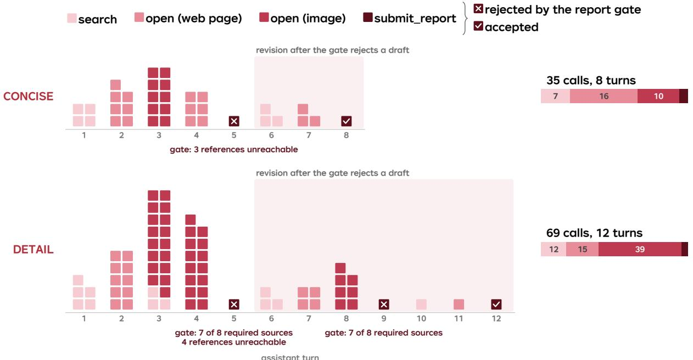  
Figure 6 Tool calls for the Roman-concrete request. Each column is one assistant turn, numbered below the axis; each square is one tool call made in that turn, two to a row, shaded by tool from light (search) to dark (submit\_report). A turn can issue several calls at once; turn 3 of the DETAIL run, for example, issues 20. The open tool appears twice because it opens either a web page or an image found on an opened page. A cross on a submit\_report square means the report gate rejected that draft, and a tick means it accepted it; the gate’s reason is printed under the axis, and the tinted band covers the turns spent revising after a rejection. The bar on the right gives each run’s total calls by tool.

Detail covers the whole request. The two modes trade breadth for length: the Concise-mode report answers the core of the request in a few sentences, while the Detail-mode report gives every part of the request its own treatment. The request names eight concepts, and Figure 7 counts, for each of them, the report sentences that mention it. The Detail-mode report mentions all eight in 59 sentences. The Concise mode report mentions seven in 10 sentences and leaves out the microstructural studies, keeping to the three mechanisms the request asks about.

Detail goes deeper on one topic. On a topic both reports cover, the two modes agree on the core explanation; the Detail mode adds context and mechanism, not diferent facts. Figure 8 collects everything each report says about lime clasts. Both explain how hot mixing with quicklime creates the clasts and how they heal cracks. The Detail-mode report adds the earlier reading of the clasts as poor-quality raw material, their role as a long-term calcium source for pore filling, and two further figures from the same MIT page.

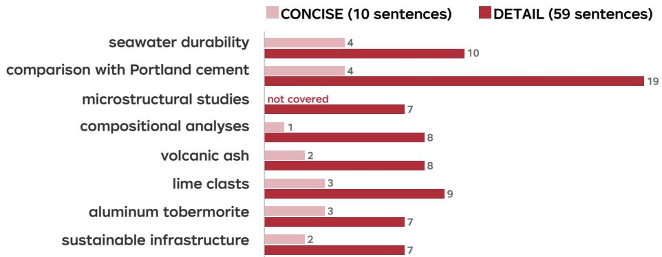  
Figure 7 Coverage of the request. For each of the eight concepts the request names, the number of report sentences that mention it, counted by keyword match over the report body (headings, image captions, and the reference list excluded). The CONCISE report touches seven of the eight in 10 sentences; the DETAIL report touches all eight in 59 sentences and is the only one to describe microstructural studies.

<table><tr><td></td><td>CONCISE</td><td>DETAIL</td></tr><tr><td>How they form</td><td>Quicklime used &quot;rather than pre-slaked lime&quot; creates them [1].</td><td>&quot;Hot mixing&quot; with quicklime (CaO) rather than only slaked lime; the exothermic reactioncreates them [2].</td></tr><tr><td>What they are</td><td>&quot;bright white, highly reactive calcium carbonate inclusions&quot; [1].</td><td>&quot;millimeter-scale bright white mineral features&quot;, macroscopic sources of reactive calcium [2].</td></tr><tr><td>Earlier view</td><td>Clasts &quot;were once dismissed as sloppy mixing.&quot;</td><td>Dismissed as sloppy mixingor poor-quality raw materials, now seen as purposefully incorporated [2].</td></tr><tr><td>How they heal cracks</td><td>Water dissolves calcium from the clasts, which &quot;recrystallizes to seal the damage&quot; [2].</td><td>Seawater mobilizes calcium from the clasts,and reactive hydration heals the cracks and remodels the interfacial zones; the clasts also feed long-term pore filling and post-pozzolanic reactivity [2].</td></tr><tr><td>Modern use</td><td>Lime-clast modern concretes “demonstrate self-healing potential&quot; [2].</td><td>Modern lime-clast mixtures show self-healing potential [2],framed as an “antiqua-inspired” approach to new materials.</td></tr></table>

Figure 8 One topic in both modes: lime clasts. Everything each report says about lime clasts, aligned point by point. Quotation marks mark text copied from the report; other cells are condensed from it without new content. Pink marks what only the DETAIL report says. Reference numbers follow each report’s own list.

## D.2 Concise and Detail Reports for the Roman Concrete Request

Both reports are reproduced in full, here and in Appendix D.3, typeset as text from the delivered Markdown with internal paths omitted; the report text itself is unchanged. Each report opens with a header card that gives its mode, its delivered statistics, and the user request, and closes with a gate record that lists every submission and its result. The annotations added for this appendix are explained below.

## HOW TO READ THE ANNOTATED REPORTS

Marker: a concept named in the request, at its first appearance. Wavy line: a specific claim whose source page was reopened for this appendix. TRACE: when the source page and the image were opened, read from the trajectory, and why the image was used. NOTE: our commentary. Red boxes: the part of an image the text relies on. [Image n]: placed after the sentence that image n supports. The delivered Markdown places images inline without numbers; the image numbers, these markers, and the per-image source list at the end of each report are added for this appendix. REPORT GATE RECORD: each submit\_report call and its checks.

Reference check. Every reference URL in the reports of this appendix was reopened and resolves to the cited page; for Appendix D.3, whose journal pages block automated access, claims were checked against the page text and captions captured during the run. The report gate checks that references are reachable and that their number meets the contract; it

## USER REQUEST

Why does Roman maritime concrete demonstrate superior long-term durability in seawater compared to many modern Portland cement formulations, and what do microstructural studies and compositional analyses reveal about the role of volcanic ash, lime clasts, and aluminum tobermorite formation? I need to compare these ancient and modern materials systems for a unit on sustainable infrastructure materials.

## Why Roman Maritime Concrete Outlasts Modern Portland Cement

Roman maritime concrete survives millennia in seawater because its chemistry actively strengthens over time, unlike modern Portland cement that degrades. The secret lies in volcanic ash, lime clasts, and aluminum-tobermorite formation.

## Volcanic Ash and Hot Mixing

NOTE Reference check. The crack-sealing mechanism at the end of this section (calcium dissolves and recrystallizes) is described on the MIT page [1]; the Scientific American page [2] reports only that the clasts enabled self-healing.

Romans mixed lime with volcanic ash (pozzolana) and seawater, triggering an exothermic reaction. A 2023 MIT study revealed they deliberately used quicklime rather than pre-slaked lime, creating “lime clasts”—bright white, highly reactive calcium carbonate inclusions[1]. [Image 1] These clasts were once dismissed as sloppy mixing, but they provide a self-healing reservoir: when cracks form, water dissolves calcium from the clasts, which recrystallizes to seal the damage[2].

Source page: Riddle solved: Why was Roman concrete so durable? | MIT News | Massachusetts Institute of Technology; caption on the page: “On left, Roman concrete structures of Privernum, Italy with icy puddles, orange sky, and rural location. On right, the concrete fragment

Why it was used. The one image that shows a lime clast: the red region of the color-mapped fragment.

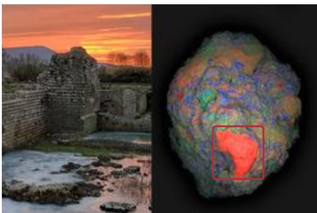  
Image 1. Roman concrete structures at Privernum, Italy, with a colorized fragment showing calcium-rich regions in red

## Al-Tobermorite: The Seawater Crystal

NOTE Reference check. The gate rejected the first draft because three references were unreachable. The run then opened three new pages and put them in the reference list, but kept the text and the citation numbers. The crystal-growth claim below is on the ASME page [4], not on [3], and the steel-corrosion clause cited to [4] is not on that page.

When seawater percolates through Roman concrete, it triggers formation of Al-tobermorite and phillipsite— rare interlocking crystals that grow inside micro-cracks and voids[3]. [Image 2] These minerals bind the matrix tighter over centuries, making submerged sections stronger than air-exposed ones. Modern concrete lacks this regenerative mechanism; seawater instead corrodes steel and breaks down its binding matrix[4].

TRACE turn 2 open(url) → turn 3 open(id=page\_img\_21) Source page: Learning from Roman Seawater Concrete; caption on the page: “Drill core of mortar consisting of volcanic ash and hydrated lime, showing yellowish particles of pumice, dark gray fragments of lava, and w. . . Why it was used. Pairs the drill core with an SEM view of the Al-tobermorite crystals that the section is about.

  
Image 2. Drill core of Roman mortar with volcanic ash, pumice, lava fragments, and relict lime, plus SEM image of Al-tobermorite crystals

## Sustainable Infrastructure Implications

NOTE Reference check. Page [3] supports the 10% lime and the lower temperature. The sentence cited to [2] is partly supported: Scientific American reports healed hotmixed samples, but the role of Al-tobermorite as a model for low-carbon composites comes from the Berkeley Lab ALS page, which the run opened but did not cite.

Roman concrete used \~10% lime by weight, produced at lower temperatures than Portland cement, and leveraged locally available volcanic materials[3]. Modern research is now replicating these principles: lime clast-containing modern concretes demonstrate self-healing potential, and Al-tobermorite serves as a model for high-performance, low-carbon cementitious composites[2]. [Image 3]

TRACE turn 2 open(url) → turn 3 open(id=page\_img\_2)

Source page: Riddle solved: Why was Roman concrete so durable? | MIT News | Massachusetts Institute of Technology; caption on the page: “The concrete fragment is colorized with rainbow colors, including a prominent section colored red.”

Why it was used. A crop of the fragment in Image 1. The red, calcium-rich region named in the caption lies outside this crop.

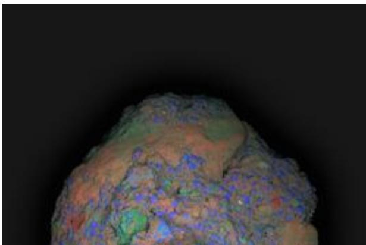  
Image 3. Colorized concrete fragment with rainbow elemental mapping showing calcium-rich zones

## MIRA report · DETAIL mode

## References

• [1] Riddle solved: Why was Roman concrete so durable? | MIT News

[2] Ancient Roman Concrete Has ’Self-Healing’ Capabilities | Scientific American https://www.scientificamerican.com/article/ancient-roman -concrete-has-self-healing-capabilities/

[3] Roman Seawater Concrete Holds the Secret to Cutting Carbon Emissions - Berkeley Lab https://newscenter.lbl.gov/2013/06/04/roman-concrete/

[4] Ancient Roman Concrete Stands the Test of Time - ASME https://www.asme.org/topics-resources/content/ancient-ro man-concrete-stands-test-time

## Image sources

• Images 1, 3 Riddle solved: Why was Roman concrete so durable? | MIT News | Massachusetts Institute of Technology https://news.mit.edu/2023/roman-concrete-durability-lime -casts-0106

• Image 2 Learning from Roman Seawater Concrete https://als.lbl.gov/learning-from-roman-concrete

## REPORT GATE RECORD

• Submission 1 (turn 5): WARN — 1,698 chars, 3 images, 5 sources; reference\_unreachable ×3

• Submission 2 (turn 8): OK — 1,722 chars, 3 images, 5 sources

## 8,063 chars · 13 images · 8 sources · 3 submissions

## USER REQUEST

Why does Roman maritime concrete demonstrate superior long-term durability in seawater compared to many modern Portland cement formulations, and what do microstructural studies and compositional analyses reveal about the role of volcanic ash, lime clasts, and aluminum tobermorite formation? I need to compare these ancient and modern materials systems for a unit on sustainable infrastructure materials.

## Roman Maritime Concrete: Why Ancient Seawater Structures Outlast Modern Portland Cement

## Introduction

Roman maritime concrete has survived for over two millennia in aggressive seawater environments, while many modern Portland cement structures deteriorate within decades. This report examines the material science behind Roman concrete’s exceptional durability, focusing on the roles of volcanic ash, lime clasts, and aluminum tobermorite formation revealed by modern microstructural and compositional analyses. Understand ing these ancient formulations ofers critical insights for developing sustainable, long-lasting infrastructure materials.

## Composition and Microstructure: The Roman Recipe

Roman concrete, or opus caementicium, difers fundamentally from modern Portland cement in its composition and manufacturing process. While modern concrete relies on Portland cement clinker—produced by calcining limestone and clay at approximately 1450°C—Roman concrete used lime and volcanic ash (pozzolana) mixed with water and coarse aggregates[1]. The Romans employed a “hot mixing” technique, incorporating quicklime (CaO) directly into the mixture rather than using only slaked lime[2]. This exothermic reaction generated temperatures suficient to create distinctive millimeter-scale bright white mineral features known as “lime clasts”[2].

TRACE turn 2 open(url) → turn 3 open(id=page\_img\_7) Source page: Learning from Roman Seawater Concrete; caption on the page: “Drill core of mortar consisting of volcanic ash and hydrated lime, showing yellowish particles of pumice, dark gray fragments of lava, and w. . . Why it was used. Pairs the drill core with an SEM view of Al-tobermorite, matching the composite structure the paragraph describes.

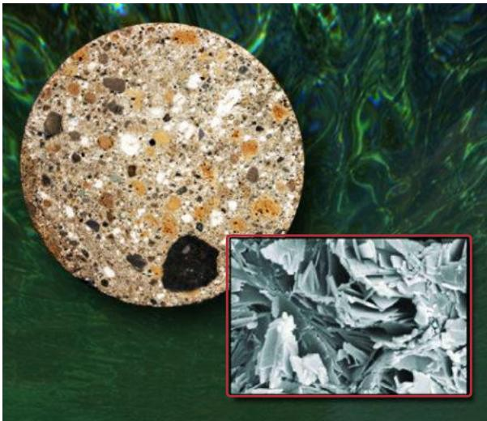  
Image 1. Drill core of Roman mortar showing volcanic ash, pumice, lava fragments, and relict lime particles, with inset SEM image of Al-tobermorite crystals

The drill core shown above illustrates the heterogeneous microstructure of Roman maritime concrete from Pozzuoli Bay. [Image 1] The yellowish pumice particles, dark gray lava fragments, and white relict lime particles are all bound by a light gray cementitious matrix[1]. This composite structure difers dramatically from the relatively homogeneous binder-aggregate system of modern concrete.

TRACE turn 7 open(url) → turn 8 open(id=page\_img\_46) Source page: Ancient Roman Concrete Stands the Test of Time - ASME; caption on the page: “An ancient pier is still standing in a bay in Italy, and researchers have studied samples of the concrete to explore the secrets of its long. . .

Why it was used. Shows the kind of harbor structure that was sampled; it sets the scene rather than carrying a measurement. It shows the same pier and drilling rig as Image 6, photographed from a different position.

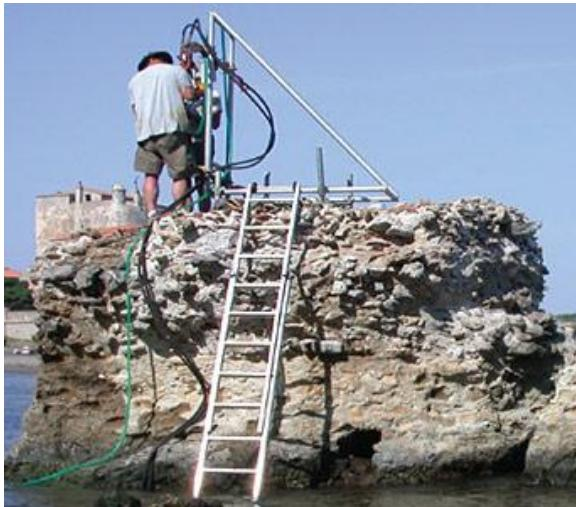  
Image 2. Ancient pier still standing in a bay in Italy, with researchers studying samples of the concrete

Researchers from Lawrence Berkeley National Laboratory and the University of Utah analyzed samples of Roman concrete from harbor structures in Italy at Berkeley Lab’s Advanced Light Source[5]. [Image 2] The ancient pier shown above demonstrates the remarkable longevity of these structures in marine environments.

## The Role of Volcanic Ash: Pozzolanic Reactivity

NOTE Reference check. Silica and alumina are on the Wisconsin page [3]; the Pozzuoli Bay location comes from [1]. The pozzolanic-reaction sentence is only partly on [7], which says that seawater forms aluminous tobermorite and phillipsite.

Volcanic ash, particularly from the Pozzuoli Bay region, contains both silica and alumina that proved crucial for the chemical reactions responsible for Roman concrete’s durability[3]. When seawater contacts the concrete, a pozzolanic reaction occurs between the volcanic ash, lime, and saltwater to produce enduring cementitious hydrates[7].

TRACE turn 7 open(url) → turn 8 open(id=page\_img\_67) Source page: Why is Roman concrete more durable than modern concrete?; caption on the page: “Figure 1: Erosion due to sea water on concrete pylons. Image: Brian Robinson.”

Why it was used. The report’s only image of modern concrete, eroded by seawater.

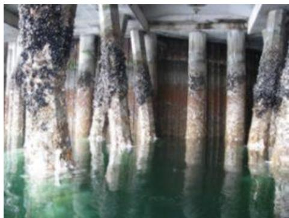  
Image 3. Erosion due to sea water on modern concrete pylons, showing the degradation that modern concrete sufers

Modern concrete is porous and degrades in contact with seawater. [Image 3] Seawater can seep into its pores, and when dried out the salts crystallize. The crystallization pressure of the salts produces stresses that can result in cracks and spalls[7]. Other chemical processes such as sulphate attack, lime leaching, and alkali-aggregate expansion all degrade modern concrete.

TRACE turn 7 open(url) → turn 8 open(id=page\_img\_68) Source page: Why is Roman concrete more durable than modern concrete?; caption on the page: “Figure 2: A 2000 year old Roman jetty. Image: Art853.” Why it was used. A Roman jetty, set against the eroded modern pylons of Image 3.

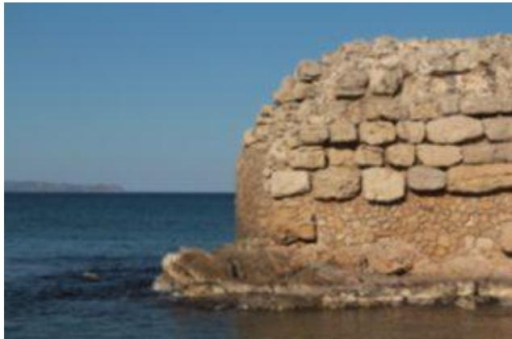  
Image 4. A 2000 year old Roman jetty still standing, demonstrating the superior durability of Roman concrete

In contrast, 2000-year-old concrete constructed during the Roman Empire is still going strong[7]. [Image 4] The Roman concrete samples were found to contain rare aluminous tobermorite and phillipsite crystals that strengthen the material over time.

## Aluminum Substitution and C-A-S-H Formation

NOTE This section was rewritten after the first rejection. The first draft built it on figures from a Science Advances page the gate could not reach; the accepted version uses the newly opened Risk Frontiers [7] and Berkeley Lab [4] pages.

One of the most significant discoveries in Roman concrete research concerns the binder chemistry. In Portland cement concrete, the primary binding compound is calcium-silicate-hydrate (C-S-H). Roman concrete, however, produces a significantly diferent compound: calcium-aluminum-silicate-hydrate (C-A-S-H)[1].

TRACE turn 7 open(url) → turn 8 open(id=page\_img\_70) Source page: Why is Roman concrete more durable than modern concrete?; caption on the page: “Figure 4: SEM image showing the presence of aluminous tobermorite and phillipsite within Roman marine concrete. Image from Jackson et. al.,. . .

Why it was used. SEM evidence for the two minerals that the section names.

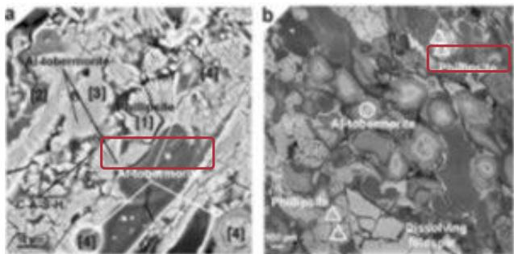  
Image 5. SEM image showing the presence of aluminous tobermorite and phillipsite within Roman marine concrete

The scanning electron microscope image reveals the presence of aluminous tobermorite and phillipsite within Roman marine concrete[7]. [Image 5] These minerals form through low-temperature water-rock reactions as seawater percolates through the massive structures, reinforcing the cementing matrix in a kind of regenerative process that strengthens the concrete[4].

TRACE turn 7 open(url) → turn 8 open(id=page\_img\_69) Source page: Why is Roman concrete more durable than modern concrete?; caption on the page: “Figure 3: The research ground lead by Marie Jackson obtaining samples from the Portus Cosanus pier in Orbetello Italy. Image: Marie Jackson.”

Why it was used. Sampling at the Portus Cosanus pier, supporting the sentence on drilled samples.

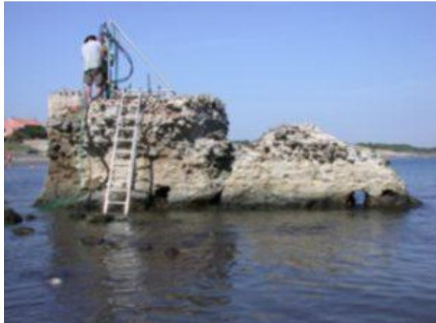  
Image 6. The research ground led by Marie Jackson obtaining samples from the Portus Cosanus pier in Orbetello Italy

The research team obtained samples by drilling Roman harbour structures and compared them with volcanic rock[7]. [Image 6] The combination of scanning electron microscopy, micro X-ray difraction, Raman spectroscopy, and electron probe microanalysis revealed the complex mineralogical composition.

## Al-Tobermorite: The Key to Durability

Perhaps the most remarkable discovery in Roman concrete research is the presence of Al-tobermorite, a rare mineral that does not occur in conventional modern concrete but appears routinely in the mortars of ancient sea-

water concretes[1].

TRACE turn 2 open(url) → turn 3 open(id=page\_img\_8) Source page: Learning from Roman Seawater Concrete; caption on the page: “Left: Integrated high-pressure powder x-ray diffraction patterns of Al-tobermorite obtained at Beamline 12.2.2. The Al-tobermorite specimen. . .

Why it was used. The pressure series on the left is the evidence for the stiffness claim in the next sentence.

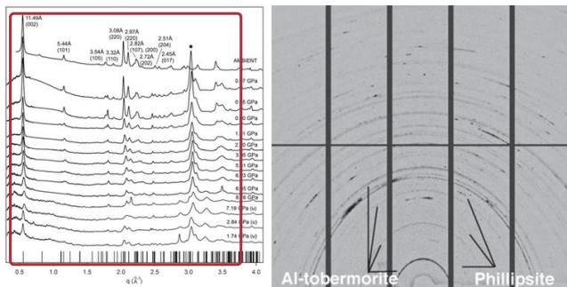  
Image 7. High-pressure X-ray difraction patterns of Al-tobermorite and Debye rings from microdifraction experiments

The X-ray difraction patterns show Al-tobermorite’s crystal structure under varying pressures, demonstrating its mechanical stability[1]. [Image 7] High-pressure X-ray difraction measurements revealed that Al-tobermorite has greater stifness than poorly crystalline C-A-S-H, providing a model for concrete strength and durability[1].

TRACE turn 7 open(url) → turn 8 open(id=page\_img\_45) Source page: Ancient Roman Concrete Stands the Test of Time - ASME; caption on the page: “Image” Why it was used. The page’s caption is only the placeholder “Image”; the report’s caption repeats the article’s subtitle.

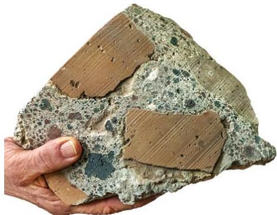  
Image 8. The ancient Romans had a recipe for concrete that won’t corrode in seawater

The ancient Romans had a recipe for concrete that won’t corrode in seawater. [Image 8] Scientists are trying to figure it out, and the answer lies in the unique mineral chemistry of the Roman formulation[5].

## Self-Healing Mechanisms: The Role of Lime Clasts

Recent research has fundamentally changed understanding of lime clasts in Roman concrete. Previously dismissed as evidence of sloppy mixing or poor-quality raw materials, these millimeter-scale bright white features are now recognized as purposefully incorporated self-healing agents[2].

TRACE turn 2 open(url) → turn 3 open(id=page\_img\_21) Source page: Riddle solved: Why was Roman concrete so durable? | MIT News | Massachusetts Institute of Tech nology; caption on the page: “On left, Roman concrete structures of Privernum, Italy with icy puddles, orange sky, and rural location. On right, the concrete fragment is. . .

Why it was used. The image that shows the lime clast: the red region of the color-mapped fragment.

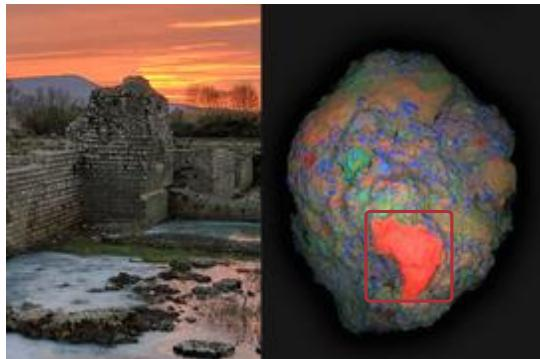  
Image 9. Roman concrete structures at Privernum with colorized fragment showing lime clast in red

The colorized concrete fragment clearly shows the lime clast (red) within the matrix[2]. [Image 9] These macroscopic inclusions serve as critical sources of reactive calcium for long-term pore and crack-filling or post-pozzolanic reactivity within the cementitious constructs[2].

TRACE turn 2 open(url) → turn 3 open(id=page\_img\_22) Source page: Riddle solved: Why was Roman concrete so durable? | MIT News | Massachusetts Institute of Technology; caption on the page: “The concrete fragment is colorized with rainbow colors, including a prominent section colored red.”

Why it was used. The report says this fragment shows a prominent red lime-clast region. The description follows the caption on the page; in this crop the red region is not visible.

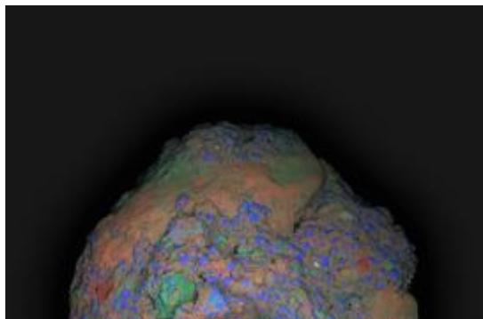  
Image 10. Colorized concrete fragment with prominent red lime clast region

The detailed colorization reveals how the lime clast integrates with the surrounding matrix[2]. [Image 10] When cracks form, seawater mobilizes calcium from these clasts, triggering reactive hydration that heals the cracks and remodels the interfacial zones[2].

TRACE turn 2 open(url) → turn 3 open(id=page\_img\_25) Source page: Riddle solved: Why was Roman concrete so durable? | MIT News | Massachusetts Institute of Technology; caption on the page: “cement chemistry” Why it was used. Image check. The report describes a hot-mixing diagram with clast core, hydration rim and carbonation. The image shows a highway overpass with a color-mapped micrograph inset, and the page’s alt text is only “cement chemistry”. The description is not grounded in the image.

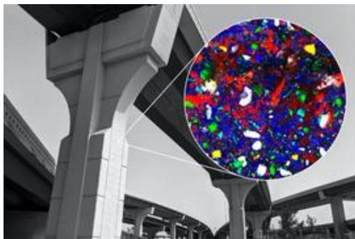  
Image 11. Cement chemistry diagram showing hot mixing process and lime clast formation

The cement chemistry diagram illustrates the hot mixing process: volcanic ash, sand, aggregate (tephra), water, and quicklime are mixed, with the exothermic reaction creating lime clasts[2]. [Image 11] The hydration and expansion process forms the clast core, hydration rim, and eventually carbonation products.

TRACE turn 2 open(url) → turn 3 open(id=page\_img\_26) Source page: Riddle solved: Why was Roman concrete so durable? | MIT News | Massachusetts Institute of Technology; caption on the page: “Assistant Professor Admir Masic uses an x-ray fluorescence spectrometer to analyze ancient materials in Italy. Masic is at the forefront of. . . ”

Why it was used. Shows X-ray fluorescence analysis in the field, supporting the sentence on Masic’s method.

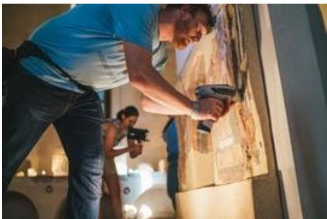  
Image 12. Admir Masic using X-ray fluorescence spectrometer to analyze ancient materials

MIT Assistant Professor Admir Masic employs X-ray fluorescence spectrometry to analyze ancient materials, pioneering an “antiqua-inspired” approach to new materials development[2]. [Image 12] This research demonstrates that modern lime clast-containing cementitious mixtures exhibit self-healing potential, paving the way for more durable, resilient, and sustainable concrete formulations[2].

## Environmental and Sustainability Implications

NOTE Reference check. The figure of up to one ton of CO2 per ton of cement is not on the Kilgore page [6]. The first draft cited it to the Science Advances paper, which the gate could not reach.

The Roman concrete recipe ofers significant environmental advantages over modern Portland cement. The Roman formulation required approximately 10% lime by weight, made at two-thirds or less the temperature required by Portland cement[1]. This translates to substantially lower CO2 emissions, as Portland cement production alone releases up to 1 metric ton of CO2 per metric ton of material produced[6].

TRACE turn 7 open(url) → turn 8 open(id=page\_img\_47) Source page: Ancient Roman Concrete Stands the Test of Time - ASME; caption on the page: “The walls of Trajan’s Markets in Rome have stood the test of time and the elements for nearly 2,000 years. Image: Marie Jackson / Berkeley L. . .

Why it was used. Trajan’s Markets, used to show that the durability extends beyond marine structures.

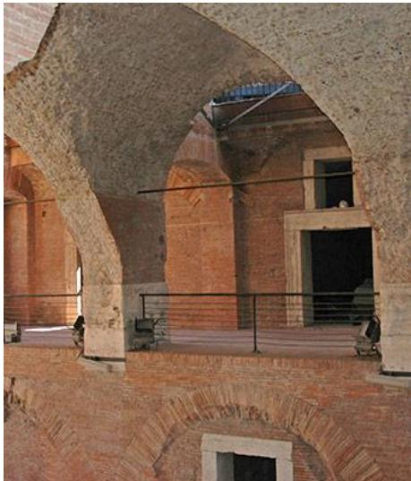  
Image 13. The walls of Trajan’s Markets in Rome have stood the test of time and the elements for nearly 2,000 years

The walls of Trajan’s Markets in Rome have stood the test of time and the elements for nearly 2,000 years[5]. [Image 13] This demonstrates the long-term durability of Roman concrete technology in various environmental conditions.

## Comparison with Modern Concrete

Modern concrete consists of Portland cement, stone aggregates, and sand mixed with fresh water[6]. The main advantage of modern concrete is that it sets and dries quickly compared to Roman concrete. Modern concrete is also widely available and accessible in mass production[6].

However, modern concrete has significant disadvantages. Modern concrete is likely to crack because of the reinforcement steel used in the mixture. The steel corrosion inside concrete can cause the concrete to expand and crack[6]. Another disadvantage is that modern Portland cement production emits about 8% of carbon dioxide into the atmosphere[6].

Roman concrete is more environmentally friendly because production does not emit toxic gases[6]. This concrete is less likely to crack under stress due to less water in the concrete mixture with no reinforcement steels[6].

## Conclusion

Roman maritime concrete demonstrates superior longterm durability compared to modern Portland cement formulations due to several interconnected factors: (1) the use of volcanic ash with silica and alumina content that enables pozzolanic reactivity; (2) the formation of C-A-S-H binder with aluminum substitution for silicon; (3) the crystallization of Al-tobermorite, which provides exceptional stifness and stability; and (4) the purposeful inclusion of lime clasts that enable self-healing through reactive calcium mobilization. These ancient materials systems, developed through empirical optimization over centuries, ofer sustainable prototypes for modern concrete engineering. By incorporating lime clasts and volcanic ash into modern formulations, engineers can develop more durable, resilient, and environmentally friendly concrete that reduces the carbon footprint of construction while extending infrastructure service life.

## References

NOTE Reference [8] is not cited in the text. It was added after the second rejection, which asked for an eighth accessible source.

[1] Learning from Roman Seawater Concrete https://als.lbl.gov/learning-from-roman-concrete/ - ALS Berkeley

[2] Riddle solved: Why was Roman concrete so durable? https://news.mit.edu/2023/roman-concrete-durability-lime-cas

ts-0106 - MIT News

[3] Roman Concrete

https://ancientengrtech.wisc.edu/roman-concrete/ UW-Madison Ancient Engineering Technologies

[4] The Ancient Roman Secret to Concrete Resilience in Seawater

https://als.lbl.gov/ancient-roman-secret-concrete-resilience -seawater/ - ALS Berkeley

[5] Ancient Roman Concrete Stands the Test of Time https://www.asme.org/topics-resources/content/ancient-romanconcrete-stands-test-time - ASME

[6] Roman Concrete vs. Modern Concrete

https://kilgorecompanies.com/blog/2022/08/26/roman-concrete-v s-modern-concrete/ - Kilgore Companies

[7] Why is Roman concrete more durable than modern concrete?

https://riskfrontiers.com/insights/why-is-roman-concrete-mor e-durable-than-modern-concrete/ - Risk Frontiers

[8] Ancient Roman concrete found to have self-healing capability

https://www.iom3.org/resource/roman-concrete.html - IOM3

## Image sources

• Images 1, 7 Learning from Roman Seawater Concrete https://als.lbl.gov/learning-from-roman-concrete

• Images 2, 8, 13 Ancient Roman Concrete Stands the Test of Time - ASME https://www.asme.org/topics-resources/content/ancient-ro man-concrete-stands-test-time

• Images 3–6 Why is Roman concrete more durable than mod ern concrete? https://riskfrontiers.com/insights/why-is-roman-concrete -more-durable-than-modern-concrete/

• Images 9–12 Riddle solved: Why was Roman concrete so durable? | MIT News | Massachusetts Institute of Technology https://news.mit.edu/2023/roman-concrete-durability-lime -casts-0106

## REPORT GATE RECORD

• Submission 1 (turn 5): WARN — 8,516 chars, 17 images, 7 sources; source\_count, reference\_unreachable ×4, accessible\_reference\_count

• Submission 2 (turn 9): WARN — 8,069 chars, 13 images, 7 sources; source\_count, accessible\_reference\_count

• Submission 3 (turn 12): OK — 8,063 chars, 13 images, 8 sources

## D.3 Concise and Detail Reports for the Desert-Plant Photosynthesis Request

The second request asks how crassulacean acid metabolism (CAM), a form of photosynthesis that takes up carbon dioxide at night, evolved in unrelated desert plants. It shows the same diference between the two modes on an unrelated topic. The Concise-mode report answers in 1,765 characters with 2 images and 5 sources, under three sections on anatomy, physiology, and metabolism. The Detail-mode report uses 7,377 characters, 13 images, and 9 sources, and adds separate sections on carbon isotope ratios, nocturnal gas exchange, facultative CAM, and phylogenetic distribution. Both reports pass the gate on the first submission and are annotated as in Appendix D.2. Most sources are PubMed Central pages, which now refuse automated access, so their claims were checked against the page text and figure captions captured during the run and against the image pixels, not against a fresh copy of each page.

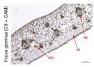

## USER REQUEST

How has CAM photosynthesis diversified across unrelated desert plant lineages, and what do anatomical cross-section micrographs, carbon isotope ratio charts, and nocturnal gas exchange diagrams from public herbarium and research collections reveal about the convergent evolutionary solutions to arid environments in agaves, cacti, and euphorbias?

## Convergent CAM Photosynthesis in Desert Plants

Crassulacean acid metabolism (CAM) has evolved independently across diverse plant lineages as a convergent solution to arid environments. The Agavoideae subfamily exemplifies this diversity, with species ranging from C3 to CAM and intermediate phenotypes[1].

## Anatomical Convergence

NOTE Reference check. The figure caption on page [1] labels the undifferentiated mesophyll (M), intercellular airspace (IAS) and vascular bundles (VB) of Yucca aloifolia; “large vacuoles for malate storage” and “reduced” airspace are not in that caption. Page [2] says that unrelated groups evolved desert traits independently and that euphorbias and cacti are stem succulents, but it does not use the phrase “water-storing tissues”.

Leaf cross-sections reveal shared structural adaptations. CAM species like Yucca aloifolia show undiferentiated mesophyll (M) with large vacuoles for malate storage, reduced intercellular air spaces (IAS), and prominent vascular bundles $( \mathrm { V B } ) ^ { [ 1 ] }$ . [Image 1] These features appear across unrelated succulents including agaves, cacti, and euphorbias, which independently evolved fleshy, waterstoring tissues[2].

TRACE turn 3 open(url) → turn 4 open(id=page\_img\_23) Source page: The Agavoideae: an emergent model clade for CAM evolutionary biology; caption on the page: “(A) Anatomical cross-sections of leaves from Yucca aloifolia (top, CAM), Y. gloriosa (middle, C3 + CAM) and Y. filamentosa (bottom, C3). VB: vascular bundle, M: undifferentiated mesophyll, IAS: intercellular airspace” Why it was used. The only micrograph the run opened, and the one that puts a CAM, an intermediate and a C3 leaf side by side. The text relies on the top-left section (CAM).

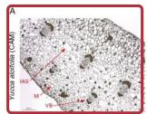

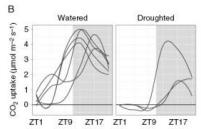

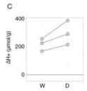

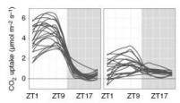

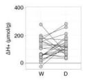

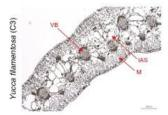

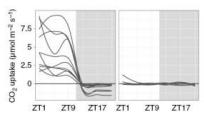

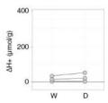  
Image 1. Anatomical cross-sections of Yucca leaves showing CAM, C3+CAM, and C3 phenotypes with labeled vascular bundles, mesophyll, and intercellular air spaces

## Physiological and Biochemical Evidence

NOTE Reference check. The last sentence has the direction reversed. Stronger CAM moves $\delta ^ { 1 3 } \mathsf { C }$ toward less negative values, because the nocturnal carboxylase discriminates less against $^ { 1 3 } { \mathsf { C } } ;$ values near −25 to −30‰ are typical of C3 plants. The page text captured from [4] gives no ranges, and its $\delta ^ { 1 3 } \mathsf { C }$ chart, opened in turn 4 but not used, does not label photosynthetic types. The model’s reasoning before submission already contains the error; the gate does not check claims.

Nocturnal gas exchange diagrams demonstrate the functional convergence: CAM plants open stomata at night to fix $\mathrm { C O } _ { 2 } ,$ storing it as malic acid for daytime photosynthesis[3]. [Image 2] This inverted rhythm minimizes water loss during hot days. Carbon isotope ratios $( \delta ^ { 1 3 } \mathrm { C } )$ further confirm CAM evolution across lineages, with values shifting toward more negative values (∼–25 to –30‰) as plants adopt stronger CAM phenotypes[4].

TRACE turn 3 open(url) → turn 4 open(id=page\_img\_106) Source page: Stomatal Biology of CAM Plants; caption on the page: “Summary of differences in stomatal biology of C3 and CAM plants. A, Representative curves of day/night rhythms in stomatal conductance (gs) in C3 and CAM plants.”

Why it was used. The run’s only diagram of stomatal opening over a day and night; the CAM curve (top right) is high at night and closed at midday. The text never names this page, so the renderer listed it under the image sources.

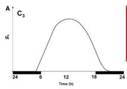

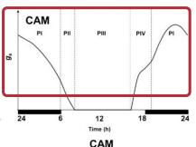

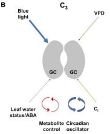

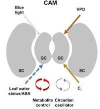  
Image 2. Stomatal conductance rhythms comparing C3 and CAM plants, showing nocturnal opening in CAM species

## Metabolic Integration

The CAM cycle requires elevated nocturnal respiration to power malate accumulation. Flux balance models and physiological data show mitochondria must increase respiratory oxygen consumption at night to gen erate ATP and NADH for phosphoenolpyruvate carboxylase $\mathrm { \ a c t i v i t y } ^ { [ 3 ] }$ This metabolic integration—combining nocturnal CO2 uptake, vacuolar storage, and daytime decarboxylation—represents a convergent biochemical solution to water limitation that has arisen repeatedly across✿✿✿✿✿✿✿✿✿✿✿angiosperms,✿✿✿✿✿✿✿✿✿✿✿✿gymnosperms,✿✿✿✿and ✿✿✿✿ferns[4].

## References

• [1] The Agavoideae: an emergent model clade for CAM evolutionary biology

https://pmc.ncbi.nlm.nih.gov/articles/PMC10799990/

• [3] Elevated nocturnal respiratory rates in the mitochondria of CAM plants https://pmc.ncbi.nlm.nih.gov/articles/PMC10799998

• [4] The diverse diaspora of CAM: a pole-to-pole sketch https://pmc.ncbi.nlm.nih.gov/articles/PMC10800000/

## Image sources

• Image 1 The Agavoideae: an emergent model clade for CAM evolutionary biology https://pmc.ncbi.nlm.nih.gov/articles/PMC10799990/

• Image 2 Stomatal Biology of CAM Plants https://pmc.ncbi.nlm.nih.gov/articles/PMC5462028/

## REPORT GATE RECORD

• Submission 1 (turn 5): OK — 1,765 chars, 2 images, 5 sources

## MIRA report · DETAIL mode

## USER REQUEST

## 7,377 chars · 13 images · 9 sources · 1 submission

How has CAM photosynthesis diversified across unrelated desert plant lineages, and what do anatomical cross-section micrographs, carbon isotope ratio charts, and nocturnal gas exchange diagrams from public herbarium and research collections reveal about the convergent evolutionary solutions to arid environments in agaves, cacti, and euphorbias?

## Convergent Evolution of CAM Photosynthesis in Desert Plants: Evidence from Anatomy, Isotopes, and Gas Exchange

## Introduction

Crassulacean acid metabolism (CAM) photosynthesis has evolved independently over 60 times across vascular plants, making it one of the most striking examples of evolutionary convergence on a complex trait[1]. This pathway allows plants to open stomata at night when transpirational water loss is minimized, fixing CO2 into malic acid for daytime use. The Agavoideae (agaves and yuccas), Cactaceae (cacti), and Euphorbiaceae (euphorbias) represent three unrelated lineages that have independently evolved CAM and succulence as solutions to arid environments. This report examines how anatomical cross-sections, carbon isotope ratios, and nocturnal gas exchange data reveal convergent evolutionary solutions across these lineages.

## CAM as a Convergent Adaptation to Aridity

NOTE Reference check. The epiphytes in the paragraph after Image 1 come from the figure caption on page [3] (an orchid, two bromeliads including Spanish moss); “leafless photosynthetic roots” is not in the page text or caption captured during the run.

CAM photosynthesis is present in approximately 5% of vascular plants, distributed across ferns, gymnosperms, and angiosperms[2]. The pathway involves nocturnal CO2 fixation via phosphoenolpyruvate carboxylase (PEPC), storage of malic acid in vacuoles, and daytime decarboxylation to supply CO2 to Rubisco behind closed stomata[3]. This temporal separation of carbon acquisition and fixation dramatically improves water-use eficiency, enabling survival in deserts, epiphytic habitats, and other water-limited niches.

TRACE turn 8 open(url) → turn 9 open(id=page\_img\_215) Source page: Prospects and perspectives: inferring physiological and regulatory targets for CAM from molecular and modelling approaches; caption on the page: “Diversity in succulent CAM lifeforms and a typical gas exchange profile. Terrestrial CAM plants: (A) massive stem succulent convergence in cacti (left) and euphorbia (right) species, with agave (centre)” Why it was used. The one photograph in the run with a Why it was used. The one photograph in the run with a cactus, a euphorbia and an agave side by side (panel A); cactus, a euphorbia and an agave side by side (panel A);

panel I adds the four CAM phases over a day.

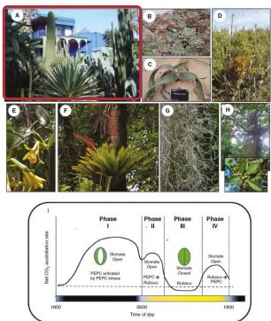  
Image 1. Diversity of succulent CAM lifeforms including cacti, euphorbias, agaves, and epiphytic species, with a schematic of CAM phases showing nocturnal stomatal opening and daytime CO release

The morphological diversity of CAM plants is remarkable. Terrestrial representatives include massive stem succulents like cacti and euphorbias, leaf succulents like agaves, and more herbaceous forms like Crassulaceae[3]. [Image 1] Epiphytic CAM plants include orchids, bromeliads, and Spanish moss. This diversity demonstrates that CAM can be integrated into many body plans, from arborescent forms to leafless photosynthetic roots.

## Anatomical Convergence: Leaf Structure and Succulence

NOTE Reference check. The figure on page [4] labels the vascular bundles, mesophyll and intercellular airspace of the three Yucca leaves; it does not say that the CAM leaves are thicker or that their airspaces are large.

Anatomical cross-sections reveal convergent structural adaptations for CAM function. The Agavoideae subfamily provides an excellent model for studying CAM evolution because it contains species spanning the C3–CAM ✿✿✿✿✿✿✿✿✿continuum[4].

TRACE turn 2 open(url) → turn 3 open(id=page\_img\_23) Source page: The Agavoideae: an emergent model clade for CAM evolutionary biology; caption on the page: “(A) Anatomical cross-sections of leaves from Yucca aloifolia (top, CAM), Y. gloriosa (middle, C3 + CAM) and Y. filamentosa (bottom, C3). VB: vascular bundle, M: undifferentiated mesophyll, IAS: intercellular airspace” Why it was used. The same figure as in the Concise report: a CAM, an intermediate and a C3 leaf from one genus. The text relies on the three sections in the left column.

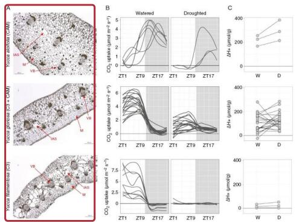  
Image 2. Anatomical cross-sections of Yucca leaves showing CAM (Y. aloifolia), C3+CAM intermediate (Y. gloriosa), and C3 (Y. filamentosa) phenotypes with labeled vascular bundles, mesophyll, and intercellular air spaces

In Yucca, CAM species like Y. aloifolia exhibit thick leaves with large intercellular air spaces and undiferentiated mesophyll, while C3 species like Y. filamentosa show more typical leaf anatomy[4]. [Image 2] The hybrid Y. gloriosa displays intermediate anatomy and physiology, making it a valuable system for studying CAM evolution[8]. [Image 3]

The Euphorbia milii leaf cross-section reveals another convergent anatomical solution. The leaf contains palisade parenchyma, spongy parenchyma, and a bundle sheath with chloroplasts, suggesting possible C2 photosynthesis alongside weak $\mathrm { C A M } ^ { [ 5 ] }$ . [Image 4]

TRACE turn 8 open(url) → turn 9 open(id=page\_img\_240) Source page: Gas exchange and leaf anatomy of a C3– CAM hybrid, Yucca gloriosa (Asparagaceae); caption on the page: “Cross sections of Y. aloifolia (A and B), Y. gloriosa (C and D), and Y. filamentosa (E and F) at 5× (A, C, E) and 10× (B, D, F) magnification.”   
Why it was used. Shows the hybrid’s leaf between its two parents at two magnifications, for the sentence on Y. gloriosa.

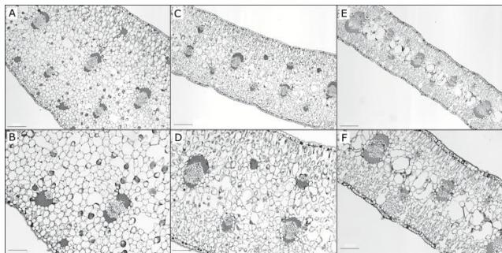  
Image 3. Cross-sections of Y. aloifolia (CAM), Y. gloriosa (C3+CAM), and Y. filamentosa (C3) at 5× and 10× magnification showing progressive anatomical diferences

TRACE turn 5 open(url) → turn 6 open(id=page\_img\_139) Source page: Crassulacean acid metabolism-cycling in Euphorbia milii; caption on the page: “Cross-sections of the leaf of E. milii. UE, upper epidermis; PP, palisade parenchyma; VB, vascular bundle; BS, bundle sheath; SP, spongy parenchyma; LE, lower epidermis. Arrowheads point at chloroplasts.”

Why it was used. The run’s only cross-section from a euphorbia, one of the three lineages in the request.

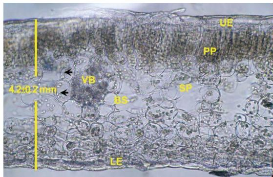  
Image 4. Cross-section of E. milii leaf showing upper epidermis, palisade parenchyma, vascular bundle, bundle sheath, spongy parenchyma, and lower epidermis

Succulence—fleshy tissue with high water content—is hypothesized to be essential for CAM function because it allows storage of large amounts of assimilated carbon as malate and assists in trapping CO2 released during the $\stackrel { \mathrm { d a y } } { \sim } \stackrel { [ 1 ] } { }$

## Carbon Isotope Ratios: Quantifying CAM Contribution

NOTE Reference check. Page [6] states that PEP carboxylase discriminates less against 13C and that strong CAM plants resemble C4 plants, but the ranges in parentheses are not in the text captured from it. The peaks at −13‰ and −26‰ that the report gives for the 506- species figure come from a bromeliad survey described elsewhere on the page; the figure itself peaks near −14‰ and −28‰. Page [2] does not say which Aizoaceae subfamilies are CAM.

Carbon isotope ratios $( \delta ^ { 1 3 } \mathrm { C } )$ provide a powerful tool for identifying CAM plants and quantifying the relative contribution of nocturnal versus diurnal carbon fixation. The enzyme PEP carboxylase discriminates less against $^ { 1 3 } \mathrm { C }$ than Rubisco, so plants with strong CAM exhibit $\smash { \delta ^ { 1 3 } \mathrm { C } }$ values similar to C4 plants (around –10‰ to –15‰), while C3 plants show more negative values (around $- 2 5 \text{‰}$ to – $3 0 \text{‰}$

TRACE turn 2 open(url) → turn 3 open(id=page\_img\_78) Source page: How Closely Do the $\mathsf { \bar { \delta } } ^ { 1 3 } \mathsf { C }$ Values of Crassulacean Acid Metabolism Plants Reflect the Proportion of $\mathtt { C O } _ { 2 }$ Fixed during Day and Night?; caption on the page: “Relationships between the cumulative net carbon gain in the light and the dark and the $\delta ^ { 1 3 } \mathsf { C }$ values $\dots$ Extrapolation of the fitted regression . . . in B indicates $\delta ^ { 1 3 } \mathsf { C }$ values $\pmb { 0 \dag } - \pmb { 8 . 7 \% }$ for 100% dark $\ b { \ b { \ b { \ b { \ b { \ b { \ b { \ b { \ b { \ b { \ b { \ b { \ b { \ b { \ b { \ b { \ b { \ b { \ b { \ b { \ b { \ b } 2 } } } } } } } } } } } } } } } } } } } }$ uptake and −26.9‰ for 100% CO2 uptake during the light. Why it was used. The source of the two end-point values in the next paragraph, which come from panel B.

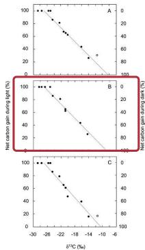  
Image 5. Relationships between cumulative net carbon gain in light and dark and $\delta ^ { 1 3 } \mathrm { C }$ values, showing linear correlations for CAM species

Experimental studies demonstrate that $\underset { \sim \sim } { \delta ^ { 1 3 } \mathrm { C } }$ values correlate linearly with the proportion of carbon gained in the dark versus light. For CAM species, extrapolation indicates $\bar { \delta } ^ { 1 3 } \mathrm { C }$ values of approximately $- 8 . 7 \text{‰}$ for 100% dark $\mathrm { { C Q } _ { 2 } }$ uptake and –26.9‰ for 100% light CO2 $\mathrm { u p t a k e } ^ { [ 6 ] }$ . [Image 5] This relationship allows researchers to estimate the CAM contribution in natural populations.

TRACE turn 2 open(url) → turn 3 open(id=page\_img\_79) Source page: How Closely Do the $\delta ^ { 1 3 } \mathsf { C }$ Values of Crassulacean Acid Metabolism Plants Reflect the Proportion of $\mathtt { C O } _ { 2 }$ Fixed during Day and Night?; caption on the page: ${ } ^ { \mathfrak { a } } \delta ^ { 1 3 } \mathsf { c }$ values of 506 species from the Asclepiadaceae, Bromeliaceae, Crassulaceae, Cucurbitaceae, Didiereaceae, Euphorbiaceae, Orchidaceae, Polypodiaceae, and Vittariaceae plant families known to contain both C3 and CAM members.”

Why it was used. A two-peaked histogram across nine families, including the Euphorbiaceae, for the sentence on the C3–CAM split.

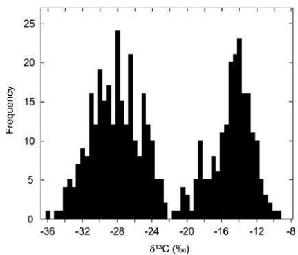  
Image 6. $\delta ^ { 1 3 } \mathrm { C }$ values of 506 species from multiple plant families showing bimodal distribution with peaks around –13‰ (strong CAM) and –26‰ (C3)

The bimodal distribution of $\delta ^ { 1 3 } \mathrm { C }$ values across plant families reveals the evolutionary transition between C3 and CAM photosynthesis. [Image 6] In the Aizoaceae, for example, diferent subfamilies show distinct $\delta ^ { 1 3 } \mathrm { C }$ distributions reflecting their CAM status[2]. [Image 7]

TRACE turn 5 open(url) → turn 6 open(id=page\_img\_116) Source page: The diverse diaspora of CAM: a pole-topole sketch; caption on the page: “Values of $\bar { { \boldsymbol \delta } } ^ { \mathrm { f 3 } } \bar { { \boldsymbol \mathsf { c } } }$ (per mille) of taxa from the five subfamilies of the Aizoaceae. Note that frequency values include values from different species and multiple measurements of the same species.”

Why it was used. One family broken down by subfamily, for the Aizoaceae sentence.

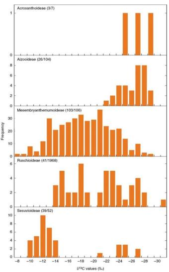  
Image $7 , \delta ^ { 1 3 } \mathrm { C }$ values of taxa from five Aizoaceae subfamilie showing variation from C3 to strong CAM

In Euphorbia milii, $\underset {  } { \delta ^ { 1 3 } \mathrm { C } }$ values of –25.2‰ in leaves and –24.7‰ in stems indicate weak CAM or CAM-cycling, intermediate between C3 and constitutive CAM plants[5]. This intermediate value results from recycling of nocturnal respiratory $\mathrm { C O _ { 2 } }$ rather than direct atmospheric fixation.

## Nocturnal Gas Exchange: The CAM Rhythm

Continuous gas exchange measurements reveal the characteristic CAM rhythm of nocturnal $\mathrm { C O _ { 2 } }$ uptake and daytime release. In Agave angustifolia, $\mathrm { \underbrace { C O _ { 2 } } }$ uptake in the dark contributes about 75% of daily carbon gain, and this pattern is highly conserved across environmental conditions[7]. [Image 8]

TRACE turn 2 open(url) → turn 3 open(id=page\_img\_45) Source page: Nocturnal versus diurnal $\ b { \subset } \ b { \circ } _ { 2 }$ uptake: how flexible is Agave angustifolia?; caption on the page: “Net $\ b { \subset } \ b { \circ } _ { 2 }$ balance of the shoot of a young individual of A. angustifolia during 281 consecutive 12h light/12h dark cycles. Carbon balances are shown for the light and dark periods.”

Why it was used. The run’s only long gas-exchange record from an agave: nine months of day and night carbon balance under changing light and watering.

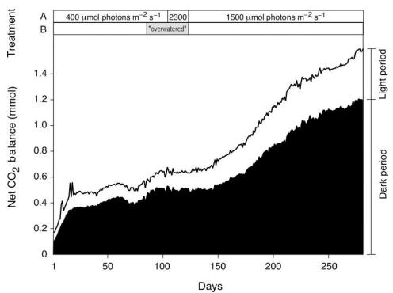  
Image 8. Net $\mathrm { C O _ { 2 } }$ balance of young A. angustifolia during 281 consecutive 12h light/12h dark cycles showing consistent nocturnal CO2 uptake

The nocturnal $\mathrm { { C O } _ { 2 } }$ uptake in CAM plants is not simply a matter of stomatal opening. Research on Clusia species demonstrates that CAM requires elevated nocturnal respiratory rates to power vacuolar malic acid accumulation[9].

TRACE turn 8 open(url) → turn 9 open(id=page\_img\_264) Source page: Elevated nocturnal respiratory rates in the mitochondria of CAM plants: current knowledge and unanswered questions; caption on the page: “Schematic of major metabolite fluxes involved during the nocturnal phase of CAM and their interaction with the respiratory TCA cycle.”

Why it was used. Shows where respiration feeds malate synthesis at night, for the paragraph on the metabolic cost of CAM.

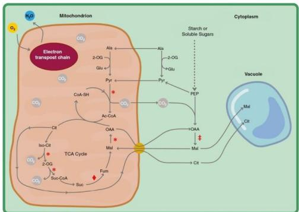  
Image 9. Schematic of metabolite fluxes during nocturnal CAM phase showing interaction between mitochondrial respiration, TCA cycle, and malate synthesis

The metabolic demands of CAM are substantial. Nocturnal respiration provides the ATP and reducing power needed for PEP regeneration and malate synthesis. [Image 9] Flux balance analysis models predict that CAM requires elevated nocturnal respiratory rates compared to C3 species[9].

TRACE turn 8 open(url) → turn 9 open(id=page\_img\_266) Source page: Elevated nocturnal respiratory rates in the mitochondria of CAM plants: current knowledge and unanswered questions; caption on the page: “Clusia pratensis (grey dots) and C. tocuchensis (white dots) exhibit facultative CAM and obligate C3 phenotypes, respectively.”

Why it was used. Pairs a facultative CAM species with a C3 relative under watering and drought, for the sentence on drought-induced CAM.

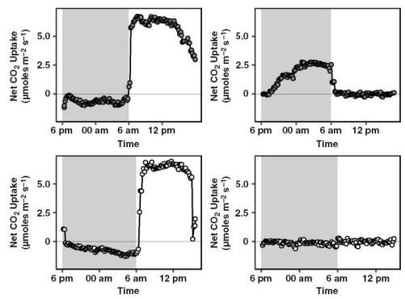  
Image 10. Diel photosynthetic assimilation rates in well-watered and drought-treated Clusia pratensis (facultative CAM) and C. tocuchensis (obligate C3)

In facultative CAM species like Clusia pratensis, drought induces CAM, with nocturnal $\mathrm { C O _ { 2 } }$ uptake becoming prominent under water stress[9]. [Image 10] This plasticity allows plants to optimize carbon gain across varying water availability.

## Facultative CAM and Environmental Plasticity

NOTE Figure check. In the Lecanopteris record, drying lowers daytime uptake and adds a small night-time uptake; night uptake never becomes the larger part. In the E. milii time course, total acid content rises under drought, but nocturnal accumulation (panel C) does not: at pH 7.0 it stays level, and at pH 8.4 it peaks at day 5 and falls to zero by day 16.

Not all CAM plants are obligate. Some species, like the ant-fern Lecanopteris sinuosa, exhibit facultative CAM that can be induced by drought[2].

TRACE turn 5 open(url) → turn 6 open(id=page\_img\_112) Source page: The diverse diaspora of CAM: a pole-topole sketch; caption on the page: “Demonstration of facultative CAM in the ant-fern Lecanopteris sinuosa (Polypodiaceae) during 20 days of net $\mathsf { c o } _ { 2 }$ exchange . . . Net $\scriptstyle { \dot { \mathbf { C } } } \mathbf { O } _ { 2 }$ exchange during the light is shown as yellow, whereas net $\mathsf { c o } _ { 2 } ^ { - }$ exchange during the dark is shown as blue.”

Why it was used. A watering–drying–rewatering cycle in a fern, showing that CAM can switch on and off within weeks.

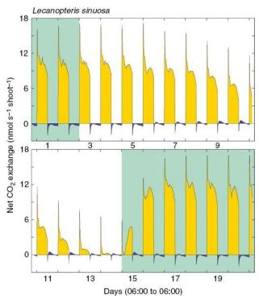  
Image 11. Demonstration of facultative CAM in Lecanopteris sinuosa during watering-drying-rewatering cycles, with net $\mathrm { C O _ { 2 } }$ exchange showing nocturnal uptake during drought

In Lecanopteris sinuosa, net $\mathrm { C O _ { 2 } }$ exchange shifts from predominantly diurnal (yellow) to nocturnal (blue) uptake during drought periods, demonstrating the plasticity of CAM expression[2]. [Image 11]

Similarly, Euphorbia milii shows CAM-cycling rather than strong CAM, with nocturnal $\mathrm { H ^ { + } }$ accumulation attributable to both malate and citrate[5].

TRACE turn 5 open(url) → turn 6 open(id=page\_img\_140) Source page: Crassulacean acid metabolism-cycling in Euphorbia milii; caption on the page: “Time course of changes with drought in leaves of E. milii in (A) H+ content titrated to pH $\overline { { 7 } } . 0 \ldots ( \mathsf { c } )$ nocturnal H+ accumulation and (D) dawn leaf FM per area (circles) and chlorophyll content (triangles).   
Why it was used. The drought time course for the euphorbia, for the sentence on acid accumulation under drought.

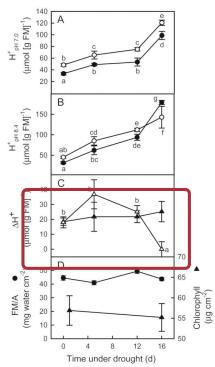  
Image 12. Time course of changes with drought in E. milii leaves showing H+ content at pH 7.0 and 8.4, nocturnal H+ accumulation, and chlorophyll content

Under drought, E. milii shows increased nocturnal H+ accumulation, but the pattern difers from strong CAM, with citrate contributing significantly to acidification[5]. [Image 12]

## Phylogenetic Distribution and Evolutionary Origins

The phylogenetic distribution of CAM reveals its polyphyletic nature. In the Portulacineae plus Molluginaceae, CAM has evolved multiple times independently[2].

TRACE turn 5 open(url) → turn 6 open(id=page\_img\_117) Source page: The diverse diaspora of CAM: a pole-topole sketch; caption on the page: “Presence of C3, C3 + CAM, strong CAM, C4 + CAM, C4 and C4 intermediate photosynthesis (indicated by green ticks) superimposed upon phylogenies of the Portulacineae plus Molluginaceae (upper panel) and the Montiaceae (lower panel).” Why it was used. Places the photosynthetic types on a phylogeny that includes the Cactaceae, for the section on how often CAM arose.

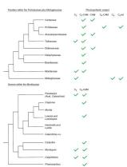  
Image 13. Phylogeny of Portulacineae plus Molluginaceae showing distribution of C3, C3+CAM, CAM, C4+CAM, C4, and C4-intermediate photosynthesis

Within the Montiaceae, diferent genera show diferent photosynthetic variants, with some species exhibiting

C3+CAM while others are strictly $\mathrm { C 3 ^ { [ 2 ] } }$ . [Image 13] This pattern suggests that CAM can evolve within lineages that are otherwise C3, and that intermediate forms like C3+CAM are common stepping stones.

## Conclusions

The evidence from anatomical cross-sections, carbon isotope ratios, and nocturnal gas exchange demonstrates that CAM photosynthesis represents a remarkable case of convergent evolution. Unrelated desert plant lineages—agaves, cacti, and euphorbias—have independently evolved similar solutions to aridity: nocturnal $\mathrm { C O _ { 2 } }$ fixation, succulent tissue for malate storage, and temporal separation of carbon acquisition from fixation.

Anatomical studies reveal convergent leaf structures with large vacuoles for acid storage and modified mesophyll organization. Carbon isotope ratios provide quantitative measures of CAM contribution, revealing a continuum from C3 through C3+CAM to strong CAM. Nocturnal gas exchange measurements confirm the characteristic CAM rhythm and demonstrate the metabolic costs of this pathway, including elevated nocturnal respiration.

The diversity of CAM expression—from obligate CAM in agaves to facultative CAM in ferns and CAM-cycling in Euphorbia—demonstrates that this pathway can be integrated into many physiological and ecological contexts. As climate change increases water stress globally, understanding the convergent evolution of CAM may inform eforts to engineer drought tolerance into crops.

## References

[1] Crassulacean acid metabolism (CAM) at the crossroads: a special issue to honour 50 years of CAM research by Klaus Winter

https://pmc.ncbi.nlm.nih.gov/articles/PMC10799977/

[2] The diverse diaspora of CAM: a pole-to-pole sketch https://pmc.ncbi.nlm.nih.gov/articles/PMC10800000/

[3] Prospects and perspectives: inferring physiological and regulatory targets for CAM from molecular and modelling approaches

https://pmc.ncbi.nlm.nih.gov/articles/PMC10799989/

[4] The Agavoideae: an emergent model clade for CAM evolutionary biology

https://pmc.ncbi.nlm.nih.gov/articles/PMC10799990/

[5] Crassulacean acid metabolism-cycling in Euphorbia milii

https://pmc.ncbi.nlm.nih.gov/articles/PMC3628315/

[6] How Closely Do the $\delta ^ { 1 3 } \mathrm { C }$ Values of Crassulacean Acid Metabolism Plants Reflect the Proportion of $\mathrm { C O _ { 2 } }$ Fixed during Day and Night?

https://pmc.ncbi.nlm.nih.gov/articles/PMC166772/

[7] Nocturnal versus diurnal $\mathrm { C O _ { 2 } }$ uptake: how flexible is Agave angustifolia?

https://pmc.ncbi.nlm.nih.gov/articles/PMC4085958/

[8] Gas exchange and leaf anatomy of a C3–CAM hybrid,

## Yucca gloriosa (Asparagaceae)

https://pmc.ncbi.nlm.nih.gov/articles/PMC4762382/

[9] Elevated nocturnal respiratory rates in the mitochondria of CAM plants: current knowledge and unanswered questions

https://pmc.ncbi.nlm.nih.gov/articles/PMC10799998/

## Image sources

• Image 1 Prospects and perspectives: inferring physiological and regulatory targets for CAM from molecular and modelling approaches https://pmc.ncbi.nlm.nih.gov/articles/PMC10799989/ /DMC10700080/

• Image 2 The Agavoideae: an emergent model clade for CAM evolutionary biology

https://pmc.ncbi.nlm.nih.gov/articles/PMC10799990/

Image 3 Gas exchange and leaf anatomy of a C3–CAM hybrid, Yucca gloriosa (Asparagaceae) https://pmc.ncbi.nlm.nih.gov/articles/PMC4762382/

• Images 4, 12 Crassulacean acid metabolism-cycling in Eu-

phorbia milii

https://pmc.ncbi.nlm.nih.gov/articles/PMC3628315/

Images 5, 6 How Closely Do the δ13C Values of Crassulacean Acid Metabolism Plants Reflect the Proportion of CO Fixed during Day and Night? https://pmc.ncbi.nlm.nih.gov/articles/PMC166772/

• Images 7, 11, 13 The diverse diaspora of CAM: a pole-to-pole sketch https://pmc.ncbi.nlm.nih.gov/articles/PMC10800000/

• Image 8 Nocturnal versus diurnal CO uptake: how flexible is Agave angustifolia? https://pmc.ncbi.nlm.nih.gov/articles/PMC4085958/

• Images 9, 10 Elevated nocturnal respiratory rates in the mitochondria of CAM plants: current knowledge and unanswered questions https://pmc.ncbi.nlm.nih.gov/articles/PMC10799998/

## REPORT GATE RECORD

• Submission 1 (turn 10): OK — 7,377 chars, 13 images, 9 sources