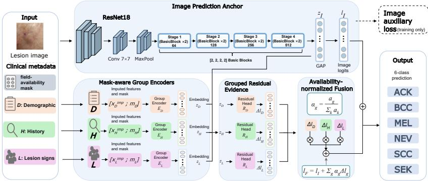
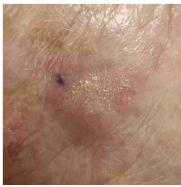
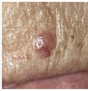
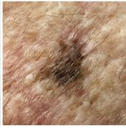
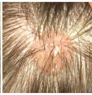
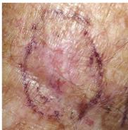
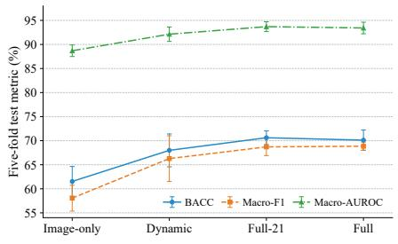
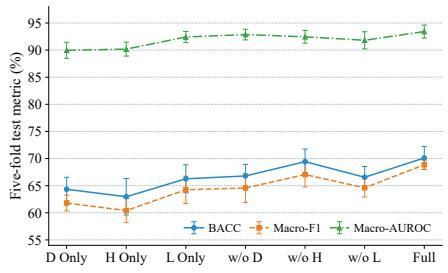
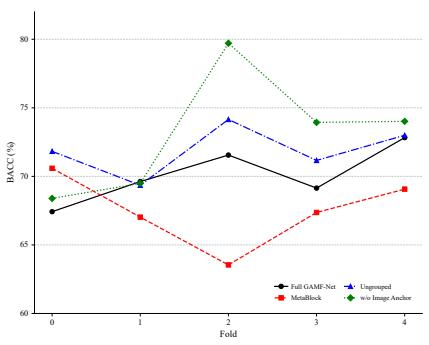
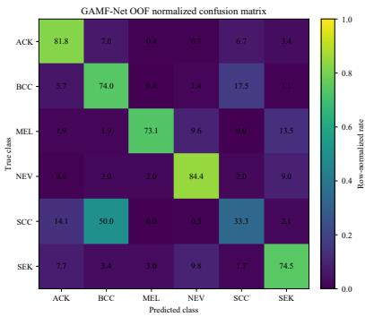

# GAMF-Net: Grouped Availability-Aware Multimodal Fusion for Smartphone Skin Lesion Classification

Yue Zhuo, Jingjia Yan, Fangyu Liu, Lingjun Liu, Zongjun Chen, Zhisheng Luo, and Zhonghua Xie⋆

Huizhou University, Huizhou 516007, Guangdong, China eexie@qq.com

Abstract. Smartphone clinical images provide a low-cost data source for computer-aided skin lesion classification in resource-constrained settings, but images alone cannot fully capture patients’ medical histories and lesion symptoms. To address the lack of structured organization among heterogeneous clinical variables, the ambiguity between observed and imputed values, and the risk that clinical information may interfere with visual evidence, we propose GAMF-Net, a grouped availability-aware multimodal fusion network. Ten clinical variables are divided into three semantic groups—demographics, history-related risk, and lesion presentation—and each group jointly encodes field values and field-level availability masks. The image branch produces the base classifi cation logits, while each clinical group generates image-conditioned classlevel residual evidence. Only available groups participate in availabilitynormalized equal-weight fusion; when all clinical information is unavailable, the model reduces exactly to the image-only pathway. We evaluate the method on PAD-UFES-20 under a patient-disjoint five-fold proto col with separate training, validation, and test partitions. GAMF-Net achieves an Accuracy of $7 4 . 1 7 \pm 2 . 8 5 \% .$ a balanced accuracy (BACC) of $7 0 . 1 1 \pm 2 . 1 1 \%$ , a Macro-F1 of $6 8 . 8 5 \pm 0 . 8 5 \%$ , and a Macro-AUROC of $9 3 . 4 2 \pm 1 . 2 0 \%$ , outperforming all image-only and multimodal baselines reimplemented under a unified protocol. Compared with the strongest baseline, MetaBlock, the corresponding improvements are 2.37, 2.59, 4.14, and 1.02 percentage points, respectively. Ablation results show that clinical information substantially improves class-balanced performance, constrained equal-weight fusion is more efective than dynamic fusion, and the lesion-presentation group provides the most informative clinical complement.

Keywords: Skin lesion classification · Multimodal fusion · Clinical metadata · Availability-aware learning · Smartphone clinical images

Corresponding author: Zhonghua Xie (email: eexie@qq.com).

## 1 Introduction

Deep convolutional neural networks have demonstrated strong performance for automated skin lesion recognition on curated clinical and dermoscopic image collections [15,17]. Nevertheless, most widely used public benchmarks, including HAM10000, are dominated by dermoscopic images acquired under comparatively controlled conditions [33]. Smartphone clinical photographs are easier to acquire in primary-care and resource-constrained settings, but they exhibit greater variation in illumination, background, camera distance, device type, and lesion scale. PAD-UFES-20 was introduced to support research in this less controlled setting by providing smartphone images together with patient- and lesion-level clinical variables [30].

Clinical decision-making relies on information that is not always visually observable, such as age, previous cancer history, anatomical location, growth, bleeding, pain, and elevation. Multimodal learning provides a general framework for combining complementary sources of evidence [1]. In skin lesion analysis, prior studies have explored image–metadata concatenation, metadata-conditioned feature modulation, and attention-based interaction. Yap et al. combined multiple imaging modalities with patient metadata [35]; Li et al. used metadata-derived coeficients to reweight visual feature channels [25]; and MetaBlock introduced an attention-based metadata-processing block for image feature enhancement [29]. Subsequent studies have explored more expressive interactions using multimodal Transformers, MDFNet, and the cross-attention-based MMF-Net [4,6,28]. Although these approaches confirm the value of clinical context, they generally encode heterogeneous variables as a single vector or allow metadata to directly perturb visual features.

A further dificulty is incomplete clinical information: standard imputation produces fixed-dimensional inputs but does not indicate whether a value was observed or imputed. MetaBlock-SE represents available metadata with sentence embeddings and evaluates robustness under simulated and real missingness [2], while TIP develops image–tabular pre-training for heterogeneous and incomplete tabular data [14]. More generally, explicit missingness masks can provide information beyond imputed values [5]. These methods motivate availability-aware modeling, but preserving an independent visual decision path while incorporating semantically grouped clinical evidence remains insuficiently explored.

To address these limitations, we propose GAMF-Net, which organizes ten clinical variables into groups representing demographic information, historyrelated risk, and lesion presentation. Each group is encoded together with field-level availability masks. The image branch first produces a complete set of six-class logits, and each clinical group then generates image-conditioned class-level residual evidence; only available groups participate in normalized equal-weight fusion, so clinical information supplements rather than replaces the image prediction.

The main contributions are as follows:

– We introduce medically motivated semantic grouping and field-availabilityaware encoding to jointly model clinical values and their observation states.

– We develop an image-anchored class-level residual fusion mechanism in which clinical groups provide complementary corrections, while the model reduces exactly to the image-only pathway when all clinical groups are unavailable.   
– We conduct a unified evaluation on PAD-UFES-20 using patient- and lesiondisjoint five-fold splits, including image-only models, multimodal baselines, and fusion/input and clinical-group ablation comparisons.

## 2 Related Work

## 2.1 Image-Based Skin Lesion Classification

Deep learning has substantially advanced automated skin lesion classification. Esteva et al. demonstrated dermatologist-level discrimination on selected tasks using convolutional networks trained on large clinical image collections [15]. Han et al. further investigated benign and malignant cutaneous tumor classification using standard clinical photographs rather than dermoscopic images alone [17]. For dermoscopic analysis, HAM10000 provides 10,015 multi-source images and remains a major benchmark for multiclass lesion recognition [33]. These studies establish the efectiveness of image-based learning, but they do not directly address the greater acquisition variability and richer clinical context associated with smartphone images.

PAD-UFES-20 contains 2,298 smartphone clinical images from 1,373 patients and 1,641 lesions across six classes, together with up to 21 clinical variables [30]. The dataset is strongly class-imbalanced and may contain multiple images of the same lesion, so patient- and lesion-disjoint evaluation is necessary to prevent information leakage and obtain a realistic estimate of generalization performance.

## 2.2 Fusion of Images and Clinical Metadata

Multimodal learning includes early fusion, late fusion, representation alignment, and modality-conditioned interaction [1]. In skin lesion classification, direct concatenation is a common baseline, but it does not explicitly distinguish the roles of visual and clinical evidence. Yap et al. showed that clinical metadata can complement multiple skin-imaging modalities [35]. MetaNet uses a metadata network to generate channel-wise modulation coeficients for visual features [25], whereas MetaBlock employs an attention-based metadata-processing block to enhance image representations [29].

More expressive fusion mechanisms have subsequently been proposed. Cai et al. introduced a multimodal Transformer for image–metadata fusion [4]; MDFNet combines skin images and clinical information through a dedicated multimodal diagnosis framework [6]; and MMF-Net employs intra-modality selfattention and inter-modality cross-attention for bidirectional interaction [28]. These methods strengthen cross-modal communication, but their additional flexibility can complicate optimization on small and imbalanced datasets. In contrast, GAMF-Net preserves an explicit image decision pathway and introduces clinical information as group-specific residual evidence at the logit level.

## 2.3 Incomplete Image–Tabular Data

Incomplete clinical information poses a further challenge because measurements may not be collected, verified, or retained during data curation; conventional imputation preserves a fixed-dimensional input but does not indicate whether each value was observed or imputed. GRU-D demonstrated that explicit masks and missingness patterns can improve healthcare prediction beyond conventional imputation [5]. Although GRU-D addresses multivariate time series rather than image–metadata fusion, its treatment of observation states supports explicit availability indicators.

MetaBlock-SE extends MetaBlock using sentence embeddings and evaluates robustness to incomplete metadata on PAD-UFES-20 and an extended clinical dataset [2]. TIP addresses a broader image–tabular setting through masked tabular reconstruction, image–tabular matching, and contrastive pre-training [14]. Rather than reconstructing or semantically embedding missing values, GAMF-Net directly exposes field availability to each clinical group encoder and excludes completely unavailable groups from residual fusion.

## 2.4 Recent Advances in Medical and Consumer Imaging

Medical image computing has increasingly relied on generative and learned priors for reconstruction and synthesis [7,9,11], and visual enhancement has been extended to robot-assisted surgery [24]. Low-level restoration studies address document contamination removal [12], facial shadow removal [36,27], cinematic filter emulation [19], and underwater [10] and infrared imagery [8]. On the multimodal side, recent work has examined robustness to attention sinks and positional decay in large vision-language models [37], redundancy-aware cross-modal emotion recognition [20], manifold-guided interaction in consumer devices [34], and persona-driven speech synthesis [23]. Further studies cover counseling alignment [21], 4D Gaussian splatting compression [22], and compositional concept extraction [31]. None models the field-level availability of heterogeneous clinical variables, the focus of GAMF-Net.

## 3 Method

## 3.1 Problem Formulation and Clinical Grouping

Let the set of clinical semantic groups be $\mathcal { G } ~ = ~ \{ D , H , L \}$ , corresponding to demographics, history-related risk, and lesion presentation, respectively. Given a sample

$$
\left( \mathbf { x } ^ { I } , \{ \mathbf { x } ^ { g } , \mathbf { m } ^ { g } \} _ { g \in \mathcal { G } } , y \right) ,\tag{1}
$$

where $\mathbf { x } ^ { I }$ denotes a smartphone clinical image, $\mathbf { x } ^ { g }$ contains the clinical fields in group $g , \mathbf { m } ^ { g }$ is the corresponding field-level availability mask, and $y$ is one of the six lesion labels, the model learns

$$
p _ { \boldsymbol { \theta } } \left( \boldsymbol { y } \mid \mathbf { x } ^ { I } , \{ \mathbf { x } ^ { g } , \mathbf { m } ^ { g } \} _ { g \in \mathcal { G } } \right) .\tag{2}
$$

  
Fig. 1. Overview of GAMF-Net. Overview of GAMF-Net: image-anchored prediction with availability-aware grouped clinical residuals.

We use a compact set of ten clinical variables:

$$
D = \{ { \mathsf { a g e } } \} ,\tag{3}
$$

$$
H = \{ \mathsf { s k i n \_ c a n c e r . h i s t o r y , c a n c e r . h i s t o r y } \} ,\tag{4}
$$

$$
L = \{ \mathbf { r e g i o n } , \mathbf { i t c h } , \mathbf { g r e w } , \mathbf { h u r t } , \mathbf { c h a n g e d } , \mathbf { b l e e d } , \mathbf { e l e v a t i o n } \} .\tag{5}
$$

Imputation and standardization parameters for continuous variables are estimated only from the training subset of the current fold, missing categorical values are assigned to a dedicated category before one-hot encoding, and the validation and test subsets are transformed only with the preprocessor fitted on the training subset. The fields patient id, lesion id, and img id are used only for data organization, diagnostic is the prediction target, and biopsed is closely associated with diagnostic confirmation; none is used as model input.

## 3.2 Field-Availability-Aware Group Encoding

Suppose group g contains $q _ { g }$ original fields. Its field mask, field-availability ratio, and group-level availability indicator are defined as

$$
{ \bf m } _ { g } \in \{ 0 , 1 \} ^ { q _ { g } } , \qquad r _ { g } = { \frac { 1 } { q _ { g } } } \sum _ { j = 1 } ^ { q _ { g } } m _ { g , j } , \qquad a _ { g } = \mathbb { I } ( r _ { g } > 0 ) .\tag{6}
$$

The preprocessed clinical features are concatenated with the field-level mask:

$$
\widetilde { \mathbf { x } } _ { g } = [ \mathbf { x } _ { g } ^ { \mathrm { i m p } } ; \mathbf { m } _ { g } ] .\tag{7}
$$

In the ten-field configuration, the preprocessed feature dimensions of the D, H, and L groups are 1, 6, and 32 and their mask dimensions are 1, 2, and 7, giving encoder input dimensions of 2, 8, and 39.

The three group encoders share the same architecture but have independent parameters:

$$
\widehat { \mathbf { z } } _ { g } = \mathrm { G E L U } \Big ( \mathrm { L N } \Big ( \mathbf { W } _ { g } ^ { ( 2 ) } \mathrm { D r o p o u t } _ { 0 . 2 } \Big [ \mathrm { G E L U } \Big ( \mathrm { L N } ( \mathbf { W } _ { g } ^ { ( 1 ) } \widetilde { \mathbf { x } } _ { g } + \mathbf { b } _ { g } ^ { ( 1 ) } ) \Big ) \Big ] + \mathbf { b } _ { g } ^ { ( 2 ) } \Big ) \Big ) ,\tag{8}
$$

where the first layer maps the input to 256 dimensions, and the second layer maps it to 128 dimensions. The final group representation is

$$
\begin{array} { r } { \mathbf { z } _ { g } = a _ { g } \widehat { \mathbf { z } } _ { g } \in \mathbb { R } ^ { 1 2 8 } . } \end{array}\tag{9}
$$

The field mask enables the encoder to distinguish genuine observations from imputed placeholders, following the principle that missingness indicators may contain predictive information beyond imputed values [5,14]; multiplication by $a _ { g }$ further ensures that a completely unavailable group does not produce an efective representation.

## 3.3 Image Anchor and Grouped Residual Evidence

The input image is resized to $3 \times 2 2 4 \times 2 2 4$ and encoded by a ResNet18 pretrained on ImageNet-1K [18,13]:

$$
\mathbf { z } _ { I } = E _ { I } ( \mathbf { x } ^ { I } ) \in \mathbb { R } ^ { 5 1 2 } , \qquad \mathbf { l } _ { I } = \mathbf { W } _ { I } \mathrm { D r o p o u t } _ { 0 . 3 } ( \mathbf { z } _ { I } ) + \mathbf { b } _ { I } \in \mathbb { R } ^ { 6 } .\tag{10}
$$

The vector $1 _ { I }$ serves as the image prediction anchor for the final multimodal decision.

For each clinical group, the residual head takes the image representation, the group representation, and the field-availability ratio as input:

$$
{ \bf u } _ { g } = [ { \bf z } _ { I } ; { \bf z } _ { g } ; r _ { g } ] \in \mathbb { R } ^ { 6 4 1 } ,\tag{11}
$$

$$
\varDelta \mathbf { l } _ { g } = a _ { g } R _ { g } ( \mathbf { u } _ { g } ) \in \mathbb { R } ^ { 6 } .\tag{12}
$$

The residual mapping $R _ { g }$ is a $6 4 1  2 5 6  6$ MLP with LayerNorm, GELU, and Dropout in the hidden layer. Its final linear layer is initialized with zero weights and zero bias, so that $\varDelta \mathbf l _ { q } = \mathbf 0$ at the beginning of training. The clinical branch is therefore initialized to preserve the image-only prediction and gradually learns image-conditioned class corrections.

## 3.4 Availability-Normalized Fusion and Training Objective

Let $\begin{array} { r } { s = \sum _ { k \in \mathcal { G } } a _ { k } } \end{array}$ . The fusion weight of group $g$ is

$$
\alpha _ { g } = { \left\{ \begin{array} { l l } { a _ { g } / s , } & { s > 0 , } \\ { 0 , } & { s = 0 . } \end{array} \right. }\tag{13}
$$

The final logits are

$$
\mathbf { l } _ { F } = \mathbf { l } _ { I } + \sum _ { g \in \mathcal { G } } \alpha _ { g } \varDelta \mathbf { l } _ { g } .\tag{14}
$$

When all clinical groups are unavailable, ${ 1 } _ { F } = { 1 } _ { I } ;$ unlike a learned dynamic gate, the fusion assigns weights only by group availability, limiting unnecessary model flexibility in the small-data regime.

The training objective is

$$
\begin{array} { r } { \mathcal { L } = \mathrm { C E } _ { \mathbf { w } } ( { 1 } _ { F } , y ) + \lambda _ { I } \mathrm { C E } _ { \mathbf { w } } ( { 1 } _ { I } , y ) , \qquad \lambda _ { I } = 0 . 3 , } \end{array}\tag{15}
$$

where the class weights are computed from the class frequencies of the training subset in the current fold. The image auxiliary loss maintains the standalone discriminative capacity of the image anchor.

## 4 Experimental Setup

## 4.1 Dataset and Evaluation Protocol

PAD-UFES-20 contains 2,298 smartphone images from 1,373 patients and 1,641 lesions [30], distributed as 730, 845, 52, 244, 192, and 235 images in the ACK, BCC, MEL, NEV, SCC, and SEK classes, respectively, resulting in substantial class imbalance.

  
ACK

  
BCC

  
MEL

  
NEV

  
SCC  
Fig. 2. Representative smartphone clinical images of the five skin lesion classes in PAD-Fig. 2. Representative smartphone clinical images of the five skin lesion classes in PAD-UFES-2UFES-20.

We use a fixed patient-disjoint five-fold cross-validation protocol: in each fold, three folds are used for training, one for validation, and one for testing, containing 1,371–1,391, 449–475, and 449–475 images, respectively, with no patient or lesion shared across subsets. The preprocessor is fitted only on the training subset, the PAD-UFES-20 contains 2,298 smartphone images from 1,373 patients and 1,641best model is selected based on validation BACC, and the selected checkpoint lesions [4]. The dataset contains 730, 845, 52, 244, 192, and 235 images in theis evaluated once on the test subset. Final results are reported as the mean and ACK, BCC, MEL, NEV, SCC, and SEK classes, resample standard deviation across the five test folds.

## fold, three folds are used for training, one for validation, an4.2 Compared Methods and Implementation Details

449–475 images, and the test subsets contain 449–475 images. No patient orWe compare GAMF-Net against Image-only ResNet18, Direct Concat, MetaNet [25], Dynamic Feature Modulation, MetaBlock-SE [2], and MetaBlock [29]; Direct Concat is a conventional early-fusion baseline, and Dynamic Feature Modulation a unified metadata-conditioned feature-modulation baseline. All reimplemented models use the same patient-level splits, class order, field-exclusion rules, preprocessing procedures, and validation-based model-4.2 Comparedselection criterion.

GAMF-Net uses a ResNet18 pretrained on ImageNet with an input resolution of $2 2 4 \times 2 2 4$ and a batch size of 32. AdamW [26] is used as the optimizer, with learning rates of $1 \times 1 0 ^ { - 5 }$ for the backbone and $1 \times 1 0 ^ { - 4 }$ for the newly added modules and a weight decay of $1 \times 1 0 ^ { - 4 }$ . We use a OneCycle learningmodulation baseline. All reimplemented models use the same patient-level splits,rate schedule motivated by super-convergence training [32], train for at most class order, field-exclusion rules, preprocessin procedures, and validation-based100 epochs with early stopping (patience 15), set the random seed to 2026, and model-selection criterion.enable automatic mixed precision. Experiments use Python 3.10, PyTorch 2.7.1, GAMF-Net uses a ResNet18 pretrained on ImageNeCUDA 12.6, and an NVIDIA Tesla V100 32GB GPU.

Table 1. Patient-level five-fold test results (mean ± sample standard deviation, %). Bold values indicate the highest mean under the unified protocol.
<table><tr><td>Model</td><td>Accuracy</td><td>BACC</td><td>Macro-F1</td><td>Macro-AUROC</td></tr><tr><td>Image-only ResNet18</td><td> $6 4 . 9 3 \pm 2 . 6 7$ </td><td> $6 1 . 5 3 \pm 3 . 1 1$ </td><td> $5 8 . 0 6 \pm 2 . 6 9$ </td><td> $8 8 . 6 9 \pm 1 . 2 0$ </td></tr><tr><td>Direct Concat</td><td> $6 2 . 8 8 \pm 4 . 1 0$ </td><td> $6 1 . 6 5 \pm 4 . 4 2$ </td><td> $5 5 . 8 9 \pm 3 . 4 9$ </td><td> $8 7 . 8 4 \pm 1 . 6 5$ </td></tr><tr><td>MetaNet</td><td> $6 8 . 8 4 \pm 4 . 9 7$ </td><td> $6 4 . 3 2 \pm 2 . 2 2$ </td><td> $6 2 . 0 3 \pm 3 . 1 3$ </td><td> $9 0 . 7 1 \pm 1 . 3 3$ </td></tr><tr><td>Dynamic Feature Modulation</td><td> $6 8 . 0 7 \pm 3 . 4 9$ </td><td> $6 2 . 8 9 \pm 2 . 2 2$ </td><td> $6 0 . 9 4 \pm 2 . 3 9$ </td><td> $8 9 . 7 5 \pm 1 . 3 8$ </td></tr><tr><td>MetaBlock-SE</td><td> $6 6 . 5 6 \pm 1 . 4 9$ </td><td> $6 2 . 1 2 \pm 3 . 8 6$ </td><td> $5 8 . 8 6 \pm 3 . 0 0$ </td><td> $8 8 . 9 2 \pm 1 . 6 2$ </td></tr><tr><td>MetaBlock</td><td> $7 1 . 8 0 \pm 1 . 7 4$ </td><td> $6 7 . 5 2 \pm 2 . 6 4$ </td><td> $6 4 . 7 1 \pm 3 . 0 6$ </td><td> $9 2 . 4 0 \pm 0 . 9 5$ </td></tr><tr><td>GAMF-Net</td><td> ${ \bf 7 4 . 1 7 \pm 2 . 8 5 }$ </td><td> ${ \bf 7 0 . 1 1 \pm 2 . 1 1 }$ </td><td> ${ \bf 6 8 . 8 5 \pm 0 . 8 5 }$ </td><td> $\mathbf { 9 3 . 4 2 \pm 1 . 2 0 }$ </td></tr></table>

## 4.3 Evaluation Metrics

We report Accuracy, BACC, Macro-F1, and Macro-AUROC. BACC is appropriate for imbalanced classification because it averages class-wise sensitivity [3]. It is defined as follows:

$$
\mathrm { B A C C } = \frac { 1 } { C } \sum _ { c = 1 } ^ { C } \mathrm { R e c a l l } _ { c } .\tag{16}
$$

Because the dataset is class-imbalanced, validation BACC is used for model selection. Class-wise recall and AUROC are also reported to analyze minorityclass discrimination across decision thresholds [16].

## 5 Results and Discussion

## 5.1 Main Results

As shown in Table 1, GAMF-Net achieves the highest mean on all four metrics among the models evaluated under the unified protocol. Compared with MetaBlock, GAMF-Net improves Accuracy, BACC, Macro-F1, and Macro-AUROC by 2.37, 2.59, 4.14, and 1.02 percentage points, respectively. Relative to the image-only ResNet18, BACC and Macro-F1 increase by 8.58 and 10.79 points, demonstrating the complementary value of structured clinical information under class imbalance.

Direct Concat performs below the image-only model on Accuracy, Macro-F1, and Macro-AUROC, indicating that simply appending clinical variables does not guarantee efective multimodal learning. MetaNet [25] and MetaBlock [29] improve performance through metadata-conditioned feature modeling, whereas GAMF-Net separates the visual prediction from group-specific clinical residual evidence.

## 5.2 Structural Ablations and Paired Analysis

We compare fusion and input-selection alternatives and evaluate the contributions of the three clinical groups under the same patient-disjoint five-fold protocol; Table 2 reports the retained configurations and Fig. 3 visualizes BACC,

Table 2. Patient-level five-fold ablation results (mean ± sample standard deviation, %). The full model uses the same run as the main comparison. Bold values indicate the highest mean within each block; the Full Model row is repeated for reference.
<table><tr><td>Configuration</td><td>Accuracy</td><td>BACC</td><td>Macro-F1</td><td>Macro-AUROC</td></tr><tr><td colspan="5">Fusion and Input Selection</td></tr><tr><td>Dynamic Fusion</td><td> $7 0 . 0 4 \pm 4 . 6 8$ </td><td> $6 7 . 9 9 \pm 3 . 4 2$ </td><td> $6 6 . 2 8 \pm 4 . 7 4$ </td><td> $9 2 . 1 3 \pm 1 . 4 9$ </td></tr><tr><td>Full-21 Fields</td><td> $7 2 . 9 9 \pm 3 . 5 3$ </td><td> $\mathbf { 7 0 . 6 1 \pm 1 . 4 3 }$ </td><td> $6 8 . 7 1 \pm 1 . 8 1$ </td><td> $\mathbf { 9 3 . 7 0 \pm 1 . 0 2 }$ </td></tr><tr><td>Full Model</td><td> ${ \bf 7 4 . 1 7 \pm 2 . 8 5 }$ </td><td> $7 0 . 1 1 \pm 2 . 1 1$ </td><td> ${ \bf 6 8 . 8 5 \pm 0 . 8 5 }$ </td><td> $9 3 . 4 2 \pm 1 . 2 0$ </td></tr><tr><td colspan="5">Clinical Semantic Group Contributions</td></tr><tr><td>D Only</td><td> $6 5 . 0 9 \pm 1 . 7 5$ </td><td> $6 4 . 3 4 \pm 2 . 2 1$ </td><td> $6 1 . 8 0 \pm 1 . 4 6$ </td><td> $8 9 . 9 6 \pm 1 . 4 9$ </td></tr><tr><td>H Only</td><td> $6 4 . 5 0 \pm 2 . 8 9$ </td><td> $6 2 . 9 6 \pm 3 . 3 6$ </td><td> $6 0 . 4 1 \pm 2 . 2 2$ </td><td> $9 0 . 1 8 \pm 1 . 2 9$ </td></tr><tr><td>L Only</td><td> $7 0 . 8 0 \pm 0 . 6 3$ </td><td> $6 6 . 2 7 \pm 2 . 5 8$ </td><td> $6 4 . 2 5 \pm 2 . 5 1$ </td><td> $9 2 . 4 1 \pm 1 . 0 3$ </td></tr><tr><td> $\mathrm { w } / \mathrm { o } \mathrm { ~ D ~ }$ </td><td> $7 0 . 2 9 \pm 2 . 9 2$ </td><td> $6 6 . 7 9 \pm 2 . 1 4$ </td><td> $6 4 . 5 7 \pm 2 . 6 5$ </td><td> $9 2 . 8 6 \pm 0 . 9 8$ </td></tr><tr><td> $\mathrm { w } / \mathrm { o } \ \mathrm { H }$ </td><td> $7 2 . 5 3 \pm 2 . 3 2$ </td><td> $6 9 . 4 3 \pm 2 . 3 2$ </td><td> $6 7 . 0 5 \pm 2 . 2 7$ </td><td> $9 2 . 4 5 \pm 1 . 1 7$ </td></tr><tr><td> $\mathrm { w / o ~ L }$ </td><td> $6 8 . 1 2 \pm 2 . 4 5$ </td><td> $6 6 . 5 5 \pm 1 . 9 8$ </td><td> $6 4 . 6 1 \pm 1 . 7 0$ </td><td> $9 1 . 8 1 \pm 1 . 5 7$ </td></tr><tr><td>Full Model</td><td> ${ \bf 7 4 . 1 7 \pm 2 . 8 5 }$ </td><td> ${ \bf 7 0 . 1 1 \pm 2 . 1 1 }$ </td><td> ${ \bf 6 8 . 8 5 \pm 0 . 8 5 }$ </td><td> $\mathbf { 9 3 . 4 2 \pm 1 . 2 0 }$ </td></tr></table>

Macro-F1, and Macro-AUROC. These comparisons assess the evaluated configurations; they do not establish independent performance gains for every structural component.

Fusion and input selection. The full model exceeds Dynamic Fusion by 4.13, 2.12, 2.57, and 1.29 percentage points in Accuracy, BACC, Macro-F1, and Macro-AUROC, respectively, so availability-normalized equal weighting achieves higher means than the evaluated dynamic weighting variant under this protocol. The ten-field model has higher Accuracy and Macro-F1 than Full-21 Fields, while the latter has higher BACC and Macro-AUROC, supporting the compact input profile as a lower-dimensional option with similar observed performance.

Clinical-group contributions. L Only has the highest means on all four metrics among the three single-group configurations. Removing L from the full model reduces Accuracy, BACC, Macro-F1, and Macro-AUROC by 6.05, 3.56, 4.24, and 1.61 points, respectively. Demographic information is also complementary: w/o D obtains BACC of 66.79% and Macro-F1 of 64.57%, compared with 70.11% and 68.85% for the full model, and removing H yields smaller decreases (69.43% and 67.05%). These results identify L as the strongest standalone clinical group and show that its combination with D and H achieves higher mean performance than each single-group variant.

Paired uncertainty analysis. We retain the patient-clustered paired bootstrap analysis to examine uncertainty in model diferences. Patients are sampled with replacement within each test fold, retaining all images of each sampled patient. Diferences are averaged equally over the five folds. Table 3 reports the percentile based 95% confidence intervals from 10,000 valid replicates.

  
(a) Fusion and input selection

  
(b) Clinical-group contributions  
Fig. 3. Five-fold fusion/input and clinical-group comparisons. Error bars denote sample standard deviations. Lines are visual guides across discrete configurations. Imageonly in (a) is a reference baseline.

Table 3. Patient-clustered paired bootstrap comparisons. Diferences are Full Model minus the comparison model, in percentage points. Wins count folds in which the Full Model has the higher metric.
<table><tr><td>Comparison</td><td></td><td></td><td>∆BACC [95% CI] BACC wins ∆mF1 [95% CI] mF1 wins</td><td></td></tr><tr><td></td><td>Full vs. MetaBlock +2.60 [−1.52, 6.83]</td><td> $4 / 5$ </td><td>+4.13 [0.69, 7.73]</td><td>5/5</td></tr></table>

The Macro-F1 improvement over MetaBlock is positive in all five folds and its bootstrap confidence interval is above zero, whereas the BACC interval includes zero. The paired standardized efects are $d _ { z } = 0 . 6 5$ for BACC and $d _ { z } = 1 . 3 5$ for Macro-F1, so the paired comparison supports the clearest improvement over MetaBlock in Macro-F1 under the reported evaluation protocol.

## 5.3 Class-Wise and SCC-Focused Error Analysis

NEV and ACK achieve the highest recalls (84.22% and 81.89%); MEL obtains the highest mean AUROC (98.87%) but with substantial fold-wise recall variation, consistent with its small sample size.

SCC remains the principal failure class: in the aggregated out-of-fold predictions, GAMF-Net obtains an SCC precision of 23.70%, recall of 33.33%, F1 of 27.71%, AUROC of 78.81%, and AUPRC of 24.20%; the pooled recall difers slightly from the 33.22 ± 4.47% in Table 4 because the former merges all five test folds, whereas the latter averages fold-level recalls.

Relative to the image-only model, GAMF-Net increases SCC AUROC from 73.31% to 78.81% and AUPRC from 21.55% to 24.20%, but does not improve SCC precision, recall, or F1 under the default argmax decision rule. MetaBlock remains stronger for SCC-specific recognition (recall of 42.71%, F1 of 34.89%, and AUROC of 83.34%). Thus, the overall Macro-F1 improvement of GAMF-Net does not represent a uniform gain across all classes.

Of the 192 SCC samples, 64 are correctly classified; of the 128 errors, 96 cases (75.00%) are predicted as BCC and 27 cases (21.09%) as ACK, and the 27.71%, AUROC of 78.81%, and AUPRC of 24.20%. The pooled recall difers                      confusion is partly reciprocal, with 148 BCC samples assigned to SCC. The main slightly from the 33.22 ± 4.47% in Table 4 because the former is computed after           class-level limitation is therefore the decision boundary between SCC and BCC of fold-level recalls.of GAMF-Net does not represent a uniform gain across all classes.rather than uniformly poor ranking across all lesion categories.

  
(a) Fold­wise BACC

  
(b) OOF confusion matrix

folds. (b) Row-normalized confusion matrix from the aggregated out-of-fold predictionsfolds. (b) Row-normalized confusion matrix from the aggregated out-of-fold predictionsfolds. (b) Row-normalized confusion matrix from the aggregated out-of-fold predictionsFig. 4. Fold-wise and class-wise analysis. (a) BACC across the five patient-disjoint test of GAMF-Net.of GAMF-Net.of GAMF-Net.folds. (b) Row-normalized confusion matrix from the aggregated out-of-fold predictions of GAMF-Net.  
±    Table 4. Class-wise five-fold results (mean ± sample standard deviation, %).
<table><tr><td>Class</td><td>Recall</td><td>AUROC</td></tr><tr><td>ACK</td><td> $8 1 . 8 9 \pm 3 . 8 3$ </td><td> $9 5 . 5 0 \pm 1 . 3 0$ </td></tr><tr><td>BCC</td><td> $7 4 . 1 3 \pm 4 . 4 6$ </td><td> $9 2 . 8 6 \pm 1 . 2 7$ </td></tr><tr><td>MEL</td><td> $7 2 . 6 1 \pm 9 . 8 5$ </td><td> $9 8 . 8 7 \pm 0 . 8 4$ </td></tr><tr><td>NEV</td><td> $8 4 . 2 2 \pm 3 . 2 2$ </td><td> $9 7 . 9 5 \pm 0 . 5 9$ </td></tr><tr><td>SCC</td><td> $3 3 . 2 2 \pm 4 . 4 7$ </td><td> $7 9 . 9 5 \pm 5 . 6 9$ </td></tr><tr><td>SEK</td><td> $7 4 . 6 2 \pm 4 . 9 0$ </td><td> $9 5 . 3 9 \pm 2 . 7 0$ </td></tr></table>

## 73.31% to 78.81% and AUPRC from          5.4 Discussion and Limitations

remains stronger for SCC-specific recognition, achieving a recall of 42.71%, an F1         42.71%  main class-level limitation is therefore the decision boundary between SCC andThe experiments support four main observations. First, structured clinical inof 34.89%, and an AUROC of 83.34%. Thus, the overall Macro-F1 improvement                    formation substantially improves overall and class-balanced recognition over the of GAMF-Net does not represent a uniform gain across all classes.image-only baseline. Second, the constrained availability-normalized fusion out-Among the 192 SCC samples, 64 are correctly classified. Of the 128 SCC5.4 Discussion and Limitationsperforms the evaluated dynamic fusion variant. Third, the compact ten-field pro-errors, 96 cases (75.00%) are predicted as BCC and 27 cases (21.09%) as ACK.The confusion is partly reciprocal: 148 BCC samples are assigned to SCC. TheThe experiments support four main observations. First, structured clinical in-file performs comparably to the full 21-field input, and the lesion-presentation main class-level limitation is therefore the decision boundary between SCC andformation substantially improves overall and class-balanced recognition over thegroup provides the strongest clinical complement. Semantic grouping supports BCC rather than uniformly poor ranking across all lesion categories.image-only baseline. Second, the constrained availability-normalized fusion out-clinical organization and group-level interpretation, while the image anchor pre-performs the evaluated dynamic fusion variant under the current protocol. Third,serves a separate visual pathway and class-level residual corrections; the ablations characterize the evaluated configurations rather than isolate each component.

This study has several limitations. PAD-UFES-20 was collected from a specific population and acquisition setting, so generalization across devices, regions, and institutions remains unverified, and the availability-aware formulation has been evaluated only under the naturally occurring missingness distribution rather than under progressively increasing field absence or systematic removal of entire clinical groups. In addition, SCC recognition remains substantially weaker than recognition of the other classes, primarily because of SCC–BCC confusion. Finally, the patient-clustered bootstrap quantifies uncertainty due to test-patient sampling but not variability across repeated training runs; external validation and repeated-training analysis would be required for stronger conclusions about generalization and optimization stability.

## 6 Conclusion

We proposed GAMF-Net, which combines smartphone skin lesion images and structured clinical information through semantic grouping, field-availabilityaware encoding, and image-anchored class-level residual fusion. Under a patientand lesion-disjoint five-fold protocol, GAMF-Net achieves the highest mean Ac curacy, BACC, Macro-F1, and Macro-AUROC under the unified protocol, with the patient-clustered analysis providing the strongest evidence for a consistent Macro-F1 improvement over MetaBlock. Constrained equal-weight fusion is more efective than the evaluated dynamic fusion variant, while the compact ten-field profile retains performance comparable to the full 21-field input. Future work will focus on SCC–BCC discrimination, structured missing-data scenarios, and validation across backbones, devices, and institutions.

Acknowledgments. This work was supported by the National Natural Science Foundation of China (No. 62001184), the Guangdong Basic and Applied Basic Research Foundation (No. 2025A1515110445), the Projects of Educational Commission of Guang dong Province (Nos. 2025ZDZX1038, 2025KTSCX49, 2023ZDZX1025), the Huizhou University Independent Innovation Capability Enhancement Plan (No. HZU202535), and the College Students’ Innovative Entrepreneurial Training Plan Program (Nos. 202410577008, 202610577034).

## References

1. Baltruˇsaitis, T., Ahuja, C., Morency, L.P.: Multimodal machine learning: A survey and taxonomy. TPAMI 41(2), 423–443 (2019)

2. Bouzon, P.H.G., da Rocha, W.F., Souza Jr., L.A., Pacheco, A.G.C.: MetaBlock-SE: A method to deal with missing metadata in multimodal skin cancer classification. IEEE Journal of Biomedical and Health Informatics 29(12), 8855–8863 (2025)

3. Brodersen, K.H., Ong, C.S., Stephan, K.E., Buhmann, J.M.: The balanced accuracy and its posterior distribution. In: ICPR. pp. 3121–3124 (2010)

4. Cai, G., Zhu, Y., Wu, Y., Jiang, X., Ye, J., Yang, D.: A multimodal transformer to fuse images and metadata for skin disease classification: Gan cai et al. The Visual Computer 39(7), 2781–2793 (2023)

5. Che, Z., Purushotham, S., Cho, K., Sontag, D., Liu, Y.: Recurrent neural networks for multivariate time series with missing values. Scientific Reports 8, 6085 (2018)

6. Chen, Q., Li, M., Chen, C., Zhou, P., Lv, X., Chen, C.: Mdfnet: application of multimodal fusion method based on skin image and clinical data to skin cancer classification. Journal of Cancer Research and Clinical Oncology 149(7), 3287–3299 (2023)

7. Chen, X., Jing, C., Li, Z., Shen, Y., Huang, G., Liu, Y., Lei, B., Pun, C.M., Wang, S.: From image synthesis to digital twins: A paradigm shift in ai-driven medical image computing. IEEE Transactions on Consumer Electronics 72(3), 6132–6144 (2026)

8. Chen, X., Li, A., Dong, Y., Mao, Y., Liang, Z.: Multivariate feature-guided infrared image synthesis with high-frequency fidelity. IEEE Transactions on Consumer Electronics pp. 1–1 (2026)

9. Chen, X., Li, Z., Shen, Y., Mahmud, M., Pham, H., Ng, M.K.P., Pun, C.M., Wang, S.: High-fidelity functional ultrasound reconstruction via a visual auto-regressive framework. IEEE Journal of Biomedical and Health Informatics pp. 1–16 (2025)

10. Chen, X., Li, Z., Zhang, X., Lei, Y., Dong, Y., Zhang, X., Pun, C.M.: Aquaclarity: Vision transformer enhances underwater image via nonlinear feature fusion and color fidelity improvement. IEEE Transactions on Consumer Electronics 72(1), 1122–1129 (2026)

11. Chen, X., Shen, Y., Mahmud, M., Kwok-Po Ng, M., Tsang, K.F., Wang, S., Pun, C.M., Wang, S.: Connectomedifuser: Generative ai enables brain network construction from difusion tensor imaging. IEEE Transactions on Consumer Electronics 71(3), 7835–7847 (2025)

12. Chen, X., Zhou, Z., Li, Z., Zhang, X., Dong, Y., Tsang, K.F.: Docunfold: Leveraging unfolding network and a real-world large-scale dataset for handwriting contamination removal in documents. IEEE Transactions on Consumer Electronics 72(1), 1138–1145 (2026)

13. Deng, J., Dong, W., Socher, R., Li, L.J., Li, K., Fei-Fei, L.: ImageNet: A large-scale hierarchical image database. In: CVPR. pp. 248–255 (2009)

14. Du, S., Zheng, S., Wang, Y., Bai, W., O’Regan, D.P., Qin, C.: TIP: Tabular-image pre-training for multimodal classification with incomplete data. In: ECCV. pp. 478–496 (2024)

15. Esteva, A., Kuprel, B., Novoa, R.A., Ko, J., Swetter, S.M., Blau, H.M., Thrun, S.: Dermatologist-level classification of skin cancer with deep neural networks. Nature 542(7639), 115–118 (2017)

16. Fawcett, T.: An introduction to ROC analysis. Pattern Recognition Letters 27(8), 861–874 (2006)

17. Han, S.S., Kim, M.S., Lim, W., Park, G.H., Park, I., Chang, S.E.: Classification of the clinical images for benign and malignant cutaneous tumors using a deep learning algorithm. Journal of Investigative Dermatology 138(7), 1529–1538 (2018)

18. He, K., Zhang, X., Ren, S., Sun, J.: Deep residual learning for image recognition. In: CVPR. pp. 770–778 (2016)

19. Lei, Y., Li, Z., Pun, C.M., Wu, W., Yang, J., Chen, X.: Promist-5k: A comprehensive dataset for digital emulation of cinematic pro-mist filter efects. In: ICASSP. pp. 9362–9366 (2026)

20. Li, A., Li, J., Lin, P., Xian, J., Xu, H., Dong, Y., Chen, X.: A redundancy-aware multimodal emotion recognition network via cross-modal native sparse attention. IEEE Transactions on Consumer Electronics pp. 1–1 (2026)

21. Li, A., Lin, P., Li, J., Xian, J., Lv, H., Dong, Y., Chen, X.: Naco: Realizing humanlike naturalistic psychological counseling with cora-mcts planning and progressive simpo alignment. IEEE Transactions on Consumer Electronics pp. 1–1 (2026)

22. Li, A., Lv, H., Xian, J., Li, J., Lin, P., Xu, J., Dong, Y., Chen, X.: Latent4d: Extreme compression of 4d gaussian splatting via variational autoencoders. IEEE Transactions on Consumer Electronics pp. 1–1 (2026)

23. Li, A., Lv, H., Xu, H., Li, S., Qin, S., Li, Z., Pun, C.M., Chen, X.: Atrie: Adaptive tuning for robust inference and emotion in persona-driven speech synthesis. In: ICMR. pp. 2561–2570 (2026)

24. Li, Q., Li, W., Xia, H., Zhou, J., Pun, C.M., Chen, X.: Rga-net: A vision enhancement framework for robotic surgical systems using reciprocal attention mechanisms. In: ICRA. pp. 16648–16655 (2026)

25. Li, W., Zhuang, J., Wang, R., Zhang, J., Zheng, W.S.: Fusing metadata and dermoscopy images for skin disease diagnosis. In: ISBI. pp. 1996–2000 (2020)

26. Loshchilov, I., Hutter, F.: Decoupled weight decay regularization. In: ICLR (2019)

27. Luo, T., Dong, Y., Bai, J., Huang, J., Xia, J., Wu, W., Chen, X.: Beyond shadows: A large-scale benchmark and multi-stage framework for high-fidelity facial shadow removal. In: ICASSP. pp. 11602–11606 (2026)

28. Ou, C., Zhou, S., Yang, R., Jiang, W., He, H., Gan, W., Chen, W., Qin, X., Luo, W., Pi, X., Li, J.: A deep learning based multimodal fusion model for skin lesion diagnosis using smartphone collected clinical images and metadata. Frontiers in Surgery 9, 1029991 (2022)

29. Pacheco, A.G.C., Krohling, R.A.: An attention-based mechanism to combine images and metadata in deep learning models applied to skin cancer classification. IEEE Journal of Biomedical and Health Informatics 25(9), 3554–3563 (2021)

30. Pacheco, A.G.C., Lima, G.R., Salomao, A.S., Krohling, B.A., Biral, I.P., de Angelo, G.G., Alves Jr., F.C.R., Esgario, J.G.M., Simora, A.C., de Castro, P.B.C., Rodrigues, F.B., Frasson, P.H.L., Krohling, R.A., Knidel, H., Santos, M.C.S., do Espirito Santo, R.B., Macedo, T.L.S.G., Canuto, T.R.P., de Barros, L.F.S.: PAD-UFES-20: A skin lesion dataset composed of patient data and clinical images collected from smartphones. Data in Brief 32, 106221 (2020)

31. Shi, H., Tao, H., Huang, G., Jiang, J., Chen, X., Pun, C., Wang, S., Pan, P.: Intrinsic concept extraction based on compositional interpretability. In: CVPR. pp. 38969–38978 (2026)

32. Smith, L.N., Topin, N.: Super-convergence: Very fast training of neural networks using large learning rates. In: Artificial intelligence and machine learning for multi domain operations applications. vol. 11006, pp. 369–386 (2019)

33. Tschandl, P., Rosendahl, C., Kittler, H.: The HAM10000 dataset, a large collection of multi-source dermatoscopic images of common pigmented skin lesions. Scientific Data 5, 180161 (2018)

34. Xu, X., Pan, Y., Zhang, X., Chen, X., Tsang, K.F.: Manifold-guided geometric enhancement for reliable multimodal interaction in consumer electronics. IEEE Transactions on Consumer Electronics 72(1), 1156–1163 (2026)

35. Yap, J., Yolland, W., Tschandl, P.: Multimodal skin lesion classification using deep learning. Experimental Dermatology 27(11), 1261–1267 (2018)

36. Zeng, Y., Chen, X., Li, Z., Zhang, X., Wang, M., Dong, Y., Zhang, X., Pun, C.M., Tsang, K.F.: Dynroutenet: Lightweight facial shadow removal with mask-guided dynamic routing. IEEE Transactions on Consumer Electronics 72(1), 1193–1200 (2026)

37. Zhang, X., Zhu, Y., Zhao, Q., Yuan, X., Cao, J., Chen, X.: Tokenpenalty: Alleviating attention sinks and positional decay in lvlms. In: ACL Findings. pp. 12894– 12906 (2026)