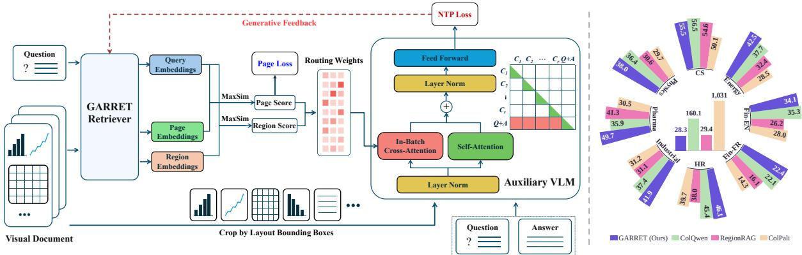
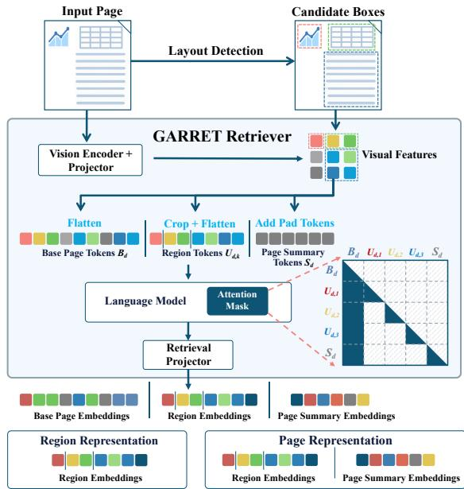
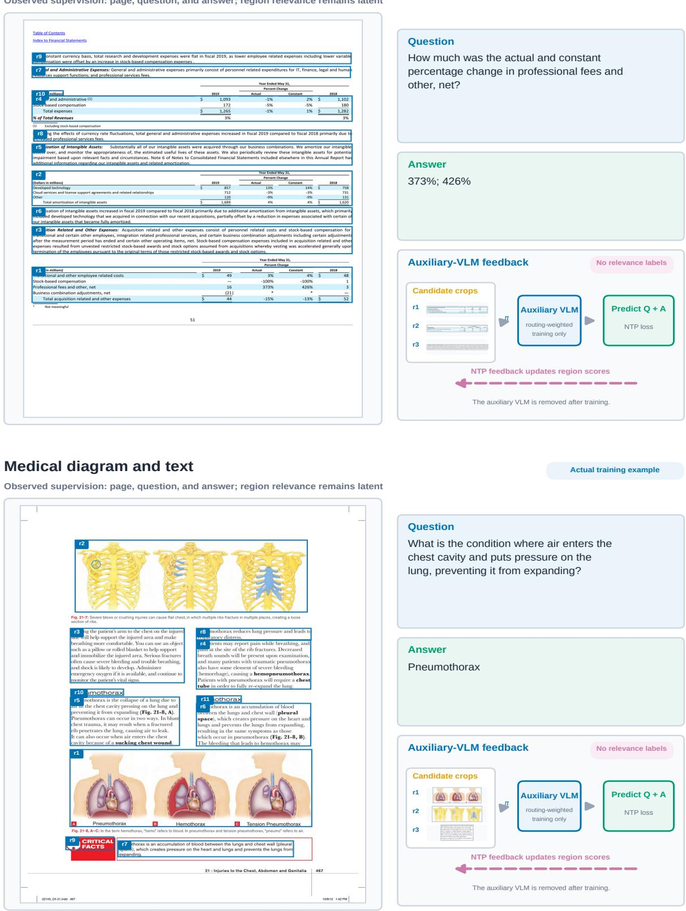
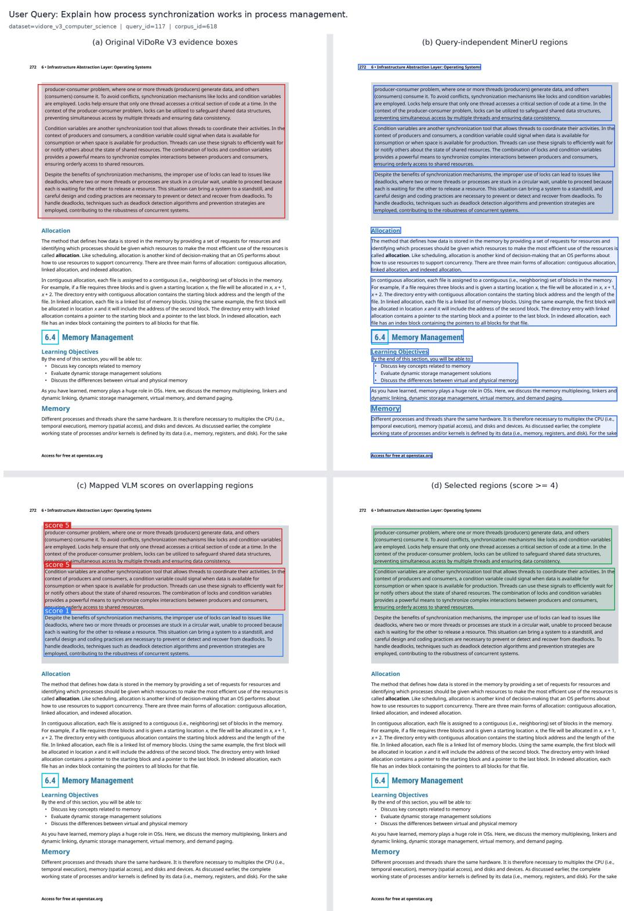
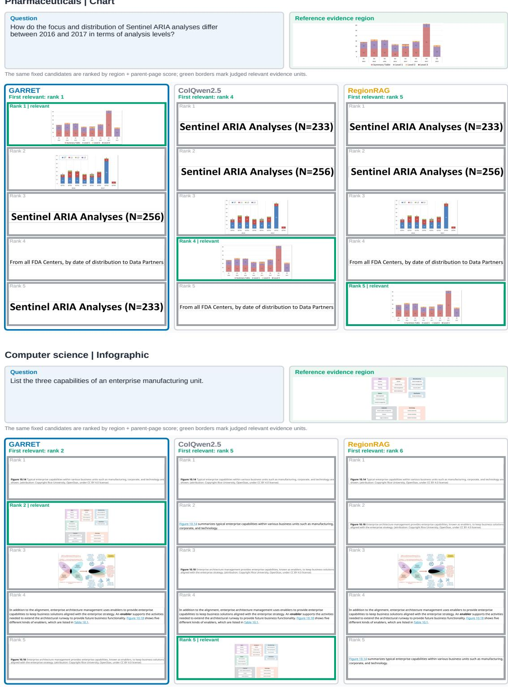
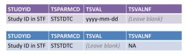
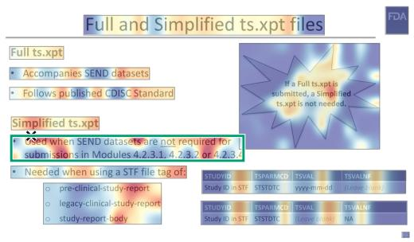
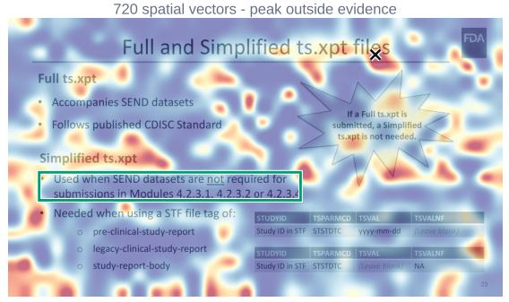
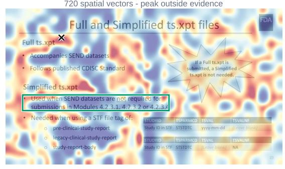
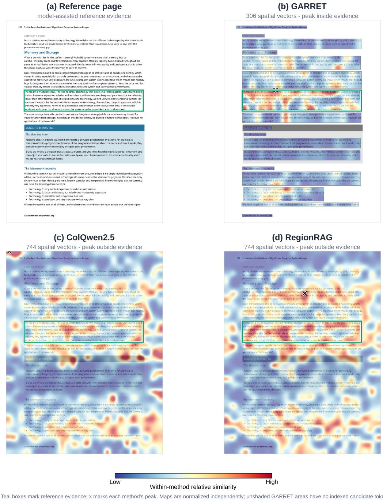

# GARRET: Generative Feedback for Region Retrieval in Visual Documents

Weijian Jian1\*, Siyang Chen2,3,1\*, Yuguang Yang4,1, Yajun Zhang1 Chunyu Xie1, Dawei Leng1†, Yuhui Yin1

1360 AI Research 2SAIS, UCAS 3CASIA 4SEIE, BUAA

## Abstract

Multimodal retrieval-augmented generation over visually rich documents requires evidence at a finer granularity than entire pages. Existing visual retrievers typically index or return full pages, whereas training region-level retrievers often requires costly query-to-region annotations or noisy model-generated labels. We introduce GARRET, a region-retrieval framework trained from (page, question, answer) triplets through differentiable generative feedback. A shared context-preserving retriever produces page and region multi-vector representations. During training, their retrieval scores define a soft routing distribution over candidate region crops. An auxiliary vision-language model attends to each crop separately, aggregates crop-specific contexts using the routing weights, and predicts the question followed by the answer under a next-token prediction objective. Gradients through the routing distribution assign query-conditioned credit to the indexed region representations, without requiring queryto-region annotations. At inference, the auxiliary model is removed. GARRET also reuses the contextualized region representations, together with page summary tokens, to construct a compact page representation. We introduce VIDORE-V3-REGION, a corpus-wide benchmark containing 200,682 fixed candidate regions across eight domains. GARRET achieves a macro nDCG@10 of 0.4126, outperforming the strongest visual baseline by 2.94 points. On page retrieval, it remains comparable to ColQwen2.5-v0.2 while indexing 47.8% fewer vectors per page.

## 1 Introduction

Retrieval-augmented generation (RAG) has naturally expanded to visually rich documents, where critical information resides in layouts, tables, and figures (Yu et al., 2025; Tanaka et al., 2025). Recent visual retrievers, such as ColPali and ColQwen (Faysse et al., 2025), directly encode rendered pages to bypass error-prone OCR pipelines, achieving strong page-level performance. However, retrieving entire pages introduces severe redundancy. The actual evidence for a query is often confined to a short paragraph or a small figure. Feeding full pages into a generation model increases computational costs, introduces irrelevant context, and exacerbates hallucination risks. Thus, multimodal RAG demands a finer granularity: retrieving the exact supporting region.

Developing robust region-level retrievers, however, faces significant hurdles. Dynamic patchgrouping methods like RegionRAG (Li et al., 2026) construct regions on the fly, precluding efficient offline indexing. Conversely, block-based retrievers like LFRAG (Zhu et al., 2026) support offline indexing but require prohibitively expensive query-to-region annotations. Although large visionlanguage models (VLMs) can generate pseudolabels, this process is computationally expensive and often yields noisy supervision. Thus, the lack of scalable, high-quality training data remains the primary bottleneck for fine-grained visual retrieval.

To overcome this bottleneck, we leverage the abundant (page, question, answer) triplets already available in existing datasets. While the exact bounding box is unannotated, the answer provides an implicit supervisory signal: a region is relevant if its visual content enables a model to generate the correct answer. Based on this insight, we propose GARRET (Generative Answer feedback for Region RETrieval), a framework that treats region relevance as a latent variable optimized directly via generative feedback.

During training, GARRET extracts queryindependent layout regions (Wang et al., 2024) and computes their relevance scores to form a soft routing distribution. An auxiliary VLM then processes these isolated visual crops via retriever-weighted in-batch cross-attention. By training the VLM to jointly predict the paired question and answer using a next-token prediction (NTP) objective, the loss backpropagates directly through the routing scores. This mechanism naturally rewards regions that support generation and penalizes distractors, without requiring manual query-to-region training annotations or fixed VLM pseudo-labels. Post-training, the auxiliary VLM is discarded, yielding a standalone, highly effective retriever.

  
Figure 1: Overview of the GARRET framework and its performance. Left: During training, the retriever computes routing weights for candidate regions. An auxiliary VLM uses these weights via in-batch cross-attention to process isolated visual crops. By predicting the paired question and answer, the VLM backpropagates a next-token prediction (NTP) loss as generative feedback, teaching the retriever latent region relevance. Right: GARRET achieves state-of-the-art region retrieval across eight domains in ViDoRe V3 while requiring significantly fewer indexed vectors than existing baselines.

To ensure regions retain their semantic background, GARRET introduces a context-preserving multi-granularity embedding architecture, a visual analogue to late chunking (Günther et al., 2024; Yan et al., 2026a). Region tokens are appended to the base page tokens, allowing each region to absorb global page context while blocking crossregion attention. Crucially, during offline indexing, the base page embeddings are discarded. Only the contextualized region embeddings and a small set of page-summary embeddings are retained. This design compresses dense page information into a highly compact, shared index that efficiently supports both independent region retrieval and fullpage retrieval.

Finally, to rigorously evaluate fine-grained retrieval, we construct a novel benchmark spanning eight domains from ViDoRe V3 (Loison et al., 2026), comprising 200,682 fixed candidate regions with human-verified positive relevance judgments for corpus-level evaluation. On this benchmark, GARRET achieves an nDCG@10 of 0.4126, establishing a new state-of-the-art by a substantial margin. Furthermore, GARRET matches the pagelevel performance of the ColQwen family while requiring 47.8% fewer indexed vectors, demonstrating exceptional storage efficiency.

Our main contributions are summarized as follows:

• We propose a weakly supervised training framework that learns fine-grained visual retrieval directly from (page, question, answer) triplets. By utilizing an auxiliary VLM to provide differentiable generative feedback, GAR-RET eliminates the reliance on manual queryto-region annotations.

• We introduce a context-preserving multigranularity architecture (visual late chunking). It enables regions to absorb global page context and discards dense page tokens during indexing, creating a highly compact representation for both region- and page-level retrieval.

• We construct a comprehensive region-level retrieval benchmark with over 200K fixed candidate regions. Extensive evaluations demonstrate that GARRET achieves state-of-the-art region retrieval and matches leading pagelevel retrievers while reducing index size by 47.8%.

## 2 Related Work

## 2.1 Fine-Grained Visual Document Retrieval

Vision-native document retrievers encode rendered pages to preserve layout and visual content. DSE and VisRAG use one vector per page, whereas Col-Pali applies ColBERT-style late interaction (Ma et al., 2024; Yu et al., 2025; Khattab and Zaharia,

  
Figure 2: Architecture of GARRET’s contextpreserving multi-granularity retriever. A specialized attention mask allows region tokens to absorb global page context without mutual interference. After projection, base page embeddings are discarded. The retained region and summary embeddings form a highly compact representation, enabling both fine-grained region retrieval and efficient page-level retrieval.

2020; Faysse et al., 2025). Follow-up work analyzes late interaction, compresses multi-vector indexes, or forms page-contextualized visual chunks (Qiao et al., 2025; Ma et al., 2025b; Yan et al., 2026a). These systems retain the page as the retrieval output.

RegionRAG forms query-dependent regions at inference, whereas LFRAG indexes predefined layout blocks with explicit query–block labels (Li et al., 2026; Zhu et al., 2026). AGREE and Re-Align use MLLM attention, localized regions, or generated descriptions to improve page retrieval (Cui et al., 2026; Yang et al., 2026). Spatially-Grounded Retrieval propagates page-patch scores to OCR regions, ColParse combines parsed subimages with a global page vector, and VISA generates answers with supporting boxes (Georgiou, 2025; Yan et al., 2026b; Ma et al., 2025a). These methods do not learn persistent evidence units directly from QA supervision.

Training region retrievers therefore remains dependent on costly manual query–region annotations or large-model-generated supervision, which is computationally expensive and may introduce noisy fixed targets. GARRET instead learns latent query–region relevance from (page, question, answer) triplets without explicit region labels. Existing benchmarks likewise focus primarily on page ranking. Although ViDoRe V3 provides evidence boxes, they support localization within a relevant page rather than corpus-wide region retrieval (Loison et al., 2026). We align these annotations with query-independent layout boxes to derive fixed candidate regions and region-level relevance judgments for corpus-wide evaluation.

## 2.2 Generative Supervision for Retrieval

ReVela connects language modeling with dense retrieval by optimizing textual document representations through a language-modeling objective, while ElicitR combines contrastive retrieval learning with a generative regularizer (Cai et al., 2026a,b). These methods demonstrate that generative objectives can provide supervision beyond explicit relevance labels, but they operate on textual passages, whose retrieval units are naturally defined and share the same modality as the generator.

GARRET extends this principle to multimodal region retrieval. Visual regions must be spatially defined, preserve their parent-page context, and remain independently indexable. GARRET treats their relevance as latent and uses soft region routing to connect the retriever with an auxiliary VLM. By jointly predicting the paired question and answer, the generation objective supervises both query– region alignment and evidence sufficiency. Its gradients directly update the persistent region embeddings retained in the retrieval index, without teacher-generated attention labels, descriptions, or query–region annotations.

## 3 Method

Figure 1 gives an overview of GARRET, a finegrained visual document retriever trained using (page, question, answer) triplets without query-toregion annotations. A shared context-preserving retriever produces both page embeddings and region embeddings. During training, an auxiliary VLM backpropagates the question–answer generation loss through the retrieval scores to learn latent region relevance. The auxiliary VLM is discarded at inference.

## 3.1 Problem Formulation

Let D be a corpus of visual document pages. For each page d, MinerU (Wang et al., 2024) extracts m query-independent layout candidates R(d) = $\{ r _ { d , k } \} _ { k = 1 } ^ { m _ { d } }$ , where each candidate ${ r } _ { d , k }$ is defined by a bounding box $b _ { d , k }$ and may correspond to a text block, table, figure, or other layout element.

Training uses $\mathcal { T } = \{ ( d _ { i } ^ { + } , q _ { i } , a _ { i } ) \} _ { i = 1 } ^ { N }$ , where the paired page $d _ { i } ^ { + }$ contains evidence for answer $a _ { i }$ to question $q _ { i } ,$ , but its supporting regions are unannotated. We therefore treat region relevance as a latent variable. The retriever learns a page-level score $s _ { D } ( q , d )$ and a region-level score $s _ { R } ( q , d , k )$ which are combined to rank bounding-box regions across the corpus.

## 3.2 Context-Preserving Multi-Granularity Retriever

To efficiently support both region- and pagelevel retrieval, GARRET derives contextual region embeddings and a compact page representation through a shared page encoding, as shown in $\mathrm { F i g \mathrm { - } }$ ure 2.

Given a page image d, the vision encoder and visual projector produce a spatial feature map $M _ { d }$ We flatten the complete feature map into the base page tokens $B _ { d }$ . For each layout candidate ${ r } _ { d , k }$ with bounding box $b _ { d , k }$ , we crop the corresponding area from $M _ { d }$ and flatten it into a region token group:

$$
\begin{array} { c } { { B _ { d } = \mathrm { F l a t t e n } ( M _ { d } ) , } } \\ { { U _ { d , k } = \mathrm { F l a t t e n } \left( \mathrm { C r o p } ( M _ { d } , b _ { d , k } ) \right) . } } \end{array}
$$

The number of tokens in $U _ { d , k }$ depends on the spatial extent of the candidate on the feature map. Since all region groups are extracted from the same $M _ { d } .$ , each page requires only one vision-encoder forward pass.

We concatenate the base page tokens, all region token groups, and $n _ { s }$ page summary tokens $\bar { S } _ { d } ^ { ( 0 ) }$ :

$$
X _ { d } = B _ { d } \parallel U _ { d , 1 } \parallel \cdots \parallel U _ { d , m _ { d } } \parallel S _ { d } ^ { ( 0 ) } .
$$

We use $n _ { s } = 1 0 0$ summary tokens in all experiments and initialize them with padding-token embeddings, following ColPali (Faysse et al., 2025). These tokens provide an additional global readout for page content that may not be fully covered by the layout candidates.

A block-structured causal attention mask controls the information flow. Base page tokens follow standard causal attention and cannot access the appended tokens. Each region token attends to all base page tokens and preceding tokens within its own region group, but not to tokens from other regions. Summary tokens similarly attend to all base page tokens and preceding summary tokens, while remaining isolated from the region groups. Therefore, each region incorporates global page information without being contaminated by other candidate regions. This design preserves the surrounding context needed to interpret local content while keeping every region independently retrievable, forming a visual analogue of late chunking (Günther et al., 2024; Yan et al., 2026a).

Let $H _ { d , k } ^ { R }$ and $H _ { d } ^ { S }$ denote the contextualized hidden states at the k-th region group and the summary-token positions, respectively. After applying the retrieval projector $P _ { \theta }$ and token-wise $\ell _ { 2 }$ normalization, the region representation is

$$
T _ { R } ( d , k ) = \mathrm { n o r m } \left( P _ { \theta } ( H _ { d , k } ^ { R } ) \right) ,
$$

and the page representation is

$$
T _ { D } ( d ) = \mathrm { n o r m } \left( P _ { \theta } \left( H _ { d , 1 } ^ { R } \parallel \cdots \parallel H _ { d , m _ { d } } ^ { R } \parallel H _ { d } ^ { S } \right) \right) .
$$

Thus, each contextualized region group serves two retrieval granularities: $T _ { R } ( d , k )$ is indexed as an independent evidence unit, while the same group is reused as part of the parent-page representation $T _ { D } ( d )$ . The base page hidden states are used only to provide context during offline encoding and are discarded before indexing. GARRET therefore stores only the region embeddings and the small set of page-summary embeddings.

Although appending region and summary tokens lengthens document-side encoding, this cost is incurred only once during offline index construction and does not affect online retrieval (Cui et al., 2025). Since document pages typically contain substantial whitespace, the retained region-token groups cover far fewer positions than the dense full-page grid, resulting in a shorter indexed representation.

Following late-interaction visual retrieval (Faysse et al., 2025), the query encoder maps q to $Q ( q ) = \left\{ \mathbf { q } _ { u } \right\} _ { u = 1 } ^ { n _ { q } }$ . For a document-side multivector $T = \{ \mathbf { t } _ { v } \} _ { v = 1 } ^ { n _ { T } }$ , we use query-length-normalized MaxSim (Khattab and Zaharia, 2020):

$$
s ( q , T ) = \frac { 1 } { n _ { q } } \sum _ { u = 1 } ^ { n _ { q } } \operatorname* { m a x } _ { 1 \leq v \leq n _ { T } } \left. \mathbf { q } _ { u } , \mathbf { t } _ { v } \right. .
$$

The page- and region-level scores are

$$
\begin{array} { c } { { s _ { D } ( q , d ) = s ( q , T _ { D } ( d ) ) , } } \\ { { s _ { R } ( q , d , k ) = s ( q , T _ { R } ( d , k ) ) . } } \end{array}
$$

Finally, we combine local region relevance with the relevance of its parent page:

$$
F ( q , d , k ) = s _ { R } ( q , d , k ) + s _ { D } ( q , d ) .
$$

The region term identifies fine-grained evidence, while the page term disambiguates similar local regions using their global document context. The same score is used for training-time routing and inference-time region ranking.

## 3.3 Generative Feedback for Region Retrieval

Differentiable region routing. As illustrated in Figure 1, GARRET converts the retriever’s page and region scores into routing weights that directly control the visual evidence available to an auxiliary VLM. This design places region selection inside the generation path, allowing the next-token prediction (NTP) loss to supervise the retriever without query-to-region annotations. For training example i, let $\mathcal { C } _ { i }$ denote the candidate region pool defined in the Candidate Sampling subsection. For a candidate $r = ( d , k )$ , we use the same combined score as region retrieval, $F _ { i , r } = F ( q _ { i } , d , k ) \ =$ $s _ { R } ( q _ { i } , d , k ) + s _ { D } ( q _ { i } , d )$ , and normalize the scores into a differentiable routing distribution:

$$
\pi _ { i , r } = \frac { \exp ( F _ { i , r } / \tau _ { r } ) } { \sum _ { r ^ { \prime } \in \mathcal { C } _ { i } } \exp ( F _ { i , r ^ { \prime } } / \tau _ { r } ) } , \qquad r \in \mathcal { C } _ { i } ,
$$

where $\tau _ { r }$ controls the routing sharpness. Thus, $\pi _ { i , r }$ represents the retriever’s current belief that region r provides useful evidence for query $q _ { i }$

Isolated visual sources. For each candidate $r =$ $( d , k )$ , we crop the pixels within its layout bounding box, $C _ { r } = \mathrm { C r o p } ( d , b _ { d , k } )$ , and form $\mathcal { T } _ { i } = \{ C _ { r }$ $r \in \mathcal { C } _ { i } \}$ . Each crop is encoded independently by the auxiliary VLM and treated as a separate visual source. This isolation is essential: the contribution controlled by $\pi _ { i , r }$ can contain only evidence inside the corresponding bounding box, preventing neighboring regions from leaking information into the generation objective. The crop features are used only to provide training-time feedback and are not stored in the retrieval index.

Retriever-weighted in-batch cross-attention. We insert an in-batch cross-attention branch into selected decoder layers of the auxiliary VLM. Candidate crop encodings in the local pool serve as source memories, while the paired question– answer sequence forms the target branch. At decoder layer ℓ, the source branch provides stopgradient visual keys and values $( K _ { r } ^ { \ell } , V _ { r } ^ { \ell } )$ for each candidate. For target token t, the query $Q _ { i , t } ^ { \ell }$ first attends to each crop independently and then aggregates the resulting crop-specific contexts using the retriever-derived routing weights:

$$
\begin{array} { r l } & { b _ { i , t , r } ^ { \ell } = \mathrm { s o f t m a x } \left( \frac { Q _ { i , t } ^ { \ell } ( K _ { r } ^ { \ell } ) ^ { \top } } { \sqrt { d _ { h } } } \right) V _ { r } ^ { \ell } , } \\ & { ~ b _ { i , t } ^ { \ell } = \displaystyle \sum _ { r \in \mathcal { C } _ { i } } \pi _ { i , r } b _ { i , t , r } ^ { \ell } , } \\ & { ~ h _ { i , t } ^ { \ell } = s _ { i , t } ^ { \ell } + b _ { i , t } ^ { \ell } , } \end{array}
$$

where $d _ { h }$ is the attention-head dimension and $s _ { i , t } ^ { \ell }$ denotes the ordinary causal self-attention output. The first operation performs token-level selection within each crop, whereas the weighted sum performs region-level routing across candidates. Keeping the crop-wise attention softmaxes separate ensures that $\pi _ { i , r }$ acts as an explicit region gate rather than being entangled with token competition across regions. This construction establishes the gradient path $\mathcal { L } _ { \mathrm { N T P } } \to \pi _ { i , r } \to F _ { i , r } \to \{ s _ { R } , s _ { D } \} \to \theta :$ regions that reduce the generation loss receive positive retrieval feedback, while distractors are downweighted.

Joint question and answer generation. Given a fixed instruction, the auxiliary VLM is trained with teacher forcing to generate

$$
y _ { i } = \left[ \mathsf { Q u e s t i o n } \colon , q _ { i } , \mathsf { A n s w e r } \colon , a _ { i } \right] .
$$

The two targets provide complementary supervision. Predicting the question encourages the routed regions to align with the query semantics, whereas predicting the answer requires them to contain sufficient evidence for the correct response. Their combination also limits target-specific shortcuts: answer-only training may exploit language priors for short answers, while question-only training may favor topically related but non-evidential regions. The NTP objective is

$$
\begin{array} { l } { { \displaystyle { \mathcal { L } } _ { \mathrm { N T P } } = - \frac { 1 } { | \mathcal { B } | } \sum _ { i \in \mathcal { B } } \frac { 1 } { L _ { i } } } \ ~ } \\ { { \displaystyle ~ \times \sum _ { t = 1 } ^ { L _ { i } } \log p _ { \phi , \theta } \left( y _ { i , t } \mid y _ { i , < t } , { \mathcal { T } } _ { i } , \pi _ { i } \right) . } } \end{array}
$$

where $L _ { i }$ is the target length, ϕ denotes the auxiliary VLM parameters, and θ denotes the retriever parameters. Unlike pseudo-labeling, GARRET does not convert VLM outputs into fixed region labels. Instead, the NTP loss provides continuous, query-conditioned generative feedback to the page and region representations that are later used for retrieval.

## 3.4 Joint Optimization and Inference

Candidate sampling. Computing cross-attention over every in-batch region would exceed practical memory limits. We therefore construct a compact candidate pool from the paired page, hard-negative pages, and randomly sampled negative pages.

Hard negatives are the top-H nonpaired pages according to their highest-scoring region:

$$
\begin{array} { r l } & { \mathcal { H } _ { i } = \mathrm { T o p H } _ { d \ne d _ { i } ^ { + } } \left[ \underset { 1 \le k \le m _ { d } } { \operatorname* { m a x } } F ( q _ { i } , d , k ) \right] , } \\ & { \mathcal { P } _ { i } = \{ d _ { i } ^ { + } \} \cup \mathcal { H } _ { i } \cup \mathcal { N } _ { i } ^ { \mathrm { r a n d } } , } \\ & { \mathcal { C } _ { i } = \{ ( d , k ) : d \in \mathcal { P } _ { i } , 1 \le k \le m _ { d } \} , } \end{array}
$$

where $\mathcal { N } _ { i } ^ { \mathrm { r a n d } }$ contains randomly sampled nonpaired pages outside $\mathcal { H } _ { i }$ . Hard negatives provide visually or semantically confusable candidates, while random negatives broaden coverage. All regions from the selected pages remain candidates, including distractor regions on the paired page.

Optimization and deployment. The NTP loss learns latent region relevance, while a ColPali-style pairwise softplus loss with in-batch hard negatives preserves page-level retrieval quality (Faysse et al., 2025). The joint objective is

$$
\begin{array} { r } { \mathcal { L } = \mathcal { L } _ { \mathrm { p a g e } } + \lambda _ { \mathrm { N T P } } \mathcal { L } _ { \mathrm { N T P } } . } \end{array}
$$

We optimize the retriever’s language-model and projection adapters and the auxiliary VLM’s language-model adapter, while keeping both vision encoders frozen. At inference, the auxiliary VLM and crop-source branch are discarded, leaving the retriever to rank pages by $s _ { D } ( q , d )$ and all candidate regions by $F ( q , d , k )$

## 3.5 Region-Level Benchmark Construction

Existing visual document retrieval benchmarks mainly evaluate page-level ranking. Although ViDoRe V3 provides human-annotated evidence boxes, these free-form annotations are intended for localization within relevant pages rather than corpus-wide region retrieval (Loison et al., 2026). We retain the complete query set and eight domains of ViDoRe V3, and use MinerU (Wang et al., 2024) to extract query-independent layout bounding boxes from every page. Layout boxes that overlap an original evidence box, i.e., with IoU $> 0$ are selected as candidate annotations. This procedure produces a fixed corpus of 200,682 layout regions, which are indexed and ranked directly during evaluation. This setup is consistent with our formulation of MinerU regions as persistent retrieval units rather than query-dependent crops.

For each overlapping layout box, we draw the box on the full page and ask Qwen3-VL-32B (Bai et al., 2025a) to score its relevance to the query from 0 to 5. Regions with scores greater than 4 are initially labeled positive. Two annotators then independently review all candidate labels. A region is considered relevant only when the content inside the box provides direct or indispensable evidence for answering the query; regions with only topical similarity, incidental geometric overlap, or evidence located primarily outside the box are rejected. Disagreements are discussed until consensus is reached. The final human-verified binary labels are used to evaluate corpus-wide region ranking with nDCG.

## 4 Experiments

## 4.1 Experimental Setup

Training Details. To ensure a fair comparison, we train GARRET exclusively on the official Vi-DoRe training set (118,195 triplets) used by the ColPali and ColQwen series, without relying on external or synthetic data. MinerU (Wang et al., 2024) is solely used for layout parsing. Both the retriever and the auxiliary VLM are initialized from Qwen2.5-VL-3B-Instruct (Bai et al., 2025b) with their vision encoders frozen. The retriever uses LoRA (Hu et al., 2022) (rank 64, $\alpha = 1 2 8 )$ and produces 128-dimensional embeddings, while the VLM uses LoRA (rank $3 2 , \alpha = 6 4 )$ . We train for 5 epochs on 16 NVIDIA A100 (80GB) GPUs with a learning rate of $1 \times 1 0 ^ { - 4 }$ , and a per-GPU batch size of 24. The number of page summary tokens is set to 100. The NTP loss weight is set to 0.1, and the routing temperature to 0.01.

Benchmarks and Metrics. We evaluate across three main dimensions: region retrieval, page retrieval, and downstream generation. For regionlevel retrieval, we evaluate on our proposed VIDORE-V3-REGION (2,419 queries, 200,682 regions) using nDCG@10 as the primary metric. To assess cross-benchmark generalization, we additionally evaluate on MMDocIR (Dong et al., 2025) for in-document region localization. For pagelevel retrieval, we follow the official protocols of ViDoRe V1, V2, and V3 (Faysse et al., 2025; Macé et al., 2025; Loison et al., 2026). Furthermore, we report the number of indexed vectors per page/region to compare storage efficiency.

<table><tr><td>Method</td><td>Avg.</td><td>CS</td><td>Ene.</td><td>Fin-EN</td><td>Fin-FR</td><td>HR</td><td>Ind.</td><td>Pha.</td><td>Phy.</td><td>Vec./reg.</td></tr><tr><td colspan="9">Text-based Document Retrievers</td><td></td></tr><tr><td>BM25</td><td>16.24</td><td>25.93</td><td>5.97</td><td>19.67</td><td>5.47</td><td>28.70</td><td>18.28</td><td>21.84</td><td>4.05</td><td></td></tr><tr><td>BGE-M3</td><td>25.26</td><td>33.32</td><td>29.63</td><td>26.17</td><td>12.57</td><td>35.51</td><td>24.45</td><td>22.17</td><td>18.28</td><td>1.0</td></tr><tr><td>Qwen3-Emb.-8B</td><td>35.22</td><td>49.97</td><td>38.17</td><td>35.09</td><td>19.20</td><td>38.67</td><td>31.72</td><td>33.20</td><td>35.77</td><td>1.0</td></tr><tr><td colspan="9">Vision-based Document Retrievers</td><td></td></tr><tr><td>ColPali-v1.3</td><td>31.51</td><td>50.15</td><td>28.51</td><td>27.98</td><td>14.26</td><td>39.74</td><td>31.18</td><td>30.47</td><td>29.75</td><td>1031.0</td></tr><tr><td>ColQwen2.5-v0.2</td><td>38.32</td><td>56.46</td><td>37.70</td><td>35.30</td><td>22.07</td><td>45.36</td><td>37.40</td><td>35.88</td><td>36.41</td><td>160.1</td></tr><tr><td>RegionRAG</td><td>33.77</td><td>54.61</td><td>32.35</td><td>26.22</td><td>16.05</td><td>37.97</td><td>31.06</td><td>41.29</td><td>30.63</td><td>29.4</td></tr><tr><td>GARRET</td><td>41.26</td><td>55.46</td><td>42.47</td><td>34.05</td><td>22.37</td><td>46.07</td><td>41.93</td><td>49.72</td><td>38.04</td><td>28.3</td></tr></table>

Table 1: Region retrieval on VIDORE-V3-REGION (nDCG@10, ×100). GARRET achieves the best average performance with the fewest indexed vectors among dense visual retrievers. Bold and underlined values denote the best and second-best results.
<table><tr><td>Method</td><td colspan="2">nDCG</td><td colspan="3">Layout Recall</td></tr><tr><td></td><td>@5</td><td>@10</td><td>R@1</td><td>R@5</td><td>R@10</td></tr><tr><td>Text-based regions</td><td></td><td></td><td></td><td></td><td></td></tr><tr><td>BM25-OCR</td><td>32.73</td><td>34.65</td><td>20.82</td><td>36.00</td><td>42.17</td></tr><tr><td>BM25-VLM</td><td>41.68</td><td>44.21</td><td>28.72</td><td>50.78</td><td>58.70</td></tr><tr><td>BGE-M3</td><td>42.48</td><td>45.58</td><td>27.90</td><td>50.88</td><td>59.75</td></tr><tr><td>Qwen3-Emb.-8B</td><td>42.14</td><td>45.32</td><td>24.87</td><td>47.98</td><td>56.73</td></tr><tr><td>Independent visual crops</td><td></td><td></td><td></td><td></td><td></td></tr><tr><td>ColPali-v1.3</td><td>51.31</td><td>54.83</td><td>36.95</td><td>59.02</td><td>67.75</td></tr><tr><td>ColQwen2.5-v0.2</td><td>50.90</td><td>54.08</td><td>36.72</td><td>59.90</td><td>68.40</td></tr><tr><td>RegionRAG</td><td>50.03</td><td>53.14</td><td>35.58</td><td>58.87</td><td>68.26</td></tr><tr><td>Page-context region encoding</td><td></td><td></td><td></td><td></td><td></td></tr><tr><td>GARRET</td><td>56.68</td><td>60.04</td><td>41.30</td><td>64.07</td><td>73.14</td></tr></table>

Table 2: Region retrieval on MMDocIR. All metrics are reported on a ×100 scale. GARRET achieves the best nDCG and layout recall at all evaluated cutoffs, demonstrating strong cross-benchmark generalization. Bold and underlined values denote the best and secondbest results.

Baselines. We compare GARRET against lexical models like BM25 (Robertson and Zaragoza, 2009); text-dense models including BGE-M3 (Chen et al., 2024) and Qwen3-Embedding-8B (Zhang et al., 2025); and visual retrievers such as ColPali, ColQwen (Faysse et al., 2025), and RegionRAG (Li et al., 2026). For text-based baselines, we encode parsed text. Since ColPali and ColQwen are inherently page-level retrievers, we adapt them for region retrieval by cropping and encoding each benchmark bounding box as an independent image. For RegionRAG, we map its dynamically predicted regions to our benchmark boxes. As LFRAG (Zhu et al., 2026) is not open-source, we evaluate its core architectural design via controlled ablations.

Downstream RAG Evaluation. To measure the practical impact of fine-grained retrieval, we conduct a RAG experiment on the ViDoRe V3 test set using Qwen2.5-VL-7B-Instruct as the generator. Page-level baselines are provided with the top-5 retrieved full pages as context. In contrast, GARRET is provided with the top-k retrieved region crops $( k \in \{ 5 , 1 0 , 1 5 , 2 0 \} )$ . We use Qwen2.5-VL-32B-Instruct as an automated judge to evaluate strict answer accuracy, reporting the percentage of fully correct answers.

## 4.2 Region-Level Retrieval Performance

We first evaluate GARRET on our newly constructed VIDORE-V3-REGION benchmark, with results presented in Table 1. GARRET establishes a new state of the art with a macro-average nDCG@10 of 41.26, substantially outperforming the strongest vision-based baseline by 2.94 points (Table 1). This superiority stems from learning persistent, page-contextualized region embeddings via generative feedback. Unlike baselines that either lose context by encoding isolated crops (ColQwen) or use unstable dynamic regions (RegionRAG), GARRET creates robust representations without costly annotations. This corresponds to 82.3% fewer vectors per region than the ColQwen adaptation and a substantially shorter indexed representation.

To assess generalization, we evaluate GARRET on the MMDocIR benchmark, which focuses on indocument region localization. As shown in Table 2, GARRET demonstrates strong transferability, outperforming all baselines across both nDCG and Layout Recall metrics. It achieves an nDCG@10 of 60.04, surpassing the next-best method (ColPaliv1.3) by 5.21 points. This consistent lead on a different benchmark underscores the robustness of our context-aware region representations.

<table><tr><td>Method</td><td>V1</td><td>V2</td><td>V3</td><td>Vec./page</td></tr><tr><td colspan="5">Text-based Document Retrievers</td></tr><tr><td>BM25</td><td>69.94</td><td>21.61</td><td>38.29</td><td></td></tr><tr><td>BGE-M3</td><td>68.27</td><td>49.75</td><td>44.63</td><td>1.0</td></tr><tr><td>Qwen3-Emb.-8B</td><td>75.82</td><td>55.28</td><td>53.93</td><td>1.0</td></tr><tr><td colspan="5">Vision-based Document Retrievers</td></tr><tr><td>ColPali-v1.3</td><td>85.42</td><td>57.81</td><td>48.86</td><td>1031.0</td></tr><tr><td>ColQwen2.5-v0.2</td><td>88.45</td><td>58.59</td><td>57.18</td><td>752.3</td></tr><tr><td>RegionRAG</td><td>86.70</td><td>59.85</td><td>57.14</td><td>752.3</td></tr><tr><td>GARRET</td><td>88.56</td><td>57.51</td><td>57.29</td><td>392.9</td></tr></table>

Table 3: Page retrieval on ViDoRe V1–V3 using nDCG@10 (×100). GARRET remains competitive with the strongest visual retrievers while using substantially fewer indexed vectors per page. Bold and underlined values denote the best and second-best results.

## 4.3 Page-Level Retrieval Performance

A key advantage of our multi-granularity architecture is its ability to enhance region retrieval without compromising page-level performance. As shown in Table 3, GARRET not only preserves but often matches or exceeds the performance of leading page-level retrievers. Specifically, GAR-RET achieves state-of-the-art nDCG@10 scores on ViDoRe V1 (88.56) and V3 (57.29), slightly outperforming ColQwen2.5-v0.2, and remains highly competitive on V2.

Crucially, GARRET achieves this competitive performance while being significantly more efficient. GARRET indexes only 392.9 vectors per page, representing a 47.8% reduction compared to ColQwen2.5 and RegionRAG, and a 61.9% reduction compared to ColPali. This result validates our design: the context-preserving multi-granularity embedding paradigm successfully creates a compact, shared index that excels at fine-grained retrieval without sacrificing coarse-grained accuracy or incurring a storage penalty.

## 4.4 Impact on Downstream RAG Evaluation

To evaluate the practical utility of fine-grained retrieval, we measure its impact on downstream RAG performance on ViDoRe V3, with results in Table 4. We compare standard page-level retrieval, where the top-5 full pages are fed to the generator, against our region-level retrieval, where the top-k regions from GARRET are used.

The results demonstrate that retrieving precise regions is more effective and efficient than retrieving entire pages. The best page-level baseline, ColQwen2.5-v0.2, achieves a strict accuracy of 37.00% using five full pages as context. In contrast, GARRET surpasses this performance by retrieving only 15 regions, reaching 38.00% accuracy while using just 49.51% of the context area (Area/P5). By increasing the number of retrieved regions to 20, GARRET’s accuracy further improves to 39.12%, using only 66.08% of the page-level context area. This shows that providing the generator with a smaller set of more relevant, evidence-rich regions leads to higher-quality answers and reduces the processing of irrelevant information, highlighting the tangible benefits of fine-grained retrieval for RAG systems.

<table><tr><td>Method / context</td><td>Units</td><td>Area/P5</td><td>Acc</td></tr><tr><td>Page-level retrieval</td><td></td><td></td><td></td></tr><tr><td>BM25</td><td>5 pages</td><td>100%</td><td>27.53</td></tr><tr><td>BGE-M3</td><td>5 pages</td><td>100%</td><td>33.85</td></tr><tr><td>Qwen3-Emb.-8B</td><td>5 pages</td><td>100%</td><td>36.71</td></tr><tr><td>ColPali-v1.3</td><td>5 pages</td><td>100%</td><td>33.51</td></tr><tr><td>ColQwen2.5-v0.2</td><td>5 pages</td><td>100%</td><td>37.00</td></tr><tr><td>Region-level retrieval</td><td></td><td></td><td></td></tr><tr><td></td><td>5 regions</td><td>16.36%</td><td>35.77</td></tr><tr><td>GARRET</td><td>10 regions</td><td>32.93%</td><td>36.89</td></tr><tr><td></td><td>15 regions</td><td>49.51%</td><td>38.00</td></tr><tr><td></td><td>20 regions</td><td>66.08%</td><td>39.12</td></tr></table>

Table 4: RAG results on ViDoRe V3. Page-level methods use the top-5 retrieved pages, while GARRET uses the top-k retrieved layout regions. Area/P5 denotes retrieved area relative to five full pages. Acc is reported as a percentage.
<table><tr><td>Variant</td><td>Region</td><td>Page</td><td>Vectors/page</td></tr><tr><td>GARRET</td><td>41.26</td><td>57.29</td><td>392.9</td></tr><tr><td>Generative-target controls</td><td></td><td></td><td></td></tr><tr><td>w/o generative feedback</td><td>36.33</td><td>57.04</td><td>392.9</td></tr><tr><td>Answer target only</td><td>41.02</td><td>56.92</td><td>392.9</td></tr><tr><td>Question target only</td><td>39.98</td><td>56.89</td><td>392.9</td></tr><tr><td>Model architecture variants</td><td></td><td></td><td></td></tr><tr><td>w/o page summary tokens</td><td>40.06</td><td>55.82</td><td>292.9</td></tr><tr><td>LFRAG-style structure</td><td>26.58</td><td>53.68</td><td>1408.3</td></tr><tr><td>RegionRAG-style structure</td><td>32.46</td><td>45.55</td><td>752.3</td></tr></table>

Table 5: Ablation studies on ViDoRe V3 using nDCG@10 (×100). Generative feedback primarily improves region retrieval, while joint question–answer generation and the full shared architecture yield the best performance. Bold and underlined values denote the best and second-best results.

## 4.5 Ablation Studies

We conduct controlled ablations on ViDoRe V3 (Table 5). Each variant modifies only the component indicated by its name; all non-ablated components, training data, candidate boxes, initialization, sampling strategy, optimization settings, training budget, and evaluation protocol remain fixed. In particular, the LFRAG- and RegionRAG-inspired variants replace only the representation structure while retaining GARRET’s NTP feedback, pagelevel loss, and routing mechanism. They therefore serve as internal architectural controls rather than reproductions of the original systems.

Generative-Target Controls. Removing generative feedback, including the auxiliary VLM and NTP objective, reduces region nDCG@10 from 41.26 to 36.33, while page performance changes only from 57.29 to 57.04. This confirms that the page-level objective largely preserves document relevance, whereas generative feedback supplies the fine-grained signal needed to distinguish evidencebearing regions. When only the generative target is changed, answer-only training reaches 41.02 region nDCG@10, outperforming question-only training at 39.98. Joint question–answer generation performs best, supporting the complementary roles of query–region semantic alignment and answerevidence sufficiency.

Model Architecture Variants. Removing page summary tokens lowers both region and page retrieval performance, indicating that they provide useful global information beyond the retained region groups. Under the same training protocol, the LFRAG-inspired independent-encoding structure and the RegionRAG-inspired structure also underperform GARRET. Differences in vectors per page are direct consequences of the corresponding representation design rather than additional experimental changes. These results support the value of GARRET’s shared, page-contextualized representations and persistent layout regions, which jointly improve retrieval quality while maintaining a compact index.

## 5 Conclusion

We introduced GARRET, a novel framework for fine-grained region retrieval in visual documents that does not require manual query-to-region training annotations. GARRET’s core innovation is learning region relevance from generative feedback, where the next-token prediction loss from an auxiliary VLM provides a powerful, annotation-free training signal. This is realized through a retrieverweighted cross-attention mechanism. Furthermore, our context-preserving multi-granularity embedding architecture, a visual analogue to late chunking, creates a unified, layout-aware index for both page and region retrieval, achieving state-of-theart performance with significantly fewer indexed vectors.

On our new large-scale benchmark, GARRET establishes a new state of the art with an nDCG@10 of 0.4126. By enabling the training of highperformance, efficient region retrievers without manual labels, GARRET represents a significant step toward building more scalable, accurate, and cost-effective multimodal information systems.

## References

Shuai Bai, Yuxuan Cai, Ruizhe Chen, Keqin Chen, Xionghui Chen, Zesen Cheng, Lianghao Deng, Wei Ding, Chang Gao, Chunjiang Ge, Wenbin Ge, Zhifang Guo, Qidong Huang, Jie Huang, Fei Huang, Binyuan Hui, Shutong Jiang, Zhaohai Li, Mingsheng Li, and 45 others. 2025a. Qwen3-VL technical report. Preprint, arXiv:2511.21631.

Shuai Bai, Keqin Chen, Xuejing Liu, Jialin Wang, Wenbin Ge, Sibo Song, Kai Dang, Peng Wang, Shijie Wang, Jun Tang, Humen Zhong, Yuanzhi Zhu, Mingkun Yang, Zhaohai Li, Jianqiang Wan, Pengfei Wang, Wei Ding, Zheren Fu, Yiheng Xu, and 8 others. 2025b. Qwen2.5-VL technical report. Preprint, arXiv:2502.13923.

Fengyu Cai, Tong Chen, Xinran Zhao, Sihao Chen, Hongming Zhang, Sherry Tongshuang Wu, Iryna Gurevych, and Heinz Koeppl. 2026a. Revela: Dense retriever learning via language modeling. In International Conference on Learning Representations.

Fengyu Cai, Iryna Gurevych, and Heinz Koeppl. 2026b. ElicitR: Unlocking latent reasoning in dense retrievers via generative regularization. In International Conference on Machine Learning.

Jianlv Chen, Shitao Xiao, Peitian Zhang, Kun Luo, Defu Lian, and Zheng Liu. 2024. M3-Embedding: Multilinguality, multi-functionality, multi-granularity text embeddings through self-knowledge distillation. Preprint, arXiv:2402.03216.

Wanqing Cui, Wei Huang, Yazhi Guo, Yibo Hu, Meiguang Jin, Junfeng Ma, and Keping Bi. 2026. Attention grounded enhancement for visual document retrieval. In Proceedings of the 49th International ACM SIGIR Conference on Research and Development in Information Retrieval, pages 223–233. ACM.

Xuanming Cui, Jianpeng Cheng, Hong-you Chen, Satya Narayan Shukla, Abhijeet Awasthi, Xichen Pan, Chaitanya Ahuja, Shlok Kumar Mishra, Yonghuan Yang, Jun Xiao, Qi Guo, Ser-Nam Lim, Aashu Singh, and Xiangjun Fan. 2025. Think then embed: Generative context improves multimodal embedding. arXiv preprint arXiv:2510.05014.

Kuicai Dong, Yujing Chang, Derrick Goh Xin Deik, Dexun Li, Ruiming Tang, and Yong Liu. 2025. MM-DocIR: Benchmarking multimodal retrieval for long documents. In Proceedings ofthe 2025 Conference on Empirical Methods in Natural Language Processing, pages 30971–31005. Association for Computational Linguistics.

Manuel Faysse, Hugues Sibille, Tony Wu, Bilel Omrani, Gautier Viaud, Céline Hudelot, and Pierre Colombo. 2025. ColPali: Efficient document retrieval with vision language models. In International Conference on Learning Representations.

Athos Georgiou. 2025. Spatially-grounded document retrieval via patch-to-region relevance propagation. Preprint, arXiv:2512.02660.

Michael Günther, Isabelle Mohr, Daniel James Williams, Bo Wang, and Han Xiao. 2024. Late chunking: Contextual chunk embeddings using long-context embedding models. Preprint, arXiv:2409.04701.

Edward J. Hu, Yelong Shen, Phillip Wallis, Zeyuan Allen-Zhu, Yuanzhi Li, Shean Wang, Lu Wang, and Weizhu Chen. 2022. LoRA: Low-rank adaptation of large language models. In International Conference on Learning Representations.

Omar Khattab and Matei Zaharia. 2020. ColBERT: Efficient and effective passage search via contextualized late interaction over BERT. In Proceedings of the 43rd International ACM SIGIR Conference on Research and Development in Information Retrieval, pages 39–48.

Yinglu Li, Zhiying Lu, Zhihang Liu, Yiwei Sun, Chuanbin Liu, and Hongtao Xie. 2026. Region-RAG: Region-level retrieval-augmented generation for visual document understanding. Proceedings of the AAAI Conference on Artificial Intelligence, 40(8):6662–6670.

António Loison, Quentin Macé, Antoine Edy, Victor Xing, Tom Balough, Gabriel Moreira, Bo Liu, Manuel Faysse, Céline Hudelot, and Gautier Viaud. 2026. ViDoRe V3: A comprehensive evaluation of retrieval augmented generation in complex real-world scenarios. Preprint, arXiv:2601.08620.

Xueguang Ma, Sheng-Chieh Lin, Minghan Li, Wenhu Chen, and Jimmy Lin. 2024. Unifying multimodal retrieval via document screenshot embedding. In Proceedings ofthe 2024 Conference on Empirical Methods in Natural Language Processing, pages 6492– 6505. Association for Computational Linguistics.

Xueguang Ma, Shengyao Zhuang, Bevan Koopman, Guido Zuccon, Wenhu Chen, and Jimmy Lin. 2025a. VISA: Retrieval augmented generation with visual source attribution. In Proceedings of the 63rd Annual Meeting ofthe Associationfor Computational Linguistics (Volume 1: Long Papers), pages 30154– 30169. Association for Computational Linguistics.

Yubo Ma, Jinsong Li, Yuhang Zang, Xiaobao Wu, Xiaoyi Dong, Pan Zhang, Yuhang Cao, Haodong Duan, Jiaqi Wang, Yixin Cao, and Aixin Sun. 2025b. Towards storage-efficient visual document retrieval: An empirical study on reducing patch-level embeddings. In Findings of the Association for Computational Linguistics: ACL 2025, pages 19568–19580. Association for Computational Linguistics.

Quentin Macé, António Loison, and Manuel Faysse. 2025. ViDoRe benchmark v2: Raising the bar for visual retrieval. Preprint, arXiv:2505.17166.

Jingfen Qiao, Jia-Huei Ju, Xinyu Ma, Evangelos Kanoulas, and Andrew Yates. 2025. Reproducibility, replicability, and insights into visual document retrieval with late interaction. In Proceedings ofthe 48th International ACM SIGIR Conference on Research and Development in Information Retrieval, pages 3335–3345. ACM.

Stephen E. Robertson and Hugo Zaragoza. 2009. The probabilistic relevance framework: BM25 and beyond. Foundations and Trends in Information Retrieval, 4(1–2):1–174.

Ryota Tanaka, Taichi Iki, Taku Hasegawa, Kyosuke Nishida, Kuniko Saito, and Jun Suzuki. 2025. VDocRAG: Retrieval-augmented generation over visually-rich documents. In Proceedings of the IEEE/CVF Conference on Computer Vision and Pattern Recognition, pages 24827–24837.

Bin Wang, Chao Xu, Xiaomeng Zhao, Linke Ouyang, Fan Wu, Zhiyuan Zhao, Rui Xu, Kaiwen Liu, Yuan Qu, Fukai Shang, Bo Zhang, Liqun Wei, Zhihao Sui, Wei Li, Botian Shi, Yu Qiao, Dahua Lin, and Conghui He. 2024. MinerU: An open-source solution for precise document content extraction. Preprint, arXiv:2409.18839.

Yibo Yan, Mingdong Ou, Yi Cao, Jiahao Huo, Xin Zou, Shuliang Liu, James Kwok, and Xuming Hu. 2026a. Visual late chunking: An empirical study of contextual chunking for efficient visual document retrieval. Preprint, arXiv:2604.10167.

Yibo Yan, Mingdong Ou, Yi Cao, Xin Zou, Shuliang Liu, Jiahao Huo, Yu Huang, James Kwok, and Xuming Hu. 2026b. Beyond the grid: Layout-informed multi-vector retrieval with parsed visual document representations. Preprint, arXiv:2603.01666.

Hao Yang, Yifan Ji, Zhipeng Xu, Zhenghao Liu, Yukun Yan, Zulong Chen, Shuo Wang, Yu Gu, and Ge Yu. 2026. ReAlign: Optimizing the visual document retriever with reasoning-guided fine-grained alignment. In Proceedings ofthe 49th International ACM

SIGIR Conference on Research and Development in Information Retrieval, pages 2162–2173. ACM.

Shi Yu, Chaoyue Tang, Bokai Xu, Junbo Cui, Junhao Ran, Yukun Yan, Zhenghao Liu, Shuo Wang, Xu Han, Zhiyuan Liu, and Maosong Sun. 2025. Vis-RAG: Vision-based retrieval-augmented generation on multi-modality documents. In International Conference on Learning Representations.

Yanzhao Zhang, Mingxin Li, Dingkun Long, Xin Zhang, Huan Lin, Baosong Yang, Pengjun Xie, An Yang, Dayiheng Liu, Junyang Lin, Fei Huang, and Jingren Zhou. 2025. Qwen3 Embedding: Advancing text embedding and reranking through foundation models. Preprint, arXiv:2506.05176.

Yifan Zhu, Yu Mi, Yue Lu, Yanchu Guan, and Zhixuan Chu. 2026. LFRAG: Layout-oriented fine-grained retrieval-augmented generation on multimodal document understanding. Preprint, arXiv:2605.22829.

## A Implementation Details

This section specifies the implementation choices omitted from the main paper. We first describe the construction and encoding of persistent layout candidates, and then detail the training-only generativefeedback path. In particular, the auxiliary VLM applies retriever-weighted cross-attention in all of its language layers. The auxiliary branch is removed after training and therefore does not affect the deployed index or online query encoding.

Table 6 summarizes the principal model and optimization settings. GARRET is trained on 118,195 page–question–answer triplets from the official Vi-DoRe training set. We use neither additional external data nor newly synthesized examples, and no query-to-region relevance labels are provided.

## A.1 Training Data and Candidate Preparation

Training Records. Each training record contains a question $q _ { i } ,$ its answer $a _ { i } .$ , one paired page $d _ { i } ^ { + }$ and the query-independent layout boxes extracted from that page. The paired page is the only pagelevel supervision supplied to the retriever. Before batching, we reject records with an empty question, an invalid answer, no valid layout candidate, or anything other than exactly one paired page. When an answer contains multiple acceptable strings, we remove empty entries and join the remaining strings with semicolons. For multiplechoice records whose answer is a letter, we replace the letter with the corresponding option text when that mapping is available. These operations only canonicalize the generation target and never create region labels.

Supervision Boundary. The data preprocessing artifacts may contain legacy positive- and negativebox fields used by other training variants. GAR-RET explicitly clears these fields before the document forward pass and constructs its region pool exclusively from the full candidate list. Consequently, neither the region embeddings nor the routing distribution can access query-to-box labels. The only query-conditioned supervision for region selection is the gradient of the question–answer generation loss.

Candidate Canonicalization. MinerU provides a fixed ordered list of layout boxes for each page. We express every box as $( x _ { 1 } , y _ { 1 } , x _ { 2 } , y _ { 2 } )$ in the normalized $[ 0 , 1 0 0 0 ] ^ { 2 }$ page coordinate system, clamp its coordinates to the page boundary, and remove entries with non-finite coordinates or non-positive width or height. Valid boxes retain their original relative order. The same canonicalization routine is used by the retrieval-side feature cropper and the feedback-side pixel cropper. Each surviving box is assigned a group index; the tuple consisting of its page index and group index identifies the corresponding region tokens, pixel crop, routing weight, and retrieval result. Training aborts if these two candidate views differ in count or order.

## A.2 Context-Preserving Retriever Implementation

Page and Region Inputs. The retriever processes each rendered page once, with at most 768 base visual tokens. Let $M _ { d }$ denote the spatial feature map produced by the vision encoder and visual projector. For each canonical box $b _ { d , k }$ , we map its normalized coordinates to $M _ { d } ,$ crop the corresponding feature-grid area, and flatten it into the initial region token group:

$$
U _ { d , k } = { \mathrm { F l a t t e n } } \left( \operatorname { C r o p } ( M _ { d } , b _ { d , k } ) \right) .
$$

The number of tokens in $U _ { d , k }$ depends on the spatial extent of the candidate on the feature map. All candidates reuse the same full-page feature map and therefore require no additional vision-encoder pass.

Candidate-Private Contextualization. We append all region groups and 100 page-summary seeds after the base page sequence. The blockstructured causal mask gives every region token access to the base page and to preceding tokens in its own group, but blocks access to sibling regions and summary tokens. Summary tokens access the base page and preceding summary tokens, but not region groups. The base sequence cannot read any appended state. After the language model, a learned projection maps the hidden states to 128 dimensions, followed by token-wise $\ell _ { 2 }$ normalization. Base-page hidden states are then discarded. The projected tokens of one group form its region entry, whereas the concatenation of all valid region groups and the 100 summary-token outputs forms the compact page entry.

Query Processing and Scoring. We use the same text processor as ColQwen2.5 and append ten query-augmentation tokens after each query. MaxSim is computed only over valid, non-padding query and document vectors and is normalized by the number of valid query tokens. As defined in the main paper, the routing and deployed region score is $F ( q , d , k ) = s _ { R } ( q , d , k ) + s _ { D } ( q , d )$ . Chunking the candidates changes only memory usage and does not alter this score.

<table><tr><td>Component</td><td>Setting</td></tr><tr><td>Retriever / auxiliary VLM ini- Qwen2.5-VL-3B- tialization</td><td>Instruct</td></tr><tr><td>Document embedding dimen- 128 sion</td><td></td></tr><tr><td>Retriever LoRA</td><td>rank  $6 4 , \alpha = 1 2 8$ </td></tr><tr><td>Auxiliary VLM LoRA Page-summary tokens</td><td> $\mathrm { r a n k } 3 2 , \alpha = 6 4$  100</td></tr><tr><td>Region routing score</td><td> $s _ { R } + s _ { D }$ </td></tr><tr><td>Generation target</td><td>Question followed by an- swer</td></tr><tr><td>Training schedule</td><td>5 epochs</td></tr><tr><td>Learning rate</td><td> $1 \times 1 0 ^ { - 4 }$ </td></tr><tr><td>Per-GPU batch size</td><td>24</td></tr><tr><td>Hardware</td><td>16 NVIDIA A100-80GB</td></tr><tr><td>NTP loss weight / routing 0.1/0.01</td><td>GPUs</td></tr><tr><td>temperature</td><td></td></tr><tr><td>Visual encoders</td><td>Frozen</td></tr></table>

Table 6: Implementation settings for the full GARRET model. These hyperparameters are used throughout the experiments unless an ablation explicitly changes them.

## A.3 Generative-Feedback Implementation

## A.3.1 Aligned Retrieval and Feedback Views

Every candidate has two representations during training. Its retrieval view is the pagecontextualized token group produced by the shared retriever, while itsfeedback view is the exact pixel crop inside the same canonical box. To construct feedback crops, we convert the page to RGB, resize it with Lanczos interpolation so that its shorter edge is 768 pixels, map the normalized box to the resized page, and use floor and ceiling for the upperleft and lower-right boundaries, respectively. The auxiliary Qwen2.5-VL processor then resizes each crop subject to a minimum of $4 \times 2 8 \times 2 8$ pixels and a maximum of $1 0 2 4 \times 2 8 \times 2 8$ pixels. This branch observes only pixels inside the selected box and therefore cannot obtain evidence from a neighboring candidate.

## A.3.2 Local Candidate Pool

The page-level retrieval loss uses distributed inbatch pages, but the generative-feedback pool is constructed independently on each process. For query $q _ { i } ,$ the pool contains its paired page, one hard-negative page, and one random-negative page from the local minibatch. We define the hardness of a nonpaired page by the largest combined region score on that page,

$$
h _ { i } ( d ) = \operatorname* { m a x } _ { k } F ( q _ { i } , d , k ) , \qquad d \neq d _ { i } ^ { + } ,
$$

and select the page with the largest $h _ { i } ( d )$ . The random page is sampled from the remaining nonpaired pages. Once a page is selected, all of its valid layout candidates enter the pool, including distractors on the paired page. Therefore, the feedback mechanism learns both which page and which within-page region support the target without treating any candidate as an annotated positive.

## A.3.3 Stabilized Soft Routing

Let $\mathcal { C } _ { i }$ be the local candidate pool and let $z _ { i , r } =$ $F ( q _ { i } , r ) / \tau$ for $r \in \mathcal { C } _ { i }$ . A very small routing temperature can make the distribution nearly one-hot before the retriever has learned meaningful region scores. To preserve usable gradients, the implementation caps the largest routing probability at $\rho = 0 . 9 0$ . If the ordinary softmax already satisfies the cap, we use a scale $\gamma _ { i } = 1$ . Otherwise, a detached binary search finds the largest $\gamma _ { i } \in ( 0 , 1 )$ whose top probability does not exceed $\rho .$ The routing weights are then

$$
\pi _ { i , r } = \frac { \exp ( \gamma _ { i } z _ { i , r } ) } { \sum _ { r ^ { \prime } \in \mathcal { C } _ { i } } \exp ( \gamma _ { i } z _ { i , r ^ { \prime } } ) } .
$$

The search for $\gamma _ { i }$ is outside the gradient graph, but the final softmax is evaluated on the original retrieval scores. Gradients therefore propagate through $F$ exactly as in standard differentiable routing. This mechanism is equivalent to increasing the effective temperature only for saturated rows; it introduces no learned router parameters.

## A.3.4 Visual Source Key–Value Construction

The auxiliary VLM encodes every candidate crop independently. For each crop, we retain only the key and value states at visual-token positions; instruction, separator, and padding positions are excluded from the source memory. Source forwards are computed without gradient tracking, and the variable-length visual memories are packed contiguously together with per-crop offsets. This avoids padding every crop to the largest visualtoken count and ensures that the routing weight for candidate r controls only the visual states of that candidate.

The source memories are constructed for every language layer of the auxiliary VLM. Correspondingly, retriever-weighted cross-attention is applied in all auxiliary-VLM language layers, rather than only in a subset of late layers. This all-layer design allows routed visual evidence to influence the target representation throughout language processing.

## A.3.5 Retriever-Weighted All-Layer Cross-Attention

The target branch contains the fixed instruction followed by the teacher-forced generation target and contains no image tokens. At every language layer $\ell ,$ a target query state first attends to each crop source separately:

$$
c _ { i , t , r } ^ { \ell } = \mathrm { A t t n } \left( Q _ { i , t } ^ { \ell } , K _ { r } ^ { \ell } , V _ { r } ^ { \ell } \right) .
$$

Separate attention normalizations prevent visual tokens from different crops from competing in a single token-level softmax. To prevent candidates with larger value-vector norms from receiving systematically larger contributions, we divide each crop context by the attention-weighted value norm,

$$
\bar { c } _ { i , t , r } ^ { \ell } = \frac { c _ { i , t , r } ^ { \ell } } { \mathrm { A t t n } \left( Q _ { i , t } ^ { \ell } , K _ { r } ^ { \ell } , \Vert V _ { r } ^ { \ell } \Vert _ { 2 } \right) + \epsilon } , \qquad \epsilon = 1 0 ^ { - 6 } .
$$

The retriever then combines the normalized crop contexts:

$$
e _ { i , t } ^ { \ell } = \sum _ { r \in \mathcal { C } _ { i } } \pi _ { i , r } \bar { c } _ { i , t , r } ^ { \ell } .
$$

The resulting context is added residually to the ordinary causal-attention output before the layer output projection. We compute this extra context only at causal positions that predict supervised target tokens. Because the source K/V states are detached while $\pi _ { i , r }$ remains differentiable, the path from the language-model loss to the retriever is

$$
{ \mathcal { L } } _ { \mathrm { N T P } } \longrightarrow \pi _ { i , r } \longrightarrow F ( q _ { i } , r ) \longrightarrow \{ s _ { R } , s _ { D } \} \longrightarrow \theta .
$$

Candidate regions that reduce the prediction loss receive positive retrieval feedback, whereas distractors receive the opposite update. Complementary regions may share routing mass and receive feedback jointly.

## A.3.6 Generation Target and Loss Reduction

We use the fixed instruction “Generate the question and its concise answer that are best supported by the retrieved document regions,” followed by the required output format. The supervised text is

$$
y _ { i } = [ { \mathsf { Q } } { \mathsf { u e s t i o n } } : , q _ { i } , \mathtt { A n s w e r } : , a _ { i } ] .
$$

Instruction and assistant-prefix tokens are masked from the loss. The question–answer target is truncated to at most 100 supervised tokens; padding tokens are also ignored. If $\mathcal { T } _ { i }$ denotes the remaining supervised positions, the loss first averages token negative log-likelihoods within each example and then averages over the local minibatch:

$$
\begin{array} { l } { { \displaystyle { \mathcal { L } } _ { \mathrm { N T P } } = - \frac { 1 } { | { \mathcal { B } } | } \sum _ { i \in { \mathcal { B } } } \frac { 1 } { | { \mathcal { T } } _ { i } | } } \ ~ } \\ { { \displaystyle ~ \times \sum _ { t \in { \mathcal { T } } _ { i } } \log p _ { \phi , \theta } \left( y _ { i , t } \mid y _ { i , < t } , { \mathcal { T } } _ { i } , \pi _ { i } \right) . } } \end{array}
$$

This per-example normalization prevents long questions or answers from dominating the update. GAR-RET uses the differentiable loss directly and never converts auxiliary-VLM predictions into fixed positive or negative region labels.

## A.3.7 Memory Bounds and Consistency Checks

Crop sources are encoded in chunks of 32, and query–crop attention pairs are evaluated in chunks of 64. Before allocating source K/V states, the implementation checks three bounds: at most 1,024 crop sources, at most 131,072 source visual tokens, and at most 8,388,608 products between supervised target positions and routed source-token counts. Exceeding a bound raises an error; the implementation never silently drops candidates. It also verifies that region groups, pixel crops, source memories, candidate masks, and routing weights have identical page and group indices.

## A.4 Optimization and Distributed Training

The page objective is a ColPali-style batch-hard pairwise softplus loss. Page representations are padded and gathered across processes with gradients preserved, so each local query is contrasted against pages from the distributed minibatch. In contrast, the NTP candidate pool and auxiliary-VLM computation remain local to each process. Algorithm 1 summarizes one training step. It emphasizes the boundary between the distributed page objective and the local feedback path: page representations are gathered for retrieval supervision, whereas crop selection, visual-source construction, and question–answer prediction use only candidates available on the current process. All candidates from the selected pages are retained, and no query-to-region labels are introduced at any step.

The detached source memories prevent gradients from flowing into crop-source encoding, while the differentiable routing weights transmit the NTP signal to the retriever. Because the weighted crossattention is inserted in every auxiliary-VLM language layer, routed evidence can affect the complete target forward pass. The resulting training objective contains no additional region-level supervision or diversity regularizer:

Algorithm 1 One GARRET training step   
Require: Local batch $B = \{ ( d _ { i } ^ { + } , q _ { i } , a _ { i } ) \}$ ; candidate sets   
$\{ \mathcal { R } ( d ) \}$   
1: Encode each query and page; construct $T _ { R } ( d , k )$ and   
$T _ { D } ( d )$   
2: Gather page representations and compute $\mathcal { L } _ { \mathrm { p a g e } }$   
3: Initialize $\bar { \mathcal { L } } _ { \mathrm { N T P } }  0$   
4: for each $( d _ { i } ^ { + } , q _ { i } , a _ { i } ) \in \mathcal { B }$ do   
5: Select $d _ { i } ^ { + }$ , one hard-negative page, and one random  
negative page   
6: Let $\mathcal { C } _ { i }$ contain every valid candidate from these pages   
7: Compute $\{ F ( q _ { i } , \dot { r } ) \} _ { r \in \mathcal { C } _ { i } }$ and stabilized $\{ \pi _ { i , r } \} _ { r \in { \mathcal { C } } _ { i } }$   
with $\bar { \rho } = 0 . 9 0$   
8: Extract aligned pixel crops and detached layer-wise   
visual K/V   
9: Predict $y _ { i }$ with retriever-weighted cross-attention in all   
layers   
10: Add the example-normalized token NLL to L   
11: end for   
12: Average L over |B|   
13: Optimize $\mathcal { L } = \mathcal { L } _ { \mathrm { p a g e } } + 0 . 1 \mathcal { L } _ { \mathrm { N T P } }$

$$
\mathcal { L } = \mathcal { L } _ { \mathrm { p a g e } } + 0 . 1 \mathcal { L } _ { \mathrm { N T P } } .
$$

The retriever and auxiliary VLM are initialized from Qwen2.5-VL-3B-Instruct. We freeze both vision encoders. For the retriever, we train rank-64 LoRA adapters with α = 128 in the language attention and MLP projections, together with the retrieval projection. For the auxiliary VLM, we train rank-32 language-model LoRA adapters with $\alpha ~ = ~ 6 4$ ; the auxiliary adapter is synchronized across distributed workers. Training uses BF16 model weights, SDPA attention, gradient checkpointing for the retriever, 100 warm-up steps, a learning rate of $1 0 ^ { - 4 }$ , and a per-GPU batch size of 24. We train for five epochs on 16 A100-80GB GPUs.

## A.5 Deployment and Index Contents

After training, we discard the auxiliary VLM, pixel-crop processor, source K/V memories, training answers, candidate sampler, and NTP objective. The deployed system stores each contextualized region token group together with its page ID, group ID, and bounding box. The same region groups, concatenated with 100 page-summary embeddings, constitute the compact page entry. Basepage hidden states and padded positions are not indexed. At inference, pages are ranked by $s _ { D } ( q , d )$

and all persistent regions are ranked directly by $F ( q , d , k ) = s _ { R } ( q , d , k ) + s _ { D } ( q , d )$ , without invoking the auxiliary VLM or applying a hard page top-K gate.

## A.5.1 Training Records Without Region Labels

Figure 3 shows two records from the training collection. Each record pairs a page with a question and answer and retains the page’s predefined layout candidates. The candidate boxes define the available evidence units, while the training tuple supplies no query-to-region relevance label. The examples cover a financial table and a medical page with diagrams and text. Both examples trace the training-only feedback path: routing scores weight candidate crops for the auxiliary VLM, and the NTP loss updates the region scores. GARRET removes the auxiliary VLM after training.

## B ViDoRe-V3-Region Benchmark Construction

## B.1 Motivation and Source Data

ViDoRe V3 evaluates retrieval at the page level and additionally provides human-drawn evidence boxes on relevant pages. These evidence boxes are freeform localization annotations: their boundaries may cut through a semantic unit, merge several units, or contain substantial surrounding context. Directly treating them as retrievable regions would therefore make the region corpus query-dependent and would not reflect a realistic indexing setting. We instead construct VIDORE-V3-REGION by separating region proposal from relevance annotation. Region proposals are extracted once from every page without access to any query, while the original evidence boxes are used only to identify regions that require relevance assessment.

We retain the complete query set and all eight public domains of ViDoRe V3: human resources (HR), English financial documents (Fin-EN), industrial documents, pharmaceutical documents, computer science (CS), energy, physics, and French financial documents (Fin-FR). Query text, page identifiers, and the original query–page relevance associations are preserved. The construction procedure below is applied independently within each domain.

Table 7 summarizes the resulting evaluation collection.

<table><tr><td>Statistic</td><td>Value</td></tr><tr><td>Domains</td><td>8</td></tr><tr><td>Pages</td><td>19,252</td></tr><tr><td>Queries</td><td>2,419</td></tr><tr><td>Fixed layout candidates</td><td>200,682</td></tr></table>

Table 7: Statistics of VIDORE-V3-REGION. MinerU extracts 200,682 query-independent layout candidates from 19,252 pages across eight domains.

## B.2 Query-Independent Layout-Region Corpus

Layout Analysis. We run MinerU on every page image and collect the bounding box of each detected layout element. Importantly, MinerU receives only the page and never the query or a Vi-DoRe evidence annotation. Thus, for a page $p ,$ it produces a fixed set $B _ { p } = \{ b _ { p , 1 } , \ldots , b _ { p , n _ { p } } \}$ that can be indexed before any query is observed.

Box Validation and De-Duplication. We first remove boxes with non-positive width or height. To suppress redundant nested detections, the remaining boxes are sorted by area in descending order; a box is discarded when at least 90% of its area is covered by a larger box that has already been retained. Duplicate boxes are kept only once per page. This filtering depends only on page layout and is therefore independent of the benchmark queries. Each surviving box is assigned a stable region identifier. If no valid layout box remains for a page, a full-page box is used as a fallback so that the page remains searchable.

After filtering, the union of the per-page sets forms a fixed corpus of 200,682 layout regions. This complete corpus, rather than only regions on relevant pages, is indexed and ranked during evaluation. Neither VLM scoring nor human review changes the region boundaries or the set of region identifiers.

## B.3 Mapping ViDoRe Evidence to Candidate Layout Regions

For each official query–page relevance pair, we read the original ViDoRe V3 evidence boxes and express them in the same page coordinate system as the MinerU regions. Let $\mathcal { A } _ { \boldsymbol { q } , \boldsymbol { p } }$ denote the set of original evidence boxes for query q on page p. A persistent MinerU region $b \in B _ { p }$ is selected for annotation if it has positive-area overlap with at least one original evidence box:

$$
\mathcal { C } _ { q , p } = \left\{ b \in \mathcal { B } _ { p } \vert \exists a \in \mathcal { A } _ { q , p } , \mathrm { I o U } ( a , b ) > 0 \right\} ,\tag{1}
$$

where

$$
\operatorname { I o U } ( a , b ) = { \frac { \operatorname { a r e a } ( a \cap b ) } { \operatorname { a r e a } ( a ) + \operatorname { a r e a } ( b ) - \operatorname { a r e a } ( a \cap b ) } } .\tag{2}
$$

If a layout region overlaps multiple evidence boxes, it is included only once for that query–page pair. We deliberately use the permissive IoU $> 0$ rule at this stage to favor recall: an imprecise free-form evidence boundary should not prevent a semantically correct layout unit from reaching the subsequent semantic and human checks. Conversely, geometric overlap alone never determines the final label.

## B.4 VLM-Assisted Relevance Pre-Annotation

Visual Input. Each candidate in $\mathcal { C } _ { q , p }$ is independently assessed in a separate VLM inference call. We draw exactly one candidate box in red on the full page for each model input. The model therefore scores only one region at a time; an input never contains multiple candidate boxes. This design requires many inference calls, but reduces ambiguity about which visual region is being judged. The full page is retained to preserve layout context, while the prompt explicitly requires the score to be based only on content inside the single red box.

Model and Inference. We use Qwen3-VL-32B-Instruct. The model receives the single-box page image and the corresponding query. Before producing the score, it is required to generate a short reasoning statement that explicitly checks whether the evidence is contained inside the highlighted region. This rationale-first procedure is intended to encourage deliberate region–query comparison. The exact prompt is reproduced in Table 17.

## B.5 Human Verification

The VLM score and its accompanying reasoning are provided to two annotators as references. The annotators independently review every candidate region and assign a binary relevance label. A region is considered relevant only when the content inside the box provides direct or indispensable evidence for answering the query. Regions with only topical similarity, incidental geometric overlap, or evidence located primarily outside the box are rejected. Disagreements are discussed until consensus is reached, and the consensus binary labels form the final qrels. These qrels are evaluation-only annotations and are never used to train GARRET.

Joint Question–Answer Target (GARRET)  
Generate the question and its concise answer that are best supported by the   
retrieved document regions. Use exactly this format:   
Question: <question>   
Answer: <answer>   
Question Target Only   
Generate the search query that is best supported by the retrieved document   
regions.   
Answer Target Only   
Complete the concise answer after the provided question prefix using the   
retrieved document regions. Continue after the Answer: prefix with the answer   
only.  
Table 8: Exact training prompts for the generative-target ablations. The variants change only the supervised generation target while retaining the same retriever, candidate pool, and page-level objective.

<table><tr><td>Summary tokens</td><td>Vectors/page</td><td>Region</td><td>Page</td></tr><tr><td>0</td><td>292.9</td><td>40.06</td><td>55.82</td></tr><tr><td>50</td><td>342.9</td><td>40.95</td><td>56.59</td></tr><tr><td>100</td><td>392.9</td><td>41.26</td><td>57.29</td></tr><tr><td>150</td><td>442.9</td><td>41.30</td><td>57.20</td></tr></table>

Table 9: Effect of the page-summary-token budget on ViDoRe V3 nDCG@10 (×100). We use 100 tokens in the full model, as indicated by the bold token budget. Bold and underlined metric values denote the best and second-best results, respectively.
<table><tr><td>Hard</td><td>Random</td><td>Total pages</td><td>Region</td><td>Page</td></tr><tr><td>0</td><td>1</td><td>2</td><td>38.51</td><td>57.08</td></tr><tr><td>0</td><td>2</td><td>3</td><td>39.42</td><td>57.32</td></tr><tr><td>1</td><td>0</td><td>2</td><td>40.39</td><td>57.15</td></tr><tr><td>2</td><td>0</td><td>3</td><td>40.01</td><td>57.21</td></tr><tr><td>1</td><td>1</td><td>3</td><td>41.26</td><td>57.29</td></tr></table>

Table 10: Ablation of negative-page sampling for the local candidate pool on ViDoRe V3 nDCG@10 (×100). “Total pages” includes the paired page, which is present in every row. The full model uses one hard-negative and one random-negative page.

Figure 4 visualizes the complete process, from the original free-form evidence box to queryindependent proposals, per-region VLM scores, and the provisional regions passed to human verification.

## C Additional Ablation Studies

We provide the exact training prompts for the generative-target controls and further ablate two design choices held fixed in the main experiments:

the number of page-summary tokens and the composition of the local candidate pool. Unless explicitly varied, all models use the training data, architecture, initialization, optimization schedule, and ViDoRe V3 evaluation protocol of the full GAR-RET model. Region and page results are macro nDCG@10 scores (×100).

## C.1 Prompts for the Generative-Target Controls

Table 8 gives the instructions for the three target variants verbatim. The fixed instruction for joint question–answer and question-only generation contains neither the ground-truth question nor its answer. For answer-only generation, the question is supplied as a teacher-forced prefix so that the loss measures whether the routed evidence supports the answer to that particular question.

For the joint target, teacher forcing serializes the target as Question: qi Answer: ai, and the NTP loss covers both question and answer tokens. The question-only control predicts only $q _ { i } .$ . The answer-only control receives Question: qi Answer: as the prefix and applies the loss only to the continuation $a _ { i }$ . Thus, the controls preserve the same retrieval architecture, candidate pool, and page-level objective while isolating the supervision supplied by the question and answer tokens.

## C.2 Number of Page-Summary Tokens

Page-summary tokens provide a compact global readout in addition to the contextualized region groups. Table 9 varies their number while leaving the attention pattern and all other settings unchanged. Because each summary token contributes one document vector, the setting with $n _ { s }$ summary tokens indexes $2 9 2 . 9 + n _ { s }$ vectors per page on average.

<table><tr><td>Method family</td><td>Candidate input</td><td>Candidate representation</td><td>Region score</td></tr><tr><td>BM25</td><td>Parsed candidate text</td><td>Sparse lexical index</td><td>Lexical matching score</td></tr><tr><td>Embedding</td><td>BGE-M3 / Qwen3- Parsed candidate text</td><td>One dense text vector</td><td>Dense similarity</td></tr><tr><td>ColPali / ColQwen</td><td>Exact candidate crop</td><td>Independently encoded visual vectors</td><td>Late interaction</td></tr><tr><td>RegionRAG</td><td>dicted regions</td><td>Query-dependent pre- Dynamic region output mapped to bench- Mapped region score mark boxes</td><td></td></tr><tr><td>GARRET</td><td>box</td><td>Full page and candidate Contextual region token group</td><td> $s _ { R } + s _ { D }$ </td></tr></table>

Table 11: Adaptation of each retriever to fixed-candidate region ranking. Text retrievers encode parsed candidate text, ColPali and ColQwen encode isolated candidate crops, and RegionRAG maps its query-dependent outputs to benchmark boxes. GARRET directly scores persistent, page-contextualized candidates.

Increasing the budget from 0 to 100 improves region and page nDCG@10 by 1.20 and 1.47 points, respectively, confirming that the summary readout captures useful page information not fully covered by the fixed layout candidates. The gains saturate after 100 tokens: using 150 tokens changes region nDCG@10 by only +0.04 and page nDCG@10 by -0.09, while adding 50 vectors per page. We therefore select 100 tokens as the better quality– index-size trade-off.

## C.3 Candidate-Pool Composition

The retriever-weighted cross-attention branch processes every valid candidate from each selected page. Its training memory therefore grows with the number of pages in the local pool. Under our hardware configuration, the pool can contain at most three pages per example. The paired page is always included; we vary how the remaining one or two slots are allocated between hard-negative pages and randomly sampled negative pages. A hard-negative page is selected by its highest-scoring candidate, as defined in the main paper, whereas a random page is sampled from the nonpaired pages outside the hard-negative set.

With one negative page, hard-negative sampling is substantially more useful for region learning than random sampling (40.39 versus 38.51), because it exposes the router to more confusable candidates. Filling both available negative slots exclusively with hard negatives does not improve further, while the balanced allocation achieves the best region result, 41.26. This suggests complementary roles: hard negatives sharpen fine-grained discrimination and random negatives broaden negative coverage.

Across all allocations, page nDCG@10 remains within a narrow 0.24-point range, whereas region nDCG@10 spans 2.75 points. Candidate-pool composition therefore mainly affects the fine-grained generative-feedback signal rather than the separately supervised page objective.

## D Evaluation Protocols

## D.1 ViDoRe-V3-Region Benchmark

The fixed candidate corpus and human-verified binary qrels are constructed as described in ViDoRe-V3-Region Benchmark Construction section. At evaluation time, each method ranks those same region identifiers corpus-wide for every query; no construction-time evidence box, VLM score, or annotation is exposed to the retriever.

The benchmark ranks all fixed candidates across the corpus. For a query $q ,$ binary relevance $\operatorname { r e l } _ { q } ( j )$ at rank j gives

$$
\operatorname { D C G @ 1 0 } ( q ) = \sum _ { j = 1 } ^ { 1 0 } \frac { \operatorname { r e l } _ { q } ( j ) } { \log _ { 2 } ( j + 1 ) } .
$$

We divide by the ideal DCG for the query to obtain nDCG@10. We first average queries within each domain and then report the unweighted mean across the eight domains. Page-level and regionlevel nDCG use different retrieval units and qrels; their absolute values describe different tasks.

## D.2 MMDocIR Protocol

MMDocIR restricts each query to candidates from its known source document. The resulting task measures within-document evidence localization rather than corpus-wide retrieval.

Official Layout Recall. We first report the benchmark’s overlap-based Layout Recall. For each query, the evaluator sums the intersection area between every top-K candidate and every gold box on the same page, and divides this sum by the total area of all gold boxes for that query. Because intersections are accumulated independently, overlapping retrieved candidates may contribute repeatedly. We report Layout R@1, R@5, and R@10, averaged per query over all 1,658 queries.

Project-Derived Binary nDCG. We additionally construct frozen binary relevance judgments over the official layout candidates. For a box $b = ( x _ { 1 } , y _ { 1 } , x _ { 2 } , y _ { 2 } )$ recorded on a page of width W and height H, we convert it to page-normalized coordinates as

$$
\mathcal N ( b ; W , H ) = ( x _ { 1 } / W , y _ { 1 } / H , x _ { 2 } / W , y _ { 2 } / H ) .
$$

For candidate r and gold box $^ { g , }$ let $\bar { b } _ { r }$ = $\mathcal { N } ( b _ { r } ; W _ { r } , H _ { r } )$ and $\bar { b } _ { g } ~ = ~ \mathcal { N } ( b _ { g } ; W _ { g } , H _ { g } )$ . We compute standard intersection over union, using the union area as the denominator, when the two boxes belong to the same page:

$$
\begin{array} { r } { I ( r , g ) = \left\{ \begin{array} { l l } { \frac { \mathrm { a r e a } \left( \bar { b } _ { r } \cap \bar { b } _ { g } \right) } { \mathrm { a r e a } \left( \bar { b } _ { r } \right) + \mathrm { a r e a } \left( \bar { b } _ { g } \right) - \mathrm { a r e a } \left( \bar { b } _ { r } \cap \bar { b } _ { g } \right) } , } & { p _ { r } = p _ { g } , } \\ { 0 , } & { p _ { r } \neq p _ { g } . } \end{array} \right. } \end{array}
$$

For the gold-box set $\mathcal { G } _ { q }$ of query q, binary relevance is

$$
\mathrm { r e l } _ { q } ( r ) = \mathbf { 1 } \left[ \operatorname* { m a x } _ { g \in { \mathcal { G } } _ { q } } I ( r , g ) \geq 0 . 5 \right] .
$$

This is an any-match rather than one-to-one mapping: multiple candidates may match the same gold box, and a candidate may overlap multiple gold boxes.

The mapping is computed once and reused unchanged for every method. Across 170,338 candidates and 2,638 gold boxes, it yields 2,526 positive query–region pairs. We compute nDCG@5 and nDCG@10 on the 1,600 of 1,658 queries having at least one mapped positive; the remaining 58 queries have zero ideal DCG under this derived mapping and are excluded. Rankings are ordered by decreasing retrieval score, with exact ties broken lexicographically by the stable region identifier. We first average per-query scores within each of the ten domains and then report their unweighted macro average. These nDCG measures are projectdefined, rank-sensitive extensions and are not official MMDocIR metrics.

## D.3 Baseline Adaptations and Index Accounting

## D.3.1 Fixed-Candidate Baselines

Table 11 specifies how each model produces a score for a fixed candidate. Every ViDoRe-V3-Region method ranks the same candidate identifiers. The text baselines use BM25, BGE-M3, and Qwen3- Embedding. The structural controls follow the corresponding LFRAG and RegionRAG designs.

## D.3.2 Indexed-Vector Counts

We count non-padding document-side vectors after the retrieval projection. For an independently encoded crop, the region count equals the number of visual retrieval vectors for that crop. For GARRET, the region count equals $| Z _ { d , k } |$ , and the compact page count equals

$$
\sum _ { k = 1 } ^ { m _ { d } } \left| Z _ { d , k } \right| + \left| S _ { d } \right| .
$$

We average region counts over candidates and page counts over pages. Text single-vector models use one dense vector per item; BM25 has no comparable dense-vector count.

The count measures representation length. Separate measurements capture embedding bytes, search latency, FLOPs, and peak memory. GAR-RET reuses the same computed region states when it constructs region and page views. The reported representation length counts each reused GARRET region vector once and does not imply a particular physical index implementation.

## D.4 Downstream RAG Protocol

## D.4.1 Generation and Judging

The downstream experiment uses the ViDoRe V3 test set. All methods use the same Qwen2.5-VL-7B-Instruct generator, decoding configuration, answer prompt, and image preprocessing. We use deterministic decoding with a maximum of 512 new tokens. We convert each image to RGB and cap its longest side at 768 pixels.

Page-5 supplies the five highest-ranked full-page images. GARRET supplies the top-k candidate crops for $k \in \{ 5 , 1 0 , 1 5 , 2 0 \}$ . The generator receives the crops as separate visual inputs; training answers remain excluded. We assign evidence identifiers in retrieval order and place the corresponding images before the text prompt.

A text-only Qwen2.5-VL-32B-Instruct judge receives the question, canonical reference answer, and parsed model answer. The judge assigns Correct, Partially Correct, or Incorrect. Strict accuracy counts only Correct; all other labels and invalid outputs receive zero, and all queries remain in the denominator.

## D.4.2 RAG Prompt Templates

Table 16 reports the complete evidence-to-answer and correctness-judge templates. Braced fields denote values instantiated for each query.

## D.4.3 Retrieved-Area Accounting

For query q, let $\mathcal { P } _ { 5 } ( q )$ contain the five retrieved pages and let $\mathcal { R } _ { k } ( q )$ contain the k retrieved regions. We define

$$
\mathrm { A r e a } / \mathrm { P 5 } ( q ) = 1 0 0 \frac { \sum _ { r \in { \mathcal { R } } _ { k } ( q ) } \mathrm { a r e a } ( r ) } { \sum _ { p \in { \mathcal { P } } _ { 5 } ( q ) } \mathrm { a r e a } ( p ) } .
$$

The table in the main paper reports the mean of this query-level ratio. Because the generator receives every crop separately, the numerator counts overlapping crops separately. Area/P5 measures retrieved image area. It does not measure generator tokens, latency, or FLOPs.

## D.5 Evaluation Scope

GARRET ranks regions from a fixed candidate parser. A missed layout candidate therefore limits downstream region recall even when the retriever scores every available candidate correctly. The ViDoRe-V3-Region results measure ranking within this fixed candidate collection.

The region qrels use Qwen3-VL scores to initialize candidate labels and two annotators to verify all labels. We keep the resulting binary judgments separate from the page qrels and from the MMDocIR localization metrics.

The auxiliary VLM increases training cost. GARRET removes it after training, so deployed page and region retrieval use only the query encoder and precomputed document-side vectors. The vector counts reported in the paper describe representation length; end-to-end indexing time, byte-level storage, and query latency require separate measurements.

## E More Results

This section provides additional quantitative results and qualitative retrieval analyses.

## E.1 Quantitative Results

## E.1.1 Per-Domain Results with Generative Feedback

Table 12 expands the macro ablation from the main paper. Removing the auxiliary VLM and NTP path lowers region nDCG@10 by 4.93 points and page nDCG@10 by 0.25 points. The larger region change shows that generative feedback primarily improves fine-grained candidate ranking.

## E.1.2 Per-Subset Page Retrieval

Tables 13–15 expand the page averages from the main paper. All tables report nDCG@10, and the average is the unweighted mean across subsets. ViDoRe V1 uses all published queries, ViDoRe V2 uses all published languages, and ViDoRe V3 uses its eight page subsets. Page and region judgments define different retrieval tasks.

## E.2 Qualitative Results

## E.2.1 Ranked Evidence Units

Figure 5 compares GARRET, ColQwen2.5, and RegionRAG on the same fixed candidate corpus. Each method combines its region score with the score of the candidate’s parent page. The upperright panel in each example shows the reference evidence region, and green frames mark retrieved candidates judged relevant under the evaluation qrels.

For the pharmaceutical query, GARRET places the reference chart at rank 1, compared with ranks 4 and 5 for ColQwen2.5 and RegionRAG. For the computer-science query, GARRET places the reference infographic at rank 2, compared with ranks 5 and 6.

## E.2.2 Full-Page Spatial Similarity

Figures 6 and 7 show query-to-spatial-token similarity over complete pages. These are retrievalsimilarity maps; decoder attention uses a separate signal. Teal boxes mark the reference evidence, and a cross marks each retriever’s peak response. We normalize colors independently within each method. Colors therefore show spatial concentration and peak location within one method, and each method uses a separate color scale. Unshaded areas in the GARRET panels contain no indexed candidate token. In both examples, GARRET’s peak lies inside the reference evidence, while the other retrievers peak elsewhere.

<table><tr><td>View</td><td>Variant</td><td>Avg.</td><td>CS</td><td>Ene.</td><td>Fin-EN</td><td>Fin-FR</td><td>HR</td><td>Ind.</td><td>Pha.</td><td>Phy.</td></tr><tr><td>Region</td><td>GARRET</td><td>41.26</td><td>55.46</td><td>42.47</td><td>34.05</td><td>22.37</td><td>46.07</td><td>41.93</td><td>49.72</td><td>38.04</td></tr><tr><td>Region</td><td>No generative feed- back</td><td>36.33</td><td>50.96</td><td>34.92</td><td>34.43</td><td>19.38</td><td>39.78</td><td>34.63</td><td>44.73</td><td>31.80</td></tr><tr><td>Page</td><td>GARRET</td><td>57.29</td><td>76.46</td><td>60.44</td><td>59.10</td><td>39.26</td><td>61.06</td><td>52.71</td><td>63.04</td><td>46.24</td></tr><tr><td>Page</td><td>No generative feed- back</td><td>57.04</td><td>76.27</td><td>59.66</td><td>62.21</td><td>37.58</td><td>61.02</td><td>49.48</td><td>64.57</td><td>45.51</td></tr></table>

Table 12: Per-domain ablation of generative feedback on ViDoRe V3 using nDCG@10 (×100). Removing the auxiliary VLM and NTP objective reduces average region retrieval by 4.93 points but page retrieval by only 0.25 points, showing that generative feedback primarily improves fine-grained ranking. Values are point estimates from one trained model per variant.

<table><tr><td>Method</td><td>Avg.</td><td>ArXiv</td><td>DocV</td><td>InfoV</td><td>Shift</td><td>Syn-AI</td><td>Syn-En</td><td>Syn-Gov</td><td>Syn-HC</td><td>TabFQ</td><td>TatD</td></tr><tr><td colspan="10">Text-based document retrievers</td><td></td><td></td></tr><tr><td>BM25</td><td>69.94</td><td>36.65</td><td>39.45</td><td>68.36</td><td>68.29</td><td>95.85</td><td>90.90</td><td>86.52</td><td>90.93</td><td>61.67</td><td>60.73</td></tr><tr><td>BGE-M3</td><td>68.27</td><td>32.83</td><td>29.50</td><td>67.95</td><td>73.10</td><td>90.56</td><td>82.71</td><td>84.81</td><td>91.16</td><td>89.69</td><td>40.38</td></tr><tr><td>Qwen3-Emb.-8B</td><td>75.82</td><td>46.05</td><td>36.58</td><td>81.81</td><td>77.73</td><td>95.44</td><td>90.02</td><td>90.84</td><td>93.93</td><td>93.92</td><td>51.89</td></tr><tr><td colspan="10">Vision-based document retrievers</td><td></td><td></td></tr><tr><td>ColPali-v1.3</td><td>85.42</td><td>84.36</td><td>59.86</td><td>86.83</td><td>77.51</td><td>97.27</td><td>94.87</td><td>95.79</td><td>96.47</td><td>88.44</td><td>72.77</td></tr><tr><td>ColQwen2.5-v0.2</td><td>88.45</td><td>88.67</td><td>61.97</td><td>91.51</td><td>85.89</td><td>99.13</td><td>95.45</td><td>95.23</td><td>97.29</td><td>89.09</td><td>80.25</td></tr><tr><td>RegionRAG</td><td>86.70</td><td>81.52</td><td>56.05</td><td>89.89</td><td>88.53</td><td>99.13</td><td>96.63</td><td>96.02</td><td>98.89</td><td>92.57</td><td>67.79</td></tr><tr><td>GARRET</td><td>88.56</td><td>90.62</td><td>60.34</td><td>91.89</td><td>85.84</td><td>100.00</td><td>96.65</td><td>97.66</td><td>99.26</td><td>82.34</td><td>80.99</td></tr></table>

Table 13: Per-subset page retrieval on ViDoRe V1 using nDCG@10 (×100). The Avg. column is the unweighted mean across the ten published subsets. Bold and underlined values denote the best and second-best results.

<table><tr><td>Method</td><td>Avg.</td><td>Biomedical</td><td>Economics</td><td>ESG-Human</td><td>ESG</td></tr><tr><td colspan="6">Text-based document retrievers</td></tr><tr><td>BM25</td><td>21.61</td><td>15.79</td><td>16.28</td><td>35.58</td><td>18.79</td></tr><tr><td>BGE-M3</td><td>49.75</td><td>44.71</td><td>48.79</td><td>58.27</td><td>47.21</td></tr><tr><td>Qwen3-Emb.-8B</td><td>55.28</td><td>59.56</td><td>50.98</td><td>59.61</td><td>50.96</td></tr><tr><td colspan="6">Vision-based document retrievers</td></tr><tr><td>ColPali-v1.3</td><td>57.81</td><td>59.91</td><td>49.42</td><td>63.04</td><td>58.85</td></tr><tr><td>ColQwen2.5-v0.2</td><td>58.59</td><td>60.64</td><td>52.90</td><td>63.70</td><td>57.12</td></tr><tr><td>RegionRAG</td><td>59.85</td><td>62.51</td><td>58.20</td><td>62.27</td><td>56.41</td></tr><tr><td>GARRET</td><td>57.51</td><td>60.27</td><td>52.99</td><td>62.79</td><td>53.98</td></tr></table>

Table 14: Per-subset page retrieval on ViDoRe V2 using nDCG@10 (×100) under the published all-language protocol. The Avg. column is the unweighted mean across the four subsets. Bold and underlined values denote the best and second-best results.

<table><tr><td>Method</td><td>Avg.</td><td>CS</td><td>Ene.</td><td>Fin-EN</td><td>Fin-FR</td><td>HR</td><td>Ind.</td><td>Pha.</td><td>Phy.</td></tr><tr><td colspan="10">Text-based document retrievers</td></tr><tr><td>BM25</td><td>38.29</td><td>63.89</td><td>15.64</td><td>50.75</td><td>11.87</td><td>49.35</td><td>45.76</td><td>55.27</td><td>13.75</td></tr><tr><td>BGE-M3</td><td>44.63</td><td>63.63</td><td>50.09</td><td>43.86</td><td>24.24</td><td>45.35</td><td>39.02</td><td>54.63</td><td>36.21</td></tr><tr><td>Qwen3-Emb.-8B</td><td>53.93</td><td>73.78</td><td>59.09</td><td>56.49</td><td>36.01</td><td>53.70</td><td>44.94</td><td>62.11</td><td>45.31</td></tr><tr><td colspan="10">Vision-based document retrievers</td></tr><tr><td>ColPali-v1.3</td><td>48.86</td><td>73.14</td><td>46.09</td><td>45.02</td><td>22.61</td><td>54.57</td><td>47.89</td><td>59.38</td><td>42.16</td></tr><tr><td>ColQwen2.5-v0.2</td><td>57.18</td><td>76.07</td><td>60.12</td><td>61.85</td><td>37.85</td><td>59.54</td><td>52.79</td><td>63.08</td><td>46.14</td></tr><tr><td>RegionRAG</td><td>57.14</td><td>76.82</td><td>58.78</td><td>61.93</td><td>39.89</td><td>58.20</td><td>53.67</td><td>62.69</td><td>45.17</td></tr><tr><td>GARRET</td><td>57.29</td><td>76.46</td><td>60.44</td><td>59.10</td><td>39.26</td><td>61.06</td><td>52.71</td><td>63.04</td><td>46.24</td></tr></table>

Table 15: Per-domain page retrieval on ViDoRe V3 using nDCG@10 (×100) and the official page judgments. The Avg. column is the unweighted mean across the eight domains. Bold and underlined values denote the best and second-best results.

## Evidence-to-Answer Generation Prompt

You are answering a question using only the provided document evidence.   
Rules:   
1. Use only the provided evidence.   
2. If the evidence is insufficient, set "insufficient" to true and use the   
answer "INSUFFICIENT\_EVIDENCE".   
3. Preserve numbers, units, names, and dates exactly.   
4. Answer in the same language as the question.   
5. Give a concise answer, usually one or two short sentences.   
6. Cite the evidence ids that support the answer, such as E1 or E3.   
7. Return exactly one valid JSON object. Do not include markdown fences,   
prose, or reasoning outside JSON.   
Question:   
{query}   
Evidence:   
{evidence\_text}   
Return JSON:   
{   
"answer": "...",   
"evidence\_ids": ["E1"],   
"insufficient": false   
}

Answer-Correctness Judge Prompt  
Act as a strict answer-quality judge.   
Compare the Test Answer with the Reference Answer while considering the   
Question. Judge whether the test answer   
preserves the essential facts needed to answer the question. Evaluate meaning   
rather than wording.   
Use exactly one label:   
- Correct: all essential information is present and accurate. Small omissions   
of nonessential detail and small,   
relevant additions are acceptable when they do not conflict with the   
reference.   
- Partially Correct: some essential information is right, but important   
content is missing, or the answer adds   
substantial unrequested material.   
- Incorrect: the answer is fundamentally wrong, contradicts the reference, or   
fails to provide the essential answer.   
Question:   
{query}   
Reference Answer:   
{reference\_answer}   
Test Answer:   
{model\_answer}   
Return exactly one JSON object and no markdown:   
{   
"explanation": "brief justification",   
"judgment": "Correct|Partially Correct|Incorrect"   
}  
Table 16: Exact prompts for the downstream RAG evaluation on ViDoRe V3. The first prompt generates an evidence-grounded answer, and the second assigns the strict correctness label used to compute accuracy. Braced fields are instantiated per query.

Region-Relevance Scoring Prompt   
You are an expert document analysis AI. You will be provided with an image of a   
document that has a specific area highlighted with a RED bounding box. You   
will also be given a user query.   
Your task is to determine how relevant the information located strictly inside   
the RED bounding box is to answering the user’s query.   
IMPORTANT RULES:   
1. You must ONLY evaluate the contents enclosed by the red box.   
2. You must not use information located outside the red box to justify the   
score, even if the correct answer appears elsewhere on the same page.   
3. A region should receive the highest score only when the content inside the   
red box provides direct or indispensable evidence for answering the query.   
4. Incidental geometric overlap, topical similarity, shared keywords, or   
relevant evidence located primarily outside the red box are not sufficient for   
the highest score.   
5. Assign exactly one integer score from 0 to 5.   
Please evaluate the match between the query and the red box contents using the   
following 0-5 scoring system:   
Score 5 (Direct or Indispensable Evidence): The content inside the red box   
directly, accurately, and sufficiently answers the query, or provides evidence   
that is indispensable for deriving the answer. The essential evidence is   
primarily contained inside the red box and requires little or no information   
from outside the box.   
Score 4 (Highly Relevant but Insufficient): The content inside the red box is   
highly relevant and provides a substantial part of the answer, but it is not   
sufficient on its own. An essential detail is missing, the answer depends   
materially on information outside the box, or the box contains only one   
component of a multi-part answer.   
Score 3 (Relevant Supporting Evidence): The content inside the red box   
provides useful supporting information for answering the query, but it   
addresses only part of the query or provides indirect evidence. It does not   
constitute a direct answer or indispensable evidence by itself.   
Score 2 (Topically Relevant): The content inside the red box discusses the   
same topic, entity, event, attribute, or concept as the query, but it does not   
provide meaningful evidence for answering the query.   
Score 1 (Superficial Match): The content inside the red box contains isolated   
keywords, entities, numbers, or visual elements associated with the query, but   
the connection is incidental and the content does not substantively address the   
query.   
Score 0 (No Match): The content inside the red box is unrelated to the query   
and provides no useful information for answering it.   
Output Format Requirement:   
You must output your response STRICTLY as a valid JSON object. Do not include   
markdown formatting, code fences, conversational text, or explanations outside   
the JSON object.   
The JSON object must contain exactly two keys:   
- "reasoning": A string containing 1-2 sentences explaining why the content   
inside the red box does or does not provide evidence for answering the query.   
- "score": An integer representing the score: 0, 1, 2, 3, 4, or 5.   
Example output:   
"reasoning": "The boxed content directly states the requested value and   
identifies the relevant entity, so it fully answers the query without relying   
on information outside the box.",   
"score": 5   
}   
User Query:   
{query}  
Table 17: Exact Qwen3-VL prompt used for VLM-assisted relevance pre-annotation in VIDORE-V3-REGION. Each input highlights one candidate in red, and the model must judge only the enclosed content and return a short rationale with an integer relevance score from 0 to 5.

  
Figure 3: Two examples from the training set. Each training record contains only a page–query–answer triplet and query-independent layout bounding boxes generated by MinerU; no query-to-region relevance annotations are used.

  
Figure 4: ViDoRe-V3-Region construction for an example query. (a) The original ViDoRe V3 annotation is a free-form evidence box covering three paragraphs. (b) MinerU, run without access to the query, divides the page into persistent layout regions. (c) The VLM independently scores each region that intersects the original evidence box. (d) Green boxes mark regions with scores of at least 4 as provisional positives. Two human annotators subsequently review every scored candidate and determine the final qrels.

Pharmaceuticals | Chart  
  
Figure 5: Top-ranked fixed candidates from GARRET, ColQwen2.5, and RegionRAG. Top: for an example from the pharmaceuticals subset of ViDoRe V3, the first relevant candidate appears at rank 1 for GARRET, rank 4 for ColQwen2.5, and rank 5 for RegionRAG. Bottom: for an example from the computer-science subset, the first relevant candidate appears at rank 2 for GARRET, rank 5 for ColQwen2.5, and rank 6 for RegionRAG.

model-assisted reference evidence

## Pharmaceuticals

## Q: What is the purpose of the simplified ts.xpt file?

Evidence target: The simplified ts.xpt file is used when SEND datasets are not required for submissions in specific modules (4.2.3.1, 4.2.3.2, 4.2.3.4) and with specific STF file tags (pre-clinical-study-report, legacy- ...

## Full and Simplified ts.xpt files

• Accompanies SEND datasets

• Follows published CDISC Standard

## Simplified ts.xpt

Used when SEND datasets are not required for submissions in Modules 4.2.3.1. 4.2.3.2 or 4.2.3.

• Needed when using a STF file tag of:

pre-clinical-study-report

legacy-clinical-study-report

study-report-body

(b) GARRET 256 spatial vectors - peak inside evidence  

(c) ColQwen2.5  

(d) RegionRAG 720 spatial vectors - peak outside evidence  
  
Teal boxes mark reference evidence; x marks each method's peak. Maps are normalized independently; unshaded GARRET areas have no indexed candidate token.

Figure 6: Query–page spatial similarity for an example from the pharmaceuticals subset of ViDoRe V3. Panel (a) shows the reference page, with the evidence outlined by the teal box; panels (b)–(d) show similarity maps for GARRET, ColQwen2.5, and RegionRAG, respectively. Each cross marks the peak similarity for that method. GARRET’s peak falls inside the reference evidence, whereas both baselines peak outside it.

Evidence target: The trade-off in memory technologies is between fast, volatile memory (such as DRAM and SRAM) that loses data when power is off, and slower, persistent storage (such as HDDs and SSDs) that retains data even ...

  
Figure 7: Query–page spatial similarity for an example from the computer-science subset of ViDoRe V3. Panel (a) shows the reference page, with the evidence outlined by the teal box; panels (b)–(d) show similarity maps for GARRET, ColQwen2.5, and RegionRAG, respectively. Each cross marks the peak similarity for that method. GARRET’s peak falls inside the reference passage, whereas both baselines peak elsewhere.