# Give the Model a Finger: Developmentally Aligned Evaluation of Counting in Vision–Language Models

Yingxin Jia Independent Researcher jia\_yingxin@hotmail.com

Hui Geng Independent Researcher huigeng97@gmail.com

Wenxin Yang Independent Researcher wh.wenxin.yang@gmail.com

Mohan Zhang Independent Researcher mohanz@antigma.ai

## Abstract

Vision–language models (VLMs) are exact on small sets and drift into estimation on larger ones, a profile reminiscent of children before they master counting. Children cross the barrier with epistemic actions: pointing at each item while reciting number words, moving counted items aside, partitioning the array. We give VLMs the same actions as dumb image tools with no visual intelligence of their own (a numbered tag at a coordinate, a zoom, an eraser, a grid) in a training-free agent loop. Our central claim is about measurement, not intervention: a model that counts by marking leaves a normally hidden serial procedure on the image, and the developmental principles of counting (used as measurement theory, not as a claim that VLMs are children) turn those marks into an interpretable audit of serial visual reasoning: every tag is classified against point-level ground truth as on-target, duplicate, phantom, or omitted (one-to-one correspondence), the answer is checked against the number of tags (cardinality), and order irrelevance is tested by forcing opposite traversal orders. Across 9 models, 682 images (a controlled dot-array battery; FSC-147, 8–80 objects; PixMo-Count, 2–10), and 7 harness conditions we find that (i) the exact-counting range is a model-specific signature spanning nearly two orders of magnitude (R from 3 to 150 dots); (ii) as an intervention the finger mostly fails: tags help 4 of 9 models on small-count photographs (CI-solid for one), hurt imprecise pointers, and rarely beat a verbal routine or a blind point list; what the loop buys is an auditable trace, not accuracy; (iii) as measurement it succeeds: a tag-perturbation probe shows that precise pointers read their answers off the tags, pointing precision tracks which models benefit, dense scenes fail by omission (consistent with children’s keeping-track errors), and models rarely revise after seeing their own tags; and (iv) the capacities dissociate: models follow an instructed traversal order yet often change their answer when it reverses, beyond repeat and rotation controls, and children’s regular-overscattered advantage appears only under the routine and survives lattices that defeat a rows-times-columns shortcut.

## 1 Introduction

Ask a three-year-old how many crackers are on the table and, if there are two or three, the answer is immediate and exact. Ask about twelve and the child either guesses or starts to do something: touch each cracker in turn, say “one, two, three. . . ”, slide the counted ones aside, and announce the last word as the total [Gelman and Gallistel, 1978, Fuson, 1988, Wynn, 1990]. Two systems are at work: a fast, capacity-limited individuation of up to about four items (subitizing, Kaufman et al.,

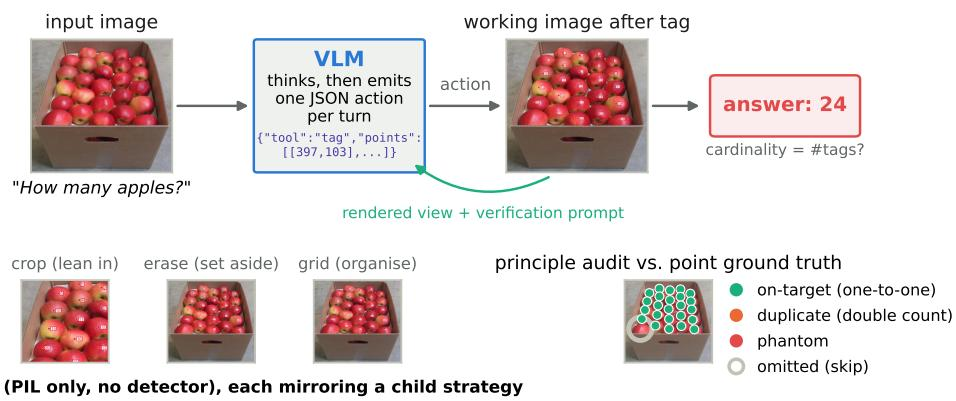  
Figure 1: The CountAgent loop, drawn with real artifacts from one trajectory (Gemini 3.1 Flash-Lite, FSC-147, 25 apples). Each turn the VLM emits one JSON action; the harness executes it with dumb PIL primitives, re-renders the working image, and returns it with a verification prompt, for at most T tool calls. The final tags are audited against point ground truth, decomposing a wrong count into principle violations; here the model draws 24 tags, all on-target, misses one apple, and answers 24 against a ground truth of 25.

1949, Trick and Pylyshyn, 1994) and an approximate sense of magnitude [Feigenson et al., 2004, Xu and Spelke, 2000]. Exact enumeration beyond that range is a learned procedure that recruits the hands and the space around the child: pointing keeps items and number words in one-to-one correspondence [Alibali and DiRusso, 1999, Saxe, 1977, Graham, 1999], moving items aside and scanning row by row prevent double counts and skips [Fuson, 1988, Potter and Levy, 1968, Beckwith and Restle, 1966], and partitioning turns one big count into several small ones [van Oeffelen and Vos, 1982]: epistemic actions, performed not to change the world but to make a computation easier [Kirsh and Maglio, 1994, Kirsh, 1995].

Vision–language models (VLMs) look strikingly like the pre-procedural child: near-perfect on one to four objects, sharply worse after that, systematically under-counting dense sets, erring like noisy estimators rather than enumerators [Testolin et al., 2025, Tamarapalli et al., 2025, Che et al., 2026, Budny et al., 2025], with the count present in the visual features but mis-read at the output [Pang et al., 2026, El-Shangiti et al., 2026]. VLMs have a number sense but no counting routine. The claim is not that a VLM is a child or models one, but that the developmental account of counting supplies testable hypotheses (which external scaffolds should help) and diagnostic variables (what to measure when they do not).

We therefore ask: ifwe give a VLM the epistemic actions that children use, does it count like a child who has learned to count, and does it fail like one? We build a training-free harness in which the model can draw a numbered tag at any image coordinate and see the tagged image, zoom into a region, grey out counted items, and overlay a coordinate grid. Every tool is a plain pixel operation with no detector, segmenter, or OCR behind it, so all perception and all decisions remain the model’s own; the harness only lends it a finger, a magnifier, and an eraser.

The deeper contribution is measurement. A model that counts by marking externalises, mark by mark, a serial procedure that is normally hidden in its activations; the developmental principles of counting give that trace a grammar, turning model-generated marks into an interpretable audit of serial visual reasoning. This is what developmentally aligned evaluation adds over a benchmark score: not whether a model counts, but which constituent capacities it has, pointing, one-to-one tracking, cardinal read-out, checking, order invariance, each measured on its own. Following the classic analyses of children’s counting [Gelman and Gallistel, 1978, Gelman and Meck, 1983, Fuson, 1988], we classify every tag as on-target, duplicate, or phantom and every object as counted or omitted against point-level ground truth, test cardinality against the tags and order irrelevance by forcing opposite traversal orders, and measure pointing precision, on a controlled dot-array battery and two photographic benchmarks, FSC-147 [Ranjan et al., 2021] (8–80 dot-annotated instances) and PixMo-Count [Deitke et al., 2025] (2–10).

Contributions. (1) A developmentally aligned evaluation in which counting principles turn modelgenerated marks into an interpretable audit of serial visual reasoning: each principle becomes a measurable prediction (Table 3), and a wrong count decomposes into principle violations against point-level ground truth (Section 4). (2) A training-free harness of dumb epistemic tools for counting, each mapped to a child strategy and a counting principle (Section 3). (3) An empirical study over 9 models and 682 images with paired bootstrap uncertainty on every headline contrast (Section 5), showing that the constituent capacities dissociate across models rather than forming one “counting ability” (Table 2), and that the tools are diagnostic rather than therapeutic: a finger helps only models that can already point, and where it fails, the audit localises the missing prerequisite; the study costs under 153 US dollars, and all code, stimuli, and trajectories will be released.

## 2 Background

How children count. Gelman and Gallistel [1978] described counting as governed by five principles: one-to-one (each item receives exactly one tag), stable order, cardinality (the last tag names the set size), abstraction (anything can be counted), and order-irrelevance. Children acquire numberword meanings slowly [Wynn, 1990, 1992, Le Corre and Carey, 2007, Sarnecka and Carey, 2008, Carey, 2009], and even children who know the routine make keeping-track errors on large or disorganised arrays, skipping or double counting [Fuson, 1988, Gelman and Meck, 1983]. Accuracy improves when children point at or touch each item [Alibali and DiRusso, 1999, Graham, 1999, Saxe, 1977], when the array is regular rather than scattered [Potter and Levy, 1968, Beckwith and Restle, 1966], and when large sets are counted in groups [van Oeffelen and Vos, 1982]. Small sets are subitized [Kaufman et al., 1949, Mandler and Shebo, 1982], large sets estimated by an approximate number system shared with infants and animals [Feigenson et al., 2004, Dehaene, 2011]; numbersensitive units emerge spontaneously in deep networks [Stoianov and Zorzi, 2012, Nasr et al., 2019, Testolin et al., 2020].

How VLMs count. Counting benchmarks range from small sets [Paiss et al., 2023, Deitke et al., 2025, Acharya et al., 2019] to dense scenes [Ranjan et al., 2021] and in-the-wild or adversarial questions [Tamarapalli et al., 2025, Deng et al., 2026]. VLMs are accurate up to four or five objects and then degrade [Testolin et al., 2025, Che et al., 2026]; failure grows with overlap, occlusion, compositional structure, and prior-knowledge bias [Rahmanzadehgervi et al., 2024, Pothiraj et al., 2025, Guo et al., 2025, Vo et al., 2025] and tracks the serial demand that also slows humans [Budny et al., 2025]. Remedies include count-aware training [Paiss et al., 2023], pointing supervision [Deitke et al., 2025, Jiang et al., 2026], and point-then-count prompting [Alghisi et al., 2026, Hou et al., 2026].

Tools and drawing for visual reasoning. Language models can call vision tools [Gupta and Kembhavi, 2023, Surís et al., 2023, Hu et al., 2024, Zhao et al., 2025, Su et al., 2025], receive marks from a segmenter [Yang et al., 2023] or a coordinate scaffold [Lei et al., 2025], or zoom into regions [Wu and Xie, 2024, Shen et al., 2025, Zheng et al., 2025]. Closest to us, Autonomous Imagination [Liu et al., 2025], SketchVLM [Collins et al., 2026], point-then-count prompting [Alghisi et al., 2026], LVLM-Count [Fetrat Qharabagh et al., 2024], and ABACUS [Mondal et al., 2026] let a model mark, cursor over, or tile the image, and treat the marks as an intervention or an explanation judged by task accuracy (positioning table in Table 4). We treat them as measurement: dumb pixel tools keep every mark the model’s own, and point-level ground truth decomposes the trace into omissions, duplicates, phantoms, and broken cardinality. The matching is standard (point-based crowd-localization metrics, Idrees et al., 2018, Wang et al., 2021, Song et al., 2021; TIDE’s error taxonomy, Bolya et al., 2020); new are the loop that makes the marks and the principle tests that read them.

## 3 CountAgent: dumb epistemic tools for counting

Design principle: dumb tools, smart eyes. Every tool is a pure PIL operation: the harness never detects, segments, recognises, or reads anything; it draws and crops what it is told, and the only intelligence outside the model is geometric bookkeeping (numbering and capping tags), so the study tests epistemic actions, not tool quality.

Tools and the child strategies they mirror. Table 5 (appendix) maps each tool to a child strategy and a principle. tag draws a dot at the requested coordinate and a numbered box beside it, the finger plus the number word (numbering continues across calls, so the harness supplies the stable order, which is scaffolded, not tested); crop returns an enlarged view with tags visible (leaning in); erase greys out counted objects (moving them aside); grid overlays a coordinate grid with 0–1000 ticks [Lei et al., 2025]. A harness-driven tiles routine $( 2 \times 2$ overlapping partition, one point-listing call per tile, geometric de-duplication in the overlap) mirrors counting by groups without any agency on the model’s side.

Loop. Figure 1 shows the loop: a system prompt fixes the tools, the coordinate frame, and a budget of $\bar { \cdot } \bar { T _ { 3 } } 6$ tool calls; each reply must end with one JSON action; after a tag call the verification prompt asks whether each tag sits on a distinct object, any object is untagged, or two tags share one, then to tag only the missing ones or answer. The loop ends when the model answers; on budget exhaustion it is asked once more for a number, then the tag count is used. Prompts are verbatim in Section B; rendering, context policy, and the (make-or-break) coordinate-frame choice are in Section C.

Harness conditions (arms). DIRECT: answer with a single number (answer-only, not reasoningfree: reasoning models still spend hidden reasoning tokens at the low effort we use, which Section G quantifies together with a thinking-off control). COT: think step by step, then answer. LIST: emit one coordinate per object and a count in one turn, never seeing the points rendered (the “blind pointing” protocol of Alghisi et al., 2026). TAG: tag with the verification loop. TAG+CROP: adds crop. FULL: tag, crop, erase, grid. TILES: the scripted partition. TAG-1: tag restricted to one point per call, so every mark is placed only after the previous one is seen, enforcing strict look–mark–look seriality (run on the ablation subset with a budget of $T { = } 8 0$ calls, so no object goes untagged by construction). Ablations remove the verification prompt, replace numbers by plain marks, add single tools, and vary $T .$

## 4 A developmentally aligned evaluation protocol

Table 3 (appendix) lists the predictions the developmental account makes for any counter and how we test each.

Stimuli. DotArrays (272 images) is a controlled battery in the tradition of child enumeration studies: black discs on white with $n \in \{ 1 , \ldots , 1 0 , 1 2 , 1 5 , 2 0 , 2 5 , 3 0 , 4 0 , 5 0 , 6 0 \}$ , three arrangements (near-regular lattice, uniformly random, clustered), four seeds each, plus four factor sets: heterogeneous shapes and colours (abstraction), red discs among as many blue ones (distractors), touching discs (dense), and 6-px discs (small); an XL extension (30 images, $n \in \{ 8 0 , \ldots , 2 0 0 \} ,$ ) locates the cliff of the two models that stay above 80 % in the main battery, and 60 lattice-control images (rotated, hexagonal, holed) test the arrangement effect (Section D). FSC-147 (200 test images, 29 classes) supplies real photographs with 8–80 instances and a dot per instance [Ranjan et al., 2021], stratified into five count bins. PixMo-Count (180 test images) supplies human-verified photographs with 2–10 instances [Deitke et al., 2025], twenty per count.

Models. We evaluate 9 models through one API (OpenRouter) with temperature 0 and low reasoning effort where the model supports it. Three inexpensive tier-1 models run every arm on every image (Gemini 3.1 Flash-Lite, Qwen3-VL-32B, Qwen3-VL-8B); two tier-2 models (GPT-5 mini, Gemini 3.7 Flash) skip TAG+CROP and TILES; four tier-3 models (Gemini 3.1 Pro, Claude Sonnet 5, Grok 4.20, Grok 4.5) run DIRECT, COT, TAG, and FULL on a stratified subset of 240 images. Crossmodel comparisons use that common subset (50 DotArrays, 100 FSC-147, 90 PixMo-Count images, stratified by count); the ablation subset (143 images: 68 DotArrays arrays with n $\geq 5$ and 75 FSC-147 photographs) hosts the ablations and the order, perturbation, and strict-seriality experiments. A contrast is CI-solid when its 95 % paired bootstrap interval over images excludes zero. Identifiers, prices, and costs are in Section H; Qwen3-VL-32B was withdrawn by the provider on 2026-10-09 and is absent from the controls added in revision.

Count metrics. Exact-match accuracy (an unparseable answer counts as wrong), mean absolute error (MAE), and the sign of the error. On DotArrays we summarise each model–arm accuracyversus-n curve by its counting range $R _ { 8 0 } { \mathrm { : } }$ the largest n up to which a non-increasing (isotonic) fit of exact accuracy stays at or above 80 %, the analogue of a developmental milestone; $R _ { 8 0 }$ is right-censored when the fit is still above 80 % at the largest tested $n ,$ and the battery is extended for the two models this concerns. Bootstrap confidence intervals accompany $R _ { 8 0 }$ (resampling images within each level) and every headline arm contrast (paired resampling over images).

Table 1: Exact-count accuracy (%) per model and arm on the common subset every model saw (240 images: 50 DotArrays, 100 FSC-147, 90 PixMo-Count); best arm per row in bold; ↑/↓ mark CIsolid changes against DIRECT (95 % paired bootstrap CI over images excludes zero; all intervals in Table 8); unparseable answers count as wrong; tier-2/3 models ran fewer arms. MAE, TAG+CROP, and TILES are in Tables 12 and 13.
<table><tr><td>model</td><td>direct</td><td>CoT</td><td>list</td><td>tag</td><td>full toolbox</td></tr><tr><td colspan="6">DotArrays (synthetic, n ≤ 60)</td></tr><tr><td>Qwen3-VL-8B</td><td>52.0</td><td>22.0↓</td><td>26.0</td><td>38.0↓</td><td>32.0↓</td></tr><tr><td>Qwen3-VL-32B</td><td>48.0</td><td>28.0↓</td><td>44.0</td><td>36.0</td><td>34.0</td></tr><tr><td>Gemini 3.1 Flash-Lite</td><td>36.0</td><td>58.0↑</td><td>54.0</td><td>50.0↑</td><td>52.0↑</td></tr><tr><td>GPT-5 mini</td><td>48.0</td><td>40.0</td><td>40.0</td><td>18.0↓</td><td>28.0↓</td></tr><tr><td>Gemini 3.7 Flash</td><td>100.0</td><td>98.0</td><td>94.0</td><td>94.0</td><td>96.0</td></tr><tr><td>Gemini 3.1 Pro</td><td>96.0</td><td>96.0</td><td>一</td><td>96.0</td><td>100.0</td></tr><tr><td>Grok 4.20</td><td>66.0</td><td>66.0</td><td>一</td><td>50.0↓</td><td>42.0↓</td></tr><tr><td>Grok 4.5</td><td>54.0</td><td>66.0</td><td>一</td><td>28.0↓</td><td>44.0</td></tr><tr><td>Claude Sonnet 5</td><td>72.0</td><td>80.0</td><td>一</td><td>62.0</td><td>58.0</td></tr><tr><td colspan="6">FSC-147 (photos, 8–80 objects)</td></tr><tr><td>Qwen3-VL-8B</td><td>11.0</td><td>12.0</td><td>16.0</td><td>17.0</td><td>12.0</td></tr><tr><td>Qwen3-VL-32B</td><td>25.0</td><td>21.0</td><td>27.0</td><td>32.0</td><td>26.0</td></tr><tr><td>Gemini 3.1 Flash-Lite</td><td>23.0</td><td>41.0↑</td><td>31.0</td><td>22.0</td><td>29.0</td></tr><tr><td>GPT-5 mini</td><td>12.0</td><td>12.0</td><td>14.0</td><td>12.0</td><td>8.0</td></tr><tr><td>Gemini 3.7 Flash</td><td>52.0</td><td>52.0</td><td>47.0</td><td>45.0</td><td>47.0</td></tr><tr><td>Gemini 3.1 Pro</td><td>51.0</td><td>51.0</td><td>一</td><td>50.0</td><td>49.0</td></tr><tr><td>Grok 4.20</td><td>22.0</td><td>24.0</td><td>一</td><td>19.0</td><td>13.0↓</td></tr><tr><td>Grok 4.5</td><td>14.0</td><td>19.0</td><td>一</td><td>12.0</td><td>12.0</td></tr><tr><td>Claude Sonnet 5</td><td>24.0</td><td>25.0</td><td>一</td><td>21.0</td><td>21.0</td></tr><tr><td colspan="6">PixMo-Count (photos, 2–10 objects)</td></tr><tr><td>Qwen3-VL-8B</td><td>62.2</td><td>64.4</td><td>53.3</td><td>57.8</td><td>53.3</td></tr><tr><td>Qwen3-VL-32B</td><td>65.6</td><td>75.6</td><td>81.1</td><td>78.9↑</td><td>78.9↑</td></tr><tr><td>Gemini 3.1 Flash-Lite</td><td>71.1</td><td>78.9</td><td>72.2</td><td>71.1</td><td>77.8</td></tr><tr><td>GPT-5 mini</td><td>66.7</td><td>65.6</td><td>68.9</td><td>65.6</td><td>61.1</td></tr><tr><td>Gemini 3.7 Flash</td><td>88.9</td><td>88.9</td><td>87.8</td><td>86.7</td><td>83.3</td></tr><tr><td>Gemini 3.1 Pro</td><td>92.2</td><td>92.2</td><td></td><td>90.0</td><td>92.2</td></tr><tr><td>Grok 4.20</td><td>74.4</td><td>75.6</td><td></td><td>75.6</td><td>78.9</td></tr><tr><td>Grok 4.5</td><td>58.9</td><td>76.7↑</td><td></td><td>67.8</td><td>68.9↑</td></tr><tr><td>Claude Sonnet 5</td><td>74.4</td><td>76.7</td><td></td><td>82.2</td><td>78.9</td></tr></table>

Principle audit. For every arm that produces points or tags and every image with point ground truth (DotArrays, FSC-147), we match tags to objects by minimum-cost assignment with a perimage distance threshold τ (half the median nearest-neighbour distance among ground-truth points, floor 15 px). A matched tag is on-target; an unmatched tag within τ of an already-matched object is a duplicate (double count); an unmatched tag farther than τ from every object is a phantom; an unmatched object is an omission (skip). We report these per 100 ground-truth objects. Cardinality consistency is the fraction of trajectories whose announced count equals the number of tags; pointing error is the median, over images, of the per-image median distance between an on-target tag and its object, in thousandths of the shorter image side (DotArrays and FSC-147 pooled); abstraction and arrangement effects come from the DotArrays factor sets. Order irrelevance is tested directly: the TAG loop is instructed to traverse the array left-to-right/top-to-bottom or the reverse; the realised traversal is read off the tag sequence, and the principle demands the same count either way (a sameorder repeat control separates order dependence from inference instability). A $1 8 0 ^ { \circ } .$ -rotation control counts the rotated image in reading order, which visits the objects in the reverse sequence under the natural instruction, separating order dependence from the difficulty of an unnatural scan; mirror consistency (same count on an image and its horizontal mirror) is a coarser invariance probe. Finally, a tag-perturbation probe asks whether the announced number is read off the tags at all: after the model’s first tag call the harness silently removes one on-target tag, or adds one on an untagged object, before returning the image. Sensitivity to τ is reported in Section E.

## 5 Results

## 5.1 The exact-counting range is a model-specific signature

Figure 8 (appendix) plots exact accuracy against n on the DotArrays main battery for every model; Figure 5a summarises each curve by $R _ { 8 0 }$ (CIs in Table 7) and Figure 2 shows the two strongest models on the extended range. With DIRECT answers every model is at ceiling for $n \leq 4 ,$ , but the range over which it stays exact spans nearly two orders of magnitude: $R _ { 8 0 }$ is 3 for Grok 4.20, 6–7 for the Qwen models, and 7 for Gemini 3.1 Flash-Lite and GPT-5 mini, while the two strongest Geminis are still at or near 80 % at n=60, so the original battery only right-censors their range. Extending it to 200 dots (Figure 2, appendix) locates their cliffs as well: $R _ { 8 0 } { = } 1 5 0 ( 9 5 \% \mathrm { C I } [ 1 0 0 { , } 2 0 0 ] )$ for Gemini 3.7 Flash and 150 (CI [50,200], wide because one mid-battery level dips) for Gemini 3.1 Pro, with the usual under-counting beyond. At this scale the verbal routine breaks before the answer-only arm does: Gemini 3.7 Flash’s CoT range is 80 versus 150 (Section 6). Beyond its cliff, every model mostly under-counts, and photographs move every cliff to the left: on FSC-147 (8–80 objects) DIRECT exact accuracy on the common subset ranges from 11.0 % (Qwen3-VL-8B) to 52.0 % (Gemini 3.7 Flash), and even the strongest models fall to about 20 % in the 61–80 bin (Table 15); PixMo-Count, whose counts lie inside or just beyond the subitizing range, is much easier (62.2–92.2 %).

Table 2: Capacity profile per model, with 95 % bootstrap CIs over images: counting range $R _ { 8 0 }$ under DIRECT (≥: right-censored at the largest n tested); pointing error of the TAG arm (median over images of the per-image median on-target tag-to-object distance, in thousandths of the shorter side; $\mathrm { D o t A r r a y s + F S C - 1 } 4 7 \} ;$ omitted objects, duplicate and phantom tags per 100 ground-truth objects (TAG, DotArrays + FSC-147); cardinality (announced count = number of tags, %); order effect (excess disagreement from reversing the traversal beyond the same-order repeat control, pp; Table 9). Tier-3 models ran the common subset only.
<table><tr><td>model</td><td> $R _ { 8 0 }$ </td><td>point. err</td><td>omitted</td><td>duplicate</td><td>phantom</td><td>card. (%)</td><td>order (pp)</td></tr><tr><td>Qwen3-VL-8B</td><td>6 [6,7]</td><td>11.9 [10.6,12.9]</td><td>46.6 [42.6,50.5]</td><td>10.6 [7.8,14.0]</td><td>45.3 [37.3,54.4]</td><td>95.1 [93.0,96.9]</td><td>+51.5 [41.2,61.8]</td></tr><tr><td>Qwen3-VL-32B</td><td>7 [6,9]</td><td>8.7 [7.6,10.3]</td><td>30.8 [26.9,34.6]</td><td>29.7 [22.6,37.5]</td><td>85.7 [70.8,101.3]</td><td>81.0 [77.3,84.5]</td><td>+15.4 [8.1,23.2]</td></tr><tr><td>Gemini 3.1 Flash-Lite</td><td>7 [4,9]</td><td>5.1 [4.0,7.0]</td><td>27.6 [24.1,30.9]</td><td>3.9 [2.4,5.9]</td><td>21.2 [17.6,24.9]</td><td>88.5 [85.8,91.3]</td><td>+21.7 [13.6,30.5]</td></tr><tr><td>GPT-5 mini</td><td>7 [3,12]</td><td>40.4 [38.3,43.8]</td><td>79.4 [76.7,81.9]</td><td>2.2 [1.7,2.8]</td><td>31.9 [28.3,35.7]</td><td>64.7 [60.1,69.1]</td><td></td></tr><tr><td>Gemini 3.7 Flash</td><td>150 [100,200]</td><td>1.6 [1.5,1.8]</td><td>14.5 [11.2,17.9]</td><td>1.3 [0.6,2.2]</td><td>12.6 [9.6,15.7]</td><td>89.9 [87.1,92.5]</td><td>+0.7 [-1.5,3.3]</td></tr><tr><td>Gemini 3.1 Pro</td><td>150 [50,200]</td><td>10.7 [7.7,12.8]</td><td>22.1 [15.9,28.4]</td><td>1.4 [0.5,2.6]</td><td>22.4 [16.6,28.3]</td><td>89.3 [84.0,94.0]</td><td></td></tr><tr><td>Grok 4.20</td><td>3 [3,20]</td><td>34.1 [31.7,38.4]</td><td>69.1 [64.9,73.2]</td><td>2.9 [1.7,4.4]</td><td>52.7 [47.5,58.1]</td><td>93.3 [89.3,97.3]</td><td></td></tr><tr><td>Grok 4.5</td><td>6 [6,15]</td><td>29.4 [27.1,32.7]</td><td>47.4 [43.0,51.6]</td><td>10.2 [6.9,14.1]</td><td>100.4 [92.7,108.5]</td><td>37.3 [30.0,45.3]</td><td></td></tr><tr><td>Claude Sonnet 5</td><td>20 [6,50]</td><td>33.9 [30.7,39.4]</td><td>78.0 [74.0,81.6]</td><td>8.1 [5.8,10.6]</td><td>55.2 [46.5,64.4]</td><td>51.3 [43.3,59.3]</td><td></td></tr></table>

What DIRECT measures. DIRECT is answer-only, not reasoning-free: at low effort the provider reports a median of 480 hidden reasoning tokens per answer for Gemini 3.7 Flash (3146 at n=150), 482 for Gemini 3.1 Pro, and 1894 for Grok 4.20, none for the Qwen models. A thinking-off control (Table 21) leaves Flash-Lite’s accuracy unchanged but shrinks its range $( R _ { 8 0 } ~ 7$ to 4), costs GPT-5 mini -9.4 pp (CI [-13,-5]) and its range (7 to 2), and barely moves Gemini 3.7 Flash, which cannot be switched off. The contrasts below are thus “no visible routine” versus “an externalised one”.

## 5.2 A finger helps some models in some regimes, and hurts others

Table 1 compares the arms on the common subset (Table 12 and Figure 3 give MAE and paired CIs); three regimes emerge. Small-count photographs (PixMo-Count). The tag loop raises the point estimate for 4 of the nine models, but only the Qwen3-VL-32B gain is CI-solid (65.6 to 78.9 %; +13.3 pp, 95 % CI [+4,+22]); Flash-Lite is flat, and the two Gemini models near ceiling, GPT-5 mini, and Qwen3-VL-8B do not gain. Dense photographs (FSC-147). No tool arm moves any model reliably: the largest tag gains (Qwen3-VL-32B +7.0 pp, Qwen3-VL-8B +6.0 pp) carry CIs that span zero, the rest are flat or slightly worse, and verbal chain of thought is the strongest single intervention for Flash-Lite (41.0 %, +18.0 pp [+7,+29]). Dot arrays. The success stories of Figures 6 and 7 (appendix) are real but not the average: Flash-Lite moves from 36.0 to 58.0 % (TAG+CROP; TAG +14.0 pp [+4,+26]) and its counting range from $R _ { 8 0 } { = } 7$ to 20, but every other model is flat (Gemini 3.1 Pro) or loses, CI-solidly so for GPT-5 mini (-30.0 pp), Grok 4.20, Grok 4.5, and Qwen3- VL-8B (Table 8). Seeing the marks versus listing them. Blind pointing (LIST) matches or beats TAG in 11 of the 15 cells where both ran (Table 24); the paired difference is CI-solid for LIST for Flash-Lite on FSC-147 (-9.0 pp, CI [-17,-1]) and GPT-5 mini on dots (-22.0 pp), and for TAG only for Qwen3-VL-8B on dots (+12.0 pp). Seeing the marks buys little accuracy; it buys a cleaner trace (on FSC-147, Flash-Lite’s blind lists carry 61.8 phantom points per 100 objects against 24.8 for TAG), and the rendered, numbered trace is what the audit reads. The scripted partition (TILES) is the best arm on sparse arrays for Flash-Lite (MAE 0.8) but collapses on photographs (3.0 % on FSC-147): objects cut by tile borders are double counted and empty tiles invite phantoms; on PixMo-Count, where most objects exceed the tile overlap, it double counts by construction (mean answer 9.9 for a truth of 6.0) and is not reported.

## 5.3 The principle audit explains who benefits

Table 2 gives each model’s capacity profile with bootstrap intervals (per dataset and arm: Figure 9 and Table 11), and Figure 4 (appendix) plots each model’s gain from tagging against its pointing error. (i) Pointing precision is the prerequisite. The median on-target tag lands 1.6 thousandths of the image side from its object for Gemini 3.7 Flash and 5.1 for Flash-Lite, but 34.1 for Grok 4.20 and 40.4 for GPT-5 mini; the imprecise pointers add 31.9–52.7 phantom tags per 100 objects (Table 2) and are exactly the models that lose accuracy with the tag loop. (ii) In dense scenes the routine breaks by omission. For the models that can point, the dominant residual on FSC-147 is skipping (38.1 omissions per 100 objects for Flash-Lite, 28.7 for Gemini 3.1 Pro), then phantoms; duplicates are rare (4.4 and 1.8), as in children, who lose their place more often than they double count. (iii) Models rarely revise after looking: only 17.2 % of Flash-Lite trajectories issue a second tag call (46.7 % for Gemini 3.1 Pro): one-shot tagging without the checking step children learn. (iv) Cardinality is mostly respected (93.0 % of Flash-Lite and 100.0 % of Gemini 3.1 Pro trajectories on DotArrays announce exactly the number of tags), but the imprecise pointers decouple the two (66.9 % for GPT-5 mini): they tag, distrust the tags, and estimate anyway. Since no tool deletes a tag, a departure from the tag count may be a correction, and mostly is (closer to the truth in 83 % of cases; Table 19). (v) The answer is read off the tags, not the tags off the answer. A model could estimate a number and draw that many points; two tests say the precise pointers do not. On FSC-147 the tag count equals the model’s own DIRECT answer on only 10–53 % of images, with per-image errors weakly to moderately correlated (ρ -0.19 to +0.62; Table 19). And when the harness silently removes one on-target tag after the first tag call (Table 20), Gemini 3.7 Flash re-tags the missing object in 84 % of trajectories and Flash-Lite in 57 %, and their final answer equals the number of tags visible, not the number emitted, in 84 and 87 % (where Flash-Lite does not repair, its answer moves down with the tag: -1.75 on dots relative to the unperturbed run); GPT-5 mini, the decoupled pointer, repairs in only 33 %. For the models that can point, the trace is the computation.

## 5.4 Developmental signatures and ablations

Arrangement. Children count regular arrays more accurately than scattered ones [Potter and Levy, 1968]. Figure 5b (appendix) shows a qualitatively analogous ordering for models once they count with tags (regular > random > clustered; Flash-Lite: 90.3/79.2/70.8 %), whereas DIRECT estimation shows no advantage for regular arrays (51.4/58.3/66.7 %): the arrangement effect is a signature of the routine, not of the number sense. Two controls rule out a rows-times-columns shortcut (Tables 22 and 23). The lattices are jittered and the tags follow the jitter: Flash-Lite’s on-target tags land 3.3 px from the dot but 14.1 px from the cell centre, with tag and dot offsets correlated at r=0.86 (0.99 for Gemini 3.7 Flash), so the marks sit on dots, not on an imagined grid. On new hexagonal and holed lattices, which offer no product to recite, Flash-Lite’s tag advantage persists (85 and 90 % against 55 % on random arrays of the same n) but Qwen3-VL-8B’s does not (25/25 vs. 25 %), and a lattice rotated by $2 0 { - } 4 0 ^ { \circ }$ is hard for every model and arm (30 % under TAG): for the one model with a working routine the regular advantage is that of an organised scan path, which a rotated lattice no longer offers in reading order. Abstraction: mixed shapes and red-among-blue sets cost DIRECT more than the tag arms (Table 17).

Order irrelevance. Instructed to tag the same 68 arrays in opposite traversal orders, models follow the procedure (tag order tracks the instructed scan, Table 9). The principle behind the procedure fares worse: the two traversals end in the same count on 44 % of arrays for Flash-Lite and 24 % for Qwen3-VL-32B, against 86 % for Gemini 3.7 Flash. Two controls separate order dependence from other causes (Table 9). Repeating the same order agrees on 65/40/87 % of arrays, so reversal adds +21.7 pp (CI [+14,+31]) and +15.4 pp ([+8,+23]) of disagreement beyond inference instability for the mid-tier models and none for Gemini 3.7 Flash (+0.7 pp). Because the reverse scan is simply harder (Flash-Lite drops from 60 to 47 %), a rotation control counts each array rotated by $1 8 0 ^ { \circ }$ in ordinary reading order, visiting the dots in reverse under the natural instruction at undiminished accuracy (63 %); it still disagrees with the unrotated runs +9.6 pp (CI [+1,+18]) more often than the repeat control for Flash-Lite (+0.0 pp for Gemini 3.7 Flash): part of the raw reversal effect was difficulty, but an order effect remains. The coarser mirror probe agrees: a horizontal flip, which changes the view but not the set, changes Flash-Lite’s answer in most trajectories (mirror consistency 36.4 % under DIRECT, 39.2 % under TAG; Table 18).

Ablations. Table 14 varies the harness on the ablation subset for the two tier-1 models with usable pointing. Removing the verification prompt raises Flash-Lite’s accuracy (39.9 to 45.5 %), not because the checked arm adds tags (it draws no more and re-tags less often, 27 vs. 38 %) but because, asked whether any object is still untagged, the model re-estimates verbally instead of re-inspecting: it announces more than it tagged in 13 % of trajectories against 6 % without the prompt, and is then right only 17 % of the time. Plain marks match numbered tags on accuracy but lower cardinality consistency; the grid is the most useful addition (45.5 %); erase, crop, and the turn budget hardly matter. Strict seriality (TAG-1, one point per look, $T { = } 8 0$ ; Table 10) changes the errors more than the accuracy (Flash-Lite 51.5 vs. 54.4 %): phantoms collapse (6.1 vs. 21.6 per 100 objects) and the failure becomes abandoning the traversal (Gemini 3.7 Flash leaves 67.9 % untagged yet answers well), at 12–15× the cost; batching is not what breaks the routine, and the batched trace is a fair record of it.

## 6 Discussion and limitations

What transfers from the developmental account, and what does not. Both a VLM and a preprocedural child have a serviceable approximate number sense and no reliable serial routine, so the same external scaffolds can help or fail to help both. Pointing helps only if pointing is precise: children whose gestures are not yet coordinated with their number words gain less from gesturing [Alibali and DiRusso, 1999], and neither do our imprecise pointers (Table 2). Two failures our audit quantified, answers that come apart from the tags and the missing habit of checking one’s count, have close parallels in preschoolers [Gelman and Meck, 1983]. Two parts do not transfer: children practise and internalise the routine, whereas our models neither learn from the tags nor carry the routine to the next image (a prosthesis, not a curriculum); and the model’s “motor” error is a coordinate-prediction error without proprioceptive feedback, hence the outsized effect of the coordinate frame and the grid.

Why the verbal routine collapses first at scale. Gemini 3.7 Flash’s verbal cliff (CoT $R _ { 8 0 } { = } 8 0$ against 150, Figure 2) looks backwards only if chain of thought is a count. Past about 80 dots it is not: of the 30 CoT replies at $n \geq 8 0$ , the 6 that tally row by row are all exact, whereas the other 24 partition the image into regions, estimate each, and add the estimates, which is exact 8 times and under-counts by -7.2 on average. A verbal routine has no external record, so beyond the span it can tally in text it falls back on the approximate system applied piecewise, whose under-counting bias accumulates, a verbal analogue of children’s keeping-track failures [Fuson, 1988]; the answer-only arm, free to spend hidden reasoning (Section G), and the tag loop, which externalises the record, degrade more slowly. A routine helps only while its bookkeeping holds, and external marks extend it. Three levers follow from the audit: calibrate pointing (a grid helped), train the verification step (the current prompt makes the model re-estimate rather than re-inspect), and combine the verbal and visual routines.

Limitations. All models are accessed through one API at temperature 0 with low reasoning effort; DIRECT is answer-only rather than reasoning-free, two endpoints could not have reasoning disabled (Table 21), and Qwen3-VL-32B was withdrawn by the provider during revision. The dot-array battery is deliberately simple, the photographic sets cover only 8–80 and 2–10 objects, FSC-147 dots mark approximate centres, so tags on elongated objects can be scored as phantoms (τ-sensitivity in Section E). Finally, the developmental alignment is in the evaluation: our claims are qualitative correspondences with the child literature, not psychometric fits, and all subjects are frozen generalpurpose VLMs; running the battery on models trained on child-scale data, and asking whether they could acquire the routine rather than borrow it, is the natural next step.

## 7 Conclusion

Dumb tools let one mid-tier VLM count fifty dots exactly where it used to guess, and left most others flat or worse. The lasting contribution is what the marks make visible: read through the developmental principles of counting, a wrong count becomes a diagnosis — imprecise pointing, lost track, an unchecked answer, an order-dependent count. Can a model learn the routine, and the habit of checking it, as children do?

## References

Manoj Acharya, Kushal Kafle, and Christopher Kanan. TallyQA: Answering complex counting questions. In Proceedings of the AAAI Conference on Artificial Intelligence, volume 33, pages 8076–8084, 2019. doi: 10.1609/aaai.v33i01.33018076.

Simone Alghisi, Massimo Rizzoli, Seyed Mahed Mousavi, and Giuseppe Riccardi. Getting to the point: Pointing improves LVLMs at counting. arXiv preprint arXiv:2603.21746, 2026.

Martha Wagner Alibali and Alyssa A. DiRusso. The function of gesture in learning to count: More than keeping track. Cognitive Development, 14(1):37–56, 1999. doi: 10.1016/S0885-2014(99) 80017-3.

Mary Beckwith and Frank Restle. Process of enumeration. Psychological Review, 73(5):437–444, 1966. doi: 10.1037/h0023650.

Daniel Bolya, Sean Foley, James Hays, and Judy Hoffman. TIDE: A general toolbox for identifying object detection errors. In European Conference on Computer Vision (ECCV), pages 558–573. Springer, 2020. doi: 10.1007/978-3-030-58580-8\_33.

Nicholas Budny, Kia Ghods, Declan Campbell, Raja Marjieh, Amogh Joshi, Sreejan Kumar, Jonathan D. Cohen, Taylor W. Webb, and Thomas L. Griffiths. Visual serial processing deficit explain divergences in human and VLM reasoning. arXiv preprint arXiv:2509.25142, 2025.

Susan Carey. The Origin of Concepts. Oxford University Press, New York, 2009. doi: 10.1093/ acprof:oso/9780195367638.001.0001.

Liwei Che, Zhiyu Xue, Yihao Quan, Benlin Liu, Zeru Shi, Michelle Hurst, Jacob Feldman, Ruixiang Tang, Ranjay Krishna, and Vladimir Pavlovic. Counting circuits: Mechanistic interpretability of visual reasoning in LVLMs. arXiv preprint arXiv:2603.18523, 2026.

Brandon Collins, Logan Bolton, Hung Huy Nguyen, Mohammad Reza Taesiri, Trung Bui, and Anh Totti Nguyen. SketchVLM: Vision language models can annotate images to explain thoughts and guide users. arXiv preprint arXiv:2604.22875, 2026.

Stanislas Dehaene. The Number Sense: How the Mind Creates Mathematics. Oxford University Press, New York, revised and updated edition, 2011.

Matt Deitke, Christopher Clark, Sangho Lee, Rohun Tripathi, Yue Yang, Jae Sung Park, Mohammadreza Salehi, Niklas Muennighoff, Kyle Lo, Luca Soldaini, Jiasen Lu, Taira Anderson, Erin Bransom, Kiana Ehsani, Huong Ngo, YenSung Chen, Ajay Patel, Mark Yatskar, Chris Callison-Burch, Andrew Head, Rose Hendrix, Favyen Bastani, Eli VanderBilt, Nathan Lambert, Yvonne Chou, Arnavi Chheda, Jenna Sparks, Sam Skjonsberg, Michael Schmitz, Aaron Sarnat, Byron Bischoff, Pete Walsh, Chris Newell, Piper Wolters, Tanmay Gupta, Kuo-Hao Zeng, Jon Borchardt, Dirk Groeneveld, Crystal Nam, Sophie Lebrecht, Caitlin Wittlif, Carissa Schoenick, Oscar Michel, Ranjay Krishna, Luca Weihs, Noah A. Smith, Hannaneh Hajishirzi, Ross Girshick, Ali Farhadi, and Aniruddha Kembhavi. Molmo and PixMo: Open weights and open data for state-ofthe-art vision-language models. In Proceedings ofthe IEEE/CVF Conference on Computer Vision and Pattern Recognition (CVPR), 2025. URL https://arxiv.org/abs/2409.17146.

Jinhong Deng, Limeng Qiao, and Guanglu Wan. HoloCount: A holistic visual counting benchmark for MLLMs. arXiv preprint arXiv:2607.06420, 2026.

Ahmed Oumar El-Shangiti, Abzal Nurgazy, Hilal AlQuabeh, Nikolai Rozanov, and Kentaro Inui. The count is there, but misaligned: Understanding and correcting counting failures in VLMs. arXiv preprint arXiv:2607.09544, 2026.

Lisa Feigenson, Stanislas Dehaene, and Elizabeth Spelke. Core systems of number. Trends in Cognitive Sciences, 8(7):307–314, 2004. doi: 10.1016/j.tics.2004.05.002.

Muhammad Fetrat Qharabagh, Mohammadreza Ghofrani, and Kimon Fountoulakis. LVLM-Count: Enhancing the counting ability of large vision-language models. arXiv preprint arXiv:2412.00686, 2024.

Karen C. Fuson. Children’s Counting and Concepts of Number. Springer-Verlag, New York, 1988. doi: 10.1007/978-1-4612-3754-9.

Rochel Gelman and C. R. Gallistel. The Child’s Understanding of Number. Harvard University Press, Cambridge, MA, 1978.

Rochel Gelman and Elizabeth Meck. Preschoolers’ counting: Principles before skill. Cognition, 13 (3):343–359, 1983. doi: 10.1016/0010-0277(83)90014-8.

Theresa A. Graham. The role of gesture in children’s learning to count. Journal of Experimental Child Psychology, 74(4):333–355, 1999. doi: 10.1006/jecp.1999.2520.

Xuyang Guo, Zekai Huang, Zhenmei Shi, Zhao Song, and Jiahao Zhang. Your vision-language model can’t even count to 20: Exposing the failures of VLMs in compositional counting. arXiv preprint arXiv:2510.04401, 2025.

Tanmay Gupta and Aniruddha Kembhavi. Visual programming: Compositional visual reasoning without training. In Proceedings of the IEEE/CVF Conference on Computer Vision and Pattern Recognition (CVPR), 2023. URL https://arxiv.org/abs/2211.11559.

Kuinan Hou, Jing Mi, Marco Zorzi, Lamberto Ballan, and Alberto Testolin. Assessing the visual enumeration abilities of specialized counting architectures and vision-language models. In Pattern Recognition (Lecture Notes in Computer Science), pages 498–512. Springer, 2026. doi: 10.1007/ 978-3-032-31452-9\_33. arXiv:2512.15254.

Yushi Hu, Weijia Shi, Xingyu Fu, Dan Roth, Mari Ostendorf, Luke Zettlemoyer, Noah A Smith, and Ranjay Krishna. Visual sketchpad: Sketching as a visual chain of thought for multimodal language models. In Advances in Neural Information Processing Systems (NeurIPS), 2024. URL https://arxiv.org/abs/2406.09403.

Haroon Idrees, Muhmmad Tayyab, Kishan Athrey, Dong Zhang, Somaya Al-Maadeed, Nasir Rajpoot, and Mubarak Shah. Composition loss for counting, density map estimation and localization in dense crowds. In European Conference on Computer Vision (ECCV), pages 544–559. Springer, 2018. doi: 10.1007/978-3-030-01216-8\_33.

Qing Jiang, Junan Huo, Xingyu Chen, Yuda Xiong, Zhaoyang Zeng, Yihao Chen, Tianhe Ren, Junzhi Yu, and Lei Zhang. Detect anything via next point prediction. In Proceedings of the IEEE/CVF Conference on Computer Vision and Pattern Recognition (CVPR), pages 25472–25483, 2026. URL https://arxiv.org/abs/2510.12798.

E. L. Kaufman, M. W. Lord, T. W. Reese, and J. Volkmann. The discrimination of visual number. The American Journal ofPsychology, 62(4):498–525, 1949. doi: 10.2307/1418556.

David Kirsh. The intelligent use of space. Artificial Intelligence, 73(1–2):31–68, 1995. doi: 10. 1016/0004-3702(94)00017-U.

David Kirsh and Paul Maglio. On distinguishing epistemic from pragmatic action. Cognitive Science, 18(4):513–549, 1994. doi: 10.1207/s15516709cog1804\_1.

Mathieu Le Corre and Susan Carey. One, two, three, four, nothing more: An investigation of the conceptual sources of the verbal counting principles. Cognition, 105(2):395–438, 2007. doi: 10.1016/j.cognition.2006.10.005.

Xuanyu Lei, Zonghan Yang, Xinrui Chen, Peng Li, and Yang Liu. Scaffolding coordinates to promote vision-language coordination in large multi-modal models. In Proceedings of the 31st International Conference on Computational Linguistics (COLING), pages 2886–2903, 2025. URL https://aclanthology.org/2025.coling-main.195.

Jingming Liu, Yumeng Li, Boyuan Xiao, Yichang Jian, Ziang Qin, Tianjia Shao, Yao-Xiang Ding, and Kun Zhou. Autonomous imagination: Closed-loop decomposition of visual-to-textual conversion in visual reasoning for multimodal large language models. Transactions on Machine Learning Research, 2025. arXiv:2411.18142.

George Mandler and Billie J. Shebo. Subitizing: An analysis of its component processes. Journal ofExperimental Psychology: General, 111(1):1–22, 1982. doi: 10.1037/0096-3445.111.1.1.

Anindya Mondal, Sauradip Nag, and Anjan Dutta. ABACUS: Adapting unified foundation model for bridging image count understanding and generation. arXiv preprint arXiv:2606.23835, 2026.

Khaled Nasr, Pooja Viswanathan, and Andreas Nieder. Number detectors spontaneously emerge in a deep neural network designed for visual object recognition. Science Advances, 5(5):eaav7903, 2019. doi: 10.1126/sciadv.aav7903.

Roni Paiss, Ariel Ephrat, Omer Tov, Shiran Zada, Inbar Mosseri, Michal Irani, and Tali Dekel. Teaching CLIP to count to ten. In Proceedings of the IEEE/CVF International Conference on Computer Vision (ICCV), 2023. URL https://arxiv.org/abs/2302.12066.

Xingzhou Pang, Yifan Hou, Junling Wang, and Mrinmaya Sachan. Unveiling the visual counting bottleneck in vision-language models. In Proceedings of the International Conference on Machine Learning (ICML), 2026. URL https://arxiv.org/abs/2605.30170.

Atin Pothiraj, Elias Stengel-Eskin, Jaemin Cho, and Mohit Bansal. CAPTURe: Evaluating spatial reasoning in vision language models via occluded object counting. In Proceedings of the IEEE/CVF International Conference on Computer Vision (ICCV), pages 8001–8010, 2025. doi: 10.1109/ICCV51701.2025.00750.

Mary C. Potter and Ellen I. Levy. Spatial enumeration without counting. Child Development, 39(1): 265–272, 1968. doi: 10.2307/1127377.

Pooyan Rahmanzadehgervi, Logan Bolton, Mohammad Reza Taesiri, and Anh Totti Nguyen. Vision language models are blind. In Proceedings ofthe Asian Conference on Computer Vision (ACCV), pages 18–34, 2024. URL https://arxiv.org/abs/2407.06581.

Viresh Ranjan, Udbhav Sharma, Thu Nguyen, and Minh Hoai. Learning to count everything. In Proceedings ofthe IEEE/CVF Conference on Computer Vision and Pattern Recognition (CVPR), 2021. URL https://arxiv.org/abs/2104.08391.

Barbara W. Sarnecka and Susan Carey. How counting represents number: What children must learn and when they learn it. Cognition, 108(3):662–674, 2008. doi: 10.1016/j.cognition.2008.05.007.

Geoffrey B. Saxe. A developmental analysis of notational counting. Child Development, 48(4): 1512–1520, 1977. doi: 10.2307/1128514.

Haozhan Shen, Kangjia Zhao, Tiancheng Zhao, Ruochen Xu, Zilun Zhang, Mingwei Zhu, and Jianwei Yin. ZoomEye: Enhancing multimodal LLMs with human-like zooming capabilities through tree-based image exploration. In Proceedings of the Conference on Empirical Methods in Natural Language Processing (EMNLP), pages 6613–6629, 2025. doi: 10.18653/v1/2025.emnlp-main. 335.

Qingyu Song, Changan Wang, Zhengkai Jiang, Yabiao Wang, Ying Tai, Chengjie Wang, Jilin Li, Feiyue Huang, and Yang Wu. Rethinking counting and localization in crowds: A purely pointbased framework. In IEEE/CVF International Conference on Computer Vision (ICCV), pages 3345–3354, 2021. doi: 10.1109/ICCV48922.2021.00335.

Ivilin Stoianov and Marco Zorzi. Emergence of a ‘visual number sense’ in hierarchical generative models. Nature Neuroscience, 15(2):194–196, 2012. doi: 10.1038/nn.2996.

Zhaochen Su, Peng Xia, Hangyu Guo, Zhenhua Liu, Yan Ma, Xiaoye Qu, Jiaqi Liu, Yanshu Li, Kaide Zeng, Zhengyuan Yang, Linjie Li, Yu Cheng, Heng Ji, Junxian He, and Yi R. Fung. Thinking with images for multimodal reasoning: Foundations, methods, and future frontiers. arXiv preprint arXiv:2506.23918, 2025.

Dídac Surís, Sachit Menon, and Carl Vondrick. ViperGPT: Visual inference via Python execution for reasoning. In Proceedings of the IEEE/CVF International Conference on Computer Vision (ICCV), 2023. URL https://arxiv.org/abs/2303.08128.

Jayant Sravan Tamarapalli, Rynaa Grover, Nilay Pande, and Sahiti Yerramilli. CountQA: How well do MLLMs count in the wild? arXiv preprint arXiv:2508.06585, 2025.

Alberto Testolin, Will Y. Zou, and James L. McClelland. Numerosity discrimination in deep neural networks: Initial competence, developmental refinement and experience statistics. Developmental Science, 23(5):e12940, 2020. doi: 10.1111/desc.12940.

Alberto Testolin, Kuinan Hou, and Marco Zorzi. Visual enumeration remains challenging for multimodal generative AI. PLOS ONE, 20(9):e0331566, 2025. doi: 10.1371/journal.pone.0331566.

Lana M. Trick and Zenon W. Pylyshyn. Why are small and large numbers enumerated differently? A limited-capacity preattentive stage in vision. Psychological Review, 101(1):80–102, 1994. doi: 10.1037/0033-295X.101.1.80.

Michiel P. van Oeffelen and Peter G. Vos. Configurational effects on the enumeration of dots: Counting by groups. Memory & Cognition, 10(4):396–404, 1982. doi: 10.3758/BF03202432.

An Vo, Khai-Nguyen Nguyen, Mohammad Reza Taesiri, Vy Tuong Dang, Anh Totti Nguyen, and Daeyoung Kim. Vision language models are biased. arXiv preprint arXiv:2505.23941, 2025.

Qi Wang, Junyu Gao, Wei Lin, and Xuelong Li. NWPU-Crowd: A large-scale benchmark for crowd counting and localization. IEEE Transactions on Pattern Analysis and Machine Intelligence, 43 (6):2141–2149, 2021. doi: 10.1109/TPAMI.2020.3013269.

Penghao Wu and Saining Xie. V\*: Guided visual search as a core mechanism in multimodal LLMs. In Proceedings of the IEEE/CVF Conference on Computer Vision and Pattern Recognition (CVPR), 2024. URL https://arxiv.org/abs/2312.14135.

Karen Wynn. Children’s understanding of counting. Cognition, 36(2):155–193, 1990. doi: 10.1016/ 0010-0277(90)90003-3.

Karen Wynn. Children’s acquisition of the number words and the counting system. Cognitive Psychology, 24(2):220–251, 1992. doi: 10.1016/0010-0285(92)90008-P.

Fei Xu and Elizabeth S. Spelke. Large number discrimination in 6-month-old infants. Cognition, 74 (1):B1–B11, 2000. doi: 10.1016/S0010-0277(99)00066-9.

Jianwei Yang, Hao Zhang, Feng Li, Xueyan Zou, Chunyuan Li, and Jianfeng Gao. Setof-mark prompting unleashes extraordinary visual grounding in GPT-4V. arXiv preprint arXiv:2310.11441, 2023.

Shitian Zhao, Haoquan Zhang, Shaoheng Lin, Ming Li, Qilong Wu, Kaipeng Zhang, and Chen Wei. PyVision: Agentic vision with dynamic tooling. arXiv preprint arXiv:2507.07998, 2025.

Ziwei Zheng, Michael Yang, Jack Hong, Chenxiao Zhao, Guohai Xu, Le Yang, Chao Shen, and Xing Yu. DeepEyes: Incentivizing “thinking with images” via reinforcement learning. arXiv preprint arXiv:2505.14362, 2025.

## A Developmental predictions

Table 3 lists the predictions the developmental account makes for any counter, procedural or not, how the protocol of Section 4 operationalises each, and the verdict of Section 5.

Table 3: The developmental predictions our protocol operationalises. One-to-one correspondence and cardinality are audited directly; abstraction, arrangement, and order effects are behavioural comparisons; stable order is supplied by the harness (Table 5), so it is scaffolded, not tested.
<table><tr><td>developmental prediction</td><td>operationalisation</td><td>verdict</td></tr><tr><td>small sets are exact without any routine [Trick and Pylyshyn, 1994]</td><td>accuracy vs. n: ceiling for n ≤ 4</td><td>supported (Section 5.1)</td></tr><tr><td>pointing supports one-to-one tracking [Alibali and DiRusso, 1999]</td><td>TAG vs. DIRECT, conditioned on pointing pre- precise pointers only (Section 5.3) cision</td><td></td></tr><tr><td>keeping-track errors are skips, rarely double counts [Fuson, 1988]</td><td>omission/duplicate/phantom audit</td><td>supported (Section 5.3)</td></tr><tr><td>abstraction: anything can be counted [Gelman and Gallistel, 1978]</td><td>mixed shapes and colours; red discs among hurts estimation more than the rou- blue</td><td>tine (Section 5.4)</td></tr><tr><td>regular arrays are easier than scattered ones [Potter and Levy, 1968]</td><td>regular/random/clustered; rotated, hexagonal, only under the routine (Section 5.4) holed lattices</td><td></td></tr><tr><td>man and Gallistel, 1978]</td><td>cardinality: the last tag names the set size [Gel- announced answer = number of tags?</td><td>model-dependent (Section 5.3)</td></tr><tr><td>order irrelevance: any traversal gives one count [Gelman and Gallistel, 1978]</td><td>forced opposite traversal orders, with repeat often violated (Section 5.4) and rotation controls; mirror flip</td><td></td></tr></table>

## B Prompts

All model-facing text, verbatim. Placeholders in braces are filled per item ({obj} is the plural object name from the dataset, e.g. “apples”, {obj\_sing} its singular, {T} the tool budget). Coordinates are always requested in the normalised [0, 1000]2 frame.

## Direct

How many {obj} are in this image? Reply with only one line of the form ’ANSWER: <integer>’.

## Chain of thought

Count the {obj} in this image carefully. Think step by step (for example, describe where each one is or count region by region), then finish with a final line of the form ’ANSWER: <integer>’.

## List (blind pointing)

Locate every {obj\_sing} in this image. Coordinates use a normalized frame: x and y are integers in [0,1000], where (0,0) is the top-left and (1000,1000) the bottom-right corner. Output a JSON object on one line: {"points": [[x,y], [x,y], ...]} with exactly one point per {obj\_sing}, placed at its center. Then finish with a final line of the form ’ANSWER: <integer>’ giving the number of {obj}.

## Tool-loop system prompt ({tool\_lines} is filled with the lines below for the arm’s tools)

You are counting {obj} in an image. Coordinates use a NORMALIZED frame: x and y are integers in [0,1000]; (0,0) is the top-left corner and (1000,1000) the bottom-right corner of the ORIGINAL image; enlarged crops keep this same frame.

In every reply, think briefly and then output EXACTLY ONE JSON action as the last line (no code fences). Available actions:

## {tool\_lines}

Procedure: tag the {obj} you see; inspect the returned image; if a tag is off any {obj\_sing} or two tags share one {obj\_sing}, say so and do not count those; tag ONLY the {obj} that are still untagged; then answer. You have at most {T} tool calls before you must answer.

## Tool lines

{"tool":"tag","points":[[x,y],...]} draw numbered tags (numbering continues from the last tag) at these points on the working image; you will see the result. Tag each {obj\_sing} exactly once, at its center. Never re-tag an object that already has a tag. To start over, add "mode":"replace" (all previous tags are removed and numbering restarts at 1).

{"tool":"crop","box":[x1,y1,x2,y2]} see an enlarged view of this region of the working image (existing tags stay visible; coordinates stay in the fullimage frame).

{"tool":"erase","points":[[x,y],...]} grey out already-counted objects at these points so they cannot be counted twice.

{"tool":"grid","on":true} overlay a light coordinate grid with 0-1000 tick labels to help you place tags precisely.

{"tool":"answer","count":N} final answer: N = number of distinct {obj} in the image (normally the number of correctly placed tags).

## First user message

Count the {obj} in this image.

## Traversal-order suffixes (order experiment; appended to the first user message)

Tag the {obj} strictly in reading order: start at the top-left, sweep left to right, then move down and sweep the next band left to right, until you reach the bottom-right.

Tag the {obj} strictly in reverse reading order: start at the bottom-right, sweep right to left, then move up and sweep the next band right to left, until you reach the top-left.

## One-tag-per-call suffix (tag-1 arm; appended to the first user message)

Tag exactly ONE {obj\_sing} per tag call: output a single [x,y] point, look at the returned image, then tag the next untagged {obj\_sing} with the next call, until every {obj\_sing} is tagged; then answer.

## Verification nudge after a tag call

Tags {a}..{b} are now drawn (red dot = exact point, numbered box beside it). Check the image: (a) is each tag on a distinct {obj\_sing}? (b) is any {obj\_sing} still untagged? (c) do two tags share one {obj\_sing}? Then tag ONLY the missing ones, use another tool, or answer with the number of distinct correctly tagged {obj}. Tool calls left: {left}.

## Plain nudge (ablation without verification)

Tags {a}..{b} are now drawn. Continue. Tool calls left: {left}.

## Observation after crop / erase / grid

Enlarged view of the requested region (coordinates still refer to the full image). Continue. Tool calls left: {left}.

The requested points are greyed out on the working image. Continue. Tool calls left: {left}.

Grid overlay enabled on the working image. Continue. Tool calls left: {left}.

## Invalid action

Your last line was not a valid JSON action. Reply with exactly one JSON action as described. Tool calls left: {left}.

## Forced answer

You have used all tool calls. Reply now with {"tool":"answer","count":N} only.

## Tile prompt (scripted tiles arm)

This is an enlarged crop of a larger image; it may contain zero {obj}. First state how many {obj} have their center inside THIS crop (it is common for a crop to contain none). Then output one line {"points": [[x,y], ...]} with exactly one point per {obj\_sing} at its center, using a normalized frame of THIS crop (x and y integers in [0,1000], (0,0) top-left, (1000,1000) bottomright); output {"points": []} if there are none. Finish with a final line ’ANSWER: <integer>’.

## C Tools and rendering

Table 4: Positioning relative to prior mark-based methods (cells summarise the published descriptions; “grounding” = pointing accuracy is analysed, but wrong counts are not decomposed into principle violations). Our distinction is not that a VLM can make and inspect marks, it is that the mark are used as a measurement trace: audited point-by-point against ground truth and read through the developmental principles of counting.
<table><tr><td>method</td><td>marks come from</td><td>vision modules in loop</td><td>sees &amp; revises marks</td><td>audit of the marks</td></tr><tr><td>Set-of-Mark [Yang et al., 2023]</td><td>segmenter</td><td>segmenter</td><td>no</td><td>none</td></tr><tr><td>Autonomous Imag. [Liu et al., 2025]</td><td>model cursor</td><td>SAM2, inpainting</td><td>yes</td><td>none</td></tr><tr><td>SketchVLM [Collins et al., 2026]</td><td>model coords</td><td>none (rendering)</td><td>yes</td><td>none</td></tr><tr><td>Point-then-count [Alghisi et al., 2026]</td><td>model coords</td><td>none (unrendered)</td><td>no</td><td>grounding</td></tr><tr><td>LVLM-Count [Fetrat Qharabagh et al., 2024]</td><td>detector</td><td>detector</td><td>no</td><td>none</td></tr><tr><td>ABACUS [Mondal et al., 2026]</td><td>trained model</td><td>trained counter</td><td>no</td><td>none</td></tr><tr><td>CountAgent (ours)</td><td>model coords</td><td>none (PIL only)</td><td>yes</td><td>point-GT principles</td></tr></table>

Table 5: Epistemic tools, the child strategy each mirrors, and the counting principle each supports. All tools are PIL operations with no visual intelligence. Coordinates are in a normalised [0, 1000]2 frame of the original image. The harness itself supplies the stable-order component (tags are numbered consecutively across calls), so stable order is scaffolded, not independently tested.
<table><tr><td>tool</td><td>signature</td><td>child strategy</td><td>principle(s)</td></tr><tr><td>tag</td><td>points → numbered tags on the pointing while reciting “1, 2, one-to-one, stable order working image</td><td>3&quot;</td><td>(scaffolded), cardinality</td></tr><tr><td>crop</td><td>box → enlarged view (tags vis- leaning in; partitioning ible)</td><td></td><td>one-to-one in dense re- gions</td></tr><tr><td>erase</td><td>points → greyed-out items</td><td>moving counted items aside</td><td>one-to-one (no double count)</td></tr><tr><td>grid</td><td></td><td>on → coordinate grid overlay organised row-by-row scan- pointing precision; parti- ning</td><td>tion</td></tr><tr><td></td><td>tiles (scripted) k×k overlapping tiles, per-tile counting by groups points, merge</td><td></td><td>cardinality by addition</td></tr><tr><td>answer</td><td>N</td><td>announcing the last number cardinality word</td><td></td></tr></table>

Working state. The harness keeps the original image, an ordered list of tags (pixel coordinates), a list of erased regions, and a grid flag; the working image is re-rendered from this state after every action, so any intermediate view can be reproduced exactly from the stored trajectory (this is how Figure 6 was produced).

Tag rendering. Each tag is a filled disc of radius max(3, min(6, 0.006 s)) px, where s is the shorter image side, drawn at the exact requested point with a white outline, plus a white box with a red border containing the tag number in a sans-serif font of size max(11, min(20, 0.024 s)). The box is placed at one of four offsets (right, left, above, below) chosen greedily to minimise overlap with previously drawn boxes. Plain-mark ablations omit the box.

Crop. The requested normalised box is cut from the working image (tags visible) and upscaled so that the shorter side is at least 768 px (longer side at most 1024 px). Coordinates in the model’s subsequent replies remain in the full-image frame.

Erase. A grey $( \mathrm { R G B } = 1 6 0 , \alpha = 0 . 9 )$ disc of radius 0.02 s (or a grey rectangle for a box) is composited under the tags.

Grid. Lines every 100 normalised units in both directions with tick labels, drawn in translucent blue.

Caps and salvage. At most 100 points per tag call and 300 tags per trajectory are drawn; points outside [−5, 1005] are dropped (degenerate replies often continue an arithmetic sequence off the image); truncated JSON is salvaged by extracting [x, y] pairs; a tag call may set "mode":"replace" to clear all tags and start over. Unparseable replies are answered with a request to re-issue a valid action, at most three times.

Context policy. Only the two most recent images stay in the request; earlier image parts are replaced by the text “[image shown earlier omitted]”. Every request asks the provider for token usage and cost, which are logged per call.

Coordinate frame. In a pilot with a pixel frame, Gemini 3.1 Flash-Lite returned coordinates in its native [0, 1000] frame; on a 768-px image every tag landed roughly 0.77× too close to the origin, and the model re-issued the same wrong points four times without noticing. All reported experiments therefore use the normalised frame for every model.

## D Datasets

DotArrays. 768×768 white canvases. Main battery: black discs of radius 14 px, $n \_ { \mathrm { ~ \in ~ } }$ $\{ 1 , \dots , 1 0 , 1 2 , 1 5 , 2 0 , 2 5 , 3 0 , 4 0 , 5 0 , 6 0 \}$ , arrangements regular (near-square lattice with $\pm 1 5 \% \mathrm { j i t } .$ ter), random (uniform with a minimum gap of 8 px between discs), and clustered (2–4 Gaussian clusters, $\sigma = 0 . 0 9$ of the side), four seeds each $( 1 8 \times 3 \times 4 = 2 1 6 \operatorname { i m a g e s } )$ . Factor sets (four seeds each): heterogeneous (circles, squares, triangles in six colours; question “shapes”; $n \in \{ 8 , 1 5 , 2 5 , 4 0 \} )$ distractor (count red discs among an equal number of blue discs; $n \in \{ 6 , 1 2 , 2 0 , 3 0 \} )$ , dense (clustered discs allowed to touch; $n \in \{ 1 5 , 3 0 , 5 0 \} ,$ ), small (radius $6 \mathrm { p x } ; n \in \{ 2 0 , 4 0 , 6 0 \} )$ . Total 272 images with exact centre coordinates.

DotArrays lattice controls. Sixty further images $( n \in \{ 1 2 , 2 0 , 3 0 , 4 0 , 5 0 \}$ , four seeds each) on the main canvas with the main disc radius and jitter: a square lattice rotated by an angle drawn from $[ 2 0 ^ { \circ } , 4 0 ^ { \circ } ]$ about the canvas centre, a hexagonal lattice, and a square lattice with $\lceil n \rceil 0 . 7 5 \rceil$ cells of which n are filled. Ideal cell centres are stored with the points.

DotArrays XL. The extension battery holds 30 images with $n \in \{ 8 0 , 1 0 0 , 1 2 0 , 1 5 0 , 2 0 0 \}$ , arrangements regular and random (the clustered generator does not reach these densities at its mainbattery dispersion), three seeds each, same canvas, disc radius, and rendering as the main battery. It exists to resolve the right-censoring of $R _ { 8 0 }$ for the two models that stay above 80 % at $n { = } 6 0$ (Gemini 3.7 Flash and Gemini 3.1 Pro, which ran DIRECT, COT, TAG, and FULL on all of it).

FSC-147. From the official test split [Ranjan et al., 2021] we sample 40 images per count bin {8–15, 16–25, 26–40, 41–60, 61–80} with round-robin class balancing (29 classes; the class name is used as the object name, lightly normalised, e.g. “deers” → “deer”). Images (native height 384 px) are upscaled to height 768 px and the dot annotations scaled accordingly.

Image size. Images are resized to at most 1024 px on the long side before any arm sees them.

PixMo-Count. From the human-verified test split [Deitke et al., 2025] (540 images, counts 2–10) we sample 20 images per count and fetch the images from their Flickr URLs (dead links are skipped); the dataset provides no points, so PixMo-Count contributes to count metrics only.

## E Audit details

Matching. For each image with point ground truth we form the distance matrix between the model’s tags (pixel coordinates of the exact tag points) and the ground-truth points, and solve a minimum-cost one-to-one assignment (Hungarian algorithm) in which pairs farther apart than a perimage threshold τ are forbidden. τ is half the median nearest-neighbour distance among the groundtruth points of that image, floored at 15 px; the median τ is 44 px on DotArrays (range 17–272, wide because sparse arrays have large nearest-neighbour distances) and 41 px on FSC-147 (range 15– 138). A matched tag is on-target; an unmatched tag within τ of some (necessarily already-matched) object is a duplicate; an unmatched tag farther than τ from every object is a phantom; a ground-truth point left unmatched is an omission. Scaling τ inside an image cannot create matches beyond one per object, so duplicates and omissions are conservative with respect to τ ; the phantom/duplicate boundary is the sensitive one.

Sensitivity. Table 6 recomputes the audit for the TAG arm with τ scaled by 0.75 and 1.5. On-target rates move by a few points and some phantoms become duplicates as τ grows, but the ordering of models and the qualitative conclusions (precise vs. imprecise pointers; omissions dominating dense scenes) are unchanged at both scales.

Known biases. FSC-147 dots mark approximate object centres placed by annotators; for elongated or heavily occluded objects a semantically correct tag can fall outside τ and be scored as a phantom plus an omission, which slightly inflates both categories on FSC-147 relative to DotArrays, where centres are exact by construction. Cardinality consistency compares the announced count with the number of drawn tags and is independent of τ.

Table 6: Sensitivity of the audit to the matching threshold (tag arm, DotArrays + FSC-147): rates per 100 ground-truth objects.
<table><tr><td>model</td><td>τ scale</td><td>on-target</td><td>omitted</td><td>duplicate</td><td>phantom</td></tr><tr><td>Grok 4.20</td><td>0.75</td><td>19.0</td><td>81.0</td><td>0.6</td><td>66.9</td></tr><tr><td>Grok 4.5</td><td>0.75</td><td>35.5</td><td>64.5</td><td>2.4</td><td>125.4</td></tr><tr><td>Gemini 3.1 Pro</td><td>0.75</td><td>73.1</td><td>26.9</td><td>0.4</td><td>28.2</td></tr><tr><td>Claude Sonnet 5</td><td>0.75</td><td>14.1</td><td>85.9</td><td>3.2</td><td>68.1</td></tr><tr><td>Qwen3-VL-8B</td><td>0.75</td><td>46.4</td><td>53.6</td><td>6.6</td><td>56.3</td></tr><tr><td>Gemini 3.7 Flash</td><td>0.75</td><td>82.5</td><td>17.5</td><td>0.6</td><td>16.3</td></tr><tr><td>GPT-5 mini</td><td>0.75</td><td>13.4</td><td>86.6</td><td>0.5</td><td>40.7</td></tr><tr><td>Gemini 3.1 Flash-Lite</td><td>0.75</td><td>66.5</td><td>33.5</td><td>2.4</td><td>28.6</td></tr><tr><td>Qwen3-VL-32B</td><td>0.75</td><td>62.1</td><td>37.9</td><td>19.7</td><td>102.9</td></tr><tr><td>Grok 4.20</td><td>1.0</td><td>30.9</td><td>69.1</td><td>2.9</td><td>52.7</td></tr><tr><td>Grok 4.5</td><td>1.0</td><td>52.6</td><td>47.4</td><td>10.2</td><td>100.4</td></tr><tr><td>Gemini 3.1 Pro</td><td>1.0</td><td>77.9</td><td>22.1</td><td>1.4</td><td>22.4</td></tr><tr><td>Claude Sonnet 5</td><td>1.0</td><td>22.0</td><td>78.0</td><td>8.1</td><td>55.2</td></tr><tr><td>Qwen3-VL-8B</td><td>1.0</td><td>53.4</td><td>46.6</td><td>10.6</td><td>45.3</td></tr><tr><td>Gemini 3.7 Flash</td><td>1.0</td><td>85.5</td><td>14.5</td><td>1.3</td><td>12.6</td></tr><tr><td>GPT-5 mini</td><td>1.0</td><td>20.6</td><td>79.4</td><td>2.2</td><td>31.9</td></tr><tr><td>Gemini 3.1 Flash-Lite</td><td>1.0</td><td>72.4</td><td>27.6</td><td>3.9</td><td>21.2</td></tr><tr><td>Qwen3-VL-32B</td><td>1.0</td><td>69.2</td><td>30.8</td><td>29.7</td><td>85.7</td></tr><tr><td>Grok 4.20</td><td>1.5</td><td>46.7</td><td>53.3</td><td>8.3</td><td>31.4</td></tr><tr><td>Grok 4.5</td><td>1.5</td><td>73.3</td><td>26.7</td><td>32.9</td><td>57.1</td></tr><tr><td>Gemini 3.1 Pro</td><td>1.5</td><td>83.6</td><td>16.4</td><td>4.4</td><td>13.7</td></tr><tr><td>Claude Sonnet 5</td><td>1.5</td><td>33.3</td><td>66.7</td><td>18.6</td><td>33.5</td></tr><tr><td>Qwen3-VL-8B</td><td>1.5</td><td>61.6</td><td>38.4</td><td>18.9</td><td>28.8</td></tr><tr><td>Gemini 3.7 Flash</td><td>1.5</td><td>89.0</td><td>11.0</td><td>3.0</td><td>7.3</td></tr><tr><td>GPT-5 mini</td><td>1.5</td><td>29.9</td><td>70.1</td><td>7.2</td><td>17.6</td></tr><tr><td>Gemini 3.1 Flash-Lite</td><td>1.5</td><td>78.6</td><td>21.4</td><td>7.7</td><td>11.3</td></tr><tr><td>Qwen3-VL-32B</td><td>1.5</td><td>76.3</td><td>23.7</td><td>49.0</td><td>59.4</td></tr></table>

## F Additional results

This section collects the material referenced from Section 5: the developmental-signature panels (Figure 5), the XL extension curves (Figure 2), the gain-versus-pointing-error and cost panels (Figure 4), the bootstrap table for $R _ { 8 0 }$ (Table 7), the paired-delta table behind Figure 3 (Table 8), the traversal-order experiment with its repeat and rotation controls (Table 9), the strict-seriality comparison (Table 10), two full trajectories (Figures 6 and 7), the accuracy-versus-n curves for all nine models (Figure 8), the principle audit for all point-producing arms including LIST and TILES (Figure 10, with the full numbers in Table 11), the ablation bars (Figure 11), and the long-form tables: all seven arms on the common subset with MAE (Table 12), the main comparison on the full image sets rather than the common subset (Table 13), all ablation arms with their audits (Table 14), FSC-147 by count bin (Table 15), PixMo-Count by ground-truth count (Table 16), the DotArrays factor sets (Table 17), and the mirror-consistency table (Table 18). The controls added in revision (coupling of tags and answers, the tag-perturbation probe, hidden reasoning and the thinking-off control, the lattice and jitter checks, and the tag-versus-list contrasts) are in Section G. Three regularities are worth noting beyond the main text. On the full DotArrays battery (Table 13) tagging raises Qwen3-VL-32B’s exact accuracy (60.7 to 68.0 %) while multiplying its MAE by ten (1.6 to 17.5) through occasional runaway coordinate sequences, so accuracy, MAE, and the audit must be read together. Second, in Table 15 every model’s accuracy decays with the count bin under every arm; the tools change where the decay starts for at most one model but never remove it. Third, in Table 16 the per-count profile of DIRECT answers is not monotone for several models (dips at 6–7 with recovery at 8–10), a pattern consistent with counting-by-configuration rather than enumeration on small photographed sets.

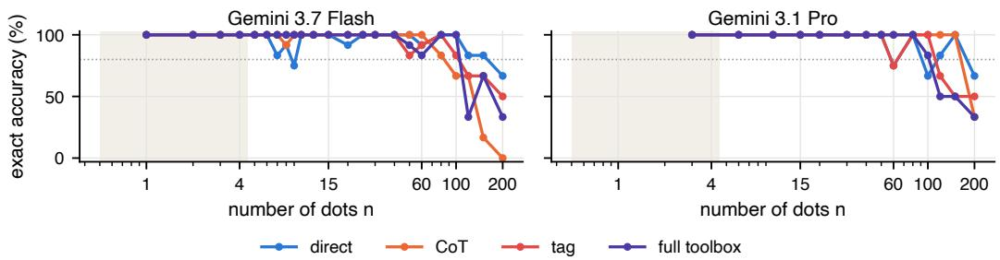  
Figure 2: Exact accuracy versus n for the two models whose $R _ { 8 0 }$ is right-censored on the main battery $( n \leq 6 0 )$ , continued onto the XL battery (n up to 200, Section D); the shaded band is the subitizing range, the dotted line the 80 % criterion. Both cliffs appear near 150; the verbal routine (CoT) collapses before direct estimation does.

Traversal-order experiment. The two order arms are the standard TAG loop with one sentence appended to the first user message requesting a left-to-right/top-to-bottom or a right-to-left/bottomto-top traversal (verbatim in Section B); Gemini 3.1 Flash-Lite, Qwen3-VL-32B, and Gemini 3.7 Flash ran both arms on the 68 DotArrays images of the ablation subset. Because tags are numbered in the order they are drawn, the realised traversal is observable: τ¯ in Table 9 is the Kendall correlation between tag index and vertical position, averaged over trajectories with at least five tags. Order irrelevance predicts identical final counts under the two traversals; agreement below the model’s own exact accuracy on these arrays means the traversal, which should be irrelevant, changes the answer. Because hosted models are not perfectly deterministic even at temperature 0, each order arm was run twice: the repeat control in Table 9 measures how often the same order repeated yields a different count (averaged over both orders), the cross agreement averages over all four pairs of opposite-order runs, and the order effect is their difference, so the three columns are consistent by construction. The rotation control runs the reading-order arm on every array rotated by 180◦ (twice; Qwen3-VL-8B replaces the withdrawn Qwen3-VL-32B), which visits the dots in the reverse sequence under the natural instruction; its agreement is averaged over the four pairs of (unrotated, rotated) reading-order runs and its effect is again the excess over the repeat control.

Strict seriality (tag-1). The batched tag call can place many points before the model sees any of them rendered, so the standard trace is an ordered externalised enumeration, not proof of itemby-item inspection. The TAG-1 arm closes that gap: each call may add exactly one point (extra points are discarded with a notice), so every mark is placed only after the previous one is observed. Table 10 compares DIRECT, batched TAG, and TAG-1 for the two precise pointers on the DotArrays ablation images.

## G Controls added in revision

Do the tags follow the answer? A model could estimate a number first and then draw that many points, in which case the tags would record the answer rather than produce it. Table 19 tests this on every image that ran both DIRECT and TAG: how often the number of tags equals the model’s own DIRECT answer, and how the per-image tag-count error correlates with the DIRECT error. On PixMo-Count the two agree often because both are usually right; on the dense photographs of FSC-147 the tag count equals the direct answer on only 10–53 % of images. The right-hand columns show that departures of the announced count from the tag count are mostly corrections: the announced number is then closer to the truth in 83 % of trajectories pooled over models. Table 20 reports the causal version of the test, the tag-perturbation probe of Section 4: after the model’s first tag call the harness removes one on-target tag or adds one tag on an untagged object, renumbers, and returns the altered image with the usual verification message, so that only the model’s own emission disagrees with what it sees. A model that reads its tags should notice (re-tag the missing object, or start over) or at least announce the visible number; a model that estimates and then draws should announce the number it emitted. The precise pointers do the former: Gemini 3.7 Flash re-tags the removed object in nearly every dot-array trajectory, Flash-Lite in most, and both announce the visible number. GPT-5 mini repairs least often. Qwen3-VL-8B announces the visible number in every trajectory yet seldom repairs: it reads the count off the tags without checking them, which is its cardinality consistency of 95.1 % seen from the other side.

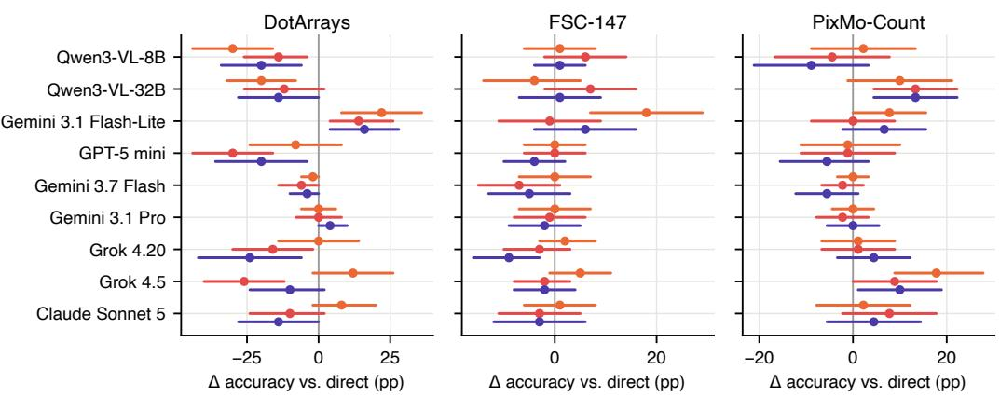  
CoT tag full toolbox

Figure 3: Paired change in exact accuracy of each arm over DIRECT on the common subset, with 95 % paired bootstrap CIs over images $( \mathrm { \bar { \it B } = 1 0 ^ { 4 } } ;$ numbers in Table 8). With 50–100 images per cell most single effects are within noise; CI-solid are Flash-Lite’s gains and the imprecise pointers’ losses on DotArrays, $\mathrm { Q w e n 3 – V L - 3 2 B ^ { \circ } s }$ gain on PixMo-Count, and CoT for Flash-Lite.  
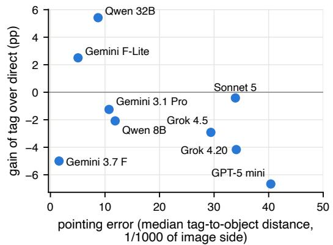

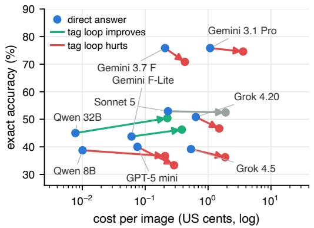  
Figure 4: Left: gain of TAG over DIRECT on the common subset against pointing error (median tag-to-object distance of on-target tags, DotArrays + FSC-147); the models that gain are the models that point. Right: the same comparison in cost–accuracy space, each arrow running from a model’s DIRECT answer (blue dot) to its TAG loop (green improves, red hurts, grey within one point); the loop costs roughly 3× more per image.

What DIRECT measures. Table 21 reports the hidden reasoning tokens that the provider returns for the single-turn arms, and the thinking-off control: the DIRECT prompt rerun with reasoning disabled (Gemini 3.1 Flash-Lite, GPT-5 mini) or set to the minimal effort the endpoint accepts (Gemini 3.7 Flash, whose endpoint, like Gemini 3.1 Pro’s, refuses to disable reasoning). The paired change is computed on the same images; $R _ { 8 0 }$ uses the DotArrays main battery (and, for Gemini 3.7

Table 7: Counting range $R _ { 8 0 }$ per model and arm on the DotArrays main battery (for Gemini 3.7 Flash and Gemini 3.1 Pro including the XL extension to n=200), with 95 % bootstrap confidence intervals (images resampled within each level, $B { = } 1 0 ^ { 3 } )$ . ≥ marks right-censored values: the isotonic accuracy fit is still ≥ 80 % at the largest tested n.
<table><tr><td>model</td><td>direct</td><td>CoT</td><td>tag</td><td>full</td></tr><tr><td>Qwen3-VL-8B</td><td>6 [6,7]</td><td>5 [3,7]</td><td>10 [7,15]</td><td>12 [4,15]</td></tr><tr><td>Qwen3-VL-32B</td><td>7 [6,9]</td><td>7 [6,10]</td><td>12 [12,15]</td><td>12 [12,20]</td></tr><tr><td>Gemini 3.1 Flash-Lite</td><td>7 [4,9]</td><td>15 [15,25]</td><td>20 [12,25]</td><td>20 [15,25]</td></tr><tr><td>GPT-5 mini</td><td>7 [3,12]</td><td>7 [4,12]</td><td>3 [1,5]</td><td>5 [0,5]</td></tr><tr><td>Gemini 3.7 Flash</td><td>150 [100,200]</td><td>80 [60,120]</td><td>100 [50,150]</td><td>100 [50,100]</td></tr><tr><td>Gemini 3.1 Pro</td><td>150 [50,200]</td><td>150 [150,200]</td><td>100 [100,150]</td><td>100 [80,120]</td></tr><tr><td>Grok 4.20</td><td>3 [3,20]</td><td>10 [3,20]</td><td>10 [10,20]</td><td>10 [10,10]</td></tr><tr><td>Grok 4.5</td><td>6 [6,15]</td><td>10 [10,30]</td><td>6 [6,10]</td><td>6 [6,10]</td></tr><tr><td>Claude Sonnet 5</td><td>20 [6,50]</td><td>20 [20,40]</td><td>20 [20,20]</td><td>20 [20,40]</td></tr></table>

Table 8: Paired change in exact accuracy (percentage points) of each arm over DIRECT on the common subset, with 95 % paired bootstrap confidence intervals over images $( B { = } 1 0 ^ { 4 } )$ ). Bold: the interval excludes zero.
<table><tr><td></td><td colspan="3">DotArrays</td><td colspan="3">FSC-147</td><td colspan="3">PixMo-Count</td></tr><tr><td>model</td><td>CoT</td><td>tag</td><td>full</td><td>CoT</td><td>tag</td><td>full</td><td>CoT</td><td>tag</td><td>full</td></tr><tr><td>Qwen3-VL-8B</td><td>-30 [-44,-16]</td><td>-14 [-26,-4]</td><td>-20 [-34,-6]</td><td>+1 [-6,+8]</td><td>+6 [-2,+14]</td><td>+1 [-4,+6]</td><td>+2 [-9,+13]</td><td>-4 [-17,+8]</td><td>-9 [-21,+3]</td></tr><tr><td>Qwen3-VL-32B</td><td>-20 [-32,-8]</td><td>-12 [-26,+2]</td><td>-14[-28,+0]</td><td>-4[-14,+5]</td><td>+7 [-2,+16]</td><td>+1 [-7,+9]</td><td>+10 [-1,+21]</td><td>+13 [+4,+22]</td><td>+13 [+4,+22]</td></tr><tr><td>Gemini 3.1 Flash-Lite +22 [+8,+36]</td><td></td><td>+14 [+4,+26]</td><td>+16 [+4,+28]</td><td>+18 [+7,+29]</td><td>-1 [-11,+9]</td><td>+6 [-4,+16]</td><td>+8 [+0,+16]</td><td>+0 [-9,+9]</td><td>+7 [-2,+16]</td></tr><tr><td>GPT-5 mini</td><td>-8 [-24,+8]</td><td>-30 [-44,-16]</td><td>-20 [-36,-4]</td><td>+0 [-6,+6]</td><td>+0 [-6,+6]</td><td>-4 [-10,+2]</td><td>-1 [-11,+10]</td><td>-1 [-11,+9]</td><td>-6 [-16,+3]</td></tr><tr><td>Gemini 3.7 Flash</td><td>-2 [-6,+0]</td><td>-6 [-14,+0]</td><td>-4 [-10,+0]</td><td>+0 [-7,+7]</td><td>-7 [-15,+1]</td><td>-5 [-13,+3]</td><td>+0 [-3,+3]</td><td>-2 [-7,+2]</td><td>-6 [-12,+1]</td></tr><tr><td>Gemini 3.1 Pro</td><td>+0 [-6,+6]</td><td>+0 [-8,+8]</td><td>+4 [+0,+10]</td><td>+0 [-7,+7]</td><td>-1 [-8,+6]</td><td>-2 [-9,+5]</td><td>+0 [-4,+4]</td><td>-2 [-8,+3]</td><td>+0 [-6,+6]</td></tr><tr><td>Grok 4.20</td><td>+0 [-14,+14]</td><td>-16 [-30,-2]</td><td>-24 [-42,-6]</td><td>+2 [-3,+8]</td><td>-3 [-10,+3]</td><td>-9 [-16,-3]</td><td>+1 [-7,+9]</td><td>+1 [-7,+9]</td><td>+4 [-3,+12]</td></tr><tr><td>Grok 4.5</td><td>+12 [-2,+26]</td><td>-26 [-40,-12]</td><td>-10 [-24,+2]</td><td>+5 [-1,+11]</td><td>-2 [-8,+3]</td><td>-2 [-8,+4]</td><td>+18 [+9,+28]</td><td>+9 [+0,+18]</td><td>+10 [+1,+19]</td></tr><tr><td>Claude Sonnet 5</td><td>+8 [-2,+20]</td><td>-10 [-24,+2]</td><td>-14 [-28,+0]</td><td>+1 [-6,+8]</td><td>-3 [-11,+5]</td><td>-3 [-12,+6]</td><td>+2 [-8,+12]</td><td>+8 [-2,+18]</td><td>+4 [-6,+14]</td></tr></table>

Flash, the XL extension). The Qwen models and, mostly, Claude Sonnet 5 produce no reasoning tokens, so for them DIRECT is estimation in the intended sense; for the Gemini and Grok models it is an answer-only arm whose hidden computation grows with n.

Lattice controls and the jitter check. A near-regular square lattice invites a shortcut: count rows and columns and emit an evenly spaced grid, which would score as on-target without any dot being inspected. Table 23 checks the existing arrays, whose dots are displaced from their cell centres by up to ±15 % of the cell: for the precise pointers the tag offsets track the dot offsets almost perfectly and tags lie several times closer to the dot than to the cell centre, so the tags are placed on dots. Table 22 adds three lattice sets built with the main battery’s generator, canvas, disc size, jitter, and seeds per level (Section D): a square lattice rotated by $2 0 { - } 4 0 ^ { \circ }$ , a hexagonal lattice, and a square lattice with about a quarter of its cells left empty, each at n ∈ {12, 20, 30, 40, 50}, compared with the main-battery regular and random arrays at the same n. Hexagonal and holed lattices keep Flash-Lite’s advantage under the routine but not Qwen3-VL-8B’s, whose regular advantage therefore looks lattice-specific, and the rotated lattice removes the advantage for every model and arm; for the model with a working routine the regular advantage is that of an organised scan path rather than of a recitable product. Gemini 3.7 Flash is at ceiling throughout and GPT-5 mini shows no arrangement effect under either arm.

Seeing the marks versus listing them. Table 24 gives the paired TAG−LIST contrasts behind Section 5.2.

## H Cost

Every API call logs the provider-reported cost (OpenRouter usage.cost), so the accounting below is measured, not estimated. The whole study, roughly 67,000 calls over 29,000 trajectories (E1 across nine models, the ablation grid, the mirror-flip, traversal-order, repeat-control, and strictseriality experiments, and the XL extension, including pilots and reruns), cost 153.13 US dollars. The three tier-1 models, which ran all seven arms on all 652 images, account for about one third of the total; the frontier and contrast models on the 240-image common subset and the XL extension account for most of the rest. Table 25 lists, per model, the OpenRouter identifier, the list prices, the mean cost per image for each arm, and the total spend. Two observations: the tool loop multiplies cost by roughly 3× over DIRECT for the cheap models (more calls, re-sent images) but remains below one US cent per image for every tier-1 model; and the cost–accuracy frontier of Figure 4 (right) is driven almost entirely by the model, not by the arm.

Table 9: Traversal-order experiment (order-irrelevance principle) on the 68 DotArrays images of the ablation subset: the TAG loop with an instructed scan order, left-to-right/top-to-bottom $( \mathrm { T A G } _ {  } )$ versus right-to-left/bottom-to-top $( \mathrm { T A G } _ {  } )$ , each run twice. τ¯ is the mean Kendall correlation between tag sequence and vertical position $\mathrm { ( p o s i t i v e = t o p \mathrm { - } d o w n ) }$ , showing that the instructed order is realised; agre $ \dot { \cdot } _ {  } = \mathrm { s a m e }$ final count under opposite orders (mean over the four run pairs); agree= = same final count when the same order is run twice (repeat control; mean over both orders); order ef-$\mathrm { f e c t } = \mathrm { a g r e e } _ { = } - \mathrm { a g r e e } _ {  }$ , the excess disagreement attributable to reversing the traversal, with a 95 % paired bootstrap CI over images; acc: exact accuracy under each order and under the uninstructed TAG loop on the same images. Rotation control: the reading-order arm on the image rotated by 180◦ visits the dots in the reverse sequence under the natural instruction; $\mathrm { a g r e e } _ { \mathrm { r o t } }$ is its agreement with the unrotated reading-order runs and the rotation effect its excess disagreement over the repeat control.
<table><tr><td>model</td><td>→</td><td>ī←</td><td>agree↔</td><td>agree=</td><td>order effect acc→</td><td></td><td>acc←</td><td>acc (tag)</td><td>agreerot</td><td>rot. effect</td><td>accrot</td></tr><tr><td>Qwen3-VL-8B</td><td>+0.56</td><td>-0.39</td><td>13.2</td><td>64.7</td><td> $+ 5 1 . 5 \ [ + 4 1 , + 6 2 ]$ </td><td>27.9</td><td>14.7</td><td>38.2</td><td>30.1</td><td> $+ 3 4 . 6 \ [ + 2 4 , + 4 5 ]$ </td><td>36.0</td></tr><tr><td>Qwen3-VL-32B</td><td></td><td>+0.50-0.47</td><td>24.3</td><td>39.7</td><td> $+ 1 5 . 4 \ [ + 8 , + 2 3 ]$ </td><td>44.1</td><td>26.5</td><td>45.6</td><td></td><td></td><td></td></tr><tr><td>Gemini 3.1 Flash-Lite</td><td></td><td>+0.71 -0.59</td><td>43.8</td><td>65.4</td><td> $+ 2 1 . 7 [ + 1 4 , + 3 1 ]$ </td><td>60.3</td><td>47.1</td><td>54.4</td><td>55.9</td><td> $+ 9 . 6 \ [ + 1 , + 1 8 ]$ </td><td>63.2</td></tr><tr><td>Gemini 3.7 Flash</td><td></td><td>+0.96-0.86</td><td>86.0</td><td>86.8</td><td> $+ 0 . 7 \ [ - 1 , + 3 ]$ </td><td>94.1</td><td>92.6</td><td>94.1</td><td>86.8</td><td> $+ 0 . 0 \ [ - 4 , + 4 ]$ </td><td>94.9</td></tr></table>

Table 10: Strict seriality (TAG-1): one point per tag call, so every mark is placed only after the previous one is seen, versus DIRECT and the batched TAG loop (T=6) on the same DotArrays ablation images. TAG-1 runs with a budget of $T { = } 8 0$ tool calls (the largest array has 60 dots), so no object goes untagged by construction; omissions are the model abandoning the traversal. Error rates are per 100 ground-truth objects; cost in US cents per image.
<table><tr><td>model</td><td>arm</td><td>acc (%)</td><td>MAE</td><td>omit</td><td>dup</td><td>phantom</td><td>calls</td><td>cost</td></tr><tr><td>Gemini 3.1 Flash-Lite</td><td>direct</td><td>29.4</td><td>2.2</td><td>一</td><td>一</td><td></td><td>1.0</td><td>0.05</td></tr><tr><td>Gemini 3.1 Flash-Lite</td><td>tag</td><td>54.4</td><td>5.7</td><td>14.6</td><td>3.3</td><td>21.6</td><td>2.9</td><td>0.67</td></tr><tr><td>Gemini 3.1 Flash-Lite</td><td>tag-1</td><td>51.5</td><td>4.2</td><td>43.6</td><td>2.7</td><td>6.1</td><td>29.3</td><td>7.79</td></tr><tr><td>Gemini 3.7 Flash</td><td>direct</td><td>100.0</td><td>0.0</td><td>一</td><td>一</td><td></td><td>1.0</td><td>0.24</td></tr><tr><td>Gemini 3.7 Flash</td><td>tag</td><td>94.1</td><td>0.1</td><td>2.3</td><td>0.5</td><td>4.0</td><td>2.8</td><td>0.41</td></tr><tr><td>Gemini 3.7 Flash</td><td>tag-1</td><td>85.3</td><td>0.5</td><td>67.9</td><td>0.1</td><td>0.1</td><td>17.7</td><td>5.95</td></tr></table>

## I Failure gallery

Figure 12 shows one representative trajectory for each of five automatically mined categories (final working images re-rendered from the stored actions; the selection script scans all TAG/FULL trajectories with point ground truth). Fixed: the tag loop corrects a wrong DIRECT answer. Duplicates: several tags pile onto already-counted objects, typically in tight clusters. Phantoms: tags land on background or between objects, the signature failure of imprecise pointers, which often follows a degenerate coordinate sequence (evenly spaced points marching across the image). Omissions: whole regions are left untagged, the dominant failure in dense scenes. Cardinality: the announced count differs from the number of drawn tags, i.e. the model tags, then distrusts its tags and estimates. The counts of mined candidates per category (TAG and FULL over DotArrays and FSC-147) were 325, 81, 1815, 529, and 399 trajectories respectively, so phantoms are by far the most common tag-level pathology in this study.

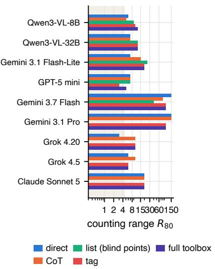  
(a) Counting range R80 per model and arm.

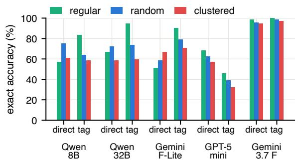  
(b) Arrangement effect on the DotArrays main battery.  
Figure 5: Developmental signatures. (a) The largest n up to which the isotonic fit of exact accuracy stays ≥ 80 % (shaded: subitizing range; tier-3 models were run on a subset of n; the two Geminis include the XL extension, and ≥ marks ranges still censored at the largest tested n; CIs in Table 7). (b) Exact accuracy on regular, random, and clustered arrays for the models that saw all three arrangements.

input, GT = 46 direct answer: 32  
  
How many tree logs?

turn 1: tag 36 tags  
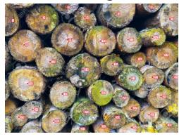  
[no text; action: tag with 36 points]

turn 2: tag 44 tags  
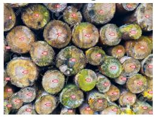  
[no text; action: tag with 8 points]

turn 3: tag 46 tags  
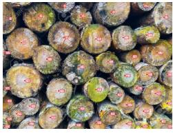  
[no text; action: tag with 2 points]  
final answer: 46 (GT 46); tags 46: 44 on-target, 1 duplicate, 1 phantom, 2 omitted

Figure 6: A real trajectory, re-rendered from the stored actions: Gemini 3.1 Pro on an FSC-147 photograph with 46 tree logs. The DIRECT answer is 32; three rounds of tagging reach 46, and the audit of the final tags against the dot annotations finds 44 on-target tags, one duplicate, one phantom, and two omissions. Panels show the working image after each tool call.

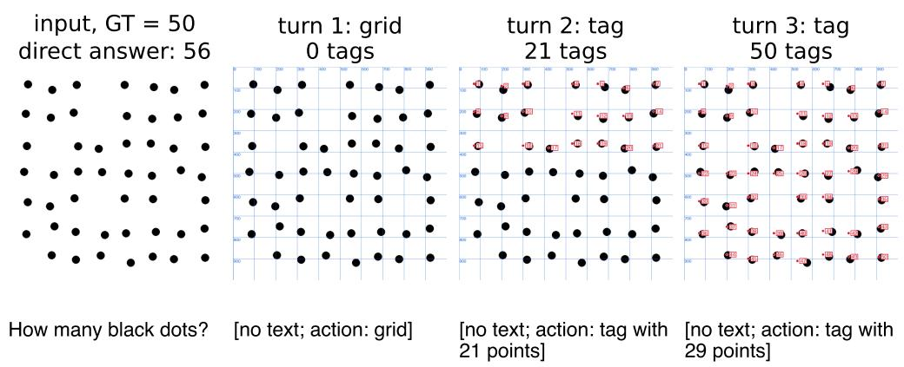  
final answer: 50 (GT 50); tags 50: 50 on-target, 0 duplicate, 0 phantom, 0 omitted  
Figure 7: Second real trajectory: Gemini 3.1 Flash-Lite with the full toolbox on a 50-dot regular array. DIRECT says 56; the model calls grid, tags 21 dots, then the remaining 29, and answers 50 with every tag on target.

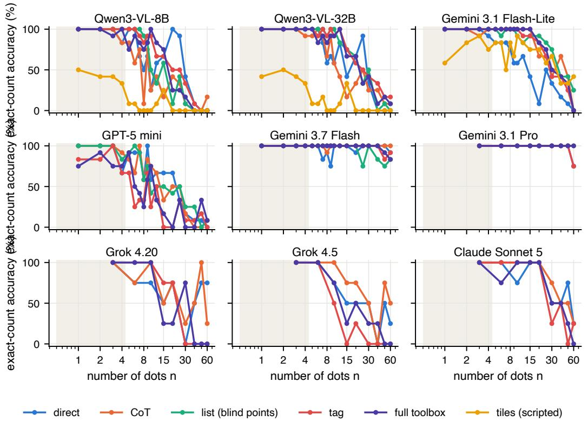  
Figure 8: Exact-count accuracy versus number of dots on the DotArrays main battery (three arrangements, four seeds per n), one panel per model, one line per harness arm; the shaded band marks the subitizing range $n \leq 4 .$ . Tier-2 models ran fewer arms; tier-3 models ran a subset of n (two arrangements, two seeds per level).

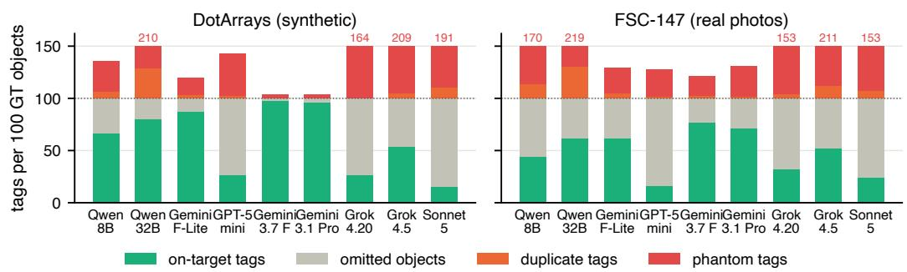  
Figure 9: Principle audit for the TAG arm: composition of the model’s tags per 100 ground-truth objects on DotArrays and FSC-147. On-target tags plus omitted objects sum to 100; duplicates and phantoms are extra tags; numbers above a bar give totals that exceed the axis.

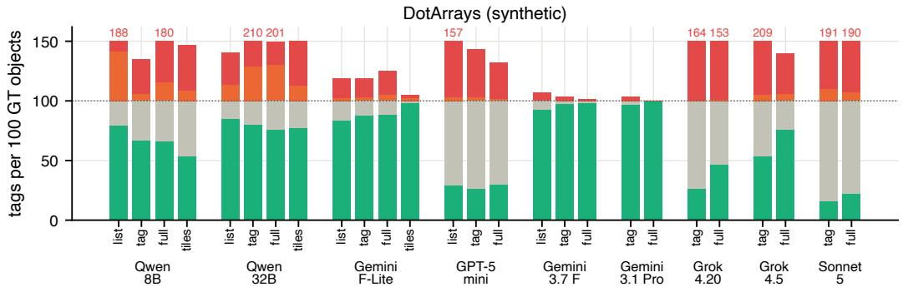

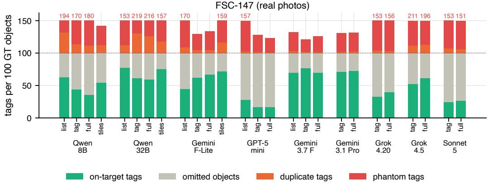  
Figure 10: Principle audit for all point-producing arms (LIST, TAG, FULL, TILES), as Figure 9.

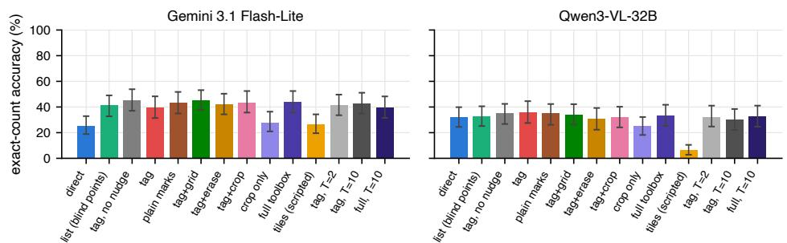  
Figure 11: Ablations: exact accuracy on the ablation subset with bootstrap 95 % CIs.

Table 11: Principle audit on images with point ground truth (DotArrays + FSC-147). Per 100 groundtruth objects: on-target tags, omissions (skipped objects), duplicates (second tag on a tagged object), phantoms (tag on nothing). Card.: fraction of trajectories whose announced count equals the number of tags. Prec.: median tag-to-object distance of on-target tags in thousandths of the shorter image side (lower is better).
<table><tr><td>model</td><td>arm</td><td>on-target</td><td>omitted</td><td>duplicate</td><td>phantom</td><td>card. (%)</td><td>prec.</td></tr><tr><td>Qwen3-VL-8B</td><td>list</td><td>69.4</td><td>30.6</td><td>35.7</td><td>56.3</td><td>76.7</td><td>16.2</td></tr><tr><td></td><td>tag</td><td>53.4</td><td>46.6</td><td>10.6</td><td>45.3</td><td>94.7</td><td>14.7</td></tr><tr><td></td><td>full</td><td>48.0</td><td>52.0</td><td>13.3</td><td>66.9</td><td>85.6</td><td>17.0</td></tr><tr><td></td><td>tiles</td><td>54.1</td><td>45.9</td><td>10.9</td><td>32.9</td><td>100.0</td><td>18.9</td></tr><tr><td>Qwen3-VL-32B</td><td>list</td><td>80.6</td><td>19.4</td><td>12.7</td><td>34.9</td><td>58.0</td><td>9.7</td></tr><tr><td></td><td>tag</td><td>69.2</td><td>30.8</td><td>29.7</td><td>85.7</td><td>80.2</td><td>13.1</td></tr><tr><td></td><td>full</td><td>66.3</td><td>33.7</td><td>27.9</td><td>81.7</td><td>77.4</td><td>12.9</td></tr><tr><td>Gemini 3.1 Flash-Lite</td><td>tiles</td><td>76.1</td><td>23.9</td><td>15.7</td><td>38.2</td><td>100.0</td><td>18.0</td></tr><tr><td></td><td>list</td><td>60.5</td><td>39.5</td><td>5.9</td><td>42.9</td><td>93.9</td><td>14.3</td></tr><tr><td></td><td>tag</td><td>72.4</td><td>27.6</td><td>3.9</td><td>21.2</td><td>87.7</td><td>9.1</td></tr><tr><td></td><td>full</td><td>75.7</td><td>24.3</td><td>5.0</td><td>25.3</td><td>92.6</td><td>9.9</td></tr><tr><td>GPT-5 mini</td><td>tiles</td><td>82.9</td><td>17.1</td><td>10.7</td><td>25.6</td><td>100.0</td><td>8.5</td></tr><tr><td></td><td>list</td><td>28.3</td><td>71.7</td><td>2.8</td><td>54.6</td><td>90.8</td><td>36.7</td></tr><tr><td></td><td>tag</td><td>20.6</td><td>79.4</td><td>2.2</td><td>31.9</td><td>64.2</td><td>41.0</td></tr><tr><td>Gemini 3.7 Flash</td><td>full</td><td>21.9</td><td>78.1</td><td>1.3</td><td>25.5</td><td>68.0</td><td>37.7</td></tr><tr><td></td><td>list</td><td>79.1</td><td>20.9</td><td>2.2</td><td>20.0</td><td>97.1</td><td>8.7</td></tr><tr><td></td><td>tag</td><td>85.5</td><td>14.5</td><td>1.3</td><td>12.6</td><td>89.1</td><td>7.3</td></tr><tr><td></td><td>full</td><td>81.6</td><td>18.4</td><td>1.3</td><td>14.3</td><td>88.8</td><td>8.1</td></tr><tr><td>Gemini 3.1 Pro</td><td>tag</td><td>77.9</td><td>22.1</td><td>1.4</td><td>22.4</td><td>92.0</td><td>8.3</td></tr><tr><td></td><td>full</td><td>79.4</td><td>20.6</td><td>1.6</td><td>21.5</td><td>90.5</td><td>8.0</td></tr><tr><td>Grok 4.20</td><td>tag</td><td>30.9</td><td>69.1</td><td>2.9</td><td>52.7</td><td>92.0</td><td>32.8</td></tr><tr><td></td><td>full</td><td>41.5</td><td>58.5</td><td>2.6</td><td>52.8</td><td>94.5</td><td>30.5</td></tr><tr><td>Grok 4.5</td><td>tag</td><td>52.6</td><td>47.4</td><td>10.2</td><td>100.4</td><td>35.0</td><td>29.7</td></tr><tr><td></td><td>full</td><td>65.0</td><td>35.0</td><td>11.4</td><td>70.1</td><td>73.0</td><td>30.1</td></tr><tr><td>Claude Sonnet 5</td><td>tag</td><td>22.0</td><td>78.0</td><td>8.1</td><td>55.2</td><td>52.0</td><td>32.7</td></tr><tr><td></td><td>full</td><td>25.1</td><td>74.9</td><td>6.3</td><td>54.4</td><td>67.5</td><td>33.6</td></tr></table>

Table 12: All seven arms on the common subset (240 images): exact-count accuracy (%) with MAE in parentheses; best arm per row in bold. TILES is not reported on PixMo-Count: its geometric merge only removes near-coincident points, so objects larger than the tile overlap are counted in every tile they touch (Section 5.2).
<table><tr><td>model</td><td>direct</td><td>CoT</td><td>list</td><td>tag</td><td>tag+crop</td><td>full toolbox</td><td>tiles</td></tr><tr><td colspan="8">DotArrays (synthetic, n ≤ 60)</td></tr><tr><td>Qwen3-VL-8B</td><td>52.0 (5.0)</td><td>22.0 (71.5)</td><td>26.0 (57.4)</td><td>38.0 (8.3)</td><td>34.0 (9.2)</td><td>32.0 (17.4)</td><td>2.0 (9.5)</td></tr><tr><td>Qwen3-VL-32B</td><td>48.0 (2.7)</td><td>28.0 (5.8)</td><td>44.0 (3.9)</td><td>36.0 (28.8)</td><td>38.0 (17.3)</td><td>34.0 (24.5)</td><td>10.0 (6.7)</td></tr><tr><td>Gemini 3.1 Flash-Lite</td><td>36.0 (2.0)</td><td>58.0 (4.7)</td><td>54.0 (3.0)</td><td>50.0 (6.0)</td><td>58.0 (3.6)</td><td>52.0 (3.3)</td><td>54.0 (1.6)</td></tr><tr><td>GPT-5 mini</td><td>48.0 (2.2)</td><td>40.0 (1.7)</td><td>40.0 (2.3)</td><td>18.0 (4.0)</td><td></td><td>28.0 (2.6)</td><td></td></tr><tr><td>Gemini 3.7 Flash</td><td>100.0 (0.0)</td><td>98.0 (0.1)</td><td>94.0 (0.4)</td><td>94.0 (0.2)</td><td></td><td>96.0 (0.1)</td><td></td></tr><tr><td>Gemini 3.1 Pro</td><td>96.0 (0.1)</td><td>96.0 (0.1)</td><td></td><td>96.0 (0.0)</td><td></td><td>100.0 (0.0)</td><td></td></tr><tr><td>Grok 4.20</td><td>66.0 (1.1)</td><td>66.0 (1.7)</td><td></td><td>50.0 (3.1)</td><td></td><td>42.0 (3.7)</td><td></td></tr><tr><td>Grok 4.5</td><td>54.0 (1.7)</td><td>66.0 (1.1)</td><td></td><td>28.0 (7.1)</td><td></td><td>44.0 (3.8)</td><td></td></tr><tr><td>Claude Sonnet 5</td><td>72.0 (1.0)</td><td>80.0 (0.3)</td><td></td><td>62.0 (7.1)</td><td>一</td><td>58.0 (6.0)</td><td></td></tr><tr><td colspan="8">FSC-147 (photos, 8–80 objects)</td></tr><tr><td>Qwen3-VL-8B</td><td>11.0 (11.5)</td><td>12.0 (70.4)</td><td>16.0 (37.5)</td><td>17.0 (22.8)</td><td>19.0 (21.5)</td><td>12.0 (20.6)</td><td>5.0 (19.4)</td></tr><tr><td>Qwen3-VL-32B</td><td>25.0 (8.4)</td><td>21.0 (31.1)</td><td>27.0 (10.4)</td><td>32.0 (23.4)</td><td>22.0 (17.9)</td><td>26.0 (23.3)</td><td>2.0 (13.9)</td></tr><tr><td>Gemini 3.1 Flash-Lite</td><td>23.0 (7.0)</td><td>41.0 (9.8)</td><td>31.0 (14.6)</td><td>22.0 (8.3)</td><td>29.0 (8.3)</td><td>29.0 (7.6)</td><td>2.0 (10.8)</td></tr><tr><td>GPT-5 mini</td><td>12.0 (10.8)</td><td>12.0 (8.7)</td><td>14.0 (8.9)</td><td>12.0 (9.5)</td><td></td><td>8.0 (10.7)</td><td></td></tr><tr><td>Gemini 3.7 Flash</td><td>52.0 (3.1)</td><td>52.0 (2.5)</td><td>47.0 (2.9)</td><td>45.0 (4.3)</td><td></td><td>47.0 (3.9)</td><td></td></tr><tr><td>Gemini 3.1 Pro</td><td>51.0 (3.2)</td><td>51.0 (3.0)</td><td></td><td>50.0 (3.6)</td><td></td><td>49.0 (4.3)</td><td></td></tr><tr><td>Grok 4.20</td><td>22.0 (8.1)</td><td>24.0 (7.6)</td><td></td><td>19.0 (10.1)</td><td></td><td>13.0 (11.3)</td><td></td></tr><tr><td>Grok 4.5</td><td>14.0 (12.5)</td><td>19.0 (10.5)</td><td></td><td>12.0 (18.1)</td><td></td><td>12.0 (21.7)</td><td></td></tr><tr><td>Claude Sonnet 5</td><td>24.0 (7.0)</td><td>25.0 (5.2)</td><td></td><td>21.0 (8.2)</td><td></td><td>21.0 (7.9)</td><td></td></tr><tr><td colspan="8">PixMo-Count (photos, 2-10 objects)</td></tr><tr><td>Qwen3-VL-8B</td><td>62.2 (0.6)</td><td>64.4 (0.8)</td><td>53.3 (4.6)</td><td>57.8 (0.6)</td><td>66.7 (0.5)</td><td>53.3 (1.2)</td><td>n/a</td></tr><tr><td>Qwen3-VL-32B</td><td>65.6 (0.5)</td><td>75.6 (0.7)</td><td>81.1 (0.6)</td><td>78.9 (0.7)</td><td>78.9 (0.3)</td><td>78.9 (0.4)</td><td>n/a</td></tr><tr><td>Gemini 3.1 Flash-Lite</td><td>71.1 (0.5)</td><td>78.9 (0.7)</td><td>72.2 (1.4)</td><td>71.1 (0.4)</td><td>75.6 (0.4)</td><td>77.8 (0.3)</td><td>n/a</td></tr><tr><td>GPT-5 mini</td><td>66.7 (0.5)</td><td>65.6 (1.1)</td><td>68.9 (0.6)</td><td>65.6 (1.1)</td><td></td><td>61.1 (0.8)</td><td>n/a</td></tr><tr><td>Gemini 3.7 Flash</td><td>88.9 (0.2)</td><td>88.9 (0.2)</td><td>87.8 (0.2)</td><td>86.7 (0.2)</td><td></td><td>83.3 (0.2)</td><td>n/a</td></tr><tr><td>Gemini 3.1 Pro</td><td>92.2 (0.1)</td><td>92.2 (0.1)</td><td></td><td>90.0 (0.2)</td><td></td><td>92.2 (0.1)</td><td>n/a</td></tr><tr><td>Grok 4.20</td><td>74.4 (0.6)</td><td>75.6 (0.3)</td><td></td><td>75.6 (0.4)</td><td></td><td>78.9 (0.3)</td><td>n/a</td></tr><tr><td>Grok 4.5 Claude Sonnet 5</td><td>58.9 (0.7)</td><td>76.7 (0.3)</td><td></td><td>67.8 (0.6)</td><td></td><td>68.9 (0.6)</td><td>n/a</td></tr><tr><td></td><td>74.4 (0.4)</td><td>76.7 (0.8)</td><td></td><td>82.2 (0.3)</td><td>一</td><td>78.9 (0.4)</td><td>n/a</td></tr></table>

Table 13: Exact-count accuracy (%) with MAE in parentheses on the FULL image sets (272 DotArrays, 200 FSC-147, 180 PixMo-Count) for the models that ran them; tier-3 models only saw the common subset, so their rows repeat Table 1. TILES on PixMo-Count is omitted for the reason given in Table 12.
<table><tr><td>model</td><td>direct</td><td>CoT</td><td>list</td><td>tag</td><td>tag+crop</td><td>full toolbox</td><td>tiles</td></tr><tr><td colspan="8">DotArrays (synthetic, n ≤ 60)</td></tr><tr><td>Qwen3-VL-8B</td><td>57.4 (2.8)</td><td>41.9 (67.1)</td><td>50.4 (19.9)</td><td>58.1 (4.8)</td><td>59.2 (5.4)</td><td>54.4 (11.2)</td><td>11.8 (5.9)</td></tr><tr><td>Qwen3-VL-32B</td><td>60.7 (1.6)</td><td>53.7 (2.7)</td><td>66.5 (6.6)</td><td>68.0 (17.5)</td><td>65.1 (49.4)</td><td>64.3 (12.5)</td><td>15.1 (5.3)</td></tr><tr><td>Gemini 3.1 Flash-Lite</td><td>52.9 (1.2)</td><td>77.2 (3.0)</td><td>75.7 (1.9)</td><td>73.9 (2.5)</td><td>75.4 (4.8)</td><td>76.5 (2.3)</td><td>64.0 (0.8)</td></tr><tr><td>GPT-5 mini</td><td>57.7 (1.5)</td><td>54.4 (1.4)</td><td>53.3 (1.4)</td><td>36.8 (2.4)</td><td></td><td>39.7 (2.3)</td><td></td></tr><tr><td>Gemini 3.7 Flash</td><td>97.1 (0.0)</td><td>99.3 (0.0)</td><td>95.2 (0.2)</td><td>98.2 (0.0)</td><td></td><td>97.4 (0.1)</td><td></td></tr><tr><td>Gemini 3.1 Pro</td><td>96.0 (0.1)</td><td>96.0 (0.1)</td><td></td><td>96.0 (0.0)</td><td></td><td>100.0 (0.0)</td><td></td></tr><tr><td>Grok 4.20</td><td>66.0 (1.1)</td><td>66.0 (1.7)</td><td></td><td>50.0 (3.1)</td><td></td><td>42.0 (3.7)</td><td></td></tr><tr><td>Grok 4.5</td><td>54.0 (1.7)</td><td>66.0 (1.1)</td><td></td><td>28.0 (7.1)</td><td></td><td>44.0 (3.8)</td><td></td></tr><tr><td>Claude Sonnet 5</td><td>72.0 (1.0)</td><td>80.0 (0.3)</td><td></td><td>62.0 (7.1)</td><td>一</td><td>58.0 (6.0)</td><td></td></tr><tr><td colspan="8">FSC-147 (photos, 8–80 objects)</td></tr><tr><td>Qwen3-VL-8B</td><td>12.0 (9.7)</td><td>10.0 (86.1)</td><td>14.0 (45.2)</td><td>12.5 (19.8)</td><td>15.5 (23.5)</td><td>12.0 (21.3)</td><td>3.0 (18.8)</td></tr><tr><td>Qwen3-VL-32B</td><td>23.0 (8.0)</td><td>19.5 (21.2)</td><td>25.0 (19.8)</td><td>27.0 (20.2)</td><td>24.0 (15.5)</td><td>26.0 (17.0)</td><td>2.5 (13.3)</td></tr><tr><td>Gemini 3.1 Flash-Lite</td><td>20.5 (11.7)</td><td>39.0 (9.5)</td><td>25.5 (13.1)</td><td>24.0 (6.9)</td><td>25.5 (7.6)</td><td>27.0 (7.5)</td><td>3.0 (13.1)</td></tr><tr><td>GPT-5 mini</td><td>12.5 (9.2)</td><td>15.5 (8.2)</td><td>15.0 (8.3)</td><td>14.0 (9.4)</td><td></td><td>11.5 (9.5)</td><td></td></tr><tr><td>Gemini 3.7 Flash</td><td>48.5 (3.1)</td><td>48.5 (4.8)</td><td>45.0 (4.1)</td><td>42.5 (3.5)</td><td></td><td>43.0 (3.4)</td><td></td></tr><tr><td>Gemini 3.1 Pro</td><td>51.0 (3.2)</td><td>51.0 (3.0)</td><td></td><td>50.0 (3.6)</td><td></td><td>49.0 (4.3)</td><td></td></tr><tr><td>Grok 4.20</td><td>22.0 (8.1)</td><td>24.0 (7.6)</td><td></td><td>19.0 (10.1)</td><td></td><td>13.0 (11.3)</td><td></td></tr><tr><td>Grok 4.5</td><td>14.0 (12.5)</td><td>19.0 (10.5)</td><td></td><td>12.0 (18.1)</td><td></td><td>12.0 (21.7)</td><td></td></tr><tr><td>Claude Sonnet 5</td><td>24.0 (7.0)</td><td>25.0 (5.2)</td><td>一</td><td>21.0 (8.2)</td><td>一</td><td>21.0 (7.9)</td><td></td></tr><tr><td colspan="8">PixMo-Count (photos, 2-10 objects)</td></tr><tr><td>Qwen3-VL-8B</td><td>66.1 (0.5)</td><td>62.8 (0.6)</td><td>58.3 (5.4)</td><td>59.4 (0.6)</td><td>65.0 (0.6)</td><td>54.4 (2.6)</td><td>n/a</td></tr><tr><td>Qwen3-VL-32B</td><td>69.4 (0.4)</td><td>74.4 (0.5)</td><td>82.2 (0.4)</td><td>78.9 (0.5)</td><td>77.8 (0.3)</td><td>77.8 (0.4)</td><td>n/a</td></tr><tr><td>Gemini 3.1 Flash-Lite</td><td>73.9 (0.4)</td><td>81.7 (0.4)</td><td>77.2 (0.8)</td><td>77.2 (0.3)</td><td>79.4 (0.3)</td><td>82.2 (0.2)</td><td>n/a</td></tr><tr><td>GPT-5 mini</td><td>68.9 (0.5)</td><td>68.9 (0.7)</td><td>71.7 (0.5)</td><td>62.2 (0.9)</td><td></td><td>66.7 (0.6)</td><td>n/a</td></tr><tr><td>Gemini 3.7 Flash</td><td>90.0 (0.2)</td><td>90.0 (0.2)</td><td>89.4 (0.2)</td><td>87.2 (0.2)</td><td></td><td>85.0 (0.2)</td><td>n/a</td></tr><tr><td>Gemini 3.1 Pro</td><td>92.2 (0.1)</td><td>92.2 (0.1)</td><td></td><td>90.0 (0.2)</td><td></td><td>92.2 (0.1)</td><td>n/a</td></tr><tr><td>Grok 4.20</td><td>74.4 (0.6)</td><td>75.6 (0.3)</td><td></td><td>75.6 (0.4)</td><td></td><td>78.9 (0.3)</td><td>n/a</td></tr><tr><td>Grok 4.5 Claude Sonnet 5</td><td>58.9 (0.7)</td><td>76.7 (0.3)</td><td></td><td>67.8 (0.6)</td><td></td><td>68.9 (0.6)</td><td>n/a</td></tr><tr><td></td><td>74.4 (0.4)</td><td>76.7 (0.8)</td><td></td><td>82.2 (0.3)</td><td></td><td>78.9 (0.4)</td><td>n/a</td></tr></table>

Table 14: Ablations on the ablation subset (143 images: DotArrays $n \geq 5$ and FSC-147). Exact accuracy (%) with MAE; duplicates and phantoms per 100 ground-truth objects; mean tool calls.
<table><tr><td>model</td><td>arm</td><td>acc (MAE)</td><td>on-target</td><td></td><td>dup. phantom</td><td>calls</td></tr><tr><td>Qwen3-VL-32B</td><td>direct</td><td>32.2 (6.1)</td><td></td><td></td><td></td><td>1.0</td></tr><tr><td></td><td>list (blind points)</td><td>32.9 (16.2)</td><td>76.2</td><td>12.8</td><td>39.0</td><td>1.0</td></tr><tr><td></td><td>tag, no nudge</td><td>35.0 (26.1)</td><td>64.5</td><td>29.2</td><td>92.8</td><td>3.4</td></tr><tr><td></td><td>plain marks</td><td>35.0 (12.5)</td><td>65.7</td><td>42.2</td><td>98.6</td><td>3.6</td></tr><tr><td></td><td>tag</td><td>35.7 (23.3)</td><td>66.7</td><td>33.5</td><td>98.8</td><td>3.4</td></tr><tr><td></td><td>tag+grid</td><td>34.3 (22.4)</td><td>67.2</td><td>16.1</td><td>85.8</td><td>3.1</td></tr><tr><td></td><td>tag+erase</td><td>30.8 (24.6)</td><td>63.0</td><td>40.5</td><td>89.4</td><td>3.4</td></tr><tr><td></td><td>tag+crop</td><td>32.2 (15.0)</td><td>62.9</td><td>16.0</td><td>65.4</td><td>3.6</td></tr><tr><td></td><td>crop only</td><td>25.2 (8.8)</td><td>0.0</td><td>0.0</td><td>0.0</td><td>4.1</td></tr><tr><td></td><td>full toolbox</td><td>33.6 (24.0)</td><td>63.3</td><td>28.0</td><td>98.6</td><td>3.7</td></tr><tr><td></td><td>tiles (scripted)</td><td>6.3 (10.5)</td><td>74.1</td><td>14.0</td><td>41.1</td><td>4.0</td></tr><tr><td></td><td>tag, T=2</td><td>32.2 (13.6)</td><td>67.5</td><td>19.4</td><td>71.9</td><td>2.3</td></tr><tr><td></td><td>tag, T=10</td><td>30.3 (23.3)</td><td>67.9</td><td>28.6</td><td>100.5</td><td>3.8</td></tr><tr><td></td><td>full, T=10</td><td>32.9 (26.4)</td><td>65.2</td><td>34.2</td><td>107.5</td><td>4.5</td></tr><tr><td>Gemini 3.1 Flash-Lite</td><td>direct</td><td>25.2 (3.8)</td><td></td><td></td><td></td><td>1.0</td></tr><tr><td></td><td>list (blind points)</td><td>41.3 (7.2)</td><td>57.9</td><td>5.9</td><td>39.9</td><td>1.0</td></tr><tr><td></td><td>tag, no nudge</td><td>45.5 (6.2)</td><td>70.7</td><td>4.9</td><td>27.8</td><td>2.8</td></tr><tr><td></td><td>plain marks</td><td>43.4 (4.0)</td><td>68.9</td><td>6.3</td><td>27.0</td><td>2.7</td></tr><tr><td></td><td>tag</td><td>39.9 (6.8)</td><td>67.9</td><td>2.4</td><td>23.3</td><td>2.6</td></tr><tr><td></td><td>tag+grid</td><td>45.5 (3.8)</td><td>71.9</td><td>2.9</td><td>19.8</td><td>2.4</td></tr><tr><td></td><td>tag+erase</td><td>42.0 (5.6)</td><td>70.4</td><td>3.6</td><td>29.2</td><td>2.6</td></tr><tr><td></td><td>tag+crop</td><td>43.4 (5.6)</td><td>71.0</td><td>3.8</td><td>29.0</td><td>2.6</td></tr><tr><td></td><td>crop only</td><td>28.0 (10.7)</td><td>0.0</td><td>0.0</td><td>0.0</td><td>1.3</td></tr><tr><td></td><td>full toolbox</td><td>44.1 (5.8)</td><td>71.8</td><td>4.4</td><td>27.0</td><td>3.0</td></tr><tr><td></td><td>tiles (scripted)</td><td>26.6 (7.6)</td><td>82.3</td><td>9.8</td><td>28.0</td><td>4.0</td></tr><tr><td></td><td>tag, T=2</td><td>41.3 (4.4)</td><td>70.6</td><td>2.7</td><td>21.5</td><td>2.1</td></tr><tr><td></td><td>tag, T=10</td><td>42.7 (5.5)</td><td>70.6</td><td>3.9</td><td>26.5</td><td>2.6</td></tr><tr><td></td><td>full, T=10</td><td>39.9 (5.4)</td><td>73.8</td><td>4.4</td><td>25.5</td><td>3.0</td></tr></table>

Table 15: FSC-147 by count bin: exact accuracy (%) with MAE.
<table><tr><td>model</td><td>arm</td><td>8-15</td><td>16-25</td><td>26-40</td><td>41-60</td><td>61-80</td></tr><tr><td>Qwen3-VL-8B</td><td>direct</td><td>40.0 (3.4)</td><td>10.0 (3.1)</td><td>5.0 (5.0)</td><td>2.5 (16.6)</td><td>2.5 (20.4)</td></tr><tr><td></td><td>list</td><td>45.0 (7.2)</td><td>15.0 (50.4)</td><td>5.0 (59.6)</td><td>2.5 (57.9)</td><td>2.5 (52.6)</td></tr><tr><td></td><td>tag</td><td>32.5 (5.1)</td><td>17.5 (5.8)</td><td>10.0 (21.0)</td><td>2.5 (39.4)</td><td>0.0 (32.1)</td></tr><tr><td></td><td>full</td><td>35.0 (2.5)</td><td>17.5 (12.2)</td><td>5.0 (28.2)</td><td>0.0 (23.4)</td><td>2.5 (40.0)</td></tr><tr><td></td><td>tiles</td><td>5.0 (7.8)</td><td>5.0 (8.3)</td><td>2.5 (12.7)</td><td>2.5 (25.5)</td><td>0.0 (39.9)</td></tr><tr><td>Qwen3-VL-32B</td><td>direct</td><td>60.0 (2.5)</td><td>27.5 (2.7)</td><td>15.0 (4.1)</td><td>10.0 (12.6)</td><td>2.5 (18.0)</td></tr><tr><td></td><td>list</td><td>60.0 (1.8)</td><td>32.5 (1.6)</td><td>20.0 (9.4)</td><td>7.5 (42.0)</td><td>5.0 (44.3)</td></tr><tr><td></td><td>tag</td><td>62.5 (0.5)</td><td>42.5 (3.5)</td><td>17.5 (15.6)</td><td>10.0 (34.7)</td><td>2.5 (51.9)</td></tr><tr><td></td><td>full</td><td>60.0 (3.0)</td><td>40.0 (2.8)</td><td>17.5 (19.6)</td><td>7.5 (23.6)</td><td>5.0 (39.0)</td></tr><tr><td></td><td>tiles</td><td>5.0 (9.3)</td><td>2.5 (7.7)</td><td>2.5 (11.7)</td><td>0.0 (16.9)</td><td>2.5 (20.9)</td></tr><tr><td>Gemini 3.1 Flash-Lite</td><td>direct</td><td>42.5 (31.8)</td><td>22.5 (2.4)</td><td>17.5 (4.0)</td><td>10.0 (9.6)</td><td>10.0 (11.0)</td></tr><tr><td></td><td>list</td><td>37.5 (9.2)</td><td>42.5 (5.5)</td><td>27.5 (10.0)</td><td>7.5 (20.5)</td><td>12.5 (21.1)</td></tr><tr><td></td><td>tag</td><td>45.0 (4.5)</td><td>35.0 (2.2)</td><td>20.0 (3.9)</td><td>7.5 (10.6)</td><td>12.5 (13.2)</td></tr><tr><td></td><td>full</td><td>50.0 (2.8)</td><td>42.5 (1.7)</td><td>22.5 (6.3)</td><td>7.5 (10.6)</td><td>12.5 (15.8)</td></tr><tr><td>GPT-5 mini</td><td>tiles</td><td>5.0 (14.3)</td><td>10.0 (7.8)</td><td>0.0 (11.8)</td><td>0.0 (12.1)</td><td>0.0 (19.6)</td></tr><tr><td></td><td>direct</td><td>35.0 (2.1)</td><td>12.5 (3.5)</td><td>7.5 (5.5)</td><td>5.0 (16.7)</td><td>2.5 (18.3)</td></tr><tr><td></td><td>list</td><td>42.5 (1.9)</td><td>17.5 (3.5)</td><td>5.0 (5.1)</td><td>7.5 (12.3)</td><td>2.5 (19.1)</td></tr><tr><td></td><td>tag</td><td>40.0 (1.2)</td><td>22.5 (3.4)</td><td>0.0 (6.9)</td><td>5.0 (14.0)</td><td>2.5 (22.2)</td></tr><tr><td>Gemini 3.7 Flash</td><td>full</td><td>37.5 (1.4)</td><td>15.0 (4.4)</td><td>0.0 (7.8)</td><td>2.5 (14.7)</td><td>2.5 (21.3)</td></tr><tr><td></td><td>direct</td><td>70.0 (2.5)</td><td>70.0 (1.1)</td><td>47.5 (2.0)</td><td>32.5 (4.2)</td><td>22.5 (5.5)</td></tr><tr><td></td><td>list</td><td>65.0 (8.4)</td><td>62.5 (1.0)</td><td>45.0 (2.0)</td><td>32.5 (3.6)</td><td>20.0 (5.5)</td></tr><tr><td></td><td>tag</td><td>65.0 (3.0)</td><td>65.0 (0.7)</td><td>40.0 (1.9)</td><td>15.0 (3.9)</td><td>27.5 (7.8)</td></tr><tr><td></td><td>full</td><td>70.0 (2.9)</td><td>67.5 (0.7)</td><td>32.5 (2.5)</td><td>22.5 (4.4)</td><td>22.5 (6.5)</td></tr><tr><td>Gemini 3.1 Pro</td><td>direct</td><td>75.0 (3.5)</td><td>75.0 (0.3)</td><td>40.0 (2.4)</td><td>45.0 (3.8)</td><td>20.0 (6.2)</td></tr><tr><td></td><td>tag</td><td>75.0 (3.4)</td><td>85.0 (0.4)</td><td>45.0 (4.0)</td><td>35.0 (4.0)</td><td>10.0 (6.3)</td></tr><tr><td></td><td>full</td><td>75.0 (3.4)</td><td>80.0 (0.3)</td><td>30.0 (4.6)</td><td>45.0 (5.8)</td><td>15.0 (7.5)</td></tr><tr><td>Grok 4.20</td><td>direct</td><td>40.0 (6.0)</td><td>45.0 (1.9)</td><td>15.0 (4.3)</td><td>5.0 (10.8)</td><td>5.0 (17.7)</td></tr><tr><td></td><td>tag</td><td>45.0 (2.5)</td><td>35.0 (2.1)</td><td>10.0 (7.9)</td><td>0.0 (13.2)</td><td>5.0 (24.6)</td></tr><tr><td></td><td>full</td><td>30.0 (4.8)</td><td>30.0 (2.1)</td><td>5.0 (10.4)</td><td>0.0 (15.1)</td><td>0.0 (23.9)</td></tr><tr><td>Grok 4.5</td><td>direct</td><td>40.0 (5.8)</td><td>20.0 (3.1)</td><td>5.0 (7.8)</td><td>0.0 (22.1)</td><td>5.0 (23.8)</td></tr><tr><td></td><td>tag</td><td>25.0 (6.7)</td><td>25.0 (5.1)</td><td>5.0 (15.6)</td><td>5.0 (25.9)</td><td>0.0 (37.1)</td></tr><tr><td></td><td>full</td><td>25.0 (7.1)</td><td>25.0 (4.7)</td><td>10.0 (18.6)</td><td>0.0 (41.1)</td><td>0.0 (37.1)</td></tr><tr><td>Claude Sonnet 5</td><td>direct</td><td>60.0 (2.4)</td><td>30.0 (1.6)</td><td>20.0 (4.5)</td><td>5.0 (14.1)</td><td>5.0 (12.3)</td></tr><tr><td></td><td>tag</td><td>40.0 (1.2)</td><td>40.0 (3.1)</td><td>20.0 (6.5)</td><td>5.0 (13.4)</td><td>0.0 (16.8)</td></tr><tr><td></td><td>full</td><td>30.0 (1.6)</td><td>40.0 (3.2)</td><td>20.0 (8.2)</td><td>0.0 (7.8)</td><td>15.0 (18.9)</td></tr></table>

Table 16: PixMo-Count by ground-truth count: exact accuracy (%) with MAE.
<table><tr><td>model</td><td>arm</td><td>2</td><td>3</td><td>4</td><td>5</td><td>6</td><td>7</td><td>8</td><td>9</td><td></td></tr><tr><td>Qwen3-VL-8B</td><td>direct</td><td>95.0 (0.1)</td><td>95.0 (0.1)</td><td>75.0 (0.6)</td><td>75.0 (0.5)</td><td>60.0 (0.5)</td><td>65.0 (0.3)</td><td>45.0 (0.7)</td><td>50.0 (0.7)</td><td>35.0 (1.1)</td></tr><tr><td></td><td>list</td><td>80.0 (0.2)</td><td>75.0 (0.2)</td><td>70.0 (8.3)</td><td>75.0 (2.2)</td><td>25.0 (4.7)</td><td>45.0 (13.8)</td><td>55.0 (3.6)</td><td>55.0 (5.0)</td><td>45.0 (11.4)</td></tr><tr><td></td><td>tag</td><td>90.0 (0.1)</td><td>100.0 (0.0)</td><td>65.0 (0.7)</td><td>40.0 (0.8)</td><td>40.0 (1.4)</td><td>50.0 (0.6)</td><td>55.0 (0.5)</td><td>60.0 (0.8)</td><td>35.0 (0.6)</td></tr><tr><td></td><td>full</td><td>90.0 (0.1)</td><td>90.0 (0.1)</td><td>55.0 (9.2)</td><td>45.0 (0.9)</td><td>40.0 (5.9)</td><td>65.0 (2.1)</td><td>35.0 (1.8)</td><td>45.0 (1.6)</td><td>25.0 (1.7)</td></tr><tr><td>Qwen3-VL-32B</td><td>tiles</td><td>30.0 (1.6)</td><td>15.0 (2.0)</td><td>15.0 (3.0)</td><td>35.0 (2.0)</td><td>15.0 (2.8)</td><td>10.0 (4.0)</td><td>15.0 (2.9)</td><td>30.0 (3.8)</td><td>10.0 (5.3)</td></tr><tr><td></td><td>direct</td><td>95.0 (0.1)</td><td>80.0 (0.3)</td><td>85.0 (0.3)</td><td>80.0 (0.2)</td><td>65.0 (0.3)</td><td>65.0 (0.5)</td><td>65.0 (0.7)</td><td>60.0 (0.6)</td><td>30.0 (0.9)</td></tr><tr><td></td><td>list</td><td>95.0 (0.1)</td><td>95.0 (0.1)</td><td>75.0 (1.8)</td><td>90.0 (0.1)</td><td>70.0 (0.6)</td><td>75.0 (0.3)</td><td>85.0 (0.1)</td><td>75.0 (0.3)</td><td>80.0 (0.2)</td></tr><tr><td></td><td>tag</td><td>95.0 (0.1)</td><td>85.0 (0.2)</td><td>85.0 (1.8)</td><td>90.0 (0.1)</td><td>70.0 (0.4)</td><td>70.0 (0.3)</td><td>75.0 (0.2)</td><td>75.0 (0.3)</td><td>65.0 (0.8)</td></tr><tr><td></td><td>full</td><td>95.0 (0.1)</td><td>85.0 (0.2)</td><td>90.0 (0.1)</td><td>85.0 (0.1)</td><td>70.0 (0.7)</td><td>70.0 (0.3)</td><td>85.0 (0.1)</td><td>75.0 (0.2)</td><td>45.0 (1.4)</td></tr><tr><td>Gemini 3.1 Flash-Lite</td><td>tiles</td><td>30.0 (1.6)</td><td>25.0 (2.1)</td><td>15.0 (3.1)</td><td>30.0 (3.0)</td><td>10.0 (3.0)</td><td>15.0 (5.2)</td><td>20.0 (3.1)</td><td>15.0 (3.2)</td><td>15.0 (5.6)</td></tr><tr><td></td><td>direct</td><td>95.0 (0.1)</td><td>85.0 (0.2)</td><td>90.0 (0.4)</td><td>75.0 (0.2)</td><td>60.0 (0.4)</td><td>50.0 (0.6)</td><td>70.0 (0.3)</td><td>75.0 (0.4)</td><td>65.0 (0.8)</td></tr><tr><td></td><td>list</td><td>95.0 (0.1)</td><td>90.0 (0.1)</td><td>95.0 (0.1)</td><td>85.0 (0.1)</td><td>65.0 (5.0)</td><td>60.0 (0.5)</td><td>65.0 (0.3)</td><td>85.0 (0.2)</td><td>55.0 (0.5)</td></tr><tr><td></td><td>tag</td><td>95.0 (0.1)</td><td>95.0 (0.1)</td><td>95.0 (0.2)</td><td>80.0 (0.2)</td><td>55.0 (0.5)</td><td>55.0 (0.7)</td><td>75.0 (0.2)</td><td>80.0 (0.2)</td><td>65.0 (0.7)</td></tr><tr><td></td><td>full</td><td>95.0 (0.1)</td><td>95.0 (0.1)</td><td>90.0 (0.2)</td><td>80.0 (0.2)</td><td>75.0 (0.2)</td><td>70.0 (0.3)</td><td>90.0 (0.1)</td><td>75.0 (0.3)</td><td>70.0 (0.4)</td></tr><tr><td>GPT-5 mini</td><td>tiles</td><td>25.0 (2.5)</td><td>10.0 (2.9)</td><td>10.0 (3.7)</td><td>15.0 (4.1)</td><td>15.0 (4.2)</td><td>15.0 (5.0)</td><td>10.0 (3.5)</td><td>0.0 (4.5)</td><td>0.0 (6.1)</td></tr><tr><td></td><td>direct</td><td>95.0 (0.1)</td><td>90.0 (0.1)</td><td>75.0 (0.4)</td><td>75.0 (0.2)</td><td>70.0 (0.3)</td><td>70.0 (0.3)</td><td>55.0 (0.6)</td><td>40.0 (0.7)</td><td>50.0 (1.4)</td></tr><tr><td></td><td>list</td><td>100.0 (0.0)</td><td>100.0 (0.0)</td><td>75.0 (1.1)</td><td>65.0 (0.3)</td><td>75.0 (0.4)</td><td>70.0 (0.4)</td><td>60.0 (0.5)</td><td>50.0 (0.6)</td><td>50.0 (0.8)</td></tr><tr><td></td><td>tag</td><td>95.0 (0.1)</td><td>90.0 (0.1)</td><td>70.0 (2.5)</td><td>60.0 (0.6)</td><td>60.0 (0.6)</td><td>50.0 (0.8)</td><td>40.0 (0.7)</td><td>50.0 (0.8)</td><td>45.0 (1.5)</td></tr><tr><td>Gemini 3.7 Flash</td><td>full</td><td>95.0 (0.1)</td><td>95.0 (0.1)</td><td>80.0 (1.1)</td><td>65.0 (0.7)</td><td>65.0 (0.6)</td><td>65.0 (0.5)</td><td>45.0 (0.7)</td><td>50.0 (0.7)</td><td>40.0 (1.1)</td></tr><tr><td></td><td>direct</td><td>95.0 (0.1)</td><td>95.0 (0.1)</td><td>85.0 (0.3)</td><td>90.0 (0.1)</td><td>85.0 (0.3)</td><td>85.0 (0.2)</td><td>100.0 (0.0)</td><td>90.0 (0.1)</td><td>85.0 (0.2)</td></tr><tr><td></td><td>list</td><td>95.0 (0.1)</td><td>95.0 (0.1)</td><td>85.0 (0.3)</td><td>90.0 (0.1)</td><td>90.0 (0.2)</td><td>85.0 (0.2)</td><td>95.0 (0.1)</td><td>85.0 (0.1)</td><td>85.0 (0.7)</td></tr><tr><td></td><td>tag</td><td>95.0 (0.1)</td><td>95.0 (0.1)</td><td>85.0 (0.3)</td><td>85.0 (0.1)</td><td>85.0 (0.3)</td><td>85.0 (0.2)</td><td>100.0 (0.0)</td><td>70.0 (0.2)</td><td>85.0 (0.3)</td></tr><tr><td></td><td>full</td><td>90.0 (0.1)</td><td>95.0 (0.1)</td><td>85.0 (0.3)</td><td>80.0 (0.2)</td><td>80.0 (0.3)</td><td>85.0 (0.2)</td><td>85.0 (0.1)</td><td>85.0 (0.1)</td><td>80.0 (0.3)</td></tr><tr><td>Gemini 3.1 Pro</td><td>direct</td><td>100.0 (0.0)</td><td>100.0 (0.0)</td><td>80.0 (0.2)</td><td>100.0 (0.0)</td><td>90.0 (0.1)</td><td>60.0 (0.6)</td><td>100.0 (0.0)</td><td>100.0 (0.0)</td><td>100.0 (0.0)</td></tr><tr><td></td><td>tag</td><td>100.0 (0.0)</td><td>100.0 (0.0)</td><td>70.0 (0.6)</td><td>100.0 (0.0)</td><td>80.0 (0.2)</td><td>70.0 (0.4)</td><td>100.0 (0.0)</td><td>100.0 (0.0)</td><td>90.0 (0.2)</td></tr><tr><td></td><td>full</td><td>100.0 (0.0)</td><td>100.0 (0.0)</td><td>70.0 (0.6)</td><td>100.0 (0.0)</td><td>80.0 (0.2)</td><td>80.0 (0.3)</td><td>100.0 (0.0)</td><td>100.0 (0.0)</td><td>100.0 (0.0)</td></tr><tr><td>Grok 4.20</td><td>direct</td><td>80.0 (0.2)</td><td>90.0 (0.2)</td><td>60.0 (1.0)</td><td>90.0 (0.3)</td><td>90.0 (0.2)</td><td>60.0 (0.6)</td><td>60.0 (1.4)</td><td>80.0 (0.3)</td><td>60.0 (0.8)</td></tr><tr><td></td><td>tag</td><td>80.0 (0.2)</td><td>90.0 (0.1)</td><td>80.0 (0.2)</td><td>80.0 (0.2)</td><td>80.0 (0.3)</td><td>80.0 (0.3)</td><td>60.0 (0.7)</td><td>80.0 (0.3)</td><td>50.0 (0.9)</td></tr><tr><td></td><td>full</td><td>90.0 (0.1)</td><td>100.0 (0.0)</td><td>80.0 (0.2)</td><td>80.0 (0.2)</td><td>60.0 (0.5)</td><td>80.0 (0.3)</td><td>70.0 (0.5)</td><td>80.0 (0.3)</td><td>70.0 (0.5)</td></tr><tr><td>Grok 4.5</td><td>direct</td><td>90.0 (0.1)</td><td>80.0 (0.3)</td><td>80.0 (0.5)</td><td>60.0 (0.4)</td><td>40.0 (0.8)</td><td>60.0 (0.5)</td><td>40.0 (1.5)</td><td>40.0 (1.0)</td><td>40.0 (1.4)</td></tr><tr><td></td><td>tag</td><td>90.0 (0.1)</td><td>90.0 (0.1)</td><td>90.0 (0.1)</td><td>80.0 (0.2)</td><td>70.0 (0.5)</td><td>60.0 (0.5)</td><td>30.0 (1.3)</td><td>60.0 (0.8)</td><td>40.0 (2.0)</td></tr><tr><td></td><td>full</td><td>90.0 (0.1)</td><td>90.0 (0.1)</td><td>90.0 (0.1)</td><td>70.0 (0.5)</td><td>60.0 (0.7)</td><td>60.0 (0.6)</td><td>50.0 (1.1)</td><td>70.0 (0.3)</td><td>40.0 (1.7)</td></tr><tr><td>Claude Sonnet 5</td><td>direct</td><td>90.0 (0.1)</td><td>100.0 (0.0)</td><td>80.0 (0.5)</td><td>80.0 (0.2)</td><td>90.0 (0.2)</td><td>50.0 (0.8)</td><td>70.0 (0.3)</td><td>70.0 (0.3)</td><td>40.0 (1.2)</td></tr><tr><td></td><td>tag</td><td>90.0 (0.1)</td><td>90.0 (0.2)</td><td>90.0 (0.4)</td><td>100.0 (0.0)</td><td>80.0 (0.2)</td><td>70.0 (0.4)</td><td>80.0 (0.5)</td><td>60.0 (0.9)</td><td>80.0 (0.4)</td></tr><tr><td></td><td>full</td><td>90.0 (0.1)</td><td>100.0 (0.0)</td><td>80.0 (0.8)</td><td>90.0 (0.1)</td><td>70.0 (0.8)</td><td>80.0 (0.3)</td><td>60.0 (0.6)</td><td>80.0 (0.2)</td><td>60.0 (0.9)</td></tr></table>

Table 17: DotArrays factor sets: exact accuracy (%) with MAE. hetero = mixed shapes/colours (abstraction), distractor = red among blue, dense = touching discs, small = 6-px discs.
<table><tr><td>model</td><td>arm</td><td>main</td><td>hetero</td><td>distractor</td><td>dense</td><td>small</td></tr><tr><td>Qwen3-VL-8B</td><td>direct</td><td>64.4 (2.7)</td><td>37.5 (1.4)</td><td>25.0 (2.9)</td><td>33.3 (4.8)</td><td>25.0 (4.8)</td></tr><tr><td></td><td>list</td><td>59.7 (13.2)</td><td>12.5 (34.0)</td><td>18.8 (31.1)</td><td>8.3 (38.6)</td><td>16.7 (88.8)</td></tr><tr><td></td><td>tag</td><td>68.5 (3.0)</td><td>25.0 (3.9)</td><td>18.8 (6.5)</td><td>0.0 (12.2)</td><td>25.0 (29.3)</td></tr><tr><td></td><td>full</td><td>62.5 (7.5)</td><td>37.5 (7.0)</td><td>25.0 (21.6)</td><td>0.0 (26.6)</td><td>25.0 (52.1)</td></tr><tr><td></td><td>tiles</td><td>12.0 (5.8)</td><td>6.2 (3.5)</td><td>18.8 (2.5)</td><td>0.0 (9.3)</td><td>16.7 (12.3)</td></tr><tr><td>Qwen3-VL-32B</td><td>direct</td><td>65.7 (1.3)</td><td>87.5 (0.1)</td><td>37.5 (1.4)</td><td>25.0 (3.6)</td><td>0.0 (6.6)</td></tr><tr><td></td><td>list</td><td>72.7 (1.6)</td><td>68.8 (1.1)</td><td>50.0 (1.9)</td><td>41.7 (9.3)</td><td>0.0 (107.5)</td></tr><tr><td></td><td>tag</td><td>75.9 (14.4)</td><td>50.0 (7.2)</td><td>56.2 (4.8)</td><td>8.3 (59.8)</td><td>25.0 (74.9)</td></tr><tr><td></td><td>full</td><td>71.3 (8.3)</td><td>50.0 (4.4)</td><td>56.2 (25.8)</td><td>16.7 (47.7)</td><td>16.7 (56.7)</td></tr><tr><td></td><td>tiles</td><td>13.4 (5.1)</td><td>18.8 (2.8)</td><td>18.8 (2.2)</td><td>8.3 (17.7)</td><td>41.7 (2.7)</td></tr><tr><td>Gemini 3.1 Flash-Lite</td><td>direct</td><td>58.8 (1.1)</td><td>37.5 (1.4)</td><td>31.2 (1.2)</td><td>33.3 (2.4)</td><td>16.7 (2.2)</td></tr><tr><td></td><td>list</td><td>84.3 (1.8)</td><td>43.8 (1.1)</td><td>62.5 (0.6)</td><td>33.3 (2.9)</td><td>25.0 (5.0)</td></tr><tr><td></td><td>tag</td><td>80.1 (1.9)</td><td>56.2 (0.5)</td><td>62.5 (0.6)</td><td>33.3 (10.0)</td><td>41.7 (10.2)</td></tr><tr><td></td><td>full</td><td>82.4 (2.1)</td><td>68.8 (0.5)</td><td>68.8 (0.7)</td><td>33.3 (7.4)</td><td>33.3 (5.1)</td></tr><tr><td></td><td>tiles</td><td>68.5 (0.7)</td><td>62.5 (0.4)</td><td>62.5 (0.4)</td><td>8.3 (3.7)</td><td>41.7 (0.7)</td></tr><tr><td>GPT-5 mini</td><td>direct</td><td>62.5 (1.3)</td><td>68.8 (0.4)</td><td>50.0 (1.1)</td><td>16.7 (3.3)</td><td>8.3 (4.7)</td></tr><tr><td></td><td>list</td><td>60.6 (1.1)</td><td>56.2 (1.5)</td><td>18.8 (4.6)</td><td>8.3 (2.0)</td><td>8.3 (2.9)</td></tr><tr><td></td><td>tag</td><td>38.9 (2.3)</td><td>62.5 (1.0)</td><td>18.8 (2.5)</td><td>0.0 (5.5)</td><td>25.0 (2.8)</td></tr><tr><td></td><td>full</td><td>43.5 (1.9)</td><td>43.8 (1.6)</td><td>31.2 (3.4)</td><td>0.0 (5.3)</td><td>16.7 (6.2)</td></tr><tr><td>Gemini 3.7 Flash</td><td>direct</td><td>96.3 (0.1)</td><td>100.0 (0.0)</td><td>100.0 (0.0)</td><td>100.0 (0.0)</td><td>100.0 (0.0)</td></tr><tr><td></td><td>list</td><td>95.4 (0.2)</td><td>93.8 (0.1)</td><td>100.0 (0.0)</td><td>91.7 (0.5)</td><td>91.7 (0.1)</td></tr><tr><td></td><td>tag</td><td>98.6 (0.0)</td><td>93.8 (0.3)</td><td>100.0 (0.0)</td><td>100.0 (0.0)</td><td>91.7 (0.1)</td></tr><tr><td></td><td>full</td><td>98.6 (0.0)</td><td>100.0 (0.0)</td><td>100.0 (0.0)</td><td>91.7 (0.4)</td><td>75.0 (0.5)</td></tr><tr><td>Gemini 3.1 Pro</td><td>direct</td><td>97.2 (0.1)</td><td>100.0 (0.0)</td><td>100.0 (0.0)</td><td>66.7 (0.3)</td><td>100.0 (0.0)</td></tr><tr><td></td><td>tag</td><td>97.2 (0.0)</td><td>100.0 (0.0)</td><td>100.0 (0.0)</td><td>66.7 (0.3)</td><td>100.0 (0.0)</td></tr><tr><td></td><td>full</td><td>100.0 (0.0)</td><td>100.0 (0.0)</td><td>100.0 (0.0)</td><td>100.0 (0.0)</td><td>100.0 (0.0)</td></tr><tr><td>Grok 4.20</td><td>direct</td><td>63.9 (1.2)</td><td>100.0 (0.0)</td><td>50.0 (1.8)</td><td>66.7 (0.7)</td><td>66.7 (1.7)</td></tr><tr><td></td><td>tag</td><td>50.0 (3.4)</td><td>100.0 (0.0)</td><td>25.0 (2.8)</td><td>33.3 (2.3)</td><td>33.3 (5.3)</td></tr><tr><td></td><td>full</td><td>47.2 (3.6)</td><td>75.0 (0.5)</td><td>25.0 (2.0)</td><td>0.0 (8.7)</td><td>0.0 (6.7)</td></tr><tr><td>Grok 4.5</td><td>direct</td><td>55.6 (1.8)</td><td>75.0 (0.5)</td><td>50.0 (0.8)</td><td>33.3 (3.7)</td><td>33.3 (1.0)</td></tr><tr><td></td><td>tag</td><td>30.6 (6.9)</td><td>75.0 (0.5)</td><td>0.0 (8.2)</td><td>0.0 (15.3)</td><td>0.0 (9.0)</td></tr><tr><td></td><td>full</td><td>44.4 (4.1)</td><td>75.0 (0.5)</td><td>25.0 (4.0)</td><td>0.0 (7.0)</td><td>66.7 (1.3)</td></tr><tr><td>Claude Sonnet 5</td><td>direct</td><td>75.0 (1.0)</td><td>75.0 (0.2)</td><td>75.0 (0.2)</td><td>66.7 (1.7)</td><td>33.3 (2.0)</td></tr><tr><td></td><td>tag</td><td>66.7 (6.0)</td><td>50.0 (2.0)</td><td>75.0 (0.5)</td><td>33.3 (23.3)</td><td>33.3 (19.3)</td></tr><tr><td></td><td>full</td><td>66.7 (4.6)</td><td>50.0 (3.0)</td><td>50.0 (4.5)</td><td>0.0 (10.3)</td><td>33.3 (24.3)</td></tr></table>

Table 18: Mirror consistency (an indirect invariance probe motivated by the order-irrelevance principle; the direct traversal-order test is in Table 9): agreement between the count on the original image and on its horizontal mirror, and accuracy on each, for the ablation subset.
<table><tr><td>model</td><td>arm</td><td>agree (%)</td><td>acc original</td><td>acc mirrored</td></tr><tr><td>Gemini 3.1 Flash-Lite</td><td>direct</td><td>36.4</td><td>25.2</td><td>25.9</td></tr><tr><td>Gemini 3.1 Flash-Lite</td><td>full toolbox</td><td>38.5</td><td>44.1</td><td>44.1</td></tr><tr><td>Gemini 3.1 Flash-Lite</td><td>tag</td><td>39.2</td><td>39.9</td><td>45.5</td></tr><tr><td>Qwen3-VL-32B</td><td>direct</td><td>67.8</td><td>32.2</td><td>27.3</td></tr><tr><td>Qwen3-VL-32B</td><td>full toolbox</td><td>33.6</td><td>33.6</td><td>31.5</td></tr><tr><td>Qwen3-VL-32B</td><td>tag</td><td>32.9</td><td>35.7</td><td>32.2</td></tr><tr><td>Qwen3-VL-8B</td><td>direct</td><td>60.1</td><td>27.3</td><td>25.2</td></tr><tr><td>Qwen3-VL-8B</td><td>full toolbox</td><td>18.2</td><td>23.8</td><td>19.6</td></tr><tr><td>Qwen3-VL-8B</td><td>tag</td><td>25.9</td><td>25.2</td><td>25.9</td></tr></table>

Table 19: Do the tags follow the answer, or the answer the tags? For every image that ran both DIRECT and TAG: the fraction of images on which the model drew exactly as many tags as its DIRECT answer (= direct, %, with 95 % CI) and the Spearman correlation $\rho$ between the per-image tag-count error and the DIRECT error. Right: cardinality (announced count = number of tags; TAG and FULL, DotArrays + FSC-147), the number of trajectories where they differ, and how often the announced count is then closer to the truth than the tag count (closer, %).
<table><tr><td rowspan="2">model</td><td colspan="2">DotArrays</td><td colspan="2">FSC-147</td><td colspan="2">PixMo-Count</td><td rowspan="2"></td><td rowspan="2">differ</td><td rowspan="2">closer (%)</td></tr><tr><td>= direct</td><td></td><td>= direct</td><td>ρ</td><td>= direct</td><td>ρ card. (%)</td></tr><tr><td>Qwen3-VL-8B</td><td>44 [38,50]</td><td>+0.14</td><td>10 [6,15]</td><td>+0.03</td><td>43 [36,50]</td><td>+0.01</td><td>91 [89,93]</td><td>84/901</td><td>96 [92,100]</td></tr><tr><td>Qwen3-VL-32B</td><td>51 [45,57]</td><td>-0.43</td><td>20 [14,25]</td><td>-0.19</td><td>77 [71,83]</td><td>+0.44</td><td>80 [77,83]</td><td>180/902</td><td>87 [82,92]</td></tr><tr><td>Gemini 3.1 Flash-Lite</td><td>52 [46,58]</td><td>+0.11</td><td>16 [12,22]</td><td>+0.20</td><td>66 [59,73]</td><td>+0.49</td><td>91 [89,92]</td><td>89/943</td><td>69 [58,78]</td></tr><tr><td>GPT-5 mini</td><td>31 [26,37]</td><td>+0.13</td><td>17 [12,22]</td><td>+0.38</td><td>55 [48,62]</td><td>+0.35</td><td>66 [63,69]</td><td>304/903</td><td>86 [82,90]</td></tr><tr><td>Gemini 3.7 Flash</td><td>92 [88,95]</td><td>+0.04</td><td>52 [44,58]</td><td>+0.51</td><td>94 [90,97]</td><td>+0.62</td><td>90 [88,92]</td><td>92/924</td><td>55 [45,65]</td></tr><tr><td>Gemini 3.1 Pro</td><td>92 [84,98]</td><td>+0.00</td><td>53 [43,63]</td><td>+0.26</td><td>92 [87,98]</td><td>+0.64</td><td>89 [85,92]</td><td>34/300</td><td>50 [32,68]</td></tr><tr><td>Grok 4.20</td><td>42 [28,56]</td><td>+0.01</td><td>19 [12,27]</td><td>+0.39</td><td>76 [67,84]</td><td>+0.63</td><td>94 [92,97]</td><td>17/300</td><td>88 [71,100]</td></tr><tr><td>Grok 4.5</td><td>16 [6,26]</td><td>+0.45</td><td>15 [8,22]</td><td>+0.62</td><td>67 [57,77]</td><td>+0.51</td><td>54 [48,60]</td><td>138/300</td><td>96 [92,99]</td></tr><tr><td>Claude Sonnet 5</td><td>30 [18,44]</td><td>+0.03</td><td>10 [5,16]</td><td>-0.03</td><td>68 [58,77]</td><td>+0.32</td><td>58 [52,63]</td><td>126/300</td><td>87 [81,93]</td></tr></table>

Table 20: Tag-perturbation probe. After the model’s first tag call the harness silently removes one on-target tag (−1) or adds one tag on a still-untagged object (+1) before rendering the working image; tags are renumbered, so the image and the harness message agree and only the model’s own emission differs. n: trajectories in which the perturbation could be applied (a +1 needs an untagged object). follows image: announced count = number of tags visible at the end; follows own: announced count = number of points the model emitted (and $\neq$ visible); repaired: the removed object was re-tagged by the end, or the model started over with replace (−1) / started over (+1); shift: announced count minus the unperturbed TAG answer on the same image (mean, 95 % CI); ↓ / ↑: fraction of images on which the answer moved down/up. Models that read their tags should shift by about −1 unless they repair.
<table><tr><td>model</td><td>data</td><td>pert.</td><td>n</td><td>follows image</td><td>follows own</td><td>repaired</td><td>acc. (%)</td><td>shift</td><td>↓↑</td></tr><tr><td>Qwen3-VL-8B</td><td>DotArrays</td><td>-1</td><td>55</td><td>100 [100,100]</td><td>0 [0,0]</td><td>45 [33,58]</td><td>29</td><td>+1.56 [-3.37,6.62]</td><td>40/33</td></tr><tr><td></td><td>DotArrays</td><td>+1</td><td>31</td><td>97 [90,100]</td><td>3 [0,10]</td><td>0 [0,0]</td><td>10</td><td>+8.52 [1.24,16.55]</td><td>28/62</td></tr><tr><td></td><td>FSC-147</td><td>-1</td><td>54</td><td>98 [94,100]</td><td>0 [0,0]</td><td>15 [6,24]</td><td>2</td><td>+5.48 [-3.40,15.98]</td><td>58/34</td></tr><tr><td></td><td>FSC-147</td><td>+1</td><td>40</td><td>100 [100,100]</td><td>0 [0,0]</td><td>0 [0,0]</td><td>8</td><td>+15.16 [3.16,30.49]</td><td>27/70</td></tr><tr><td>Gemini 3.1 Flash-Lite</td><td>DotArrays</td><td>-1</td><td>68</td><td>91 [84,97]</td><td>1 [0,4]</td><td>81 [71,90]</td><td>57</td><td>-1.75 [-4.72,0.87]</td><td>25/22</td></tr><tr><td></td><td>DotArrays</td><td>+1</td><td>35</td><td>94 [86,100]</td><td>0 [0,0]</td><td>40 [23,57]</td><td>23</td><td>+1.54 [-7.69,14.31]</td><td>46/37</td></tr><tr><td></td><td>FSC-147</td><td>-1</td><td>68</td><td>82 [72,91]</td><td>3 [0,7]</td><td>34 [24,46]</td><td>21</td><td>-3.04 [-7.25,0.25]</td><td>40/33</td></tr><tr><td></td><td>FSC-147</td><td>+1</td><td>52</td><td>87 [77,94]</td><td>8 [2,15]</td><td>17 [8,29]</td><td>23</td><td>-0.02 [-7.47,7.98]</td><td>29/55</td></tr><tr><td>GPT-5 mini</td><td>DotArrays</td><td>-1</td><td>43</td><td>84 [72,93]</td><td>7 [0,16]</td><td>47 [33,60]</td><td>35</td><td>-0.60 [-1.65,0.28]</td><td>40/26</td></tr><tr><td></td><td>DotArrays</td><td>+1</td><td>46</td><td>63 [50,76]</td><td>17 [7,28]</td><td>17 [7,28]</td><td>15</td><td>-0.46 [-2.28,1.24]</td><td>33/39</td></tr><tr><td></td><td>FSC-147</td><td>-1</td><td>54</td><td>76 [65,87]</td><td>15 [6,24]</td><td>22 [11,33]</td><td>15</td><td>-1.42 [-4.37,1.06]</td><td>40/33</td></tr><tr><td></td><td>FSC-147</td><td>+1</td><td>49</td><td>61 [47,76]</td><td>24 [12,37]</td><td>12 [4,22]</td><td>16</td><td>-0.02 [-1.12,1.19]</td><td>35/38</td></tr><tr><td>Gemini 3.7 Flash</td><td>DotArrays</td><td>-1</td><td>68</td><td>90 [82,96]</td><td>0 [0,0]</td><td>100 [100,100]</td><td>90</td><td>+0.19 [0.01,0.41]</td><td>4/12</td></tr><tr><td></td><td>DotArrays</td><td>+1</td><td>13</td><td>62 [38,85]</td><td>15 [0,38]</td><td>85 [62,100]</td><td>85</td><td>+0.62 [0.00,1.46]</td><td>8/31</td></tr><tr><td></td><td>FSC-147</td><td>-1</td><td>73</td><td>79 [70,89]</td><td>3 [0,7]</td><td>70 [59,79]</td><td>40</td><td>+0.75 [-1.01,3.21]</td><td>30/23</td></tr><tr><td></td><td>FSC-147</td><td>+1</td><td>46</td><td>72 [59,85]</td><td>11 [2,20]</td><td>52 [37,65]</td><td>26</td><td>+4.07 [0.95,8.02]</td><td>23/51</td></tr></table>

Table 21: What DIRECT measures. Left: hidden reasoning tokens reported by the provider for the single-turn arms at the “low” effort used throughout (median over all images; ≥ 40: median on DotArrays with $n \geq 4 0 ;$ any: fraction of DIRECT replies with at least one reasoning token). Right: the thinking-off control, the same DIRECT prompt with hidden reasoning disabled (Flash-Lite: enabled=false; GPT-5 mini: effort minimal, which yields zero reasoning tokens) or minimised where the endpoint refuses to disable it (Gemini 3.7 Flash: effort minimal); exact accuracy on the same images and the paired change (pp, 95 % CI), and $R _ { 8 0 }$ on DotArrays.
<table><tr><td rowspan="2">model</td><td colspan="4">reasoning tokens (low effort)</td><td colspan="7">thinking-off control</td></tr><tr><td>direct</td><td>≥ 40</td><td>any</td><td>CoT</td><td>setting</td><td>tokens</td><td>DotArrays</td><td>FSC-147</td><td>PixMo</td><td>∆ (pooled)</td><td> $R _ { 8 0 }$ </td></tr><tr><td>Qwen3-VL-8B</td><td>0</td><td>0</td><td>0%</td><td>0</td><td></td><td></td><td></td><td></td><td></td><td></td><td></td></tr><tr><td>Qwen3-VL-32B</td><td>0</td><td>0</td><td>0%</td><td>0</td><td></td><td></td><td></td><td></td><td></td><td></td><td></td></tr><tr><td>Gemini 3.1 Flash-Lite</td><td>122</td><td>120</td><td>100%</td><td>133</td><td>off</td><td>0</td><td>53→60</td><td>20→18</td><td>74→72</td><td>+1.8 [-1.1,4.8]</td><td>7→4</td></tr><tr><td>GPT-5 mini</td><td>128</td><td>352</td><td>97%</td><td>256</td><td>minimal</td><td>0</td><td>58→38</td><td>12→19</td><td>69→58</td><td>-9.4 [-13.2,-5.4]</td><td>7→2</td></tr><tr><td>Gemini 3.7 Flash</td><td>480</td><td>1720</td><td>100%</td><td>596</td><td>minimal</td><td>500</td><td>97→99</td><td>48→45</td><td>90→88</td><td>-0.8 [-2.5,0.9]</td><td>150→120</td></tr><tr><td>Gemini 3.1 Pro</td><td>482</td><td>1294</td><td>99%</td><td>505</td><td></td><td></td><td></td><td></td><td></td><td></td><td></td></tr><tr><td>Grok 4.20</td><td>1894</td><td>4288</td><td>100%</td><td>2519</td><td></td><td></td><td></td><td></td><td></td><td></td><td></td></tr><tr><td>Grok 4.5</td><td>0</td><td>1744</td><td>42%</td><td>1070</td><td></td><td></td><td></td><td></td><td></td><td></td><td></td></tr><tr><td>Claude Sonnet 5</td><td>0</td><td>248</td><td>10%</td><td>48</td><td>一</td><td></td><td>一</td><td></td><td></td><td></td><td></td></tr></table>

Table 22: Arrangement effect on lattices that defeat a rows-times-columns shortcut. Exact accuracy (%) on the main-battery near-regular and random arrays at $n \in \{ 1 2 , 2 0 , 3 0 , 4 0 , 5 0 \}$ (20 images each) and on three new lattice sets with the same n, jitter, and seeds-per-level (20 images each): a square lattice rotated by $2 0 { - } 4 0 ^ { \circ }$ , a hexagonal lattice, and a square lattice with about a quarter of its cells left empty. Right: the regular-minus-random and (rotated+hexagonal+holed)-minus-random differences with 95 % bootstrap CIs (pp).
<table><tr><td>model</td><td>arm</td><td>regular</td><td>random</td><td>rotated</td><td>hexagonal</td><td>holed</td><td>regular — random</td><td>lattices — random</td></tr><tr><td>Qwen3-VL-8B</td><td>direct</td><td>45</td><td>45</td><td>35</td><td>35</td><td>15</td><td>+0 [-30,30]</td><td>-17 [-42,8]</td></tr><tr><td rowspan="2">Gemini 3.1 Flash-Lite</td><td>tag</td><td>60</td><td>25</td><td>5</td><td>25</td><td>25</td><td>+35 [5,65]</td><td>-7 [-28,13]</td></tr><tr><td>direct</td><td>35</td><td>25</td><td>10</td><td>25</td><td>35</td><td>+10 [-20,35]</td><td>-2 [-25,20]</td></tr><tr><td></td><td>tag</td><td>85</td><td>55</td><td>30</td><td>85</td><td>90</td><td>+30 [5,55]</td><td>+13 [-12,38]</td></tr><tr><td rowspan="2">GPT-5 mini</td><td>direct</td><td>40</td><td>40</td><td>0</td><td>10</td><td>25</td><td>+0 [-30,30]</td><td>-28 [-50,-7]</td></tr><tr><td>tag</td><td>10</td><td>20</td><td>0</td><td>10</td><td>30</td><td>-10 [-30,10]</td><td>-7 [-27,12]</td></tr><tr><td rowspan="2">Gemini 3.7 Flash</td><td>direct</td><td>100</td><td>100</td><td>90</td><td>100</td><td>100</td><td>+0 [0,0]</td><td>-3 [-8,0]</td></tr><tr><td>tag</td><td>100</td><td>95</td><td>85</td><td>100</td><td>100</td><td>+5 [0,15]</td><td>+0 [-10,13]</td></tr></table>

Table 23: Grid-guessing check on the main-battery near-regular arrays $( n \geq 9 ;$ ; each dot is displaced from its lattice cell centre by a jitter of up to $\pm 1 \dot { 5 } \%$ of the cell). For every on-target tag: Pearson correlation and regression slope between the dot’s jitter and the tag’s offset from the same cell centre (a model that emits an even grid has $r \approx 0 ) $ ; median distance from the tag to the dot versus to the cell centre (px); and the fraction of tags closer to the dot than to the centre.
<table><tr><td>model</td><td>arm</td><td>images</td><td>tags</td><td>r</td><td>slope</td><td>to dot (px)</td><td>to centre (px)</td><td>closer to dot (%)</td></tr><tr><td rowspan="2">Qwen3-VL-8B</td><td>list</td><td>40</td><td>919</td><td>0.63</td><td>0.88</td><td>15.1</td><td>24.2</td><td>67</td></tr><tr><td>tag</td><td>40</td><td>990</td><td>0.55</td><td>0.80</td><td>16.0</td><td>21.4</td><td>64</td></tr><tr><td rowspan="2">Qwen3-VL-32B</td><td>list</td><td>40</td><td>1084</td><td>0.96</td><td>0.95</td><td>3.8</td><td>13.6</td><td>89</td></tr><tr><td>tag</td><td>40</td><td>1075</td><td>0.85</td><td>0.90</td><td>5.2</td><td>14.1</td><td>81</td></tr><tr><td rowspan="2">Gemini 3.1 Flash-Lite</td><td>list</td><td>40</td><td>1082</td><td>0.98</td><td>0.98</td><td>1.7</td><td>13.7</td><td>95</td></tr><tr><td>tag</td><td>40</td><td>1070</td><td>0.86</td><td>0.89</td><td>3.3</td><td>14.1</td><td>80</td></tr><tr><td>GPT-5 mini</td><td>list</td><td>38</td><td>635</td><td>0.37</td><td>0.90</td><td>34.7</td><td>35.3</td><td>55</td></tr><tr><td rowspan="2">Gemini 3.7 Flash</td><td>tag</td><td>33</td><td>493</td><td>0.35</td><td>0.82</td><td>40.0</td><td>40.6</td><td>56</td></tr><tr><td>list</td><td>40</td><td>1061</td><td>0.97</td><td>1.00</td><td>0.7</td><td>14.1</td><td>99</td></tr><tr><td></td><td>tag</td><td>40</td><td>1084</td><td>0.99</td><td>1.00</td><td>0.9</td><td>13.8</td><td>99</td></tr></table>

Table 24: Seeing the marks versus listing them: paired change in exact accuracy of TAG over LIST (blind pointing) on the common subset, percentage points with 95 % paired bootstrap CIs over images. Bold: the interval excludes zero.
<table><tr><td>model</td><td>DotArrays</td><td>FSC-147</td><td>PixMo-Count</td></tr><tr><td>Qwen3-VL-8B</td><td>+12.0 [2,22]</td><td>+1.0 [-6,8]</td><td>+4.4 [-7,16]</td></tr><tr><td>Qwen3-VL-32B</td><td>-8.0 [-20,4]</td><td>+5.0 [-4,14]</td><td>-2.2 [-10,6]</td></tr><tr><td>Gemini 3.1 Flash-Lite</td><td>-4.0 [-16,8]</td><td>-9.0 [-17,-1]</td><td>-1.1 [-11,9]</td></tr><tr><td>GPT-5 mini</td><td>-22.0 [-36,-10]</td><td>-2.0 [-8,4]</td><td>-3.3 [-13,7]</td></tr><tr><td>Gemini 3.7 Flash</td><td>+0.0 [-8,8]</td><td>-2.0 [-10,6]</td><td>-1.1 [-6,3]</td></tr></table>

Table 25: Models (OpenRouter identifiers, list prices in USD per million input/output tokens on 2026-08-18) and mean cost per image in US cents for each arm; the last column is the total spend per model in USD.
<table><tr><td>model</td><td>identifier</td><td>$/M in/out</td><td>direct</td><td>CoT</td><td>list</td><td>tag</td><td>tag+crop</td><td>full</td><td>tiles</td><td>total</td></tr><tr><td>Qwen3-VL-8B</td><td>qwen/qwen3-vl-8b-instruct</td><td>0.12/0.45</td><td>0.01</td><td>0.16</td><td>0.16</td><td>0.19</td><td>0.34</td><td>0.15</td><td>0.12</td><td>7.34</td></tr><tr><td>Qwen3-VL-32B</td><td>qwen/qwen3-vl-32b-instruct</td><td>0.10/0.42</td><td>0.01</td><td>0.06</td><td>0.04</td><td>0.19</td><td>0.16</td><td>0.23</td><td>0.09</td><td>4.95</td></tr><tr><td>Gemini 3.1 Flash-Lite</td><td>google/gemini-3.1-flash-lite</td><td>0.25/1.50</td><td>0.06</td><td>0.13</td><td>0.13</td><td>0.35</td><td>0.37</td><td>0.40</td><td>0.27</td><td>11.13</td></tr><tr><td>GPT-5 mini</td><td>openai/gpt-5-mini</td><td>0.25/2.00</td><td>0.07</td><td>0.12</td><td>0.11</td><td>0.31</td><td></td><td>0.41</td><td></td><td>6.66</td></tr><tr><td>Gemini 3.7 Flash</td><td>google/gemini-3.7-flash</td><td>0.38/1.88</td><td>0.19</td><td>0.25</td><td>0.16</td><td>0.40</td><td></td><td>0.42</td><td></td><td>9.26</td></tr><tr><td>Gemini 3.1 Pro</td><td>google/gemini-3.1-pro-preview</td><td>2.00/12.00</td><td>1.08</td><td>1.24</td><td></td><td>3.61</td><td></td><td>3.33</td><td></td><td>22.23</td></tr><tr><td>Grok 4.20</td><td> $\mathbf { x } { - } \mathbf { a } \mathbf { i } / \mathbf { g } \mathbf { r } { \circ } \mathbf { k } { - } 4 . 2 0$ </td><td>1.25/2.50</td><td>0.64</td><td>0.91</td><td></td><td>1.50</td><td></td><td>2.47</td><td></td><td>13.25</td></tr><tr><td>Grok 4.5</td><td> $\mathtt { x } { - } \mathtt { a i } / \mathtt { g r o k } { - } 4 . 5$ </td><td>2.00/6.00</td><td>0.54</td><td>1.52</td><td></td><td>1.87</td><td></td><td>1.47</td><td></td><td>12.95</td></tr><tr><td>Claude Sonnet 5</td><td>anthropic/claude-sonnet-5</td><td>2.00/10.00</td><td>0.23</td><td>0.39</td><td>一</td><td>1.90</td><td>1</td><td>2.15</td><td></td><td>11.20</td></tr></table>

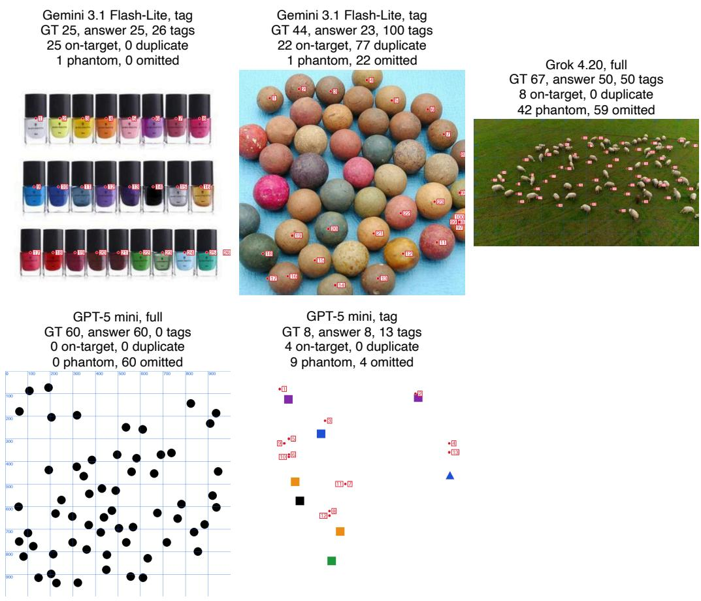  
Figure 12: Final working images from representative trajectories (re-rendered from stored actions), one per failure category: a case the tag loop fixed, a duplicate-heavy case, a phantom-heavy case, an omission-heavy case, and a cardinality-inconsistent case (announced count far from the number of tags). Titles give model, arm, ground truth, announced count and the audit.