# HROPE: HOMOGRAPHY RELATIVE POSITIONAL EN-CODING

Huachen Gao<sup>1,2,∗</sup> Yang Yang<sup>3,\*</sup> Xiaoqian Liang<sup>2</sup> Xingyu Chen<sup>1,2</sup> Youjia Zhang<sup>3</sup> Qi Zhang<sup>4</sup> Baorui Ma<sup>5</sup> Anpei Chen<sup>2,†</sup> Wei Yang<sup>3,†</sup>

<sup>1</sup>Zhejiang University <sup>2</sup>Westlake University

<sup>3</sup>Huazhong University of Science and Technology

<sup>4</sup>VIVO <sup>5</sup>Tsinghua University

## ABSTRACT

Geometric Relative Positional Encoding has become the primary mechanism for injecting spatial inductive biases into multi-view transformers. Existing designs condition attention on camera-level frustums or ray-marched depth, associating cross-view tokens through the sensor geometry. Such sensor-centric formulations, however, describe only where a token is observed from, leaving the rich surface geometry of the scene region depicted by the token. In this paper, we advocate a shift toward surface-aware positional encoding that explicitly grounds patch tokens in the geometry of physical surfaces. We introduce HRoPE, which represents the local geometry of each patch as a slanted 3D plane, following the slanted support-window assumption of classical multi-view stereo. We inject token-level, plane-induced homographies into attention as relative transformations. This equips the transformer with a geometric prior for rectifying perspective distortions and aligning patch features across viewpoints. Our encoding requires no ground-truth geometry: the plane parameters can be predicted endto-end under a view-synthesis objective alone, or derived from foundation models. Extensive experiments on RealEstate10K, CO3Dv2, and DL3DV show that our best variant of HRoPE consistently outperforms the evaluated geometric positional encodings for novel view synthesis. Extensive ablations and analysis show the effectiveness of the proposed encoding. Please refer to our project page at: https://gaohchen.github.io/HRoPE.

## 1 INTRODUCTION

The Transformer has become the de facto architecture for recent feed-forward 3D vision (Wang et al., 2024; 2025; Jin et al., 2025). By tokenizing images from multiple viewpoints and exchanging information via attention, these models exhibit strong capabilities in jointly resolving appearance, visibility, and scene geometry. Attention, however, is permutation-equivariant: it operates on unordered sets and is inherently agnostic to the camera poses, metric scales, and epipolar constraints that couple multi-view observations. Consequently, geometric priors must be explicitly injected, either by conditioning token representations directly (e.g., via camera tokens (Wang et al., 2025) or ray maps (Jin et al., 2025; Zhang et al., 2024a)) or by imposing epipolar constraints on attention (He et al., 2020; Charatan et al., 2024; Ye et al., 2024). Positional encoding (PE) introduces geometric structure directly into attention by modulating pairwise token comparisons.

While existing PE designs exhibit increasing geometric fidelity by using priors from images, cameras, and rays, they invariably anchor positional information to the sensor. RoPE extensions (Su et al., 2024) encode 2D intra-view offsets, leaving inter-view transformations implicit (Weinzaepfel et al., 2023; Wang et al., 2024). GTA (Miyato et al., 2024) and CaPE (Kong et al., 2024) inject relative camera extrinsics to achieve invariance to global rigid motions, while PRoPE (Li et al., 2025) generalizes this to the full projection matrix. Ray-based formulations like RayRoPE (Wu et al., 2026) and URoPE (Xie et al., 2026) integrate depth by localizing patches along viewing rays and re-projecting into the query frame. Across this progression, geometry is parameterized via sensorcentric abstractions: an image coordinate, a camera frustum, or a point of ray termination, leaving the rich local surface structure of the underlying scene unmodeled (see Fig. 1, left and middle).

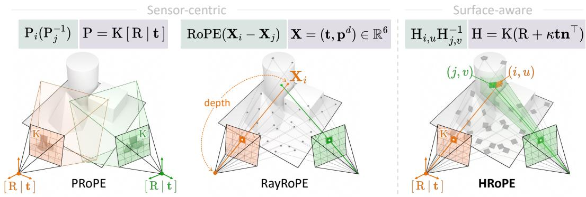  
Figure 1: From sensor-centric to surface-aware geometric positional encoding. Left: PRoPE (Li et al., 2025) assigns every token in a view the same camera projection $\mathrm { ~ P ~ } = \mathrm { \check { K } } [ \mathrm { { R } ~ } | \mathrm { \textbf { t } } ]$ Middle: RayRoPE (Wu et al., 2026) predicts a depth d for each token and places it at a 3D point X along the camera ray, but does not model local surface orientation. Right: HRoPE associates each patch with a slanted tangent plane and relates token pairs through the plane-induced homography $\mathrm { H } _ { i , u } \mathrm { \bar { H } } _ { j , v } ^ { - 1 }$ (Eq. 2), thereby encoding both depth and local surface orientation in the attention comparison.

This limitation is fundamental because multi-view matching does not compare isolated points; it compares local neighborhoods whose appearances are related through surface-induced deformations. A patch in one view and its corresponding patch in another are connected by a warp determined by the underlying surface geometry, and reliable correspondence requires compensating for this warp before comparing visual features. Given the pixel location and camera geometry, depth locates the patch center, while surface orientation additionally determines how its surrounding neighborhood deforms across views. By providing only view or positional information, existing PEs implicitly impose a fronto-parallel assumption on the attention computation mechanism. Although large neural models can learn to compensate for this bias given sufficient training data, doing so compromises efficiency and generalization. We argue that surface orientation is the missing degree of freedom: current PEs capture the zeroth-order position of a patch but neglect the first-order local orientation that dictates its cross-view appearance transformation.

To this end, we present HRoPE, a Homography Relative Positional Encoding that embeds orientation-aware rectification directly into the attention mechanism (Fig. 1, right). Inspired by the slanted support windows of classical multi-view stereo (Bleyer et al., 2011; Wang et al., 2021a), HRoPE anchors a local tangent plane to each patch token. We use the plane normal and distance, together with the camera poses, to define the homography governing cross-view neighborhood deformations. Concretely, we apply a per-patch 3 × 3 transformation block-diagonally to the queries, keys, and values, and incorporate a closed-form inverse into the key projection so that the resulting attention logits depend exclusively on the relative homography between tokens. As we show in Sec. 3.2 and Appendix A.2, this mechanism acts as an in-attention analogue of computing a matching score only after both neighborhoods have been rectified onto a shared tangent plane. Consequently, whereas prior geometric PEs merely encode where a token is located, HRoPE explicitly models how its underlying surface transforms across views. This formulation offers two compelling advantages. First, HRoPE strictly generalizes point- and ray-based PEs: when a predicted normal aligns with the viewing direction, the induced transformation naturally reduces to the fronto-parallel case. Second, the per-patch transformation parameters can be regressed from patch features by a lightweight head trained jointly with the view-synthesis model, using the view-synthesis objective alone. The head can optionally use pretrained features from DINOv2 (Oquab et al., 2024) or VGGT (Wang et al., 2025), without changing the encoding formulation or training objective.

We validate HRoPE on feed-forward novel view synthesis (NVS) across the RealEstate10K (Zhou et al., 2018), CO3Dv2 (Reizenstein et al., 2021), and DL3DV (Ling et al., 2024) datasets, where it consistently outperforms view-, projection-, and ray-based encodings. Notably, HRoPE surpasses PRoPE on RealEstate10K without ground-truth camera poses, demonstrating that per-patch homography is a stronger prior than view-level projection. Furthermore, our ablations show that this geometry must condition token interactions multiplicatively, injecting the same information as additive features sharply degrades performance. Finally, HRoPE improves generalization to unseen zooms and wider baselines, supporting its role as a geometric inductive bias. Beyond NVS, HRoPE transfers unchanged to a multi-view diffusion model and to the visual tokens of a spatial reasoning MLLM, improving performance on both tasks (Appendix A.6).

We summarize our main contributions as follows:

1. We formulate the principle of surface-aware positional encoding, positioning local 3D surface geometry as the natural anchor for comparing patch neighborhoods across views.

2. We propose HRoPE, a per-patch relative encoding that uses plane-induced transforms with closed-form inverses to condition attention logits on relative cross-view homographies.

3. We demonstrate consistent improvements over the evaluated geometric positional encodings on multiple NVS benchmarks and under out-of-distribution view settings. Controlled ablations analyze the roles of transformation structure, local geometry, and feature source, supporting the benefit of the homography inductive bias.

## 2 RELATED WORK

Geometric Positional Encoding. Geometric PEs encode camera or scene geometry in tokens and attention. Absolute variants encode Plucker rays (Sitzmann et al., 2021; Sajjadi et al., 2022; Jin¨ et al., 2025) or 3D positions (Liu et al., 2022), but depend on the chosen world frame. Relative variants extend rotary encodings (Su et al., 2024; Shaw et al., 2018) to camera geometry: GTA (Miyato et al., 2024) and CaPE (Kong et al., 2024) use relative extrinsics, while PRoPE (Li et al., 2025) also includes intrinsics through projection matrices. Recent methods move from view- to token-level geometry: RayRoPE (Wu et al., 2026) predicts per-token depth, RoRE (Griffiths & Dansereau, 2026) rotates features along rays, and URoPE (Xie et al., 2026) projects per-head depth anchors into the query frame, following epipolar attention (He et al., 2020; Suhail et al., 2022). These encodings describe camera relationships and point- or ray-level geometry. HRoPE adds an explicit local-plane parameterization whose orientation, together with distance and camera geometry, determines a planar neighborhood’s cross-view deformation. This distinguishes surface-conditioned transformations from point localization without requiring the latter to assume fronto-parallel surfaces.

Multi-view Transformers. Multi-view transformers use camera geometry to associate image tokens across views. Their applications include stereo depth estimation (He et al., 2020; Yao et al., 2018; Gu et al., 2020), camera and structure recovery (Wang et al., 2024; 2025), cross-view completion and matching (Weinzaepfel et al., 2023), spatial reasoning (Yang et al., 2025; Wu et al., 2025), and camera-controlled video and world modeling (Li et al., 2026; Zhang et al., 2026; Ma et al., 2025), as well as novel view synthesis (NVS). For feed-forward NVS, methods use featureconditioned radiance fields (Yu et al., 2021; Wang et al., 2021b; Chen et al., 2021; Trevithick & Yang, 2021; Hong et al., 2024), predict 3D Gaussians (Charatan et al., 2024; Chen et al., 2024a; Zhang et al., 2024a), or directly regress pixels (Jin et al., 2025; Jiang et al., 2025). We evaluate HRoPE primarily on novel view synthesis using the LVSM backbone with plane-induced positional encoding.

Slanted Support Windows. Traditional local stereo methods assume constant disparity within a support window, introducing a fronto-parallel bias on slanted surfaces (Bleyer et al., 2011). Building on randomized correspondence search (Barnes et al., 2009), PatchMatch Stereo (Bleyer et al., 2011) addresses this limitation by estimating a local disparity plane at each pixel and evaluating matching costs over slanted support windows. More generally, local planar geometry induces a homography that relates corresponding image neighborhoods across views (Hartley & Zisserman, 2003). Learned multi-view stereo methods also use differentiable geometric warping to compare features under depth hypotheses (Yao et al., 2018; Gu et al., 2020; Wang et al., 2021a). HRoPE draws on the principle of using local surface geometry to guide cross-view matching. It incorporates per-patch, plane-induced transformations into multi-view attention, bringing the geometric intuition of slantedwindow matching into positional encoding.

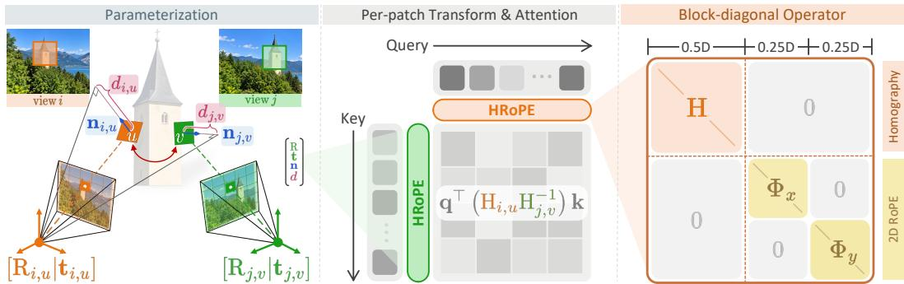  
Figure 2: Overview of HRoPE. Left: per-patch parameters $\mathbf { ( R , t , n , } \kappa )$ are predicted from patchlevel image features (Sec. 3.3), where n and $\kappa ~ = ~ 1 / d$ represent the local plane’s unit normal and inverse plane distance, respectively. Together with intrinsics K, these parameters define $\mathrm { H } = \mathrm { K } \big ( \mathrm {  ~ R ~ } + \mathrm {  ~ \ell ~ } \kappa \mathrm {  ~ \ t ~ } { \bf n } ^ { \top } \big )$ (Eq. 5). Middle: token-specific transforms modulate the cross-view attention, yielding the relative factor $\mathrm { H } _ { i , u } \mathrm { H } _ { j , v } ^ { - 1 }$ in each attention logit (Eq. 4). Right: the transform is repeated block-diagonally over the geometric half of each head, while the remaining dimensions retain the 2D rotary blocks $\Phi _ { x }$ and $\Phi _ { y }$ (Eq. 17).

## 3 METHOD

HRoPE is a geometric positional encoding that incorporates a per-token surface plane transform. In Sec.3.1, we first review how prior work incorporates camera geometry into multi-view attention. Then, in Sec. 3.2, we introduce the plane-induced transformation and show how it modulates multiview attention. With consistent camera geometry, the relative transformation exactly maps points on a shared physical plane across views. For independently predicted per-patch parameters, the same algebraic form modulates attention without requiring an exact physical correspondence for every token pair. Finally, Sec. 3.3 details how these per-patch parameters are predicted from image features and presents a calibrated variant that leverages known camera parameters. The overall pipeline of HRoPE is illustrated in Fig. 2.

## 3.1 PRELIMINARIES: GEOMETRIC POSITIONAL ENCODINGS

Self-attention alone does not encode token positions or camera geometries. RoPE (Su et al., 2024) applies position-dependent rotations to queries and keys so that their dot product depends on relative positions. Multi-view relative PEs extend this principle to cameras: GTA (Miyato et al., 2024) and CaPE (Kong et al., 2024) encode relative extrinsics, while PRoPE (Li et al., 2025) adds intrinsics.

Projective Relative Encodings. Let $\mathrm { P } _ { i }$ be PRoPE’s $4 \times 4$ projection transform for view i, built from its intrinsics and extrinsics. For a query q in view i and a key k in view j, the attention score is $( \mathrm { P } _ { i } ^ { \top } \mathbf { q } ) ^ { \top } ( \mathrm { P } _ { j } ^ { - 1 } \mathbf { k } ) = \mathbf { q } ^ { \top } \big ( \mathrm { P } _ { i } \mathrm { P } _ { j } ^ { - 1 } \big )$ k. Thus, the score depends on the projection transforms only through $\mathrm { P } _ { i } \mathrm { P } _ { j } ^ { - 1 }$ , which is invariant to a shared change of world coordinates. Yet all tokens in a view share the same transform, so this view-level modulation cannot encode local surface variation.

From Camera to Surface Geometry. RayRoPE (Wu et al., 2026) and URoPE (Xie et al., 2026) describe token-level geometry using sensor- or point-centered coordinates along viewing rays. To model local surface deformation, we associate each patch with a tangent plane that captures its position and orientation. Composing the camera projection with a surface-induced transform then allows the positional encoding to account for how the patch’s surrounding neighborhood deforms across views.

## 3.2 HOMOGRAPHY RELATIVE POSITIONAL ENCODING

Suppose the local surface observed by an image patch lies on a plane $\mathbf { n } ^ { \top } \mathbf { X } = d \mathbf { \Lambda }$ in the world coordinate frame, with unit normal n and signed distance d. The projection of points X on this plane into view i can be expressed as a linear mapping $\tilde { \mathbf { x } } _ { i } \sim \mathrm { H } _ { i } \mathbf { X }$ , where

$$
\mathrm { H } _ { i } = \mathrm { K } _ { i } \left( \mathrm { R } _ { i } + { \frac { \mathbf { t } _ { i } \mathbf { n } ^ { \top } } { d } } \right) .\tag{1}
$$

Applying this similarly for view $j$ and eliminating X yields the plane-induced homography (Malis & Vargas, 2007) between the two views:

$$
\begin{array} { r } { \tilde { \mathbf { x } } _ { i } \sim \mathrm { H } _ { i } \mathrm { H } _ { j } ^ { - 1 } \tilde { \mathbf { x } } _ { j } . } \end{array}\tag{2}
$$

For visible points on the assumed plane, Eq. 2 determines a correspondence between the two views, whereas epipolar geometry alone restricts the match to a line. When a local neighborhood is approximately planar, the same homography describes its cross-view deformation. This use of a local plane is related to the slanted support windows in PatchMatch Stereo (Bleyer et al., 2011).

From Homography to Positional Encoding. Eq. 2 suggests a factorized form of a relative positional encoding: a per-view transformation to a common reference frame, composed pairwise such that only the relative transformation survives. PRoPE realizes this structure using the camera projection matrix $\mathrm { P } _ { i } ,$ , where the relative factor P $i \mathrm { P } _ { i } ^ { - 1 }$ is shared globally by every token pair between views i and j. Replacing $\mathrm { P } _ { i }$ with the plane-induced H<sub>i</sub> from Eq. 1 allows the relative factor to depend on both the local surface geometry and the camera poses. Furthermore, assigning a distinct plane to each patch makes this transformation specific to each individual token pair.

We adopt this exact formulation: each patch $( i , u )$ is assigned a transformation $\mathrm { H } _ { i , u }$ in the form of Eq. 1, parameterized by its local plane, and a pair of patches is related by the composition $\mathrm { H } _ { i , u } \mathrm { H } _ { j , v } ^ { - 1 }$ When both patches correspond to the same physical plane, this product exactly recovers the homography in Eq. 2. In general, it acts as a projective transformation determined by the surface parameters of both patches. We use this projective factor to modulate query-key comparisons according to patch geometry. For patches on different planes, it is not guaranteed to represent a physical image warp.

Per-patch Transform and Attention. For patch token u in view i, we define:

$$
\mathrm { H } _ { i , u } = \mathrm { K } _ { i } \left( \mathrm { R } _ { i , u } + \kappa _ { i , u } \mathbf { t } _ { i , u } \mathbf { n } _ { i , u } ^ { \top } \right) ,\tag{3}
$$

where $( R _ { i , u } , t _ { i , u } )$ parameterizes a patch-specific rotation and translation, ${ \bf n } _ { i , u }$ and $\kappa _ { i , u }$ act as a unit plane normal and inverse plane distance. Although camera extrinsics are shared within a view, we relax this constraint when using the homography parameterization to modulate learned features. Predicting $( R _ { i , u } , t _ { i , u } )$ per patch allows both the rotational component and the rank-one correction to adapt to local features, while retaining the structured form of a plane-induced transformation. These quantities therefore serve as latent transformation parameters optimized for view synthesis.

Following PRoPE, we multiply the query of patch $( i , u )$ by $\mathrm { H } _ { i , u } ^ { \top }$ and the key of patch $( j , v )$ by $\mathrm { H } _ { j , v } ^ { - 1 } .$ . These operations are applied block-diagonally over 3-dimensional chunks of the attention head dimension. Consequently, the attention logit (omitting standard scaling) is given by:

$$
\begin{array} { r } { \big ( \mathrm { H } _ { i , u } ^ { \top } \mathbf { q } \big ) ^ { \top } \big ( \mathrm { H } _ { j , v } ^ { - 1 } \mathbf { k } \big ) = \mathbf { q } ^ { \top } \big ( \mathrm { H } _ { i , u } \mathrm { H } _ { j , v } ^ { - 1 } \big ) \mathbf { k } . } \end{array}\tag{4}
$$

The logits are normalized using the standard softmax. The value and output transformations are detailed in Appendix A.4. Unlike PRoPE, where all token pairs between views i and j share the same relative factor, HRoPE uses token-specific transforms, allowing the relative factor to vary across token pairs. For two patches u and v in the same view, the geometric part of their attention score depends on $\mathrm { H } _ { i , u } \mathrm { H } _ { i , v } ^ { - 1 } .$ This factor is the identity when their predicted transforms are equal; otherwise, it reflects the difference between those transforms. We apply standard 2D RoPE to the remaining feature channels to encode the patches’ relative image positions.

Parameterization and Closed-form Inverse. Evaluating the key-side transformation in Eq. 4 requires computing the inverse of every predicted $\operatorname { H } _ { j , v }$ . Dropping the patch and view indices for brevity, we can decompose the transformation as:

$$
\mathrm { A } = \mathrm { R } + \kappa \mathbf { t n } ^ { \top } , \qquad \mathrm { H } = \mathrm { K A } , \qquad \mathrm { H } ^ { - 1 } = \mathrm { A } ^ { - 1 } \mathrm { K } ^ { - 1 } .\tag{5}
$$

The intrinsic-free $3 \times 3$ matrix A is parameterized by 13 predicted scalars per patch: a translation vector $\mathbf { t } \in \mathbb { R } ^ { 3 }$ , a rotation matrix $\mathrm { ~ R ~ } \bar { \in } \mathrm { S O } ( 3 )$ derived from a 6D continuous representation (Zhou et al., 2019) via Gram–Schmidt orthogonalization, a unit normal vector n normalized to unit length, and the inverse plane distance $\kappa .$

Because A is constructed as a rank-one update to a rotation matrix, its exact inverse can be computed analytically using the Sherman–Morrison identity (Sherman & Morrison, 1950):

$$
\mathrm { A } ^ { - 1 } = \mathrm { R } ^ { \top } - \frac { \kappa ( \mathrm { R } ^ { \top } \mathbf { t } ) ( \mathbf { n } ^ { \top } \mathrm { R } ^ { \top } ) } { 1 + \kappa \mathbf { n } ^ { \top } \mathrm { R } ^ { \top } \mathbf { t } } .\tag{6}
$$

This identity allows both A and $\mathrm { A } ^ { - 1 }$ to be computed efficiently in a single forward pass from the same parameters, completely bypassing the need for explicit matrix inversion routines. The denominator in Eq. 6 is equal to det A and vanishes exactly when the camera center lies on the predicted plane. To ensure the transformation remains numerically well-conditioned, we clamp t, $\kappa ,$ and this denominator (see Appendix A.5 for details).

## 3.3 INSTANTIATION

Predicted Instance. The patch-specific transformation described in Sec. 3.2 is constructed from (R, t, n, κ). These parameters are predicted by a lightweight regression head that maps patch features to the components of A (13 scalar values in the general case). The input features can be extracted from a predictor trained from scratch (acting as a learnable positional encoding), a pretrained 2D backbone (e.g., DINO), or a 3D-aware backbone (e.g., VGGT). Our primary implementation regresses these parameters from VGGT (Wang et al., 2025) features; VGGT’s pretraining on geometric prediction tasks provides a strong inductive bias for local surface estimation. In Sec. 4, we compare this choice against a 2D self-supervised backbone and a randomly initialized predictor, keeping the encoding formulation otherwise unchanged. Note that these geometric parameters are predicted exclusively for observed input views.

Calibrated Instance. When camera calibration is available, we retain PRoPE’s projection $\mathrm { P } _ { i }$ and predict only a local plane per patch, represented by a frame in world coordinates:

$$
\mathrm { F } _ { i , u } = \left[ \begin{array} { l l } { \mathrm { R } _ { \mathbf { n } _ { i , u } } } & { z _ { i , u } \mathbf { n } _ { i , u } } \\ { \mathbf { 0 } ^ { \top } } & { ~ 1 } \end{array} \right] , \qquad \mathrm { H } _ { i , u } ^ { \mathrm { c a l } } = \mathrm { P } _ { i } \mathrm { F } _ { i , u } ,\tag{7}
$$

where $\mathrm { R } _ { \mathbf { n } }$ is the minimal rotation aligning $\mathbf { e } _ { 3 }$ with $\mathbf { n } ,$ and $z _ { i , u }$ is the signed orthogonal plane offset. Unlike the predicted $3 \times 3$ homography-structured transform, this variant uses a 4 × 4 composition of camera projection and local frame. Applying the same relative-attention rule (Eq. 4) to 4-dimensional feature blocks yields the relative factor $\mathrm { P } _ { i } ( \mathrm { F } _ { i , u } \mathrm { F } _ { j , v } ^ { - 1 } ) \mathrm { P } _ { j } ^ { - 1 }$ , combining relative localframe geometry with calibrated camera projections. When all patches share a common frame, this reduces to $\mathrm { P } _ { i } \mathrm { P } _ { j } ^ { - 1 }$ , which is the same as PRoPE.

## 4 EXPERIMENTS

We first evaluate HRoPE on novel view synthesis, comparing it with existing geometric positional encodings within the LVSM (Jin et al., 2025) framework (Sec. 4.1). We then ablate the transformation parameterization and parameter source (Sec. 4.2.1), and analyze the role and quality of the predicted local geometry (Sec. 4.2.2). Additional experiments evaluate generalization under shifts in camera intrinsics and view sampling (Appendix 4.2.3), as well as transfer to a multi-view diffusion model and to the visual tokens of a spatial reasoning MLLM (Appendix A.6).

Table 1: Novel view synthesis on CO3Dv2, RealEstate10K, and Objaverse. HRoPE uses image features to predict per-patch transformation parameters. Best in green , second in blue .
<table><tr><td></td><td colspan="3">CO3Dv2</td><td colspan="3">RealEstate10K</td><td colspan="3">Objaverse</td></tr><tr><td>Method</td><td>PSNR↑</td><td>SSIM↑</td><td>LPIPS↓</td><td>PSNR↑</td><td>SSIM↑</td><td>LPIPS↓</td><td>PSNR↑</td><td>SSIM↑</td><td>LPIPS↓</td></tr><tr><td>LVSM (Jin et al., 2025)</td><td>18.617</td><td>0.601</td><td>0.618</td><td>25.282</td><td>0.802</td><td>0.130</td><td>29.676</td><td>0.923</td><td>0.098</td></tr><tr><td>GTA (Miyato et al., 2024)</td><td>19.482</td><td>0.612</td><td>0.573</td><td>26.076</td><td>0.824</td><td>0.110</td><td>30.500</td><td>0.929</td><td>0.079</td></tr><tr><td>PRoPE (Li et al., 2025)</td><td>19.495</td><td>0.626</td><td>0.583</td><td>26.142</td><td>0.826</td><td>0.111</td><td>30.588</td><td>0.929</td><td>0.078</td></tr><tr><td>RayRoPE (Wu et al., 2026)</td><td>18.948</td><td>0.617</td><td>0.601</td><td>26.348</td><td>0.830</td><td>0.107</td><td>30.871</td><td>0.932</td><td>0.079</td></tr><tr><td>URoPE (Xie et al., 2026)</td><td></td><td></td><td></td><td>26.836</td><td>0.838</td><td>0.099</td><td>30.890</td><td>0.930</td><td>0.073</td></tr><tr><td>HRoPE (w. Learnable)</td><td>19.612</td><td>0.630</td><td>0.549</td><td>26.419</td><td>0.831</td><td>0.105</td><td>30.879</td><td>0.932</td><td>0.071</td></tr><tr><td>HRoPE (w. DINOv2)</td><td>19.732</td><td>0.635</td><td>0.519</td><td>26.701</td><td>0.833</td><td>0.099</td><td>31.365</td><td>0.934</td><td>0.060</td></tr><tr><td>HRoPE (w. VGGT)</td><td>20.025</td><td>0.647</td><td>0.462</td><td>27.410</td><td>0.848</td><td>0.091</td><td>31.622</td><td>0.937</td><td>0.057</td></tr></table>

Table 2: Scaling on the DL3DV benchmark with a 53M LVSM under 2-, 4-, and 8-view inputs. HRoPE consistently improves over PRoPE across all three input-view settings. Best in green .
<table><tr><td></td><td colspan="3">2 views</td><td colspan="3">4 views</td><td colspan="3">8 views</td></tr><tr><td>Method</td><td>PSNR↑</td><td>SSIM↑</td><td>LPIPS↓</td><td>PSNR↑</td><td>SSIM↑</td><td>LPIPS↓</td><td>PSNR↑</td><td>SSIM↑</td><td>LPIPS↓</td></tr><tr><td>LVSM (Jin et al., 2025)</td><td>17.718</td><td>0.459</td><td>0.474</td><td>19.331</td><td>0.571</td><td>0.317</td><td>20.441</td><td>0.615</td><td>0.273</td></tr><tr><td>PRoPE (Li et al., 2025)</td><td>18.574</td><td>0.503</td><td>0.459</td><td>19.957</td><td>0.602</td><td>0.289</td><td>20.653</td><td>0.621</td><td>0.271</td></tr><tr><td>HRoPE</td><td>19.284</td><td>0.544</td><td>0.447</td><td>20.373</td><td>0.624</td><td>0.270</td><td>20.940</td><td>0.635</td><td>0.257</td></tr></table>

## 4.1 NOVEL VIEW SYNTHESIS

Experimental Setup. We evaluate HRoPE on novel view synthesis by applying it to the decoderonly LVSM (Jin et al., 2025) architecture. Each model takes two reference views as input and synthesizes a target view. Following PRoPE (Li et al., 2025), we train downsized LVSM backbone variants (∼25M parameters) with different positional encoding methods. We train and evaluate the models separately on CO3Dv2 (Reizenstein et al., 2021), RealEstate10K (Zhou et al., 2018), and Objaverse (Deitke et al., 2023), and report PSNR, SSIM (Wang et al., 2004), and LPIPS (Zhang et al., 2018). To evaluate scaling with the number of reference views, we additionally follow the RayZer (Jiang et al., 2025) protocol and train a larger LVSM backbone variant (∼53M parameters) on DL3DV (Ling et al., 2024). We evaluate the model with 2, 4, and 8 reference views on the held-out DL3DV benchmark.

Results. Table 1 shows that the VGGT-based HRoPE outperforms baseline PEs on CO3Dv2, RealEstate10K, and Objaverse. Relative to PRoPE, it gains 0.53, 1.27, and 1.03 dB in PSNR, respectively, with higher SSIM and lower LPIPS. On DL3DV, HRoPE also outperforms PRoPE with 2, 4, and 8 reference views (Table 2). PSNR and SSIM gains are largest with two views, suggesting greater benefits under sparse observations. Qualitative comparisons on RealEstate10K show that HRoPE better preserves object boundaries and fine details (Fig. 3).

## 4.2 ABLATION STUDIES AND ANALYSIS

We investigate the design and behavior of HRoPE from three perspectives. First, we compare transformation parameterizations and feature sources for parameter prediction (Sec. 4.2.1). Second, we examine the contribution and quality of local geometry through a calibrated-camera comparison, qualitative visualizations, and an oracle geometry experiment (Sec. 4.2.2). Finally, we evaluate generalization under shifts in camera intrinsics and view sampling (Sec. 4.2.3).

## 4.2.1 PARAMETERIZATION AND FEATURE SOURCES

Transformation Parameterization. Keeping the overall LVSM architecture unchanged, we compare transformations with different geometric structures and degrees of freedom: a depth term (“Depth”), a rotation (SO(3)), the calibrated P · F transformation, a rigid transformation (SE(3)), the homography parameterization used by HRoPE, and an unconstrained 4 × 4 matrix (“Full”).

Input Views  
LVSM  
PRoPE  
RayRoPE  
Ours  
GT  
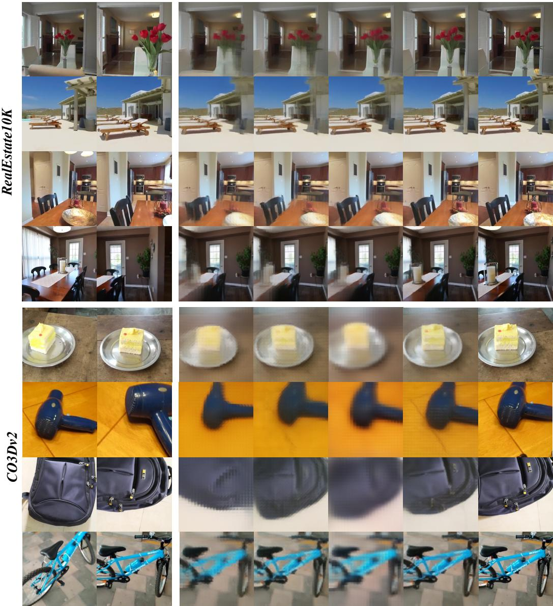  
Figure 3: Qualitative novel-view synthesis on RealEstate10K and CO3Dv2. Each row shows one scene or object. From left to right, the columns contain two input views, predictions from LVSM, PRoPE, RayRoPE, and HRoPE, and the ground-truth target view (GT).

Fig. 4(a) compares these variants against the LVSM baseline (“None”). Whether using a predictor trained from scratch or frozen VGGT features, HRoPE achieves the highest PSNR among the evaluated transformations. In both settings, it outperforms the unconstrained 4 × 4 transformation despite using fewer degrees of freedom. This suggests that the homography structure provides an effective geometric inductive bias without requiring a fully unconstrained transformation. We additionally compare the homography encoding with a 768-dimensional additive encoding constructed from the same VGGT features. The homography formulation performs better despite using the same feature source, indicating that the improvement is not solely due to access to pretrained VGGT features.

Parameter Source. We next fix the homography parameterization and vary the feature source used to predict its parameters. We compare a learnable predictor trained from scratch, including

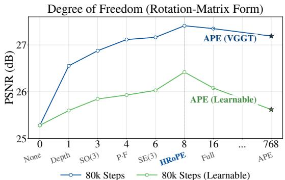  
(a) Matrix Form / DOF

Parameter Source (Fixed HRoPE Form)  
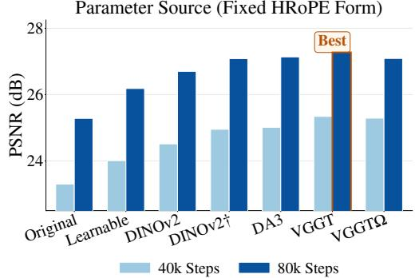  
(b) Parameter Source  
Figure 4: Ablations on RealEstate10K, measured by PSNR. (a) Transformation parameterizations using frozen VGGT features (blue) or a predictor trained from scratch (green), evaluated after 80k training steps. The x-axis labels denote the LVSM baseline (None), a depth term (Depth), a rotation (SO(3)), the calibrated projection composed with a per-patch tangent-frame transform (P · F), a rigid transformation (SE(3)), our homography parameterization (HRoPE), and an unconstrained 4 × 4 matrix (Full). Stars denote the corresponding 768-dimensional additive positional encodings (APE). (b) Feature sources with the HRoPE parameterization fixed, evaluated after 40k and 80k training steps. $\mathrm { D I N O v } 2 ^ { \dag }$ denotes the fine-tuned DINOv2 features from VGGT.

Table 3: Local surface geometry on RealEstate10K (Left) & Oracle geometry on ASE (Right). On RealEstate10K, PRoPE (P·F) and HRoPE both use VGGT features for parameter prediction. On ASE, HRoPE uses either VGGT-predicted parameters or ground-truth camera and plane parameters. Best and second-best results are highlighted in green and blue .
<table><tr><td>Method</td><td>PSNR↑</td><td>SSIM↑</td><td>LPIPS↓</td></tr><tr><td>PRoPE</td><td>26.142</td><td>0.826</td><td>0.111</td></tr><tr><td>PRoPE (P·F)</td><td>27.115</td><td>0.840</td><td>0.104</td></tr><tr><td>HRoPE</td><td>27.410</td><td>0.848</td><td>0.091</td></tr></table>

<table><tr><td>Method</td><td>PSNR↑</td><td>SSIM↑</td><td>LPIPS↓</td></tr><tr><td>PRoPE</td><td>27.829</td><td>0.802</td><td>0.264</td></tr><tr><td>HRoPE (w. VGGT)</td><td>28.555</td><td>0.809</td><td>0.198</td></tr><tr><td>HRoPE (w. GT)</td><td>28.751</td><td>0.820</td><td>0.192</td></tr></table>

DINOv2 (Oquab et al., 2024), DepthAnything3 (Lin et al., 2025), VGGT (Wang et al., 2025), and VGGT-Ω (Wang et al., 2026). Fig. 4(b) shows that the proposed parameterization improves over PRoPE even when its parameters are predicted from scratch or from DINOv2 features. Notably, DINOv2<sup>†</sup> retains a 2D architecture, but its features are fine-tuned within VGGT’s 3D pretraining pipeline and therefore acquire implicit 3D awareness, which helps explain their stronger performance than that of off-the-shelf DINOv2. Performance further improves with stronger pretrained feature extractors, with the geometry-aware VGGT backbone achieving the highest PSNR. These results show that the gains of HRoPE do not depend on a particular pretrained backbone, while more informative geometric features provide additional improvements.

## 4.2.2 ANALYSIS OF LOCAL SURFACE GEOMETRY

Local Geometry with Calibrated Cameras. To isolate the effect of local geometry, we start from PRoPE’s GT camera projection P and compose it with the per-patch tangent-frame transformation F derived from predicted plane parameters, forming the calibrated P·F variant. We evaluate PRoPE, P · F, and the fully predicted HRoPE on RealEstate10K using the setup in Sec. 4.1. As shown in Table 3, adding F improves PRoPE from 26.142 to 27.115 in PSNR and from 0.826 to 0.840 in SSIM, while reducing LPIPS from 0.111 to 0.104. Because PRoPE and P · F share the same projection P, these gains support the contribution of the local surface transformation. HRoPE with predicted transformations further improves all three metrics over the calibrated P·F variant.

Predicted Local Geometry. Fig. 5 shows predicted orientations for the two input views using overlays and per-patch normal maps. Patches belonging to approximately planar regions exhibit similar predicted orientations, while corresponding regions across reference views show qualitatively consistent surface orientations when expressed in a common coordinate frame. The visualizations suggest coherent local structure without direct plane supervision.

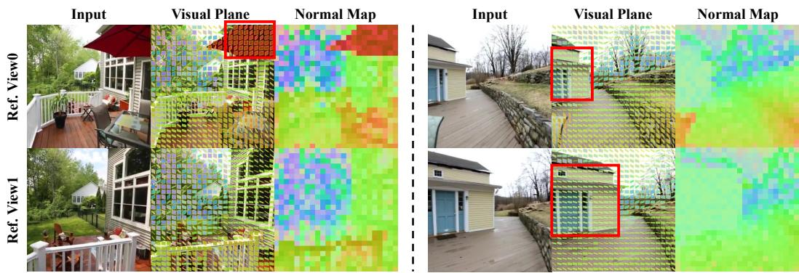  
Figure 5: Predicted local planes on RealEstate10K. Two scenes are shown side by side; within each scene, the two rows correspond to the reference views. For each view, the columns show the input image, predicted plane orientations overlaid on the image (Visual Plane), and per-patch normals encoded as a color map (Normal Map). The red boxes mark the same approximately planar surface across views, where the predicted orientations remain locally coherent and cross-view consistent.

Oracle Geometry. Finally, we test whether more accurate, physically grounded parameters further improve HRoPE. We use Aria Synthetic Environments (Avetisyan et al., 2024), which provides ground-truth depth, surface normals, and camera parameters, and construct the transformation A in Eq. 5 using either VGGT-predicted parameters or ground-truth geometry. As shown in Table 3, replacing the VGGT predictions with ground-truth geometry improves PSNR from 28.555 to 28.751, while also improving SSIM and LPIPS. This result suggests that HRoPE benefits from more accurate geometric inputs under the evaluated oracle protocol.

## 4.2.3 OUT-OF-DISTRIBUTION GENERALIZATION

Focal-length Variation. We first evaluate robustness to changes in camera intrinsics by varying the target-camera focal length at test time. Specifically, we scale the focal length from 1× to 5× its original value, where 1× corresponds to the standard evaluation setting. As shown in Fig. 6, HRoPE maintains strong performance as the zoom factor increases and achieves the lowest LPIPS across the evaluated focal lengths. In contrast, the calibrated P ·F variant degrades more substantially under large zoom factors.

Target-view Extrapolation. We next extend the target-view sampling interval by 50% at both ends, allowing target views to fall outside the interval bounded by the two reference views. Fig. 6 shows that HRoPE maintains its advantage over the baseline positional encodings as the target view moves beyond the training sampling regime.

Input-view Spacing. We additionally vary the temporal spacing between the two reference frames. We shift the input-frame interval from the training range of [25, 100] to [75, 150] at test time. HRoPE remains robust as the reference views become farther apart and achieves lower LPIPS across the evaluated intervals.

## 5 CONCLUSION

In this paper, we investigated local surface geometry as a prior for positional encoding in multiview transformers. Inspired by the slanted support windows of PatchMatch Stereo, we introduced HRoPE, which uses the structure of plane-induced homographies to parameterize per-patch transformations and modulate attention through their relative composition. The transformation parameters are predicted from patch features and learned jointly with the view-synthesis model. Experiments on RealEstate10K, CO3Dv2, Objaverse, and DL3DV demonstrate improved novel view synthesis over the evaluated positional encodings. Ablations support the contribution of the transformation structure, with gains observed for predictors trained from scratch and further improvements from pretrained features. A calibrated extension also improves PRoPE by incorporating local planar frames while retaining its camera projections. These findings support local surface geometry as a useful inductive bias for multi-view attention.

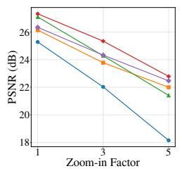

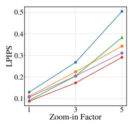

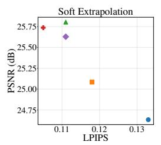

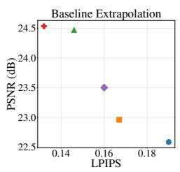  
Figure 6: Out-of-distribution generalization on RealEstate10K. Left pair: PSNR (↑) and LPIPS (↓) as the unseen target-camera zoom factor increases from 1× to 5×. Right pair: the PSNR–LPIPS trade-off under soft target-view extrapolation and an enlarged baseline between the two input views.

Limitations. HRoPE encourages correct cross-view correspondence through the structure of its rectified matching, but does not guarantee it: because the plane parameters are predicted per patch and per view, the encoding offers no formal guarantee that the same physical surface is encoded identically across views, unlike methods that enforce such uniqueness by construction. In practice the learned planes are cross-view consistent and the calibrated P · F bridge corroborates the underlying geometry, but a hard guarantee remains future work.

## REFERENCES

Armen Avetisyan, Christopher Xie, Henry Howard-Jenkins, Tsun-Yi Yang, Samir Aroudj, Suvam Patra, Fuyang Zhang, Duncan Frost, Luke Holland, Campbell Orme, et al. Scenescript: Reconstructing scenes with an autoregressive structured language model. In ECCV, 2024.

Shuai Bai, Keqin Chen, Xuejing Liu, Jialin Wang, Wenbin Ge, Sibo Song, Kai Dang, Peng Wang, Shijie Wang, Jun Tang, Humen Zhong, Yuanzhi Zhu, Mingkun Yang, Zhaohai Li, Jianqiang Wan, Pengfei Wang, Wei Ding, Zheren Fu, Yiheng Xu, Jiabo Ye, Xi Zhang, Tianbao Xie, Zesen Cheng, Hang Zhang, Zhibo Yang, Haiyang Xu, and Junyang Lin. Qwen2.5-vl technical report. arXiv preprint arXiv:2502.13923, 2025.

Connelly Barnes, Eli Shechtman, Adam Finkelstein, and Dan B Goldman. Patchmatch: A randomized correspondence algorithm for structural image editing. ACM Trans. Graph., 28(3), 2009.

Michael Bleyer, Christoph Rhemann, and Carsten Rother. Patchmatch stereo-stereo matching with slanted support windows. In BMVC, 2011.

David Charatan, Sizhe Lester Li, Andrea Tagliasacchi, and Vincent Sitzmann. pixelsplat: 3d gaussian splats from image pairs for scalable generalizable 3d reconstruction. In CVPR, 2024.

Anpei Chen, Zexiang Xu, Fuqiang Zhao, Xiaoshuai Zhang, Fanbo Xiang, Jingyi Yu, and Hao Su. Mvsnerf: Fast generalizable radiance field reconstruction from multi-view stereo. In ICCV, 2021.

Yuedong Chen, Haofei Xu, Chuanxia Zheng, Bohan Zhuang, Marc Pollefeys, Andreas Geiger, Tat-Jen Cham, and Jianfei Cai. Mvsplat: Efficient 3d gaussian splatting from sparse multi-view images. In ECCV, 2024a.

Yukang Chen, Fuzhao Xue, Dacheng Li, Qinghao Hu, Ligeng Zhu, Xiuyu Li, Yunhao Fang, Haotian Tang, Shang Yang, Zhijian Liu, Ethan He, Hongxu Yin, Pavlo Molchanov, Jan Kautz, Linxi Fan, Yuke Zhu, Yao Lu, and Song Han. Longvila: Scaling long-context visual language models for long videos. In ICLR, 2025.

Zhe Chen, Jiannan Wu, Wenhai Wang, Weijie Su, Guo Chen, Sen Xing, Muyan Zhong, Qinglong Zhang, Xizhou Zhu, Lewei Lu, et al. Internvl: Scaling up vision foundation models and aligning for generic visual-linguistic tasks. In CVPR, 2024b.

Angela Dai, Angel X Chang, Manolis Savva, Maciej Halber, Thomas Funkhouser, and Matthias Nießner. Scannet: Richly-annotated 3d reconstructions of indoor scenes. In CVPR, 2017.

Matt Deitke, Dustin Schwenk, Jordi Salvador, Luca Weihs, Oscar Michel, Eli VanderBilt, Ludwig Schmidt, Kiana Ehsani, Aniruddha Kembhavi, and Ali Farhadi. Objaverse: A universe of annotated 3d objects. In CVPR, 2023.

Zhiwen Fan, Jian Zhang, Renjie Li, Junge Zhang, Runjin Chen, Hezhen Hu, Kevin Wang, Peihao Wang, Huaizhi Qu, Shijie Zhou, Dilin Wang, Zhicheng Yan, Hongyu Xu, Justin Theiss, Tianlong Chen, Jiachen Li, Zhengzhong Tu, Zhangyang Wang, and Rakesh Ranjan. Vlm-3r: Vision-language models augmented with instruction-aligned 3d reconstruction. In CVPR, 2026.

Ryan Griffiths and Donald G Dansereau. Rore: Rotary ray embedding for generalised multi-modal scene understanding. In ICLR, 2026.

Xiaodong Gu, Zhiwen Fan, Siyu Zhu, Zuozhuo Dai, Feitong Tan, and Ping Tan. Cascade cost volume for high-resolution multi-view stereo and stereo matching. In CVPR, 2020.

Richard Hartley and Andrew Zisserman. Multiple view geometry in computer vision. Cambridge university press, 2003.

Yihui He, Rui Yan, Katerina Fragkiadaki, and Shoou-I Yu. Epipolar transformers. In CVPR, 2020.

Yicong Hong, Kai Zhang, Jiuxiang Gu, Sai Bi, Yang Zhou, Difan Liu, Feng Liu, Kalyan Sunkavalli, Trung Bui, and Hao Tan. Lrm: Large reconstruction model for single image to 3d. In ICLR, 2024.

Aaron Hurst, Adam Lerer, Adam P Goucher, Adam Perelman, Aditya Ramesh, Aidan Clark, AJ Ostrow, Akila Welihinda, Alan Hayes, Alec Radford, et al. Gpt-4o system card. arXiv preprint arXiv:2410.21276, 2024.

Hanwen Jiang, Hao Tan, Peng Wang, Haian Jin, Yue Zhao, Sai Bi, Kai Zhang, Fujun Luan, Kalyan Sunkavalli, Qixing Huang, et al. Rayzer: A self-supervised large view synthesis model. In ICCV, 2025.

Haian Jin, Hanwen Jiang, Hao Tan, Kai Zhang, Sai Bi, Tianyuan Zhang, Fujun Luan, Noah Snavely, and Zexiang Xu. Lvsm: A large view synthesis model with minimal 3d inductive bias. In ICLR, 2025.

Xin Kong, Shikun Liu, Xiaoyang Lyu, Marwan Taher, Xiaojuan Qi, and Andrew J Davison. Eschernet: A generative model for scalable view synthesis. In CVPR, 2024.

Bo Li, Yuanhan Zhang, Dong Guo, Renrui Zhang, Feng Li, Hao Zhang, Kaichen Zhang, Peiyuan Zhang, Yanwei Li, Ziwei Liu, et al. Llava-onevision: Easy visual task transfer. arXiv preprint arXiv:2408.03326, 2024.

Chunyang Li, Yuanbo Yang, Jiahao Shao, Hongyu Zhou, Katja Schwarz, and Yiyi Liao. Rerope: Repurposing rope for relative camera control. arXiv preprint arXiv:2602.08068, 2026.

Ruilong Li, Brent Yi, Junchen Liu, Hang Gao, Yi Ma, and Angjoo Kanazawa. Cameras as relative positional encoding. NeurIPS, 38, 2025.

Haotong Lin, Sili Chen, Jun Hao Liew, Donny Y. Chen, Zhenyu Li, Guang Shi, Jiashi Feng, and Bingyi Kang. Depth anything 3: recovering the visual space from any views. arXiv preprint arXiv:2511.10647, 2025.

Ji Lin, Hongxu Yin, Wei Ping, Yao Lu, Pavlo Molchanov, Andrew Tao, Huizi Mao, Jan Kautz, Mohammad Shoeybi, and Song Han. Vila: On pre-training for visual language models. In CVPR, 2024.

Lu Ling, Yichen Sheng, Zhi Tu, Wentian Zhao, Cheng Xin, Kun Wan, Lantao Yu, Qianyu Guo, Zixun Yu, Yawen Lu, et al. Dl3dv-10k: A large-scale scene dataset for deep learning-based 3d vision. In CVPR, 2024.

Yingfei Liu, Tiancai Wang, Xiangyu Zhang, and Jian Sun. Petr: Position embedding transformation for multi-view 3d object detection. In ECCV, 2022.

Baorui Ma, Huachen Gao, Haoge Deng, Zhengxiong Luo, Tiejun Huang, Lulu Tang, and Xinlong Wang. You see it, you got it: Learning 3d creation on pose-free videos at scale. In 2025 IEEE/CVF Conference on Computer Vision and Pattern Recognition (CVPR), pp. 2016–2029. IEEE, 2025.

Ezio Malis and Manuel Vargas. Deeper understanding of the homography decomposition for visionbased control. Technical Report RR-6303, INRIA, 2007.

Takeru Miyato, Bernhard Jaeger, Max Welling, and Andreas Geiger. Gta: A geometry-aware attention mechanism for multi-view transformers. In ICLR, 2024.

Maxime Oquab, Timothee Darcet, Th´ eo Moutakanni, Huy Vo, Marc Szafraniec, Vasil Khalidov,´ Pierre Fernandez, Daniel Haziza, Francisco Massa, Alaaeldin El-Nouby, et al. Dinov2: Learning robust visual features without supervision. TMLR, 2024.

Jeremy Reizenstein, Roman Shapovalov, Philipp Henzler, Luca Sbordone, Patrick Labatut, and David Novotny. Common objects in 3d: Large-scale learning and evaluation of real-life 3d category reconstruction. In ICCV, 2021.

Mehdi S. M. Sajjadi, Henning Meyer, Etienne Pot, Urs Bergmann, Klaus Greff, Noha Radwan, Suhani Vora, Mario Lucic, Daniel Duckworth, Alexey Dosovitskiy, Jakob Uszkoreit, Thomas Funkhouser, and Andrea Tagliasacchi. Scene representation transformer: Geometry-free novel view synthesis through set-latent scene representations. CVPR, 2022.

Peter Shaw, Jakob Uszkoreit, and Ashish Vaswani. Self-attention with relative position representations. In NAACL, 2018.

Jack Sherman and Winifred J Morrison. Adjustment of an inverse matrix corresponding to a change in one element of a given matrix. The Annals ofMathematical Statistics, 21(1), 1950.

Vincent Sitzmann, Semon Rezchikov, Bill Freeman, Josh Tenenbaum, and Fredo Durand. Light field networks: Neural scene representations with single-evaluation rendering. NeurIPS, 34, 2021.

Jianlin Su, Murtadha Ahmed, Yu Lu, Shengfeng Pan, Wen Bo, and Yunfeng Liu. Roformer: Enhanced transformer with rotary position embedding. Neurocomputing, 568, 2024.

Mohammed Suhail, Carlos Esteves, Leonid Sigal, and Ameesh Makadia. Light field neural rendering. In CVPR, 2022.

Gemini Team, Petko Georgiev, Ving Ian Lei, Ryan Burnell, Libin Bai, Anmol Gulati, Garrett Tanzer, Damien Vincent, Zhufeng Pan, Shibo Wang, et al. Gemini 1.5: Unlocking multimodal understanding across millions of tokens of context. arXiv preprint arXiv:2403.05530, 2024.

Alex Trevithick and Bo Yang. Grf: Learning a general radiance field for 3d representation and rendering. In ICCV, 2021.

Fangjinhua Wang, Silvano Galliani, Christoph Vogel, Pablo Speciale, and Marc Pollefeys. Patchmatchnet: Learned multi-view patchmatch stereo. In CVPR, 2021a.

Jianyuan Wang, Minghao Chen, Nikita Karaev, Andrea Vedaldi, Christian Rupprecht, and David Novotny. Vggt: Visual geometry grounded transformer. In CVPR, 2025.

Jianyuan Wang, Minghao Chen, Shangzhan Zhang, Nikita Karaev, Johannes Schonberger, Patrick¨ Labatut, Piotr Bojanowski, David Novotny, Andrea Vedaldi, and Christian Rupprecht. VGGT-Ω. In CVPR, 2026.

Qianqian Wang, Zhicheng Wang, Kyle Genova, Pratul P Srinivasan, Howard Zhou, Jonathan T Barron, Ricardo Martin-Brualla, Noah Snavely, and Thomas Funkhouser. Ibrnet: Learning multi view image-based rendering. In CVPR, 2021b.

Shuzhe Wang, Vincent Leroy, Yohann Cabon, Boris Chidlovskii, and Jerome Revaud. Dust3r: Geometric 3d vision made easy. In CVPR, 2024.

Zhou Wang, Alan C Bovik, Hamid R Sheikh, and Eero P Simoncelli. Image quality assessment: from error visibility to structural similarity. IEEE transactions on image processing, 13(4), 2004.

Philippe Weinzaepfel, Thomas Lucas, Vincent Leroy, Yohann Cabon, Vaibhav Arora, Romain Bregier, Gabriela Csurka, Leonid Antsfeld, Boris Chidlovskii, and J ´ er´ ome Revaud. Croco v2:ˆ Improved cross-view completion pre-training for stereo matching and optical flow. In ICCV, 2023.

Diankun Wu, Fangfu Liu, Yi-Hsin Hung, and Yueqi Duan. Spatial-mllm: Boosting mllm capabilities in visual-based spatial intelligence. arXiv preprint arXiv:2505.23747, 2025.

Yu Wu, Minsik Jeon, Jen-Hao Rick Chang, Oncel Tuzel, and Shubham Tulsiani. Rayrope: Projective ray positional encoding for multi-view attention. In ECCV, 2026.

Yichen Xie, Depu Meng, Chensheng Peng, Yihan Hu, Quentin Herau, Masayoshi Tomizuka, and Wei Zhan. Urope: Universal relative position embedding across geometric spaces. ECCV, 2026.

Jihan Yang, Shusheng Yang, Anjali W. Gupta, Rilyn Han, Li Fei-Fei, and Saining Xie. Thinking in space: How multimodal large language models see, remember, and recall spaces. CVPR, 2025.

Yao Yao, Zixin Luo, Shiwei Li, Tian Fang, and Long Quan. Mvsnet: Depth inference for unstructured multi-view stereo. In ECCV, 2018.

Jianglong Ye, Peng Wang, Kejie Li, Yichun Shi, and Heng Wang. Consistent-1-to-3: Consistent image to 3d view synthesis via geometry-aware diffusion models. In 3DV, 2024.

Alex Yu, Vickie Ye, Matthew Tancik, and Angjoo Kanazawa. pixelnerf: Neural radiance fields from one or few images. In CVPR, 2021.

Cheng Zhang, Boying Li, Meng Wei, Yan-Pei Cao, Camilo Gambardella, Dinh Phung, and Jianfei Cai. Unified camera positional encoding for controlled video generation. In CVPR, 2026.

Kai Zhang, Sai Bi, Hao Tan, Yuanbo Xiangli, Nanxuan Zhao, Kalyan Sunkavalli, and Zexiang Xu. Gs-lrm: Large reconstruction model for 3d gaussian splatting. In ECCV, 2024a.

Peiyuan Zhang, Kaichen Zhang, Bo Li, Guangtao Zeng, Jingkang Yang, Yuanhan Zhang, Ziyue Wang, Haoran Tan, Chunyuan Li, and Ziwei Liu. Long context transfer from language to vision. arXiv preprint arXiv:2406.16852, 2024b.

Richard Zhang, Phillip Isola, Alexei A Efros, Eli Shechtman, and Oliver Wang. The unreasonable effectiveness of deep features as a perceptual metric. In CVPR, 2018.

Yuanhan Zhang, Jinming Wu, Wei Li, Bo Li, Zejun Ma, Ziwei Liu, and Chunyuan Li. Llava-video: Video instruction tuning with synthetic data. arXiv preprint arXiv:2410.02713, 2024c.

Tinghui Zhou, Richard Tucker, John Flynn, Graham Fyffe, and Noah Snavely. Stereo magnification: Learning view synthesis using multiplane images. arXiv preprint arXiv:1805.09817, 2018.

Yi Zhou, Connelly Barnes, Jingwan Lu, Jimei Yang, and Hao Li. On the continuity of rotation representations in neural networks. In CVPR, 2019.

Qi Zuo, Xiaodong Gu, Yuan Dong, Zhengyi Zhao, Weihao Yuan, Lingteng Qiu, Liefeng Bo, and Zilong Dong. High-fidelity 3d textured shapes generation by sparse encoding and adversarial decoding. In ECCV, 2024.

1 Introduction 1   
2 Related Work 3   
3 Method 4   
3.1 Preliminaries: Geometric Positional Encodings 4   
3.2 Homography Relative Positional Encoding . 5   
3.3 Instantiation 6   
4 Experiments 6   
4.1 Novel View Synthesis . . . 7   
4.2 Ablation Studies and Analysis 7   
4.2.1 Parameterization and Feature Sources 7   
4.2.2 Analysis of Local Surface Geometry . 9   
4.2.3 Out-of-Distribution Generalization . 10   
5 Conclusion 10   
A Appendix 17   
A.1 Background on Geometric Positional Encodings . 17   
A.2 Derivation of the Plane-Induced Homography 17   
A.3 The full block-diagonal encoding matrix . 18   
A.4 Integrating HRoPE into multi-view attention . 19   
A.5 Additional experiment details . 20   
A.6 Generalization Beyond Architectures . 21   
A.7 Additional Qualitative Results 23

## A APPENDIX

We first expand the notation and derivations behind the geometric positional encodings summarized in Sec. 3.1 (Appendix A.1). Appendix A.2 then derives the plane-induced homography that computes a pixel in view i directly from a pixel in view $j ,$ and explains why a purely projective encoding cannot express this correspondence. Appendix A.3 then writes out in full the block-diagonal operator that applies this homography across the head dimension.

## A.1 BACKGROUND ON GEOMETRIC POSITIONAL ENCODINGS

Notation. For a patch token u in view $i ,$ let $\mathbf { q } _ { i , u } , \mathbf { k } _ { i , u } ,$ , and $\mathbf { v } _ { i , u }$ denote its query, key, and value vectors. The calibrated camera has intrinsics $K _ { i }$ and a world-to-camera transform

$$
E _ { i } = \left[ \begin{array} { l l } { R _ { i } } & { \mathbf { t } _ { i } } \\ { \mathbf { 0 } ^ { \top } } & { 1 } \end{array} \right] , \qquad \mathbf { X } _ { i } = R _ { i } \mathbf { X } + \mathbf { t } _ { i } .\tag{8}
$$

Here, $R _ { i } \in \mathrm { S O } ( 3 )$ and $\mathbf { t } _ { i } \in \mathbb { R } ^ { 3 }$ describe the camera pose. These calibrated quantities are distinct from the patch-specific parameters predicted by HRoPE in Sec. 3.3.

Rotary positional encoding. Let $\rho ( u )$ denote RoPE’s block-diagonal rotation for position u. Applying it to a query at u and a key at v gives

$$
\left( \rho ( u ) \mathbf { q } \right) ^ { \top } \left( \rho ( v ) \mathbf { k } \right) = \mathbf { q } ^ { \top } \rho ( u ) ^ { \top } \rho ( v ) \mathbf { k } = \mathbf { q } ^ { \top } \rho ( v - u ) \mathbf { k } ,\tag{9}
$$

so the positional dependence of the attention score is determined by the relative displacement $v - u$ The usual 2D extension applies this construction separately along the two image axes.

Camera-relative encodings. GTA (Miyato et al., 2024) and CaPE (Kong et al., 2024) extend the same principle from image-grid offsets to camera motion: their feature transformations make the interaction depend on the relative extrinsic transform $E _ { i } E _ { i } ^ { - 1 }$ , with method-specific representations of its action on features. PRoPE (Li et al., 2025) additionally includes intrinsics by lifting $K _ { i }$ to homogeneous coordinates,

$$
\bar { K } _ { i } = \left[ \begin{array} { l l } { K _ { i } } & { \mathbf { 0 } } \\ { \mathbf { 0 } ^ { \top } } & { 1 } \end{array} \right] , \qquad P _ { i } = \bar { K } _ { i } E _ { i } , \qquad P _ { i } P _ { j } ^ { - 1 } = \bar { K } _ { i } E _ { i } E _ { j } ^ { - 1 } \bar { K } _ { j } ^ { - 1 } .\tag{10}
$$

It applies $P _ { i } ^ { \top }$ to queries and $P _ { j } ^ { - 1 }$ to keys, yielding the relative projective factor. This factor is invariant to the choice of world frame: replacing every $E _ { i }$ by $E _ { i } T ^ { - 1 }$ for a shared rigid transform $T$ leaves $P _ { i } T ^ { - 1 } ( P _ { j } T ^ { - 1 } ) ^ { - 1 } = P _ { i } P _ { j } ^ { - 1 }$ unchanged.

## A.2 DERIVATION OF THE PLANE-INDUCED HOMOGRAPHY

Let view j be the reference camera, with the world frame aligned to it, so a 3D point $\mathbf { X } _ { j } \in \mathbb { R } ^ { 3 }$ (in camera-j coordinates) projects to the homogeneous pixel $\tilde { \mathbf { x } } _ { j }$ of view $j$ as

$$
z _ { j } \tilde { \mathbf { x } } _ { j } = K _ { j } \mathbf { X } _ { j } \quad \Longleftrightarrow \quad \mathbf { X } _ { j } = z _ { j } K _ { j } ^ { - 1 } \tilde { \mathbf { x } } _ { j } ,\tag{11}
$$

where $z _ { j } > 0$ is the (unknown) depth along the optical axis of camera-j. Let $( R _ { i  j } , \mathbf { t } _ { i  j } )$ be the rigid transform from the camera-j frame to the camera-i frame; the same point projects to view i as

$$
z _ { i } \tilde { \mathbf { x } } _ { i } = K _ { i } \big ( R _ { i  j } \mathbf { X } _ { j } + \mathbf { t } _ { i  j } \big ) .\tag{12}
$$

Suppose that $\mathbf { X } _ { j }$ lies on a local plane with unit normal $\mathbf { n } _ { j }$ at orthogonal distance $d _ { j } ~ > ~ 0$ in the camera-j frame,

$$
\begin{array} { r } { \mathbf { n } _ { j } ^ { \top } \mathbf { X } _ { j } = d _ { j } \quad \Longleftrightarrow \quad \frac { 1 } { d _ { j } } \mathbf { n } _ { j } ^ { \top } \mathbf { X } _ { j } = 1 . } \end{array}\tag{13}
$$

The plane assumption is what removes the unknown depth. Substituting ${ \bf X } _ { j } = z _ { j } K _ { j } ^ { - 1 } \tilde { \bf x } _ { j }$ from Eq. 11 into Eq. 13 determines the depth at the ray–plane intersection,

$$
z _ { j } = \frac { d _ { j } } { { \bf n } _ { j } ^ { \top } K _ { j } ^ { - 1 } \tilde { \bf x } _ { j } } .\tag{14}
$$

The key algebraic step is to rewrite the translation in Eq. 12 using the plane identity $\begin{array} { r } { { \frac { 1 } { d _ { i } } } \mathbf { n } _ { j } ^ { \top } \mathbf { X } _ { j } = 1 } \end{array}$ so that $\begin{array} { r } { \mathbf { t } _ { i  j } = \mathbf { t } _ { i  j } ( \frac { 1 } { d _ { i } } \mathbf { n } _ { j } ^ { \top } \mathbf { X } _ { j } ) } \end{array}$ and the affine map becomes linear in $\mathbf { X } _ { j }$

$$
\begin{array} { r } { R _ { i  j } \mathbf { X } _ { j } + \mathbf { t } _ { i  j } = R _ { i  j } \mathbf { X } _ { j } + \mathbf { t } _ { i  j } ( \frac { 1 } { d _ { j } } \mathbf { n } _ { j } ^ { \top } \mathbf { X } _ { j } ) = \Big ( \underbrace { R _ { i  j } + \frac { 1 } { d _ { j } } \mathbf { t } _ { i  j } \mathbf { n } _ { j } ^ { \top } } _ { A } \Big ) \mathbf { X } _ { j } . } \end{array}\tag{15}
$$

Combining Eqs. 11, 12, and 15 and eliminating the depth-dependent scale yields the plane-induced homography between the two pixels,

$$
\begin{array} { r } { \tilde { \mathbf { x } } _ { i } \sim H _ { i  j } \tilde { \mathbf { x } } _ { j } , \quad \quad H _ { i  j } = K _ { i } \Big ( R _ { i  j } + \frac { 1 } { d _ { j } } \mathbf { t } _ { i  j } \mathbf { n } _ { j } ^ { \top } \Big ) K _ { j } ^ { - 1 } = K _ { i } A K _ { j } ^ { - 1 } , } \end{array}\tag{16}
$$

Here, ∼ denotes equality up to a nonzero scale. For points in front of both cameras, $z _ { i } , z _ { j } \ > \ 0$ and the scale $z _ { j } / z _ { i }$ is positive. The inner factor has the same rotation-plus-rank-one structure as the parameterization in Eq. 5, with $\kappa = 1 / d _ { j }$ . This connection motivates the use of local plane parameters in our learned per-patch transformations. (The minus-sign form $\begin{array} { r } { R _ { i  j } - \frac { 1 } { d _ { j } } { \bf t } _ { i  j } { \bf n } _ { j } ^ { \top } } \end{array}$ arises under the alternative plane convention n<sup>⊤</sup> $\mathbf { X } _ { j } + d _ { j } = 0 . )$

Eq. 16 defines a pixel-to-pixel mapping conditioned on a local plane. In comparison, the relative projection $P _ { i } P _ { j } ^ { - 1 }$ used by PRoPE depends only on camera parameters and does not generally determine a unique correspondence between image pixels. A source pixel $\tilde { \mathbf { x } } _ { j }$ specifies a viewing ray ${ \bf X } _ { j } = z _ { j } K _ { i } ^ { - 1 } \tilde { \bf x } _ { j }$ , but its depth $z _ { j }$ remains unknown. For a nonzero camera baseline, this depth ambiguity generally constrains the corresponding pixel in view i to an epipolar line. Given a plane hypothesis $( \mathbf { n } _ { j } , d _ { j } )$ , Eq. 14 determines the depth at the ray–plane intersection, provided that the intersection is finite and lies in front of the source camera. Substituting this depth into the projection equation yields the homography in Eq. 16, which maps points on the plane between the two views. Unlike the camera-only relative projection used by PRoPE, a local plane resolves the depth ambiguity along a viewing ray and induces a pixel-to-pixel homography on that plane. This motivates HRoPE’s incorporation of local surface geometry into its per-patch transformations. The same principle underlies the slanted support windows in PatchMatch Stereo.

Global-frame invariance. In the image-based instantiation of HRoPE, the per-patch transforms $A _ { i , u }$ are predicted from image features without using externally specified world-frame extrinsics. Changing the world coordinate frame re-expresses the cameras and scene geometry but leaves the images and intrinsics unchanged. Consequently, the predicted transforms and the relative factors ${ H _ { i , u } } \bar { H } _ { j , v } ^ { - 1 }$ remain unchanged. This establishes invariance of the predicted geometric encoding; invariance of the full attention computation additionally requires its input features to be independent of the world-frame choice.

For transforms constructed from explicit camera and plane geometry, the scope is more restricted. When both factors describe a shared physical plane, consistently changing coordinates gives $H _ { i } ^ { \prime } =$ $H _ { i } G ^ { - 1 }$ and $H _ { i } ^ { \prime } \ = \ H _ { j } G ^ { - 1 }$ for a common invertible matrix $G ,$ so $H _ { i } ^ { \prime } ( H _ { i } ^ { \prime } ) ^ { - 1 } \ : = \ : H _ { i } H _ { i } ^ { - 1 }$ For different patch planes, the induced right multiplier can depend on the plane, and this cancellation is not generally guaranteed. Thus, the relative-product form alone does not establish world-frame invariance for arbitrary geometry-derived transforms. In our GT instantiation, both camera and plane parameters are expressed in the first reference camera’s coordinate frame and normalized to a common scale, removing dependence on the external world coordinate frame.

## A.3 THE FULL BLOCK-DIAGONAL ENCODING MATRIX

Section 3.2 applies the encoding “block-diagonally to the features”; here we write out that blockdiagonal operator in full. Let the per-head feature dimension be D. For a token in view i we split its D-dimensional query/key/value vector into three contiguous parts of sizes $D / 2 , D / 4 , D / 4$ . The first $D / 2$ coordinates carry the geometric homography and the remaining $D / 2$ carry a standard 2D rotary encoding of the patch’s pixel coordinates $( x , y )$ , with $D / 8$ frequencies for each axis. The block-diagonal encoding matrix for patch $( i , u )$ is

```latex
Algorithm 1 HRoPE multi-view self-attention layer (single head).
Require: queries/keys/values $Q , K , V \in \mathbb { R } ^ { ( N P ) \times D } ;$ ; per-patch matrices $\{ A _ { i , u } \}$ , intrinsics $\{ K _ { i } \}$
RoPE coeffs $( \Phi _ { x } , \Phi _ { y } )$
Notation: $\mathcal { H } _ { i , u }$ is the block-diagonal operator of Eq. 17 built from the per-patch $3 { \times } 3$ matrix
$H _ { i , u }$ and $( \Phi _ { x } , \Phi _ { y } )$ . BD(H, f) applies the corresponding per-token operators to the features $f .$
1: for each token u in view i do ▷ build the per-token geometric factor
2: if i is an input view then $H _ { i , u } \gets K _ { i } A _ { i , u }$
3: else $H _ { i , u } \gets K _ { i }$ ▷ target view: projective fallback, $A _ { i , u } = I$
4: end if
5: end for
6: $\tilde { Q } \gets \mathrm { B D } ( \mathcal { H } ^ { \top } , Q )$ ▷ query side: $H _ { i , u } ^ { \top }$
7: $\tilde { K } \gets \mathrm { B D } ( \mathcal { H } ^ { - 1 } , K )$ ▷ key side: $H _ { i , u } ^ { - 1 }$ via Sherman–Morrison
8: $\tilde { V } \gets \mathrm { B D } \big ( \mathcal { H } ^ { - 1 } , V \big )$
9: $S \gets \tilde { Q } \tilde { K } ^ { \top } / \sqrt { D }$ ▷ $\begin{array} { r } { { \bf \nabla } \cdot \mathrm { l o g i t } = { \bf q } ^ { \top } H _ { i , u } H _ { j , v } ^ { - 1 } { \bf k } , } \end{array}$ , Eq. 4
10: $O \gets \operatorname { s o f t m a x } ( S ) \tilde { V }$
11: $O \gets \mathrm { B D } ( \mathcal { H } , O )$ ▷ back to query frame
12: return O
```

$$
\mathcal { H } _ { i , u } = \underbrace { H _ { i , u } ^ { \oplus D / 6 } } _ { \mathrm { g e o m e t r y : ~ } D / 2 \mathrm { d i m s } } \oplus \underbrace { \Phi _ { x } } _ { D / 4 } \oplus \underbrace { \Phi _ { y } } _ { D / 4 } = \left[ \begin{array} { l l l l l } { H _ { i , u } } & & & & \\ & { \ddots } & & & \\ & & { H _ { i , u } } & & \\ & & & { \Phi _ { x } } & \\ & & & & { \Phi _ { y } } \end{array} \right] ,\tag{17}
$$

Here, ⊕ denotes a direct sum and $H ^ { \oplus r }$ contains r copies of the $3 \times 3$ matrix H. The geometric block is $D / 6$ copies of the single $3 \times 3$ matrix $H _ { i , u }$ (here ${ \bar { D } } / 6 = 8 )$ , because each copy acts on a 3-vector and $3 \cdot ( \dot { D } / 6 ) = D / 2 ;$ this is what makes “apply H to the feature” well-defined when $D / 2 > 3$ The two rotary blocks are the usual 2D-RoPE rotations

$$
\Phi _ { x } = \bigoplus _ { \ell = 1 } ^ { D / 8 } \left[ \cos ( x \omega _ { \ell } ) \quad - \sin ( x \omega _ { \ell } ) \right] , \qquad \omega _ { \ell } = \theta ^ { - 2 \ell / ( D / 2 ) } ,\tag{18}
$$

and $\Phi _ { y }$ is identical with the patch row coordinate $y ;$ together they encode the in-image patch posi tion, complementing the cross-view geometry in the first block. Attention uses $\mathcal { H } _ { i , u } ^ { \top }$ on the query and $\mathcal { H } _ { j , v } ^ { - 1 }$ on the key, so that the geometric blocks contract to $H _ { i , u } H _ { j , v } ^ { - 1 }$ (Eq. 4) and the rotary blocks contract to a relative rotation in $( x , y )$ , recovering the standard 2D-RoPE relative property. For target-view tokens, which carry no predicted plane, the geometric block reduces to $K _ { i }$ alone (i.e. $A _ { i , u } = I )$ , encoding only camera intrinsics while retaining the 2D rotary blocks.

## A.4 INTEGRATING HROPE INTO MULTI-VIEW ATTENTION

HRoPE modifies multi-view self-attention through token-specific linear operators while leaving the other transformer components unchanged. For $\bar { N }$ views with $P$ patches each, the layer receives $\dot { N P }$ tokens, per-patch transforms $\{ A _ { i , u } \}$ , and camera intrinsics $\{ K _ { i } \}$ . We construct $\mathcal { H } _ { i , u }$ as in Eq. 17 and apply $\mathcal { H } _ { i , u } ^ { \top }$ to each query and $\mathcal { H } _ { j , v } ^ { - 1 }$ to each key and value. The resulting attention logit for tokens $( i , u )$ and $( j , v )$ contains the relative operator $\mathcal { H } _ { i , u } \mathcal { H } _ { j , v } ^ { - 1 }$ . After attention aggregation, the output is transformed by $\mathcal { H } _ { i , u }$ , expressing the aggregated features in the query token’s coordinate system. The inverse of $A _ { i , u } = R _ { i , u } + \kappa _ { i , u } \mathbf { t } _ { i , u } \mathbf { n } _ { i , u } ^ { \top }$ is computed in closed form using Eq. 6. Fig. 7 illustrates these operations, and Algorithm 1 specifies the forward pass.

## A.5 ADDITIONAL EXPERIMENT DETAILS

Datasets. We use five datasets in our experiments: RealEstate10K, CO3Dv2, Objaverse, DL3DV, and Aria Synthetic Environments (ASE). We describe the data splits, preprocessing, and frame sampling for each dataset below.

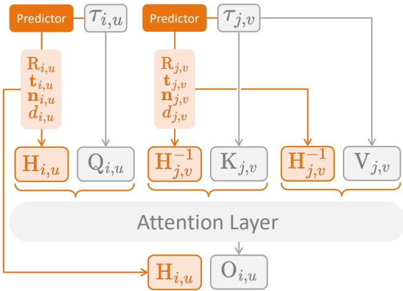  
Figure 7: Applying HRoPE to Multi-view Attention. Here, $\tau _ { i , u }$ denotes the token corresponding to image patch u in view i. A predictor maps each patch token $\tau _ { i , u }$ to the transformation parameters $( R _ { i , u } , { \bf t } _ { i , u } , { \bf n } _ { i , u } , \kappa _ { i , u } )$ , from which $H _ { i , u } = K _ { i } A _ { i , u }$ is constructed. Queries are transformed by $\mathcal { H } _ { i , u } ^ { \top }$ while keys and values are transformed by $\mathcal { H } _ { j , v } ^ { - 1 }$ . The aggregated value is subsequently mapped to the query token’s frame by $\mathcal { H } _ { i , u }$ . Only one query–key pair is shown for clarity.

• RealEstate10K (Zhou et al., 2018): frames are extracted from the source YouTube videos at the official timestamps, with the given per-sequence intrinsics and per-frame world-to-camera poses converted into the common format above. During training we sample input/target frames with an index gap in [25, 100].

• CO3Dv2 (Reizenstein et al., 2021): we select a higher-quality subset and split it into a 31k-scene training set and a 1k-scene test set, both covering all 52 categories uniformly. We use a frame gap in [25, 50] during training.

• Objaverse (Deitke et al., 2023): from the G-buffer Objaverse set (Zuo et al., 2024) we keep objects with fewer than 20k faces (96k objects) and render 30 views each at 336 resolution in Blender. The camera looks down at the object from a fixed pitch of about 45<sup>◦</sup>, at radius 2.0 and field of view $4 0 ^ { \circ }$ ; for each object we sample views uniformly within a randomly placed 180<sup>◦</sup> azimuth window and with random perturbations to azimuth and elevation. We render on a transparent background composited onto white, and sample views with an angular gap in [30<sup>◦</sup>, 60<sup>◦</sup>] during training.

• DL3DV (Ling et al., 2024): we discard portrait-orientation videos and train on all remaining 10k scenes. For evaluation we use the RayZer benchmark (the 10k scenes not included in the benchmark are used for training) (Jiang et al., 2025). Training frame gaps follow the input regime: [25, 50] for the 2- and 4-view models and [25, 100] for the 8-view model.

• Aria Synthetic Environments (Avetisyan et al., 2024): we split the scenes at random into a 95k-scene training set and a 5k-scene test set, and use a frame gap in [8, 12] during training. This synthetic dataset renders a depth map for every frame, from which we derive the groundtruth plane parameters used in Sec. 4.2.2. Since a patch spans many pixels, we fit one plane per $1 4 \times 1 4$ patch using least squares on its inverse-depth samples. We express the fitted plane as $\mathbf { n } _ { c } ^ { \top } \mathbf { X } _ { c } = \dot { d } _ { c }$ in the camera frame and choose $d _ { c } > 0$ so that normals are oriented consistently across views. Patches that are more than half invalid, or whose median relative residual exceeds 5% and are therefore poorly described by a single plane, fall back to a fronto-parallel plane at their median depth.

Table 4: Training cost of the parameter-source variants (Sec. 4.2.1), all under the same 80k-iteration schedule; PSNR is the final RealEstate10K score. DINOv2<sup>†</sup> is the fine-tuned DINOv2 taken from inside VGGT. Best in bold, second underlined.
<table><tr><td>Source</td><td>PSNR↑</td><td>GPU-hours</td></tr><tr><td>Original (LVSM)</td><td>25.282</td><td>33</td></tr><tr><td>Learnable</td><td>26.419</td><td>33</td></tr><tr><td>DINOv2 (Oquab et al., 2024)</td><td>26.701</td><td>46</td></tr><tr><td>DINOv2† (Oquab et al., 2024)</td><td>27.085</td><td>72</td></tr><tr><td>DA3 (Lin et al., 2025)</td><td>27.137</td><td>48</td></tr><tr><td>VGGT (Wang et al., 2025)</td><td>27.410</td><td>76</td></tr><tr><td>VGGT-Ω (Wang et al., 2026)</td><td>27.090</td><td>64</td></tr></table>

Training configuration. We train every model on four NVIDIA RTX 4090 (48 GB) GPUs with a per-GPU batch size of 16, using a cosine learning-rate schedule with peak rate $4 \times 1 0 ^ { - 4 }$ and a warmup of 2500 iterations. All scene-level models are trained for 80k iterations at a fixed resolution of 336 × 336 obtained by center cropping. Camera poses are normalized following the convention that matches the input regime. With few input views (e.g. 2 views) we follow PRoPE (Li et al., 2025): the first reference camera is set to the identity (its frame becomes the world origin) and all translations are scaled by the distance between the first and second reference cameras, so that this distance is unit length. With many input views we follow the original LVSM (Jin et al., 2025) convention: the scene is translated and rotated to align with the mean camera center and mean viewing direction, then rescaled by the maximum absolute camera-center coordinate times a fixed factor of 1.35 to a common scale. Our objective combines a photometric term with a perceptual loss; we weight the perceptual term at 0.5 for scene datasets and lower it to 0.1 for the object dataset.

Numerical stability of the predicted transformation. To stabilize training, we clamp the predicted translation t and inverse plane distance κ to [−0.5, 0.5], normalize n, and construct R to be orthonormal. This bounds the rank-one update in $\mathbf { A } = \bar { \mathbf { R } ^ { \prime } } + \kappa \mathbf { t } \mathbf { n } ^ { \top }$ and guarantees det A ≥ $1 - \sqrt { 3 } / 4 \approx 0 . 5 7$ . We additionally clamp the Sherman–Morrison denominator to 0.1 and the entries of A and $\mathrm { A } ^ { - 1 }$ to [−5, 5]. Both matrices are computed in float32 and then cast to the training precision.

Training cost. Table 4 reports the final RealEstate10K PSNR and training cost of the parametersource variants, all trained for 80k iterations. At the same cost of 33 GPU-hours, the learned predictor improves PSNR from 25.282 to 26.419, showing that the gain does not depend solely on an expensive pretrained source. Among the pretrained sources, DA3 achieves 27.137 PSNR in 48 GPU-hours, compared with 27.410 PSNR in 76 GPU-hours for VGGT.

## A.6 GENERALIZATION BEYOND ARCHITECTURES

HRoPE can be integrated into multi-view attention by transforming its queries, keys, and values. We evaluate this design in two additional architectures: a generative multi-view diffusion model and a spatial multimodal large language model.

Multi-view Diffusion Model. As a first step outside that setting, we transfer HRoPE to a generative architecture with a different decoder and a different native encoding. We test on EscherNet (Kong et al., 2024), a large (∼ 800M-parameter) multi-view diffusion model whose native encoding is the camera positional encoding CaPE, by replacing CaPE with HRoPE while leaving the rest of the model and its training recipe untouched. We train on Objaverse (Deitke et al., 2023) (96k objects) following EscherNet’s setting, feeding 3 reference views during training, and evaluate the trained models with 1, 5, and 10 input views to probe both sparse- and denser-view regimes.

Table 5 shows that HRoPE improves EscherNet on every metric at every view count, supporting the applicability of the encoding beyond LVSM and feed-forward decoding.

Table 5: Transferring HRoPE to EscherNet (Kong et al., 2024), an ∼ 800M-parameter multi-view diffusion model, on Objaverse. We replace EscherNet’s native CaPE encoding with HRoPE and evaluate with 1, 5, and 10 input views. Best in green .
<table><tr><td></td><td colspan="3">1 view</td><td colspan="3">5 views</td><td colspan="3">10 views</td></tr><tr><td>Method</td><td>PSNR↑</td><td>SSIM↑</td><td>LPIPS↓</td><td>PSNR↑</td><td>SSIM↑</td><td>LPIPS↓</td><td>PSNR↑</td><td>SSIM↑</td><td>LPIPS↓</td></tr><tr><td>EscherNet + CaPE</td><td>17.689</td><td>0.858</td><td>0.181</td><td>22.065</td><td>0.899</td><td>0.114</td><td>23.666</td><td>0.914</td><td>0.089</td></tr><tr><td>EscherNet + HRoPE</td><td>19.900</td><td>0.883</td><td>0.135</td><td>23.075</td><td>0.911</td><td>0.092</td><td>24.515</td><td>0.923</td><td>0.074</td></tr></table>

Table 6: Transferring HRoPE to a video multimodal LLM, evaluated on VSI-Bench (Yang et al., 2025). Our model uses LLaVA-Video-7B-Qwen2 as the backbone with HRoPE applied to the visual tokens, fine-tuned on the VSI-Bench training split at 32 frames; the preceding row reports a finetuned 7B video model without any geometric encoding (Fan et al., 2026). Frame budgets for the remaining methods are given in the text. Rank is taken over the overall average. Best in green .
<table><tr><td></td><td colspan="4">Numerical question</td><td colspan="4">Multiple-choice question</td><td></td><td></td></tr><tr><td>Method</td><td>Obj. Cnt. Abs. Dist. Obj. Size Room Size | Rel. Dist. Rel. Dir. Route Plan Appr. Order</td><td></td><td></td><td></td><td></td><td></td><td></td><td></td><td>|Avg. ↑ Rank</td><td></td></tr><tr><td>Proprietary models</td><td></td><td></td><td></td><td></td><td></td><td></td><td></td><td></td><td></td><td></td></tr><tr><td>GPT-4o (Hurst et al., 2024)</td><td>46.2</td><td>5.3</td><td>43.8</td><td>38.2</td><td>37.0</td><td>41.3</td><td>31.5</td><td>28.5</td><td>34.0</td><td>9</td></tr><tr><td>Gemini-1.5 Pro (Team et al., 2024)</td><td>56.2</td><td>30.9</td><td>64.1</td><td>43.6</td><td>51.3</td><td>46.3</td><td>36.0</td><td>34.6</td><td>45.4</td><td>4</td></tr><tr><td>Open-source models</td><td></td><td></td><td></td><td></td><td></td><td></td><td></td><td></td><td></td><td></td></tr><tr><td>LongVILA-8B (Chen et al., 2025)</td><td>29.1</td><td>9.1</td><td>16.7</td><td>0.0</td><td>29.6</td><td>30.7</td><td>32.5</td><td>25.5</td><td>21.6</td><td>13</td></tr><tr><td>LongVA-7B (Zhang et al., 2024b)</td><td>38.0</td><td>16.6</td><td>38.9</td><td>22.2</td><td>33.1</td><td>43.3</td><td>25.4</td><td>15.7</td><td>29.2</td><td>12</td></tr><tr><td>VILA-1.5-40B (Lin et al., 2024)</td><td>22.4</td><td>24.8</td><td>48.7</td><td>22.7</td><td>40.5</td><td>25.7</td><td>31.5</td><td>32.9</td><td>31.2</td><td>11</td></tr><tr><td>Qwen2.5VL-7B (Bai et al., 2025)</td><td>40.9</td><td>14.8</td><td>43.4</td><td>10.7</td><td>38.6</td><td>38.5</td><td>33.0</td><td>29.8</td><td>33.0</td><td>10</td></tr><tr><td>InternVL2-40B (Chen et al., 2024b)</td><td>34.9</td><td>26.9</td><td>46.5</td><td>31.8</td><td>42.1</td><td>32.2</td><td>34.0</td><td>39.6</td><td>36.0</td><td>8</td></tr><tr><td>Qwen2.5VL-72B (Bai et al., 2025)</td><td>25.1</td><td>29.3</td><td>54.5</td><td>38.8</td><td>38.2</td><td>37.0</td><td>34.0</td><td>28.9</td><td>37.0</td><td>7</td></tr><tr><td>LLaVA-OneVision-72B (Li et al., 2024)</td><td>43.5</td><td>23.9</td><td>57.6</td><td>37.5</td><td>42.5</td><td>39.9</td><td>32.5</td><td>44.6</td><td>40.2</td><td>6</td></tr><tr><td>LLaVA-Video-72B (Zhang et al., 2024c)</td><td>48.9</td><td>22.8</td><td>57.4</td><td>35.3</td><td>42.4</td><td>36.7</td><td>35.0</td><td>48.6</td><td>40.9</td><td>5 3</td></tr><tr><td>Spatial-MLLM-4B (Wu et al., 2025)</td><td>65.3</td><td>34.8</td><td>63.1</td><td>45.1</td><td>41.3</td><td>46.2</td><td>33.5</td><td>46.3</td><td>48.4</td><td></td></tr><tr><td>LLaVA-Video-7B (fine-tuned) (Fan et al., 2026)</td><td>70.6</td><td>43.6</td><td>70.8</td><td>63.7</td><td>64.9</td><td>68.9</td><td>40.7</td><td>38.5</td><td>57.7</td><td>2</td></tr><tr><td>LLaVA-Video-7B + HRoPE (ours)</td><td>70.9</td><td>51.6</td><td>69.8</td><td>65.9</td><td>64.1</td><td>76.0</td><td>46.4</td><td>31.6</td><td>59.5</td><td>1</td></tr></table>

Spatial Reasoning in Multimodal LLMs. We further evaluate how HRoPE enhances the spatial reasoning ability of multimodal LLMs. Visual tokens in these models are indexed only by their 2D raster location within a frame and their ordinal position in the frame sequence, so self-attention has no explicit representation of the 3D geometric relationship between observations of the same surface. Our proposed HRoPE enriches the visual tokens of a pretrained MLLM with surface-aware positional information and cross-view correspondence cues, while modifying only their positional encoding. Concretely, we build on LLaVA-Video-7B (Zhang et al., 2024c), sampling 32 frames per video and processing them with a frozen VGGT (Wang et al., 2025) aggregator in parallel with the model’s native vision tower. From VGGT’s per-patch features, the prediction head described in Sec. 3.3 regresses $( R _ { i , u } , { \bf t } _ { i , u } , { \bf n } _ { i , u } , \kappa _ { i , u } )$ , which parameterize the per-patch matrix $A _ { i , u }$ in Eq. 5. We then insert the block-diagonal operator in Eq. 17 into the language model’s self-attention, applying it only to visual tokens in layers L − 10 through L − 2 of the 28-layer backbone $( L \ = \ 2 8 ) \colon$ the geometric halves of each head’s query and key for token (i, u) are transformed by $H _ { i , u } ^ { \top }$ and $H _ { i , u } ^ { - 1 } .$ respectively, where $H _ { i , u } = K _ { i } { \bar { A _ { i , u } } }$ , while the remaining halves retain the native rotary encoding. In this way, the visual stream of the MLLM is explicitly conditioned on per-patch surface geometry, while text tokens and the temporal ordering of frames are left unchanged, making HRoPE a strictly additive augmentation to the pretrained VLM. Following VLM-3R (Fan et al., 2026), we fine-tune the model for 3 epochs on its released VSI-Bench training split, which combines spatial question– answer pairs over ScanNet (Dai et al., 2017) scenes with embodied route-planning instances, while keeping VGGT frozen throughout.

We report the evaluation results on VSI-Bench (Yang et al., 2025) in Table 6. Our model and the fine-tuned control take 32 frames per video as input. For Spatial-MLLM (Wu et al., 2025) and the Qwen2.5VL series (Bai et al., 2025), we use 16 frames as input. For the other open-source methods and GPT-4o (Hurst et al., 2024), we follow the VSI-Bench evaluation protocol to select the number of input frames (ranging from 8 to 32 frames). For Gemini-1.5 Pro (Team et al., 2024), it samples video frames at 1 FPS. HRoPE reaches an average of 59.5, ahead of every model in the table and 1.8 points above the same backbone fine-tuned on the identical data without it. The gains concentrate in the categories that require relating a surface across frames, including absolute distance (+8.0), relative direction (+7.1), and route planning (+5.7). Categories answerable from a single frame show smaller changes. This pattern is consistent with the encoding’s emphasis on local surface geometry. The exception is appearance order, which falls 6.9 points: it is the one purely temporal task in the suite, and HRoPE spends half of each visual token’s head dimension on the plane-induced map, weakening the ordinal cue it depends on. Since the language backbone, the fine-tuning data, and the frame budget are held fixed across the two rows, both the improvements and this regression are attributable solely to the positional encoding. This controlled comparison substantiates our central claim: the plane-induced homography benefits self-attention whenever it must establish correspon dence between two observations of the same surface, irrespective of whether those observations are rendered, denoised, or sampled from video.

## A.7 ADDITIONAL QUALITATIVE RESULTS

Fig. 8 and 9 provide additional novel-view comparisons against the baselines on RealEstate10K and CO3Dv2, complementing the qualitative results in the main text. The comparisons use the same LVSM decoder architecture and input views; the feature sources associated with each encoding are specified in the main experiments. Consistent with the quantitative results, HRoPE recovers sharper structure on the surfaces where a tilted local plane matters most: oblique walls, floors, and table tops on RealEstate10K, and the slanted faces and supporting surfaces of objects on CO3Dv2, where the projective and ray-based encodings tend to blur the geometry or smear texture across depth discontinuities. Fig. 10 further shows results under the EscherNet setting on Objaverse, where HRoPE produces cleaner geometry and more faithful appearance than CaPE from the same input views.

LVSM  
PRoPE  
RayRoPE  
Ours  
GT  
RealEstate10K  
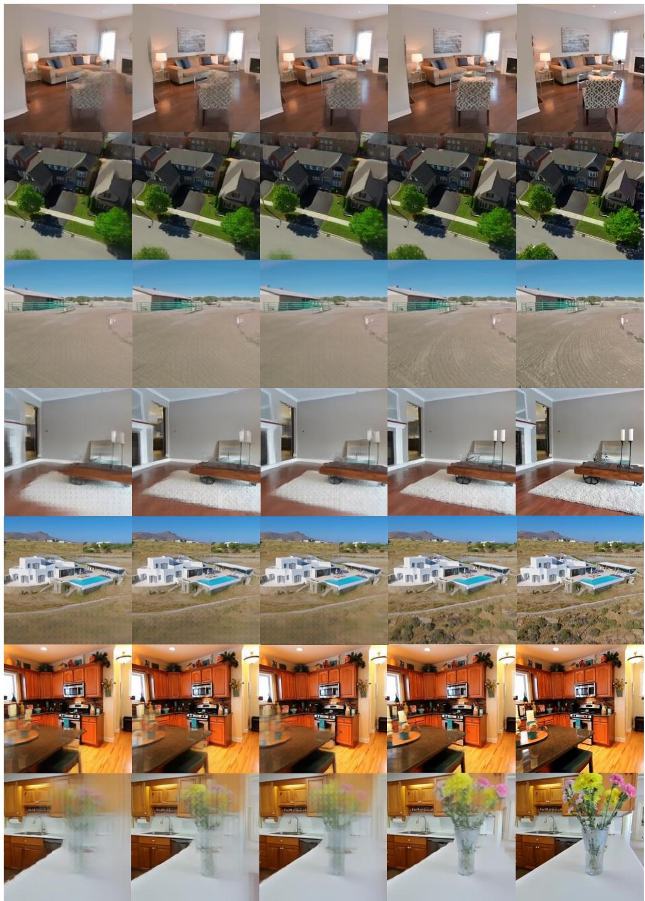  
Figure 8: Additional qualitative comparison on RealEstate10K. Each row is one scene. From left to right, the columns show novel views synthesized by LVSM, PRoPE, RayRoPE, and HRoPE (Ours), followed by the ground-truth target view (GT). All methods use the same backbone and inputs and differ only in their positional encoding.

LVSM  
PRoPE  
RayRoPE  
Ours  
GT  
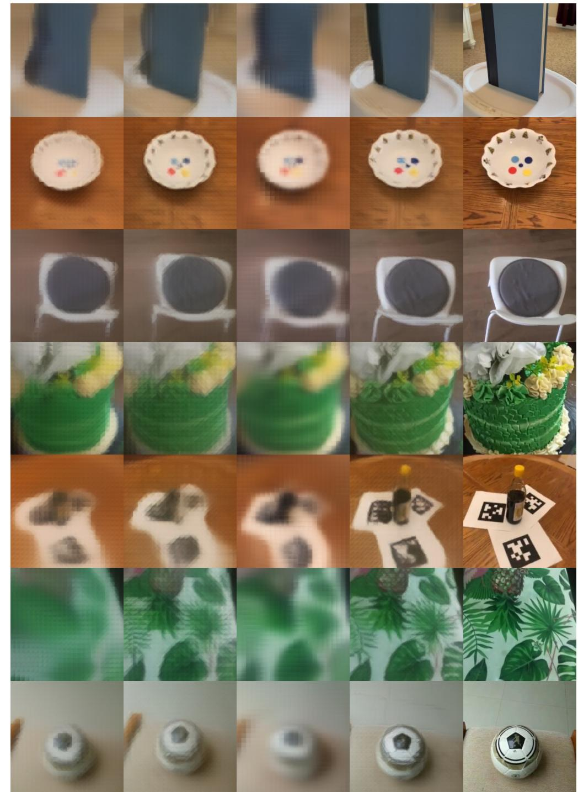  
Figure 9: Additional qualitative comparison on CO3Dv2. Each row is one object. From left to right, the columns show novel views synthesized by LVSM, PRoPE, RayRoPE, and HRoPE (Ours), followed by the ground-truth target view (GT). All methods use the same backbone and inputs and differ only in their positional encoding.

Input Views

CaPE

Ours

GT

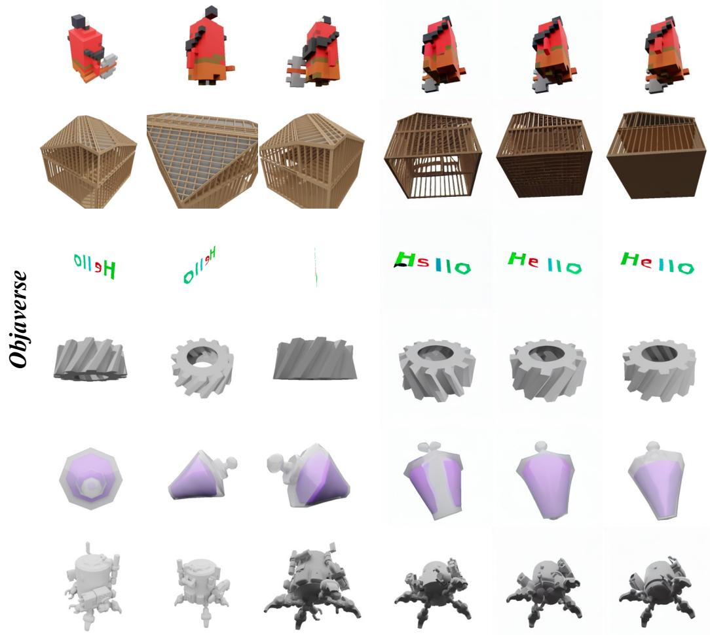

Figure 10: Additional qualitative comparison with EscherNet on Objaverse. Each row is one object. From left to right, the columns show three input views, the novel views synthesized with CaPE and HRoPE (Ours), and the ground-truth target view (GT). Both methods use the same EscherNet backbone and inputs and differ only in their positional encoding.