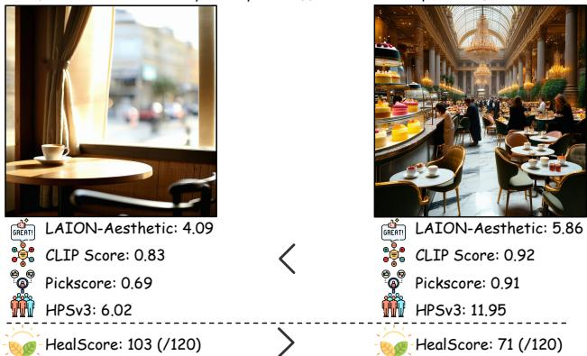
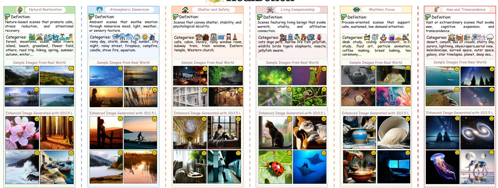
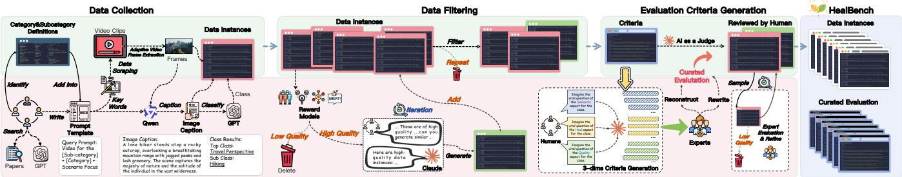
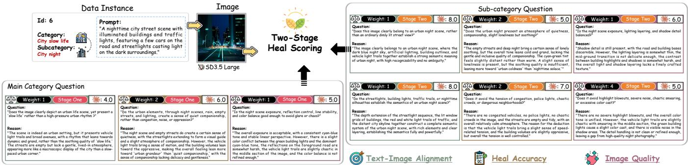
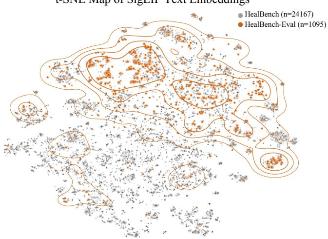
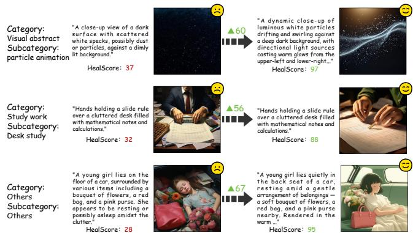

Prompt: A café interior with tables, chairs, and coffee on the table, viewed from inside.

# HealBench: A Fine-Grained Benchmark for Evaluating Psychological Comfort in Text-to-Image Generation

Junjie Xu1, Yuzhe Yang1, Rui Yang2, Luwei Xiao3, Wenxin Hu1, Xingjiao Wu1, Liang He1

1East China Normal University 2Johns Hopkins University 3National University of Singapore

## Abstract

Current text-to-image and image-editing models can generate photorealistic images with strong semantic fidelit and high visual quality. Yet an important human-centered capability remains underexplored: whether these systems can create im- ages that users perceive as psychologically comforting. Draw- ing on cognitive evaluation theory, we conceptualize psycho- logical comfort not as a low-level visual property, but as an afective response shaped by a viewer’s appraisal of restorative and emotionally supportive cues. To study this problem, we introduce HealBench, a large-scale, fine-grained benchmark for evaluating perceived psychological comfort in restorative visual stimuli. HealBench contains 30K high-quality image- text pairs spanning 19 high-level categories and 92 subcate- gories, constructed from 100K candidates through a human- and-expert-in-the-loop pipeline. To preserve the restorative nature of the data, the pipeline integrates VLM-based se- mantic matching, multiple human preference models, expert filtering, and augmentation guided by highly restorative ex- emplars. We further construct HealBench-Eval, a rigorously selected evaluation set of 1 095 instances usin feature cluster ing. Using HealBench-Eval, we conduct extensive objective and subjective evaluations of 14 representative image generation models, together with prompt-rewriting generation strate- gies. Our results reveal a clear gap between conventional vi- sual generation quality and perceived psychological comfort: models that perform well on semantic alignment and aesthet- ics still struggle to produce images experienced as emotionally restorative. Further reinforcement learning experiments show that HealScorer can serve as a practical reward signal for as- sessing and improving the emotional and restorative quality of generated images. These findings suggest that psycholog- ical comfort is a distinct and underexplored dimension of human-centered image generation, and establish HealBench as a foundation for future work on afect-aware generative models.

Keywords: Text-to-Image, Emotional Comfort, Benchmark and datasets, Image Manipulation, Multi-modal Learning

## Introduction

Recently, text-to-image (T2I) generation and instruction-guided image editing have made rapid progress in semantic alignment (Fu et al. 2025b), visual quality, editing fidelity (Yu et al. 2025; Fu et al. 2025a), and human preference modeling (Ma et al. 2025). These advances have enabled generative models to produce images that are increasingly faithful, realistic, and visually appealing. However, as vi- sual generation systems are increasingly used in emotionally sensitive and human-centered scenarios, a more subtle ques- tion emerges: can a generated image not only look correct, but also feel right to the viewer? This distinction matters when images are expected to support emotional experience, restoration, or psychological relief rather than merely sat- isfy semantic or aesthetic criteria. An image may match the prompt and appear visually polished, yet still fail to provide perceived psychological comfort (Belanche et al. 2025).

  
Figure 1: Despite sharing a prompt class, the left image scores poorly on general models (like CLIP) but high in psycholog- ical comfort (HealScore). Conversely, the right image has high evaluation scores but low comfort.

We argue that this limitation is not merely a weakness of current models, but also a consequence of how the tar- get has been formulated and evaluated. Existing generation pipelines are typically optimized for text-image alignment, perceptual quality, editing fidelity, or generic human prefer- ence. These objectives are valuable, but they do not directly capture the afective and restorative experience required by psychological comfort. In particular, current systems sufer from three mismatches. First, there is a target mismatch: perceived psychological comfort depends on afective and restorative cues that are not explicitly captured by exist- ing optimization targets (Shi et al. 2025; Belanche et al. 2025; Ortega, Murai, and Whitney 2025). Second, there is an evaluation-granularity mismatch: comfort-related fail-ure may arise from diferent sources, including prompt mis- alignment, incorrect healing semantics, or poor image quality (Gao, Ajith, and Peelen 2025; Ortega, Murai, and Whitney 2025). As illustrated in Figure 1, two images may receive similarly low comfort ratings for fundamentally diferent rea- sons, making a single scalar score insuficient for diagnos- tic evaluation. Third, there is a benchmark-and-feedback mismatch: as summarized in Table 1, existing benchmarks and evaluators mainly target preference, alignment, fidelity, compositionality, or generic quality, but do not explicitly tar- get perceived psychological comfort or provide actionable, rationale-bearing feedback. Against this background, we ask: how can perceived psychological comfort be turned into an evaluable and optimization-relevant objective for image gen-eration and image editing? Rather than treating comfort as a vague holistic preference, we formulate healing-oriented generation through three necessary dimensions: text-image alignment, heal accuracy, and image quality. A generated image should be considered healing only when it satisfies all three dimensions; failure in any one dimension is suficient to disqualify the output. Accordingly, our goal is not merely to rank images from better to worse, but to identify whether, where, and why a generated image fails to provide perceived psychological comfort.

Table 1: Comparison with representative benchmarks and evaluators for T2I generation and image editing. Existing resources mainly focus on preference, alignment, fidelity, compositionality, or generic quality assessment, whereas HealBench explicitly targets perceived psychological comfort with fine-grained diagnostic dimensions and actionable rationale-bearing feed back.
<table><tr><td>Benchmark / Evaluator</td><td>Venue</td><td>Scope</td><td>Primary Target</td><td>Fine- grained</td><td>Comfort- specific</td><td>Rationale / Feedback</td><td>Optimi- zation</td></tr><tr><td>Pick-a-Pic</td><td>NeurIPS&#x27;23</td><td>T2I</td><td>Pairwise human preference</td><td>No X</td><td>No X</td><td>No X</td><td>Limited</td></tr><tr><td>AIGCIQA2023</td><td>LNCS&#x27;24</td><td>T2I</td><td>Quality, authenticity, and correspondence</td><td>Partial</td><td>No X</td><td>No X</td><td>No X</td></tr><tr><td>T2I-CompBench</td><td>NeurIPS&#x27;23</td><td>T2I</td><td>Compositional correctness</td><td>Yes√</td><td>No X</td><td>No X</td><td>No X</td></tr><tr><td>HATIE</td><td>CVPR&#x27;25</td><td>Editing</td><td>Human-aligned editing quality</td><td>Yes√</td><td>No X</td><td>No X</td><td>Limited</td></tr><tr><td>NTIRE 2025 T2I QA</td><td>CVPR&#x27;25</td><td>T2I</td><td>Fine-grained alignment and structural distortion</td><td>Yes√</td><td>No X</td><td>Partial</td><td>No X</td></tr><tr><td>ICE-Bench</td><td>ICCV’25</td><td>T2I + Editing</td><td>Unified evaluation for creation and editing</td><td>Yes√</td><td>No X</td><td>No X</td><td>No X</td></tr><tr><td>Task-Decomposed AutoEval</td><td>ACL&#x27;25</td><td>T2I evaluator</td><td>Automatic multi-criterion quality assessment</td><td>Yes√</td><td>No X</td><td>Partial</td><td>Limited</td></tr><tr><td>HealBench (ours)</td><td>AAAI’27</td><td>T2I + Editing</td><td>Perceived psychological comfort</td><td>Yes √</td><td>Yes √</td><td>Yes √</td><td>Yes √</td></tr></table>

  
Fi ure 2: Overview of HealBench. HealBench or anizes healin -related visual content into 19 cate ories and 92 subcate ories, which are further grouped into six major classes according to diferent healing functions. For each category, we present both real-world examples and enhanced images generated via SD 3.5-L, which is also used for dataset augmentation.

Based on this formulation, we propose HealBench (shown in Figure 2), a fine-grained benchmark for evaluating the perceived psychological comfort of generated images. Heal- Bench is constructed through a human-and-expert-in-the- loop pipeline that curates high-quality data from a large-scale candidate image-text pool, performs imitative data augmen- tation, and builds a rigorously filtered test set for unified comparison across models and prompting strategies. Unlike preference-style benchmarks that primarily produce aggre- gate scores, HealBench is designed around failure-based di- agnosis: it identifies whether an output violates text-image alignment, heal accuracy, or image quality, thereby revealing diferent ways in which a generated image may fail to be heal- ing. Evaluation alone, however, is insuficient for improving generation systems. To make diagnosis actionable, we intro- duce a score-plus-rationale feedback paradigm, where each result is paired with both a comfort score and an explicit ex- planation of which dimension fails and why. This structured feedback supports prompt rewriting for both T2I genera- tion and instruction-guided image editing. Since large-scale model iteration cannot rely entirely on costly human evalua- tion, we further train an automatic evaluator, Tri-dimensiona Healing Scorer (THS), on top of HealBench to approximate these structured judgments and study its use as an optimization signal for downstream improvement, including RL-based fine-tuning.

Within this work, we treat psychological comfort as a dis- tinct human-centered objective for visual generation, rather than as a by-product of semantic alignment, aesthetics, or generic preference. Our contributions are as follows: (1)We formulate perceivedpsychological comfort as a failure-based evaluation problem for healing-oriented visual generation, defined by three necessary dimensions: text-image alignment, heal accuracy, and image quality. (2)We build Heal-Bench, a fine-grained benchmark that diagnoses whether a generated image fails on any of the three dimensions, in- stead of relying solely on aggregate preference-style scoring. (3)We introduce a score-plus-rationale feedback paradigm and THS, turning structured diagnosis into an actionable signal for prompt refinement and downstream model opti- mization.

## Related Work

Image Generation and Editing Models. Recent visual gen-eration models have made substantial progress in fidelity, semantic alignment, controllability, and human preference alignment. Difusion models such as DDPM, latent difusion, Imagen, and DiT enable high-resolution synthesis and strong prompt following (Ho, Jain, and Abbeel 2020; Rombach et al. 2022; Saharia et al. 2022; Peebles and Xie 2023); autoreressive and token-based models such as DALL·E, Make-A-Scene, and Muse improve complex content modeling and composition (Ramesh et al. 2021; Gafni et al. 2022; Chang et al. 2023); and flow-matchin or rectified-flow methods further enhance training and sampling eficiency (Lipman et al. 2023; Liu et al. 2025; Esser et al. 2024). Preference op- timization and reinforcement learning methods further align T2I models with human judgments (Black et al. 2024; Fan et al. 2023; Wallace et al. 2024), while text-guided editing methods provide instruction-based control over image con- tent and style (Hertz et al. 2023; Mokady et al. 2023; Brooks, Holynski, and Efros 2023). However, these methods mainly optimize whether images are faithful, realistic, editable, or generally preferred. Existing afective methods, such as Af- fective Image Filter and EmoEdit, focus on explicit emotion cues or targeted emotional editing (Weng et al. 2023; Yang et al. 2025), leaving subtler outcomes such as psychological comfort, safety, companionship, and healing underexplored. Text-to-Image Evaluation Benchmarks and Metrics. Existing T2I evaluation primarily targets semantic correctness, visual quality, compositional reasoning, and generic pref- erence. CLIP-based metrics estimate text-image alignment (Radford et al. 2021); reward and preference models such as PickScore, ImageReward, HPS, and HPSv3 capture overall human preference (Kirstain et al. 2023; Xu et al. 2023; Wu et al. 2023; Ma et al. 2025); and aesthetic metrics such as AVA and NIMA assess visual appeal (Murray, Marchesotti, and Perronnin 2012; Talebi and Milanfar 2018). Broader benchmarks, including DrawBench, GenEval, T2I-CompBench, VQAScore / GenAI-Bench, and HEIM, evaluate compositionality, spatial relations, reasoning, robustness, safety, and overall quality (Saharia et al. 2022; Ghosh, Hajishirzi, and Schmidt 2023; Huang et al. 2023; Lee et al. 2023; Lin et al. 2024; Li et al. 2024). Yet these metrics mainly ask whether an image is correct, high-quality, or preferred, rather than whether it is psychologically comforting. Although HRS- Bench introduces emotion-grounded evaluation (Bakr et al. 2023), and HEIM and GenAI-Bench cover broad evaluation dimensions (Lee et al. 2023; Li et al. 2024), deeper afective outcomes such as soothingness and emotional comfort remain insuficiently evaluated. Recent studies further show that metric rankings can be unstable across prompts and protocols (Wiles et al. 2025), and that faithfulness metrics remain unreliable on challenging subsets (Saxon et al. 2024). HealBench addresses this gap by treating perceived psy- chological comfort as a dedicated, fine-grained, and failure- diagnostic evaluation target.

## Method

## Overview

HealBench is constructed in four stages: (1) taxonomy design and web-video-based image collection; (2) captioning, hierarchical labeling, and reward-model-based filter- ing; (3) category-aware evaluation protocol construction and HealScore annotation; (4) tri-dimensional scorer training and data augmentation. Experts participate in taxonomy design, question revision, and iterative quality checks, while VLM- s/LLMs are used as scalable assistants.

## Data Collection and Filtering

We first build a two-level taxonomy for psychologically com- forting imagery. Experts define 18 coarse-grained categories, supplemented with an Others class, to cover common restorative visual functions. The coarse-grained category set is $\mathcal { T } = \{ T _ { i } \} _ { i = 1 } ^ { 1 9 }$ . For each coarse category $T _ { i }$ , we further define a fine-grained subcategory set $\mathbf { \bar { \mathbf { \Lambda } } } S _ { i } \stackrel { \mathbf { \Delta } } { = } \{ S _ { i , j } \} _ { j = 1 } ^ { n _ { i } }$ , which also includes an Others subtype. In total, the taxonomy contains 19 coarse-grained categories and 102 fine-grained subcat- egories. Each image I is assigned to exactly one category pair:

$$
c ( I ) = ( T _ { i } , S _ { i , j } ) , \quad T _ { i } \in \mathcal { T } , S _ { i , j } \in \mathcal { S } _ { i } .\tag{1}
$$

Based on this taxonomy, we manually design category-aware retrieval templates to crawl web videos and obtain a raw video set $( \mathcal { D } _ { \mathrm { v i d e o } } )$ . We then extract frames from these videos, pro- ducing a raw image set $( \mathcal { D } _ { \mathrm { r a w } } )$ of about 100K frames. For each image in $\mathcal { D } _ { \mathrm { r a w } }$ , we use Qwen2.5-VL-7B-Instruct to generate a caption, and then use Claude to assign hierarchical labels. Manual inspection removes invalid or ambiguous category pairs, leaving 92 valid pairs for subsequent experiments. The category pairs and the detailed data collection and annota- tion process are shown in Fig.3. To remove noisy samples caused by semantic drift, poor composition, and low visual quality, we rank images with four complementary reward sig- nals: CLIP Score, Aesthetic Score, PickScore, and HPSv3. These models serve as coarse quality gates rather than final healing labels. Denote their scores by $r _ { \mathrm { c l i p } } , r _ { \mathrm { a e s } } , r _ { \mathrm { p i c k } } , r _ { \mathrm { h p s } } ,$ re-spectively. After independent normalization, we compute the overall score as

Figure 3: Overview of the HealBench construction pipeline. The benchmark is built through three stages: data collection, reward-model-based filtering and augmentation, and tri-dimensional evaluation-criteria generation. Human and expert review is incorporated throughout the pipeline to ensure the quality of both data instances and evaluation criteria.  
  
Figure 4: Overview of the two-stage HealScore pipeline. HealScore first evaluates each image with three category-level questions on text-image alignment, heal accuracy, and image quality, and then refines the judgment with six subcategory-level questions. The final score is computed by weighted aggregation of the resulting multi-dimensional responses.

$$
r _ { \mathrm { o v e r a l l } } = \tilde { r } _ { \mathrm { c l i p } } + \tilde { r } _ { \mathrm { a e s } } + \tilde { r } _ { \mathrm { p i c k } } + \tilde { r } _ { \mathrm { h p s } } .\tag{2}
$$

Within each fine-grained subcategory, we rank images by $r _ { \mathrm { o v e r a l l } }$ and retain the top 33%, which removes low-quality candidates while preserving category diversity, yielding the filtered real-image subset $\mathcal { D } _ { \mathrm { f i l t e r } }$

## Evaluation Criteria and HealScore

Existing image-generation metrics mainly emphasize seman- tic alignment and aesthetic preference, but are insuficient for evaluating psychological soothing efects. We therefore propose HealScore, a structured metric defined on three di-mensions: text-image alignment, heal accuracy, and image quality. Here, heal accuracy refers to the perceived healing degree of the image under its target category, not to clini- cal eficacy. For each category pair $c = ( \bar { T } _ { i } , \bar { S } _ { i , j } )$ , we build a category-aware question set. An LLM first generates one coarse-level question for the general healing function of $T _ { i }$ and two fine-grained questions for the concrete visual or af- fective cues of $S _ { i , j }$ under each dimension. Experts then revise the questions to remove ambiguous, redundant, or category- mismatched formulations. The resulting question set is

Qc = qc | d ∈ {sem, heal, qual}, k ∈ {0, 1, 2}	 , (3) where $q _ { d , 0 } ^ { c }$ is the coarse-level question and $q _ { d , 1 } ^ { c } , q _ { d , 2 } ^ { c }$ are fine- grained supplementary questions. For each image $\mathit { I } \in \mathcal { D } _ { \mathrm { { f i l t e r } } }$ an LLM scores every question in $\mathcal { Q } _ { c ( I ) }$ on a 1–10 scale. Let the resulting scores be $r _ { \mathrm { s e m } , k } ( I ) , r _ { \mathrm { h e a l } , k } ( I )$ , and $r _ { \mathrm { q u a l } , k } ( I )$ We aggregate them within each dimension:

$$
s _ { d } ( I ) = \sum _ { k = 0 } ^ { 2 } r _ { d , k } ( I ) , \quad d \in \{ \mathrm { s e m , h e a l , q u a l } \} .\tag{4}
$$

We report the three dimension scores for diagnosis and use a compact summary score only for ranking, training, and large-scale comparison. Since psychological comfort is the primary objective ofthe benchmark, the summary score gives the healing dimension twice the weight of the alignment and quality dimensions:

$$
\mathrm { H e a l S c o r e } ( I ) = s _ { \mathrm { s e m } } ( I ) + 2 s _ { \mathrm { h e a l } } ( I ) + s _ { \mathrm { q u a l } } ( I ) .\tag{5}
$$

The 1:2:1 design therefore emphasizes the target dimension while retaining the two supporting constraints, rather than masking a failed dimension in diagnostic interpretation. To reduce annotation noise, we manually inspect sampled scored results and iteratively refine the question set by expert feed- back. The detailed scoring process of HealScore is shown in Fig.4.

To further enrich the dataset, we select, for each category pair, the top-10 images ranked by HealScore and the top-10 images ranked by the normalized reward-model total score. Their captions are rewritten by Claude and used as prompts for SD3.5-Large to synthesize additional images, producing an augmented set $\mathcal { D } _ { \mathrm { a u g m e n t } }$ . We merge $\mathcal { D } _ { \mathrm { a u g m e n t } }$ with $\mathcal { D } _ { \mathrm { f i l t e r } }$ and remove near-duplicates based on image similarity, obtaining the final dataset $\mathcal { D } _ { \mathrm { h e a l } }$

## Tri-dimensional Heal Scorer (THS)

To approximate rule-based HealScore with a learnable model, we train a Tri-dimensional Heal Scorer (THS). Given an image and its category pair $( T _ { i } , S _ { i , j } )$ , THS predicts three dimension-specific scores for text-image alignment, heal ac- curacy, and image quality, and combines them into the sum- mary score. We adopt BLIP image-text matching as the back- bone. Given image I and category text

$$
x = { \ " { \mathrm { A n } } } \mathrm { i m } { \mathrm { a g e } } \mathrm { o f } T _ { i } , S _ { i , j } { \ " , }\tag{6}
$$

we encode image and text separately, project them into a shared embedding space, and obtain normalized embed- dings v and t. Their fused representation is defined as $h =$ $[ v ; t ; v  @ t ]$ , where $[ \cdot ; \cdot ]$ denotes concatenation and ⊙ denotes element-wise multiplication. The fused feature is fed into three independent MLP heads to predict the three dimension scores. Let the supervision targets be $y _ { \mathrm { s e m } } .$ , yheal, and $y _ { \mathrm { { q u a l } } } .$ with corresponding predictions $\hat { y } _ { \mathrm { s e m } } , \hat { y } _ { \mathrm { h e a l } }$ l, and $\hat { y } _ { \mathrm { q u a l } }$ . We first optimize the dimension-wise regression loss:

$$
\mathcal { L } _ { \mathrm { d i m } } = \sum _ { d \in \{ \mathrm { s e m , h e a l , q u a l } \} } \left. \hat { y } _ { d } - y _ { d } \right. ^ { 2 } .\tag{7}
$$

To enforce consistency with the summary HealScore while preserving dimension-wise supervision, we further define

$$
\begin{array} { r l } & { y _ { \mathrm { t o t a l } } = y _ { \mathrm { s e m } } + 2 y _ { \mathrm { h e a l } } + y _ { \mathrm { q u a l } } , } \\ & { \hat { y } _ { \mathrm { t o t a l } } = \hat { y } _ { \mathrm { s e m } } + 2 \hat { y } _ { \mathrm { h e a l } } + \hat { y } _ { \mathrm { q u a l } } , } \end{array}\tag{8}
$$

and apply an additional total-score loss: $\begin{array} { r l } { \mathcal { L } _ { \mathrm { t o t a l } } } & { { } = } \end{array}$ $\lVert \hat { y } _ { \mathrm { t o t a l } } - y _ { \mathrm { t o t a l } } \rVert ^ { 2 }$ . The final objective is $\begin{array} { r } { \mathcal { L } = \mathcal { L } _ { \mathrm { d i m } } + \lambda \mathcal { L } _ { \mathrm { t o t a l } } , } \end{array}$ where λ balances the two terms. We optimize THS with AdamW, using diferent learning rates for the pretrained backbone and the newly initialized heads. During training, we retain only samples with complete annotations on all three dimensions, and select the final model according to the validation error on $\mathcal { L } _ { \mathrm { t o t a l } }$

## Experiments

## Overview

We evaluate HealBench from three perspectives: validity, utility, and scalability, covering benchmark representative- ness, tri-dimensional diagnosis, feedback-based improve- ment, automatic scoring, and downstream optimization.

Table 2: Agreement between HealScore-induced rankings and pairwise preferences from human annotators and VLM- based judges.
<table><tr><td>Model</td><td>Accuracy</td><td>Kendall&#x27;s τ</td><td>Spearman&#x27;s ρ</td></tr><tr><td>Haiku</td><td>0.6831</td><td>0.3546</td><td>0.4319</td></tr><tr><td>Sonnet 4-6</td><td>0.6933</td><td>0.3868</td><td>0.4711</td></tr><tr><td>People</td><td>0.8012</td><td>0.4487</td><td>0.5448</td></tr></table>

## HealBench-Eval Construction and Validation

Construction To enable controlled evaluation without sac-rificing diversity, we construct a compact HealBench-Eval from the filtered real-image subset. For each of the 92 valid category pairs, we extract SigLIP embeddings, run K-means clustering, and select representative samples. Figure 5 shows that the resulting subset follows the overall HealBench dis- tribution rather than concentrating in a few dense regions, making it suitable for controlled healing-oriented evaluation.

  
Figure 5: t-SNE visualization of SigLIP embeddings for the full HealBench data and the selected HealBench-Eval.

Validation To test whether the tri-dimensional formulation captures a meaningful healing-oriented signal, we compare HealScore-induced rankings with human and VLM prefer- ences on 1,500 image pairs. Annotators, Claude-Haiku, and Claude-Sonnet 4-6 select the more psychologically comfort- ing image. Table 2 shows that human judgments achieve the highest agreement, while Sonnet slightly outperforms Haiku, indicating that HealScore provides a meaningful approxima- tion of this structured preference.

Table 3: Quantitative comparison of diferent text-to-image models across multiple evaluation metrics.
<table><tr><td>Model</td><td>LAION Aesthetic ↑</td><td>CLIPScore ↑</td><td>PickScore ↑</td><td>HPSv3 ↑</td></tr><tr><td>SD 2.1</td><td>4.403</td><td>0.885</td><td>0.785</td><td>3.406</td></tr><tr><td>SDXL Base 1.0</td><td>4.631</td><td>0.885</td><td>0.790</td><td>3.602</td></tr><tr><td>pixArt-XL</td><td>4.717</td><td>0.946</td><td>0.864</td><td>12.623</td></tr><tr><td>SDXL Turbo</td><td>4.095</td><td>0.975</td><td>0.812</td><td>5.543</td></tr><tr><td>Playground v2.5</td><td>5.164</td><td>0.988</td><td>0.899</td><td>12.712</td></tr><tr><td>Hunyuan-Dit</td><td>5.271</td><td>0.976</td><td>0.872</td><td>10.991</td></tr><tr><td>SD 3 Medium</td><td>4.841</td><td>0.965</td><td>0.863</td><td>11.515</td></tr><tr><td>Kolors</td><td>4.638</td><td>0.901</td><td>0.823</td><td>9.587</td></tr><tr><td>FLUX.1 [dev]</td><td>4.798</td><td>0.938</td><td>0.876</td><td>13.585</td></tr><tr><td>FLUX.1 [schnell]</td><td>4.682</td><td>0.943</td><td>0.840</td><td>10.624</td></tr><tr><td>SD 3.5 Large</td><td>4.912</td><td>0.971</td><td>0.867</td><td>11.792</td></tr><tr><td>SD 3.5 Medium</td><td>4.867</td><td>0.974</td><td>0.867</td><td>11.533</td></tr><tr><td>sana16</td><td>4.666</td><td>0.967</td><td>0.870</td><td>12.955</td></tr><tr><td>Lumina-Image 2.0</td><td>4.950</td><td>0.984</td><td>0.864</td><td>11.919</td></tr><tr><td>GT</td><td>4.954</td><td>0.925</td><td>0.838</td><td>9.797</td></tr></table>

## Benchmarking Baseline T2I Models

We next benchmark representative difusion and flow- matching T2I models under the original prompts on healing- oriented generation. Table 3 reports standard metrics as ref- erence baselines. Recent models perform strongly on Aes- thetic score, CLIPScore, PickScore, and HPSv3, sometimes exceeding the real-image reference on individual metrics. Because these metrics do not target perceived psychological comfort, they should not be treated as evidence of healing- oriented generation quality.

Table 4: Baseline summary table. All metrics are positive indicators. For prompt-rewrite models, the orange mark denotes the improvement over the corresponding non-rewrite base model. For image editing models, the blue mark denotes the improvement over the corresponding original model.
<table><tr><td>Model</td><td>Overall</td><td>Text-Image Alignment</td><td>Heal Accuracy</td><td>Image Quality</td><td>Natural Restoration</td><td>Atmospheric Immersion</td><td>Shelter and Safety</td><td>Living Companionship</td><td>Rhythmic Focus</td><td>Awe and Transcendence</td></tr><tr><td colspan="9">Diffusion Models</td><td></td></tr><tr><td>SD 2.1</td><td>19.390</td><td>5.172</td><td>4.820</td><td>4.578</td><td>18.754</td><td>19.678</td><td>18.484</td><td>21.780</td><td>19.412</td><td>20.147</td></tr><tr><td>SDXL Base 1.0</td><td>20.723</td><td>5.319</td><td>5.173</td><td>5.057</td><td>20.258</td><td>21.269</td><td>21.915</td><td>24.284</td><td>19.859</td><td>20.481</td></tr><tr><td>PixArt-XL</td><td>25.080</td><td>6.435</td><td>6.169</td><td>6.308</td><td>24.953</td><td>24.832</td><td>25.115</td><td>27.787</td><td>25.036</td><td>24.844</td></tr><tr><td>SDXL Turbo</td><td>18.765</td><td>5.419</td><td>4.517</td><td>4.312</td><td>17.372</td><td>18.689</td><td>17.536</td><td>19.837</td><td>20.549</td><td>18.695</td></tr><tr><td>Playground v2.5</td><td>25.088</td><td>6.479</td><td>6.094</td><td>6.422</td><td>24.551</td><td>25.304</td><td>24.449</td><td>28.177</td><td>25.162</td><td>25.253</td></tr><tr><td>Hunyuan-DiT</td><td>25.020</td><td>6.378</td><td>6.178</td><td>6.286</td><td>24.341</td><td>24.849</td><td>24.286</td><td>28.057</td><td>25.427</td><td>25.347</td></tr><tr><td>Kolors</td><td>23.535</td><td>6.005</td><td>5.866</td><td>5.797</td><td>23.586</td><td>23.924</td><td>22.832</td><td>26.369</td><td>23.267</td><td>23.255</td></tr><tr><td>Sana-1.6B</td><td>24.419</td><td>6.386</td><td>5.917</td><td>6.201</td><td>23.748</td><td>25.044</td><td>24.291</td><td>29.624</td><td>23.821</td><td>24.541</td></tr><tr><td colspan="9">Flow Matching Models</td><td></td></tr><tr><td>SD 3 Medium</td><td>23.465</td><td>6.121</td><td>5.731</td><td>5.882</td><td>22.556</td><td>23.691</td><td>21.617</td><td>28.560</td><td>23.462</td><td>24.780</td></tr><tr><td>FLUX.1 [dev]</td><td>24.836</td><td>6.289</td><td>6.152</td><td>6.243</td><td>24.211</td><td>24.195</td><td>23.489</td><td>29.759</td><td>25.424</td><td>25.222</td></tr><tr><td>FLUX.1 [schnell]</td><td>22.717</td><td>5.954</td><td>5.561</td><td>5.642</td><td>22.080</td><td>21.632</td><td>21.108</td><td>27.830</td><td>23.225</td><td>23.913</td></tr><tr><td>SD 3.5 Large</td><td>24.571</td><td>6.346</td><td>6.008</td><td>6.210</td><td>23.694</td><td>24.381</td><td>23.160</td><td>29.057</td><td>25.106</td><td>25.154</td></tr><tr><td>SD 3.5 Medium</td><td>24.164</td><td>6.321</td><td>5.884</td><td>6.075</td><td>23.285</td><td>24.131</td><td>22.391</td><td>28.730</td><td>24.266</td><td>25.620</td></tr><tr><td>Lumina-Image 2.0</td><td>23.169</td><td>6.132</td><td>5.627</td><td>5.782</td><td>22.483</td><td>22.855</td><td>22.035</td><td>28.447</td><td>23.433</td><td>23.602</td></tr><tr><td colspan="9">Prompt-Rewrite Models</td><td></td></tr><tr><td>Hunyuan-DiT (Rewrite)</td><td>26.631</td><td>6.617</td><td>6.711</td><td>6.592</td><td>26.841</td><td></td><td>26.336</td><td>29.546</td><td>27.183</td><td></td></tr><tr><td></td><td>↑1.612</td><td>↑0.239</td><td>↑0.533</td><td>↑0.306</td><td>↑2.500</td><td>25.843 ↑0.994</td><td>↑2.050</td><td>↑1.489</td><td>↑1.757</td><td>25.574 ↑0.226</td></tr><tr><td>FLUX.1 [schnell] (Rewrite)</td><td>24.514</td><td>6.328</td><td>6.051</td><td>6.084</td><td>24.411</td><td>23.090</td><td>23.942</td><td>28.794</td><td>25.043</td><td>24.552</td></tr><tr><td></td><td>↑1.797</td><td>↑0.374</td><td>↑0.490</td><td>↑0.442</td><td>↑2.331</td><td>↑1.459</td><td>↑2.835</td><td>↑0.965</td><td>↑1.818</td><td>↑0.638</td></tr><tr><td>SD 3.5 Large (Rewrite)</td><td>26.149</td><td>6.638</td><td>6.471</td><td>6.568</td><td>25.851</td><td>24.993</td><td>25.825</td><td>31.057</td><td>26.680</td><td>25.836</td></tr><tr><td></td><td>↑1.578</td><td>↑0.293</td><td>↑0.464 6.322</td><td>↑0.358 6.398</td><td>↑2.157 25.071</td><td>↑0.611</td><td>↑2.664</td><td>↑2.000</td><td>↑1.575</td><td>↑0.683</td></tr><tr><td>SD 3.5 Medium (Rewrite)</td><td>25.598</td><td>6.556</td><td>↑0.438</td><td>↑0.323</td><td>↑1.786</td><td>24.683</td><td>24.554</td><td>29.979</td><td>26.179</td><td>26.046</td></tr><tr><td></td><td>↑1.434</td><td>↑0.235</td><td></td><td></td><td></td><td>↑0.552</td><td>↑2.163</td><td>↑1.248</td><td>↑1.912</td><td>↑0.426</td></tr><tr><td colspan="9">Image Editing Models</td><td></td><td></td></tr><tr><td>Pix2Pix (Original)</td><td>20.666</td><td>5.454</td><td>5.081</td><td>5.050</td><td>20.349</td><td>21.401</td><td>20.832</td><td>23.837</td><td>20.832</td><td>19.059</td></tr><tr><td>Pix2Pix (Rewrite)</td><td>22.802</td><td>5.853</td><td>5.664</td><td>5.620</td><td>23.047</td><td>23.193</td><td>23.649</td><td>25.674</td><td>22.719</td><td>20.606</td></tr><tr><td></td><td>↑2.136</td><td>↑0.399</td><td>↑0.583</td><td>↑0.570</td><td>↑2.698</td><td>↑1.792</td><td>↑2.817</td><td>↑1.837</td><td>↑1.887</td><td>↑1.547</td></tr><tr><td>SDXL-Pix2Pix (Original) SDXL-Pix2Pix (Rewrite)</td><td>19.307</td><td>5.137</td><td>4.722</td><td>4.727 5.453</td><td>18.612</td><td>19.576</td><td>18.351</td><td>23.780</td><td>19.272</td><td>19.733</td></tr><tr><td></td><td>22.053 ↑2.746</td><td>5.711 ↑0.574</td><td>5.445 ↑0.723</td><td>22.111 ↑0.726</td><td>↑3.499</td><td>22.575 ↑2.999</td><td>21.464 ↑3.113</td><td>26.255 ↑2.475</td><td>21.908 ↑2.636</td><td>20.917 ↑1.184</td></tr><tr><td colspan="9">Ground Truth</td><td></td><td></td></tr><tr><td></td><td>24.528</td><td>6.375</td><td>5.995</td><td>6.163</td><td>23.186</td><td>24.119</td><td>25.205</td><td>27.901</td><td>25.216</td><td>24.503</td></tr></table>

Overall healing-oriented performance. Table 4 shows clear gaps across model families. Among original baselines, Playground v2.5 (25.088), PixArt-XL (25.080), and Hunyuan-DiT (25.020) perform best overall, while SDXL Turbo (18.765) and SD 2.1 (19.390) lag behind. Even when advanced gener-ators approach the real-image reference, their scores remain uneven across dimensions and healing functions.

Tri-dimensional analysis. In Table 4, the three dimensions reveal why aggregate scores are insuficient. Strong baselines usually score above 6.0 on Text-Image Alignment and Image Quality, but are lower and more variable on Heal Accuracy: Playground v2.5 obtains 6.479/6.422 on Alignment/Quality but 6.094 on Heal Accuracy, and SD 3.5 Medium obtains 6.321/6.075 but 5.884. Thus, perceived healing degree can- not be inferred from alignment or visual quality alone.

Class-level analysis. As shown in Table 4, Class-wise results further show uneven dificulty. Living Companionship is often easiest, reaching 29.624 for Sana-1.6B, 29.759 for FLUX.1 [dev], and 29.057 for SD 3.5 Large. In contrast, Shelter and Safety and Natural Restoration show larger modeldependent variation, and no model dominates all six classes.

HealBench therefore exposes both dimension-specific and function-specific limitations.

  
Figure 6: Qualitative examples of our prompt rewriting strategy. Using the same image generation model, targeted prompt rewriting markedly improves generation outcomes, yielding more coherent and safer images with substantially higher HealScores across multiple categories.

## Prompt Rewriting as Intervention

We next test whether score-plus-rationale feedback can im- prove prompts on healing-oriented generation for both text- to-image generation and image editing.

Prompt rewriting improves healing-oriented generation. Table 4 shows that rewriting improves all tested T2I models,

including Hunyuan-DiT, FLUX.1 [schnell], SD 3.5 Large, and SD 3.5 Medium, with the most consistent gains on Heal Accuracy.

Prompt rewriting also benefits image editing. For edit- ing, rewritten prompts improve both Pix2Pix and SDXL-Pix2Pix in overall HealScore and all three dimensions.

Qualitative analysis. Figure 6 shows that rewritten prompts produce more coherent, less visually tense images aligned with the intended healing semantics.

Table 5: User study on personalized healing delivery with 24 subthreshold-depression college students. Participants in the personalized condition could choose among the six HEAL classes, while those in the random condition viewed ran- domly assigned healing images. Mood change was measured with HAMD-17 after one hour of viewing.
<table><tr><td>Condition</td><td>N Improved Ratio (%) ↑ </td><td>HAMD-17 ↓</td></tr><tr><td>Random playback</td><td>12</td><td>45.5 -1.27</td></tr><tr><td>Personalized class selection</td><td>n 12</td><td>75.0 -3.42</td></tr><tr><td>Difference / Gain</td><td>一</td><td>+29.5 -2.15</td></tr></table>

## User Study on Personalized Healing Delivery

In a preliminary study with 24 college students with sub- threshold depression, participants either choose a HEAL class or view randomly assigned healing images. Person- alized selection yields a higher improvement ratio (75.0% vs. 45.5%) and larger HAMD-17 reduction (-3.42 vs. -1.27), suggesting that the six-class organization is useful beyond benchmark analysis.

Table 6: THS vs. generic scorers on pairwise healing- preference ranking.
<table><tr><td>Model</td><td>Acc. ↑ Kendall&#x27;s τ ↑ Spearman&#x27;s ρ↑</td><td></td><td></td></tr><tr><td>PickScore</td><td>0.5593</td><td>0.1525</td><td>0.2254</td></tr><tr><td>LAION Aesthetic</td><td>0.5507</td><td>0.1077</td><td>0.1595</td></tr><tr><td>CLIPScore</td><td>0.5413</td><td>0.1272</td><td>0.1882</td></tr><tr><td>HPSv3</td><td>0.5013</td><td>0.0379</td><td>0.0595</td></tr><tr><td>THS</td><td>0.8527</td><td>0.7741</td><td>0.9223</td></tr></table>

## THS as an Automatic Healing Scorer

We next examine whether THS can provide a more suitable automatic evaluation signal for healing-oriented generation than generic scoring models. To this end, we compare THS with several widely used baselines, including PickScore, LAION Aesthetic, CLIPScore, and HPSv3, using the same pairwise ranking protocol as in the preference validation ex- periment. As shown in Table 6, THS substantially outper- forms all generic baselines across all three ranking metrics, achieving 0.8527 in Accuracy, 0.7741 in Kendall’s τ , and 0.9223 in Spearman’s ρ. By contrast, the generic scorers remain far behind, with Accuracy values clustered around 0.50–0.56 and much weaker rank correlation. These results indicate that existing scoring models for semantics, aesthet- ics, or broad human preference do not adequately capture the specific notion of perceived psychological comfort tar- geted in this work. Results justify the need for a task-specific automatic scorer. Rather than serving only as a descriptive metric, THS provides a scalable evaluation signal that is bet- ter aligned with healing-oriented preference and can there- fore support both large-scale benchmarking and downstream optimization.

Table 7: Main results of the base SD 3.5 Medium model and its Flow-GRPO fine-tuned variant. Higher values are highlighted in blue.
<table><tr><td>Model</td><td></td><td>Overall Semantic Heal Quality</td><td></td><td></td></tr><tr><td>SD 3.5 Medi (base)</td><td>24.16</td><td>6.32</td><td>5.88</td><td>6.08</td></tr><tr><td>SD 3.5 Medi + Flow-GRPO</td><td>25.67</td><td>6.48</td><td>6.45</td><td>6.28</td></tr></table>

## Exploratory RL Fine-Tuning with THS Reward

Finally, we conduct a preliminary study to examine whether THS can serve not only as an evaluator, but also as a re- ward signal for direct model optimization. To this end, we fine-tune SD 3.5 Medium with Flow-GRPO using a reward defined by a weighted combination of THS and CLIPScore. As shown in Table 7, the Flow-GRPO fine-tuned model im- proves over the base SD 3.5 Medium across all four metrics, including Overall (23.47 → 25.67), Semantic (6.12 → 6.48), Heal (5.73 → 6.45), and Quality (5.88 → 6.28). Notably, the largest gain appears on the Heal dimension, which is consistent with the role of THS as a healing-oriented reward sig- nal. This suggests that the proposed scorer is not only useful for benchmark evaluation, but can also provide an efective optimization signal for improving healing-oriented genera- tion. We emphasize that this experiment is exploratory rather than a fully optimized RL recipe. Nevertheless, the consistent gains across all dimensions provide initial evidence that THS can support downstream alignment toward psychologically comforting image generation.

## Conclusion

We present HealBench, the first fine-grained benchmark for evaluating perceived psychological comfort in text-to-image generation and image editing. By explicitly defining healing- oriented generation along three complementary dimensions (text-image alignment, heal accuracy, and image quality), we move psychological comfort from an implicit notion of pref- erence to a structured and measurable objective. Building on this formulation, we develop a large-scale human-and-expert- in-the-loop benchmark, introduce the rule-based HealScore, and further propose THS, a learnable automatic evaluator. Our experiments reveal a clear gap between strong perfor- mance on conventional generation metrics and true efec- tiveness under healing-oriented evaluation. Beyond bench- marking, we show that structured score-plus-rationale feed- back can directly support generation improvement, and that the HEAL taxonomy provides a useful basis for personalized healing-content delivery. In conclusion, our results establish psychological comfort as a distinct evaluation and optimiza- tion target in generative vision, and position HealBench as a strong foundation for future work on afect-aware, human- centered multimodal generation.

Bakr, E. M.; Sun, P.; Shen, X.; Khan, F. F.; Li, L. E.; and El- hosein M. 2023. Hrs-bench: Holistic reliable and scalable benchmark for text-to-image models. In Proceedings of the IEEE/CVF International Conference on Computer Vision, 20041–20053.

Belanche, D.; Ibáñez-Sánchez, S.; Jordán, P.; and Matas, S. 2025. Customer reactions to generative AI vs. real images in high-involvement and hedonic services. International Journal ofInformation Management, 85: 102954.

Black, K.; Janner, M.; Du, Y.; Kostrikov, I.; and Levine, S. 2024. Training Difusion Models with Reinforcement Learn- ing. In The Twelfth International Conference on Learning Representations.

Brooks, T.; Holynski, A.; and Efros, A. A. 2023. Instruct- pix2pix: Learning to follow image editing instructions. In Proceedings of the IEEE/CVF conference on computer vision and pattern recognition, 18392–18402.

Chang, H.; Zhang, H.; Barber, J.; Maschinot, A.; Lezama, J.; Jiang, L.; Yang, M.-H.; Murphy, K. P.; Freeman, W. T.; Rubinstein, M.; et al. 2023. Muse: Text-To-Image Genera- tion via Masked Generative Transformers. In International Conference on Machine Learning, 4055–4075. PMLR.

Esser, P.; Kulal, S.; Blattmann, A.; Entezari, R.; Müller, J.; Saini, H.; Levi, Y.; Lorenz, D.; Sauer, A.; Boesel, F.; et al. 2024. Scaling rectified flow transformers for high-resolution image synthesis. In Forty-first international conference on machine learning.

Fan, Y.; Watkins, O.; Du, Y.; Liu, H.; Ryu, M.; Boutilier, C.; Abbeel, P.; Ghavamzadeh, M.; Lee, K.; and Lee, K. 2023. Dpok: Reinforcement learning for fine-tuning text-to-image difusion models. Advances in Neural Information Processing Systems, 36: 79858–79885.

Fu, F.; Zhang, L.; Huang, M.; and Mao, Z. 2025a. Feededit: Text-based image editing with dynamic feedback regulation. In Proceedings of the Computer Vision and Pattern Recognition Conference, 2661–2670.

Fu, M.; Wang, G.-H.; Cao, L.; Chen, Q.-G.; Xu, Z.; Luo, W.; and Zhang, K. 2025b. CHATS: Combining Human- Aligned Optimization and Test-Time Sampling for Text-to- Image Generation. In Forty-second International Conference on Machine Learning.

Gafni, O.; Polyak, A.; Ashual, O.; Sheynin, S.; Parikh, D.; and Taigman, Y. 2022. Make-a-scene: Scene-based text-to- image generation with human priors. In European conference on computer vision, 89–106. Springer.

Gao, C.; Ajith, S.; and Peelen, M. V. 2025. Object representations drive emotion schemas across a large and diverse set of daily-life scenes. Communications Biology, 8(1): 697.

Ghosh, D.; Hajishirzi, H.; and Schmidt, L. 2023. Geneval: An object-focused framework for evaluating text-to-image alignment. Advances in Neural Information Processing Systems, 36: 52132–52152.

Hertz, A.; Mokady, R.; Tenenbaum, J.; Aberman, K.; Pritch, Y.; and Cohen-Or, D. 2023. Prompt-to-Prompt Image Editing with Cross-Attention Control. In The Eleventh International Conference on Learning Representations.

Ho, J.; Jain, A.; and Abbeel, P. 2020. Denoising difusion probabilistic models. Advances in neural information processing systems, 33: 6840–6851.

Huang, K.; Sun, K.; Xie, E.; Li, Z.; and Liu, X. 2023. T2i- compbench: A comprehensive benchmark for open-world compositional text-to-image generation. Advances in Neural Information Processing Systems, 36: 78723–78747.

Kirstain, Y.; Polyak, A.; Singer, U.; Matiana, S.; Penna, J.; and Levy, O. 2023. Pick-a-pic: An open dataset of user preferences for text-to-image generation. Advances in neural information processing systems, 36: 36652–36663.

Lee, T.; Yasunaga, M.; Meng, C.; Mai, Y.; Park, J. S.; Gupta, A.; Zhang, Y.; Narayanan, D.; Teufel, H.; Bellagente, M.; et al. 2023. Holistic evaluation of text-to-image models. Advances in Neural Information Processing Systems, 36: 69981–70011.

Li, B.; Lin, Z.; Pathak, D.; Li, J.; Fei, Y.; Wu, K.; Xia, X.; Zhang, P.; Neubig, G.; and Ramanan, D. 2024. Evaluat- ing and improving compositional text-to-visual generation. In Proceedings of the IEEE/CVF Conference on Computer Vision and Pattern Recognition, 5290–5301.

Lin, Z.; Pathak, D.; Li, B.; Li, J.; Xia, X.; Neubig, G.; Zhang, P.; and Ramanan, D. 2024. Evaluating text-to-visual genera- tion with image-to-text generation. In European Conference on Computer Vision, 366–384. Springer.

Lipman, Y.; Chen, R. T.; Ben-Hamu, H.; Nickel, M.; and Le, M. 2023. Flow Matching for Generative Modeling. In The Eleventh International Conference on Learning Representations.

Liu, H.; Wang, J.; Huang, R.; Liu, Y.; Lu, H.; Zhao, Z.; and Xue, W. 2025. Flashaudio: Rectified flow for fast and high-fidelity text-to-audio generation. In Proceedings ofthe 63rd Annual Meeting of the Association for Computational Linguistics (Volume 1: Long Papers), 13694–13710.

Ma, Y.; Wu, X.; Sun, K.; and Li, H. 2025. Hpsv3: Towards wide-spectrum human preference score. In Proceedings of the IEEE/CVF International Conference on Computer Vision, 15086–15095.

Mokady, R.; Hertz, A.; Aberman, K.; Pritch, Y.; and Cohen- Or, D. 2023. Null-text inversion for editing real images using guided difusion models. In Proceedings of the IEEE/CVF conference on computer vision and pattern recognition, 6038–6047.

Murray, N.; Marchesotti, L.; and Perronnin, F. 2012. AVA: A large-scale database for aesthetic visual analysis. In 2012 IEEE conference on computer vision and pattern recognition, 2408–2415. IEEE.

Ortega, J.; Murai, Y.; and Whitney, D. 2025. Integration of afective cues in context-rich and dynamic scenes varies across individuals. Nature Communications, 17: 786.

Peebles, W.; and Xie, S. 2023. Scalable difusion models with transformers. In Proceedings ofthe IEEE/CVF international conference on computer vision, 4195–4205.

Radford, A.; Kim, J. W.; Hallacy, C.; Ramesh, A.; Goh, G.; Agarwal, S.; Sastry, G.; Askell, A.; Mishkin, P.; Clark, J.; et al. 2021. Learning transferable visual models from

natural language supervision. In International conference on machine learning, 8748–8763. PmLR.

Ramesh, A.; Pavlov, M.; Goh, G.; Gray, S.; Voss, C.; Radford, A.; Chen, M.; and Sutskever, I. 2021. Zero-shot text-to-image generation. In International conference on machine learning, 8821–8831. Pmlr.

Yu, Q.; Chow, W.; Yue, Z.; Pan, K.; Wu, Y.; Wan, X.; Li, J.; Tang, S.; Zhang, H.; and Zhuang, Y. 2025. Anyedit: Mastering unified high-quality image editing for any idea. In Proceedings of the Computer Vision and Pattern Recognition Conference, 26125–26135.

Rombach, R.; Blattmann, A.; Lorenz, D.; Esser, P.; and Om- mer, B. 2022. High-resolution image synthesis with latent difusion models. In Proceedings of the IEEE/CVF conference on computer vision and pattern recognition, 10684– 10695.

Saharia, C.; Chan, W.; Saxena, S.; Li, L.; Whang, J.; Denton, E. L.; Ghasemipour, K.; Gontijo Lopes, R.; Karagol Ayan, B.; Salimans, T.; et al. 2022. Photorealistic text-to-image dif- fusion models with deep language understanding. Advances in neural information processing systems, 35: 36479–36494.

Saxon, M.; Jahara, F.; Khoshnoodi, M.; Lu, Y.; Sharma, A.; and Wang, W. Y. 2024. Who evaluates the evaluations? objectively scoring text-to-image prompt coherence metrics with t2iscorescore (ts2). Advances in Neural Information Processing Systems, 37: 85630–85657.

Shi, J.; Zhang, N.; Sun, Y.; Jiang, J.; Duan, H.; and Gao, W. 2025. The impact of virtual images of coastal landscape features on stress recovery based on EEG. Scientific Reports, 15(1): 17369.

Talebi, H.; and Milanfar, P. 2018. NIMA: Neural image assessment. IEEE transactions on image processing, 27(8): 3998–4011.

Wallace, B.; Dang, M.; Rafailov, R.; Zhou, L.; Lou, A.; Pu- rushwalkam, S.; Ermon, S.; Xiong, C.; Joty, S.; and Naik, N. 2024. Difusion model alignment using direct preference optimization. In Proceedings of the IEEE/CVF Conference on Computer Vision and Pattern Recognition, 8228–8238.

Weng, S.; Zhang, P.; Chang, Z.; Wang, X.; Li, S.; and Shi, B. 2023. Afective image filter: Reflecting emotions from text to images. In Proceedings of the IEEE/CVF International Conference on Computer Vision, 10810–10819.

Wiles, O.; Zhang, C.; Albuquerque, I.; Kajic, I.; Wang, S.; Bugliarello, E.; Onoe, Y.; Papalampidi, P.; Ktena, I.; Knut- sen, C.; et al. 2025. Revisiting text-to-image evaluation with Gecko: on metrics, prompts, and human rating. In The Thirteenth International Conference on Learning Representations.

Wu, X.; Sun, K.; Zhu, F.; Zhao, R.; and Li, H. 2023. Hu- man preference score: Better aligning text-to-image models with human preference. In Proceedings of the IEEE/CVF International Conference on Computer Vision, 2096–2105.

Xu, J.; Liu, X.; Wu, Y.; Tong, Y.; Li, Q.; Ding, M.; Tang, J.; and Dong, Y. 2023. Imagereward: Learning and evaluating human preferences for text-to-image generation. Advances in Neural Information Processing Systems, 36: 15903–15935.

Yang, J.; Feng, J.; Luo, W.; Lischinski, D.; Cohen-Or, D.; and Huang, H. 2025. Emoedit: Evoking emotions through image manipulation. In Proceedings of the Computer Vision and Pattern Recognition Conference, 24690–24699.