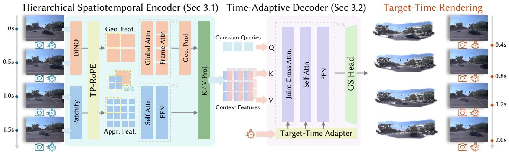
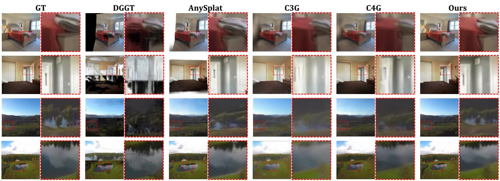
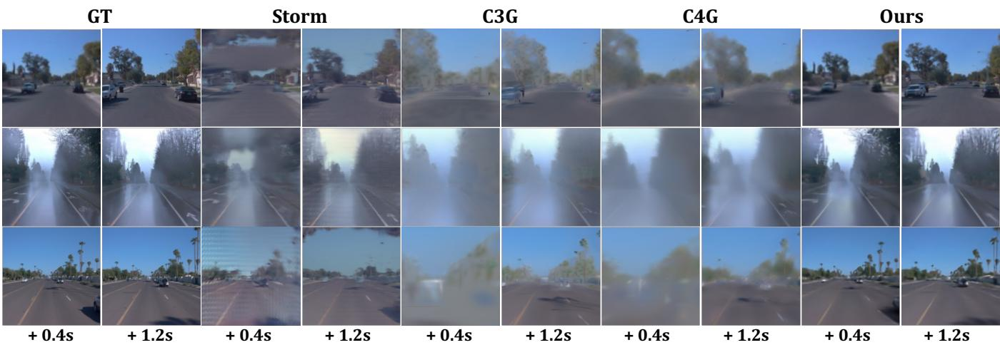
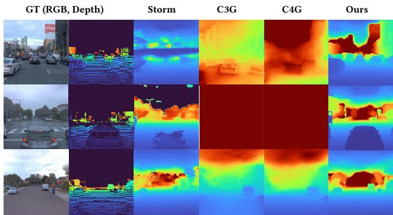

# HiQGS: Hierarchical Spatiotemporal Querying for Feed-Forward Gaussian Reconstruction

Qiaowei Miao∗1, Qifeng Cheng∗4,

Yijing Guo∗2, Yuru Xiao5, Ziqian Ni4, Sheng Yang4

1Zhejiang University

2ShanghaiTech University

3University of Cambridge

4NIO

5Harbin Institute of Technology

## Abstract

Feed-forward Gaussian reconstruction from sparse posed monocular frames requires reasoning over observations that vary jointly in viewpoint and time. Existing methods either predict Gaussian primitives from observation-aligned features or aggregate multi-frame information through compact latent queries. However, the former tightly couples Gaussian allocation to individual frames, while the latter does not explicitly structure observed evidence according to its temporal relation to the requested timestamp. Consequently, evidence across spatial scales, viewpoints, and timestamps can be dificult to align and integrate. We present HiQGS, a query-based hierarchical framework for feed-forward Gaussian scene reconstruction from sparse monocular frames. HiQGS introduces a Hierarchical Spatiotemporal Encoder that organizes multiresolution geometry-appearance visual features according to image location, observation time, and camera pose, thereby preserving complementary appearance and structural cues. Our Time-Adaptive Decoder use target timestamp queries the resulting hierarchical representation to retrieve relevant spatiotemporal evidence and predicts the corresponding Gaussian scene state. Experiments on static and dynamic scene reconstruction benchmarks demonstrate strong rendering quality and geometric accuracy, validating the efectiveness of hierarchical visual encoding and target-time-aware Gaussian querying.

## 1 Introduction

Feed-forward Gaussian reconstruction has emerged as an eficient alternative to per-scene optimization, directly mapping sparse visual observations to renderable 3D scenes (Charatan et al. 2024; Chen et al. 2024; Zhang et al. 2024; Xu et al. 2025a). Extending this paradigm to posed monocular videos enables dynamic scene reconstruction and novel-view rendering at arbitrary timestamps in a single forward pass. However, reconstructing dynamic scenes from sparse monocular frames cannot be achieved by processing each input independently. Each observation encodes appearance, geometry, timestamp, and camera pose, while camera motion couples viewpoint variation with temporal scene changes. Existing representations struggle to organize such heterogeneous evidence across observations, limiting their ability to infer the scene state at novel target time. This motivates a hierarchical spatiotemporal representation that preserves complementary visual cues and enables target-time evidence querying for Gaussian reconstruction.

Existing feed-forward Gaussian methods often predict Gaussian primitives from observation-aligned features and model temporal variation through deformation or additional temporal attributes, such as lifespan and low rank velocity (Lin et al. 2025a; Xu et al. 2025b; Ma et al. 2025a; Lin et al. 2026). Such observation-aligned allocation may repeatedly assign primitives to overlapping scene content, introducing representational redundancy, while dispersing complementary cues across frame-specific slots and making them dificult to consolidate into a coherent target-time scene state. Recently, scene-level query-based approaches (Ren et al. 2026; An et al. 2026; Itkin et al. 2026; Kim et al. 2026) have explored decoupling Gaussian prediction from individual observations by introducing compact latent queries. However, although these methods incorporate target-time conditioning, it is often introduced primarily through the latent queries, while the context representation provides limited structure for relating multi-frame evidence to the requested time. Consequently, integrating sparse observations across viewpoints and timestamps remains challenging when camera motion is entangled with scene dynamics.

To address these challenges, we present HiQGS, a hierarchical spatiotemporal querying framework for feedforward Gaussian reconstruction from sparse posed monocular frames. HiQGS formulates target-time reconstruction as two complementary stages: organizing multi-frame observations into a structured spatiotemporal context and querying this context for the scene state at a requested time. Specifically, the Hierarchical Spatiotemporal Encoder combines multi-level geometry features with fine-grained appearance features, while Temporal-Projective RoPE grounds the resulting visual tokens by patch location, observation time, and camera pose. The Time-Adaptive Decoder then conditions scene-level Gaussian queries on the target timestamp to retrieve complementary evidence from the hierarchical context and decode the corresponding Gaussian scene state. This design requires neither explicit motion parameterization nor cross-time primitive correspondence, and allows the encoded context to be reused for multiple target timestamps. Experiments on RealEstate10K(Zhou et al. 2018) and Waymo(Sun et al. 2020) demonstrate strong rendering quality and geometric accuracy across static and dynamic reconstruction settings. Our contributions are summarized as follows:

• We propose HiQGS, which formulates target-time Gaussian reconstruction as hierarchical spatiotemporal evidence organization followed by target-conditioned scene querying.

• We introduce a Hierarchical Spatiotemporal Encoder with complementary geometry–appearance features and Temporal-Projective RoPE, together with a Time-Adaptive Decoder for target-time-conditioned Gaussian state prediction.

• Experiments on RealEstate10K and Waymo demonstrate leading performance in static novel-view synthesis, dynamic-region reconstruction, and sparse-depth geometry estimation.

## 2 Related Work

## 2.1 Optimization-Based 4D Reconstruction

Optimization-based neural rendering methods optimize scene-specific spatiotemporal representations for individual sequences. Dynamic NeRFs model temporal variations through time-conditioned deformations into canonical fields (Pumarola et al. 2021; Park et al. 2021), which have been extended to Gaussian representations with deformation fields and spatiotemporal features (Yang et al. 2024a; Wu et al. 2024). Other approaches directly encode dynamics through 4D primitives, spatiotemporal Gaussians, or explicit motion trajectories (Yang et al. 2024b; Li et al. 2024; Luiten et al. 2024; Lee et al. 2024; Hu et al. 2025; Ma et al. 2025b; Chen et al. 2026b). While achieving high-quality reconstruction with strong temporal priors, these methods require sequence-specific optimization and often rely on dense observations or scene-specific assumptions, limiting generalizable reconstruction from sparse videos. HiQGS instead focuses on feed-forward reconstruction from sparse posed monocular videos without per-scene optimization.

## 2.2 Observation-Aligned Gaussian Prediction

Recent feed-forward Gaussian methods typically predict Gaussian primitives from observation-conditioned features, where pixels, rays, or patches provide direct references for Gaussian generation. pixelSplat, MVSplat, and GS-LRM establish this formulation, while DepthSplat and AnySplat further improve geometric grounding through depth priors and cross-view aggregation (Charatan et al. 2024; Chen et al. 2024; Zhang et al. 2024; Xu et al. 2025a; Jiang et al. 2025). Extending this paradigm to dynamic scenes, DGS-LRM, 4DGT, 4D-LRM, and MoVieS introduce deformation, motion, or temporal attributes for eficient 4D reconstruction (Lin et al. 2025a; Xu et al. 2025b; Ma et al. 2025a; Lin et al. 2026). However, these approaches remain closely tied to individual observations, potentially introducing representational redundancy and making it dificult to consolidate evidence across timestamps and viewpoints. HiQGS instead organizes multi-frame evidence into a hierarchically grounded spatiotemporal representation for target-time reconstruction.

## 2.3 Scene-Level Gaussian Queries

To reduce the dependency on individual observations, recent methods explore scene-level query representations, where compact latent variables aggregate observations and decode Gaussian primitives. LeanGaussian (Wu et al. 2025b), and Coca-Splat (Wu et al. 2025a) introduce query-based Gaussian reconstruction for object- and scene-level tasks, while C3G (An et al. 2026), TokenGS (Ren et al. 2026), Global-Splat (Itkin et al. 2026), and UniQueR (Peng et al. 2026) extend scene-level querying to scalable reconstruction. For dynamic scenes, TokenGS and C4G further incorporate targettime embedding for temporal Gaussian decoding (Ren et al. 2026; Kim et al. 2026). Nevertheless, such temporal conditioning is typically applied to the latent queries, while the context representation provides limited structure for relating multi-frame evidence to the requested time. HiQGS instead grounds hierarchical geometry and appearance features in a joint spatiotemporal reference defined by image location, observation time, and camera pose, and employs a Time-Adaptive Decoder to retrieve target-relevant evidence for Gaussian scene-state prediction.

## 3 Method

Our goal is to enable feed-forward Gaussian reconstruction from sparse posed monocular observations with a fixed number of Gaussian primitives that can generalize across diverse environments and dynamic states. Given V sparse observations $\{ ( \mathbf { I } _ { v } , \mathbf { C } _ { v } , t _ { v } ) \} _ { v = 1 } ^ { V }$ from a monocular video, where $\mathbf { I } _ { v } , \mathbf { C } _ { v } ,$ , and $t _ { v }$ denote the RGB frame, camera parameters, and timestamp, respectively, we aim to predict the Gaussian scene state $\mathcal { G } ( t ^ { * } )$ at a target time $t ^ { * }$ . Specifically, $\mathcal { G } ( t ^ { * } ) = \{ ( \mathbf { x } _ { i } , \mathbf { r } _ { i } , \mathbf { s } _ { i } , \alpha _ { i } , \mathbf { c } _ { i } ) \} _ { i = 1 } ^ { N }$ contains the position, rotation, scale, opacity, and appearance of each Gaussian, and can be rendered from an arbitrary target camera C∗.

Achieving this goal presents two challenges: (1) Sparse observations provide complementary appearance and geometry cues with diferent levels of spatial detail and semantic abstraction across time and viewpoints. These heterogeneous observations need to be organized into a unified representation while preserving their spatial, temporal, and geometric relationships. (2) The scene state at a target timestamp is not directly observed, which must be decoded from sparse context observations according to their temporal and geometric relations with the target state. HiQGS addresses these challenges with a Hierarchical Spatiotemporal Encoder (HSE) and a Time-Adaptive Decoder (TAD), as illustrated in Figure 1.

## 3.1 Hierarchical Spatiotemporal Encoder

Sparse monocular videos contain complementary appearance and geometry evidence with diferent spatial granularities and semantic abstraction levels. Fine-grained appearance cues are important for recovering local details and object boundaries, while geometry-aware features provide structural information across observations. To capture these complementary properties, we introduce a Hierarchical Spatiotemporal Encoder (HSE) that integrates geometry and appearance branches with diferent granularities. HSE further employs Temporal-Projective Rotary Positional Encoding (TP-RoPE) to establish spatiotemporal correspondence among visual tokens based on their image locations, observation timestamps, and camera geometry.

  
Figure 1: Overview of HiQGS. Given sparse posed frames from a monocular video, the Hierarchical Spatiotemporal Encoder (HSE) organizes complementary multi-level geometry features and fine-grained appearance features into a hierarchical context. TP-RoPE grounds the context tokens by patch location, observation timestamp, and camera pose. The Time-Adaptive Decoder (TAD) adapt a scene-level Gaussian queries on the requested timestamp and retrieves evidence from both feature streams to predict the corresponding Gaussian scene state G(t∗). The resulting Gaussians are rendered from the target camera, while the target-independent context representation can be reused to decode multiple timestamps.

Geometry encoder. The geometry branch adopts VGGT-Ω (Wang et al. 2026a) to extract geometry-aware representations from the context sequence. VGGT-Ω alternates intraframe reasoning and inter-frame aggregation, enabling the features to capture both local structure and cross-view geometric relations. To preserve geometry information at diferent abstraction levels, we collect intermediate features from layers $\mathcal { L } = \{ 4 , 1 1 , 1 7 , 2 3 \}$ } and fuse them into a unified representation. The resulting features are projected to obtain the geometry feature sequence Fgeo.

Appearance encoder. In parallel, the appearance branch employs a lightweight ViT-style encoder (Dosovitskiy et al. 2021) with a smaller patch size $P _ { \mathrm { a p p } } < P _ { \mathrm { g e o } }$ . The denser token grid preserves fine-grained photometric details, including textures and object boundaries, that may be underrepresented in the geometry branch. The content pathway receives only RGB patches and performs self-attention, while camera and temporal information are introduced separately through TP-RoPE. This design avoids explicitly concatenating ray or camera embeddings into appearance features, preserving a clean separation between visual content and spatiotemporal grounding. Together, Fgeo and Fapp provide complementary evidence: the geometry branch captures multi-view structural relations, while the appearance branch preserves fine-grained visual details required for faithful rendering.

Temporal Projective RoPE (TP-RoPE). To establish a unified spatiotemporal reference for heterogeneous visual tokens, we introduce TP-RoPE, which extends the projective camera encoding of PRoPE (Li et al. 2025) with an explicit temporal component. For token i from frame v in branch $b \in \{ \mathrm { g e o } , \mathrm { a p p } \}$ , we define its positional operator as:

$$
\mathbf { D } _ { v , i } ^ { b } = \mathbf { R } _ { h } ( h _ { i } ^ { b } ) \oplus \mathbf { R } _ { w } ( w _ { i } ^ { b } ) \oplus \mathbf { R } _ { t } ( t _ { v } ) \oplus \mathbf { P } ( \mathbf { C } _ { v } ) ,\tag{1}
$$

where ${ \mathbf { R } } _ { h } , { \mathbf { R } } _ { w }$ , and $\mathbf { R } _ { t }$ denote rotary operators for image height, width, and observation time, respectively, and $\mathbf { P } ( \mathbf { C } _ { v } )$ follows the projective camera encoding in PRoPE. Here, ⊕ denotes a channel-wise direct sum. The four components occupy separate channel subspaces and rotate the query and key projections before attention. This formulation explicitly associates each visual token with its image location, observation time, and camera geometry, enabling attention to reason over spatiotemporal correspondences across observations.

The spatial coordinates $\bar { ( h _ { i } ^ { b } , w _ { i } ^ { b } ) }$ are defined on the native patch grid of each branch, allowing TP-RoPE to accommodate heterogeneous token granularities. We apply TP-RoPE to the attention blocks of both branches. In the geometry branch, the projective and temporal components help establish cross-view geometric correspondence across observations. In contrast, the appearance branch focuses on preserving fine-grained visual details, where TP-RoPE associates appearance tokens with their acquisition conditions, including image location, observation time, and camera context.

## 3.2 Time-Adaptive Decoder

Given the spatiotemporally grounded features $\mathbf { F } ^ { \mathrm { g e o } }$ and $\mathbf { F } ^ { \mathrm { a p p } }$ , the decoder predicts the Gaussian scene state at a target timestamp t∗. We introduce a Time-Adaptive Decoder (TAD), which injects the target timestamp into the decoding process through adaptive layer normalization. By conditioning Gaussian queries on t∗, TAD transforms a shared query basis into diferent scene states over time.

Scene-level Gaussian querying. We initialize a fixed set of learnable Gaussian queries: $\mathbf { Q } ^ { 0 } = \{ \mathbf { q } _ { i } ^ { 0 } \} _ { i = 1 } ^ { N _ { q } }$ . These queries do not encode predefined semantic categories and serve as a shared basis for Gaussian scene decoding. At decoder block $\ell ,$ the query features are denoted as: $\mathbf { Q } ^ { \bar { \ell } } = \{ \mathbf { q } _ { i } ^ { \ell } \} _ { i = 1 } ^ { N _ { q } }$ . Each TAD block performs cross-attention from Gaussian queries to the grounded encoder features $\mathbf { F } ^ { \mathrm { g e o } }$ and $\mathbf { F } ^ { \mathrm { a p p } }$ , followed by self-attention among Gaussian queries and a feed-forward network. Cross-attention aggregates complementary geometry and appearance evidence, self-attention models interactions among Gaussian queries, and the feed-forward network refines the target scene representation.

Target-time adaptive modulation. We encode the target timestamp $t ^ { * }$ into a temporal embedding $\mathbf { e } _ { t ^ { * } }$ ∗ and apply adaptive layer normalization to each sub-layer of TAD:

$$
\mathrm { A d a L N } _ { \ell } ( \mathbf { Q } ^ { \ell } ; \mathbf { e } _ { t ^ { * } } ) = \gamma _ { \ell } ( \mathbf { e } _ { t ^ { * } } ) \odot \mathrm { L N } ( \mathbf { Q } ^ { \ell } ) + \beta _ { \ell } ( \mathbf { e } _ { t ^ { * } } ) ,\tag{2}
$$

where $\gamma _ { \ell }$ and $\beta _ { \ell }$ are learned projections of the temporal embedding for decoder block ℓ. The resulting time-conditioned queries are used for cross-attention, self-attention, and feedforward refinement, enabling the same query basis to decode diferent scene states at diferent timestamps.

Target-state Gaussian decoding. After L decoder blocks, each query $\mathbf { q } _ { i } ^ { L } ( t ^ { * } )$ predicts M Gaussian primitives:

$$
\pmb { \theta } _ { i , m } ( t ^ { * } ) = \big ( \pmb { \mu } _ { i , m } ( t ^ { * } ) , \mathbf { r } _ { i , m } ( t ^ { * } ) , \mathbf { s } _ { i , m } ( t ^ { * } ) , \alpha _ { i , m } ( t ^ { * } ) , \mathbf { c } _ { i , m } ( t ^ { * } ) \big )\tag{3}
$$

where $\mu _ { i , m } , \mathbf { r } _ { i , m } , \mathbf { s } _ { i , m } , \alpha _ { i , m } .$ , and $\mathbf { c } _ { i , m }$ denote the position, rotation, scale, opacity, and appearance of each Gaussian primitive. The complete Gaussian scene state is:

$$
\mathcal { G } ( t ^ { * } ) = \{ \pmb { \theta } _ { i , m } ( t ^ { * } ) \} _ { i = 1 , \dots , N _ { q } ; m = 1 , \dots , M } .\tag{4}
$$

Changing $t ^ { * }$ only modifies the temporal conditioning of TAD, allowing the shared Gaussian query basis to generate diferent scene states without relying on an explicit deformation field or predefined motion model.

## 3.3 Training Objectives

Target-conditioned rendering supervision. For each training instance, we sample $T ^ { ^ { - } }$ target observations $\{ ( \mathbf { I } _ { k } ^ { * } , \check { \mathbf { C } } _ { k } ^ { * } , t _ { k } ^ { * } ) \} _ { k = 1 } ^ { T }$ from the same sequence as the context observations. The HSE features $\mathbf { F } ^ { \mathrm { g e o } }$ and $\mathbf { F } ^ { \mathrm { a p p } }$ are computed once from the context observations and shared across diferent target timestamps. For each target timestamp $t _ { k } ^ { * }$ , the TAD conditions the Gaussian query stream on the target time and predicts the corresponding Gaussian scene state:

$$
\mathcal { G } _ { k } = \mathcal { G } ( t _ { k } ^ { * } ) .\tag{5}
$$

Each predicted Gaussian scene state is rendered from its corresponding target camera:

$$
\widehat { \mathbf { I } } _ { k } = \mathcal { R } \left( \mathcal { G } _ { k } , \mathbf { C } _ { k } ^ { * } \right) ,\tag{6}
$$

where $\widehat { \mathbf { I } } _ { k }$ denotes the rendered RGB image. Supervising multiple target timestamps enables the shared Gaussian query basis to represent diferent scene states under varying temporal conditions. We do not impose explicit correspondence between Gaussian primitives predicted at diferent timestamps.

Reconstruction supervision. We supervise the rendered target views with a photometric reconstruction loss and a structural similarity loss:

$$
\mathcal { L } _ { \mathrm { r g b } } = \frac { 1 } { T } \sum _ { k = 1 } ^ { T } \left. \widehat { \mathbf { I } } _ { k } - \mathbf { I } _ { k } ^ { * } \right. _ { 2 } ^ { 2 } ,\tag{7}
$$

$$
\mathcal { L } _ { \mathrm { s s i m } } = \frac { 1 } { T } \sum _ { k = 1 } ^ { T } \left( 1 - \mathrm { S S I M } ( \widehat { \mathbf { I } } _ { k } , \mathbf { I } _ { k } ^ { * } ) \right) .\tag{8}
$$

Both losses are averaged over the sampled target timestamps.

Projection regularization. Although rendering supervision encourages the predicted Gaussians to explain the target observations, sparse views may leave some Gaussian primitives outside all supervised camera frustums. We therefore introduce a lightweight projection regularizer to constrain the spatial distribution of predicted Gaussians.

Let $n \in \{ 1 , \ldots , N _ { G } \}$ index the flattened Gaussian primitives, where $N _ { G } = N _ { q } M$ denotes the total number of primitives generated by $\bar { N _ { q } } ^ { - }$ Gaussian queries and each query expands into M primitives. Let $\overline { { \mathbf { u } } } _ { n , k } \in \mathbb { R } ^ { 2 }$ denote the normalized image-plane projection of primitive n under target camera $\mathbf { C } _ { k } ^ { * }$ . The valid image domain is $[ - 1 , 1 ] ^ { 2 }$ . We define:

$$
\mathcal { L } _ { \mathrm { p r o j } } = \frac { 1 } { N _ { G } } \sum _ { n = 1 } ^ { N _ { G } } \operatorname* { m i n } _ { 1 \leq k \leq T } \left. \mathrm { R e L U } \left( \left| \overline { { \mathbf { u } } } _ { n , k } \right| - 1 \right) \right. _ { 1 } .\tag{9}
$$

The minimum over target views penalizes a Gaussian primitive only when it lies outside every sampled target view, allowing primitives to specialize to diferent observations without enforcing cross-time primitive matching.

Overall objective. The complete training objective is:

$$
\mathcal { L } = \mathcal { L } _ { \mathrm { r g b } } + \lambda _ { \mathrm { s s i m } } \mathcal { L } _ { \mathrm { s s i m } } + \lambda _ { \mathrm { p r o j } } \mathcal { L } _ { \mathrm { p r o j } } .\tag{10}
$$

HiQGS requires no explicit motion parameterization, predefined static-dynamic Gaussian partitioning, optical flow, scene flow, trajectory supervision, or cross-time primitive correspondence. Instead, multi-timestamp rendering supervision jointly trains the hierarchical spatiotemporal representation and the time-adaptive Gaussian decoder to reconstruct the requested scene state.

## 4 Experiments

## 4.1 Experimental Setup

Implementation details. We initialize the geometry encoder from the pretrained VGGT-Ω model (Wang et al. 2026a), which uses a patch size of $1 6 \times 1 6$ . The appearance branch employs a lightweight ViT-style encoder with a patch size of $8 \times { \mathrm { 8 . ~ } } { \mathrm { \dot { A } l } }$ l input images are resized to $2 5 6 \times 2 5 6$ The decoder maintains a fixed bank of $N _ { q } = 1 \small { , } 0 2 4$ learnable, role-agnostic Gaussian tokens. Each token is decoded into $M = 6 4$ Gaussian primitives, yielding $N _ { G } = N _ { q } M =$ 65,536 Gaussians for each target timestamp. The predicted Gaussians are rendered using the gsplat rasterizer (Ye et al. 2025). We train the model using the RGB reconstruction loss, the SSIM loss with $\lambda _ { \mathrm { s s i m } } = 0 . \overset { \cdot } { 2 }$ , and the projection regularizer with $\lambda _ { \mathrm { p r o j } } = 1 . 0$ . For sequences with sparse LiDAR supervision, we additionally apply a masked depth loss over valid projected LiDAR pixels, with $\lambda _ { \mathrm { d e p t h } } = 0 . 2$ . We use AdamW with a one-cycle learning-rate schedule and a learning rate of $4 \times 1 0 ^ { - 5 }$ . Training runs for 150K optimization steps, corresponding to 300 epochs, and takes approximately 30 hours on eight NVIDIA H800 GPUs.

Datasets. We evaluate HiQGS on static scene reconstruction using RealEstate10K (RE10K) and dynamic streetscene reconstruction using the Waymo Open Dataset. For RealEstate10K, we follow the evaluation protocol used by recent feed-forward Gaussian reconstruction methods (Ren et al. 2026; Xu et al. 2025a; Chen et al. 2024; Zhang et al. 2024; Shi et al. 2026). We sample $V$ context frames from each sequence and evaluate novel-view synthesis on heldout frames under the interpolation and extrapolation settings. For the Waymo Open Dataset, we use the oficial split of 798 training scenes and 202 validation scenes. Following recent feed-forward street-scene reconstruction methods (Yang et al. 2025; Yu et al. 2026), each sample contains a 20-frame front-camera clip. Frames at indices 0, 5, 10, and 15 are used as context observations, and the remaining frames are used as targets. Sparse LiDAR depth is projected onto the frontcamera images and used for depth supervision and geometry evaluation.

Baselines. We compare HiQGS with representative feedforward methods from three categories. First, visual geometry models, including VGGT-Ω (Wang et al. 2026a) and $\pi ^ { 3 }$ (Wang et al. 2026b), predict dense scene geometry but do not directly produce a renderable Gaussian scene state at an arbitrary target time. We therefore include them only in the geometry evaluation. Second, we compare with observation-aligned Gaussian reconstruction methods. The feed-forward 3DGS variant of DA3 (Lin et al. 2025b) decodes pixel-aligned Gaussians for novel-view synthesis, while DGGT (Chen et al. 2026a) predicts per-frame pixelaligned Gaussian maps and models temporal visibility and motion for dynamic driving scenes. Finally, TokenGS (Ren et al. 2026) and C3G (An et al. 2026) use learnable Gaussian queries to aggregate multi-view evidence into compact scene-level representations.

## 4.2 Dynamic Reconstruction

We evaluate HiQGS on the Waymo Open Dataset using the 20-frame temporal sampling protocol adopted by recent feedforward street-scene reconstruction methods (Yang et al. 2025; Yu et al. 2026), restricted to the front camera. Each sample contains 20 consecutive frames. We use frames at indices 0, 5, 10, and 15 as context observations and render the remaining 16 frames at their recorded timestamps and camera poses. The target frames cover both interpolation between context observations and short-horizon extrapolation beyond the last context frame.

RGB synthesis. Table 1 reports PSNR, SSIM, and LPIPS on dynamic regions and full images. The dynamic-region evaluation isolates moving content, whereas the full-image evaluation measures reconstruction quality over the entire scene. HiQGS improves the reconstruction of dynamic regions while maintaining high full-image quality. These results show that the target-time-conditioned decoder captures changes in moving objects without degrading the appearance of the static background.

<table><tr><td rowspan="2">Method</td><td>Dynamic Only</td><td></td><td>Full Image</td></tr><tr><td>PSNR↑</td><td>SSIM↑</td><td>PSNR↑ SSIM↑</td></tr><tr><td>PVG</td><td>15.51</td><td>0.128</td><td>22.38 0.661</td></tr><tr><td>AnySplat</td><td>15.99</td><td>0.418 23.32</td><td>0.687</td></tr><tr><td>AnySplat*</td><td></td><td>17.33</td><td>0.590</td></tr><tr><td>DA3 w/ GS Head</td><td>15.96</td><td>0.429</td><td>23.27 0.686</td></tr><tr><td>STORM</td><td>22.10</td><td>0.624 26.38</td><td>0.794</td></tr><tr><td>STORM*</td><td></td><td>17.22</td><td>0.63</td></tr><tr><td>DGGT</td><td>20.99</td><td>0.821 27.41</td><td>0.846</td></tr><tr><td>DGGT*</td><td></td><td>17.34</td><td>0.590</td></tr><tr><td>C3G*</td><td>I</td><td>15.81</td><td>0.577</td></tr><tr><td>C4G*</td><td></td><td>16.10</td><td>0.600</td></tr><tr><td>StreetForward</td><td>24.30</td><td>0.827</td><td>27.01 0.818</td></tr><tr><td>HiQGS (Ours)</td><td>24.41</td><td>0.833</td><td>27.69 0.840</td></tr></table>

\* denotes our implementation due to their first-party models and inference codes. Please refer to supplementary document for details.

Table 1: Quantitative comparison of Waymo original-view RGB synthesis with 4 context frames and 16 target frames per 20-frame clip. For baseline methods, we use the published results reported in StreetForward.
<table><tr><td>Metric</td><td></td><td>DGGT AnySplat STORM</td><td></td><td>C3G C4G</td><td>HiQGS</td></tr><tr><td>AME↓</td><td>7.53</td><td>7.96</td><td>8.97</td><td>52.34 55.15</td><td>7.12</td></tr><tr><td>MSE↓</td><td>11.12</td><td>10.25</td><td>12.44</td><td>54.69 53.67</td><td>8.10</td></tr></table>

Table 2: Quantitative comparison of Waymo sparse-depth accuracy against projected LiDAR depth.

Depth accuracy. Table 2 evaluates geometry using AME and MSE against sparse LiDAR depth projected onto the front-camera images. Both metrics are computed over valid LiDAR pixels and reported separately for static regions, dynamic regions, and the full image. HiQGS reduces the depth error across these partitions, including the more challenging dynamic regions. Together with the RGB results, the depth evaluation shows that HiQGS reconstructs the 3D scene state at the requested timestamp rather than merely matching its image-space appearance.

## 4.3 Static Scene Reconstruction

We evaluate novel-view synthesis on RealEstate10K under the interpolation protocol. Following prior feed-forward 3DGS methods, each sample uses two context views, with four target views sampled between them. As shown in Table 3, HiQGS performs strongly in this static setting despite being developed primarily for dynamic reconstruction. The results indicate that its hierarchical appearance–geometry representation and Gaussian-token decoder also support effective static scene reconstruction from sparse views.

We further evaluate view extrapolation on RE10K, where each sample uses 2 context views and 4 target views are selected. Compared with interpolation, this setting is more challenging because the model must infer plausible boundary geometry beyond the observed camera range rather than only synthesize views between observations. Our method maintains strong rendering quality under extrapolated viewpoints, suggesting that the learned Gaussian tokens form a coherent scene representation instead of merely fitting the observed input views. These results show that, despite being designed for dynamic reconstruction, our framework preserves excellent static-scene reconstruction quality and rendering consistency.

  
Figure 2: Qualitative comparison on RealEstate10K under the interpolation setting. HiQGS reconstructs the scene and renders held-out intermediate viewpoints with coherent geometry and fine-grained appearance details.

<table><tr><td colspan="5">Interpolation</td><td colspan="3">Extrapolation</td></tr><tr><td>Method</td><td>#GS↓</td><td>PSNR↑</td><td>SSIM↑</td><td>LPIPS↓</td><td>PSNR↑</td><td>SSIM↑</td><td>LPIPS↓</td></tr><tr><td>MVSplat</td><td>131K</td><td>26.39</td><td>0.869</td><td>0.128</td><td>19.52</td><td>0.757</td><td>0.231</td></tr><tr><td>DepthSplat</td><td>131K</td><td>27.47</td><td>0.889</td><td>0.114</td><td>20.43</td><td>0.788</td><td>0.218</td></tr><tr><td>GS-LRM</td><td>131K</td><td>28.10</td><td>0.892</td><td>0.114</td><td></td><td></td><td></td></tr><tr><td>TokenGS</td><td>66K</td><td>27.33</td><td>0.882</td><td>0.173</td><td>22.60</td><td>0.831</td><td>0.222</td></tr><tr><td>HiQGS (Ours)</td><td>66K</td><td>28.31</td><td>0.911</td><td>0.102</td><td>23.21</td><td>0.840</td><td>0.210</td></tr></table>

Table 3: Quantitative comparison of RealEstate10K interpolation and extrapolation with two context views. For baseline methods, we use the published results reported in TokenGS.

## 4.4 Ablation study

Efect of HSE. The results are reported in Table 4. Removing the geometry encoder reduces PSNR from 27.69 to 26.92 and SSIM from 0.840 to 0.821. In this variant, the Hierarchical Spatiotemporal Encoder retains only the fine-grained appearance tokens and loses the multi-level geometry features extracted by VGGT-Ω. The resulting representation is therefore no longer hierarchical in both geometry and appearance. The performance drop verifies that geometry features at diferent abstraction levels provide complementary structural evidence for the Time-Adaptive Decoder.

Removing the appearance encoder decreases PSNR by

<table><tr><td>Method</td><td>PSNR↑</td><td>SSIM↑</td></tr><tr><td>w/o. HSE.GE.</td><td>26.92</td><td>0.821</td></tr><tr><td>w/o. HSE.AE.</td><td>27.24</td><td>0.817</td></tr><tr><td>w/o. HSE.TP-RoPE</td><td>25.87</td><td>0.776</td></tr><tr><td>w/o. TAD.TE</td><td>26.12</td><td>0.803</td></tr><tr><td>HiQGS (Ours)</td><td>27.69</td><td>0.840</td></tr></table>

Table 4: Ablation study on the Waymo dataset. PSNR and SSIM are reported on full-image evaluation.

0.45 dB and SSIM by 0.023. The remaining VGGT-Ω features preserve coarse structural and geometric information, but do not provide the same fine-grained appearance evidence as the denser appearance tokens. This result confirms that the two branches of HSE are complementary: the geometry encoder provides multi-level structural cues, while the appearance encoder supplies finer visual evidence for Gaussian reconstruction.

Removing TP-RoPE causes the largest degradation, reducing PSNR by 1.82 dB and SSIM by 0.064. Although both geometry and appearance tokens are retained, they are no longer explicitly associated with their image locations, observation timestamps, and camera poses. The Time-Adaptive Decoder must then query heterogeneous tokens without a shared spatiotemporal and projective reference. This result shows that simply combining multi-resolution features is insuficient; their observation conditions must be explicitly encoded before hierarchical querying.

  
Figure 3: Qualitative comparison on the Waymo dataset. The target at +0.4 s lies within the temporal range of the context frames and evaluates temporal interpolation, whereas the target at +1.2 s lies outside this range and evaluates temporal extrapolation.

  
Figure 4: Qualitative depth comparison under sparse depth supervision. HiQGS recovers object geometry and delineates object boundaries more accurately than the baselines.

Efect ofTAD. We remove the target-time embedding from the Time-Adaptive Decoder while retaining its Gaussian tokens, cross-attention, self-attention, and feed-forward layers. The HSE representation still records when and from where each context token was observed, but the decoder is no longer conditioned on the requested timestamp t∗. Consequently, the same Gaussian-token decoding process is applied to diferent target times. The resulting drops of 1.57 dB in PSNR and 0.037 in SSIM demonstrate that encoding observation time in HSE alone is not suficient: TAD must also use the target timestamp to adapt the query features throughout hierarchical evidence aggregation and Gaussian-state prediction.

## 5 Conclusion

We presented HiQGS, a feed-forward framework for reconstructing renderable Gaussian scene states from sparse posed monocular video frames. The key idea is to separate the organization of context observations from the decoding of a requested scene state. HiQGS directly predicts a targetspecific Gaussian field without prescribing a motion model or enforcing primitive correspondence across time, and the encoded context can be reused to decode multiple target timestamps. Experiments on both dynamic and static reconstruction benchmarks demonstrate strong rendering and geometric accuracy, supporting hierarchical context encoding and temporally grounded querying as an efective design for generalizable feed-forward Gaussian reconstruction.

Limitations. Although HiQGS performs well on RE10K and Waymo, these datasets cover only a limited range of real-world scene dynamics and capture conditions. For rare or highly complex motions that difer substantially from the training distribution, the predicted Gaussians may become spatially difuse, leading to localized degradation in reconstruction quality. We hypothesize that the limited diversity of motion patterns in the current training data is one contributing factor. Moreover, HiQGS does not explicitly model or supervise motion velocity; instead, motion rates must be inferred implicitly from sparse spatiotemporal observations. Consequently, temporal extrapolation beyond the context interval remains less reliable, particularly for fast, accelerating, or non-linear motions. An important direction for future work is therefore to scale HiQGS to larger and more diverse video collections and investigate velocity-aware temporal modeling or motion priors, with the goal of improving robustness to long-tail dynamics and out-of-range temporal extrapolation.

## References

An, H.; Jung, J.; Kim, M.; Kim, C.; Jeon, M.; Han, J.; Fukuda, K.; Narihira, T.; Ko, H.; Kim, J.; Hong, S.; Mitsufuji, Y.; and Kim, S. 2026. Learning Compact 3D Representations from Feed-Forward Novel View Synthesis. In Proceedings of the IEEE/CVF Conference on Computer Vision and Pattern Recognition (CVPR), 363–373.

Charatan, D.; Li, S. L.; Tagliasacchi, A.; and Sitzmann, V. 2024. pixelSplat: 3D Gaussian Splats from Image Pairs for Scalable Generalizable 3D Reconstruction. In Proceedings of the IEEE/CVF Conference on Computer Vision and Pattern Recognition (CVPR), 19457–19467.

Chen, X.; Xiong, Z.; Chen, Y.; Li, G.; Wang, N.; Luo, H.; Chen, L.; Sun, H.; Wang, B.; Chen, G.; Li, H.; Zhang, Y.- Q.; Ye, H.; and Zhao, H. 2026a. DGGT: Feedforward 4D Reconstruction of Dynamic Driving Scenes Using Unposed Images. In Proceedings of the IEEE/CVF Conference on Computer Vision and Pattern Recognition (CVPR), 1265– 1276.

Chen, Y.; Gu, C.; Jiang, J.; Zhu, X.; and Zhang, L. 2026b. Periodic Vibration Gaussian: Dynamic Urban Scene Reconstruction and Real-time Rendering. International Journal of Computer Vision, 134(3): 83.

Chen, Y.; Xu, H.; Zheng, C.; Zhuang, B.; Pollefeys, M.; Geiger, A.; Cham, T.-J.; and Cai, J. 2024. MVSplat: Eficient 3D Gaussian Splatting from Sparse Multi-View Images. In European Conference on Computer Vision (ECCV), 370– 386.

Dosovitskiy, A.; Beyer, L.; Kolesnikov, A.; Weissenborn, D.; Zhai, X.; Unterthiner, T.; Dehghani, M.; Minderer, M.; Heigold, G.; Gelly, S.; Uszkoreit, J.; and Houlsby, N. 2021. An Image Is Worth 16x16 Words: Transformers for Image Recognition at Scale. In International Conference on Learning Representations (ICLR).

Hu, B.; Li, Y.; Xie, R.; Xu, B.; Dong, H.; Yao, J.; and Lee, G. H. 2025. Learnable Infinite Taylor Gaussian for Dynamic View Rendering. In Proceedings of the IEEE/CVF Conference on Computer Vision and Pattern Recognition (CVPR), 26844–26854.

Itkin, R.; Issachar, N.; Keypur, Y.; Chen, X.; Chen, A.; and Benaim, S. 2026. GlobalSplat: Eficient Feed-Forward 3D Gaussian Splatting via Global Scene Tokens. In European Conference on Computer Vision (ECCV). To appear; proceedings pages not yet assigned.

Jiang, L.; Mao, Y.; Xu, L.; Lu, T.; Ren, K.; Jin, Y.; Xu, X.; Yu, M.; Pang, J.; Zhao, F.; Lin, D.; and Dai, B. 2025. AnySplat: Feed-forward 3D Gaussian Splatting from Unconstrained Views. ACM Transactions on Graphics, 44(6): 257:1–257:16.

Kim, M.; Jeon, M.; An, H.; Jung, J.; Ko, H.; Han, J.; Yu, H.; Shin, D.; Hong, S.; Narihira, T.; Fukuda, K.; Mitsufuji, Y.; and Kim, S. 2026. Learning Global Motion with Compact Gaussians for Feed-Forward 4D Reconstruction. arXiv preprint arXiv:2605.31595.

Lee, J.; Won, C.; Jung, H.; Bae, I.; and Jeon, H.-G. 2024. Fully Explicit Dynamic Gaussian Splatting. In Advances in

Neural Information Processing Systems, volume 37, 5384– 5409.

Li, R.; Yi, B.; Liu, J.; Gao, H.; Ma, Y.; and Kanazawa, A. 2025. Cameras as Relative Positional Encoding. In Advances in Neural Information Processing Systems, volume 38.

Li, Z.; Chen, Z.; Li, Z.; and Xu, Y. 2024. Spacetime Gaussian Feature Splatting for Real-Time Dynamic View Synthesis. In Proceedings of the IEEE/CVF Conference on Computer Vision and Pattern Recognition (CVPR), 8508–8520.

Lin, C.; Lin, Y.; Pan, P.; Yu, Y.; Hu, T.; Yan, H.; Fragkiadaki, K.; and Mu, Y. 2026. MoVieS: Motion-Aware 4D Dynamic View Synthesis in One Second. In Proceedings of the IEEE/CVF Conference on Computer Vision and Pattern Recognition (CVPR), 295–306.

Lin, C. H.; Lv, Z.; Wu, S.; Xu, Z.; Nguyen-Phuoc, T.; Tseng, H.-Y.; Straub, J.; Khan, N.; Xiao, L.; Yang, M.-H.; Ren, Y.; Newcombe, R.; Dong, Z.; and Li, Z. 2025a. DGS-LRM: Real-Time Deformable 3D Gaussian Reconstruction From Monocular Videos. In Advances in Neural Information Processing Systems, volume 38.

Lin, H.; Chen, S.; Liew, J.; Chen, D. Y.; Li, Z.; Shi, G.; Feng, J.; and Kang, B. 2025b. Depth anything 3: Recovering the visual space from any views. arXivpreprint arXiv:2511.10647.

Luiten, J.; Kopanas, G.; Leibe, B.; and Ramanan, D. 2024. Dynamic 3D Gaussians: Tracking by Persistent Dynamic View Synthesis. In International Conference on 3D Vision (3DV), 800–809.

Ma, Z.; Chen, X.; Yu, S.; Bi, S.; Zhang, K.; Chen, Z.; Xu, S.; Yang, J.; Xu, Z.; Sunkavalli, K.; Bansal, M.; Chai, J.; and Tan, H. 2025a. 4D-LRM: Large Space-Time Reconstruction Model From and To Any View at Any Time. In Advances in Neural Information Processing Systems, volume 38.

Ma, Z.; Jiang, J.; Chen, Y.; and Zhang, L. 2025b. BézierGS: Dynamic Urban Scene Reconstruction with Bézier Curve Gaussian Splatting. In Proceedings of the IEEE/CVF International Conference on Computer Vision (ICCV), 25519– 25528.

Park, K.; Sinha, U.; Barron, J. T.; Bouaziz, S.; Goldman, D. B.; Seitz, S. M.; and Martin-Brualla, R. 2021. Nerfies: Deformable Neural Radiance Fields. In Proceedings of the IEEE/CVF International Conference on Computer Vision (ICCV), 5865–5874.

Peng, C.; Herau, Q.; Yang, J.; Xie, Y.; Hu, Y.; Zheng, W.; Strong, M.; Tomizuka, M.; and Zhan, W. 2026. UniQueR: Unified Query-based Feedforward 3D Reconstruction. arXiv preprint arXiv:2603.22851.

Pumarola, A.; Corona, E.; Pons-Moll, G.; and Moreno-Noguer, F. 2021. D-NeRF: Neural Radiance Fields for Dynamic Scenes. In Proceedings of the IEEE/CVF Conference on Computer Vision and Pattern Recognition (CVPR), 10318–10327.

Ren, J.; Tyszkiewicz, M. J.; Huang, J.; and Gojcic, Z. 2026. TokenGS: Decoupling 3D Gaussian Prediction from Pixels with Learnable Tokens. In Proceedings of the IEEE/CVF Conference on Computer Vision and Pattern Recognition (CVPR), 15365–15375.

Shi, D.; Wang, W.; Chen, D. Y.; Zhang, Z.; Bian, J.-W.; and Zhuang, B. 2026. Revisiting Depth Representations for Feed-Forward 3D Gaussian Splatting. In International Conference on 3D Vision (3DV), 1071–1080.

Sun, P.; Kretzschmar, H.; Dotiwalla, X.; Chouard, A.; Patnaik, V.; Tsui, P.; Guo, J.; Zhou, Y.; Chai, Y.; Caine, B.; Vasudevan, V.; Han, W.; Ngiam, J.; Zhao, H.; Timofeev, A.; Ettinger, S.; Krivokon, M.; Gao, A.; Joshi, A.; Zhang, Y.; Shlens, J.; Chen, Z.; and Anguelov, D. 2020. Scalability in Perception for Autonomous Driving: Waymo Open Dataset. In Proceedings of the IEEE/CVF Conference on Computer Vision and Pattern Recognition (CVPR).

Wang, J.; Chen, M.; Zhang, S.; Karaev, N.; Schönberger, J.; Labatut, P.; Bojanowski, P.; Novotny, D.; Vedaldi, A.; and Rupprecht, C. 2026a. VGGT-Ω. In Proceedings of the IEEE/CVF Conference on Computer Vision and Pattern Recognition (CVPR).

Wang, Y.; Zhou, J.; Zhu, H.; Chang, W.; Zhou, Y.; Li, Z.; Chen, J.; Pang, J.; Shen, C.; and He, T. 2026b. \$\pi^3\$: Permutation-Equivariant Visual Geometry Learning. In The Fourteenth International Conference on Learning Representations.

Wu, G.; Yi, T.; Fang, J.; Xie, L.; Zhang, X.; Wei, W.; Liu, W.; Tian, Q.; and Wang, X. 2024. 4D Gaussian Splatting for Real-Time Dynamic Scene Rendering. In Proceedings of the IEEE/CVF Conference on Computer Vision and Pattern Recognition (CVPR), 20310–20320.

Wu, J.; Li, H.; Jiang, X.; Yao, Y.; and Zhang, L. 2025a. Coca-Splat: Collaborative Optimization for Camera Parameters and 3D Gaussians. arXiv preprint arXiv:2504.00639.

Wu, J.; Liu, K.; Gao, H.; Jiang, X.; Yao, Y.; and Zhang, L. 2025b. LeanGaussian: Breaking Pixel or Point Cloud Correspondence in Modeling 3D Gaussians. In Proceedings of the IEEE/CVF Conference on Computer Vision and Pattern Recognition (CVPR), 26641–26651.

Xu, H.; Peng, S.; Wang, F.; Blum, H.; Barath, D.; Geiger, A.; and Pollefeys, M. 2025a. DepthSplat: Connecting Gaussian Splatting and Depth. In Proceedings of the IEEE/CVF Conference on Computer Vision and Pattern Recognition (CVPR), 16453–16463.

Xu, Z.; Li, Z.; Dong, Z.; Zhou, X.; Newcombe, R.; and Lv, Z. 2025b. 4DGT: Learning a 4D Gaussian Transformer Using Real-World Monocular Videos. In Advances in Neural Information Processing Systems, volume 38.

Yang, J.; Huang, J.; Ivanovic, B.; Chen, Y.; Wang, Y.; Li, B.; You, Y.; Sharma, A.; Igl, M.; Karkus, P.; Xu, D.; Wang, Y.; and Pavone, M. 2025. STORM: Spatio-TempOral Reconstruction Model for Large-Scale Outdoor Scenes. In International Conference on Learning Representations (ICLR).

Yang, Z.; Gao, X.; Zhou, W.; Jiao, S.; Zhang, Y.; and Jin, X. 2024a. Deformable 3D Gaussians for High-Fidelity Monocular Dynamic Scene Reconstruction. In Proceedings of the IEEE/CVF Conference on Computer Vision and Pattern Recognition (CVPR), 20331–20341.

Yang, Z.; Yang, H.; Pan, Z.; and Zhang, L. 2024b. Real-Time Photorealistic Dynamic Scene Representation and Rendering

with 4D Gaussian Splatting. In International Conference on Learning Representations (ICLR).

Ye, V.; Li, R.; Kerr, J.; Turkulainen, M.; Yi, B.; Pan, Z.; Seiskari, O.; Ye, J.; Hu, J.; Tancik, M.; and Kanazawa, A. 2025. gsplat: An Open-Source Library for Gaussian Splatting. Journal ofMachine Learning Research, 26(34): 1–17.

Yu, Z.; Wang, Z.; Xie, Y.; Wang, Y.; Zhang, X.; Zhan, Y.; and Zhan, K. 2026. StreetForward: Perceiving Dynamic Street with Feedforward Causal Attention. arXiv preprint arXiv:2603.19552.

Zhang, K.; Bi, S.; Tan, H.; Xiangli, Y.; Zhao, N.; Sunkavalli, K.; and Xu, Z. 2024. GS-LRM: Large Reconstruction Model for 3D Gaussian Splatting. In European Conference on Computer Vision (ECCV), 1–19.

Zhou, T.; Tucker, R.; Flynn, J.; Fyfe, G.; and Snavely, N. 2018. Stereo Magnification: Learning View Synthesis using Multiplane Images. In SIGGRAPH.