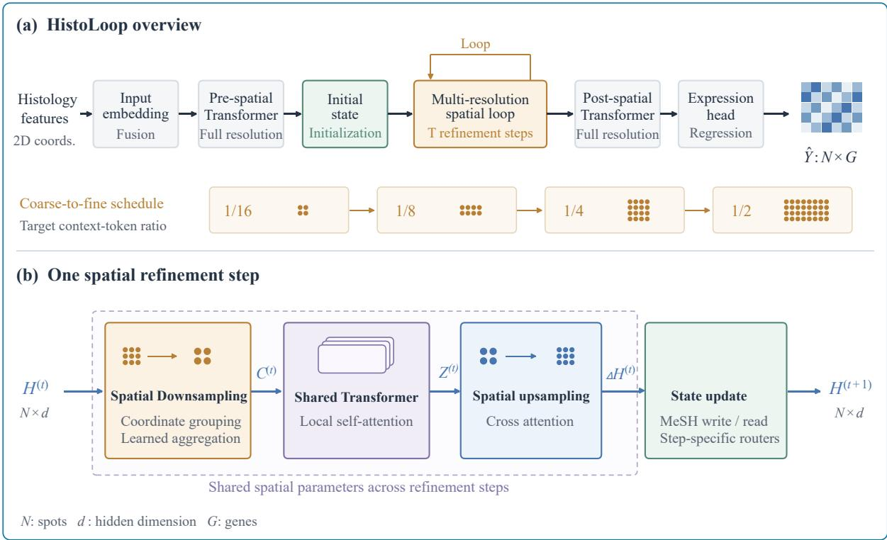
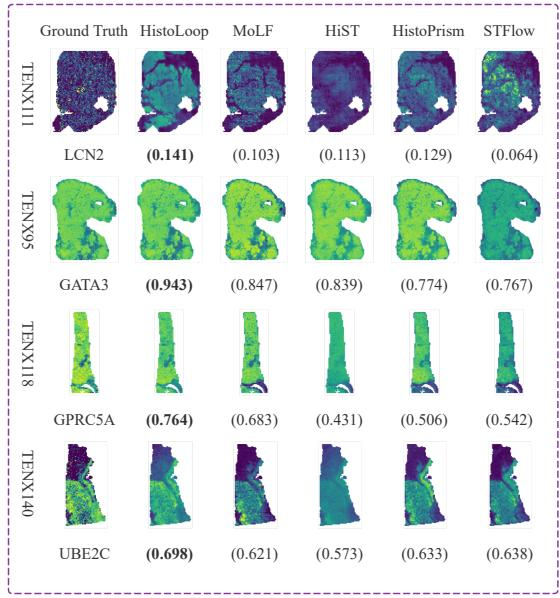
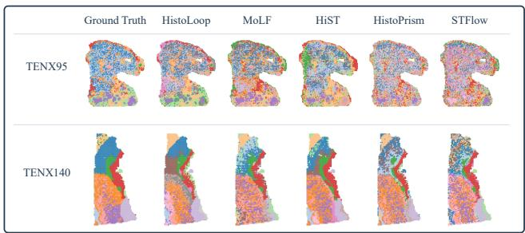

# HistoLoop: Iterative Contextual Inference with a Looped Transformer for Histology-Based Spatial Gene Expression Prediction

Ziang Liu1,2,3, Jie Liu1,2,3, Shuai Li1,2,3, Yigui Feng1,2,3, Qinglin Wang1,2,3∗

1Laboratory of Digitizing Software for Frontier Equipment, National University of Defense Technology 2National Key Laboratory of Parallel and Distributed Computing, National University of Defense Technology 3College of Computer Science and Technology, National University of Defense Technology, Changsha 410073, China

## Abstract

Predicting spatial gene expression from H&E images ofers a scalable complement to experimental spatial transcriptomics. However, despite progress in spatial context modeling, how to construct subsequent context from spot states updated by earlier contextual interactions remains underexplored. We in troduce HistoLoop, a looped Transformer that formulates prediction as iterative contextual inference. At each refinement step, HistoLoop aggregates the current spot states into context tokens at the corresponding resolution, processes them with a shared spatial Transformer, and retrieves spot-specific contextual information through cross-attention. A memory-mediated update integrates this information into persistent spot states, which are then used to construct context at the next, finer resolution. Under the HEST-Bench HVG50 evaluation protocol, HistoLoop achieves the highest macro-averaged genewise Pearson correlation among the compared methods across six cancer-specific tasks spanning five organs in HEST-1K. Ablation studies support the importance of recurrent state refinement and reconstructing context from updated spot states at progressively finer resolutions. Expression-derived clustering further suggests that HistoLoop better captures spatially organized multigene patterns.

## Introduction

Spatial transcriptomics (ST) profiles gene expression while preserving its spatial organization within tissue, enabling the characterization of spatial heterogeneity, tissue microenvironments, and cell–cell interactions (Ståhl et al. 2016; Longo et al. 2021; Cang et al. 2023). However, current ST technologies remain costly and experimentally demanding, which limits their routine application to large cohorts and archival tissue collections (Moses and Pachter 2022). In contrast, hematoxylin and eosin (H&E)-stained whole-slide images are routinely acquired in clinical pathology and contain rich morphological signals associated with underlying molecular states (Schmauch et al. 2020). These complementary properties have motivated histology-based spatial gene expression prediction, which seeks to reconstruct spatially resolved transcriptomic profiles directly from standard H&E images (Zeng et al. 2022; Xie et al. 2023; Chung et al. 2024).

However, the mapping from local histological morphology to molecular state is inherently context dependent. Morphologically similar tissue regions may occur in distinct anatomical or pathological environments and exhibit diferent transcriptional programs, such that local appearance alone may provide an ambiguous basis for molecular prediction. Spatial context can help reduce this ambiguity by relating local morphology to its surrounding tissue organization. This motivates studying both the spatial evidence available to a predictor and how that evidence is incorporated into spot representations.

Recent methods have increasingly moved beyond isolated patch-level prediction by incorporating spatial relationships and broader tissue context. Hist2ST models both global and neighboring spatial dependencies through Transformer- and graph-based modules (Zeng et al. 2022), while TRIPLEX integrates target, neighborhood, and global tissue information across multiple resolutions (Chung et al. 2024). More recent hierarchical architectures further propagate information across spatial scales to enrich local representations (Wu et al. 2026). Together, these methods establish the importance of nonlocal context for histology-based spatial gene expression prediction. Building on these advances, we ask whether prediction benefits from coupling spot-state refinement with spatial context reconstruction. Specifically, updated spot representations can be reused to construct context at subsequent resolutions, allowing previously incorporated spatial evidence to influence later contextual messages. We investigate whether this recurrent coupling provides benefits beyond access to multiple spatial scales alone.

To investigate this question, we propose HistoLoop, a looped Transformer framework for iterative contextual inference. Starting from spot-level histological features and spatial coordinates, HistoLoop maintains a persistent representation for each spot. At each iteration, it constructs scalespecific context from the current spot states and processes this context with a shared spatial Transformer core. Spotconditioned cross-attention retrieves the resulting contextual information, which is integrated into the persistent spot states through a memory-mediated update. These updated states provide the input for context construction at the next iteration, following a coarse-to-fine resolution schedule.

We evaluate HistoLoop on six cancer-specific tasks spanning five organs in HEST-1k (Jaume et al. 2024) under a unified five-seed protocol. On the predefined 50-gene HEST-Bench subset, HistoLoop achieves a macro-averaged genewise Pearson correlation coeficient (PCC) of 0.480, compared with 0.435 for MoLF (Hu and Speidel 2026), the strongest evaluated baseline under the same protocol. Controlled ablations highlight the contributions of recurrent refinement, coarse-to-fine ordering, and state-dependent context reconstruction.

Our main contributions are summarized as follows:

• We introduce an iterative contextual inference perspective for histology-based spatial gene expression prediction, in which spot representations are recurrently refined and used to reconstruct spatial context for subsequent updates.

• We propose HistoLoop, a multi-resolution looped Transformer that couples spot-conditioned context retrieval with memory-mediated state updates under a coarse-tofine refinement schedule.

• We evaluate HistoLoop on six cancer-specific tasks spanning five organs and conduct controlled ablations to examine the contributions of recurrent refinement, scale ordering, and state-dependent context reconstruction.

## Related Work

## Histology-Based Spatial Gene Expression Prediction

Histology-based spatial gene expression prediction learns molecular profiles from paired histology and spatial transcriptomics data. ST-Net (He et al. 2020) established an early image-based prediction framework, while BLEEP (Xie et al. 2023) and mclSTExp (Min et al. 2024) explored cross-modal alignment for expression prediction. DKAN (Zhang et al. 2026) incorporates gene semantic knowledge into this alignment, and AGL (Shiku et al. 2026) exploits auxiliary genes to improve target-gene estimation. Generative approaches provide another direction: Stem (Zhu et al. 2025) uses conditional difusion, STFlow (Huang et al. 2025a) models whole-slide expression through flow matching, and FLAG (Si et al. 2026) combines latent difusion with spatial graph encoding and gene foundation model alignment. MoLF (Hu and Speidel 2026) further addresses pan-cancer heterogeneity through a mixture-of-experts latent flow. Broader efforts include HistoPrism (Hu et al. 2026), which emphasizes pan-cancer prediction and pathway-level evaluation, and STPath (Huang et al. 2025b), which learns transferable expression prediction through large-scale paired pretraining. These studies advance prediction objectives, biological supervision, and transfer; HistoLoop focuses on how spatial context is constructed from evolving tissue representations.

## Spatial Context Modeling and Multi-Scale Refinement

Spatial modeling connects local morphology to broader tissue organization. Hist2ST (Zeng et al. 2022) combines global attention with graph-based neighborhood interactions, while TRIPLEX (Chung et al. 2024) integrates target, neighborhood, and global features. HiST (Wu et al. 2026) propagates information through a sparse hierarchical encoder–decoder with spatial coarsening, recovery, and skip connections. Spatial dependencies also enter generative models through local spatial attention in STFlow (Huang et al. 2025a) and graph encoding in FLAG (Si et al. 2026). These approaches offer diferent mechanisms for selecting spatial evidence and propagating it across locations and resolutions. Building on these advances, we investigate whether coupling persistent spot-state refinement with context reconstruction provides benefits beyond access to multiple spatial scales alone.

HistoLoop maintains persistent spot states and reconstructs context at subsequent resolutions from the states updated by earlier contextual interactions. This recurrent coupling allows previously incorporated spatial evidence to influence the construction of subsequent contextual messages.

## Pathology Foundation Models

Pathology foundation models learn transferable representations from large-scale histology data. UNI (Chen et al. 2024) provides general-purpose patch-level features, while GigaPath (Xu et al. 2024) combines patch-level pretraining with whole-slide representation learning. Language supervision further enriches these representations: CONCH (Lu et al. 2024) learns from histopathology image–caption pairs, and TITAN (Ding et al. 2025) combines visual self-supervision with region-level caption and slide-level report alignment. HEST-Bench (Jaume et al. 2024) evaluates pretrained pathology representations through spatial gene expression prediction, connecting foundation model development to this task. Foundation models provide powerful histological representations, but they primarily define how visual features are encoded rather than how spatial evidence should be progressively interpreted during prediction. HistoLoop builds on pretrained histological features and investigates this downstream inference process through recurrent spot-state refinement, complementing advances in pathology representation learning.

## Method

## Overview

Given pretrained histological features $\mathbf { X } ~ = ~ \{ \mathbf { x } _ { i } \} _ { i = 1 } ^ { N }$ and their spatial coordinates $\mathbf { P } = \{ \mathbf { p } _ { i } \} _ { i = 1 } ^ { N }$ , HistoLoop predicts the spatial gene expression matrix $\hat { \textbf { Y } } \in \mathbb { R } ^ { N \times G }$ . As illustrated in Fig. 1(a), HistoLoop consists of an input encoding stage, a recurrent multi-resolution spatial loop, and an output prediction stage.

In the input encoding stage, we fuse histological features with positional information and apply a full-resolution prespatial Transformer to obtain contextualized spot representations $\mathbf { H } _ { \mathrm { p r e } } .$ Following MeSH (Yu et al. 2026), we initialize a persistent state $\mathbf { H } ^ { ( 0 ) }$ and an S-slot memory bufer $\mathbf { M } ^ { ( 0 ) }$ for each spot. The memory-mediated transition integrates retrieved spatial evidence into the persistent states through a write–read operation, enabling the states to evolve across refinement steps. Details of the initialization and memory operations are provided in the subsequent sections and appendix.

The recurrent core performs T refinement steps according to a coarse-to-fine context-token ratio schedule. At step t, the current spot states $\mathbf { H } ^ { ( t ) }$ are grouped into spatial cells, where state-dependent weights aggregate spot representations and their normalized coordinates to produce context tokens $\mathbf { C } ^ { ( t ) }$ and weighted coordinates $\mathbf { P } _ { C } ^ { ( t ) }$ . A local spatial graph is constructed over the context coordinates, and a shared spatia Transformer produces contextualized representations $\mathbf { Z } ^ { ( t ) }$ Spot-conditioned cross-attention then retrieves relevant spatial evidence for each spot, yielding an update $\Delta \mathbf { H } ^ { ( t ) }$ . The MeSH write–read operation integrates this update into the persistent states and memory bufers, producing $\mathbf { H } ^ { ( t + 1 ) }$ and $\mathbf { \bar { M } } ^ { ( t + 1 ) }$

  
Figure 1: Overview of HistoLoop. (a) HistoLoop fuses pretrained histological features and 2D spatial coordinates, applies a full-resolution pre-spatial Transformer, initializes persistent spot states, performs $T$ recurrent refinement steps following a coarse-to-fine context-token ratio schedule, and predicts gene expression after a full-resolution post-spatial Transformer. (b) At refinement step t, the current spot states $\mathbf { H } ^ { ( t ) }$ are aggregated into context tokens $\mathbf { C } ^ { ( t ) }$ , which are processed by a shared spatial Transformer to obtain contextualized representations $\mathbf { Z } ^ { ( t ) }$ . Spot-conditioned cross-attention then retrieves contextua information from $\mathbf { Z } ^ { ( t ) }$ for individual spots, yielding contextual updates $\Delta \mathbf { H } ^ { ( t ) }$ . A MeSH-based write–read transition produces the next states $\mathbf { H } ^ { ( t + 1 ) }$ , which are used for subsequent context construction.

The operations within one refinement step can be summarized as

$$
\begin{array} { r } { \begin{array} { c } { { \mathbf { Z } ^ { ( t ) } } = \mathcal { T } _ { \theta } \big ( { \mathbf { C } ^ { ( t ) } } , { \mathbf { P } _ { C } ^ { ( t ) } } ; G _ { \mathrm { c t x } } ^ { ( t ) } \big ) , } \\ { { \Delta \mathbf { H } ^ { ( t ) } } = \mathcal { R } _ { \phi } \big ( \mathbf { H } ^ { ( t ) } , { \mathbf { Z } ^ { ( t ) } } ; \tilde { \mathbf { P } } , { \mathbf { P } _ { C } ^ { ( t ) } } \big ) , } \\ { \big ( \mathbf { H } ^ { ( t + 1 ) } , \mathbf { M } ^ { ( t + 1 ) } \big ) = \mathcal { U } _ { \mathrm { M e S H } } \big ( \Delta \mathbf { H } ^ { ( t ) } , \mathbf { H } ^ { ( t ) } , \mathbf { M } ^ { ( t ) } ; t \big ) , } \end{array} } \end{array}\tag{1}
$$

where $\tilde { \mathbf { P } }$ denotes the normalized spatial coordinates of the original spots, $G _ { \mathrm { c t x } } ^ { ( t ) }$ denotes the local spatial graph constructed over the context tokens, $\mathcal { T } _ { \theta }$ denotes the shared spatial Transformer, $\mathcal { R } _ { \phi }$ denotes spot-conditioned context retrieval, and $\mathcal { U } _ { \mathrm { M e S H } }$ denotes the memory-mediated state transition. The spatial Transformer and retrieval module share their parameters across refinement steps, whereas the resolution embeddings and MeSH routers are step-specific.

Crucially, although grid assignments are determined by spatial coordinates and the prescribed resolution, the aggregation weights depend on the current spot states. Consequently, the context features and weighted coordinates evolve with the states, afecting both spatial contextualization and subsequent context retrieval. After each update, the next context is reconstructed from the updated spot states, allowing spatial evidence incorporated at earlier resolutions to influence subsequent contextual inference. After $T$ refinement steps, a full-resolution post-spatial Transformer and an expression prediction head produce the final prediction Yˆ .

## Spot Encoding and Persistent State Initialization

As shown in Fig. 1(a), HistoLoop first converts pretrained histological features and spatial coordinates into fullresolution spot representations before entering the recurrent multi-resolution loop. Let $\widetilde { \mathbf { P } }$ denote the normalized spot coordinates. We fuse the visual and positional information as

$$
\mathbf { E } = f _ { \mathrm { i m g } } ( \mathbf { X } ) + f _ { \mathrm { p o s } } ( \widetilde { \mathbf { P } } ) , \qquad \mathbf { H } _ { \mathrm { p r e } } = \mathcal { F } _ { \mathrm { p r e } } \bigl ( \mathbf { E } ; \widetilde { \mathbf { P } } \bigr ) ,\tag{2}
$$

where E denotes the initial spot embeddings and $\mathcal { F } _ { \mathrm { p r e } }$ is a full-resolution pre-spatial Transformer that produces locally contextualized spot representations. The pre-spatial Transformer has independent parameters from the spatial Transformer used in the recurrent loop. Details of coordinate normalization and positional encoding are provided in the appendix.

Following MeSH (Yu et al. 2026), each spot is equipped with an S-slot memory bufer and step-specific write–read routers. The initial recurrent states and memory bufers are obtained as

$$
\big ( { \bf H } ^ { ( 0 ) } , { \bf M } ^ { ( 0 ) } \big ) = \mathcal { T } _ { \mathrm { M e S H } } \big ( { \bf E } , { \bf H } _ { \mathrm { p r e } } \big ) ,\tag{3}
$$

where $\mathbf { H } ^ { ( 0 ) }$ denotes the initial recurrent spot states and $\mathbf { M } ^ { ( 0 ) }$ denotes the associated memory bufers. Specifically, the initialization operation uses the input embeddings to construct the base memory, writes the pre-spatial representations into its slots, and reads from the updated memory to obtain the initial states. The slot-wise initialization and router equations are given in the appendix.

## Recurrent Multi-Resolution Spatial Contextualization

State-dependent context construction. At refinement step t, let

$$
{ \bf H } ^ { ( t ) } = [ { \bf h } _ { 1 } ^ { ( t ) } ; \dots ; { \bf h } _ { N } ^ { ( t ) } ] \in \mathbb { R } ^ { N \times d }
$$

denote the current spot-state matrix, where $\mathbf { h } _ { i } ^ { ( t ) } \in \mathbb { R } ^ { d }$ is the state of spot i. The initial states $\mathbf { H } ^ { ( 0 ) }$ are obtained from the MeSH-based initialization, while subsequent states are produced by the recurrent state updates.

We construct spatial context tokens according to a coarse-to-fine schedule of target context-token ratios $\rho =$ $( \rho _ { 0 } , \ldots , \rho _ { T - 1 } )$ , where $\rho _ { t }$ specifies the target number of context tokens relative to the original number of spots N. At step $t ,$ an aspect-ratio-aware grid is constructed over the normalized spatial bounding box to target $\lfloor \rho _ { t } N \rfloor$ cells. Each spot is assigned to a grid cell according to its coordinates, and empty cells are discarded. Let ${ \mathcal S } _ { r } ^ { ( t ) }$ denote the set of spots assigned to the r-th occupied cell, and let $K _ { t }$ denote the resulting number of occupied cells and context tokens.

Within each occupied cell, a shared scoring function assigns importance weights to the current spot states. The weights are normalized over the spots within the same cell and used to aggregate both spot states and spatial coordinates:

$$
\begin{array} { r l } & { \boldsymbol { \alpha } _ { i r } ^ { ( t ) } = \mathrm { S o f t m a x } _ { i \in \mathcal { S } _ { r } ^ { ( t ) } } \left( f _ { \alpha } \big ( \mathbf { h } _ { i } ^ { ( t ) } , \mathbf { a } _ { t } \big ) \right) , } \\ & { \mathbf { c } _ { r } ^ { ( t ) } = \displaystyle \sum _ { i \in \mathcal { S } _ { r } ^ { ( t ) } } \boldsymbol { \alpha } _ { i r } ^ { ( t ) } \mathbf { h } _ { i } ^ { ( t ) } + \mathbf { a } _ { t } , } \\ & { \mathbf { p } _ { C , r } ^ { ( t ) } = \displaystyle \sum _ { i \in \mathcal { S } _ { r } ^ { ( t ) } } \boldsymbol { \alpha } _ { i r } ^ { ( t ) } \widetilde { \mathbf { p } } _ { i } . } \end{array}\tag{4}
$$

Here, $\mathbf { a } _ { t }$ is a step-specific resolution embedding associated with the ratio $\rho _ { t } .$ , and the Softmax operation is applied independently within each occupied cell. The resulting context

tokens and their weighted coordinates are collected as

$$
\begin{array} { r l } & { \mathbf { C } ^ { ( t ) } = [ \mathbf { c } _ { 1 } ^ { ( t ) } ; \ldots ; \mathbf { c } _ { K _ { t } } ^ { ( t ) } ] \in \mathbb { R } ^ { K _ { t } \times d } , } \\ & { \mathbf { P } _ { C } ^ { ( t ) } = [ \mathbf { p } _ { C , 1 } ^ { ( t ) } ; \ldots ; \mathbf { p } _ { C , K _ { t } } ^ { ( t ) } ] \in \mathbb { R } ^ { K _ { t } \times 2 } . } \end{array}
$$

The grid assignments depend only on the spatial coordinates and the prescribed ratio $\rho _ { t }$ , whereas the aggregation weights depend on the evolving states $\mathbf { H } ^ { ( t ) }$ . Consequently, both the context features and their weighted coordinates depend on the current spot states. After each state update, context is reconstructed from the updated states at the next ratio in the coarse-to-fine schedule. Unless otherwise stated, we use $T = 4$ and $\pmb { \rho } = ( 1 / 1 6 , 1 / 8 , 1 / 4 , 1 / 2 )$ in the main experiments.

Spatial contextualization. At refinement step t, we construct a $k _ { \mathrm { c t x } }$ -nearest-neighbor graph $\mathcal { G } _ { \mathrm { c t x } } ^ { ( t ) }$ over the context coordinates $\mathbf { P } _ { C } ^ { ( t ) }$ and apply local self-attention to model interactions between neighboring context tokens. The contextualized representations are computed as

$$
\mathbf { Z } ^ { ( t ) } = \mathcal { T } _ { \theta } \left( \mathbf { C } ^ { ( t ) } , \mathbf { P } _ { C } ^ { ( t ) } ; \mathcal { G } _ { \mathrm { c t x } } ^ { ( t ) } \right) ,\tag{5}
$$

where $\mathcal { T } _ { \theta }$ denotes a coordinate-aware spatial Transformer with learned relative-position biases.

The parameters θ are shared across all refinement steps, while the context tokens, weighted coordinates, and local graph are reconstructed from the current spot states at each prescribed coarsening level. Therefore, the Transformer operates on state-dependent spatial inputs even though its parameters remain fixed throughout the recurrent loop. The resulting representations $\mathbf { Z } ^ { ( t ) }$ are passed to the spot-conditioned retrieval module. Further attention details are provided in the appendix.

Spot-conditioned context retrieval. The contextualized tokens $\mathbf { Z } ^ { ( t ) }$ provide regional spatial representations that must be mapped back to individual spots before the recurrent state transition. For each spot $i ,$ we select the $k _ { u }$ nearest context tokens according to the Euclidean distance between its normalized coordinate $\widetilde { \mathbf { p } } _ { i }$ and the weighted context coordinates $\{ \mathbf { p } _ { C , r } ^ { ( t ) } \} _ { r = 1 } ^ { K _ { t } }$ . Let $\mathcal { N } _ { u } ^ { ( t ) } ( i )$ denote this candidate set.

We use the current spot state as the query and the contextualized tokens as keys and values. A local coordinate-aware cross-attention operator then produces the spot-wise contextual update:

$$
\Delta \mathbf { h } _ { i } ^ { ( t ) } = \mathrm { X A t t n } _ { \phi } \Big ( \mathbf { h } _ { i } ^ { ( t ) } , \big \{ \mathbf { z } _ { r } ^ { ( t ) } , \mathbf { p } _ { C , r } ^ { ( t ) } \big \} _ { r \in \mathcal { N } _ { u } ^ { ( t ) } ( i ) } ; \widetilde { \mathbf { p } } _ { i } \Big ) ,\tag{6}
$$

where $\mathbf { z } _ { r } ^ { ( t ) }$ denotes the r-th contextualized token and $\mathrm { X A t t n } _ { \phi }$ denotes multi-head cross-attention with a learned relativeposition bias, normalized over the candidate set $\mathcal { N } _ { u } ^ { ( t ) } ( i )$ Stacking the updates over all spots gives $\Delta \mathbf { H } ^ { ( t ) } \in \mathbb { R } ^ { N \times d }$

Because the query is computed from the current state $\mathbf { h } _ { i } ^ { ( t ) }$ , each spot retrieves contextual evidence according to its evolving representation. In contrast, the candidate set is determined by spatial proximity, which preserves local spatial connectivity. The retrieved update $\Delta \mathbf { H } ^ { ( t ) }$ is not directly added to the current state; it is passed to the MeSH write–read transition to produce $\mathbf { H } ^ { ( t + 1 ) }$ and $\mathbf { M } ^ { ( t + 1 ) }$ . Further attention details are provided in the appendix.

## Persistent State Transition

At refinement step t, the spot-conditioned retrieval module produces a contextual update $\Delta \mathbf { H } ^ { ( t ) }$ for the current spot states $\mathbf { H } ^ { ( t ) }$ . HistoLoop integrates this retrieved spatial evidence into persistent spot states and their associated memory bufers through the MeSH write–read operator (Yu et al. 2026):

$$
\big ( \mathbf { H } ^ { ( t + 1 ) } , \mathbf { M } ^ { ( t + 1 ) } \big ) = \mathcal { U } _ { \mathrm { M e S H } } \big ( \Delta \mathbf { H } ^ { ( t ) } , \mathbf { H } ^ { ( t ) } , \mathbf { M } ^ { ( t ) } ; t \big ) .\tag{7}
$$

For each spot, the operator maintains an S-slot memory bufer. Specifically, let $\mathbf { M } ^ { ( t ) } = \{ \mathbf { m } _ { i , s } ^ { ( t ) } \}$ denote the collection of memory slots, where $\mathbf { m } _ { i , s } ^ { ( t ) } \in \mathbb { R } ^ { d }$ . Step-specific write and read routers are computed from the current spot state. The retrieved update is first written into the memory slots according to the write distribution, after which the next spot state is read from the updated memory using the read distribution. Both routing distributions are evaluated from the pre-update state, while the read operation is applied to the post-write memory. The complete slot-wise update equations are provided in the appendix.

The memory is maintained independently for each spot and persists across refinement steps within a forward pass. Crossspot information exchange occurs through state-dependent context construction, spatial contextualization, and spotconditioned retrieval. The updated states $\mathbf { H } ^ { ( t + 1 ) }$ are then used to reconstruct context at the next prescribed coarsening level, while $\mathbf { M } ^ { ( t + 1 ) }$ is retained for the subsequent state transition.

## Expression Prediction and Training Objective

After T refinement steps, HistoLoop applies a full-resolution post-spatial Transformer to the final spot states and predicts the expression profile of each spot:

$$
\mathbf { H } _ { \mathrm { o u t } } = \mathcal { F } _ { \mathrm { p o s t } } \big ( \mathbf { H } ^ { ( T ) } ; \widetilde { \mathbf { P } } \big ) , \qquad \widehat { \mathbf { Y } } = f _ { \mathrm { p r e d } } \big ( \mathbf { H } _ { \mathrm { o u t } } \big ) ,\tag{8}
$$

where $\mathbf { H } _ { \mathrm { o u t } } \in \mathbb { R } ^ { N \times d }$ and $\widehat { \mathbf { Y } } \in \mathbb { R } ^ { N \times G }$ . The post-spatial Transformer is applied once after the recurrent loop and provides a final full-resolution spatial refinement before prediction. Its parameters are independent of those of the spatial Transformer in the recurrent loop. The prediction head $f _ { \mathrm { p r e d } }$ maps the final spot representations to G-dimensional gene expression vectors, yielding the prediction matrix $\hat { \mathbf { Y } } \in \mathbb { R } ^ { N \times G }$

Let Ω denote the set of valid spot–gene pairs with observed, finite targets. We train HistoLoop using the standard mean squared error over these pairs:

$$
\mathcal { L } _ { \mathrm { M S E } } = \frac { 1 } { \left| \Omega \right| } \sum _ { ( i , g ) \in \Omega } \left( \widehat { y } _ { i g } - y _ { i g } \right) ^ { 2 } .\tag{9}
$$

Entries unavailable for a tissue section are excluded from Ω rather than treated as zero-expression targets. All trainable components are optimized jointly, while the pretrained histological features remain fixed.

## Experiments

## Experimental Setup

We evaluate HistoLoop on HEST-1K (Jaume et al. 2024), covering six cancer types. We construct two data splits while retaining the original hold-out test sets from HEST-Bench, and stratify the remaining samples by cancer type into training and validation sets. For each spot, the model takes a precomputed histology feature extracted by UNI (Chen et al. 2024) from the corresponding H&E image together with its two-dimensional spatial coordinate, and predicts a gene expression profile over a fixed vocabulary of 38,982 genes.

We compare HistoLoop with four recent methods: HiST (Wu et al. 2026), HistoPrism (Hu et al. 2026), MoLF (Hu and Speidel 2026), and STFlow (Huang et al. 2025a). All methods are evaluated using the same UNI features, spatial coordinates, fixed 38,982-gene vocabulary, and data partitions. For each baseline, we follow its oficial training configuration while keeping the input data and evaluation protocol consistent across methods. For the primary evaluation, we follow the HVG50 protocol of HEST-Bench (Jaume et al. 2024), using the corresponding predefined panel of 50 highly variable genes (HVG50) for each cancer type. The panel membership is fixed independently of the held-out test data and remains unchanged across splits and methods. For each run, we compute the gene-wise Pearson correlation coeficient (PCC) across valid spots for every benchmark gene on each held-out slide, average the resulting values over the benchmark genes and held-out slides to obtain a cancer-level score, and report the mean and standard deviation across five random seeds. The macro average is calculated as the unweighted mean of the six cancer-level mean PCCs.

For all experiments, HistoLoop uses a hidden dimension of 2048 and performs 4 recurrent refinement steps with contexttoken ratios of $( 1 / 1 6 , 1 / 8 , 1 / 4 , 1 / 2 )$ . The pre-spatial, recurrent regional, and post-spatial Transformer stages each contain 3 blocks with 8 attention heads. We train the model end-to-end with the mean squared error over valid spot–gene pairs, using AdamW with a learning rate of $5 \times 1 0 ^ { - 5 }$ and a weight decay of 0.05 for up to 500 epochs.

## Main Results

Table 1 summarizes the performance ofall methods on the six cancer-specific tasks. HistoLoop achieves the highest macroaveraged HVG50 PCC of 0.480, outperforming the strongest baseline, MoLF, by 0.045 absolute PCC points. It obtains the best mean PCC on four of the six cancer types, indicating that the overall improvement is not driven by a single task. These results establish the efectiveness of HistoLoop under the two-split evaluation protocol.

The gains vary across cancer types. The largest improvements are observed on PAAD and IDC, where HistoLoop exceeds the strongest competing method by 0.074 and 0.044 PCC points, respectively. The advantage is smaller on READ, where HistoLoop and HistoPrism obtain nearly identical performance, while MoLF remains stronger on LUNG and marginally outperforms HistoLoop on SKCM. Thus, the main results support a consistent overall advantage across the evaluated tasks, rather than uniform superiority on every cancer type.

## Ablation Study

We conduct controlled ablations to examine the contribution of the recurrent loop, the multi-resolution schedule, and the state-dependent message pathway. The complete HistoLoop model serves as the reference setting. We first remove the recurrent loop, then construct a parameter-matched variant to distinguish architectural benefits from model capacity. We further replace the coarse-to-fine schedule with a single-scale schedule or reverse the scale order. Finally, we evaluate two variants that prevent the message pathway from using sequentially updated spot states. All variants are evaluated using the same protocol as the main experiments, and the results are summarized in Table 2.

Table 1: Comparison of HVG50 PCC on the six cancer-specific tasks. Each cancer-specific entry reports the mean over five random seeds, with the standard deviation shown as a lower-right subscript. Macro Avg. is the unweighted mean of the six cancer-specific mean PCCs. The best mean in each row is shown in bold.
<table><tr><td>Cancer Type</td><td>HiST</td><td>HistoPrism</td><td>MoLF</td><td>STFlow</td><td>HistoLoop</td></tr><tr><td>COAD</td><td> $0 . 3 2 9 _ { 0 . 0 1 1 }$ </td><td> $0 . 2 6 7 _ { 0 . 0 2 5 }$ </td><td> $0 . 2 7 3 _ { 0 . 0 1 4 }$ </td><td> $0 . 3 4 3 _ { 0 . 0 1 9 }$ </td><td> $\mathbf { 0 . 3 7 2 } _ { 0 . 0 0 8 }$ </td></tr><tr><td>IDC</td><td> $0 . 4 1 1 _ { 0 . 0 0 4 }$ </td><td> $0 . 3 5 6 _ { 0 . 0 0 2 }$ </td><td> $0 . 6 0 9 _ { 0 . 0 0 7 }$ </td><td> $0 . 5 1 8 _ { 0 . 0 3 1 }$ </td><td> $\mathbf { 0 . 6 5 3 } _ { 0 . 0 0 5 }$ </td></tr><tr><td>LUNG</td><td> $0 . 3 0 6 _ { 0 . 0 2 9 }$ </td><td> $0 . 3 1 1 _ { 0 . 0 2 1 }$ </td><td> $\mathbf { 0 . 5 1 3 } _ { 0 . 0 1 9 }$ </td><td> $0 . 4 1 4 _ { 0 . 0 2 4 }$ </td><td> $0 . 4 7 0 _ { 0 . 0 0 7 }$ </td></tr><tr><td>PAAD</td><td> $0 . 3 2 2 _ { 0 . 0 2 6 }$ </td><td> $0 . 2 5 2 _ { 0 . 0 2 0 }$ </td><td> $0 . 3 5 4 _ { 0 . 0 2 3 }$ </td><td> $0 . 4 0 5 _ { 0 . 0 4 7 }$ </td><td> $\mathbf { 0 . 4 7 9 } _ { 0 . 0 1 1 }$ </td></tr><tr><td>READ</td><td> $0 . 2 6 3 _ { 0 . 0 1 7 }$ </td><td> $0 . 2 8 6 _ { 0 . 0 0 6 }$ </td><td> $0 . 2 3 9 _ { 0 . 0 1 6 }$ </td><td> $0 . 2 6 6 _ { 0 . 0 0 7 }$ </td><td> $\mathbf { 0 . 2 8 7 } _ { 0 . 0 0 6 }$ </td></tr><tr><td>SKCM</td><td> $0 . 4 4 7 _ { 0 . 0 1 0 }$ </td><td> $0 . 3 8 6 _ { 0 . 0 4 9 }$ </td><td> $\mathbf { 0 . 6 2 2 } _ { 0 . 0 0 9 }$ </td><td> $0 . 4 8 1 _ { 0 . 0 1 5 }$ </td><td> $0 . 6 2 1 _ { 0 . 0 0 4 }$ </td></tr><tr><td>Macro Avg.</td><td>0.346</td><td>0.310</td><td>0.435</td><td>0.405</td><td>0.480</td></tr></table>

Table 2: Ablation study of HistoLoop on the six cancer-specific tasks. Each cancer-specific entry reports the mean HVG50 PCC over five random seeds, with the standard deviation shown as a lower-right subscript. Parameter counts are reported in millions. Macro Avg. is the unweighted mean of the six cancer-specific mean PCCs. The best mean in each cancer column is shown in bold.
<table><tr><td>Variant</td><td>Params</td><td>COAD</td><td>IDC</td><td>LUNG</td><td>PAAD</td><td>READ</td><td></td><td>SKCM Macro Avg.</td></tr><tr><td>Full HistoLoop</td><td>674.8</td><td> $0 . 3 7 2 _ { 0 . 0 0 8 }$ </td><td> $0 . 6 5 3 _ { 0 . 0 0 5 }$ </td><td> $0 . 4 7 0 _ { 0 . 0 0 7 }$ </td><td> $0 . 4 7 9 _ { 0 . 0 1 1 }$ </td><td> $0 . 2 8 7 _ { 0 . 0 0 6 }$ </td><td> $0 . 6 2 1 _ { 0 . 0 0 4 }$ </td><td>0.480</td></tr><tr><td>No loop No loop, matched</td><td>477.6</td><td> $0 . 3 2 5 _ { 0 . 0 0 5 }$ </td><td> $0 . 5 0 8 _ { 0 . 0 0 8 }$ </td><td> $0 . 3 8 4 _ { 0 . 0 1 2 }$ </td><td> $0 . 3 7 9 _ { 0 . 0 1 4 }$ </td><td> $0 . 2 0 2 _ { 0 . 0 0 9 }$ </td><td> $0 . 4 8 7 _ { 0 . 0 0 4 }$ </td><td>0.381</td></tr><tr><td>Single scale</td><td>679.0</td><td> $0 . 3 2 1 _ { 0 . 0 0 6 }$ </td><td> $0 . 5 1 9 _ { 0 . 0 0 4 }$ </td><td> $0 . 3 8 8 _ { 0 . 0 1 6 }$ </td><td> $0 . 3 9 7 _ { 0 . 0 0 9 }$ </td><td> $0 . 2 1 6 _ { 0 . 0 1 2 }$ </td><td> $0 . 4 7 3 _ { 0 . 0 0 5 }$ </td><td>0.386</td></tr><tr><td>Reverse order</td><td>674.8 674.8</td><td> $0 . 3 5 1 _ { 0 . 0 0 6 }$   $0 . 3 4 6 _ { 0 . 0 1 1 }$ </td><td> $0 . 6 1 7 _ { 0 . 0 0 7 }$   $0 . 6 2 2 _ { 0 . 0 0 5 }$ </td><td> $0 . 4 4 8 _ { 0 . 0 1 3 }$   $0 . 4 4 6 _ { 0 . 0 0 8 }$ </td><td> $0 . 4 5 3 _ { 0 . 0 2 1 }$   $0 . 4 8 5 _ { 0 . 0 1 6 }$ </td><td> $0 . 2 7 2 _ { 0 . 0 0 8 }$   $0 . 2 7 5 _ { 0 . 0 0 7 }$ </td><td> $0 . 6 0 3 _ { 0 . 0 0 3 }$   $0 . 6 0 3 _ { 0 . 0 0 6 }$ </td><td>0.457 0.463</td></tr><tr><td></td><td></td><td></td><td></td><td></td><td></td><td></td><td></td><td></td></tr><tr><td>Parallel shared Frozen message input</td><td>677.9 674.8</td><td> $0 . 3 3 8 _ { 0 . 0 0 6 }$   $0 . 3 5 9 _ { 0 . 0 0 3 }$ </td><td> $0 . 6 3 2 _ { 0 . 0 0 4 }$   $0 . 6 2 8 _ { 0 . 0 0 1 }$ </td><td> $0 . 4 4 3 _ { 0 . 0 1 3 }$   $0 . 4 4 6 _ { 0 . 0 1 0 }$ </td><td> $0 . 4 9 1 _ { 0 . 0 1 2 }$   $0 . 4 9 7 _ { 0 . 0 1 3 }$ </td><td> $0 . 2 7 2 _ { 0 . 0 0 9 }$   $0 . 2 7 4 _ { 0 . 0 0 5 }$ </td><td> $0 . 5 9 1 _ { 0 . 0 0 7 }$   $0 . 6 1 3 _ { 0 . 0 0 6 }$ </td><td>0.461 0.470</td></tr></table>

evolving spot representations. The frozen-message variant performs slightly better on PAAD, but its lower macro average indicates that this gain does not generalize across the evaluated cancer types. Overall, the ablations support the complete design in which multi-resolution context is processed sequentially and conditioned on updated spot states.

Removing the loop decreases the macro-averaged PCC from 0.480 to 0.381. The parameter-matched variant remains at 0.386, despite using slightly more parameters than the complete model. This comparison indicates that the improvement is not explained by parameter count or by replacing the loop with additional full-resolution Transformer blocks. Replacing the coarse-to-fine schedule with a single scale reduces the score to 0.457, while reversing the scale order gives 0.463. These results support both the use of multiple resolutions and the prescribed coarse-to-fine ordering.

## Spatial Expression Recovery

The state-dependent message pathway provides a further contribution. The parallel-shared variant, which constructs messages from the same initial state at all scales, obtains 0.461, while the frozen-message variant obtains 0.470. Both are below the complete model, supporting the need for sequential state updates and for reconstructing messages from

Aggregate PCC provides a useful measure of spot-level expression agreement, but it does not reveal whether a model recovers the spatial organization of gene expression, such as localized high-expression regions, tissue boundaries, and regional intensity variation. We therefore complement the quantitative results with a qualitative visualization of marker genes. Following the biomarker visualization protocol used in DKAN (Zhang et al. 2026), we visualize LCN2, GATA3, GPRC5A, and UBE2C, whose relevance to the corresponding cancer contexts has been documented in prior studies (Feng et al. 2016; Deftereos et al. 2015; Lin et al. 2014; Wang et al. 2019). These genes provide biologically grounded probes for assessing spatial expression recovery.

Figure 2 compares the ground-truth and predicted expression maps on four held-out slides. For each method, we use the same fixed random seed, 42, to obtain a reproducible representative prediction. The seed is fixed uniformly across methods and is not tuned separately according to the markergene maps. The displayed examples are intended for qualitative inspection, whereas the quantitative claims in this paper are based on the five-seed aggregate results reported in Table 1. The values in parentheses denote the PCC computed for the corresponding slide–gene pair and are included only to provide local quantitative context.

  
Figure 2: Spatial expression recovery on representative heldout slides.

Across the displayed examples, HistoLoop more closely preserves the large-scale localization and regional intensity variation of the ground-truth maps, especially for GATA3, GPRC5A, and UBE2C. It also obtains the highest slide-level PCC in all four shown cases. We do not introduce a separate marker-gene PCC table because the aggregate comparison has already been reported in the main results.

## Spatial Structure Preservation

Gene-wise PCC evaluates the agreement of individual genes, but it does not directly measure whether the predicted profiles preserve multigene organization across spatial locations. Since expression-based clustering is commonly used to identify coherent tissue domains (Zhu et al. 2024; Xiao et al. 2025), we further evaluate the consistency of clusters derived from the predicted expression profiles.

For each held-out slide, we independently cluster the ground-truth and predicted expression profiles using the same clustering procedure and hyperparameters for every method. The resulting partitions are compared with the adjusted Rand index (ARI), adjusted mutual information (AMI), normalized mutual information (NMI), and homogeneity.

Table 3 shows that HistoLoop achieves the highest score on all four metrics. Compared with the strongest baseline, HiST, HistoLoop improves ARI from 0.319 to 0.329, AMI from 0.479 to 0.526, NMI from 0.482 to 0.530, and homogeneity from 0.522 to 0.611. The consistent gains across metrics indicate that HistoLoop predictions preserve the multigene partition structure more faithfully than the competing methods under the same clustering protocol. This result complements the gene-wise PCC comparison by testing agreement at the profile and tissue-domain level.

Table 3: Overall clustering consistency between ground-truth and predicted expression profiles.
<table><tr><td>Model</td><td>ARI↑ AMI↑ NMI↑</td><td>Homo.↑</td></tr><tr><td>HiST</td><td>0.319 0.479 0.482</td><td>0.522</td></tr><tr><td>HistoPrism</td><td>0.224 0.377 0.381</td><td>0.429</td></tr><tr><td>MoLF</td><td>0.276 0.433 0.436</td><td>0.468</td></tr><tr><td>STFlow</td><td>0.211 0.360 0.364</td><td>0.406</td></tr><tr><td>HistoLoop</td><td>0.329 0.526</td><td>0.530 0.611</td></tr></table>

  
Figure 3: Expression-derived clustering on two held-out slides.

Figure 3 provides a qualitative view of the partition-level comparison. On both displayed slides, HistoLoop recovers the major regional partitions of the ground-truth expression more coherently, whereas several competing predictions contain more fragmented or spatially mixed assignments. These maps are illustrative of the spatial organization reflected in the all-slide metrics and are not used to select checkpoints or compute the aggregate scores.

## Conclusion

We presented HistoLoop, a looped Transformer for histology-based spatial gene expression prediction. HistoLoop progressively reconstructs multi-resolution spatial context from evolving spot states, allowing each refinement stage to use updated spatial evidence rather than relying on a fixed context representation. On HEST-1K, HistoLoop achieves the highest macro-averaged HVG50 PCC among the compared methods and obtains the best mean performance on four of the six cancer-specific tasks. Controlled ablations highlight the contributions of recurrent refinement, coarseto-fine ordering, and state-dependent context reconstruction. Complementary marker-gene visualizations and expressionderived clustering analyses indicate that the improvement extends beyond isolated gene-wise agreement to the recovery of spatially organized multigene patterns.

The current evaluation is conducted within HEST-1K under the predefined HVG50 protocol, while the qualitative analyses cover a limited number of representative held-out slides. Future work will explore improving generalization across datasets for histology-based spatial gene expression prediction.

## References

Cang, Z.; Zhao, Y.; Almet, A. A.; Stabell, A.; Ramos, R.; Plikus, M. V.; Atwood, S. X.; and Nie, Q. 2023. Screening cell–cell communication in spatial transcriptomics via collective optimal transport. Nature methods, 20(2): 218–228.

Chen, R. J.; Ding, T.; Lu, M. Y.; Williamson, D. F. K.; Jaume, G.; Song, A. H.; Chen, B.; Zhang, A.; Shao, D.; Shaban, M.; et al. 2024. Towards a general-purpose foundation model for computational pathology. Nat. Med., 30(3): 850–862.

Chung, Y.; Ha, J. H.; Im, K. C.; and Lee, J. S. 2024. Accurate spatial gene expression prediction by integrating multi-resolution features. In 2024 IEEE/CVF Conference on Computer Vision and Pattern Recognition (CVPR), 11591– 11600. IEEE.

Deftereos, G.; Sanguino Ramirez, A. M.; Silverman, J. F.; and Krishnamurti, U. 2015. GATA3 Immunohistochemistry Expression in Histologic Subtypes of Primary Breast Carcinoma and Metastatic Breast Carcinoma Cytology. The American Journal ofSurgical Pathology, 39(9): 1282–1289.

Ding, T.; Wagner, S. J.; Song, A. H.; Chen, R. J.; Lu, M. Y.; Zhang, A.; Vaidya, A. J.; Jaume, G.; Shaban, M.; Kim, A.; et al. 2025. A multimodal whole-slide foundation model for pathology. Nat. Med., 31: 3749–3761.

Feng, M.; Feng, J.; Chen, W.; Wang, W.; Wu, X.; Zhang, J.; Xu, F.; and Lai, M. 2016. Lipocalin2 suppresses metastasis of colorectal cancer by attenuating NF-κB-dependent activation of snail and epithelial mesenchymal transition. Molecular Cancer, 15(1): 77.

He, B.; Bergenstråhle, L.; Stenbeck, L.; Abid, A.; Andersson, A.; Borg, Å.; Maaskola, J.; Lundeberg, J.; and Zou, J. 2020. Integrating spatial gene expression and breast tumour morphology via deep learning. Nature biomedical engineering, 4(8): 827–834.

Hu, S.; and Speidel, S. 2026. MoLF: Mixture-of-Latent-Flow for Pan-Cancer Spatial Gene Expression Prediction from Histology. In Forty-third International Conference on Machine Learning.

Hu, S.; Zeng, Q.; Bhasker, N.; Kather, J. N.; and Speidel, S. 2026. HistoPrism: Unlocking Functional Pathway Analysis from Pan-Cancer Histology via Gene Expression Prediction. In Proceedings of the 14th International Conference on Learning Representations.

Huang, T.; Liu, T.; Babadi, M.; Jin, W.; and Ying, Z. 2025a. Scalable Generation of Spatial Transcriptomics from Histology Images via Whole-Slide Flow Matching. In Proceedings of the 42nd International Conference on Machine Learning, volume 267 of Proceedings of Machine Learning Research, 25550–25565. PMLR.

Huang, T.; Liu, T.; Babadi, M.; Ying, R.; and Jin, W. 2025b. STPath: a generative foundation model for integrating spatial transcriptomics and whole-slide images. NPJ Digital Medicine, 8(1): 659.

Jaume, G.; Doucet, P.; Song, A. H.; Lu, M. Y.; Almagro-Pérez, C.; Wagner, S. J.; Vaidya, A. J.; Chen, R. J.; Williamson, D. F. K.; Kim, A.; and Mahmood, F. 2024. HEST-1k: A Dataset For Spatial Transcriptomics and Histology Image Analysis. In Advances in Neural Information Processing Systems, volume 37, 53798–53833. Curran Associates, Inc.

Lin, X.; Zhong, S.; Ye, X.; Liao, Y.; Yao, F.; Yang, X.; Sun, B.; Zhang, J.; Li, Q.; Gao, Y.; Wang, Y.; Liu, J.; Han, B.; Chin, Y. E.; Zhou, B. P.; and Deng, J. 2014. EGFR phosphorylates and inhibits lung tumor suppressor GPRC5A in lung cancer. Molecular Cancer, 13: 233.

Longo, S. K.; Guo, M. G.; Ji, A. L.; and Khavari, P. A. 2021. Integrating single-cell and spatial transcriptomics to elucidate intercellular tissue dynamics. Nature Reviews Genetics, 22(10): 627–644.

Lu, M. Y.; Chen, B.; Williamson, D. F. K.; Chen, R. J.; Liang, I.; Ding, T.; Jaume, G.; Odintsov, I.; Le, L. P.; Gerber, G.; et al. 2024. A visual-language foundation model for computational pathology. Nat. Med., 30(3): 863–874.

Min, W.; Shi, Z.; Zhang, J.; Wan, J.; and Wang, C. 2024. Multimodal contrastive learning for spatial gene expression prediction using histology images. Briefings in Bioinformatics, 25(6): bbae551.

Moses, L.; and Pachter, L. 2022. Museum of spatial transcriptomics. Nature methods, 19(5): 534–546.

Schmauch, B.; Romagnoni, A.; Pronier, E.; Saillard, C.; Maillé, P.; Calderaro, J.; Kamoun, A.; Sefta, M.; Toldo, S.; Zaslavskiy, M.; et al. 2020. A deep learning model to predict RNA-Seq expression of tumours from whole slide images. Nature communications, 11(1): 3877.

Shiku, K.; Nishimura, K.; Matsuo, S.; Kojima, Y.; and Bise, R. 2026. Auxiliary Gene Learning: Spatial Gene Expression Estimation by Auxiliary Gene Selection. In Proceedings of the AAAI Conference on Artificial Intelligence, volume 40, 9015–9023.

Si, Q.; Wang, P.; Wu, Y.; Jiao, Y.; Liu, X.; Guo, X.; Qi, Y.; and Cheng, Y. 2026. FLAG: Foundation model representation with Latent difusion Alignment via Graph for spatial gene expression prediction. In Forty-third International Conference on Machine Learning.

Ståhl, P. L.; Salmén, F.; Vickovic, S.; Lundmark, A.; Navarro, J. F.; Magnusson, J.; Giacomello, S.; Asp, M.; Westholm, J. O.; Huss, M.; et al. 2016. Visualization and analysis of gene expression in tissue sections by spatial transcriptomics. Science, 353(6294): 78–82.

Wang, X.; Yin, L.; Yang, L.; Zheng, Y.; Liu, S.; Yang, J.; Cui, H.; and Wang, H. 2019. Silencing ubiquitin-conjugating enzyme 2C inhibits proliferation and epithelial–mesenchymal transition in pancreatic ductal adenocarcinoma. The FEBS Journal, 286(24): 4889–4909.

Wu, W.; Xu, X.; Diao, X.; Li, S.; Wei, Z.; Andersson, A.; and Gui, J. 2026. HiST: A Hierarchical Sparse Transformer for

Cross-Modal Spatial Transcriptomics Modeling. In Fortythird International Conference on Machine Learning.

Xiao, Y.; Zhu, Y.; Tang, C.; Zheng, X.; Liu, Y.; Sun, K.; and Liu, X. 2025. Spatially resolved transcriptomics data clustering with tailored spatial-scale modulation. In Proceedings ofthe Thirty-Fourth International Joint Conference on Artificial Intelligence, 6669–6677.

Xie, R.; Pang, K.; Chung, S.; Perciani, C.; MacParland, S.; Wang, B.; and Bader, G. 2023. Spatially Resolved Gene Expression Prediction from Histology Images via Bi-modal Contrastive Learning. In Advances in Neural Information Processing Systems, volume 36, 70626–70637. Curran Associates, Inc.

Xu, H.; Usuyama, N.; Bagga, J.; Zhang, S.; Rao, R.; Naumann, T.; Wong, C.; Gero, Z.; González, J.; Gu, Y.; et al. 2024. A whole-slide foundation model for digital pathology from real-world data. Nature, 630(8015): 181–188.

Yu, C.; Shu, X.; Wang, Y.; Zhang, Y.; Wu, H.; Li, J.; Long, R.; Chen, Z.; Xu, Y.; Su, W.; and Zheng, B. 2026. MeSH: Memory-as-State-Highways for Recursive Transformers. In The Fourteenth International Conference on Learning Representations.

Zeng, Y.; Wei, Z.; Yu, W.; Yin, R.; Yuan, Y.; Li, B.; Tang, Z.; Lu, Y.; and Yang, Y. 2022. Spatial transcriptomics prediction from histology jointly through transformer and graph neural networks. Briefings in Bioinformatics, 23(5): bbac297.

Zhang, W.; Chu, J.; Liu, X.; Tong, C.; and Li, X. 2026. Dualpath knowledge-augmented contrastive alignment network for spatially resolved transcriptomics. In Proceedings of the AAAI Conference on Artificial Intelligence, volume 40, 12807–12815.

Zhu, S.; Zhu, Y.; Tao, M.; and Qiu, P. 2025. Difusion generative modeling for spatially resolved gene expression inference from histology images. In International Conference on Learning Representations, volume 2025, 19666–19690.

Zhu, Y.; He, X.; Tang, C.; Liu, X.; Liu, Y.; and He, K. 2024. Multi-view adaptive fusion network for spatially resolved transcriptomics data clustering. IEEE Transactions on Knowledge and Data Engineering, 36(12): 8889–8900.

## Appendix

A Spot Encoding and Context Construction Coordinate Normalization and Spot Encoding

We normalize spatial coordinates using the tissue bounding box. Let $\mathbf { p } _ { \mathrm { m i n } }$ and $\mathbf { p } _ { \mathrm { m a x } }$ denote the coordinate-wise minimum and maximum, respectively. The normalized coordinates are computed as

$$
\begin{array} { r } { \widetilde { \mathbf { p } } _ { i } = \frac { 2 \left( \mathbf { p } _ { i } - \mathbf { c } \right) } { a _ { \mathrm { n o r m } } } , \qquad } \\ { \mathbf { c } = \frac { \mathbf { p } _ { \mathrm { m i n } } + \mathbf { p } _ { \mathrm { m a x } } } { 2 } , \qquad } \\ { a _ { \mathrm { n o r m } } = \operatorname* { m a x } \left( \lVert \mathbf { p } _ { \mathrm { m a x } } - \mathbf { p } _ { \mathrm { m i n } } \rVert _ { \infty } , \epsilon \right) , } \end{array}\tag{A.1}
$$

where $\epsilon > 0$ prevents division by zero.

For each normalized coordinate $\widetilde { \mathbf { p } } _ { i } \in \mathbb { R } ^ { 2 }$ , we construct Fourier features by concatenating the original coordinates with sinusoidal features at multiple frequencies:

$$
\gamma ( \widetilde { \mathbf { p } } _ { i } ) = \left[ \widetilde { \mathbf { p } } _ { i } ; \ \left\{ \sin ( \pi 2 ^ { k } \widetilde { \mathbf { p } } _ { i } ) , \cos ( \pi 2 ^ { k } \widetilde { \mathbf { p } } _ { i } ) \right\} _ { k = 0 } ^ { K _ { F } - 1 } \right] ,\tag{A.2}
$$

where $K _ { F }$ is the number of Fourier frequency bands, and sine and cosine are applied element-wise. The positional encoding is mapped to the hidden dimension using a twolayer MLP $f _ { \mathrm { p o s } }$ . Histological features are projected as

$$
\begin{array} { r l } & { \phi _ { x } ( \mathbf { x } _ { i } ) = \mathrm { R M S N o r m } \left( \mathbf { W } _ { x } \mathbf { x } _ { i } + \mathbf { b } _ { x } \right) , } \\ & { \quad \quad \mathbf { e } _ { i } = \phi _ { x } ( \mathbf { x } _ { i } ) + f _ { \mathrm { p o s } } \left( \gamma ( \widetilde { \mathbf { p } } _ { i } ) \right) . } \end{array}\tag{A.3}
$$

The fused input embedding matrix is $\mathbf { E } = [ \mathbf { e } _ { 1 } ; \ldots \vdots \mathbf { e } _ { N } ]$ . Input dropout is applied to the fused embedding during training. The resulting embeddings are processed by the prespatial Transformer, which operates on a spatial $k _ { \mathrm { p r e } }$ -nearestneighbor graph constructed from the normalized spot coordinates:

$$
\mathbf { H } _ { \mathrm { p r e } } = \mathcal { F } _ { \mathrm { p r e } } \left( \mathbf { E } ; \widetilde { \mathbf { P } } \right) ,\tag{A.4}
$$

where $\widetilde { \mathbf { P } }$ collects the normalized coordinates of all spots, and ${ \mathbf { h } } _ { \mathrm { p r e } , i }$ denotes the i-th row of $\mathbf { H } _ { \mathrm { p r e } } .$

## Multi-Resolution Context Construction

HistoLoop uses the coarse-to-fine target context-token ratios

$$
\pmb { \rho } = ( \rho _ { 0 } , \rho _ { 1 } , \rho _ { 2 } , \rho _ { 3 } ) = \left( \frac { 1 } { 1 6 } , \frac { 1 } { 8 } , \frac { 1 } { 4 } , \frac { 1 } { 2 } \right) ,\tag{A.5}
$$

defined relative to the original number of spots N. At refinement step $t ,$ the target number of grid cells is $\lfloor \rho _ { t } N \rfloor$ . An aspect-ratio-aware grid is constructed over the normalized tissue bounding box, and each spot is assigned to a grid cell according to its coordinates. Empty cells are discarded, so the actual number of occupied cells, denoted by $K _ { t } .$ , need not equal the target number exactly.

Let ${ S } _ { r } ^ { ( t ) }$ denote the set of spots assigned to the r-th occupied cell. Within each cell, a shared scoring function $f _ { \alpha }$ assigns weights to the current spot states using the stepspecific resolution embedding $\mathbf { a } _ { t } . \mathbf { A }$ softmax over the spots within each cell produces the aggregation weights $\alpha _ { i r } ^ { ( t ) }$ . These weights are used to aggregate both spot states and normalized coordinates. The resulting context features are augmented with ${ \bf a } _ { t } ,$ , yielding the context tokens $\mathbf { C } ^ { ( t ) }$ , while their weighted coordinates are collected in $\mathbf { P } _ { C } ^ { ( t ) }$

At a given resolution, grid assignments depend only on the normalized coordinates and the prescribed ratio $\rho _ { t }$ . In contrast, the aggregation weights depend on the current states $\mathbf { H } ^ { ( t ) }$ and the corresponding resolution embedding. Consequently, the context tokens and their weighted coordinates can change as the spot states evolve, even when the spatial partition remains fixed. After each state update, context is reconstructed from the updated states at the next resolution in the coarse-to-fine schedule.

## B Attention Details

## Spatial Transformer

The spatial Transformer $\mathcal { T } _ { \theta }$ processes the context tokens $\mathbf { C } ^ { ( t ) }$ using the context coordinates $\mathbf { P } _ { C } ^ { ( t ) }$ and the graph $\mathcal { G } _ { \mathrm { c t x } } ^ { ( t ) }$ . Let $L _ { \mathrm { s p a } }$ denote the number of Transformer blocks. We write $\mathbf { g } _ { r } ^ { ( \hat { t } , \ell ) }$ for the output representation of context token $r$ after block ℓ, with $\mathbf { g } _ { r } ^ { ( t , \bar { 0 } ) } = \mathbf { c } _ { r } ^ { ( t ) }$ . The input to block ℓ is therefore $\mathbf { g } _ { r } ^ { ( t , \ell - 1 ) }$ , and the output of the final block is $\mathbf { z } _ { r } ^ { ( t ) } = \mathbf { g } _ { r } ^ { ( t , L _ { \mathrm { s p a } } ) }$ corresponding to the r-th row of $\mathbf { Z } ^ { ( t ) }$

For each block ℓ and attention head m, queries, keys, and values are obtained through learned linear projections of the block input:

$$
\begin{array} { r } { \mathbf { q } _ { r } ^ { \left( t , \ell , m \right) } = \mathbf { W } _ { Q , \mathrm { s p a } } ^ { \left( \ell , m \right) } \mathbf { g } _ { r } ^ { \left( t , \ell - 1 \right) } , } \\ { \mathbf { k } _ { r } ^ { \left( t , \ell , m \right) } = \mathbf { W } _ { K , \mathrm { s p a } } ^ { \left( \ell , m \right) } \mathbf { g } _ { r } ^ { \left( t , \ell - 1 \right) } , } \\ { \mathbf { v } _ { r } ^ { \left( t , \ell , m \right) } = \mathbf { W } _ { V , \mathrm { s p a } } ^ { \left( \ell , m \right) } \mathbf { g } _ { r } ^ { \left( t , \ell - 1 \right) } . } \end{array}\tag{B.1}
$$

The attention logits incorporate a learned relative-position bias:

$$
\begin{array} { r l } & { \ell _ { r s } ^ { ( t , \ell , m ) } = \frac { \left( \mathbf { q } _ { r } ^ { \left( t , \ell , m \right) } \right) ^ { \top } \mathbf { k } _ { s } ^ { \left( t , \ell , m \right) } } { \sqrt { d _ { h } ^ { \mathrm { s p a } } } } + b _ { \mathrm { s p a } } ^ { ( \ell , m ) } \left( \mathbf { p } _ { C , r } ^ { ( t ) } - \mathbf { p } _ { C , s } ^ { ( t ) } \right) , } \\ & { \pi _ { r s } ^ { ( t , \ell , m ) } = \mathrm { s o f t m a x } _ { s \in \mathcal { N } _ { \mathrm { c t x } } ^ { ( t ) } ( r ) } \left( \ell _ { r s } ^ { ( t , \ell , m ) } \right) , } \end{array}\tag{B.2}
$$

where $d _ { h } ^ { \mathrm { s p a } }$ is the attention-head dimension and $\mathcal { N } _ { \mathrm { c t x } } ^ { ( t ) } ( r )$ denotes the set of $k _ { \mathrm { c t x } }$ nearest context tokens to token r according to their coordinates in $\mathbf { P } _ { C } ^ { ( t ) }$

The relative-position bias is implemented as a learned afine projection followed by tanh:

$$
b _ { \mathrm { s p a } } ^ { ( \ell , m ) } ( \Delta \mathbf { p } ) = \operatorname { t a n h } \left( \left( \mathbf { w } _ { b , \mathrm { s p a } } ^ { ( \ell , m ) } \right) ^ { \top } \Delta \mathbf { p } + b _ { b , \mathrm { s p a } } ^ { ( \ell , m ) } \right) .\tag{B.3}
$$

The output of each attention head is

$$
{ \bf o } _ { r } ^ { ( t , \ell , m ) } = \sum _ { s \in \mathcal { N } _ { \mathrm { c t x } } ^ { ( t ) } ( r ) } \pi _ { r s } ^ { ( t , \ell , m ) } { \bf v } _ { s } ^ { ( t , \ell , m ) } .\tag{B.4}
$$

The head outputs are concatenated and linearly projected. Standard normalization, residual connections, feed-forward layers, and dropout complete each Transformer block.

The spatial Transformer parameters, including the attention projections and relative-position biases, are shared across refinement steps. The layer index ℓ distinguishes parameters belonging to diferent Transformer blocks, whereas the refinement index t specifies the current input representations and spatial graph. Thus, the same Transformer is applied to the state-dependent context at every refinement step.

## Spot-Conditioned Context Retrieval

At refinement step t, queries are projected from the current spot states $\mathbf { H } ^ { ( t ) }$ , whereas keys and values are projected from the spatially contextualized context tokens $\bar { \mathbf { Z } } ^ { ( t ) }$ . For each spot $i ,$ we select the $k _ { u }$ nearest context tokens according to the Euclidean distance between its normalized coordinate $\widetilde { \mathbf { p } } _ { i }$ and the weighted context coordinates $\{ \mathbf { p } _ { C , r } ^ { ( t ) } \} _ { r = 1 } ^ { K _ { t } } . \mathrm { L e t } \mathcal { N } _ { u } ^ { ( t ) } ( i )$ denote this candidate set.

Let $M _ { \mathrm { r e t } }$ denote the number of retrieval attention heads. For head $m ,$ the query, key, and value projections are

$$
\begin{array} { r } { \mathbf { q } _ { i } ^ { ( t , m ) } = \mathbf { W } _ { Q , \mathrm { r e t } } ^ { ( m ) } \mathbf { h } _ { i } ^ { ( t ) } , } \\ { \mathbf { k } _ { r } ^ { ( t , m ) } = \mathbf { W } _ { K , \mathrm { r e t } } ^ { ( m ) } \mathbf { z } _ { r } ^ { ( t ) } , } \\ { \mathbf { v } _ { r } ^ { ( t , m ) } = \mathbf { W } _ { V , \mathrm { r e t } } ^ { ( m ) } \mathbf { z } _ { r } ^ { ( t ) } . } \end{array}\tag{B.5}
$$

The attention logits and normalized weights are computed as

$$
\begin{array} { r l } & { \ell _ { i r } ^ { ( t , m ) } = \frac { \left( \mathbf { q } _ { i } ^ { ( t , m ) } \right) ^ { \top } \mathbf { k } _ { r } ^ { ( t , m ) } } { \sqrt { d _ { h } ^ { \mathrm { r e t } } } } + b _ { \mathrm { r e t } } ^ { ( m ) } \left( \widetilde { \mathbf { p } } _ { i } - \mathbf { p } _ { C , r } ^ { ( t ) } \right) , } \\ & { \beta _ { i r } ^ { ( t , m ) } = \mathrm { s o f t m a x } _ { r \in \mathcal { N } _ { u } ^ { ( t ) } ( i ) } \left( \ell _ { i r } ^ { ( t , m ) } \right) , } \\ & { \mathbf { o } _ { i } ^ { ( t , m ) } = \displaystyle \sum _ { r \in \mathcal { N } _ { u } ^ { ( t ) } ( i ) } \beta _ { i r } ^ { ( t , m ) } \mathbf { v } _ { r } ^ { ( t , m ) } , } \end{array}\tag{B.6}
$$

where $d _ { h } ^ { \mathrm { r e t } }$ is the retrieval attention-head dimension and $b _ { \mathrm { r e t } } ^ { ( m ) }$ is the learned relative-position bias for head $m$

The outputs of all heads are concatenated and linearly projected to obtain the spot-wise contextual update:

$$
\Delta \mathbf { h } _ { i } ^ { ( t ) } = \mathbf { W } _ { O , \mathrm { r e t } } \mathrm { C o n c a t } _ { m = 1 } ^ { M _ { \mathrm { r e t } } } \left( \mathbf { o } _ { i } ^ { ( t , m ) } \right) .\tag{B.7}
$$

The retrieval parameters $\phi$ comprise the query, key, value, and output projections, together with the relative-position bias parameters. All these parameters are shared across refinement steps; the index t denotes the current spot states, context representations, coordinates, and attention weights, not step-specific retrieval parameters. The retrieved updates are passed to the MeSH-based memory update described below.

## C MeSH Memory Initialization and Update Memory Initialization

Following the existing MeSH mechanism (Yu et al. 2026), each spot maintains an S-slot memory. Let $\mathbf { e } _ { i }$ denote the i-th row of the fused input embedding matrix E. The base memory is initialized by placing the input embedding in the first slot and setting the remaining slots to zero:

$$
\mathbf { m } _ { i , s } ^ { \mathrm { b a s e } } = \left\{ \begin{array} { l l } { \mathbf { e } _ { i } , } & { s = 1 , } \\ { \mathbf { 0 } , } & { s = 2 , \ldots , S . } \end{array} \right.\tag{C.1}
$$

Initialization-specific afine routers produce write and read distributions over the memory slots:

$$
\begin{array} { r } { \mathbf { w } _ { i } ^ { \mathrm { i n i t } } = \mathrm { s o f t m a x } \left( A _ { w } ^ { \mathrm { i n i t } } ( \mathbf { e } _ { i } ) \right) , } \\ { \mathbf { r } _ { i } ^ { \mathrm { i n i t } } = \mathrm { s o f t m a x } \left( A _ { r } ^ { \mathrm { i n i t } } ( \mathbf { e } _ { i } ) \right) , } \end{array}\tag{C.2}
$$

where each router maps the input embedding to S logits and the softmax is taken over the slot dimension.

The pre-spatial representation is written into the base memory, after which the initial recurrent state is read from the updated memory:

$$
\begin{array} { l } { { \displaystyle { { \bf { m } } _ { i , s } ^ { ( 0 ) } } = { { \bf { m } } _ { i , s } ^ { \mathrm { b a s e } } } + w _ { i , s } ^ { \mathrm { i n i t } } { \bf { h } } _ { \mathrm { p r e } , i } } , } \\ { { \displaystyle { { \bf { h } } _ { i } ^ { ( 0 ) } } = \sum _ { s = 1 } ^ { S } r _ { i , s } ^ { \mathrm { i n i t } } { \bf { m } } _ { i , s } ^ { ( 0 ) } } . } \end{array}\tag{C.3}
$$

## Recurrent Write–Read Update

At refinement step t, step-specific afine routers compute the write and read distributions from the current spot state:

$$
\begin{array} { r } { \mathbf { w } _ { i } ^ { ( t ) } = \mathrm { s o f t m a x } \left( A _ { w } ^ { ( t ) } ( \mathbf { h } _ { i } ^ { ( t ) } ) \right) , } \\ { \mathbf { r } _ { i } ^ { ( t ) } = \mathrm { s o f t m a x } \left( A _ { r } ^ { ( t ) } ( \mathbf { h } _ { i } ^ { ( t ) } ) \right) . } \end{array}\tag{C.4}
$$

Unlike the shared spatial Transformer and retrieval module, these MeSH routers are step-specific. Both routing distributions are computed from the pre-update state. The retrieved contextual evidence is written into each memory slot according to its write weight:

$$
\mathbf { m } _ { i , s } ^ { ( t + 1 ) } = \mathbf { m } _ { i , s } ^ { ( t ) } + w _ { i , s } ^ { ( t ) } \Delta \mathbf { h } _ { i } ^ { ( t ) } .\tag{C.5}
$$

The next recurrent state is then read from the updated memory using the read weights computed from the pre-update state:

$$
\mathbf { h } _ { i } ^ { ( t + 1 ) } = \sum _ { s = 1 } ^ { S } r _ { i , s } ^ { ( t ) } \mathbf { m } _ { i , s } ^ { ( t + 1 ) } .\tag{C.6}
$$

The collection of memory slots across all spots is denoted by $\mathbf { M } ^ { ( t ) } = \{ \mathbf { m } _ { i , s } ^ { ( t ) } \} _ { i = 1 , s = 1 } ^ { N , S }$ . Memory is maintained independently for each spot and initialized anew for each forward pass; it is not carried across tissue sections. Cross-spot information exchange occurs through state-dependent context construction, spatial contextualization, and spot-conditioned retrieval.