# How Much Do $\ell _ { 1 }$ Attacks Need Concentrated Perturbations?

Melika Shirian∗ Independent Researcher melika.shi@mehr.ui.ac.ir

Kianoosh Vadaei∗ Independent Researcher k.vadaei@mehr.ui.ac.ir

Arshia Hemmat∗ University of Cambridge ah2540@cam.ac.uk

## Abstract

A global $\ell _ { 1 }$ budget limits how much an adversary may change an image, not how that change is distributed. We ask how much of an $\ell _ { 1 }$ attack’s observed success remains when large coordinate changes are restricted. We add a per-coordinate cap to the budget, enforce the joint constraint by exact in-loop projection, and sweep the cap for APGD-ℓ , SLIDE, and FMN- $\cdot \ell _ { 1 }$ without altering their objectives. Across 18 standard-model settings, caps of at most 32/255 retain a median 97% of attack success relative to each method’s native uncapped baseline, while median peak magnitudefalls by 80% and median effective support nearly triples. At matched realized ℓ , capped perturbations remain structurally distinct; separate ImageNet comparisons also show lower LPIPS and DISTS at selected caps. Direct in-loop constrained optimization preserves up to 88 percentage points more attack success than posthoc clipping, highlighting the importance of constraint enforcement. Suitable caps nevertheless vary across attacks and models, and adversarially trained classifiers exhibit more heterogeneous concentration sensitivity. These results establish perturbation concentration as a complementary, model- and attack-dependent axis of $\cdot \ell _ { 1 }$ attack evaluation.

## 1. Introduction

Adversarial robustness is typically evaluated by constraining perturbations to a norm-bounded set and measuring attack success [29, 43]. Although this convention enables reproducible comparisons across attacks and models [10, 12], a global norm specifies only the total perturbation magnitude, not how that magnitude is distributed. Under an $\ell _ { 1 }$ budget, the same total mass may be concentrated on a few coordinates or spread across many, producing perturbations that are equivalent in $\ell _ { 1 }$ norm but differ substantially in peak magnitude, effective support, spatial structure, and perceptual distortion.

The tendency of $\ell _ { 1 }$ attacks to produce sparse, concentrated perturbations is well documented [11, 45]. What remains unclear is how much of their observed effectiveness survives restrictions on large coordinate-wise changes. We therefore ask: what happens when large local modifications are restricted while the global $\ell _ { 1 }$ budget remains available? Can an attack redistribute its perturbation and remain effective, and how does this sensitivity vary across attacks and models?

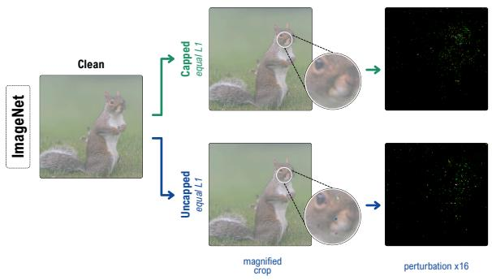

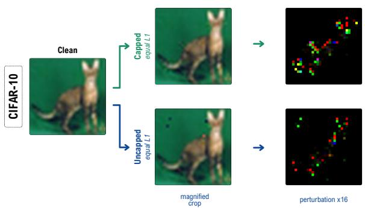  
Figure 1. Equal-ℓ1 perturbations can have substantially different local structures. APGD- $\mathbf { \nabla } \cdot \mathbf { \rho } _ { 1 }$ examples on ImageNet/ResNet-50 (top) and CIFAR-10/ResNet-18 (bottom) compare capped and conventional uncapped (c = 1) perturbations matched by realized $\ell _ { 1 }$ magnitude. Both are successful, but the capped perturbations have lower peak changes and broader support. Magnified crops highlight these differences. Perturbations are amplified by 16× for visualization and do not represent their original-scale appearance.

We investigate four aspects of this question: (Q1) how attack success changes as coordinate-wise modifications are progressively restricted; (Q2) whether, at comparable realized $\ell _ { 1 }$ magnitude, the restriction changes peak magnitude, effective support, and top-mass concentration rather than merely reducing budget usage; (Q3) whether capped operating points exhibit lower measured perceptual distances while retaining attack success; and (Q4) how the findings vary across attacks, optimization settings, datasets, architectures, and model-robustness regimes.

To study this, we augment the conventional global $\ell _ { 1 }$ budget with a per-coordinate magnitude cap $c .$ The uncapped condition $c \ = \ 1$ recovers the standard imagedomain $\ell _ { 1 }$ setting, while smaller caps define nested restrictions of the same threat set. Unlike an $\ell _ { \infty } \mathrm { - o n l y }$ constraint, the cap is imposed while retaining the global $\ell _ { 1 }$ budget, allowing us to examine perturbation allocation under both restrictions. Sweeping c at fixed global budget produces a perturbation–concentration frontier, and we summarize each frontier by the tightest evaluated cap that retains at least 95% of the attack success measured under its native uncapped implementation. Because the feasible sets are nested, any empirical increase in ASR under a tighter cap is interpreted as finite-compute optimization behavior rather than a stronger theoretical threat set. Formal definitions are given in Sec. 3.

The cap is enforced during optimization using exact projection onto the intersection of the $\ell _ { 1 }$ ball, the coordinate cap, and the valid image box. We incorporate this projection into $\mathbf { A P G D - } \boldsymbol { \ell } _ { 1 }$ , SLIDE, and FMN-ℓ1 while preserving their objectives and update rules. Native uncapped implementations serve as reference conditions, while capped conditions use the joint projection. This is therefore an evaluation protocol rather than a new attack family; post-hoc clipping is treated only as a control because it removes perturbation mass without allowing the optimizer to redistribute it.

Across the primary budgets of the standard models, all 18 attack–model–dataset settings retain at least 95% of their native uncapped ASR at an evaluated cap no larger than $3 2 / 2 5 5 .$ , with selected caps ranging from 2/255 to 32/255. Matched-realized- $\cdot \ell _ { 1 }$ analyses further show that capped perturbations can exhibit lower peak magnitude, broader effective support, and less mass concentrated in their largest coordinates without merely using less total perturbation. Selected ImageNet/ResNet-50 settings also achieve lower measured LPIPS and DISTS [15, 51]. The frontiers nevertheless vary substantially across attacks and models, and adversarially trained models show more heterogeneous concentration sensitivity, ruling out a universal cap.

Our controls further characterize this finding. Direct inloop constrained optimization achieves substantially higher ASR than post-hoc clipping under the evaluated conditions, and stronger optimization profiles preserve high-retention behavior in the tested configurations. Repeated-search audits additionally illustrate the role of finite-compute optimization in observed non-monotonic behavior. Together, these observations characterize concentration sensitivity as an empirical property that varies with attack and model configurations.

Our contributions are:

• We formulate concentration-aware $\ell _ { 1 }$ evaluation using nested $\ell _ { 1 } - \ell _ { \infty }$ threat sets, empirical concentration frontiers, and retention-based operating points relative to native attack baselines.

• We incorporate exact joint projection into three established $\ell _ { 1 }$ attack families and provide controls examining perturbation redistribution, budget under-use, posthoc clipping, and sensitivity to optimization strength.

• Across CIFAR-10, CIFAR-100, and ImageNet, standard and adversarially trained models, and convolutional and transformer architectures, we characterize when lowerpeak, more distributed perturbations preserve empirical attack success and where this behavior becomes modeland attack-dependent.

Together, these results show that a global $\ell _ { 1 }$ budget specifies how much an adversary may change, but not how successful attacks allocate that change. Systematically varying the permitted concentration reveals differences in empirical attack effectiveness and perturbation structure that a single uncapped evaluation does not capture.

## 2. Related work

Sparse and $\ell _ { 1 }$ adversarial attacks. Since adversarial examples were first characterized [22, 43], most work has focused on $\ell _ { \infty }$ and $\ell _ { 2 }$ threat models [4, 29]. Sparse attacks instead restrict the number of modified coordinates, from saliency-based [33] and single-pixel attacks [42] to geometric [32], structured [20], and query-efficient black-box methods [13]. The $\ell _ { 1 }$ ball allows sparsity without fixing the support and underlies elastic-net [6], gradient-sparsified [45], and adaptive projected-gradient attacks [10, 11]. Related methods instead minimize adversarial norm [9, 34, 37, 38]. Efficient $\ell _ { 1 }$ projection [7, 18] is therefore central, and exact projection onto the intersection of the $\ell _ { 1 }$ ball and valid image box has been established [11]. In these settings, the global budget is specified, but how perturbation mass is distributed across coordinates is largely left to the optimizer.

Perceptual constraints and perturbation allocation. $\ell _ { p }$ proximity is not equivalent to perceptual similarity [40], and its role as a security model has been questioned [21]. Alternatives use learned perceptual distances [28], transport costs [48], unions of norms [31, 45], unforeseen distortions [26], or spatial and semantic transformations [19, 24, 49]. Closer to our setting, additive sparse attacks promote less visible perturbations through local-variation constraints [8], learned distortion maps [16], factorization [20], or homotopy optimization [52]. Other approaches explicitly control perturbation sparsity and allocation during attack construction. SAIF [25] jointly optimizes an $\ell _ { 1 }$ -bounded soft mask and an $\ell _ { \infty }$ -bounded perturbation using Frank–Wolfe, whereas importance-guided allocation [41] uses a fixed clean-gradient prior to redistribute perturbation mass toward model-sensitive coordinates under joint global $\ell _ { 1 }$ and local magnitude constraints. These approaches demonstrate the relevance of perturbation allocation to attack design, although their formulations and optimization mechanisms differ.

Our focus is complementary: rather than optimizing a new allocation mechanism, we examine how the empirical effectiveness of established $\ell _ { 1 }$ attacks changes as the permitted coordinate magnitude is progressively restricted. We preserve their objectives and update rules, enforce the joint $\ell _ { 1 } { \mathrm { - c a p - b o x } }$ constraint in-loop, and sweep the cap at fixed global budget. Unlike an $\ell _ { \infty } \mathrm { - o n l y }$ evaluation, this retains an independent constraint on total perturbation mass. The resulting nested-set frontier characterizes concentration sensitivity relative to native uncapped attack baselines. Here, concentration denotes within-perturbation mass allocation, not concentration of measure [30]; SSIM [47], LPIPS [51], and DISTS [15] are related perceptual measures, with LPIPS and DISTS used only as supporting measurements in our experiments.

Evaluating adversarial robustness. Robustness estimates depend critically on evaluation quality: weak attacks can overestimate robustness [46], while gradient masking can fail under adaptive analysis [1, 44]. This has motivated evaluation guidelines [5], parameter-free ensembles [10], standardized benchmarks [12], minimum-distortion estimators [3], shared toolkits [36], and optimization-failure diagnostics [35], including for adversarially trained models [2, 29]. We study a complementary source of evaluation variation: feasible-set geometry and enforcement. Our cap sweep measures empirical concentration sensitivity, while the large gap between direct in-loop constrained optimization and post-hoc clipping—up to 88 percentage points— highlights the importance of optimizing within the intended feasible set rather than modifying completed perturbations.

## 3. Concentration-aware evaluation

We ask how much of a conventional $\ell _ { 1 }$ attack’s observed effectiveness survives when large changes to individual image coordinates are progressively restricted. The global $\ell _ { 1 }$ budget is held fixed, the permitted coordinate magnitude is swept, and standard attack success is measured at each condition. The protocol introduces no new attack objective and no new definition of success; it augments conventional $\ell _ { 1 }$ evaluation with an explicit concentration axis that a single uncapped ASR measurement cannot recover.

Table 1. Main perturbation–concentration results for standard models at the primary budgets $( B = 4$ for CIFAR-10/100 and $B = 2 0$ for ImageNet). $c ^ { \star }$ is the tightest evaluated cap retaining at least 95% of the native uncapped ASR. $\Delta _ { \infty }$ denotes the reduction in median $\ell _ { \infty } ,$ , and $\Delta S _ { \mathrm { e f f } }$ the increase in median effective support.
<table><tr><td>Data Model</td><td></td><td>Attack</td><td>255c*</td><td>ASR1 ASR</td><td></td><td>Ret. (%)</td><td> $\Delta _ { \infty }$ </td><td> $\Delta S _ { \mathrm { e f f } }$ </td></tr><tr><td>C10</td><td>ResNet-18</td><td>APGD-L1</td><td>16</td><td>96.04</td><td>92.65</td><td>96.47 79.80</td><td></td><td>145.94</td></tr><tr><td>C10</td><td>ResNet-18</td><td>SLIDE</td><td>32</td><td>90.80</td><td>88.60</td><td>97.5856.31</td><td></td><td>46.17</td></tr><tr><td>C10</td><td>ResNet-18</td><td>FMN-L1</td><td>16</td><td>95.98</td><td>92.29</td><td>96.16 72.77</td><td></td><td>186.79</td></tr><tr><td>C10</td><td>WRN-28-10 APGD-L1</td><td></td><td>8</td><td>96.91</td><td>93.02</td><td>95.98</td><td>88.28</td><td>268.71</td></tr><tr><td>C10</td><td>WRN-28-10 SLIDE</td><td></td><td>32</td><td>89.31</td><td>88.09</td><td>98.63</td><td>48.40</td><td>31.17</td></tr><tr><td>C10</td><td>WRN-28-10 FMN-L1</td><td></td><td>16</td><td>96.40</td><td>94.97</td><td>98.51</td><td>66.85</td><td>137.30</td></tr><tr><td></td><td>C100 ResNet-18</td><td>APGD-L1</td><td>8</td><td>97.48</td><td>93.88</td><td>96.3089.44</td><td></td><td>324.58</td></tr><tr><td></td><td>C100 ResNet-18</td><td>SLIDE</td><td>32</td><td>93.34</td><td>91.75</td><td></td><td>98.31 48.40</td><td>31.15</td></tr><tr><td></td><td>C100 ResNet-18</td><td>FMN-L1</td><td>8</td><td>96.15</td><td>92.41</td><td>96.11 80.89</td><td></td><td>339.96</td></tr><tr><td></td><td>C100 WRN-28-10 APGD-L1</td><td></td><td>2</td><td>97.38</td><td>98.26</td><td>100.90</td><td>97.37</td><td>1032.49</td></tr><tr><td></td><td>C100 WRN-28-10 SLIDE</td><td></td><td>8</td><td>91.40</td><td>87.29</td><td>95.50</td><td>73.43</td><td>61.08</td></tr><tr><td></td><td>C100 WRN-28-10 FMN-L1</td><td></td><td>2</td><td>92.22</td><td>89.87</td><td>97.45</td><td>89.82</td><td>779.65</td></tr><tr><td>IN</td><td>ResNet-50</td><td>APGD-L1</td><td>4</td><td>89.03</td><td>84.99</td><td>95.45</td><td>96.69</td><td>742.95</td></tr><tr><td>IN</td><td>ResNet-50</td><td>SLIDE</td><td>8</td><td>86.29</td><td>83.42</td><td></td><td>96.67 79.66</td><td>96.19</td></tr><tr><td>IN</td><td>ResNet-50</td><td>FMN-L1</td><td>8</td><td>89.69</td><td>88.77</td><td>98.98</td><td>84.19</td><td>239.74</td></tr><tr><td>IN</td><td>ViT-B/16</td><td>APGD-L1</td><td>4</td><td>63.50</td><td>67.25</td><td>105.9196.47</td><td></td><td>649.35</td></tr><tr><td>IN</td><td>ViT-B/16</td><td>SLIDE</td><td>8</td><td>71.12</td><td>68.25</td><td></td><td>95.9673.75</td><td>59.51</td></tr><tr><td>IN</td><td>ViT-B/16</td><td>FMN-L1</td><td>16</td><td>76.00</td><td>74.00</td><td></td><td>97.37 78.07</td><td>166.34</td></tr></table>

## 3.1. Concentration-controlled $\ell _ { 1 }$ evaluation

Let $x \in [ 0 , 1 ] ^ { D }$ be an image and $\delta \in \mathbb { R } ^ { D }$ an additive perturbation. For a global $\ell _ { 1 }$ budget B and a per-coordinate magnitude cap c, the admissible set is

$$
\begin{array} { r } { S ( B , c ; x ) = \left\{ \begin{array} { l l } { \delta \in \mathbb { R } ^ { D } : } & { \| \delta \| _ { 1 } \leq B , } \\ & { \| \delta \| _ { \infty } \leq c , } \\ & { x + \delta \in [ 0 , 1 ] ^ { D } } \end{array} \right\} . } \end{array}\tag{1}
$$

Here B limits the total absolute perturbation magnitude while c limits the magnitude assigned to any individual coordinate, including its channel index; all constraints and measurements are defined in raw [0, 1] image space.

Setting $c = 1$ recovers the conventional image-domain $\ell _ { 1 }$ threat set, since $x + \delta \in [ 0 , 1 ] ^ { D }$ already prevents any coordinate from changing by more than one. Smaller caps define controlled restrictions of that set: for $c _ { 1 } \leq c _ { 2 }$

$$
\begin{array} { r } { S ( B , c _ { 1 } ; x ) \subseteq S ( B , c _ { 2 } ; x ) \subseteq S ( B , 1 ; x ) . } \end{array}\tag{2}
$$

A capped condition is therefore deliberately more restrictive, and we never treat capped and uncapped conditions as equivalent adversarial capabilities. The c = 1 condition anchors the conventional evaluation; the remaining conditions measure how much of its empirically observed effectiveness survives once access to large coordinate-wise changes is withdrawn. Holding B fixed preserves the nominal global perturbation budget while varying the permitted coordinate magnitude.

## 3.2. Retained effectiveness

Let A be an attack, f a classifier, and C an ordered cap grid containing 1. For each $c \in { \mathcal { C } }$ we run A under $S ( B , c ; x )$ and compute the conventional attack success rate on the same clean-correct population, written $\mathrm { A S R } _ { { \cal A } , f } ( B , c )$ ; the arguments specify the feasible region, not a different success criterion. The perturbation–concentration frontier, its retention relative to the native uncapped execution, and the resulting operating point are

$$
F _ { A , f , B } ( c ) = \mathrm { A S R } _ { A , f } ( B , c ) , \qquad c \in \mathcal { C } ,\tag{3}
$$

$$
R _ { { \cal A } , f , B } ( c ) = \frac { F _ { { \cal A } , f , B } ( c ) } { F _ { { \cal A } , f , B } ( 1 ) } , \quad c _ { \rho , { \cal A } , f } ^ { \star } ( B ) = \operatorname * { m i n } \{ c \in \mathcal { C } : R \ge \rho \}\tag{4}
$$

A flat region of the frontier indicates that large coordinate changes can be restricted at little empirical cost relative to the reference execution; a sharp decline indicates greater sensitivity under the evaluated optimization configuration. Our primary summary uses $\rho = 0 . 9 5 , \mathrm { s o } c _ { 0 . 9 5 } ^ { \star }$ is the tightest evaluated cap preserving at least 95% of the directly measured native uncapped ASR for the same attack, model, budget, and population. This reference-relative statistic characterizes the specified attack implementations rather than best-achievable adversarial success across optimization configurations. The full frontier remains the object of analysis; $c ^ { \star }$ is a compact summary, selected independently for every attack–model–budget configuration and never transferred between settings. We additionally examine $\rho \in \{ 0 . 9 0 , 0 . 9 9 \}$

Because the sets in Eq. (2) are nested, tightening the cap cannot increase the exact worst-case adversarial risk. Finite-compute attacks may nevertheless produce nonmonotonic empirical ASR, because changing the constraint changes the geometry the optimizer encounters. We therefore report measured frontiers without monotonic smoothing and interpret any local increase under a tighter cap as optimization behavior rather than evidence that the smaller threat set is stronger.

## 3.3. Realizing the capped conditions

The cap must be enforced during optimization. Clipping a completed uncapped perturbation discards mass without letting the optimizer reallocate it, so it cannot answer whether the same attack could have found a successful, less concentrated perturbation inside the joint feasible set. We therefore enforce the constraints by Euclidean projection: for a proposed perturbation $v ,$

$$
\begin{array} { r l } & { \Pi _ { B , c , x } ( v ) = \arg \operatorname* { m i n } _ { z } \frac { 1 } { 2 } \| z - v \| _ { 2 } ^ { 2 } } \\ & { \qquad \mathrm { s . t . } \quad \| z \| _ { 1 } \leq B , \qquad \ell _ { i } \leq z _ { i } \leq u _ { i } , } \end{array}\tag{5}
$$

with $\ell _ { i } = \operatorname* { m a x } ( - c , - x _ { i } )$ and $u _ { i } = \operatorname* { m i n } ( c , 1 - x _ { i } )$ jointly enforcing the coordinate cap and the valid image domain. The solution is a box-constrained soft threshold,

$$
z _ { i } ( \lambda ) = \mathrm { c l i p } \big ( \mathrm { s i g n } ( v _ { i } ) [ | v _ { i } | - \lambda ] _ { + } , \ell _ { i } , u _ { i } \big ) ,\tag{6}
$$

where $[ a ] _ { + } ~ = ~ \operatorname* { m a x } ( a , 0 )$ . If the box projection at $\lambda \ =$ 0 already satisfies the global budget it is returned unchanged; otherwise λ is obtained by one-dimensional bisection. The derivation and its numerical validation are given in App. A.1.

For fixed-budget iterative attacks the projection is applied to the initial perturbation and after every update; for adaptive minimum-norm attacks it replaces the feasibility projection at the attack’s current radius. In both cases the objective, gradient computation, candidate selection, and remaining update logic are left unchanged.

The $c \ = \ 1$ condition is handled separately from the capped conditions: each attack uses its native uncapped $\ell _ { 1 }$ implementation, including SLIDE’s released projection, while $c < 1$ conditions use the exact joint projector. This establishes the conventional attack implementations as the reference for Eq. (4). The resulting retention measures the effectiveness of the capped protocol relative to that native reference, with feasibility enforcement following the respective implementations. Post-hoc clipping is retained as a control rather than as a realization of the capped optimization procedure.

## 3.4. Matched-realized $\scriptstyle - \ell _ { 1 }$ comparison

Equal nominal budgets do not guarantee equal realized magnitude: an attack may use substantially less than $B ,$ and tightening c may change how much. A capped perturbation could then appear less concentrated simply because it spends less. We control for this per example. For a successful capped perturbation $\delta _ { \mathcal { A } , n } ^ { B , c }$ we record its realized magnitude and rerun the uncapped attack on the same sample with that value as its budget,

$$
L _ { n } ^ { ( c ) } = \big \| \delta _ { { \cal A } , n } ^ { B , c } \big \| _ { 1 } , \qquad \widetilde { \delta } _ { { \cal A } , n } ^ { ( c ) } = \delta _ { { \cal A } , n } ^ { L _ { n } ^ { ( c ) } , 1 } .\tag{7}
$$

The two perturbations share an input and approximately the same realized $\ell _ { 1 }$ magnitude but are generated under their respective capped and native uncapped optimization procedures. The comparison is conditioned on capped-source success, so the matched execution’s success rate is a diagnostic on that population rather than a dataset-level ASR, and structural quantities are compared per example. If the structural difference largely disappears after matching, it can be explained by reduced total perturbation use; if it persists, it provides evidence of different mass allocation beyond differences in realized $\ell _ { 1 }$ magnitude alone.

## 3.5. Describing perturbation allocation

Retention says nothing about how successful perturbations change. We therefore record realized $\ell _ { 1 }$ magnitude alongside peak magnitude $\| \delta \| _ { \infty } .$ , the share of mass carried by the largest coordinates, and effective support. Letting $\mathrm { T o p } _ { q } ( \delta )$ index the largest $\lceil q D \rceil$ values of |δ|,

$$
M _ { q } ( \delta ) = \frac { \sum _ { i \in \mathrm { T o p } _ { q } ( \delta ) } \left| \delta _ { i } \right| } { \| \delta \| _ { 1 } + \varepsilon } , \qquad S _ { \mathrm { e f f } } ( \delta ) = \frac { \| \delta \| _ { 1 } ^ { 2 } } { \| \delta \| _ { 2 } ^ { 2 } + \varepsilon } ,\tag{8}
$$

where ε is a small numerical stabilizer and we report $q \in$ $\lbrace 0 . 0 1 , 0 . 0 5 \rbrace$ . For a fixed amount of $\ell _ { 1 }$ mass, the participation ratio $S _ { \mathrm { e f f } }$ increases as that mass is distributed across more coordinates and decreases as it concentrates on fewer.

Lower $\| \delta \| _ { \infty }$ , lower top-mass fractions, and larger $S _ { \mathrm { e f f } }$ are complementary evidence of broader allocation. We report them separately rather than collapsing them into a single concentration score, because they capture different structural properties and need not change by the same amount. At the selected operating point we summarize the change from the uncapped condition by the percentage reduction in median $\| \delta \| _ { \infty }$ and the percentage increase in median $S _ { \mathrm { e f f } }$ , defined in App. A.2; these are the structural quantities reported alongside ASR retention in the main table.

## 3.6. Perceptual measurements

Broader allocation does not by itself imply lower perceptual distortion, so we treat perceptual similarity as a separate measurement rather than a consequence of reduced concentration. On ImageNet we compute LPIPS and DISTS between clean and adversarial images at the conventional uncapped condition, the independently selected $c ^ { \star } .$ , and a tighter neighboring cap. Because the population of successful attacks can change across conditions, we also perform paired common-success comparisons, ensuring the result is not driven by differing subsets of successfully attacked examples. Both are learned image-distance measures: a decrease supports a claim of lower measured perceptual distortion, not of human imperceptibility, visibility thresholds, or perceptual preference.

The protocol is ordered so that $c ^ { \star }$ is determined only from ASR retention on the predefined frontier, with every subsequent analysis used to interpret and stress-test that selection rather than to choose it; the complete ordering is given in App. A.3. It thereby separates three questions that a single conventional $\ell _ { 1 }$ ASR measurement cannot resolve: how much measured attack effectiveness remains when large coordinate changes are restricted, how successful perturbations redistribute their mass, and whether that structural difference persists at matched realized $\ell _ { 1 }$ . The datasets, models, attacks, budgets, cap grid, and populations used to instantiate the protocol are specified in Sec. 4.

Table 2. Perturbation–concentration results for adversarially trained models at their reference budgets $( B = 4$ for CIFAR-10 and $B = 2 0$ for ImageNet). $c ^ { \star }$ is the tightest evaluated cap retaining at least 95% of the native uncapped ASR. $\Delta _ { \infty }$ denotes the percentage reduction in median $\ell _ { \infty } .$ , and $\Delta S _ { \mathrm { e f f } }$ the percentage increase in median effective support. C10 and IN denote CIFAR-10 and ImageNet, respectively.
<table><tr><td>Data Model</td><td></td><td>Attack</td><td>255c*</td><td>ASR1 ASR</td><td></td><td>Ret. (%)</td><td> $\Delta _ { \infty }$ </td><td> $\Delta S _ { \mathrm { e f f } }$ </td></tr><tr><td>C10</td><td>CH PreActRN-18 (l1)</td><td>APGD-L1</td><td>32</td><td>8.65</td><td>8.35</td><td>96.55 50.68</td><td></td><td>52.74</td></tr><tr><td>C10</td><td>CH PreActRN-18 (l1)</td><td>SLIDE</td><td>64</td><td>7.80</td><td>7.67</td><td>98.38</td><td>1.10</td><td>4.29</td></tr><tr><td></td><td>C10 MSD PreActRN-18</td><td>APGD-L1</td><td>64</td><td>12.14</td><td>11.96</td><td>98.59</td><td>9.25</td><td>4.47</td></tr><tr><td></td><td>C10 MSD PreActRN-18</td><td>SLIDE</td><td>64</td><td>12.82</td><td>12.78</td><td>99.71</td><td>1.04</td><td>3.00</td></tr><tr><td>C10</td><td> $\mathrm { X C i T - S } 1 2 \left( \ell _ { \infty } \right)$ </td><td>APGD-L1</td><td>255</td><td>28.50</td><td>28.50</td><td>100.00</td><td>0.00</td><td>0.00</td></tr><tr><td>C10</td><td> $\mathrm { X C i T - S } 1 2 \left( \ell _ { \infty } \right)$ </td><td>SLIDE</td><td>64</td><td>21.00</td><td>20.46</td><td>97.46</td><td>15.76</td><td>6.67</td></tr><tr><td>IN</td><td> $\mathrm { X C i T - S } 1 2 \left( \ell _ { \infty } \right)$ </td><td>APGD-L1</td><td>255</td><td>20.79</td><td>20.79</td><td>100.00</td><td>0.00</td><td>0.00</td></tr><tr><td>IN</td><td> $\mathrm { X C i T - S } 1 2 \left( \ell _ { \infty } \right)$ </td><td>SLIDE</td><td>4</td><td>6.02</td><td></td><td>6.02100.00</td><td>0.00</td><td>0.00</td></tr></table>

## 4. Experimental setup

Datasets, models, and evaluation populations. Standard-model frontiers use the complete 10,000-image CIFAR-10 and CIFAR-100 test sets [27]. For ResNet-18 and WideResNet-28-10 [23, 50], the clean-correct populations are (9,497, 9,478) on CIFAR-10 and (7,592, 8,212) on CIFAR-100; WideResNet checkpoints are obtained from RobustBench [12]. On ImageNet [39], a deterministic class-balanced manifest with one validation image per class is shared by torchvision ResNet-50 and ViT-B/16 [17, 23], yielding 766 and 800 clean-correct examples. We additionally evaluate the Croce–Hein $\ell _ { 1 } \cdot$ -robust PreActResNet-18 [11], MSD multi-norm PreActResNet-18 [31], and $\ell _ { \infty } -$ robust XCiT-S12 [14] on CIFAR-10, plus robust XCiT-S12 on ImageNet, with clean-correct populations 8,706, 8,174, 9,006, and 731, respectively. Attacks operate in the [0, 1] image domain with normalization inside the classifier. ASR uses a common clean-correct population for each dataset–model pair; success requires a label change and satisfaction of all $\ell _ { 1 } .$ , cap, and image constraints. Manifest construction and checkpoint provenance are detailed in Apps. B.1 and B.2.

Frontier attacks. Standard frontiers use untargeted APGD-L1 [11], SLIDE [45], and FMN-L1 [34], instantiated from official AutoAttack, the released SLIDE design, and authors-maintained Foolbox, respectively. Each attack uses its native path at $c = 1 ;$ for $c < 1$ , only projection is replaced by the exact joint operator from Sec. 3.3. SLIDE retains its margin objective, boundary masking, Laplace initialization, 99th-percentile sparsification, and step size 0.255B; its reported $c = 1$ rows are corrected independent native-projection reruns. FMN-L1 is run once per cap and evaluated along its minimum-norm trajectory. All attacks use 100 steps; APGD-L1 and SLIDE use one restart and

FMN-L1 one trajectory. Corresponding caps share deterministic randomness. Robust frontiers use APGD-L1 and SLIDE only. Complete attack instantiations are given in App. B.3.

Budgets, caps, and operating points. Standard budgets are $B \in \{ 2 , 4 \}$ on CIFAR-10/100 and $B \in \{ 1 0 , 2 0 \}$ on ImageNet. Robust budgets are {4, 12} for Croce–Hein and MSD, {2, 4} for CIFAR-10 XCiT-S12, and {20, 255} for ImageNet XCiT-S12; non-reference robust budgets are interpreted only within model (App. B.4). The shared cap grid is

$$
\mathcal { C } = \left\{ 1 , \frac { 6 4 } { 2 5 5 } , \frac { 3 2 } { 2 5 5 } , \frac { 1 6 } { 2 5 5 } , \frac { 8 } { 2 5 5 } , \frac { 4 } { 2 5 5 } , \frac { 2 } { 2 5 5 } \right\} .\tag{9}
$$

For every attack–model–budget frontier, $c _ { 0 . 9 5 } ^ { \star }$ is independently selected as the tightest cap retaining at least 95% of its $c = 1 \mathrm { A S R }$ . Controls use operating points frozen at $B _ { \mathrm { r e f } } = 4$ on CIFAR and 20 on ImageNet; robust points are selected independently and never retuned. We also report $\rho \in \{ 0 . 9 0 , 0 . 9 9 \}$ sensitivity analyses.

Controls, metrics, and reproducibility. Matchedrealized-ℓ tests use APGD-L1 and SLIDE on 5,000 CIFAR-10/ResNet-18 and 1,000 ImageNet/ResNet-50 images, with shared sample identity and 0.25% relative matching tolerance. ImageNet perceptual tests report LPIPS [51] and DISTS [15] for all three attacks at $c = 1 , c _ { 0 . 9 5 } ^ { \star }$ , and the next tighter cap. On 5,000 CIFAR-10/ResNet-18 images, projection controls compare in-loop optimization with post-hoc clipping, while stronger profiles increase APGD-L1 from one to five restarts and FMN-L1 from 100 to 500 steps. A 700-image ImageNet audit evaluates APGD-L1 best-of-k, $k = 1 , \ldots , 5 ,$ and 500-step FMN-L1 at $c \in \{ 1 , 6 4 / 2 5 5 \}$ ; official $\ell _ { 1 }$ AutoAttack at $B ~ = ~ 4 , c ~ = ~ 1$ on 1,000 CIFAR-10/ResNet-18 images provides an external strength anchor. Full control protocols appear in App. B.5.

We record success, feasibility, realized $\ell _ { 1 } , \ell _ { 2 } ,$ and $\ell _ { \infty } ,$ top-1% and top-5% mass, effective support, cap saturation, LPIPS, and DISTS. Structural summaries are medians over successful feasible examples; matched analyses condition on capped-source success. We report 95% Wilson ASR intervals, 2,000 deterministic paired-bootstrap resamples for paired binary and median differences, and Spearman correlations with sample-clustered resampling; frontiers are not smoothed. Statistical procedures, sharding, and the full validation suite are detailed in Apps. B.6 and B.7.

## 5. Results

We first report the perturbation–concentration frontiers on standard models, then examine the corresponding behavior on adversarially trained models. We finally use matchedrealized $\scriptstyle - \ell _ { 1 }$ and perceptual analyses to characterize the selected operating points. Optimization and implementation controls are reported separately in Sec. 6.

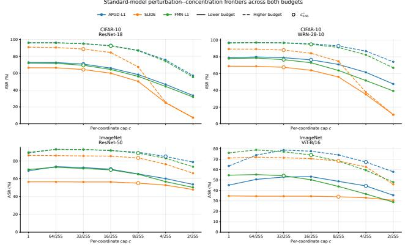  
Figure 2. Standard-model perturbation–concentration frontiers across both global budgets. Panels show CIFAR-10/ResNet-18, CIFAR-10/WRN-28-10, ImageNet/ResNet-50, and ImageNet/ViT-B/16. Markers indicate the independently selected $c _ { 0 } ^ { \star }$ values. CIFAR-100 results are included in Table 1.

## 5.1. Main concentration results

Table 1 summarizes the primary operating points for the standard models at $B = 4$ for CIFAR-10 and CIFAR-100 and B = 20 for ImageNet.

Across all 18 standard-model attack configurations, the 95% retention criterion relative to the native uncapped baseline is reached at an evaluated cap of at most 32/255. Median ASR retention is 97.02%, while median peak magnitude decreases by 79.73% and median effective support increases by 176.56%.

Similar patterns are observed across datasets and architectures. For example, APGD-L1 on ImageNet/ResNet-50 retains 95.45% of its native uncapped ASR at 4/255, while reducing median $\ell _ { \infty }$ by 96.69% and increasing effective support by 742.95%. CIFAR-100 also exhibits strong redistribution, with APGD-L1 and FMN-L1 on WRN-28-10 selecting 2/255.

The measured frontiers occasionally exhibit finitecompute non-monotonicity. For example, APGD-L1 on ImageNet/ViT-B/16 attains 63.50% ASR at c = 1, 78.75% at 32/255, and 67.25% at the selected 4/255 cap. The operating point follows the predefined native-relative retention criterion, while the full frontier captures differences in empirical optimization success across cap settings. We report these measurements without monotonic smoothing and examine their interpretation in Appendix E.

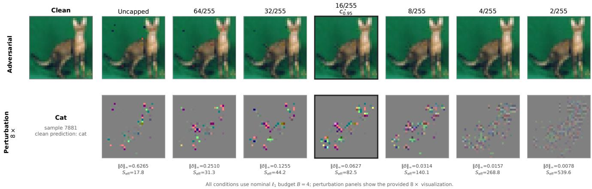  
Figure 3. Qualitative perturbation progression under increasingly tight coordinate caps for a CIFAR-10 example at B = 4. Tightening the cap progressively reduces peak magnitude and spreads the perturbation over larger effective support. The selected $c _ { 0 . 9 5 } ^ { \star } = 1 6 / 2 5 5$ operating point is highlighted; perturbations are shown at 8× scale.

## 5.2. Adversarially trained models

Table 2 summarizes the adversarially trained models. Their measured concentration frontiers exhibit substantially more heterogeneous behavior than those of standard classifiers.

The $\ell _ { 1 }$ -robust Croce–Hein model still admits substantial restriction: APGD-L1 selects 32/255 with 96.55% retention. The multi-norm MSD model is more concentrationsensitive under the evaluated attacks, with both APGD-L1 and SLIDE selecting 64/255.

The largest departure occurs for the $\ell _ { \infty }$ -trained XCiT models. APGD-L1 requires the uncapped condition to satisfy the 95% retention criterion on both CIFAR-10 and ImageNet, whereas SLIDE selects 64/255 and 4/255, respectively. These differences illustrate how the observed concentration frontiers vary across model, training, and attack configurations.

## 5.3. Matched realized $\ell _ { 1 }$

The structural differences persist when capped perturbations are compared with independently optimized uncapped perturbations at approximately matched realized $\ell _ { 1 }$ magnitude.

For APGD-L1, median $\ell _ { \infty }$ decreases from 0.3060 to 0.0627 on CIFAR-10/ResNet-18 and from 0.4569 to 0.0157 on ImageNet/ResNet-50, while median effective support increases from 37.2 to 90.2 and from 215.2 to 1769.5, respectively. The matched uncapped attacks remain successful on 99.29% and 96.95% of the corresponding capped-sourcesuccess populations.

Thus, the observed structural differences are not explained solely by reduced realized $\ell _ { 1 }$ use. Full structural comparisons are provided in Appendix C.1.

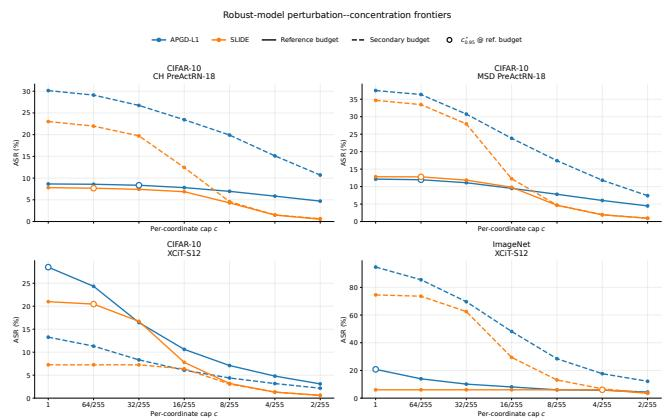  
Figure 4. Perturbation–concentration frontiers for adversarially trained models. Solid curves denote the reference budget and dashed curves the corresponding secondary budget. Circled points indicate $c _ { 0 . 9 5 } ^ { \star }$ at the reference budget.

## 5.4. Perceptual-distance tradeoff

On ImageNet/ResNet-50, the selected capped operating points also exhibit lower learned perceptual distances. For APGD-L1, median LPIPS and DISTS decrease by approximately 68.2% and 61.6% at 4/255; for FMN-L1, the corresponding reductions at 8/255 are 38.1% and 32.5%.

Paired common-success comparisons show the same direction. These results support lower measured perceptual distortion under LPIPS and DISTS, not human imperceptibility. Full numerical and visual comparisons are reported in Appendix C.2.

Overall finding. Across standard models, substantial empirical $\ell _ { 1 }$ attack effectiveness relative to native uncapped baselines is retained under restrictions on peak coordinate magnitude, while successful perturbations become markedly more distributed. Matched- ${ \boldsymbol { \cdot } } { \boldsymbol { \ell } } _ { 1 }$ analyses support redistribution beyond reduced budget use, and perceptual measurements characterize additional differences at selected ImageNet operating points. The robust-model results further highlight the model- and attack-dependent nature of these observations.

Table 3. Constraint-enforcement control (A04) on 4,750 cleancorrect CIFAR-10/ResNet-18 examples at $B = 4 , \ \Delta$ denotes direct constrained ASR minus post-hoc ASR.
<table><tr><td>Attack</td><td>255c</td><td>Post-hoc</td><td>Direct</td><td>∆ ASR [95% CI]</td></tr><tr><td>APGD-L1</td><td>16</td><td>46.72</td><td>92.21</td><td> $+ 4 5 . 4 9$  [44.13, 46.91]</td></tr><tr><td>FMN-L1</td><td>16</td><td>3.83</td><td>91.94</td><td>+88.11 [87.20, 88.99]</td></tr></table>

## 6. Ablations and Evaluation Audits

The analyses in Secs. 5.3 and 5.4 already examine two important aspects of the observed differences: A01–A02 assess whether structural redistribution persists after controlling for realized $\ell _ { 1 }$ magnitude, and A03 measures the corresponding changes in learned perceptual distance. We therefore focus here on the remaining controls: constraint enforcement (A04), attack strength (A05), restart behavior (A06), and the quality of the uncapped reference (A07). Complete protocols and additional diagnostics are reported in Appendix D.

All ablations are performed after the primary $c _ { 0 . 9 5 } ^ { \star }$ values are frozen and therefore do not affect operating-point selection.

## 6.1. Constraint enforcement and attack strength

A04 tests whether the capped results could be reproduced simply by generating an uncapped perturbation and clipping its largest coordinates afterward. Table 3 compares posthoc clipping with direct optimization inside the same final feasible set on CIFAR-10/ResNet-18.

Direct constrained optimization achieves substantially higher ASR than post-hoc clipping for both evaluated attacks. Since both final perturbations satisfy the same declared constraints, the comparison highlights the benefit of optimizing within the capped feasible set, where perturbation mass can be redistributed, rather than truncating a completed uncapped solution.

A05 examines whether the selected high-retention operating points remain effective under stronger optimization. APGD-L1 is increased from one to five restarts, while FMN-L1 is increased from 100 to 500 steps.

Additional compute improves both capped and uncapped conditions rather than selectively recovering the conventional baseline. At the frozen operating point, strengthened APGD-L1 retains 95.8% of its strengthened uncapped ASR and strengthened FMN-L1 retains 96.3%. Thus, within the evaluated optimization profiles, stronger attacks change absolute ASR while preserving the selected high-retention behavior.

Table 4. Optimization-strength control (A05) on CIFAR-10/ResNet-18 at $B = 4 . \ \mathrm { \stackrel {  } { M a i n } } ^ { , * }$ and “Strong” denote the default and strengthened configurations. The selected operating points are frozen before this comparison.
<table><tr><td>Attack</td><td>Condition</td><td>255c</td><td>Main</td><td>Strong</td><td>∆ ASR</td></tr><tr><td>APGD-L1</td><td>Uncapped</td><td>255</td><td>95.58</td><td>98.08</td><td>+2.51</td></tr><tr><td></td><td> $c ^ { \star }$ </td><td>16</td><td>91.81</td><td>93.94</td><td>+2.13</td></tr><tr><td></td><td>Tighter</td><td>8</td><td>86.51</td><td>88.55</td><td>+2.04</td></tr><tr><td>FMN-L1</td><td>Uncapped</td><td>255</td><td>95.96</td><td>96.40</td><td>+0.44</td></tr><tr><td></td><td>c*</td><td>16</td><td>91.89</td><td>92.86</td><td>+0.97</td></tr><tr><td></td><td>Tighter</td><td>8</td><td>86.11</td><td>87.28</td><td>+1.18</td></tr></table>

Repeated-run optimizer audit on ImageNet/ResNet-50  
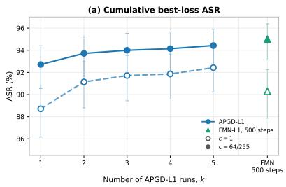

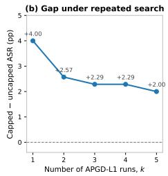  
Figure 5. Repeated-run optimizer audit (A06). Cumulative bestof-k APGD-L1 ASR, selecting the highest-loss candidate among the first k runs, is shown for $c = 1$ and $c = 6 4 / 2 5 5$ , with 95% Wilson intervals. Markers show the corresponding 500-step FMN-L1 references. Increasing independent search effort improves both conditions and narrows the capped-over-uncapped APGD gap.

## 6.2. Finite-compute optimizer audit

A06 examines finite-compute non-monotonicity through a repeated-search audit. On 700 fixed clean-correct ImageNet/ResNet-50 examples at $B \ = \ 2 0$ , we compare APGD-L1 at c = 1 and c = 64/255 over five independently seeded runs.

APGD-L1 increases from 88.71% to 92.43% ASR between one and five runs at $c = 1$ , and from 92.71% to 94.43% at $c = 6 4 / 2 5 5$ . The capped-minus-uncapped gap therefore decreases from 4.00 to 2.00 percentage points. This narrowing is consistent with finite-compute optimization contributing to the observed non-monotonicity, while the remaining gap illustrates the dependence of empirical ASR on the search procedure. Detailed best-of-k values and broader frontier diagnostics are provided in Appendix D.5.

## 6.3. Official AutoAttack reference

A07 provides an external strength reference for the conventional uncapped executions using the official unmodified untargeted $\ell _ { 1 }$ AutoAttack suite on 1,000 fixed clean-correct CIFAR-10/ResNet-18 examples at $B = 4$

Table 5. External uncapped attack-strength reference (A07). ∆ denotes comparator ASR minus official AutoAttack ASR.
<table><tr><td>Attack</td><td>ASR (%)</td><td> $\Delta \left( \mathsf { p p } \right)$ </td></tr><tr><td>Official  $\ell _ { 1 }$  AutoAttack</td><td>98.50</td><td></td></tr><tr><td>APGD-L1</td><td>96.20</td><td> $- 2 . 3 0$ </td></tr><tr><td>FMN-L1</td><td>95.70</td><td>-2.80</td></tr></table>

The individual frontier attacks attain slightly lower ASR than the complete AutoAttack ensemble, remaining within 2.8 percentage points on the matched population. This provides a reference for the strength of the native uncapped executions in this setting. The official ensemble is used only as an uncapped comparator because its standard form does not enforce the additional coordinate cap.

Together with A01–A03, these controls provide complementary evidence on realized budget use, perceptual measurements, constraint enforcement, optimization strength, finite-compute restart behavior, and uncapped reference quality within their respective evaluated settings. They support the interpretation of the measured concentration frontiers while distinguishing empirical attack behavior from guarantees about optimal adversarial success. None of these controls changes the operating points selected from the primary concentration frontiers.

## 7. Conclusion

We presented a concentration-aware evaluation of $\ell _ { 1 }$ adversarial attacks that separates total perturbation magnitude from how that magnitude is distributed across image coordinates. Across standard models on CIFAR-10, CIFAR-100, and ImageNet, most measured attack effectiveness relative to native uncapped baselines is retained under substantially tighter per-coordinate caps, while peak perturbation magnitude decreases and effective support increases markedly. Matched-realized- $\mathbf { \nabla } \cdot \mathbf { \rho } _ { 1 }$ comparisons show that these structural differences persist beyond changes in total perturbation use, while separate ImageNet comparisons reveal lower LPIPS and DISTS at selected caps. Adversarially trained models exhibit more heterogeneous concentration sensitivity, indicating that the measured frontiers depend on the attack and model configuration rather than following a universal scale. Constraint- enforcement controls further show that direct optimization within the capped feasible set can achieve up to 88 percentage points higher attack success than post-hoc clipping. Together, these results establish perturbation concentration as a complementary dimension of empirical $\ell _ { 1 }$ attack evaluation, while highlighting the importance of constraint enforcement and finite-compute optimization.

## References

[1] Anish Athalye, Nicholas Carlini, and David Wagner. Obfuscated gradients give a false sense of security: Circumventing defenses to adversarial examples, 2018. 3

[2] Brian R. Bartoldson, James Diffenderfer, Konstantinos Parasyris, and Bhavya Kailkhura. Adversarial robustness limits via scaling-law and human-alignment studies, 2024. 3

[3] Wieland Brendel, Jonas Rauber, Matthias Kummerer, Ivan¨ Ustyuzhaninov, and Matthias Bethge. Accurate, reliable and fast robustness evaluation, 2019. 3

[4] Nicholas Carlini and David Wagner. Towards evaluating the robustness of neural networks, 2017. 2

[5] Nicholas Carlini, Anish Athalye, Nicolas Papernot, Wieland Brendel, Jonas Rauber, Dimitris Tsipras, Ian Goodfellow, Aleksander Madry, and Alexey Kurakin. On evaluating adversarial robustness, 2019. 3

[6] Pin-Yu Chen, Yash Sharma, Huan Zhang, Jinfeng Yi, and Cho-Jui Hsieh. Ead: Elastic-net attacks to deep neural networks via adversarial examples, 2018. 2

[7] Laurent Condat. Fast projection onto the simplex and the $\ell _ { 1 }$ ball. Math. Program., 158(1):575–585, 2016. 2

[8] Francesco Croce and Matthias Hein. Sparse and imperceivable adversarial attacks, 2019. 3

[9] Francesco Croce and Matthias Hein. Minimally distorted adversarial examples with a fast adaptive boundary attack, 2020. 2

[10] Francesco Croce and Matthias Hein. Reliable evaluation of adversarial robustness with an ensemble of diverse parameter-free attacks, 2020. 1, 2, 3

[11] Francesco Croce and Matthias Hein. Mind the box: l1-apgd for sparse adversarial attacks on image classifiers, 2023. 1, 2, 5, 13

[12] Francesco Croce, Maksym Andriushchenko, Vikash Sehwag, Edoardo Debenedetti, Nicolas Flammarion, Mung Chiang, Prateek Mittal, and Matthias Hein. Robustbench: a standardized adversarial robustness benchmark, 2021. 1, 3, 5, 13

[13] Francesco Croce, Maksym Andriushchenko, Naman D. Singh, Nicolas Flammarion, and Matthias Hein. Sparse-rs: a versatile framework for query-efficient sparse black-box adversarial attacks, 2022. 2

[14] Edoardo Debenedetti, Vikash Sehwag, and Prateek Mittal. A light recipe to train robust vision transformers, 2023. 5, 13

[15] Keyan Ding, Kede Ma, Shiqi Wang, and Eero P. Simoncelli. Image quality assessment: Unifying structure and texture similarity. IEEE Transactions on Pattern Analysis and Ma chine Intelligence, page 1–1, 2020. 2, 3, 6, 14

[16] Xiaoyi Dong, Dongdong Chen, Jianmin Bao, Chuan Qin, Lu Yuan, Weiming Zhang, Nenghai Yu, and Dong Chen. Greedyfool: Distortion-aware sparse adversarial attack, 2020. 3

[17] Alexey Dosovitskiy, Lucas Beyer, Alexander Kolesnikov, Dirk Weissenborn, Xiaohua Zhai, Thomas Unterthiner, Mostafa Dehghani, Matthias Minderer, Georg Heigold, Sylvain Gelly, Jakob Uszkoreit, and Neil Houlsby. An image is

worth 16x16 words: Transformers for image recognition at scale, 2021. 5, 13

[18] John Duchi, Shai Shalev-Shwartz, Yoram Singer, and Tushar Chandra. Efficient projections onto the l1-ball for learning in high dimensions. In Proceedings of the 25th International Conference on Machine Learning, page 272–279, New York, NY, USA, 2008. Association for Computing Machinery. 2

[19] Logan Engstrom, Brandon Tran, Dimitris Tsipras, Ludwig Schmidt, and Aleksander Madry. Exploring the landscape of spatial robustness, 2019. 2

[20] Yanbo Fan, Baoyuan Wu, Tuanhui Li, Yong Zhang, Mingyang Li, Zhifeng Li, and Yujiu Yang. Sparse adversarial attack via perturbation factorization. In Computer Vision – ECCV 2020: 16th European Conference, Glasgow, UK, August 23–28, 2020, Proceedings, Part XXII, page 35–50, Berlin, Heidelberg, 2020. Springer-Verlag. 2, 3

[21] Justin Gilmer, Ryan P. Adams, Ian Goodfellow, David Andersen, and George E. Dahl. Motivating the rules of the game for adversarial example research, 2018. 2

[22] Ian J. Goodfellow, Jonathon Shlens, and Christian Szegedy. Explaining and harnessing adversarial examples, 2015. 2

[23] Kaiming He, Xiangyu Zhang, Shaoqing Ren, and Jian Sun. Deep residual learning for image recognition, 2015. 5, 13

[24] Hossein Hosseini and Radha Poovendran. Semantic adversarial examples, 2018. 2

[25] Tooba Imtiaz, Morgan Kohler, Jared Miller, Zifeng Wang, Masih Eskandar, Mario Sznaier, Octavia Camps, and Jennifer Dy. Saif: Sparse adversarial and imperceptible attack framework, 2025. 3

[26] Max Kaufmann, Daniel Kang, Yi Sun, Steven Basart, Xuwang Yin, Mantas Mazeika, Akul Arora, Adam Dziedzic, Franziska Boenisch, Tom Brown, Jacob Steinhardt, and Dan Hendrycks. Testing robustness against unforeseen adversaries, 2023. 2

[27] Alex Krizhevsky and Geoffrey Hinton. Learning multiple layers of features from tiny images. Technical report, University of Toronto, 2009. 5, 13

[28] Cassidy Laidlaw, Sahil Singla, and Soheil Feizi. Perceptual adversarial robustness: Defense against unseen threat models, 2021. 2

[29] Aleksander Madry, Aleksandar Makelov, Ludwig Schmidt, Dimitris Tsipras, and Adrian Vladu. Towards deep learning models resistant to adversarial attacks, 2019. 1, 2, 3

[30] Saeed Mahloujifar, Dimitrios I. Diochnos, and Mohammad Mahmoody. The curse of concentration in robust learning: Evasion and poisoning attacks from concentration of measure, 2018. 3

[31] Pratyush Maini, Eric Wong, and J. Zico Kolter. Adversarial robustness against the union of multiple perturbation models, 2020. 2, 5, 13

[32] Apostolos Modas, Seyed-Mohsen Moosavi-Dezfooli, and Pascal Frossard. Sparsefool: a few pixels make a big difference, 2019. 2

[33] Nicolas Papernot, Patrick McDaniel, Somesh Jha, Matt Fredrikson, Z. Berkay Celik, and Ananthram Swami. The limitations of deep learning in adversarial settings, 2015. 2

[34] Maura Pintor, Fabio Roli, Wieland Brendel, and Battista Big gio. Fast minimum-norm adversarial attacks through adaptive norm constraints, 2021. 2, 5, 14

[35] Maura Pintor, Luca Demetrio, Angelo Sotgiu, Ambra Demontis, Nicholas Carlini, Battista Biggio, and Fabio Roli. Indicators of attack failure: Debugging and improving opti mization of adversarial examples, 2022. 3

[36] Jonas Rauber, Wieland Brendel, and Matthias Bethge. Foolbox: A python toolbox to benchmark the robustness of machine learning models, 2018. 3

[37] Jer´ ome Rony, Luiz G. Hafemann, Luiz S. Oliveira, Is-ˆ mail Ben Ayed, Robert Sabourin, and Eric Granger. Decoupling direction and norm for efficient gradient-based l2 adversarial attacks and defenses, 2019. 2

[38] Jer´ ome Rony, Eric Granger, Marco Pedersoli, and Ismail Benˆ Ayed. Augmented lagrangian adversarial attacks, 2021. 2

[39] Olga Russakovsky, Jia Deng, Hao Su, Jonathan Krause, San jeev Satheesh, Sean Ma, Zhiheng Huang, Andrej Karpathy, Aditya Khosla, Michael Bernstein, Alexander C. Berg, and Li Fei-Fei. Imagenet large scale visual recognition challenge, 2015. 5, 13

[40] Mahmood Sharif, Lujo Bauer, and Michael K. Reiter. On the suitability of $l _ { p } .$ -norms for creating and preventing adversarial examples, 2018. 2

[41] Melika Shirian and Kianoosh Vadaei. Don’t waste the noise: Importance-guided perturbation allocation under joint global and local constraints, 2026. 3

[42] Jiawei Su, Danilo Vasconcellos Vargas, and Kouichi Sakurai. One pixel attack for fooling deep neural networks. IEEE Transactions on Evolutionary Computation, 23(5):828–841, 2019. 2

[43] Christian Szegedy, Wojciech Zaremba, Ilya Sutskever, Joan Bruna, Dumitru Erhan, Ian Goodfellow, and Rob Fergus. Intriguing properties of neural networks, 2014. 1, 2

[44] Florian Tramer, Nicholas Carlini, Wieland Brendel, and Aleksander Madry. On adaptive attacks to adversarial example defenses, 2020. 3

[45] Florian Tramer and Dan Boneh. Adversarial training and\` robustness for multiple perturbations, 2019. 1, 2, 5, 13

[46] Jonathan Uesato, Brendan O’Donoghue, Aaron van den Oord, and Pushmeet Kohli. Adversarial risk and the dangers of evaluating against weak attacks, 2018. 3

[47] Zhou Wang, A.C. Bovik, H.R. Sheikh, and E.P. Simoncelli. Image quality assessment: from error visibility to structural similarity. IEEE Transactions on Image Processing, 13(4): 600–612, 2004. 3

[48] Eric Wong, Frank R. Schmidt, and J. Zico Kolter. Wasserstein adversarial examples via projected sinkhorn iterations, 2020. 2

[49] Chaowei Xiao, Jun-Yan Zhu, Bo Li, Warren He, Mingyan Liu, and Dawn Song. Spatially transformed adversarial examples, 2018. 2

[50] Sergey Zagoruyko and Nikos Komodakis. Wide residual net works, 2017. 5, 13

[51] Richard Zhang, Phillip Isola, Alexei A. Efros, Eli Shechtman, and Oliver Wang. The unreasonable effectiveness of deep features as a perceptual metric, 2018. 2, 3, 6, 14

[52] Mingkang Zhu, Tianlong Chen, and Zhangyang Wang. Sparse and imperceptible adversarial attack via a homotopy algorithm, 2021. 3

## A. Projection Operator, Metric Definitions, and Protocol

This appendix expands Sec. 3. It derives the joint projection used to realize the capped conditions, states the numerical checks applied to it, gives the structural summary quantities in full, and records the ordering of the evaluation protocol.

## A.1. Joint projection: derivation and validation

The projection of Eq. (5) solves

$$
\operatorname* { m i n } _ { z } \frac { 1 } { 2 } \| z - v \| _ { 2 } ^ { 2 } \quad \mathrm { s . t . } \quad \| z \| _ { 1 } \leq B , \quad \ell _ { i } \leq z _ { i } \leq u _ { i } ,\tag{10}
$$

with $\ell _ { i } = \operatorname* { m a x } ( - c , - x _ { i } )$ and $u _ { i } = \operatorname* { m i n } ( c , 1 - x _ { i } )$ The feasible set is the intersection of an $\ell _ { 1 }$ ball with a box; it is convex and nonempty, since $z = 0$ satisfies both constraints for every $x \in [ 0 , 1 ] ^ { D }$ . Because the objective is strictly convex, the projected point exists and is unique.

Introducing a multiplier $\lambda \geq 0$ for the $\ell _ { 1 }$ constraint and keeping the box constraints explicit, the Lagrangian separates across coordinates. Each coordinate subproblem,

$$
\operatorname* { m i n } _ { \ell _ { i } \leq z _ { i } \leq u _ { i } } \frac { 1 } { 2 } ( z _ { i } - v _ { i } ) ^ { 2 } + \lambda | z _ { i } | ,\tag{11}
$$

is the proximal operator of $\lambda | \cdot |$ restricted to an interval, whose solution is the soft threshold followed by a clip to that interval, giving Eq. (6). The map $\lambda \mapsto \parallel z ( \lambda ) \parallel .$ 1 is continuous, piecewise linear, and non-increasing. Since $0 \in [ \ell _ { i } , u _ { i } ]$ for every coordinate, $z ( \lambda ) = 0$ for all

$$
\lambda \geq \| v \| _ { \infty } = \operatorname* { m a x } _ { i } | v _ { i } | .
$$

Consequently, if the box projection at $\lambda = 0$ already satisfies $\| z ( 0 ) \| _ { 1 } \leq B$ , it is the solution. Otherwise, there exists $\lambda ^ { \star } > 0$ such that $\| z ( \lambda ^ { \star } ) \| _ { 1 } = B$ , and a one-dimensional bisection search over $[ 0 , \| v \| _ { \infty } ]$ recovers such a multiplier to numerical precision. Although the projected point is unique, uniqueness of the multiplier itself is not required. Monotonicity of $\| z ( \lambda ) \| _ { 1 }$ is sufficient to make the search well posed; we use a fixed iteration count so that the operator is deterministic.

Two properties are worth stating because they are what the capped conditions rely on. The operator computes the joint Euclidean projection rather than alternating between separate constraint projections, with the multiplier resolved to numerical precision. It is also idempotent on feasible points: applying it to an already-admissible perturbation leaves that perturbation unchanged. This permits the projector to be inserted into an attack loop without altering a feasible iterate when the constraint is inactive.

We validate the implementation numerically before the main runs. On random inputs we verify that the returned point satisfies all three constraints of Eq. (1) to solver tolerance, that the operator is idempotent on feasible inputs, and that at $c = 1$ it agrees with the standard $\ell _ { 1 }$ -and-box projection, where the coordinate cap is mathematically redundant. This last check establishes consistency of the joint projector with the conventional uncapped feasible set. The empirical retention reference remains the native uncapped implementation of each attack, as specified in Sec. 3.3.

## A.2. Structural summary quantities

At the selected operating point we summarize the structural change relative to the uncapped condition by the percentage reduction in median peak magnitude,

$$
\Delta _ { \infty } = 1 0 0 \left( 1 - \frac { \mathrm { m e d i a n } \| \delta _ { c ^ { \star } } \| _ { \infty } } { \mathrm { m e d i a n } \| \delta _ { 1 } \| _ { \infty } } \right) ,\tag{12}
$$

and the percentage increase in median effective support,

$$
\Delta _ { S _ { \mathrm { e f f } } } = 1 0 0 \left( \frac { \operatorname { m e d i a n } S _ { \mathrm { e f f } } ( \delta _ { c ^ { \star } } ) } { \operatorname { m e d i a n } S _ { \mathrm { e f f } } ( \delta _ { 1 } ) } - 1 \right) .\tag{13}
$$

Both are computed over successful, feasible perturbations in the corresponding condition. We summarize with medians rather than means because the distributions of perturbation magnitudes and support measures are strongly skewed: a small number of examples that saturate the cap or concentrate almost all mass on a few coordinates would otherwise dominate the comparison.

These two quantities are ratios of condition-level medians, not medians of per-example ratios, and are therefore descriptive summaries of the two conditions rather than paired per-example effects. Paired per-example structural differences, where reported, are computed separately and stated as such.

## A.3. Ordered evaluation protocol

For each dataset, classifier, attack, and global budget, the evaluation proceeds in the following order:

1. evaluate the conventional uncapped attack at $c = 1$ using its native implementation as the empirical reference;

2. evaluate the same attack over the predefined sequence of tighter caps $c < 1$ , holding the global $\ell _ { 1 }$ budget fixed and enforcing the joint constraint in-loop;

3. construct the empirical perturbation–concentration frontier;

4. select $c _ { 0 . 9 5 , A , f } ^ { \star } ( B )$ independently for that attack– model–budget configuration;

5. compare uncapped and selected-cap perturbations using peak magnitude, top-mass concentration, effective support, and realized $\ell _ { 1 } ;$

6. only then perform the downstream interpretive and validation analyses, including matched-realized- ${ \boldsymbol { \cdot } } { \boldsymbol { \ell } } _ { 1 }$ perceptual-distance, post-hoc clipping, optimizationstrength, repeated-search, and external-reference controls.

The ordering is not incidental. The operating point is determined solely from ASR retention relative to the native uncapped reference on the predefined frontier, before any downstream control is executed, so no control can influence the selection it is meant to test. Steps 5 and 6 interpret and stress-test the selected point; they never revise it. This is also why the sensitivity analyses at $\rho \in \{ 0 . 9 0 , 0 . 9 9 \}$ are performed only after the primary selections are frozen and are never used to choose an alternative operating point. Their results are reported separately in Sec. E.1.

## B. Complete Experimental Setup

This appendix expands Sec. 4. It records the evaluation populations, model sources, attack instantiations, control protocols, and validation procedures underlying the reported results. Where the main text states a summary value, the corresponding subsection below describes the procedure used to obtain it.

## B.1. Datasets, manifests, and evaluation populations

The standard-model evaluation spans CIFAR-10 and CIFAR-100 [27] together with the ImageNet validation set [39]. CIFAR-10 and CIFAR-100 provide two sameresolution settings with substantially different class granularity; ImageNet provides a larger-scale, higher-resolution setting.

For CIFAR-10 and CIFAR-100, the frontier evaluation uses all 10,000 images of the official test split in a fixed deterministic order. For ImageNet, we construct a deterministic class-balanced manifest containing one validation image from each of the 1,000 classes; the image within each class is selected once from the frozen experiment seed, and the resulting manifest is shared across ImageNet models.

Attack success rate is computed only over examples classified correctly before attack, so the clean-correct population may differ between models even when they share a manifest. Within each dataset–model pair, all attacks, budgets, and caps are evaluated on the same clean-correct population. Throughout the paper, N therefore denotes the clean-correct denominator rather than the number of inputs initially loaded. An output counts as successful only if it changes the predicted label and satisfies

$$
\| \delta \| _ { 1 } \leq B , \qquad \| \delta \| _ { \infty } \leq c , \qquad x + \delta \in [ 0 , 1 ] ^ { D } ,\tag{14}
$$

with feasibility verified numerically before aggregation.

## B.2. Models, checkpoints, and preprocessing

Standard models. On both CIFAR-10 and CIFAR-100 we evaluate ResNet-18 [23] and WideResNet-28-10 [50] using dataset-specific checkpoints; the standard WideRes-Net models are loaded through RobustBench [12]. On ImageNet we evaluate ResNet-50 and ViT-B/16 [17, 23] using their published torchvision ImageNet-1K weights. These six classifiers span two CIFAR label spaces and both convolutional and transformer-based ImageNet architectures.

Adversarially trained models. We separately evaluate four adversarially trained classifiers spanning different training threat models. On CIFAR-10 these are the Croce– Hein PreActResNet-18 trained for $\ell _ { 1 }$ robustness [11], the MSD PreActResNet-18 trained against the union of $\ell _ { \infty } , \ell _ { 2 } ,$ and $\ell _ { 1 }$ perturbations [31], and the XCiT-S12 model trained for $\ell _ { \infty }$ robustness [14]. We additionally evaluate the corresponding $\ell _ { \infty }$ -robust XCiT-S12 on ImageNet.

The three CIFAR-10 robust frontiers start from the full 10,000-image test split, with audited clean-correct populations of 8,706, 8,174, and 9,006 examples for the Croce– Hein, MSD, and XCiT-S12 models respectively. The ImageNet robust frontier uses the same deterministic 1,000- image class-balanced protocol and contains 731 cleancorrect examples. These models are evaluated with their own complete concentration frontiers and independently selected operating points; no $c ^ { \star }$ selected on a standard model is transferred to a robust classifier.

Preprocessing. All attacks operate on final model inputs in the [0, 1] image domain, with model-specific normalization applied inside the classifier and never folded into the perturbation constraints. ImageNet models use the resize, center-crop, and normalization associated with their published weights. All budgets, caps, feasibility checks, and perturbation statistics are therefore expressed in the same raw image space.

## B.3. Attack instantiation

APGD-L1. Instantiated from the official AutoAttack implementation [11]. At c = 1 the unmodified upstream path is retained. For $c < 1$ , only the constraint-projection operation is replaced by the joint projection of Sec. 3.3; the loss, gradient construction, step adaptation, and candidateselection logic are unchanged.

SLIDE. Our implementation follows the released optimization design [45], including the margin objective, boundary masking, Laplace initialization, and 99thpercentile gradient sparsification, and preserves the released relative step size by using 0.255B at global budget B. The uncapped $c = 1$ condition is evaluated through independent executions using SLIDE’s released native $\ell _ { 1 }$ projection, while the capped conditions use the exact joint projector. The native uncapped executions establish the conventional SLIDE reference for retention, consistent with the other attack families. Accordingly, the reported SLIDE frontiers characterize the capped implementation relative to its native uncapped counterpart, with projection following the respective feasibility-enforcement procedures.

FMN-L1. Instantiated from the authors-maintained Foolbox implementation [34]. Because FMN follows an adaptive minimum-norm trajectory, the cap is imposed at the attack’s current radius through the corresponding joint feasibility projection. The attack is executed once per cap and its candidate is subsequently evaluated at each applicable reporting budget.

Profiles and randomness. The main standard-model profile uses 100 optimization steps for all three attacks; APGD-L1 and SLIDE use one restart and FMN-L1 one minimumnorm trajectory. Corresponding cap conditions use deterministic common randomness: for a fixed sample, attack, model, and budget the attack seed does not depend on c, reducing stochastic variation between conditions. The robustmodel study evaluates APGD-L1 and SLIDE over the complete cap grid for all four adversarially trained classifiers; these two attacks define the reported robust frontiers. The additional optimization-strength, perceptual, and externalreference controls are evaluated on the specific standardmodel settings described below.

## B.4. Budgets, cap grid, and operating-point selection

Standard-model budgets are $B \in \{ 2 , 4 \}$ on CIFAR-10 and CIFAR-100 and $B \in \{ 1 0 , 2 0 \}$ on ImageNet. Both budgets are first-class parts of the frontier and budget-dependence analysis rather than a primary and a secondary setting. The evaluated cap grid is given by Eq. (9), with c = 1 the conventional image-domain reference.

The robust models are evaluated at $B \in \{ 4 , 1 2 \}$ for the Croce–Hein and MSD PreActResNet-18 models, $B \in$ {2, 4} for CIFAR-10 XCiT-S12, and $B \ \in \ \{ 2 0 , 2 5 5 \}$ for ImageNet XCiT-S12. These ranges are chosen so that each robust classifier is probed across a regime in which its own uncapped ASR is neither saturated nor degenerate, which requires larger budgets than the standard models at comparable resolution. The non-reference robust budgets are consequently model-specific secondary probes: they are interpreted within model and are never pooled as though they formed a common low-versus-high budget experiment across classifiers.

For downstream controls and cross-regime comparisons we designate $B _ { \mathrm { r e f } } = 4 \ \mathrm { o n } \ \mathrm { C I F A R }$ and $B _ { \mathrm { r e f } } ~ = ~ 2 0$ on ImageNet. For every attack–model–budget frontier, $c _ { 0 . 9 5 } ^ { \star }$ is computed independently at the same budget, so the two budgets yield two independently measured operating points rather than one cap reused across budgets. The settings used by downstream controls are those selected at $B _ { \mathrm { r e f } } .$

frozen before the matched-realized- $\mathbf { \nabla } \cdot \mathbf { \rho } _ { 1 }$ , perceptual, projection, optimization-strength, and qualitative analyses are executed. Robust operating points are selected independently from the completed robust APGD-L1 and SLIDE frontiers at the corresponding reference budget and are never retuned by a later stage. The complete frontier is always retained and reported; $c ^ { \star }$ serves only as a compact summary and as the condition used in subsequent structural analyses. We additionally recompute the summary criterion at $\rho \in \{ 0 . 9 0 , 0 . 9 9 \}$ as a threshold-sensitivity analysis, which affects no downstream experiment. The resulting retentionthreshold and cross-budget operating-point analyses are reported in Secs. E.1 and E.2, respectively.

## B.5. Controlled evaluations

Matched realized $\ell _ { 1 }$ . Performed on CIFAR-10/ResNet-18 using a fixed 5,000-image subset and on ImageNet/ResNet-50 using the complete 1,000-image manifest, for APGD-L1 and SLIDE, the two attacks for which an example-specific uncapped budget can be assigned directly. For every successful capped source perturbation, its realized $\| \delta \| .$ 1 becomes the budget of an independently optimized uncapped execution on the same sample, so sample identity is preserved across conditions. The matched execution must reproduce the source magnitude within a relative tolerance of 0.25%, and we report the residual relative norm-matching error rather than relying on the requested budget alone. Because the analysis begins from successful capped source perturbations, the comparison is explicitly conditioned on capped-source success, and the success rate of the matched uncapped execution is a diagnostic on that conditioned population rather than a full-dataset ASR.

Perceptual distance. Computed on ImageNet/ResNet-50 for APGD-L1, SLIDE, and FMN-L1 at the uncapped reference, the selected $c _ { 0 . 9 5 } ^ { \star }$ condition at $B _ { \mathrm { r e f } } .$ and the next tighter evaluated cap, using LPIPS [51] and DISTS [15]. We report both condition-wise summaries and paired common-success analyses, the latter restricting the comparison to samples on which the relevant conditions are jointly successful in order to reduce confounding from a changing success population. Both quantities are treated as learned perceptual-distance measures and are used to characterize how measured perceptual distortion varies across the evaluated cap conditions.

Constraint enforcement and optimization strength. The constraint-enforcement control compares direct optimization under the exact joint projection against post-hoc clipping on a fixed 5,000-image CIFAR-10/ResNet-18 population. In the post-hoc condition an uncapped perturbation is optimized first and its coordinates are subsequently truncated to the selected cap. The comparison tests whether direct optimization within the capped feasible set achieves higher attack success than modifying a completed uncapped solution. The optimization-strength control uses the same dataset–model setting: APGD-L1 retains 100 steps and increases from one to five restarts, and FMN-L1 increases from 100 to 500 steps.

Repeated-run audit and external anchor. The repeated-run optimizer audit uses 700 fixed clean-correct ImageNet/ResNet-50 examples selected deterministically from the corresponding main-run population, evaluating APGD-L1 through cumulative best-of-k results for $k \in \{ 1 , \ldots , 5 \}$ , selecting the highest-loss candidate among the first k runs, together with an independent 500-step FMN-L1 reference at $c \in \{ 1 , 6 4 / 2 5 5 \}$ . As an external reference for the strength of the conventional uncapped evaluation, we run the official untargeted $\ell _ { 1 }$ AutoAttack suite at $B \ = \ 4$ and c = 1 on 1,000 fixed clean-correct CIFAR-10/ResNet-18 examples. Because both audits are performed on populations preselected to be clean-correct, the reported quantity is ASR on those fixed examples rather than full-dataset robust accuracy, and the sample IDs are fixed deterministically before either audit is executed. Neither control modifies the operating points selected from the primary sweeps.

Qualitative examples. Qualitative examples are selected only after all quantitative operating points are frozen, and are used solely to visualize clean images, capped and uncapped adversarial examples, and their perturbations at selected settings. They contribute to no cap selection, attack tuning, or aggregate metric.

## B.6. Metrics and statistical analysis

For every attack output we record attack success, feasibility, realized $\ell _ { 1 } , \ell _ { 2 } ,$ , and $\ell _ { \infty }$ magnitudes, top-1% and top-5% mass fractions, effective support, and cap saturation, together with LPIPS and DISTS where applicable. Unless stated otherwise, perturbation-structure summaries are reported as medians over successful, feasible perturbations; medians are used because the distributions of perturbation magnitudes and support measures are strongly skewed. At the selected operating point we additionally report ASR retention, the relative reduction in median $\ell _ { \infty }$ , and the relative increase in median effective support.

Paired analyses preserve sample identity and state any additional conditioning explicitly; in particular, matchedrealized- $\mathbf { \nabla } \cdot \mathbf { \rho } _ { 1 }$ analyses are conditioned on capped-source success whereas ordinary ASR estimates use the full cleancorrect population. We report 95% Wilson confidence intervals for individual ASR estimates. Differences between paired binary outcomes and median paired structural changes use 2,000 deterministic paired-bootstrap resamples. Supplementary correlation analyses use Spearman correlation with sample-level clustered resampling; the corresponding descriptive estimates are reported in Sec. E.4. These correlations are used only to characterize associations among measured quantities and are not interpreted causally. Empirical frontiers are always reported without monotonic smoothing.

## B.7. Implementation, sharding, and validation

Experiments are implemented in PyTorch and executed on NVIDIA T4 GPUs. Runs are deterministically partitioned into disjoint external shards where required by dataset size, model memory, or runtime; the completed robust executions R01–R04 used one, one, three, and two external shards respectively. Each worker holds an independent model replica and writes a disjoint output shard. Sharding changes only execution partitioning: sample identity, attack configuration, and randomness are derived independently of worker assignment.

The exact joint projection uses 32 bisection iterations. All data sampling, manifest construction, attack randomness, and bootstrap procedures are derived from the frozen base seed 20260822, and corresponding cap conditions use common randomness wherever the attack formulation permits it.

Before aggregation we verify configuration hashes, manifest hashes, worker and shard completeness, sample-set consistency, condition uniqueness, expected row counts, attack feasibility, and the absence of duplicate runs. Results from separate execution sessions are merged only after these checks pass. All final figures and tables are generated from the validated scalar outputs and the frozen operatingpoint records; no attack is rerun during figure or table generation.

## C. Additional Structural and Perceptual Results

This appendix expands the matched-realized- $\mathbf { \nabla } \cdot \ell _ { 1 }$ and perceptual analyses summarized in Secs. 5.3 and 5.4. These analyses use operating points selected from the primary concentration frontiers and do not influence $c _ { 0 . 9 5 } ^ { \star }$ selection.

## C.1. Matched-realized-ℓ1 structural comparison

The matched-realized- ${ \boldsymbol { \cdot } } { \boldsymbol { \ell } } _ { 1 }$ control compares each successful capped perturbation with an independently optimized uncapped perturbation on the same sample using approximately the same realized $\ell _ { 1 }$ magnitude. This separates a genuine change in perturbation allocation from the simpler possibility that capped attacks merely use less total perturbation.

Figure 6 shows the resulting structural differences. Across both CIFAR-10 and ImageNet, capped perturbations occupy a $1 0 \mathrm { w e r } – \ell _ { \infty }$ , higher-effective-support regime than their matched uncapped counterparts. Table 6 gives the complete condition-level structural summaries for all four completed matching experiments.

For APGD-L1 on CIFAR-10/ResNet-18, median $\ell _ { \infty }$ decreases from 0.3060 in the matched uncapped condition to 0.0627 under the cap, while median effective support increases from 37.2 to 90.2. The independently optimized matched uncapped attack succeeds on 99.29% of the capped-source-success population.

On ImageNet/ResNet-50, median $\ell _ { \infty }$ decreases from 0.4569 to 0.0157, while median effective support increases from 215.2 to 1769.5. The matched uncapped attack succeeds on 96.95% of the corresponding conditioned population.

The same qualitative separation is present for SLIDE. On CIFAR-10, median $\ell _ { \infty }$ changes from 0.2846 in the matched uncapped condition to 0.1255 under the cap, while effective support changes from 38.1 to 55.1. On ImageNet, the corresponding medians are 0.1543 versus 0.0314 for $\ell _ { \infty }$ and 502.3 versus 980.5 for effective support. Matched uncapped SLIDE succeeds on 99.17% and 99.84% of the conditioned CIFAR-10 and ImageNet populations, respectively.

Across the completed matching controls, median relative $\ell _ { 1 }$ matching error is below $1 0 ^ { - 6 }$ , with the largest 95thpercentile relative error equal to $9 . 3 \times 1 0 ^ { - 6 }$ . The observed structural separation is therefore not attributable to a meaningful mismatch in realized total perturbation magnitude.

Because the matching procedure preserves sample identity, we additionally compute paired structural differences and deterministic 95% bootstrap intervals. These are reported in Table 7. For peak magnitude and top-mass concentration, positive differences denote larger values for the matched uncapped perturbation; for effective support, positive differences denote larger values for the capped perturbation. The intervals therefore provide a paired complement to the condition-level medians above.

The top-5% mass statistic is close to saturation in several matched conditions, particularly on ImageNet, and consequently provides less separation than peak magnitude, top-1% mass, or effective support. We therefore treat these statistics as complementary rather than requiring every concentration measure to change by the same amount.

## C.2. Perceptual-distance tradeoff

We additionally evaluate whether the structural redistribution at the selected operating points is accompanied by changes in learned perceptual-distance measures on ImageNet/ResNet-50.

For APGD-L1, moving from the uncapped condition to $c ^ { \star } = 4 / 2 5 5$ changes ASR from 89.43% to 85.51%. Over the same comparison, median LPIPS decreases from 0.0155 to 0.0049 and median DISTS from 0.0194 to 0.0074, corresponding to reductions of approximately 68.2% and 61.6%.

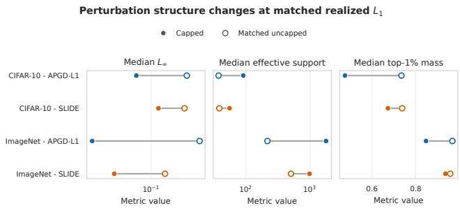  
Figure 6. Perturbation structure under matched realized $\ell _ { 1 } .$ . Filled markers denote capped perturbations and open markers independently optimized uncapped perturbations with approximately matched realized $\ell _ { 1 } .$ Capped solutions exhibit lower peak mag nitude, larger effective support, and reduced concentration in the largest coordinates.

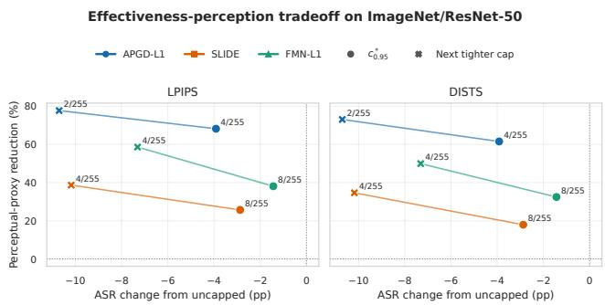  
Figure 7. Effectiveness–perceptual-distance tradeoff on ImageNet/ResNet-50. Circles denote the selected $c _ { 0 . 9 5 } ^ { \star }$ and crosses the next tighter evaluated cap. The horizontal axis reports ASR change relative to the uncapped condition, while the vertical axis reports reduction in LPIPS or DISTS.

For SLIDE, moving from the uncapped condition to the selected $c ^ { \star } = 8 / 2 5 5$ changes ASR from 86.55% to 83.68%. Median LPIPS decreases from 0.00975 to 0.00725 and median DISTS from 0.01264 to 0.01037, corresponding to reductions of approximately 25.7% and 17.9%, respectively.

For FMN-L1, the selected $\begin{array} { r l r } { c ^ { \star } } & { { } = } & { 8 / 2 5 5 } \end{array}$ condition changes ASR from 90.08% to 88.64%, a decrease of 1.44 percentage points, while median LPIPS decreases from 0.00410 to 0.00254 and median DISTS from 0.00653 to 0.00441. These correspond to reductions of approximately 38.1% and 32.5%, respectively.

Figure 7 places these changes in the full effectiveness– perceptual-distance tradeoff, together with the next tighter evaluated caps.

Because the successful population changes with the cap, we also perform paired common-success comparisons between each capped condition and its uncapped reference.

Table 6. Complete matched-realized $\mathbf { - } { \boldsymbol { \ell } } _ { 1 }$ structural summaries. All rows are conditioned on success of the capped source perturbation. $\mathbf { \ddot { c } C } / \mathbf { U } ^ { \mathbf { \vec { s } } }$ denotes capped source / independently optimized matched uncapped. Matching-error columns report the relative error between the realized $\ell _ { 1 }$ magnitudes of the paired perturbations.
<table><tr><td>Data</td><td>Attack</td><td> $N _ { \mathrm { p a i r s } }$ </td><td>Matched ASR</td><td>Med. err.</td><td>P95 err.</td><td> $\ell _ { \infty } \mathbf { C } / \mathbf { U }$ </td><td> $M _ { 1 \% } \mathrm { C } / \mathrm { U }$ </td><td> $M _ { 5 \% } \mathrm { C / U }$ </td><td> $S _ { \mathrm { e f f } } \mathbf { C } / \mathrm { U }$ </td></tr><tr><td>CIFAR-10</td><td>APGD-L1</td><td>4367</td><td>99.29</td><td> $2 . 3 8 \times 1 0 ^ { - 7 }$ </td><td> $1 . 3 1 \times 1 0 ^ { - 6 }$ </td><td>.0627/.3060</td><td>.4765/.7342</td><td>.9865/1.0000</td><td>90.2/37.2</td></tr><tr><td>CIFAR-10</td><td>SLIDE</td><td>4194</td><td>99.17</td><td> $1 . 1 9 \times 1 0 ^ { - 7 }$ </td><td> $2 . 3 8 \times 1 0 ^ { - 7 }$ </td><td>.1255/.2846</td><td>.6728/.7377</td><td>1.0000/1.0000</td><td>55.1/38.1</td></tr><tr><td>ImageNet</td><td>APGD-L1</td><td>656</td><td>96.95</td><td> $8 . 5 8 \times 1 0 ^ { - 7 }$ </td><td> $9 . 2 5 \times 1 0 ^ { - 6 }$ </td><td>.0157/.4569</td><td>.8462/.9668</td><td>1.0000/1.0000</td><td>1769.5/215.2</td></tr><tr><td>ImageNet</td><td>SLIDE</td><td>640</td><td>99.84</td><td> $1 . 9 1 \times 1 0 ^ { - 7 }$ </td><td> $1 . 2 4 \times 1 0 ^ { - 6 }$ </td><td>.0314/.1543</td><td>.9349/.9572</td><td>1.0000/1.0000</td><td>980.5/502.3</td></tr></table>

Table 7. Paired structural differences in the matched-realized-ℓ controls, with 95% deterministic paired-bootstrap intervals. For $\ell _ { \infty } .$ $M _ { 1 \% }$ , and $M _ { 5 \% }$ , differences are matched-uncapped minus capped; for $S _ { \mathrm { e f f } }$ , differences are capped minus matched-uncapped. Positive values therefore indicate broader, lower-peak allocation under the cap.
<table><tr><td>Data</td><td>Attack</td><td> $\Delta \ell _ { \infty }$  [95% CI]</td><td> $\Delta M _ { 1 \% }$  [95% CI]</td><td> $\Delta M _ { 5 \% }$  [95% CI]</td><td> $\Delta S _ { \mathrm { e f f } }$  [95% CI]</td></tr><tr><td>CIFAR-10</td><td>APGD-L1</td><td>.2433 [.2392,.2483]</td><td>.2620 [.2585,.2662]</td><td>.0010 [.0004,.0019]</td><td>52.85 [52.47,53.28]</td></tr><tr><td>CIFAR-10</td><td>SLIDE</td><td>.1592 [.1555,.1627]</td><td>.0644 [.0626,.0667]</td><td>.0000 [.0000,.0000]</td><td>16.68 [16.45,16.99]</td></tr><tr><td>ImageNet</td><td>APGD-L1</td><td>.4413 [.4284,.4524]</td><td>.1064[.1020,.1104]</td><td>.0000 [.0000,.0000]</td><td>1536.43 [1515.61,1555.61]</td></tr><tr><td>ImageNet</td><td>SLIDE</td><td>.1230 [.1199,.1256]</td><td>.0204 [.0193,.0215]</td><td>.0000 [.0000,.0000]</td><td>477.67 [471.15,482.81]</td></tr></table>

Table 8 reports these paired results for all three attacks at both the selected operating point and the next tighter evaluated cap. ASR differences are computed on the fixed $N \ = \ 7 6 6$ clean-correct evaluation population, while the paired LPIPS and DISTS differences are computed on examples successful under both conditions. Negative perceptual differences indicate lower measured distance under the capped condition.

The paired common-success results follow the same direction as the condition-wise summaries. At each selected operating point, the paired bootstrap intervals for both LPIPS and DISTS lie below zero. The same is true at the next tighter evaluated cap. This reduces the possibility that the condition-wise perceptual differences arise only because progressively different examples remain successfully attacked.

The condition-wise medians and paired differences answer related but distinct questions. Condition-wise summaries describe the successful feasible perturbations produced under each condition separately, whereas the paired analysis restricts the comparison to examples jointly successful under the relevant uncapped and capped conditions. The paired median differences therefore need not equal the simple difference between the two condition-level medians.

Taken together, the condition-wise and paired analyses provide consistent evidence that the selected capped conditions reduce learned perceptual distance while retaining high attack effectiveness. The effect is observed under both LPIPS and DISTS and persists when the comparison is restricted to examples that are successfully attacked under both the capped and uncapped conditions. In this measured sense, the resulting adversarial examples are closer to the corresponding clean images: the cap restricts the largest coordinate-wise modifications, for example to $8 / 2 5 5$ at the selected operating point for SLIDE and FMN-L1, while LPIPS and DISTS also decrease. Although these measurements do not directly establish that the perturbations are less detectable by human observers, reducing large local pixe changes and moving the adversarial examples closer to the clean images under learned perceptual metrics is consistent with perturbations having lower visual salience.

## D. Complete Ablation and Control Results

This appendix expands Sec. 6 and records the complete control suite used to examine alternative explanations for the primary concentration results. The controls are denoted A01–A07. None participates in selecting the primary c⋆0.95 $c _ { 0 . } ^ { \star }$ operating points.

A01–A02 evaluate matched realized $\ell _ { 1 }$ , A03 evaluates learned perceptual distance, A04 compares direct constraint enforcement with post-hoc clipping, A05 strengthens the main attacks, A06 audits restart-dependent finite-compute behavior, and A07 compares the uncapped frontier attacks with official $\ell _ { 1 }$ AutoAttack.

## D.1. Matched-realized-ℓ controls: A01–A02

A01 and A02 examine whether lower peak magnitude and larger effective support under the selected caps can be explained merely by the capped attack using less total $\ell _ { 1 }$ magnitude.

For every successful capped source perturbation, we independently rerun the corresponding uncapped attack on the same sample with the source perturbation’s realized $\ell _ { 1 }$ magnitude used as its per-example budget. The resulting comparison therefore preserves sample identity and approximately matches total perturbation magnitude across capped and native uncapped executions.

Table 8. Paired ImageNet/ResNet-50 perceptual comparisons against the native uncapped reference. ∆ASR is target minus uncapped in percentage points. ∆LPIPS and ∆DISTS are paired median differences (target minus uncapped) on the corresponding common-success population. Brackets give 95% deterministic paired-bootstrap intervals.
<table><tr><td>Attack</td><td>Target</td><td>255c</td><td>∆ASR (pp) [95% CI]</td><td>∆LPIPS [95% CI]</td><td>∆DISTS [95% CI]</td></tr><tr><td>APGD-L1</td><td> $c ^ { \star }$ </td><td>4</td><td> $- 3 . 9 2 [ - 5 . 8 7 , - 1 . 9 6 ]$ </td><td> $- 0 . 0 1 0 4 8 \ : [ - 0 . 0 1 1 4 5 , - 0 . 0 0 9 7 0 ]$ </td><td> $- 0 . 0 1 1 0 4 [ - 0 . 0 1 2 1 3 , - 0 . 0 1 0 1 7 ]$ </td></tr><tr><td>APGD-L1</td><td>tighter</td><td>2</td><td> $- 1 0 . 7 0 [ - 1 3 . 1 9 , - 8 . 3 6 ]$ </td><td> $- 0 . 0 1 2 6 4 [ - 0 . 0 1 3 5 8 , - 0 . 0 1 1 6 3 ]$ </td><td> $- 0 . 0 1 3 5 1 [ - 0 . 0 1 4 3 8 , - 0 . 0 1 2 7 2 ]$ </td></tr><tr><td>SLIDE</td><td> $c ^ { \star }$ </td><td>8</td><td> $- 2 . 8 7 [ - 4 . 1 8 , - 1 . 8 3 ]$ </td><td> $- 0 . 0 0 1 8 9 5 \left[ - 0 . 0 0 2 0 0 1 , - 0 . 0 0 1 7 0 2 \right]$ </td><td> $- 0 . 0 0 2 2 0 5 \left[ - 0 . 0 0 2 4 1 2 , - 0 . 0 0 2 0 0 0 \right]$ </td></tr><tr><td>SLIDE</td><td>tighter</td><td>4</td><td> $- 1 0 . 1 8 [ - 1 2 . 4 0 , - 8 . 2 2 ]$ </td><td> $- 0 . 0 0 3 4 6 6 \left[ - 0 . 0 0 3 7 8 5 , - 0 . 0 0 3 2 5 2 \right]$ </td><td> $- 0 . 0 0 4 4 4 1 \ [ - 0 . 0 0 4 7 0 1 , - 0 . 0 0 4 2 0 1 ]$ </td></tr><tr><td>FMN-L1</td><td> $c ^ { \star }$ </td><td>8</td><td> $- 1 . 4 4 \left[ - 3 . 5 2 , + 0 . 5 3 \right]$ </td><td> $- 0 . 0 0 1 2 0 9 [ - 0 . 0 0 1 3 6 0 , - 0 . 0 0 1 0 1 3 ]$ </td><td> $- 0 . 0 0 1 4 0 6 [ - 0 . 0 0 1 5 9 2 , - 0 . 0 0 1 2 1 5 ]$ </td></tr><tr><td>FMN-L1</td><td>tighter</td><td>4</td><td> $- 7 . 3 1 [ - 9 . 7 9 , - 4 . 8 3 ]$ </td><td> $- 0 . 0 0 1 5 9 2 [ - 0 . 0 0 1 8 0 7 , - 0 . 0 0 1 3 9 4 ]$ </td><td> $- 0 . 0 0 2 1 8 1 [ - 0 . 0 0 2 4 3 8 , - 0 . 0 0 1 9 9 6 ]$ </td></tr></table>

The CIFAR-10 control uses ResNet-18 and a fixed 5,000-image subset. The ImageNet control uses ResNet-50 and the complete 1,000-image manifest. The analysis is conditioned on success of the capped source perturbation.

For APGD-L1 on CIFAR-10/ResNet-18, median $\ell _ { \infty }$ is 0.0627 for the capped source and 0.3060 for the matched uncapped perturbation, while median effective support is 90.2 and 37.2, respectively. The matched uncapped attack succeeds on 99.29% of the conditioned population.

On ImageNet/ResNet-50, median $\ell _ { \infty }$ is 0.0157 for the capped source and 0.4569 for the matched uncapped condition, while effective support is 1769.5 and 215.2. The independently optimized matched uncapped attack succeeds on 96.95% of the conditioned population.

Across the completed controls, median relative $\ell _ { 1 }$ matching error is below $1 0 ^ { - 6 }$ and the largest 95th-percentile error is $9 . 3 \times 1 0 ^ { - 6 }$ . The structural separation is therefore not explained by a meaningful mismatch in realized total perturbation magnitude.

The complete APGD-L1 and SLIDE condition-level summaries, top-mass concentration measurements, and paired structural differences with bootstrap intervals are reported in Sec. C.1. Those results show that the matched- $\mathbf { \nabla } \cdot \ell _ { 1 }$ separation is not specific to the APGD-L1 examples summarized here.

## D.2. Perceptual-distance control: A03

A03 evaluates whether the structural redistribution is accompanied by a change in learned image-space perceptual distance. The analysis uses ImageNet/ResNet-50 and compares the native uncapped condition, the selected $c _ { 0 . 9 5 } ^ { \star }$ condition, and the next tighter evaluated cap.

For APGD-L1, moving from the uncapped condition to $c ^ { \star } = 4 / 2 5 5$ changes ASR from 89.43% to 85.51%, while median LPIPS decreases from 0.0155 to 0.0049 and median DISTS from 0.0194 to 0.0074.

For FMN-L1, moving to $c ^ { \star } = 8 / 2 5 5$ changes ASR by only 1.44 percentage points while reducing median LPIPS from 0.00410 to 0.00254 and median DISTS from 0.00653 to 0.00441.

Table 9. Complete constraint-enforcement control on CIFAR-10/ResNet-18 $( N = 4 , 7 5 0 , B = 4 ) .$ . Confidence intervals are deterministic paired-bootstrap intervals.
<table><tr><td>Attack</td><td>255c</td><td>Post-hoc</td><td>Direct</td><td>∆ ASR [95% CI]</td></tr><tr><td>APGD-L1</td><td>16</td><td>46.72</td><td>92.21</td><td>+45.49 [44.13, 46.91]</td></tr><tr><td>FMN-L1</td><td>16</td><td>3.83</td><td>91.94</td><td>+88.11 [87.20, 88.99]</td></tr></table>

The paired common-success analyses show the same direction and are used to reduce confounding from changes in the set of successful examples. Complete paired results for APGD-L1, SLIDE, and FMN-L1 at both $c _ { 0 . 9 5 } ^ { \star }$ and the next tighter cap are reported in Sec. C.2. These results characterize differences in learned perceptual-distance metrics across the evaluated conditions and do not establish human imperceptibility, visibility thresholds, or perceptual preference.

## D.3. Constraint-enforcement control: A04

A04 compares direct optimization under the joint feasible set with post-hoc clipping. Both final perturbations are required to satisfy the same global $\ell _ { 1 } .$ , coordinate-cap, and image-domain constraints.

The large gap demonstrates the substantial benefit of optimizing directly within the joint feasible region under the evaluated conditions. Truncating an uncapped solution does not allow removed mass to be reassigned to other coordinates and therefore produces much lower attack success in these comparisons. The reported control focuses on APGD-L1 and FMN-L1.

## D.4. Optimization-strength control: A05

A05 increases attack effort without changing the feasible set or operating points. APGD-L1 uses five restarts instead of one, with 100 steps per restart. FMN-L1 uses 500 steps instead of 100.

The stronger attack improves every condition. The improvements are comparable between capped and uncapped executions rather than being concentrated at $c = 1$ . At the frozen operating points, strengthened APGD-L1 and FMN-L1 retain 95.8% and 96.3% of their respective strengthened uncapped ASRs. Thus, within the strengthened configurations tested here, additional optimization changes absolute attack success while preserving the selected high-retention behavior.

Table 10. Complete optimization-strength control on CIFAR-10/ResNet-18 (N = 4,750, B = 4).
<table><tr><td>Attack</td><td>Condition</td><td>255c</td><td>Main</td><td>Strong</td><td>∆</td><td>95%CI</td></tr><tr><td>APGD-L1</td><td>Uncapped</td><td>255</td><td>95.58</td><td>98.08</td><td>+2.51</td><td>[2.06,2.97]</td></tr><tr><td>APGD-L1</td><td>c*</td><td>16</td><td>91.81</td><td>93.94</td><td>+2.13</td><td>[1.73,2.55]</td></tr><tr><td>APGD-L1</td><td>Tighter</td><td>8</td><td>86.51</td><td>88.55</td><td>+2.04</td><td>[1.64,2.44]</td></tr><tr><td>FMN-L1</td><td>Uncapped</td><td>255</td><td>95.96</td><td> $9 6 . 4 0 + 0 . 4 4$ </td><td></td><td>[0.19,0.72]</td></tr><tr><td>FMN-L1</td><td>c*</td><td>16</td><td>91.89</td><td> $9 2 . 8 6 + 0 . 9 7 $ </td><td></td><td>[0.69,1.28]</td></tr><tr><td>FMN-L1</td><td>Tighter</td><td>8</td><td>86.11</td><td>87.28+1.18</td><td></td><td>[0.84,1.54]</td></tr></table>

## D.5. Frontier optimization diagnostics

The exact feasible sets are nested in c, but the empirical finite-compute frontiers need not be monotonic. To visualize where this occurs, we compute

$$
\Delta _ { \mathrm { A S R } } ( B , c ) = \mathrm { A S R } ( B , c ) - \mathrm { A S R } ( B , 1 )\tag{15}
$$

for every capped condition in the standard-model evaluation.

Figure 8 reports this diagnostic for the CIFAR-10 and ImageNet standard-model frontiers, while Fig. 9 reports the corresponding CIFAR-100 frontiers. Positive values indicate capped executions whose finite-compute ASR exceeds the corresponding native uncapped execution. These cells characterize differences in empirical optimization outcomes rather than implying that a smaller theoretical threat set is stronger.

The largest observed increase in the standard-model evaluation occurs for APGD-L1 on ImageNet/ViT-B/16 at $B = 2 0$ , where ASR rises from 63.50% at c = 1 to 78.75% at $c = 3 2 / 2 5 5 , \mathrm { ~ a ~ } 1 5 . 2 5$ percentage-point increase. At the selected $c _ { 0 . 9 5 } ^ { \star } ~ = ~ 4 / 2 5 5$ , the same configuration achieves 67.25% ASR, corresponding to 105.91% retention relative to the native uncapped execution and 85.4% of the largest ASR observed on this frontier. Because the 32/255 perturbations also satisfy the uncapped threat-set constraints, the distinction illustrates the implementation-relative nature of the retention statistic. The selected operating point follows the predefined native-relative criterion, while the complete frontier provides the broader empirical context.

Other settings exhibit smaller positive deviations or approximately monotonic behavior, emphasizing that empirical non-monotonicity is attack- and model-dependent rather than a uniform property of the cap. These measurements reflect the evaluated finite-compute optimization procedures and do not imply a reversal of the underlying nested threatset ordering.

Table 11. Numerical repeated-run optimizer audit. APGD-L1 entries are cumulative best-of-k ASR based on highest cross-entropy loss. FMN-L1 is an independent 500-step reference.
<table><tr><td>Profile</td><td> $\mathrm { A S R } _ { c = 1 }$  (%)</td><td> $\mathbf { A S R _ { 6 4 / 2 5 5 } }$  (%)</td><td>∆ (pp)</td></tr><tr><td>APGD best-of-1</td><td>88.71</td><td>92.71</td><td>+4.00</td></tr><tr><td>APGD best-of-2</td><td>91.14</td><td>93.71</td><td>+2.57</td></tr><tr><td>APGD best-of-3</td><td>91.71</td><td>94.00</td><td>+2.29</td></tr><tr><td>APGD best-of-4</td><td>91.86</td><td>94.14</td><td>+2.29</td></tr><tr><td>APGD best-of-5</td><td>92.43</td><td>94.43</td><td>+2.00</td></tr><tr><td>FMN, 500 steps</td><td>90.29</td><td>95.00</td><td>+4.71</td></tr></table>

The main paper also refers to this subsection for the numerical best-of-k values associated with the repeatedsearch audit. For completeness, Table 11 reports those values here; the experimental design, paired outcome analysis, and interpretation of A06 are given in Sec. D.6.

## D.6. Repeated-run optimizer audit: A06

A06 examines one finite-compute discrepancy by increasing independent search effort on 700 fixed clean-correct ImageNet/ResNet-50 examples at $B = 2 0$

For APGD-L1, five independently seeded runs are performed under both $c = 1$ and $c = 6 4 / 2 5 5$ . Corresponding runs use matched seeds. For every sample and every $k \in \{ 1 , \ldots , 5 \}$ , the candidate with the highest crossentropy loss among the first k runs is retained. The resulting cumulative best-of-k ASRs are reported in Table 11 in Sec. D.5. This loss-based selection characterizes the evaluated search procedure, rather than aggregating success over all individual restarts.

The capped-over-uncapped APGD-L1 difference decreases from 4.00 percentage points after one run to 2.00 points after five runs. Both conditions improve with additional independent search: ASR rises from 88.71% to 92.43% for c = 1 and from 92.71% to 94.43% for $c =$ 64/255.

At best-of-five, 643 examples are attacked under both conditions, 18 only under the capped condition, four only under the uncapped condition, and 35 under neither. Mc-Nemar’s test gives $p \approx 0 . 0 0 4 3$

The narrowing gap with additional independent search supports a finite-compute interpretation of this nonmonotonic frontier region. At the same time, a residua difference remains after five runs, and the independent 500- step FMN-L1 reference also attains higher measured ASR at 64/255 than at $c = 1$ . These observations characterize the influence of search effort in the evaluated ResNet-50 configuration without establishing how other frontier discrepancies would behave under stronger optimization. The measured ordering remains dependent on the finite-compute search procedure, consistent with the distinction between empirical attack success and exact worst-case risk made in Sec. 3.

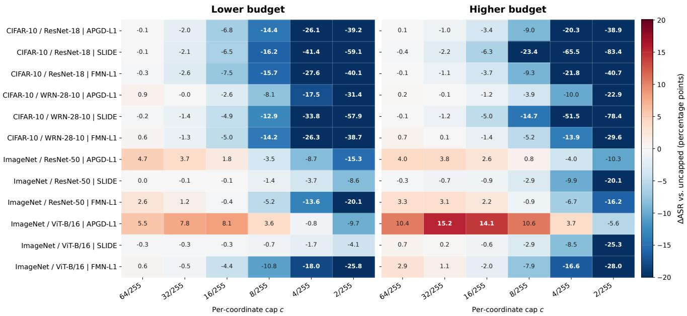  
Color scale clipped at ±20 pp; cell annotations report exact measured values

Figure 8. Finite-compute ASR change relative to the native uncapped reference, $\Delta _ { \mathrm { A S R } } ( B , c )$ , for the CIFAR-10 and ImageNet standardmodel frontiers. Rows correspond to dataset–model–attack configurations and columns to capped conditions. Positive entries indicate that the finite-compute capped execution achieves higher ASR than its directly optimized c = 1 reference. No monotonic smoothing is applied. SLIDE uses the native c = 1 baseline. This diagnostic localizes differences in empirical optimization outcomes; A06 provides a direct repeated-search audit of one representative discrepancy.  
Table 12. Official AutoAttack reference on the matched fixed population. Differences use official AutoAttack as the reference.
<table><tr><td>Attack</td><td>ASR (%) ∆ (pp)</td><td></td><td>95% CI</td></tr><tr><td>Official  $\ell _ { 1 }$  AutoAttack</td><td>98.50</td><td></td><td></td></tr><tr><td>APGD-L1</td><td>96.20</td><td>-2.30</td><td>[-3.30,-1.40]</td></tr><tr><td>FMN-L1</td><td>95.70</td><td>-2.80</td><td>[-3.90,-1.80]</td></tr></table>

The primary visualization of the repeated-search experiment is Fig. 5 in the main paper.

## D.7. Official AutoAttack reference: A07

A07 provides an external reference for the strength of the uncapped $c = 1$ executions. We evaluate official untargeted $\ell _ { 1 }$ AutoAttack on 1,000 fixed clean-correct CIFAR-10/ResNet-18 examples at $B = 4$

The individual frontier attacks attain slightly lower ASR than the full official ensemble on this population. The comparison provides an external strength reference for the uncapped APGD-L1 and FMN-L1 executions, which remain within 2.8 percentage points of the official ensemble under the evaluated conditions.

## D.8. Control coverage and interpretation

The seven controls examine distinct aspects of the main results:

• A01–A02: whether apparent redistribution is explained by lower realized $\ell _ { 1 }$ use;

• A03: whether the selected structural change is accompanied by changes in learned perceptual distance;

• A04: whether post-hoc clipping can reproduce direct capped optimization;

• A05: whether the selected operating points retain their effectiveness under stronger attack configurations;

• A06: how a representative capped-over-uncapped ASR discrepancy responds to additional independent search;

• A07: how native uncapped frontier attacks compare with a standard official $\ell _ { 1 }$ attack suite.

The controls address complementary aspects of the evaluation rather than repeated versions of a single robustness check. A01–A02 assess whether structural differences persist at matched realized perturbation magnitude; A03 characterizes associated changes in learned perceptual distance; A04 compares direct constrained optimization with post-hoc processing; and A05–A07 examine optimization strength and uncapped reference quality within their respective evaluated settings.

CIFAR-100: finite-compute optimization gain induced by the cap  
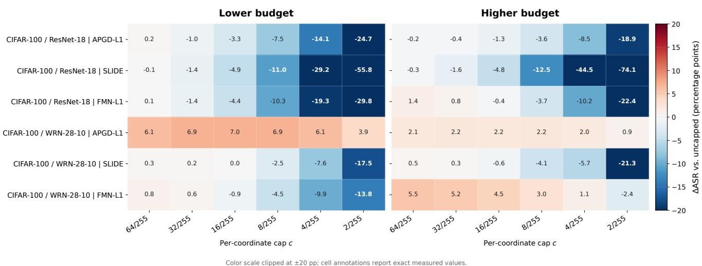  
Figure 9. CIFAR-100 finite-compute ASR change relative to the native uncapped reference across both evaluated budgets. The definition and interpretation of $\Delta _ { \mathrm { A S R } } ( B , c )$ are the same as in Fig. 8. The figure completes the optimization-gain diagnostic for the standard-mode evaluation rather than introducing an additional selection criterion.

Together, these experiments support the interpretation of the measured concentration frontiers while clarifying the roles of perturbation magnitude, constraint enforcement, and finite-compute optimization. Their conclusions are specific to the evaluated models, attacks, and control configurations; they do not require exact inner maximization or imply that the empirical frontiers represent optimal adversarial risk. In particular, observed non-monotonicities characterize finite-compute attack behavior rather than the ordering of the underlying threat sets.

## E. Additional Frontier Analyses

This appendix collects complementary analyses of the completed perturbation–concentration frontiers. None of the results in this section is used to select or revise the primary $c _ { 0 . 9 5 } ^ { \star }$ operating points. Instead, they examine the sensitivity of the discrete operating-point summary to the retention convention and global budget, complete the visual reporting of the CIFAR-100 standard-model frontiers, and characterize descriptive associations between perturbation structure and learned perceptual distance.

## E.1. Retention-threshold sensitivity

The primary analysis defines $c ^ { \star }$ using a retention threshold of $\rho = 0 . 9 5$ . To test whether the resulting concentration scale is specific to this convention, we recompute the operating-point summary on the already completed frontiers at

$$
\rho \in \{ 0 . 9 0 , 0 . 9 5 , 0 . 9 9 \} .
$$

No attack is rerun for this analysis, and the original $c _ { 0 . 9 5 } ^ { \star }$ values remain frozen for all downstream controls. The standard-model summaries below use the native $c \ = \ 1$ SLIDE reference executions.

Table 13 summarizes the resulting distributions at the reference budgets. For the 18 standard-model attack–model settings, the median selected cap is 8/255 under both 90% and 95% retention. Requiring 99% retention moves the median to 32/255. The largest selected standard-model cap similarly moves from 16/255 at 90% retention to 32/255 at 95% and 64/255 at 99%.

Relative to the primary 95% criterion, lowering the standard-model threshold to 90% selects a tighter cap in 10 of 18 settings and the same cap in the remaining eight. Increasing the threshold to 99% selects a looser cap in 16 settings and the same cap in two. This behavior is expected: requiring a larger fraction of the measured uncapped ASR makes the retention requirement harder to satisfy on the fixed cap grid.

The standard-model conclusion is therefore not specific to the distinction between 90% and 95% retention: both criteria select a median cap of $8 / 2 5 5$ . The 99% criterion is substantially more demanding and shifts the operating points toward weaker coordinate restrictions, but even there the standard-model median remains below the conventional c = 1 reference.

Table 13. Sensitivity of the selected operating-point distribution to the retention threshold at the reference budgets. Entries in the distribution column give counts of settings selecting each value of $2 5 5 c _ { \rho } ^ { \star }$ . Standard results cover the 18 standard attack–model settings; robust results cover the eight APGD-L1/SLIDE referencebudget settings. The primary paper uses $\rho = 0 . 9 5$
<table><tr><td>Regime</td><td>ρ</td><td>Distribution of 255c ★ ρ</td><td>Median</td></tr><tr><td>Standard</td><td>0.90</td><td>2:3, 4:4, 8:7, 16:4</td><td>8</td></tr><tr><td>Standard</td><td>0.95</td><td>2:2, 4:2, 8:7, 16:4, 32:3</td><td>8</td></tr><tr><td>Standard</td><td>0.99</td><td>2:1, 4:2, 8:1, 16:4, 32:5, 64:5</td><td>32</td></tr><tr><td>Robust</td><td>0.90</td><td>4:1, 16:1, 32:3, 64:1, 255:2</td><td>32</td></tr><tr><td>Robust</td><td>0.95</td><td>4:1, 32:1, 64:4, 255:2</td><td>64</td></tr><tr><td>Robust</td><td>0.99</td><td>4:1, 64:2, 255:5</td><td>255</td></tr></table>

Table 14. Budget dependence of the 95%-retention operating point for all standard models. Smaller values correspond to tighter coordinate caps. Across the 18 model–attack comparisons, the higher budget selects a tighter cap in 10 cases and the same cap in eight; no comparison becomes looser.
<table><tr><td>Dataset</td><td>Model</td><td>APGD-L1</td><td>SLIDE</td><td>FMN-L1</td></tr><tr><td>CIFAR-10</td><td>ResNet-18</td><td> $3 2  1 6$ </td><td> $3 2  3 2$ </td><td> $3 2  1 6$ </td></tr><tr><td>CIFAR-10</td><td>WRN-28-10</td><td> $1 6  8$ </td><td> $3 2  3 2$ </td><td> $3 2  1 6$ </td></tr><tr><td>CIFAR-100</td><td>ResNet-18</td><td> $1 6  8$ </td><td> $3 2  3 2$ </td><td> $3 2  8$ </td></tr><tr><td>CIFAR-100</td><td>WRN-28-10</td><td> $2 \to 2$ </td><td> $8  8$ </td><td> $1 6  2$ </td></tr><tr><td>ImageNet</td><td>ResNet-50</td><td> $1 6  4$ </td><td> $8  8$ </td><td> $1 6  8$ </td></tr><tr><td>ImageNet</td><td>ViT-B/16</td><td> $4  4$ </td><td> $8  8$ </td><td> $3 2  1 6$ </td></tr></table>

The robust-model frontiers show markedly greater sensitivity. Their median selected cap moves from 32/255 at $\rho = 0 . 9 0$ to 64/255 at $\rho = 0 . 9 5$ and to the uncapped value at $\rho ~ = ~ 0 . 9 9$ This reinforces the main-paper observation that adversarially trained classifiers exhibit heterogeneous concentration sensitivity. The robust results are not pooled with the standard-model results and are reported here only as a reference-budget sensitivity summary.

## E.2. Budget sensitivity of the operating point

Because $c _ { 0 . 9 5 } ^ { \star }$ is selected independently at each global budget, the two-budget standard-model frontiers also allow us to ask whether the amount of permitted concentration associated with 95% retention changes with the available global $\ell _ { 1 }$ magnitude.

Table 14 reports the complete standard-model comparison. Each entry gives

$$
2 5 5 c _ { 0 . 9 5 } ^ { \star } ( B _ { \mathrm { l o w } } )  2 5 5 c _ { 0 . 9 5 } ^ { \star } ( B _ { \mathrm { h i g h } } ) .
$$

The budget pair is $2  4$ for CIFAR-10 and CIFAR-100 and $1 0  2 0$ for ImageNet. Smaller cap values represent stronger restrictions on individual coordinate magnitude.

Across the 18 matched model–attack comparisons, increasing the global budget produces a tighter selected cap in 10 settings and leaves it unchanged in eight. No setting requires a looser cap at the higher budget. For SLIDE, the selected operating point remains unchanged across budgets for all six standard models, although its absolute value varies across models.

This pattern should not be interpreted as a universal monotonic law linking B and $c ^ { \star }$ . The operating point is a discrete empirical summary that depends on the attack, classifier, cap grid, and finite-compute optimization. Within the evaluated standard-model settings, however, the higher global budget is consistently associated with an equal or tighter 95%-retention cap. One plausible interpretation is that additional global $\ell _ { 1 }$ mass provides greater scope for redistribution when individual coordinate magnitudes are restricted; the present results establish the empirical pattern, not that mechanism.

## E.3. Complete CIFAR-100 standard-model frontiers

The main paper reports the primary CIFAR-100 operating points together with the other standard-model settings but visualizes the complete two-budget frontiers for CIFAR-10 and ImageNet. Figure 10 provides the corresponding complete CIFAR-100 visualization using the native SLIDE $c = 1$ reference executions.

The CIFAR-100 results reproduce the main qualitative behavior on a second label space at the same image resolution as CIFAR-10. At the reference budget $B = 4 ,$ , all six model–attack settings satisfy the 95% retention criterion at caps no larger than 32/255, with several substantially tighter operating points. At the same time, the frontier shapes remain attack- and model-dependent, including finite-compute non-monotonic regions. The complete curves are therefore more informative than treating the selected $c ^ { \star }$ values as universal concentration thresholds.

## E.4. Associations between structure and perceptual distance

The perceptual analysis in Sec. C.2 directly compares prespecified uncapped, selected-cap, and tighter-cap conditions. As a complementary descriptive analysis, we also measure the pooled association between perturbationstructure quantities and learned perceptual distance over the successful ImageNet/ResNet-50 perceptual-evaluation rows.

Table 15 reports Spearman rank correlations with 95% intervals obtained by resampling complete sample-ID clusters. The analysis contains 5,835 successful condition rows from 720 unique sample clusters.

Peak magnitude has the clearest positive pooled association with both learned perceptual-distance measures, whereas the top-5% mass fraction is only weakly associated with LPIPS and is statistically compatible with no association for DISTS. The signs of the remaining associations are not sufficient to define a single perceptual concentration score.

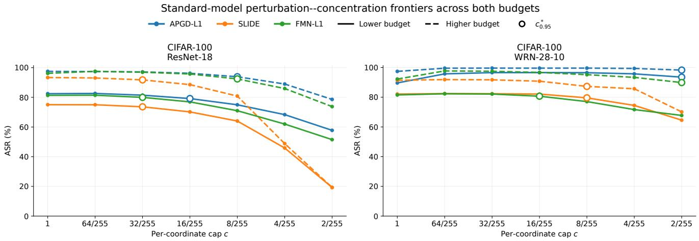  
Figure 10. Complete CIFAR-100 perturbation–concentration frontiers across both evaluated global budgets for ResNet-18 and WRN-28- 10. Curves show APGD-L1, SLIDE, and FMN-L1 as the per-coordinate cap is tightened over the same predefined grid used in the main evaluation. Solid and dashed curves distinguish the two global budgets, and markers denote the independently selected $c _ { 0 . 9 5 } ^ { \star }$ operating points. No monotonic smoothing is applied. The SLIDE curves use the native c = 1 reference executions.

Table 15. Descriptive Spearman correlations between perturbation-structure metrics and LPIPS/DISTS over successful ImageNet/ResNet-50 perceptual-evaluation rows. Brackets give 95% sample-cluster bootstrap intervals. The estimates pool attacks and cap conditions and are not interpreted causally.
<table><tr><td>Structural metric</td><td>LPIPS  $\rho _ { s }$  [95% CI]</td><td>DISTS  $\rho _ { s }$  [95% CI]</td></tr><tr><td> $\ell _ { \infty }$ </td><td> $0 . 3 4 4 \left[ 0 . 3 2 6 , 0 . 3 6 5 \right]$ </td><td> $0 . 4 1 8 \left[ 0 . 4 0 0 , 0 . 4 3 9 \right]$ </td></tr><tr><td>Top-1% mass</td><td> $- 0 . 3 0 1 \ [ \dot { - } 0 . 3 2 7 , - 0 . \dot { 2 } 7 4 ]$ </td><td> $- 0 . 2 1 8 \left[ \bar { - } 0 . 2 4 9 , - 0 . \bar { 1 } 8 7 \right]$ </td></tr><tr><td>Top-5% mass</td><td>-0.051 [−0.076, -0.024]</td><td> $0 . 0 1 2 \ \dot { [ } - 0 . 0 1 4 , 0 . 0 3 7 ]$ </td></tr><tr><td> $S _ { \mathrm { e f f } }$ </td><td> $0 . 1 3 \dot { 0 } \left[ 0 . 1 0 3 , 0 . 1 5 5 \right]$ </td><td> $0 . 0 7 \dot { 6 } \left[ 0 . 0 4 5 , 0 . 1 0 6 \right]$ </td></tr></table>

These pooled estimates combine different attacks and cap conditions and therefore reflect both within-condition and between-condition variation. They should not be interpreted as evidence that changing any one structural metric causes a corresponding perceptual change. In particular, the correlation analysis does not replace the paired commonsuccess comparisons in Sec. C.2. Rather, it supports the decision to report peak magnitude, top-mass concentration, effective support, LPIPS, and DISTS as distinct quantities instead of treating any one of them as a proxy for the others.