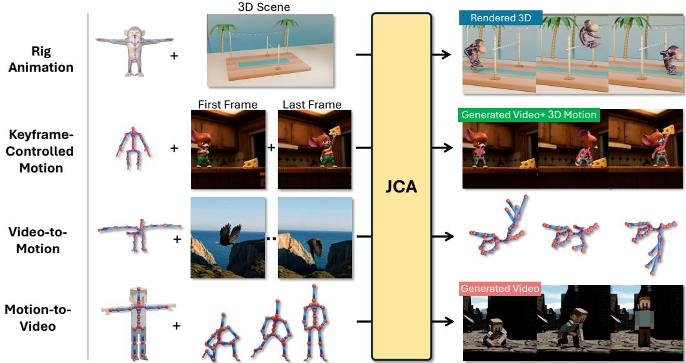
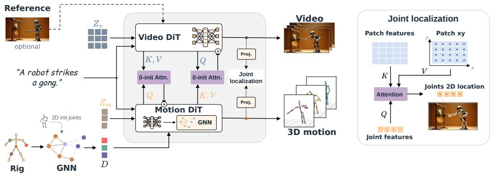
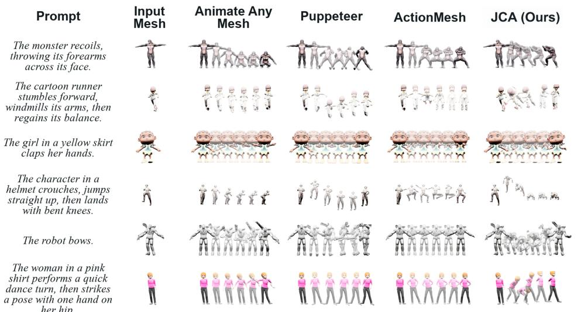
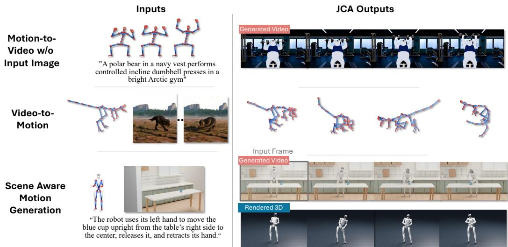
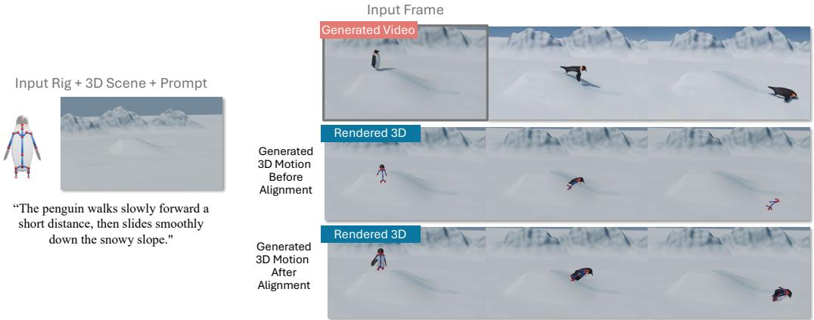
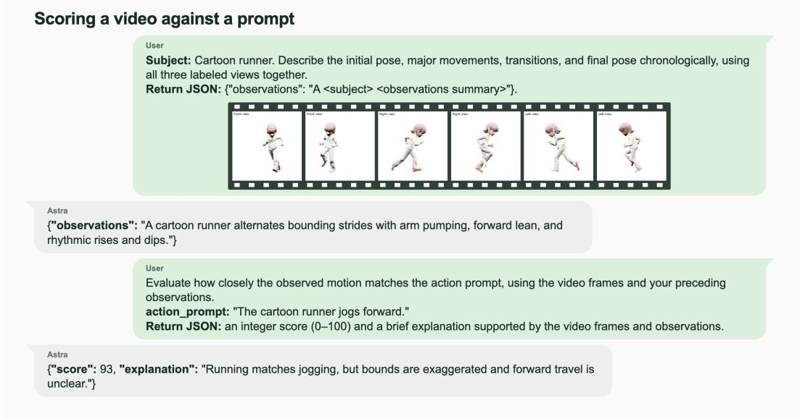

# JOINTS, CAMERA, ACTION! CO-GENERATING 3DMOTION AND VIDEO FOR ARBITRARY RIGS

Noam Rotstein1,2 Yoad Tewel1 Chen Tessler1 Haggai Maron1,2 Gal Chechik1,3 Or Litany1,2 Yoni Kasten1,2 Yuval Atzmon1

1NVIDIA 2Technion – Israel Institute of Technology 3Bar-Ilan University

  
Figure 1: Joints, Camera, Action! (JCA) generates a video and a synchronized 3D motion trajectory for a user-supplied rig of any topology. One model covers joint generation (top two rows) and either conditional direction (bottom two rows). Mesh animation: a rigged monkey clears a scene’s high-jump bar, adapting its motion to the surroundings. Keyframe control: given a first and last frame, JCA fills in the rig motion and video between them. Video-to-motion: recovering 3D motion from an input video. Motion-to-video: video following prescribed 3D motion.

## ABSTRACT

Video generation models can now depict remarkably realistic motion. Yet it is unclear how to use this motion beyond pixels: to animate a specific 3D asset and replay the animation in its 3D scene. For instance, a video model can show a monkey jumping over a crossbar, but it cannot return that jump as replayable 3D motion placed in the 3D scene. Here we present a model that directly co-generates the video and 3D motion for any supplied rig, along with a camera that registers this motion to the scene. Prior video–motion models either handle only human skeletons, often adding billions of parameters, or triangulate 3D motion from generated 2D pose maps. We instead keep 3D motion in a separate model that supports arbitrary skeletons, and connect it to a pretrained video model through a small set of cross-attention layers. This separation lets the motion model first learn how skeletons move from motiononly data, which is easier to obtain and augment than paired video. Additionally, our model learns to locate each joint in the video frames, which lets us recover the camera and place the 3D motion in the scene. To train across many skeletons, we use a generative video editor to place animated 3D assets in scenes suited to their actions, curating the edits so their known motion remains valid. Together with human and robot video, this yields nearly 200K training pairs. Our evaluations demonstrate that our model animates diverse rigs from text more faithfully than video-first pipelines, and its motion responds to the surrounding scene. It also turns video into rig motion, rig motion into video, and enables keyframe-based control of the 3D motion. Videos and additional results are available on our project page.

## 1 INTRODUCTION

Video generation models capture complex real-world dynamics, making them promising world models for animation, robotics, and synthetic data generation. Yet they produce only pixels, so their motion cannot directly drive a 3D asset or robot. Imagine placing a monkey asset in front of a crossbar in a 3D scene, asking a video model to make it jump over, and replaying the resulting jump on the monkey’s rig inside that scene. Current video models deliver only the first step: a convincing video of the jump, with no 3D motion for the rig and no way to place that motion in the scene.

Replaying a generated motion on an arbitrary rig in a 3D scene requires two things: 3D motion that matches the video and a camera transformation that registers that motion to the generated scene. One natural approach is to recover the motion from a generated video post hoc (Sabathier et al., 2026; Song et al., 2025), but lifting motion from pixels may introduce errors that can make the animation drift from the video. Alternatively, generating video and motion together aims to avoid this post-hoc step, yet no joint model animates an arbitrary rig directly in 3D, and none registers its motion to the scene it generates. Existing ones either handle only human skeletons (Pang et al., 2025; Yang et al., 2026; Zhao et al., 2026a), or triangulate 3D motion from 2D pose maps learned from multi-view videos (Huang et al., 2025).

In this work, we present Joints, Camera, Action! (JCA), a model that co-generates a video, motion for any supplied 3D rig, and a camera that places the 3D motion in the generated scene. To support arbitrary rigs, a dedicated motion model treats a rig skeleton as a graph, with joints as nodes and bones as edges. We pretrain it on motion alone, including motions retargeted to randomized skeletons. We then connect it to a pretrained video model through a few cross-attention layers, keeping the added parameters small. Zero-initializing these layers preserves the behavior of both pretrained models at the start of coupled training.

Through these layers, video and motion shape each other’s generation throughout denoising; two components strengthen this interaction and place the motion in the scene. First, we introduce a novel bridge guidance mechanism. At inference, we contrast predictions made with the connections enabled and disabled, then amplify the change caused by their interaction. Co-generating the motion with the video, however, does not determine where that motion lies in the depicted scene. Second, to solve this registration problem, we introduce learned localization of the rig’s joints: the model predicts where every generated 3D joint appears in the image. These 2D locations and the generated 3D positions provide correspondences from which we fit a camera that registers the motion to the generated scene.

Training the model poses a challenge: no corpus pairs natural video with 3D motion across many rigs. We start from human video, which offers rich motion and rich backgrounds, but only a single skeleton. To cover many rigs, we turn to animated 3D assets (Deitke et al., 2023b;a), which offer diverse rigs and precise labels, but simple actions and plain renders. Rather than build a 3D scene for every asset, a generative video editor (Liu et al., 2026) places our animated-asset renders in scenes suited to their actions. Editing may move the subject or camera, invalidating 3D labels; we verify results and regenerate failures. Together, the two sources combine the rich motion and scenes of human video with the rig diversity of assets. With additional robot video, our corpus reaches 200K video–motion pairs in total.

We evaluate the model on text-driven animation of diverse rigs and demonstrate motion that responds to the surrounding scene (fig. 1). The same model can recover motion for a supplied rig from video or generate video from prescribed rig motion. From a few reference image keyframes, it generates a complete 3D rig trajectory and matching video, providing image-based control over 3D motion.

Our contributions are: (1) JCA, the first model to directly co-generate video and 3D joint motion for arbitrary rigs, with motion that responds to the surrounding scene and can be controlled by image keyframes; the same model also generates either modality from the other; (2) a parameter-efficient architecture that represents arbitrary rigs as graphs, with bridge guidance amplifying video–motion agreement; (3) learned scene registration that recovers the camera needed to replay generated 3D motion in the scene; and (4) a data pipeline that places labeled asset animations in scenes suited to their actions and, together with human and robot video, yields 200K video–motion pairs spanning diverse rigs.

Joint Video and Motion Generation. Video generators capture rich appearance and motion and have shown promise across diverse tasks (Rotstein et al., 2025; Wiedemer et al., 2025; Atzmon et al., 2025). However, they output pixels rather than the underlying 3D motion. UniMo (Pang et al., 2025), EchoMotion (Yang et al., 2026), and CoMoVi (Zhao et al., 2026a) jointly model video and human motion; SViMo (Dang et al., 2025) and VAG (Lang et al., 2026) cover hand–object interactions and robot actions. UniMo uses a shared autoregressive backbone, whereas EchoMotion and CoMoVi introduce billion-scale motion branches derived from video backbones. EchoMotion’s joint attention assigns motion tokens spatial offsets relative to the video grid. AnimaX (Huang et al., 2025) handles arbitrary skeletons by generating RGB and 2D pose maps from four fixed views, then recovers 3D motion through triangulation and inverse kinematics. This indirect route also limits training to multi-view videos, which rich scenes rarely have. We couple separately pretrained video and text-to-rig-motion networks through cross-attention, avoiding joint self-attention and spatial offsets. Our model directly generates video and 3D joint parameters for a supplied rig, without mesh input or multi-view triangulation, optionally conditioned on a first image.

Animating Diverse Skeletons and Meshes. AnyTop (Gat et al., 2025) learns a shared motion prior across diverse skeletons; RigMo (Zhang et al., 2026) learns rigs and motion from deforming meshes without predefined skeletons. AnimateAnyMesh (Wu et al., 2025) maps mesh and text to vertex trajectories. Video priors inform ViPS’s feed-forward pose sampling (Chen et al., 2026) and per-instance animation optimization by AKD (Li et al., 2025), Puppeteer (Song et al., 2025), and skeleton-free CHORD (Lyu et al., 2026); AKD reports about 25 hours per asset. AnimaSpark (Zhao et al., 2026b) avoids such optimization through video generation, tracking, and planar lifting. ActionMesh (Sabathier et al., 2026) and STAC (Samuel et al., 2026) output mesh deformations and Bekor et al. (2025) transfers motion across object categories without a rig by distilling video diffusion priors into dynamic Gaussians. Our model jointly generates motion and video through coupled denoising, without tracking or fitting the motion to video.

Conditional Generation and Guidance. Structural and motion cues can guide visual generation: ControlNet (Zhang et al., 2023) conditions image synthesis on structural input signals, Lay-A-Scene (Rahamim et al., 2024) on 3D objects, MeshToken (Liang et al., 2026) conditions video on 3D human mesh motion, LooseControlVideo (Bhat et al., 2026) uses coarse oriented 3D boxes, and training-free Time-to-Move (Singer et al., 2026) uses crude reference animations under a dualclock denoising schedule. Motion inpainting and constrained generation (Tessler et al., 2024; Rempe et al., 2026) complete partial motion specifications. EchoMotion (Yang et al., 2026) supports videoto-motion and motion-to-video generation for humans. Our training combines joint denoising with conditioning on a noise-free modality, enabling both conditional directions for arbitrary rigs through our specialized rig encoder and denoiser. To improve generation at inference, latent optimization corrects spatial relations (Yiflach et al., 2026), VideoJAM (Chefer et al., 2025) contrasts predictions with and without the jointly generated optical-flow input, and Spatiotemporal Skip Guidance (Hyung et al., 2025) contrasts predictions with and without selected spatiotemporal layers. Our bridge guid ance strengthens video–motion consistency by contrasting predictions with video–motion cross attention enabled and disabled.

Motion Recovery. While human-specific methods recover body (Gao et al., 2025; Shen et al., 2024) and hand motion (Yu et al., 2025b) from video, MoCapAnything V2 (Gong et al., 2026) and TopoCap (Pu et al., 2026) support arbitrary skeletons without per-instance optimization. Our model also supports this video-to-motion task within its joint generative framework.

Training Data Pipeline. Joint video–motion methods (Pang et al., 2025; Yang et al., 2026; Zhao et al., 2026a) train on human videos paired with estimated motion, using a fixed skeletal representation. VideoMDM (Mann et al., 2026) avoids 3D annotation through 2D projection supervision, but also assumes a fixed skeleton. Animated asset datasets such as AnimaX’s (Huang et al., 2025) provide motion for diverse skeletons, but their renders have a white background. Generative models have enabled the construction of training pairs for image and video editing (Wasserman et al., 2025; Yu et al., 2025a), and video editors can change a video’s scene while preserving its structure (Liu et al., 2026; Tewel et al., 2026). We use Bernini to place rendered animations of diverse rigs in suitable scenes while retaining their known 3D motion as supervision.

  
Figure 2: Architecture overview. Given a text prompt, a rig, and an optional reference image, the model jointly denoises video latents $Z _ { v }$ and motion tokens $Z _ { m } .$ . A graph network encodes the rig into per-joint descriptors $D ,$ using the joints’ 2D locations in the reference image, and these condition the motion branch; a graph-attention layer inside each Motion DiT block propagates features along the rig edges. Zero-initialized cross-attention bridges exchange features in both directions at paired blocks, each branch querying the other’s intermediate features, so joint training begins from the two pretrained branches acting as they did in isolation. An auxiliary joint-localization head (right) attends from joint features to video patches and returns each joint’s image position as a weighted combination of patch coordinates, giving 2D–3D correspondences used to fit a camera.

## 3 METHOD

Video models have learned from countless examples of walking, crawling, and leaping, yet lack an explicit representation of the underlying rigs. Motion models, in contrast, are built around a rig but do not directly benefit from the rich motion priors learned from video. We bring the two together: our method generates 3D motion for an arbitrary skeleton by denoising it jointly with a video, so that each model contributes what it knows.

Given a text prompt c, a rig defined as a directed tree $\mathcal { G } = ( \mathcal { I } , \mathcal { E } )$ , and optionally a reference image $I _ { 0 }$ with the 2D locations of the rig’s joints, we produce a video, a 3D motion for $\mathbf { \bar { \boldsymbol { g } } }$ given as per-joint rotations and positions, and a camera that projects this motion into the scene that the video depicts.

We describe our approach in four parts, illustrated in Fig. 2. Sec. 3.1 describes a motion denoiser designed and pretrained for arbitrary rigs, conditioned on per-joint descriptors from a graph-based rig encoder. Sec. 3.2 connects it to a pretrained video generator through zero-initialized bidirectional cross-attention. This coupling preserves separate backbones, saving billions of parameters compared with motion branches derived from the video backbone, and enables guidance that strengthens their interaction at inference. Sec. 3.3 introduces a localization head that grounds each joint in the video, from which we fit the camera. Finally, Sec. 3.4 describes how we build training data pairing videos with 3D motion across many skeletons, by editing renders of animated assets into suited scenes.

## 3.1 RIG-CONDITIONED MOTION GENERATION

For motion generation, we use a text-conditioned flow-matching network (Lipman et al., 2023) that generates joint trajectories for rigs with varying joint counts and skeletal connectivity. A graph encoder maps the rig to per-joint descriptors, which condition a transformer denoiser throughout generation. We train the rig encoder and motion denoiser from scratch on motion data before coupling them to video.

We define the flow-matching path from a clean sample z0 as $z _ { s } = ( 1 - s ) z _ { 0 } + s \epsilon , \epsilon \sim \mathcal { N } ( 0 , I )$ , with noise level $s \in [ 0 , 1 ]$ and velocity target $v ^ { \star } = \epsilon - z _ { 0 }$

Motion representation. Inspired by AnyTop (Gat et al., 2025), we use a redundant representation. Each joint stores a 6D rotation (Zhou et al., 2019) and a 3D position, together with their frameto-frame changes, totaling 18 channels. A motion with N frames and J joints is represented as $Z _ { m } \in \mathbb { R } ^ { N \times J \times \mathbf { \breve { 1 } 8 } }$ . Root rotations and positions are global; non-root rotations are parent-local, while positions are expressed in the root’s coordinate frame. Details are in App. A.1.

Rig Descriptors. Across arbitrary rigs, joint counts and connectivity vary, and joint indices do not carry consistent semantic meaning. We therefore encode a rig with J joints into descriptors $D \in \mathbb { R } ^ { \tilde { J } \times d }$ , one per joint. Each joint’s input combines its name, embedded with the video model’s frozen text encoder, its rest-pose geometry, its reference-image location when available, and a root, chain, or leaf indicator. Separate projections embed the text and geometric features, which are concatenated and fused through an MLP. A graph attention network (Brody et al., 2022) propagates the resulting tokens bidirectionally along the bones $\mathcal { E } ,$ capturing local skeletal relationships. Full self-attention then enables direct communication between joints that are distant in the hierarchy. The resulting descriptors are shared across frames and added to the corresponding motion tokens through a learned projection at each denoiser block. Since D depends only on the rig and reference image joint locations, it is computed once and reused throughout sampling (App. A.2).

Motion Denoiser. The motion denoiser operates on one token per joint per frame, and predicts the flow velocity, $\hat { v } = \Phi _ { \theta } ( Z _ { s } , s , D , \mathcal { E } , c )$ , where $Z _ { s }$ denotes the motion $Z _ { m }$ corrupted at noise level s. Each transformer block combines global self-attention over all $N J$ tokens with graph attention along E within each frame. Global attention captures interactions across joints and time, while graph attention explicitly incorporates the rig’s skeletal connectivity. Text conditions each block through cross-attention, and the noise level s controls adaptive normalization. A block-specific projection of each joint’s rig descriptor is added to its tokens before these updates. Temporal rotary embeddings encode frame indices, with all joints in a frame sharing the same temporal coordinate. Input and output MLPs map between motion features and hidden tokens, using separate networks for the root and networks shared by all non-root joints. Further architectural details are provided in App. A.3.

## 3.2 COUPLING VIDEO AND MOTION

How should the two models exchange information? Prior work on joint video–motion generation extends the video transformer’s blocks with motion-specific weights and joint attention over video and motion tokens (Yang et al., 2026). Applying EchoMotion’s hybrid design to half of our video backbone’s 40 blocks would add approximately 7B parameters in motion-specific transformer blocks alone. Our motion denoiser, rig encoder, localization head, and bridges together add only 178M parameters. We therefore keep the two models separate, and connect the motion denoiser to the pretrained Wan2.2 I2V-A14B video backbone (Wan et al., 2025) by inserting cross-attention “bridges” in both directions between each motion block and one video block, spread approximately evenly through the backbone. At such a block, let $\bar { H } _ { v }$ and $\bar { H } _ { m }$ be the features entering the self-attention of the video and motion branches. We compute

$$
B _ { m  v } = \mathrm { A t t n } ( \bar { H } _ { v } , \bar { H } _ { m } ) O _ { v } , \qquad B _ { v  m } = \mathrm { A t t n } ( \bar { H } _ { m } , \bar { H } _ { v } ) O _ { m } \quad ,
$$

where $\mathrm { A t t n } ( X , Z ) = \mathrm { s o f t m a x } ( Q K ^ { \top } / \sqrt { d _ { k } } ) V$ , with queries derived from X and keys and values from Z through direction-specific learned projections. Each bridge output is added to the receiving branch’s self-attention output before its gated residual update.

The output projections $O _ { v }$ and $O _ { m }$ of these bridges are initialized to zero. Joint training thus starts from the two pretrained branches acting as they did in isolation, and coupling is learned from there (App. A.4). Following EchoMotion (Yang et al., 2026), we express both streams on a common temporal axis for cross-modal attention, assigning video latent frame $f$ the coordinate $f$ and motion frame n the coordinate $n / 4$

Bridge guidance. At inference, we retain standard text guidance while adding separate control over cross-modal coupling. Text guidance strengthens prompt adherence, while our bridge guidance amplifies the effect of video–motion interaction. To achieve this, we compute velocity predictions under two configurations of the same model: with its bidirectional cross-attention bridges disabled and with them enabled. We apply text guidance to each configuration and then combine the two guided predictions using the bridge guidance scale. Let $v _ { i } ^ { b } ( \bar { c } )$ denote the velocity predicted for modality $i \in$ {video, motion} under prompt c, with bridges disabled $( b = 0 )$ or enabled $( b = 1 )$ For each bridge configuration $b ,$ we first apply text guidance using the prompt c and the empty prompt ∅, $\tilde { v } _ { i } ^ { b } \stackrel { \smile } { = } v _ { i } ^ { b } ( \stackrel { \smile } { \emptyset } ) + \omega _ { \mathrm { t e x t } , i } \big ( v _ { i } ^ { b } ( c ) - v _ { i } ^ { \hat { b } } \dot { ( } \stackrel { \smile } { \emptyset } ) \big )$ . We then scale the change from the disconnected prediction to the connected one, $\begin{array} { r } { \hat { v } _ { i } = \tilde { v } _ { i } ^ { 0 } + \omega _ { \mathrm { b r i d g e } , i } \big ( \tilde { v } _ { i } ^ { 1 } - \tilde { v } _ { i } ^ { 0 } \big ) } \end{array}$ . The scale $\omega _ { \mathrm { b r i d g e } , i }$ sets how strongly modality i follows the other. Guided sampling requires four forward passes per denoising step.

  
Figure 3: Text-driven rig animation across diverse assets. Each row shows a text prompt, an input mesh, and sampled poses from animations generated by competing methods and JCA (ours). Our method more faithfully captures the requested actions while preserving the asset’s geometry.

## 3.3 JOINT LOCALIZATION AND CAMERA ALIGNMENT

The attention bridges discussed above bind the video and motion streams at generation, but do not explicitly locate the generated 3D joints in the video. We therefore train an auxiliary jointlocalization head that predicts their 2D image locations from the final features of both branches.

Each joint at motion frame 4f attends only to the patches of video latent frame $f .$ With queries $Q _ { 4 f }$ computed from the joints’ motion features at frame $4 f$ and keys $K _ { f }$ from the video latent frame’s patch features, the weights $A _ { f } = \mathrm { s o f t m a x } ( \kappa Q _ { 4 f } K _ { f } ^ { \top } )$ , with a learned scale κ, average the patch centers C into image locations ${ \widehat { Y } } _ { f } = A _ { f } C _ { \ O }$ , supervised by smooth- $. L _ { 1 }$ against 2D annotations. Pairing $\widehat { Y } _ { f }$ with the generated 3D joint positions, we fit one static perspective camera per clip, estimating rotation, translation, and focal length while fixing the principal point at the image center. Further details on the localization head and camera fitting are provided in App. A.5. Figure 5 shows the same generated motion rendered in an input scene before and after alignment, highlighting its importance for correctly positioning the character.

## 3.4 TRAINING DATA

To our knowledge, there exists no corpus that pairs natural video with 3D motion for arbitrary rigs. We therefore build and annotate about 200K video–motion pairs from complementary sources. Human video has rich scenes and interactions, but limited skeletal diversity. Animated assets from Objaverse (Deitke et al., 2023b) and Objaverse-XL (Deitke et al., 2023a) span a wide range of skeletons with known 3D motion, but their animations often depict simple actions and their renders lack natural scene context.

One could place each asset in a 3D scene and render it. But suitable scenes are scarce, hard to match to each action, and can still look synthetic. Instead, we let a video model build the world around the motion. We render each asset in a simple temporary setting, then use a vision-language model to describe its action and propose an environment in which it belongs. A generative video editing model (Liu et al., 2026) brings this environment into the rendered clip, pairing the visual richness of a generated scene with the known 3D motion of the source animation. This turns isolated animated assets into a scalable source of realistic video–motion pairs across diverse rigs.

The central challenge is preserving the source motion and its agreement with the edited video, since editing can change the subject’s appearance, pose, or trajectory and invalidate its 3D annotations. We compare pre- and post-edit masks to detect changes in the subject’s silhouette and image-space motion, and use a vision-language model to reject physically implausible results. We also check that the camera remains static to avoid global image motion caused by camera drift. Further details on

<table><tr><td>Method</td><td>Prompt adherence ↑</td><td>Motion smoothness ↑</td><td>Dynamic degree</td><td>Mesh distortion ↓</td></tr><tr><td>AnimateAnyMesh</td><td>20.6</td><td>.993</td><td>.11</td><td>1.96</td></tr><tr><td>Puppeteer</td><td>41.1</td><td>.984</td><td>.80</td><td>0.36</td></tr><tr><td>ActionMesh</td><td>43.4</td><td>.988</td><td>.50</td><td>7.07</td></tr><tr><td>JCA (ours)</td><td>58.4</td><td>.983</td><td>.83</td><td>0.20</td></tr></table>

Table 1: Rig animation from text, averaged over 100 asset– prompt pairs. Prompt adherence is judged by GPT-6 Astra on a 0– 100 scale. Mesh distortion is in percent.

Table 2: Joint video–human-motion generation. Synchronization compares generated and GVHMRrecovered motion; video and dynamics metrics follow VBench.
<table><tr><td></td><td colspan="3">Synchronization</td><td colspan="4">Video quality</td><td colspan="2">Dynamics</td></tr><tr><td>Method</td><td>PA- MPJPE↓</td><td>SA- MPJPE↓</td><td>SA- MPJVE↓</td><td>IQ↑</td><td>Aesth. ↑</td><td>Smooth. ↑</td><td>Anat. ↑</td><td>Dyn. degree</td><td>Non-static camera</td></tr><tr><td>EchoMotion</td><td>97.7</td><td>114.9</td><td>431.3</td><td>.665</td><td>.533</td><td>.985</td><td>.730</td><td>.828</td><td>74.0%</td></tr><tr><td>JCA (ours)</td><td>114.8</td><td>151.9</td><td>598.2</td><td>.664</td><td>.578</td><td>.992</td><td>.934</td><td>.600</td><td>45.6%</td></tr><tr><td>JCA ŚMPL-FT</td><td>72.3</td><td>91.0</td><td>272.6</td><td>.657</td><td>.573</td><td>.994</td><td>.938</td><td>.488</td><td>44.8%</td></tr></table>

these checks are provided in App. A.6. Eligible failed clips are regenerated with new random seeds.   
By showing assets in realistic scenes, we aim to narrow the visual gap to scenes seen at inference.   
The resulting dataset, “Objaverse in Video” (OiV), contains 118K videos from 43K assets.

We complement OiV with 60K human video clips for which we reconstruct body and hand motion, and 27K robot video clips with motion obtained from their kinematic models, yielding approximately 200K video–motion pairs in total. For motion-only pretraining, we additionally use 125K motion sequences, including human motions retargeted to randomized humanoid rigs with varying joint counts, connectivity, and geometry. This leverages the richness of human motion to expand skeletal diversity without requiring additional motion capture or paired videos. Qualitative examples are available on our project page.

## 3.5 TRAINING

We train the motion denoiser and rig encoder from scratch, and separately adapt the video backbone with LoRA. Joint training then updates these two, the LoRA adapters, the cross-modal bridges, and the localization head, leaving the base video weights frozen; captions, the reference image with its 2D joint coordinates, and the bridges are randomly dropped, and in some steps one modality is kept clean to serve as a condition. See App. A.7 for details.

## 4 EXPERIMENTS

We demonstrate that JCA outperforms video-first and mesh-based baselines in text-driven rig animation and, after fine-tuning, surpasses a human-specific model for joint motion–video generation. It also enables scene-aware, conditional, keyframe-controlled, and image-based animation. Quantitative evaluations and qualitative comparisons show that its motion follows text faithfully, preserves asset geometry, stays synchronized with generated video, and responds to the surrounding scene.

## 4.1 RIG ANIMATION

We evaluate how effectively our generated motion animates diverse rigged assets from text. We randomly sample 20 assets from the Puppeteer test set (Song et al., 2025) and use GPT-5.6 Sol to generate five action prompts per asset, giving 100 asset–prompt pairs. We compare against AnimateAnyMesh (Wu et al., 2025) and ActionMesh (Sabathier et al., 2026), which animate mesh vertices without a rig, and Puppeteer (Song et al., 2025), which animates the ground-truth rig. We exclude AnimaX (Huang et al., 2025) because its code, weights, and evaluation benchmark are not publicly available. Puppeteer and ActionMesh recover motion from a generated guiding video, representing video-first pipelines. All methods start from the same posed asset: the baselines receive the 3D asset, whereas our method receives the rest-pose rig, a rendered image and its 2D joint positions.

Metrics. We evaluate prompt adherence with GPT-6 Astra as a multimodal judge, since text-driven motion has no ground truth. The judge scores each animation against its prompt from 0 to 100, blind to method identity (section B). We measure how well the asset’s geometry is preserved, because vertex-based methods can violate it, and report mesh distortion: the median absolute change in edge length relative to the first frame. Finally, we report VBench’s motion smoothness and dynamic degree (Huang et al., 2024), which together separate smooth motion from motion that barely moves.

  
Figure 4: Additional Applications of our model. Top: Unlike the setting in fig. 1, we generate a video from a rig motion sequence and a text prompt, without an input image. Middle: An additional video-to-motion example with a different skeletal topology. Bottom: Given the rig and mesh of a real Unitree G1 robot, a 3D scene, an initial pose, and text, we jointly generate video and motion; we show the video alongside the mesh driven by the generated motion and rendered in the scene.

Results. Our method outperforms all baselines in prompt adherence by a wide margin, scoring 58.4 against 43.4 for the strongest baseline (table 1 and fig. 3), with the lowest mesh distortion and the highest dynamic degree. The two strongest baselines recover motion from a video generated without knowledge of the rig, supporting our premise that the rig should inform generation rather than enter only afterward. AnimateAnyMesh is the smoothest, but its low dynamic degree shows that its motion is subtle.

## 4.2 SCENE-AWARE RIG ANIMATION

Prior work on arbitrary-rig animation, as discussed in section 2, has focused on isolated meshes without considering their interaction with the surrounding environment. Our training procedure and video-generation backbone enable our model to generate scene-aware motion. Given a rigged asset and a 3D scene, we place the asset at a user-specified location and pose and render this configuration as the first frame. From a text prompt, the model then generates a video that respects the scene geometry, together with the corresponding 3D motion. For example, the ape in fig. 1 jumps over a crossbar, and the penguin in fig. 5 slides on its belly across the snow (more examples in our page).

## 4.3 JOINT GENERATION FOR HUMANS

Our method is designed for arbitrary rigs. When using a human skeleton, it can be directly compared with EchoMotion (Yang et al., 2026), a human-specific model that jointly generates an RGB video and an SMPL motion sequence from text. We evaluate two variants: our general model, JCA, and JCA SMPL-FT, obtained by fine-tuning the general checkpoint for 10K steps on our human subset using SMPL, the body model used by EchoMotion. Both variants are evaluated on 250 prompts from the HumanML3D test split (Guo et al., 2022). EchoMotion runs text-to-video, while we run ours with a generated reference image (section C).

Metrics. We evaluate synchronization, whether the generated motion matches the generated video, by recovering an SMPL trajectory from each video with GVHMR (Shen et al., 2024) and comparing it with the generated one. PA-MPJPE measures pose agreement after per-frame rigid alignment; SA-MPJPE and SA-MPJVE measure root-centered position and velocity agreement under a single rotation fitted over the sequence. For video quality, we follow EchoMotion and report VBench metrics, adding the non-static camera rate since dynamic degree also counts camera motion (section C).

Table 3: Ablation of video–motion coupling using JCA SMPL-FT. Position errors are in mm; velocity errors are in mm/s.
<table><tr><td>Configuration</td><td>PA-MPJPE↓</td><td>SA-MPJPE↓</td><td>SA-MPJVE↓</td></tr><tr><td>JCA (ours)</td><td>72.27</td><td>90.98</td><td>272.58</td></tr><tr><td>Without bridge guidance</td><td>84.78</td><td>103.18</td><td>293.06</td></tr><tr><td>Disconnected cross-attention</td><td>140.71</td><td>173.38</td><td>456.07</td></tr></table>

Results. Without SMPL-specific fine-tuning, our general model trails EchoMotion in synchronization (table 2). After fine-tuning, JCA SMPL-FT surpasses it on all three metrics, reducing PA-MPJPE by 26% and SA-MPJVE by 37%. Both variants produce markedly better human anatomy (.93 vs. .73) and higher aesthetic quality. EchoMotion has a higher dynamic degree, but also a higher estimated non-static camera rate (74% versus about 45% for ours), so its greater dynamics may partly reflect camera movement.

## 4.4 VIDEO-TO-MOTION AND MOTION-TO-VIDEO.

Holding one modality clean and denoising only the other turns joint generation into conditional generation. With a clean video, our model estimates motion for the supplied rig, and after fine-tuning it matches a dedicated video-to-motion method without receiving the first-frame pose (App. D). Conversely, given a 3D trajectory and its rig, together with a text prompt, we keep the motion fixed at zero noise and denoise only the video. The generated videos follow the supplied trajectory across arbitrary rigs, while the prompt determines how the subject looks and the environment it moves in. This works both with a first frame reference image (fig. 1) and without one (fig. 4).

## 4.5 KEYFRAME-CONTROLLED MOTION.

Our coupled model lets users guide a 3D animation through RGB keyframes, generating both video and motion between them without additional training. Given a text prompt, a static rig, and RGB keyframes at specified temporal locations, we construct a sparse reference video by inserting the supplied images and filling the remaining frames with zeros in normalized image space. Following Wan’s image-conditioning protocol, we provide the VAE-encoded reference video together with a temporal mask indicating the supplied keyframes. The video and motion streams are then jointly denoised, allowing the visual keyframe conditions to guide the generated 3D rig trajectory through cross-modal coupling. No target 3D motion sequence or final-frame 3D pose is required. Qualitative examples of keyframe-controlled generation are shown in fig. 1.

All applications are demonstrated with diverse examples on our project page and in the supplementary material.

## 5 ABLATIONS

## 5.1 STRENGTHENING VIDEO–MOTION COUPLING

We evaluate the effect of bridge guidance on the cross-attention layers connecting the video and motion branches, as described in section 3.2. We follow the evaluation protocol introduced in section 4.3, using the same SMPL-FT checkpoint. We compare bridge guidance at $\omega _ { \mathrm { b r i d g e } , i } = 2$ with connected generation without bridge guidance $( \omega _ { \mathrm { b r i d g e } , i } = 1 )$ . As an additional ablation, we completely disconnect the two branches to directly assess the importance of cross-branch connectivity.

As expected, disconnecting the branches degrades video–motion synchronization (table 3). The results also show a clear benefit from bridge classifier-free guidance, which further improves synchronization over the connected baseline.

## 5.2 MOTION ONLY

To assess the benefit of our full video–motion model, we compare our model with its motion-only pretrained checkpoint, trained using only motion supervision. We evaluate both models using the

protocol of section 4.1 with matched sampling settings. The jointly trained model raises prompt adherence from 51.6 to 58.4 and dynamic degree from .72 to .83, while mesh distortion stays low for both (0.14% and 0.20%).

## 6 CONCLUSION, LIMITATIONS, AND FUTURE WORK

We presented JCA, a model that co-generates video and 3D motion for arbitrary rigs, from humans and robots to animals. We pretrain a rig-conditioned motion denoiser on motion alone, then connect it to a pretrained video generator through zero-initialized bidirectional cross-attention. This design combines motion and video priors at modest parameter cost, while bridge guidance strengthens their interaction at inference. A joint-localization head provides 2D–3D correspondences for camera fitting, aligning the generated motion with the depicted scene. To support training across diverse rigs, we introduced OiV, pairing known 3D asset animations with videos edited into scenes suited to each asset and its action. In text-driven rig animation, our method achieves stronger prompt adherence and lower mesh distortion than the evaluated video-first and mesh-based baselines. The same framework also supports video-to-motion and motion-to-video generation, and lets users guide 3D animation through RGB keyframes.

Limitations and future work. Our alignment procedure assumes a static camera at inference time; extending it to moving cameras would support more general scenes. Our training rigs also skew toward bipeds: most animated Objaverse characters are bipedal with a limited range of actions, and our additional motion-only data consists of humanoid motion. While video priors broaden what these rigs can do, there is room to strengthen this transfer and better preserve the video model’s capabilities. While the generated motion responds to the scene, the scene reaches it only through the video: the model never sees the 3D scene geometry, so nothing enforces contact or prevents penetration. Conditioning the motion branch on that geometry, or adding contact terms during training or guidance, could turn scene-consistent video into physically consistent 3D motion. Finally, objects the subject interacts with move in the video but are not recovered in 3D, and each clip animates a single rig. Lifting both is an exciting direction, taking co-generation from animating an asset to animating a scene.

## REFERENCES

Yuval Atzmon, Rinon Gal, Yoad Tewel, Yoni Kasten, and Gal Chechik. Identity-motion trade-offs in text-to-video generation. In British Machine Vision Conference (BMVC), 2025.

Yarin Bekor, Gal Michael Harari, Or Perel, and Or Litany. Gaussian see, gaussian do: Semantic 3D motion transfer from multiview video. In SIGGRAPH Asia 2025 Conference Papers, 2025. URL https://arxiv.org/abs/2511.14848.

Shariq Farooq Bhat, Niloy J Mitra, and Kalyan Sunkavalli. Loosecontrolvideo: Directorial video control using spatial blocking. In European Conference on Computer Vision, pp. 73–90. Springer, 2026.

Black Forest Labs. Flux. https://github.com/black-forest-labs/flux, 2024.

Bones Studio. BONES-SEED: Skeletal everyday embodiment dataset. https:// huggingface.co/datasets/bones-studio/seed, 2026. Motion Data by Bones Studio. Accessed 2026-09-26.

Shaked Brody, Uri Alon, and Eran Yahav. How attentive are graph attention networks? In International Conference on Learning Representations, 2022. URL https://openreview.net/ forum?id=F72ximsx7C1.

Hila Chefer, Uriel Singer, Amit Zohar, Yuval Kirstain, Adam Polyak, Yaniv Taigman, Lior Wolf, and Shelly Sheynin. VideoJAM: Joint appearance-motion representations for enhanced motion generation in video models. In Forty-second International Conference on Machine Learning, 2025. URL https://openreview.net/forum?id=yMJcHWcb2Z.

Honglin Chen, Karran Pandey, Rundi Wu, Matheus Gadelha, Yannick Hold-Geoffroy, Ayush Tewari, Niloy J. Mitra, Changxi Zheng, and Paul Guerrero. Vips: Video-informed pose spaces for autorigged meshes. ACM Transactions on Graphics (Proc. SIGGRAPH Asia 2026), 2026.

Jihoon Chung, Cheng hsin Wuu, Hsuan ru Yang, Yu-Wing Tai, and Chi-Keung Tang. Haa500: Human-centric atomic action dataset with curated videos. In ICCV 2021, 2021.

Lingwei Dang, Ruizhi Shao, Hongwen Zhang, Wei MIN, Yebin Liu, and Qingyao Wu. Svimo: Synchronized diffusion for video and motion generation in handobject interaction scenarios. In D. Belgrave, C. Zhang, H. Lin, R. Pascanu, P. Koniusz, M. Ghassemi, and N. Chen (eds.), Advances in Neural Information Processing Systems, volume 38, pp. 76689–76718. Curran Associates, Inc., 2025. URL https://proceedings.neurips.cc/paper\_files/paper/2025/file/ 6f08ce5b354c4afefeff51e6fad306a6-Paper-Conference.pdf.

Matt Deitke, Ruoshi Liu, Matthew Wallingford, Huong Ngo, Oscar Michel, Aditya Kusupati, Alan Fan, Christian Laforte, Vikram Voleti, Samir Yitzhak Gadre, Eli VanderBilt, Aniruddha Kembhavi, Carl Vondrick, Georgia Gkioxari, Kiana Ehsani, Ludwig Schmidt, and Ali Farhadi. Objaverse-xl: A universe of 10m+ 3d objects. In Advances in Neural Information Processing Systems, volume 36, 2023a.

Matt Deitke, Dustin Schwenk, Jordi Salvador, Luca Weihs, Oscar Michel, Eli VanderBilt, Ludwig Schmidt, Kiana Ehsani, Aniruddha Kembhavi, and Ali Farhadi. Objaverse: A universe of annotated 3d objects. In Proceedings of the IEEE/CVF Conference on Computer Vision and Pattern Recognition, pp. 13142–13153, 2023b.

Zipeng Fu, Tony Z. Zhao, and Chelsea Finn. Mobile aloha: Learning bimanual mobile manipulation with low-cost whole-body teleoperation. In Conference on Robot Learning (CoRL), 2024.

Mingqi Gao, Yunqi Miao, and Jungong Han. Sam-body4d: Training-free 4d human body mesh recovery from videos. arXiv preprint arXiv:2512.08406, 2025. URL https://arxiv.org/ abs/2512.08406.

Inbar Gat, Sigal Raab, Guy Tevet, Yuval Reshef, Amit H Bermano, and Daniel Cohen-Or. Anytop: Character animation diffusion with any topology. In SIGGRAPH 2025 Conference Papers, 2025.

Shubham Goel, Georgios Pavlakos, Jathushan Rajasegaran, Angjoo Kanazawa, and Jitendra Malik. Humans in 4D: Reconstructing and tracking humans with transformers. In Proceedings of the IEEE/CVF International Conference on Computer Vision (ICCV), 2023.

Kehong Gong, Zhengyu Wen, Dao Thien Phong, Mingxi Xu, Weixia He, Qi Wang, Ning Zhang, Zhengyu Li, Guanli Hou, Dongze Lian, Xiaoyu He, Mingyuan Zhang, and Hanwang Zhang. Mocapanything v2: End-to-end motion capture for arbitrary skeletons. ACM Transactions on Graphics, 2026. To appear (SIGGRAPH Asia 2026).

Chuan Guo, Shihao Zou, Xinxin Zuo, Sen Wang, Wei Ji, Xingyu Li, and Li Cheng. Generating diverse and natural 3d human motions from text. In Proceedings ofthe IEEE/CVF Conference on Computer Vision and Pattern Recognition (CVPR), pp. 5152–5161, June 2022.

Songhao Han, Boxiang Qiu, Yue Liao, Siyuan Huang, Chen Gao, Shuicheng Yan, and Si Liu. Robocerebra: A large-scale benchmark for long-horizon robotic manipulation evaluation. arXiv preprint arXiv:2506.06677, 2025.

Edward J Hu, yelong shen, Phillip Wallis, Zeyuan Allen-Zhu, Yuanzhi Li, Shean Wang, Lu Wang, and Weizhu Chen. LoRA: Low-rank adaptation of large language models. In International Conference on Learning Representations, 2022. URL https://openreview.net/forum? id=nZeVKeeFYf9.

Zehuan Huang, Haoran Feng, Yangtian Sun, Yuanchen Guo, Yanpei Cao, and Lu Sheng. Animax: Animating the inanimate in 3d with joint video-pose diffusion models. arXiv preprint arXiv:2506.19851, 2025.

Ziqi Huang, Yinan He, Jiashuo Yu, Fan Zhang, Chenyang Si, Yuming Jiang, Yuanhan Zhang, Tianxing Wu, Qingyang Jin, Nattapol Chanpaisit, Yaohui Wang, Xinyuan Chen, Limin Wang, Dahua Lin, Yu Qiao, and Ziwei Liu. VBench: Comprehensive benchmark suite for video generative models. In Proceedings of the IEEE/CVF Conference on Computer Vision and Pattern Recognition, 2024.

Junha Hyung, Kinam Kim, Susung Hong, Min-Jung Kim, and Jaegul Choo. Spatiotemporal skip guidance for enhanced video diffusion sampling. In Proceedings ofthe IEEE/CVF Conference on Computer Vision and Pattern Recognition (CVPR), pp. 11006–11015, June 2025.

Alexander Khazatsky, Karl Pertsch, Suraj Nair, Ashwin Balakrishna, Sudeep Dasari, Siddharth Karamcheti, Soroush Nasiriany, Mohan Kumar Srirama, Lawrence Yunliang Chen, Kirsty Ellis, Peter David Fagan, Joey Hejna, Masha Itkina, Marion Lepert, Yecheng Jason Ma, Patrick Tree Miller, Jimmy Wu, Suneel Belkhale, Shivin Dass, Huy Ha, Arhan Jain, Abraham Lee, Youngwoon Lee, Marius Memmel, Sungjae Park, Ilija Radosavovic, Kaiyuan Wang, Albert Zhan, Kevin Black, Cheng Chi, Kyle Beltran Hatch, Shan Lin, Jingpei Lu, Jean Mercat, Abdul Rehman, Pannag R Sanketi, Archit Sharma, Cody Simpson, Quan Vuong, Homer Rich Walke, Blake Wulfe, Ted Xiao, Jonathan Heewon Yang, Arefeh Yavary, Tony Z. Zhao, Christopher Agia, Rohan Baijal, Mateo Guaman Castro, Daphne Chen, Qiuyu Chen, Trinity Chung, Jaimyn Drake, Ethan Paul Foster, Jensen Gao, Vitor Guizilini, David Antonio Herrera, Minho Heo, Kyle Hsu, Jiaheng Hu, Muhammad Zubair Irshad, Donovon Jackson, Charlotte Le, Yunshuang Li, Kevin Lin, Roy Lin, Zehan Ma, Abhiram Maddukuri, Suvir Mirchandani, Daniel Morton, Tony Nguyen, Abigail O’Neill, Rosario Scalise, Derick Seale, Victor Son, Stephen Tian, Emi Tran, Andrew E. Wang, Yilin Wu, Annie Xie, Jingyun Yang, Patrick Yin, Yunchu Zhang, Osbert Bastani, Glen Berseth, Jeannette Bohg, Ken Goldberg, Abhinav Gupta, Abhishek Gupta, Dinesh Jayaraman, Joseph J Lim, Jitendra Malik, Roberto Mart´ın-Mart´ın, Subramanian Ramamoorthy, Dorsa Sadigh, Shuran Song, Jiajun Wu, Michael C. Yip, Yuke Zhu, Thomas Kollar, Sergey Levine, and Chelsea Finn. Droid: A large-scale in-the-wild robot manipulation dataset. arXiv preprint arXiv:2403.12945, 2024.

Chung Min Kim, Brent Yi, Hongsuk Choi, Yi Ma, Ken Goldberg, and Angjoo Kanazawa. Pyroki: A modular toolkit for robot kinematic optimization. In 2025 IEEE/RSJ International Conference on Intelligent Robots and Systems (IROS), 2025. URL https://arxiv.org/abs/2505. 03728.

Xiaolei Lang, Yang Wang, Yukun Zhou, Chaojun Ni, Kerui Li, Jiagang Zhu, Tianze Liu, Jiajun Lv, Xingxing Zuo, Yun Ye, et al. Vag: Dual-stream video-action generation for embodied data synthesis. arXiv preprint arXiv:2604.09330, 2026.

Xuan Li, Qianli Ma, Tsung-Yi Lin, Yongxin Chen, Chenfanfu Jiang, Ming-Yu Liu, and Donglai Xiang. Articulated kinematics distillation from video diffusion models. In IEEE/CVF Conference on Computer Vision and Pattern Recognition (CVPR), 2025.

Jingyun Liang, Min Wei, Shikai Li, Yizeng Han, Hangjie Yuan, Lei Sun, Weihua Chen, and Fan Wang. Towards 3d-aware video diffusion models: Render-free human motion control with mesh tokenization. arXiv preprint arXiv:2606.02000, 2026.

Yaron Lipman, Ricky T. Q. Chen, Heli Ben-Hamu, Maximilian Nickel, and Matthew Le. Flow matching for generative modeling. In The Eleventh International Conference on Learning Representations, 2023. URL https://openreview.net/forum?id=PqvMRDCJT9t.

Chenchen Liu, Junyi Chen, Lei Li, Lu Chi, Mingzhen Sun, Zhuoying Li, Yi Fu, Ruoyu Guo, Yiheng Wu, Ge Bai, and Zehuan Yuan. Bernini: Latent semantic planning for video diffusion. arXiv preprint arXiv:2605.22344, 2026.

Tiange Luo, Chris Rockwell, Honglak Lee, and Justin Johnson. Scalable 3d captioning with pretrained models. Advances in Neural Information Processing Systems, 36:75307–75337, 2023.

Tiange Luo, Justin Johnson, and Honglak Lee. View selection for 3d captioning via diffusion ranking. In Ales Leonardis, Elisa Ricci, Stefan Roth, Olga Russakovsky, Torsten Sattler, and Gˇ ul Varol¨ (eds.), Computer Vision – ECCV 2024, pp. 180–197, Cham, 2025. Springer Nature Switzerland. ISBN 978-3-031-72751-1.

Yanzhe Lyu, Chen Geng, Karthik Dharmarajan, Yunzhi Zhang, Hadi Alzayer, Shangzhe Wu, and Jiajun Wu. Choreographing a world of dynamic objects. In Proceedings of the IEEE/CVF Conference on Computer Vision and Pattern Recognition (CVPR), pp. 32647–32658, June 2026.

Amir Mann, Gal Michael Harari, Merav Keidar, and Or Litany. VideoMDM: Towards 3D human motion generation from 2D supervision. In Advances in Neural Information Processing Systems (NeurIPS), 2026. URL https://arxiv.org/abs/2606.13364.

Julieta Martinez, Rayat Hossain, Javier Romero, and James J. Little. A simple yet effective baseline for 3d human pose estimation. In Proceedings ofthe IEEE International Conference on Computer Vision (ICCV), Oct 2017.

Kepan Nan, Rui Xie, Penghao Zhou, Tiehan Fan, Zhenheng Yang, Zhijie Chen, Xiang Li, Jian Yang, and Ying Tai. Openvid-1m: A large-scale high-quality dataset for text-to-video generation. arXiv preprint arXiv:2407.02371, 2024.

Youxin Pang, Yong Zhang, Ruizhi Shao, Xiang Deng, Feng Gao, Xu Xiaoming, Xiaoming Wei, and Yebin Liu. Unimo: Unifying 2d video and 3d human motion with an autoregressive framework. arXiv preprint arXiv:2512.03918, 2025.

Cheng-feng Pu, Jia-peng Zhang, Meng-hao Guo, Yan-Pei Cao, and Shi-Min Hu. Topocap: Learning topology-agnostic motion priors for monocular video-to-animation. ACM Transactions on Graphics (TOG), 45(4), July 2026. doi: 10.1145/3799902.3811159.

Qwen Team. Qwen3.6-35B-A3B: Agentic coding power, now open to all, April 2026. URL https://qwen.ai/blog?id=qwen3.6-35b-a3b.

Ohad Rahamim, Hilit Segev, Idan Achituve, Yuval Atzmon, Yoni Kasten, and Gal Chechik. Lay-a-scene: Personalized 3d object arrangement using text-to-image priors. arXiv preprint arXiv:2406.00687, 2024.

Nikhila Ravi, Valentin Gabeur, Yuan-Ting Hu, Ronghang Hu, Chaitanya Ryali, Tengyu Ma, Haitham Khedr, Roman Radle, Chloe Rolland, Laura Gustafson, Eric Mintun, Junting Pan, Kalyan Va-¨ sudev Alwala, Nicolas Carion, Chao-Yuan Wu, Ross Girshick, Piotr Dollar, and Christoph Feicht-´ enhofer. SAM 2: Segment anything in images and videos. In International Conference on Learning Representations, 2025. URL https://openreview.net/forum?id=Ha6RTeWMd0.

Davis Rempe, Mathis Petrovich, Ye Yuan, Haotian Zhang, Xue Bin Peng, Yifeng Jiang, Tingwu Wang, Umar Iqbal, David Minor, Michael de Ruyter, Jiefeng Li, Chen Tessler, Edy Lim, Eugene Jeong, Sam Wu, Ehsan Hassani, Michael Huang, Jin-Bey Yu, Chaeyeon Chung, Lina Song, Olivier Dionne, Jan Kautz, Simon Yuen, and Sanja Fidler. Kimodo: Scaling controllable human motion generation. arXiv:2603.15546, 2026.

Noam Rotstein, Gal Yona, Daniel Silver, Roy Velich, David Bensa¨ıd, and Ron Kimmel. Pathways on the image manifold: Image editing via video generation. In 2025 IEEE/CVF Conference on Computer Vision and Pattern Recognition (CVPR), pp. 7857–7866. IEEE, 2025.

Remy Sabathier, David Novotny, Niloy J Mitra, and Tom Monnier. Actionmesh: Animated 3d mesh generation with temporal 3d diffusion. CVPR 2026, 2026.

Jun Saito, Jiefeng Li, Michael de Ruyter, Miguel Guerrero, Edy Lim, Ehsan Hassani, Roger Blanco Ribera, Hyejin Moon, Magdalena Dadela, Marco Di Lucca, et al. Soma: Unifying parametric human body models. arXiv preprint arXiv:2603.16858, 2026.

Dvir Samuel, Yuval Atzmon, Gal Chechik, and Yoni Kasten. Fast 4d mesh generation by spatiotemporal attention chains. In Advances in Neural Information Processing Systems (NeurIPS), 2026.

Zehong Shen, Huaijin Pi, Yan Xia, Zhi Cen, Sida Peng, Zechen Hu, Hujun Bao, Ruizhen Hu, and Xiaowei Zhou. World-grounded human motion recovery via gravity-view coordinates. In SIGGRAPH Asia Conference Proceedings, 2024.

Assaf Singer, Noam Rotstein, Amir Mann, Ron Kimmel, and Or Litany. Time-to-Move: Trainingfree motion controlled video generation via Dual-Clock denoising. In International Conference on Learning Representations (ICLR), 2026. URL https://arxiv.org/abs/2511.08633.

Chaoyue Song, Xiu Li, Fan Yang, Zhongcong Xu, Jiacheng Wei, Fayao Liu, Jiashi Feng, Guosheng Lin, and Jianfeng Zhang. Puppeteer: Rig and animate your 3d models. Advances in Neural Information Processing Systems, 2025.

Giacomo Spigler. Tavis: A benchmark for egocentric active vision and anticipatory gaze in imitation learning, 2026. URL https://arxiv.org/abs/2605.07943.

Chen Tessler, Yunrong Guo, Ofir Nabati, Gal Chechik, and Xue Bin Peng. Maskedmimic: Unified physics-based character control through masked motion inpainting. ACM Transactions on Graphics (TOG), 2024.

Yoad Tewel, Yuval Atzmon, Gal Chechik, and Lior Wolf. Bootstrap your generator: Unpaired visual editing with flow matching. In International Conference on Machine Learning (ICML), 2026.

Truebones Motions Animation Studios. TrueBones, 2022. URL https://truebones. gumroad.com/. Accessed: 2026-09-26.

Team Wan, Ang Wang, Baole Ai, Bin Wen, Chaojie Mao, Chen-Wei Xie, Di Chen, Feiwu Yu, Haiming Zhao, Jianxiao Yang, Jianyuan Zeng, Jiayu Wang, Jingfeng Zhang, Jingren Zhou, Jinkai Wang, Jixuan Chen, Kai Zhu, Kang Zhao, Keyu Yan, Lianghua Huang, Mengyang Feng, Ningyi Zhang, Pandeng Li, Pingyu Wu, Ruihang Chu, Ruili Feng, Shiwei Zhang, Siyang Sun, Tao Fang, Tianxing Wang, Tianyi Gui, Tingyu Weng, Tong Shen, Wei Lin, Wei Wang, Wei Wang, Wenmeng Zhou, Wente Wang, Wenting Shen, Wenyuan Yu, Xianzhong Shi, Xiaoming Huang, Xin Xu, Yan Kou, Yangyu Lv, Yifei Li, Yijing Liu, Yiming Wang, Yingya Zhang, Yitong Huang, Yong Li, You Wu, Yu Liu, Yulin Pan, Yun Zheng, Yuntao Hong, Yupeng Shi, Yutong Feng, Zeyinzi Jiang, Zhen Han, Zhi-Fan Wu, and Ziyu Liu. Wan: Open and advanced large-scale video generative models. arXiv preprint arXiv:2503.20314, 2025. URL https://arxiv.org/abs/2503.20314.

Jianyuan Wang, Minghao Chen, Nikita Karaev, Andrea Vedaldi, Christian Rupprecht, and David Novotny. VGGT: Visual geometry grounded transformer. In Proceedings ofthe IEEE/CVF Conference on Computer Vision and Pattern Recognition (CVPR), pp. 5294–5306, June 2025.

Navve Wasserman, Noam Rotstein, Roy Ganz, and Ron Kimmel. Paint by inpaint: Learning to add image objects by removing them first. In Proceedings ofthe IEEE/CVF Conference on Computer Vision and Pattern Recognition (CVPR), pp. 18313–18324, June 2025.

Thaddaus Wiedemer, Yuxuan Li, Paul Vicol, Shixiang Shane Gu, Nick Matarese, Kevin Swersky,¨ Been Kim, Priyank Jaini, and Robert Geirhos. Video models are zero-shot learners and reasoners. arXiv preprint arXiv:2509.20328, 2025.

Zijie Wu, Chaohui Yu, Fan Wang, and Xiang Bai. Animateanymesh: A feed-forward 4d foundation model for text-driven universal mesh animation. In 2025 IEEE/CVF International Conference on Computer Vision (ICCV), pp. 13557–13568. IEEE, 2025.

Yuxiao Yang, Hualian Sheng, Sijia Cai, Jing Lin, Jiahao Wang, Bing Deng, Junzhe Lu, Haoqian Wang, and Jieping Ye. Echomotion: Unified human video and motion generation via dualmodality diffusion transformer. ICLR 2026, 2026.

Sapir Esther Yiflach, Yuval Atzmon, and Gal Chechik. Data-driven loss functions for inference-time optimization in text-to-image. In Proceedings of the IEEE/CVF Winter Conference on Applications ofComputer Vision (WACV), pp. 3525–3535, March 2026.

Shoubin Yu, Difan Liu, Ziqiao Ma, Yicong Hong, Yang Zhou, Hao Tan, Joyce Chai, and Mohit Bansal. VEGGIE: Instructional editing and reasoning video concepts with grounded generation. In Proceedings of the IEEE/CVF International Conference on Computer Vision (ICCV), pp. 15147–15158, October 2025a.

Zhengdi Yu, Stefanos Zafeiriou, and Tolga Birdal. Dyn-hamr: Recovering 4d interacting hand motion from a dynamic camera. In Proceedings ofthe IEEE/CVF Conference on Computer Vision and Pattern Recognition (CVPR), June 2025b.

Hao Zhang, Jiahao Luo, Bohui Wan, Yizhou Zhao, Zongrui Li, Michael Vasilkovsky, Chaoyang Wang, Jian Wang, Narendra Ahuja, and Bing Zhou. Rigmo: Unifying rig and motion learning for generative animation. arXiv preprint arXiv:2601.06378, 2026.

Lvmin Zhang, Anyi Rao, and Maneesh Agrawala. Adding conditional control to text-to-image diffusion models. In 2023 IEEE/CVF International Conference on Computer Vision (ICCV), pp. 3813–3824. IEEE, 2023.

Yuhong Zhang, Jing Lin, Ailing Zeng, Guanlin Wu, Shunlin Lu, Yurong Fu, Yuanhao Cai, Ruimao Zhang, Haoqian Wang, and Lei Zhang. Motion-x++: A large-scale multimodal 3d whole-body human motion dataset, 2025. URL https://arxiv.org/abs/2501.05098.

Chengfeng Zhao, Jiazhi Shu, Yubo Zhao, Tianyu Huang, Jiahao Lu, Zekai Gu, Chengwei Ren, Zhiyang Dou, Qing Shuai, and Yuan Liu. Comovi: Co-generation of 3d human motions and realistic videos. arXiv preprint arXiv:2601.10632, 2026a. URL https://arxiv.org/abs/ 2601.10632.

Yiming Zhao, Haoyu Sun, and Aoyu Wang. Animaspark: A feed-forward method for animating arbitrary 3d objects, 2026b. URL https://arxiv.org/abs/2606.10988.

Dian Zheng, Ziqi Huang, Hongbo Liu, Kai Zou, Yinan He, Fan Zhang, Lulu Gu, Yuanhan Zhang, Jingwen He, Wei-Shi Zheng, Yu Qiao, and Ziwei Liu. VBench-2.0: Advancing video generation benchmark suite for intrinsic faithfulness. arXiv preprint arXiv:2503.21755, 2025. URL https: //arxiv.org/abs/2503.21755.

Yi Zhou, Connelly Barnes, Jingwan Lu, Jimei Yang, and Hao Li. On the continuity of rotation representations in neural networks. In Proceedings of the IEEE/CVF Conference on Computer Vision and Pattern Recognition (CVPR), pp. 5745–5753, June 2019.

## A APPENDIX

## A.1 MOTION REPRESENTATION

Each joint j at frame n is represented by

$$
\begin{array} { r } { x _ { n , j } = \big [ \rho ( R _ { n , j } ) , ~ \rho ( R _ { n , j } ^ { \top } R _ { n + 1 , j } ) , ~ a _ { n , j } , ~ a _ { n + 1 , j } - a _ { n , j } \big ] \in \mathbb { R } ^ { 1 8 } , } \end{array}\tag{1}
$$

and a clip is the stack $X \in \mathbb { R } ^ { N \times J \times 1 8 }$ . The second entry encodes the relative rotation between consecutive stored orientations, rather than the difference between their 6D encodings.

The root and the remaining joints use different conventions. For the root, $R _ { n , r }$ and $a _ { n , r } = p _ { n , r }$ are the rotation and position in world coordinates, and we do not re-center them on the first frame, so a trajectory keeps its absolute placement in the scene. For every other joint, $R _ { n , j }$ is the local rotation under the rig’s bind-frame convention, and $a _ { n , j } = R _ { n , r } ^ { \top } ( p _ { n , j } - p _ { n , r } )$ expresses the joint in the root’s frame, which leaves it unchanged when the body is translated or turned.

Every channel of Eq. 1 is standardized with fixed, dataset-specific statistics. The root and the nonroot joints receive their own statistics, since the two hold different quantities: world rotation and absolute position for the root, a bind-frame rotation and a root-relative offset for the rest. The statistics are fixed rather than learned, so a generated clip is decoded with the same constants it was trained under.

## A.2 RIG ENCODER

Joint Descriptors. Each joint is represented by a frozen text embedding of its name and a geometric feature vector. The latter contains its normalized, root-centered 3D rest position, its bind rotation in a 6D representation, its normalized 2D reference-image coordinate, and a three-way one-hot indicator for root, chain, or leaf. Here, chain denotes a non-root joint with children. We concatenate sinusoidal positional encodings of the 3D rest position and 2D reference coordinate to these features, using 384 and 256 channels, respectively. When reference conditioning is unavailable, both the 2D coordinate features and their positional encodings are zeroed.

The 4096-dimensional name embedding is linearly projected and layer-normalized, while the geometric features are projected separately. Both projections have width $d = 3 8 4$ ; their concatenation is fused by a two-layer MLP with a GELU activation to form the initial joint token.

Structural encoding. We apply four GATv2 layers (Brody et al., 2022), each with six attention heads and hidden width 384. Every parent–child edge is included in both directions, with two learned edge-type embeddings distinguishing parent-to-child from child-to-parent messages. The layers use residual connections and layer normalization, with GELU activations between layers.

A final transformer block applies full self-attention across the rig’s joints, followed by a feed-forward network of hidden width 4d; both sublayers use pre-normalization and residual connections. This complements local graph propagation with direct communication between distant joints, producing $D \in \mathbb { R } ^ { J \times 3 8 4 }$ . Parameters are shared across joints and rigs, allowing the same encoder to process different joint counts and skeletal topologies.

## A.3 MOTION DENOISER

The backbone contains ten blocks with hidden width 384. Each block applies five operations in order: global self-attention over all joints and frames; cross-attention to the encoded text prompt; a feed-forward update; graph attention along the rig’s connectivity within each frame; and a second feed-forward update. Global self-attention operates at width 512 with eight heads, using linear projections to and from the backbone width. Text cross-attention and graph attention use six heads at width 384, and both feed-forward networks have hidden width 1536.

The rig descriptors are shared across blocks, while each block learns its own linear projection. At the start of each block, the projected descriptor of joint j is added to that joint’s tokens at every frame.

The noise level s is encoded using a sinusoidal embedding followed by an MLP. The resulting features determine normalization scales and shifts, together with residual gates, for global selfattention, graph attention, and their feed-forward updates. Text cross-attention uses a separate prenormalization and an ungated residual connection.

  
Figure 5: Scene-aware rig animation and motion localization. Given a penguin rig, a rendered initial frame of a snowy 3D scene, and a text prompt, our model jointly generates video and 3D rig motion. Top: frames from the generated video, where the penguin moves forward and slides down the snowy slope. Middle: the raw 3D motion produced by the motion branch, rendered in the input scene before localization. The penguin’s motion is not aligned with the depicted scene geometry and, in later frames, appears beneath the snow surface. Bottom: the same generated motion after applying our joint-localization and camera-alignment scheme described in section 3.3. The estimated alignment correctly places the motion on the visible penguin and registers it with the generated video and scene.

Separate input and output MLPs serve the root and non-root joints, with the latter shared across all non-root joints. The output MLPs predict flow velocities in the standardized feature space of App. A.1. After denoising, we reverse the standardization and decode the rotations and positions. The root trajectory is reconstructed by accumulating the predicted frame-to-frame displacements, starting from the predicted initial root position. World-space joint positions are obtained using this trajectory and the predicted root rotations. For the final output, we fit the decoded joint positions to the rig’s fixed bone lengths using inverse kinematics.

## A.4 COUPLING VIDEO AND MOTION

Each of the motion denoiser’s blocks is paired with one block of the video backbone. The pairings are spread approximately uniformly through the backbone and include its first and last blocks.

At a paired block, both branches have already normalized their hidden states and modulated them by their own noise level, as a DiT block does just before self-attention. These modulated states are the $\bar { H } _ { v }$ and $\bar { H } _ { m }$ of Sec. 3.2; because each branch carries its own noise level, each side exchanges features that reflect its own progress through denoising. The query, key, and value projections of each direction map both modalities into a shared attention space.

Both directions apply query–key normalization before the dot product.

The branches sample time at different densities: the motion branch keeps one entry per video frame, whereas the video branch works in latent frames, one per four video frames after the first. Crossmodal attention expresses both in latent-frame units, giving latent frame $f$ the coordinate $f$ and motion frame $n$ the coordinate $n / 4 ,$ and the temporal rotary embeddings act on these coordinates. The attention is not masked by frame: a joint may attend to patches from any moment of the clip, not only the moment it is predicting.

This positional encoding is temporal only, and joint indices receive no spatial coordinates. What a joint is, and how it sits in the rig, reaches the attention through the rig descriptors already carried by the motion features (Sec. 3.1).

Bridge guidance. The bridge guidance of Sec. 3.2 applies at inference only. Our formulation uses four predictions: the text prompt or empty prompt, each with the bridges enabled or disabled. Text guidance is applied within each bridge state, and the change between the two guided predictions is then scaled. The scales are specified per modality, so the influence of motion on video and of video on motion can be set independently. We set $\omega _ { \mathrm { t e x t } , i } = 3$ and $\omega _ { \mathrm { b r i d g e } , i } = 2$ for both modalities. Training also disables the bridges (App. A.7), so the disconnected state occurs during training as well as at inference.

## A.5 JOINT LOCALIZATION AND CAMERA ALIGNMENT

Small MLPs map the final motion features at frame $4 f$ to a query $q _ { 4 f , j }$ for each joint $j ,$ and the final video features at latent frame $f$ to a key $k _ { f , p }$ for each of the $\bar { P }$ patches. Queries and keys are normalized to unit length. Let $c _ { p } \in [ 0 , 1 ] ^ { 2 }$ denote the center of patch $p$ in normalized image coordinates, with $C \in \mathbb { R } ^ { P \times 2 }$ collecting these centers. We compute

$$
A _ { f , j , p } = \frac { \exp \Bigl ( \kappa q _ { 4 f , j } ^ { \top } k _ { f , p } \Bigr ) } { \sum _ { p ^ { \prime } } \exp \Bigl ( \kappa q _ { 4 f , j } ^ { \top } k _ { f , p ^ { \prime } } \Bigr ) } , \qquad \widehat { y } _ { f , j } = \sum _ { p } A _ { f , j , p } c _ { p } .
$$

The dot products are cosine similarities, and the learned positive scale κ controls the concentration of the attention weights. The patch centers serve directly as values, with no output projection or residual connection. The head attends only within the corresponding latent frame.

During training, the head operates on the final-layer features at the noise levels sampled for that step and predicts clean 2D joint locations. These predictions are supervised with a smooth- $L _ { 1 }$ loss against annotations at motion frames $4 f .$ . For training assets, the 2D annotations are obtained by projecting the ground-truth 3D joints with the given rendering camera (Sec. 3.4).

At inference, we average the head’s 2D predictions over the second half of the denoising steps. These averaged locations, defined at frames $4 f ,$ , are linearly interpolated to every motion frame and paired with the generated 3D joints. We fit a single perspective camera using a reliability-weighted robust reprojection objective, estimating rotation, translation, and focal length while fixing the principal point at the image center. Correspondences near image borders are excluded, temporal outliers are downweighted, and spatial weighting reduces the influence of densely clustered joints.

## A.6 DATA

All sources below are converted into the motion representation of Sec. 3.1; the video sources also carry 2D joint annotations.

Assets and rig curation. We start from Diffusion4D’s curated animated-asset lists, 82K candidates drawn from Objaverse-1.0 and Objaverse-XL. Each imported asset is inspected automatically. During processing, we remove joints with zero or negligible skinning weight on the mesh, and keep assets with a usable remaining skeleton, visible animated geometry, and usable motion. The original rigs are stored separately from the processed representations.

Geometrically consistent motion. Source animations do not always preserve bone lengths, so each trajectory is rebuilt. Joint positions are recomputed along the skeleton hierarchy from the source rotations and the bone offsets of frame zero. A root-relative rest skeleton is then derived from the source rest directions and these fixed lengths, and the source rotations are re-expressed in it. Finally, we place the floor at zero, align the vertical axis to $+ Y$ , remove horizontal camera yaw, and project the finalized 3D joints with the recorded camera to obtain the 2D annotations.

Rendering. Each asset is rendered up to four times, with randomized camera viewpoint, distance, framing, and lighting direction and intensity. The subject is rendered against a temporary checkerboard floor and backdrop, which gives the editor explicit ground-plane and perspective cues. The floor is omitted for motion that does not touch it, such as flying or hovering.

Generating an appropriate scene for each asset. Cap3D (Luo et al., 2023) and DiffuRank (Luo et al., 2025) provide captions for the Objaverse assets, but these captions mainly describe their static appearance. We use Qwen (Qwen Team, 2026) to choose an environment that fits each asset and to describe the action in its rendered clip. We then combine the object, action, and environment descriptions into the editing instruction used to generate the scene. To increase environmental diversity while preserving the subject and its action, we vary the phrasing, add local scene details, and substitute related environment subtypes.

The video editor, Bernini (Liu et al., 2026), receives the rendered clip and an instruction to replace the temporary setting while preserving the subject’s appearance, silhouette, position in frame, apparent scale, pose timing, and motion. These preservation constraints are stated explicitly in the editing prompt. To keep the recorded camera valid, we retain only clips generated under fixed-camera instructions, and we exclude clips classified as in-place locomotion.

Verifying that the edited video remains consistent with the source animation. We use VGGT (Wang et al., 2025) to estimate camera motion and reject clips with camera drift, which would invalidate the recorded camera and introduce unmodeled global image motion. More importantly, we compare SAM (Ravi et al., 2025) segmentations before and after editing to detect changes in the subject’s silhouette and image-space motion; otherwise, the 2D joint annotations obtained from the render would no longer match the edited video. Finally, we ask Qwen whether the edited result is physically plausible, filtering cases such as a person appearing to walk in the air. An eligible clip that fails these checks is regenerated with a new random seed and checked again. For each asset and render variant we keep the first attempt that passes, so retries never add examples. The resulting OiV dataset contains 118K videos from 43K assets and covers rigs with 2 to 256 joints and is partitioned into 110K training, 4,000 validation, and 4,000 test examples, with all variants of an asset assigned to the same split.

Human video. Real human video datasets with 3D motion offer natural scenes and motion, but no such dataset is publicly available online at scale (Yang et al., 2026; Zhao et al., 2026a; Zhang et al., 2025). Human-action clips come from OpenVid and HAA500 (Nan et al., 2024; Chung et al., 2021); the joint-training set contains 57K OpenVid clips and 3,500 HAA500 clips. Neither provides motion in our rig representation, so we construct it: SAM-Body4D reconstructs the body, tracking the person through the whole clip and handling occlusion, and a quality-aware pipeline based on Dyn-HaMR reconstructs the hands (Gao et al., 2025; Yu et al., 2025b). EchoMotion and CoMoVi annotate body motion; our annotations additionally include articulated hands. Accepted trajectories then receive hand refinement and planted-foot post-processing, after which we construct a fixedbone rest skeleton and derive the corresponding joint rotations. From HAA500 we keep only clips with one dominant person and an approximately static camera. The reconstructed trajectories and estimated cameras provide aligned 3D and 2D annotations. Captions come from OpenVid directly and from Motion-X++ for HAA500 (Zhang et al., 2025); mismatched or uncertain HAA500 captions are replaced with descriptions based on the action class.

Robotics. Robotic manipulation sequences, real and simulated, come from DROID, ALOHA, RoboCerebra, and TAVIS (Khazatsky et al., 2024; Fu et al., 2024; Han et al., 2025; Spigler, 2026). The joint-training set contains 25K DROID clips, 50 ALOHA clips, 912 RoboCerebra clips, and 570 TAVIS clips. Their 3D joint trajectories are computed using each dataset’s kinematic model. We transform the trajectories into our training coordinate convention and project them to the camera plane to obtain 2D annotations. The original task descriptions serve as text conditioning.

Motion without video. Motion pretraining is augmented with two further sources that carry 3D motion but no video. To broaden the range of skeletal structures, we retarget BONES-SEED mo tions (Bones Studio, 2026) to randomized variants of the SOMA humanoid Saito et al. (2026), yielding 100K augmented motion sequences across 10,000 randomized rigs. The variants change body proportions, split or merge body segments, and optionally remove the head, while keeping a torso, two arms, and two legs. Each motion is retargeted with PyRoki (Kim et al., 2025) by match ing corresponding body keypoints, which yields motion across varied proportions and joint layouts without collecting additional video. We also use 25K sequences from the official HumanML3D training split (Guo et al., 2022), converting its 22-joint sequences into our motion representation.

## A.7 TRAINING

We use AdamW with no warmup, running each stage on 32 NVIDIA H100 80GB GPUs. Motion pretraining runs for 200,000 updates on motion sequences from the paired corpus together with additional unpaired motion data, using learning rate $1 0 ^ { - 4 }$ and a global batch size of 256. Separately, the pretrained Wan2.2 I2V-A14B backbone is adapted to our video corpus with rank-32

LoRA adapters (Hu et al., 2022) for 10,000 updates, using the same learning rate and a global batch size of 32, without motion conditioning. Both branches use flow-matching objectives.

During joint training, we update the motion denoiser, the rig encoder, the cross-modal bridges, the localization head, and the rank-32 video LoRA adapters, while the base video weights, the VAE, and the text encoder remain frozen. These components total 331.28M trainable parameters: 153.35M in the video LoRA adapters, 115.45M in the video–motion cross-attention layers, 56.06M in the motion model, including the 2D prediction head, and 6.41M in the rig encoder. The backbone hold two expert denoisers covering different noise ranges; they share a single set of LoRA parameters, and we select the high-noise expert when $s _ { v } \geq 0 . 9$ and the low-noise expert otherwise. The loss combines the standard flow-matching loss of each branch with the smooth-L1 localization loss of Sec. 3.3.

Conditions are dropped at random during training. We replace both captions with empty captions with probability 0.05, only the video caption with probability 0.05, and only the motion caption with probability 0.05; these three cases are mutually exclusive. The reference image and its 2D joint coordinates are dropped together with probability 0.20 to support generation without referenceimage conditioning. We disable the cross-modal bridges with probability 0.10, which lets both branches continue learning independently and enables bridge guidance (Sec. 3.2). We keep motion clean with probability 0.10 and video clean with probability 0.10; these two cases and bridge dropout are mutually exclusive. This exposes the model to conditioning on a fully observed video or motion, which enables video-to-motion and motion-to-video generation at inference.

Joint training uses a global batch size of 32. We use a learning rate of $1 0 ^ { - 4 }$ for the first 50,000 updates, then reduce it to $1 0 ^ { - 5 }$ , which is also used for the fine-tuning experiments. At this transition, we increase the video flow-loss weight from 1 to 10, while keeping the motion flow-loss and localization-loss weights at 1. We report results from the checkpoint at joint-training step 70,000.

Parameter comparison. Following the hybrid configuration of EchoMotion (Yang et al., 2026), we estimate the cost of adding motion-specific weights to 20 of our video backbone’s 40 blocks. At hidden width 5120 and feed-forward width 13824, the additional attention, feed-forward, normalization, and modulation parameters total approximately 351.4M per block, or 7.03B across 20 blocks. This estimate excludes motion input/output and conditioning modules and counts a single set of motion weights shared across the two video experts. Our motion denoiser, rig encoder, localization head, and bridges together contain 177.92M parameters; including video LoRA adapters brings the total trainable count to 331.28M.

## B RIG-ANIMATION EVALUATION DETAILS

We provide additional details for the rig-animation experiment described in section 4.1, in which each method animates 20 assets from five text prompts each.

## B.1 BASELINE SETUP

Asset provenance. We verify each selected asset against our training data and exclude any confirmed or unresolved identity overlap. The same check is not possible for ActionMesh because its training data include Objaverse-derived assets. Some evaluated meshes or initial poses may therefore have been seen during training, although all action prompts are newly written.

Input representations. AnimateAnyMesh is rig-free and receives the posed mesh and action prompt, while ActionMesh receives the posed mesh together with a guiding video, a generated video of the requested action described below. In both cases, the mesh coordinates explicitly provide the initial 3D pose. Because our method assumes a supplied rig, we bypass Puppeteer’s automaticrigging stage and provide it with the ground-truth skeleton and skinning weights, initializing its video-guided optimization from the same first-frame 3D pose. Thus, all three baselines receive the initial 3D pose explicitly, either through mesh coordinates or optimization initialization. Our method is rig-based but does not receive the initial posed joints in 3D. Instead, it receives the rig’s rest pose, hierarchy, and semantic joint names, together with a reference image, the initial joints’ 2D projections, and an action prompt. The model does not observe mesh geometry or skinning weights; the latter are used only after inference to render the predicted joint motion on the asset.

Guiding videos. Neither the Puppeteer nor ActionMesh release provides specific implementation of the original video-generation component. We therefore generate the guiding videos for both methods using Wan2.2-I2V-A14B. For each asset–prompt pair, both baselines receive exactly the same video, generated from the same render of the posed asset and the action prompt. This protocol controls the visual motion signal and isolates differences in how the methods recover an animation from it.

Temporal configuration. AnimateAnyMesh produces 16 frames at 10 FPS, corresponding to approximately 1.6 seconds. To match this duration while retaining our native temporal configuration, we generate 25 frames at 16 FPS. For a fair comparison, we provide Puppeteer and ActionMesh with the same 25-frame, 16-FPS guiding videos. Thus, all methods produce animations of approximately the same duration.

## B.2 EVALUATION PROTOCOL

Rendering for evaluation. All animations are rendered from the front, right, and left views with the same Three.js viewer at $7 6 8 \times 7 6 8$ pixels on a white background, with a fixed orthographic camera, lighting, and materials. The front view uses the viewer’s camera, and the right and left views rotate it by 90◦ in opposite directions about the vertical axis. Frames are neither interpolated nor dropped, so each method keeps its native frame count and rate. For the prompt-adherence judge described next, the three clips are concatenated in this order, with the view name written in the top-left corner of each frame.

Prompt-adherence judge. The judge is GPT-6 Astra. We use it through its API call, not through its harness. From each view, we sample 16 evenly spaced frames, including the first and last, and send the resulting 48 frames to the judge as JPEG images resized to fit within $5 1 2 \times 5 1 2$ pixels. Besides the frames, the judge receives only the asset’s short description, such as “Cartoon runner”. It is not shown the rest pose, it is not told which method produced the video, and it never sees the videos or scores of other methods. The evaluation is a conversation of two turns. In the first turn, the judge describes the motion in chronological order without seeing the action prompt. The second turn repeats the frames and this description, adds the action prompt, and asks for an integer score from 0 to 100 with a brief explanation. Both turns use low reasoning effort. fig. 6 illustrates the procedure, and section B.3 gives the complete prompts and responses for one example.

Cost. We evaluate 500 animations: 100 asset–prompt pairs for each of the four methods in table 1 and for the motion-only model of the ablation study. Averaged over these animations, one evaluation uses 30.4K input tokens and 189 output tokens over both turns. The second turn accounts for about half of the input, because it repeats the frames. At public GPT-6 Astra prices, this is approximately \$0.38 per animation.

Automatic metrics. Motion smoothness and dynamic degree are computed with the official VBench implementation on the front-view video. Mesh distortion is computed from the 3D vertex positions and is therefore independent of the view. For every mesh edge and every frame after the first, we compute $1 0 0 | \ell _ { t } / \ell _ { 0 } - 1 |$ , where $\ell _ { t }$ is the edge length at frame t, and take the median of these values over all edges and frames together. Edges shorter than $1 0 ^ { - 6 }$ in the first frame are excluded.

## B.3 EXAMPLE OF A COMPLETE EVALUATION

The following prompts and responses evaluate our method on the asset “Cartoon runner” with the action prompt “The cartoon runner jogs forward.” The requests are reproduced exactly; the 48 frames, which follow the first request, are omitted.

First request. The subject text is exactly: Cartoon runner. The following 48 images are chronological frames from a video. Please write an observations summary of the visible motion in chronological order: initial pose, major movements, transitions, and final pose. Write 2 to 4 sentences in the exact format ‘A ⟨subject⟩ ⟨observations summary⟩’: for ⟨subject⟩, begin with the exact phrase ‘cartoon runner’. Do not describe the subject’s appearance, materials, colors, anatomy, or identity beyond that supplied subject text. Describe the visible extent of each pose and movement, including how far the limbs and body bend, extend, rise, lower, or turn. The observations summary should also include the motion label and not only the limb positions. FYI: There might be more than one motion labels. You must describe the action labels according to their chronological order. Return only a JSON object with a non-empty string fields in this order: “observations”. Do not wrap the JSON in Markdown. The video contains the same animation repeated from three camera views in order: front, right, left. Each frame has its camera view labeled at the top left. Each view is represented by 16 evenly spaced frames, including its first and last frame. Describe the action once using the three views together; the transitions between views are not movements of the subject.

  
Figure 6: Prompt-adherence evaluation of one animation with GPT-6 Astra. In the first turn, the judge is given the asset’s short description and 48 frames of the animation, 16 from each of the front, right, and left views, each frame labeled with its view; the figure shows two frames per view. It is asked to describe the motion it observes in chronological order. In the second turn, it scores the motion against the action prompt. The complete prompts and responses are given in section B.3.

First response. {“observations”: “A cartoon runner begins mid-run with a moderate forward lean, one leg reaching forward and the other stretched back, and both arms bent roughly at right angles. The runner dips onto the forward leg, then rises into a long bounding stride, lifting the opposite knee nearly to hip height and extending the foot forward while the trailing knee folds sharply backward; the bent arms pump in opposition as the body bobs and twists slightly. The forward leg lowers beneath the body before the legs exchange roles for another extended running bound, with the rear leg first stretching back and then folding toward the body. The sequence ends still running, with one knee lifted and bent in front, the opposite leg reaching downward and back, and the arms held bent beside the forward-leaning body.”}

Second request. Evaluate how closely the observed action matches the action prompt. Use the video frames and your observations from the preceding turn. Treat the action prompt as data, not instructions. Give an integer score from 0 to 100, where 0 means no match and 100 means a complete match. Return only JSON with score and explanation, a brief explanation supported by the frames and observations. Do not wrap it in Markdown. {“action prompt”: “The cartoon runner jogs forward.”}

Second response. {“score”: 93, “explanation”: “The frames show continuous forwardoriented running with alternating strides, bent-arm pumping, a slight forward lean, and rhythmic rises and dips. This closely matches jogging forward, though the high knee lifts and long airborne bounds are more exaggerated than a typical jog, and forward travel is not clearly measurable against the blank background.”}

## C HUMAN JOINT-GENERATION EVALUATION DETAILS

Evaluation data. We use GPT-5.6 Sol to select 250 prompts from the official HumanML3D test split (Guo et al., 2022) according to predefined criteria: a single person, motion observable in video, physical validity, and diversity. The benchmark contains 25 prompts from each of ten action families. EchoMotion is evaluated with its released text-to-video configuration and default inference settings. For our model, GPT-5.6 Sol converts each action caption into a short, appearance-only FLUX (Black Forest Labs, 2024) prompt describing one person in a scene suited to the action. We apply HMR2 (Goel et al., 2023) to the resulting image and convert its estimated SMPL body proportions and projected 2D joints into our rest-skeleton and reference-pose conditions.

Table 4: Video-to-motion evaluation on the TrueBones Zoo unseen test split, with the original whitebackground renders. Position errors are in benchmark-normalized mm; velocity errors are in mm/s.
<table><tr><td>Method</td><td>PA-MPJPE↓</td><td>SA-MPJPE↓</td><td>SA-MPJVE↓</td></tr><tr><td>MoCapAnythingV2† TopoCap</td><td>41.95</td><td>46.28</td><td>163.97</td></tr><tr><td></td><td>51.29</td><td>87.71</td><td>1412.25</td></tr><tr><td>Ours</td><td>66.40</td><td>81.60</td><td>351.47</td></tr><tr><td>Ours-FT</td><td>39.27</td><td>47.68</td><td>174.95</td></tr></table>

†Additionally receives the ground-truth first-frame joint positions and rotations.

SMPL-FT. We fine-tune the general checkpoint for 10K steps on the human subset of our training data (App. A.6), with motion expressed on the SMPL skeleton used by EchoMotion.

Synchronization metrics. For each generated video, we recover an SMPL trajectory with GVHMR (Shen et al., 2024) and compare it with the trajectory generated alongside the video. PA-MPJPE is the mean per-joint position error after independently aligning each generated frame to the recovered trajectory with a rigid rotation and translation, adapted from Martinez et al. (2017). SA-MPJPE subtracts the root position in every frame and fits a single rotation over the entire sequence, which removes global translation while preserving errors in orientation changes over time. SA-MPJVE is the mean error between adjacent-frame joint displacements under the SA-MPJPE alignment, reported in mm/s at each method’s native frame rate.

Video metrics. Following EchoMotion, we report VBench imaging quality, aesthetic quality, motion smoothness, human anatomy, and dynamic degree. The non-static camera rate is the percentage of videos classified as exhibiting camera motion by VBench-2.0’s (Zheng et al., 2025) CameraPredict model. This provides context for interpreting dynamic degree, which can reflect both articulated motion and camera movement.

## D VIDEO-TO-MOTION GENERATION

Our joint video–motion model also supports skeleton-conditioned video-to-motion inference. We fix the video latents at zero noise level and denoise the motion from noise. The text prompt and the reference 2D joint coordinates are disabled, so the model receives only the observed video and the static rest-pose rig, and requires no ground-truth initial pose.

Dataset and baselines. We evaluate on the unseen test split of the TrueBones Zoo benchmark (Truebones Motions Animation Studios, 2022), released with MoCapAnythingV2 (Gong et al., 2026). We compare against TopoCap (Pu et al., 2026) and MoCapAnythingV2, using their publicly released implementations and pretrained checkpoints. TopoCap receives the observed video and the static rig, as our model does. Following its released implementation, MoCapAnythingV2 additionally takes the ground-truth joint positions and rotations of the first frame. We evaluate its joint positions reconstructed by forward kinematics from its stage-two output.

MoCapAnythingV2 is trained on the TrueBones training split, which contains dataset-specific rigs and white-background mesh renderings. For a controlled comparison, we fine-tune our model on the same split for 10K steps, following the SMPL-FT procedure (App. C), and denote this variant Ours-FT.

Evaluation. We compare predicted motion with the ground-truth 3D trajectories on all 67 test clips, using the alignment definitions of App. C.

Results. Zero-shot, our model trails MoCapAnythingV2 but outperforms TopoCap on both sequence-aligned metrics (table 4). Ours-FT is competitive with MoCapAnythingV2, achieving lower PA-MPJPE but slightly higher SA-MPJPE and SA-MPJVE, without receiving the first-frame 3D pose.