# KPHarness: Co-Evolving Knowledge and Probing for Long-Horizon Gaming Harnesses

Zhikang Chen1 Yueqing Sun2 Sen Cui3 Ziang Ye2 Yu Wang2 Yan Feng2,† Xierui Song2,† Yu Zhang4,† Tingting Zhu1,†

1University of Oxford 2Meituan 3Tsinghua University 4Southern University of Science and Technology

†Corresponding authors.

Hugging Face SFT weights | GRPO weights | Test set (149 tasks)

## ABSTRACT

A failed gaming trajectory reveals that an agent needs intervention, but not necessarily how its execution harness should change. Effective harness adaptation therefore requires gathering diagnostic evidence, rather than merely proposing alternative recovery rules. We present KPHarness, a framework that adapts the external execution harness of a frozen vision-language-action model through knowledge– probing co-evolution. Recovery knowledge supplies context-specific intervention hypotheses that guide active probing; probe outcomes reveal when these hypotheses apply and provide evidence for refining both recovery knowledge and subsequent probe selection. This reciprocal process allows the harness to improve not only which interventions it applies, but also how it investigates failures. KPHarness separates fast policy execution from a slower research loop that translates accumulated knowledge and probing evidence into bounded harness revisions. Each revision is compared with the incumbent under matched sandbox conditions and accepted only when the paired evaluation shows improvement. Recoveries supported by further validation are retained for cross-task reuse, while immediate interaction feedback and delayed episode-success credit update action- and knowledge-probing policies during adaptation. Experiments on Minecraft tasks spanning mining, combat, and crafting show improved task coverage over bare policy execution, a manually specified fixed harness, and knowledge-only harness evolution with non-adaptive probing. Evaluation on previously unseen tasks further shows improved task completion with the evolved harness, knowledge bank, and probing policies held fixed, without additional search or persistent updates. These findings support knowledge–probing co-evolution as a mechanism for turning interaction experience into transferable harness improvements without further updating the underlying actor. The project page is available at https: //chenzk202212.github.io/adaptive-gaming-harnesses/.

## 1 INTRODUCTION

Vision-language-action (VLA) models (Brohan et al., 2023; Kim et al., 2024; Chen et al., 2025; Li et al., 2025b; Wang et al., 2026) connect visual observations and language instructions with low-level control, enabling increasingly capable agents in interactive environments. Long-horizon gaming, however, exposes limitations beyond single-step action prediction. Even a capable VLA may repeatedly execute an ineffective action, fail to recover from a stalled trajectory, or overlook experience relevant to the current failure. As interaction horizons grow, performance therefore depends not only on the capabilities encoded in model parameters, but also on the external harness that governs how the model acts, probes, remembers, and recovers.

Existing work improves long-horizon VLA execution through prompting, memory, recovery, and hierarchical control (Li et al., 2025a; Fan et al., 2025; Yang et al., 2025), but these mechanisms are often manually designed and fixed at deployment. Recent automatic harness methods instead search for prompts, tools, memory, and control logic from execution feedback (Lee et al., 2026; Chen et al., 2026; Lou et al., 2026). Such methods typically evaluate harness modifications through their execution outcomes. Visual gaming introduces an additional challenge: a failed trajectory often reveals what happened but not why. For example, an unsuccessful attack may result from target loss, insufficient range, an obstacle, or insufficient persistence, each requiring different recovery knowledge. Consequently, repeatedly trying harness modifications is inefficient when the underlying failure remains ambiguous. KPHarness turns automatic harness evolution from outcome-driven search into evidence-guided evolution through knowledge–probing co-evolution: evolving recovery knowledge provides context-specific intervention hypotheses that can focus subsequent probing, while probe outcomes determine their applicability and provide evidence for refining both knowledge and future probe selection. These challenges motivate our central question:

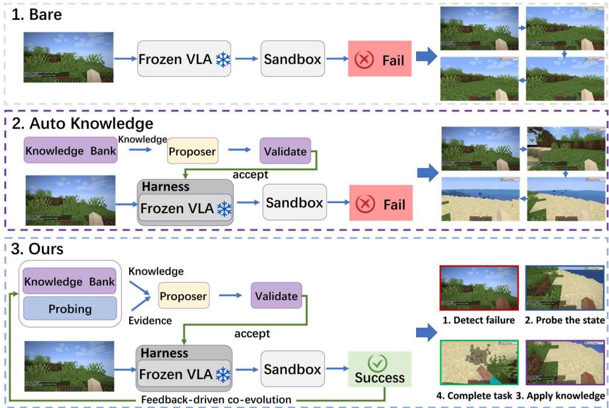  
Figure 1: Knowledge–probing co-evolution around a shared frozen VLA. Auto-K proposes and validates harness modifications using accumulated knowledge, while KPHarness additionally uses probing evidence and interaction feedback to adapt probe and knowledge selection. In the illustrated sand-mining example, Bare and Auto-K fail, whereas KPHarness recovers and completes the task.

Can transferable recovery knowledge guide what a harness should probe under ambiguous failures, while probe outcomes identify applicable knowledge and refine subsequent probing and knowledge selection?

Existing harness search proposes modifications primarily from execution outcomes. In visually ambiguous environments, however, the same failure outcome may admit multiple incompatible explanations. We therefore treat harness evolution as a sequential process of hypothesis formation, active diagnosis, and empirical verification, where transferable knowledge supplies recovery hypotheses, and probing determines which hypothesis applies. We address this question with KPHarness, a framework for test-time harness evolution around a frozen VLA. Here, test-time means that the VLA parameters remain fixed after training, while only the external harness evolves through environment interaction. At the fast timescale, the VLA executes actions under the current harness. When execution stalls, the harness selects a probe according to the task and failure context, executes it in the environment, and uses the resulting evidence to retrieve relevant recovery knowledge. At the slow timescale, a vision-language researcher converts this evidence into task-specific harness modifications. Candidates are compared with their incumbents through paired sandbox evaluation, and accepted modifications are subsequently assessed on disjoint holdout seeds. Immediate interaction utility and delayed episode-success credit are then used to update probe and knowledge selection. Thus, unlike outcome-driven harness search alone, KPHarness learns both which intervention to apply and what to probe in order to discover it.

This process creates a knowledge–probing co-evolution loop. Better probes provide clearer evidence for selecting and refining interventions, while successful interventions reveal which probes and knowledge are useful under particular task and failure contexts. Validated recoveries are distilled into transferable execution knowledge and reused on subsequent tasks, while unresolved failures and probing ambiguities are converted into targeted follow-up cases for further sandbox evaluation. As illustrated in Figure 1, Auto-K searches for harness modifications from accumulated knowledge but does not improve its probing policy from probe outcomes. In contrast, KPHarness uses subsequent interaction to update both probe and knowledge selection. Experiments on 149 Minecraft tasks show that harness evolution improves coverage over bare execution and a fixed harness, while the complete framework further improves over knowledge-only evolution without updating the underlying VLA.

Our contributions are fourfold.

1. Evidence-guided test-time harness evolution. We identify a limitation of outcome-driven automatic harness search in visually ambiguous environments and formulate harness evolution as an evidenceguided process around a frozen VLA.

2. Knowledge–probing co-evolution for evidence-guided search. We couple transferable recovery knowledge with active probing: knowledge provides intervention hypotheses, probes gather evidence about their applicability, and validated execution outcomes update both future knowledge and probe selection.

3. Sandbox-grounded accumulation and transfer. Candidate harness changes are accepted only through paired environment interaction, while validated recoveries are promoted into transferable knowledge that guides subsequent tasks.

4. Probe-drivenfailure-frontier expansion. We convert failure reflections and probing ambiguities into targeted follow-up cases, exposing new failure modes that guide subsequent harness evolution.

## 2 RELATED WORK

Static harnesses for gaming and embodied agents. Prior work has advanced Minecraft agents through video pretraining, language-conditioned behavior learning, and unified development frameworks (Fan et al., 2022; Baker et al., 2022; Lifshitz et al., 2023; Cai et al., 2024; Li et al., 2025b). However, gaming VLAs typically produce short action segments and may lose targets, repeat ineffective actions, or fail to verify progress. External harnesses mitigate these limitations through task state, memory, action constraints, verification, and recovery. Recent embodied harnesses extend frozen VLA and world-action models through cross-stage context (Zeng et al., 2026), reusable primitives (Zhang et al., 2026), and fast–slow control (Gu et al., 2026). Yet their intervention and recovery mechanisms are largely fixed before deployment. Our method instead probes ambiguous failures, acquires transferable recovery knowledge, and improves subsequent probing and knowledge selection while keeping the gaming VLA frozen.

Automatic harness evolution. Early self-evolving agents primarily optimized prompts. APE and OPRO treat instruction generation as black-box optimization (Zhou et al., 2022; Yang et al., 2024); EvoPrompt and Promptbreeder use evolutionary search (Guo et al., 2024; Fernando et al., 2023); and ProTeGi and TextGrad guide revisions with textual feedback (Pryzant et al., 2023; Yuksekgonul et al., 2024). DSPy and MIPRO extend optimization to instructions and demonstrations in multi-stage LM programs (Khattab et al., 2023; Opsahl-Ong et al., 2024). Recent methods further optimize broader harness components, including tools, memory, middleware, and control logic (Lee et al., 2026; Chen et al., 2026; Lin et al., 2026; Lou et al., 2026). These methods mainly target coding, textual, or programmatically verifiable environments with explicit execution feedback. Long-horizon gaming instead involves visually and temporally ambiguous failures, and proposed modifications may be difficult for a frozen VLA to execute. KPHarness therefore probes the environment to identify failure contexts and applicable recovery knowledge. Interaction feedback improves subsequent probe and knowledge selection, while validated recoveries transfer across tasks. This knowledge–probing co-evolution improves both what intervention to apply and what evidence to seek.

## 3 PRELIMINARIES

## 3.1 LONG-HORIZON GAMING WITH A FROZEN VLA

We consider a visual gaming environment in which an agent completes a task specified by a language instruction $g .$ . At environment timestep t, the agent receives a visual observation $o _ { t }$ , executes a low-level action $a _ { t } .$ , and observes the next observation $o _ { t + 1 }$ , an optional reward $r _ { t } .$ , and task-progress or failure signals. The available interaction history is

$$
h _ { t } = ( o _ { \leq t } , a _ { < t } , r _ { < t } ) ,
$$

and an episode induces a trajectory

$$
\tau = ( o _ { 1 } , a _ { 1 } , r _ { 1 } , \dots , o _ { T } , a _ { T } , r _ { T } , o _ { T + 1 } ) ,
$$

whose task-level outcome is measured by an environment-defined objective $R ( \tau , g )$

Low-level action proposals are generated by a pretrained vision-language-action policy $\pi _ { \theta }$ . We study thefrozen-actor setting, in which the parameters θ remain unchanged throughout execution, harness adaptation, and cross-task transfer. Any improvement must therefore arise from the external execution process. For long-horizon gaming, this process must preserve relevant context, recognize stalled progress, diagnose visually ambiguous failures, and recover through subsequent interaction.

## 3.2 TEST-TIME HARNESS EVOLUTION

A test-time harness $\mathcal { H } _ { \phi }$ is a model-external execution scaffold with configuration $\phi$ and external state M. Given the task and interaction history, the harness constructs an execution context, queries the frozen actor, and determines the action executed in the environment:

$$
{ c _ { t } = \mathcal { C } _ { \phi } ( h _ { t } , g , \mathcal { M } ) , }\tag{1}
$$

$$
\tilde { a } _ { t } \sim \pi _ { \theta } ( \cdot \mid c _ { t } ) ,\tag{2}
$$

$$
a _ { t } = \mathcal { T } _ { \phi } ( h _ { t } , g , \mathcal { M } , \tilde { a } _ { t } ) .\tag{3}
$$

Here, $\mathcal { C } _ { \phi }$ assembles the context supplied to the actor, while $\mathcal { T } _ { \phi }$ may pass through, replace, or block the actor’s proposal, including interventions for probing and recovery. The configuration ϕ specifies mechanisms such as intervention triggers, recovery instructions, verification rules, and memory-use policies. The external state M stores accumulated experience, reusable recovery knowledge, and statistics used for probe and knowledge selection.

A static harness may retrieve different memories or produce different actions, but it does so using mechanisms fixed in advance. Harness evolution additionally allows these mechanisms and their adaptive external state to change from interaction evidence. Let $P _ { \theta , \phi , \mathcal { M } } ( \tau \mid g )$ denote the trajectory distribution induced jointly by the environment, frozen actor, and harness. At adaptation stage k, the current system collects task-conditioned interaction evidence

$$
\begin{array} { c } { { \mathcal { D } _ { k } = \{ ( g _ { i } , \tau _ { i } ) \} _ { i = 1 } ^ { N _ { k } } , } } \\ { { \tau _ { i } \sim P _ { \theta , \phi _ { k } , M _ { k } } ( { \cdot } \mid g _ { i } ) . } } \end{array}\tag{4}
$$

An abstract update operator U then revises the harness while leaving the actor unchanged:

$$
\begin{array} { c } { \left( \phi _ { k + 1 } , \mathcal { M } _ { k + 1 } \right) = \mathcal { U } ( \phi _ { k } , \mathcal { M } _ { k } , \mathcal { D } _ { k } ) , } \\ { \theta _ { k + 1 } = \theta _ { k } = \theta . } \end{array}\tag{5}
$$

The index k denotes harness-adaptation stages and is distinct from the environment timestep t. An adaptation stage may include multiple sandbox episodes, and the formulation does not prescribe a particular update schedule or learning rule.

Given a deployment-task distribution $p _ { \mathrm { d e p } } ,$ the objective is to improve the expected performance of the complete actor–harness system:

$$
\operatorname* { m a x } _ { \phi _ { K } , \mathcal { M } _ { K } } \ \mathbb { E } _ { \tau \sim P _ { \theta , \phi _ { K } , \mathcal { M } _ { K } } ( \cdot | g ) } \left[ R ( \tau , g ) \right] .\tag{6}
$$

We refer to this setting as test-time harness evolution: after actor training, the harness adapts through repeated environment interaction, potentially across multiple episodes and tasks, while the underlying VLA parameters remain frozen.

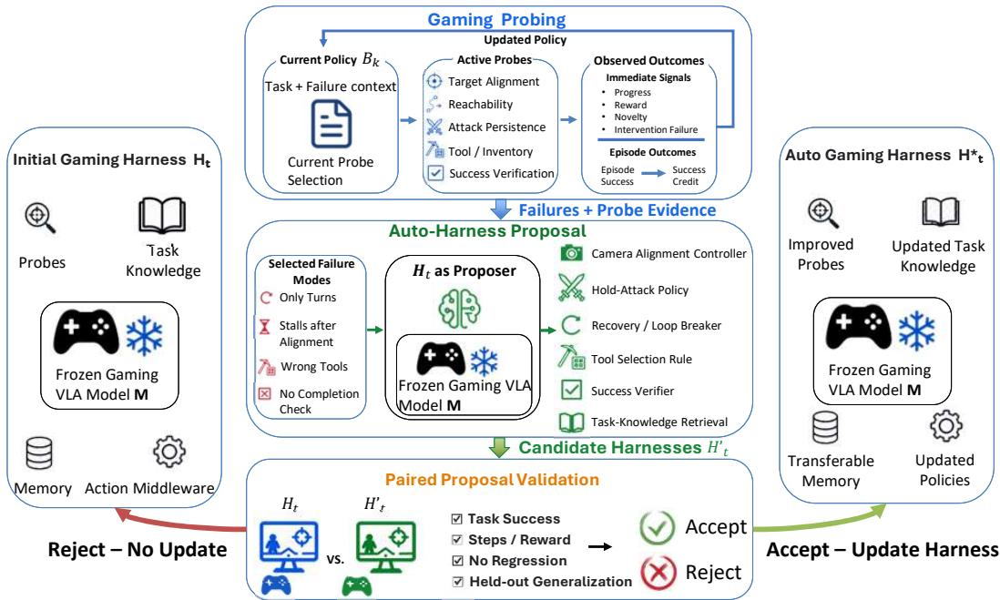  
Figure 2: Automatic harness evolution through knowledge–probing co-evolution. Action probes collect evidence about ambiguous failures, while knowledge probes test which recovery strategies apply. Probe evidence and accumulated knowledge guide harness proposals, which are compared with the incumbent through paired sandbox validation. Interaction outcomes improve both probing policies, and validated recoveries become transferable knowledge, while the VLA remains frozen.

## 4 METHODOLOGY

KPHarness (see Figure 2 ) operationalizes evidence-guided harness evolution through knowledge–probing co-evolution. Rather than proposing harness modifications from terminal outcomes alone, the framework first probes ambiguous failures, uses the resulting evidence to test applicable recovery knowledge, and then proposes evidence-grounded modifications. The frozen VLA acts in a fast execution loop, while a vision-language researcher performs diagnosis, proposal, and verification outside this latency-sensitive loop. Subsequent interaction outcomes update both action and knowledge probing, and validated recoveries become reusable knowledge for later tasks.

## 4.1 ADAPTIVE GAMING HARNESS

We follow the notation in Section 3. At evolution round k, the incumbent harness has configuration $\phi _ { k }$ and external state $\mathcal { M } _ { k }$ . The external state contains episodic experience, a recovery-knowledge bank $\kappa _ { k } .$ an action-probing policy $B _ { k } ^ { a }$ , and a knowledge-probing policy $B _ { k } ^ { z }$ . Given the current task and failure context, the harness constructs or specializes candidate probes from the fixed low-level action space, and the action-probing policy selects among them to reveal additional environment evidence. The knowledge-probing policy selects a stored recovery strategy as a hypothesis, specializes it to the current task, and tests its applicability through subsequent interaction. Knowledge probing is therefore not passive retrieval: its execution outcome determines whether the selected knowledge should be preferred in similar failure contexts. The index k identifies evolution rounds, although both probing policies may also improve during learning rollouts within the same round.

At each environment step, the harness retrieves relevant experience, constructs the actor’s context, and regulates the proposed action as defined in Equations 1–3. Its editable components include intervention triggers, recovery instructions, tool-selection rules, memory retrieval, completion checks, and probing behavior. Probe outcomes are recorded during interaction, episode outcomes provide delayed feedback, and the accumulated evidence supports slower harness revision. The VLA parameters and low-level action space remain fixed throughout this process.

## 4.2 ADAPTIVE GAMING PROBING

Probing is activated when progress stalls or execution repeatedly fails. It targets execution-relevant uncertainties such as target alignment, interaction reachability, attack persistence, tool selection, and completion checks. Given the current task and failure context, the harness first constructs or specializes applicable action probes from the fixed low-level action space. The action-probing policy then selects among these candidates and executes the selected probe to gather additional environment evidence. The resulting observation refines failure attributes such as target loss, orientation error, insufficient reachability, or repeated stalling. Conditioned on this refined failure context, the knowledge-probing policy selects a recovery strategy from $\kappa _ { k } .$ , adapts it to the current task, and tests its applicability through subsequent interaction.

Both probing policies maintain separate statistics and use a context-conditioned, UCB-inspired selection rule (Auer et al., 2002; Li et al., 2010). The broader design is motivated by informationseeking exploration, cross-context transfer, and hierarchical decision making (Houthooft et al., 2016; Liu et al., 2018; Hong et al., 2022). For either policy, let x denote the task and failure context and v an available action probe or recovery strategy. For action probing, the available candidates are task-conditioned and may include newly instantiated or specialized probes. Let $N _ { x , v }$ count previous selections of v in context x, $Q _ { x , v }$ denote their cumulative utility, and $\bar { q } _ { v }$ denote the mean utility of v across contexts. The prior weight $\lambda > 0$ controls cross-context transfer, while $\beta \geq 0$ controls exploration. Each policy selects the candidate with the highest score:

$$
\mathrm { U C B } ( v \mid x ) = \frac { Q _ { x , v } + \lambda \bar { q } _ { v } } { N _ { x , v } + \lambda } + \beta \sqrt { \frac { \log ( 1 + \sum _ { v ^ { \prime } } N _ { x , v ^ { \prime } } ) } { N _ { x , v } + 1 } } .\tag{7}
$$

The first term combines context-specific experience with the global value of the candidate, allowing evidence to transfer across related contexts. The second term encourages exploration of less frequently selected candidates. More detailed derivations are provided in Appendix G.

During learning rollouts, each selected probe receives immediate feedback from the environment. For a probe selected at timestep t, let $\Delta p _ { t }$ denote progress change, $r _ { t }$ environment reward, $n _ { t }$ interaction novelty, and failt an intervention failure. Let $c _ { p }$ be the probe cost and $w _ { p } , w _ { r } , w _ { n } , w _ { f }$ the corresponding nonnegative weights. The immediate utility is

$$
q _ { t } ^ { \mathrm { i m m } } = w _ { p } \Delta p _ { t } + w _ { r } r _ { t } + w _ { n } n _ { t } - c _ { p } - w _ { f } \mathbb { I } [ \mathrm { f a i l } _ { t } ] ,\tag{8}
$$

where $\mathbb { I } [ \cdot ]$ is the indicator function. Action probes use the novelty term to reward newly revealed interaction evidence. Knowledge probes may set $w _ { n } = 0$ and instead evaluate the progress produced after applying the selected recovery strategy.

Because an informative probe may affect the final outcome only after several subsequent actions, we additionally assign heuristic delayed credit after successful episodes. Let $\operatorname { S u c c } ( { \bar { \tau } } , g )$ indicate successful completion of task $g , R _ { \mathrm { s u c c } }$ be the success-bonus magnitude, $d _ { t }$ the temporal distance from the probe to episode completion, and $\gamma \in ( 0 , 1 ]$ a discount factor. The delayed bonus is

$$
q _ { t } ^ { \mathrm { d e l a y e d } } = R _ { \mathrm { s u c c } } \gamma ^ { d _ { t } } \mathbb { I } [ \mathrm { S u c c } ( \tau , g ) ] .\tag{9}
$$

Unsuccessful episodes receive no delayed success bonus. Each probe selection increments its count once, while its cumulative utility incorporates both immediate feedback and delayed success credit. These updates adapt $B _ { k } ^ { a }$ and $B _ { k } ^ { z }$ from interaction experience without updating the VLA.

The harness also records the observations, interventions, progress changes, and outcomes associated with each probe. Related records are grouped into recurring failure modes, such as turning without reacquiring the target, stalling after alignment, acting outside interaction range, using an incorrect tool, or missing a completion check. These records provide evidence for subsequent harness proposals.

## 4.3 EVIDENCE-GROUNDED HARNESS PROPOSAL

A vision-language researcher serves as the proposer. It receives the incumbent harness, selected failure modes and their supporting probe records, and relevant recovery knowledge from $\kappa _ { k }$ . Rather than inferring a modification from the failed trajectory alone, the researcher uses probe evidence to connect a likely failure cause with an appropriate intervention. It returns a failure diagnosis, an evidence-linked rationale, and a bounded edit to the structured HARNESS CONFIGURATION. Applying the edit to $\phi _ { k }$ produces a candidate configuration $\tilde { \phi } _ { k }$

Candidate edits may revise camera alignment, attack persistence, reachability handling, loop-breaking behavior, tool selection, completion checks, or knowledge retrieval. The researcher can modify only components exposed by the HARNESS CONFIGURATION; it cannot update the VLA, replace the actor, modify the environment, or alter the task objective. A candidate therefore remains a hypothesis unti sandbox interaction demonstrates that the frozen actor can execute it effectively.

## 4.4 PAIRED VALIDATION AND KNOWLEDGE TRANSFER

The incumbent and candidate are compared on the same task–seed pairs $\nu _ { k }$ , where g denotes a task and s an environment seed. Both conditions start from the same external-state snapshot, including episodic memory and probing-policy statistics. Persistent memory and policy writeback are disabled during paired and holdout evaluation.

For a pair $( g , s )$ , let $J _ { \mathrm { c a n d } } ( g , s )$ and $J _ { \mathrm { i n c } } ( g , s )$ denote the candidate and incumbent scores under a fixed evaluation rule. The score prioritizes task success, with progress, reward, execution cost, and regression as secondary criteria. The average paired improvement is

$$
\widehat { \Delta J } _ { k } = \frac { 1 } { | \mathscr { V } _ { k } | } \sum _ { ( g , s ) \in \mathscr { V } _ { k } } \left[ J _ { \mathrm { c a n d } } ( g , s ) - J _ { \mathrm { i n c } } ( g , s ) \right] .\tag{10}
$$

Given an acceptance threshold $\epsilon _ { \mathrm { p a i r } }$ , the next harness configuration is

$$
\phi _ { k + 1 } = \left\{ \begin{array} { l l } { \widetilde { \phi } _ { k } , } & { \widehat { \Delta J } _ { k } \geq \epsilon _ { \mathrm { p a i r } } , } \\ { \phi _ { k } , } & { \mathrm { o t h e r w i s e } . } \end{array} \right.\tag{11}
$$

Rejected candidates leave the incumbent unchanged. Accepted candidates are subsequently evaluated on disjoint holdout seeds. These results do not alter the original acceptance decision, but provide evidence of cross-seed transfer.

An accepted recovery is stored as a candidate knowledge record containing its triggering context, recovery strategy, and supporting evidence, with task-specific details removed. It is promoted to transferable knowledge when it improves performance on a holdout seed or succeeds again on another task. Promoted records enter $\boldsymbol { \mathcal { K } } _ { k + 1 }$ and are tested by the knowledge-probing policy in subsequent contexts. Outside evaluation, learning rollouts update probing statistics and episodic experience. The selected harness, probing policies, and promoted knowledge then initialize subsequent tasks, forming the knowledge–probing co-evolution loop. Uncertain diagnoses and inconsistent recovery outcomes are additionally converted into validated, deduplicated follow-up cases, which remain separate from the fixed evaluation set and target the evolving failure frontier.

## 5 EXPERIMENTS

We first train a gaming VLA based on Qwen3-VL-8B-Instruct (Bai et al., 2025) through cold-start supervised fine-tuning (SFT), with the training configuration detailed in Appendix A.1. Starting from the SFT checkpoint at step 16,200, we perform 400 steps of Group Relative Policy Optimization (GRPO) (Shao et al., 2024) on 32 interactive OpenHA training tasks in Minecraft. Figures 3 and 4 show the corresponding training curves. We then freeze the resulting policy and evaluate harness adaptation on 149 OpenHA tasks spanning mining, combat, and crafting.

The slow research loop uses Gemini-2.5-Flash (Comanici et al., 2025) at temperature 0 as the visionlanguage researcher and harness proposer. It receives the incumbent harness, structured failure and probe records, relevant recovery knowledge, and up to four frames sampled from the failed trajectory, and returns a structured candidate patch. Each task uses three proposal rounds with at most one candidate per round, and Auto-K and KPHarness use the same proposer configuration. Candidate patches are not accepted according to the researcher’s judgment alone; they are executed and verified in our locally deployed MineExplorer environment (Ju et al., 2026). Accepted candidates are subsequently evaluated on a disjoint holdout seed. The researcher neither generates low-level actions nor participates in the latency-sensitive execution loop.

Training Process

## 5.1 EVALUATION SETUP

We evaluate on 149 OpenHA tasks in MineExplorer, including 50 mining, 49 combat, and 50 crafting tasks, using the same frozen GRPO checkpoint for all methods. Each episode allows up to 100 VLA decisions, with four 50 ms low-level actions per decision, yielding up to 400 temporally dependent actions per rollout.

Our primary setting uses the legacy protocol with sampling temperature 0.7, where each prediction conditions only on the current observation and task instruction. We additionally evaluate Bare and Fixed under mtv1 at temperature 0, which restores the latest ten observation–action turns. Both protocols predict a 200 ms action chunk per decision. Action definitions and prompt construction are provided in Appendix A.

We use one probing configuration across all tasks and seeds: $w _ { p } = 1 . 0 , w _ { r } = 0 . 2 5 , w _ { n } = 0 . 1 5 ,$ $c _ { p } = 0 . 0 5 , w _ { f } = 0 . 5 , \beta = 1 . 2 , \lambda = 0 . 2 5 , R _ { \mathrm { s u c c } } = 1 . 0 , \mathrm { a n d } \gamma = \bar { 0 } . 8 .$ Knowledge probing uses the same coefficients, with cost 0.02 and no novelty term. Under the primary setting, Bare solves 39 of 149 tasks; the remaining 110 form the Bare-failure adaptation subset. Candidate and incumbent harnesses are compared using the same task, search seed, decoding settings, memory snapshot, and probing-policy state. A candidate is accepted when its paired score improves by at least 0.01; the exact scoring rule is given in Appendix D. After adaptation, we freeze the harness and probing statistics and replay all 149 tasks without further search or writeback. Frozen probes may still execute, but their policies are not updated. Because this replay includes tasks seen during adaptation, we report it as task coverage, while disjoint-seed holdout evaluation measures cross-seed robustness.

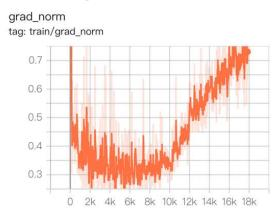

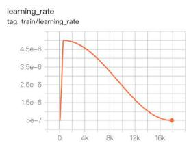

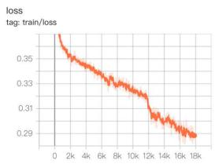

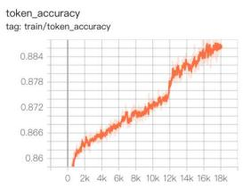  
Figure 3: Training curves for cold-start supervised fine-tuning (SFT), showing decreasing loss and improving token accuracy.

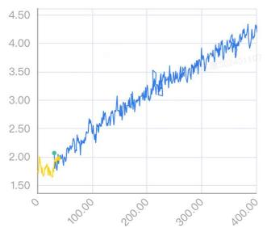  
pass\_counts

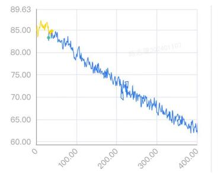  
total\_turns

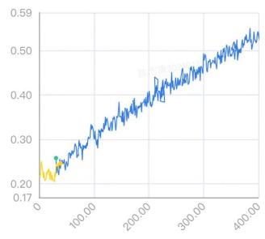  
traj\_score  
Figure 4: GRPO training dynamics over 400 optimization steps on 32 interactive OpenHA training tasks in Minecraft, initialized from the SFT checkpoint at step 16,200. Pass counts and trajectory scores increase, while total interaction turns decrease.

## 5.2 COMPARED METHODS AND MAIN RESULTS

We compare four settings using the same frozen VLA checkpoint. Bare directly executes the VLA, while Fixed adds manually specified retry and recovery rules. Auto Knowledge (Auto-K) further searches for and validates recovery knowledge through sandbox interaction, but uses predefined or coverage-based probing. The full KPHarness additionally adapts probe construction and actionand knowledge-probe selection from interaction feedback. None of the methods updates the VLA parameters. Recent automatic harness methods such as Meta-Harness (Lee et al., 2026) primarily study textual, verifiable environments, whereas visual gaming introduces ambiguous failures that often require interaction to diagnose. Our variants therefore progress from fixed recovery, to automatic knowledge accumulation, and finally to knowledge–probing co-evolution.

For failed trajectories, Auto-K and KPHarness use the same proposer to generate bounded harness patches, which are accepted only when they improve over the incumbent under paired evaluation and are subsequently tested on a disjoint holdout seed. An HO-win denotes improvement on this holdout evaluation. The key difference is adaptive probing: KPHarness updates contextual actionand knowledge-probing policies using immediate interaction feedback and delayed episode-success credit, whereas Auto-K does not learn from probe outcomes.

Table 1: Overall task coverage on the 149-task OpenHA evaluation set in Minecraft.
<table><tr><td rowspan="2">Method</td><td rowspan="2">Protocol</td><td rowspan="2">Temp.</td><td rowspan="2">Overall</td><td colspan="3">Task success</td><td rowspan="2">Rescued</td><td colspan="2">Knowledge search</td><td colspan="2">Adaptive probing</td></tr><tr><td>Mine</td><td>Kill</td><td>Craft</td><td>ACCEPT</td><td>HO-win</td><td>P-only</td><td>Replay succ.</td></tr><tr><td>Bare</td><td>mtv1</td><td>0</td><td>26/149 (17.4%)</td><td>9/50</td><td>17/49</td><td>0/50</td><td>0</td><td>一</td><td>一</td><td>一</td><td>一</td></tr><tr><td>Fixed</td><td>mtv1</td><td>0</td><td>34/149 (22.8%)</td><td>16/50</td><td>17/49</td><td>1/50</td><td>8</td><td>一</td><td>一</td><td>一</td><td>一</td></tr><tr><td>Bare</td><td>legacy</td><td>0</td><td>23/149 (15.4%)</td><td>8/50</td><td>15/49</td><td>0/50</td><td>0</td><td>一</td><td>一</td><td>一</td><td>一</td></tr><tr><td>Fixed</td><td>legacy</td><td>0</td><td>31/149 (20.8%)</td><td>13/50</td><td>18/49</td><td>0/50</td><td>8</td><td>一</td><td>一</td><td>一</td><td>1</td></tr><tr><td>Auto-K</td><td>legacy</td><td>0</td><td>41/149 (27.5%)</td><td>20/50</td><td>20/49</td><td>1/50</td><td>18</td><td>11</td><td>3</td><td>N/A</td><td>N/A</td></tr><tr><td>KPHarness</td><td>legacy</td><td>0</td><td>44/149 (29.5%)</td><td>21/50</td><td>21/49</td><td>2/50</td><td>21</td><td>14</td><td>3</td><td>1</td><td>1</td></tr><tr><td>Bare</td><td>legacy</td><td>0.7</td><td>39/149 (26.2%)</td><td>20/50</td><td>18/49</td><td>1/50</td><td>0</td><td>一</td><td>一</td><td>一</td><td>一</td></tr><tr><td>Fixed</td><td>legacy</td><td>0.7</td><td>50/149 (33.6%)</td><td>23/50</td><td>25/49</td><td>2/50</td><td>11</td><td>一</td><td>一</td><td></td><td>一</td></tr><tr><td>Auto-K</td><td>legacy</td><td>0.7</td><td>63/149 (42.3%)</td><td>25/50</td><td>30/49</td><td>8/50</td><td>24</td><td>14</td><td>5</td><td>N/A</td><td>N/A</td></tr><tr><td>KPHarness</td><td>legacy</td><td>0.7</td><td>70/149 (47.0%)</td><td>29/50</td><td>33/49</td><td>8/50</td><td>31</td><td>14</td><td>5</td><td>3</td><td>17</td></tr></table>

Rescued counts tasks failed by Bare but solved by the corresponding method under the same protocol and temperature. $\mathrm { ^ { 6 6 } N / A } \mathrm { ^ { , 3 } }$ indicates that the method does not contain the adaptive probing and delayed-credit mechanism required to define probe-only or probing-replay success.

Table 2: Multi-seed evaluation on the same 110 tasks failed by Bare, using the legacy protocol with temperature 0.7.
<table><tr><td rowspan="2">Method</td><td colspan="3">Task success</td><td rowspan="2">Rescued</td><td rowspan="2">Success rate</td><td colspan="2">Knowledge search</td><td colspan="2">Adaptive probing</td></tr><tr><td>Mine</td><td>Kill</td><td> $\overline { { \mathrm { C r a f t } } }$ </td><td></td><td>ACCEPT HO-win</td><td>P-only</td><td>Replay succ.</td></tr><tr><td>Auto-K</td><td> $4 . 7 _ { \pm 0 . 6 } / 3 0$ </td><td> $7 . 7 _ { \pm 5 . 1 } / 3 1$ </td><td> $\overline { { { 3 . 3 _ { \pm 3 . 2 } } / { 4 9 } } }$ </td><td> $\overline { { 1 5 . 7 _ { \pm 8 . 0 } / 1 1 0 } }$ </td><td> $\overline { { 1 4 . 2 _ { \pm 7 . 3 } \% } }$ </td><td></td><td></td><td>N/A</td><td>N/A</td></tr><tr><td>KPHarness</td><td> ${ \bf 8 . 3 _ { \pm 1 . 2 } / 3 0 }$ </td><td> $\underline { { 1 3 . 7 _ { \pm 1 . 5 } / 3 1 } }$ </td><td> ${ \bf 6 . 7 _ { \pm 0 . 6 } } / 4 9$ </td><td> $\mathbf { 2 8 . 7 _ { \pm 3 . 2 } } / 1 1 0$ </td><td>1  ${ \bf 2 6 . 1 _ { \pm 2 . 9 } \% }$  」</td><td> $1 4 . 0 _ { \pm 3 . 0 }$ </td><td> $\underline { { 6 . 7 _ { \pm 2 . 1 } } }$  1</td><td> $\underline { { { \bf 2 . 3 _ { \pm 1 . 2 } } } }$ </td><td> $\underline { { 1 4 . 7 _ { \pm 3 . 2 } } }$ </td></tr></table>

Main Results and Cross-Seed Robustness. As shown in Table 1, under the primary legacy protocol with temperature 0.7, Bare, Fixed, and Auto-K solve 39 (26.2%), 50 (33.6%), and 63 (42.3%) of the 149 tasks, respectively, while the full KPHarness reaches 70 (47.0%). The progressive gains from Bare to Fixed, Auto-K, and KPHarness support the benefit of external recovery, transferable knowledge, and finally adaptive knowledge–probing co-evolution. In particular, KPHarness achieves 17 probing-enabled replay successes, including three strict probe-only recoveries where Knowledge Search fails. The advantage is also consistent across seeds: on the same 110 Bare-failed tasks, KPHarness improves the mean rescue count from $1 5 . 7 _ { \pm 8 . 0 }$ for Auto-K to $2 8 . 7 _ { \pm 3 . 2 } .$ , with positive gains under all three evaluated seeds. Detailed per-seed results are provided in Appendix B.

Table 3: Frozen transfer to 60 unseen tasks. All components are fixed during evaluation.
<table><tr><td>Method</td><td>Overall</td><td>Mine</td><td>Kill</td><td>Craft</td></tr><tr><td>Bare</td><td>8/60</td><td>7/20</td><td>1/20</td><td>0/20</td></tr><tr><td>Auto-K KPHarness</td><td>7/60 15/60</td><td>6/20 9/20</td><td>1/20 5/20</td><td>0/20 1/20</td></tr></table>

Generalization to Unseen Tasks. We freeze the evolved harness, knowledge bank, and probing policy and evaluate on 60 unseen tasks without further search or writeback. As shown in Table 3, KPHarness solves 15/60 tasks, compared with 8/60 for Bare and 7/60 for Auto-K, demonstrating transfer beyond the adaptation set. Additional qualitative examples and learned recovery knowledge are shown in Appendix Figures 5 and 6.

Ablation Study. Table 1 further separates the contributions of the external harness components. Fixed consistently improves over Bare, while Auto-K further improves over Fixed through transferable recovery knowledge. The complete KPHarness improves from 63 to 70 tasks over Auto-K, supporting the additional benefit of adaptive probing and knowledge selection. Complementary diagnostics in Appendix C show that simply injecting a fixed recovery bank does not reproduce the gain of the complete sandbox-mediated evolution process. Additional analyses of knowledge search, probe-only recovery, and sequential knowledge reuse are provided in Appendix A.4 and A.5.

## 6 CONCLUSION

We introduced KPHarness, a test-time harness-evolution framework that combines adaptive probing, sandbox verification, and transferable recovery knowledge around a frozen VLA. Experiments on Minecraft show improved task coverage and transfer to unseen tasks without further actor training.

Several limitations remain. Due to the substantial computational cost of VLA training and harness evolution, including SFT/GRPO training, repeated environment rollouts, VLA inference, and multimodal researcher calls, our evaluation is limited to a single policy backbone and gaming environment. Harness evolution is also more expensive than fixed execution, while delayed success credit remains heuristic and may not precisely identify the contribution of individual probes. More detailed information can be found in Appendix H. Future work should improve adaptation efficiency and evaluate knowledge–probing co-evolution across broader models and task distributions.

## REFERENCES

Peter Auer, Nicolo Cesa-Bianchi, and Paul Fischer. Finite-time analysis of the multiarmed bandit problem. Machine learning, 47(2):235–256, 2002.

Shuai Bai, Yuxuan Cai, Ruizhe Chen, Keqin Chen, Xionghui Chen, Zesen Cheng, Lianghao Deng, Wei Ding, Chang Gao, Chunjiang Ge, et al. Qwen3-vl technical report. arXiv preprint arXiv:2511.21631, 2025.

Bowen Baker, Ilge Akkaya, Peter Zhokov, Joost Huizinga, Jie Tang, Adrien Ecoffet, Brandon Houghton, Raul Sampedro, and Jeff Clune. Video pretraining (vpt): Learning to act by watching unlabeled online videos. Advances in Neural Information Processing Systems, 35:24639–24654, 2022.

Anthony Brohan, Noah Brown, Justice Carbajal, Yevgen Chebotar, Xi Chen, Krzysztof Choromanski, Tianli Ding, Danny Driess, Avinava Dubey, Chelsea Finn, et al. Rt-2: Vision-language-action models transfer web knowledge to robotic control. arXiv preprint arXiv:2307.15818, 2023.

Shaofei Cai, Zhancun Mu, Kaichen He, Bowei Zhang, Xinyue Zheng, Anji Liu, and Yitao Liang. Minestudio: A streamlined package for minecraft ai agent development. arXiv preprint arXiv:2412.18293, 2024.

Peng Chen, Pi Bu, Yingyao Wang, Xinyi Wang, Ziming Wang, Jie Guo, Yingxiu Zhao, Qi Zhu, Jun Song, Siran Yang, et al. Combatvla: An efficient vision-language-action model for combat tasks in 3d action role-playing games. In 2025 IEEE/CVF International Conference on Computer Vision (ICCV), pp. 10919–10928. IEEE, 2025.

Tingyang Chen, Shuo Lu, Kang Zhao, Weicheng Meng, Hanlin Teng, Tianhao Li, Chao Li, Xule Liu, Jian Liang, Zhizhong Zhang, et al. Harnessx: A composable, adaptive, and evolvable agent harness foundry. arXiv preprint arXiv:2606.14249, 2026.

Gheorghe Comanici, Eric Bieber, Mike Schaekermann, Ice Pasupat, Noveen Sachdeva, Inderjit Dhillon, Marcel Blistein, Ori Ram, Dan Zhang, Evan Rosen, et al. Gemini 2.5: Pushing the frontier with advanced reasoning, multimodality, long context, and next generation agentic capabilities. arXiv preprint arXiv:2507.06261, 2025.

Linxi Fan, Guanzhi Wang, Yunfan Jiang, Ajay Mandlekar, Yuncong Yang, Haoyi Zhu, Andrew Tang, De-An Huang, Yuke Zhu, and Anima Anandkumar. Minedojo: Building open-ended embodied agents with internet-scale knowledge. Advances in Neural Information Processing Systems, 35: 18343–18362, 2022.

Yiguo Fan, Pengxiang Ding, Shuanghao Bai, Xinyang Tong, Yuyang Zhu, Hongchao Lu, Fengqi Dai, Wei Zhao, Yang Liu, Siteng Huang, et al. Long-vla: Unleashing long-horizon capability of vision language action model for robot manipulation. arXiv preprint arXiv:2508.19958, 2025.

Chrisantha Fernando, Dylan Banarse, Henryk Michalewski, Simon Osindero, and Tim Rocktäschel. Promptbreeder: Self-referential self-improvement via prompt evolution. arXiv preprint arXiv:2309.16797, 2023.

Zhaopeng Gu, Bingke Zhu, Tianxi Lin, Guibo Zhu, Yingying Chen, Kai Wang, Tingyu Yuan, Chaoyang Zhao, Zhaowen Li, Peng Su, et al. Harnesswam: Bridging prediction and deliberation in world action models. arXiv preprint arXiv:2608.09516, 2026.

Qingyan Guo, Rui Wang, Junliang Guo, Bei Li, Kaitao Song, Xu Tan, Guoqing Liu, Jiang Bian, and Yujiu Yang. Connecting large language models with evolutionary algorithms yields powerful prompt optimizers. In International Conference on Learning Representations, volume 2024, pp. 34133–34156, 2024.

Joey Hong, Branislav Kveton, Manzil Zaheer, and Mohammad Ghavamzadeh. Hierarchical bayesian bandits. In International Conference on Artificial Intelligence and Statistics, pp. 7724–7741. PMLR, 2022.

Rein Houthooft, Xi Chen, Yan Duan, John Schulman, Filip De Turck, and Pieter Abbeel. Vime: Variational information maximizing exploration. Advances in neural information processing systems, 29, 2016.

Tianjie Ju, Yueqing Sun, Zheng Wu, Wei Zhang, Yaqi Huo, Xi Su, Qi Gu, Xunliang Cai, Gongshen Liu, and Zhuosheng Zhang. Mineexplorer: Evaluating open-world exploration of mllm agents in minecraft. arXiv preprint arXiv:2605.30931, 2026.

Omar Khattab, Arnav Singhvi, Paridhi Maheshwari, Zhiyuan Zhang, Keshav Santhanam, Sri Vardhamanan, Saiful Haq, Ashutosh Sharma, Thomas T Joshi, Hanna Moazam, et al. Dspy: Compiling declarative language model calls into self-improving pipelines. arXiv preprint arXiv:2310.03714, 2023.

Moo Jin Kim, Karl Pertsch, Siddharth Karamcheti, Ted Xiao, Ashwin Balakrishna, Suraj Nair, Rafael Rafailov, Ethan Foster, Grace Lam, Pannag Sanketi, et al. Openvla: An open-source vision-language-action model. arXiv preprint arXiv:2406.09246, 2024.

Yoonho Lee, Roshen Nair, Qizheng Zhang, Kangwook Lee, Omar Khattab, and Chelsea Finn. Meta-harness: End-to-end optimization of model harnesses. arXiv preprint arXiv:2603.28052, 2026.

Daixun Li, Yusi Zhang, Mingxiang Cao, Donglai Liu, Weiying Xie, Tianlin Hui, Lunkai Lin, Zhiqiang Xie, and Yunsong Li. Towards long-horizon vision-language-action system: Reasoning, acting and memory. In 2025 IEEE/CVF International Conference on Computer Vision (ICCV), pp. 6839–6848. IEEE, 2025a.

Lihong Li, Wei Chu, John Langford, and Robert E Schapire. A contextual-bandit approach to personalized news article recommendation. In Proceedings of the 19th international conference on World wide web, pp. 661–670, 2010.

Muyao Li, Zihao Wang, Kaichen He, Xiaojian Ma, and Yitao Liang. Jarvis-vla: Post-training large-scale vision language models to play visual games with keyboards and mouse. In Findings of the Associationfor Computational Linguistics: ACL 2025, pp. 17878–17899, 2025b.

Shalev Lifshitz, Keiran Paster, Harris Chan, Jimmy Ba, and Sheila McIlraith. Steve-1: A generative model for text-to-behavior in minecraft. Advances in Neural Information Processing Systems, 36: 69900–69929, 2023.

Jiahang Lin, Shichun Liu, Chengjun Pan, Lizhi Lin, Shihan Dou, Zhiheng Xi, Xuanjing Huang, Hang Yan, Zhenhua Han, Tao Gui, et al. Agentic harness engineering: Observability-driven automatic evolution of coding-agent harnesses. arXiv preprint arXiv:2604.25850, 2026.

Bo Liu, Ying Wei, Yu Zhang, Zhixian Yan, and Qiang Yang. Transferable contextual bandit for cross-domain recommendation. In Proceedings of the AAAI conference on artificial intelligence, volume 32, 2018.

Xinghua Lou, Miguel Lázaro-Gredilla, Antoine Dedieu, Carter Wendelken, Wolfgang Lehrach, and Kevin P Murphy. Autoharness: improving llm agents by automatically synthesizing a code harness. arXiv preprint arXiv:2603.03329, 2026.

Krista Opsahl-Ong, Michael J Ryan, Josh Purtell, David Broman, Christopher Potts, Matei Zaharia, and Omar Khattab. Optimizing instructions and demonstrations for multi-stage language model programs. In Proceedings of the 2024 Conference on Empirical Methods in Natural Language Processing, pp. 9340–9366, 2024.

Reid Pryzant, Dan Iter, Jerry Li, Yin Lee, Chenguang Zhu, and Michael Zeng. Automatic prompt optimization with “gradient descent” and beam search. In Proceedings of the 2023 conference on empirical methods in natural language processing, pp. 7957–7968, 2023.

Zhihong Shao, Peiyi Wang, Qihao Zhu, Runxin Xu, Junxiao Song, Xiao Bi, Haowei Zhang, Mingchuan Zhang, YK Li, Yang Wu, et al. Deepseekmath: Pushing the limits of mathematical reasoning in open language models. arXiv preprint arXiv:2402.03300, 2024.

Yuqi Wang, Xinghang Li, Wenxuan Wang, Junbo Zhang, Yingyan Li, Yuntao Chen, Xinlong Wang, and Zhaoxiang Zhang. Unified vision-language-action model. In International Conference on Learning Representations, volume 2026, pp. 80929–80944, 2026.

Chengrun Yang, Xuezhi Wang, Yifeng Lu, Hanxiao Liu, Quoc V Le, Denny Zhou, and Xinyun Chen. Large language models as optimizers. In International Conference on Learning Representations, volume 2024, pp. 12028–12068, 2024.

Yi Yang, Jiaxuan Sun, Siqi Kou, Yihan Wang, and Zhijie Deng. Lohovla: A unified vision-languageaction model for long-horizon embodied tasks. arXiv preprint arXiv:2506.00411, 2025.

Mert Yuksekgonul, Federico Bianchi, Joseph Boen, Sheng Liu, Zhi Huang, Carlos Guestrin, and James Zou. Textgrad: Automatic" differentiation" via text. arXiv preprint arXiv:2406.07496, 2024.

Zijian Zeng, Fei Ding, Huiming Yang, and Xianwei Li. Helm: Harness-enhanced long-horizon memory for vision-language-action manipulation. arXiv preprint arXiv:2604.18791, 2026.

Yixian Zhang, Huanming Zhang, Feng Gao, Xiao Li, Zhihao Liu, Chunyang Zhu, Jiaxing Qiu, Yuchen Yan, Jiyuan Liu, Wenhao Tang, et al. Harness vla: Steering frozen vlas into reliable manipulation primitives via memory-guided agents. arXiv preprint arXiv:2607.08448, 2026.

Yongchao Zhou, Andrei Ioan Muresanu, Ziwen Han, Keiran Paster, Silviu Pitis, Harris Chan, and Jimmy Ba. Large language models are human-level prompt engineers. arXiv preprint arXiv:2211.01910, 2022.

## A EXPERIMENTAL SETUP

## A.1 VLA POLICY TRAINING

We adopt Qwen3-VL-8B-Instruct as the policy backbone and train it in two stages. First, we perform cold-start supervised fine-tuning (SFT) for three epochs on approximately 765K multimodal Minecraft action trajectories. We use 16 NVIDIA H800 GPUs with 141 GB of memory each, BF16 precision, a maximum sequence length of 14K, a per-GPU batch size of 1, and eight gradient-accumulation steps, yielding a global batch size of 128. Optimization uses fused AdamW with $\beta _ { 1 } = 0 . 9 , \beta _ { 2 } = 0 . { \overset { \cdot } { 9 } } 5$ weight decay 0.1, and gradient clipping at 1.0. The learning rate is warmed up over the first 3% of training to $5 \times 1 0 ^ { - 6 }$ and then decayed to $5 \times 1 0 ^ { - 7 }$ with a cosine schedule.

Second, we initialize from the SFT checkpoint at step 16,200 and perform 400 steps of Group Relative Policy Optimization (GRPO) (Shao et al., 2024) on 32 interactive OpenHA training tasks in Minecraft, spanning navigation, world interaction, and GUI manipulation. Each task is sampled with a group of eight online trajectories. GRPO uses Adam with $\beta _ { 1 } = 0 . 9 , \beta _ { 2 } = 0 . 9 5$ , a constant learning rate of $. \times 1 0 ^ { - 7 }$ , weight decay 0.01, gradient clipping at 1.0, and a clipping ratio of 0.2. Training uses BF16, a policy micro-batch size of 1, and one optimization epoch per rollout batch. We apply no additional KL reward penalty. During rollout collection, actions are sampled with temperature 1.0 and ${ \mathrm { t o p } } { - } p = 1 . 0$ , and the policy receives a binary task-completion reward.

We use the GRPO checkpoint at step 400 as the frozen VLA in all harness experiments. Under the legacy protocol, each prediction conditions only on the current observation and task instruction. Under mtv1 (minecraft\_v1), the model additionally receives up to ten preceding observation– action turns. Both protocols predict four consecutive low-level actions per decision, each executed for 50 ms, producing a 200 ms action chunk. The primary evaluation uses legacy with temperature 0.7; auxiliary protocol comparisons use temperature 0. The VLA parameters remain frozen throughout harness evolution.

## A.2 EVALUATION SETUP

We evaluate on 149 OpenHA tasks in Minecraft: 50 mining tasks, 49 combat tasks, and 50 crafting tasks. Each episode permits up to 100 VLA decisions and therefore up to 400 temporally dependent low-level actions. We use long-horizon to describe this multi-turn closed-loop dependency, which may involve locating, approaching, aligning with, and interacting with a target, followed by progress verification and failure recovery.

Evaluation uses eight NVIDIA H800 GPUs and eight parallel environment workers. Each worker hosts one frozen policy instance and interacts with an independent MineStudio environment. Task success is determined by the binary completion signal provided by OpenHA. All methods within a comparison use the same VLA checkpoint, task configurations, prompting protocol, temperature, and interaction budget.

Under the primary legacy, temperature-0.7 setting, Bare solves 39 of the 149 tasks. Its remaining 110 failures form the Bare-failure adaptation subset. This subset is defined operationally by the frozen Bare policy and is not an independently curated difficulty split.

Candidate and incumbent harnesses are compared using the same task and search seed. Accepted candidates are subsequently evaluated using a disjoint holdout seed. These evaluation seeds control harness-side stochasticity, while the Minecraft world configuration is specified by the OpenHA task. Paired conditions share the same VLA parameters, decoding settings, episodic-memory snapshot, and probing-policy state. Persistent-memory updates and probing-policy writeback are disabled during paired and holdout evaluation.

After adaptation, we freeze the selected harness and probing statistics and replay all 149 tasks without further search or writeback. Because this replay includes tasks from the adaptation subset, it measures task coverage rather than generalization to an unseen task split. The disjoint-seed evaluation separately measures cross-seed robustness.

## A.3 RESEARCHER AND SANDBOX VERIFIER.

We use the API model identifier gemini-2.5-flash (Comanici et al., 2025) with temperature 0, visual input enabled, and at most four trajectory frames per proposal. Its output is restricted to a structured patch over the exposed harness configuration. Auto-K and KPHarness use the same proposer model, prompt format, temperature, and frame budget.

All candidate patches are empirically evaluated in the MineStudio sandbox (Ju et al., 2026). The candidate and incumbent share the same task, frozen VLA, decoding configuration, evaluation seed, and initial external state. Persistent memory and probing-policy writeback are disabled during comparison. The sandbox outcome, rather than the proposer itself, determines whether a patch is accepted.

## A.4 KNOWLEDGE SEARCH AND ADAPTIVE PROBING DIAGNOSTICS

We further analyze the 110 tasks in the Bare-failure adaptation subset. This analysis separates successes observed during Knowledge Search from those obtained in probing-enabled replay. Because it aggregates multiple intermediate harnesses, it is a search-time diagnostic rather than a decomposition of the final frozen-harness coverage in Table 1.

Table 4: Search-time diagnostics on the 110 OpenHA tasks failed by Bare under the primary evaluation setting. The union counts distinct tasks solved by either Knowledge Search or probing-enabled replay.
<table><tr><td>Statistic</td><td>Overall</td><td>Mine</td><td>Kill</td><td>Craft</td></tr><tr><td>Knowledge Search Best</td><td>28/110</td><td>8</td><td>14</td><td>6</td></tr><tr><td>Probing-enabled Replay</td><td>17/110</td><td>4</td><td>9</td><td>4</td></tr><tr><td>Search Best ∪ Probing Replay</td><td>31/110</td><td>9</td><td>15</td><td>7</td></tr><tr><td>ACCEPT</td><td>14</td><td>4</td><td>5</td><td>5</td></tr><tr><td>HO-win</td><td>5</td><td>1</td><td>2</td><td>2</td></tr><tr><td>Strict Probe-only</td><td>3</td><td>1</td><td>1</td><td>1</td></tr></table>

Knowledge Search Best counts a task as solved if its best validated candidate succeeds during search; it is therefore an aggregate search-time statistic, not the performance of one deployable harness. It solves 28 tasks, while probing-enabled replay succeeds on 17. Fourteen tasks overlap, giving

$$
| S _ { \mathrm { s e a r c h } } \cup S _ { \mathrm { p r o b e } } | = 2 8 + 1 7 - 1 4 = 3 1 .\tag{12}
$$

Thus, the 17 replay successes are not 17 additional gains. Instead, three are strict probe-only successes: one mining, one combat, and one crafting task that remain unsolved by Knowledge Search but succeed during probing-enabled replay.

The 31-task diagnostic union differs from the 31 rescued tasks in Table 1. The former combines successes from different intermediate harnesses during search and probing replay, whereas the latter is measured from the final evaluation used to report overall task coverage. The two quantities therefore describe different stages of the evaluation and should not be interpreted as identical statistics.

The combined diagnostic procedures solve 15 of the 31 Bare-failed combat tasks (48.4%), compared with 9 of 30 mining tasks (30.0%) and 7 of 49 crafting tasks (14.3%). Combat failures frequently involve target loss or stalled engagement, where approaching, attacking, and re-centering provide useful corrective evidence. Crafting remains more difficult because it often requires precise multi-step GUI interaction.

Knowledge Search produces accepted patches for 14 distinct tasks, five of which obtain an HO-win on a disjoint seed, corresponding to an empirical holdout rate of 35.7%. Because both search and holdout evaluation use a limited number of seeds, these results provide preliminary cross-seed evidence rather than a statistically conclusive generalization estimate.

## A.5 SEQUENTIAL CROSS-TASK KNOWLEDGE REUSE

During harness adaptation, tasks are processed sequentially. After each task, validated recovery knowledge and contextual-bandit statistics are written to the shared harness state and become available to subsequent tasks. We analyze all 110 tasks in the Bare-failure adaptation subset from the temperature-0.7 run to verify that this information is used during later execution.

Table 5: Sequential reuse of recovery knowledge in the temperature-0.7 adaptation run, computed from initial seed-rollout metrics before task-specific proposal and acceptance.
<table><tr><td>Statistic</td><td>Count</td></tr><tr><td>Adaptation tasks</td><td>110</td></tr><tr><td>Tasks using prior-task knowledge</td><td>107</td></tr><tr><td>Prior-knowledge selection events</td><td>840</td></tr><tr><td>Distinct prior-skill–target relations</td><td>156</td></tr><tr><td>Cross-family reuse relations</td><td>101</td></tr><tr><td>Single-rollout seed-harness successes</td><td>12</td></tr><tr><td>Successes without local ACCEPT</td><td>12</td></tr><tr><td>Successes explicitly using prior knowledge</td><td>9</td></tr></table>

We define a prior-knowledge selection as an event in which the current task selects a promoted recovery strategy whose provenance includes at least one preceding task. A seed-harness success is a task completed by the inherited harness during its initial evaluation, before any task-specific candidate is proposed or accepted. Each initial evaluation contains exactly one episode, so these successes are not selected from repeated task restarts.

As shown in Table 5, 107 of the 110 adaptation tasks select knowledge promoted from earlier tasks, yielding 840 selection events. The inherited harness completes 12 tasks before task-specific search, and nine of these successful trajectories explicitly use prior-task knowledge.

These results provide operational evidence of sequential cross-task reuse, including transfer across task families. However, the inherited harness also contains updated prompts and contextual-bandit state, while decoding at temperature 0.7 remains stochastic. We therefore interpret this analysis as evidence that knowledge transfer occurs, rather than as a causal estimate of the improvement attributable solely to transferred knowledge.

## B MULTI-SEED ROBUSTNESS ON BARE-FAILURE TASKS

We evaluate cross-seed robustness on the 110 tasks that Bare fails under the legacy protocol with temperature 0.7. This diagnostic subset contains 30 mining, 31 combat, and 49 crafting tasks. All conditions use the same frozen VLA checkpoint. For the cross-seed transfer evaluation, Auto-K executes its frozen harness and transferable knowledge bank without test-time writeback, whereas KPHarness retains the knowledge–probing feedback loop. Table 6 reports the complete results for seeds {101, 202, 303}.

Consistent improvements across seeds. Auto-K solves 24, 8, and 15 tasks under seeds 101, 202, and 303, respectively, while KPHarness solves 31, 30, and 25. Thus, KPHarness improves coverage by 7, 22, and 10 tasks, with a positive gain under every evaluated seed. Averaged across seeds, the number of rescued tasks increases from $1 5 . 7 _ { \pm 8 . 0 } \ \mathrm { t o } \ 2 8 . 7 _ { \pm 3 . 2 }$ out of 110. Equivalently, the mean success rate improves from $1 4 . 2 _ { \pm 7 . 3 } \%$ to $2 6 . 1 _ { \pm 2 . 9 } \% .$ . The lower standard deviation additionally indicates that KPHarness is less sensitive to the evaluation seed than Auto-K.

Improvements across task families. Aggregated over the three seeds, Auto-K solves 47 of 330 task–seed instances, whereas KPHarness solves 86. The improvement is distributed across all three task families. Mining success increases from 14 to 25 instances, combat success from 23 to 41, and crafting success from 10 to 20. The gain therefore cannot be attributed solely to one task family or to an unusually favorable environment configuration.

Task-paired evidence. A task-paired analysis provides stronger evidence than comparing only aggregate success rates. Under seed 202, KPHarness exclusively solves 24 tasks that Auto-K fails, whereas Auto-K exclusively solves only two tasks. Under seed 303, the corresponding counts are 12 and two. Pooling these two rerun seeds gives 36 KPHarness-only successes versus four

Auto-K-only successes. An exact McNemar test rejects symmetric random outcome fluctuations $( p = 1 . 8 6 \stackrel { \cdot } { \times } 1 0 ^ { - 7 } )$ . Thus, the observed difference is unlikely to arise from a small number of stochastic success flips.

Contribution of adaptive probing. Across the three seeds, KPHarness produces 3, 3, and 1 strict probe-only recoveries and obtains 17, 11, and 16 successful probing-enabled replays. On average, this corresponds to $2 . 3 _ { \pm 1 . 2 }$ strict probe-only recoveries and $1 4 . 7 _ { \pm 3 . 2 }$ replay successes per seed. Meanwhile, Knowledge Search produces $1 4 . 0 _ { \pm 3 . 0 }$ accepted task-level patches, of which $6 . 7 _ { \pm 2 . 1 }$ generalize to the holdout evaluation. These observations suggest that the gain is not explained merely by generating more patches. Instead, probe feedback changes which failure contexts are explored and which recovery knowledge is selected and retained.

Interpretation. The consistent improvement across all seeds, the reduction in cross-seed variance, and the strongly asymmetric task-level success flips jointly support the system-level benefit of knowledge–probing co-evolution. This experiment evaluates the complete feedback loop rather than attributing the gain to either direction individually.

Table 6: Per-seed results on the 110 tasks failed by Bare under the legacy protocol with temperature 0.7. The subset contains 30 mining, 31 combat, and 49 crafting tasks.
<table><tr><td rowspan="2">Method</td><td rowspan="2">Seed</td><td rowspan="2">Success</td><td colspan="3">Task success</td><td colspan="2">Knowledge search</td><td colspan="2">Adaptive probing</td></tr><tr><td>Mine</td><td>Kill</td><td>Craft</td><td>ACCEPT</td><td>HO-win</td><td>P-only</td><td>Replay succ.</td></tr><tr><td>Auto-K</td><td>101</td><td>24/110 (21.8%)</td><td>5/30</td><td>12/31</td><td>7/49</td><td>14</td><td>5</td><td>N/A</td><td>N/A</td></tr><tr><td>KPHarness</td><td>101</td><td>31/110 (28.2%)</td><td>9/30</td><td>15/31</td><td>7/49</td><td>14</td><td>5</td><td>3</td><td>17</td></tr><tr><td>Auto-K</td><td>202</td><td>8/110 (7.3%)</td><td>5/30</td><td>2/31</td><td>1/49</td><td>一</td><td>一</td><td>N/A</td><td>N/A</td></tr><tr><td>KPHarness</td><td>202</td><td>30/110 (27.3%)</td><td>9/30</td><td>14/31</td><td>7/49</td><td>17</td><td>9</td><td>3</td><td>11</td></tr><tr><td>Auto-K</td><td>303</td><td>15/110 (13.6%)</td><td>4/30</td><td>9/31</td><td>2/49</td><td>1</td><td>一</td><td>N/A</td><td>N/A</td></tr><tr><td>KPHarness</td><td>303</td><td>25/110 (22.7%)</td><td>7/30</td><td>12/31</td><td>6/49</td><td>11</td><td>6</td><td>1</td><td>16</td></tr><tr><td>Auto-K</td><td>Mean</td><td> $\overline { { 1 5 . 7 _ { \pm 8 . 0 } / 1 1 0 \left( 1 4 . 2 _ { \pm 7 . 3 } \% \right) } }$ </td><td> $\overline { { 4 . 7 _ { \pm 0 . 6 } / 3 0 } }$ </td><td> $\overline { { 7 . 7 _ { \pm 5 . 1 } / 3 1 } }$ </td><td> $\overline { { { 3 . 3 _ { \pm 3 . 2 } } / { 4 9 } } }$ </td><td>一</td><td>一</td><td>N/A</td><td>N/A</td></tr><tr><td>KPHarness</td><td>Mean</td><td> $\mathbf { 2 8 . 7 _ { \pm 3 . 2 } } / 1 1 0 \ ( 2 6 . 1 _ { \pm 2 . 9 } \% )$ </td><td> $\underline { { 8 . 3 _ { \pm 1 . 2 } / 3 0 } }$ </td><td>13.7±1.5/31</td><td> $\underline { { { \bf 6 . 7 _ { \pm 0 . 6 } } / 4 9 } }$ </td><td>14.0±3.0</td><td>6.7±2.1</td><td>2.3±1.2</td><td>14.7±3.2</td></tr></table>

The Mean rows report the mean and sample standard deviation over seeds {101, 202, 303}, with the standard deviation shown as a lower-right subscript. P-only denotes strict probe-only recoveries, for which Knowledge Search fails but the probing-enabled replay succeeds. Replay succ. counts all successful probing-enabled replays. “N/A” indicates that Auto-K does not contain the adaptive probing and delayed-credit mechanism. A dash indicates that Knowledge Search was disabled during the corresponding frozen Auto-K evaluation and therefore ACCEPT and HO-win are not defined.

## C STATIC-KNOWLEDGE DIAGNOSTIC

We conduct an additional diagnostic to examine whether injecting a fixed recovery bank improves adaptive probing. The diagnostic uses the 110 tasks failed by Bare under the legacy protocol at temperature 0.7, with the same frozen VLA, evaluation seed 101, task list, base harness, and probe budget of eight. Each variant starts with an empty bandit state and performs one execution rollout per task. Knowledge content and harness patches remain fixed: no proposer, Knowledge Search, ACCEPT/REVERT, holdout validation, or skill creation is enabled. Environment feedback may update selection statistics, but cannot create or revise knowledge.

Variants. All four variants use adaptive probing and update probe-selection statistics from outcomes. Probe-only uses no knowledge bank. Static K (no injection) updates knowledge-selection statistics but does not inject selected knowledge into the actor. Static K (no K-update) injects selected knowledge but disables outcome-based updates to knowledge-selection statistics. Static K (adaptive selection) enables both knowledge injection and outcome-based updates to its selection statistics.

Results. None of the tested static-bank variants outperforms Probe-only in overall coverage (Table 7). Adaptive selection over the fixed bank solves 13 tasks, compared with 15 for Probe-only. Both variants solve seven tasks; Probe-only uniquely solves eight, and adaptive static-K selection uniquely solves six. The paired difference is not statistically significant (two-sided exact McNemar test, $p = 0 . 7 9 )$ . Their observed probe counts and useful-probe fractions are also similar (Table 8). Thus, adding this fixed bank provides no observed coverage benefit under the evaluated setting.

Adaptive static-K selection makes 1,428 knowledge selections, but only 0.14% have positive immedi ate utility. This metric captures immediate feedback rather than the full downstream contribution of knowledge. The outcomes also vary across task families: mining coverage increases from five tasks to six, while crafting coverage decreases from four to two. The bank primarily contains generic visual recovery strategies, including target reacquisition, re-centering, and escaping walls. These strategies may offer limited help for crafting-interface or prerequisite failures, suggesting that recovery depends on the relevance of knowledge to the encountered failure context.

Table 7: Task success on the 110-task Bare-failure subset under legacy at temperature 0.7. Panel (a) reports the complete search pipelines; Panel (b) reports the fixed-bank execution diagnostic at seed 101.
<table><tr><td>Method / Variant</td><td>Success</td><td>Mine</td><td>Kill</td><td>Craft</td></tr><tr><td colspan="5">(a) Full Sandbox-mediated knowledge evolution</td></tr><tr><td>Auto-K</td><td>24/110 (21.8%)</td><td>5/30</td><td>12/31</td><td>7/49</td></tr><tr><td>KPHarness</td><td>31/110 (28.2%)</td><td>9/30</td><td>15/31</td><td>7/49</td></tr><tr><td colspan="5">(b) Static-knowledge execution diagnostic</td></tr><tr><td>Probe-only</td><td>15/110 (13.6%)</td><td>5/30</td><td>6/31</td><td>4/49</td></tr><tr><td>Static K (no injection)</td><td>9/110 (8.2%)</td><td>2/30</td><td>6/31</td><td>1/49</td></tr><tr><td>Static K (no K-update)</td><td>13/110 (11.8%)</td><td>4/30</td><td>5/31</td><td>4/49</td></tr><tr><td>Static K (adaptive selection)</td><td>13/110 (11.8%)</td><td>6/30</td><td>5/31</td><td>2/49</td></tr></table>

Panel (a) is the hard-subset view of Table 1: including the 39 Bare successes gives 63/149 for Auto-K and 70/149 for KPHarness. Panel (b) uses one execution rollout per task with fixed knowledge content and harness patches. Results are comparable within each panel; cross-panel differences are not controlled effect estimates. Bold denotes the highest coverage within each panel.

Table 8: Process statistics for the static-knowledge diagnostic. Positive-utility K is the percentage of knowledge selections with positive immediate utility.
<table><tr><td>Variant</td><td>Probes per task</td><td>Steps to recovery</td><td>Useful probes (%)</td><td>K selections</td><td>Positive-utility K(%)</td></tr><tr><td>Probe-only</td><td>8.00</td><td>59.4</td><td>42.7</td><td></td><td></td></tr><tr><td>Static K (no injection)</td><td>7.98</td><td>50.8</td><td>41.3</td><td>1,463</td><td>0.07</td></tr><tr><td>Static K (no K-update)</td><td>7.98</td><td>61.8</td><td>39.6</td><td>1,454</td><td>0.00</td></tr><tr><td>Static K (adaptive selection)</td><td>7.93</td><td>51.5</td><td>41.7</td><td>1,428</td><td>0.14</td></tr></table>

Why Sandbox-mediated knowledge–probing evolution matters. Sandbox provides the execution evidence that connects recovery knowledge with adaptive probing. Knowledge directs probes toward unresolved failure hypotheses, while probe outcomes reveal whether recovery strategies are executable by the frozen actor. This evidence informs knowledge selection and the proposal and validation of harness updates. Validated recovery experience can then guide subsequent probing and be reused across tasks, enabling knowledge and probing to adapt together.

The diagnostic highlights the distinction between updating selection statistics and revising the knowledge being selected. All diagnostic variants interact with the environment, but their feedback cannot improve the bank’s content. In the complete framework, Sandbox feedback additionally drives knowledge acquisition, harness revision, and validation. The main results demonstrate the benefit of this overall design: coverage increases from 50/149 for Fixed to 63/149 for Auto-K and 70/149 for KPHarness. The advantage over Auto-K also holds across all three evaluated seeds, increasing the mean rescue count from 15.7±8.0 to 28.7±3.2 on the same 110-task subset. Together, these findings support Sandbox-mediated knowledge–probing co-evolution as an effective approach to harness adaptation, with Sandbox serving as the shared execution and validation interface for accumulating reusable recovery experience.

Scope. The static-bank diagnostic evaluates one bank and one seed under a restricted execution protocol. It retains environment interaction and differs from the complete search-and-replay pipeline. Its results therefore provide complementary system-level evidence, without isolating the causal contribution of Sandbox interaction or individual adaptation components.

## D HARNESS SEARCH IMPLEMENTATION DETAILS

Researcher and search budget. We use Gemini-2.5-Flash (Comanici et al., 2025) at temperature 0 as both the visual failure-attribution researcher and harness proposer. It receives the incumbent harness, rollout statistics, failure and probe records, relevant recovery knowledge, previous proposal outcomes, and up to four frames sampled from the failed trajectory. Each task uses three sequential proposal rounds with at most one candidate per round. Invalid outputs are repaired for up to three researcher calls and discarded if they remain invalid. An accepted candidate becomes the incumbent for the next round, whereas a rejected candidate leaves the incumbent unchanged. Auto-K and KPHarness use the same researcher and proposal budget.

Editable harness configuration. The researcher may modify the task, decomposition, and recovery prompts; the runtime task instruction; and selected probe, memory, verification, recovery, and runtime settings. Every candidate must contain at least one prompt or instruction edit, and parameteronly patches are rejected before execution. The researcher cannot modify the VLA checkpoint or parameters, the low-level action space, task definition, MineExplorer environment, or evaluation protocol.

Failure contexts and runtime signals. The action-probing context combines a coarse task family with the event that activates probing, producing contexts such as mine:stall, combat:fail, and craft:stall. The knowledge-probing context additionally includes failure attributes such as zero\_progress, orientation, target\_loss, and stall\_heavy. These attributes are obtained from rollout statistics and visual attribution over the sampled trajectory frames.

Progress and reward are obtained from environment feedback, while execution failure is determined from the runtime status. Novelty is computed as one minus the maximum similarity between the current state–action pair and previously stored experience:

$$
n _ { t } = 1 - \operatorname* { m a x } _ { ( z _ { i } , e _ { i } ) \in \mathcal { M } } \frac { 1 } { 2 } \left[ \cos ( z _ { t } , z _ { i } ) + \cos ( e ( a _ { t } ) , e _ { i } ) \right] ,\tag{13}
$$

where $z _ { t }$ denotes the visual-state representation and $e ( a _ { t } )$ the action embedding. We set $n _ { t } = 1$ when no previous experience is available.

Paired acceptance. For an episode executed by harness H, the acceptance score is

$$
J ( H ) = \mathbb { I } [ \mathrm { s u c c e s s } ] + 0 . 0 0 5 R _ { \mathrm { e n v } } - 0 . 2 \mathbb { I } [ \mathrm { c a s c a d e } ] ,\tag{14}
$$

where $R _ { \mathrm { e n v } }$ is the raw cumulative environment reward without additional normalization. Progress, interaction cost, and step efficiency are recorded as diagnostic statistics and may be supplied to the researcher for failure analysis and proposal generation, but they do not enter the ACCEPT/REVERT decision. Since the environment reward is not assumed to have a globally fixed range, we do not interpret Equation equation 14 as a strictly lexicographic preference for success.

The candidate and incumbent are evaluated on the same task using one search seed, identical decoding parameters, and the same initial memory and probing-policy state. A candidate $H ^ { \prime }$ is accepted when

$$
J ( H ^ { \prime } ) - J ( H ) \geq 0 . 0 1 .\tag{15}
$$

Rejected candidates leave the incumbent unchanged. Accepted candidates are additionally compared with the seed harness using another disjoint holdout seed. Holdout results do not alter the original acceptance decision. Persistent memory and probing-policy writeback are disabled during both paired and holdout evaluation.

Example harness patch. The following shortened example shows an actual candidate generated for the sand-mining task:

"diagnosis":   
"The agent stalls while sand is visible.",   
"why":   
"The instruction does not specify target

centering and persistent interaction.",   
"proposal":   
"Locate sand, center it, and break it.",   
"edits": [   
{   
"path": ["runtime", "instruction"],   
"value":   
"Locate sand, center it, then break it."   
},   
{   
"path": ["recovery\_prompt"],   
"value":   
"If sand is not centered, re-orient and   
retry. <actions> mouseMove(0,80);   
mouseMove(0,40); mouseClick(left);   
no\_op </actions>"   
}   
]   
}

The patch modifies only exposed harness fields and leaves the VLA frozen. It is retained only if its paired execution improves over the incumbent according to Equation 15.

## E HARNESS EVOLUTION AND EVALUATION

Initial Gaming Harness. We apply KPHarness to the 110 tasks in the Bare-failure adaptation subset. For every task, the actor is fixed to the GRPO checkpoint at step 400 and uses the primary legacy protocol with sampling temperature 0.7 and four low-level actions per prediction. The VLA parameters are never updated during harness evolution.

At evolution round k, the external harness $H _ { k }$ maintains action probes, task knowledge, transferable recovery memory, probing statistics, and action-level middleware. The middleware operates in the latency-sensitive execution loop and can adjust camera motion, sustain or interrupt an action, select an inventory item, invoke recovery behavior, or verify task completion without modifying the underlying VLA.

Adaptive Gaming Probing. When execution stalls, repeats an ineffective action, loses its target, selects an inappropriate tool, or fails to recognize completion, the harness activates adaptive probing. Given the current task and failure context, it constructs or specializes applicable action probes from the fixed low-level action space. These probes test execution-relevant hypotheses, including whether the target is aligned, within interaction range, or requires persistent interaction. Their visual transitions, environment feedback, and progress signals refine the inferred failure context.

The knowledge-probing policy then selects a stored recovery strategy as a hypothesis, specializes it to the current task, and tests it through subsequent interaction. Probe choices receive immediate credit from progress, reward, novelty, and failure resolution, together with delayed credit from episode success. Effective probes and knowledge are preferred in related contexts through the updated probing policies. Consequently, probing adapts both the interventions considered for a failure and their context-conditioned selection without modifying the underlying VLA.

Evidence-Grounded Harness Proposal. The slow research loop converts the inferred failure mode, probe evidence, and relevant recovery knowledge into a candidate harness $\widetilde { H } _ { k }$ . A proposal may introduce or revise camera alignment, attack persistence, reachability handling, loop breaking, tool selection, completion verification, or task-knowledge retrieval. Because the proposal is conditioned on interaction evidence, it targets an observed failure mechanism rather than relying only on the textual description of an unsuccessful episode.

Each candidate edit is represented as a trigger–intervention unit. The trigger specifies the task, visual, and execution conditions under which the rule should activate, while the intervention specifies the corresponding action correction or recovery procedure. This representation allows validated knowledge to be retrieved and specialized for related tasks without modifying the VLA.

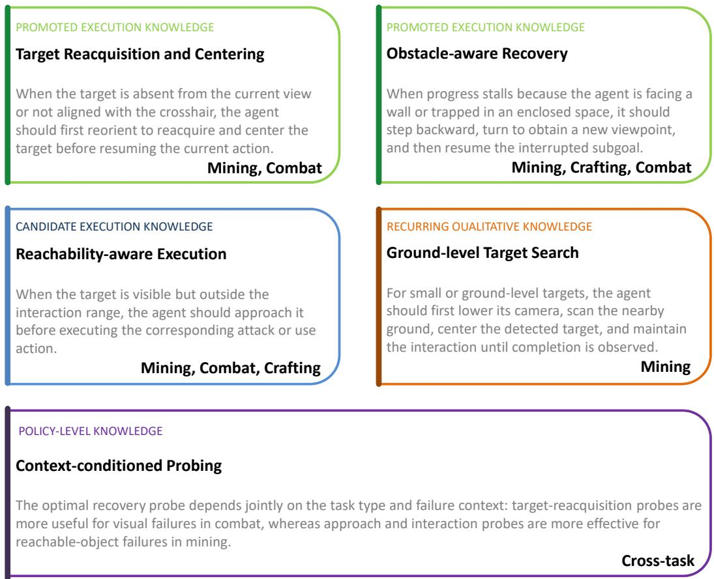  
Figure 5: Representative execution knowledge acquired by KPHarness. Promoted recovery strategies (green), candidate knowledge (blue), recurring qualitative patterns (orange), and contextconditioned probing knowledge (purple) connect task and failure contexts to reusable interventions across mining, combat, and crafting.

Paired Proposal Validation. We compare every candidate $\widetilde { H } _ { k }$ with its incumbent $H _ { k }$ through paired execution in the MineStudio sandbox. Both conditions use the same task configuration, frozen VLA checkpoint, decoding settings, interaction budget, and evaluation seed. Candidate selection prioritizes task completion, with progress, reward, step efficiency, and absence of regression as secondary criteria.

The two conditions start from isolated copies of the same episodic memory and probing-policy state. Memory updates and probing-policy writeback are disabled during evaluation, preventing execution order from affecting the comparison. If the candidate does not improve over the incumbent, it is rejected and $H _ { k + 1 } = H _ { k }$ . Otherwise, it is accepted, $H _ { k + 1 } = \tilde { H } _ { k }$ , and its trigger, intervention, evidence, and outcome form a candidate knowledge record.

Cross-Seed Verification and Knowledge Transfer. Accepted candidates are subsequently evaluated using a disjoint holdout seed. The holdout result does not alter the original paired acceptance decision or trigger further modification of that candidate; it provides separate evidence of cross-seed transfer. We report an HO-win when the accepted candidate outperforms its seed harness by the required margin on the holdout seed.

An accepted recovery is promoted to transferable knowledge when it obtains holdout support or is successfully reused on another task. Promoted knowledge enters the shared knowledge bank and becomes a candidate for future knowledge probing. Separate learning rollouts, rather than paired or holdout evaluation, update and persist the contextual probing statistics.

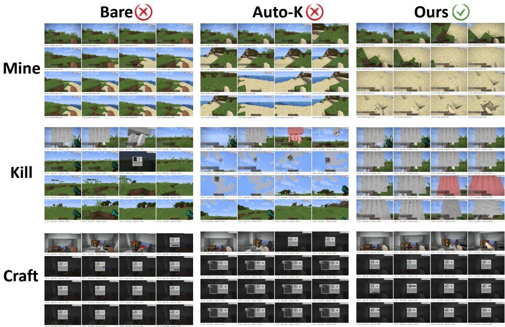  
Figure 6: Qualitative comparisons on mining, combat, and crafting tasks using the same frozen VLA. In these examples, Bare and Auto-K fail, while KPHarness uses adaptive probing to identify and test applicable recovery knowledge before completing the task.

The resulting evolution cycle is

$H _ { k }$ −→ adaptive action and knowledge probing −→ failure attribution $\xrightarrow { } \tilde { H } _ { k }$ ，

$( H _ { k } , \widetilde { H } _ { k } )$ −→ paired sandbox validation $\xrightarrow { } H _ { k + 1 }$

A rejected proposal leaves the harness and persistent state unchanged. An accepted proposal updates the harness, while separately validated recoveries and probing statistics support subsequent tasks.

Final Harness Evaluation. After evolution, we freeze the selected harness, knowledge bank, and probing statistics and replay the complete 149-task OpenHA evaluation set. The 39 tasks originally solved by Bare and the 110 tasks in the Bare-failure adaptation subset are all included. No further harness search, memory writeback, or probing-policy update is allowed, although the frozen probing policy may still execute probes.

This final replay measures overall task coverage and checks whether the evolved harness preserves tasks already solved by the frozen actor. Because the replay includes tasks encountered during adaptation, it is reported as task coverage rather than generalization to an unseen task split; disjoint holdout seeds provide a separate measure of cross-seed robustness.

## F QUALITATIVE EXAMPLES

The advantage of KPHarness does not arise simply from executing additional probe actions. It comes from using probe outcomes to connect failure diagnosis, knowledge probing, harness adaptation, and cross-task knowledge accumulation. We illustrate this distinction by comparing Bare, Auto-K, and KPHarness on a sand-mining task under the same frozen VLA.

Bare Execution. Bare executes the original task instruction without an external recovery harness. When the policy loses the target, becomes trapped, or acts outside the effective interaction range, it must recover using only the information provided by the current prompting protocol. The failure is neither explicitly diagnosed nor converted into reusable execution knowledge. Bare therefore represents frozen execution without harness adaptation.

Table 9: Low-level Minecraft action space used by the frozen VLA. Multiple commands may be composed within the same action step.
<table><tr><td>Action</td><td>Execution semantics</td></tr><tr><td>mouseMove (dx, dy)</td><td>Move the camera horizontally and vertically. The values dx and dy determine the direction and magnitude of camera rotation.</td></tr><tr><td>mouseClick (left)</td><td>Attack the targeted entity or block. In an inventory GUI, pick up, place, or collect an item stack.</td></tr><tr><td>mouseClick(right)</td><td>Use the selected item, place a block, interact with the targeted object, or manipu- late an item in an inventory GUI.</td></tr><tr><td>mouseClick(middle)</td><td>Execute a middle-button mouse interaction.</td></tr><tr><td>keyPress(w)</td><td>Move forward.</td></tr><tr><td>keyPress(s)</td><td>Move backward.</td></tr><tr><td>keyPress(a)</td><td>Strafe left.</td></tr><tr><td>keyPress(d)</td><td>Strafe right.</td></tr><tr><td>keyPress (space)</td><td>Jump.</td></tr><tr><td>keyPress(e)</td><td>Open or close the inventory and the  $2 \times 2$  crafting grid.</td></tr><tr><td>keyPress(ESC)</td><td>Close the currently opened inventory or GUI.</td></tr><tr><td>keyPress(q)</td><td>Drop one item from the selected item stack.</td></tr><tr><td>keyPress(1-9)</td><td>Select the corresponding hotbar slot.</td></tr><tr><td></td><td>keyP ress (1eft . ct r1) Sprint during movement. When combined with q, drop the entire selected stack.</td></tr><tr><td></td><td>keyPress (1eft . shift) Move carefully or perform a modified inventory operation, such as transferring a stack between the inventory and hotbar.</td></tr><tr><td>no_op</td><td>Wait for one 50 ms action step without interacting with the environment.</td></tr></table>

Action composition. Commands can be composed within one action step, for example mouseMove(10,10) mouseClick(left) keyPress(w). Each VLA prediction contains exactly four semicolon-separated action steps: <actions> a1; a2; a3; a4 </actions>. Each step lasts 50 ms, yielding a 200 ms execution horizon per prediction.

Auto-K. Auto-K searches for and validates recovery knowledge, making it stronger than Bare. However, its probe actions are selected through predefined triggers or coverage rules rather than a policy learned from probe outcomes. Consequently, Auto-K may look up, look down, attack, or move forward, but the resulting feedback does not update which action or knowledge probe should be preferred under similar future failures.

This distinction is visible in the sand example. Auto-K executes eight probe actions, but records no knowledge-selection or bandit update:

$$
\mathtt { k n o w l e d g e \_ e v e n t s } = \varnothing , \qquad \mathtt { p r o b e \_ b a n d i t } = \varnothing , \qquad \mathtt { k n o w l e d g e \_ b a n d i t } = \varnothing .\tag{16}
$$

It continues to use the generic instruction “Gather sand from the desert” and a generic retry prompt. Its only relevant prior is reacquire\_and\_center, inherited from an earlier poppy task. Without failure-conditioned knowledge probing and task-specific specialization, Auto-K does not complete the task within the 100-turn interaction budget.

Closed-Loop Adaptation in KPHarness. KPHarness treats an action probe as an informationgathering intervention and a knowledge probe as an executable recovery hypothesis. Action-probe outcomes provide evidence about target loss, orientation error, insufficient reachability, or stalled progress. Conditioned on this evidence, the knowledge-probing policy selects a recovery strategy, which is specialized to the current task and tested through subsequent interaction. Immediate utility and delayed episode success then update the corresponding probing statistics.

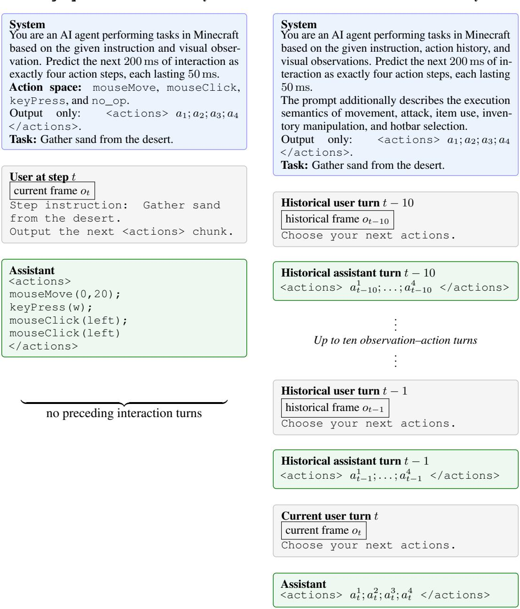  
Figure 7: Comparison of the two VLA prompting protocols. legacy performs stateless prediction from the current observation and task instruction, whereas mtv1 restores up to ten preceding observation–action turns. Both protocols predict four 50 ms low-level actions per call. System prompts are shortened for readability; complete action semantics are given in Table 9.

The online adaptation loop is

action probe → failure-context inference → knowledge probe

(17)

The resulting evidence may subsequently support a harness proposal, which is accepted or rejected through paired sandbox validation. Persistent probing statistics are updated during learning rollouts, not during paired or holdout evaluation, where writeback is disabled.

For the sand task, KPHarness loads backup\_and\_turn, reacquire\_and\_center, and the candidate approach\_and\_act. At decision turn 23, the context mine\_block:stall\_heavy selects backup\_and\_turn. At turn 24, the combined orientation+target\_loss+zero\_progress context selects reacquire\_and\_center. These general strategies are specialized into the task-specific instruction:

Look down, center the crosshair on a sand block, and continuously attack it.

The resulting harness completes the task in 29 decision turns, compared with the 100-turn failure of Auto-K. Following success, backup\_and\_turn and reacquire\_and\_center receive delayed credits of 0.8 and 1.0, respectively, allowing the experience to influence probing on subsequent tasks.

The three settings can therefore be summarized as

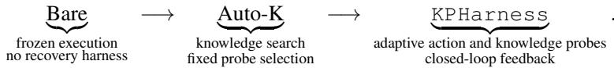

(18)

The key distinction is not whether probe actions are present, but whether their outcomes are used to test, specialize, and update reusable recovery knowledge. Because Auto-K and KPHarness also acquire different knowledge and task-specific prompts, this example illustrates their system-level behavior rather than isolating the causal effect of the probing policy alone.

## G THEORETICAL DERIVATION OF KNOWLEDGE–PROBING CO-EVOLUTION

This appendix develops the mathematical rationale for the probing and validation rules in KPHarness. We derive the immediate utility and delayed credit, characterize the transferregularized value estimator, motivate the UCB-inspired exploration term, and analyze paired harness validation. The estimation results are conditional on their stated assumptions and describe individual components of the evolving harness.

## G.1 CONTEXT-CONDITIONED PROBE SELECTION

Consider either the action-probing policy or the knowledge-probing policy. Let x denote its task and failure context, and let $v \in \mathcal { V } ( x )$ denote an available action probe or recovery strategy. Both policies use the following calculations while maintaining separate statistics. For a fixed context–candidate pair, define

$$
N = N _ { x , v } , \qquad Q = Q _ { x , v } = \sum _ { i = 1 } ^ { N } q _ { i } , \qquad N _ { x } = \sum _ { v ^ { \prime } \in \mathcal { V } ( x ) } N _ { x , v ^ { \prime } } ,\tag{19}
$$

where $q _ { i }$ is the utility assigned to a selection. When $N > 0$ , the local empirical mean is $\widehat { q } _ { x , v } = Q / N$ The cross-context mean ${ \bar { q } } _ { v }$ provides a shared reference value for candidate v.

The local estimation target is

$$
\mu _ { x , v } = \operatorname { \mathbb { E } } [ q \mid x , v ] .\tag{20}
$$

This quantity measures expected credited utility under the current execution conditions. For the statistical results below, we consider a fixed stage with stationary utility distributions and completed feedback. The operational system may update its harness and knowledge bank between stages.

## G.2 IMMEDIATE UTILITY AS SCALARIZED FEEDBACK

A selected probe produces task-progress change $\Delta p _ { t }$ , environment reward $r _ { t } .$ , observation novelty $n _ { t }$ interaction cost $C _ { t } .$ , and a failure indicator $F _ { t } = \mathbf { 1 } [ \mathrm { f a i l } _ { t } ]$ . A constrained local objective that motivates their combination is

$$
\begin{array} { r l } { \underset { \pi } { \operatorname* { m a x } } } & { \mathbb { E } _ { \pi } [ w _ { p } \Delta p _ { t } + w _ { r } r _ { t } + w _ { n } n _ { t } ] , } \\ { \mathrm { s u b j e c t ~ t o } } & { \mathbb { E } _ { \pi } [ C _ { t } ] \leq C _ { \operatorname* { m a x } } , \qquad \mathbb { E } _ { \pi } [ F _ { t } ] \leq F _ { \operatorname* { m a x } } . } \end{array}\tag{21}
$$

For nonnegative multipliers $\eta _ { c }$ and $\eta _ { f }$ , the Lagrangian is

$$
\begin{array} { r l } & { \mathcal { L } ( \pi , \eta _ { c } , \eta _ { f } ) = \mathbb { E } _ { \pi } \big [ w _ { p } \Delta p _ { t } + w _ { r } r _ { t } + w _ { n } n _ { t } - \eta _ { c } C _ { t } - \eta _ { f } F _ { t } \big ] } \\ & { \qquad + \eta _ { c } C _ { \operatorname* { m a x } } + \eta _ { f } F _ { \operatorname* { m a x } } . } \end{array}\tag{22}
$$

The final two terms are independent of the selected probe. Writing a fixed per-selection charge as $c _ { p } = \eta _ { c } C _ { t }$ and setting $w _ { f } = \eta _ { f }$ gives

$$
q _ { t } ^ { \mathrm { i m m } } = w _ { p } \Delta p _ { t } + w _ { r } r _ { t } + w _ { n } n _ { t } - c _ { p } - w _ { f } \mathbf { 1 } [ \mathrm { f a i l } _ { t } ] .\tag{23}
$$

This recovers the immediate utility used in the main text. The coefficients specify the relative value of progress, reward, novelty, interaction cost, and failed execution. KPHarness uses fixed coefficients rather than optimizing the dual variables in Equation 22. Their numerical values are design hyperparameters reported in the experimental setup.

For action probing, the novelty term rewards newly revealed interaction evidence. Knowledge probing sets $w _ { n } = 0$ and evaluates the progress and reward following application of the selected recovery strategy. This scalarization supplies a common update signal for heterogeneous outcomes; novelty serves as an operational proxy for informative interaction.

## G.3 DELAYED SUCCESS CREDIT AND STATISTICAL UPDATES

Let

$$
Y = R _ { \mathrm { s u c c } } \mathbf { 1 } [ \mathrm { S u c c } ( \tau , g ) ]\tag{24}
$$

be the terminal-success bonus. For a selection at timestep t, let $d _ { t }$ denote its nonnegative distance to terminal feedback on the credit-assignment clock. Define the terminal contribution at distance d recursively by

$$
G ( 0 ) = Y , \qquad G ( d + 1 ) = \gamma G ( d ) , \qquad 0 < \gamma \leq 1 .\tag{25}
$$

Repeated substitution yields $G ( d ) = \gamma ^ { d } Y$ , and hence

$$
q _ { t } ^ { \mathrm { d e l a y e d } } = R _ { \mathrm { s u c c } } \gamma ^ { d _ { t } } { \bf 1 } [ \mathrm { S u c c } ( \tau , g ) ] .\tag{26}
$$

Equivalently, when selection and termination are indexed by the same discounting clock, a terminal only reward sequence satisfies

$$
b _ { u } = 0 ( u < T ) , \qquad b _ { T } = Y , \qquad \sum _ { u = t } ^ { T } \gamma ^ { u - t } b _ { u } = \gamma ^ { T - t } Y .\tag{27}
$$

Under this indexing convention, $d _ { t } = T - t .$

The complete credited utility of a selection is

$$
q _ { t } = q _ { t } ^ { \mathrm { i m m } } + q _ { t } ^ { \mathrm { d e l a y e d } } .\tag{28}
$$

It combines local feedback with the discounted terminal outcome. At selection time, the statistics are updated as

$$
N _ { x _ { t } , v _ { t } } \gets N _ { x _ { t } , v _ { t } } + 1 , \qquad Q _ { x _ { t } , v _ { t } } \gets Q _ { x _ { t } , v _ { t } } + q _ { t } ^ { \mathrm { i m m } } .\tag{29}
$$

At episode completion, each recorded selection receives the additional update

$$
Q _ { x _ { t } , v _ { t } }  Q _ { x _ { t } , v _ { t } } + q _ { t } ^ { \mathrm { d e l a y e d } } .\tag{30}
$$

The count is incremented only once because both feedback terms belong to the same selection.   
Cross-context aggregates incorporate the same updates.

For repeated selections of a given $( x , v )$ within an episode, define the terminal eligibility

$$
e _ { x , v } = \sum _ { j : ( x _ { j } , v _ { j } ) = ( x , v ) } \gamma ^ { d _ { j } } .\tag{31}
$$

The total terminal update is then $Q _ { x , v }  Q _ { x , v } + Y e _ { x , v }$ , which is algebraically identical to summing the individual delayed bonuses.

Delayed credit records association with successful execution. It does not identify the causal contribution of an individual intervention. Persistent updates occur during learning rollouts; paired, holdout, and final frozen evaluations disable writeback.

## G.4 TRANSFER-REGULARIZED VALUE ESTIMATION

For sparse contexts, the local mean $Q / N$ can be noisy and is undefined when $N = 0$ . We estimate local utility by regularizing toward the current cross-context value $\bar { q } _ { v }$ :

$$
L ( \mu ) = \frac { 1 } { 2 } \sum _ { i = 1 } ^ { N } ( q _ { i } - \mu ) ^ { 2 } + \frac { \lambda } { 2 } ( \mu - \bar { q } _ { v } ) ^ { 2 } , \qquad \lambda > 0 .\tag{32}
$$

The first term fits local observations, and the second incorporates experience accumulated across contexts.

Proposition 1: regularized value estimate. Holding ${ \bar { q } } _ { v }$ fixed during minimization, the unique minimizer of Equation 32 is

$$
\widehat { \mu } _ { x , v } = \frac { Q _ { x , v } + \lambda \bar { q } _ { v } } { N _ { x , v } + \lambda } .\tag{33}
$$

Proof. Differentiating the objective gives

$$
\begin{array} { c } { { { \displaystyle { \frac { \partial L } { \partial \mu } } = \sum _ { i = 1 } ^ { N } ( \mu - q _ { i } ) + \lambda ( \mu - \bar { q } _ { v } ) } } } \\ { { { { } } } } \\ { { { } = ( N + \lambda ) \mu - Q - \lambda \bar { q } _ { v } . } } \end{array}\tag{34}
$$

The stationary condition therefore implies

$$
( N + \lambda ) \widehat { \mu } _ { x , v } = Q + \lambda \bar { q } _ { v } .\tag{35}
$$

Since $\partial ^ { 2 } L / \partial \mu ^ { 2 } = N + \lambda > 0$ , the stationary point is the unique global minimizer.

For $N > 0$ , this estimate is the convex combination

$$
\widehat { \mu } _ { x , v } = \frac { N } { N + \lambda } \widehat { q } _ { x , v } + \frac { \lambda } { N + \lambda } \bar { q } _ { v } .\tag{36}
$$

Thus λ is the effective weight of transferred experience. At $N = 0$ , the estimate equals the reference value $\bar { q } _ { v }$ . As local observations accumulate with fixed λ, their weight approaches one.

Gaussian interpretation. For an idealized Gaussian likelihood $q _ { i } \mid \mu \sim \mathcal { N } ( \mu , \sigma ^ { 2 } )$ and an independently specified prior $\mu \sim \mathcal N ( \bar { q } _ { v } , \tau ^ { 2 } )$ , the negative log posterior is, up to an additive constant,

$$
\frac { 1 } { 2 \sigma ^ { 2 } } \sum _ { i } ( q _ { i } - \mu ) ^ { 2 } + \frac { 1 } { 2 \tau ^ { 2 } } ( \mu - \bar { q } _ { v } ) ^ { 2 } .\tag{37}
$$

Multiplication by $\sigma ^ { 2 }$ recovers Equation 32 with $\lambda = \sigma ^ { 2 } / \tau ^ { 2 }$ . In KPHarness, the cross-context value is data-dependent, so the regularized optimization interpretation applies directly; the independentprior interpretation describes an idealized statistical model.

Proposition 2: bias–variance tradeoff of transfer. Suppose $N > 0$ is fixed, $q _ { i }$ are independent with mean $\mu$ and variance $\sigma ^ { 2 }$ , and the reference value m is fixed independently of these samples. Let $d = m - \mu$ . Then

$$
\mathrm { M S E } ( \widehat { \mu } ) = \frac { N \sigma ^ { 2 } + \lambda ^ { 2 } d ^ { 2 } } { ( N + \lambda ) ^ { 2 } } .\tag{38}
$$

The regularized estimator has smaller MSE than the local sample mean if and only if

$$
d ^ { 2 } < \sigma ^ { 2 } \left( \frac { 2 } { \lambda } + \frac { 1 } { N } \right) .\tag{39}
$$

Proof. Using $\textstyle { \widehat { \mu } } = ( \sum _ { i } q _ { i } + \lambda m ) / ( N + \lambda )$ gives

$$
\begin{array} { r } { \mathbb { E } [ \widehat { \mu } ] - \mu = \displaystyle \frac { \lambda ( m - \mu ) } { N + \lambda } , } \\ { \mathrm { V a r } ( \widehat { \mu } ) = \displaystyle \frac { N \sigma ^ { 2 } } { ( N + \lambda ) ^ { 2 } } . } \end{array}\tag{40}
$$

Adding squared bias and variance proves Equation 38. The unregularized sample mean has MSE $\sigma ^ { 2 } / N$ . Consequently,

$$
\begin{array} { c } { { \mathrm { M S E } ( \widehat { \mu } ) < \displaystyle \frac { \sigma ^ { 2 } } { N } \longleftrightarrow N \sigma ^ { 2 } + \lambda ^ { 2 } d ^ { 2 } < \displaystyle \frac { \sigma ^ { 2 } } { N } ( N + \lambda ) ^ { 2 } } } \\ { { \longleftrightarrow N \lambda ^ { 2 } d ^ { 2 } < 2 N \lambda \sigma ^ { 2 } + \lambda ^ { 2 } \sigma ^ { 2 } , } } \end{array}\tag{41}
$$

which gives Equation 39.

The proposition explains how related contexts can improve sparse local estimation: variance reduction outweighs transfer bias when the reference value is sufficiently close to the local mean. Its assumptions concern a fixed reference and sample count; a changing, data-dependent reference requires additional analysis.

## G.5 DERIVATION OF THE UCB-INSPIRED SELECTION SCORE

The exploration term follows the optimism principle underlying UCB (Auer et al., 2002), with decisions conditioned on task and failure context. The context-conditioned formulation is related to contextual bandits (Li et al., 2010).

Concentration of the local mean. Assume that completed utilities for a fixed $( x , v )$ are independent, stationary, and bounded in $[ a , b ]$ , with width $B = b - a > 0$ . For $N > 0$ , Hoeffding’s inequality gives

$$
\mathrm { P r } ( | \widehat { q } _ { x , v } - \mu _ { x , v } | \geq \epsilon ) \leq 2 \exp \left( - \frac { 2 N \epsilon ^ { 2 } } { B ^ { 2 } } \right) .\tag{42}
$$

Setting the right-hand side equal to $\delta \in ( 0 , 1 )$ yields

$$
\begin{array} { c } { { \displaystyle - \frac { 2 N \epsilon ^ { 2 } } { B ^ { 2 } } = \log ( \delta / 2 ) , } } \\ { { \displaystyle r _ { N } ( \delta ) = B \sqrt { \frac { \log ( 2 / \delta ) } { 2 N } } . } } \end{array}\tag{43}
$$

Thus the local mean lies within $r _ { N } ( \delta )$ of its expectation with probability at least $1 - \delta$

For a fixed finite set of M candidates, a simultaneous version follows by allocating

$$
\delta _ { v , n } = \frac { 6 \delta } { \pi ^ { 2 } M n ^ { 2 } } , \qquad n \geq 1 .\tag{44}
$$

Because $\begin{array} { r } { \sum _ { v = 1 } ^ { M } \sum _ { n = 1 } ^ { \infty } \delta _ { v , n } = \delta , } \end{array}$ , a union bound gives, simultaneously for all candidates and sample counts,

$$
\vert \widehat { q } _ { x , v , n } - \mu _ { x , v } \vert \leq B \sqrt { \frac { \log ( \pi ^ { 2 } M n ^ { 2 } / ( 3 \delta ) ) } { 2 n } }\tag{45}
$$

with probability at least $1 - \delta$ . Under these stationary sampling assumptions, the bound can be evaluated at an adaptively selected count.

Practical exploration bonus. Taking a confidence schedule $\delta _ { x } = ( 1 + N _ { x } ) ^ { - \alpha }$ , with $\alpha > 0$ and $N _ { x } \geq 1$ , gives

$$
r _ { N } ( \delta _ { x } ) = B \sqrt { \frac { \log { 2 } + \alpha \log ( 1 + N _ { x } ) } { 2 N } } ,\tag{46}
$$

which motivates the dependence $\sqrt { \log ( 1 + N _ { x } ) / N }$ . KPHarness adopts the smoothed bonus

$$
b ( x , v ) = \beta \sqrt { \frac { \log ( 1 + N _ { x } ) } { N _ { x , v } + 1 } } , \qquad \beta \geq 0 .\tag{47}
$$

The additive constants make the expression defined at zero visits. The coefficient $\beta$ controls the strength of exploration.

Combining Equation 33 with Equation 47 gives

$$
\mathrm { U C B } ( v \mid x ) = \frac { Q _ { x , v } + \lambda \bar { q } _ { v } } { N _ { x , v } + \lambda } + \beta \sqrt { \frac { \log ( 1 + \sum _ { v ^ { \prime } } N _ { x , v ^ { \prime } } ) } { N _ { x , v } + 1 } } .\tag{48}
$$

The policy selects

$$
v _ { t } \in \operatorname * { a r g m a x } _ { v \in \mathcal { V } ( x ) } \operatorname { U C B } ( v \mid x ) .\tag{49}
$$

The first term estimates utility using local and cross-context experience; the second favors less frequently selected candidates. At zero total visits, the exploration term is zero and selection is determined by reference values and tie-breaking.

Confidence interpretation with transfer. The regularized estimate satisfies the identity

$$
\begin{array} { l } { \displaystyle \mu _ { x , v } - \widehat { \mu } _ { x , v } = \frac { N } { N + \lambda } ( \mu _ { x , v } - \widehat { q } _ { x , v } ) } \\ { \displaystyle + \frac { \lambda } { N + \lambda } ( \mu _ { x , v } - \bar { q } _ { v } ) . } \end{array}\tag{50}
$$

On the concentration event in Equation 43, the triangle inequality gives

$$
| \mu _ { x , v } - \widehat { \mu } _ { x , v } | \leq \frac { N } { N + \lambda } r _ { N } ( \delta ) + \frac { \lambda } { N + \lambda } | \bar { q } _ { v } - \mu _ { x , v } | .\tag{51}
$$

This inequality remains valid for a data-dependent reference value. If $| \bar { q } _ { v } - \mu _ { x , v } | \ \leq \ D _ { x , v }$ is additionally known, a corresponding upper bound is

$$
U _ { x , v } ^ { \mathrm { c e r t } } = \widehat { \mu } _ { x , v } + \frac { N } { N + \lambda } r _ { N } ( \delta ) + \frac { \lambda } { N + \lambda } D _ { x , v } .\tag{52}
$$

Equation 48 uses a smoothed exploration bonus without explicitly estimating this transfer-bias term. We therefore describe the implemented rule as UCB-inspired. Its design is motivated by concentration, while the conditional bound above identifies the additional quantity required for a calibrated confidence interpretation.

## G.6 PAIRED HARNESS VALIDATION

Fix an incumbent harness $H _ { k }$ and a candidate $\widetilde { H } _ { k }$ . For an evaluation condition $( g , s )$ , define

$$
D ( g , s ) = J ( \widetilde { H } _ { k } ; g , s ) - J ( H _ { k } ; g , s ) , \qquad \Delta J _ { k } = \mathbb { E } [ D ( g , s ) ] .\tag{53}
$$

Here s indexes evaluation randomization, and both harnesses use the same task configuration, score, and initial external-state snapshot. For $m = | V _ { k } |$ paired conditions, the empirical improvement is

$$
\widehat { \Delta J } _ { k } = \frac { 1 } { m } \sum _ { ( g , s ) \in V _ { k } } \left[ J ( \widetilde { H } _ { k } ; g , s ) - J ( H _ { k } ; g , s ) \right] .\tag{54}
$$

For a candidate fixed independently of identically distributed evaluation draws, linearity of expectation gives

$$
\mathbb { E } [ \widehat { \Delta J } _ { k } ] = \frac { 1 } { m } \sum _ { i = 1 } ^ { m } \mathbb { E } [ D _ { i } ] = \Delta J _ { k } .\tag{55}
$$

The variance of a paired difference is

$$
\begin{array} { r l } { \mathrm { V a r } ( D ) = \mathrm { V a r } ( J _ { \mathrm { c a n d } } ) + \mathrm { V a r } ( J _ { \mathrm { i n c } } ) } \\ { - 2 \mathrm { C o v } ( J _ { \mathrm { c a n d } } , J _ { \mathrm { i n c } } ) . } \end{array}\tag{56}
$$

Positive covariance under shared task conditions reduces the variance relative to independent evaluation. Isolated external-state copies and disabled writeback prevent one condition from changing the persistent state used by the other.

Acceptance as an empirical decision. Let $\widehat { J } ( H )$ denote the mean score on the paired conditions. Charging an improvement margin $\epsilon _ { \mathrm { p a i r } }$ for replacing the incumbent gives

$$
H _ { k + 1 } \in \operatorname * { a r g m a x } _ { H ^ { \prime } \in \{ H _ { k } , \widetilde { H } _ { k } \} } \left[ \widehat { J } ( H ^ { \prime } ) - \epsilon _ { \mathrm { p a i r } } \mathbf { 1 } [ H ^ { \prime } = \widetilde { H } _ { k } ] \right] .\tag{57}
$$

With ties resolved in favor of the candidate, the candidate is selected exactly when

$$
\begin{array} { r } { \widehat { J } ( \widetilde { H } _ { k } ) - \epsilon _ { \mathrm { p a i r } } \geq \widehat { J } ( H _ { k } ) , } \end{array}\tag{58}
$$

or equivalently $\widehat { \Delta J } _ { k } \ge \epsilon _ { \mathrm { p a i r } }$ . Thus

$$
\phi _ { k + 1 } = \left\{ \begin{array} { l l } { \widetilde { \phi } _ { k } , } & { \widehat { \Delta J } _ { k } \geq \epsilon _ { \mathrm { p a i r } } , } \\ { \phi _ { k } , } & { \mathrm { o t h e r w i s e } . } \end{array} \right.\tag{59}
$$

Conditional statistical interpretation. Suppose $J \in [ A _ { J } , B _ { J } ]$ with width $W _ { J } = B _ { J } - A _ { J }$ , and the m paired differences are independent for a candidate fixed before evaluation. Then $D _ { i } \in [ - W _ { J } , W _ { J } ]$ ， and one-sided Hoeffding gives

$$
\mathrm { P r } \Big ( \widehat { \Delta J } _ { k } - \Delta J _ { k } \geq \epsilon \Big ) \leq \exp \left( - \frac { m \epsilon ^ { 2 } } { 2 W _ { J } ^ { 2 } } \right) .\tag{60}
$$

Consequently, with probability at least $1 - \delta$

$$
\Delta J _ { k } \ge \widehat { \Delta J } _ { k } - W _ { J } \sqrt { \frac { 2 \log ( 1 / \delta ) } { m } } .\tag{61}
$$

A positive lower bound would establish expected improvement under these assumptions. The implemented acceptance margin is an empirical criterion, and adaptive reuse of evaluation data requires additional statistical control. Holdout assessment provides separate evidence after acceptance and does not alter the original paired decision.

## G.7 EVIDENCE-CONDITIONED KNOWLEDGE SELECTION

For a fixed harness state, let a be an action probe, y the resulting evidence, and z the selected recovery knowledge. The two-stage selection process can be written as

$$
\pi ( a , z \mid x , K ) = \pi _ { a } ( a \mid x ) \int p ( y \mid x , a ) \pi _ { z } ( z \mid x , a , y , K ) \mathrm { d } y .\tag{62}
$$

For discrete evidence, the integral is replaced by a sum. Action probing changes the evidence available to knowledge selection. Execution feedback updates both selection policies, while validated recoveries expand $\kappa$

Proposition 3: value of diagnostic information. Consider an idealized diagnostic probe that has no execution cost and does not change the physical state. Let $F$ denote the hidden failure cause, let Z be a fixed finite set of recovery strategies, and let $u ( z , F )$ be their integrable utility. Define

$$
\begin{array} { l } { \displaystyle V _ { 0 } ( \boldsymbol { x } ) = \underset { z \in \mathcal { Z } } { \operatorname* { m a x } } \mathbb { E } [ u ( z , F ) \mid x ] , } \\ { \displaystyle V _ { 1 } ( \boldsymbol { x } ) = \mathbb { E } _ { y } \left[ \underset { z \in \mathcal { Z } } { \operatorname* { m a x } } \mathbb { E } [ u ( z , F ) \mid x , y ] \mid x \right] . } \end{array}\tag{63}
$$

Then $V _ { 1 } ( x ) \geq V _ { 0 } ( x )$

Proof. Let $z ^ { \star }$ maximize the objective defining $V _ { 0 } ( x )$ . For every observed $y ,$ the maximizing strategy performs at least as well in conditional expectation as retaining $z ^ { \star }$ . Therefore,

$$
\begin{array} { r } { V _ { 1 } ( x ) \geq \mathbb { E } _ { y } [ \mathbb { E } [ u ( z ^ { \star } , F ) \mid x , y ] \mid x ] } \\ { = \mathbb { E } [ u ( z ^ { \star } , F ) \mid x ] = V _ { 0 } ( x ) , } \end{array}\tag{64}
$$

where the equality follows from the law of iterated expectations.

Table 10: Computational cost of actor training, harness evolution, and evaluation. GPU-hours are not normalized across accelerator types. Values preceded by ≥ are conservative lower bounds reconstructed from retained artifacts.
<table><tr><td>Stage</td><td>Parallel GPUs</td><td>Training/interaction budget</td><td>Environment steps</td><td>Time accounting</td><td>GPU-hours</td></tr><tr><td>Cold-start SFT</td><td>16</td><td>16,200 updates</td><td></td><td>121.3 h wall-clock</td><td>1,940.3</td></tr><tr><td>GRPO post-training</td><td>32</td><td>400 updates</td><td></td><td>≥379.8 h cumulative active job time</td><td>≥12,155.0</td></tr><tr><td>Knowledge search and co-evolution</td><td>8</td><td>1,861 episodes</td><td>175,013</td><td>≥547.5 h summed worker time</td><td>≥547.5</td></tr><tr><td>Knowledge-probing ablation</td><td>8</td><td>440 episodes</td><td>41,777</td><td>124.6 h summed worker time</td><td>≥124.6</td></tr><tr><td>Frozen transfer evaluation</td><td>8</td><td>180 episodes</td><td>16,709</td><td>6.94 h job wall-clock</td><td>55.5</td></tr></table>

The proposition explains the role of diagnostic evidence in knowledge selection. Real probes incur costs, may change the state, and are followed by approximate decisions, so their realized value is evaluated through interaction. In KPHarness, this evaluation also changes future probe preferences and the available recovery knowledge, providing the feedback coupling underlying knowledge– probing co-evolution.

The regularized estimator and credit updates follow exactly from their specified objectives. The concentration and transfer results apply under the stated local sampling assumptions. Harness evolution, changing recovery policies, and pending terminal feedback can violate stationarity or complete observation. Accordingly, the analysis explains the components of KPHarness without asserting a global regret or monotonic-improvement guarantee for the full evolving system.

## H COMPUTATIONAL COST AND INTERACTION BUDGET

Our evaluation uses a two-stage trained VLA:

$$
\mathrm { Q w e n 3 - V L - 8 B } \xrightarrow { \mathrm { c o l d - s t a r t ~ S F T } } C _ { 1 6 2 0 0 } \xrightarrow { \mathrm { G R P O } } \pi _ { 4 0 0 } .
$$

The resulting GRPO checkpoint $\pi _ { 4 0 0 }$ is then frozen and shared by Bare, Fixed, Auto-K, and KPHarness. Thus, no method-specific gradient update is performed during knowledge search, adaptive probing, or evaluation. Nevertheless, both the upstream actor training and the subsequent closed-loop sandbox interaction incur substantial computational cost.

Cold-start supervised fine-tuning. The cold-start stage performs full-parameter supervised finetuning of the Qwen3-VL-8B actor using 16 GPUs. The GRPO stage is initialized from the cold-start checkpoint at step 16,200. At this checkpoint, cold-start training has completed 2.72 epochs and consumed 121.3 hours of wall-clock time, corresponding to approximately 1,940.3 GPU-hours.

GRPO post-training. Starting from the cold-start checkpoint $C _ { 1 6 2 0 0 } .$ , the actor is further posttrained with GRPO using 32 H800 GPUs: eight GPUs for generation and 24 GPUs for actor optimization, with actor data parallelism 12 and tensor parallelism 2. The final actor used in all experiments is checkpoint 400. The training underwent several infrastructure restarts. Summing the active job intervals recorded by TensorBoard up to checkpoint 400 gives at least 379.8 hours of cumulative 32-GPU job time, corresponding to at least 12,155 GPU-hours. This is a lower bound because launches that failed before writing training events are not observable in the retained logs.

Harness evolution and evaluation. After GRPO, the VLA is frozen. Harness evolution still requires repeated VLA inference and interaction with live Minecraft sandboxes. The major harness experiments use eight H800 GPUs, with one worker bound to each GPU. For these experiments, summed worker time aggregates elapsed time across single-GPU workers and therefore represents a serial-equivalent interaction cost rather than eight-GPU wall-clock time.

Across the post-training harness experiments, the retained artifacts contain 2,481 sandbox episodes, 233,499 environment steps, and 19,310 executed probe actions. Knowledge search additionally produces 831 recorded proposer responses and requires at least 1,654 external request attempts, with approximately 5.76 million provider-reported tokens. The request and token counts are also lower bounds because failed requests do not always return usage metadata.

The distinction between worker time and job wall-clock is important. For example, frozen transfer takes 6.94 hours on eight H800 GPUs, corresponding to 55.5 allocated GPU-hours, while its completed episodes account for 48.8 summed interaction hours. The remaining allocation is explained by model loading, sandbox initialization, synchronization, and worker imbalance. Similarly, the reported 547.5 hours for knowledge search is already summed across single-GPU workers and should not be multiplied by eight.

Overall, the complete pipeline requires at least 14.8K recorded GPU-hours, of which GRPO posttraining is the dominant component. Harness evolution is parameter-update-free but not computationfree: its cost is dominated by repeated VLA inference, sandbox interaction, candidate validation, and external proposer calls.

## I AI USE STATEMENT

We used an LLM for language polishing and for checking the consistency and completeness of mathematical notation. We also used Gemini-2.5-Flash through an API as the vision-language researcher and harness proposer in our experiments, as described in the methodology. Its proposals were accepted after sandbox execution and paired validation.

## J ETHICS STATEMENT

This work studies test-time harness evolution for a frozen vision–language–action model in the simulated Minecraft environment. It does not involve human subjects, personally identifiable information, or real-world deployment. All evaluations are conducted in controlled virtual environments. The method introduces additional computation through environment interaction, VLA inference, and multimodal researcher calls; we acknowledge the associated computational and energy costs and report the main resource requirements in the appendix. As with other adaptive agent systems, deployment in real-world environments may introduce additional safety and reliability considerations that are outside the scope of this work.

## K REPRODUCIBILITY STATEMENT

The paper and appendix report the VLA training configuration, evaluation protocols, probing and credit-assignment hyperparameters, harness search procedure, paired acceptance rule, low-level action space, and computational resources. We also provide the task configurations and scripts required to reproduce the reported experiments where permitted by the corresponding environments and model APIs. External model calls use the model identifiers and decoding settings specified in the experimental setup.

## L COMPUTATIONAL RESOURCES

SFT and GRPO training were conducted on NVIDIA H800 GPUs with 141 GB of memory per GPU. Policy evaluation, harness evolution, probing, and sandbox validation were performed on NVIDIA H800 GPUs with 80 GB of memory per GPU.