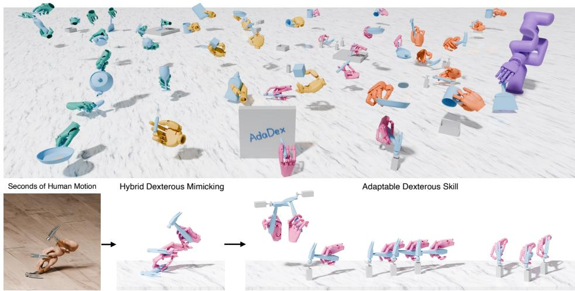
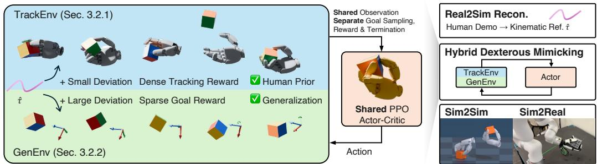
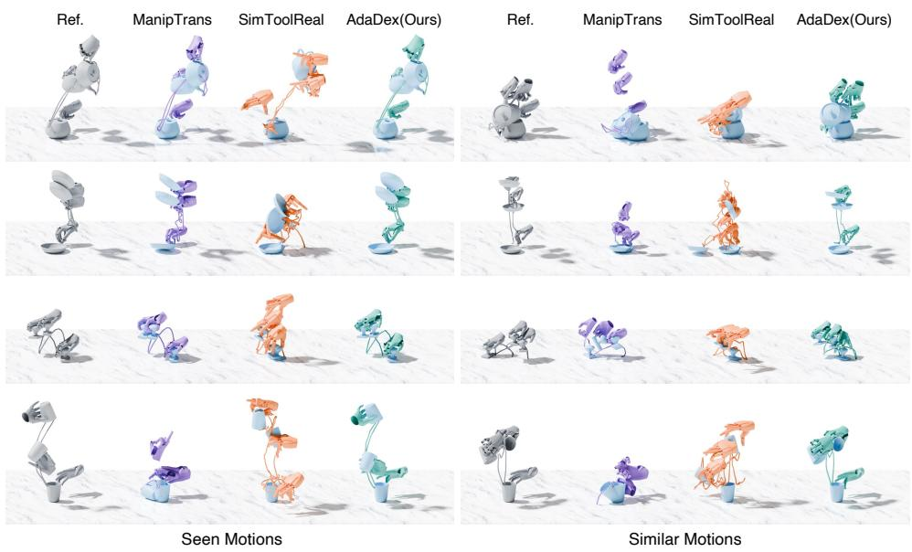
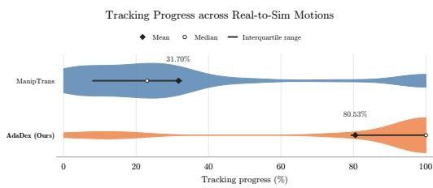
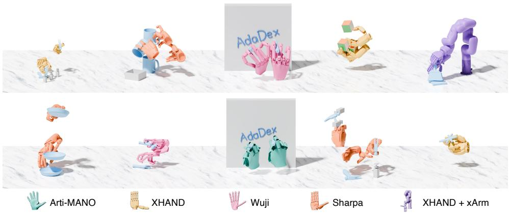
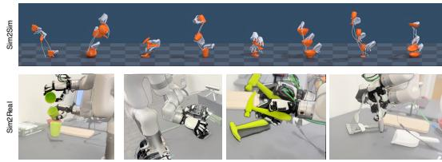
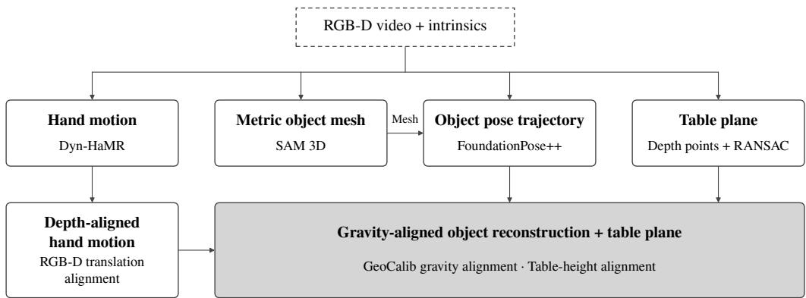
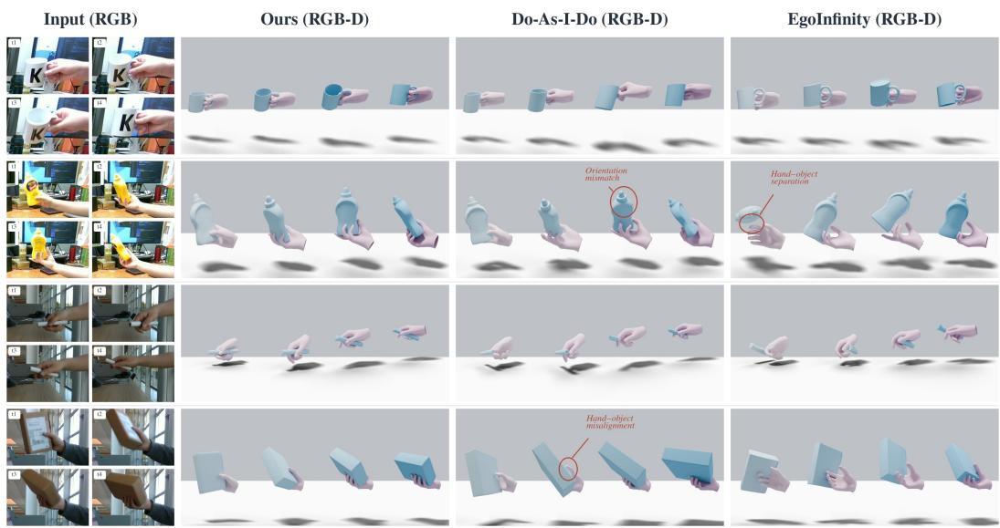

# LEARNING ADAPTABLE DEXTEROUS SKILLS VIA HY-BRID DEXTEROUS MIMICKING

Yuxuan Kuang1,2∗, Jiashun Wang1∗‡, Yixuan Sun1, Yufei Ye2, Sungjae Park1, Umar Iqbal2, Katerina Fragkiadaki1†, Shubham Tulsiani1†

1Carnegie Mellon University 2NVIDIA

Equal Contributions † Equal Advising ‡ Project Lead https://yuxuank.com/AdaDex

Figure 1: ADADEX learns diverse adaptable dexterous skills, such as functional grasping, object reposing, in-hand reorientation, and dynamic behaviors, from seconds of human motion.

## ABSTRACT

Dexterous multi-finger hands hold promise to unlock diverse skills like functional grasps, in-hand reorientation, and dynamic handover that the human-designed world assumes, yet existing learning recipes force a trade-off. Goal-reaching reinforcement learning generalizes to arbitrary object poses but, lacking any human prior, converges to unnatural and unreliable finger strategies; motion tracking reproduces human-like behavior from a single clip but cannot deviate from it. We present ADADEX, a goal-conditioned RL framework that turns a single hand-object trajectory of a few seconds—from mocap data or HOI reconstruction from in-the-wild RGB(D) video—into an adaptable dexterous skill. At the core of ADADEX is Hybrid Dexterous Mimicking: a shared policy is trained on two populations of massively parallel environments: motion tracking environments trained with dense motion tracking objective, which instill the human prior from human motion; and generalization environments with noised initial states and goals and a sparse object-success reward, which force the skill to work far off the reference. From seconds of human motion per skill, the resulting policies can learn diverse adaptable dexterous skills, such as functional grasping, object reposing, in-hand reorientation with finger gaiting, and dynamic behaviors like throw-and-catch. Our method outperforms baselines in terms of generalization and functionality, and we demonstrate transfer across simulators and to the real world. Project page: https://yuxuank.com/AdaDex.

## 1 INTRODUCTION

Our built environment is designed around the human hand: tools, handles, lids, and switches all presuppose a multi-fingered end-effector. Many of the skills this design affords, including functional tool use, in-hand reorientation, and dynamic behaviors such as throwing and catching, remain difficult for parallel-jaw grippers, which makes dexterous hands a natural embodiment for general-purpose manipulation. Despite this promise, learning dexterous skills is challenging. A multi-fingered hand must act in a high-dimensional continuous action space with 20+ degrees of freedom, and each skill must regulate contact forces, friction, and gravity across many simultaneous and often intermittent contacts under fast dynamics.

Two paradigms currently dominate learning-based dexterous manipulation, and they fail in complementary ways. Consider picking up a hammer lying on a table and striking a nail. Goal-reaching reinforcement learning (Kuang et al., 2026; Kedia et al., 2026) trains a single policy to move an object from any initial pose to any target pose, achieving broad coverage. Given target hammer poses, such a policy can bring the hammer to the nail. However, an object-centric reward specifies only where the object should end up, not how to get it there. Without explicit shaping, the policy could seize the hammer by its head or pinch it mid-shaft. These grasps might satisfy the goal but are not functional for hammering. Additionally, behaviors that require finger gaiting or regrasping, such as reorienting the hammer in hand from a lying-flat pickup to a striking grip with functional thumb bracing, are rarely discovered at all. As a result, the intricate motion the task demands remain largely out of reach. Motion tracking (Li et al., 2025; Mandi et al., 2025), in contrast, imitates a hand-object trajectory under dense supervision and thereby inherits the demonstrator’s functional grasp, in-hand regrasp, and swing. The resulting policy, however, is bound to the reference. If the nail sits at a different location or angle, the policy has no mechanism to adapt, and it typically requires the dense reference as input at inference time. In short, tracking supplies the human prior and goal reaching supplies generalization, but neither alone yields a skill that is both human-like and adaptable.

To that end, we present ADADEX, which treats the two paradigms as complements rather than alternatives. At the core of ADADEX is Hybrid Dexterous Mimicking, built on the observation that motion tracking and goal reaching are the same goal-conditioned problem: both ask a policy $\pi _ { \theta } ( a \mid s , g )$ to bring the object and wrist to a target pose $^ { g , }$ and differ only in where g comes from and how progress is rewarded. We therefore train one policy across two kinds of massively parallel environments: Tracking Environments (TrackEnv) initialize along a human hand-object reference τˆ, take goals from ${ \hat { \tau } } ,$ and apply a dense tracking reward on object, wrist, fingers, and contacts, teaching the policy how a human grasps, gaits, and releases. Generalization Environments (GenEnv) perturb the initialization with large noise, offset the goal by a random SE(3) transformation that can be far from any frame of ${ \hat { \tau } } _ { : }$ , and reward only sparse object success plus wrist guidance, with no finger terms. The two are mutually reinforcing. TrackEnv supplies the prior and the exploration: skills that sparse reward almost never discovers, such as throwing an object and catching it mid-flight, are learned under dense tracking and, because $g$ is the only channel of task information, become directly addressable by novel goals. GenEnv supplies the generalization: it forces success from offreference states toward off-reference goals so the skill can be adaptable to new scenarios and does not collapse into replaying one clip, while leaving the finger strategy to the human prior. Neither suffices alone; together they yield a skill that is both functional and adaptable. The recipe needs no discriminator, phase variable, or distillation stage, and the dense reference is not required at test time: at deployment the policy consumes only proprioception, object pose, object shape, and a goal pose, so it can be driven by any goal source, such as VLM Agent planner’s output waypoints.

We evaluate ADADEX on functional grasping of diverse tools and household objects, in-hand reorientation requiring finger gaiting and contact switching, and dynamic behaviors like throw-and-catch. Every skill is learned from a single human motion trajectory of a few seconds. The learned policies preserve the grasp type, in-hand manipulation, and dynamic behaviors from human motion, while generalizing to unseen trajectories and randomized object goals far from the reference, and achieve various downstream tasks with VLM Agents under multiple embodiments. Additionally, we demonstrate that our recipe can be embedded in between real-to-sim and sim-to-real, where a few seconds of human motion from in-the-wild RGB(D) videos is converted into a simulation-ready hand-object reference via our advanced HOI reconstruction pipeline. And then the reference is broadened into an adaptable skill in simulation as described above, and the resulting simulation rollout is transferred to a real arm-hand robotic system with real-time dynamics. In summary, our contributions are:

• Hybrid Dexterous Mimicking. A goal-conditioned RL formulation in which dense reference tracking and sparse goal reaching are trained as parallel environment types under a single shared actor, so that the human prior from tracking and the coverage from goal reaching reinforce one another. The formulation requires no dense reference input at inference.

• Adaptable dexterous skills. Human-like functional grasping, in-hand reorientation with finger gaiting, and dynamic behaviors like throw-and-catch, each learned from seconds of human motion and generalized to novel states and goals. The resulting adaptable skills can achieve various downstream tasks under diverse embodiments with VLM Agent planners.

• Learning from real-to-sim HOI motions. A reconstruction pipeline that converts a clip of inthe-wild human video into a simulation-ready hand-object reference, outperforming existing HOI reconstruction baselines. This pipeline allows us to learn adaptable dexterous skills from human data and transfer their simulation rollouts across simulators and to the real world.

## 2 RELATED WORK

## 2.1 DEXTEROUS SKILL LEARNING

Endowing robots with human-level, generalizable dexterity is a long-standing goal toward generalist agents that operate across diverse real-world scenarios. A large body of prior work formulates dexterous manipulation as contact-based optimization (Liu et al., 2020; 2021; Wang et al., 2022; Zhang et al., 2024; Yin & Abbeel, 2025), synthesizing static grasps and planning motions. These approaches are largely confined to grasping and, lacking closed-loop feedback, remain brittle under disturbances. An alternative line of work collects teleoperated demonstrations for behavior cloning (Wang et al., 2024a; Lin et al., 2025; Wen et al., 2025; Xu et al., 2025a). The resulting policies are bound to the distribution of in-domain demonstrations and generalize poorly; moreover, existing teleoperation interfaces (e.g., gloves and exoskeletons) struggle to capture behaviors that demand high dexterity or dynamic motion. More recently, reinforcement learning (RL) has emerged as a promising route to generalizable dexterity. Task-specific methods have been developed for dexterous grasping (Wan et al., 2023; Lum et al., 2024; Singh et al., 2025) and in-hand reorientation (Qi et al., 2023; Wang et al., 2024b; Liu et al., 2025b), while two more general paradigms have gained traction: motion tracking (Liu et al., 2025a; Li et al., 2025; Mandi et al., 2025; Xu et al., 2025b; Liang et al., 2026; Li et al., 2026; Feng et al., 2026) and generalized goal reaching (Kuang et al., 2026; Kedia et al., 2026). Each paradigm exhibits a complementary limitation: motion tracking faithfully reproduces a reference but cannot generalize beyond it, whereas goal reaching handles arbitrary goals but yields motions that lack human-like functionality. Our method unifies the two so that they reinforce each other, learning adaptable dexterous skills that span functional grasping, in-hand manipulation, and dynamic behaviors from only seconds of human motion.

## 2.2 ROBOT LEARNING FROM HUMAN MOTION

Human data constitutes the most scalable source of supervision for robot learning, and human motion in particular has been widely exploited (Wu et al., 2023; Ye et al., 2023). Motion tracking has become the dominant recipe for humanoid control and loco-manipulation (Liao et al., 2026; Luo et al., 2026; Xie et al., 2026), and the same idea has been extended to dexterous manipulation (Liu et al., 2025a; Xu et al., 2025b; Lum et al., 2025; Liang et al., 2026; Li et al., 2026; Feng et al., 2026). These methods, however, typically offer limited generalization and require a dense reference trajectory as the goal at inference time. We are inspired by recent work on hybrid imitation learning, including HIL (Wang et al., 2026b) and GfR (Wang et al., 2026c), which relax this requirement, enabling humanoid parkour from sparse goals while still generalizing beyond the reference. Building on this insight, our method couples motion tracking with goal reaching RL to learn dexterous skills that are simultaneously human-like and generalizable from seconds of human motion.

## 3 METHOD

Our goal is to turn a single human hand-object trajectory τˆ of a few seconds into an adaptable dexterous skill that preserves the human’s manipulation strategy yet remains adaptable from novel scenarios that the reference never visited. We first formalize the problem as goal-conditioned reinforcement learning (RL) (§3.1). We then present the core contribution, Hybrid Dexterous Mimicking, which trains one policy on two populations of parallel environments: Tracking Environments that supply human prior through dense tracking rewards (§3.2.1), and Generalization Environments that supply generalization through sparse goal-reaching rewards on noised goals (§3.2.2). Finally, we describe how our method extends to real-to-sim and sim-to-real—how the reference is reconstructed from in-the-wild human videos (§B) and how the simulation rollout is transferred to hardware (§3.3).

  
Figure 2: Left: Hybrid Dexterous Mimicking is a goal-conditioned RL formulation in which dense reference tracking and sparse goal reaching are trained as parallel environment types under a single shared actor. Right: our method can learn adaptable dexterous skills with a single human motion reconstructed from video and transfer to an unseen simulator (MuJoCo) and the real world.

## 3.1 PROBLEM FORMULATION

Hand-object reference. We take a single hand-object interaction (HOI) reference

$$
\boldsymbol { \hat { \tau } } = \{ \hat { x } _ { t } ^ { w } , \hat { q } _ { t } ^ { h } , \hat { x } _ { t } ^ { o } \} _ { t = 1 } ^ { T } ,\tag{1}
$$

where $\hat { x } _ { t } ^ { w } \in \mathrm { S E } ( 3 )$ is the human wrist pose, $\hat { q } _ { t } ^ { h }$ are the MANO (Romero et al., 2022) hand parameters , $\hat { x } _ { t } ^ { o } \in \mathrm { S E } ( 3 )$ is the object pose, and $T$ is the number of frames, typically a few seconds at 60 Hz. Together with a watertight object mesh $O , { \hat { \tau } }$ is all the human motion our method receives. The reference may come from a motion-capture dataset or be reconstructed from an in-the-wild RGB(D) video (§3.3 and §B); the remainder of the pipeline is agnostic to its origin.

Goal-conditioned MDP. We cast dexterous manipulation as a goal-conditioned Markov Decision Process (MDP) $\mathcal { M } = ( \mathcal { S } , \mathcal { G } , \mathcal { A } , \mathcal { P } , r , \gamma )$ and learn a policy $\pi _ { \boldsymbol { \theta } } ( a _ { t } \mid s _ { t } , g _ { t } )$ . The state

$$
s _ { t } = \left( q _ { t } , \ x _ { t } ^ { w } , \ \dot { x } _ { t } ^ { w } , \ x _ { t } ^ { o } , \ \mathrm { B P S } ( O ) \right)\tag{2}
$$

consists of joint positions $q _ { t } ,$ , robot wrist pose $x _ { t } ^ { w } \in \mathrm { S E } ( 3 )$ and its linear and angular velocity $\dot { x } _ { t } ^ { w }$ object pose $x _ { t } ^ { o } \in \mathrm { S E } ( 3 )$ , and a fixed-size shape code given by Basis Point Set (BPS) distances to the object mesh (Prokudin et al., 2019). There is no privileged information in $s _ { t }$ . The goal

$$
g _ { t } = \left( g _ { t } ^ { w } , g _ { t } ^ { o } \right) \in \mathrm { S E } ( 3 ) \times \mathrm { S E } ( 3 )\tag{3}
$$

specifies a target wrist pose and target object pose. The action $a _ { t } \in \mathbb { R } ^ { 6 + n }$ consists of a 6-DoF delta wrist command and a n-DoF absolute finger command, which are filtered and served as PD targets.

A defining property of the formulation is that the dense reference τˆ is not needed at test time. It shapes initial states, goals, and rewards during training only. At test time the policy sees the state and a stream of goals, which can be different from what τˆ gives. Therefore, the same interface serves any goal source: the reference itself, a video planner, or waypoints generated by VLM Agents, to accomplish downstream tasks, as shown in §4.3.

## 3.2 HYBRID DEXTEROUS MIMICKING

Pure motion tracking and pure goal-reaching RL sit at opposite ends of a trade-off. Tracking a single clip (Li et al., 2025; Mandi et al., 2025) yields human-like, dexterous motion but a policy that can only replay that clip. Goal-reaching with a sparse success reward, as in Dex4D (Kuang et al., 2026)

and SimToolReal (Kedia et al., 2026), generalizes to arbitrary goals but has no prior on how to move and converges to unnatural, unreliable finger strategies, and it rarely discovers behaviors such as finger gaiting on its own. Hybrid Dexterous Mimicking, inspired by hybrid imitation for humanoid control (Wang et al., 2026b;c), obtains both by running the two settings as different environments that share one policy.

Concretely, a fraction $p$ of the $N$ parallel environments are Tracking Environments (TrackEnv) and the remaining $1 - p$ are Generalization Environments (GenEnv). The two differ only in their initialstate distribution, their goal distribution, and their reward; the observation space, the action space, and the actor $\pi _ { \theta }$ are identical. Because the goal $g _ { t }$ is the only channel through which task information reaches the actor, behaviors learned by tracking $\hat { \tau }$ in TrackEnvs become directly addressable by novel goals in GenEnvs. The joint objective is

$$
J ( \theta ) = p \cdot \mathbb { E } _ { \hat { \tau } , \mathrm { t r a c k } } \Big [ \sum _ { t } \gamma ^ { t } r _ { t } ^ { \mathrm { t r a c k } } \Big ] + ( 1 - p ) \cdot \mathbb { E } _ { \hat { \tau } \oplus \varepsilon , \mathrm { g e n } } \Big [ \sum _ { t } \gamma ^ { t } r _ { t } ^ { \mathrm { g e n } } \Big ] ,\tag{4}
$$

with one single policy $\pi _ { \theta }$ optimized with PPO (Schulman et al., 2017) on the union of rollouts.

Asymmetric critic. We give the critic privileged information during training (Pinto et al., 2018). Specifically, advantages are estimated with a single shared value network $V _ { \phi } ( s _ { t } , g _ { t } , s _ { t } ^ { \mathrm { p r i v } } , \hat { \tau } )$ that receives, in addition to the actor’s inputs, privileged simulator state $s _ { t } ^ { \mathrm { p r i v } }$ (contact forces, object velocity, etc.) and the HOI reference τˆ. In GenEnvs the reference input is zeroed $( \hat { \tau } \equiv 0 )$ since there is no reference to track and the value must be inferred from the goal alone. The presence or absence of τˆ therefore also lets one critic differentiate two environments without any explicit task flag.

## 3.2.1 TRACKING ENVIRONMENTS (TRACKENV)

Tracking environments teach the policy the human prior: how to approach the object, which grasp to use, how to gait fingers, and when to release.

Reference state initialization and goal sampling. Each episode samples a reference frame $t _ { 0 }$ from $\{ 1 , 2 , \ldots , T \}$ and initializes hand joints, wrist pose, and object pose from $\hat { \tau } _ { t _ { 0 } }$ with small pose noise, so that every phase of the motion is learned in parallel rather than sequentially. The goal at time t is read directly from the reference with a short look-ahead $k \colon$

$$
\begin{array} { r } { g _ { t } = \left( \hat { x } _ { t + k } ^ { w } , \hat { x } _ { t + k } ^ { o } \right) . } \end{array}\tag{5}
$$

After k steps, the goal will be sampled again with a new look-ahead.

Dense tracking reward. The reward is a weighted sum of exponentiated tracking errors plus a contact term and a regularizer:

$$
r _ { t } ^ { \mathrm { t r a c k } } = \sum _ { i } w _ { i } \exp \big ( - \| e _ { t } ^ { i } \| ^ { 2 } / \sigma _ { i } ^ { 2 } \big ) + r _ { t } ^ { \mathrm { c o n t a c t } } + r _ { t } ^ { \mathrm { r e g } } ,\tag{6}
$$

with errors on object position $e _ { t } ^ { o , \mathrm { p } }$ and rotation $e _ { t } ^ { o , \mathrm { R } }$ , wrist position $e _ { t } ^ { w , \mathrm { p } }$ and rotation $e _ { t } ^ { w , \mathrm { R } }$ , and MANO link positions $\bar { e } _ { t } ^ { \mathrm { { l i n k } } }$

The object reward term has the highest weight: they define where the object should ${ \bf g 0 }$ and task success. The hand reward term carries the human prior: approach direction, grasp type, finger gaiting, and release timing. The contact term $r _ { t } ^ { \mathrm { c o n t a c t } }$ rewards simulated fingertip contacts derived from the HOI reference based on fingertip-object distance. The regularizer $r _ { t } ^ { \mathrm { r e g } }$ penalizes action rate, torque, joint-limit violations, and table penetration.

Adaptive sampling and termination. Initial reference frames $t _ { 0 }$ are grouped into $B$ bins along the motion. We maintain an exponential moving average of the tracking success $s _ { b }$ of each bin and perform reference state initialization on bins with probability $P ( b ) \propto \bar { \sigma } ( s _ { b } ) + \epsilon$ , where $\sigma ( \cdot )$ is the success variance, so that both solved and hopeless bins receive little probability and the frontier receives most, facilitating learning harder initial states. Episodes terminate as soon as any tracked quantity (object pose, wrist pose, or MANO link position) leaves a tight band around ${ \hat { \tau } } ,$ or when the object falls or leaves the workspace. Strict termination forces the policy to follow the reference closely to survive, which is what makes the tracking signal a faithful prior.

## 3.2.2 GENERALIZATION ENVIRONMENTS (GENENV)

Generalization environments stretch the skill off the reference. They pose the same problem as Dex4D (Kuang et al., 2026) and SimToolReal (Kedia et al., 2026), goal-reaching with object-centric reward, which alone produces unnatural finger strategies; here that problem is solved by an actor that is simultaneously constrained to the manifold of human-like behavior by TrackEnvs.

Noised initialization and goal sampling. Episodes also use reference state initialization as Track-Envs, but $t _ { 0 } \sim \mathcal { U } \{ 1 . . T \}$ is sampled uniformly without adaptive sampling, with much larger noise on object and hand pose, so initial states lie far from τˆ. Goals are drawn by perturbing a k-step look-ahead reference frame in SE(3):

$$
\begin{array} { r } { g _ { t } = \big ( \hat { x } _ { t + k } ^ { w } \oplus \varepsilon , \hat { x } _ { t + k } ^ { o } \oplus \varepsilon \big ) , } \end{array}\tag{7}
$$

$$
\begin{array} { r } { \varepsilon = ( \delta _ { \mathrm { p } } , \delta _ { \mathrm { R } } ) , \qquad \delta _ { \mathrm { p } } \sim \mathcal { U } ( - \Delta _ { \mathrm { p } } , \Delta _ { \mathrm { p } } ) ^ { 3 } , \qquad \delta _ { \mathrm { R } } = \mathrm { E x p } \big ( \mathcal { U } ( - \Delta _ { \mathrm { R } } , \Delta _ { \mathrm { R } } ) ^ { 3 } \big ) , } \end{array}\tag{8}
$$

where $\oplus$ denotes transform composition in $\operatorname { S E } ( 3 )$ . The noise magnitudes $\Delta _ { \mathrm { p } } , \Delta _ { \mathrm { R } }$ can be large: the goal does not need to lie near any reference frame. Once the goal is reached, a new goal is sampled from perturbing a new look-ahead frame, so a single episode chains several transitions.

Sparse object-centric reward with dense wrist guidance. The GenEnv reward consists of sparse object success plus wrist guidance and regularizers:

$$
r _ { t } ^ { \mathrm { g e n } } = \mathbb { 1 } \Big [ \| p _ { t } ^ { o } - g _ { t } ^ { o , \mathrm { p } } \| < \delta _ { \mathrm { p } } ^ { \prime } \wedge \angle \big ( R _ { t } ^ { o } , g _ { t } ^ { o , \mathrm { R } } \big ) < \delta _ { \mathrm { R } } ^ { \prime } \Big ] + r _ { t } ^ { \mathrm { w r i s t } } + r _ { t } ^ { \mathrm { r e g } } .\tag{9}
$$

The sparse object success indicator defines the task. The dense wrist-tracking term $r _ { t } ^ { \mathrm { w r i s t } }$ , of the same exponentiated form as in Eq. 6, gives functional guidance toward $g ^ { w }$ . There are no finger terms: how to get the object to the goal is left entirely to the prior learned in TrackEnvs. GenEnv episodes terminate when the object is too far away from the goal, when a goal is not reached within its time budget, or when the wrist stays too far from the object for too long. More details on reward shaping and termination are in §C.

Why the policy generalizes. The policy could generalize from the reference because we can apply large noises to states and goals. With only goal reaching objective, large goal noise $( \Delta _ { \mathrm { p } } , \Delta _ { \mathrm { R } } )$ would drive a goal reaching policy toward whatever finger strategy the optimizer finds first, which can often be unnatural. However, in our Hybrid Dexterous Mimicking, TrackEnvs continually pull the shared actor back onto the manifold of human-like behaviors, while GenEnvs ask it to stretch that manifold to new states and goals. Therefore, the policy can generalize and deviate from the reference whenever the goal calls for it, but behaves with human-like grasps, gaits, and release.

## 3.3 REAL-TO-SIM HOI RECONSTRUCTION AND SIM-TO-REAL ROBOT EXECUTION

We embed our Hybrid Dexterous Mimicking recipe in between real-to-sim and sim-to-real, converting everyday videos of human manipulation to physically grounded robot execution.

Real2Sim: from video to HOI reference. When τˆ is not available from a mocap dataset, we reconstruct it from a few seconds of RGB(D) video, recorded in the lab or in the wild (Fig. 7). We obtain a watertight object mesh O, per-frame object poses $\hat { x } _ { t } ^ { o }$ , and per-frame MANO hand parameters $\hat { q } _ { t } ^ { h }$ and wrist poses $\hat { x } _ { t } ^ { w }$ . These independent estimates are then aligned and optimized post hoc, including depth-based hand motion alignment, gravity axis estimation, and table plane alignment. The output is a HOI reference that is consistent and smooth enough to be tracked in simulation. Mocap datasets plug into the pipeline directly at this output. Through a series of careful design choices, our reconstruction pipeline outperforms existing HOI reconstruction baselines (Paliwal et al., 2026; Wang et al., 2026a) in both reconstruction accuracy and runtime efficiency, as shown in Table 3 and Fig. 8. More details can be found in §B.

Sim: retargeting and Hybrid Dexterous Mimicking. The HOI reference is kinematically retargeted to specific hand embodiments to obtain initial wrist and finger configurations for reference state initialization (more details in §D). Training then proceeds as in §3.2 in Isaac Gym (Makoviychuk et al., 2021) with massive parallel environments, with TrackEnvs and GenEnvs co-existing.

Table 1: Motion tracking performance on (i) seen motions and (ii) similar but unseen motions. Best and second-best mean values for each metric within each setting are bolded and underlined.
<table><tr><td>Method</td><td>Progress (%) ↑</td><td> $\bar { e } ^ { o , \mathrm { p } } \left( \mathrm { c m } \right) \downarrow$ </td><td> $\bar { e } ^ { o , { \mathrm { R } } } ( ^ { \circ } ) \downarrow$ </td><td> $\bar { e } ^ { w , \mathrm { p } } \left( \mathrm { c m } \right) \downarrow$ </td><td> $\bar { e } ^ { w , \mathrm { R } } ( ^ { \circ } ) \downarrow$ </td></tr><tr><td colspan="6">Setting (i): seen (trained) motions</td></tr><tr><td>ManipTrans</td><td> $3 5 . 2 0 \pm 2 9 . 7 1$ </td><td> $1 3 . 6 9 \pm 1 6 . 1 1$ </td><td> $4 1 . 6 1 \pm 4 0 . 9 7$ </td><td> $4 5 . 5 5 \pm 6 5 . 2 8$ </td><td> $5 5 . 2 2 \pm 4 4 . 0 3$ </td></tr><tr><td>SimToolReal</td><td> $9 . 7 2 \pm 5 . 4 4$ </td><td> $2 2 . 1 5 \pm 1 8 . 3 2$ </td><td> $5 3 . 5 6 \pm 2 6 . 7 7$ </td><td> $2 1 . 4 3 \pm 9 . 7 9$ </td><td> $6 5 . 3 0 \pm 2 1 . 2 5$ </td></tr><tr><td>w/o TrackEnv</td><td> $8 . 4 5 \pm 4 . 9 8$ </td><td> $3 4 . 1 0 \pm 2 0 . 3 8$ </td><td> $7 6 . 6 4 \pm 3 1 . 7 2$ </td><td> $3 . 6 5 \pm 1 . 8 1$ </td><td> $4 2 . 5 2 \pm 2 5 . 2 3$ </td></tr><tr><td>w/o GenEnv</td><td> $\mathbf { 9 7 . 4 7 \pm 8 . 4 0 }$ </td><td> ${ \bf 0 . 6 2 \pm 0 . 2 9 }$ </td><td> $\mathbf { 2 . 2 4 \pm 0 . 7 9 }$ </td><td> $\mathbf { 2 . 7 6 \pm 0 . 5 1 }$ </td><td> ${ \bf 8 . 1 6 \pm 4 . 7 3 }$ </td></tr><tr><td>ADADEX</td><td> $9 6 . 7 4 \pm 6 . 2 1$ </td><td> $\underline { { 0 . 7 2 \pm 0 . 3 2 } }$ </td><td> $\underline { { 4 . 1 6 \pm 1 . 1 9 } }$ </td><td> $2 . 8 2 \pm 0 . 6 1$ </td><td> $\underline { { 1 1 . 4 5 } } \pm 5 . 2 6$ </td></tr><tr><td colspan="6">Setting (ii): similar but unseen motions</td></tr><tr><td>ManipTrans</td><td> $7 . 2 8 \pm 6 . 5 7$ </td><td> $3 7 . 9 5 \pm 2 0 . 6 7$ </td><td> $8 8 . 4 9 \pm 2 6 . 8 1$ </td><td> $2 5 6 . 5 0 \pm 1 9 9 . 1 9$ </td><td> $1 1 4 . 5 3 \pm 2 1 . 4 0$ </td></tr><tr><td>SimToolReal</td><td> $1 3 . 6 8 \pm 1 7 . 8 8$ </td><td> $1 9 . 8 0 \pm 1 6 . 2 0 $ </td><td> $5 0 . 4 5 \pm 2 5 . 8 5$ </td><td> $2 4 . 3 4 \pm 1 0 . 4 4$ </td><td> $9 3 . 5 2 \pm 3 3 . 7 8$ </td></tr><tr><td>w/o TrackEnv</td><td> $9 . 6 2 \pm 1 7 . 7 1$ </td><td></td><td></td><td> ${ \bf 1 4 . 2 4 \pm 8 . 1 1 }$ </td><td></td></tr><tr><td>w/o GenEnv</td><td> $3 1 . 7 5 \pm 3 1 . 2 3 $ </td><td> $2 5 . 7 7 \pm 1 6 . 9 2$ </td><td> $6 3 . 1 5 \pm 3 5 . 0 6$   $5 2 . 1 3 \pm 3 8 . 8 4$ </td><td> $3 1 . 1 3 \pm 2 3 . 2 8$ </td><td> $7 9 . 2 6 \pm 3 8 . 8 4$   $\overline { { 8 7 . 9 1 \pm 3 3 . 9 8 } }$ </td></tr><tr><td>ADADEX</td><td> $\mathbf { 8 0 . 0 2 \pm 2 6 . 0 1 }$ </td><td> $2 3 . 2 5 \pm 2 2 . 8 2$   ${ \bf 6 . 0 7 \pm 7 . 6 0 }$ </td><td> ${ \bf 1 5 . 8 3 \pm 1 2 . 9 3 }$ </td><td> $1 4 . 3 2 \pm 7 . 6 2$ </td><td> $\mathbf { 7 2 . 6 8 \pm 4 4 . 9 0 }$ </td></tr></table>

  
Figure 3: Qualitative comparisons. Trained on a single human motion, ADADEX can track seen and unseen motions naturally, while baselines struggle with generalization and functionality.

Sim2Real: from simulation to physically grounded robot execution. In simulation, we adopt system identifications, domain randomizations, and sim2sim to facilitate sim2real transfer. In the real world, we conduct both open-loop replay and closed-loop deployment. In open-loop settings (Liu et al., 2025a; Li et al., 2025; Pan et al., 2025; Paliwal et al., 2026), we replay the joint targets from simulation rollouts at original 1x speed (30Hz); and for closed-loop deployment, the policy takes real-time feedback from proprioception, Fast-FoundationStereo (Wen et al., 2026), and FoundationPose (Wen et al., 2024) in 30Hz. Our policies can generate smooth and physically plausible real robot rollouts. More details are in §4.4.

## 4 EXPERIMENTS

## 4.1 EVALUATION PROTOCOLS

Benchmark. We evaluate our method on reference motion clips over diverse objects and motions. For quantitative studies, we select 12 distinct objects from GRAB dataset (Taheri et al., 2020), with 3 distinct but similar motion clips for each object, where each object-specific policy is only trained on one of the 3 motions, and we use the other two unseen motions as the test set. We also capture 9 casual videos and reconstruct their HOI reference as in §3.3 and §B with a RealSense D455 camera, to compare tracking performance on real-to-sim reconstructed HOI motions. Quantitative experiments are conducted on a 22-DoF Arti-Mano floating hand with 6-DoF wrist control, and we also demonstrate transfer to other robot hands and arm+hand setting in §4.3 and §4.4.

Table 2: Setting (iii): random goal reaching comparison over the 12 GRAB objects.
<table><tr><td>Method</td><td>Progress (%) ↑</td><td>SR (%) ↑</td></tr><tr><td>ManipTrans</td><td> $1 . 7 2 \pm 2 . 2 7$ </td><td> $0 . 0 0 \pm 0 . 0 0$ </td></tr><tr><td>SimToolReal</td><td> $\underline { { 4 4 . 6 0 \pm 3 1 . 5 9 } }$ </td><td> $\mathbf { 3 1 . 7 1 \pm 3 2 . 5 6 }$ </td></tr><tr><td>w/o TrackEnv</td><td> $4 . 3 4 \pm 7 . 3 8$ </td><td> $1 . 4 3 \pm 3 . 5 8$ </td></tr><tr><td>w/o GenEnv</td><td> $1 4 . 5 3 \pm 9 . 2 2$ </td><td> $0 . 5 2 \pm 1 . 0 3$ </td></tr><tr><td>ADADEX</td><td> ${ \bf 5 1 . 8 0 \pm 2 1 . 8 0 }$ </td><td> $2 7 . 0 8 \pm 1 7 . 4 1$ </td></tr></table>

  
Figure 4: Setting (iv): comparison on tracking real-to-sim HOI motions.

Baselines. We compare our method with motion tracking baseline ManipTrans (Li et al., 2025) and goal reaching baseline SimToolReal (Kedia et al., 2026), to demonstrate our method’s superiority on tracking accuracy and motion naturalness. For ours and ManipTrans, we train one policy per motion clip, and for SimToolReal without explicit hand tracking, we finetune on their checkpoint to train object-specific policies for each object. We also include two ablation baselines w/o TrackEnv and w/o GenEnv to verify the effectiveness of both environments in our training.

Experimental Setup. We evaluate our method and baselines on four settings: (i) motion tracking on seen motions, which are the 12 motions the policies directly train on (except SimToolReal); (ii) motion tracking on similar motions which are unseen to the policies (2 unseen motions per object); and (iii) random goal reaching similar to SimToolReal (Kedia et al., 2026), where each trial attempts 10 consecutive procedural object goals (6–10 cm translation and 25–45◦ rotation; a goal is reached at ≤5 cm and ≤20◦); (iv) motion tracking on the 9 real-to-sim HOI references from in-the-wild videos. Each motion is evaluated with 128 rollouts.

Metrics. For setting (i) and (ii) above, we use tracking progress as the main metric, which is the ratio of the first failure step to the full clip length, where failure is defined as $e ^ { o , \mathrm { p } } >$ 5 cm $\vee e ^ { o , \mathrm { R } } > 2 0 ^ { \circ }$ Additionally, we report mean object and wrist pose error $\bar { e } ^ { o , \mathrm { p } } , \bar { e } ^ { o , \mathrm { R } } , \bar { e } ^ { w , \mathrm { p } } , \bar { e } ^ { w , \mathrm { R } }$ along the full trajectory (without termination). For setting (iii), we report average goal reaching progress (percentage of consecutive goals reached) and success rate (SR) of reaching all 10 goals. For setting (iv), we report tracking progress for real-to-sim references since there is no groundtruth label. We also loosen the failure as exceeding the threshold for 10 consecutive steps due to imperfect reconstructions.

## 4.2 EVALUATION RESULTS AND ANALYSIS

We report evaluation results for setting (i) & (ii) in Table 1, setting (iii) in Table 2, and setting (iv) in Fig. 4. As shown in Table 1, ADADEX outperforms both ManipTrans, SimToolReal, and w/o TrackEnv by a large margin. It’s worth noting that although ours is slightly worse than w/o GenEnv (which only focuses on tracking/overfitting the seen motion) by less than 1% progress on trained motions, we perform much better on unseen motion tracking (80.02% vs. 31.75%), demonstrating GenEnv’s contribution on generalizing beyond the reference.

In the SimToolReal-like random goal reaching setting (iii) in Table 2, on goal reaching progress, we even outperform SimToolReal which is explicitly trained on this objective (+7.20%), and slightly worse in SR (−4.63%). From wrist tracking accuracy and qualitative comparisons in Fig. 3, it shows that SimToolReal struggles to grasp objects with diverse object geometries rather than the elongated tool objects they are pre-trained on, and exhibits unnatural grasp strategies without functionality, showing the effectiveness of our method which learns human priors from human motions.

We also show that our method is more capable than existing motion tracking method (Li et al., 2025) on tracking reconstructed real-to-sim HOI motions from in-the-wild videos in Fig. 4. Because reconstruction is imperfect and often has noise (e.g., finger and wrist drifting, object pose jittering), existing method cannot reliably track these motions, while our method can track these motions well due to better design choices such as sparse goal condition and adaptive sampling.

  
Figure 5: ADADEX learns diverse skills such as functional grasping, in-hand reorientation, dynamic throw-and-catch, and can achieve various downstream tasks with high dexterity. Our method also works on various robot hand embodiments and real arm-hand systems.

## 4.3 DOWNSTREAM TASKS WITH VLM CODING AGENTS

To demonstrate that our learned dexterous skills can be utilized in downstream tasks, we construct several task suites with several robot embodiments, as shown in Fig. 5. For each task, we use a high-level VLM Agent (Codex w/ GPT-6 Astra) for generating a set of waypoints $\{ g _ { t } = \big ( g _ { t } ^ { w } , \overline { { { \ g _ { t } ^ { o } } } } \big ) , t = 0 , 1 , \bar { 2 } , . . . \}$ for the skill. As shown in Fig. 5, our dexterous skills can perform diverse downstream tasks like hammering, pouring, sweeping, writing, etc. These tasks further demonstrate our skills’ adaptability and capability on dexterous functional grasping such as hammering, in-hand manipulation such as pen-spinning, and dynamic behaviors such as throw-andcatch. We envision a future where agentic robot systems shine, in which coding agents generate high-level plans in low-frequency, and adaptable dexterous \skills control the robots to execute the plans in high frequency.

## 4.4 SIM-TO-SIM AND SIM-TO-REAL TRANSFER

To demonstrate transfer across simulators and to the real world, we first adopt a standard simto-sim transfer: we successfully import policies trained in Isaac Gym (Makoviychuk et al., 2021) to MuJoCo (Todorov et al., 2012), zeroshot and closed-loop, as shown in Fig. 6.

In the real world, we tested on GRAB motions (apple, hammer, cup) and real-to-sim motions (sweep, two AprilCubes (Park & Agrawal, 2026)) to showcase dexterous functional grasping and in-hand manipulation. We conduct experiments in both open-loop and closed-loop

Figure 6: Sim-to-sim and sim-to-real transfer, in real time (1x speed, 30 Hz), demonstrating physical feasibility of the learned dexterous behaviors.

settings. In open-loop settings like Li et al. (2025); Pan et al. (2025); Liang et al. (2026); Paliwal et al. (2026), we open-loop replay the joint target generated by the policy in 1x speed (30 Hz) so that the real-time dynamics are preserved. In closed-loop settings, we estimate real-time object pose using FoundationPose (Wen et al., 2024) with object mesh, RGB, and Fast-FoundationStereo depth (Wen et al., 2026). At each control step, the policy is conditioned on RMA-encoded (Kuma et al., 2021) proprioceptive history, object BPS geometry, and current & goal object/wrist poses. The policy is inferenced in real time at 30Hz. As shown in Fig. 6, our method can perform functional grasping of a thin hammer, pouring of a cup, in-hand gait switching of a sweep, and in-hand reorientation of a cube, etc., showcasing real-world physical feasibility of our method.

## 5 CONCLUSIONS

In this work we present ADADEX, a framework for learning adaptable dexterous skills from second of human motion. At the core of ADADEX is Hybrid Dexterous Mimicking: a goal-conditioned reinforcement learning framework in which a single policy is trained simultaneously in tracking environments, which supply dense supervision from the human reference, and generalization environments, which pose noised, off-reference goals under a sparse object reward. Extensive experiment in simulation and the real world verify the effectiveness of our framework, demonstrating dexterous functional grasping, in-hand reorientation, and dynamic behaviors. We further showcase our policies performing various downstream tasks with different embodiments, highlighting our recipe’s generality and adaptability. Finally, we show transfer across simulators and to the real world.

## ACKNOWLEDGMENTS

We express our sincere gratitude to Kashu Yamazaki, Ayush Jain, Matthew Bronars, Yifan Hou, Ye Yuan, Zhengyi Luo, and Jiefeng Li for fruitful discussions, to Kashu Yamazaki and Tri Cao for hardware support, and to Qitao Zhao, Hanzhe Hu, and Lucas Wu for presentation feedback. This work is supported in part by gifts from Google and CISCO, NSF Award IIS-2442282, NSF Career award, and an Amazon robotics award.

## REFERENCES

Nicolas Carion, Laura Gustafson, Yuan-Ting Hu, Shoubhik Debnath, Ronghang Hu, Didac Suris Coll-Vinent, Chaitanya Ryali, Kalyan Vasudev Alwala, Haitham Khedr, Andrew Huang, et al. Sam 3: Segment anything with concepts. In International conference on learning representations, volume 2026, pp. 138846–138923, 2026.

Xingyu Chen, Fu-Jen Chu, Pierre Gleize, Kevin J Liang, Alexander Sax, Hao Tang, Weiyao Wang, Michelle Guo, Thibaut Hardin, Xiang Li, et al. Sam 3d: 3dfy anything in images. In Proceedings of the IEEE/CVF Conference on Computer Vision and Pattern Recognition, pp. 7220–7232, 2026.

Djork-Arne Clevert, Thomas Unterthiner, and Sepp Hochreiter. Fast and accurate deep network´ learning by exponential linear units (elus). arXiv preprint arXiv:1511.07289, 2015.

Yunhai Feng, Natalie Leung, Jiaxuan Wang, Lujie Yang, Haozhi Qi, and Preston Culbertson. A minimalist retargeting-guided reinforcement learning recipe for dexterous manipulation. arXiv preprint arXiv:2607.11874, 2026.

Kushal Kedia, Tyler Ga Wei Lum, Jeannette Bohg, and C Karen Liu. Simtoolreal: An object-centric policy for zero-shot dexterous tool manipulation. arXiv preprint arXiv:2602.16863, 2026.

Yuxuan Kuang, Sungjae Park, Katerina Fragkiadaki, and Shubham Tulsiani. Dex4d: Task-agnostic point track policy for sim-to-real dexterous manipulation. arXiv preprint arXiv:2602.15828, 2026.

Ashish Kumar, Zipeng Fu, Deepak Pathak, and Jitendra Malik. Rma: Rapid motor adaptation for legged robots. arXiv preprint arXiv:2107.04034, 2021.

Kailin Li, Puhao Li, Tengyu Liu, Yuyang Li, and Siyuan Huang. Maniptrans: Efficient dexterous bimanual manipulation transfer via residual learning. In 2025 IEEE/CVF Conference on Computer Vision and Pattern Recognition (CVPR), pp. 6991–7003. IEEE, 2025.

Puhao Li, Zeyuan Chen, Yingying Wu, Pengkun Wei, Yuyang Li, Tianyu Wang, Jiaxiao Shi, Mingrui Yu, Baoxiong Jia, Song-chun Zhu, et al. Towards human-level dexterous teleoperation. arXiv preprint arXiv:2607.11481, 2026.

Yutong Liang, Quanquan Peng, Ri-Zhao Qiu, and Xiaolong Wang. Contrack: Constrained hand motion tracking with adaptive trade-off control. arXiv preprint arXiv:2606.03177, 2026.

Qiayuan Liao, Takara E Truong, Xiaoyu Huang, Yuman Gao, Guy Tevet, Koushil Sreenath, and C Karen Liu. Beyondmimic: From motion tracking to versatile humanoid control via guided diffusion. Science Robotics, 11(117):eadx8924, 2026.

Toru Lin, Yu Zhang, Qiyang Li, Haozhi Qi, Brent Yi, Sergey Levine, and Jitendra Malik. Learning visuotactile skills with two multifingered hands. In 2025 IEEE International Conference on Robotics and Automation (ICRA), pp. 5637–5643. IEEE, 2025.

Min Liu, Zherong Pan, Kai Xu, Kanishka Ganguly, and Dinesh Manocha. Deep differentiable grasp planner for high-dof grippers. arXiv preprint arXiv:2002.01530, 2020.

Tengyu Liu, Zeyu Liu, Ziyuan Jiao, Yixin Zhu, and Song-Chun Zhu. Synthesizing diverse and physically stable grasps with arbitrary hand structures using differentiable force closure estimator. IEEE Robotics and Automation Letters, 7(1):470–477, 2021.

Xueyi Liu, Jianibieke Adalibieke, Qianwei Han, Yuzhe Qin, and Li Yi. Dextrack: Towards generalizable neural tracking control for dexterous manipulation from human references. arXiv preprint arXiv:2502.09614, 2025a.

Xueyi Liu, He Wang, and Li Yi. Dexndm: Closing the reality gap for dexterous in-hand rotation via joint-wise neural dynamics model. arXiv preprint arXiv:2510.08556, 2025b.

Tyler Ga Wei Lum, Martin Matak, Viktor Makoviychuk, Ankur Handa, Arthur Allshire, Tucker Hermans, Nathan D Ratliff, and Karl Van Wyk. Dextrah-g: Pixels-to-action dexterous arm-hand grasping with geometric fabrics. arXiv preprint arXiv:2407.02274, 2024.

Tyler Ga Wei Lum, Olivia Y Lee, C Karen Liu, and Jeannette Bohg. Crossing the humanrobot embodiment gap with sim-to-real rl using one human demonstration. arXiv preprint arXiv:2504.12609, 2025.

Zhengyi Luo, Ye Yuan, Tingwu Wang, Chenran Li, Fernando Castaneda, Sirui Chen, Zi-Ang Cao,˜ Jiefeng Li, David Minor, Qingwei Ben, et al. Sonic: Supersizing motion tracking for natural humanoid whole-body control. Science Robotics, 11(117):eaed4592, 2026.

Viktor Makoviychuk, Lukasz Wawrzyniak, Yunrong Guo, Michelle Lu, Kier Storey, Miles Macklin, David Hoeller, Nikita Rudin, Arthur Allshire, Ankur Handa, et al. Isaac gym: High performance gpu-based physics simulation for robot learning. arXiv preprint arXiv:2108.10470, 2021.

Zhao Mandi, Yifan Hou, Dieter Fox, Yashraj Narang, Ajay Mandlekar, and Shuran Song. Dexmachina: Functional retargeting for bimanual dexterous manipulation. arXiv preprint arXiv:2505.24853, 2025.

Bhawna Paliwal, Haritheja Etukuru, William Liang, Pieter Abbeel, Nur Muhammad Mahi Shafiullah, and Jitendra Malik. Do as i do: Dexterous manipulation data from everyday human videos. arXiv preprint arXiv:2606.19333, 2026.

Chaoyi Pan, Changhao Wang, Haozhi Qi, Zixi Liu, Homanga Bharadhwaj, Akash Sharma, Tingfan Wu, Guanya Shi, Jitendra Malik, and Francois Hogan. Spider: Scalable physics-informed dexterous retargeting. arXiv preprint arXiv:2511.09484, 2025.

Younghyo Park and Pulkit Agrawal. Aprilcube: 3d-printable fiducial targets for reliable 6-dof pose estimation, 2026. URL https://github.com/younghyopark/aprilcube.

Lerrel Pinto, Marcin Andrychowicz, Peter Welinder, Wojciech Zaremba, and Pieter Abbeel. Asymmetric actor critic for image-based robot learning. In Robotics: Science and Systems (RSS), 2018.

Rolandos Alexandros Potamias, Jinglei Zhang, Jiankang Deng, and Stefanos Zafeiriou. Wilor: Endto-end 3d hand localization and reconstruction in-the-wild. In 2025 IEEE/CVF Conference on Computer Vision and Pattern Recognition (CVPR), pp. 12242–12254. IEEE, 2025.

Sergey Prokudin, Christoph Lassner, and Javier Romero. Efficient learning on point clouds with basis point sets. In 2019 IEEE/CVF International Conference on Computer Vision Workshop (ICCVW), pp. 3072–3081. IEEE, 2019.

Haozhi Qi, Brent Yi, Sudharshan Suresh, Mike Lambeta, Yi Ma, Roberto Calandra, and Jitendra Malik. General in-hand object rotation with vision and touch. In Conference on Robot Learning, pp. 2549–2564. PMLR, 2023.

Javier Romero, Dimitrios Tzionas, and Michael J Black. Embodied hands: Modeling and capturing hands and bodies together. arXiv preprint arXiv:2201.02610, 2022.

John Schulman, Filip Wolski, Prafulla Dhariwal, Alec Radford, and Oleg Klimov. Proximal policy optimization algorithms. arXiv preprint arXiv:1707.06347, 2017.

Ritvik Singh, Karl Van Wyk, Pieter Abbeel, Jitendra Malik, Nathan Ratliff, and Ankur Handa. Endto-end rl improves dexterous grasping policies. arXiv preprint arXiv:2509.16434, 2025.

Omid Taheri, Nima Ghorbani, Michael J Black, and Dimitrios Tzionas. Grab: A dataset of whole body human grasping of objects. In European conference on computer vision, pp. 581–600. Springer, 2020.

Emanuel Todorov, Tom Erez, and Yuval Tassa. Mujoco: A physics engine for model-based control. In 2012 IEEE/RSJ international conference on intelligent robots and systems, pp. 5026–5033. IEEE, 2012.

Alexander Veicht, Paul-Edouard Sarlin, Philipp Lindenberger, and Marc Pollefeys. GeoCalib: Single-image Calibration with Geometric Optimization. In ECCV, 2024.

Weikang Wan, Haoran Geng, Yun Liu, Zikang Shan, Yaodong Yang, Li Yi, and He Wang. Unidexgrasp++: Improving dexterous grasping policy learning via geometry-aware curriculum and iterative generalist-specialist learning. In Proceedings of the IEEE/CVF International Conference on Computer Vision, pp. 3891–3902, 2023.

Chen Wang, Haochen Shi, Weizhuo Wang, Ruohan Zhang, Li Fei-Fei, and C Karen Liu. Dexcap: Scalable and portable mocap data collection system for dexterous manipulation. arXiv preprint arXiv:2403.07788, 2024a.

Gaotian Wang, Kejia Ren, Andrew Morgan, Yiting Chen, Howard H. Qian, Podshara Chanrungmaneekul, and Kaiyu Hang. Egoinfinity: A web-scale 4d hand-object interaction data engine for any-view robot retargeting and video-to-action robot learning. arXiv preprint arXiv:2606.17385, 2026a.

Jiashun Wang, Yifeng Jiang, Haotian Zhang, Chen Tessler, Davis Rempe, Jessica Hodgins, and Xue Bin Peng. Hil: Hybrid imitation learning for dynamic athletic control. ACM Transactions on Graphics, 2026b.

Jiashun Wang, M Eva Mungai, He Li, Jean Pierre Sleiman, Jessica Hodgins, and Farbod Farshidian. Generalizing from references using a multi-task reference and goal-driven rl framework. arXiv preprint arXiv:2602.20375, 2026c.

Jun Wang, Ying Yuan, Haichuan Che, Haozhi Qi, Yi Ma, Jitendra Malik, and Xiaolong Wang. Lessons from learning to spin” pens”. arXiv preprint arXiv:2407.18902, 2024b.

Ruicheng Wang, Jialiang Zhang, Jiayi Chen, Yinzhen Xu, Puhao Li, Tengyu Liu, and He Wang. Dexgraspnet: A large-scale robotic dexterous grasp dataset for general objects based on simulation. arXiv preprint arXiv:2210.02697, 2022.

Ruicheng Wang, Sicheng Xu, Yue Dong, Yu Deng, Jianfeng Xiang, Zelong Lv, Guangzhong Sun, Xin Tong, and Jiaolong Yang. Moge-2: Accurate monocular geometry with metric scale and sharp details. Advances in Neural Information Processing Systems, 38:35928–35959, 2026d.

Shibo Wang, Haonan He, Maria Parelli, Christoph Gebhardt, Zicong Fan, and Jie Song. Magichoi: Leveraging 3d priors for accurate hand-object reconstruction from short monocular video clips. In Proceedings of the IEEE/CVF International Conference on Computer Vision (ICCV), pp. 5957– 5968, October 2025a.

Zihan Wang, Jiashun Wang, Jeff Tan, Yiwen Zhao, Jessica Hodgins, Shubham Tulsiani, and Deva Ramanan. Crisp: Contact-guided real2sim from monocular video with planar scene primitives. arXiv preprint arXiv:2512.14696, 2025b.

Bowen Wen, Wei Yang, Jan Kautz, and Stan Birchfield. Foundationpose: Unified 6d pose estimation and tracking of novel objects. In 2024 IEEE/CVF Conference on Computer Vision and Pattern Recognition (CVPR), pp. 17868–17879. IEEE, 2024.

Bowen Wen, Shaurya Dewan, and Stan Birchfield. Fast-foundationstereo: Real-time zero-shot stereo matching. In Proceedings of the IEEE/CVF conference on computer vision and pattern recognition, pp. 7513–7524, 2026.

Ruoshi Wen, Guangzeng Chen, Zhongren Cui, Min Du, Yang Gou, Zhigang Han, Liqun Huang, Mingyu Lei, Yunfei Li, Zhuohang Li, et al. Gr-dexter technical report. arXiv preprint arXiv:2512.24210, 2025.

Yueh-Hua Wu, Jiashun Wang, and Xiaolong Wang. Learning generalizable dexterous manipulation from human grasp affordance. In Conference on Robot Learning, pp. 618–629. PMLR, 2023.

Tianyi Xie, Haotian Zhang, Jinhyung Park, Zi Wang, Bowen Wen, Jiefeng Li, Xueting Li, Qingwei Ben, Haoyang Weng, Yufei Ye, et al. Grail: Generating humanoid loco-manipulation from 3d assets and video priors. arXiv preprint arXiv:2606.05160, 2026.

Mengda Xu, Han Zhang, Yifan Hou, Zhenjia Xu, Linxi Fan, Manuela Veloso, and Shuran Song. Dexumi: Using human hand as the universal manipulation interface for dexterous manipulation. arXiv preprint arXiv:2505.21864, 2025a.

Sirui Xu, Yu-Wei Chao, Liuyu Bian, Arsalan Mousavian, Yu-Xiong Wang, Liangyan Gui, and Wei Yang. Dexplore: Scalable neural control for dexterous manipulation from reference scoped ex ploration. In Conference on Robot Learning, pp. 2184–2199. PMLR, 2025b.

Wenhao Yan and Jie Chu. FoundationPose++, March 2025. URL https://github.com/ teal024/FoundationPose-plus-plus.

Lujie Yang, Xiaoyu Huang, Zhen Wu, Angjoo Kanazawa, Pieter Abbeel, Carmelo Sferrazza, C Karen Liu, Rocky Duan, and Guanya Shi. Omniretarget: Interaction-preserving data generation for humanoid whole-body loco-manipulation and scene interaction. arXiv preprint arXiv:2509.26633, 2025.

Jianglong Ye, Jiashun Wang, Binghao Huang, Yuzhe Qin, and Xiaolong Wang. Learning continuous grasping function with a dexterous hand from human demonstrations. IEEE Robotics and Automation Letters, 8(5):2882–2889, 2023.

Zhao-Heng Yin and Pieter Abbeel. Lightning grasp: High performance procedural grasp synthesis with contact fields. arXiv preprint arXiv:2511.07418, 2025.

Zhengdi Yu, Stefanos Zafeiriou, and Tolga Birdal. Dyn-hamr: Recovering 4d interacting hand motion from a dynamic camera. In 2025 IEEE/CVF Conference on Computer Vision and Pattern Recognition (CVPR), pp. 27716–27726. IEEE, 2025.

Jialiang Zhang, Haoran Liu, Danshi Li, XinQiang Yu, Haoran Geng, Yufei Ding, Jiayi Chen, and He Wang. Dexgraspnet 2.0: Learning generative dexterous grasping in large-scale synthetic cluttered scenes. In 8th Annual Conference on Robot Learning, 2024.

  
Figure 7: Overview of our RGB-D hand-object reconstruction pipeline. Given an RGB-D video and camera intrinsics, we recover hand motion with Dyn-HaMR, reconstruct a metric object mesh with SAM 3D, and track its pose with FoundationPose++. A table plane is estimated from depth points using RANSAC. We align hand translations to the observed depth, then apply GeoCalibbased gravity alignment and table-height alignment to express the hand, object, and table in a shared world coordinate frame.

## A VIDEOS AND VISUALIZATIONS

Videos and visualization results can be found in our project page: https://yuxuank.com/AdaDex.

## B REAL2SIM: HOI RECONSTRUCTION

Real2Sim is an important problem and would boost the data generation for simulation training and sim2real (Wang et al., 2025b). Below we elaborate our real2sim HOI reconstruction pipeline.

## B.1 RECONSTRUCTION PIPELINE

We use RealSense D455 stereo camera for video capture. Our reconstruction pipeline takes a staticcamera RGB-D sequence $\{ ( I _ { t } , D _ { t } , K _ { t } ) \} _ { t = 0 } ^ { T - 1 }$ as input, where $I _ { t } ~ \in ~ \mathbb { R } ^ { H \times W \times \bar { 3 } }$ is an RGB frame, $D _ { t } \in \mathbb { R } ^ { H \times W }$ is its pixel-aligned metric depth map in meters, and $K _ { t } \in \mathbb { R } ^ { 3 \times 3 }$ is the camera intrinsic matrix. For captured videos, depth $D _ { t }$ can come from RealSense SDK, Fast-FoundationStereo (Wen et al., 2026) or monocular depth estimation (Wang et al., 2026d). The pipeline outputs a metric 4D hand-object reconstruction, consisting of a canonical object mesh $\mathcal { M } _ { O } .$ world-frame object poses $\{ T _ { O , t } ^ { W } \} _ { t = 0 } ^ { \check { T } - 1 }$ , and world-frame MANO hand tracks $\{ ( \beta , \tilde { \pmb { \theta _ { t } } } , R _ { b , t } , { \bf t } _ { b , t } ) \} _ { t = 0 } ^ { T - 1 }$ 1. We assume the manipulated object is rigid. Figure 7 illustrates our RGB-D hand-object reconstruction pipeline.

Object Mesh Reconstruction and Pose Tracking. We use SAM 3D (Chen et al., 2026) to reconstruct a metric object mesh from the first frame. Following SimToolReal (Kedia et al., 2026), we replace SAM 3D’s internal monocular depth prediction with the observed RGB-D geometry. Given the reconstructed mesh and object masks, FoundationPose++ (Wen et al., 2024; Yan & Chu, 2025) tracks the object’s 6-DoF pose across the sequence.

Hand Reconstruction and RGB-D Depth Alignment. We initialize hand motion with WiLoR (Potamias et al., 2025) MANO estimates and the known camera intrinsics, and use only the Stage 1 output of Dyn-HaMR (Yu et al., 2025) before our RGB-D depth alignment. For each frame, we obtain a hand mask from SAM 3 (Carion et al., 2026) using both the text prompt “hand” and the corresponding WiLoR detection box. We remove pixels in the object mask to avoid hand–object mask overlap.

We then hold the predicted hand pose and scale fixed and refine only the hand-root translation. Specifically, we perform $K = 3$ refinement steps, moving the hand root along its camera ray to align the rendered hand-surface depth with the observed depth measurements. At each iteration $k \in \{ 0 , \ldots , K - 1 \}$ , we re-render the hand and construct $\Omega _ { t } ^ { ( k ) }$ , the set of valid inlier pixels in the intersection of the observed hand mask and the rendered hand silhouette. We then compute

$$
\mathbf { d } _ { t } ^ { ( k ) } = \frac { \mathbf { t } _ { t } ^ { ( k ) } } { \left\| \mathbf { t } _ { t } ^ { ( k ) } \right\| _ { 2 } } , \qquad d _ { t , z } ^ { ( k ) } = \Big [ \mathbf { d } _ { t } ^ { ( k ) } \Big ] _ { z } = \frac { t _ { t , z } ^ { ( k ) } } { \left\| \mathbf { t } _ { t } ^ { ( k ) } \right\| _ { 2 } } ,\tag{10}
$$

$$
r _ { t } ^ { ( k ) } = \operatorname* { m e d i a n } _ { u \in \Omega _ { t } ^ { ( k ) } } \left[ D _ { t } ( u ) - \hat { D } _ { t } ^ { ( k ) } ( u ) \right] ,\tag{11}
$$

$$
\alpha _ { t } ^ { ( k ) } = \mathrm { c l i p } \left( \frac { r _ { t } ^ { ( k ) } } { d _ { t , z } ^ { ( k ) } } , - \delta , \delta \right) ,\tag{12}
$$

$$
\mathbf { t } _ { t } ^ { ( k + 1 ) } = \mathbf { t } _ { t } ^ { ( k ) } + \alpha _ { t } ^ { ( k ) } \mathbf { d } _ { t } ^ { ( k ) } .\tag{13}
$$

Here, $\mathbf { t } _ { t } ^ { ( k ) }$ denotes the hand-root translation in camera coordinates at frame t and iteration $k ,$ while $\mathbf { d } _ { t } ^ { ( k ) }$ is the corresponding unit viewing direction and $d _ { t , z } ^ { ( k ) }$ is its z-component. $D _ { t }$ and $\hat { D } _ { t } ^ { ( k ) }$ denote the observed and rendered depth maps, respectively, and δ specifies the maximum translation update per iteration (set to 10 cm). The median residual provides robustness to inaccurate mask $^ { \mathrm { ~ \tiny ~ S ~ , ~ } }$ occlusions, and depth outliers in our RGB-D setting.

Table Plane Estimation and Gravity Alignment. We recover the static table support plane from the metric depth of the anchor frame. The user selects a rectangular table region through our annotation interface, within which valid depth pixels are back-projected to camera-space 3D points. We robustly fit a plane to these points using RANSAC and allow the result to be visually inspected through an inlier overlay. Finally, we express the reconstructed hand-object trajectories in a gravityaligned coordinate frame. Using the known camera intrinsics, we apply GeoCalib (Veicht et al., 2024) to estimate the vertical direction in camera coordinates from the first RGB frame. We construct the minimum-angle rotation that aligns this direction with the world +z axis and apply it consistently to all hand poses, object poses, and the estimated table-plane normal.

## B.2 RESULTS

## B.2.1 EVALUATION PROTOCOL

Evaluation Setup. We evaluate on DexYCB and HO3D dataset. For DexYCB, we evaluate on the s0 test subset, using only camera sequence 836212060125, downsampling the sequences to 10 FPS. For HO3D, we evaluate on the official evaluation set, using HO3D v3 version, downsampling to 6 FPS.

Our method and Do-As-I-Do require the user to specify the target object; Do-As-I-Do additionally requires a reference frame to be selected. We therefore evaluate all methods under a common initialization protocol: the target object is specified by its ground-truth mask in frame 0, subsequent masks are propagated using SAM 2, and frame 0 is used as the object reconstruction reference. (For EgoInfinity, this replaces its automatic object identification and reconstruction-frame selection.) To ensure sufficient visibility for first-frame object reconstruction and subsequent tracking, we retain only sequences where at least 70% of the target object’s rendered silhouette is visible in the first frame. This retains only 135 sequences in DexYCB s0 test, while all sequences are kept in HO3D.

For Do-As-I-Do, we use the middle frame of each sampled clip as the preferred alignment reference frame and, if it is invalid, select the nearest valid frame. This avoids fixing the reference to frame 0, where the hand is often absent.

RGB-D Adaptation of Baselines. We adapt both Do-As-I-Do (Paliwal et al., 2026) and EgoInfinity (Wang et al., 2026a) to the RGB-D setting by replacing their monocular geometry estimates with the depth and camera intrinsics provided by dataset. The supplied geometry is used whenever their methods require depth or intrinsics estimation, throughout their depth-dependent reconstruction, tracking, and alignment stages, while retaining each method’s underlying estimation and alignment procedures.

Table 3: Hand reconstruction results on DexYCB and HO3D.
<table><tr><td></td><td colspan="4">DexYCB</td><td colspan="4">HO3D</td><td rowspan="2">Runtime (s/frame) ↓</td></tr><tr><td>Method</td><td>MPJPE (mm) ↓ CDh (cm) ↓ Seq. Success (%) ↑</td><td></td><td></td><td>Frame Success (%) ↑</td><td>MPJPE (mm) ↓ CDh (cm) ↓ Seq. Success (%) ↑</td><td></td><td></td><td>Frame Success (%) ↑</td></tr><tr><td>EgoInfinity (RGB-D)</td><td>167.81</td><td>32.24</td><td>100.00</td><td>97.64</td><td>81.33</td><td>15.62</td><td>100.00</td><td>91.73</td><td>27.06</td></tr><tr><td>Do-As-I-Do (RGB-D)</td><td>42.11</td><td>19.11</td><td>72.59</td><td>73.41</td><td>40.88</td><td>4.77</td><td>92.31</td><td>92.03</td><td>76.04</td></tr><tr><td>Ours</td><td>25.03</td><td>7.64</td><td>100.00</td><td>99.53</td><td>27.01</td><td>2.89</td><td>100.00</td><td>99.73</td><td>0.97</td></tr></table>

  
Figure 8: Qualitative comparison of hand–object reconstruction. Each row shows four time steps from an interaction, with RGB inputs arranged in reading order and reconstructions ordered from left to right. Do-As-I-Do and EgoInfinity are adapted to use the provided depth maps and calibrated camera intrinsics. Our reconstructions more closely preserve the object orientations and grasp configurations observed in the input videos.

Metrics. We evaluate frames with valid ground-truth hand annotations. A frame is successfully evaluated if the method also produces a valid hand–object reconstruction. We report MPJPE and wrist-relative object Chamfer distance $( \mathrm { C D } _ { h } )$ as frame-weighted means over these successfully evaluated frames.

MPJPE is the mean Euclidean distance between the 21 predicted and ground-truth hand joints, including the wrist, in camera coordinates. Following MagicHOI (Wang et al., 2025a), we compute $\mathrm { C D } _ { h }$ between the predicted and ground-truth object meshes after expressing each relative to its corresponding wrist. We use non-squared bidirectional Chamfer distance with up to 3,000 sampled vertices per mesh. MPJPE is reported in millimeters (mm), while $\mathrm { C D } _ { h }$ is reported in centimeters (cm).

Sequence-level success is the percentage of evaluation sequences for which a method produces a valid final reconstruction: Do-As-I-Do may fail to produce a final result when it cannot find a valid reference frame for hand–object alignment. Frame-level success is the percentage of groundtruth-valid frames with a valid predicted reconstruction, taking frames from failed sequences into account. A frame may fail when, for example, the hand is not detected or the method produces no valid reconstruction for that frame. We additionally report runtime measured by the average seconds needed to reconstruct a single frame.

Quantitative Results. Table 3 reports results on DexYCB and HO3D. Our method achieves the lowest MPJPE and $\mathrm { C D } _ { h }$ on both datasets: 25.03 mm and 7.64 cm on DexYCB, and 27.01 mm and

2.89 cm on HO3D. It also achieves the highest frame-level success rates, at 99.53% and 99.73%, respectively. In addition, our method is the most efficient, taking the average least time (0.97 s compared to 27.06 s and 76.04 s) to reconstruct a frame.

Qualitative Results. Qualitative examples in Fig. 8 show that, even with depth observations supplied to both baselines, our method better preserves the object orientations and hand–object spatial relationships observed in the input videos. The highlighted examples illustrate orientation mismatches, hand-object separation and local hand–object misalignment in the adapted baselines.

## C IMPLEMENTATION DETAILS

## C.1 STATE AND ACTION SPACE

As mentioned in 3, our state $s _ { t }$ includes proprioception roprioception $q _ { t }$ , robot wrist pose $x _ { t } ^ { w } \in$ $\operatorname { S E } ( 3 )$ and its linear and angular velocity $\dot { x } _ { t } ^ { w }$ , object pose $x _ { t } ^ { o } \in \mathrm { S E } ( 3 )$ , and a fixed-size shape code given by Basis Point Set (BPS) distances to the object mesh (Prokudin et al., 2019). There is no privileged information in $s _ { t }$

For critic observation, besides the state above, it also has privileged information including hand joint velocities $\dot { q } _ { t } ,$ object velocity, fingertip contact forces, object COM, and object weight. For TrackEnvs, the critic also gets the HOI reference τˆ, which is zero masked out in GenEnvs.

Regarding action space, for the floating Arti-Mano setting, the action $a _ { t }$ consists of 6-DoF delta wrist command and 22-DoF absolute finger commmand. We first apply a exponential moving average (EMA) filter with smoothing factor $\alpha = 0 . 4$ to the raw action, and then scale the action to joint ranges. For the arm, the scaled action is interpreted as delta wrist pose $\Delta x _ { t } ^ { w }$ with respect to current wrist pose $w _ { t } ^ { w }$ and converted into 6D force/torque by a PD controller, which is then applied to the floating hand base. For the finger, the scaled action is the absolute finger joint targets for the PD controller.

For physical xArm6+XHand training, instead of outputing 6-DoF delta wrist command, the first 6-DoF of $a _ { t }$ is the delta joint angles for the 6 xArm6 joints, which is filtered and scaled to generate PD targets for the xArm6 PD controller. The hand action remains the same.

## C.2 NETWORK ARCHITECTURE AND TRAINING DETAILS

We train the policy using PPO (Schulman et al., 2017) with asymmetric actor-critic. We initialize both actor and critic networks as MLP with hidden layers -1024, 1024, 512 with ELU activations (Clevert et al., 2015). The policy action is sampled from a Gaussian distribution with learnable action std.

Our training is divided to two stages for a curriculum purpose. In stage I all parallel environments are TrackEnvs to give a good human prior for the policy, where in stage II we initialize from stage I actor checkpoint, and train under 50/50 TrackEnv and GenEnv to provide the policy with stage/goal coverage and generalization.

The policy is trained using Isaac Gym (Makoviychuk et al., 2021) with 8,192 parallel environments per GPU. Each stage is trained till convergence, with a 20k-iteration hard cap. It takes around 1-2 days for each stage to converge on a single GeForce RTX 4090 GPU. More training details and hyperparameters are reported in Table 4.

## C.3 REWARD SHAPING

We report our reward shaping for TrackEnv and GenEnv in Table 5.

## C.4 CURRICULUM AND TERMINATION

For curriculum design, except the GenEnv ramping up curriculum mentioned in §C.2, we also adopt a gravity and friction curriculum similar to Li et al. (2025), where at stage I early training stage, the gravity is small and friction is high to make tracking easier. As training progresses, the tracking difficulty gradually goes up and gravity and friction values go back to normal values.

Table 4: Network details and training hyperparameters.
<table><tr><td>Hyperparameter</td><td>Stage I</td><td>Stage II</td></tr><tr><td>TrackEnv / GenEnv mixture Actor-critic MLP</td><td> $1 . 0 / 0 . 0$ </td><td> $0 . 5 / 0 . 5$ </td></tr><tr><td>Action log-std at stage start</td><td> $[ 1 0 2 4 , 1 0 2 4 , 5 1 2 ]$   $- 0 . 5 \ : ( \sigma = e ^ { - 0 . 5 } \approx 0 . 6 0 7 )$ </td><td>, ELU; separate AC networks restored from Stage I actor</td></tr><tr><td>Learning rate (LR)</td><td> $1 \times 1 0 ^ { - 4 }$ </td><td> $2 \times 1 0 ^ { - 5 }$ </td></tr><tr><td>LR warmup</td><td>10 epochs:  $1 0 ^ { - 6 }  1 0 ^ { - 4 }$ </td><td>10 epochs:  $1 0 ^ { - 6 } \to 2 \times 1 0 ^ { - 5 }$ </td></tr><tr><td>KL threshold</td><td>0.008</td><td></td></tr><tr><td>PPO clip €</td><td>0.2</td><td></td></tr><tr><td>Entropy coefficient</td><td> $1 \times 1 0 ^ { - 3 }$ </td><td> $1 \times 1 0 ^ { - 4 }$ </td></tr><tr><td>Discount  $\gamma / \operatorname { G A E } \lambda$ </td><td> $0 . 9 9 / 0 . 9 5$ </td><td></td></tr><tr><td>Rollout horizon</td><td>32 simulation steps</td><td></td></tr><tr><td>Minibatch size</td><td>8192</td><td></td></tr><tr><td>PPO mini-epochs</td><td>5</td><td></td></tr><tr><td>Critic coefficient</td><td></td><td></td></tr><tr><td>Gradient-norm limit</td><td></td><td>4</td></tr><tr><td>Bounds-loss coefficient</td><td></td><td>1.0</td></tr><tr><td></td><td></td><td> $1 \times 1 0 ^ { - 4 }$ </td></tr><tr><td>Input / value normalization</td><td>Enabled</td><td></td></tr></table>

Table 5: Reward shaping for tracking and generalization environments.
<table><tr><td>Reward term</td><td>TrackEnv</td><td>GenEnv</td></tr><tr><td>Wrist pose</td><td> $e ^ { - 4 0 d _ { w } } + 6 e ^ { - \theta _ { w } }$ </td><td> $2 e ^ { - 4 0 d _ { w } } + e ^ { - 3 \theta _ { w } }$ </td></tr><tr><td>Object pose</td><td> $1 0 e ^ { - 8 0 d _ { o } } + 5 e ^ { - 3 \theta _ { o } }$ </td><td>0</td></tr><tr><td>Finger pose</td><td>Weighted exponential matching</td><td>0</td></tr><tr><td>Velocity matching</td><td>Weighted exponential matching</td><td>0</td></tr><tr><td>Low power</td><td> $e ^ { - 1 0 \mathbf { \bar { P } } _ { h } } + e ^ { - 2 P _ { w } }$ </td><td>0</td></tr><tr><td>Action smoothness</td><td> $- \operatorname* { m e a n } [ ( a _ { t } - a _ { t - 1 } ) ^ { 2 } ]$ </td><td>0</td></tr><tr><td>Goal reached (once per goal)</td><td>0</td><td>20</td></tr><tr><td>Final-goal bonus</td><td>0</td><td>50</td></tr></table>

For early termination, for TrackEnvs, it’s a standard tracking-based termination design which forces the policy to keep close to the reference. We also have a termination curriculum where termination thresholds are divided by a scaling factor 0.7, which gradually goes to 1.0 through time to make termination tighter (Li et al., 2025). For GenEnvs, episodes are early terminated when no goal reached for 30 consecutive steps (0.5 s), object position more than 50 cm from sampled goal (after the initial 8-step grace period), or wrist more than 30 cm from object for 3 s.

## D KINEMATIC MOTION RETARGETING

Inspired by Yang et al. (2025); Feng et al. (2026), we adopt a interaction mesh-based kinematic retargeting method to turn the MANO (Romero et al., 2022) parameters into embodiment-specific joint positions and wrist pose. Note that the retargeted joint positions are only used for reference state initialization. The tracking reward, termination, etc., all depend on raw MANO links from the HOI reference τˆ, where each embodiment maintains a one-to-one MANO-to-robot mapping based on its kinematic structure.

## E BENCHMARK MOTIONS

Our benchmark motions are reported in Table 6. All motions are in 60 Hz.

## F BASELINE DETAILS

In this work, we compare our method with representative baselines from motion tracking and general goal reaching methodologies. We compare with ManipTrans (Li et al., 2025) for motion tracking baseline and SimToolReal (Kedia et al., 2026) for goal reaching baseline. We also compare with two ablation baselines w/o TrackEnv and w/o GenEnv to show necessity and synergy between the two sets of environments.

For ManipTrans, we utilize their pretrained first-stage imitator checkpoint and learn a residual policy for each trajectory, aligned with our observation and action space. For SimToolReal, we use their original Kuka+Sharpa embodiment, and finetune their pretrained checkpoint to train object-specific policies for each object. Note that due to different interfaces of the baselines and our method, for tracking seen and similar motions, we only give object goal poses for SimToolReal, while for goal reaching, we give ManipTrans hand references from contact frames where candidate frames are restricted to frames at/after the handoff where at least two fingertips are within 4 cm of the object. For each trajectory, the candidate with the lowest deterministic contact cost is selected. Therefore, the random goal gets a plausible, source-recorded grasp configuration that is transported with the object.

## G DOWNSTREAM TASK SPECIFICATIONS

In total, we have five downstream tasks: Hammer, MugPour, Marker, Sweep, and PanToss. Their task specifications are:

• Hammer: grasp the hammer on the table and hammer two nails of distinct locations.

• MugPour: grasp the mug by the handle, and pour the cube inside to a container on the table.

• Marker: in-hand spin the marker, and draw ADADEX on a whiteboard.

• Sweep: use the sweep to sweep cubes on the table to a dustbin.

• PanToss: grasp the handle of the pan, and toss the egg around.

We also demonstrate other robot hands (e.g., Sharpa Hand, XHand, Wuji Hand v1) to show that our recipe can be transferred to real robot embodiments and make them do actual work rather than animation purposes only.

## H LIMITATIONS AND FUTURE WORK

Our method currently learns one policy per object and per reference trajectory. Scaling to a single policy that covers many objects and motions is a natural next step, and would also enable skill composition across tasks. In addition, we represent object state as a 6-DoF pose plus a BPS shape code, chosen as a minimal recipe. Adopting a point track representation as in Dex4D (Kuang et al., 2026) would unlock manipulating objects with more complex geometry, such as articulated or deformable objects.

Table 6: Benchmark motions: 12 distinct GRAB objects with one seconds-long motion each, 24 unseen GRAB motions (2 for each object), and 9 real-to-sim motions. Frames refer to the frame length of the trimmed motions for training; for unseen GRAB motions, they refer to the evaluated reference movement windows. All motions are in 60 Hz.
<table><tr><td>Object</td><td>Motion name</td><td>Frames</td><td>Time (s)</td></tr><tr><td colspan="4">Setting (i): GRAB seen (trained) motions</td></tr><tr><td>Airplane</td><td>s1_airplane_fly_1</td><td>463</td><td>7.72</td></tr><tr><td>Alarm clock</td><td>s1_alarmclock_pass_1</td><td>279</td><td>4.65</td></tr><tr><td>Apple</td><td>s1_apple_eat_1</td><td>490</td><td>8.17</td></tr><tr><td>Bowl</td><td>s1_bowl_pass_1</td><td>208</td><td>3.47</td></tr><tr><td>Cup</td><td>s1_cup_pour_1</td><td>387</td><td>6.45</td></tr><tr><td>Frying pan</td><td>s1_fryingpan_cook_2</td><td>351</td><td>5.85</td></tr><tr><td>Hammer</td><td>s1_hammer_use_1</td><td>353</td><td>5.88</td></tr><tr><td>Hand</td><td>s1_hand_inspect_1</td><td>423</td><td>7.05</td></tr><tr><td>Stamp</td><td>s1_stamp_stamp_1</td><td>367</td><td>6.12</td></tr><tr><td>Stapler</td><td>s1_stapler_staple_2</td><td>346</td><td>5.77</td></tr><tr><td>Teapot</td><td>s1_teapot_pour_1</td><td>393</td><td>6.55</td></tr><tr><td>Wineglass</td><td>s1_wineglass_drink_2</td><td>520</td><td>8.67</td></tr><tr><td>Seen GRAB subtotal</td><td></td><td>4,580</td><td>76.33</td></tr><tr><td colspan="4">Setting (ii): GRAB unseen motions</td></tr><tr><td colspan="4"></td></tr><tr><td>Airplane</td><td>s6_airplane_fly_1 s2_airplane_fly_1</td><td>200 270</td><td>3.33</td></tr><tr><td>Airplane</td><td>s4_alarmclock_pass_1</td><td>124</td><td>4.50</td></tr><tr><td>Alarm clock</td><td></td><td>133</td><td>2.07</td></tr><tr><td>Alarm clock</td><td>s3_alarmclock_pass_1</td><td></td><td>2.22</td></tr><tr><td>Apple</td><td>s2_apple_eat_1</td><td>196</td><td>3.27</td></tr><tr><td>Apple</td><td>s3_apple_eat_1</td><td>147</td><td>2.45</td></tr><tr><td>Bowl</td><td>s6_bowl_drink_1</td><td>143</td><td>2.38</td></tr><tr><td>Bowl</td><td>s5_bowl_pass_1</td><td>157</td><td>2.62</td></tr><tr><td>Cup</td><td>s2_cup_drink_1</td><td>191</td><td>3.18</td></tr><tr><td>Cup</td><td>s3_cup_pour_1</td><td>144</td><td>2.40</td></tr><tr><td>Frying pan</td><td>s4_fryingpan_cook_2</td><td>226</td><td>3.77</td></tr><tr><td>Frying pan</td><td>s4_fryingpan_cook_1</td><td>253</td><td>4.22</td></tr><tr><td>Hammer</td><td>s2_hammer_use_1</td><td>233</td><td>3.88</td></tr><tr><td>Hammer</td><td>s2_hammer_use_2</td><td>289</td><td>4.82</td></tr><tr><td>Hand</td><td>s2_hand_inspect_1</td><td>181</td><td>3.02</td></tr><tr><td>Hand</td><td>s5_hand_inspect_1</td><td>234</td><td>3.90</td></tr><tr><td>Stamp</td><td>s2_stamp_stamp_1</td><td>228</td><td>3.80</td></tr><tr><td>Stamp</td><td>s4_stamp_stamp_1</td><td>153</td><td>2.55</td></tr><tr><td>Stapler</td><td></td><td>74</td><td>1.23</td></tr><tr><td></td><td>s4_stapler_staple_1</td><td></td><td></td></tr><tr><td>Stapler</td><td>s6_stapler_staple_1_Retake</td><td>220</td><td>3.67</td></tr><tr><td>Teapot</td><td>s6_teapot_pour_1</td><td>350</td><td>5.83</td></tr><tr><td>Teapot</td><td>s4_teapot_pour_2</td><td>213</td><td>3.55</td></tr><tr><td>Wineglass</td><td>s3_wineglass_toast_1</td><td>178</td><td>2.97</td></tr><tr><td>Wineglass</td><td>s5_wineglass_toast_1</td><td>122</td><td>2.03</td></tr><tr><td colspan="4">Unseen GRAB subtotal 4,659 77.65 Setting (iv): Real-to-sim motions</td></tr><tr><td>Bottle</td><td></td><td>880</td><td>14.67</td></tr><tr><td>Box</td><td></td><td>626</td><td>10.43</td></tr><tr><td>Fork</td><td></td><td>193</td><td>3.22</td></tr><tr><td>Marker 0</td><td></td><td>161</td><td>2.68</td></tr><tr><td>Marker 1</td><td></td><td>200</td><td>3.33</td></tr><tr><td>Mug 0</td><td></td><td>450</td><td>7.50</td></tr><tr><td>Mug 1</td><td></td><td>297</td><td>4.95</td></tr><tr><td></td><td></td><td>144</td><td>2.40</td></tr><tr><td>Pen</td><td></td><td></td><td></td></tr><tr><td>Sweep</td><td></td><td>265</td><td>4.42</td></tr><tr><td>Real-to-sim subtotal</td><td></td><td>3,216</td><td>53.60</td></tr><tr><td colspan="2">Total: 45 motions</td><td>12,455</td><td>207.58</td></tr></table>