# LEARNING FROM AUTOMATIC 3D GAUSSIAN SPLAT-TING EDITS FOR ONLINE BAYESIAN SCENE CHANGEDETECTION

Changrui Zhu & Simon Julier

University College London

changrui.zhu.19@ucl.ac.uk, s.julier@ucl.ac.uk

## ABSTRACT

Online scene change detection requires integrating incoming observations to determine which regions have changed relative to a reference scene. We update change beliefs as new images arrive using generalised Bayesian evidence fusion. However, the prior probability of change and evidence models are unknown beforehand, and numerical Bayesian inference can be costly. We address these challenges by learning offline from automatic edits to a reference 3D Gaussian Splatting (3DGS) model. These edits generate labelled training views without manual annotations. Together with unchanged reference observations, they provide supervision for learning scene-specific evidence models and estimating the effective pixel prior and response statistics. Online prediction combines current evidence with historical support, while closed-form local Bayes factors, parameterized by the learned response statistics, update an accumulated 3D Gaussian field. Objectguided refinement produces the final change masks. Our method achieves stateof-the-art accuracy on PASLCD and CCS3D, with 67.64% and 75.82% mIoU, respectively. On PASLCD, the complete pipeline runs at 17.2 FPS over complete query sequences, the fastest among the evaluated online methods.

## 1 INTRODUCTION

Scene change detection identifies physical changes in an environment from images captured at different times. When captures follow different camera trajectories, viewpoint and visibility differences complicate direct image comparison (Lu et al., 2025; Wu et al., 2026). A reference 3D Gaussian Splatting (3DGS) model (Kerbl et al., 2023) enables rendering the earlier scene at query viewpoints, providing a common view for comparison. Recent methods, such as MV3DCD (Galappaththige et al., 2025) and O-SCD (Galappaththige et al., 2026b), integrate multi-view change cues by optimizing per-Gaussian change parameters, using batch and online processing, respectively.

In O-SCD, processing each new image requires iterative optimization using current and replayed observations, adding computational overhead during online inference. However, updating predictions as new evidence arrives does not inherently require repeated parameter optimization. This motivates updating change beliefs as new images arrive. Generalised Bayesian inference (Bissiri et al., 2016) provides a framework to combine a prior probability of change with incoming evidence.

Putting this idea into practice requires a prior and models that translate image differences into change evidence, which are unknown beforehand. We estimate these quantities offline using automatic reference 3DGS edits and unchanged observations. The edits turn the reference representation into a source of labelled training views, supporting scene-specific learning without manual change annotations. This reduces dependence on large labelled datasets for training a single evidence model across diverse scene appearances and changes. The learned evidence models also support efficient Bayesian evidence accumulation. Evaluating Bayesian evidence can require numerical integration or sampling (Kass & Raftery, 1995), adding substantial cost when repeated for incoming frames. We apply the learned evidence models to unchanged reference observations to estimate response statistics, which parameterize a local Bayesian model that admits closed-form Bayes factors. We combine current evidence with historical support for prediction and use these Bayes factors to update the accumulated field for subsequent queries. These updates require neither online backpropagation nor past-image replay. Finally, object-guided refinement sharpens boundaries and completes missed object regions.

Our method achieves state-of-the-art accuracy on PASLCD and CCS3D, with 67.64% and 75.82% mIoU, respectively. On PASLCD, it outperforms O-SCD Online by 18.40 mIoU points while running at 17.2 FPS, compared with 14.4 FPS for O-SCD Online. Without refinement, the pixel output achieves 60.36% mIoU at 27.9 FPS. Our complete method also exceeds GS-Diff’s reported 64.40% mIoU (Galappaththige et al., 2026a) without requiring a post-change reconstruction. Given an ex isting reference reconstruction, automatic editing and model fitting take approximately 3.6 minutes per PASLCD instance on average.

## 2 RELATED WORK

Scene change detection. Image-pair methods identify changes through correspondence and appearance comparison. GeSCF uses SAM features and mask matching without task-specific training (Kim & Kim, 2025), while SceneDiff compares objects across before–after captures using semantic and geometric information (Wu et al., 2026). A reference 3D representation additionally enables comparisons at matched viewpoints and integration across observations. 3DGS-CD associates image-level detections across views (Lu et al., 2025), and SCaR-3D combines change cues through multi-view voting and pruning (Zhou et al., 2026). MV3DCD optimizes Gaussian change channels from a collection of post-change images (Galappaththige et al., 2025); O-SCD extends this approach to streaming queries, updating change parameters using current and replayed observations (Galappaththige et al., 2026b). CL-Splats uses detected changes to guide local updates of a Gaussian scene representation (Ackermann et al., 2025). GS-Diff instead compares geometry and colour between independently reconstructed scene states (Galappaththige et al., 2026a). Our method accumulates evidence on the reference Gaussians without online optimization or past-image replay.

Learning from synthetic changes and 3D editing. CYWS constructs training pairs from object segmentation data (Sachdeva & Zisserman, 2023a), while CYWS-3D generates paired observations from synthetic 3D scenes (Sachdeva & Zisserman, 2023b). Both use synthetic supervision to train change detectors that generalize to unseen scenes, requiring training data to cover diverse scene appearances and changes. Advances in 3DGS segmentation (Ye et al., 2024; Zhu et al., 2025), editing (Chen et al., 2024; Lee et al., 2025), and relighting (Liang et al., 2024; Gao et al., 2024) enable controlled scene modifications. RoboSplat edits Gaussian scenes and varies their appearance to train robot policies (Yang et al., 2025), while Zanjani et al. (2025) insert Gaussian objects into driving scenes to train 3D detectors. Given a prebuilt reference 3DGS and its associated unchanged observations, we generate labelled changes through automatic edits and fit scene-specific evidence models and a prior offline. This allows learning to focus on the appearance and response statistics of each reference scene, rather than requiring a single evidence model to cover many different environments.

Bayesian evidence accumulation. Bayesian updates provide a way to combine successive observations with existing beliefs. In scene mapping, POCD updates probabilistic object states using geometric and semantic information to track changes and maintain volumetric maps (Qian et al., 2022). Bissiri et al. (2016) provide a generalised Bayesian framework that connects observations to belief updates through a loss function. For online time-series changepoint detection, Altamirano et al. (2023) construct generalised Bayesian updates with closed-form posterior parameters using diffusion score matching. We apply generalised Bayesian prediction to scene change detection, using offline-learned response statistics to evaluate local Bayes factors in closed form for accumulation on reference Gaussians.

## 3 PRELIMINARIES

Given a reference 3D Gaussian Splatting (3DGS) model G and its registered reference images $\mathcal { T } _ { \mathrm { r e f } }$ we detect changes in incoming query images $I _ { t }$ relative to the reference scene. Comparing each query with the reference requires rendering the earlier scene from the query viewpoint. Following O-SCD (Galappaththige et al., 2026b), we first match XFeat keypoints (Potje et al., 2024) between the query and registered reference images to obtain 2D–3D correspondences, then estimate the query pose using PnP-RANSAC. At the estimated pose, the reference 3DGS renders image $\widehat { I } _ { t }$ through front-to-back alpha compositing (Kerbl et al., 2023). Each Gaussian $g \in { \mathcal { G } }$ contributes a viewdependent colour $\mathbf { c } _ { t g }$ with projected opacity $\alpha _ { t u g } \in [ 0 , 1 ]$ at pixel $u ,$ giving $\begin{array} { r } { \widehat { I } _ { t } ( u ) = \sum _ { g } a _ { t u g } \mathbf { c } _ { t g } . } \end{array}$ Here, $\begin{array} { r } { a _ { t u g } = \alpha _ { t u g } \prod _ { h \prec _ { t } q } ( 1 - \alpha _ { t u h } ) } \end{array}$ bdenotes its rendering contribution, with $\textit { h } \prec _ { t } \textit { g }$ identifying Gaussians preceding it along the viewing ray. These contributions also connect pixels to reference Gaussians for evidence aggregation in Section 4. The reference reconstruction remains fixed during online inference.

Comparing $I _ { t }$ with $\widehat { I } _ { t }$ produces the initial change cues. Following O-SCD, we compute a photometbric difference from RGB $L _ { 1 }$ and D-SSIM (Wang et al., 2004), and a semantic difference from the channel-averaged absolute difference between frozen SAM2 encoder features (Ravi et al., 2025). Per-image normalization and upsampling of the semantic difference produce pixel-aligned cues $\widetilde { D } _ { t } ^ { \mathrm { r g b } }$ and $\widetilde { D } _ { t } ^ { \mathrm { s e m } }$ . Their average gives the initial difference response $R _ { t } ^ { 0 } = \textstyle \frac { 1 } { 2 } ( \widetilde { D } _ { t } ^ { \mathrm { r g b } } + \widetilde { D } _ { t } ^ { \mathrm { s e m } } ) \in [ 0 , 1 ]$ e e e ewhich serves as the input to our evidence learning and online inference. Appendix A.2 provides the detailed cue construction and normalization.

## 4 METHOD

## 4.1 PROBLEM FORMULATION AND OVERVIEW

Image differences mix physical changes with rendering artifacts and illumination shifts. Our method uses generalised Bayesian inference to interpret these responses and accumulate change evidence. For query image $I _ { t } ,$ current-view evidence $C _ { t }$ is constructed from the initial difference response $R _ { t } ^ { 0 }$ , while historical support $H _ { t }$ summarizes evidence from earlier observations in the query view. We formulate change prediction as a generalised Bayesian update (Bissiri et al., 2016): current and historical evidence modify the prior odds of change, determined by an effective pixel prior π. The posterior change probability $Q _ { t } ^ { \mathrm { p i x e l } } ( u ) \triangleq q _ { t } ( y = 1 \mid u )$ , where $y = 1$ denotes change, satisfies

$$
\underbrace { \frac { Q _ { t } ^ { \mathrm { p i x e l } } ( u ) } { 1 - Q _ { t } ^ { \mathrm { p i x e l } } ( u ) } } _ { \mathrm { p o s t e r i o r ~ o d d s } } = \underbrace { \frac { \pi } { 1 - \pi } } _ { \mathrm { p r i o r ~ o d d s } } \cdot \underbrace { \frac { C _ { t } ( u ) } { 1 - C _ { t } ( u ) } } _ { \mathrm { c u r r e n t ~ o d d s } } \cdot \underbrace { \frac { H _ { t } ( u ) } { 1 - H _ { t } ( u ) } } _ { \mathrm { h i s t o r y ~ o d d s } } .\tag{1}
$$

Neutral evidence, $C _ { t } ( u ) = H _ { t } ( u ) = 0 . 5 , \mathrm { l e a v e s } Q _ { t } ^ { \mathrm { p i x e l } } ( u ) = \pi .$

However, the prior is unknown beforehand, and constructing $C _ { t }$ and $H _ { t }$ requires models that interpret image differences as change evidence and determine how this evidence contributes to history. To obtain these components, we fit the effective pixel prior π and four scene-specific models using supervision from automatic reference 3DGS edits and unchanged reference observations. Of these four models, the response suppressor $\tau$ and log-likelihood-ratio mapping $\ell _ { \mathrm { i m g } }$ construct $C _ { t } .$ , while the unchanged-response model $( \mu _ { g } , \tau _ { g } ^ { 2 } , c )$ supplies statistics for closed-form evidence accumulation underlying $H _ { t }$ . The contour filter $\ell _ { \mathrm { c o n t o u r } }$ supports subsequent mask refinement. All five components are fitted offline and remain fixed during online inference. Section 4.2 describes how they are used for prediction, history accumulation, and mask refinement (Figure 1), taking their fitted parameters as given. Section 4.3 explains how automatic reference edits and unchanged observations are used to fit them (Figure 2).

## 4.2 CAUSAL ONLINE CHANGE DETECTION

For each incoming query image $I _ { t } .$ , we construct current-view evidence $C _ { t }$ , which supports both prediction and history accumulation. For prediction, $C _ { t }$ combines with historical support $H _ { t }$ from earlier frames; for accumulation, it provides the Gaussian responses used to compute local Baye factors. The updated history is used only by subsequent queries.

Current-view evidence. To suppress view-synthesis artifacts in initial response $R _ { t } ^ { 0 }$ (Section 3), two predictors give change log odds $\ell _ { \mathrm { b a s e } }$ from response features and $\ell _ { \mathrm { f u l l } }$ from response and reference rendering features. The response suppressor T uses their difference to obtain corrected response $R _ { t } \mathrm { : }$

$$
R _ { t } = \sigma \big ( \mathrm { l o g i t } R _ { t } ^ { 0 } + \mathcal { T } ( \ell _ { \mathrm { b a s e } } , \ell _ { \mathrm { f u l l } } ) \big ) .\tag{2}
$$

Here $\sigma ( x ) = ( 1 { + } e ^ { - x } ) ^ { - 1 }$ is the sigmoid function and logit $\displaystyle { \langle p \rangle = \log [ p / ( 1 - p ) ] }$ . Although per-frame normalization unifies diverse cues, independent scaling leaves $R _ { t }$ contrast-dependent. We therefore map $R _ { t }$ to a shared evidence scale learned from reference data via the monotonic LLR mapping $\ell _ { \mathrm { i m g } } ,$ giving probabilistic image evidence $P _ { t } = \sigma ( \ell _ { \mathrm { i m g } } ( R _ { t } ) ) \in ( 0 , 1 )$ , where $P _ { t } = 0 . 5$ represents neutral evidence. To suppress isolated pixel noise, we aggregate pixel evidence onto Gaussians and render it back to pixels using Gaussian blending weights $\boldsymbol { a } _ { t u g } .$ . Specifically, aggregation $\boldsymbol { A } _ { t }$ averages 2D pixel evidence $X _ { u }$ within each Gaussian’s footprint, while rendering $\mathcal { R } _ { t }$ blends 3D Gaussian support $V _ { g }$ back into pixels:

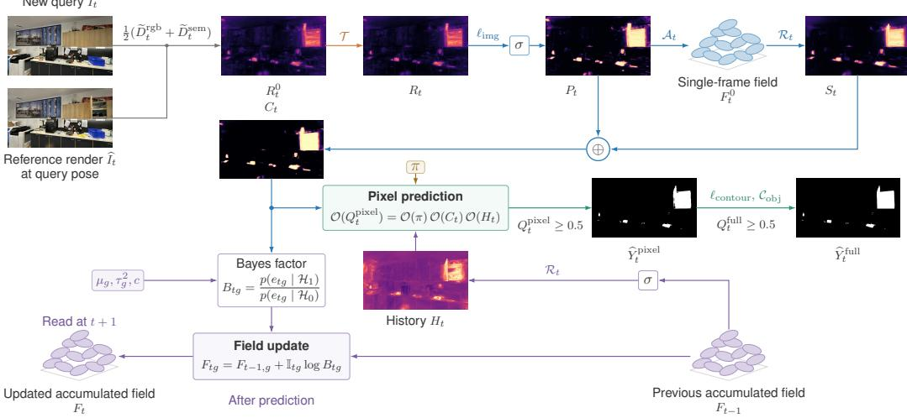  
Figure 1: Online evidence fusion pipeline. Current evidence $C _ { t }$ combines mapped image evidence $P _ { t }$ and Gaussian-aggregated support $S _ { t }$ . Fusion with prior π and history $H _ { t }$ from $F _ { t - 1 }$ gives $Q _ { t } ^ { \mathrm { p i x e l } }$ refinement produces ${ Q } _ { t } ^ { \mathrm { f u l l } }$ . Thresholding at 0.5 gives masks $\widehat { Y } _ { t } ^ { \mathrm { p i x e l } }$ and $\widehat { Y } _ { t } ^ { \mathrm { f u l l } }$ l, respectively. Local Bayes factors $B _ { t g }$ update $F _ { t - 1 }$ to $F _ { t }$ b bfor subsequent queries. ⊕ adds log odds.

$$
[ A _ { t } ( X ) ] _ { g } = \frac { \sum _ { u } a _ { t u g } X _ { u } } { s _ { t g } } , \qquad [ \mathcal { R } _ { t } ( V ) ] _ { u } = \frac { \sum _ { g } a _ { t u g } V _ { g } } { \chi _ { t u } } ,\tag{3}
$$

where $s _ { t g } = \sum _ { u } a _ { t u g }$ and $\begin{array} { r } { \chi _ { t u } = \sum _ { g } a _ { t u g } } \end{array}$ normalize the weights, preserving neutral evidence (0.5). We apply these operators to obtain the single-frame response field $F _ { t } ^ { 0 } = \mathcal { A } _ { t } ( P _ { t } )$ with entries in [0, 1], and Gaussian-aggregated support $\boldsymbol { S _ { t } } ^ { - } = \mathcal { R } _ { t } ( \boldsymbol { F } _ { t } ^ { 0 } )$ . Combining $\dot { P _ { t } }$ with $S _ { t }$ retains pixel detail while incorporating evidence shared through Gaussian footprints, giving current-view evidence $C _ { t }$

$$
C _ { t } = \sigma ( \mathrm { l o g i t } P _ { t } + \mathrm { l o g i t } S _ { t } ) .\tag{4}
$$

3D evidence accumulation. To determine how current-view evidence $C _ { t }$ should contribute to history, we evaluate Gaussian responses relative to their expected behaviour under unchanged conditions. The unchanged-response model provides each Gaussian’s expected response $\mu _ { g } .$ , the uncertainty in the estimated unchanged-response mean $\tau _ { g } ^ { 2 } .$ , and the spatial co-response coefficient c. Each Gaussian’s aggregated response $r _ { t g } = [ \mathcal { A } _ { t } ( C _ { t } ) ] _ { g }$ is standardized as $z _ { t g } = ( r _ { t g } - \mu _ { g } ) / \sqrt { \tau _ { g } ^ { 2 } + v _ { t g } }$ where $v _ { t g } = [ A _ { t } ( C _ { t } ^ { 2 } ) ] _ { g } - r _ { t g } ^ { 2 }$ measures response variance within its footprint. The observation indicator ${ \mathbb { I } _ { t g } = \mathbb { H } \{ s _ { t g } \geq 1 \} }$ selects Gaussians with sufficient rendering contribution.

A high response from one Gaussian may reflect local noise. Since object changes can affect several neighbouring Gaussians, we combine nearby responses using the neighbourhood mean $\bar { z } _ { t g } = ( \sum _ { j } \eta _ { g j } \mathbb { I } _ { t j } z _ { t j } ^ { - } ) / ( \sum _ { j } \eta _ { g j } \mathbb { I } _ { t j } )$ , where $j$ indexes neighbours of Gaussian g on the reference 3D graph. Edge weights $\eta _ { g j }$ reflect spatial and colour similarity (Appendix, Eq. 23), and $\mathbb { I } _ { t j }$ applies the same observation rule to neighbour $j$ . Neighbours can also respond together without change. Under the unchanged hypothesis ${ \mathcal { H } } _ { 0 } ,$ we model the central response $z _ { t g }$ and neighbourhood mean $\bar { z } _ { t g }$ as jointly Gaussian with zero means, unit central variance, and covariance approximated by c. This gives the conditional expectation $\mathbb { E } [ \bar { z } _ { t g } \ | \ z _ { t g } , \mathcal { H } _ { 0 } ] \approx c z _ { t g }$ (Appendix, Eq. 30). Subtracting it yields the residual $e _ { t g } = \hat { z } _ { t g } - c z _ { t g }$ , which measures neighbour response beyond that expected from the centre.

To quantify this residual as change evidence, we model $e _ { t g } \mid \mathcal { H } _ { 0 } \sim \mathcal { N } ( 0 , \nu _ { t g } )$ . The residual variance $\nu _ { t g } = \operatorname* { m a x } ( V _ { t g } - c ^ { 2 } , \epsilon _ { \nu } )$ uses the estimated variance $V _ { t g }$ of the neighbourhood mean (Appendix, Eq. 29); $\epsilon _ { \nu } ~ = ~ 1 0 ^ { - 4 }$ prevents degenerate variance. Under the change hypothesis $\mathcal { H } _ { 1 }$ , a shared response increase $\delta \geq 0$ at the centre and its neighbours gives $e _ { t g } \mid \delta , \mathcal { \bar { H } } _ { 1 } \sim \mathcal { N } ( ( 1 - c ) \delta , \nu _ { t g } )$ , with $\delta \sim$ HalfNormal(1) and density $p _ { + } ( \delta ) = 2 \mathcal { N } ( \delta ; 0 , 1 )$ for $\delta \ge \mathsf { \bar { 0 } }$ . We integrate over δ to evaluate evidence for change. The Gaussian likelihood and half-normal prior give an exponent quadratic in $\delta ,$ so completing the square evaluates this integral analytically. With $h _ { t g } = \bar { ( 1 - c ) e } _ { t g } / \nu _ { t g }$ and $J _ { t g } = ( 1 - c ) ^ { 2 } / \nu _ { t g } + 1$ , the local Bayes factor $B _ { t g }$ is

$$
B _ { t g } = \frac { p ( e _ { t g } \mid \mathcal { H } _ { 1 } ) } { p ( e _ { t g } \mid \mathcal { H } _ { 0 } ) } = \frac { \int _ { 0 } ^ { \infty } \mathcal { N } ( e _ { t g } ; ( 1 - c ) \delta , \nu _ { t g } ) p _ { + } ( \delta ) d \delta } { \mathcal { N } ( e _ { t g } ; 0 , \nu _ { t g } ) } = \frac { 2 } { \sqrt { J _ { t g } } } \exp \left( \frac { h _ { t g } ^ { 2 } } { 2 J _ { t g } } \right) \Phi \left( \frac { h _ { t g } } { \sqrt { J _ { t g } } } \right)\tag{5}
$$

where Φ is the standard normal cumulative distribution function. This expression requires neither numerical integration nor iterative optimization; its derivation and log form are given in Appendix $C ,$ Eqs. 32–33. Values $B _ { t g } > 1$ support change and $B _ { t g } < 1$ oppose it, with neutral evidence $B _ { t g } = 1$ when no neighbours are observed. Adding these log Bayes factors to the previous accumulated field $F _ { t - 1 }$ gives the updated log-evidence field $F _ { t }$ for subsequent queries, with real-valued entries $F _ { t g }$ at Gaussians $g \colon$

$$
F _ { t g } = F _ { t - 1 , g } + \mathbb { I } _ { t g } \log B _ { t g } .\tag{6}
$$

Historical fusion and causal prediction. To predict pixel-level changes on query $I _ { t }$ , historical support $H _ { t }$ is rendered from the previous accumulated field $F _ { t - 1 }$ (with $F _ { 0 } = 0 )$

$$
H _ { t } = \mathcal { R } _ { t } ( \sigma ( F _ { t - 1 } ) ) ,\tag{7}
$$

where σ maps accumulated log evidence into $( 0 , 1 )$ . Rendering accounts for view-dependent visibility and occlusion; unobserved Gaussians $( F = 0 )$ give neutral support 0.5 on covered pixels. Using Equation 1, we combine $C _ { t }$ from Equation $4 , H _ { t }$ above, and the effective pixel prior π fitted offline. Converting the resulting odds to probabilities gives the pixel scores $Q _ { t } ^ { \mathrm { p i x e l } }$ . The binary change mask is $\widehat { Y } _ { t } ^ { \mathrm { p i x e l } } ( u ) = \mathcal { k } \{ Q _ { t } ^ { \mathrm { p i x e l } } ( u ) \geq 0 . 5 \}$

Object-guided mask refinement. Gaussian overlap and alpha-blending can blur rendered change boundaries. We use connected components of $\widehat { Y } _ { t } ^ { \mathrm { p i x e l } }$ to prompt the SAM2 decoder on both query band reference renderings. 3DGS-CD (Lu et al., 2025) fuses prompted segmentations into 3D object masks; our contour refinement retains the original scores of unprompted pixels. The contour model predicts log odds $\ell _ { \mathrm { c o n t o u r } } ( u )$ from paired mask features. Their non-positive part penalizes pixel change scores, giving the contour-filtered score $Q _ { t } ^ { \mathrm { c o n t o u r } } ( u )$

$$
Q _ { t } ^ { \mathrm { c o n t o u r } } ( u ) = \sigma \big ( \log \mathrm { i t } Q _ { t } ^ { \mathrm { p i x e l } } ( u ) + \operatorname* { m i n } ( \ell _ { \mathrm { c o n t o u r } } ( u ) , 0 ) \big ) .\tag{8}
$$

To recover missed object parts, surviving components prompt SAM2 on the query for candidate masks M. Their mean log-odds evidence is $\overline { { L } } _ { M } = \mathrm { m e a n } _ { u \in M }$ logit $Q _ { t } ^ { \mathrm { p i x e l } } ( u )$ . We retain masks with $\overline { { L } } _ { M } \geq 0$ and raise covered pixels to at least their mask score, giving the refined change score $Q _ { t } ^ { \mathrm { f u l l } } ( u )$

$$
Q _ { t } ^ { \mathrm { f u l l } } ( u ) = \operatorname* { m a x } \biggl ( Q _ { t } ^ { \mathrm { c o n t o u r } } ( u ) , \operatorname* { m a x } _ { M \ni u } \sigma ( \overline { { L } } _ { M } ) \biggr ) ,\tag{9}
$$

where the inner maximum is over retained masks covering u and is set to 0 if none cover it. Thresholding at 0.5 gives the refined mask $\widehat { Y } _ { t } ^ { \mathrm { f u l l } }$ (Appendix F).

## 4.3 LEARNING FROM AUTOMATIC 3DGS EDITS

Figure 2 illustrates our framework for learning from automatic 3DGS edits: we first synthesize object-level edits on the reference 3DGS to generate labelled training views, and then fit the scenespecific components in the order required by their inputs.

Automatic reference editing. We split reference cameras approximately 5:1 into an editing subset for learning and an unchanged-only subset for estimating unchanged-response statistics. A regu lar grid of automatic point prompts drives the SAM2 mask decoder (Ravi et al., 2025) on reference views, and masks are matched across views through their contributing Gaussians. Aggregating matched masks X via $[ \mathcal { A } _ { t } ( X ) ] _ { g } ~ ( \mathrm { E q . } ~ 3 )$ yields object membership $\bar { m _ { g } } ~ \in ~ [ 0 , 1 ]$ , measuring the fraction of each Gaussian’s rendering footprint inside the object. We select objects based on their consistency across held-out views. Recolouring blends colours towards the palette colour furthest from the object’s median colour with mixing coefficient $0 . 4 5 m _ { g } ;$ ; removal scales opacity by $1 - m _ { g } ;$ translation applies a shared 3D displacement to Gaussians with $m _ { q } \ge 0 . 5$ . Edits modify duplicate models, preserving the original reference. For reference image $I _ { t } ^ { \mathrm { r e f } } \in \mathcal { I } _ { \mathrm { r e f } }$ , original and edited models render $\widehat { I } _ { t }$ and $\widehat { I } _ { t } ^ { \mathrm { e d i t } }$ at its registered pose; here t indexes reference views. Synthetic query $I _ { t } ^ { \mathrm { s y n } } = I _ { t } ^ { \mathrm { r e f } } + \left( \widehat { I } _ { t } ^ { \mathrm { e d i t } } - \widehat { I } _ { t } \right)$ transfers changes to real reference images while preserving differ b bences between reference images and their renderings. Regions covered by edit masks are labelled changed (1); valid regions outside are labelled unchanged (0), with ambiguous boundaries ignored. We introduce lighting variations using affine colour transforms, optionally augmented with normaldependent directional shading, fitted to differences between unchanged reference images and their renderings. These transformations preserve the change labels (details and additional examples in Appendix A.1, Figure 4).

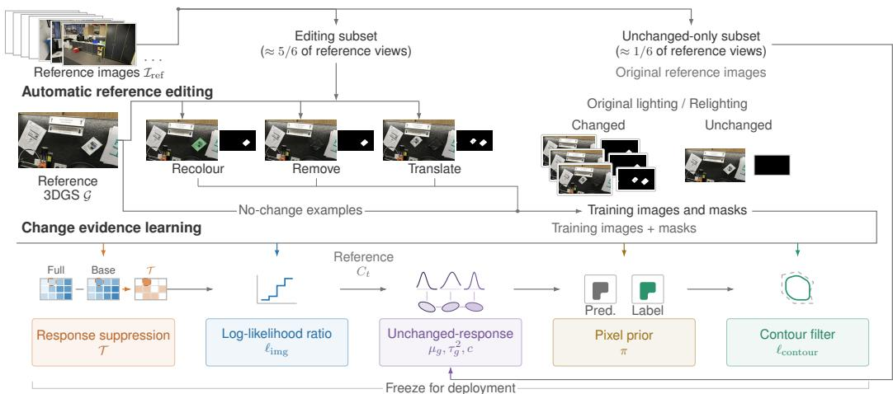  
Figure 2: Automatic reference editing and change evidence learning. Top: Reference 3DGS edits (recolouring, removal, translation) and relighting synthesize labelled change pairs without manual annotation. Bottom: Five scene-specific components are fitted in the order required by their input (grey arrows): response suppressor T , LLR mapping $\ell _ { \mathrm { i m g } }$ , unchanged-response model $( \mu _ { g } , \tau _ { g } ^ { 2 } , c )$ pixel prior π, and contour filter $\ell _ { \mathrm { c o n t o u r } }$

Response suppression. We fit the response suppressor $\tau$ using two pixel-wise logistic classifiers on the editing subset. Base uses initial response $\mathrm { \bar { ~ } } R _ { t } ^ { 0 }$ and its local texture statistics (mean, standard deviation, gradient). Full adds pixel-aligned reference rendering features at the same pose: coverage, depth, Gaussian contribution statistics, and their gradients and interactions. The fitted classifiers predict change log odds $\ell _ { \mathrm { b a s e } }$ and $\ell _ { \mathrm { f u l l } }$ . We suppress responses when adding rendering features lowers the predicted change odds, using

$$
\begin{array} { r } { \mathcal { T } ( \ell _ { \mathrm { b a s e } } , \ell _ { \mathrm { f u l l } } ) = \operatorname* { m i n } ( \ell _ { \mathrm { f u l l } } - \ell _ { \mathrm { b a s e } } , 0 ) . } \end{array}\tag{10}
$$

Fitting details and feature groups are provided in Appendix A.2 (Eq. 18).

Log-likelihood-ratio mapping. Under Bayesian hypothesis testing, the corrected response $R _ { t }$ is mapped to evidence via the log-likelihood ratio (LLR) between change $( \mathcal { H } _ { 1 } )$ and no-change $( \mathcal { H } _ { 0 } )$ To estimate this mapping, we pool corrected responses across the editing subset and use isotonic regression (Zadrozny & Elkan, 2002) to partition responses into monotonic blocks b. The unchanged distribution $p ( b \mid \dot { \mathcal { H } } _ { 0 } )$ is an equal mixture of distributions estimated from regions outside edits $( \mathcal { H } _ { 0 } ^ { \mathrm { e d i t } } )$ and unedited reference views $( \mathcal { H } _ { 0 } ^ { \mathrm { r e f } } )$ . This gives the block LLR:

$$
\ell _ { b } = \log \frac { \widehat { p } ( b \mid \mathcal { H } _ { 1 } ) } { \widehat { p } ( b \mid \mathcal { H } _ { 0 } ) } = \log \frac { \widehat { p } ( b \mid \mathcal { H } _ { 1 } ) } { \frac { 1 } { 2 } \widehat { p } ( b \mid \mathcal { H } _ { 0 } ^ { \mathrm { e d i t } } ) + \frac { 1 } { 2 } \widehat { p } ( b \mid \mathcal { H } _ { 0 } ^ { \mathrm { r e f } } ) } .\tag{11}
$$

Linearly interpolating $\ell _ { b }$ across block-mean responses yields the continuous monotonic mapping $\ell _ { \mathrm { i m g } }$ (Appendix A.2).

Unchanged-response modelling. To fit the unchanged-response model $( \mu _ { g } , \tau _ { q } ^ { 2 } , c )$ , we estimate its response statistics over reference views t in the unchanged-only subset. We place a Beta prior on each Gaussian’s latent mean response and treat bounded observations $r _ { t g } \in [ 0 , 1 ]$ as fractional counts. Taking the prior concentration to zero from above yields the mean $\mu _ { g }$ and uncertainty in the estimated unchanged-response mean $\tau _ { g } ^ { 2 } .$ . The reference graph is built from eight-nearest-neighbour candidates, then symmetrized and weighted by spatial and colour similarity $\eta _ { g j }$ . Co-observed neighbour pairs estimate the spatial co-response coefficient c:

$$
\mu _ { g } = \frac { \sum _ { t } \mathbb { I } _ { t g } r _ { t g } } { \sum _ { t } \mathbb { I } _ { t g } } , \qquad \tau _ { g } ^ { 2 } = \frac { \mu _ { g } ( 1 - \mu _ { g } ) } { 1 + \sum _ { t } \mathbb { I } _ { t g } } , \qquad c = \frac { \sum _ { t , ( g , j ) } \omega _ { t g j } ^ { \mathrm { f i t } } \widetilde { z } _ { t g } \widetilde { z } _ { t j } } { \sum _ { t , ( g , j ) } \omega _ { t g j } ^ { \mathrm { f i t } } } ,\tag{12}
$$

where $\widetilde { z } _ { t g }$ and $\widetilde { z } _ { t j }$ denote responses of Gaussian $g$ and neighbour $j$ standardized across unchanged e ereference views, $\omega _ { t g j } ^ { \mathrm { f i t } } ~ = ~ \eta _ { g j }$ min $( \mathbb { I } _ { t g } , \mathbb { I } _ { t j } )$ weights co-observed neighbour pairs, and unobserved Gaussians $( \sum _ { t } \mathbb { I } _ { t g } = 0 )$ revert to scene-level priors (details in Appendix B, Eqs. 24–25).

Pixel prior fitting. To fit the pixel prior π (Eq. 1) robustly against synthetic edit artifacts (e.g., exposed backgrounds or spillover), we introduce Cauchy reliability weights $\rho _ { i } \in ( 0 , 1 ]$ to downweight views with abnormal responses in labelled unchanged regions. For each training image i, let $Y _ { i }$ denote its binary change-label mask and $\hat { Y } _ { i } ^ { \mathrm { p i x e l } } ( \pi )$ the pixel prediction obtained with prior π. We determine the optimal prior $\pi ^ { \star }$ b by maximizing their reliability-weighted foreground IoU over the editing subset:

$$
\pi ^ { \star } \in \arg \operatorname* { m a x } _ { \pi \in ( 0 , 1 ) } \frac { \sum _ { i } \rho _ { i } \mathrm { I o U } \Big ( \widehat { Y } _ { i } ^ { \mathrm { p i x e l } } ( \pi ) , Y _ { i } \Big ) } { \sum _ { i } \rho _ { i } } .\tag{13}
$$

This objective fits π as an effective prior that sets how much evidence is needed to predict change.   
We solve this one-dimensional search via branch-and-bound (Appendix E, Eqs. 42–43).

Contour filter fitting. To learn the boundary penalty in Eq. 8, we first fit a linear classifier with score $s _ { \mathrm { c o n t o u r } } ( u ) = \mathbf { \bar { w } } ^ { \top } \mathbf { f } _ { u } + b$ over standardized features $\mathbf { f } _ { u }$ that are unchanged when the query and reference images are swapped. These view-symmetric features combine SAM2 mask logits, predicted IoUs, and their products using (max, min) across the two views. Across training image pairs i and candidate pixels $u ,$ the feature vectors are $\mathbf { f } _ { i u }$ and edit-mask labels are $y _ { i u } = Y _ { i } ( u ) \in$ {0, 1}. We fit w and b by minimizing regularized binary cross-entropy:

$$
\operatorname* { m i n } _ { \mathbf { w } , b } \sum _ { i , u } w _ { i u } \mathcal { L } _ { \mathrm { C E } } \big ( \sigma ( \mathbf { w } ^ { \top } \mathbf { f } _ { i u } + b ) , y _ { i u } \big ) + \frac { \lambda } { 2 } \| \mathbf { w } \| _ { 2 } ^ { 2 } ,\tag{14}
$$

where λ controls $L _ { 2 }$ regularization. Excluding ignored pixels, we construct $w _ { i u }$ by balancing classes within each image, multiplying by its reliability $\rho _ { i }$ , and normalizing each class to total weight 0.5 within the fitting split. Platt scaling (Platt, 2000) fits a slope $a _ { \mathrm { c a l } }$ and intercept $b _ { \mathrm { c a l } }$ on held-out objects using the same weighting procedure, giving contour log odds $\ell _ { \mathrm { c o n t o u r } } ( u ) = a _ { \mathrm { c a l } } s _ { \mathrm { c o n t o u r } } ( u ) +$ $b _ { \mathrm { c a l } }$ (Appendix F).

## 5 EXPERIMENTS

Protocol. Real-world PASLCD (Galappaththige et al., 2025) is our primary benchmark (20 sceneinstances, conventional 4× downsampling), complemented by evaluation on four synthetic CCS3D scenes (Zhou et al., 2026). Following O-SCD’s mask definition, we evaluate our method and O-SCD on both datasets using masks covering pre- and post-state changes, including vacated and newly occupied regions. Tables 1–2 compare our method with official-code O-SCD results and other published online/offline baselines. We report foreground mIoU and F1 for Ours (pixel) $( \widehat { Y } _ { t } ^ { \mathrm { p i x e l } } )$ and Ours (full) $( \widehat { Y } _ { t } ^ { \mathrm { f u l l } } )$ bat threshold 0.5 (Figure 1). Models are fitted offline from reference data without btest-time tuning. Our comparisons average two complete runs per dataset (Appendix G.5).

Complete evaluation. Our method achieves state-of-the-art accuracy on PASLCD with 67.64% mIoU and 78.87% F1 (Table 1), exceeding O-SCD(O) by 18.40 mIoU points and offline GS-Diff (Galappaththige et al., 2026a) by 3.24 points without a post-change reconstruction. Ours (pixel) also exceeds both O-SCD variants. On CCS3D, our method exceeds O-SCD(O) by 25.88 mIoU points under the same union-mask evaluation (Table 2). Figure 3 shows more complete object masks in

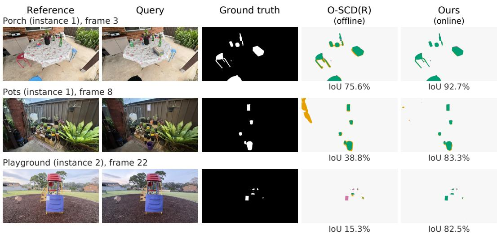  
Figure 3: Visual results on representative scenes. Columns show reference renderings, queries, ground truth, O-SCD(R) (offline), and our complete method (online). correct detections; false positives; missed changes. Numbers give per-frame foreground IoU from one complete sequence run. Additional visual results, including remaining errors, are shown in Appendix H.

Table 1: PASLCD (20 scene-instances, %). Our method and O-SCD are evaluated locally; other results are taken from GS-Diff.
<table><tr><td>Method</td><td>Venue</td><td>Mode</td><td>mIoU ↑</td><td>F1 ↑</td></tr><tr><td colspan="5">Paper-reported</td></tr><tr><td>SCaR-3D 3DGS-CD MV3DCD</td><td>3DV 2026 RA-L 2025 CVPR 2025</td><td>offline offline offline</td><td>19.10 20.90 47.80</td><td>28.90 33.90</td></tr><tr><td>GS-Diff</td><td>arXiv 2026</td><td>offline</td><td>64.40</td><td>62.80 75.80</td></tr><tr><td colspan="5">Our evaluation</td></tr><tr><td>O-SCD(O)</td><td>CVPR 2026</td><td>online</td><td>49.24</td><td>64.60</td></tr><tr><td>O-SCD(R)</td><td>CVPR 2026</td><td>offline</td><td>55.99</td><td>70.27</td></tr><tr><td>Ours (pixel)</td><td></td><td>online</td><td>60.36</td><td>73.80</td></tr><tr><td>Ours (full)</td><td></td><td>online</td><td>67.64</td><td>78.87</td></tr></table>

Table 2: CCS3D (four scenes, %). Our method and O-SCD are evaluated locally; other results are taken from SCaR-3D.
<table><tr><td>Method</td><td>Venue</td><td>Mode</td><td>mIoU↑</td><td>F1↑</td></tr><tr><td colspan="5">Paper-reported</td></tr><tr><td>MV3DCD CL-Splats 3DGS-CD SCaR-3D</td><td>CVPR 2025 ICCV 2025 RA-L 2025 3DV 2026</td><td>offline offline offline offline</td><td>30.40 39.90 41.60 65.00</td><td>44.10 53.80 51.20 72.40</td></tr><tr><td colspan="5">Our evaluation</td></tr><tr><td>O-SCD(O)</td><td>CVPR 2026 CVPR 2026</td><td>online</td><td>49.94</td><td>64.61</td></tr><tr><td>O-SCD(R)</td><td></td><td>offline</td><td>43.59</td><td>57.82</td></tr><tr><td>Ours (pixel)</td><td></td><td>online</td><td>66.83</td><td>79.47</td></tr><tr><td></td><td></td><td></td><td></td><td></td></tr><tr><td>Ours (full)</td><td></td><td>online</td><td>75.82</td><td>85.90</td></tr></table>

Porch, fewer boundary false positives in Pots, and fewer missed changes in Playground than O-SCD(R). Appendix G provides per-instance results.

Cross-instance reference reuse. We reuse each reference reconstruction and its fitted parameters to process the other instance of the same PASLCD scene, without refitting. Overall pixel and fulloutput mIoU remain close to the original pairing: 59.93% versus 60.36%, and 67.15% versus 67.64%, respectively. These results support reference reuse between closely related instances of the same scene. Appendix G.1 provides the protocol and per-pair results (Table 6).

Independent component ablations. Removing any evaluated component reduces mean mIoU (Table 3), with the pixel prior π having the largest effect in the pixel pipeline: its removal causes a 16.47-point drop. This highlights the importance of using reference data to determine how much evidence is needed to predict change. Appendix G.2 reports the fitted priors and performance by change area. Gaussian-aggregated support contributes 1.89 points, supporting the use of spatially shared evidence. Response suppression and likelihood-ratio mapping provide additional gains. Historical support connects each prediction to a shared 3D field that accumulates change evidence from earlier views. Removing it reduces mean pixel mIoU by 2.56 points. To evaluate how this shared evidence should be accumulated, we replace our Bayes-factor updates with a temporal average of each Gaussian’s observed responses, reducing pixel mIoU by 4.42 points (Appendix, Table 10). Contour filtering suppresses excess responses, while object completion recovers missed object regions. Removing them reduces mean mIoU by 4.49 and 5.08 points, respectively, while contour image weights provide a smaller gain of 0.26 points.

Table 3: Independent component ablations on 20 PASLCD instances (%). Each component is removed separately from the corresponding complete pipeline with the decision threshold fixed at 0.5. Removing the pixel prior is equivalent to using a neutral prior, π = 0.5.
<table><tr><td colspan="3">Pixel pipeline</td><td colspan="3">Output reinement</td></tr><tr><td>Configuration</td><td>mIoU↑</td><td>F1↑</td><td>Configuration</td><td>mIoU ↑</td><td>F1↑</td></tr><tr><td>Full pixel pipeline</td><td>60.36</td><td>73.80</td><td>Full method</td><td>67.64</td><td>78.87</td></tr><tr><td>w/o response suppression</td><td>58.62</td><td>72.17</td><td>w/o contour filtering</td><td>63.15</td><td>75.78</td></tr><tr><td>w/o likelihood-ratio mapping</td><td>59.23</td><td>73.12</td><td>w/o object completion</td><td>62.56</td><td>75.32</td></tr><tr><td>w/o Gaussian-aggregated support</td><td>58.47</td><td>72.27</td><td>w/o contour image weights</td><td>67.38</td><td>78.67</td></tr><tr><td>w/o historical support</td><td>57.81</td><td>71.67</td><td></td><td></td><td></td></tr><tr><td>w/o pixel prior</td><td>43.90</td><td>58.26</td><td></td><td></td><td></td></tr></table>

Table 4: Runtime on PASLCD (RTX 5090; 20 instances). Post-frontend covers detection, state updates, and refinement. Timing definitions and protocols are given in Appendix G.5.
<table><tr><td>Method</td><td>Mode</td><td>Post-frontend (ms) ↓</td><td>End-to-end (ms) ↓</td><td>FPS ↑</td></tr><tr><td>O-SCD(R)†</td><td>offline</td><td>169.41</td><td>201.34</td><td>4.97</td></tr><tr><td>O-SCD(O)</td><td>online</td><td>37.65</td><td>69.33</td><td>14.42</td></tr><tr><td>Ours (pixel)</td><td>online</td><td>4.79</td><td>35.81</td><td>27.93</td></tr><tr><td>Ours (full)</td><td>online</td><td>25.64</td><td>58.23</td><td>17.17</td></tr></table>

†O-SCD(R) requires the full sequence; total runtime, including refinement, is reported per frame.

Relighting strength. Removing the relighting during data generation reduces full-output mIoU by 0.66 points, while doubling its strength gives similar aggregate results (Appendix, Table 9).

Runtime. We measure runtime on an NVIDIA RTX 5090 over all 25 frames of all 20 PASLCD instances after initialization (Table 4). Including frontend processing, our complete method reaches 17.2 FPS, compared with 14.4 FPS for O-SCD(O), while improving mIoU by 18.40 points. Without refinement, our pixel pipeline reaches 27.9 FPS at 60.36% mIoU, still exceeding the offline refined O-SCD(R) result of 55.99%. The learned models enable efficient online evidence accumulation through closed-form local Bayes factors, avoiding online backpropagation and past-image replay. Given an existing reference reconstruction, offline preparation averages 215.82 s (∼3.6 minutes) per instance, including automatic editing and model fitting. Appendices G.5 and G.6 provide the timing protocol and offline cost breakdown.

## 6 CONCLUSION AND LIMITATIONS

Our method learns scene-specific evidence models and statistics from automatic reference 3DGS edits, using the reference scene as a source of supervision for online change detection. These learned quantities enable closed-form local Bayes factors and generalised Bayesian history accumulation without online backpropagation or past-image replay. It outperforms O-SCD on PASLCD and CCS3D, achieving 67.64% mIoU at 17.2 FPS on PASLCD. However, our direct object edits and simple relighting prioritize short offline preparation and may not cover real changes or unusual lighting conditions. Accumulating evidence on the unchanged reference geometry limits how accurately newly introduced objects and occlusion boundaries can be represented in the field. The response uncertainty and spatial covariance models are working approximations. Although local Bayes factors are evaluated analytically under the residual model, the fused scores combine dependent evidence and are not guaranteed to be calibrated probabilities of real-world changes. Future work will explore more advanced 3DGS segmentation, editing, and relighting to improve object masks and broaden the generated changes, while assessing whether the resulting detection gains justify the additional offline preparation time.

## AI USE STATEMENT

In this work, generative AI tools were used to assist with initial methodology discussions and exploratory brainstorming, algorithm and code implementation, preliminary manuscript drafting, and textual refinement for grammar, phrasing, and readability. Generative AI tools were not used for formulating theoretical claims, deriving mathematical formulations, collecting benchmark observations, or interpreting empirical results. All AI-assisted contributions were rigorously reviewed, tested, and vetted by the authors: all algorithmic implementations and evaluation pipelines were independently executed and verified, all mathematical derivations were checked manually, and all experimental results and claims were thoroughly audited. The authors assume full responsibility for the entirety of this paper and its claims.

## ETHICS STATEMENT

This work uses existing scene-change benchmarks. Incorrect predictions can lead to missed changes or unnecessary follow-up inspections.

## REPRODUCIBILITY STATEMENT

The implementation records reference camera assignments, synthetic events, fitted scene models, effective-prior parameters, and per-image results. All scene-specific parameters are frozen before target evaluation. The appendices specify the observation transformations, statistical approximations, update order, and effective-prior estimation used for the reported method.

## REFERENCES

Jan Ackermann, Jonas Kulhanek, Shengqu Cai, Haofei Xu, Marc Pollefeys, Gordon Wetzstein, Leonidas J. Guibas, and Songyou Peng. CL-Splats: Continual learning of gaussian splatting with local optimization. In Proceedings ofthe IEEE/CVF International Conference on Computer Vision (ICCV), pp. 7808–7817, October 2025. URL https://openaccess.thecvf.com/ content/ICCV2025/html/Ackermann\_CL-Splats\_Continual\_Learning\_of\_ Gaussian\_Splatting\_with\_Local\_Optimization\_ICCV\_2025\_paper.html.

Matias Altamirano, Francois-Xavier Briol, and Jeremias Knoblauch. Robust and scalable Bayesian online changepoint detection. In Proceedings of the 40th International Conference on Machine Learning, volume 202 of Proceedings ofMachine Learning Research, pp. 642–663. PMLR, 2023. URL https://proceedings.mlr.press/v202/altamirano23a.html.

Yoav Benjamini and Yosef Hochberg. Controlling the false discovery rate: A practical and powerful approach to multiple testing. Journal of the Royal Statistical Society: Series B (Methodological), 57(1):289–300, 1995. doi: 10.1111/j.2517-6161.1995.tb02031.x.

P. G. Bissiri, C. C. Holmes, and S. G. Walker. A general framework for updating belief distributions. Journal of the Royal Statistical Society: Series B (Statistical Methodology), 78(5):1103–1130, 2016. doi: 10.1111/rssb.12158. URL https://arxiv.org/abs/1306.6430.

Yiwen Chen, Zilong Chen, Chi Zhang, Feng Wang, Xiaofeng Yang, Yikai Wang, Zhongang Cai, Lei Yang, Huaping Liu, and Guosheng Lin. GaussianEditor: Swift and controllable 3D editing with gaussian splatting. In Proceedings of the IEEE/CVF Conference on Computer Vision and Pattern Recognition (CVPR), pp. 21476–21485, 2024. URL https://openaccess.thecvf.com/content/CVPR2024/html/Chen\_ GaussianEditor\_Swift\_and\_Controllable\_3D\_Editing\_with\_Gaussian\_ Splatting\_CVPR\_2024\_paper.html.

Chamuditha Jayanga Galappaththige, Jason Lai, Lloyd Windrim, Donald Dansereau, Niko Sünderhauf, and Dimity Miller. Multi-view pose-agnostic change localization with zero labels. In Proceedings of the IEEE/CVF Conference on Computer Vision and Pattern Recognition (CVPR), pp. 11600–11610, June 2025. URL https://openaccess.thecvf.com/content/

CVPR2025/html/Galappaththige\_Multi-View\_Pose-Agnostic\_Change\_ Localization\_with\_Zero\_Labels\_CVPR\_2025\_paper.html.

Chamuditha Jayanga Galappaththige, Jason Lai, Timothy Patten, Donald Dansereau, Niko Sünderhauf, and Dimity Miller. From pixels to primitives: Scene change detection in 3D gaussian splatting. arXiv preprint arXiv:2605.07203, 2026a. URL https://arxiv.org/abs/2605. 07203.

Chamuditha Jayanga Galappaththige, Jason Lai, Lloyd Windrim, Donald Dansereau, Niko Sünderhauf, and Dimity Miller. Changes in real time: Online scene change detection with multi-view fusion. In Proceedings of the IEEE/CVF Conference on Computer Vision and Pattern Recognition (CVPR), pp. 32246–32256, June 2026b. URL https://openaccess.thecvf. com/content/CVPR2026/html/Galappaththige\_Changes\_in\_Real\_Time\_ Online\_Scene\_Change\_Detection\_with\_Multi-View\_CVPR\_2026\_paper. html.

Jian Gao, Chun Gu, Youtian Lin, Zhihao Li, Hao Zhu, Xun Cao, Li Zhang, and Yao Yao. Relightable 3D gaussians: Realistic point cloud relighting with BRDF decomposition and ray tracing. In European Conference on Computer Vision (ECCV), 2024. URL https://www.ecva.net/ papers/eccv\_2024/papers\_ECCV/html/6121\_ECCV\_2024\_paper.php.

Andrew Gelman, John B. Carlin, Hal S. Stern, David B. Dunson, Aki Vehtari, and Donald B. Rubin. Bayesian Data Analysis. Chapman and Hall/CRC, 3 edition, 2013. ISBN 9781439840955. URL https://www.routledge.com/Bayesian-Data-Analysis/ Gelman-Carlin-Stern-Dunson-Vehtari-Rubin/p/book/9781439840955.

Robert E. Kass and Adrian E. Raftery. Bayes factors. Journal of the American Statistical Association, 90(430):773–795, 1995. URL https://sites.stat.washington.edu/ courses/stat527/s14/readings/KassRaftery\_jasa1995.pdf.

Bernhard Kerbl, Georgios Kopanas, Thomas Leimkühler, and George Drettakis. 3D gaussian splatting for real-time radiance field rendering. ACM Transactions on Graphics, 42(4):139:1–139:14, July 2023. doi: 10.1145/3592433. URL https://repo-sam.inria.fr/fungraph/ 3d-gaussian-splatting/.

Jae-Woo Kim and Ue-Hwan Kim. Towards generalizable scene change detection. In Proceedings of the IEEE/CVF Conference on Computer Vision and Pattern Recognition (CVPR), pp. 24463– 24473, June 2025. URL https://openaccess.thecvf.com/content/CVPR2025/ html/Kim\_Towards\_Generalizable\_Scene\_Change\_Detection\_CVPR\_2025\_ paper.html.

Dong In Lee, Hyeongcheol Park, Jiyoung Seo, Eunbyung Park, Hyunje Park, Ha Dam Baek, Sangheon Shin, Sangmin Kim, and Sangpil Kim. EditSplat: Multi-view fusion and attentionguided optimization for view-consistent 3D scene editing with 3D gaussian splatting. In Pro ceedings of the IEEE/CVF Conference on Computer Vision and Pattern Recognition (CVPR), pp. 11135–11145, 2025. URL https://openaccess.thecvf.com/content/CVPR2025/ html/Lee\_EditSplat\_Multi-View\_Fusion\_and\_Attention-Guided\_ Optimization\_for\_View-Consistent\_3D\_Scene\_CVPR\_2025\_paper.html.

Zhihao Liang, Qi Zhang, Ying Feng, Ying Shan, and Kui Jia. GS-IR: 3D gaussian splatting for inverse rendering. In Proceedings of the IEEE/CVF Conference on Computer Vision and Pattern Recognition (CVPR), pp. 21644–21653, 2024. URL https://openaccess.thecvf.com/content/CVPR2024/html/Liang\_GS-IR\_ 3D\_Gaussian\_Splatting\_for\_Inverse\_Rendering\_CVPR\_2024\_paper.html.

Ziqi Lu, Jianbo Ye, and John J. Leonard. 3DGS-CD: 3D gaussian splatting-based change detection for physical object rearrangement. IEEE Robotics and Automation Letters, 10(3):2662–2669, 2025. doi: 10.1109/LRA.2025.3533457. URL https://doi.org/10.1109/LRA.2025. 3533457.

John C. Platt. Probabilities for SV machines. In Alexander J. Smola, Peter Bartlett, Bernhard Schölkopf, and Dale Schuurmans (eds.), Advances in Large-Margin Classifiers, pp. 61–74. The

MIT Press, 2000. doi: 10.7551/mitpress/1113.003.0008. URL https://doi.org/10. 7551/mitpress/1113.003.0008.

Guilherme Potje, Felipe Cadar, André Araujo, Renato Martins, and Erickson R. Nascimento. XFeat: Accelerated features for lightweight image matching. In Proceedings of the IEEE/CVF Conference on Computer Vision and Pattern Recognition (CVPR), pp. 2682–2691, June 2024. URL https://openaccess.thecvf.com/content/CVPR2024/html/Potje\_ XFeat\_Accelerated\_Features\_for\_Lightweight\_Image\_Matching\_CVPR\_ 2024\_paper.html.

Jingxing Qian, Veronica Chatrath, Jun Yang, James Servos, Angela P. Schoellig, and Steven L. Waslander. POCD: Probabilistic object-level change detection and volumetric mapping in semistatic scenes. In Proceedings of Robotics: Science and Systems, New York City, NY, USA, June 2022. doi: 10.15607/RSS.2022.XVIII.013. URL https://www.roboticsproceedings. org/rss18/p013.html.

Nikhila Ravi, Valentin Gabeur, Yuan-Ting Hu, Ronghang Hu, Chaitanya Ryali, Tengyu Ma, Haitham Khedr, Roman Rädle, Chloe Rolland, Laura Gustafson, Eric Mintun, Junting Pan, Kalyan Vasudev Alwala, Nicolas Carion, Chao-Yuan Wu, Ross Girshick, Piotr Dollár, and Christoph Feichtenhofer. SAM 2: Segment anything in images and videos. In International Conference on Learning Representations (ICLR), 2025. URL https://proceedings.iclr.cc/paper\_files/paper/2025/hash/ 45c1f6a8cbf2da59ebf2c802b4f742cd-Abstract-Conference.html.

Ragav Sachdeva and Andrew Zisserman. The change you want to see. In Proceedings of the IEEE/CVF Winter Conference on Applications ofComputer Vision (WACV), pp. 3993–4002, January 2023a. URL https://openaccess.thecvf.com/content/WACV2023/html/ Sachdeva\_The\_Change\_You\_Want\_To\_See\_WACV\_2023\_paper.html.

Ragav Sachdeva and Andrew Zisserman. The change you want to see (now in 3D). In Proceedings of the IEEE/CVF International Conference on Computer Vision (ICCV) Workshops, pp. 2060–2069, October 2023b. URL https://openaccess.thecvf.com/content/ ICCV2023W/OpenSUN3D/html/Sachdeva\_The\_Change\_You\_Want\_to\_See\_ Now\_in\_3D\_ICCVW\_2023\_paper.html.

Zhou Wang, Alan C. Bovik, Hamid R. Sheikh, and Eero P. Simoncelli. Image quality assessment: From error visibility to structural similarity. IEEE Transactions on Image Processing, 13(4): 600–612, 2004. doi: 10.1109/TIP.2003.819861. URL https://doi.org/10.1109/TIP. 2003.819861.

Yuqun Wu, Chih-hao Lin, Henry Che, Aditi Tiwari, Chuhang Zou, Shenlong Wang, and Derek Hoiem. SceneDiff: A benchmark and method for multiview object change detection. In European Conference on Computer Vision (ECCV), 2026. URL https://arxiv.org/abs/2512. 16908.

Sizhe Yang, Wenye Yu, Jia Zeng, Jun Lv, Kerui Ren, Cewu Lu, Dahua Lin, and Jiangmiao Pang. Novel demonstration generation with gaussian splatting enables robust one-shot manipulation. In Proceedings of Robotics: Science and Systems (RSS), 2025. doi: 10.15607/RSS.2025.XXI.146. URL https://www.roboticsproceedings.org/rss21/p146.html.

Mingqiao Ye, Martin Danelljan, Fisher Yu, and Lei Ke. Gaussian grouping: Segment and edit anything in 3D scenes. In European Conference on Computer Vision (ECCV), 2024. doi: 10.1007/978-3-031-73397-0\_10. URL https://www.ecva.net/papers/eccv\_2024/ papers\_ECCV/html/4195\_ECCV\_2024\_paper.php.

Bianca Zadrozny and Charles Elkan. Transforming classifier scores into accurate multiclass probability estimates. In Proceedings of the Eighth ACM SIGKDD International Conference on Knowledge Discovery and Data Mining, 2002. doi: 10.1145/775047.775151. URL https: //www.cs.columbia.edu/\~djhsu/ML/handouts/zadrozny2002kdd.pdf.

Farhad G. Zanjani, Davide Abati, Auke Wiggers, Dimitris Kalatzis, Jens Petersen, Hong Cai, and Amirhossein Habibian. Gaussian splatting is an effective data generator for 3D object detection. arXiv preprint arXiv:2504.16740, 2025. URL https://arxiv.org/abs/2504.16740.

Zirui Zhou, Junfeng Ni, Shujie Zhang, Yixin Chen, and Siyuan Huang. 3D scene change modeling with consistent multi-view aggregation. In International Conference on 3D Vision (3DV), 2026. URL https://openreview.net/forum?id=sV7lwfLo6H.

Runsong Zhu, Shi Qiu, Zhengzhe Liu, Ka-Hei Hui, Qianyi Wu, Pheng-Ann Heng, and Chi-Wing Fu. Rethinking end-to-end 2D to 3D scene segmentation in gaussian splatting. In Proceedings of the IEEE/CVF Conference on Computer Vision and Pattern Recognition (CVPR), pp. 3656–3665, 2025. URL https://openaccess.thecvf.com/content/CVPR2025/html/Zhu\_ Rethinking\_End-to-End\_2D\_to\_3D\_Scene\_Segmentation\_in\_Gaussian\_ Splatting\_CVPR\_2025\_paper.html.

## A IMAGE EVIDENCE PROCESSING AND GAUSSIAN AGGREGATION

## A.1 AUTOMATIC REFERENCE EDITING AND DATA GENERATION

The inputs are the fixed reference 3DGS and its registered images. Object selection, edit parameters, labels, and filtering are determined automatically from these inputs. We use SAM2.1 Hiera-Tiny automatic masks, images with a maximum side length of 1008 pixels, and random seed 0. The following settings are shared by all 20 scene instances.

Reference camera assignment. We implement the approximately 5:1 camera split described in Section 4.3. The unchanged-only subset contains $\lceil N / 6 \rceil$ cameras for unchanged-response estimation, where N is the total number of reference cameras. We select these cameras to represent the scene’s visible surfaces with a limited number of observations. For camera t, let V denote its observable reference Gaussians. We measure the distance between cameras t and l by the Jaccard distance $1 - | \mathcal { V } _ { t } \cap \mathcal { V } _ { l } | / | \mathcal { V } _ { t } \cup \mathcal { V } _ { l } |$ |, so cameras observing similar surfaces are close. Greedy facility-location selection adds cameras one at a time to minimise the total distance from all reference cameras to their nearest selected camera. We then apply medoid swaps, replacing a selected camera with an unselected one whenever this reduces the total distance. Both steps require the editing subset to retain at least one available view of every synthetic object/change event. The editing subset provides labelled examples generated by automatic 3DGS edits for learning response suppression, the likelihood-ratio mapping, the effective pixel prior, and the contour filter. Examples are included only where the corresponding edit is available. With the image-evidence pipeline fixed, the unchangedonly subset provides unchanged reference images for estimating the Gaussian unchanged-response model and spatial co-response. The two subsets contain different cameras but may observe overlapping surfaces.

Object proposals and cross-view association. We first generate candidate regions in each reference image using SAM2: automatically placed point prompts produce masks, followed by filtering of low-quality and duplicate results. To determine whether masks in different views describe the same object, we associate each mask with the reference Gaussians that mainly contribute to it.

For reference view t, let $\boldsymbol { a } _ { t u g }$ be the rendering contribution defined in Section 3. At each pixel, we retain only the two largest contributions and set the others to zero; denote these retained weights by $\widetilde { a } _ { t u g }$ . For a mask M, Gaussian $\boldsymbol { g ^ { \prime } } \mathbf { s }$ contributions inside and outside it are

$$
A _ { t g } ^ { \mathrm { i n } } = \sum _ { u \in M } \widetilde { a } _ { t u g } , \qquad A _ { t g } ^ { \mathrm { o u t } } = \sum _ { u \in \Omega _ { t } \setminus M } \widetilde { a } _ { t u g } ,\tag{15}
$$

where $\Omega _ { t }$ is the reference image domain. We assign g to the mask when it contributes more to the inside than the outside, allowing ties:

$$
\begin{array} { r } { S _ { t } ( M ) = \left\{ g : A _ { t g } ^ { \mathrm { i n } } > 0 , \quad A _ { t g } ^ { \mathrm { i n } } \geq A _ { t g } ^ { \mathrm { o u t } } \right\} . } \end{array}\tag{16}
$$

This support set therefore contains Gaussians with at least half of their retained contribution inside the mask. Masks with empty support sets are discarded.

To exploit view continuity in sequentially captured reference images, we match each view with the next K views in the reference sequence. This reduces pairwise comparisons while allowing matches to be linked through intermediate views into longer tracks. We use $K = 2$ . We match masks across views by comparing the Gaussians assigned to them. For each candidate pair, we use a hypergeometric test to determine whether the two masks share more Gaussians than expected by chance. The test accounts for both support-set sizes and uses all Gaussians visible in either view, V ∪ V , as the population. We apply the Benjamini–Hochberg procedure (Benjamini & Hochberg, 1995) at level 0.01 to filter chance overlaps across the candidate pairs. Among the surviving pairs, we rank matches by Jaccard overlap (intersection size divided by union size), breaking ties by the number of shared Gaussians. We retain a pair only if each mask is the other’s highest-ranked match in the corresponding view. Finally, we link these matches into cross-view tracks, where each track is a collection of masks associated with the same candidate object across reference views, with at most one mask per view.

Membership and edit-view validation. We estimate how strongly each editable Gaussian belongs to the candidate object using the masks in its representative track. We use all available views of this track, adding views from strongly linked tracks if fewer than two are available. For each editable Gaussian g, we sum its rendering contributions inside these masks and divide by its total contribution across the selected views. This ratio defines its soft membership $m _ { g } \in [ 0 , 1 ] \colon$ larger values indicate that more of its contribution falls inside the object masks. Gaussians unobserved in these view receive $m _ { g } = 0$

Rendering these membership values produces a 2D object-support map in each selected view. We convert the maps into binary masks using a shared threshold chosen to maximise mean IoU with the corresponding SAM2 masks. To limit search cost, we divide the quantile range [0, 1] into 256 equal intervals for support values above $1 0 ^ { - 7 }$ The boundary quantiles serve as candidate thresholds; we select the one maximising mean IoU with the SAM2 masks, breaking ties in favour of larger thresholds.

To check consistency across views, we repeat this procedure while leaving out one view at a time: both membership and the threshold are fitted using the remaining views, then used to predict the object mask in the omitted view. We retain candidates with mean IoU at least 0.65 and minimum IoU at least 0.5 against the omitted SAM2 masks. For accepted candidates, we refit membership and the threshold using all selected views. All validation uses automatically generated reference masks and requires no manually annotated change masks. Gaussian recolouring. We compute a channelwise median RGB colour in the first selected view over object Gaussians with membership weight at least 0.5, falling back to all selected object Gaussians if none meet this criterion. The target maximizes Euclidean RGB distance from this median over the palette (0.90, 0.15, 0.18), (0.12, 0.72, 0.24), (0.12, 0.35, 0.92), (0.92, 0.72, 0.10), (0.82, 0.16, 0.82), and (0.08, 0.76, 0.82). For each selected Gaussian, we interpolate its view-dependent RGB colour towards this shared target with coefficient 0.45 times its object membership weight. The target is fixed across the object’s rendered views.

Gaussian removal and translation. Removal replaces Gaussian $\boldsymbol { g ^ { \prime } } \mathbf { s }$ opacity parameter $o _ { g }$ by $( 1 - m _ { g } ) o _ { g }$ for every selected Gaussian. Translation moves Gaussians with $m _ { g } \ge 0 . 5$ by a common displacement, leaving their other attributes fixed. Its magnitude is relative to object extent. The search uses core Gaussians supported by at least half of the anchor-track masks, intersected with the moved set; it falls back to the moved set if that intersection is empty. The centre is their coordinatewise median, and directional extents are measured between the 1st and 99th percentiles, using extrema when fewer than eight points are available.

We select up to four evenly spaced seed views. In each seed view, eight equally spaced directions, with a seeded random angular offset, lie in the plane perpendicular to the centre’s viewing direction. The initial translation magnitude is 1.5 times the object’s 3D extent along the candidate direction. Up to six scaling steps increase it to obtain a projected centre displacement of 1.5 projected object extents in the seed view, corresponding to an extent-relative clearance parameter of 0.5. A view passes the geometric check when both projected centres and at least two core points before and after translation are valid, some moved core points remain in frame, the old–new projected interval overlap is at most 0.01, and the centre displacement is at least 1.5 × 0.995 original projected extents. Interval overlap is divided by the shorter interval length.

Within each seed, valid directions are ranked by retained in-frame fraction, image-border margin, smaller overlap, and shorter translation, in that order. Each seed’s selected displacement is then checked across all supporting views. The final choice maximizes the number of valid views, followed by the same ranking criteria using the worst valid view. At least one valid view is required.

A final rendering check requires a nonempty moved mask and intersection with the original mask below 1% of the smaller mask area. Only passing views produce translation examples; an object without a valid translation may still provide recolouring and removal examples.

Changed, unchanged, and ignored regions. Let M denote the candidate changed region: the reference SAM2 object mask for recolouring and removal, or its union with the thresholded moved Gaussian-support map for translation. Let D be the channel-mean absolute RGB difference between edited and original renders. Sorting D in descending order defines an effect footprint E containing at least 99% of its summed mass, including ties at the cutoff. This footprint identifies edit effects extending beyond the object mask.

Removal also checks the newly exposed background. For each Gaussian, background reliability is the fraction of its observed contribution outside the object’s masks across the selected reference views. Rendering these reliabilities after removal and dividing by remaining coverage gives a background-provenance map. Pixels with remaining coverage below 0.05 or provenance below 0.5 are invalid. For removal and translation, let U contain such pixels inside the original object mask; for recolouring, U is empty. The changed region is $M \backslash U$ , and the ignored region is $U \cup ( E \setminus M )$ All other pixels are labelled unchanged. Changed and ignored regions are disjoint.

We also store soft edited-Gaussian footprint maps. For recolouring and removal this is the rendered membership; for translation it is $1 - ( 1 \dot { - } f _ { \mathrm { o l d } } ) ( \dot { 1 } - f _ { \mathrm { n e w } } )$ , where the two f maps render membership of the moved Gaussian set at its original and translated positions. The hard masks, ignore masks, and soft maps remain associated with the same object, camera, and edit.

Filtering individual edits. At the generated image resolution, an original-lighting edit is retained only if all conditions below hold. A five-pixel boundary neighbourhood is formed by dilating the change mask with an 11 × 11 elliptical kernel; ignored pixels outside this dilation are called distant ignored pixels.

<table><tr><td>Quantity</td><td>Acceptance condition</td></tr><tr><td>Changed pixel count</td><td>&gt; 0</td></tr><tr><td>Ignored area / image area</td><td>≤ 0.03</td></tr><tr><td>Ignored area / changed area</td><td>≤ 20</td></tr><tr><td>Distant ignored area / changed area</td><td>≤1</td></tr><tr><td>RGB edit-effect mass outside M / total effect mass</td><td>≤ 0.20</td></tr><tr><td>Invalid background area / original object-mask area (removal)</td><td>≤ 0.50</td></tr></table>

The effect-mass check uses M before invalid interior pixels are excluded. Translation requires at least one retained view. The filters operate on reference-derived masks and render differences.

Reference-fitted lighting variations. We fit a colour transform to explain differences between unchanged reference images and their renders. Its affine component maps the view-dependent Gaussian colour $\mathbf { c } _ { t g } \mathbf { t o } \gamma \odot \mathbf { c } _ { t g } + \boldsymbol { \beta } _ { \mathrm { \scriptscriptstyle } }$ , with three channel gains γ and offsets $\beta ; \odot$ denotes componentwise multiplication. An optional directional component adds $( \mathbf { d } ^ { \top } \mathbf { n } _ { g } ) \mathbf { c } _ { t g } ,$ , where d $\in \mathbb { R } ^ { 3 }$ is fitted and $\mathbf { n } _ { g }$ is the Gaussian’s smallest-axis direction, oriented towards the mean reference camera position. Transformed colours are restricted to [0, 1] before rendering.

We select whether to include the directional component using six reference views, sampled at evenly spaced indices in the reference camera list. For each view, both models are fitted at a maximum side length of 320 pixels on even-parity checkerboard pixels with coverage above 0.05, excluding reliably tracked objects. Fewer than 64 fitting pixels triggers a fallback to all covered even-parity pixels. Four iteratively reweighted least-squares steps use per-pixel RGB residual norms r, scale s = max(median r, $1 0 ^ { - 4 } \dot { ) } / 0 . 6 7 \dot { 4 } 5$ , and weights min(1, 1.345s/r). A ridge term towards the identity transform has strength $\epsilon _ { \mathrm { f p 3 2 } } \operatorname* { m a x } ( \mathrm { t r } ( X ^ { \top } W X ) , \dot { 1 } )$ , where X is the rendered colour-basis design matrix, W contains fitting weights, and $\epsilon _ { \mathrm { f p 3 2 } } = 2 ^ { - 2 3 }$ is the machine epsilon for float32. For model selection, predictions are evaluated on odd-parity covered object pixels at the original resolution, falling back to non-object pixels when fewer than 16 object pixels are available. The comparison averages squared RGB errors capped at their per-view 90th percentile. We enable the directional component when its mean error across the six views does not exceed the affine model’s. This is a fixed-size model-selection check; the selected views are not chosen to optimize spatial coverage. It enables the directional component for 7 of the 20 evaluated scene instances.

After model selection, coefficients are fitted separately for every reference camera represented in the generated event list (43–108 cameras per instance in our data). Thus, the six-view check does not limit the views used for coefficient fitting or event generation. We retain three representative coefficient vectors: the first is closest to the componentwise median, followed by farthest-point selection after scaling by median absolute deviation, with each scale bounded below by $1 0 ^ { - 4 }$ . For each camera, a fixed seeded choice selects one of the two representatives farthest from its own fitted coefficients. That transform is applied to both edited and unedited Gaussians, producing a relighting condition alongside the identity condition. Relighting preserves the parent change masks and soft targets; additional edit effects outside the changed regions are included in the ignore mask. All lighting fitting and selection use reference data before deployment.

Paired-condition and object-level filtering. Relighting is applied only to edits that pass the individual-edit filters. Its change masks and soft targets are inherited; the ignore mask also includes any new edit-effect footprint outside the changed regions. We measure this footprint from the relit edited–unedited rendering pair, so lighting itself does not define changed pixels. A relit sample requires nonempty changed regions and at most 20% of edit-effect mass outside the union of changed and ignored regions. We then retain an object–camera–edit tuple only when both identity and relighting records are present exactly once, and both have distant ignored area no larger than changed area. A failed condition removes the pair.

Among objects with surviving pairs, more than half of the original object–camera–edit records must have passed the individual-edit filters, with at least two passing edit types. This fraction is computed before relighting expansion. Finally, two candidates are linked as duplicates if their anchor Gaussian sets have intersection over the smaller set at least 0.9, or Jaccard overlap at least 0.6. We retain one candidate per connected duplicate group, ranked by passing fraction, passing-record count, and the number of Gaussians with membership at least $0 . 5 ,$ , with the object identifier breaking any remaining tie. Only then are retained records assigned to the reference camera subsets described above.

Synthetic training observations. We transfer rendered interventions to the corresponding real reference image. For reference image $I _ { t } ^ { \mathrm { r e f } }$ , original rendering $\widehat { I } _ { t }$ , and edited rendering $\widehat { I } _ { t } ^ { \mathrm { e d i t } }$ , the synthetic observation is $I _ { t } ^ { \mathrm { s y n } } = I _ { t } ^ { \mathrm { r e f } } + \widehat { I } _ { t } ^ { \mathrm { e d i t } } - \widehat { I } _ { t }$ b b, restricted to [0, 1]. This retains the reference image’s image– b brender discrepancies while adding the rendered edit. An unchanged control uses the unedited rendering under the same lighting condition in place of $\widehat { I } _ { t } ^ { \mathrm { e d i t } }$ . The image-evidence pipeline compares each bresulting observation with the original reference rendering. Applying the camera assignment above gives 11,384 edited training records across the 20 instances: 5,692 identity and 5,692 relighting records. These are object–view–edit observations, not distinct camera views.

## A.2 IMAGE EVIDENCE PROCESSING AND AGGREGATION

Query relocalisation. We follow O-SCD (Galappaththige et al., 2026b) to construct a database of registered reference keyframes. XFeat keypoints (Potje et al., 2024) are matched across reference images and triangulated with their known poses to obtain 3D points. For each query, reference keyframes are selected by descriptor-match count, and fundamental-matrix RANSAC rejects inconsistent matches. Query matches to reference keypoints with known 3D positions establish 2D–3D correspondences. PnP-RANSAC estimates the query pose, followed by reprojection-error refinement with camera intrinsics and reference points held fixed. The fixed reference 3DGS is then rendered at the estimated pose.

Input response and renderer-conditioned response suppression. The initial response uses the photometric and feature cues of O-SCD (Galappaththige et al., 2026b), rescaling their sum to [0, 1]:

$$
\begin{array} { r } { R _ { t } ^ { 0 } ( u ) = \frac { 1 } { 2 } \left[ \widetilde { D } _ { t } ^ { \mathrm { r g b } } ( u ) + \widetilde { D } _ { t } ^ { \mathrm { s e m } } ( u ) \right] . } \end{array}\tag{17}
$$

The photometric cue is $D _ { t } ^ { \mathrm { r g b } } ( u ) = ( 1 - \lambda _ { \mathrm { r g b } } ) L _ { 1 , t } ( u ) + \lambda _ { \mathrm { r g b } } L _ { \mathrm { D - S S I M } , t } ( u )$ , where $L _ { 1 , t }$ is the mean absolute RGB difference, LD-SSIM, $\mathbf { \Lambda } _ { t } = 1 - \bar { \mathrm { S S I M } } _ { t } .$ , and $\bar { \lambda } _ { \mathrm { r g b } } = 0 . 2$ . For encoder ϕ with K channels, the semantic discrepancy at feature-grid location $\xi$ is $D _ { t } ^ { \mathrm { s e m } } ( \xi ) = K ^ { - 1 } \| \phi ( I _ { t } ) _ { \xi } - \phi ( \widehat { I _ { t } } ) _ { \xi } \| _ { 1 }$ The bSAM2 encoder is frozen, and both images are resized to 1024 × 1024 before feature extraction, following the O-SCD input construction. RGB values lie in [0, 1]. SSIM is channel-averaged over an $1 1 \times 1 1$ window (Wang et al., 2004), and $1 / K$ averages the feature-channel absolute differences. The tildes in $\operatorname { E q } .$ . 17 denote min–max normalization for RGB, and min–max normalization followed

Reference image

Synthetic query

With relighting

Edit mask

(a) Recolouring — Garden  
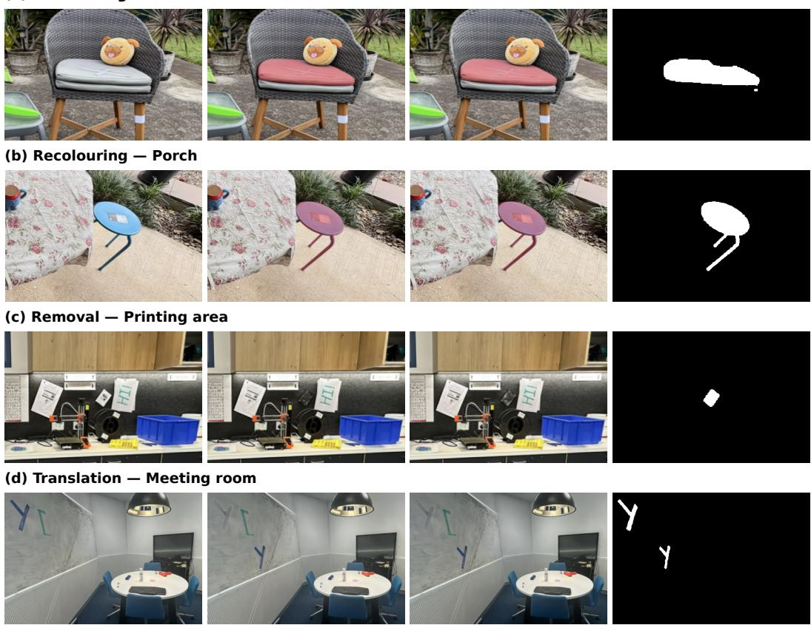  
Figure 4: Selected examples from the editing subset, showing recolouring, removal, and translation in four scenes. Each row uses the same crop across the real reference image, synthetic query, relit synthetic query, and edit mask. White marks regions labelled changed; translation includes both original and displaced locations. Relighting preserves these labels. Condition-specific ignore masks are omitted.

by bilinear upsampling for semantic differences. The semantic cue is then rescaled with the RGB extrema and restricted to [0, 1].

Renderer-conditioned response suppression uses two logistic models with standardized inputs. Their outputs $\ell _ { \mathrm { b a s e } } ( x )$ and $\bar { \ell _ { \mathrm { f u l l } } ( x , z ) }$ are predicted change log odds. The vector x contains the fused response, its $2 1 \times 2 1$ mean, $7 \times 7$ standard deviation, and gradient magnitude. The full model additionally uses renderer features z: coverage, gradients, ray-composition statistics, depth dispersion, and response–renderer interactions. The correction rule $\mathcal { T } ( \ell _ { \mathrm { b a s e } } , \ell _ { \mathrm { f u l l } } ) = \operatorname* { m i n } \{ \ell _ { \mathrm { f u l l } } - \ell _ { \mathrm { b a s e } } , 0 \}$ acts on response log odds:

$$
R _ { t } = \sigma \big ( \mathrm { l o g i t } R _ { t } ^ { 0 } + \mathcal { T } \big ( \ell _ { \mathrm { b a s e } } ( x _ { t } ) , \ell _ { \mathrm { f u l l } } ( x _ { t } , z _ { t } ) \big ) \big ) .\tag{18}
$$

Both regressions use L2 regularization. The correction is lower-bounded by the 1st percentile of training logit differences and upper-bounded by zero; it is disabled where rendered coverage is at most $1 \bar { 0 } ^ { - 3 }$ . Fitting and deployment use this same corrected $R _ { t }$

Response-to-evidence mapping. The mapping $\ell _ { \mathrm { i m g } }$ is a monotone log likelihood ratio. Following Section 4.3, we separately normalize response histograms for changed regions of edited images $\mathcal { H } _ { 1 }$ , unchanged regions of those images $\mathbf { \dot { \mathcal { H } } _ { 0 } ^ { \mathrm { e d i t } } }$ , and unedited reference controls $\mathcal { H } _ { 0 } ^ { \mathrm { r e f } }$ . Changed regions from all edit types contribute to $\mathcal { H } _ { 1 }$ . The unchanged likelihood is their fixed mixture $p _ { 0 } =$ $\begin{array} { r } { \frac { 1 } { 2 } \mathcal { p } _ { 0 } ^ { \mathrm { e d i t } } + \frac { 1 } { 2 } p _ { 0 } ^ { \mathrm { r e f } } } \end{array}$ . These coefficients specify the relative contributions of unchanged regions in edited images and unedited controls.

Isotonic regression (Zadrozny & Elkan, 2002) of the class-balanced changed fraction, weighted by pooled histogram mass, determines contiguous response blocks. For source $s \in \{ 1 , { \mathrm { e d i t } } , { \mathrm { r e f } } \}$ and block $B _ { b } .$ let $M _ { s b }$ be its normalized histogram mass and $N _ { s }$ its effective training-record count. Smoothed block probabilities and the corresponding log likelihood ratio are

$$
\widehat { p } _ { s b } = \frac { N _ { s } M _ { s b } + \frac { 1 } { 2 } } { N _ { s } + \frac { 1 } { 2 } K _ { B } } , \qquad \ell _ { b } = \log \frac { \widehat { p } _ { 1 b } } { \frac { 1 } { 2 } \widehat { p } _ { \mathrm { e d i t } , b } + \frac { 1 } { 2 } \widehat { p } _ { \mathrm { r e f } , b } } ,\tag{19}
$$

where $K _ { B }$ is the number of current blocks. Effective counts respect training-record grouping: object– camera units for edited-image classes and camera units for unchanged controls. Violations of monotonicity after smoothing are merged and re-estimated. We interpolate the block values onto a 4,096- entry lookup table and keep the tails constant. For a response block $b ,$ define $\begin{array} { r } { \widehat { p } _ { 0 b } = \frac { 1 } { 2 } \widehat { p } _ { \mathrm { e d i t } , b } + \frac { 1 } { 2 } \widehat { p } _ { \mathrm { r e f } , b } } \end{array}$ With equal prior weights for changed and unchanged regions, Bayes’ rule gives

$$
P _ { \mathrm { e m p } , b } = \frac { \widehat { p } _ { 1 b } } { \widehat { p } _ { 1 b } + \widehat { p } _ { 0 b } } = \sigma ( \ell _ { b } ) .\tag{20}
$$

Applying the interpolated mapping gives $P _ { t } = \sigma ( \ell _ { \mathrm { i m g } } ( R _ { t } ) )$ . These equal prior weights define the image-evidence scale. The scene-specific effective pixel prior π is fitted separately using the causal prediction and field update in Eqs. 1 and 6.

Gaussian response moments. Both aggregation and support rendering use the rasterizer contributions defined in Section 3. Zero denominators are guarded numerically. Pixels with insufficient reference coverage receive zero change probability but remain included in evaluation. For the second aggregation, define

$$
r _ { t g } = [ A _ { t } ( C _ { t } ) ] _ { g } , \qquad v _ { t g } = [ A _ { t } ( C _ { t } ^ { 2 } ) ] _ { g } - r _ { t g } ^ { 2 } .\tag{21}
$$

Thus $v _ { t g }$ measures dispersion across the current image footprint. It is not a variance of the estimated mean across independent images. The first aggregation applies the same operator to the current image evidence $\bar { P _ { t } }$

Observation indicators. Neighbourhood evidence and history accumulation use binary support indicators,

$$
{ \mathbb { I } } _ { t g } = { \mathbb { H } } \{ s _ { t g } \geq 1 \} ,\tag{22}
$$

where $s _ { t g }$ is the rendering contribution summed over the image (Section 4.2). The same rule is used in synthetic sequence replay for effective-prior estimation and in online inference. Every sufficiently supported Gaussian contributes one observation.

Unchanged-response fitting applies Eq. 22 to reference images in the unchanged-only subset. Thus each sufficiently supported observation receives equal fitting weight; observations below the support threshold are excluded. The resulting unchanged-response model and spatial co-response coefficient c are frozen before effective-prior estimation and online inference.

Reference neighbourhoods. We first retrieve eight nearest Gaussian centres, make the candidate edges undirected, and remove duplicates and self-edges. Geometry and colour affinities then filter and weight these connections. The final undirected degree can exceed eight. For centre displacement $\Delta x _ { g j }$ , spatial covariances $\Sigma _ { g } , \Sigma _ { j }$ , and reference RGB colours $\mathbf { k } _ { g } , \mathbf { k } _ { j }$ from the zeroth-order spherical harmonic coefficients, the affinity is

$$
\eta _ { g j } = \exp \left[ - \frac { 1 } { 2 } \Delta x _ { g j } ^ { \mathsf { T } } ( \Sigma _ { g } + \Sigma _ { j } ) ^ { - 1 } \Delta x _ { g j } - \frac { \| \mathbf { k } _ { g } - \mathbf { k } _ { j } \| ^ { 2 } } { 2 s _ { \mathrm { c o l o u r } } ^ { 2 } } \right] .\tag{23}
$$

The colour scale $s _ { \mathrm { c o l o u r } }$ is the median nonzero colour distance among geometrically overlapping candidates, floored at 0.001. The covariance solve is regularized numerically, and the geometric squared distance is capped at 50. Edges with combined affinity no greater than $1 0 ^ { - 4 }$ are removed. The spatial covariance matrices describe Gaussian shape. The resulting connections define each Gaussian’s local reference neighbourhood.

## B UNCHANGED-SCENE RESPONSE STATISTICS

The frozen image-evidence pipeline is applied to the smaller camera group’s unchanged images. For image t, aggregating current evidence $C _ { t }$ gives the Gaussian response $\bar { \boldsymbol { r } } _ { t g } = [ \mathcal { A } _ { t } ( \bar { \boldsymbol { C } } _ { t } ) ] _ { g }$ , with observation indicator $\mathbb { I } _ { t g }$ from Eq. 22 in Appendix A. All subsequent unchanged-response statistic refer to this normalized response coordinate, including current-view Gaussian-aggregated support.

Unchanged-response mean and uncertainty. All sums below use reference observations from the unchanged-only subset. The scene mean is $\begin{array} { r } { \dot { \mu _ { \mathrm { s c e n e } } } = ( \sum _ { t , g } \mathbb { I } _ { t g } r _ { t g } ) / ( \sum _ { t , g } \mathbb { I } _ { t g } ) } \end{array}$ , clipped to $[ 1 0 ^ { - 3 } , 1 -$ $1 0 ^ { - 3 } \rceil$ . To derive the response moments, start with a Beta $( \kappa \mu _ { \mathrm { s c e n e } } , \kappa ( 1 - \mu _ { \mathrm { s c e n e } } ) )$ prior for response level $\theta _ { g }$ , with $\kappa > 0$ . Updating it with fractional response counts gives

$$
\alpha _ { g } = \kappa \mu _ { \mathrm { s c e n e } } + \sum _ { t } \mathbb { I } _ { t g } r _ { t g } , \qquad \beta _ { g } = \kappa ( 1 - \mu _ { \mathrm { s c e n e } } ) + \sum _ { t } \mathbb { I } _ { t g } ( 1 - r _ { t g } ) .\tag{24}
$$

This follows from multiplying the prior density by $\begin{array} { r l } { \prod _ { t } [ \theta _ { g } ^ { r _ { t g } } ( 1 - \theta _ { g } ) ^ { 1 - r _ { t g } } ] ^ { \mathbb { I } _ { t g } } } \end{array}$ using Beta conjugacy (Gelman et al., 2013); continuous responses make this a soft-count approximation. We use the limit $\kappa  0 ^ { + }$ of the mean and variance, $\alpha _ { g } / ( \alpha _ { g } + \beta _ { g } )$ and $\alpha _ { g } \beta _ { g } / [ ( \alpha _ { g } + \bar { \beta } _ { g } ) ^ { 2 } ( \alpha _ { g } + \beta _ { g } + 1 ) ]$

$$
\mu _ { g } = \left\{ \begin{array} { l l } { \displaystyle \sum _ { t } \mathbb { I } _ { t g } r _ { t g } } & { , \sum _ { t } \mathbb { I } _ { t g } > 0 , } \\ { \displaystyle \sum _ { t } \mathbb { I } _ { t g } } & { \sum _ { t } \mathbb { I } _ { t g } = 0 , } \end{array} \right. \qquad \tau _ { g } ^ { 2 } = \frac { \mu _ { g } \left( 1 - \mu _ { g } \right) } { 1 + \sum _ { t } \mathbb { I } _ { t g } } .\tag{25}
$$

Thus observed Gaussians use their own mean without shrinkage, while unobserved Gaussians retain the limiting scene-based moments. The implementation evaluates these moments directly, including zero limiting variance when all observed responses are zero or one. The variance represents uncertainty in this soft-count construction, not the empirical predictive variance of a new image. At inference, we use the approximate standardized coordinate

$$
z _ { t g } = \frac { r _ { t g } - \mu _ { g } } { \sqrt { \tau _ { g } ^ { 2 } + v _ { t g } } } .\tag{26}
$$

The denominator combines uncertainty in the fitted unchanged-response level with dispersion within the current image footprint to define a working standardization scale.

Spatial co-response in unchanged scenes. To estimate spatial correlation, first standardize reference responses by each Gaussian’s empirical weighted mean and across-view standard deviation, giving $\widetilde { z } _ { t g }$ . These empirical statistics are used for estimating c, and are distinct from Eq. 26. For eneighbourhood affinity $\eta _ { g j }$ and edge weight $\omega _ { t g j } ^ { \mathrm { f i t } } = \eta _ { g j }$ min $( \mathbb { I } _ { t g } , \mathbb { I } _ { t j } )$ , summing over the unchangedonly subset gives

$$
c = \frac { \sum _ { t , ( g , j ) } \omega _ { t g j } ^ { \mathrm { f i t } } \widetilde { z } _ { t g } \widetilde { z } _ { t j } } { \sum _ { t , ( g , j ) } \omega _ { t g j } ^ { \mathrm { f i t } } } .\tag{27}
$$

## C CONDITIONAL NEIGHBOURHOOD BAYES FACTOR

Weighted neighbourhood statistics. For neighbours $j$ of Gaussian $^ { g , }$ let $\omega _ { t g j } = \eta _ { g j } \mathbb { I } _ { t j }$ and $W _ { t g } =$ $\sum _ { j } \omega _ { t g j }$ . For $W _ { t g } > 0$

$$
\bar { z } _ { t g } = \frac { \sum _ { j } \omega _ { t g j } z _ { t j } } { W _ { t g } } , \qquad d _ { t g } = \frac { \sum _ { j } \omega _ { t g j } ( z _ { t j } - \bar { z } _ { t g } ) ^ { 2 } } { W _ { t g } } , \qquad n _ { t g } = \frac { W _ { t g } ^ { 2 } } { \sum _ { j } \omega _ { t g j } ^ { 2 } } .\tag{28}
$$

Here $\bar { z } _ { t g }$ is the weighted mean, $d _ { t g }$ the weighted dispersion, and $n _ { t g }$ the effective neighbour count. The working variance $V _ { t g }$ of that mean accounts for dispersion and correlation; $\nu _ { t g }$ is the conditional residual variance used by the Bayes factor:

$$
V _ { t g } = \frac { \operatorname* { m a x } ( 1 , d _ { t g } ) } { \operatorname* { m a x } ( 1 , n _ { t g } ) } \left[ 1 + c ( n _ { t g } - 1 ) _ { + } \right] , \qquad \nu _ { t g } = \operatorname* { m a x } ( V _ { t g } - c ^ { 2 } , \epsilon _ { \nu } ) .\tag{29}
$$

Here $( x ) _ { + } = \operatorname* { m a x } ( x , 0 )$ , and we use variance floor $\epsilon _ { \nu } = 1 0 ^ { - 4 }$

Why subtract the anchor response? Suppressing the frame and anchor indices, write $\begin{array} { r } { \bar { z } = \bar { z } _ { t g } , } \end{array}$ $z _ { g } = z _ { t g } , V = V _ { t g } ,$ , and $\nu = \nu _ { t g }$ . We use a zero-mean Gaussian working model under unchanged conditions. Setting $\mathrm { V a r } ( z _ { g } \mid \mathcal { H } _ { 0 } ) \stackrel { \sim } { = } 1$ and approximating $\operatorname { C o v } ( \bar { z } , z _ { g } \mid \mathcal { H } _ { 0 } )$ by c gives the conditional mean

$$
\mathbb { E } [ \bar { z } \mid z _ { g } , \mathcal { H } _ { 0 } ] = \frac { \mathrm { C o v } ( \bar { z } , z _ { g } \mid \mathcal { H } _ { 0 } ) } { \mathrm { V a r } ( z _ { g } \mid \mathcal { H } _ { 0 } ) } z _ { g } \approx c z _ { g } .\tag{30}
$$

The corresponding conditional variance is $V - c ^ { 2 }$ . Unit anchor variance is a fixed modelling scale: Eq. 26 does not guarantee that the empirical variance of $z _ { g }$ equals one. Using $c$ transfers the spatial co-response estimated in Eq. 27 to this working model as a covariance approximation. The residual variance remains neighbourhood-dependent through Eq. 29. A shared increase δ in the responses of the anchor and neighbours leaves residual mean $( 1 - c ) \delta$ . This motivates $e = \bar { z } - c z _ { g }$ and loading $a = 1 - c$

Within this residual model, $\mathcal { H } _ { \mathrm { 0 } }$ denotes zero residual mean and $\mathcal { H } _ { 1 }$ a shared increase in response, with half-normal prior scale τ:

$$
\mathcal { H } _ { 0 } : e \sim \mathcal { N } ( 0 , \nu ) , \qquad \mathcal { H } _ { 1 } : e \mid \delta \sim \mathcal { N } ( a \delta , \nu ) , \qquad \delta \sim \mathrm { H a l f N o r m a l } ( \tau ) , \quad \tau = 1 .\tag{31}
$$

The variance floor in Eq. 29 also regularizes cases where the plug-in covariance approximation is not positive definite.

Integrating over the response increase. We evaluate the marginal likelihood of the residual e with a and $\nu > 0$ held fixed. For $\delta \geq 0$ , the half-normal density $ { \boldsymbol { p } } _ { + } ( \delta )$ is

$$
p _ { + } ( \delta ) = 2 \mathcal { N } ( \delta ; 0 , \tau ^ { 2 } ) = \frac { 2 } { \sqrt { 2 \pi } \tau } \exp \left( - \frac { \delta ^ { 2 } } { 2 \tau ^ { 2 } } \right) .
$$

Here $\tau > 0$ is the enhancement prior scale, fixed to 1 in our method; it is distinct from the fitted uncertainty $\tau _ { g } ^ { 2 } .$ . Since the enhancement δ is unknown, the marginal likelihood $p ( e \mid \mathcal { H } _ { 1 } )$ integrates over this prior:

$$
p ( e \mid \mathcal { H } _ { 1 } ) = \int _ { 0 } ^ { \infty } \mathcal { N } ( e ; a \delta , \nu ) p _ { + } ( \delta ) d \delta .
$$

The local Bayes factor B therefore becomes

$$
B = \frac { p ( e \mid \mathcal { H } _ { 1 } ) } { p ( e \mid \mathcal { H } _ { 0 } ) } = \int _ { 0 } ^ { \infty } \frac { \mathcal { N } ( e ; a \delta , \nu ) } { \mathcal { N } ( e ; 0 , \nu ) } p _ { + } ( \delta ) d \delta .
$$

Both likelihoods have variance $\nu ,$ so their normalization factors cancel. Expanding the squared terms gives

$$
\begin{array} { l } { \displaystyle \frac { \mathcal { N } ( e ; a \delta , \nu ) } { \mathcal { N } ( e ; 0 , \nu ) } = \exp \biggl ( - \frac { ( e - a \delta ) ^ { 2 } } { 2 \nu } + \frac { e ^ { 2 } } { 2 \nu } \biggr ) } \\ { = \exp \biggl ( - \frac { e ^ { 2 } - 2 a e \delta + a ^ { 2 } \delta ^ { 2 } - e ^ { 2 } } { 2 \nu } \biggr ) } \\ { = \exp \biggl ( \frac { a e } { \nu } \delta - \frac { a ^ { 2 } } { 2 \nu } \delta ^ { 2 } \biggr ) . } \end{array}
$$

Multiplying by the half-normal prior yields

$$
B = \frac { 2 } { \sqrt { 2 \pi } \tau } \int _ { 0 } ^ { \infty } \exp \left[ \frac { a e } { \nu } \delta - \frac { 1 } { 2 } \left( \frac { a ^ { 2 } } { \nu } + \tau ^ { - 2 } \right) \delta ^ { 2 } \right] d \delta .
$$

Define the coefficients $h = a e / \nu$ and $J = a ^ { 2 } / \nu + \tau ^ { - 2 } > 0$ . Completing the square gives

$$
\begin{array} { c } { { \displaystyle h \delta - \frac { 1 } { 2 } J \delta ^ { 2 } = - \frac { J } { 2 } \left( \delta ^ { 2 } - \frac { 2 h } { J } \delta \right) } } \\ { { = - \displaystyle \frac { J } { 2 } \left[ \left( \delta - \frac { h } { J } \right) ^ { 2 } - \frac { h ^ { 2 } } { J ^ { 2 } } \right] } } \\ { { = - \displaystyle \frac { J } { 2 } \left( \delta - \frac { h } { J } \right) ^ { 2 } + \frac { h ^ { 2 } } { 2 J } . } } \end{array}
$$

The last term does not depend on $\delta ,$ so

$$
B = \frac { 2 } { \sqrt { 2 \pi } \tau } \exp \left( \frac { h ^ { 2 } } { 2 J } \right) \int _ { 0 } ^ { \infty } \exp \left[ - \frac { J } { 2 } \left( \delta - \frac { h } { J } \right) ^ { 2 } \right] d \delta .
$$

To evaluate the remaining integral, substitute $x = \sqrt { J } ( \delta - h / J )$ , giving $d \delta = d x / \sqrt { J }$ . The lower limit $\delta = 0$ becomes $x = - h / \sqrt { J }$ , while the upper limit remains infinity. Thus

$$
B = \frac { 2 } { \tau \sqrt { J } } \exp \left( \frac { h ^ { 2 } } { 2 J } \right) \left[ \frac { 1 } { \sqrt { 2 \pi } } \int _ { - h / \sqrt { J } } ^ { \infty } e ^ { - x ^ { 2 } / 2 } d x \right] .
$$

Writing $\Phi$ for the standard normal cumulative distribution function, the bracketed term equals

$$
1 - \Phi \left( - \frac { h } { \sqrt { J } } \right) = \Phi \left( \frac { h } { \sqrt { J } } \right) ,
$$

by symmetry of the standard normal distribution. The resulting Bayes factor B is

$$
B = \frac { 2 } { \tau \sqrt { J } } \exp \left( \frac { h ^ { 2 } } { 2 J } \right) \Phi \left( \frac { h } { \sqrt { J } } \right) .\tag{32}
$$

Taking logarithms gives the log evidence log B:

$$
\log B = \log 2 - \log \tau - { \textstyle { \frac { 1 } { 2 } } } \log J + \frac { h ^ { 2 } } { 2 J } + \log \Phi \left( \frac { h } { \sqrt { J } } \right) .\tag{33}
$$

With $\tau = 1$ , restoring the indices gives $h _ { t g } = ( 1 - c ) e _ { t g } / \nu _ { t g }$ and $J _ { t g } = ( 1 - c ) ^ { 2 } / \nu _ { t g } + 1$ , recovering Eq. 5. The Gaussian likelihood and half-normal prior make the exponent quadratic in δ, reducing marginalization to a standard normal CDF evaluation. The integral is therefore evaluated analytically under the specified residual model, without numerical integration or iterative optimization. If no neighbour has positive observation weight, we use neutral evidence $B = 1$ , so the log evidence is zero.

Implementation bounds. We evaluate log $\Phi ( h / { \sqrt { J } } )$ directly using the numerically stable log\_ndtr function, avoiding an explicit CDF floor. The implementation floors $\tau _ { g } ^ { 2 } + v _ { t g }$ at $1 0 ^ { - 6 }$ to avoid division by zero, while $\epsilon _ { \nu } = 1 0 ^ { - 4 }$ prevents a degenerate residual variance.

We clip standardized responses and per-observation log Bayes factors to [−12, 12] to limit the influence of extreme observations. These bounds are fixed across scenes. The dispersion floor and correlation adjustment in Eq. 29 are part of the working model.

## D ACCUMULATED SUPPORT AND CAUSAL DECODING

Generalized pixel posterior. Let $y = 1$ denote pixel change and $y = 0$ no change. For a support value $p \in ( 0 , 1 )$ , define the binary cross-entropy loss and the sum used for fusion:

$$
\begin{array} { r l } & { \mathrm { B C E } ( y , p ) = - y \log p - ( 1 - y ) \log ( 1 - p ) , } \\ & { \quad \mathcal { L } _ { t } ( y , u ) = \mathrm { B C E } ( y , C _ { t } ( u ) ) + \mathrm { B C E } ( y , H _ { t } ( u ) ) . } \end{array}\tag{34}
$$

The two terms assign unit weight to agreement with current evidence and historical support. Let $q _ { t } ( y \mid u )$ denote the generalised posterior distribution over the two labels at pixel $u ,$ , formed from $C _ { t } ( u ) , \dot { H } _ { t } ( u )$ , and prior π. A loss-based Bernoulli update (Bissiri et al., 2016) gives

$$
q _ { t } ( y \mid u ) = \frac { \pi ^ { y } ( 1 - \pi ) ^ { 1 - y } \exp [ - \mathcal { L } _ { t } ( y , u ) ] } { \sum _ { v \in \{ 0 , 1 \} } \pi ^ { v } ( 1 - \pi ) ^ { 1 - v } \exp [ - \mathcal { L } _ { t } ( v , u ) ] } .\tag{35}
$$

Taking the ratio of the two label probabilities gives

$$
\frac { q _ { t } ( 1 \mid u ) } { q _ { t } ( 0 \mid u ) } = \frac { \pi } { 1 - \pi } \frac { C _ { t } ( u ) } { 1 - C _ { t } ( u ) } \frac { H _ { t } ( u ) } { 1 - H _ { t } ( u ) } .\tag{36}
$$

The scalar map $Q _ { t } ^ { \mathrm { p i x e l } } ( u ) = q _ { t } ( y = 1 \mid u )$ contains the generalised posterior probability of change; $q _ { t } ( y = 0 \mid u ) = 1 { - } Q _ { t } ^ { \mathrm { p i x e l } } ( u )$ . This gives the odds update in Eq. 1, equivalently $Q _ { t } ^ { \mathrm { p i x e l } } = \sigma ( \log \mathrm { i t } \pi +$ $\log \mathrm { i t } { C _ { t } } + \log \mathrm { i t } { H _ { t } } )$ . The implementation evaluates this closed form; the loss representation adds no training step. It specifies a composite evidence update rather than a factorization into independent observations. Selecting π by synthetic training IoU is a separate optimization objective from $\mathcal { L } _ { t } ^ { }$ neither that selection nor normalization guarantees exact probabilities on the target distribution.

Accumulated neighbourhood evidence. After pixel prediction, each sufficiently supported observation adds its log Bayes factor to the previous accumulated field $F _ { t - 1 }$ , giving the updated accumulated field $F _ { t } \mathbf { : }$

$$
F _ { t g } = F _ { t - 1 , g } + \mathbb { I } _ { t g } \log B _ { t g } .\tag{37}
$$

The accumulator starts at zero; the decoded support depends directly on $F _ { t g }$ . Neither initial image responses nor final pixel posteriors are written into this state. An observed Gaussian without usable neighbours contributes zero log evidence and leaves the accumulator unchanged.

Rendering the previous support. The previous accumulated field $F _ { t - 1 }$ is decoded per Gaussian before rendering:

$$
H _ { t } ( u ) = \frac { \sum _ { g } a _ { t u g } \sigma ( F _ { t - 1 , g } ) } { \chi _ { t u } } .\tag{38}
$$

The sigmoid is applied to each Gaussian before spatial averaging; only then do we take logit $H _ { t }$ for the pixel update. The normalized contributions $a _ { t u g } / \chi _ { t u }$ mix support from reference Gaussians associated with the pixel. With no previous observations, $F = 0 ,$ , giving $\sigma ( F ) = 0 . 5$ and neutral history on covered pixels. The effective prior π is applied after this rendering and leaves the Gaussian evidence accumulator unchanged.

Effective-prior search parameterization and storage. Let $Z =$ logit C + logit H. The generalised posterior is $\sigma ( Z + \mathrm { l o g i t } \pi ) = \sigma ( Z - b _ { \pi } )$ , where $b _ { \pi } = - \log \mathrm { i t } \pi$ . For threshold search the implementation uses the equivalent coordinate $s = Z / 2 , \beta = b _ { \pi } / 2$ , so $\sigma ( Z - b _ { \pi } ) = \sigma ( 2 ( s - \beta ) )$ and the mask is determined by $s \geq \beta$ . The scale factor is retained when evaluating scores. The fitted prior is stored directly in log-odds form.

Before evaluating their logits, we clamp C and H to $[ \epsilon _ { \mathrm { f p 3 2 } } , 1 - \epsilon _ { \mathrm { f p 3 2 } } ]$ , where $\epsilon _ { \mathrm { f p 3 2 } } = 2 ^ { - 2 3 }$ is the machine epsilon for float $^ { 3 2 , }$ to avoid infinities at 0 and 1.1 Synthetic replay and online detection use the same floating-point probability maps, coverage mask, and decoding rule. Execution order. For each query image, the implementation:

1. computes the image–render response, applies the learned response suppression, and applies the monotone evidence mapping;

2. aggregates this score onto the Gaussians, renders Gaussian-aggregated support, and combines the two to obtain $C _ { t } ;$

3. aggregates $C _ { t }$ once, standardizes against the unchanged-response model, and computes conditional neighbourhood evidence;

4. renders history from the previous accumulated field $F _ { t - 1 }$ and combines it with $C _ { t }$ using the fitted effective prior to obtain the pixel posterior;

5. adds the current log Bayes factor to the evidence accumulator for each sufficiently supported Gaussian exactly once.

Object-guided mask refinement acts on the image prediction without modifying history. A new target sequence starts with empty state.

Insufficient reference coverage. The observation indicator $\mathbb { I } _ { t g }$ prevents history updates when Gaussian $g \mathbf { \dot { s } }$ total rendering contribution is below one; without usable neighbours, log $B _ { t g } = 0$ Pixels with reference coverage at most $1 0 ^ { - 3 }$ are assigned zero change probability and excluded from object completion, but remain in the evaluation domain. These rules avoid unsupported updates but cannot recover missing geometry, so changes in uncovered regions may be missed. The indicator measures rendering contribution, not geometric accuracy.

## E RELIABILITY-WEIGHTED EFFECTIVE-PRIOR ESTIMATION

The effective pixel prior is fitted for the synthetic training objective in Eq. 13; it specifies an operating point, not an estimate of deployment change frequency. We implement this optimization through the equivalent threshold coordinate $b _ { \pi } = - \log \mathrm { i t } \pi$ , using $s = Z \bar { / 2 }$ and $\beta = b _ { \pi } / 2$ for the deploymentmatched search below. This one-to-one reparameterization preserves the objective and its optimality gap. For image i, foreground IoU is Io $\mathrm { U } ( \widehat { Y } _ { i } ^ { \mathrm { p i x e l } } ( \pi ) , Y _ { i } ) = \mathrm { T P } _ { i } ( \pi ) / ( N _ { i } ^ { + } + \mathrm { F P } _ { i } ( \pi ) )$ , where $N _ { i } ^ { + }$ counts labelled changed pixels, and $\mathrm { T P } _ { i }$ band $\mathrm { F P } _ { i }$ count true and false positives before refinement.

Comparing unchanged-response tails across events. For synthetic image i, let $H _ { 0 , i }$ be its labelled unchanged pixels and $s _ { i } ( x )$ the decision score at pixel x. For a score cutoff v, the unchanged survival curve is the fraction of these pixels exceeding it:

$$
T _ { i } ( v ) = { \frac { | \{ x \in H _ { 0 , i } : s _ { i } ( x ) \geq v \} | } { | H _ { 0 , i } | } } .\tag{39}
$$

An edit event is an object/edit-type combination. First average $T _ { i }$ within each event e to obtain $\overline { { T } } _ { e } .$ For an image from event $e ,$ its reference curve is the pointwise median of $\overline { { T } } _ { e ^ { \prime } }$ over other events $e ^ { \prime } \neq e ,$ denoted $T _ { - e } ^ { \mathrm { r e f } }$ . This forms an unchanged-response reference across events, limiting the influence of repeated images of any one event.

Let $e ( i )$ be image i’s event and $[ v _ { \mathrm { m i n } } , v _ { \mathrm { m a x } } ]$ the range of training-score cutoffs used to compare tails. Excess high response is

$$
d _ { i } = \frac { 1 } { v _ { \operatorname* { m a x } } - v _ { \operatorname* { m i n } } } \int _ { v _ { \operatorname* { m i n } } } ^ { v _ { \operatorname* { m a x } } } \left[ T _ { i } ( v ) - T _ { - e ( i ) } ^ { \mathrm { r e f } } ( v ) \right] _ { + } d v .\tag{40}
$$

The implementation evaluates this integral by the trapezoidal rule on the fixed training-score cutoffs.   
The subsequent decision-threshold search operates over the full score range.

Let $D _ { e } = \mathrm { m e d i a n } _ { i : e ( i ) = e } d _ { i }$ . For event $e ,$ compute the centre $m _ { - e }$ and scale $a \mathrm { - } e$ from the other event medians:

$$
\begin{array} { l l } { { \displaystyle m _ { - e } = \mathrm { m e d i a n } _ { e ^ { \prime } \not = e } D _ { e ^ { \prime } } , } } & { { ~ a _ { - e } = 1 . 4 8 2 6 \mathrm { ~ m e d i a n } _ { e ^ { \prime } \not = e } | D _ { e ^ { \prime } } - m _ { - e } | , } } \\ { { \displaystyle z _ { i } ^ { \mathrm { t a i l } } = \left[ \frac { d _ { i } - m _ { - e ( i ) } } { a _ { - e ( i ) } } \right] _ { + } , } } & { { ~ \rho _ { i } = \displaystyle \frac { 1 } { 1 + ( z _ { i } ^ { \mathrm { t a i l } } ) ^ { 2 } } . } } \end{array}\tag{41}
$$

Images with $z _ { i } ^ { \mathrm { t a i l } } = 0$ receive weight one; standardized excesses of one and two receive weights $1 / 2$ and $1 / 5$ . The factor 1.4826 scales the median absolute deviation (MAD) to match the standard deviation under a Gaussian model. The deployed fit requires positive across-event MAD. We retain the original pixel counts and IoU definitions; $\rho _ { i }$ weights each image’s contribution to the mean IoU according to its unchanged-response reliability.

Training sequences and fixed weights. Sequences of images from the editing subset use the same image-evidence pipeline, unchanged-response model, history update order, and pixel prediction rule as online inference. The weights in Eq. 41 are normalized as $\widetilde { \rho _ { i } } = \rho _ { i } / \sum _ { j } \rho _ { j }$ , computed once before esearching for the threshold and remain fixed throughout optimization. Synthetic labels supply the unchanged regions used for reliability weighting and the changed regions used for IoU.

A valid branch-and-bound upper bound. Let $J ( v )$ be the reliability-weighted IoU at decision threshold v in the s coordinate. Increasing v can only decrease both TP and FP. Consequently, for any interval $[ l , r ]$ and any v within it,

$$
J ( v ) \leq U ( l , r ) = \sum _ { i } \widetilde { \rho } _ { i } \frac { \mathrm { T P } _ { i } ( l ) } { N _ { i } ^ { + } + \mathrm { F P } _ { i } ( r ) } .\tag{42}
$$

The numerator at l bounds candidate numerators from above, and the denominator at $r$ bounds denominators from below. Nonnegative weights preserve the bound under summation, even if no threshold attains it.

The search starts from a range enclosing the training scores, including all-positive and all-negative decisions. Sorted changed and unchanged scores support exact count queries by binary search. The optimizer maintains the best evaluated objective $J _ { \mathrm { b e s t } }$ , splits the remaining interval with the highest bound, evaluates new candidates, and prunes intervals whose bound cannot improve the best objective value found so far. It stops when

$$
\operatorname* { m a x } _ { \mathrm { r e m a i n i n g ~ i n t e r v a l s } } U ( l , r ) - J _ { \mathrm { b e s t } } \leq 1 0 ^ { - 4 } .\tag{43}
$$

This is 0.01 percentage points in the synthetic training IoU objective. Midpoint subdivision does not require IoU to be monotone or unimodal. The certificate applies to the recorded, weighted training objective with the deployment pixel prediction rule.

## F OBJECT-GUIDED MASK REFINEMENT

Object-guided mask refinement uses shared SAM2 image embeddings to suppress unsupported detections and complete retained object regions.

Contour learning from pixel proposals. We process sequences of images from the editing subset with the fixed pixel models, effective prior, and causal history. Thresholding the source pixel posterior at 0.5 produces connected components whose boxes prompt SAM2 on the synthetic query and reference rendering. Predictions supply prompts only: change masks from automatic reference edits (Appendix A.1) supply pixel labels, and ignored pixels are excluded.

The classifier uses 18 query/reference-symmetric features. We rank SAM2’s three candidates independently in each view by predicted IoU and pair them by rank, forming paired mask logits, quality scores, and their per-side products. Each pair is replaced by its maximum and minimum, using the same transformation during fitting and inference. This retains support from either image regardless of which side contains the object. Within each source image, existing class-balanced pixel weights are multiplied once by its fixed prior-fitting reliability $\rho _ { i }$ . Global balancing then gives each class total weight 0.5 within its fitting or validation split. These weights are used for feature standardization, L2-regularized logistic regression, and Platt sigmoid scaling (Platt, 2000). At inference, standardization and both fitted affine transformations are folded into a single affine score $\ell _ { \mathrm { c o n t o u r } }$ on the unstandardized symmetric features. The contour fitting/validation split is by edited object; upstream pixel models still use the larger camera group. The pixel parameters and prior are unchanged.

Online contour filtering. We decode masks on the query image and reference rendering using bounding-box prompts from detected connected components. The fitted classifier converts their mask-comparison features into $\ell _ { \mathrm { c o n t o u r } } ( u )$ . Its non-positive part gives the contour-filtered score $Q _ { t } ^ { \mathrm { c o n t o u r } } ( \bar { u } )$ through Eq. 8.

Object completion. Point prompts at response peaks of the surviving components produce SAM2 candidates in the query image. For each prompt, we select the candidate with highest predicted mask quality. For a candidate mask M over covered pixels, its mean log-odds evidence is $\overline { { L } } _ { M } =$ $| M | ^ { - 1 } \sum _ { u \in M }$ logit $Q _ { t } ^ { \mathrm { p i x e l } } ( u )$ , where |M| is the number of covered pixels in the mask. We retain masks with $\overline { { L } } _ { M _ { \mathrm { ~ } } } \geq ~ 0$ and combine their confidence $\sigma ( \overline { { L } } _ { M } )$ with $Q _ { t } ^ { \mathrm { c o n t o u r } }$ to obtain the refined change score ${ Q } _ { t } ^ { \mathrm { f u l l } }$ using Eq. 9. The component filter skips regions smaller than the SAM feature cell, and empty or uncovered masks are excluded. The pixel prior is already included in $Q _ { t } ^ { \mathrm { p i x e l } }$ refinement modifies only the final output.

## G ADDITIONAL QUANTITATIVE RESULTS

Table 5 reports the full 20-instance comparison for the pixel and full outputs in Table 1.

## G.1 CROSS-INSTANCE REFERENCE REUSE

Each PASLCD scene has two instances. We retain the reference reconstruction and all fitted parameters from one instance and evaluate queries from the other, in both directions. This gives 20 directed pairs, each with 25 frames. The reused parameters include response suppression, the LLR mapping, Gaussian-indexed unchanged-response statistics and spatial co-response, the pixel prior, and the contour filter. No parameters are refitted or selected using target data, and each sequence starts with empty history.

Queries are processed on the reference image canvas using reference-derived poses and initial difference cues. Query RGB is resized to this canvas for refinement, and the fixed reference model is rendered at the query pose. Predictions are evaluated against the target instance’s original masks using the same resizing and thresholding convention as the main experiments. Table 7 reports all pairs. The original and cross-instance aggregate comparisons each contain every target instance once. Because the paired query sets are highly similar, this experiment tests within-scene reference reuse rather than cross-scene generalization. Runtime was not measured.

Table 5: PASLCD comparison using our evaluator over 20 scene-instances (%, higher is better). O-SCD(O) is online; O-SCD(R) includes offline refinement. Ours (pixel) is the pixel output; Ours (full) adds object-guided mask refinement. Our results average two complete runs; Total summarizes all 20 instances. Cell backgrounds mark first, second, and third place for each row and metric; these values are bold, and ties at the displayed precision share a rank.
<table><tr><td rowspan="2">Scene</td><td rowspan="2">Inst.</td><td colspan="2">O-SCD(O) CVPR 2026</td><td colspan="2">O-SCD(R) CVPR 2026</td><td colspan="2">Ours pixel</td><td colspan="2">Ours full</td></tr><tr><td>mIoU</td><td>F1</td><td>mIoU</td><td>F1</td><td>mIoU</td><td>F1</td><td>mIoU</td><td>F1</td></tr><tr><td>Cantina</td><td>1</td><td>50.24</td><td>65.86</td><td>62.05</td><td>76.05</td><td>57.84</td><td>72.68</td><td>62.79</td><td>76.23</td></tr><tr><td rowspan="2">Garden</td><td>2</td><td>49.38</td><td>65.16</td><td>54.75</td><td>70.19</td><td>55.29</td><td>70.48</td><td>58.98</td><td>73.16</td></tr><tr><td>1</td><td>49.58</td><td>65.52</td><td>52.28</td><td>67.07</td><td>68.38</td><td>80.43</td><td>75.31</td><td>85.33</td></tr><tr><td rowspan="2"></td><td>2</td><td>51.54</td><td>67.78</td><td>56.62</td><td>72.27</td><td>67.44</td><td>80.37</td><td>74.77</td><td>85.51</td></tr><tr><td>1</td><td>54.74</td><td>70.38</td><td>60.04</td><td>74.91</td><td>68.96</td><td>81.41</td><td>75.18</td><td>85.63</td></tr><tr><td rowspan="2">Lounge Lunch room</td><td>2</td><td>47.75</td><td>64.12</td><td>47.96</td><td>63.78</td><td>48.74</td><td>64.63</td><td>59.28</td><td>73.31</td></tr><tr><td>1</td><td>38.85</td><td>53.95</td><td>49.19</td><td>64.36</td><td>48.53</td><td>63.18</td><td>49.83</td><td>63.59</td></tr><tr><td rowspan="2">Meeting room</td><td>2</td><td>38.18</td><td>53.48</td><td>49.15</td><td>64.60</td><td>47.61</td><td>62.47</td><td>51.14</td><td>64.51</td></tr><tr><td>1</td><td>49.17</td><td>65.39</td><td>55.44</td><td>70.83</td><td>57.28</td><td>72.07</td><td>62.92</td><td>76.00</td></tr><tr><td rowspan="2">Playground</td><td>2</td><td>45.53</td><td>61.83</td><td>51.66</td><td>67.50</td><td>53.07</td><td>68.38</td><td>64.14</td><td>76.62</td></tr><tr><td>11</td><td>38.74</td><td>54.18</td><td>33.89</td><td>49.68</td><td>51.89</td><td>66.69</td><td>56.47</td><td>70.08</td></tr><tr><td rowspan="2">Porch</td><td>2</td><td>36.22</td><td>51.64</td><td>31.19</td><td>46.13</td><td>51.20</td><td>65.98</td><td>57.28</td><td>70.29</td></tr><tr><td>1</td><td>57.02</td><td>71.82</td><td>71.48</td><td>83.14</td><td>73.63</td><td>84.33</td><td>81.40</td><td>89.03</td></tr><tr><td rowspan="2">Pots</td><td>2</td><td>53.03</td><td>68.58</td><td>63.60</td><td>77.46</td><td>63.30</td><td>76.79</td><td>70.83</td><td>81.89</td></tr><tr><td>1</td><td>60.83</td><td>75.37</td><td>65.20</td><td>78.49</td><td>73.48</td><td>84.64</td><td>87.11</td><td>93.05</td></tr><tr><td rowspan="2">Printing area</td><td>2</td><td>57.67</td><td>72.63</td><td>63.04</td><td>76.89</td><td>55.75</td><td>71.04</td><td>74.84</td><td>85.17</td></tr><tr><td>1</td><td>60.69</td><td>74.60</td><td>69.68</td><td>81.82</td><td>75.97</td><td>86.11</td><td>78.06</td><td>87.46</td></tr><tr><td rowspan="2">Zen</td><td>2</td><td>52.11</td><td>67.94</td><td>57.86</td><td>73.03</td><td>61.95</td><td>76.24</td><td>66.95 75.55</td><td>79.82</td></tr><tr><td>1</td><td>47.42</td><td>60.72</td><td>62.23</td><td>72.33</td><td>67.46</td><td>76.15</td><td></td><td>81.31</td></tr><tr><td></td><td>2</td><td>46.17</td><td>60.97</td><td>62.54</td><td>74.88</td><td>59.52</td><td>71.92</td><td>70.01</td><td>79.47</td></tr><tr><td>Total</td><td></td><td>49.24</td><td>64.60</td><td>55.99</td><td>70.27</td><td>60.36</td><td>73.80</td><td>67.64</td><td>78.87</td></tr></table>

Table 6: Same-scene cross-instance reference reuse on PASLCD (%). Original pairing uses each instance’s own reference; cross-instance pairing uses the other instance’s reference and fitted parameters. Both average two runs of 20 sequences.
<table><tr><td rowspan="2">Output</td><td colspan="2">Original pairing</td><td colspan="2">Cross-instance</td></tr><tr><td>mIoU</td><td>F1</td><td>mIoU</td><td>F1</td></tr><tr><td>Ours (pixel)</td><td>60.36</td><td>73.80</td><td>59.93</td><td>73.39</td></tr><tr><td>Ours (full)</td><td>67.64</td><td>78.87</td><td>67.15</td><td>78.41</td></tr></table>

## G.2 FITTED PRIORS AND CHANGE AREA

We analyse the scene-specific priors fitted from reference edits.

Figure 5 shows the effective pixel priors $\pi ^ { \star }$ fitted from reference data for the 20 PASLCD instances. They range from 0.00588 to 0.30471, with median 0.02368 and interquartile range [0.01487, 0.05489]. Each prior selects an instance-specific decision operating point and remains fixed during online inference; it does not estimate the fraction of changed pixels in a query image.

To examine performance across change sizes, we group the 500 evaluated frames by the fraction of ground-truth changed pixels, keeping all fitted parameters and predictions unchanged (Table 8). For each query, we average the metrics from the two complete runs, then average over queries within each group, with false-positive rate $\mathrm { F P R } = \mathrm { F P } / ( \mathrm { F P } \overset { \cdot } { + } \mathrm { T N } )$ and false-negative rate FNR = $\mathrm { F N } / ( \mathrm { T P } + \mathrm { F N } )$ . Frames with less than 1% change have lower mIoU and higher FNR than the 1–5% group; refinement improves their mIoU while slightly increasing FNR. The observed change fractions span 0.17–20.13%, with only one frame above 20% and none at 30% or higher. Scene and viewpoint composition differ across groups, so this analysis describes fixed-prior performance rather than isolating the effect of change area or establishing robustness to prior drift.

Table 7: Cross-instance results for all 20 directed PASLCD pairs (%). Direction denotes reference instance → query instance. Pixel and full outputs use the same fixed reference reconstruction and fitted parameters.
<table><tr><td colspan="2"></td><td colspan="2">Pixel output</td><td colspan="2">Full output</td></tr><tr><td>Scene</td><td>Direction</td><td>mIoU</td><td>F1</td><td>mIoU</td><td>F1</td></tr><tr><td>Cantina</td><td>1 → 2</td><td>57.82</td><td>72.61</td><td>62.87</td><td>76.17</td></tr><tr><td>Cantina</td><td>2 → 1</td><td>54.89</td><td>70.08</td><td>57.88</td><td>72.29</td></tr><tr><td>Garden</td><td>1 → 2</td><td>67.21</td><td>79.65</td><td>73.76</td><td>84.35</td></tr><tr><td>Garden</td><td>2 → 1</td><td>66.99</td><td>80.03</td><td>74.53</td><td>85.33</td></tr><tr><td>Lounge</td><td>1 → 2</td><td>68.94</td><td>81.48</td><td>74.88</td><td>85.47</td></tr><tr><td>Lounge</td><td>2 → 1</td><td>48.10</td><td>64.06</td><td>58.40</td><td>72.57</td></tr><tr><td>Lunch room</td><td>1 → 2</td><td>47.53</td><td>62.09</td><td>48.50</td><td>62.13</td></tr><tr><td>Lunch room</td><td>2 → 1</td><td>46.31</td><td>60.98</td><td>49.64</td><td>62.93</td></tr><tr><td>Meeting room</td><td>1 → 2</td><td>56.78</td><td>71.68</td><td>64.29</td><td>77.52</td></tr><tr><td>Meeting room</td><td>2 → 1</td><td>52.98</td><td>68.33</td><td>63.62</td><td>76.19</td></tr><tr><td>Playground</td><td>1 → 2</td><td>52.41</td><td>67.13</td><td>57.25</td><td>70.78</td></tr><tr><td>Playground</td><td>2 → 1</td><td>50.52</td><td>65.21</td><td>56.37</td><td>69.29</td></tr><tr><td>Porch</td><td>1 → 2</td><td>74.08</td><td>84.64</td><td>82.10</td><td>89.54</td></tr><tr><td>Porch</td><td>2 → 1</td><td>63.13</td><td>76.29</td><td>69.84</td><td>80.60</td></tr><tr><td>Pots</td><td>1 → 2</td><td>73.12</td><td>84.38</td><td>87.35</td><td>93.19</td></tr><tr><td>Pots</td><td>2 → 1</td><td>55.72</td><td>71.16</td><td>74.60</td><td>85.13</td></tr><tr><td>Printing area</td><td>1 → 2</td><td>75.11</td><td>85.55</td><td>77.92</td><td>87.37</td></tr><tr><td>Printing area</td><td>2 → 1</td><td>59.79</td><td>74.29</td><td>64.07</td><td>77.33</td></tr><tr><td>Zen</td><td>1 → 2</td><td>67.62</td><td>76.30</td><td>75.37</td><td>81.07</td></tr><tr><td>Zen</td><td>2 → 1</td><td>59.47</td><td>71.76</td><td>69.67</td><td>78.91</td></tr><tr><td colspan="2">Mean</td><td>59.93</td><td>73.39</td><td>67.15</td><td>78.41</td></tr></table>

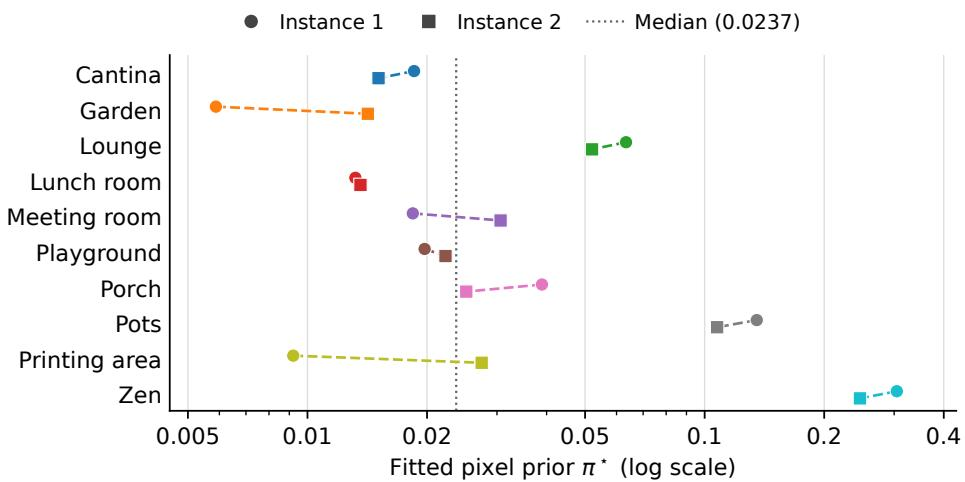  
Figure 5: Fitted pixel priors on PASLCD. Each scene has a distinct colour; circles and squares denote its two instances, joined by a dashed line. The vertical dotted line marks the median over all 20 instances. The horizontal axis uses a logarithmic scale.

## G.3 RELIGHTING STRENGTH

We vary the strength of the reference-fitted colour perturbation while retaining the object edits, labels, camera subsets, and query order. For each selected coefficient vector θ, we use $\theta _ { K } = \theta _ { \mathrm { i d } } + K ( \theta - \theta _ { \mathrm { i d } } )$ , where $\theta _ { \mathrm { i d } }$ gives the identity colour transform, and render the transformed Gaussian colours with the same clipping rule. The default is $K = 1 ; K = 0$ removes the relighting perturbation, and $K = 2$ doubles it. At $K = 0$ , the relighting sample slots are retained with identity coefficients, so all settings contain the same 11,384 training records. For $K = 0$ and $K = 2$ , we refit suppression, the likelihood-ratio mapping, unchanged-response statistics, image weights, the pixel prior, and the contour filter using only reference data and the same fitting settings. Table 9 reports pixel and full outputs on the same 20 PASLCD instances and 500 query frames, with K = 1 reusing the main results.

Table 8: PASLCD performance by ground-truth change area. Metrics average two runs over the same 500 queries (%). The 20–30% group contains only one frame; no evaluated frame has $\geq$ 30% change area.
<table><tr><td></td><td></td><td></td><td colspan="3">Pixel output</td><td colspan="3">Refined output</td></tr><tr><td>Change area</td><td>Frames</td><td>Instances</td><td>mIoU↑</td><td>FPR↓</td><td>FNR↓</td><td>mIoU↑</td><td>FPR↓</td><td>FNR↓</td></tr><tr><td>&lt; 1%</td><td>88</td><td>12</td><td>49.50</td><td>0.64</td><td>36.13</td><td>54.83</td><td>0.58</td><td>37.74</td></tr><tr><td>1-5%</td><td>298</td><td>18</td><td>61.18</td><td>0.96</td><td>18.18</td><td>70.11</td><td>0.60</td><td>16.69</td></tr><tr><td>5-10%</td><td>84</td><td>12</td><td>66.39</td><td>0.97</td><td>24.88</td><td>71.12</td><td>0.67</td><td>22.48</td></tr><tr><td>10-20%</td><td>29</td><td>4</td><td>67.35</td><td>1.67</td><td>25.27</td><td>71.10</td><td>1.44</td><td>22.38</td></tr><tr><td>20-30%</td><td>1</td><td>1</td><td>63.44</td><td>5.19</td><td>23.50</td><td>66.87</td><td>4.82</td><td>20.33</td></tr></table>

Table 9: Relighting strength on PASLCD, averaged over 20 instances (%). All settings retain the same training records; K scales the lighting perturbation about the identity transform.
<table><tr><td rowspan="2">Strength</td><td colspan="2">Pixel output</td><td colspan="2">Full output</td></tr><tr><td>mIoU↑</td><td>F1↑</td><td>mIoU↑</td><td>F1↑</td></tr><tr><td>K = 0</td><td>60.04</td><td>73.54</td><td>66.98</td><td>78.45</td></tr><tr><td>K = 1 (default)</td><td>60.36</td><td>73.80</td><td>67.64</td><td>78.87</td></tr><tr><td>K = 2</td><td>60.40</td><td>73.83</td><td>67.57</td><td>78.85</td></tr></table>

Default relighting improves full-output mIoU by 0.66 points over $K = 0 .$ , with gains in 13 of 20 instances. Doubling the strength changes pixel and full mIoU by +0.03 and −0.07 points, respectively, relative to the default. These results indicate a modest benefit from the adopted augmentation, with similar aggregate performance at K = 1 and K = 2.

## G.4 CONSTRUCTION OF HISTORICAL SUPPORT

We compare two ways of constructing historical support: our Bayes-factor accumulation and temporal averaging, using pixel outputs on the same 20 PASLCD instances and 500 frames. Temporal averaging takes the mean of each Gaussian’s valid responses $r _ { t g } = [ A _ { t } ( C _ { t } ) ] _ { g }$ across earlier frames, selected by $\mathbb { I } _ { t g } ,$ and assigns support 0.5 to unobserved Gaussians. These values are rendered to obtain $H _ { t } ,$ with prediction preceding the current update as in our method. We retain the imageevidence pipeline and query order, and refit the pixel prior on the editing subset using the same fitting procedure, without target labels. Table 10 reuses the no-history and full-pixel results from Table 3. Our construction improves mean mIoU by 4.42 points over temporal averaging and performs better in 16 of 20 instances.

## G.5 EVALUATION AND RUNTIME DETAILS

Evaluation and repeatability. Queries are processed from raw images, with pose estimation and feature extraction performed online. The main PASLCD results (Tables 1 and 5) and ablations (Tables 3, 9, and 10) average two complete runs over all 500 queries per configuration. For the full method, both runs achieve 67.64% mIoU; the largest per-instance difference is 0.019 percentage points. CCS3D uses all 18 queries across four scenes at 2× downsampling. Binary predictions are resized to the union masks by nearest-neighbour interpolation; Table 2 averages per-scene metrics equally over two runs.

Continuous sequence timing. After initialization, synchronized wall-clock timing starts before the first query is retrieved and ends when the final mask is ready. Input prefetching starts during initialization for both methods; remaining input waits and all inter-frame work are included. O-SCD also waits for GPU work to complete at its stage synchronization points; these waits are included in the timed sequence. Mask export and metric evaluation occur outside timing. FPS is the total number of processed frames divided by summed sequence duration: 1,000 frames across two runs for each of our output modes and 500 frames for O-SCD(O). The pixel runs achieve 27.88 and 27.98 FPS; the full runs achieve 17.15 and 17.19 FPS.

Table 10: Historical support on PASLCD, averaged over 20 instances (%, higher is better). Ours uses Bayes-factor accumulation. All results use pixel outputs without refinement.
<table><tr><td>Historical support</td><td>mIoU↑</td><td>F1↑</td></tr><tr><td>None</td><td>57.81</td><td>71.67</td></tr><tr><td>Temporal averaging</td><td>55.94</td><td>70.27</td></tr><tr><td>Ours</td><td>60.36</td><td>73.80</td></tr></table>

Table 11: Online runtime breakdown on PASLCD (RTX 5090; 20 instances, frames 1–25; ms/frame). Total sums all listed intervals. Post-frontend in Table 4 sums detection and refinement.
<table><tr><td>Method</td><td>Frontend</td><td>Detection</td><td>Refinement</td><td>Input/loop</td><td>Total</td></tr><tr><td>O-SCD(O)</td><td>31.62</td><td>37.65</td><td>0.00</td><td>0.06</td><td>69.33</td></tr><tr><td>Ours (pixel)</td><td>31.24</td><td>4.79</td><td>0.00</td><td>0.07</td><td>36.10</td></tr><tr><td>Ours (full)</td><td>31.51</td><td>5.34</td><td>20.29</td><td>0.10</td><td>57.24</td></tr></table>

Batch refinement timing. O-SCD(R) first processes the query images sequentially, then jointly refines its change representation using all views and renders the final masks. Its timing covers this complete procedure, from the first input retrieval to the last refined mask, excluding initialization and file export. We divide total sequence time by the number of frames for Table 4; the resulting per-frame time and equivalent FPS describe batch processing, not online prediction latency. Over the same 20 instances, complete processing averages 5.03 s per 25-frame sequence, including 3.29 s of post-sequence optimization and 6.48 ms of final mask rendering.

Initialization. Initialization comprises loading scene and model parameters, preparing reference matching data, and pre-executing model and GPU operations using non-test inputs. Both methods run SAM on all-zero inputs. Our method additionally processes a fixed reference-edit observation twice through the complete detection pipeline, using synthetic data already available from offline editing. We then restore the detector history, reference matching state, and random-generator states before processing the query sequence. Initialization averages 14.08 s for our pixel pipeline, 15.54 s for our full pipeline, and 7.16 s for O-SCD(O). The two reference-edit passes take 0.111 and 0.168 s for the pixel and full pipelines. Mean first-frame latency is 35.55, 58.24, and 110.38 ms, respectively.

Stage-wise timing. The frontend comprises query relocalisation, reference rendering, and initial change-cue computation (Section 3). Post-frontend time covers detection, temporal-state updates, and refinement where applicable. Table 11 averages synchronized profiles over all 25 frames of all 20 instances. Detection includes the pixel decision and history update; refinement includes its RGB transfer. Input waits and inter-frame work are reported separately. Our profiles use a separate pass from the continuous throughput measurements in Table 4; O-SCD(O) uses its synchronized sequence records.

## G.6 OFFLINE PREPARATION AND COMPONENT TIMING BREAKDOWN

Offline preparation includes fitting the pixel prior and contour filter from reference edits.

Table 12 details the offline preparation and component fitting time across all 20 PASLCD sceneinstances, measured on an NVIDIA RTX 5090 using wall-clock timing with GPU synchronization. The offline workflow comprises two main phases: (1) synthetic edit generation, which extracts multi-view object proposals with SAM2, performs 3D Gaussian edits (recolouring, removal, translation), renders lighting-varied views, and forms training observation pairs; and (2) scene component fitting, which executes reference preprocessing, fits the pixel pipeline components (response suppression, log-likelihood ratio mapping, unchanged response moments, and 1D branch-and-bound prior search π⋆), and trains the 18-dimensional symmetric contour filter with Platt scaling. Across all instances, the complete offline workflow averages 215.82 s (∼3.6 minutes; median 197.13 s, ranging from 142.15 s to 440.69 s), given an existing reference reconstruction.

Table 12: Complete offline preparation and fitting runtime breakdown across 20 PASLCD sceneinstances (seconds, measured on an NVIDIA RTX 5090). Generation includes automatic object proposals, 3DGS edits, and synthetic paired observation rendering. Generated records are counted before the camera split. Fitting covers reference preprocessing, pixel models, prior search, and contour filter fitting.
<table><tr><td>Scene</td><td>Inst.</td><td>Retained objects</td><td>Generated records</td><td>Generation (s) ↓</td><td>Preprocess (s) ↓</td><td>Pixel (s) ↓</td><td>Contour (s) ↓</td><td>Total (s) ↓</td></tr><tr><td rowspan="2">Cantina</td><td>1</td><td>22</td><td>366</td><td>106.95</td><td>8.21</td><td>41.68</td><td>18.84</td><td>175.68</td></tr><tr><td>2</td><td>28</td><td>602</td><td>112.19</td><td>7.99</td><td>56.92</td><td>22.93</td><td>200.02</td></tr><tr><td rowspan="2">Garden</td><td>1</td><td>37</td><td>1080</td><td>119.42</td><td>7.57</td><td>83.23</td><td>30.48</td><td>240.69</td></tr><tr><td>2</td><td>35</td><td>752</td><td>121.05</td><td>8.25</td><td>69.61</td><td>33.54</td><td>232.46</td></tr><tr><td rowspan="2">Lounge</td><td>1</td><td>18</td><td>384</td><td>112.07</td><td>8.26</td><td>42.39</td><td>19.14</td><td>181.86</td></tr><tr><td>2</td><td>18</td><td>340</td><td>79.13</td><td>6.92</td><td>37.24</td><td>18.85</td><td>142.15</td></tr><tr><td rowspan="2">Lunch_room</td><td>1</td><td>56</td><td>1744</td><td>226.44</td><td>11.28</td><td>119.27</td><td>47.17</td><td>404.16</td></tr><tr><td>2</td><td>64</td><td>2034</td><td>231.67</td><td>11.16</td><td>131.89</td><td>65.96</td><td>440.69</td></tr><tr><td rowspan="2">Meeting_room</td><td>1</td><td>17</td><td>410</td><td>90.87</td><td>6.78</td><td>44.82</td><td>28.05</td><td>170.52</td></tr><tr><td>2</td><td>21</td><td>484</td><td>85.33</td><td>7.09</td><td>48.84</td><td>35.81</td><td>177.07</td></tr><tr><td rowspan="2">Playground</td><td>1</td><td>31</td><td>718</td><td>114.45</td><td>7.85</td><td>66.88</td><td>50.15</td><td>239.34</td></tr><tr><td>2</td><td>33</td><td>642</td><td>117.92</td><td>7.68</td><td>63.83</td><td>74.38</td><td>263.81</td></tr><tr><td rowspan="2">Porch</td><td>1</td><td>44</td><td>842</td><td>102.77</td><td>7.11</td><td>67.46</td><td>34.04</td><td>211.38</td></tr><tr><td>2</td><td>43</td><td>788</td><td>122.44</td><td>7.81</td><td>67.89</td><td>34.49</td><td>232.63</td></tr><tr><td rowspan="2">Pots</td><td>1</td><td>14</td><td>280</td><td>74.38</td><td>7.95</td><td>38.18</td><td>22.04</td><td>142.55</td></tr><tr><td>2</td><td>20</td><td>400</td><td>75.64</td><td>7.44</td><td>46.23</td><td>23.70</td><td>153.02</td></tr><tr><td>Printing_area</td><td>1</td><td>23</td><td>756</td><td>107.85</td><td>7.50</td><td>62.35</td><td>22.07</td><td>199.77</td></tr><tr><td rowspan="3">Zen</td><td>2</td><td>23</td><td>416</td><td>85.96</td><td>6.76</td><td>41.17</td><td>19.43</td><td>153.33</td></tr><tr><td>1</td><td>24</td><td>564</td><td>91.22</td><td>8.27</td><td>58.68</td><td>36.32</td><td>194.49</td></tr><tr><td>2</td><td>18</td><td>378</td><td>77.34</td><td>7.58</td><td>48.64</td><td>27.11</td><td>160.68</td></tr><tr><td>Mean</td><td>一</td><td>29.45</td><td>699.0</td><td>112.75</td><td>7.97</td><td>61.86</td><td>33.23</td><td>215.82</td></tr><tr><td>Median</td><td></td><td>23.50</td><td>583.0</td><td>107.40</td><td>7.74</td><td>57.80</td><td>29.26</td><td>197.13</td></tr></table>

## H ADDITIONAL VISUAL RESULTS

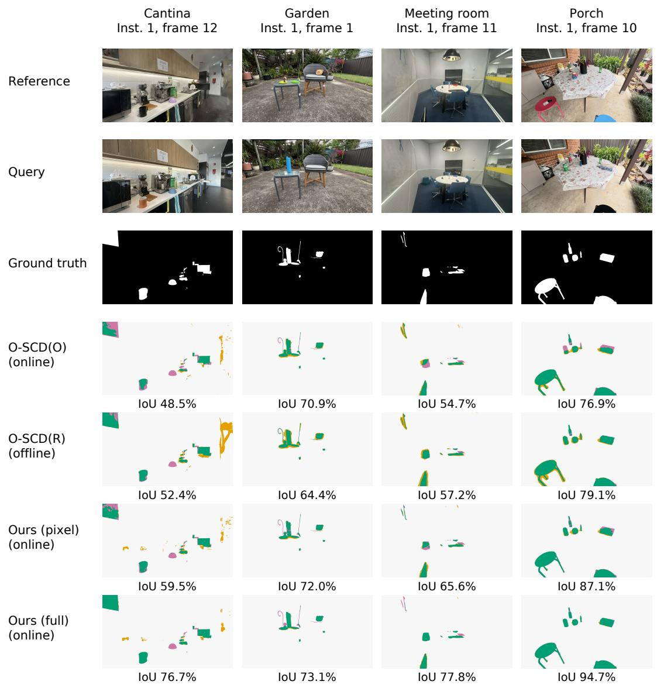  
Figure 6: Qualitative comparison on PASLCD. Examples are from Cantina, Garden, Meeting room, and Porch. Each column shows one query, with reference, query, ground truth, and method outputs arranged vertically. Both O-SCD variants and our pixel and full outputs are shown. Green, orange, and pink denote correct detections, false positives, and missed changes, respectively. Numbers report per-frame foreground IoU. Thin structures remain partly missed in Garden.

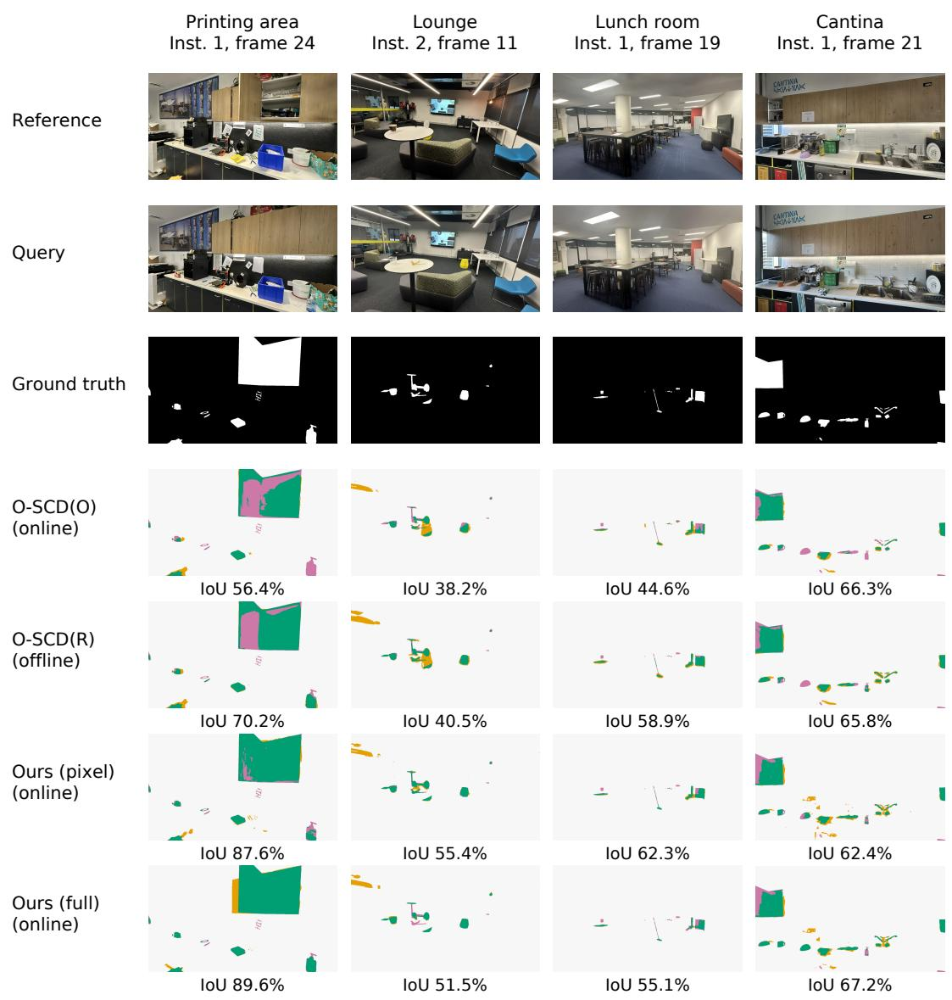  
Figure 7: Additional qualitative comparisons on PASLCD. Examples are from Printing area, Lounge, Lunch room, and another view of Cantina. The layout and colours follow Figure 6. Refinement recovers the cabinet region in Printing area, while false positives near the ceiling in Lounge and missed object regions in Lunch room remain. Numbers report per-frame foreground IoU.

## H.1 COMPARISON ON CCS3D

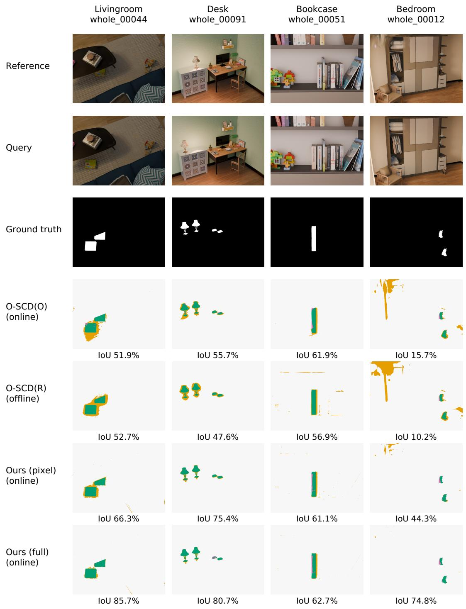  
Figure 8: Qualitative comparison on CCS3D. Examples are from Livingroom, Desk, Bookcase, and Bedroom. Rows and colours follow Figure 6. Ground truth is the union of pre- and poststate masks, as in Table 2. Our full method reduces excess responses around displaced objects in Livingroom and Desk and on unchanged regions in Bedroom; boundary errors remain in Bookcase. Numbers report per-frame foreground IoU.

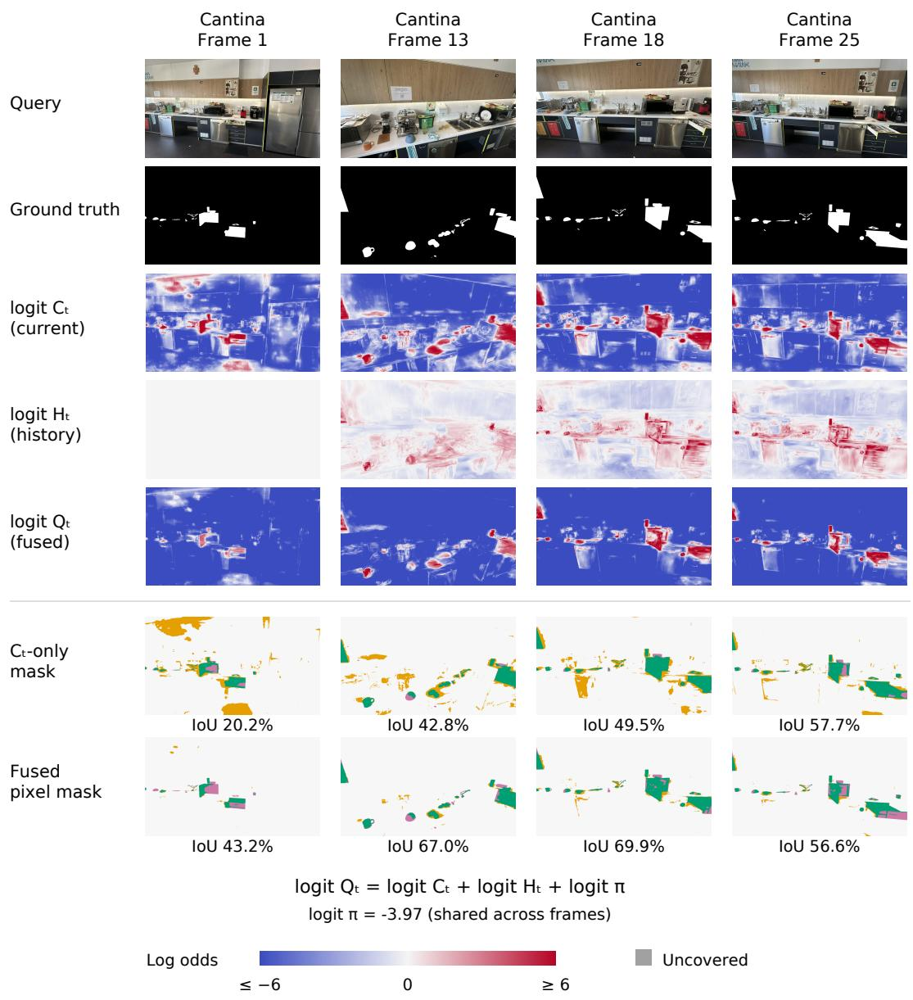

## H.2 EVIDENCE FUSION AND COMPONENT ABLATIONS

Figure 9 illustrates evidence fusion. Current-view evidence $C _ { t }$ gives strong responses around candidate changes, including some unchanged regions. Historical support $H _ { t }$ adjusts these responses using earlier observations, while the scene-fitted prior π determines the evidence threshold for predicting change. The fused pixel probability $Q _ { t } ^ { \mathrm { p i x e l } }$ reduces false positives but can also suppress true changes, as frame 25 illustrates. Across this 25-frame sequence, mean IoU increases from 47.31% with $C _ { t }$ alone to 57.84% after fusion. Figure 10 complements the quantitative component ablations in Table 3.

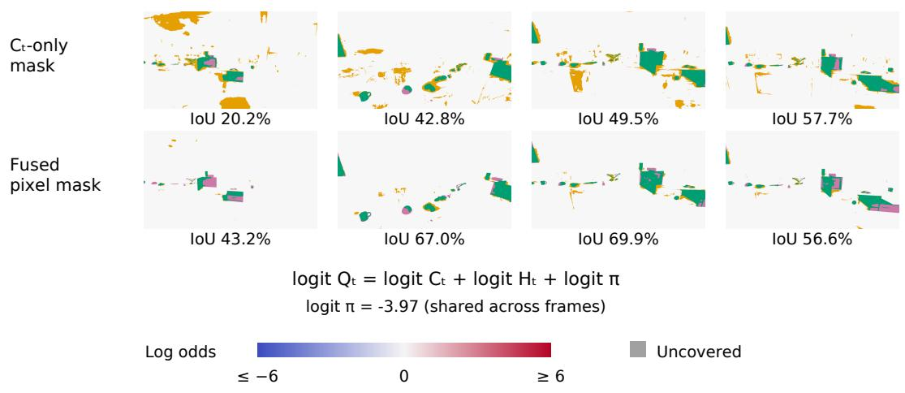  
Figure 9: Evidence fusion in Cantina. Columns show frames 1, 13, 18, and 25 from one sequence. Log-odds maps share a colour scale saturated at ±6 for display; white denotes zero and grey marks uncovered pixels. The $C _ { t ^ { - } } \mathrm { o n l y }$ mask sets $H _ { t } = \pi = 0 . 5$ , giving $Q _ { t } ^ { \mathrm { p i x e l } } = C _ { t }$ . Both masks threshold $Q _ { t } ^ { \mathrm { p i x e l } }$ at 0.5; fusion combines the same $C _ { t }$ , historical support $H _ { t }$ from $F _ { t - 1 }$ , and the fitted prior π (Eq. 1). Mask colours follow Figure 6; numbers report per-frame foreground IoU.

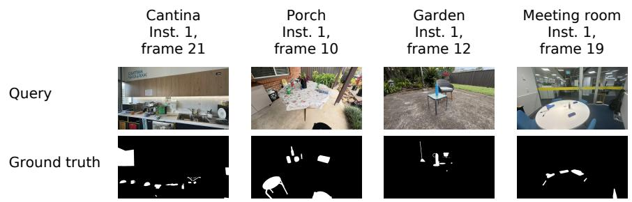

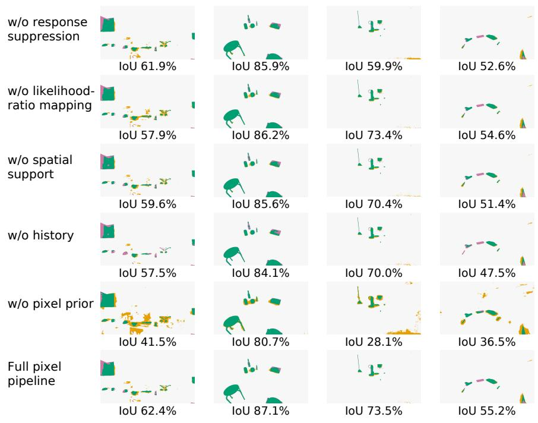

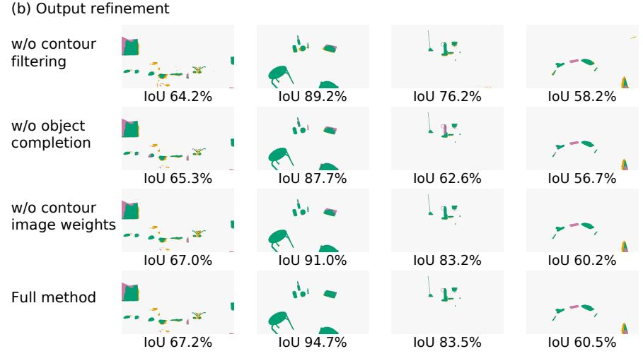  
Figure 10: Qualitative component ablations. Examples are from Cantina, Porch, Garden, and Meeting room in PASLCD. (a) Five pixel-pipeline ablations and the full pixel pipeline. The no-prior variant uses $\pi = 0 . 5 ;$ spatial support denotes Gaussian-aggregated support $S _ { t }$ . (b) Three outputrefinement ablations and the full method. The image-weight ablation omits image weighting during contour fitting. Both groups use the same queries. Colours follow Figure $\begin{array} { r } { 6 ; } \end{array}$ numbers report perframe foreground IoU.