# LEARNING THE 4D WORLD THROUGH POINT TRAJECTORY FORECASTING

Byungwoo Jeon1∗ Sunghwan Hong2∗ Dohyeon Kim3 Jonghoon Lee1 Jungwoo Park1 Inhee Lee3 Doosan Baek6 Jinil Kim6 Taehyun Lim6 Hanbyul Joo3,5 Marc Pollefeys2 Saining Xie4† Jinwoo Shin1,5† 1KAIST 2ETH Zurich ¨ 3Seoul National University 4New York University 5RLWRLD 6 Physics Sim Lab

  
Figure 1: Teaser. We introduce simulated and real-world multi-view videos paired with 3D point tracks (left), jointly forecast future videos and point trajectories (center), and show that point supervision improves visual forecasting (right).

## ABSTRACT

Reliable multi-view forecasting requires videos from different cameras to describe the same evolving 3D scene. To this end, we introduce Video-Point Model (VPM), a world model that conditions on multi-view video histories and a language instruction to jointly forecast future videos from arbitrary viewpoints and the 3D trajectories of persistent scene points. We extend a pretrained world model with camera-conditioned multi-view processing that integrates complementary observations across cameras, and add a trajectory head that predicts how physical points move through time. Each trajectory tracks a single point across all views, and supervising these trajectories alongside video generation therefore anchors appearance changes in every camera to a shared description of 3D motion. To support training and evaluation, we build VPM-Data, a simulation corpus pairing synchronized multi-view videos with persistent point trajectories, and VP-WorldBench, a forecasting benchmark spanning simulated and real environments. We further extend VPM to robot control by adding robot actions as a token modality in the generator. Action tokens share the point-supervised backbone and are denoised jointly with future videos, thereby grounding the policy in the same 3D-aware representation. On VP-WorldBench and existing 4D generation benchmarks, point supervision improves both video fidelity and 3D motion accuracy over a videoonly counterpart, and in simulated and real-robot experiments, it also raises the manipulation success of the action-enabled model.

## 1 INTRODUCTION

World models aim to anticipate how scenes evolve from past observations. Recent models pursue this goal by predicting future videos and, for robot interactions, the associated actions (Agarwal et al., 2026). However, visual plausibility alone does not establish whether these forecasts describe coherent 3D motion. Multi-view histories provide richer evidence for predicting this motion by revealing scene structure and ongoing dynamics that may be obscured in individual cameras (Rajicˇ et al., 2025). To exploit this evidence, a model must relate observations across cameras to a common prediction of scene evolution. Its forecasts from arbitrary viewpoints should therefore depict the same future event, despite differences in perspective and visibility.

To connect these predictions, we build on geometric supervision (Lee et al., 2026b) for video modeling, including pointmap prediction and trajectory-derived representation alignment (Liu et al., 2026; Yang et al., 2026). Specifically, we investigate jointly forecasting future images and persistent 3D point trajectories. Because each trajectory follows the same scene point over time, it provides a common description of motion across cameras. Learning this motion alongside image generation encourages the model to relate appearance changes to the movement of identifiable points. Unlike conventional tracking, both predictions extend beyond the observed history, requiring the model to anticipate correspondences without access to future frames. Our hypothesis is that learning where scene points will move helps the visual predictor produce more faithful forecasts.

Accordingly, we introduce VPM, a multi-view video–point world model built on Cosmos 3 (Agarwal et al., 2026). Given posed video histories and a language instruction, VPM predicts future videos from arbitrary viewpoints together with the trajectories of points selected from observed frames. To integrate information across cameras, we process their video tokens in a shared sequence, using raybased embeddings to encode camera geometry and a view axis in positional encoding to distinguish camera streams. A trajectory forecasting head is optimized jointly with video generation, allowing explicit point-motion supervision to shape the representation used for visual prediction.

To support this learning objective, we construct VPM-Data, a simulation corpus covering tabletop manipulation and urban dynamics. Each sequence pairs synchronized multi-view videos with persistent point trajectories, camera geometry, visibility annotations, and language descriptions, providing aligned supervision for future appearance and motion. We complement this training corpus with VP-WorldBench, an evaluation suite spanning simulated and real environments. Its simulation component assesses visual and geometric forecasts on the same held-out events, allowing image quality and motion accuracy to be examined together.

We evaluate VPM on our benchmark and existing benchmarks, assessing future-video quality and 3D trajectory accuracy. Controlled ablations demonstrate that point supervision improves visual forecasting. We further investigate whether this benefit extends to robot control through an actionenabled variant that jointly learns video prediction, point trajectories, and robot commands. Across simulated benchmarks and real-robot experiments, point supervision consistently improves task success rates of the action-enabled model. Our contributions are threefold:

• We introduce VPM, a camera-conditioned model that jointly forecasts multi-view videos and persistent 3D point trajectories, using explicit point-motion supervision to improve visual prediction from arbitrary viewpoints.

• We develop VPM-Data and VP-WorldBench, providing aligned visual and geometric training data and a forecasting evaluation suite spanning simulated manipulation, urban dynamics, and real-world recordings.

• Through extensive experiments and controlled ablations, we demonstrate the benefits of point supervision for multi-view forecasting and assess its contribution to robot action learning in an action-enabled extension.

## 2 RELATED WORK

Geometry- and Motion-Aware Video Prediction. Auxiliary objectives improve video generation by supervising internal features with 2D point tracking (Jeong et al., 2025; Lee et al., 2026a) or optical flow (Chefer et al., 2025), or by aligning them with video and 3D foundation models (Zhang et al., 2025; Wu et al., 2026; Han et al., 2026). For multi-view prediction (Balice et al., 2026), SV4D (Xie et al., 2025) synthesizes novel views of observed videos, Geometry-aware 4D Video Generation (Liu et al., 2026) forecasts RGB and pointmaps, and X-WAM (Guo et al., 2026) adds actions to multi-view RGB-D forecasting, while GEM-4D (Zhou et al., 2026b), MECo-WAM (Zhang et al., 2026c), and 4D-WAM (Yang et al., 2026) distill geometry or trajectory fields into video and video–action representations. Unlike these single-view or per-frame targets, our persistent 3D trajectories retain point identity across views and time. Closest to ours, MVTrack4Gen (Lee et al., 2026b) supervises novel-view generation with multi-view point tracking; we differ from this in that we forecast beyond observed frames, lift supervision from 2D to metric 3D, and extend it to action learning.

Video World Models and Action Learning. Video foundation models such as HunyuanVideo-1.5 (Wu et al., 2025) and Wan2.2-TI2V-5B (Team et al., 2025) provide pretrained representations for visual prediction. VideoVLA (Shen et al., 2026) and Cosmos 3 (Agarwal et al., 2026) jointly predict future observations and actions, while SpatialVAM (Li et al., 2026b) pairs multi-view RGB prediction with spatial action heatmaps. We instead supervise multi-view forecasting with future 3D point motion and examine whether it also benefits action learning.

3D Motion Forecasting and Benchmarks. Point trackers estimate correspondences within observed videos (Karaev et al., 2025), and TAPIP3D (Zhang et al., 2026a) and MVTracker (Rajic et al.ˇ , 2025) extend tracking to 3D from monocular and multi-view input. MotionForesight (Bharadhwaj & Jangir, 2026) and MolmoMotion (Zhang et al., 2026b) instead forecast motion beyond observed frames, the latter also supporting video generation and robot learning. Among benchmarks, TAPVid-MV (Koppula et al., 2026) provides multi-view tracking annotations and PointMotionBench (Zhang et al., 2026b) targets language-conditioned motion prediction; ours adds paired visual and geometric supervision for jointly evaluating future appearance and point motion.

## 3 METHOD

## 3.1 PROBLEM FORMULATION

Let $\nu _ { \mathrm { i n } }$ and $\mathcal { V } _ { \mathrm { o u t } }$ denote the input and output camera sets. For camera v at time $\tau ,$ let $\mathbf { O } _ { \tau } ^ { v } \in$ $\mathbb { R } ^ { H \times \dot { W } \times 3 } , \mathbf { K } ^ { v }$ , and $\mathbf { T } _ { \tau } ^ { v } \in \mathrm { S E } ( 3 )$ denote its RGB frame, intrinsics, and camera-to-world pose. Given the observed histories $\{ \mathbf { O } _ { t - h ^ { \prime } + 1 : t } ^ { v } \} _ { v \in \mathcal { V } _ { \mathrm { i n } } }$ , the camera parameters of the observed and requested future views, and a language instruction $\ell ,$ the model predicts the next h frames at arbitrary output viewpoints and the future trajectories of $N$ points selected from the observed frames. Each point $n$ is specified by a query $\left( { { t } _ { n } } , { { v } _ { n } } , { { \mathbf { u } } _ { n } } \right)$ within the history, and $\mathbf { P } _ { \tau , n } \in \mathbb { R } ^ { 3 }$ denotes its persistent 3D position. Trajectories are expressed in a fixed reference frame defined by camera $v _ { \mathrm { r e f } }$ at the first observed timestep $t _ { 0 } = t - h ^ { \prime } + 1$ . Our architecture overview is shown in Figure 2.

## 3.2 PRELIMINARIES: MIXTURE-OF-TRANSFORMERS FOR WORLD MODELING

We build on Cosmos 3 (Agarwal et al., 2026), whose Mixture-of-Transformers backbone comprises a reasoner and a generator. The two towers are initialized from a pretrained vision-language model and maintain separate layer parameters, interacting through a joint attention operation. In the forecasting configuration, the reasoner processes instruction tokens with causal attention restricted to its own sequence, while generator tokens attend to both sequences.

The generator is trained with rectified flow matching (Liu et al., 2022; Lipman et al., 2022). Given clean future-video tokens $\mathbf { x } _ { \mathrm { 0 } }$ and Gaussian noise $\epsilon ,$ we construct $\mathbf { x } _ { \sigma } = ( 1 - \sigma ) \mathbf { x } _ { 0 } + \sigma \mathbf { \epsilon }$ at noise level $\sigma \in [ 0 , 1 ]$ . The denoiser $v _ { \theta }$ predicts $\epsilon - { \bf x } _ { 0 }$ , conditioned on the noise level and context c:

$$
\begin{array} { r } { \mathcal { L } _ { \mathrm { F M } } = \mathbb { E } _ { { \mathbf { x } _ { 0 } } , c , \epsilon , \sigma } \left[ \| v _ { \theta } ( \mathbf { x } _ { \sigma } , \sigma , c ) - ( \epsilon - \mathbf { x } _ { 0 } ) \| _ { 2 } ^ { 2 } \right] . } \end{array}\tag{1}
$$

Here, c contains the observed history and conditioning information. Clean conditioning tokens are excluded from the generation loss.

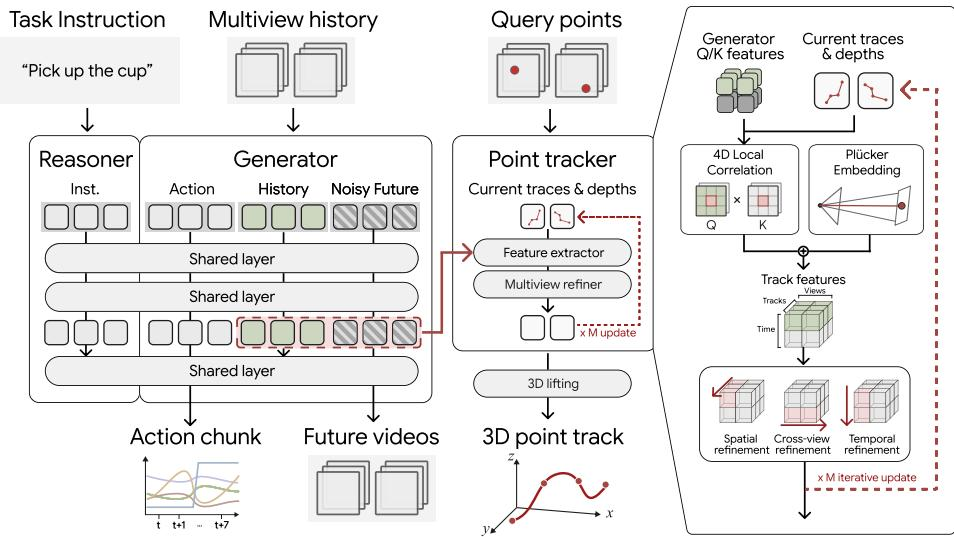  
Figure 2: Overview of VPM. From posed multi-view histories and a task instruction, VPM forecasts future videos and the trajectories of points queried from observed frames. The 3D point tracker iteratively refines point positions and depths before lifting them to 3D. Joint point supervision shapes the generator’s representation, and the action-enabled extension also outputs robot action chunks.

## 3.3 CAMERA-CONDITIONED MULTI-VIEW PREDICTION

We pack latent video tokens across cameras into a single sequence on a shared temporal grid. Observed history tokens provide context, while noisy future tokens are associated with the requested output cameras. To distinguish camera geometry from view identity, we introduce per-token camera embeddings and an additional view axis in rotary positional encoding.

Camera embeddings. For each video token i, we compute the Plucker ray (¨ Sitzmann et al., 2021; He et al., 2024) of its image region using the corresponding intrinsics and pose. Expressed in the fixed reference frame, the ray is $\mathbf { r } _ { i } = ( \mathbf { d } _ { i } , \mathbf { o } _ { i } \times \mathbf { d } _ { i } )$ , where $\mathbf { o } _ { i }$ and $\mathbf { d } _ { i }$ are its origin and unit direction. A lightweight encoder produces $\mathbf { e } _ { i } ~ = ~ \phi ( \mathbf { r } _ { i } )$ , which conditions the backbone through additive features and camera-dependent rotations of attention queries and keys:

$$
\begin{array} { r l r l } & { \mathbf { h } _ { i }  \mathbf { h } _ { i } + \mathbf { W } \mathbf { e } _ { i } , } \\ & { \mathbf { q } _ { i }  \mathbf { R } \big ( \psi ( \mathbf { e } _ { i } ) \big ) \mathbf { q } _ { i } , } & & { \mathbf { k } _ { i }  \mathbf { R } \big ( \psi ( \mathbf { e } _ { i } ) \big ) \mathbf { k } _ { i } . } \end{array}\tag{2}
$$

Here, W is a learned projection and $\mathbf { R } ( \cdot )$ applies per-head rotary phases predicted by $\psi .$ These query and key rotations are applied in each transformer layer (Park et al., 2026), allowing attention to depend on the camera geometry associated with its tokens.

4D RoPE. Tokens from different cameras can share the same temporal and spatial coordinates. Standard 3D rotary positional encoding therefore does not distinguish their view identities. We add a fourth axis, assigning $p _ { \mathrm { v i e w } , i } = v$ to tokens from camera v. The rotary phase becomes

$$
\theta _ { i , k } = p _ { t , i } \omega _ { k } ^ { t } + p _ { h , i } \omega _ { k } ^ { h } + p _ { w , i } \omega _ { k } ^ { w } + p _ { \mathrm { v i e w } , i } \omega _ { k } ^ { \mathrm { v i e w } } ,\tag{3}
$$

where $\omega ^ { t } , \omega ^ { h }$ , and $\omega ^ { w }$ are the pretrained frequencies, and $\omega ^ { \mathrm { v i e w } }$ is learnable. Initializing the view frequencies to zero recovers the original 3D positional encoding at initialization. This formulation preserves the temporal and spatial indexing within each view while accommodating different numbers of camera streams.

## 3.4 JOINT VIDEO AND TRAJECTORY LEARNING

We connect point-motion supervision to video prediction in two ways. A trajectory head forecasts point locations from intermediate generator features, while a correspondence objective directly supervises the attention features from which those trajectories are inferred. Both objectives provide geometric learning signals to the shared video representation.

Trajectory forecasting head. The head operates on query and key features from an intermediate self-attention layer, reshaped into per-view feature grids ${ \bf F } _ { q } ^ { v }$ and $\mathbf { F } _ { k } ^ { v }$ over the latent frames. For each query $\left( { { t } _ { n } } , { { v } _ { n } } , { { \mathbf { u } } _ { n } } \right)$ , it samples a source feature and computes correlations with key features around the current point estimate in each view and timestep. A transformer with attention factorized over space, time, and views (Koo et al., 2026) refines the estimates over M iterations. At each latent timestep, the head predicts a 2D position $\widehat { \mathbf { u } } _ { \tau , n } ^ { v }$ , depth $\widehat { d } _ { \tau , n } ^ { v }$ , and confidence $\widehat { c } _ { \tau , n } ^ { v }$ for every view.

We unproject each estimate into the fixed reference frame. Let ${ \bf G } _ { \tau } ^ { v } = ( { \bf T } _ { t _ { 0 } } ^ { v _ { \mathrm { r e f } } } ) ^ { - 1 } { \bf T } _ { \tau } ^ { v }$ be the camerato-reference transform, with rotation $\mathbf { R } _ { \tau } ^ { v }$ and translation $\mathbf { b } _ { \tau } ^ { v }$ . The corresponding 3D estimate is

$$
\widehat { \mathbf { P } } _ { \tau , n } ^ { v } = \mathbf { R } _ { \tau } ^ { v } \left( \widehat { d } _ { \tau , n } ^ { v } ( \mathbf { K } ^ { v } ) ^ { - 1 } \left[ \widehat { \mathbf { u } } _ { \tau , n } ^ { v } \right] \right) + \mathbf { b } _ { \tau } ^ { v } .\tag{4}
$$

During training, future-frame features are obtained from partially denoised tokens rather than clean future observations. The head therefore learns to infer motion from the model’s predictive features.

Trajectory supervision. Extending the multi-view tracking objective (Lee et al., 2026b), we supervise the iterative predictions with

$$
\mathcal { L } _ { \mathrm { t r a c k } } = \lambda _ { \mathrm { s e q } } \mathcal { L } _ { \mathrm { s e q } } + \lambda _ { \mathrm { d e p t h } } \mathcal { L } _ { \mathrm { d e p t h } } + \lambda _ { \mathrm { c o n f } } \mathcal { L } _ { \mathrm { c o n f } } .\tag{5}
$$

$\mathcal { L } _ { \mathrm { s e q } }$ and $\mathcal { L } _ { \mathrm { d e p t h } }$ apply a truncated Huber loss to 2D positions with their frame-to-frame displacements and to log-depth, respectively; truncation limits the influence of large errors from unstable refinements on heavily noised features. ${ \mathcal { L } } _ { \mathrm { c o n f } }$ is a binary cross-entropy whose target indicates whether the predicted position lies within a threshold of the ground truth. All terms are summed over the M refinement iterations and averaged over visible points. The 2D and depth targets are projected from the same ground-truth 3D trajectories using known camera parameters, keeping supervision geometrically consistent across views.

Cross-view correspondence supervision. To supervise the features used for trajectory refinement directly, we treat correspondence as classification over the spatial cells of a target frame. Let ${ \bf C } _ { i , j } ^ { v _ { 1 } , v _ { 2 } }$ denote the attention map between latent frame i in view $v _ { 1 }$ and frame j in view $v _ { 2 } .$ , obtained by normalizing query–key similarities over target cells and averaging across attention heads. We minimize

$$
\mathcal { L } _ { \mathrm { c o r r } } = - \frac { 1 } { | \Omega | } \sum _ { ( n , v _ { 2 } , j ) \in \Omega } \log \mathbf { C } _ { t _ { n } , j } ^ { v _ { n } , v _ { 2 } } \left[ \mathbf { u } _ { n } , \mathbf { u } _ { j , n } ^ { v _ { 2 } } \right] ,\tag{6}
$$

where Ω contains query–target pairs for which the ground-truth correspondence is visible, and the bracket selects the attention weight at that correspondence. This objective encourages the generator’s attention features to associate the same physical point across views and time, complementing supervision of the head’s predicted positions.

## 3.5 TRAINING AND INFERENCE

Training. We first adapt the generation pathway, camera embeddings, and view frequencies using $\mathcal { L } _ { \mathrm { F M } }$ on all multi-view sources, including those without trajectory annotations. Next, we train only the trajectory head and view frequencies with $\mathcal { L } _ { \mathrm { t r a c k } }$ , freezing the remaining parameters. Finally, we jointly optimize the video backbone and trajectory head with

$$
{ \mathcal { L } } _ { \mathrm { f o r e c a s t } } = { \mathcal { L } } _ { \mathrm { F M } } + \lambda _ { \mathrm { t r a c k } } { \mathcal { L } } _ { \mathrm { t r a c k } } + \lambda _ { \mathrm { c o r r } } { \mathcal { L } } _ { \mathrm { c o r r } } .\tag{7}
$$

Inference. Conditioned on the observed histories, camera parameters, and instruction, we denoise future-video tokens from Gaussian noise at $\sigma = 1$ to 0, keeping history tokens clean. Trajectories are decoded from the predicted clip’s backbone features and transformed into the reference frame.

## 4 DATASET AND BENCHMARK

We construct VPM-Data, 10K training clips pairing synchronized multi-view videos with persistent 3D trajectories for tabletop manipulation and urban dynamics, and VP-WorldBench, an evaluation benchmark spanning tabletop, indoor, and urban scenes in simulation and the real world (Table 1).

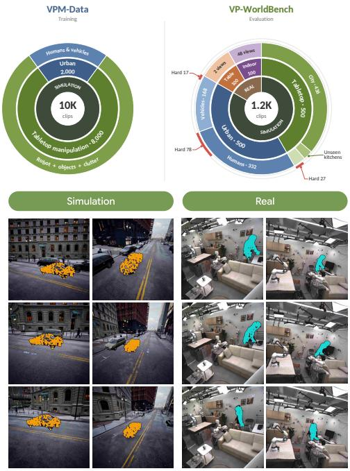

Table 1: Overview of VPM-Data and VP-WorldBench.
<table><tr><td>Domain</td><td>Samples Views</td><td></td><td>fps</td><td>Frames</td><td>3D tracks/clip Hard</td><td></td></tr><tr><td>VPM-Data</td><td></td><td></td><td></td><td></td><td></td><td></td></tr><tr><td>Tabletop manipulation</td><td>8,000</td><td>3</td><td>20</td><td>81-181</td><td>768-2,048</td><td></td></tr><tr><td>Urban dynamics</td><td>2,000</td><td>4</td><td>15</td><td>81-181</td><td>256</td><td></td></tr><tr><td>VP-WorldBench (Sim)</td><td></td><td></td><td></td><td></td><td></td><td></td></tr><tr><td>Tabletop manipulation</td><td>500</td><td>3</td><td>20</td><td>81-680</td><td>768-1,536</td><td>27</td></tr><tr><td>Urban dynamics</td><td>500</td><td>4</td><td>15</td><td>81-181</td><td>256</td><td>95</td></tr><tr><td>VP-WorldBench (Real)</td><td></td><td></td><td></td><td></td><td></td><td></td></tr><tr><td>Tabletop manipulation</td><td>100</td><td>2</td><td>15</td><td>139-325</td><td>768</td><td></td></tr><tr><td>Indoor scenes</td><td>100</td><td>48</td><td>15</td><td>150</td><td>512</td><td></td></tr></table>

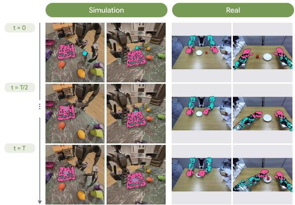  
Robot: Table Manipulation  
General: Human & Vehicle

Figure 3: Qualitative examples of VPM-Data and VP-WorldBench.

## 4.1 TRAINING DATASET

Generation and capture. Tabletop clips replay physics-simulated pick-and-place episodes of a Fourier GR-1 T2 robot in Unreal Engine 5, with randomized clutter, surface appearance, scene placement, and camera poses. Distractor interactions are validated and recorded before rendering. Urban clips capture pedestrians and vehicles from a running traffic and crowd simulation, varying their appearance, camera intrinsics, and camera paths. In both domains, images and geometric annotations are exported from the same simulation timestep to maintain alignment across views.

Annotations and validation. We annotate 256 surface points per object and 512 additional points on the robot’s arms and hands. Rigid transforms or triangle identities and barycentric coordinates propagate these points through motion and occlusion. Each clip also provides metric depth, camera parameters, point-validity and per-view visibility masks, object visibility states, and a visionlanguage-model-generated caption. Clips undergo checks for geometric alignment, annotation completeness, depth validity, camera motion, target visibility, and caption consistency, followed by a final human audit. Generation and validation details are provided in Appendix C.

## 4.2 VP-WORLDBENCH

Evaluation splits. The simulation benchmark covers three generalization regimes: 436 new tabletop episodes at varied locations in city $C _ { 1 }$ , whose scenery appears in VPM-Data only as static background; 64 tabletop episodes in two unseen kitchens; and urban clips of moving agents in $C _ { 1 } ,$ , whose traffic and crowd dynamics are unseen, as urban training uses a separate city $C _ { 2 }$ . Each domain includes a hard subset in which individual cameras lose sight of the target for at least 30 consecutive frames while at least one camera sees it at every frame. In tabletop hard clips, all three cameras meet this threshold and the target moves while hidden; in urban hard clips, all four cameras lose and re-acquire the target, with two or three meeting the threshold. Details are in Appendix D.

Real-world benchmarks. For robot manipulation, we collect 100 teleoperated episodes and sample 3D point tracks on the robot surface from recorded robot states (Appendix B.2). For general scenes, we record 100 ten-second sequences of people moving, handling objects, and interacting with furniture in a furnished home-like space with 48 synchronized RGB cameras. Each sequence pairs multi-view videos with a 4D reconstruction for evaluating visual forecasting and geometric ac

Table 2: Results on VP-WorldBench. Numbers in parentheses denote clips per split. V and T denote video and point-trajectory supervision.
<table><tr><td rowspan="3"></td><td rowspan="3"></td><td colspan="7">Simulation</td><td colspan="8">Real-world</td></tr><tr><td colspan="4">Robot (500)</td><td colspan="4">General (500)</td><td colspan="4">Robot (100)</td><td colspan="4">General (100)</td></tr><tr><td>MV FVD↓</td><td></td><td></td><td>PSNR ↑ MEt3R ↓</td><td> $\overline { { \delta _ { \mathrm { a v g } } ^ { \mathrm { 3 D } } } } \uparrow$  FVD↓</td><td></td><td>PSNR ↑ MEt3R ↓</td><td> $\overline { { \delta _ { \mathrm { a v g } } ^ { \mathrm { 3 D } } } } \uparrow$ </td><td>FVD↓</td><td>PSNR ↑ MEt3R ↓</td><td></td><td> $\overline { { \delta _ { \mathrm { a v g } } ^ { \mathrm { 3 D } } } } \uparrow$ </td><td>FVD↓</td><td>PSNR ↑ MEt3R ↓</td><td></td><td> $\overline { { \delta _ { \mathrm { a v g } } ^ { \mathrm { 3 D } } } } \uparrow$ </td></tr><tr><td>HV-1.5</td><td>X</td><td>98.34</td><td>20.21</td><td>0.023</td><td>41.62</td><td>115.63</td><td>11.45</td><td>0.061</td><td></td><td>23.10 426.76</td><td>16.04</td><td>0.102</td><td>36.17</td><td>105.83</td><td>20.00</td><td>0.014</td><td>21.35</td></tr><tr><td>Wan2.2-5B</td><td>x</td><td>315.13</td><td>15.84</td><td>0.108</td><td>29.51</td><td>205.73</td><td>10.43</td><td>0.076</td><td>18.00</td><td>550.55</td><td>14.58</td><td>0.159</td><td>29.65</td><td>115.52</td><td>16.97</td><td>0.030</td><td>16.82</td></tr><tr><td>X-WAM</td><td>√</td><td>203.83</td><td>19.97</td><td>0.038</td><td>38.80</td><td></td><td></td><td></td><td></td><td>492.31</td><td>17.63</td><td>0.091</td><td>50.86</td><td></td><td></td><td></td><td></td></tr><tr><td>Cosmos3-N</td><td>X</td><td>104.74</td><td>20.05</td><td>0.040</td><td>39.03</td><td>167.02</td><td>10.99</td><td>0.062</td><td></td><td>22.12 326.11</td><td>16.37</td><td>0.099</td><td>41.50</td><td>66.24</td><td>20.89</td><td>0.015</td><td>20.47</td></tr><tr><td>VPM (V)</td><td>√</td><td>78.52</td><td>21.41</td><td>0.022</td><td>43.62</td><td>101.37</td><td>16.95</td><td>0.057</td><td>28.71</td><td>296.83</td><td>18.42</td><td>0.074</td><td>50.83</td><td>62.85</td><td>20.96</td><td>0.010</td><td>26.54</td></tr><tr><td>VPM (V+T)</td><td>1</td><td>67.35</td><td>22.08</td><td>0.016</td><td>50.05</td><td>81.92</td><td>19.16</td><td>0.050</td><td>36.80</td><td>255.19</td><td>20.57</td><td>0.064</td><td>64.75</td><td>56.48</td><td>22.10</td><td>0.007</td><td>33.92</td></tr></table>

Table 4: Results of 4D generation on Robo-Casa Kitchen.

Table 3: Results of 4D generation on ReCamMaster and CMU Panoptic.
<table><tr><td></td><td></td><td colspan="2">ReCamMaster (100)</td><td colspan="4">CMU Panoptic (100)</td></tr><tr><td>Method</td><td>MV</td><td>FVD↓</td><td>PSNR ↑</td><td>FVD↓</td><td>PSNR ↑</td><td>MEt3R↓</td><td>δaD ↑</td></tr><tr><td>HV-1.5</td><td>x</td><td>183.48</td><td>14.03</td><td>352.15</td><td>21.60</td><td>0.041</td><td>31.67</td></tr><tr><td>Wan2.2-5B</td><td>x</td><td>457.16</td><td>12.10</td><td>258.06</td><td>18.65</td><td>0.061</td><td>27.88</td></tr><tr><td>Cosmos3-N</td><td>x</td><td>125.70</td><td>13.99</td><td>162.36</td><td>20.72</td><td>0.060</td><td>30.12</td></tr><tr><td>VPM (V)</td><td>V</td><td>103.12</td><td>15.09</td><td>150.63</td><td>20.85</td><td>0.037</td><td>34.72</td></tr><tr><td>VPM (V+T)</td><td>J</td><td>79.63</td><td>17.06</td><td>128.64</td><td>23.24</td><td>0.029</td><td>42.03</td></tr></table>

<table><tr><td rowspan="2">Method</td><td rowspan="2">MV</td><td colspan="2">RGB</td><td colspan="2">Geometry</td></tr><tr><td>PSNR↑</td><td>SSIM↑ LPIPS↓</td><td>MEt3R↓</td><td> $\overline { { \delta _ { \mathrm { a v g } } ^ { \mathrm { 3 D } } } } \uparrow$ </td></tr><tr><td>DreamZero</td><td>x</td><td>20.47</td><td>0.7612 0.1651</td><td>0.061</td><td>30.83</td></tr><tr><td>Robot4DGen</td><td></td><td>22.05</td><td>0.8035 0.1078</td><td>0.025</td><td>46.96</td></tr><tr><td>X-WAM</td><td></td><td>22.41</td><td>0.8729 0.0571</td><td>0.042</td><td>42.10</td></tr><tr><td>VPM (V)</td><td>V</td><td>22.61</td><td>0.8752 0.0558</td><td>0.033</td><td>46.94</td></tr><tr><td>VPM (V+T)</td><td>√</td><td>22.83</td><td>0.8801 0.0537</td><td>0.020</td><td>53.70</td></tr></table>

curacy, and passes the same quality checks as the training data. Ground-truth 3D tracks are obtained by tracking points in 2D across all views, triangulating them per frame, and keeping only tracks that are depth-consistent across views. Details are in Appendix D.7.

## 5 EXTENSION: ROBOT CONTROL AND JOINT ACTION LEARNING

To test whether point supervision also benefits control, we extend VPM with robot action generation. The action-enabled model keeps the multi-view video and trajectory objectives and additionally learns robot commands from action-annotated interactions. Following Cosmos 3, we represent a future action sequence $\mathbf { A } _ { t } \in \mathbb { R } ^ { h _ { A } \times d _ { A } }$ , with horizon $h _ { A }$ and dimension $d _ { A }$ , as an additional token modality that shares the predictive backbone with video tokens. Action learning can thus draw on representations trained with point-motion supervision.

Clean action tokens ${ \bf a } _ { 0 }$ are corrupted as ${ \bf a } _ { \sigma _ { a } } = ( 1 - \sigma _ { a } ) { \bf a } _ { 0 } + \sigma _ { a } \epsilon _ { a }$ , where $\epsilon _ { a }$ is Gaussian noise and $\sigma _ { a }$ is sampled independently of the video noise level. The shared denoiser’s action output $v _ { \theta } ^ { a }$ is trained jointly with the forecasting objective in the final training stage:

$$
\mathcal { L } _ { \mathrm { r o b o t } } = \mathcal { L } _ { \mathrm { f o r e c a s t } } + \lambda _ { \mathrm { a c t } } \underbrace { { \mathbb { E } \left[ \left\| v _ { \theta } ^ { a } ( \mathbf { a } _ { \sigma _ { a } } , \sigma _ { a } , \mathbf { x } _ { \sigma } , c ) - ( \epsilon _ { a } - \mathbf { a } _ { 0 } ) \right\| _ { 2 } ^ { 2 } \right] } } _ { \mathcal { L } _ { \mathrm { a c t } } } .\tag{8}
$$

At inference, video and action tokens are initialized from noise and denoised jointly, conditioned only on the observations and instruction.

## 6 EXPERIMENTS

We validate the effectiveness of VPM and its components by investigating the following questions:

• Can VPM improve the generation quality of multi-view videos? (Table 2, 3, 4)

• Does point supervision benefit robot control? (Table 5)

• Can explicitly learning future point motion improve world models? (Figure 4, Table 6)

## 6.1 EXPERIMENTAL SETUP

Evaluation setup. We evaluate VPM on three aspects: the fidelity of generated videos, their geometric consistency, and the performance of robot policies built on the action-enabled model. For a fair comparison, no method, including VPM, receives camera parameters for future frames; thus, all methods must infer camera motion from the observed history. Additional results with camera conditioning can be found in the Appendix. For video fidelity, we report FVD and PSNR, which measure distribution-level and pixel-level fidelity, respectively. For geometric consistency, we use cross-view MEt3R (Asim et al., 2025) and extract 3D point tracks from the generated videos with MVTracker (Rajic et al.ˇ , 2025) and compare them with ground-truth trajectories, reporting the average fraction of points within depth-adaptive thresholds $\dot { ( \delta _ { \mathrm { a v g } } ^ { \mathrm { 3 D } } ) }$ . For robot manipulation, we report task success rates (%). Results for the trajectory head’s own forecasts are provided in Appendix E.4.

Table 5: Robot manipulation results. A denotes action. $\bigtriangleup$ denotes methods that observe multiple cameras without camera conditioning, either as separate input images or tiled into a single frame. ✓ denotes camera-conditioned multi-view generation.
<table><tr><td rowspan="2">Method</td><td rowspan="2">MV</td><td rowspan="2">Backbone</td><td colspan="3">Simulation</td><td colspan="3">Real-world</td></tr><tr><td>LIBERO</td><td>LIBERO-Plus</td><td>RoboCasa</td><td>PnP Banana</td><td> $P n P C u p$ </td><td>PnP Cube</td></tr><tr><td colspan="9">VLA-based Methods</td></tr><tr><td>π0.5</td><td>△</td><td></td><td>96.8</td><td>68.0</td><td>62.1</td><td>41.7</td><td>47.9</td><td>12.5</td></tr><tr><td>GR00T N1.5</td><td>△</td><td>=</td><td>86.6</td><td>66.4</td><td>65.6</td><td></td><td></td><td></td></tr><tr><td>GR00T N1.7</td><td>△</td><td>=</td><td></td><td></td><td>70.0</td><td>31.3</td><td>27.1</td><td>4.2</td></tr><tr><td colspan="9">WAM-based Methods</td></tr><tr><td>Cosmos3-Nano</td><td>△</td><td></td><td>96.8</td><td>81.6</td><td>72.0</td><td>50.0</td><td>54.2</td><td>41.7</td></tr><tr><td>DreamZero</td><td>△</td><td> ${ \mathrm { W a n } } 2 . 1 { \cdot } 1 4 { \mathrm { B } }$ </td><td></td><td></td><td></td><td>54.2</td><td>68.8</td><td>45.8</td></tr><tr><td>X-WAM</td><td>√</td><td> $\mathrm { W a n } 2 . 2 – 5 \mathrm { B }$ </td><td>-</td><td>=</td><td>73.8</td><td>14.6</td><td>27.1</td><td>4.2</td></tr><tr><td>VPM (V+A)</td><td>√</td><td>Cosmos3-Nano</td><td>96.8</td><td>82.0</td><td>73.4</td><td>58.3</td><td>64.6</td><td>43.8</td></tr><tr><td>VPM (V+T+A)</td><td>√</td><td>Cosmos3-Nano</td><td>97.2</td><td>84.6</td><td>76.2</td><td>79.2</td><td>70.8</td><td>54.2</td></tr></table>

Table 6: Modality-wise ablation on VP-WorldBench.

<table><tr><td></td><td colspan="7">Simulation</td><td></td><td colspan="7">Real-world</td></tr><tr><td></td><td colspan="4">Robot (500)</td><td colspan="4">General (500)</td><td colspan="4">Robot (100)</td><td colspan="4">General (100)</td></tr><tr><td>Method</td><td>FVD↓</td><td></td><td>PSNR ↑ MEt3R ↓</td><td> $\delta _ { \mathrm { a v g } } ^ { \mathrm { 3 D } } \uparrow$ </td><td>FVD↓</td><td>PSNR↑</td><td>MEt3R↓</td><td> $\underline { { \delta _ { \mathrm { a v g } } ^ { \mathrm { 3 D } } } } \uparrow$ </td><td>FVD↓</td><td>PSNR ↑ MEt3R ↓</td><td></td><td> $\Delta _ { \mathrm { a v g } } ^ { \mathrm { 3 D } } \uparrow$ </td><td>FVD↓</td><td>PSNR ↑ MEt3R ↓</td><td></td><td> $ { \delta _ { \mathrm { a v g } } ^ { \mathrm { 3 D } } } \uparrow$ </td></tr><tr><td>Cosmos3-Nano</td><td>104.74</td><td>20.05</td><td>0.040</td><td>39.03</td><td>167.02</td><td>10.99</td><td>0.062</td><td>22.12</td><td>326.11</td><td>16.37</td><td>0.099</td><td>41.50</td><td>66.24</td><td>20.89</td><td>0.015</td><td>20.47</td></tr><tr><td>VPM (V)</td><td>78.52</td><td>21.41</td><td>0.022</td><td>43.62</td><td>101.37</td><td>16.95</td><td>0.057</td><td>28.71</td><td>296.83</td><td>18.42</td><td>0.074</td><td>50.83</td><td>62.85</td><td>20.96</td><td>0.010</td><td>26.54</td></tr><tr><td>VPM (V+A)</td><td>74.29</td><td>21.59</td><td>0.021</td><td>44.27</td><td>98.08</td><td>17.42</td><td>0.054</td><td>30.20</td><td>291.05</td><td>18.87</td><td>0.069</td><td>53.21</td><td>61.31</td><td>21.24</td><td>0.009</td><td>28.06</td></tr><tr><td>VPM (V+T)</td><td>67.35</td><td>22.08</td><td>0.016</td><td>50.05</td><td>81.92</td><td>19.16</td><td>0.050</td><td>36.80</td><td>255.19</td><td>20.57</td><td>0.064</td><td>64.75</td><td>56.48</td><td>22.10</td><td>0.007</td><td>33.92</td></tr><tr><td> $\mathbf { V P M } \left( \mathbf { V + T + A } \right)$ </td><td>58.97</td><td>22.43</td><td>0.015</td><td>53.14</td><td>71.23</td><td>20.02</td><td>0.048</td><td>38.57</td><td>234.59</td><td>21.10</td><td>0.058</td><td>66.94</td><td>55.48</td><td>22.85</td><td>0.006</td><td>37.03</td></tr></table>

Baselines. We compare VPM with recent video world models, which are fine-tuned on the same data as ours for fair comparison, and world-action models: HunyuanVideo-1.5 (Wu et al., 2025), Wan2.2-5B (Team et al., 2025), Cosmos3-Nano (Agarwal et al., 2026), DreamZero (Ye et al., 2026), Robot4DGen (Liu et al., 2026), and X-WAM (Guo et al., 2026). Single-view models generate each requested view independently. We additionally include VLA models for real-world robot manipulation experiments: $\pi _ { 0 . 5 }$ (Intelligence et al., 2025) and GR00T N-series (NVIDIA et al., 2025).

## 6.2 VP-WORLDBENCH RESULTS

Setup. We first evaluate VPM on VP-WorldBench, which covers the same domains as VPM-Data, robot manipulation and general scene dynamics, using held-out episodes and environments along with real-world recordings. Video fidelity metrics are computed for each generated view and averaged across views. We compare two variants: VPM (V), trained only on multi-view videos, and VPM (V+T), our default model, trained on both multi-view videos and 3D point trajectories. Both variants use the same training budget, so the comparison isolates the effect of point supervision.

Results. As shown in Table 2, VPM (V+T) achieves the best performance on every split and metric, generating videos with higher fidelity and stronger geometric consistency in both simulated and real-world scenes. Even without point supervision, VPM (V) improves over its Cosmos3-Nano backbone, showing the benefit of multi-view processing. Adding point supervision under the same training budget further improves both fidelity and 3D motion accuracy on all splits, supporting our hypothesis that learning where scene points will move yields more faithful multi-view forecasts.

## 6.3 ZERO-SHOT 4D GENERATION RESULTS

Setup. To assess out-of-domain generalization, we further evaluate on three datasets: ReCamMaster (Bai et al., 2025), CMU Panoptic (Joo et al., 2015), and RoboCasa Kitchen (Nasiriany et al., 2026).

Results. As shown in Table 3, VPM (V+T) achieves the best results on both ReCamMaster and CMU Panoptic. Compared with VPM (V), point supervision improves both video fidelity and 3D motion accuracy, indicating that the generated videos depict more coherent 3D motion. The same

Generated videos follow the predicted 3D point track

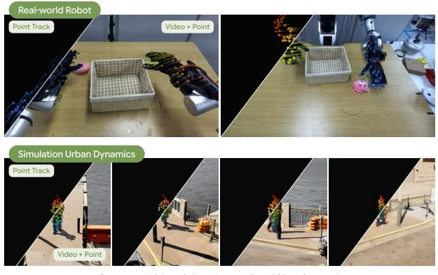

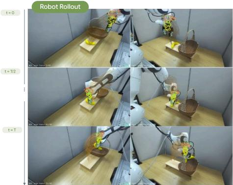  
Zero-shot Robot Manipulation from 3D Point Track  
Figure 4: Predicted 3D point trajectories guide generation and action. Left: Predicted trajectories alone and overlaid on generated videos. Right: Zero-shot real-robot rollout obtained by converting predicted trajectories into commands with inverse kinematics.

trend holds on RoboCasa Kitchen (Table 4), where VPM (V+T) outperforms all baselines. Notably, VPM (V) trails the geometry-aware Robot4DGen on multi-view consistency, whereas VPM (V+T) surpasses it, suggesting that point supervision is key to the 3D consistency of generated videos.

## 6.4 ROBOT MANIPULATION RESULTS

Setup. We test whether point supervision also benefits robot control using the action-enabled extension of VPM (Section 5). Simulation experiments follow each benchmark’s standard protocol with three synchronized views: one wrist camera and one or two third-person cameras on either side of the robot. In the real world, we use the DROID platform (a Franka Research 3 arm with a Robotiq 2F-85 gripper) and train only on an 89K-trajectory subset of DROID dataset. We evaluate three pick-and-place tasks of varying difficulty, with 24 trials each. We provide more details in Appendix A.3.

Results. As shown in Table 5, VPM (V+T+A) achieves the best success rates on all simulation benchmarks, outperforming both VLA policies and world-action models. This advantage carries over to the real world (Table 5), where VPM (V+T+A) achieves the highest success rate on every task. In both simulated and real-world settings, VPM (V+T+A) consistently improves over VPM (V+A), which is trained without point supervision. These results indicate that forecasting persistent 3D point trajectories provides a useful learning signal for robot actions.

## 6.5 ANALYSIS AND ABLATION STUDIES

Modality-wise ablation. We train VPM with combinations of video (V), point trajectories (T), and actions (A). In Table 6, adding trajectories yields the largest gains in video fidelity and 3D motion accuracy on every split, while adding actions yields modest improvements. Training with all three performs best on all splits and metrics, indicating that action supervision complements point supervision. Together with Table 5, where point supervision raises success rates on every benchmark, these results show point trajectories benefit both generation and action. We next examine why.

Why 3D point trajectory forecasting helps multi-view video generation. The trajectory head predicts point motion from the generator’s intermediate features, which the remaining blocks process into future frames, so point supervision directly shapes the representation from which videos are generated. Figure 4 illustrates this coupling: the robot hands and the pedestrian closely follow the predicted trajectories overlaid on the generated frames. Since each trajectory follows a single physical point, generation that follows them remains consistent across views.

Why 3D point trajectory forecasting helps action prediction. 3D point forecasting supervision consistently improves the action-enabled model (Table 5), which we attribute to three properties. First, on robot data, trajectories are computed from joint states by forward kinematics, describing the same motion as actions but grounded in 3D and in every view, which teaches the backbone to connect visual features with where the robot will move. Second, they are dense, constraining the robot’s full future configuration with hundreds of points per timestep rather than one low-dimensional action. Third, object trajectories, where available, specify where manipulated objects should go, encoding the task’s intended outcome. Action tokens, sharing this backbone, thus draw on a representation that already encodes the robot’s future motion. Supporting this, converting predicted trajectories into commands via inverse kinematics, without action tokens, completes unseen real-robot task zero-shot (Figure 4). Though not yet consistent enough for quantitative evaluation, these rollouts show that forecast trajectories alone carry actionable information (Appendix A.4).

## 7 CONCLUSION AND LIMITATIONS

We presented VPM, a multi-view world model that jointly forecasts future videos and persistent 3D point trajectories from posed video histories and language instructions. With VPM-Data and VP-WorldBench, our experiments show that supervising where scene points will move improves visual forecasting on simulated and real benchmarks and carries over to robot action learning. Limitations remain. Our point supervision covers only the robot and annotated objects rather than the full scene; skeletal annotations also omit independent cloth and hair motion. VPM assumes known camera intrinsics and poses at inference, and its cost grows with the number of views, as all camera streams share one token sequence. Future work includes deriving trajectory supervision from real multiview videos at scale, extending it to denser, non-rigid content, and relaxing the need for calibrated cameras.

## ACKNOWLEDGMENTS

This work was partly supported by Institute for Information & Communications Technology Planning & Evaluation (IITP) grant funded by the Korea government (MSIT) (RS-2019-II190075, Artificial Intelligence Graduate School Program (KAIST); RS-2024-00509279, Global AI Frontier Lab), RLWRLD Inc., and Physics Sim Lab, Inc.; the Swiss AI Initiative through a grant from the Swiss National Supercomputing Centre (CSCS) under project ID ab036 on the Alps infrastructure; the Swiss National Science Foundation (Advanced Grant 216260: “Beyond Frozen Worlds: Capturing Functional 3D Digital Twins from the Real World”); the European Union’s Horizon Europe research and innovation programme under grant agreement No. 101214398 (ELLIOT); the Horizon Europe programme under grant agreement No. 101298421 (GRAIL); and the ETH AI Center through an ETH AI Center postdoc fellowship awarded to Sunghwan Hong.

The authors thank Seonghu Jeon and Seoyeon Byun for their proofreading and assistance with improving the visualizations in the manuscript; Junbeom Kim, Minha Lee, Seong Hyeon Park, and Minsu Cho for their insightful discussions; and Beomjun Kim, Seunghoon Sim, Jaewon Youm, and Heeseung Kwon for providing feedback on model implementation and real-robot experiments.

## REFERENCES

Niket Agarwal, Arslan Ali, Jon Allen, Martin Antolini, Adeline Aubame, Alisson Azzolini, Junjie Bai, Maciej Bala, Yogesh Balaji, Josh Bapst, et al. Cosmos 3: Omnimodal world models for physical ai. arXiv preprint arXiv:2606.02800, 2026.

Honggyu An, Jin Hyeon Kim, Seonghoon Park, Jaewoo Jung, Jisang Han, Sunghwan Hong, and Seungryong Kim. Cross-view completion models are zero-shot correspondence estimators. In Proceedings ofthe Computer Vision and Pattern Recognition Conference, pp. 1103–1115, 2025.

Mohammad Asim, Christopher Wewer, Thomas Wimmer, Bernt Schiele, and Jan Eric Lenssen. Met3r: Measuring multi-view consistency in generated images. In 2025 IEEE/CVF Conference on Computer Vision and Pattern Recognition (CVPR), pp. 6034–6044. IEEE, 2025.

Jianhong Bai, Menghan Xia, Xiao Fu, Xintao Wang, Lianrui Mu, Jinwen Cao, Zuozhu Liu, Haoji Hu, Xiang Bai, Pengfei Wan, et al. Recammaster: Camera-controlled generative rendering from a single video. In 2025 IEEE/CVF International Conference on Computer Vision (ICCV), pp. 14834–14844. IEEE, 2025.

Matteo Balice, Yanik Kunzi, Chenyangguang Zhang, Matteo Matteucci, Marc Pollefeys, and Sunghwan Hong. No pose, no problem in 4d: Feed-forward dynamic gaussians from unposed multi view videos. arXiv preprint arXiv:2605.22190, 2026.

Prithviraj Banerjee, Sindi Shkodrani, Pierre Moulon, Shreyas Hampali, Fan Zhang, Jade Fountain, Edward Miller, Selen Basol, Richard Newcombe, Robert Wang, et al. Introducing hot3d: An egocentric dataset for 3d hand and object tracking. arXiv preprint arXiv:2406.09598, 2024.

Homanga Bharadhwaj and Yash Jangir. Motionforesight: Re-purposing video models for future 3d scene-flow prediction. arXiv preprint arXiv:2607.16192, 2026.

Joao Carreira and Andrew Zisserman. Quo vadis, action recognition? a new model and the kinetics dataset. In 2017 IEEE conference on computer vision and pattern recognition (CVPR), pp. 4724– 4733. IEEE, 2017.

Hila Chefer, Uriel Singer, Amit Zohar, Yuval Kirstain, Adam Polyak, Yaniv Taigman, Lior Wolf, and Shelly Sheynin. Videojam: Joint appearance-motion representations for enhanced motion generation in video models. arXiv preprint arXiv:2502.02492, 2025.

Zhiang Chen, Nahyuk Lee, Boyang Sun, Taein Kwon, Marc Pollefeys, Zuria Bauer, and Sunghwan Hong. Prose: Training-free egocentric scene registration with vision-language models. arXiv preprint arXiv:2606.16569, 2026.

Seokju Cho, Sunghwan Hong, Sangryul Jeon, Yunsung Lee, Kwanghoon Sohn, and Seungryong Kim. Cats: Cost aggregation transformers for visual correspondence. Advances in Neural Information Processing Systems, 34:9011–9023, 2021.

Seokju Cho, Sunghwan Hong, and Seungryong Kim. Cats++: Boosting cost aggregation with convolutions and transformers. IEEE Transactions on Pattern Analysis and Machine Intelligence, 45 (6):7174–7194, 2022.

Yufan Deng, Zilin Pan, Hongyu Zhang, Xiaojie Li, Ruoqing Hu, Yufei Ding, Yiming Zou, Yan Zeng, and Daquan Zhou. Rethinking video generation model for the embodied world. In Forty-third International Conference on Machine Learning, 2026.

Senyu Fei, Siyin Wang, Junhao Shi, Zihao Dai, Jikun Cai, Pengfang Qian, Li Ji, Xinzhe He, Shiduo Zhang, Zhaoye Fei, et al. Libero-plus: In-depth robustness analysis of vision-language-action models. arXiv preprint arXiv:2510.13626, 2025.

Haiwen Feng, Junyi Zhang, Qianqian Wang, Yufei Ye, Pengcheng Yu, Michael J Black, Trevor Darrell, and Angjoo Kanazawa. St4rtrack: Simultaneous 4d reconstruction and tracking in the world. In 2025 IEEE/CVF International Conference on Computer Vision (ICCV), pp. 8503–8513. IEEE, 2025.

Stephanie Fu, Mark Hamilton, Laura E Brandt, Axel Feldmann, Zhoutong Zhang, and William Freeman. Featup: A model-agnostic framework for features at any resolution. In International Conference on Learning Representations, volume 2024, pp. 45324–45350, 2024.

Kristen Grauman, Andrew Westbury, Lorenzo Torresani, Kris Kitani, Jitendra Malik, Triantafyllos Afouras, Kumar Ashutosh, Vijay Baiyya, Siddhant Bansal, Bikram Boote, et al. Ego-exo4d: Understanding skilled human activity from first-and third-person perspectives. In Proceedings of the IEEE/CVF conference on computer vision and pattern recognition, pp. 19383–19400, 2024.

Jun Guo, Qiwei Li, Peiyan Li, Zilong Chen, Nan Sun, Yifei Su, Heyun Wang, Yuan Zhang, Xinghang Li, and Huaping Liu. Unified 4d world action modeling from video priors with asynchronous denoising. arXiv preprint arXiv:2604.26694, 2026.

Jisang Han, Honggyu An, Jaewoo Jung, Takuya Narihira, Junyoung Seo, Kazumi Fukuda, Chaehyun Kim, Sunghwan Hong, Yuki Mitsufuji, and Seungryong Kim. Dˆ 2ust3r: Enhancing 3d reconstruction with 4d pointmaps for dynamic scenes. arXiv e-prints, pp. arXiv–2504, 2025.

Jisang Han, Seonghu Jeon, Jaewoo Jung, Rene Zurbr ´ ugg, Honggyu An, Tifanny Portela, Marco ¨ Hutter, Marc Pollefeys, Seungryong Kim, and Sunghwan Hong. Geometric action model for robot policy learning. arXiv preprint arXiv:2606.17046, 2026.

Hao He, Yinghao Xu, Yuwei Guo, Gordon Wetzstein, Bo Dai, Hongsheng Li, and Ceyuan Yang. Cameractrl: Enabling camera control for text-to-video generation. arXiv preprint arXiv:2404.02101, 2024.

Sunghwan Hong and Seungryong Kim. Deep matching prior: Test-time optimization for dense correspondence. In Proceedings of the IEEE/CVF international conference on computer vision, pp. 9907–9917, 2021.

Sunghwan Hong, Seokju Cho, Seungryong Kim, and Stephen Lin. Unifying feature and cost aggregation with transformers for semantic and visual correspondence. arXiv preprint arXiv:2403.11120, 2024a.

Sunghwan Hong, Jaewoo Jung, Heeseong Shin, Jisang Han, Jiaolong Yang, Chong Luo, and Seungryong Kim. Pf3plat: Pose-free feed-forward 3d gaussian splatting. arXiv preprint arXiv:2410.22128, 2024b.

Sunghwan Hong, Jaewoo Jung, Heeseong Shin, Jiaolong Yang, Seungryong Kim, and Chong Luo. Unifying correspondence pose and nerf for generalized pose-free novel view synthesis. In Proceedings of the IEEE/CVF Conference on Computer Vision and Pattern Recognition, pp. 20196– 20206, 2024c.

Physical Intelligence, Kevin Black, Noah Brown, James Darpinian, Karan Dhabalia, Danny Driess, Adnan Esmail, Michael Equi, Chelsea Finn, Niccolo Fusai, et al. π0.5: a vision-language-action model with open-world generalization. arXiv preprint arXiv:2504.16054, 2025.

Byungwoo Jeon, Dongyoung Kim, Huiwon Jang, Insoo Kim, and Jinwoo Shin. Spatialboost: Enhancing visual representation through language-guided reasoning. In European Conference on Computer Vision, pp. 390–408. Springer, 2026.

Hyeonho Jeong, Chun-Hao P Huang, Jong Chul Ye, Niloy J Mitra, and Duygu Ceylan. Track4gen: Teaching video diffusion models to track points improves video generation. In 2025 IEEE/CVF Conference on Computer Vision and Pattern Recognition (CVPR), pp. 7276–7287. IEEE, 2025.

Hanbyul Joo, Hao Liu, Lei Tan, Lin Gui, Bart Nabbe, Iain Matthews, Takeo Kanade, Shohei Nobuhara, and Yaser Sheikh. Panoptic studio: A massively multiview system for social motion capture. In Proceedings ofthe IEEE international conference on computer vision, pp. 3334–3342, 2015.

Nikita Karaev, Yuri Makarov, Jianyuan Wang, Natalia Neverova, Andrea Vedaldi, and Christian Rupprecht. Cotracker3: Simpler and better point tracking by pseudo-labeling real videos. In 2025 IEEE/CVF International Conference on Computer Vision (ICCV), pp. 1–10. IEEE, 2025.

Alexander Khazatsky, Karl Pertsch, Suraj Nair, Ashwin Balakrishna, Sudeep Dasari, Siddharth Karamcheti, Soroush Nasiriany, Mohan Kumar Srirama, Lawrence Yunliang Chen, Kirsty Ellis, et al. Droid: A large-scale in-the-wild robot manipulation dataset. arXiv preprint arXiv:2403.12945, 2024.

Dan Kondratyuk, Lijun Yu, Xiuye Gu, Jose Lezama, Jonathan Huang, Grant Schindler, Rachel´ Hornung, Vighnesh Birodkar, Jimmy Yan, Ming-Chang Chiu, et al. Videopoet: A large language model for zero-shot video generation. arXiv preprint arXiv:2312.14125, 2023.

Jahyeok Koo, Ines Hyeonsu Kim, Mungyeom Kim, Junghyun Park, Seohyeon Park, Jaeyeong Kim,\` Jung Yi, Seokju Cho, and Seungryong Kim. Mv-tap: Tracking any point in multi-view videos. In Proceedings of the IEEE/CVF Conference on Computer Vision and Pattern Recognition, pp. 20932–20941, 2026.

Skanda Koppula, Frano Rajic, Abdullah Faiz Ur Rahman, Yi Yang, Ignacio Rocco, Jeet Thakwani, Rishabh Kabra, Andrew Zisserman, Joao Carreira, Siyu Tang, et al. Tapvid-mv: A benchmark for tracking any point in 3d across multiple views. arXiv preprint arXiv:2609.01899, 2026.

JoungBin Lee, Jaewoo Jung, Jisang Han, Takuya Narihira, Kazumi Fukuda, Junyoung Seo, Sunghwan Hong, Yuki Mitsufuji, and Seungryong Kim. 3d scene prompting for scene-consistent camera-controllable video generation. In International Conference on Learning Representations, volume 2026, pp. 73753–73777, 2026a.

JoungBin Lee, Jaewoo Jung, Jongmin Lee, Tongmin Kim, Hyunsung Kim, Takuya Narihira, Kazumi Fukuda, Jahyeok Koo, Jisang Han, Yuki Mitsufuji, et al. Mvtrack4gen: Multi-view point tracking as geometric supervision for 4d video generation. arXiv preprint arXiv:2606.26087, 2026b.

Nahyuk Lee, Zhiang Chen, Marc Pollefeys, and Sunghwan Hong. Tora: Topological representation alignment for 3d shape assembly. arXiv preprint arXiv:2604.04050, 2026c.

Vincent Leroy, Yohann Cabon, and Jer´ ome Revaud. Grounding image matching in 3d with mast3r.ˆ In European conference on computer vision, pp. 71–91. Springer, 2024.

Jiahe Li, Jiawei Zhang, Xiao Bai, Jin Zheng, Xiaohan Yu, Lin Gu, and Gim Hee Lee. Revisiting photometric ambiguity for accurate gaussian-splatting surface reconstruction. In International Conference on Machine Learning. PMLR, 2026a.

Peiyan Li, Yixiang Chen, Yuan Xu, Jiabing Yang, Xiangnan Wu, Jun Guo, Nan Sun, Long Qian, Xinghang Li, Xin Xiao, et al. Spatial-aware multi-view video diffusion as a data-efficient robot policy. arXiv preprint arXiv:2604.03181, 2026b.

Weixin Liang, Lili Yu, Liang Luo, Srinivasan Iyer, Ning Dong, Chunting Zhou, Gargi Ghosh, Mike Lewis, Wen-tau Yih, Luke Zettlemoyer, et al. Mixture-of-transformers: A sparse and scalable architecture for multi-modal foundation models. arXiv preprint arXiv:2411.04996, 2024.

Jongbin Lim, Taeyun Ha, Mingi Choi, Jisoo Kim, Byungjun Kim, Subin Jeon, and Hanbyul Joo. Hrdexdb: A paired human-robot dataset for cross-embodiment dexterous grasping. arXiv preprint arXiv:2604.14944, 2026.

Haotong Lin, Sili Chen, Junhao Liew, Donny Y Chen, Zhenyu Li, Guang Shi, Jiashi Feng, and Bingyi Kang. Depth anything 3: Recovering the visual space from any views. arXiv preprint arXiv:2511.10647, 2025.

Yaron Lipman, Ricky TQ Chen, Heli Ben-Hamu, Maximilian Nickel, and Matt Le. Flow matching for generative modeling. arXiv preprint arXiv:2210.02747, 2022.

Bo Liu, Yifeng Zhu, Chongkai Gao, Yihao Feng, Qiang Liu, Yuke Zhu, and Peter Stone. Libero: Benchmarking knowledge transfer for lifelong robot learning. Advances in Neural Information Processing Systems, 36:44776–44791, 2023.

Xingchao Liu, Chengyue Gong, and Qiang Liu. Flow straight and fast: Learning to generate and transfer data with rectified flow. arXiv preprint arXiv:2209.03003, 2022.

Zeyi Liu, Shuang Li, Eric Cousineau, Siyuan Feng, Benjamin Burchfiel, and Shuran Song. Geometry-aware 4d video generation for robot manipulation. In International Conference on Learning Representations, volume 2026, pp. 140751–140773, 2026.

Soroush Nasiriany, Sep Nasiriany, Abhiram Maddukuri, and Yuke Zhu. Robocasa365: A largescale simulation framework for training and benchmarking generalist robots. In International Conference on Learning Representations, volume 2026, pp. 98643–98667, 2026.

NVIDIA, Johan Bjorck, Fernando Castaneda, Nikita Cherniadev, Xingye Da, Runyu Ding,˜ Linxi ”Jim” Fan, Yu Fang, Dieter Fox, Fengyuan Hu, Spencer Huang, Joel Jang, Zhenyu Jiang, Jan Kautz, Kaushil Kundalia, Lawrence Lao, Zhiqi Li, Zongyu Lin, Kevin Lin, Guilin Liu, Edith Llontop, Loic Magne, Ajay Mandlekar, Avnish Narayan, Soroush Nasiriany, Scott Reed, You Liang Tan, Guanzhi Wang, Zu Wang, Jing Wang, Qi Wang, Jiannan Xiang, Yuqi Xie, Yinzhen Xu, Zhenjia Xu, Seonghyeon Ye, Zhiding Yu, Ao Zhang, Hao Zhang, Yizhou Zhao, Ruijie Zheng, and Yuke Zhu. GR00T N1: An open foundation model for generalist humanoid robots. In ArXiv Preprint, March 2025.

Maxime Oquab, Timothee Darcet, Th´ eo Moutakanni, Huy Vo, Marc Szafraniec, Vasil Khalidov,´ Pierre Fernandez, Daniel Haziza, Francisco Massa, Alaaeldin El-Nouby, et al. Dinov2: Learning robust visual features without supervision. arXiv preprint arXiv:2304.07193, 2023.

Byeongjun Park, Byung-Hoon Kim, Hyungjin Chung, and Jong Chul Ye. Redirector: Creating anylength video retakes with rotary camera encoding. In Proceedings of the IEEE/CVF Conference on Computer Vision and Pattern Recognition, pp. 11163–11173, 2026.

William Peebles and Saining Xie. Scalable diffusion models with transformers. In 2023 IEEE/CVF International Conference on Computer Vision (ICCV), pp. 4172–4182. IEEE, 2023.

Jordi Pont-Tuset, Federico Perazzi, Sergi Caelles, Pablo Arbelaez, Alex Sorkine-Hornung, and´ Luc Van Gool. The 2017 davis challenge on video object segmentation. arXiv preprint arXiv:1704.00675, 2017.

Frano Rajic, Haofei Xu, Marko Mihajlovic, Siyuan Li, Irem Demir, Emircan G ˇ undo ¨ gdu, Lei Ke,˘ Sergey Prokudin, Marc Pollefeys, and Siyu Tang. Multi-view 3d point tracking. In Proceedings of the IEEE/CVF International Conference on Computer Vision, pp. 59–68, 2025.

Nikhila Ravi, Valentin Gabeur, Yuan-Ting Hu, Ronghang Hu, Chaitanya Ryali, Tengyu Ma, Haitham Khedr, Roman Radle, Chloe Rolland, Laura Gustafson, et al. Sam 2: Segment anything in images¨ and videos. In International Conference on Learning Representations, volume 2025, pp. 28085– 28128, 2025.

Johannes Lutz Schonberger and Jan-Michael Frahm. Structure-from-motion revisited. In¨ Conference on Computer Vision and Pattern Recognition (CVPR), 2016.

Yichao Shen, Fangyun Wei, Zhiying Du, Yaobo Liang, Yan Lu, Jiaolong Yang, Nanning Zheng, and Baining Guo. Videovla: Video generators can be generalizable robot manipulators. Advances in neural information processing systems, 38:95597–95621, 2026.

Vincent Sitzmann, Semon Rezchikov, Bill Freeman, Josh Tenenbaum, and Fredo Durand. Light field networks: Neural scene representations with single-evaluation rendering. Advances in neural information processing systems, 34:19313–19325, 2021.

Wan Team, Ang Wang, Baole Ai, Bin Wen, Chaojie Mao, et al. Wan: Open and advanced large-scale video generative models. arXiv preprint arXiv:2503.20314, 2(3):4, 2025.

Hansi Teng, Hongyu Jia, Lei Sun, Lingzhi Li, Maolin Li, Mingqiu Tang, Shuai Han, Tianning Zhang, WQ Zhang, Weifeng Luo, et al. Magi-1: Autoregressive video generation at scale. arXiv preprint arXiv:2505.13211, 2025.

Joachim Tesch, Giorgio Becherini, Prerana Achar, Anastasios Yiannakidis, Muhammed Kocabas, Priyanka Patel, and Michael Black. Bedlam2. 0: Synthetic humans and cameras in motion. Advances in Neural Information Processing Systems, 38, 2026.

Thomas Unterthiner, Sjoerd Van Steenkiste, Karol Kurach, Raphael Marinier, Marcin Michalski, and Sylvain Gelly. Towards accurate generative models of video: A new metric & challenges. arXiv preprint arXiv:1812.01717, 2018.

Ruicheng Wang, Sicheng Xu, Yue Dong, Yu Deng, Jianfeng Xiang, Zelong Lv, Guangzhong Sun, Xin Tong, and Jiaolong Yang. Moge-2: Accurate monocular geometry with metric scale and sharp details. Advances in Neural Information Processing Systems, 38:35928–35959, 2026.

Shuzhe Wang, Vincent Leroy, Yohann Cabon, Boris Chidlovskii, and Jerome Revaud. Dust3r: Geometric 3d vision made easy. In 2024 IEEE/CVF Conference on Computer Vision and Pattern Recognition (CVPR), pp. 20697–20709. IEEE, 2024.

Bing Wu, Chang Zou, Changlin Li, Duojun Huang, Fang Yang, Hao Tan, Jack Peng, Jianbing Wu, Jiangfeng Xiong, Jie Jiang, et al. Hunyuanvideo 1.5 technical report. arXiv preprint arXiv:2511.18870, 2025.

Haoyu Wu, Diankun Wu, Tianyu He, Junliang Guo, Yang Ye, Yueqi Duan, and Jiang Bian. Geometry forcing: Marrying video diffusion and 3d representation for consistent world modeling. In International Conference on Learning Representations, volume 2026, pp. 119186–119209, 2026.

Yiming Xie, Chun-Han Yao, Vikram Voleti, Huaizu Jiang, and Varun Jampani. Sv4d: Dynamic 3d content generation with multi-frame and multi-view consistency. In International Conference on Learning Representations, volume 2025, pp. 33421–33441, 2025.

Wilson Yan, Yunzhi Zhang, Pieter Abbeel, and Aravind Srinivas. Videogpt: Video generation using vq-vae and transformers. arXiv preprint arXiv:2104.10157, 2021.

Lishan Yang, Wenxuan Song, Xi Wang, Pingyue Sheng, Zheng Fang, Ziyang Zhou, Junjie He, Haodong Yan, Jiayi Chen, Nan Sun, et al. 4d-wam: Infusing spatiotemporal awareness into world action models through trajectory fields. arXiv preprint arXiv:2608.08023, 2026.

Seonghyeon Ye, Yunhao Ge, Kaiyuan Zheng, Shenyuan Gao, Sihyun Yu, George Kurian, Suneel Indupuru, You Liang Tan, Chuning Zhu, Jiannan Xiang, et al. World action models are zero-shot policies. arXiv preprint arXiv:2602.15922, 2026.

Yuanwen Yue, Damien Robert, Jianyuan Wang, Sunghwan Hong, Jan Dirk Wegner, Christian Rupprecht, and Konrad Schindler. Litept: Lighter yet stronger point transformer. arXiv preprint arXiv:2512.13689, 2025.

Bowei Zhang, Lei Ke, Adam Harley, and Katerina Fragkiadaki. Tapip3d: Tracking any point in persistent 3d geometry. Advances in Neural Information Processing Systems, 38:135284–135303, 2026a.

Jianing Zhang, Chenhao Zheng, Yajun Yang, Max Argus, Rustin Soraki, Winson Han, Taira Anderson, Chun-Liang Li, Shuo Liu, Jiafei Duan, et al. Molmomotion: Forecasting point trajectories in 3d with language instruction. arXiv preprint arXiv:2606.18558, 2026b.

Jianjun Zhang, Jian Zhu, Taiyi Su, Chong Ma, Zitai Huang, Yi Xu, and Hanli Wang. Learning 4d geometric priors for inference-efficient world action models. arXiv preprint arXiv:2607.05468, 2026c.

X Zhang, J Liao, S Zhang, F Meng, X Wan, J Yan, and Y Cheng. Videorepa: Learning physics for video generation through relational alignment with foundation models (2025). arXiv preprint arXiv:2505.23656, 2025.

Zhengyou Zhang. A flexible new technique for camera calibration. IEEE Transactions on Pattern Analysis and Machine Intelligence, 22:1330–1334, December 2000. MSR-TR-98-71, Updated March 25, 1999.

Fengzhe Zhou, Jiannan Huang, Jialuo Li, Deva Ramanan, and Humphrey Shi. Pai-bench: A comprehensive benchmark for physical ai. In Proceedings of the IEEE/CVF Conference on Computer Vision and Pattern Recognition, pp. 21522–21536, 2026a.

Kaichen Zhou, Yuzhen Chen, Fangneng Zhan, Hang Hua, Grace Chen, Xinhai Chang, Ao Qu, Yilun Du, Zhuang Liu, Paul Pu Liang, et al. Gem-4d: Geometry-enhanced video world models for robot manipulation. arXiv preprint arXiv:2605.22882, 2026b.

Yi Zhou, Connelly Barnes, Jingwan Lu, Jimei Yang, and Hao Li. On the continuity of rotation representations in neural networks. In 2019 IEEE/CVF Conference on Computer Vision and Pattern Recognition (CVPR), pp. 5738–5746. IEEE, 2019.

## Appendix Contents

A Implementation Details 17   
A.1 Training Details . 17   
A.2 Evaluation Details. 17   
A.3 Robot Manipulation Tasks. 19   
A.4 Details of Robot Manipulation through 3D Point Trajectory 20   
B Dataset Curation 21   
B.1 Data Statistics . 21   
B.2 3D Point Extraction Pipeline from Robot Videos. 21   
C Training Data Generation 23   
C.1 Capture Settings and Environments 23   
C.2 Tabletop Generation. 23   
C.3 Urban Capture 23   
C.4 Geometric and Language Annotations 24   
C.5 Visibility-Controlled Clips 24   
C.6 Validation and Rendering 25   
D VP-WorldBench: Construction and Statistics 26   
D.1 Composition and Capture Settings. 26   
D.2 Tabletop Capture 26   
D.3 Urban Capture 27   
D.4 Ground-Truth Annotations 27   
D.5 Visibility-Controlled Subsets 27   
D.6 Validation and Limitations 28   
D.7 Real-World Benchmark Details 29   
D.8 Relation to Existing Resources 30   
E Additional Experimental Results 31   
E.1 Detailed Experiments on VP-WorldBench . 31   
E.2 Detailed Experiments on 4D Generation . 32   
E.3 Comparison with Per-Frame Geometry Supervision 33   
E.4 Performance of 3D Point Trajectory Head . 33   
E.5 Performance on Single-View World Modeling 34   
E.6 Additional Results on Modality-Wise Ablation Study 35   
E.7 Analysis on Multi-View Video Generation. 35   
E.8 Clock-Time Analysis 35   
E.9 Data Scalability . 36   
F Detailed Ablation Studies 37   
F.1 Ablation Study for Camera Embeddings . 37   
F.2 Ablation Study for Objectives . 37   
F.3 Ablation Study for Training Stages 38   
F.4 Ablation Study for Layers . 38   
F.5 Ablation Study for Refinement 38   
F.6 Ablation Study for Training Data 39   
G Qualitative Results 40   
G.1 Multi-View Video and Point Trajectory Prediction . 40   
G.2 Predicted vs. Ground-Truth Videos 42   
G.3 Example Rollouts of Robot Manipulation Tasks . 43

## A IMPLEMENTATION DETAILS

## A.1 TRAINING DETAILS

We adopt Cosmos3-Nano (Agarwal et al., 2026) as the backbone and follow its Mixture-of-Transformers architecture (Liang et al., 2024). We train VPM with the three-stage pipeline described in Section 3.5.

In Stage 1, we train the generation pathway, camera embeddings, and view frequencies with $\mathcal { L } _ { \mathrm { F M } }$ on all multi-view sources, including those without trajectory annotations. In Stage 2, we freeze the remaining parameters and train only the trajectory head and view frequencies with $\mathcal { L } _ { \mathrm { t r a c k } }$ . In Stage 3, we jointly optimize the video backbone and the trajectory head with $\mathcal { L } _ { \mathrm { f o r e c a s t } }$ . The reasoner is frozen throughout all stages. For video supervision, we treat the camera pose of each view as an optional condition. For instance, views from VPM-Data, where camera control is important, are conditioned on their future camera poses, whereas wrist-camera views from the robot datasets, whose future poses depend on the actions being predicted, are not conditioned on any pose. This also allows VPM to forecast without future camera parameters, as required by our main evaluation protocol. Detailed hyperparameters are provided in Table 7.

The trajectory head operates on query and key features from the 18th self-attention layer of the generator and performs $M = 4$ refinement iterations. During training, we sample $N = \dot { 5 } 1 2$ query points per clip from the observed history. For the action-enabled variants, we apply $\mathcal { L } _ { \mathrm { a c t } }$ in Stage 3 on action-annotated interactions. Following Cosmos 3 (Agarwal et al., 2026), unified actions are represented as 9-dimensional vectors (Zhou et al., 2019). VPM (V) and VPM (V+A) are trained without $\mathcal { L } _ { \mathrm { t r a c k } }$ and ${ \mathcal { L } } _ { \mathrm { c o r r } } .$ All training is conducted on 32 NVIDIA GH200 Grace Hopper GPUs.

Table 7: Hyperparameters for each training stage.
<table><tr><td>Hyperparameter</td><td>Stage 1</td><td>Stage 2</td><td>Stage 3</td></tr><tr><td>Trainable modules</td><td>Generator, Camera emb.</td><td>Traj. head</td><td>Generator, Traj. head</td></tr><tr><td>Objective</td><td>LFM</td><td>Ltrack AdamW</td><td> $\mathcal { L } _ { \mathrm { f o r e c a s t } } \left( + \lambda _ { \mathrm { a c t } } \mathcal { L } _ { \mathrm { a c t } } \right)$ </td></tr><tr><td>Optimizer Learning rate</td><td>1e-4</td><td>1e-4</td><td>2e-5</td></tr><tr><td></td><td></td><td></td><td></td></tr><tr><td>Tokens</td><td>60,000</td><td>60,000</td><td>24,000</td></tr><tr><td>Training iterations</td><td>5,000</td><td>2,000</td><td>5,000</td></tr><tr><td>Warm-up steps</td><td></td><td>100</td><td></td></tr><tr><td>Video resolution</td><td></td><td>256-480px</td><td></td></tr><tr><td>Maximum frames</td><td></td><td>181</td><td></td></tr><tr><td>History frames  $( h ^ { \prime } )$ </td><td></td><td>1-16</td><td></td></tr><tr><td>Query points (N)</td><td></td><td>512</td><td>512</td></tr><tr><td>Refinement iterations (M)</td><td></td><td>4</td><td>4</td></tr><tr><td> $\lambda _ { \mathrm { s e q } } / \lambda _ { \mathrm { d e p t h } } / \lambda _ { \mathrm { c o n f } }$ </td><td></td><td>1/1/1</td><td>1/1/1</td></tr><tr><td> $\lambda _ { \mathrm { t r a c k } }$ </td><td></td><td></td><td>0.01</td></tr><tr><td> $\lambda _ { \mathrm { c o r r } }$ </td><td></td><td></td><td>0.01</td></tr><tr><td>λact</td><td></td><td></td><td>0.1</td></tr></table>

## A.2 EVALUATION DETAILS

Evaluation protocol. For Image-to-Video (I2V) evaluation, each model receives a single frame. For Video-to-Video (V2V) evaluation, each model receives h′ = 16 frames of multi-view history. The model then predicts the next $h = 6 4$ frames and the output videos are resized to 480p. We use each model’s default number of denoising steps. To evaluate single-view baselines, i.e., HunyuanVideo 1.5, Wan2.2-5B, and Cosmos3-Nano, we generate videos from each view independently.

Video fidelity. We compute FVD (Unterthiner et al., 2018) using I3D (Carreira & Zisserman, 2017) features and PSNR between generated and ground-truth frames. Both metrics are computed independently for each output view and averaged across views.

Geometric consistency of multi-view videos. We measure geometric consistency with cross-view MEt3R and $\delta _ { \mathrm { a v g } } ^ { \mathrm { 3 D } }$ . MEt3R (Asim et al., 2025) scores the 3D consistency of two images $I _ { 1 }$ and $I _ { 2 }$ without ground truth, comparing their DINO features (Oquab et al., 2023) in a common view. Chosen over different geometric foundation models (Wang et al., 2024; Han et al., 2025), MASt3R (Leroy et al., 2024) regresses point maps of both images in the camera frame of $I _ { 1 }$ , and upsampled features through FeatUp (Fu et al., 2024) attached to these points are rendered into the view of $I _ { 1 }$ , yielding $\hat { F } _ { 1 }$ and $\hat { F } _ { 2 }$ . The score averages their cosine dissimilarity over the co-visible pixels $\Omega _ { 1 2 }$ , symmetrized over the two orderings:

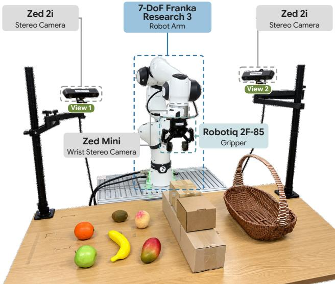  
Figure 5: Real-world hardware platform. A 7-DoF Franka Research 3 robot arm equipped with a Robotiq 2F-85 gripper and a wrist-mounted Zed Mini stereo camera. Two external Zed 2i stereo cameras (view 1 and view 2) observe the workspace from different viewpoints, providing synchronized multi-view observations.

$$
S ( I _ { 1 } , I _ { 2 } ) = \frac { 1 } { | \Omega _ { 1 2 } | } \sum _ { p \in \Omega _ { 1 2 } } \left[ 1 - \cos ( \hat { F } _ { 1 } ( p ) , \hat { F } _ { 2 } ( p ) ) \right] , \quad \mathrm { M E t 3 } \mathrm { R } ( I _ { 1 } , I _ { 2 } ) = \frac { 1 } { 2 } \left[ S ( I _ { 1 } , I _ { 2 } ) + S ( I _ { 2 } , I _ { 1 } ) \right] .\tag{9}
$$

However, MEt3R is typically applied to consecutive frames of a monocular video, assuming large overlap between the two images. On multi-view videos, raw MEt3R fails to rank videos by quality: real view pairs with little overlap already score high, while generated views drifting apart go unpenalized, since a pair without overlap scores 0. We thus introduce cross-view MEt3R, measuring the deviation of a generated video’s consistency from that of the ground truth. For each clip s in a split $s ,$ we average MEt3R over all pairs of output views at timesteps $\mathcal { T } = \{ t + 4 k \} _ { k = 1 } ^ { h / 4 }$ , obtaining $m ( s )$ and report

$$
\mathrm { C r o s s \mathrm { - } v i e w \ M E t { 3 R } } = \frac { 1 } { | \cal S | } \sum _ { s \in \cal S } \big | m ^ { \mathrm { g e n } } ( s ) - m ^ { \mathrm { g t } } ( s ) \big | .\tag{10}
$$

Both videos are evaluated with the official implementation on $2 5 6 \times 2 5 6$ center crops.

For $\delta _ { \mathrm { a v g } } ^ { \mathrm { 3 D } } .$ , we track query points sampled from the observed history with MVTracker (Rajic et al.ˇ , 2025), using the generated videos and depth maps from MoGe-2 (Wang et al., 2026), expressing the trajectories in the fixed reference frame. With $e _ { \tau , n } = \| \widehat { \mathbf { P } } _ { \tau , n } - \mathbf { P } _ { \tau , n } \| _ { 2 }$ denoting the error of point n at future timestep τ ,

$$
\delta _ { \mathrm { a v g } } ^ { \mathrm { 3 D } } = \frac { 1 } { | \mathcal { D } | } \sum _ { \delta \in \mathcal { D } } \frac { 1 } { N h } \sum _ { n = 1 } ^ { N } \sum _ { \tau = t + 1 } ^ { t + h } \mathbb { K } \left[ e _ { \tau , n } < \delta \frac { d _ { \tau , n } } { f } \right] ,\tag{11}
$$

where the pixel thresholds $\mathcal { D } = \{ 1 , 2 , 4 , 8 , 1 6 \}$ are converted into 3D distances at the ground-truth depth $d _ { \tau , n }$ with focal length $f ,$ , following TAPVid-MV (Koppula et al., 2026).

Neither metric reaches its ideal value even for a perfect generator. For $\delta _ { \mathrm { a v g } } ^ { \mathrm { 3 D } } ,$ , we report an upper bound, evaluating the ground-truth videos with the same pipeline. For cross-view MEt3R, a generator as consistent as the ground truth still scores above 0 when forecasting a different future, as MEt3R fluctuates over time with the content. We estimate this floor from the ground-truth videos as

$$
\mathrm { f l o o r } = \frac { 1 } { | { \cal S } | } \sum _ { s \in { \cal S } } \frac { 1 } { \sqrt { 2 } } \big | \bar { x } _ { s } ^ { ( 1 ) } - \bar { x } _ { s } ^ { ( 2 ) } \big | ,\tag{12}
$$

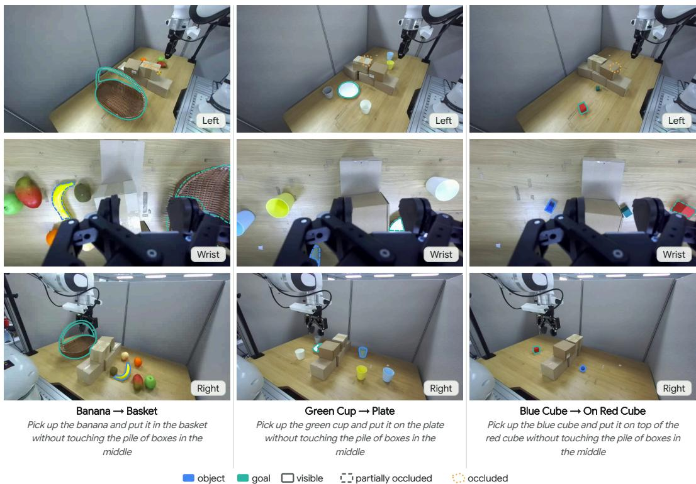  
Figure 6: Examples of the robot manipulation tasks.

where $\bar { x } _ { s } ^ { ( 1 ) }$ and $\bar { x } _ { s } ^ { ( 2 ) }$ average the per-timestep MEt3R of clip s, relative to the split average, over the first and second halves of $\tau$ , with $1 / \sqrt { 2 }$ compensating for the half-length averages.

Robot manipulation. For LIBERO (Liu et al., 2023), we evaluate on the four standard suites, i.e., LIBERO-Spatial, LIBERO-Object, LIBERO-Goal, and LIBERO-Long, each consisting of 10 tasks, with 20 trials per task. For LIBERO-Plus (Fei et al., 2025), we evaluate the policy trained on LIBERO in a zero-shot manner on 10,030 tasks spanning seven perturbation dimensions with one trial per task. For RoboCasa Kitchen (Nasiriany et al., 2026), we evaluate on 24 manipulation tasks with 200 trials per task across five evaluation scenes (10 trials per scene), and average the success rates over three random seeds. For real-world tasks, we use two exo cameras and one wrist camera, and conduct 24 trials per task.

## A.3 ROBOT MANIPULATION TASKS

We evaluate all policies on three pick-and-place tasks with a Franka Research 3 arm and the DROID camera setup (left and right exterior cameras and a wrist camera), as shown in Figure 5. All tasks share a tabletop layout with a pile of boxes in the middle, and the object and its goal are placed on opposite sides of the pile so that no single camera shows the whole task (Figure 6). The robot puts a banana into a basket among other fruits, places a green cup on a plate among cups of other colors, and stacks a small blue cube on top of a red cube next to a green distractor cube, which additionally requires precise placement in height. Solving these tasks requires fusing the three views into a consistent 3D understanding of the scene, moving across the pile without touching it, and grounding the instruction among same-category distractors.

Each trial is scored as 1 if the object is placed at the goal without touching the pile of boxes, 0.5 if the pick-and-place succeeds but the robot hits the pile on the way, and 0 otherwise. The success rate of a task is the average score over its 24 trials, which is why some entries in Table 5 correspond to half-integer counts.

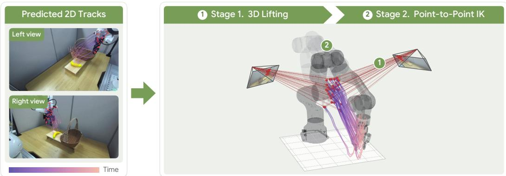  
Figure 7: From predicted point trajectories to joint-space actions. Predicted 2D trajectories from both views are lifted to 3D (Stage 1) and converted into a joint trajectory by fitting the robot’s kinematic model to the lifted points (Stage 2).

## A.4 DETAILS OF ROBOT MANIPULATION THROUGH 3D POINT TRAJECTORY

To examine whether the forecast trajectories alone carry actionable information, we bypass the action tokens and convert the predicted trajectories directly into robot commands with a training-free two-stage procedure (Figure 7 and Algorithm 1). We sample $N { = } 1 2 8$ query points on the robot surface from its kinematic model at the current joint state and project them into both exterior views. Their trajectories are read from the trajectory head at the third of four denoising steps $( \sigma \approx 0 . 8 3 )$ We choose this step because $\sigma \approx 0 . 8 3$ is the mode of the noise-level distribution used to train the trajectory head, where its predictions are most reliable. In the first stage, each trajectory is lifted to 3D by triangulating the two views, weighting each observation by its predicted confidence $\widehat { c } _ { \tau , n } ^ { v } .$ In the second stage, since every query point is attached to a known robot link, we obtain the joint configuration at each future frame by fitting the robot’s forward kinematics (FK) to the lifted points with a robust loss, regularized toward the previous frame for a smooth trajectory. Each point is weighted by $w _ { \tau , n } .$ , its predicted confidence averaged over views, so that unreliable tracks contribute less to the fit. The resulting joint trajectory, together with the gripper opening recovered from the finger points, is executed in a receding-horizon manner, without action labels or any robot-specific training.

Algorithm 1 Zero-shot joint-space control from predicted point trajectories   
Require: calibrated exterior views V, current joint state $\mathbf { q } _ { t } ,$ robot kinematics FK, read-out noise   
level $\sigma ^ { \star }$   
1: Sample N query points on the robot surface at $\mathbf { q } _ { t }$ and project them into each view   
2: Read 2D tracks $\{ \widehat { \bf { u } } _ { \tau , n } ^ { v } \}$ and confidences $\{ \widehat { c } _ { \tau , n } ^ { v } \}$ from the forward pass at noise level $\sigma ^ { \star }$   
3: for $\tau = t + 1 , \dots , t + h$ do   
4: {Stage 1: 3D lifting}   
5: $\widehat { \mathbf { P } } _ { \tau , n } \gets \mathrm { T R I A N G U L A T E } \left( \{ \widehat { \mathbf { u } } _ { \tau , n } ^ { v } , \widehat { c } _ { \tau , n } ^ { v } \} _ { v \in \mathcal { V } } \right)$ for all n   
6: $\begin{array} { r } { w _ { \tau , n } \gets \frac { 1 } { | \mathcal { V } | } \sum _ { v \in \mathcal { V } } \widehat { c } _ { \tau , n } ^ { v } } \end{array}$ for all n   
7: {Stage 2: point-to-point IK}   
8: $\begin{array} { r l } & { \mathbf { q } _ { \tau }  \mathrm { a r g m i n } _ { \mathbf { q } } \sum _ { n } w _ { \tau , n } \rho \big ( \| \mathrm { F K } _ { n } ( \mathbf { q } ) - \widehat { \mathbf { P } } _ { \tau , n } \| \big ) + \lambda \| \mathbf { q } - \mathbf { q } _ { \tau - 1 } \| ^ { 2 } } \end{array}$   
9: end for   
10: Execute the first steps of {qτ} and re-plan from the new observation

## B DATASET CURATION

To train VPM, we construct 600K samples from three sources: (i) VPM-Data, our multi-view videos with persistent 3D point trajectories from simulation, (ii) robot manipulation video datasets annotated with kinematics-grounded 3D point trajectories, and (iii) open-source video datasets from diverse domains, e.g., MolmoMotion-1M (Zhang et al., 2026b) and Ego-Exo4D (Grauman et al., 2024). We provide detailed statistics in Section B.1, and elaborate on the construction of VPM-Data in Section C and robot data in Section B.2, respectively.

## B.1 DATA STATISTICS

We collect 600K samples in total, as summarized in Table 8. VPM-Data contains 10,000 multi-view samples, consisting of 8,000 tabletop manipulation clips and 2,000 urban dynamics clips. The robot datasets contain 91K episodes from DROID (Khazatsky et al., 2024) and HRDexDB (Lim et al., 2026). The remaining clips are collected and sampled from open-source datasets.

Table 8: Statistics of the training data.
<table><tr><td>Source</td><td>Domain</td><td>Real/Sim</td><td>Samples</td><td>Views</td><td>3D traj.</td><td>Action</td></tr><tr><td>VPM-Data</td><td>Tabletop manipulation</td><td>Sim</td><td>8,000</td><td>3</td><td></td><td>x</td></tr><tr><td>VPM-Data</td><td>Urban dynamics</td><td>Sim</td><td>2,000</td><td>4</td><td></td><td>X</td></tr><tr><td>DROID</td><td>Tabletop manipulation</td><td>Real</td><td>89,312</td><td>3</td><td></td><td>√</td></tr><tr><td>HRDexDB</td><td>Tabletop manipulation</td><td>Real</td><td>1,601</td><td>2</td><td></td><td></td></tr><tr><td>MolmoMotion-1M</td><td>Mixed domain</td><td>Real</td><td>480,000</td><td>1-2</td><td></td><td>X</td></tr><tr><td>Ego-Exo4D</td><td>Human activities</td><td>Real</td><td>24,000</td><td>1-4</td><td>√</td><td>X</td></tr><tr><td>Total</td><td colspan="6">604,913</td></tr></table>

## B.2 3D POINT EXTRACTION PIPELINE FROM ROBOT VIDEOS

We describe our pipeline for extracting the 3D point trajectories used to train our model. Our objective is to recover metric, temporally consistent 3D trajectories of action-relevant geometry throughout each manipulation episode. Rather than relying on noisy pseudo-labels from visual point trackers, we construct these trajectories directly from known robot and object geometry together with recorded kinematic states. In particular, robot CAD models provide accurate surface geometry, which can be transformed according to the robot state at each timestep to obtain geometrically grounded 3D point trajectories. We detail this procedure below.

3D Point Extraction. We begin with the CAD or visual meshes of each robot link and manipulated object. We assume calibrated cameras and a known transformation between the robot base and each camera coordinate frame. For each mesh, we sample surface points using area-weighted triangle sampling. Sampling is performed once in the mesh-local coordinate system with a fixed random seed, and the same points are reused throughout the entire episode. By subsequently transforming these fixed local points according to the corresponding link or object pose at each timestep, we obtain temporally consistent 3D point trajectories without resampling noise.

We allocate a fixed point budget to each action-relevant component: we sample 256 3D points from the whole robot body. In cases where the 3D points of the target object are available, such as in simulation settings, we also sample 256 points from the object being manipulated. For articulated components composed of multiple meshes, the budget is distributed approximately in proportion to mesh surface area. Let $ { \mathbf { p } } _ { n } ^ { \ell }$ denote a point sampled on the local CAD geometry of link or object ℓ. Its world-space location at timestep τ is obtained as

$$
\begin{array} { r } { \mathbf { p } _ { \tau , n } ^ { w } = \mathbf { R } _ { \ell , \tau } ^ { w } \mathbf { p } _ { n } ^ { \ell } + \mathbf { b } _ { \ell , \tau } ^ { w } , } \end{array}
$$

where $( \mathbf { R } _ { \ell , \tau } ^ { w } , \mathbf { b } _ { \ell , \tau } ^ { w } )$ denotes the pose of the corresponding link or object. Because $\mathbf { p } _ { n } ^ { \ell }$ is fixed, point n retains the same physical identity over the complete trajectory. For these sampled points, we apply forward kinematics of the robot via saved robot states, and obtain their 3D positions per time step. For simulated datasets, we replay the recorded simulator state and directly query the per-frame poses of robot links, objects, and cameras. The sampled CAD points can therefore be transformed using the simulator’s underlying geometry without requiring visual pose estimation. For real-robot datasets, we load the corresponding robot model and visual meshes, and manipulate the robot CAD via saved robot states and forward kinematics.

Camera-frame trajectories and projection. Using the extracted 3D points, we first construct point trajectories in a common world frame and subsequently transform them into each camera coordinate system. For camera $v ,$ the position $\mathbf { p } _ { \tau , n } ^ { v }$ of point n at timestep τ is given by

$$
\mathbf { p } _ { \tau , n } ^ { v } = \mathbf { R } _ { \tau } ^ { v  w } \mathbf { p } _ { \tau , n } ^ { w } + \mathbf { b } _ { \tau } ^ { v  w } ,
$$

where $( \mathbf { R } _ { \tau } ^ { v  w } , \mathbf { b } _ { \tau } ^ { v  w } )$ denotes the world-to-camera extrinsics of camera v at timestep $\tau .$ Because the same point identities are preserved under these transformations, this representation provides explicit point correspondences (Yue et al., 2025; Chen et al., 2026; Lee et al., 2026c) across both time and viewpoints.

Data Filtering for Robot Data. Although the real-robot datasets provide camera calibration, even relatively small errors, such as errors in camera extrinsics or in the robot-base calibration can create substantial image-space misalignment between the projected CAD model and the observed robot. We therefore explicitly validate the geometric alignment of each real episode before retaining it.

We evaluate calibration quality using agreement between the projected CAD geometry and an independently obtained image-space robot mask. We first use the recorded joint configuration and camera calibration to solve the robot kinematics and render the corresponding CAD model into every frame, producing a binary projected CAD mask $M _ { t } ^ { \mathrm { C A D } }$

Rather than evaluating all frames equally, we select the frame $\tau ^ { \star }$ in which the projected robot occupies the largest image area, defined as

$$
\tau ^ { \star } = \arg \operatorname* { m a x } _ { \tau } \left| { \cal M } _ { \tau } ^ { \mathrm { C A D } } \right| .
$$

This frame provides the strongest calibration signal because a larger visible robot region reduces sensitivity to small masks, truncation, and weak overlap statistics.

For the selected frame $\tau ^ { \star }$ , we obtain an image-derived robot mask $M _ { \tau ^ { \star } } ^ { \mathrm { S A M } }$ using SAM2 (Ravi et al., 2025) and compare it against the rendered CAD mask. We use CAD-mask recall, defined as

$$
\mathrm { R e c a l l } _ { \mathrm { C A D } } = \frac { \left| M _ { \tau ^ { \star } } ^ { \mathrm { C A D } } \cap M _ { \tau ^ { \star } } ^ { \mathrm { S A M } } \right| } { \left| M _ { \tau ^ { \star } } ^ { \mathrm { C A D } } \right| } ,
$$

which measures the fraction of geometry predicted by the calibrated robot model that is supported by the observed image mask. We retain episodes with a recall of at least 0.9 and discard those below this threshold. Low recall indicates substantial disagreement between the kinematically projected CAD model and the image evidence, suggesting that the resulting 3D supervision may be unreliable.

We find recall preferable to symmetric mask-overlap metrics, as the SAM2 mask may include regions that do not belong to the robot or may merge the robot with nearby objects. Our primary requirement is instead that the geometry used to construct the 3D supervision projects consistently onto the robot observed in the image.

Output representation. The resulting sample contains synchronized multi-view RGB observations together with persistent 3D surface-point trajectories for the robot arm, gripper or hand, and manipulated objects. We additionally retain the recorded joint states and all camera metadata required to reproduce the trajectories and their image-space projections, including intrinsics, distortion parameters, and per-frame extrinsics. Consequently, each point index refers to the same physical surface location across both time and camera viewpoints.

## C TRAINING DATA GENERATION

We use separate pipelines for tabletop manipulation and urban capture, with a shared annotation format. This section describes training-data generation; benchmark construction is detailed in Section D.

## C.1 CAPTURE SETTINGS AND ENVIRONMENTS

Table 9 summarizes the capture settings; corpus composition is reported in Table 1. Tabletop training uses city environment $C _ { 1 }$ as static scenery, whereas urban training captures live agents in $C _ { 2 }$ . The benchmark additionally uses unseen kitchen environments H for manipulation and moving agents in $C _ { 1 }$ for urban evaluation. The latter environment is therefore familiar as scenery, but its traffic and crowd dynamics are absent from training.

Table 9: Training-data capture settings. Both domains use 1280×1280 images and distortion-free pinhole cameras.
<table><tr><td>Setting</td><td>Tabletop</td><td>Urban</td></tr><tr><td>Motion source</td><td>Recorded manipulation</td><td>Live traffic and crowds</td></tr><tr><td>Views / frame rate</td><td>3 / 20 fps</td><td>4 / 15 fps</td></tr><tr><td>Clip length</td><td>81–181 frames</td><td>81, 100, 121, 144, or 181 frames</td></tr><tr><td>Intrinsics</td><td>Authored</td><td>Sampled per camera and clip</td></tr><tr><td>Camera motion</td><td>Static or planned hard-clip paths</td><td>Static, arc, translation, random polyline, or pan-tilt</td></tr><tr><td>Visibility</td><td>Rendered depth, 3 cm tolerance</td><td>Surface-point ray casting</td></tr><tr><td>Reference camera</td><td>cam00</td><td>cam01</td></tr></table>

## C.2 TABLETOP GENERATION

Motion and scene composition. We replay physics-simulated pick-and-place episodes of a Fourier GR-1 T2 robot using recorded joint configurations and object transforms. Each clip contains 1–4 targets or receptacles, augmented with 5–8 non-contact and 0–2 contact distractors drawn from 306 props with annotated resting poses. All distractors avoid the manipulated objects’ swept volumes. Contact distractors additionally overlap the robot’s swept volume, with at least 25% of a 3×3×3 grid inside their bounding box lying within that volume. Non-contact props alternate between the robot’s left and right.

Physics validation. Distractors are simulated at 60 Hz, with three substeps per video frame. They first settle for up to 60 frames, requiring translation below 0.1 cm and rotation below $0 . 5 ^ { \circ }$ for five consecutive frames. Placements with falling props are rejected. During replay, contact distractors must reach 1 cm contact depth for at least two frames and move by at least 1 cm. We allow up to five placement attempts, then bake the accepted per-frame transforms for rendering.

Camera and background placement. Camera poses are perturbed in robot-local coordinates: distance is scaled by [0.94, 1.06], azimuth by ±4◦, and elevation by ±3◦. Cameras are re-aimed at the work surface while remaining at least 5 cm above it and 3 cm clear of the robot. The complete scene and camera rig are then relocated into $C _ { 1 }$ , accepting only placements where the entire camera path remains clear of scene geometry.

## C.3 URBAN CAPTURE

The camera rig is placed at one of 13 surveyed locations in $C _ { 2 }$ . After the traffic and crowd simulation settles, we select a visible pedestrian or vehicle satisfying the motion criteria, with a separate quota of stationary targets. Targets use 12 vehicle models and six pedestrian body meshes; procedural combinations of clothing, hair, and footwear provide additional appearance variation.

Each camera independently samples a horizontal field of view between $2 5 ^ { \circ }$ and 90◦ and a trajectory type from Table 9. Cameras aim at the target except during scheduled departures. Images and annotations are exported from the same simulation timestep across all views. The scheduler balances the five clip-length buckets, with hard clips restricted to 181 frames.

Table 10: Hard-clip criteria for the training pipelines. An invisible interval comprises frames labeled occluded or out of frustum. Benchmark definitions and measured statistics are reported separately in Section D.
<table><tr><td>Criterion</td><td>Tabletop</td><td>Urban</td></tr><tr><td>Invisible interval</td><td>≥ 30 consecutive frames per camera</td><td>≥ 30 per camera, followed by re-acquisition</td></tr><tr><td>Collective coverage</td><td>At least one visible camera per frame</td><td>At least one visible camera per frame</td></tr><tr><td>Motion in interval</td><td>Target displacement  $\geq 5$  cm</td><td>Target moving in  $\geq 4 0 \%$  of interval frames</td></tr><tr><td>Additional condition</td><td>≥ 20 occluded frames summed over cameras</td><td>Two-phase departure schedule</td></tr></table>

## C.4 GEOMETRIC AND LANGUAGE ANNOTATIONS

Persistent surface points. We sample 256 points per annotated object. Tabletop samples are cached per mesh and propagated using recorded transforms; urban samples are initialized per acquired target. On deforming meshes, component and triangle identities with barycentric coordinates recover the same surface points from the deformed vertices at each timestep. Tabletop clips additionally contain 512 robot points, split equally between the arms. Allocation is proportional to link surface area with a minimum of four points per link, reserving half of each arm’s budget for the hand.

Visibility. Tabletop visibility uses rendered depth with a 3 cm tolerance. Urban visibility tracks up to 32 in-frustum surface points per camera and frame, excluding the target itself from collision tests and allowing a 15 cm margin. The target is visible if at least three points are unoccluded, out of frustum if none is in frame, and occluded otherwise. Invalid surface reconstructions count as occluded. Urban clips retain separate bounding-box and traced visibility arrays: the former supports the visibility acceptance check, while the latter controls departures, re-acquisition, and hard labels.

Annotation format. Camera files store intrinsics and per-frame 4×4 world-to-camera matrices. Point arrays use reference-camera coordinates in metres under the OpenCV axis convention. Object trajectories have shape $( T , 2 5 6 N _ { \mathrm { o b j } } , 3 )$ for a T-frame clip with $N _ { \mathrm { o b j } }$ annotated objects, including contact distractors, and tabletop robot trajectories have shape $( \check { T } , 5 1 2 , 3 )$ . Metadata records object index ranges, roles, point validity, per-view visibility, and hard-label measurements. Each clip contains per-camera RGB videos, depth.zip, cameras.json, points target.npz, visibility.json, meta.json, and caption.txt.

Captions. Motivated by SpatialBoost (Jeon et al., 2026), we generate captions per clip through a vision-language model and filter them. Captions must agree with recorded motion, omit numerical claims and camera descriptions, and satisfy the single-sentence format. Failures are regenerated with the validation feedback for up to two rounds; unresolved failures are excluded.

## C.5 VISIBILITY-CONTROLLED CLIPS

Hard clips introduce incomplete individual-camera observations while retaining target coverage across the camera set. Table 10 states the training-label criteria; labels are verified from measured visibility rather than assigned from the camera schedule alone.

Tabletop construction. One camera starts 8–12 cm above the work surface. Non-contact occluders are placed along camera–target segments at relative positions 0.40–0.85; when placement fails, cameras may rotate away by up to $7 5 ^ { \circ }$ . Paths are limited to 2.5 cm translation and $2 ^ { \circ }$ rotation per frame, with 30 cm inter-camera separation, $2 0 ^ { \circ }$ yaw separation, and 15 cm forward lens clearance. Invisible-window starts are searched within ±60 frames at two-frame intervals. Collision tracks to 32 target points verify the schedule during physics replay. Failed attempts revert to ordinary camera jitter and receive a normal label.

Urban construction. All four cameras depart and re-acquire the target in two phases. A new phase starts only while a camera from the preceding phase remains traced-visible; capture aborts if collective visibility is lost. Hard clips use the 181-frame bucket, with a scheduler target of 10–20% of the urban training corpus. Failed hard attempts are discarded and replaced.

## C.6 VALIDATION AND RENDERING

Clips are checked against the criteria in Table 11. Failed samples are replaced, and samples with unavailable validation inputs are held rather than accepted. The training profile records departure– re-acquisition as a label; the stricter benchmark profile additionally enforces it as an acceptance condition.

Table 11: Configured acceptance checks. Departure–re-acquisition is recorded but not required by the training profile.
<table><tr><td>Check</td><td>Threshold</td></tr><tr><td>Target visibility</td><td>Minimum visible ratio  $\geq 0 . 1$  over all cameras</td></tr><tr><td>Survival and motion</td><td>Target present throughout; travel  $\geq 1 .$  0 m per 81 frames, with a 0.5 m floor</td></tr><tr><td>Track completeness</td><td>No track breaks; completeness  $\geq 0 . 9 9$ </td></tr><tr><td>Depth validity</td><td>Sky, near, and constant-value pixel ratios each  $\leq 0 . 2 5$ </td></tr><tr><td>Camera clearance</td><td>At most two cameras with blocked paths; view-block ratio  $\leq 0 . 6$ </td></tr><tr><td>Caption</td><td>Present, at least 20 characters, and passes format checks</td></tr><tr><td>Departure cycle</td><td>At least one cycle per scheduled camera, with  $\geq 8$  frames out and  $\geq 8$  frames visible</td></tr><tr><td>Camera smoothness</td><td>Jolt  $\leq 4 0$  cm; step  $\leq 1 6 0$  cm; rotation  $\leq 0 . 0 8$  of horizontal field of view per frame; vertical vibration  $\leq$  4 cm peak-to-peak at 1.3–3.0 Hz</td></tr><tr><td>Motion persistence</td><td>Target speed  $\geq 4 0$  cm/s in at least 40% of frames</td></tr></table>

For urban surface tracks, reprojection checks require at least 99% of points to agree within one pixel, with no track breaks. Tabletop rendering uses two spatial samples per pixel and 32 warm-up frames; urban capture uses a warm-up and settling schedule. RGB is encoded as H.264, and optical-axis depth is stored as 16-bit PNG in centimetres, valid from 1 cm to 200 m. Per-camera valid-depth ratios are recorded. Images and annotations use the same evaluated scene state.

Tabletop randomization uses per-clip seeds, and validated transforms are replayed during rendering. Urban seeds are recorded, but the live traffic and crowd simulation does not guarantee bit-exact regeneration.

## D VP-WORLDBENCH: CONSTRUCTION AND STATISTICS

This appendix documents the simulation component of VP-WorldBench, which pairs synchronized multi-view videos with metric surface-point trajectories, camera geometry, and per-view visibility. Its capture pipelines are distinct from the training-data pipelines in Section C. Real-world benchmark details are reserved for Section D.7.

## D.1 COMPOSITION AND CAPTURE SETTINGS

The simulation benchmark contains 500 tabletop and 500 urban clips, with 661,071 images and 716,544 persistent point trajectories (Table 12). Images and annotations correspond to the same simulation timesteps, and point identities remain defined during occlusion. Reported statistics are measured from the released files.

Table 12: Simulation benchmark composition and capture settings. Timesteps are counted once per synchronized camera set; images count all views. Trajectory counts sum persistent point identities over clips. All images are 1280×1280, with distortion-free pinhole cameras.
<table><tr><td>Property</td><td>Tabletop</td><td>Urban</td></tr><tr><td>Clips (hard)</td><td>500 (27)</td><td>500 (95)</td></tr><tr><td>Views / frame rate</td><td>3 / 20 fps</td><td>4 / 15 fps</td></tr><tr><td>Clip length</td><td>81–680 frames</td><td>81–181 frames</td></tr><tr><td>Synchronized timesteps</td><td>129,441</td><td>68,187</td></tr><tr><td>RGB images</td><td>388,323</td><td>272,748</td></tr><tr><td>3D point trajectories</td><td>588,544</td><td>128,000</td></tr><tr><td>Horizontal field of view</td><td>93.0°, 100.5°, 67.0°</td><td>25.0°–89.9°</td></tr><tr><td>Camera translation</td><td>None within clips</td><td>Median 10.7 cm/frame</td></tr><tr><td>Reference camera</td><td>cam00</td><td>cam01</td></tr><tr><td>Median target path length</td><td>0.867 m</td><td>19.0m</td></tr></table>

Tabletop clips cover city environment $C _ { 1 }$ (436 clips) and two kitchens, $k _ { 1 }$ (28) and k (36). They contain 1,299 tracked objects: 693 manipulation targets and 606 receptacles. Of the 500 clips, 392 retain their source-episode length and 108 are windowed to 81–181 frames. Urban clips contain 332 pedestrians and 168 vehicles spanning 55 target models, with at most 11 clips per model. Their lengths are 81, 100, 121, 144, and 181 frames, containing 79, 79, 83, 82, and 177 clips, respectively. All 95 hard urban clips belong to the 181-frame group. The relationship of these environments to training is described in Section C.1.

## D.2 TABLETOP CAPTURE

Scene composition. Each clip replays a physics-simulated Fourier GR-1 T2 pick-and-place episode in Unreal Engine. Source sequences contain 54 robot joint tracks, 1–4 replay objects, a work surface, three cameras, and swept-volume geometry for the robot and objects. Seeded randomization varies camera poses, surface materials, and clutter. Distractors avoid the moving objects’ swept volumes, with a quota of 0–2 props intersecting the robot’s swept volume. Props settle and interact with the robot under physics, after which their transforms are recorded for rendering. Released clips contain 1–12 distractors (median 8); contacts and subsequent motion are retained.

Cameras and rendering. The three cameras retain their authored intrinsics and receive robot-local pose perturbations: distance scaled by [0.94, 1.06], azimuth $\mathsf { b y } \pm 4 ^ { \circ }$ , and elevation by $\pm 3 ^ { \circ }$ . They are aimed at the manipulation region. Camera positions remain fixed within each benchmark clip; hard clips additionally use the rotations described in Section D.5. Per-frame world transforms are read back for all objects, 36 robot links, and cameras, including their parent transforms. RGB and depth are rendered at these timestamps with two spatial samples per frame. All clips use a fixed AgX tone curve and recorded lighting settings; lighting is not randomized in this benchmark.

## D.3 URBAN CAPTURE

Agents and synchronization. Urban clips are captured in an open-source driving simulator built on Unreal Engine, using six transformed city tiles with 60 additional building models and fixed noon weather. Vehicles follow the traffic manager and pedestrians follow navigation destinations, amid approximately 30 background vehicles and 40 pedestrians. A target is acquired once its instance occupies at least 300 pixels in a camera; capture starts after 15 frames of motion. The simulator advances at 1/15 s intervals and waits for every sensor before the next tick. Each view contains pixel-aligned RGB, depth, and instance-segmentation sensors, with motion blur and depth of field disabled.

Camera configuration. Each camera independently samples its horizontal field of view from $2 5 ^ { \circ }$ to 90◦. Initial positions are selected from 32 ray-tested azimuths around the target, with distance chosen to control its image coverage. Cameras follow static, arc, translation, random-polyline, or pan–tilt paths and aim at the target except during scheduled departures. Path control limits translation to 150 cm per frame, changes in the translation step to 20 cm, and rotation to 0.06 times the horizontal field of view per frame. A two-stage height filter with a 0.5 s time constant stabilizes camera aiming without modifying the target’s recorded trajectory.

## D.4 GROUND-TRUTH ANNOTATIONS

Persistent points. We sample 256 area-weighted surface points per object once per mesh and preserve their identities across frames and clips. Tabletop points follow recorded rigid transforms. The robot has 512 additional points, divided equally between its arms and allocated across 18 links per side, with at least four points per link and half of each arm’s budget reserved for the hand and fingers. For urban targets, points store triangle indices, barycentric coordinates, and skinning weights. Per-frame bone transforms recover their positions through linear blend skinning, with rigid components propagated from their attachment transforms. These annotations follow skeletal deformation, not simulated cloth or hair.

Coordinates and depth. Stored trajectories use the reference camera’s frame at each timestep, in metres under the OpenCV convention (+X right, +Y down, +Z forward). Per-frame 4×4 world-tocamera matrices and intrinsics are stored for every view, allowing conversion to world coordinates. Motion-based acceptance checks use world-space target motion. Depth is stored as 16-bit PNG in centimetres, with far limits of 200 m for kitchens, 650 m for tabletop city scenes, and 655 m for urban scenes.

Visibility labels. For tabletop points projected inside the image, visibility requires camera-space depth $z \leq d + \epsilon .$ , where d is rendered depth and $\epsilon = 3 \mathrm { { c m } }$ . An object is visible when more than 10% of its in-frustum points pass this test; labels also distinguish occlusion, departure from the frustum, and absence. Urban clips contain two target-visibility arrays. visibility uses bounding-box projection and requires at least 300 target-instance pixels for visibility. visibility strict instead uses projected surface points with the same instance-pixel criterion. The bounding-box array supports the visibility acceptance check, while the strict array determines departures, re-acquisition, and hard labels.

Language annotations. Each clip receives an English caption from a vision-language model. Tabletop captioning uses the recorded object identities, motion, active hand, and scene context; its style checks are advisory. Urban captions are generated from representative video frames after selection, and failing captions are regenerated. All 500 urban captions pass the final style checks.

## D.5 VISIBILITY-CONTROLLED SUBSETS

Hard subsets introduce sustained visibility losses in individual views while preserving target visibility across the camera set. Table 13 summarizes their domain-specific criteria and measured composition.

Tabletop construction. One camera is placed 8–12 cm above the work surface and 55–70 cm from the target region to induce occlusion by arms and clutter. The other two rotate away in staggered windows, overlapping only while the low camera is predicted to retain visibility. Rotation is limited to 0.08 times the camera’s half field of view per frame. Planned visibility is estimated from 32 target surface points; the camera paths are then recorded and the hard label recomputed from rendered depth. Failed hard attempts are retried once before reverting to normal clips. Of 100 attempts, 27 satisfy the hard criteria.

Table 13: Hard-subset criteria and composition. An invisible interval includes occluded and outof-frustum frames. Urban collective coverage is evaluated on the strict array.
<table><tr><td>Property</td><td>Tabletop</td><td>Urban</td></tr><tr><td>Hard clips</td><td>27</td><td>95</td></tr><tr><td>Cameras with  $\geq ~ 3 0$  consecutive invisible frames</td><td>All 3</td><td> $2 \mathrm { o r } 3 ^ { \dagger }$ </td></tr><tr><td>Target motion in interval</td><td>Displacement ≥ 5 cm</td><td>Moving fraction  $\geq 0 . 4$ </td></tr><tr><td>Additional occlusion requirement</td><td>≥ 20 frames summed over views</td><td>None</td></tr><tr><td>Frames with no visible camera</td><td>0</td><td>0 (strict)</td></tr></table>

†All four urban cameras complete departure and re-acquisition cycles. Of the 95 hard urban clips, 31 have two and 64 have three cameras meeting the 30-frame threshold.

Urban construction. All four cameras depart and re-acquire the target in two phases. The second phase begins only while a camera from the preceding phase is strict-visible, and capture aborts if collective visibility is lost. These clips use 181 frames. Normal clips may also include departures: each camera is scheduled with probability 0.3, with at most two departures per clip and none in the 81-frame group.

Measured coverage. Table 14 reports target visibility across cameras. No hard tabletop frame is invisible to all views. The urban bounding-box array contains one such hard frame, whereas the strict array used for labeling contains none. These measurements characterize the temporal availability of direct target observations across the camera set.

Table 14: Percentage of frames by the number of cameras seeing the target. Urban columns use bounding-box visibility; strict-array collective coverage is reported separately.
<table><tr><td></td><td colspan="2">Tabletop  $( V = 3 )$ </td><td colspan="2">Urban  $( V = 4 )$ </td></tr><tr><td>Visible cameras</td><td>Normal</td><td>Hard</td><td>Normal</td><td>Hard</td></tr><tr><td>4</td><td>N/A</td><td>N/A</td><td>71.81</td><td>36.48</td></tr><tr><td>3</td><td>89.67</td><td>28.60</td><td>21.63</td><td>24.41</td></tr><tr><td>2</td><td>9.65</td><td>48.49</td><td>5.78</td><td>29.34</td></tr><tr><td>1</td><td>0.67</td><td>22.91</td><td>0.67</td><td>9.77</td></tr><tr><td>0</td><td>0.012</td><td>0.000</td><td>0.12</td><td>0.01†</td></tr><tr><td>Timesteps</td><td>121,406</td><td>8,035</td><td>50,992</td><td>17,195</td></tr></table>

†One urban hard frame has no visible camera under bounding-box visibility; zero of 17,195 hard frames do so under strict visibility.

## D.6 VALIDATION AND LIMITATIONS

Acceptance checks. Tabletop clips are validated after rendering for point–depth agreement, camerapose consistency, depth validity, target visibility, object-trajectory clearance, hard-label agreement, camera and pose-array completeness, sweep-geometry alignment, and caption availability. Target, arm, and hand point–depth checks require median error no greater than 3 cm. Urban clips follow the thresholds in Table 15. Failed clips are replaced and their rejection reasons retained; checks with missing inputs do not pass.

Annotation quality and selection. Urban surface reconstruction is checked against rendered depth and instance silhouettes, with 90th-percentile reprojection errors of 0.00 px for pedestrians and 1.00 px for vehicles. Transparent and unsupported surface sections are excluded from this validation. All urban clips have complete tracks without breaks. Of 793 judged urban clips, 526 pass the strict profile and 500 are selected. The hard subset contains 78 pedestrian and 17 vehicle clips, reflecting a lower acceptance rate for fast-moving vehicles.

Table 15: Urban benchmark acceptance thresholds. The caption check is applied after selection.
<table><tr><td>Check</td><td>Threshold</td></tr><tr><td>Target visibility</td><td>Minimum visible ratio  $\geq 0 . 1$  over cameras without scheduled departures</td></tr><tr><td>Survival and motion</td><td>Target present throughout; travel ≥ 1.0 m per 81 frames, with a 0.5 m floor</td></tr><tr><td>Track completeness</td><td>Non-empty points, no track breaks, completeness  $\geq 0 . 9 9$ </td></tr><tr><td>Depth validity</td><td>Sky, near, and constant-value pixel ratios individually  $\leq 0 . 2 5$ </td></tr><tr><td>Camera clearance</td><td>At most two cameras with blocked paths; view-block ratio  $\leq 0 . 6$ </td></tr><tr><td>Caption</td><td>Present, at least 20 characters, and passes style checks</td></tr><tr><td>Departure cycle</td><td>At least one cycle per scheduled camera, with  $\geq 8$  frames out and  $\geq 8$  frames visible</td></tr><tr><td>Camera smoothness</td><td>Jolt  $\leq$  40 cm; step  $\leq 1 6 0$  cm; rotation  $\leq 0 . 0 8$  times horizontal field of view per frame; vertical vibration  $\leq 4$  cm peak-to-peak at 1.3-3.0 Hz</td></tr><tr><td>Motion persistence</td><td>Speed ≥ 40 cm/s in at least 40% of frames</td></tr></table>

Limitations and reproducibility. Simulation depth does not reproduce real sensor noise and has invalid sky and out-of-range regions. Camera counts, frame rates, and clip lengths differ by domain. The hard urban subset over-represents pedestrians, and skeletal point annotations omit independent cloth and hair motion. Rendering profiles are fixed rather than calibrated to real camera responses. Seeds are recorded, but physics settling and live traffic prevent bit-exact regeneration from seeds alone; recorded per-frame poses provide the reference for replay.

## D.7 REAL-WORLD BENCHMARK DETAILS

Real-world human benchmark. Our real-world benchmark split comprises 100 newly recorded 10-second sequences featuring three participants in total. Each sequence includes synchronized multi-view RGB videos, a sequence of reconstructed 3D surfaces, and camera parameters. To capture realistic everyday activities, we constructed a 23.1 m2 home-like space furnished with a sink, cabinets, drawers, a refrigerator, a sofa, tables, and household objects. Participants move through the space, lift and carry objects, open drawers, and set objects down, producing changes in both human pose and scene configuration.

Capture system. We capture RGB videos using 48 FLIR industrial cameras at 30 fps and a resolution of 2048 × 1536 pixels. The camera array combines wide-angle lenses for broad spatial coverage with standard-field-of-view lenses for capturing detail. We synchronize image capture across all cameras using an external hardware trigger. Before recording, we calibrate camera intrinsics using Zhang’s method (Zhang, 2000) and estimate extrinsics using 16 calibration boards distributed throughout the room. Specifically, perspective-n-point estimates initialize the relative camera-board poses, which are linked through a pose graph in a common metric coordinate system. We further refine the calibration through feature matching and bundle adjustment using COLMAP (Schonberger¨ & Frahm, 2016). The calibrated camera parameters are used for image undistortion, 3D reconstruction, and as model inputs.

Reconstruction and filtering. We undistort the images using the calibrated camera parameters and reconstruct each timestamp independently with AmbiSuR (Li et al., 2026a), using depth priors from Depth Anything 3 (Lin et al., 2025). For all sequences, we optimize the Gaussians for 2,000 iterations per timestamp before exporting the surfaces. To reduce holes in the reconstructed surfaces, we extract surface points by back-projecting rendered depth maps rather than directly exporting Gaussian as surface points.

To reduce floating artifacts, we further filter the reconstructed 3D points. For each point, we count the views in which the rendered depth at its projected image location agrees with its camera-axis depth within 5 mm. We retain only points supported by at least two views and having at least five neighbors within a 10 mm radius. Finally, to make downstream tasks computationally tractable, we downsample the filtered points using a 1 mm voxel grid, retaining the point with the greatest view support in each occupied voxel.

## D.8 RELATION TO EXISTING RESOURCES

Related resources emphasize complementary annotations and tasks. BEDLAM 2.0 (Tesch et al., 2026) provides human-body geometry, while ReCamMaster’s Multi-Cam Video dataset (Bai et al., 2025) supports multi-view re-rendering with camera trajectories. TAPVid-MV (Koppula et al., 2026) evaluates multi-view point tracking, and PointMotionBench (Zhang et al., 2026b) evaluates language-conditioned point-motion forecasting. Our simulation benchmark pairs future multi-view appearance with metric surface-point trajectories, camera geometry, depth, visibility, and language on the same clips.

## E ADDITIONAL EXPERIMENTAL RESULTS

## E.1 DETAILED EXPERIMENTS ON VP-WORLDBENCH

In this section, we discuss the detailed results, varying the evaluation setup under VP-WorldBench. Specifically, in addition to the all-view Image-to-Video (I2V) setup in Table 2, we evaluate VP-WorldBench under the following setups:

• All-view I2V (Table 16): We report performance using all views for each split.

• 2-view I2V (Table 17): We use two input views instead of all.

• All-view V2V (Table 18): We condition on input videos instead of images.

• Trajectory head (Table 19): We directly measure the performance of VPM trajectory head.

Table 16: Results on VP-WorldBench (I2V with all-view). V and T denote video and pointtrajectory supervision. Best results are in bold. The upper bound is obtained by applying the same evaluation pipeline to the ground-truth videos.
<table><tr><td></td><td></td><td colspan="8">Simulation</td><td colspan="8">Real-world</td></tr><tr><td></td><td></td><td colspan="4">Robot (500)</td><td colspan="4">General (500)</td><td colspan="4">Robot (100)</td><td colspan="4">General (100)</td></tr><tr><td>Method</td><td></td><td>MV FVD↓</td><td></td><td>PSNR ↑ MEt3R ↓</td><td>δav ↑</td><td>FVD↓</td><td>PSNR↑</td><td>MEt3R↓</td><td>δaD 7</td><td>FVD↓</td><td>PSNR ↑ MEt3R↓</td><td></td><td>δaD ↑</td><td></td><td>FVD ↓ PSNR ↑</td><td>MEt3R↓</td><td>δa D ↑</td></tr><tr><td>HV-1.5</td><td>x</td><td>98.34</td><td>20.21</td><td>0.023</td><td>41.62</td><td>115.63</td><td>11.45</td><td>0.061</td><td>23.10426.76</td><td></td><td>16.04</td><td>0.102</td><td>36.17</td><td>105.83</td><td>20.00</td><td>0.014</td><td>21.35</td></tr><tr><td>Wan2.2-5B</td><td>x</td><td>315.13</td><td>15.84</td><td>0.108</td><td>29.51</td><td>205.73</td><td>10.43</td><td>0.076</td><td>18.00 550.55</td><td></td><td>14.58</td><td>0.159</td><td>29.65</td><td>115.52</td><td>16.97</td><td>0.030</td><td>16.82</td></tr><tr><td>X-WAM</td><td>√</td><td>203.83</td><td>19.97</td><td>0.038</td><td>38.80</td><td></td><td></td><td></td><td></td><td>492.31</td><td>17.63</td><td>0.091</td><td>50.86</td><td></td><td></td><td></td><td></td></tr><tr><td>Cosmos3-N</td><td>x</td><td>104.74</td><td>20.05</td><td>0.040</td><td>39.03</td><td>167.02</td><td>10.99</td><td>0.062</td><td>22.12</td><td>326.11</td><td>16.37</td><td>0.099</td><td>41.50</td><td>66.24</td><td>20.89</td><td>0.015</td><td>20.47</td></tr><tr><td>VPM (V)</td><td>√</td><td>78.52</td><td>21.41</td><td>0.022</td><td>43.62</td><td>101.37</td><td>16.95</td><td>0.057</td><td>28.71</td><td>296.83</td><td>18.42</td><td>0.074</td><td>50.83</td><td>62.85</td><td>20.96</td><td>0.010</td><td>26.54</td></tr><tr><td>VPM (V+T)</td><td>1</td><td>67.35</td><td>22.08</td><td>0.016</td><td>50.05</td><td>81.92</td><td>19.16</td><td>0.050</td><td>36.80</td><td>255.19</td><td>20.57</td><td>0.064</td><td>64.75</td><td>56.48</td><td>22.10</td><td>0.007</td><td>33.92</td></tr><tr><td>+ camera cond.</td><td>V</td><td>65.34</td><td>22.75</td><td>0.014</td><td>55.05</td><td>79.33</td><td>19.39</td><td>0.046</td><td>40.04 244.84</td><td></td><td>21.03</td><td>0.062</td><td>66.75</td><td>49.77</td><td>22.45</td><td>0.005</td><td>38.46</td></tr><tr><td>Upper bound</td><td></td><td>一</td><td></td><td>0.004</td><td>73.27</td><td></td><td>一</td><td>0.029</td><td>61.87</td><td></td><td>一</td><td>0.010</td><td>80.40</td><td></td><td></td><td>0.003</td><td>57.98</td></tr></table>

In Table 16, we provide a full table for Table 2, reporting the performance with the camera condition in which the target camera trajectory is given for the forecasting, and the upper bound. We evaluate I2V performance with all-view from each split and follow the same evaluation protocols as Table 2.

Table 17: Results on VP-WorldBench (I2V with 2-view). V and T denote video and pointtrajectory supervision. Best results are in bold. The upper bound is obtained by applying the same evaluation pipeline to the ground-truth videos.
<table><tr><td></td><td></td><td colspan="8">Simulation</td><td colspan="8">Real-world</td></tr><tr><td></td><td></td><td colspan="4">Robot (500)</td><td colspan="4">General (500)</td><td colspan="4">Robot (100)</td><td colspan="4">General (100)</td></tr><tr><td>Method</td><td>MV</td><td>FVD↓</td><td></td><td>PSNR ↑ MEt3R ↓</td><td>δaD ↑</td><td>FVD↓</td><td>PSNR↑</td><td>MEt3R↓</td><td>δaD 7</td><td>FVD↓</td><td>PSNR ↑ MEt3R↓</td><td></td><td>δaD ↑</td><td>FVD↓</td><td>PSNR↑</td><td>MEt3R↓</td><td>aD ↑</td></tr><tr><td>HV-1.5</td><td>x</td><td>85.91</td><td>20.72</td><td>0.021</td><td>39.22</td><td>141.01</td><td>11.66</td><td>0.062</td><td>20.46426.76</td><td></td><td>16.04</td><td>0.102</td><td>36.17 117.21</td><td></td><td>20.17</td><td>0.016</td><td>19.54</td></tr><tr><td>Wan2.2-5B</td><td>x</td><td>294.52</td><td>16.42</td><td>0.089</td><td>27.62</td><td>180.34</td><td>9.96</td><td>0.070</td><td>17.33 550.55</td><td></td><td>14.58</td><td>0.159</td><td>29.65</td><td>151.03</td><td>16.76</td><td>0.033</td><td>16.20</td></tr><tr><td>X-WAM</td><td>√</td><td>154.26</td><td>20.03</td><td>0.033</td><td>36.73</td><td></td><td></td><td></td><td></td><td>492.31</td><td>17.63</td><td>0.091</td><td>50.86</td><td></td><td></td><td></td><td></td></tr><tr><td>Cosmos3-N</td><td>x</td><td>86.05</td><td>20.17</td><td>0.037</td><td>34.66</td><td>202.55</td><td>10.06</td><td>0.058</td><td>19.99</td><td>326.11</td><td>16.37</td><td>0.099</td><td>41.50</td><td>88.21</td><td>20.08</td><td>0.018</td><td>19.48</td></tr><tr><td>VPM (V)</td><td>√</td><td>85.51</td><td>20.95</td><td>0.022</td><td>40.08</td><td>102.95</td><td>17.36</td><td>0.056</td><td>27.42 296.83</td><td></td><td>18.42</td><td>0.074</td><td>50.83</td><td>71.65</td><td>21.12</td><td>0.014</td><td>23.70</td></tr><tr><td>VPM (V+T)</td><td>1</td><td>63.46</td><td>21.75</td><td>0.015</td><td>45.51</td><td>84.13</td><td>19.68</td><td>0.044</td><td>33.18 255.19</td><td></td><td>20.57</td><td>0.064</td><td>64.75</td><td>57.49</td><td>21.58</td><td>0.008</td><td>31.62</td></tr><tr><td>+ camera cond.</td><td></td><td>60.14</td><td>22.22</td><td>0.014</td><td>52.42</td><td>79.07</td><td>19.91</td><td>0.043</td><td>37.42 244.84</td><td></td><td>21.03</td><td>0.062</td><td>66.75</td><td>48.76</td><td>22.29</td><td>0.007</td><td>39.38</td></tr><tr><td>Upper bound</td><td></td><td>一</td><td></td><td>0.003</td><td>65.98</td><td></td><td>一</td><td>0.026</td><td>55.40</td><td></td><td>一</td><td>0.010</td><td>80.40</td><td></td><td></td><td>0.003</td><td>53.03</td></tr></table>

In Table 17, we provide a table with 2-view I2V setup on VP-WorldBench.

Table 18: Results on VP-WorldBench (V2V with all-view). V and T denote video and pointtrajectory supervision. Best results are in bold. The upper bound is obtained by applying the same evaluation pipeline to the ground-truth videos.
<table><tr><td rowspan="3"></td><td rowspan="3"></td><td colspan="7">Simulation</td><td colspan="8">Real-world</td></tr><tr><td colspan="4">Robot (500)</td><td colspan="4">General (500)</td><td colspan="4">Robot (100)</td><td colspan="4">General (100)</td></tr><tr><td>MV FVD↓</td><td></td><td>PSNR ↑ MEt3R ↓</td><td> $\overline { { \delta _ { \mathrm { a v g } } ^ { \mathrm { 3 D } } } } \uparrow$ </td><td>FVD↓</td><td></td><td>PSNR ↑ MEt3R↓</td><td> $\overline { { \delta _ { \mathrm { a v g } } ^ { \mathrm { 3 D } } } } \uparrow$ </td><td>FVD↓</td><td>PSNR ↑ MEt3R↓</td><td></td><td> $\overline { { \delta _ { \mathrm { a v g } } ^ { \mathrm { 3 D } } } } \uparrow$ </td><td>FVD↓</td><td>PSNR↑</td><td>MEt3R↓</td><td> $\overline { { \delta _ { \mathrm { a v g } } ^ { \mathrm { 3 D } } } } \uparrow$ </td></tr><tr><td>Cosmos3-N</td><td>x</td><td>111.92</td><td>20.06</td><td>0.044</td><td>40.91</td><td>140.65</td><td>11.05</td><td>0.067</td><td>23.27</td><td>296.25</td><td>16.34</td><td>0.099</td><td>43.53</td><td>77.55</td><td>21.03</td><td>0.018</td><td>21.72</td></tr><tr><td>+ camera cond.</td><td>x</td><td>110.23</td><td>19.98</td><td>0.040</td><td>43.27</td><td>145.96</td><td>10.46</td><td>0.067</td><td>19.08</td><td>288.63</td><td>17.49</td><td>0.095</td><td>44.92</td><td>72.59</td><td>21.17</td><td>0.014</td><td>22.80</td></tr><tr><td>VPM (V)</td><td>√</td><td>73.31</td><td>21.44</td><td>0.028</td><td>43.75</td><td>125.83</td><td>17.53</td><td>0.060</td><td></td><td>28.92 243.62</td><td>18.32</td><td>0.073</td><td>53.12</td><td>66.96</td><td>21.21</td><td>0.012</td><td>28.09</td></tr><tr><td>VPM (V+T)</td><td></td><td>63.77</td><td>22.18</td><td>0.021</td><td>50.17</td><td>81.49</td><td>19.36</td><td>0.055</td><td>38.31</td><td>239.61</td><td>20.56</td><td>0.064</td><td>68.73</td><td>48.25</td><td>22.11</td><td>0.010</td><td>34.94</td></tr><tr><td>+ camera cond.</td><td></td><td>59.56</td><td>22.56</td><td>0.018</td><td>52.57</td><td>75.58</td><td>19.81</td><td>0.053</td><td>42.81 198.44</td><td></td><td>21.16</td><td>0.060</td><td>73.60</td><td>47.69</td><td>22.29</td><td>0.007</td><td>40.25</td></tr><tr><td>Upper bound</td><td></td><td></td><td></td><td>0.004</td><td>73.27</td><td></td><td>一</td><td>0.029</td><td>61.87</td><td>1</td><td>一</td><td>0.010</td><td>80.40</td><td></td><td></td><td>0.003</td><td>57.98</td></tr></table>

In Table 18, we provide a table with all-view Video-to-Video (V2V) setup on VP-WorldBench. Compared to other baselines, Cosmos3-Nano (Agarwal et al., 2026) is the only model that supports V2V generation. With camera condition, VPM surpasses the baseline, i.e., Cosmos3-Nano on every split.

Table 19: Results on VP-WorldBench with VPM trajectory head. V and T denote video and point-trajectory supervision. Best results are in bold.
<table><tr><td rowspan="2" colspan="2"></td><td colspan="2">Simulation</td><td colspan="2">Real-world</td></tr><tr><td></td><td>Robot (500) General (500)</td><td></td><td>Robot (100) General (100)</td></tr><tr><td>Method</td><td>Tracker</td><td> $\delta _ { \mathrm { a v g } } ^ { \mathrm { 3 D } } \uparrow$ </td><td> $\delta _ { \mathrm { a v g } } ^ { \mathrm { 3 D } } \uparrow$ </td><td> $\delta _ { \mathrm { a v g } } ^ { \mathrm { 3 D } } \uparrow$ </td><td> $\delta _ { \mathrm { a v g } } ^ { \mathrm { 3 D } } \uparrow$ </td></tr><tr><td>VPM (V)</td><td>MVTracker</td><td>43.62</td><td>28.71</td><td>50.83</td><td>26.54</td></tr><tr><td>VPM (V+T)</td><td>MVTracker</td><td>50.05</td><td>36.80</td><td>64.75</td><td>33.92</td></tr><tr><td>+ camera cond.</td><td>MVTracker</td><td>55.05</td><td>40.04</td><td>66.75</td><td>38.46</td></tr><tr><td>VPM (V)</td><td>Ours</td><td>45.06</td><td>29.92</td><td>51.78</td><td>28.39</td></tr><tr><td>VPM (V+T)</td><td>Ours</td><td>52.15</td><td>38.46</td><td>67.22</td><td>36.16</td></tr><tr><td>+ camera cond.</td><td>Ours</td><td>56.81</td><td>42.82</td><td>69.17</td><td>39.41</td></tr></table>

VPM has a trajectory head that predicts the positions of future 3D points. Unlike Table 2, where point tracks are extracted from MVTracker (Rajic et al. ˇ , 2025), here we report the quality of point tracks directly predicted by our trajectory head. As shown in Table 19, direct prediction consistently improves 3D tracking accuracy, e.g., $\delta _ { \mathrm { a v g } } ^ { \mathbf { \bar { 3 } D } }$ of VPM (V+T) increases from 64.75 to 67.22 on Realworld Robot.

For all variations, VPM (V+T) achieves state-of-the-art performance on I2V and V2V, indicating that the supervision of point trajectories consistently enhances the multi-view video fidelity.

## E.2 DETAILED EXPERIMENTS ON 4D GENERATION

Table 20: Results of 4D generation on ReCamMaster and CMU Panoptic.
<table><tr><td></td><td></td><td colspan="2">ReCamMaster (100)</td><td colspan="4">CMU Panoptic (100)</td></tr><tr><td>Method</td><td>MV</td><td>FVD↓</td><td>PSNR ↑</td><td>FVD↓</td><td>PSNR ↑</td><td>MEt3R↓</td><td> $\overline { { \delta _ { \mathrm { a v g } } ^ { \mathrm { 3 D } } } } \uparrow$ </td></tr><tr><td>HV-1.5</td><td>x</td><td>183.48</td><td>14.03</td><td>352.15</td><td>21.60</td><td>0.041</td><td>31.67</td></tr><tr><td>Wan2.2-5B</td><td>x</td><td>457.16</td><td>12.10</td><td>258.06</td><td>18.65</td><td>0.061</td><td>27.88</td></tr><tr><td>Cosmos3-N</td><td>X</td><td>125.70</td><td>13.99</td><td>162.36</td><td>20.72</td><td>0.060</td><td>30.12</td></tr><tr><td>VPM (V)</td><td></td><td>103.12</td><td>15.09</td><td>150.63</td><td>20.85</td><td>0.037</td><td>34.72</td></tr><tr><td>VPM (V+T)</td><td>√</td><td>79.63</td><td>17.06</td><td>128.64</td><td>23.24</td><td>0.029</td><td>42.03</td></tr><tr><td>+ camera cond.</td><td>V</td><td>78.03</td><td>17.60</td><td>120.23</td><td>23.49</td><td>0.026</td><td>44.61</td></tr><tr><td>Upper bound</td><td></td><td>一</td><td>一</td><td>一</td><td>一</td><td>0.009</td><td>64.12</td></tr></table>

Table 21: Results of 4D generation on RoboCasa Kitchen.
<table><tr><td rowspan="2">Method</td><td rowspan="2">MV</td><td colspan="3">RGB</td><td colspan="2">Geometry</td></tr><tr><td>PSNR↑</td><td>SSIM↑</td><td>LPIPS↓</td><td>MEt3R↓</td><td> $\delta _ { \mathrm { a v g } } ^ { \mathrm { 3 D } } \uparrow$ </td></tr><tr><td>DreamZero</td><td>x</td><td>20.47</td><td>0.7612</td><td>0.1651</td><td>0.061</td><td>30.83</td></tr><tr><td>Robot4DGen</td><td></td><td>22.05</td><td>0.8035</td><td>0.1078</td><td>0.025</td><td>46.96</td></tr><tr><td>X-WAM</td><td></td><td>22.41</td><td>0.8729</td><td>0.0571</td><td>0.042</td><td>42.10</td></tr><tr><td>VPM (V)</td><td></td><td>22.61</td><td>0.8752</td><td>0.0558</td><td>0.033</td><td>46.94</td></tr><tr><td>VPM (V+T)</td><td>✓</td><td>22.83</td><td>0.8801</td><td>0.0537</td><td>0.020</td><td>53.70</td></tr><tr><td>+ camera cond.</td><td>√</td><td>22.10</td><td>0.8835</td><td>0.0501</td><td>0.013</td><td>58.48</td></tr><tr><td>Upper bound</td><td></td><td></td><td></td><td>1</td><td>0.004</td><td>78.88</td></tr></table>

In Tables 20 and 21, we provide detailed results for Tables 3 and 4, including the upper bounds of cross-view MEt3R and $\delta _ { \mathrm { a v g } } ^ { \mathrm { 3 D } }$ on CMU Panoptic and RoboCasa Kitchen.

Table 22: Per-frame geometry vs. 3D point trajectory supervision. All variants share the backbone, data, feature layer, and training schedule of VPM (V+T). Per-frame variants are supervised with the same 3D point positions at every frame without correspondence across frames.
<table><tr><td rowspan="3"></td><td colspan="4">Simulation</td><td colspan="4">Real-world</td></tr><tr><td colspan="2">Robot (500)</td><td colspan="2">General (500)</td><td colspan="2">Robot (100)</td><td colspan="2">General (100)</td></tr><tr><td>FVD↓</td><td> $\delta _ { \mathrm { a v g } } ^ { \mathrm { 3 D } } \uparrow$ </td><td>FVD↓</td><td> $\delta _ { \mathrm { a v g } } ^ { \mathrm { 3 D } } \uparrow$ </td><td>FVD↓</td><td> $\delta _ { \mathrm { a v g } } ^ { \mathrm { 3 D } } \uparrow$ </td><td>FVD↓</td><td> $\delta _ { \mathrm { a v g } } ^ { \mathrm { 3 D } } \uparrow$ </td></tr><tr><td>Supervision None</td><td>78.52</td><td>43.62</td><td>101.37</td><td>28.71</td><td>296.83</td><td>50.83</td><td>62.85</td><td>26.54</td></tr><tr><td colspan="9"></td></tr><tr><td>Depth</td><td>77.07</td><td>45.21</td><td>Per-frame geometry 100.02</td><td>29.88</td><td>(no temporal identity) 285.13</td><td>53.73</td><td>62.08</td><td>26.98</td></tr><tr><td>Pointmap</td><td>75.48</td><td>44.90</td><td>99.35</td><td>29.69</td><td>281.67</td><td>54.50</td><td>61.37</td><td>29.46</td></tr><tr><td colspan="9"></td></tr><tr><td>w/o  ${ \mathcal { L } } _ { \mathrm { c o r r } }$ </td><td>69.88</td><td>48.54</td><td>3D point trajectory (temporal identity) 85.73</td><td>31.54</td><td>271.01</td><td>59.94</td><td>59.33</td><td>30.75</td></tr><tr><td>Full</td><td>67.35</td><td>50.05</td><td>81.92</td><td>36.80</td><td>255.19</td><td>64.75</td><td>56.48</td><td>33.92</td></tr></table>

## E.3 COMPARISON WITH PER-FRAME GEOMETRY SUPERVISION

Setup. To compare per-frame geometry supervision with ours, we replace the trajectory head of VPM (V+T) with a per-frame geometry head. Both heads are supervised at the pixels where the annotated 3D points project in each frame, using their depth or 3D position. The per-frame head thus receives the same geometric supervision, but without linking points across frames: it predicts geometry at given pixel locations, whereas our head must predict where each queried point moves.

Results. As shown in Table 22, per-frame geometry supervision improves over VPM (V) on every split, recovering only 19% (depth) and 28% (pointmap) of the FVD improvement of VPM (V+T). Pointmaps improve over depth maps in FVD on every split, while $ { \delta _ { \mathrm { a v g } } } ^ { 3 \mathrm { D } }$ is comparable, with depth slightly higher in simulation. Even without ${ \mathcal { L } } _ { \mathrm { c o r r } } ,$ 3D trajectories outperform both on every split while supervising the same 3D positions at every frame. We therefore attribute this gain to temporal identity, which additionally constrains the motion of each surface point across frames. The gap is largest on the dynamic splits, e.g., a $\delta _ { \mathrm { a v g } } ^ { \mathrm { 3 D } }$ of 54.50 vs. 59.94 on Real-world Robot and an FVD of 99.35 vs. 85.73 on Simulation General, where points move substantially and are often occluded.

Table 23: Results on 3D point forecasting. We evaluate the models on PointMotionBench (Zhang et al., 2026b). Best results are in bold, second best are underlined.
<table><tr><td rowspan="2">Paradigm</td><td rowspan="2">Model</td><td colspan="2">Inputs</td><td colspan="3">HOT3D</td><td colspan="3">WorldTrack</td><td colspan="3">DAVIS</td></tr><tr><td>Frames</td><td>Text</td><td>ADE↓</td><td>FDE↓</td><td>PWT↑</td><td>ADE↓</td><td>FDE↓</td><td>PWT↑</td><td>ADE↓</td><td>FDE↓</td><td>PWT↑</td></tr><tr><td rowspan="2">Non- parametric</td><td>Static</td><td>1</td><td>x</td><td>0.180</td><td>0.316</td><td>0.293</td><td>0.167</td><td>0.317</td><td>0.390</td><td>2.281</td><td>4.360</td><td>0.085</td></tr><tr><td>Extrapolate</td><td>3</td><td>X</td><td>0.159</td><td>0.309</td><td>0.351</td><td>0.184</td><td>0.432</td><td>0.436</td><td>2.683</td><td>5.741</td><td>0.104</td></tr><tr><td rowspan="2">Pixel-space</td><td>Wan2.2-5B</td><td>1</td><td>√</td><td>0.200</td><td>0.308</td><td>0.253</td><td>0.852</td><td>1.046</td><td>0.090</td><td>3.074</td><td>5.192</td><td>0.051</td></tr><tr><td>Cosmos-Predict</td><td>5</td><td>√</td><td>0.225</td><td>0.294</td><td>0.199</td><td>0.831</td><td>0.988</td><td>0.072</td><td>4.191</td><td>6.368</td><td>0.033</td></tr><tr><td rowspan="3">3D model</td><td>ObjectForesight</td><td>3</td><td>x</td><td>0.129</td><td>0.192</td><td>0.353</td><td>一</td><td></td><td>一</td><td></td><td>一</td><td></td></tr><tr><td>EgoScaler</td><td>1</td><td>√</td><td>0.170</td><td>0.179</td><td>0.218</td><td></td><td></td><td></td><td></td><td></td><td></td></tr><tr><td>Robot4DGen</td><td>3</td><td>X</td><td>0.212</td><td>0.271</td><td>0.112</td><td>0.548</td><td>0.704</td><td>0.121</td><td>2.120</td><td>3.382</td><td>0.081</td></tr><tr><td>2D track</td><td>Track2Act</td><td>1</td><td>X</td><td>0.294</td><td>0.413</td><td>0.202</td><td>1.230</td><td>1.567</td><td>0.053</td><td>4.853</td><td>8.110</td><td>0.018</td></tr><tr><td rowspan="5">3D track</td><td>MolmoMotion-FM</td><td>1</td><td></td><td>0.183</td><td>0.311</td><td>0.286</td><td>0.165</td><td>0.305</td><td>0.401</td><td>1.380</td><td>2.205</td><td>0.165</td></tr><tr><td>MolmoMotion-FM</td><td>3</td><td></td><td>0.135</td><td>0.255</td><td>0.382</td><td>0.158</td><td>0.295</td><td>0.438</td><td>1.480</td><td>2.520</td><td>0.130</td></tr><tr><td>MolmoMotion-AR</td><td>1</td><td></td><td>0.157</td><td>0.290</td><td>0.303</td><td>0.148</td><td>0.269</td><td>0.424</td><td>1.146</td><td>1.843</td><td>0.199</td></tr><tr><td>MolmoMotion-AR</td><td>3</td><td></td><td>0.109</td><td>0.217</td><td>0.444</td><td>0.143</td><td>0.261</td><td>0.445 0.470</td><td>1.227 1.124</td><td>2.108</td><td>0.153</td></tr><tr><td>VPM (ours)</td><td>3</td><td></td><td>0.098</td><td>0.209</td><td>0.396</td><td>0.129</td><td>0.248</td><td></td><td></td><td>1.804</td><td>0.171</td></tr></table>

## E.4 PERFORMANCE OF 3D POINT TRAJECTORY HEAD

To evaluate our 3D point trajectory head, we test various methods on PointMotionBench (Zhang et al., 2026b), a 3D point forecasting benchmark. As shown in Table 23, VPM achieves the lowest ADE on HOT3D (Banerjee et al., 2024) and the best results on all three metrics on WorldTrack (Feng et al., 2025). Compared with MolmoMotion-AR under the same three-frame input, VPM lowers both ADE and FDE on every dataset and improves PWT on WorldTrack and DAVIS (Pont-Tuset et al., 2017). These results highlight that our trajectory head produces consistent 3D tracks across diverse domains, from egocentric manipulation to general scenes.

Table 24: Results on single-view I2V world modeling.
<table><tr><td rowspan="2">Model</td><td colspan="3">PAIBench-G (↑)</td><td rowspan="2">RBench (↑)</td></tr><tr><td>Overall</td><td>Domain</td><td>Quality</td></tr><tr><td>Wan2.2-A14B</td><td>81.3</td><td>85.3</td><td>77.3</td><td>Score (%) 50.7</td></tr><tr><td>HunyuanVideo-1.5</td><td>81.7</td><td>85.9</td><td>77.6</td><td>46.0</td></tr><tr><td>Cosmos-Predict2.5-2B</td><td>81.2</td><td>84.6</td><td>77.9</td><td>46.4</td></tr><tr><td>Cosmos-Predict2.5-14B</td><td>81.1</td><td>84.0</td><td>78.1</td><td></td></tr><tr><td>Wan2.1-14B</td><td>80.2</td><td>83.6</td><td>76.8</td><td>一</td></tr><tr><td>Wan2.2-5B</td><td>81.0</td><td>84.6</td><td>77.4</td><td>一</td></tr><tr><td>Veo-3.1</td><td>82.6</td><td>87.6</td><td>77.6</td><td>56.3</td></tr><tr><td>Seedance-1.5-Pro</td><td>80.8</td><td>84.7</td><td>76.9</td><td>58.4</td></tr><tr><td>Wan2.6</td><td>81.9</td><td>85.9</td><td>77.8</td><td>60.7</td></tr><tr><td>Cosmos3-Super</td><td>82.8</td><td>87.3</td><td>78.2</td><td>58.1</td></tr><tr><td>Cosmos3-Nano</td><td>82.7</td><td>87.2</td><td>78.1</td><td>58.4</td></tr><tr><td>VPM (ours)</td><td>83.0</td><td>87.9</td><td>78.2</td><td>60.1</td></tr></table>

## E.5 PERFORMANCE ON SINGLE-VIEW WORLD MODELING

I2V world modeling. We evaluate image-to-video (I2V) generation on PAIBench-G (Zhou et al., 2026a) and RBench (Deng et al., 2026), where each model predicts future frames from a single-view image. As shown in Table 24, VPM achieves the best Overall and Domain scores on PAIBench-G and ties for the best Quality score, outperforming both open-source models and proprietary models such as Veo-3.1. On RBench, VPM ranks second, trailing only Wan2.6 by 0.6 points.

Table 25: Results on single-view V2V world modeling.
<table><tr><td>Model</td><td>Mode</td><td>Score (↑)</td></tr><tr><td>VideoPoet</td><td>V2V</td><td>29.5</td></tr><tr><td>VideoGPT</td><td>V2V</td><td>35.0</td></tr><tr><td>Magi-1</td><td>V2V</td><td>56.0</td></tr><tr><td>Cosmos3-Super</td><td>V2V</td><td>59.7</td></tr><tr><td>Cosmos3-Nano</td><td>V2V</td><td>50.2</td></tr><tr><td>VPM (ours)</td><td>V2V</td><td>52.1</td></tr></table>

V2V world modeling. We further evaluate video-to-video (V2V) generation, where each model continues a single-view input video. As shown in Table 25, VPM reaches a score of 52.1, outperforming VideoPoet (Kondratyuk et al., 2023), VideoGPT (Yan et al., 2021), and Cosmos3-Nano while remaining behind Magi-1 (Teng et al., 2025) and Cosmos3-Super. These results demonstrate that VPM remains competitive even in the single-view setting.

Table 26: Modality-wise ablation on ReCamMaster and CMU Panoptic. V, T, and A denote video, point-trajectory, and action supervision. The upper bound applies the evaluation pipeline to the ground-truth videos.
<table><tr><td rowspan="2">Method</td><td rowspan="2">MV</td><td colspan="2">ReCamMaster (100)</td><td colspan="4">CMU Panoptic (100)</td></tr><tr><td>FVD↓</td><td>PSNR ↑</td><td>FVD↓</td><td>PSNR↑</td><td>MEt3R↓</td><td> $\delta _ { \mathrm { a v g } } ^ { \mathrm { 3 D } } \uparrow$ </td></tr><tr><td>Cosmos3-Nano</td><td>X</td><td>125.70</td><td>13.99</td><td>162.36</td><td>20.72</td><td>0.060</td><td>30.12</td></tr><tr><td>VPM (V)</td><td></td><td>103.12</td><td>15.09</td><td>150.63</td><td>20.85</td><td>0.037</td><td>34.72</td></tr><tr><td>VPM (V+A)</td><td></td><td>101.35</td><td>15.63</td><td>149.06</td><td>21.14</td><td>0.035</td><td>36.51</td></tr><tr><td>VPM (V+T)</td><td></td><td>79.63</td><td>17.06</td><td>128.64</td><td>23.24</td><td>0.029</td><td>42.03</td></tr><tr><td>VPM (V+T+A)</td><td></td><td>76.12</td><td>17.48</td><td>118.05</td><td>24.08</td><td>0.029</td><td>44.33</td></tr><tr><td>+ camera cond.</td><td></td><td>73.44</td><td>18.01</td><td>113.40</td><td>24.25</td><td>0.027</td><td>45.70</td></tr><tr><td>Upper bound</td><td></td><td>一</td><td>1</td><td>1</td><td></td><td>0.009</td><td>64.12</td></tr></table>

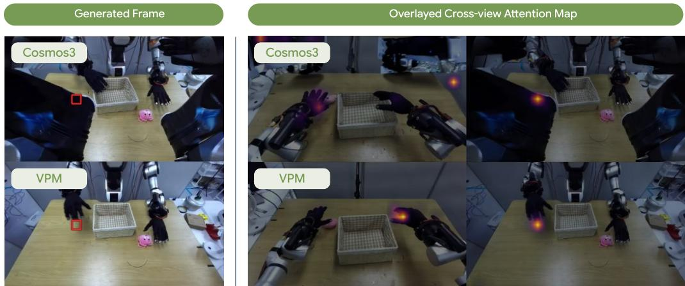  
Figure 8: Visualization of cross-view attention map.

## E.6 ADDITIONAL RESULTS ON MODALITY-WISE ABLATION STUDY

We repeat the modality-wise ablation of Table 6 on the zero-shot 4D generation benchmarks of Section 6.3, ReCamMaster and CMU Panoptic, which contain no robots and are not used for training. As shown in Table 26, the trends on VP-WorldBench carry over to these out-of-domain scenes. Adding point trajectories to video yields the largest gain, reducing FVD on ReCamMaster from 103.12 to 79.63 and raising δ3D on CMU Panoptic from 34.72 to 42.03, whereas adding actions yields only 101.35 and 36.51, respectively. Action supervision nonetheless improves or matches every metric, both on its own and on top of point trajectories $( e . g . , + 2 . 3 0 \mathrm { v s . } + 7 . { \bar { 3 } } 1 \delta _ { \mathrm { a v g } } ^ { \mathrm { 3 D } }$ from trajectories), indicating that it complements point supervision even without robots in the scene. Adding camera conditioning to VPM (V+T+A) further improves all metrics, achieving the best results on both benchmarks.

## E.7 ANALYSIS ON MULTI-VIEW VIDEO GENERATION

To examine how VPM maintains consistency across views, we visualize its cross-view attention in Figure 8. We select a query grid in one generated view (red box) and overlay its attention map on the other views. Since Cosmos3-Nano does not natively take multi-view input, we concatenate the views into a single image. For Cosmos3-Nano, the attention scatters over the background and unrelated parts of the robot, and the arm in its generated frame is visibly distorted. In contrast, the attention of VPM lands on the same hand in each of the other views, matching the location of the query grid. This highlights that VPM learns the cross-view correspondence (An et al., 2025; Hong et al., 2024b;c; Hong & Kim, 2021; Hong et al., 2024a; Cho et al., 2021; 2022) and leverages it to generate consistent multi-view videos.

Table 27: Clock-time analysis. Wall-clock time (sec) to generate one clip of 64 frames at 480p per view on one GH200 GPU. Cosmos3-Nano generates the views independently, whereas VPM generates them jointly. Parentheses show the time relative to Cosmos3-Nano with the same number of views.
<table><tr><td>Method</td><td>Output</td><td>1 view</td><td>2 views</td><td>4 views</td></tr><tr><td>Cosmos3-Nano</td><td>Video</td><td>15.9</td><td>31.8</td><td>63.5</td></tr><tr><td>VPM (V)</td><td>Video</td><td>16.3 (1.03×)</td><td>38.7 (1.22×)</td><td>101.4 (1.60×)</td></tr><tr><td>VPM (V+T)</td><td>Video + 3D traj.</td><td>16.5 (1.04×)</td><td>39.1 (1.23×)</td><td>102.3 (1.61×)</td></tr><tr><td>VPM (V+T+A)</td><td>Video + 3D traj. + action</td><td>16.6 (1.04×)</td><td>39.2 (1.23×)</td><td>102.5 (1.61×)</td></tr></table>

## E.8 CLOCK-TIME ANALYSIS

Setup. We measure the wall-clock time to generate one clip under the I2V protocol of Table 2, i.e., 64 future frames at 480p per view from a single conditioning frame, on one NVIDIA GH200 GPU with BF16 precision and batch size 1. VPM (V+T+A) additionally denoises 16 action chunks for action generation. All models use 35 denoising steps with classifier-free guidance, following the default sampler of Cosmos3. The reported time includes VAE decoding. As in our evaluation, Cosmos3-Nano generates the views one at a time, whereas ours generates all views jointly in a single token sequence.

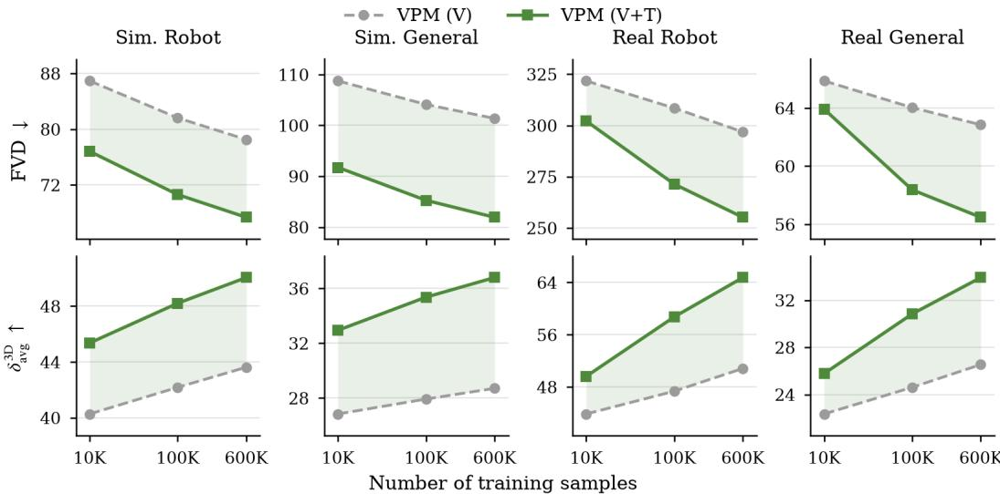  
Figure 9: Data scalability. FVD (top) and $\delta _ { \mathrm { a v g } } ^ { \mathrm { 3 D } }$ (bottom) of VPM (V) and VPM (V+T) trained on 10K, 100K, and 600K samples. The shaded area marks the gain from point supervision.

Results. For four views, decoding trajectories and actions adds only 0.9 s and 0.2 s, respectively, and with a single view, camera conditioning makes VPM only 3% slower than Cosmos3-Nano. The views can attend to one another, which contributes to the gains over Cosmos3-Nano.

## E.9 DATA SCALABILITY

Setup. We train VPM (V) and VPM (V+T) on 10K, 100K, and 600K samples. The subsets are random subsamples of the full data that preserve their proportions in Table 8. At each scale, both models use the same training schedule.

Results. As shown in Figure 9, both models improve steadily with more training data, and point supervision improves over the video-only model at every scale. The gap widens as the data grows on every split. Specifically, the $ { \delta _ { \mathrm { a v g } } } ^ { \mathrm { 3 D } }$ gap on Real-world Robot grows from 5.76 at 10K to 13.92 at 600K, as the robot datasets add trajectory supervision from real robot episodes. VPM (V+T) trained on 100K samples already outperforms VPM (V) trained on all 600K samples on every split, e.g., 70.61 vs. 78.52 FVD on Simulation Robot, indicating that point supervision is a more data-efficient way to improve forecasting than scaling video data alone.

## F DETAILED ABLATION STUDIES

In this section, we ablate the design choices of VPM. Unless otherwise stated, each variant starts from VPM (V+T) and changes a single component, keeping the training data, the three-stage schedule, and fixed iterations in Table 7. All variants are evaluated on VP-WorldBench with the I2V protocol of Table 2, and we report FVD for video fidelity and $ { \delta _ { \mathrm { a v g } } } ^ { \mathrm { 3 D } }$ for 3D motion accuracy.

Table 28: Ablation on camera conditioning. Add. and Rot. denote the additive Plucker embedding¨ and the camera-dependent rotation of queries and keys in Equation (2), and View denotes the view axis of the 4D RoPE in Equation (3).
<table><tr><td colspan="3">Camera cond.</td><td colspan="4">Simulation</td><td colspan="4">Real-world</td></tr><tr><td colspan="3"></td><td colspan="2">Robot (500)</td><td colspan="2">General (500)</td><td colspan="2">Robot (100)</td><td colspan="2">General (100)</td></tr><tr><td>Add.</td><td>Rot.</td><td>View</td><td>FVD↓</td><td> $ { \delta _ { \mathrm { a v g } } } ^ { \mathrm { 3 D } } \}$ </td><td>FVD↓</td><td> $ { \delta _ { \mathrm { a v g } } } ^ { \mathrm { 3 D } } \}$ </td><td>FVD↓</td><td> $ { \delta _ { \mathrm { a v g } } } ^ { \mathrm { 3 D } } \}$ </td><td>FVD↓</td><td> $ { \delta _ { \mathrm { a v g } } } ^ { \mathrm { 3 D } } \}$ </td></tr><tr><td>x</td><td>X</td><td>X</td><td>91.22</td><td>33.29</td><td>140.06</td><td>24.64</td><td>299.51</td><td>45.79</td><td>67.80</td><td>23.94</td></tr><tr><td>X</td><td>X</td><td>√</td><td>75.17</td><td>41.70</td><td>128.41</td><td>29.08</td><td>281.67</td><td>49.25</td><td>61.43</td><td>26.99</td></tr><tr><td>√</td><td>X</td><td>√</td><td>70.70</td><td>48.18</td><td>84.60</td><td>33.94</td><td>268.34</td><td>59.00</td><td>59.01</td><td>30.05</td></tr><tr><td></td><td>√</td><td>x</td><td>70.01</td><td>48.59</td><td>85.15</td><td>33.40</td><td>265.37</td><td>61.88</td><td>58.90</td><td>31.55</td></tr><tr><td></td><td></td><td></td><td>67.35</td><td>50.05</td><td>81.92</td><td>36.80</td><td>255.19</td><td>64.75</td><td>56.48</td><td>33.92</td></tr></table>

## F.1 ABLATION STUDY FOR CAMERA EMBEDDINGS

Setup. VPM conditions the generator on camera geometry through three components (Section 3.3): the additive Plucker embedding ¨ Wei (Add.) and the camera-dependent rotation of queries and keys ${ \bf R } ( \psi ( { \bf e } _ { i } ) )$ (Rot.) in Equation (2), and the view axis of the 4D RoPE in Equation (3) (View). Table 28 removes them individually and jointly.

Results. Removing all three components degrades every split of VP-WorldBench, most severely on Simulation General (FVD 140.06 vs. 81.92), whose cameras move during each clip. The view axis alone partially recovers performance, and adding the Plucker embedding further reduces FVD on¨ Simulation General from 128.41 to 84.60. The camera-dependent rotation improves both metrics on every split, most notably $ { \delta _ { \mathrm { a v g } } } ^ { \mathrm { 3 D } }$ on Real-world Robot (59.00 → 64.75). Removing only the view axis raises FVD by approximately 4% across all splits.

Table 29: Ablation on training objectives. $\mathcal { L } _ { \mathrm { F M } }$ is used in all rows, and ${ \mathcal { L } } _ { \mathrm { c o n f } }$ is used together with $\mathcal { L } _ { \mathrm { { s e q } } } .$ The first row corresponds to VPM (V) in Table 2.
<table><tr><td colspan="3">Objective</td><td colspan="4">Simulation</td><td colspan="4">Real-world</td></tr><tr><td colspan="3"></td><td colspan="2">Robot (500)</td><td colspan="2">General (500)</td><td colspan="2">Robot (100)</td><td colspan="2">General (100)</td></tr><tr><td> $\mathcal { L } _ { \mathrm { s e q } }$ </td><td> ${ \mathcal { L } } _ { \mathrm { d e p t h } }$ </td><td> ${ \mathcal { L } } _ { \mathrm { c o r r } }$ </td><td>FVD↓</td><td> $ { \delta _ { \mathrm { a v g } } } ^ { \mathrm { 3 D } } \ { \uparrow }$ </td><td>FVD↓</td><td> $ { \delta _ { \mathrm { a v g } } } ^ { \mathrm { 3 D } } \ { \uparrow }$ </td><td>FVD↓</td><td> $\delta _ { \mathrm { a v g } } ^ { \mathrm { 3 D } } \uparrow$ </td><td>FVD↓</td><td> $ { \delta _ { \mathrm { a v g } } } ^ { \mathrm { 3 D } } \uparrow$ </td></tr><tr><td>X</td><td>X</td><td>x</td><td>78.52</td><td>43.62</td><td>101.37</td><td>28.71</td><td>296.83</td><td>50.83</td><td>62.85</td><td>26.54</td></tr><tr><td>X</td><td>X</td><td>√</td><td>78.44</td><td>42.96</td><td>100.45</td><td>29.90</td><td>284.17</td><td>52.00</td><td>61.57</td><td>27.50</td></tr><tr><td>√</td><td>X</td><td>X</td><td>74.82</td><td>43.90</td><td>91.92</td><td>30.00</td><td>275.24</td><td>54.69</td><td>59.71</td><td>27.99</td></tr><tr><td>√</td><td>√</td><td>x</td><td>69.88</td><td>48.54</td><td>85.73</td><td>31.54</td><td>271.01</td><td>59.94</td><td>59.33</td><td>30.75</td></tr><tr><td></td><td></td><td></td><td>67.35</td><td>50.05</td><td>81.92</td><td>36.80</td><td>255.19</td><td>64.75</td><td>56.48</td><td>33.92</td></tr></table>

## F.2 ABLATION STUDY FOR OBJECTIVES

Setup. We ablate the point-supervision objectives: the 2D position loss $\mathcal { L } _ { \mathrm { s e q } }$ and the depth loss ${ \mathcal { L } } _ { \mathrm { d e p t h } }$ of the trajectory head in Equation (5), and the cross-view correspondence loss $\mathcal { L } _ { \mathrm { c o r r } }$ in Equation (6). $\mathcal { L } _ { \mathrm { F M } }$ is always used, and ${ \mathcal { L } } _ { \mathrm { c o n f } }$ is kept whenever $\mathcal { L } _ { \mathrm { s e q } }$ is used, since its target depends on the predicted 2D position. The first row of Table 29, trained with $\mathcal { L } _ { \mathrm { F M } }$ only, corresponds to VPM (V) in Table 2.

Results. Combining all objectives performs best on every split. $\mathcal { L } _ { \mathrm { c o r r } }$ alone has limited effect, except for FVD on Real-world Robot $( 2 9 6 . 8 3  2 8 4 . 1 7 ) . \ \dot { \mathcal { L } } _ { \mathrm { s e q } }$ mainly improves FVD $( e . g .$ , 101.37 → 91.92 on Simulation General), and adding ${ \mathcal { L } } _ { \mathrm { d e p t h } }$ substantially raises $\delta _ { \mathrm { a v g } } ^ { \mathrm { 3 D } } ( e . g . , 5 4 . 6 9 \to 5 9 . 9 4$ on Real-world Robot). Adding $\mathcal { L } _ { \mathrm { c o r r } }$ on top further improves every split, with the largest $\delta _ { \mathrm { a v g } } ^ { \mathrm { 3 D } }$ gain on Simulation General $( 3 1 . 5 4  3 6 . 8 0 )$

Table 30: Ablation on training stages. Iterations of a removed stage are reassigned to Stage 3, keeping the total number of iterations fixed.
<table><tr><td colspan="4"></td><td colspan="4">Simulation</td><td colspan="4">Real-world</td></tr><tr><td colspan="4">Stage</td><td colspan="2">Robot (500)</td><td colspan="2">General (500)</td><td colspan="2">Robot (100)</td><td colspan="2">General (100)</td></tr><tr><td>1</td><td>2</td><td>3</td><td>FVD↓</td><td> $ { \delta _ { \mathrm { a v g } } } ^ { \mathrm { 3 D } } \ { \uparrow }$ </td><td>FVD↓</td><td> $ { \delta _ { \mathrm { a v g } } } ^ { \mathrm { 3 D } } \ { \uparrow }$ </td><td>FVD↓</td><td> $ { \delta _ { \mathrm { a v g } } } ^ { \mathrm { 3 D } } \ { \uparrow }$ </td><td></td><td>FVD↓</td><td> $ { \delta _ { \mathrm { a v g } } } ^ { \mathrm { 3 D } } \ { \uparrow }$ </td></tr><tr><td>x</td><td>X</td><td>V</td><td></td><td>70.45</td><td>48.50</td><td>85.34</td><td>34.29</td><td>262.40</td><td>60.86</td><td>58.11</td><td>31.75</td></tr><tr><td>X</td><td>√</td><td>√</td><td>69.83</td><td></td><td>49.15</td><td>83.27</td><td>34.51</td><td>259.42</td><td>62.00</td><td>58.02</td><td>32.80</td></tr><tr><td>√</td><td>x</td><td>√</td><td>77.50</td><td></td><td>39.51</td><td>99.81</td><td>29.38</td><td>292.53</td><td>49.77</td><td>62.49</td><td>27.04</td></tr><tr><td></td><td></td><td></td><td></td><td>67.35</td><td>50.05</td><td>81.92</td><td>36.80</td><td>255.19</td><td>64.75</td><td>56.48</td><td>33.92</td></tr></table>

## F.3 ABLATION STUDY FOR TRAINING STAGES

Setup. VPM is trained in three stages: Stage 1 adapts the generator to multi-view input and camera conditioning with $\mathcal { L } _ { \mathrm { F M } }$ , Stage 2 warms up the trajectory head with ${ \mathcal { L } } _ { \mathrm { t r a c k } }$ while the generator is frozen, and Stage 3 jointly optimizes both with $\mathcal { L } _ { \mathrm { f o r e c a s t } }$ . We remove Stage 1, Stage 2, or both, and reassign their iterations to Stage 3, so that every variant is trained for the same 12K iterations in total.

Results. As shown in Table 30, the full curriculum performs best on every split. Removing Stage 2 is the most harmful, performing worse than training with Stage 3 alone on every split, with the largest drop on Real-world Robot $( \delta _ { \mathrm { a v g } } ^ { \mathrm { 3 D } } 6 4 . 7 5  4 9 . 7 7 )$ . Removing Stage 1 leads to a smaller but consistent drop, most pronounced on Real-world Robot $( \delta _ { \mathrm { a v g } } ^ { \mathrm { 3 D } } 6 4 . 7 5  6 2 . 0 0 )$

Table 31: Ablation on the generator layer. The trajectory head reads query and key features from the l-th self-attention layer of the generator.
<table><tr><td rowspan="3"></td><td colspan="4">Simulation</td><td colspan="4">Real-world</td></tr><tr><td colspan="2">Robot (500)</td><td colspan="2">General (500)</td><td colspan="2">Robot (100)</td><td colspan="2">General (100)</td></tr><tr><td>FVD↓</td><td> $ { \delta _ { \mathrm { a v g } } } ^ { \mathrm { 3 D } } \ { \uparrow }$ </td><td>FVD↓</td><td> $ { \delta _ { \mathrm { a v g } } } ^ { \mathrm { 3 D } } \ { \uparrow }$ </td><td>FVD↓</td><td> $ { \delta _ { \mathrm { a v g } } } ^ { \mathrm { 3 D } } \ { \uparrow }$ </td><td>FVD↓</td><td> $ { \delta _ { \mathrm { a v g } } } ^ { \mathrm { 3 D } } \ { \uparrow }$ </td></tr><tr><td>Layer l 6</td><td>72.81</td><td>45.92</td><td>96.28</td><td>31.10</td><td>277.11</td><td>57.04</td><td>60.26</td><td>28.75</td></tr><tr><td>12</td><td>69.45</td><td>48.30</td><td>85.76</td><td>34.90</td><td>266.16</td><td>61.21</td><td>58.30</td><td>31.88</td></tr><tr><td>18</td><td>67.35</td><td>50.05</td><td>81.92</td><td>36.80</td><td>255.19</td><td>64.75</td><td>56.48</td><td>33.92</td></tr><tr><td>24</td><td>68.76</td><td>49.16</td><td>84.96</td><td>35.28</td><td>259.84</td><td>63.80</td><td>58.65</td><td>31.60</td></tr></table>

## F.4 ABLATION STUDY FOR LAYERS

Setup. The trajectory head reads query and key features from a single self-attention layer l of the generator, following the DiT (Peebles & Xie, 2023) architecture. We vary $l \in \{ 6 , 1 2 , 1 8 , \dot { 2 } 4 \}$ , where $l = 1 8$ is the default.

Results. As shown in Table 31, attaching the head to the 18th layer performs best on every split. Shallow layers perform clearly worse, e.g., FVD on Simulation General rises from 81.92 to 96.28 with l = 6. Moving the head deeper to $l = 2 4$ causes a slight drop, increasing FVD by about 2–4% across splits.

## F.5 ABLATION STUDY FOR REFINEMENT

Setup. The trajectory head refines its estimates over M iterations with a transformer whose attention is factorized over space, time, and views. We vary $M \in \{ 1 , 2 , 4 , 8 \}$ and remove each attention type from the refiner.

Results. As shown in Table 32, performance consistently improves up to $M = 4 , e . g .$ , FVD on Simulation General decreases from 87.23 at $M = 1$ to 81.92 at $M = 4$ . Further increasing to $M \ = \ 8$ changes every metric by less than 1 while doubling the cost of the head. Among the attention types, removing cross-view attention causes the largest degradation on every split, e.g., increasing FVD by 11.3% and lowering $ { \delta _ { \mathrm { a v g } } } ^ { \mathrm { 3 D } }$ from 36.80 to 29.89 on Simulation General. Removing temporal attention increases FVD more than removing spatial attention on every split, while the two are comparable in $ { \delta _ { \mathrm { a v g } } } ^ { \mathrm { 3 D } }$ on the simulation splits.

Table 32: Ablation on the trajectory refiner. (a) Number of refinement iterations M. (b) Attention types of the refiner, with M = 4.
<table><tr><td></td><td colspan="4">Simulation</td><td colspan="4">Real-world</td></tr><tr><td></td><td>Robot (500)</td><td></td><td>General (500)</td><td></td><td>Robot (100)</td><td></td><td>General (100)</td><td></td></tr><tr><td>Setting</td><td>FVD↓</td><td> $ { \delta _ { \mathrm { a v g } } } ^ { \mathrm { 3 D } } \ { \uparrow }$ </td><td>FVD↓</td><td> $ { \delta _ { \mathrm { a v g } } } ^ { \mathrm { 3 D } } \ { \uparrow }$ </td><td>FVD↓</td><td> $ { \delta _ { \mathrm { a v g } } } ^ { \mathrm { 3 D } } \ { \uparrow }$ </td><td>FVD↓</td><td> $ { \delta _ { \mathrm { a v g } } } ^ { \mathrm { 3 D } } \ { \uparrow }$ </td></tr><tr><td colspan="9">(a) Refinement iterations</td></tr><tr><td> $M = 1$ </td><td>69.46</td><td>47.11</td><td>87.23</td><td>33.44</td><td>267.42</td><td>61.05</td><td>59.83</td><td>30.19</td></tr><tr><td> $M = 2$ </td><td>68.77</td><td>49.00</td><td>83.25</td><td>35.75</td><td>260.49</td><td>62.18</td><td>57.07</td><td>33.20</td></tr><tr><td> $M = 4$ </td><td>67.35</td><td>50.05</td><td>81.92</td><td>36.80</td><td>255.19</td><td>64.75</td><td>56.48</td><td>33.92</td></tr><tr><td> $M = 8$ </td><td>67.14</td><td>49.96</td><td>82.63</td><td>36.75</td><td>255.01</td><td>64.92</td><td>56.66</td><td>33.58</td></tr><tr><td colspan="9">(b) Refiner attention</td></tr><tr><td>w/o spatial</td><td>70.10</td><td>47.54</td><td>86.79</td><td>34.25</td><td>267.59</td><td>61.16</td><td>57.31</td><td>32.50</td></tr><tr><td>w/o temporal</td><td>70.87</td><td>48.21</td><td>88.54</td><td>34.28</td><td>268.79</td><td>59.64</td><td>59.18</td><td>30.77</td></tr><tr><td>w/o cross-view</td><td>74.95</td><td>46.49</td><td>91.14</td><td>29.89</td><td>272.50</td><td>57.09</td><td>61.07</td><td>29.95</td></tr><tr><td>Full</td><td>67.35</td><td>50.05</td><td>81.92</td><td>36.80</td><td>255.19</td><td>64.75</td><td>56.48</td><td>33.92</td></tr></table>

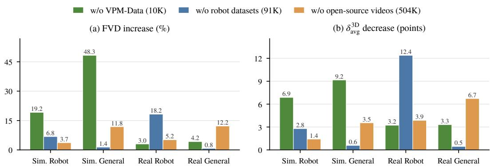  
Figure 10: Ablation on training data sources. Relative FVD increase (a) and $\delta _ { \mathrm { a v g } } ^ { \mathrm { 3 D } }$ decrease (b) of VPM (V+T) when one source is removed from training, measured against the model trained on all sources. Higher is worse.

## F.6 ABLATION STUDY FOR TRAINING DATA

Setup. Our training data combines three sources (Table 8): VPM-Data (10K samples), robot manipulation datasets with kinematics-grounded point tracks (91K), and open-source videos (504K). We train VPM (V+T) while leaving out one source at a time and report the change in FVD and $\delta _ { \mathrm { a v g } } ^ { \mathrm { 3 D } }$ with respect to the model trained on all sources in Figure 10.

Results. Each source mainly benefits the evaluation domain it covers. Removing VPM-Data causes the largest degradation on the simulation splits, especially on Simulation General (+48.3% FVD and $- \mathbf { \check { 9 } . 1 6 ~ } \delta _ { \mathrm { a v g } } ^ { 3 \mathbf { \check { D } } } )$ , since it is the only source that pairs synchronized multi-view urban videos with persistent 3D trajectories. Removing VPM-Data also lowers $ { \delta _ { \mathrm { a v g } } } ^ { \mathrm { 3 D } }$ on Real-world General by 3.31, suggesting that its accurate simulated trajectories transfer to real human motion. Removing the robot datasets mainly affects Real-world Robot (+18.2% FVD and −12.39 $\delta _ { \mathrm { a v g } } ^ { \mathrm { 3 D } } )$ , and removing the open-source videos mainly affects Real-world General (+12.2% FVD and $- 6 . 7 3 \ \delta _ { \mathrm { a v g } } ^ { 3 \mathrm { D } } )$ . Removing any source degrades every split, indicating that the three sources are complementary.

## G QUALITATIVE RESULTS

## G.1 MULTI-VIEW VIDEO AND POINT TRAJECTORY PREDICTION

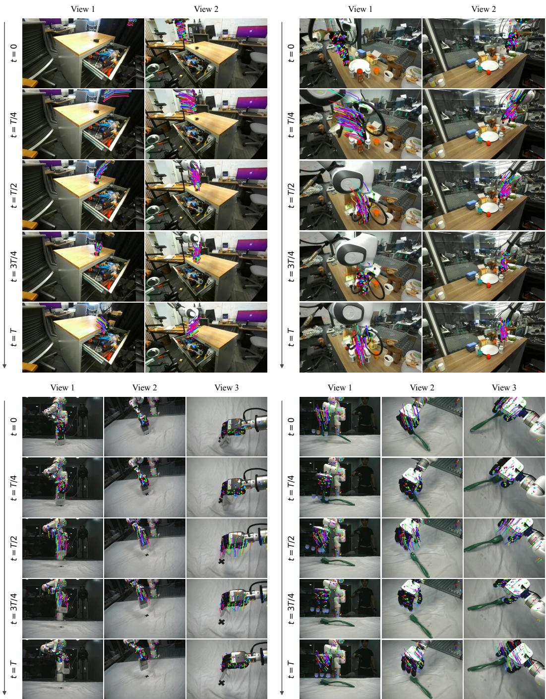  
Figure 11: Qualitative results of multi-view prediction. Predicted video with overlaid predicted point track for two-view (top) and three-view (bottom) scenes. Conditioning frames are omitted.

VP-WorldBench (Real)  
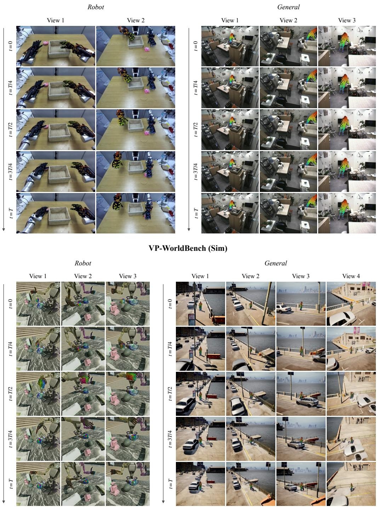  
Figure 12: Additional qualitative results of multi-view prediction. Predicted video with overlaid predicted point track on robot and general scenes from VP-WorldBench (Real, top) and VP WorldBench (Sim, bottom).

## G.2 PREDICTED VS. GROUND-TRUTH VIDEOS

View 2  
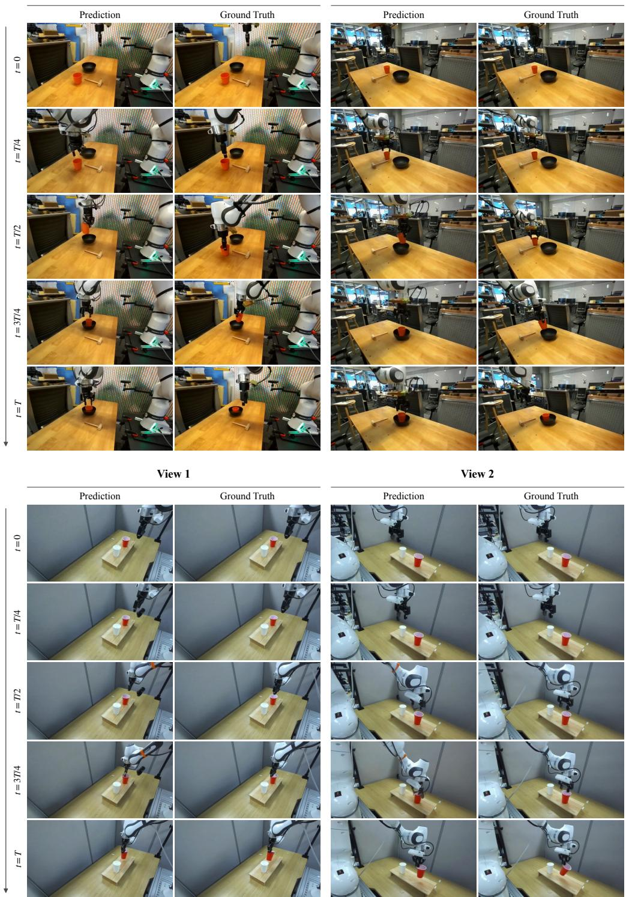  
Figure 13: Predicted vs. ground-truth videos. Each view shows the prediction next to the ground truth. Conditioning frames are omitted.

## G.3 EXAMPLE ROLLOUTS OF ROBOT MANIPULATION TASKS

“Pick up the banana and put it in the basket without touching the pile of boxes”  
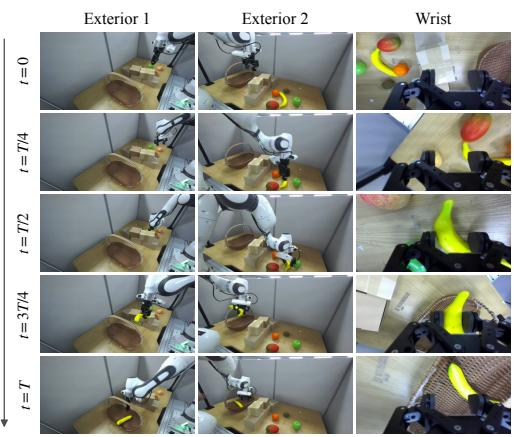

“Pick up the blue cup and put it on the plate without touching the pile of boxes”  
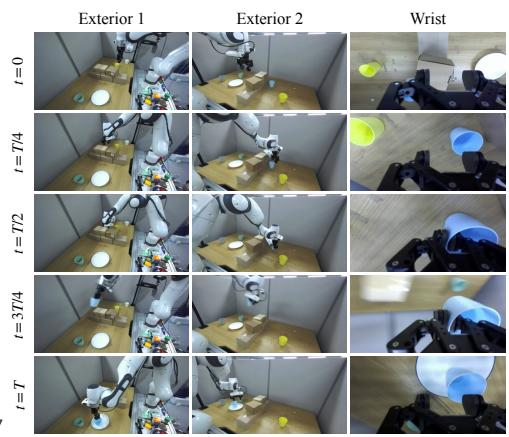

“Pick up the yellow cup and put it on the plate without touching the pile of boxes”  
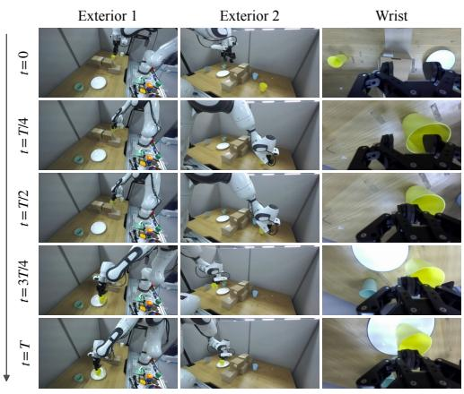

“Pick up the blue cube and put it on top of the red cube without touching the pile of boxes”  
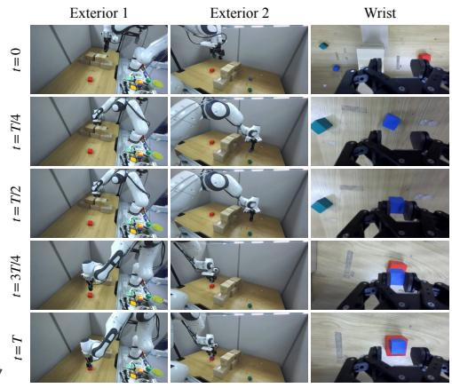

“Pick up the green cube and put it on top of the blue cube without touching the pile of boxes”  
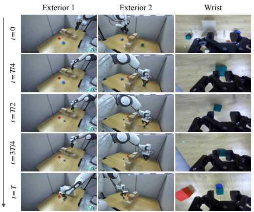

“Pick up the green cube and put it on top of the red cube without touching the pile of boxes”  
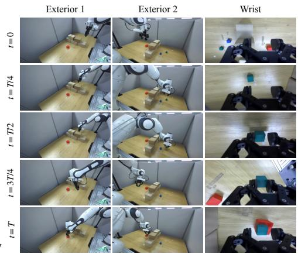  
Figure 14: Example rollouts of robot manipulation tasks. Successful rollouts of our policy on six tasks, shown from two exterior cameras and a wrist camera. Rows are time steps sampled uniformly over each episode of length T.