# LOCALEJEPA: MAXIMUM ENTROPY REPRESENTA-TIONS UNDER GEOMETRIC PRIORS

Kartik Tandon\*,1,†, Alessio Borgi\*,2,7,†, Pavel Snopov3, Inés García-Redondo4, Davide D’Ascenzo⁵, Sebastiano Cultrera di Montesano6, Fabrizio Silvestri2, Pietro Liò7, Francesca Dominici8, Randall Balestriero9, Claudio Battiloro9,8,†

1University of Pennsylvania · 2Sapienza University of Rome . 3University of Texas Rio Grande Valley · 4University of Fribourg · ⁵University of Milan · 6Broad Institute · 7University of Cambridge · 8Harvard University . 9Brown University

## ABSTRACT

Joint-Embedding Predictive Architectures (JEPA) offer an appealing approach to self-supervised learning, but are typically prone to representation collapse. LeJEPA resolves this by introducing a theoretically grounded distribution-matching objective that drives the embedding towards an isotropic Gaussian. However, this approach is fundamentally tied to Euclidean assumptions, and its global target does not reflect domain-specific geometric priors, such as the use of non-Euclidean embedding geometries, e.g., equivariant CNNs or hyperbolic ViTs. We thus introduce LocaLeJEPA, a framework motivated by a manifold-theoretic reformulation of LeJEPA's entropy-maximization property. The accompanying LocaLeReg, a novel locally Euclidean distribution-matching regularizer, enables a stable and scalable implementation of the LocaLeJEPA framework. We then perform extensive experiments in the vision setting on models trained on ImageNet-1K. LocaLeJEPA significantly outperforms LeJEPA when paired with hyperbolic ViT-S/8 and equivariant ResNet-50 backbones, and also with ordinary Euclidean ViT-S/8 and ViT-L/14 backbones. This holds both in terms of linear and k-NN classification performance on ImageNet and on a series of downstream tasks tested. We view the LocaLeJEPA formalism as a principled approach to the JEPA paradigm that better respects intrinsic data geometry while also accommodating generalizations to exotic embedding geometries. Code available at: https://github.com/alessioborgi/LocaLeJEPA.

## 1 INTRODUCTION

The Joint-Embedding Predictive Architecture (JEPA) paradigm (Bromley et al., 1993; LeCun, 2022; Assran et al., 2023) provides a tantalizing alternative to both feature-space masked modeling and contrastive sample-based objectives for Self-Supervised Learning (SSL). Allowing the model to instead learn relevant features by understanding the relationship between various semantically overlapping views' of the same object in latent space, it ideally represents a simpler approach to SSL. However, in practice, this learning objective falls prey to representation collapse, requiring the incorporation of techniques such as stop-gradient (Chen & He, 2021), EMA schedulers (Caron et al. 2021), and various whitening-based regularizers (Ermolov et al., 2021; Tian et al., 2021). The recent Latent-Euclidean JEPA (LeJEPA) (Balestriero & LeCun, 2025) bypasses these ad-hoc methodologies and identifies the isotropic Gaussian as the optimal embedding distribution for downstream tasks. Optimality is minimax, i.e., no other embedding distribution yields a lower worst-case risk for linear regression or k-NN classification on an unknown downstream task. LeJEPA therefore adds a Gaussian distribution matching objective to the JEPA loss, preventing collapse while being stable and scalable.

Consequent to the introduction of LeJEPA, there has been a flurry of activity in adapting this methodology for use in video models (Kuhn et al., 2026a), world models (Maes et al., 2026), and vision-language models (Kuhn et al., 2026b), as well as diverse domains such as time series (Chemeris et al., 2026) and molecular representations (Rottach et al., 2026).

Motivation. Concurrently, however, another line of recent work questions the claimed optimality of LeJEPA's isotropic Gaussian, proposing instead objectives that match to rectified Gaussians (Kuang et al., 2026), subspace Gaussians (Zhao et al., 2026), or the uniform distribution on the sphere (Nicollier et al., 2026a;b). A throughline of these works is that they operate in regimes that violate the fundamental Euclidean-space assumptions of LeJEPA, thus voiding the theoretical optimality of the Gaussian distribution. For instance, Nicollier et al. (2026a) considers embeddings constrained to a hypersphere $\mathbb { S } ^ { d }$ while Kuang et al. (2026) considers $l _ { p } .$ -normed spaces. As the JEPA framework is increasingly adapted to diverse, and often explicitly non-Euclidean domains, this naturally raises the question whether there is a principled generalization of LeJEPA to such domains that still retains its theoretical grounding and its stability in practice.

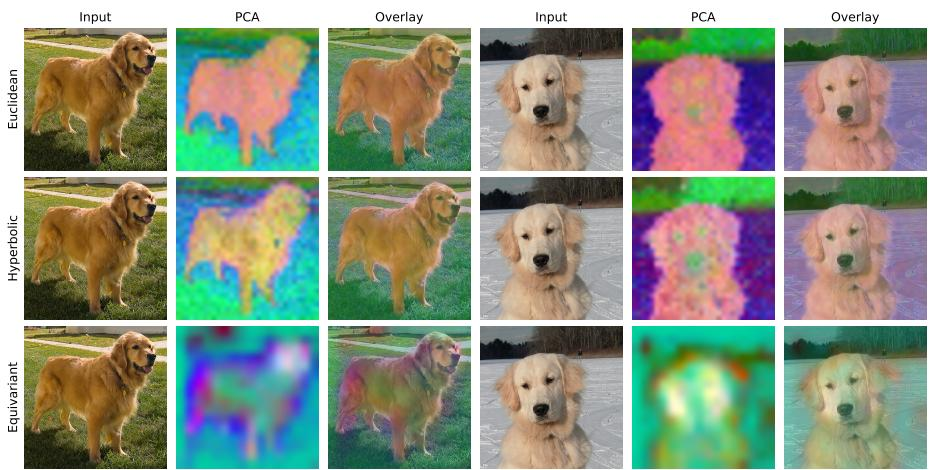  
Figure 1: LocaLeJEPA learns semantically organized representations, across geometries. PCA visualizations of frozen LocaLeJEPA patch features for two ImageNet-1K validation images. Rows correspond to an ordinary (i.e. Euclidean) ViT-S/8, hyperbolic ViT-S/8, and D₄-equivariant ResNet-50, while columns show the input, the first three principal components mapped to RGB, and their overlay. Across all three geometries, the self-supervised features learned by LocaLeJEPA exhibit coherent object-background structure despite their very different representation spaces. Full visualization details and comparisons with LeJEPA are provided in Section D.2 (Figure 10).

Contribution. In this work, we introduce LocaLeJEPA, a manifold-theoretic JEPA objective designed to couple the geometry of the data manifold M with that of an exotic embedding space $\mathcal { N }$ The accompanying regularizer, Locally Latent euclidean Regularization (LocaLeReg), drives the embeddings to be locally uniformly distributed on a Euclidean ball. Since every manifold is locally Euclidean and the uniform distribution is entropy maximization on a compact space, we view this as a local adaptation of the global entropy maximization property of LeJEPA's Gaussian distribution. We implement this by first partitioning each batch of embeddings into K neighborhoods by K-means in latent space, and then applying an Epps-Pulley-based distribution-matching objective to each neighborhood. This retains LeJEPA's sketched projections approach and thus inherits its linear cost and stability, while allowing for a far more expressive embedding distribution due to locality. While locality allows us to consider exotic ${ \mathcal { N } } .$ even the global K = 1 case already improves on LeJEPA trained with the same optimization settings, on ViT-S/8, hyperbolic ViT-S/8 and the $D _ { 4 }$ -equivariant ResNet-50 (Table 2). Our target distribution is also compact, theoretically allowing the encoder to learn a continuous function with respect to M.

We experimentally instantiate LocaLeJEPA in the vision setting, though we note the framework is suitably general to support diverse modalities such as graph data. Across Euclidean, hyperbolic and D4-equivariant backbones pretrained on Imagenette and ImageNet-1K, we show LocaLeJEPA produces qualitatively better embeddings that inherently preserve the intrinsic topology of the data manifold M, such as preserving known circular or toroidal features, while also accommodating non-Euclidean embedding spaces $\mathcal { N }$ We then quantitatively establish the downstream performance of LocaLeJEPA's embeddings, showing it outperforms LeJEPA under linear probing and k-NN classification using Euclidean, hyperbolic, and equivariant backbones, for all datasets tested. LocaLeJEPA expands the scope of the JEPA paradigm as a whole while retaining the stability and scalability afforded by the entropy-maximizing objective of LeJEPA.

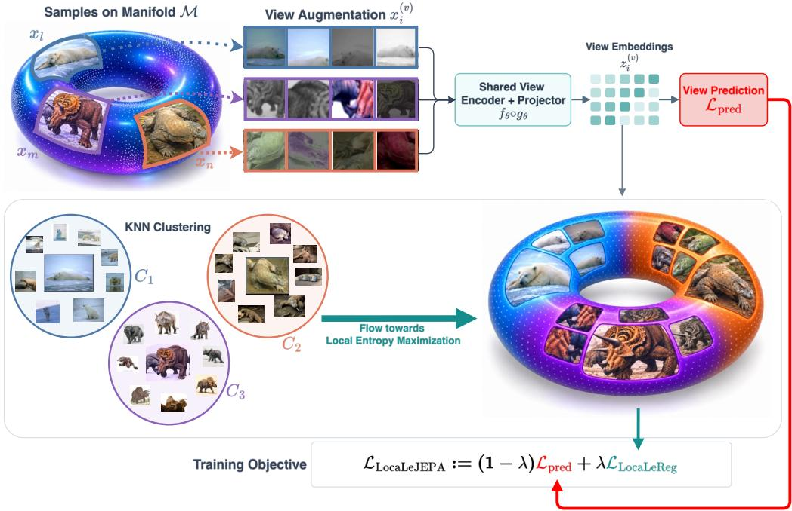  
Figure 2: LocaLeJEPA Pipeline. A shared encoder and projector feed two losses: $\mathcal { L } _ { \mathrm { p r e d } }$ for view prediction and $\mathcal { L } _ { \mathrm { { L o c a L e R e g } } }$ for distribution matching. $\mathcal { L } _ { \mathrm { p r e d } }$ drives the model to predict an image in latent space from semantically synecdochic views. Concurrently, $\mathcal { L } _ { \mathrm { { L o c a L e R e g } } }$ counteracts representation collapse, without driving to a fixed global distribution. This is achieved by clustering batches of embedded views by K-Means, and then driving each cluster towards the uniform distribution on the Euclidean ball Bd. Locality allows for the expressivity necessary to learn the intrinsic geometry of the data manifold, while uniformity within clusters encourages entropy maximization.

## 2 RELATED WORKS

Self-Supervised Learning The goal of self-supervised learning (SSL) is to learn data representations that capture intrinsic features that are useful for a wide-range of downstream tasks. Initial approaches to SSL relied largely on positive-negative sample pairs combined with a contrastive loss, as in CPC (van den Oord et al., 2018), MoCo (He et al., 2020), and SimCLR (Chen et al., 2020). However requiring such pairs can be costly and inefficient. This led to the development of non-contrastive approaches such as BYOL (Grill et al., 2020), SimSiam (Chen & He, 2021), Barlow Twins (Zbontar et al., 2021), VICReg (Bardes et al., 2022), which instead involve objectives based on learning invariant features with respect to certain transformations. The JEPA paradigm extends this noncontrastive approach and may be understood as instead predicting a latent image representation from semantically overlapping views (LeCun, 2022; Assran et al., 2023).

SSL with Geometric Priors The adaptation of principles of geometric deep learning and its incorporation of geometric priors is still a growing subfield of SSL. Initial works in this field have explored applications of equivariance to SSL, such as in the contrastive learning setting (Dangovski et al., 2022) or as alternatives to invariance-based learning objectives (Wang et al., 2024). In another direction, self-supervised and unsupervised approaches have also seen applications to 3D and point-cloud data, as in Xie et al. (2020) or Zhang et al. (2021). Other works have also used geometric architectures towards representation learning for molecular data, such as Stärk et al. (2022) and Liu et al. (2022a), as well as for graph-valued data more generally (Veličković et al., 2019; You et al., 2020; Hassani & Khasahmadi, 2020; Thakoor et al., 2021; Xu et al., 2026).

## 3 THEORETICAL MOTIVATION

By the manifold hypothesis (Fefferman et al., 2016), we may suppose that our data lies on a compact Riemannian manifold M, though embedded in a high-dimensional ambient space, $\mathrm { i . e . , } \mathcal { M } \subset \mathbf { \bar { \mathbb { R } } } ^ { D }$ The general objective of self-supervised learning may be understood as learning a $f : \mathbb { R } ^ { D } \to \mathcal { N }$ , for N an appropriate embedding space for the downstream tasks under consideration. For simplicity, we assume $f$ restricts to a smooth embedding on M, so that the image $\mathscr { W } = f ( \mathscr { M } )$ is itself a closed Riemannian manifold, carrying the metric induced from N. Here, taking N to be the Euclidean $\mathbb { R } ^ { d }$ recovers the setting of LeJEPA (Balestriero & LeCun, 2025) while letting N be the hypersphere $\mathbb { S } ^ { d }$ recovers the setting of Sphere-JEPA (Nicollier et al., 2026a). However, we may consider more general geometric priors. For instance, we may consider $\mathcal { N }$ to be hyperbolic space or a space equivariant under actions of a given Lie group.

LeJEPA (Balestriero & LeCun, 2025) then ensures non-collapse of the embedding by a distribution matching objective that drives the final embeddings towards an isotropic Gaussian, which they identify as the optimal distribution for downstream linear regression and k-NN classification. $\mathbf { A }$ natural first attempt to generalize LeJEPA to geometric settings would be to consider a Gaussian distribution on ${ \mathcal { N } } .$ While there is no canonical analog of a Gaussian distribution such that it is ‘intrinsic' to an arbitrary geometry, perhaps the most natural extension is given by considering heat flow on a manifold. Recall that the heat equation is given by $\begin{array} { r } { \frac { \partial \mathbf { U } ( x , t ) } { \partial t } = - \dot { \Delta } _ { \mathcal { W } } \dot { \mathbf { U } } ( x , t ) } \end{array}$ , where $\Delta _ { \mathcal { W } }$ is the Laplace-Beltrami operator on the Riemannian manifold $\mathcal { W }$ with metric $g .$ We then have the following.

Proposition 3.1 (Gaussian as the Solution of Heat Flow). Let $( \mathcal { W } , g )$ be a closed, connected Riemannian manifold. The solution to the heat equation on W with initial condition U is given by:

$$
\mathbf { U } ( x , t ) = \int _ { \mathcal { W } } K _ { \mathcal { W } } ( x , y , t ) \mathbf { U } ( y , 0 ) d \mathrm { V o l } _ { g } ( y )\tag{1}
$$

where $K _ { \mathcal { W } } ( x , y , t )$ is the heat kernel and $d \operatorname { V o l } _ { g }$ is the canonical volume form. Explicitly, the heat kernel on $\mathbb { R } ^ { n }$ is given by $\begin{array} { r } { K _ { \mathbb { R } ^ { n } } ( x , y , t ) = \frac { 1 } { ( 4 \pi t ) ^ { n / 2 } } \exp \left( - \frac { | x - y | ^ { 2 } } { 4 t } \right) } \end{array}$ and on arbitrary closed Riemannian W, as $t  0 ,$ a frst order approximation is given by $\begin{array} { r } { K _ { \mathcal { W } } ( x , y , t ) \approx \frac { 1 } { ( 4 \pi t ) ^ { n / 2 } } \exp { \left( - \frac { d ( x , y ) ^ { 2 } } { 4 t } \right) } } \end{array}$ where $d ( x , y )$ is the geodesic distance on W. (See Berline et al. (1992) for details).

Theorem 3.1 therefore lets us define a Gaussian' intrinsically on a manifold, as the heat kernel $K _ { \mathcal { W } } ( x , \cdot , t )$ centered at x with t in the role of a variance. That identification holds only as $t  0 .$ however, and in exactly that regime the kernel is concentrated near x. An intrinsic Gaussian is therefore a strictly local object on W. As such, in practice, we may consider a local version of LeJEPA's SIGReg as an appropriate analog for the manifold setting. Unfortunately, this naive approach does not preserve LeJEPA's optimality guarantees. For instance, in Sphere-JEPA (Nicollier et al., 2026a), it is shown that for the case $\mathcal { N } = \dot { \mathbb { S } } ^ { \tilde { d } }$ , the uniform distribution is optimal for downstream linear regression and k-NN classification tasks, and they propose SUSReg, a distribution matching objective that instead drives towards the uniform distribution. Taking on a heat flow perspective allows us to interpolate between these objectives on an arbitrary ${ \mathcal { N } } ,$ of which the sphere is a special case. In particular, we then have an entire family of distributions $K _ { \mathcal { W } } ( \cdot , \cdot , t )$ , parameterized by time, that may reasonably be understood as targets for a distribution-matching objective that lifts' LeJEPA to manifolds. However, this would not consider the entropy maximization property of the Gaussian distribution that has been tied to the success of LeJEPA, in works such as Rectified $\mathrm { L p J E P A }$ (Kuang et al., 2026). More generally, an entropy-maximization objective has been shown to be desirable in SSL (Liu et al., 2022b; Zhang et al., 2024; Chakraborty et al., 2025). We recall that the usual Gaussian distribution, under a given variance, is the unique entropy-maximizing distribution in Euclidean space, while the uniform distribution is the unique entropy-maximizing distribution on an arbitrary compact Riemannian manifold. The optimal transport perspective allows us to understand heat flow as gradient flow towards entropy maximization on an arbitrary manifold.

Proposition 3.2 (Heat Flow as Wasserstein Gradient Flow). Let $( \mathcal { W } , g )$ be a closed, connected Riemannian manifold. Recall that the differential entropy of a distribution ρ on W is given by :

$$
h ( \rho ) = - \int _ { \mathcal W } \rho ( x ) \log \rho ( x ) d \mathrm { V o l } _ { g } ( x )\tag{2}
$$

Then in the 2-Wasserstein space of measures, $\mathcal { P } _ { 2 } ( \mathcal { W } )$ , the sequence of distributions arising as solutions of $\begin{array} { r } { \frac { \partial \rho _ { t } } { \partial t } = - \Delta _ { \mathcal { W } } \rho } \end{array}$ constitute gradient flow of the entropy functional in $\mathcal { P } _ { 2 } ( \mathcal { W } )$ . (See Ambrosio et al. (2013) or Jordan et al. (1998) for details).

This sequence is bracketed by its two asymptotic ends: the short-time regime of Theorem 3.1, and the following long-time regime.

Proposition 3.3 (Uniform Distribution as the Solution of Heat Flow). Let $( \mathcal { W } , g )$ be a closed, connected Riemannian manifold. Then in the infinite-time regime, heat flow satisfies:

$$
\mathbf { U } ( \cdot , t ) \xrightarrow [ t \to \infty ] { } \frac { 1 } { \mathrm { V o l } _ { g } ( \mathscr { W } ) } \int _ { \mathscr { W } } \mathbf { U } ( x , 0 ) d \mathrm { V o l } _ { g } ( x )\tag{3}
$$

in $L ^ { 2 } (  { \boldsymbol { W } } )$ . Equivalently, $i f U ( \cdot , 0 )$ is an initial probability distribution, $\begin{array} { r } { U ( x , t ) \xrightarrow [ { t \to \infty } ] { } \frac { 1 } { \mathrm { V o l } _ { g } ( \mathcal { W } ) } } \end{array}$ uniformly in $x ,$ i.e. converges to the uniform Riemannian volume measure. (See Berline et al. (1992)).

As such, under this additional constraint of entropy maximization, the optimal embedding distribution sits at the $t \to \infty$ end of the heat-flow family. That is, we want $f ( \mathcal { M } ) \stackrel { \cdot } { \subset } \mathcal { N }$ to be maximally spread out' while preserving the relevant geometry of $\mathcal { M }$ The simple geometry preservation’ assumption already precludes the final embedding from being Gaussian even in the Euclidean setting $\mathcal { N } \overset { = } { = } \mathbb { R } ^ { d }$ Indeed, a continuous $f$ carries the compact $\mathcal { M }$ to a compact image, and thus driving towards the infinitely-supported Gaussian distributions necessarily causes us to learn an $f$ that tears'M. Thus, we wish to modify the LeJEPA paradigm such that i. we can preserve the structure of M and ii. without conditioning on a predetermined ${ \mathcal { N } } ,$ while iii. still allowing for an implementation that is stable and scalable (Section A.4). To drive towards a true entropy-maximizing distribution would typically require either a static but globally formulated objective, conditioned on a fixed choice of $\mathcal { N }$ and violating ii, or a local-to-global heat flow style objective exploiting Theorem 3.2, which would then require dynamic re-computations of the distribution matching objective during training, likely violating iii. As most reasonable notions of geometry preserving' for i would imply that $f ( \mathcal { M } )$ should be locally Euclidean, we propose a compromise locally entropy maximizing objective, by driving towards the uniform distribution on a Euclidean ball $\mathbb { B } ^ { d }$ on neighborhood clusters.

## 4 LOCALEREG

We propose locally latent Euclidean Regularization (LocaLeReg), a novel regularizer that realizes the local target of Section 3 in practice. To keep the implementation stable and scalable, we obtain it through minor modifications to the sketched isotropic Gaussian regularization (SIGReg) of LeJEPA.

A batch consists of N samples, each presented in $V$ augmented views $x _ { i } ^ { ( v ) }$ . As is standard in LeJEPA (Balestriero & LeCun, 2025), an encoder is followed by a projector, and it is on the embeddings $z _ { i } ^ { ( v ) } \in \mathbb { R } ^ { d }$ it produces that the pretraining loss is computed, while downstream probes read the encoder outputs. In the notation of Section $^ 3 \cdot$ the map $f$ is this composition and $\mathcal { N }$ the space in which the embeddings live. We write $\begin{array} { r } { \bar { z } _ { i } = \frac { 1 } { V } \sum _ { v = 1 } ^ { V } z _ { i } ^ { ( v ) } } \end{array}$ for the mean of a sample's embeddings across views. Recall that LeJEPA's objective is given as $( 1 - \lambda ) \mathcal { L } _ { \mathrm { p r e d } } + \lambda \mathcal { L } _ { \mathrm { S I G R e g } }$ , where $\lambda \in ( 0 , \bar { 1 } )$ trades the two terms off and $\mathcal { L } _ { \mathrm { p r e d } }$ is the usual JEPA prediction term,

$$
\mathcal { L } _ { \mathrm { p r e d } } = \frac { 1 } { N V d } \sum _ { i = 1 } ^ { N } \sum _ { v = 1 } ^ { V } \bigl \| z _ { i } ^ { ( v ) } - \bar { z } _ { i } \bigr \| _ { 2 } ^ { 2 } .\tag{4}
$$

LeJEPA's SIGReg uses a hyperspherical version of the Cramér-Wold theorem (Cramér & Wold, 1936), which implies that, for $X , Y , \mathbb { R } ^ { d }$ -valued random vectors,

$$
\langle u , X \rangle \stackrel { d } { = } \langle u , Y \rangle , \forall u \in \mathbb { S } ^ { d - 1 } \Longleftrightarrow X \stackrel { d } { = } Y .\tag{5}
$$

where $\circeq$ denotes equality in distribution. This allows us to bring to bear the univariate Epps-Pulley test (Epps & Pulley, 1983), which measures $L ^ { 2 }$ discrepancy between characteristic functions under a weight w, which we take throughout to be the Gaussian window $w ( t ) = e ^ { - t ^ { 2 } / 2 }$

$$
\operatorname { E P } ( X , Y ) = N \int _ { \mathbb { R } } \left| \hat { \varphi } _ { X } ( t ) - \varphi _ { Y } ( t ) \right| ^ { 2 } w ( t ) d t .\tag{6}
$$

Here, X is now a scalar random variable with empirical characteristic function $\begin{array} { r l } { \hat { \varphi } _ { X } ( t ) } & { { } = } \end{array}$ $\textstyle { \frac { 1 } { N } } \sum _ { j = 1 } ^ { N } e ^ { i t x _ { j } }$ while Y is a fixed reference distribution with characteristic function $\varphi _ { Y } ( t ) = \mathbb { E } \left[ e ^ { i t Y } \right]$

SIGReg thus consists of drawing directions $u \sim \mathrm { U n i f } \left( \mathbb { S } ^ { d - 1 } \right)$ , and for each view v, matching the empirical distribution of the $\left\{ u ^ { \top } z _ { i } ^ { ( v ) } \right\} _ { i = 1 } ^ { N }$ against the standard normal $Y = \mathcal { N } ( 0 , 1 )$ via Epps-Pulley. In the LocaLeJEPA pipeline (Figure 2, with the full algorithm in Section A.2), we begin by constructing local neighborhoods of our embeddings through cosine-similarity K-means on the view means $\bar { z } _ { i }$ , held fixed so that no gradient passes through the assignment, giving a clustering $\{ C _ { q } \} _ { q = 1 } ^ { K }$ that is shared across views. Neighborhoods falling below a fixed minimum size are discarded as too sparse to test, leaving the valid set Q of retained neighborhoods. If it is empty, the objective reverts to the global test on the whole batch. Within a cluster, we consider the residuals of our embeddings

$$
r _ { i } ^ { ( v ) } = z _ { i } ^ { ( v ) } - \mu _ { q } ^ { ( v ) } , \qquad \mu _ { q } ^ { ( v ) } = \frac { 1 } { | C _ { q } | } \sum _ { j \in C _ { q } } z _ { j } ^ { ( v ) } .\tag{7}
$$

Centering is motivated by entropy maximization. Differential entropy is invariant under translation, so maximizing it within a neighborhood constrains the shape of that neighborhood's distribution but not its location. Matching the residuals therefore leaves each neighborhood free to sit anywhere in the embedding space, and the neighborhood means are not pulled to a common origin. We then drive each cluster towards the uniform distribution on a Euclidean ball $\mathbb { B } ^ { d }$ . Note that, like the isotropic Gaussian distribution or the uniform distribution on the sphere, this target distribution is radially symmetric and thus amenable to being precomputed for use in the Epps-Pulley test. We may explicitly derive (see Section ${ \mathrm { A . 1 } }$ for details) that the characteristic function of the uniform distribution $Y$ on the ball $\mathbb { B } _ { R } ^ { d }$ of radius R, which we set to $R = \sqrt { d + 2 }$ so that the target has identity covariance and is normalized exactly as SIGReg's isotropic Gaussian (Section A.3), is given by

$$
\varphi _ { Y } ( t ) = \mathbb { E } [ e ^ { \mathrm { { i } } t \langle Y , u \rangle } ] = 2 ^ { d / 2 } \Gamma \Big ( \frac { d } { 2 } + 1 \Big ) \frac { J _ { d / 2 } ( R | t | ) } { ( R | t | ) ^ { d / 2 } } , \qquad \varphi _ { Y } ( 0 ) = 1 ,\tag{8}
$$

where $J _ { \nu }$ is the Bessel function of the first kind. In this case, our empirical characteristic function is

$$
\widehat { \varphi } _ { q , v , u } ( t ) = | C _ { q } | ^ { - 1 } \sum _ { i \in C _ { q } } e ^ { \mathrm { i } t \langle r _ { i } ^ { ( v ) } , u \rangle } .\tag{9}
$$

## LocaLeJEPA Objective

LocaLeReg aggregates the local discrepancies over the valid neighborhoods $\mathcal { Q }$ and the $V$ augmented views:

$$
\mathcal { L } _ { \mathrm { L o c a L e R e g } } = \frac { 1 } { | \mathcal { Q } | V } \sum _ { q \in \mathcal { Q } } \sum _ { v = 1 } ^ { V } D _ { q , v } ,\tag{10}
$$

where:

$$
D _ { q , v } = \left| C _ { q } \right| \mathbb { E } _ { u \sim \operatorname { U n i f } ( \mathbb { S } ^ { d - 1 } ) } \int _ { \mathbb { R } } \left| { \widehat { \varphi } } _ { q , v , u } ( t ) - \varphi _ { Y } ( t ) \right| ^ { 2 } e ^ { - t ^ { 2 } / 2 } d t .\tag{11}
$$

Combining local distribution matching with the prediction objective gives:

$$
| { \mathcal { L } } _ { \mathrm { L o c a L e J E P A } } = ( 1 - \lambda ) { \mathcal { L } } _ { \mathrm { p r e d } } + \lambda { \mathcal { L } } _ { \mathrm { L o c a L e R e g } }\tag{12}
$$

The number of neighborhoods K controls the discretization of the local regime of Section $^ { 3 , }$ as it sets the scale at which the embedded manifold is treated as Euclidean, and at $K = 1$ the objective becomes global, differing from SIGReg in its target distribution and in that centering the residuals leaves the location free. Each neighborhood's discrepancy is weighted by its size $| C _ { q } |$ (Equation (11)) and the discrepancies are averaged over neighborhoods (Equation (10)). The regularizer therefore scales with the number of samples per neighborhood, about $N / K$ , and increasing K at fixed λ also lowers the effective regularization strength $\lambda N / K$ (Section B). The construction does require each neighborhood to retain enough residuals for its statistic to be informative, since centering leaves only $| \bar { C _ { q } } | - 1$ free directions and the neighborhoods are formed within the batch

## 5 EXPERIMENTS

LocaLeJEPA is designed to better preserve the intrinsic manifold structure of data, while also being adaptable to exotic embedding geometries. While LocaLeJEPA's embeddings can be qualitatively shown to better preserve topology (see Figure 3 and Figure 4, with the angle-recovery errors in Table 1) of data while also adapting to the geometry of the embedding space (see Figure 1 and Figure 5), our main experiments focus on the performance of the LocaLeJEPA framework at scale. In particular, we perform pretraining on ImageNet-1K using Euclidean, hyperbolic, and equivariant backbones under the LocaLeJEPA objective. We then evaluate performance through frozen-feature classification on ImageNet-1K in Section 5.1, using both linear and k-NN classification, where it outperforms LeJEPA in all regimes tested. We then consider transferability of the resulting representations across seven downstream datasets in Section 5.2, where, with $K { = } 4$ , it again outperforms LeJEPA in all regimes tested. Complete experimental details, including training protocols, checkpoint-selection procedures, evaluation settings, and additional experiments, are provided in Section C, with the ImageNet-specific analysis reported in Section C.4.3. Ablations over K, λ, and batch size are in Section B.

  
(a) Input

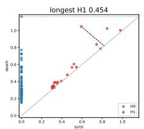  
(b) LocaLeReg

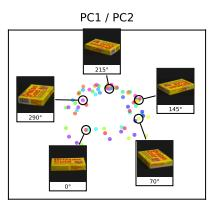

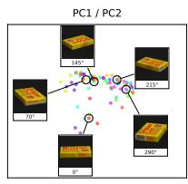

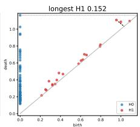  
(c) SIGReg

Figure 3: LocaLeJEPA embeddings better preserve intrinsic topology. The COIL-100 consists of images of objects being rotated. As such, these images should trace out the circle, $\mathbb { S } ^ { 1 }$ , in latent space. As measured by the persistent homology class $\boldsymbol { H } _ { 1 } ^ { \mathrm { - } }$ and PCA visualization, the embeddings more naturally lie on $\mathbf { \bar { S } } ^ { 1 }$ when using LocaLeReg as opposed to LeJEPA's SIGReg. Additional experimental details may be found in Section D.1 and Figure 9.  
  
(a) θ₀=129°

  
(b) $\theta _ { 0 } { = } 3 2 7 ^ { \circ }$

  
(c) θ1=169°

  
(d) θ1=333°

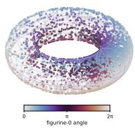  
(e) Ground-truth

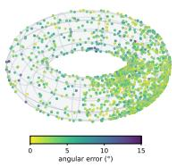  
(f) LeJEPA

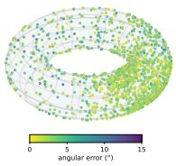  
(g) LocaLeJEPA

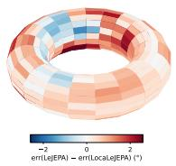  
(h) Full pool

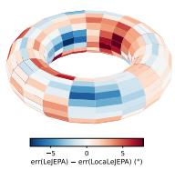  
(i) 100 frames  
Figure 4: Test-time Topology Preservation. We perform a controlled experiment to test whether LocaLeJEPA's topology-preservation extends to datasets unseen during training. After pretraining on Imagenette (Howard, 2019), we expose it to a dataset consisting of two independently rotating figurines (Top), which should thus lie on a latent torus $\mathbb { T } ^ { 2 }$ . We consider performance by testing angle prediction of each of the figurines. (Bottom)(e) Ground-truth torus defined by the two rotation angles. (f,g) Reconstructions obtained from frozen LeJEPA (MAE 3.28°) and LocaLeJEPA with λ=0.1 and $K { = } \bar { 2 } ~ ( 2 . 6 8 ^ { \circ } )$ features, colored by angular error, on one held-out probe split. (h,i) Regional difference err(SIGReg) – err(LocaLeJEPA) using the full probe pool $( + 0 . 6 0 ^ { \circ }$ 61% wins) and 100 training frames (+1.31°, 57% wins), with red favoring LocaLeJEPA. Full grids are in Section C.3.3 (Figures 6 to 8).

## 5.1 IMAGENET-1K FROZEN-FEATURE CLASSIFICATION

Task. We employ ImageNet-1K (Deng et al., 2009) to test whether the advantages of LocaLeJEPA persist at scale and remain consistent across distinct representation geometries. Following Balestriero & LeCun (2025), we pretrain three encoder families for 100 epochs: a standard ViT-S/8 with Euclidean

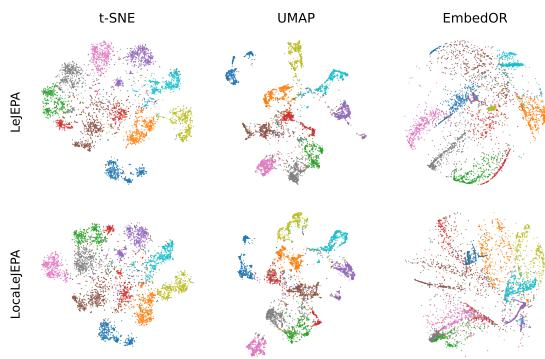  
Figure 5: LocaLeJEPA clusterings are curvatureaware. Two-dimensional projections of frozen hyperbolic ViT-S/8 representations trained with LeJEPA (top) and LocaLeJEPA (bottom, λ=0.1, K=4). Columns show t-SNE (van der Maaten & Hinton, 2008), UMAP (McInnes et al., 2020), and EmbedOR (Saidi et al., 2026). Colors indicate ground-truth classes. While Euclidean visualizers show similar layouts, curvature-aware EmbedOR shows a very different cluster structure.  
outputs, a hyperbolic ViT-S/8 whose representations lie in a Poincaré ball of curvature —0.1 (Ermolov et al., 2022), and a $D _ { 4 }$ -equivariant ResNet-50 retaining the regular representation at its output (Klee et al., 2023). All three use four $1 2 8 \times 1 2 8$ views, a 2048-2048-16 projector, and 256 images per step in four shards of 64, within which neighborhoods are formed. We also pretrain a ViT-L/14 at 238 × 238 pixels, with LeJEPA's published ViT-L settings for both methods (Section C.4.1). We train LeJEPA both with its published settings and with the optimization settings of LocaLeJEPA, denoted LeJEPA (our settings), so that the methods can also be compared at matched settings. Besides $K { = } 4 ,$ we report $K { = } 1$ , a single neighborhood, and $K { = } 1$ at a quarter of the weight $\scriptstyle ( \lambda = 0 . 0 2 5$ , Table 19). The latter matches the effective regularization strength of $K { = } 4$ at $\lambda { = } 0 . 1$ (Section 4). After pretraining, the encoder is frozen and evaluated at its final-epoch checkpoint (Section C.1) with cosine-weighted k-NN (k=20) and linear probing on its 512-dimensional representation. ViT-S/8 results, except RDMReg, are means over three pretraining seeds. In the comparison, we also include LocaLeJEPA-SIGReg, which keeps the same local partition but replaces centered matching to Unif $\left( \mathbb { B } _ { \sqrt { d + 2 } } ^ { d } \right)$ with Gaussian matching on uncentered clusters. This tests whether locality alone explains the gains, without disentangling centering from reference-distribution choice. Complete optimization details, k-NN sweeps, top-5 results, and ablations over K, λ, and the local reference distribution are reported in Section C.4.3.

Results. We consider LocaLeJEPA with both fixed numbers of local clusters, as well as a dynamic approach, $K { = } 1 {  } 1 0$ where we increase the number of clusters every ten training epochs, following our heat-flow heuristic. LocaLeJEPA with $K { = } 4$ improves frozen-feature recognition across all three representation geometries (Table 2), with gains of 11.9– 17.9 points in linear top-1 accuracy and 13.0–17.9 points in k-NN over LeJEPA. Over LeJEPA (our settings), the gains are 6.4–10.5 and 7.8–11.2 points, respectively. The dynamic schedule (K=1→10), run on the hyperbolic and equivariant encoders, adds 10.7 and 6.2 points in linear top-1 accuracy and 11.5 and 7.7 in k-NN over LeJEPA (our settings), within 0.4 points of $K { = } 4$ . On ViT-L/14, where

Table 1: LocaLeJEPA better preserves toroidal structure across probe-label budgets. Continuing with the setting of the toroidal angle prediction task of Figure 4, we consider performance against a range of global distribution matching objectives: Balestriero & LeCun (2025)'s SIGReg, Nicollier et al. (2026a)'s SUSReg, Zhao et al. (2026)'s SubReg, and Kuang et al. (2026)'s RDMReg (Section C.2). Entries are the wrapped angular MAE (°, lower is better), averaged over the two rotation angles, for each number of labeled probe-training frames. The ± values are standard deviations over ten probe splits. All encoders are pretrained on Imagenette for 800 epochs. LocaLeJEPA uses λ=0.1, and Dyn-K grows K from 1 to 8. LocaLeJEPA features prove superior for this task across label budgets. Additional details are provided in Section C.3, and the complete results in Sections C.3.1 and C.3.2.

<table><tr><td>Method</td><td>10</td><td>50</td><td>100</td><td>500</td><td>Full</td></tr><tr><td>Spherical ViT SUSReg</td><td>44.6±4.3</td><td>20.2±2.0</td><td>11.0±0.7</td><td>4.91±.09</td><td>3.64±.04</td></tr><tr><td>ViT SIGReg</td><td>39.2±3.6</td><td>17.8±1.1</td><td>11.0±0.4</td><td>4.70±.09</td><td> $3 . 3 0 \pm . 0 5$ </td></tr><tr><td>ViT SubReg</td><td>37.9±4.4</td><td>18.0±1.7</td><td>11.2±0.5</td><td>4.70±.10</td><td> $3 . 4 0 { \pm } . 0 4 $ </td></tr><tr><td>ViT RDMReg</td><td>39.8±7.0</td><td>19.8±2.0</td><td>10.5±0.6</td><td>5.47±.08</td><td> $3 . 7 9 \pm . 0 5$ </td></tr><tr><td>LocaLeJEPA (K=2)</td><td>36.0±3.8</td><td>15.5±1.2</td><td>9.0±0.3</td><td>3.80±.05</td><td>2.67±.05</td></tr><tr><td>LocaLeJEPA (Dyn-K)</td><td>37.5±4.3</td><td>17.1±1.1</td><td>10.9±0.5</td><td>4.10±.10</td><td> $2 . 8 9 \pm . 0 4$ </td></tr></table>

both methods use LeJEPA's published ViT-L settings, LocaLeJEPA adds 6.3 points in linear top-1 accuracy and 1.3 in k-NN. The k-NN gain over LeJEPA (our settings), at least 7.8 points on every 128-pixel encoder, is particularly informative because this readout operates directly on the frozen feature metric, and is consistent with the stronger local semantic organization quantified in Section D.3 and Figure 11.

Table 2: ImageNet-1K Frozen-feature Evaluation across Representation Geometries. ImageNet classification and seven-dataset transfer for the Euclidean, hyperbolic and D4-equivariant encoders at 128 px, and ViT-L/14 at 238 px. Final-epoch checkpoints and one linear-probe seed, with the learning rate selected on a held-out slice of the training set. ViT-S/8 rows other than RDMReg are mean ± SD over three pretraining seeds, and all other rows are single runs. LeJEPA uses LeJEPA's published settings, and LeJEPA (our settings) uses the optimization settings of LocaLeJEPA. Full sweeps in Table 19. Bold denotes the best result within each encoder family and metric.
<table><tr><td rowspan="2">Method</td><td colspan="2">ImageNet-1K linear (%)</td><td>k-NN (%)</td><td>Transfer (%)</td></tr><tr><td>top-1(↑)</td><td>top-5(↑)</td><td>k=20(↑)</td><td>7-dataset avg(↑)</td></tr><tr><td>Plain ViT-S/8 (Euclidean, 21.7M)</td><td></td><td></td><td></td><td></td></tr><tr><td>Rectified LpJEPA (RDMReg)</td><td>25.7</td><td>48.5</td><td>12.6</td><td>45.0</td></tr><tr><td>LeJEPA</td><td> $4 4 . 6 \pm 0 . 2 3$ </td><td> $7 0 . 8 \pm 0 . 1 7$ </td><td> $3 2 . 8 \pm 0 . 3 3$ </td><td> $6 0 . 5 \pm 0 . 5 2$ </td></tr><tr><td>LeJEPA (our settings)</td><td> $5 1 . 6 \pm 0 . 2 8$ </td><td> $7 7 . 3 \pm 0 . 3 6$ </td><td> $3 8 . 9 \pm 0 . 0 9$ </td><td> $6 4 . 3 \pm 0 . 1 3$ </td></tr><tr><td>LocaLeJEPA  $( \lambda { = } 0 . 1 , K { = } 1 )$ </td><td> $5 9 . 7 \pm 0 . 2 2$ </td><td> $8 3 . 5 \pm 0 . 0 9$ </td><td> $4 5 . 4 \pm 0 . 2 2$ </td><td> $7 0 . 3 \pm 0 . 0 4$ </td></tr><tr><td>LocaLeJEPA  $( \lambda { = } 0 . 1 , K { = } 4 )$ </td><td> ${ \bf 6 2 . 1 \pm 0 . 2 7 }$ </td><td> ${ \bf 8 5 . 1 \pm 0 . 1 6 }$ </td><td> ${ \bf 5 0 . 1 \pm 0 . 1 2 }$ </td><td> $\mathbf { 7 2 . 3 \pm 0 . 2 9 }$ </td></tr><tr><td>Hyperbolic ViT-S/8 (Poincaré ball, 21.7M)</td><td></td><td></td><td></td><td></td></tr><tr><td>Rectified LpJEPA (RDMReg)</td><td>26.0</td><td>48.7</td><td>13.1</td><td>44.6</td></tr><tr><td>LeJEPA</td><td>44.0</td><td>69.8</td><td>32.6</td><td>60.3</td></tr><tr><td>LeJEPA (our settings)</td><td>51.6</td><td>77.5</td><td>39.4</td><td>64.1</td></tr><tr><td>LocaLeJEPA  $( \lambda { = } 0 . 1 , K { = } 1 )$ </td><td>59.5</td><td>83.4</td><td>45.7</td><td>70.1</td></tr><tr><td>LocaLeJEPA  $( \lambda { = } 0 . 1 , K { = } 4 )$ </td><td>61.9</td><td>84.9</td><td>50.6</td><td>72.1</td></tr><tr><td>LocaLeJEPA  $( \lambda { = } 0 . 1 , K { = } 1 {  } 1 0 )$ </td><td>62.2</td><td>85.1</td><td>50.9</td><td>72.6</td></tr><tr><td>LocaLeJEPA-SIGReg  $( \lambda { = } 0 . 1 , K { = } 4 )$ </td><td>48.2</td><td>73.8</td><td>35.4</td><td>62.8</td></tr><tr><td>D4-equivariant ResNet-50 (24.4M)</td><td></td><td></td><td></td><td></td></tr><tr><td>Rectified LpJEPA (RDMReg)</td><td>31.3</td><td>56.9</td><td>23.4</td><td>48.1</td></tr><tr><td>LeJEPA</td><td>43.4</td><td>70.7</td><td>34.5</td><td>54.7</td></tr><tr><td>LeJEPA (our settings)</td><td>48.8</td><td>75.7</td><td>39.7</td><td>58.8</td></tr><tr><td> $\mathrm { L o c a L e J E P A } ( \lambda { = } \bar { 0 } . 1 , K { = } 1 )$ </td><td>52.4</td><td>79.0</td><td>43.9</td><td>60.3</td></tr><tr><td>LocaLeJEPA  $( \lambda { = } 0 . 1 , K { = } 4 )$ </td><td>55.2</td><td>80.6</td><td>47.5</td><td>63.0</td></tr><tr><td> $\mathrm { L o c a L e J E P A } ( \lambda { = } 0 . 1 , K { = } 1 {  } 1 0 )$ </td><td>55.1</td><td>80.8</td><td>47.4</td><td>62.5</td></tr><tr><td> $\mathrm { L o c a L e J E P A - S I G R e g } \left( \lambda { = } 0 . 1 , K { = } 4 \right)$ </td><td>43.2</td><td>69.5</td><td>34.8</td><td>52.4</td></tr><tr><td></td><td></td><td></td><td></td><td></td></tr><tr><td colspan="3">Plain ViT-L/14 (Euclidean, 303.2M, LeJEPA&#x27;s ViT-L settings)</td><td></td><td></td></tr><tr><td>LeJEPA</td><td>54.7</td><td>79.9</td><td>46.0</td><td>61.3</td></tr><tr><td>LocaLeJEPA  $( \lambda { = } 0 . 0 5 , K { = } 1 )$ </td><td>54.8</td><td>80.1</td><td>46.5</td><td>60.1</td></tr><tr><td>LocaLeJEPA  $( \lambda { = } 0 . 0 5 , K { = } 4 )$ </td><td>61.0</td><td>84.2</td><td>47.4</td><td>65.5</td></tr><tr><td></td><td></td><td></td><td></td><td></td></tr></table>

On ImageNet-1K, training LeJEPA with our optimization settings already improves it by 6.1 / 7.1 points (k-NN / linear, ViT-S/8). Against this stronger baseline, LocaLeJEPA still adds 11.2 / 10.5, 11.2 / 10.3 and 7.8 / 6.4 points on ViT-S/8, hyperbolic ViT-S/8 and the D4-equivariant ResNet-50 (Tables 2 and 19). With a single neighborhood (K=1), our centered ball target alone adds 6.5 / 8.1. 6.3 / 7.9 and 4.2 / 3.5 points over this baseline. Dividing the batch into K=4 neighborhoods adds a further 4.6 / 2.5, 4.9 / 2.4 and 3.6 / 2.9. Since a larger K also lowers the effective regularization strength (Section 4), we compare K=4 with K=1 at a quarter of the weight, which has the same strength. At matched strength, locality still adds 2.3 / 2.3 on ViT-S/8 (positive for each of the three seeds) and 2.6 / 2.0 and 3.0 / 2.8 on the other two encoders (Table 19). Within the same neighborhoods, replacing the centered ball target with Gaussian matching on uncentered clusters (LocaLeJEPA-SIGReg) costs 15.2 / 13.7 points on the hyperbolic and 12.7 / 12.0 on the equivariant encoder (Table 2). The resulting model falls below LeJEPA (our settings). The gains therefore come from the centered local target, our local entropy-maximizing reference, and locality alone does not explain them. On ViT-L/14, a single neighborhood accounts for only 0.5 / 0.1 of the 1.3 / 6.3 points that LocaLeJEPA adds.

## 5.2 TRANSFER TO DOWNSTREAM DATASETS

Task. We next test whether the ImageNet-1K gains persist beyond the pretraining distribution. Keeping each encoder frozen, we fit a single linear classifier on standardized features for seven downstream datasets spanning textures, fine-grained recognition, and generic object classification: DTD (Cimpoi et al., 2014), FGVC-Aircraft (Maji et al., 2013), CIFAR-10 and CIFAR-100 (Krizhevsky, 2009),

Table 3: Linear Transfer across Seven Downstream Datasets. Frozen-feature top-1 accuracy (%), where Avg is the unweighted mean. One linear-probe seed. ViT-S/8 rows are mean ± SD over three pretraining seeds, and all other rows are single runs. Bold denotes the best mean within each encoder family and column.
<table><tr><td>Method</td><td>DTD</td><td>Aircraft</td><td>CIFAR-10</td><td>CIFAR-100</td><td>Flowers</td><td>Food</td><td>Pets</td><td>Avg</td></tr><tr><td colspan="9">Plain ViT-S/8 (Euclidean, 21.7M)</td></tr><tr><td>LeJEPA</td><td>60.0±0.6</td><td>28.4±0.5</td><td>86.1±0.5</td><td>62.6±1.3</td><td>75.4±0.4</td><td>51.0±0.8</td><td>59.8±1.1</td><td>60.5±0.5</td></tr><tr><td>LeJEPA (our settings)</td><td>64.1±0.6</td><td>30.3±0.9</td><td>88.7±0.2</td><td>66.0±0.2</td><td>78.9±0.2</td><td>56.4±0.3</td><td>65.9±0.5</td><td>64.3±0.1</td></tr><tr><td>LocaLeJEPA (λ=0.1, K=1)</td><td>69.3±0.3</td><td>38.4±0.4</td><td>91.7±0.3</td><td>71.5±0.9</td><td>83.7±0.2</td><td>63.5±0.1</td><td>73.6±0.8</td><td>70.3±0.0</td></tr><tr><td>LocaLeJEPA (λ=0.1, K=4)</td><td>69.4±1.5</td><td>42.1±0.6</td><td>92.2±0.3</td><td>73.6±0.4</td><td>85.3±0.3</td><td>66.0±0.1</td><td>77.3±1.8</td><td>72.3±0.3</td></tr><tr><td colspan="9">Hyperbolic ViT-S/8 (Poincaré ball, 21.7M)</td></tr><tr><td>LeJEPA</td><td>61.5</td><td>28.2</td><td>85.9</td><td>62.6</td><td>75.2</td><td>50.7</td><td>58.0</td><td>60.3</td></tr><tr><td>LeJEPA (our settings)</td><td>60.8</td><td>31.4</td><td>88.6</td><td>66.1</td><td>78.7</td><td>56.7</td><td>66.7</td><td>64.1</td></tr><tr><td>LocaLeJEPA (λ=0.1, K=1)</td><td>68.8</td><td>37.5</td><td>92.0</td><td>71.4</td><td>83.7</td><td>63.8</td><td>73.3</td><td>70.1</td></tr><tr><td>LocaLeJEPA (λ=0.1, K=4)</td><td>69.1</td><td>41.5</td><td>92.3</td><td>72.7</td><td>85.3</td><td>65.3</td><td>78.6</td><td>72.1</td></tr><tr><td>LocaLeJEPA (λ=0.1, K=1→10)</td><td>70.1</td><td>42.5</td><td>92.6</td><td>73.3</td><td>85.6</td><td>65.9</td><td>78.5</td><td>72.6</td></tr><tr><td>LocaLeJEPA-SIGReg (λ=0.1, K=4)</td><td>57.3</td><td>30.8</td><td>87.9</td><td>65.1</td><td>77.8</td><td>55.9</td><td>65.0</td><td>62.8</td></tr><tr><td colspan="9">D4-equivariant ResNet-50 (24.4M)</td></tr><tr><td>LeJEPA</td><td>55.4</td><td>23.7</td><td>86.2</td><td>60.6</td><td>63.9</td><td>40.6</td><td>52.2</td><td>54.7</td></tr><tr><td>LeJEPA (our settings)</td><td>59.5</td><td>25.7</td><td>88.9</td><td>63.9</td><td>67.4</td><td>45.5</td><td>61.1</td><td>58.8</td></tr><tr><td>LocaLeJEPA (λ=0.1, K=1)</td><td>60.2</td><td>25.7</td><td>90.2</td><td>65.9</td><td>67.8</td><td>47.5</td><td>65.0</td><td>60.3</td></tr><tr><td>LocaLeJEPA (λ=0.1, K=4)</td><td>61.3</td><td>29.3</td><td>91.2</td><td>69.1</td><td>71.5</td><td>49.5</td><td>69.1</td><td>63.0</td></tr><tr><td>LocaLeJEPA (λ=0.1, K=1→10)</td><td>61.5</td><td>27.4</td><td>90.9</td><td>67.7</td><td>70.4</td><td>49.4</td><td>69.9</td><td>62.5</td></tr><tr><td>LocaLeJEPA-SIGReg (λ=0.1, K=4)</td><td>48.4</td><td>25.5</td><td>88.8</td><td>60.6</td><td>52.5</td><td>25.9</td><td>65.3</td><td>52.4</td></tr><tr><td colspan="9">Plain ViT-L/14 (Euclidean, 303.2M, LeJEPA&#x27;s ViT-L settings)</td></tr><tr><td>LeJEPA</td><td>62.3</td><td>20.1</td><td>90.5</td><td>66.2</td><td>68.2</td><td>57.2</td><td>64.8</td><td>61.3</td></tr><tr><td>LocaLeJEPA (λ=0.05, K=1)</td><td>61.3</td><td>17.3</td><td>90.4</td><td>65.9</td><td>66.8</td><td>56.3</td><td>62.6</td><td>60.1</td></tr><tr><td> $\operatorname { L o c a L e J E P A } ( \lambda { = } 0 . 0 5 , K { = } 4 )$ </td><td>66.0</td><td>26.1</td><td>92.3</td><td>70.6</td><td>74.0</td><td>62.8</td><td>66.4</td><td>65.5</td></tr></table>

Flowers-102 (Nilsback & Zisserman, 2008), Food-101 (Bossard et al., 2014), and Oxford-IIIT Pets (Parkhi et al., 2012). The probe learning rate is selected on a 10% holdout from the training split, and top-1 accuracy is reported on the official test set. Full per-configuration results and protocol details are provided in Section C.4.3 and Section C.4.

Results. The ImageNet-1K gains also hold beyond the pretraining distribution (Table 3). Across the Euclidean, hyperbolic, and equivariant encoder families, LocaLeJEPA with K=4 improves the seven-dataset average by 8.3–11.8 percentage points over LeJEPA, and by 4.2–8.0 over LeJEPA (our settings). All three encoders improve on all seven datasets against both, with the largest gains over LeJEPA on fine-grained recognition tasks such as Pets and Food-101. The dynamic schedule's transfer average is 0.5 points above fixed K=4 on the hyperbolic and 0.5 points below it on the equivariant encoder. On ViT-L/14, LocaLeJEPA improves on all seven datasets and raises the seven-dataset average by 4.1 points. The benefit of local distribution matching extends beyond ImageNet-1K classification, across the representation geometries and downstream domains tested.

## 6 CONCLUSION

LocaLeJEPA brings a manifold-theoretic perspective to the JEPA paradigm, introducing the heuristic that self-supervised training should behave like heat flow. To implement this heuristic, we develop the novel LocaLeReg regularizer, based upon a locally Euclidean entropy-maximizing objective. We find that both qualitatively and quantitatively, LocaLeJEPA produces embeddings that better preserve intrinsic semantic structure and can adapt to the geometry of the representation space, while being stable and scalable. Comparisons at matched optimization settings, on four encoders up to ViT-L/14 and over three pretraining seeds on ViT-S/8, show that the gains do not come from the training settings. Within the same neighborhoods, an uncentered Gaussian target loses all of the gain over LeJEPA (our settings), so locality alone does not explain it. While we instantiate our framework on image data in the current work, we believe LocaLeJEPA represents a general-use framework that allows for a principled extension of the JEPA paradigm to settings that require handling non-Euclidean data or using non-Euclidean representations.

## REFERENCES

Luigi Ambrosio, Nicola Gigli, and Giuseppe Savaré. Heat flow and calculus on metric measure spaces with ricci curvature bounded below—the compact case. In Analysis and Numerics of

Partial Differential Equations, volume 4, pp. 63–115. Springer, Milan, 2013. doi: 10.1007/ 978-88-470-2592-9\_8.

Mahmoud Assran, Quentin Duval, Ishan Misra, Piotr Bojanowski, Pascal Vincent, Michael Rabbat, Yann LeCun, and Nicolas Ballas. Self-supervised learning from images with a joint-embedding predictive architecture. In Proceedings of the IEEE/CVF Conference on Computer Vision and Pattern Recognition (CVPR), pp. 15619–15629, June 2023.

Randall Balestriero and Yann LeCun. Lejepa: Provable and scalable self-supervised learning without the heuristics. arXiv preprint arXiv:2511.08544, 2025. doi: 10.48550/arXiv.2511.08544. URL https://arxiv.org/abs/2511.08544.

Adrien Bardes, Jean Ponce, and Yann LeCun. Vicreg: Variance-invariance-covariance regularization for self-supervised learning. In International Conference on Learning Representations, 2022.

Ulrich Bauer. Ripser: Efficient computation of Vietoris-Rips persistence barcodes. Journal of Applied and Computational Topology, 5:391–423, 2021.

Nicole Berline, Ezra Getzler, and Michèle Vergne. Heat Kernels and Dirac Operators, volume 298 of Grundlehren der mathematischen Wissenschaften. Springer-Verlag, Berlin, 1992. ISBN 3-540-53340-0. doi:10.1007/978-3-642-58088-8.

Lukas Bossard, Matthieu Guillaumin, and Luc Van Gool. Food-101 – mining discriminative components with random forests. In European Conference on Computer Vision, 2014.

Jane Bromley, James W. Bentz, Léon Bottou, Isabelle Guyon, Yann LeCun, Cliff Moore, Eduard Säckinger, and Roopak Shah. Signature verification using a “siamese" time delay neural network. International Journal of Pattern Recognition and Artificial Intelligence, 7(4):669–688, August 1993. doi:10.1142/S0218001493000339.

Mathilde Caron, Hugo Touvron, Ishan Misra, Hervé Jégou, Julien Mairal, Piotr Bojanowski, and Armand Joulin. Emerging properties in self-supervised vision transformers. In Proceedings of the IEEE/CVF International Conference on Computer Vision (ICCV), pp. 9650–9660, October 2021.

Deep Chakraborty, Yann LeCun, Tim G. J. Rudner, and Erik Learned-Miller. Improving pre-trained self-supervised embeddings through effective entropy maximization. In Proceedings of the 28th International Conference on Artificial Intelligence and Statistics, volume 258 of Proceedings of Machine Learning Research, pp. 433–441. PMLR, 2025.

Frédéric Chazal, David Cohen-Steiner, Leonidas J. Guibas, Facundo Mémoli, and Steve Y. Oudot. Gromov-hausdorff stable signatures for shapes using persistence. Computer Graphics Forum, 28 (5):1393–1403, 2009.

Alexander Chemeris, Ming Jin, and Randall Balestriero. Lenepa: No-augmentation next-latent prediction for time-series representation learning. In Proceedings of the 12th Mining and Learning from TimeSeriesWorkshop, 2026. URL https://arxiv.org/abs/2607.00958. KDD MILETS 2026.

Ting Chen, Simon Kornblith, Mohammad Norouzi, and Geoffrey Hinton. A simple framework for contrastive learning of visual representations. In Proceedings of the 37th International Conference on Machine Learning, volume 119 of Proceedings of Machine Learning Research, pp. 1597–1607. PMLR,2020.URLhttps://proceedings.mlr.press/v119/chen20j.html.

Xinlei Chen and Kaiming He. Exploring simple siamese representation learning. In Proceedings of the IEEE/CVF Conference on Computer Vision and Pattern Recognition, pp. 15750–15758, 2021.

M. Cimpoi, S. Maji, I. Kokkinos, S. Mohamed, and A. Vedaldi. Describing textures in the wild. In Proceedings of the IEEE Conference on Computer Vision and Pattern Recognition (CVPR), 2014

Harald Cramér and Herman Wold. Some theorems on distribution functions. Journal of the London Mathematical Society, s1-11(4):290–294, 1936. doi: 10.1112/jlms/s1-11.4.290.

Rumen Dangovski, Li Jing, Charlotte Loh, Seungwook Han, Akash Srivastava, Brian Cheung, Pulkit Agrawal, and Marin Soljačić. Equivariant contrastive learning. In International Conference on Learning Representations, 2022.

Jia Deng, Wei Dong, Richard Socher, Li-Jia Li, Kai Li, and Li Fei-Fei. Imagenet: A large-scale hierarchical image database. In 2009 IEEE conference on computer vision and pattern recognition, pp. 248–255. Ieee, 2009.

Persi Diaconis and David Freedman. A dozen de Finetti-style results in search of a theory. Annales de l’Institut Henri Poincaré, Probabilités et Statistiques, 23(S2):397–423, 1987.

Herbert Edelsbrunner, David Letscher, and Afra Zomorodian. Topological persistence and simplification. Discrete & Computational Geometry, 28(4):511–533, 2002.

T. W. Epps and L. B. Pulley. A test for normality based on the empirical characteristic function. Biometrika, 70(3):723–726, 1983. doi: 10.1093/biomet/70.3.723.

Aleksandr Ermolov, Aliaksandr Siarohin, Enver Sangineto, and Nicu Sebe. Whitening for selfsupervised representation learning. In Proceedings of the 38th International Conference on Machine Learning, volume 139 of Proceedings of Machine Learning Research, pp. 3015–3024. PMLR,2021.URLhttps://proceedings.mlr.press/v139/ermolov21a.html.

Aleksandr Ermolov, Leyla Mirvakhabova, Valentin Khrulkov, Nicu Sebe, and Ivan Oseledets. Hyperbolic vision transformers: Combining improvements in metric learning. In 2022 IEEE/CVF Conference on Computer Vision and Pattern Recognition (CVPR), pp. 7399–7409. IEEE, 2022.

Charles Fefferman, Sanjoy Mitter, and Hariharan Narayanan. Testing the manifold hypothesis. Journal of the American Mathematical Society, 29(4):983–1049, 2016. doi: 10.1090/jams/852.

Jean-Bastien Grill, Florian Strub, Florent Altché, Corentin Tallec, Pierre H. Richemond, Elena Buchatskaya, Carl Doersch, Bernardo Avila Pires, Zhaohan Daniel Guo, Mohammad Gheshlaghi Azar, Bilal Piot, Koray Kavukcuoglu, Rémi Munos, and Michal Valko. Bootstrap your own latent: A new approach to self-supervised learning. In Advances in Neural Information Processing Systems, volume 33, 2020.

Kaveh Hassani and Amir Hosein Khasahmadi. Contrastive multi-view representation learning on graphs. In Proceedings of the 37th International Conference on Machine Learning, volume 119 of Proceedings of Machine Learning Research, pp. 4116–4126. PMLR, 2020.

Kaiming He, Haoqi Fan, Yuxin Wu, Saining Xie, and Ross Girshick. Momentum contrast for unsupervised visual representation learning. In Proceedings of the IEEE/CVF Conference on Computer Vision and Pattern Recognition (CVPR), pp. 9726–9735, 2020. doi: 10.1109/CVPR42600.2020. 00975.

Jeremy Howard. Imagenette: A smaller subset of 10 easily classified classes from imagenet, March 2019.URLhttps://github.com/fastai/imagenette.

Richard Jordan, David Kinderlehrer, and Felix Otto. The variational formulation of the fokker– planck equation. SIAM Journal on Mathematical Analysis, 29(1):1–17, January 1998. doi: 10.1137/S0036141096303359.

David Klee, Jung Yeon Park, Robert Platt, and Robin Walters. A comparison of equivariant vision models with ImageNet pre-training. In NeurIPS 2023 Workshop on Symmetry and Geometry in Neural Representations, 2023. URL https://neurips.cc/virtua1/2023/84252.

Alex Krizhevsky. Learning multiple layers of features from tiny images. Technical report, University of Toronto, 2009.

Yilun Kuang, Yash Dagade, Tim G. J. Rudner, Randall Balestriero, and Yann LeCun. Rectified lpjepa: Joint-embedding predictive architectures with sparse and maximum-entropy representations. International Conference on Machine Learning (ICML), 2026.

Lukas Kuhn, Lucas Maes, Giuseppe Serra, Quentin Le Lidec, Yann LeCun, Randall Balestriero, and Florian Buettner. Levjepa: Efficient & scalable video pretraining without the heuristics, 2026a. URLhttps://arxiv.org/abs/2608.27395.

Lukas Kuhn, Giuseppe Serra, Randall Balestriero, and Florian Buettner. Levljepa: End-to-end vision-language pretraining without negatives, 2026b. URL https ://arxiv.org/abs/ 2607.00784.

Yann LeCun. A path towards autonomous machine intelligence. OpenReview, June 2022. URL https://openreview.net/forum?id=BZ5a1r-kVsf.Version 0.9.2, June 27, 2022.

Shengchao Liu, Hanchen Wang, Weiyang Liu, Joan Lasenby, Hongyu Guo, and Jian Tang. Pretraining molecular graph representation with 3d geometry. In International Conference on Learning Representations, 2022a. URL https://openreview.net/forum?id=xQUe1pOKPam.

Xin Liu, Zhongdao Wang, Ya-Li Li, and Shengjin Wang. Self-supervised learning via maximum entropy coding. In Advances in Neural Information Processing Systems, volume 35. Curran Associates, Inc., 2022b. doi: 10.52202/068431-2471.

Ilya Loshchilov, Cheng-Ping Hsieh, Simeng Sun, and Boris Ginsburg. nGPT: Normalized transformer with representation learning on the hypersphere. In International Conference on Learning Representations, 2025.

Lucas Maes, Quentin Le Lidec, Damien Scieur, Yann LeCun, and Randall Balestriero. Leworldmodel: Stable end-to-end joint-embedding predictive architecture from pixels. arXiv preprint arXiv:2603.19312,2026.URL https://arxiv.org/abs/2603.19312.

S. Maji, E. Rahtu, J. Kannala, M. Blaschko, and A. Vedaldi. Fine-grained visual classification of aircraft. arXiv preprint arXiv:1306.5151, 2013.

Leland McInnes, John Healy, and James Melville. Umap: Uniform manifold approximation and projection for dimension reduction, 2020. URL https ://arxiv.org/abs/1802.03426.

Sameer A. Nene, Shree K. Nayar, and Hiroshi Murase. Columbia object image library (COIL-100). Technical Report CUCS-006-96, Columbia University, 1996.

Léo Nicollier, Max Dunitz, Marc Pic, Pablo Musé, Enric Meinhardt-Llopis, and Gabriele Facciolo. Sphere-jepa: Spherical prediction with homogeneous embeddings. arXiv preprint arXiv:2605.26900, 2026a. doi: 10.48550/arXiv.2605.26900. URL https://arxiv.org/ abs/2605.26900.

Léo Nicollier, Enric Meinhardt-Llopis, Max Dunitz, Marc Pic, Pablo Musé, and Gabriele Facciolo. Expanding sphere-jepa: A family of statistical regularizers for the hypersphere, 2026b. URL https://arxiv.org/abs/2606.17603.

Maria-Elena Nilsback and Andrew Zisserman. Automated flower classification over a large number of classes. In 2008 Sixth Indian conference on computer vision, graphics & image processing, pp. 722–729. IEEE, 2008.

Maxime Oquab, Timothée Darcet, Théo Moutakanni, Huy Vo, Marc Szafraniec, Vasil Khalidov, Pierre Fernandez, Daniel Haziza, Francisco Massa, Alaaeldin El-Nouby, et al. Dinov2: Learning robust visual features without supervision. arXiv preprint arXiv:2304.07193, 2023.

O. M. Parkhi, A. Vedaldi, A. Zisserman, and C. V. Jawahar. Cats and dogs. In IEEE Conference on Computer Vision and Pattern Recognition, 2012.

Florian Rottach, Sebastian Schieferdecker, William Rudman, Randall Balestriero, and Carsten Eickhoff. Mol-jepa: A multimodal joint embedding predictive architecture for molecules, 2026. URLhttps://arxiv.org/abs/2608.22642.

Tristan Luca Saidi, Abigail Hickok, Bastian Rieck, and Andrew J Blumberg. Provable clusterpreserving visualizations with curvature-based stochastic neighbor embeddings. Proceedings of the National Academy of Sciences, 123(28):e2509171123, 2026.

Hannes Stärk, Dominique Beaini, Gabriele Corso, Prudencio Tossou, Christian Dallago, Stephan Günnemann, and Pietro Lió. 3d infomax improves GNNs for molecular property prediction. In Proceedings of the 39th International Conference on Machine Learning, volume 162 of Proceedings of Machine Learning Research, pp. 20479–20502. PMLR, 2022.

Shantanu Thakoor, Corentin Tallec, Mohammad Gheshlaghi Azar, Rémi Munos, Petar Veličković, and Michal Valko. Bootstrapped representation learning on graphs. In ICLR 2021 Workshop on Geometrical and Topological Representation Learning, 2021.

Yuandong Tian, Xinlei Chen, and Surya Ganguli. Understanding self-supervised learning dynamics without contrastive pairs. In Proceedings of the 38th International Conference on Machine Learning, volume 139 of Proceedings of Machine Learning Research, pp. 10268–10278. PMLR, 2021.URLhttps://proceedings.mlr.press/v139/tian21a.html.

Aäron van den Oord, Yazhe Li, and Oriol Vinyals. Representation learning with contrastive predictive coding. arXiv preprint arXiv:1807.03748, 2018. URL https://arxiv.org/abs/1807. 03748.

Laurens van der Maaten and Geoffrey Hinton. Visualizing data using t-sne. Journal of Machine LearningResearch, 9(86):2579–2605, 2008. URL http: // jmlr. org/papers/v9/ vandermaaten08a.html.

Petar Veličković, William Fedus, William L. Hamilton, Pietro Liò, Yoshua Bengio, and R. Devon Hjelm. Deep graph infomax. In International Conference on Learning Representations, 2019.

Yifei Wang, Kaiwen Hu, Sharut Gupta, Ziyu Ye, Yisen Wang, and Stefanie Jegelka. Understanding the role of equivariance in self-supervised learning. In Advances in Neural Information Processing Systems, volume 37, 2024.

Saining Xie, Jiatao Gu, Demi Guo, Charles R. Qi, Leonidas J. Guibas, and Or Litany. Pointcontrast: Unsupervised pre-training for 3d point cloud understanding. In Computer Vision – ECCV 2020, volume 12348 of Lecture Notes in Computer Science, pp. 574–591. Springer, 2020. doi: 10.1007/ 978-3-030-58580-8\_34.

Ruichen Xu, Jingxiang Qu, Wenhan Gao, Jiaxing Zhang, Linsey Pang, Ravid Shwartz-Ziv, Yann LeCun, and Yuefan Deng. Hp-jepa: Hierarchical partitioning for multi-resolution graph jointembedding predictive learning, 2026.URL https ://arxiv.org/abs/2608.00491.

Yuning You, Tianlong Chen, Yongduo Sui, Ting Chen, Zhangyang Wang, and Yang Shen. Graph contrastive learning with augmentations. In Advances in Neural Information Processing Systems, volume 33, pp. 5812–5823. Curran Associates, Inc., 2020.

Jure Zbontar, Li Jing, Ishan Misra, Yann LeCun, and Stéphane Deny. Barlow twins: Self-supervised learning via redundancy reduction. In International Conference on Machine Learning, pp. 12310– 12320. PMLR, 2021.

Yifan Zhang, Zhiquan Tan, Jingqin Yang, Weiran Huang, and Yang Yuan. Matrix information theory for self-supervised learning. In Proceedings of the 41st International Conference on Machine Learning, volume 235 of Proceedings of Machine Learning Research, pp. 59897–59918. PMLR 2024.

Zaiwei Zhang, Rohit Girdhar, Armand Joulin, and Ishan Misra. Self-supervised pretraining of 3d features on any point-cloud. In Proceedings of the IEEE/CVF International Conference on Computer Vision, pp. 10252–10263, 2021.

Kai Zhao, Dongliang Nie, Yuchen Lin, Zhehan Luo, Yixiao Gu, Deng-Ping Fan, and Dan Zeng. Sub-jepa: Subspace gaussian regularization for stable end-to-end world models, 2026. URL https://arxiv.org/abs/2605.09241.

Afra Zomorodian and Gunnar Carlsson. Computing persistent homology. Discrete & Computational Geometry, 33(2):249–274, 2005.

## LOCALEJEPA: Maximum Entropy Representations under Geometric Priors

## Supplementary Material

A Additional Implementation Details 16   
A.1 Characteristic Function of the Uniform Ball 16   
A.1.1 One-Dimensional Projections 18   
A.1.2 Reference Scale Used in Training 18   
A.2 LocaLeJEPA Algorithm . 19   
A.3 Scale Equivalence Across Different Ball Radii . 20   
A.4 Complexity Analysis and Computational Cost 22   
B Ablation Analysis 24   
C Additional Experimental Details 27   
C.1 Shared Experimental Protocol 27   
C.2 Distribution-Matching Objectives and Reference Distributions 27   
C.3 Toroidal Geometry Preservation 28   
C.3.1 Complete Torus Results at Full Probe Budget . 29   
C.3.2 Probe Label-Budget Curves 30   
C.3.3 Spatial Structure of Rotation Recovery 31   
C.4 ImageNet-1K: Training and Evaluation Protocol 35   
C.4.1 ImageNet-1K: Pretraining Details 35   
C.4.2 ImageNet-1K Frozen-Feature Readouts 35   
C.4.3 ImageNet-1K: Full Results 36   
D Qualitative Embedding Analysis 37   
D.1 Topology Preservation on COIL Dataset 37   
D.2 Patch-Level Representation Structure 40   
D.3 Class Consistency of Frozen k-NN Neighborhoods 41

## A ADDITIONAL IMPLEMENTATION DETAILS

This appendix derives the uniform ball distribution, the reference used by LocaLeReg. Section A.1 computes its characteristic function and one-dimensional marginals, including equivalent hypergeometric forms, and Section A.2 describes how they enter the local distribution-matching objective and summarizes the training procedure.

## A.1 CHARACTERISTIC FUNCTION OF THE UNIFORM BALL

Throughout, d denotes the output dimension of the projector, i.e. the space in which the regularizer acts. For $c \in \mathbb { R } ^ { d }$ and $R > 0$ , we denote the ball of radius R centered at c as:

$$
\mathbb { B } _ { R } ^ { d } ( c ) = \{ x \in \mathbb { R } ^ { d } : \| x - c \| _ { 2 } \leq R \}\tag{13}
$$

and write $\mathbb { B } _ { R } ^ { d } = \mathbb { B } _ { R } ^ { d } ( 0 )$ . The volume of the unit ball is:

$$
V _ { d } = \frac { \pi ^ { d / 2 } } { \Gamma ( d / 2 + 1 ) }\tag{14}
$$

where Γ is the Gamma function. As a consequence, the uniform distribution over the ball has the following density function.

Lemma A.1 (Uniform Ball). A random variable uniformly distributed over the ball, denoted $X \sim \operatorname { U n i f } ( \mathbb { B } _ { R } ^ { d } )$ , has density:

$$
f _ { X } ( x ) = \frac { 1 } { V _ { d } R ^ { d } } \mathbf { 1 } _ { \mathbb { B } _ { R } ^ { d } } ( x )\tag{15}
$$

We recall the following definition, which we then apply to the uniform ball distribution.

Definition A.2 (Characteristic Function). Given a random variable X, its characteristic function is defined as

$$
\varphi _ { X } ( t ) = \mathbb { E } [ e ^ { i t ^ { \top } X } ] , \qquad t \in \mathbb { R } ^ { d }\tag{16}
$$

Proposition A.3 (Bessel form of the Characteristic Function). Let $X \sim \operatorname { U n i f } ( \mathbb { B } _ { R } ^ { d } )$ . Then:

$$
\varphi _ { X } ( t ) = 2 ^ { d / 2 } \Gamma \left( { \frac { d } { 2 } } + 1 \right) { \frac { J _ { d / 2 } ( R \| t \| _ { 2 } ) } { ( R \| t \| _ { 2 } ) ^ { d / 2 } } }\tag{17}
$$

and at $t = 0$ the expression is defined by continuity as $\varphi _ { X } ( 0 ) = 1$

The proof of Theorem A.3 follows from the next two lemmas. Theorem A.5 is a known fact about the Bessel functions of the first kind, hence we state it here without a proof.

Lemma A.4 (Integral Representation of the Characteristic Function). Let $X \sim \operatorname { U n i f } ( \mathbb { B } _ { R } ^ { d } )$ and $z = R \| t \| _ { 2 }$ . Then:

$$
\varphi _ { X } ( t ) = { \frac { \Gamma ( d / 2 + 1 ) } { { \sqrt { \pi } } \Gamma ( ( d + 1 ) / 2 ) } } \int _ { - 1 } ^ { 1 } e ^ { i z u } ( 1 - u ^ { 2 } ) ^ { ( d - 1 ) / 2 } d u\tag{18}
$$

Proof. Rotational invariance implies that:

$$
\varphi _ { X } ( t ) = \int _ { \mathbb { B } _ { R } ^ { d } } f _ { X } ( x ) e ^ { i t ^ { \top } x } d x\tag{19}
$$

depends only on $\| t \| _ { 2 }$ . We may therefore assume that t points along the first coordinate axis and write $t = \tau e _ { 1 }$ , where $\tau = \| t \| _ { 2 }$ . Hence:

$$
\varphi _ { X } ( t ) = \int _ { \mathbb { B } _ { R } ^ { d } } f _ { X } ( x ) e ^ { i \tau x _ { 1 } } d x\tag{20}
$$

At a fixed first coordinate $x _ { 1 } = s \in [ - R , R ]$ , the cross-section of $\mathbb { B } _ { R } ^ { d }$ is a $( d - 1 )$ -dimensional ball of radius $\sqrt { R ^ { 2 } - s ^ { 2 } }$ , since $s ^ { 2 } + \| y \| ^ { 2 } \leq R ^ { 2 }$ implies $\| y \| \leq \sqrt { R ^ { 2 } - s ^ { 2 } }$ . Integrating over these

cross-sections gives:

$$
\begin{array} { l } { \displaystyle \varphi _ { X } ( t ) = \frac { 1 } { V _ { d } R ^ { d } } \int _ { - R } ^ { R } e ^ { i \tau s } \left[ \int _ { \| y \| \le \sqrt { R ^ { 2 } - s ^ { 2 } } } d y \right] d s } \\ { \displaystyle \qquad = \frac { V _ { d - 1 } } { V _ { d } R ^ { d } } \int _ { - R } ^ { R } e ^ { i \tau s } ( R ^ { 2 } - s ^ { 2 } ) ^ { ( d - 1 ) / 2 } d s } \\ { \displaystyle \qquad = \frac { \Gamma ( d / 2 + 1 ) } { \sqrt { \pi } \Gamma ( ( d + 1 ) / 2 ) } \int _ { - 1 } ^ { 1 } e ^ { i z u } ( 1 - u ^ { 2 } ) ^ { ( d - 1 ) / 2 } d u , } \end{array}
$$

where the third equality uses $s = R u \mathrm { a n d } z = R \| t \| _ { 2 }$

Lemma A.5 (Poisson Integral). For $\nu > - 1 / 2$ and $z > 0 ,$ the Bessel function of the frst kind satisfies:

$$
J _ { \nu } ( z ) = \frac { ( z / 2 ) ^ { \nu } } { \sqrt { \pi } \Gamma ( \nu + 1 / 2 ) } \int _ { - 1 } ^ { 1 } e ^ { i z u } ( 1 - u ^ { 2 } ) ^ { \nu - 1 / 2 } d u\tag{21}
$$

Proof of Theorem A.3. Substitute $\nu = d / 2$ from Theorem A.5 into (18).

This characteristic function admits two hypergeometric representations as alternative expressions.

Proposition A.6 (Hypergeometric forms). Let $X \sim \operatorname { U n i f } ( \mathbb { B } _ { R } ^ { d } )$ . Then:

$$
\varphi _ { X } ( t ) = \phantom { } _ { 0 } F _ { 1 } \bigg ( ; \frac { d } { 2 } + 1 ; - \frac { R ^ { 2 } \| t \| _ { 2 } ^ { 2 } } { 4 } \bigg )\tag{22}
$$

and:

$$
\varphi _ { X } ( t ) = e ^ { - i R \| t \| _ { 2 } } { _ 1 F _ { 1 } } \biggl ( \frac { d + 1 } { 2 } ; d + 1 ; 2 i R \| t \| _ { 2 } \biggr )\tag{23}
$$

Proof. Expression in terms of ${ } _ { 0 } F _ { 1 }$ . Using the rising factorial $( a ) _ { k } = \Gamma ( a + k ) / \Gamma ( a )$ , with $( a ) _ { 0 } = 1$ , the Bessel series can be written as:

$$
{ \begin{array} { r l } & { J _ { \nu } ( z ) = \displaystyle \sum _ { k = 0 } ^ { \infty } { \frac { ( - 1 ) ^ { k } } { k ! \Gamma ( k + \nu + 1 ) } } \left( { \frac { z } { 2 } } \right) ^ { 2 k + \nu } } \\ & { \qquad = \displaystyle { \frac { ( z / 2 ) ^ { \nu } } { \Gamma ( \nu + 1 ) } } \sum _ { k = 0 } ^ { \infty } { \frac { ( - z ^ { 2 } / 4 ) ^ { k } } { ( \nu + 1 ) _ { k } k ! } } } \\ & { \qquad = \displaystyle { \frac { ( z / 2 ) ^ { \nu } } { \Gamma ( \nu + 1 ) } } { { \mathfrak { e } } } { \cal F } _ { 1 } \left( ; \nu + 1 ; - { \frac { z ^ { 2 } } { 4 } } \right) } \end{array} }
$$

Substitution into (17) gives (22).

Expression in terms $o f _ { 1 } F _ { 1 }$ . Starting from (18), let $u = 2 w - 1$ and set $a = ( d + 1 ) / 2$ . Since $1 \stackrel { . } { - } u ^ { 2 } = 4 w ( 1 - w )$ , we obtain:

$$
\varphi _ { X } ( t ) = { \frac { 2 ^ { d } \Gamma ( d / 2 + 1 ) } { \sqrt { \pi } \Gamma ( a ) } } e ^ { - i z } \int _ { 0 } ^ { 1 } e ^ { 2 i z w } w ^ { a - 1 } ( 1 - w ) ^ { a - 1 } d w\tag{24}
$$

Kummer's integral representation gives:

$$
\int _ { 0 } ^ { 1 } e ^ { 2 i z w } w ^ { a - 1 } ( 1 - w ) ^ { a - 1 } d w = { \frac { \Gamma ( a ) ^ { 2 } } { \Gamma ( 2 a ) } } { _ 1 F _ { 1 } } ( a ; 2 a ; 2 i z )\tag{25}
$$

The gamma duplication formula implies:

$$
\Gamma ( d + 1 ) = \frac { 2 ^ { d } } { \sqrt { \pi } } \Gamma \left( \frac { d + 1 } { 2 } \right) \Gamma \left( \frac { d } { 2 } + 1 \right)\tag{26}
$$

so the prefactors cancel, yielding (23).

Remark. Unlike the Bessel quotient (17), the expression (22) is directly defined at $t = 0 .$ Although (23) involves complex quantities, the characteristic function is real-valued because the reference distribution is symmetric about the origin.

## A.1.1 ONE-DIMENSIONAL PROJECTIONS

The sliced distribution-matching objective compares scalar projections of the embeddings with the corresponding projections of the reference distribution.

Proposition A.7 (Projected characteristic function). Let $X \sim \operatorname { U n i f } ( \mathbb { B } _ { R } ^ { d } ( c ) )$ , fix $u \in \mathbb { S } ^ { d - 1 }$ , and define $Y _ { u } = \langle u , X \rangle$ . Then:

$$
\varphi _ { Y _ { u } } ( s ) = e ^ { i s \langle u , c \rangle } 2 ^ { d / 2 } \Gamma { \left( \frac { d } { 2 } + 1 \right) } \frac { J _ { d / 2 } ( R | s | ) } { ( R | s | ) ^ { d / 2 } } , \qquad s \in \mathbb { R }\tag{27}
$$

with $\varphi _ { Y _ { u } } ( 0 ) = 1$

Proof. Writing $X = c + X _ { 0 } ,$ with $X _ { 0 } \sim \mathrm { U n i f } ( \mathbb { B } _ { R } ^ { d } )$ , gives:

$$
\begin{array} { r l } & { \varphi _ { Y _ { u } } ( s ) = \mathbb E [ e ^ { i s \langle X , u \rangle } ] } \\ & { \quad \quad = e ^ { i s \langle c , u \rangle } \mathbb E [ e ^ { i \langle X _ { 0 } , s u \rangle } ] } \\ & { \quad \quad = e ^ { i s \langle u , c \rangle } \varphi _ { X _ { 0 } } ( s u ) } \end{array}
$$

and (17) with $\| s u \| _ { 2 } = | s | \mathrm { y i e l d s } ( 2 7 )$

Corollary A.8 (Common scalar reference). After centering, (27) is independent of u, so all sketch directions use the same scalar reference characteristic function:

$$
\varphi _ { R , d } ( s ) = 2 ^ { d / 2 } \Gamma \left( \frac { d } { 2 } + 1 \right) \frac { J _ { d / 2 } ( R | s | ) } { ( R | s | ) ^ { d / 2 } } , \qquad s \in \mathbb { R } .
$$

Proposition A.9 (Projected density). In the setting of Theorem $A . 7 ,$ write $m _ { u } = \langle u , c \rangle$ . Then

$$
f _ { Y _ { u } } ( y ) = \frac { \Gamma ( d / 2 + 1 ) } { R \sqrt { \pi } \Gamma ( ( d + 1 ) / 2 ) } \left( 1 - \frac { ( y - m _ { u } ) ^ { 2 } } { R ^ { 2 } } \right) ^ { ( d - 1 ) / 2 } , \qquad | y - m _ { u } | < R\tag{28}
$$

and $f _ { Y _ { u } } ( y ) = 0$ outside this interval.

Proof. This follows from the cross-section argument in the proof of Theorem A.4. Integrating this density against $e ^ { i s y }$ recovers (27). □

Remark. For the centered unit ball, the hypergeometric expressions of Theorem A.6 reduce to:

$$
\varphi _ { Y _ { u } } ( s ) = { _ 0 } F _ { 1 } \bigg ( ; \frac { d } { 2 } + 1 ; - \frac { s ^ { 2 } } { 4 } \bigg ) = e ^ { - i | s | } { _ 1 F _ { 1 } } \bigg ( \frac { d + 1 } { 2 } ; d + 1 ; 2 i | s | \bigg )\tag{29}
$$

## A.1.2 REFERENCE SCALE USED IN TRAINING

LocaLeReg centers each cluster and matches the resulting residuals to a common uniform ball distribution reference. The radius is chosen to give identity covariance.

Lemma A.10 (Covariance of the uniform ball). $I f X _ { 0 } \sim \mathrm { U n i f } ( \mathbb { B } _ { R } ^ { d } )$ , then:

$$
\mathrm { C o v } ( X _ { 0 } ) = \frac { R ^ { 2 } } { d + 2 } I _ { d }\tag{30}
$$

Proof. This follows from rotational symmetry and E $X _ { 0 } \| _ { 2 } ^ { 2 } = d R ^ { 2 } / ( d + 2 )$

Corollary A.11 (LocaLeReg reference). The training target is:

$$
P _ { \mathrm { b a l l } } = \mathrm { U n i f } \left( B _ { \sqrt { d + 2 } } ^ { d } \right)\tag{31}
$$

which has identity covariance and whose one-dimensional projections have characteristic function:

$$
\varphi _ { d } ( s ) = 2 ^ { d / 2 } \Gamma \mathopen { } \mathclose \bgroup \left( \frac { d } { 2 } + 1 \aftergroup \egroup \right) \frac { J _ { d / 2 } \mathopen { } \mathclose \bgroup \left( \sqrt { d + 2 } \lvert s \rvert \aftergroup \egroup \right) } { ( \sqrt { d + 2 } \lvert s \rvert ) ^ { d / 2 } } , \qquad s \in \mathbb { R }\tag{32}
$$

Proof. Set $R = \sqrt { d + 2 }$ in Theorem A.10 and Theorem A.8.

For the $d = 1 6$ projector used in our experiments, the target radius is $\sqrt { 1 8 }$ (see Section A.3 for more discussion on the scale equivalence of target radius).

## A.2 LOCALEJEPA ALGORITHM

LocaLeJEPA combines the multi-view prediction objective with distribution matching to a uniform ball within learned neighborhoods. The computation consists of constructing a shared neighborhood partition, centering each neighborhood independently, and averaging a sliced Epps-Pulley discrepancy over sufficiently populated neighborhoods.

Neighborhood Construction and Centering. For each image, we compute a reference embedding zi by averaging its projected reference views. Cosine-similarity K-means is then applied to these reference embeddings, using at most ten iterations. This produces a partition $\{ C _ { q } \} _ { q = 1 } ^ { K }$ of the images, shared across all views: every view of a given image belongs to the same neighborhood.

For a neighborhood $C _ { q }$ containing $n _ { q } = | C _ { q } |$ images, we compute a separate mean within each view and form the residuals:

$$
\mu _ { q } ^ { ( v ) } = \frac { 1 } { n _ { q } } \sum _ { i \in C _ { q } } z _ { i } ^ { ( v ) } , \qquad r _ { i } ^ { ( v ) } = z _ { i } ^ { ( v ) } - \mu _ { q } ^ { ( v ) }\tag{33}
$$

Gradients propagate through both the projected embeddings and their cluster mean, while the neighborhood assignments remain detached. The residuals are matched to

$$
P _ { \mathrm { b a l l } } = \mathrm { U n i f } \left( B _ { \sqrt { d + 2 } } ^ { d } \right)\tag{34}
$$

where d is the projector dimension. This reference has identity covariance, and centering allows the regularizer to constrain the distribution within each neighborhood without driving all neighborhood means to a common origin.

Sliced Distribution Matching. For a direction $u \in \mathbb { S } ^ { d - 1 }$ , the empirical characteristic function of the projected residuals is:

$$
\widehat { \varphi } _ { q , v , u } ( s ) = \frac { 1 } { n _ { q } } \sum _ { i \in C _ { q } } e ^ { i s \langle u , r _ { i } ^ { ( v ) } \rangle }\tag{35}
$$

Let $\varphi _ { d } ( s )$ denote the characteristic function of a one-dimensional projection of $P _ { \mathrm { b a l l } }$ , as in (32). Using S directions $\{ u _ { \ell } \} _ { \ell = 1 } ^ { S }$ sampled uniformly from $\mathbb { S } ^ { d - 1 }$ , we compute:

$$
D _ { q , v } = \frac { n _ { q } } { S } \sum _ { \ell = 1 } ^ { S } \int _ { \mathbb { R } } \left| \widehat { \varphi } _ { q , v , u _ { \ell } } ( s ) - \varphi _ { d } ( s ) \right| ^ { 2 } w ( s ) d s\tag{36}
$$

We use $S = 2 5 6$ directions and the Gaussian frequency-weighting function $w ( s ) = e ^ { - s ^ { 2 } / 2 }$ . The integral is approximated over [—3, 3] using the trapezoidal rule, exploiting symmetry to evaluate 17 equally spaced frequencies on [0, 3]. ViT-L/14 uses 1024 directions and the range [—5, 5] (Section C.4.1). For a fixed projector dimension, the same reference characteristic function is used for every cluster and view.

Minimum Neighborhood Size. Although the Epps-Pulley discrepancy is defined for any nonempty sample, very small neighborhoods provide limited information about the shape of a distribution Centering further constrains their empirical geometry. For instance, a singleton becomes identically zero, while a two-point neighborhood reduces to a pair of opposite residuals. As a result, a discrepancy computed from very few points need not reliably distinguish the uniform ball target from alternative distributions. We therefore exclude neighborhoods containing fewer than four images. This minimum size is a heuristic choice. It is neither a theoretical condition for the statistic to be defined nor a guarantee of reliable distribution discrimination.

Sensitivity to Sample Size and Dimension. To characterize this finite-sample limitation, we compare the statistic on independent samples drawn either from the uniform ball of radius $\sqrt { d + 2 }$ or from $\mathcal { N } ( 0 , I _ { d } )$ . The two distributions have the same covariance, so the comparison tests sensitivity to differences beyond their first two population moments. Samples are evaluated directly, without clustering. For each setting, we perform 200 trials and summarize the separation between the resulting statistic values as:

$$
\mathrm { s e p } = \frac { \bar { D } _ { \mathrm { g a u s s } } - \bar { D } _ { \mathrm { b a l l } } } { \sqrt { ( s _ { \mathrm { g a u s s } } ^ { 2 } + s _ { \mathrm { b a l l } } ^ { 2 } ) / 2 } }\tag{37}
$$

where $\bar { D }$ and s denote the empirical mean and standard deviation of the sliced EP discrepancy across trials. As such, a positive value indicates that the ball receives a lower discrepancy on average.

At $d = 1 6$ , Table 4a shows that separation with centering increases from 0.81 at the minimum accepted size $n = 4$ to 1.10 at $n = 8$ and 3.54 at $n = 2 5 6$ . The corresponding uncentered values are lower, with separation remaining negative in the reported trials for $n \leq 3 2$ and reaching 0.66 at $n = 2 5 6$ . Thus, centering improves separation in this experiment, but the minimum accepted neighborhood size still provides only modest discrimination between these covariance-matched targets.

Table 4b also shows that discrimination weakens as the projector dimension increases. $\mathrm { A t } n = 2 5 6$ separation decreases from 6.29 at $d = 4$ to 3.54 at $d = 1 6 , 0 . 9 1$ at $d = 6 4$ , and 0.16 at $d = 2 5 6$ This is expected: the one-dimensional marginal of the covariance-normalized uniform ball on Rd has density proportional to $\left( 1 - t ^ { 2 } / ( d + 2 ) \right) ^ { ( d - 1 ) / 2 }$ , which is also the one-dimensional marginal of the uniform distribution on the $( d + 1 )$ -dimensional sphere of radius $\sqrt { d + 2 } \mathrm { i n } \mathbb { R } ^ { d + 2 }$ , and therefore converges to the standard Gaussian as d grows (Diaconis & Freedman, 1987).

These observations expose a tradeoff between locality and statistical resolution. Increasing K produces finer neighborhoods but reduces their typical size, approximately $N / K$ for a balanced partition of a batch of N images. Larger neighborhoods provide more information for distribution matching, whereas the four-image threshold only excludes the smallest neighborhoods. Our sensitivity study characterizes this tradeoff under independent sampling, but it does not establish an optimal cluster size for learned neighborhoods.

Aggregation and Training Objective. Let $\mathcal { Q } = \{ \boldsymbol { q } : | C _ { q } | \geq 4 \}$ index the retained neighborhoods. When $\nsupseteq$ is nonempty, the regularizer is averaged uniformly over retained neighborhoods and views:

$$
\mathcal { L } _ { \mathrm { L o c a L e R e g } } = \frac { 1 } { | \mathcal { Q } | V } \sum _ { q \in \mathcal { Q } } \sum _ { v = 1 } ^ { V } D _ { q , v }\tag{38}
$$

If no neighborhood meets the minimum size, we instead apply the same centered uniform ball distribution regularizer to the complete batch, separately within each view. The training objective is:

$$
\mathcal { L } = ( 1 - \lambda ) \mathcal { L } _ { \mathrm { p r e d } } + \lambda \mathcal { L } _ { \mathrm { L o c a L e R e g } }\tag{39}
$$

Algorithm 1 summarizes the computation. The neighborhood count K is either fixed or follows the epoch-dependent schedule described in Section C.1.

## A.3 SCALE EQUIVALENCE ACROSS DIFFERENT BALL RADII

As we have already mentioned, in our experiments we set $R = \sqrt { d + 2 }$ , so that the target is whitened, i.e. has identity covariance. In fact, as we will see next, this choice only fixes a unit of length and is not a separate hyperparameter.

Table 4: Sample size, Centering and Projector Dimension Sensitivity. In this table, we show the sensitivity of the sliced Epps-Pulley discrepancy to sample size, centering, and projector dimension, with 200 trials per setting. $\mathrm { \bf \ddot { \delta B } a l l \vec { \delta } }$ and “Gaussian"report the mean discrepancy $\tilde { D } _ { \mathrm { b a l l } }$ and $\bar { D } _ { \mathrm { g a u s s } }$ for samples drawn from $\mathrm { U n i f } ( B _ { \sqrt { d + 2 } } ^ { d } )$ and $\mathcal { N } ( 0 , I _ { d } )$ , respectively. Both are evaluated against the same uniform ball distribution target. “Centered" denotes subtraction of the empirical sample mean before evaluating the discrepancy. (a) Sample size n at $d = 1 6$ , with and without centering. (b) Projector dimension d at $n = 2 5 6 .$ , with centering. “sep."is the standardized difference defined in Equation (37), and pooled s is its denominator.

(a) Cluster size and centering, $d = 1 6 .$
<table><tr><td rowspan="2"></td><td colspan="3">centered</td><td colspan="3">uncentered</td></tr><tr><td>n ball</td><td>Gaussian</td><td>sep.</td><td>ball</td><td>Gaussian</td><td>sep.</td></tr><tr><td>2</td><td>0.505</td><td>0.515</td><td>0.37</td><td>1.067</td><td>1.045</td><td>-0.29</td></tr><tr><td>4</td><td>0.533</td><td>0.551</td><td>0.81</td><td>1.071</td><td>1.042</td><td>-0.33</td></tr><tr><td>8</td><td>0.543</td><td>0.570</td><td>1.10</td><td>1.071</td><td>1.060</td><td>-0.11</td></tr><tr><td>16</td><td>0.551</td><td>0.580</td><td>1.23</td><td>1.076</td><td>1.061</td><td>-0.15</td></tr><tr><td>32</td><td>0.551</td><td>0.589</td><td>1.52</td><td>1.084</td><td>1.065</td><td>-0.20</td></tr><tr><td>64</td><td>0.553</td><td>0.605</td><td>2.04</td><td>1.072</td><td>1.080</td><td>0.08</td></tr><tr><td>128</td><td>0.554</td><td>0.629</td><td>2.64</td><td>1.078</td><td>1.098</td><td>0.21</td></tr><tr><td>256</td><td>0.555</td><td>0.678</td><td>3.54</td><td>1.081</td><td>1.146</td><td>0.66</td></tr></table>

(b) Embedding dimension, $n = 2 5 6 .$
<table><tr><td> $d$ </td><td>ball</td><td>Gaussian</td><td>pooled s</td><td>sep.</td></tr><tr><td>4</td><td>0.532</td><td>1.596</td><td>0.169</td><td>6.29</td></tr><tr><td>16</td><td>0.555</td><td>0.678</td><td>0.035</td><td>3.54</td></tr><tr><td>64</td><td>0.564</td><td>0.580</td><td>0.018</td><td>0.91</td></tr><tr><td>256</td><td>0.569</td><td>0.572</td><td>0.017</td><td>0.16</td></tr></table>

Algorithm 1 LocaLeJEPA objective with Uniform-ball local regularization   
Require: Projected embeddings $\{ z _ { i } ^ { ( v ) } \} _ { i = 1 , \dots , N ; v = 1 , \dots , V } \subset \mathbb { R } ^ { d }$   
Require: Neighborhood count K, weight λ, sketch count S, minimal neighborhood size $n _ { \mathrm { m i n } }$   
1: Compute each image's reference embedding $\bar { z } _ { i }$   
2: $\mathcal { L } _ { \mathrm { p r e d } }  \frac { 1 } { N V d } \sum _ { i = 1 } ^ { N } \sum _ { v = 1 } ^ { V } \| z _ { i } ^ { ( v ) } - \bar { z } _ { i } \| _ { 2 } ^ { 2 }$   
3: Compute a shared partition using K-means:   
$\{ C _ { 1 } , \ldots , C _ { K } \}  \mathrm { K M e a n s } ( \{ \mathrm { s t o p g r a d } ( \bar { z } _ { i } ) \} _ { i = 1 } ^ { N } , K )$   
4: ${ \mathcal { C } } \gets \{ C _ { q } : | C _ { q } | \geq n _ { \operatorname* { m i n } } \}$   
5: if C = ∅ then   
6: ${ \mathcal { C } } \gets \{ \{ 1 , \ldots , N \} \}$ Fall back to the complete batch   
7: end if   
8: $P _ { \mathrm { b a l l } }  \mathrm { U n i f } ( B _ { \sqrt { d + 2 } } ^ { d } )$   
9: $\mathcal { L } _ { \mathrm { L o c a L e R e g } }  0$   
10: for each neighborhood $C \in { \mathcal { C } }$ do   
11: for each view $v = 1 , \ldots , V$ do   
12: $\mu _ { C } ^ { ( v ) }  \frac { 1 } { | C | } \sum _ { i \in C } z _ { i } ^ { ( v ) }$   
13: $R _ { C } ^ { ( v ) } \gets \{ z _ { i } ^ { ( v ) } - \mu _ { C } ^ { ( v ) } : i \in C \}$   
14: $\mathcal { L } _ { \mathrm { L o c a L e R e g } } ^ { \mathrm { ~ ~ } }  \mathcal { L } _ { \mathrm { L o c a L e R e g } } + D _ { q , v }$   
15: end for   
16: end for   
17: LLocaLeReg ←   
18: return $( 1 - \lambda ) \mathcal { L } _ { \mathrm { p r e d } } \dot { + } \lambda \mathcal { L } _ { \mathrm { L o c a L e R e g } }$

Lemma A.12. For a random vector $X \in \mathbb { R } ^ { d }$ and a unit vector $u ,$ let $\varphi _ { X } ( t ) = \mathbb { E } { [ e ^ { \mathrm { i } t u ^ { \top } X } ] } , t \in \mathbb { R } .$ Then for every $\sigma > 0$ and $t \in \mathbb { R } .$

$$
\varphi _ { X } ( t / \sigma ) = \varphi _ { X / \sigma } ( t )\tag{40}
$$

In particular, $f o r \sigma = R / \sqrt { d + 2 } , \varphi _ { d , R } ( t / \sigma ) = \varphi _ { d , \sqrt { d + 2 } } ( t )$ , and if the characteristic functions in the $E p p s  – P u l l e y$ statistic are evaluated at $t / \sigma$ instead $o f t ,$ with the Gaussian weights unchanged, the statistic at radius R on residuals r equals the statistic at $\sqrt { d + 2 }$ on $r / \sigma$

Proof. The identity follows from the definition: E $\left[ e ^ { \mathrm { i } ( t / \sigma ) u ^ { \top } X } \right] = \mathbb { E } \left[ e ^ { \mathrm { i } t u ^ { \top } ( X / \sigma ) } \right]$ For $\sigma = R / \sqrt { d + 2 }$ and $X \sim$ Unif $\left( { \mathbb { B } } _ { R } ^ { d } \right)$ we have $X / \sigma \sim$ Unif $\left( \mathbb { B } _ { \sqrt { d + 2 } } ^ { d } \right)$ , so the identity gives $\varphi _ { d , R } ( t / \sigma ) = \varphi _ { d , \sqrt { d + 2 } } ( t )$ . Applied to the empirical distribution of the residuals, it gives $\widehat { \varphi } _ { r } ( t / \sigma ) = \widehat { \varphi } _ { r / \sigma } ( t )$ , so the two statistics have the same integrand at every t and $u ,$ and the Gaussian weights depend on neither R nor r. □

The invariance loss also has to be rescaled accordingly by dividing it by $\sigma ^ { 2 } \mathbf { : }$

Corollary A.13. Let $\sigma = R / \sqrt { d + 2 }$ , and let $\mathcal { L } _ { \mathrm { { L o c a L e R e g } } } ^ { R }$ evaluate the characteristic functions at $t / \sigma$ as in Theorem A.12. For every batch of embeddings z:

$$
\mathcal { L } _ { \mathrm { L o c a L e R e g } } ^ { R } ( z ) = \mathcal { L } _ { \mathrm { L o c a L e R e g } } ^ { \sqrt { d + 2 } } ( z / \sigma ) , \qquad \mathcal { L } _ { \mathrm { p r e d } } ( z ) = \sigma ^ { 2 } \mathcal { L } _ { \mathrm { p r e d } } ( z / \sigma )\tag{41}
$$

Hence, LR = (1 − λ) σ−2 Lpred + λLLocaLeReg satisfies LR(z) = L√d+2(z/σ).

Proof. Since k-means assignments do not change when all points are rescaled by the same factor, z and $z / \sigma$ give the same clusters, with residuals divided by σ, and Theorem A.12 applied to every cluster gives the first identity.

For the second, $\bar { z } _ { i } / \sigma$ is the mean of the reference views of $z / \sigma ,$ so:

$$
\mathcal { L } _ { \mathrm { p r e d } } ( z / \sigma ) = \frac { 1 } { N V d } \sum _ { i = 1 } ^ { N } \sum _ { v = 1 } ^ { V } \Big \Vert \frac { z _ { i } ^ { ( v ) } } { \sigma } - \frac { \bar { z } _ { i } } { \sigma } \Big \Vert ^ { 2 } = \frac { \sigma ^ { - 2 } } { N V d } \sum _ { i = 1 } ^ { N } \sum _ { v = 1 } ^ { V } \Vert z _ { i } ^ { ( v ) } - \bar { z } _ { i } \Vert ^ { 2 } = \sigma ^ { - 2 } \mathcal { L } _ { \mathrm { p r e d } } ( z ) \Vert ^ { 2 } ,\tag{42}
$$

Multiplying the second identity by $( 1 - \lambda ) \sigma ^ { - 2 }$ , the first by λ, and adding gives the last statement. □

The effect of the two scale corrections is examined in a radius ablation (Table 5). With both corrections, the run at $R = 1$ solves the same problem as the run at $R = { \sqrt { 1 8 } }$ (Theorem A.13), and the two agree closely. The gap of 4 points in probe accuracy is not explained by the objective, which is identical, and we attribute it to optimization. With only the frequencies rescaled, the objective is the one at $\sqrt { 1 8 }$ with λ replaced by $\lambda / ( \lambda + ( 1 - \lambda ) \sigma ^ { 2 } ) = 0 . 8 1 8$ . The regularizer is matched better than at ${ \sqrt { 1 8 } } .$ , but the normalized invariance loss is 2.9 times larger and the probe accuracy drops to 20.5. Without either correction, the two errors partly cancel: the invariance loss is weighted ${ \bar { \sigma } } ^ { - 2 } = 1 8$ times less, but the regularizer evaluated on the compressed frequency range is about 90 times weaker against collapse. The representation does not collapse and its invariance is close to that at $\sqrt { 1 8 }$ , but the probe accuracy is 16 points lower. All runs use a single seed.

## A.4 COMPLEXITY ANALYSIS AND COMPUTATIONAL COST

LocaLeJEPA evaluates its distribution-matching regularizer independently within each neighborhood, introducing additional computation through clustering and cluster-specific statistics.

Settings. Let N denote the batch size, d the projector dimension, K the number of neighborhoods, I the number of $K \cdot$ -means iterations, and S the number of sketch directions. Because the neighborhoods form a disjoint partition of the batch, the distribution statistic itself remains linear in the total number of samples.

Table 5: Radius Comparison. In this table, we show the Radius comparison over Imagenette, $K = 4 ,$ $N = 2 5 6 , \lambda = 0 . 2$ , 100 epochs. Freq.: characteristic functions evaluated at $t / \sigma$ (Theorem A.12). $\sigma ^ { - 2 } \mathopen { } \mathclose \bgroup \left. \kern - delimiterspace \egroup \right.$ invariance loss divided by $\sigma ^ { 2 }$ (Theorem A.13). At $R = { \sqrt { 1 8 } } , \sigma = 1$ and both corrections are the identity. \*Without frequency rescaling, the discrepancy for standardized embeddings is evaluated at frequencies $\sigma t _ { j }$ instead of $t _ { j } ,$ while the Gaussian quadrature weights remain defined on $t _ { j }$ . Thus the regularizer values are not directly comparable.
<table><tr><td>R</td><td>freq.</td><td> $\sigma ^ { - 2 }$ </td><td>probe</td><td> $\mathcal { L } _ { \mathrm { p r e d } } / \sigma ^ { 2 }$ </td><td> $\mathcal { L } _ { \mathrm { { L o c a L e R e g } } }$ </td><td> $\overline { { \Sigma _ { i i } } } / \sigma ^ { 2 }$ </td></tr><tr><td> $\sqrt { 1 8 }$ </td><td> $\sigma = 1$ </td><td></td><td>63.7</td><td>0.249</td><td>0.654</td><td>1.08</td></tr><tr><td>1</td><td>一</td><td>一</td><td>47.5</td><td>0.294</td><td>0.021*</td><td>0.95</td></tr><tr><td>1</td><td>√</td><td>一</td><td>20.5</td><td>0.722</td><td>0.566</td><td>1.03</td></tr><tr><td>1</td><td>√</td><td>√</td><td>59.7</td><td>0.283</td><td>0.668</td><td>1.07</td></tr></table>

Table 6: End-to-end Training Cost. Wall-clock time per step on one A100-40GB for ViT-S/8 (128×128, V=4, d=16, N=128, K=8, S=256, $I { = } 1 0 )$ , averaged over 300 repeated steps.
<table><tr><td></td><td></td><td>s/step vs. SIGReg</td></tr><tr><td>SIGReg</td><td>0.263</td><td></td></tr><tr><td>LocaLeJEPA-SIGReg</td><td>0.277</td><td>+5.3%</td></tr><tr><td>LocaLeJEPA</td><td>0.278</td><td> $+ 5 . 7 \%$ </td></tr></table>

Theoretical Time and Memory Complexity. Relative to global SIGReg, the additional cost is dominated by K-means and by the cluster-specific sketch matrices, yielding:

$$
O ( I N K d + K d S ) \quad { \mathrm { t i m e } } , \qquad O ( N K + K d S ) \quad { \mathrm { m e m o r y } }\tag{43}
$$

where the NK term corresponds to the K-means distance matrix and KdS to the sketch matrices retained for backpropagation. The additional cost is therefore linear in K and, for fixed K, linear in $N$

Table 7: Regularizer Cost as a Function of Batch and Neighborhood Size. Forward–backward runtime and peak allocated memory on one A100-40GB in FP32. Values are medians over three seeds with V=4, d=16, S=256, I=10.
<table><tr><td rowspan="2"></td><td colspan="3">Time (ms)</td><td colspan="2">Memory (MiB)</td></tr><tr><td>SIGReg</td><td>LocaLeJEPA-SIGReg</td><td>LocaLeJEPA</td><td>SIGReg</td><td>Local</td></tr><tr><td>K = 8</td><td></td><td></td><td></td><td></td><td></td></tr><tr><td>N = 32</td><td>1.24</td><td>8.89</td><td>9.97</td><td>12.8</td><td>5.4</td></tr><tr><td>N = 64</td><td>1.33</td><td>13.14</td><td>14.86</td><td>25.5</td><td>10.4</td></tr><tr><td>N = 128</td><td>1.27</td><td>14.57</td><td>16.39</td><td>51.0</td><td>18.6</td></tr><tr><td>N = 256</td><td>1.24</td><td>16.25</td><td>18.02</td><td>105.0</td><td>33.2</td></tr><tr><td>N = 512</td><td>1.54</td><td>16.24</td><td>18.12</td><td>203.9</td><td>62.0</td></tr><tr><td>N = 256</td><td></td><td></td><td></td><td></td><td></td></tr><tr><td>K = 1</td><td>1.28</td><td>3.18</td><td>3.33</td><td>108.0</td><td>108.0</td></tr><tr><td>K = 2</td><td>1.25</td><td>8.63</td><td>9.03</td><td>108.0</td><td>67.2</td></tr><tr><td>K = 4</td><td>1.27</td><td>11.22</td><td>12.22</td><td>108.0</td><td>45.6</td></tr><tr><td>K = 8</td><td>1.24</td><td>16.25</td><td>18.02</td><td>105.0</td><td>33.2</td></tr><tr><td>K = 16</td><td>1.24</td><td>25.77</td><td>29.67</td><td>108.0</td><td>28.8</td></tr><tr><td> $K = 3 2$ </td><td>1.29</td><td>44.41</td><td>51.59</td><td>108.0</td><td>26.9</td></tr></table>

Empirical Time and Memory Complexity. At the representative training configuration in Table 6, LocaLeJEPA-SIGReg and LocaLeJEPA increase end-to-end step time by only 5.3% and 5.7%, respectively, relative to global SIGReg. Peak reserved GPU memory is 22.3 GiB for all three methods, so the additional regularizer state is small relative to the memory required by the backbone activations. The cost is more visible when isolating the regularizer itself. At N=256 and K=8, LocaLeJEPA requires 18.02 ms for a forward–backward pass, compared with 1.24 ms for global

SIGReg (Table 7). Runtime increases with K, consistent with the K-dependent terms in (43), while its dependence on N is comparatively weak over the tested range. Increasing locality does not increase the peak memory of the regularizer. $\mathrm { A t \ { N = } 2 5 6 }$ , allocated memory decreases from 108.0 MiB at $K { = } 1$ to 26.9 MiB at $K { = } 3 \bar { 2 }$ , and is lower than global SIGReg for every $K \geq 2$ . This occurs because the largest intermediate tensors scale with the size of an individual cluster, which is a fraction of the full batch. In end-to-end training, however, these differences are dominated by the backbone activations and do not affect peak reserved GPU memory.

## B ABLATION ANALYSIS

In this section, we ablate three hyperparameters of LocaLeJEPA:

• $\lambda ,$ the regularization weight

• $K ,$ the requested number of neighborhoods formed by K-means clustering

• B, the per-step batch size on which clustering and regularization are performed.

We also report $\widehat { K }$ , the effective number of neighborhoods remaining after discarding clusters with fewer than four samples. Unlike the quantities above, $\widehat { K }$ is measured during training. Gold, silver and bronze denote the three highest distinct reported mean accuracies within each ranked table, and ties at the reported precision share a color.

Training setup. We train ViT-S/8 on Imagenette at $1 2 8 \times 1 2 8$ resolution for 800 epochs. All LocaLeJEPA runs use a learning rate of $1 0 ^ { - 3 }$ , ten warm-up epochs, cosine decay to $1 0 ^ { - 6 }$ , gradient clipping at 1.0, and an effective optimizer batch size of 256. These runs are separate from the rotation-recovery encoders of Section C.3, whose local recipe keeps the learning rate constant after warm-up (Table 15). We compare per-step batch sizes of 64 and 256, with four and one gradientaccumulation steps, respectively, denoted by 64 × 4 and $2 5 6 \times 1$ . We report final-epoch online linear-probe validation accuracy as mean ± standard deviation over three seeds.

The $\lambda \times K$ grid at a fixed batch size, $B = 6 4 \times 4 .$ Table 8 evaluates regularization weights $\lambda \in \{ 0 . 0 2 , 0 . \bar { 0 } 5 , 0 . 1 , 0 . 2 , 0 . 3 \}$ and requested neighborhood counts $K \in \{ 1 , 2 , 4 , 8 , 1 6 , 3 2 \}$ using the 64 × 4 batch configuration. The highest mean accuracy is obtained with $K = 2$ at both $\lambda = 0 . 0 5$ and $\lambda = 0 . 1$ , followed by $K = 1$ and $K = 4$ at $\lambda = 0 . 1$ : At each fixed λ, the best local configuration $( K > 1 )$ has a higher reported mean accuracy than the global control $( K = 1 )$ , except at $\lambda = 0 . 0 2$ where their rounded means are equal (Table 9). These differences vary in magnitude and do not, by themselves, establish statistical significance.

Table 8: Grid ablations $\lambda \times K ,$ on Imagenette, 800 epochs, $B = 6 4 \times 4 .$ Accuracy (%): $\mathrm { m e a n } \pm \mathrm { S D } .$ $n = 3 .$ † flags requested mean cluster size below four.
<table><tr><td> $\lambda$ </td><td> $K = 1$ </td><td> $K = 2$ </td><td> $K = 4$ </td><td> $K = 8$ </td><td> $K = 1 6$ </td><td> $K = 3 2$ </td></tr><tr><td>0.02</td><td> $9 0 . 2 8 \pm 0 . 4 2$ </td><td> $9 0 . 2 8 \pm 0 . 1 8$ </td><td> $5 2 . 0 0 \pm 5 . 9 8$ </td><td> $3 0 . 3 7 \pm 1 1 . 2 5$ </td><td> $2 6 . 7 2 \pm 2 . 9 7$ </td><td> $1 8 . 6 3 \pm 5 . 8 7 \dagger$ </td></tr><tr><td>0.05</td><td> $9 1 . 0 8 \pm 0 . 1 4$ </td><td> $9 1 . 5 2 \pm 0 . 1 3$ </td><td> $9 1 . 2 1 \pm 0 . 1 4$ </td><td> $8 6 . 8 4 \pm 2 . 4 6$ </td><td> $6 4 . 2 0 \pm 1 4 . 8 0$ </td><td> $6 1 . 0 4 \pm 9 . 4 3 \dagger$ </td></tr><tr><td>0.1</td><td> $9 1 . 3 8 \pm 0 . 3 4$ </td><td> $9 1 . 5 2 \pm 0 . 2 4$ </td><td> $9 1 . 3 5 \pm 0 . 1 7$ </td><td> $9 0 . 7 8 \pm 0 . 3 1$ </td><td> $8 8 . 5 6 \pm 0 . 1 6$ </td><td> $3 1 . 4 3 \pm 2 . 7 8 \cdot$  1</td></tr><tr><td>0.2</td><td> $9 0 . 3 2 \pm 0 . 2 7$ </td><td> $9 0 . 4 3 \pm 0 . 4 1$ </td><td> $\overline { { 9 0 . 8 2 \pm 0 . 3 6 } }$ </td><td> $9 0 . 4 5 \pm 0 . 1 3$ </td><td> $8 9 . 0 9 \pm 0 . 4 8$ </td><td> $8 0 . 9 6 \pm 0 . 9 7 \dagger$ </td></tr><tr><td>0.3</td><td> $8 7 . 7 6 \pm 0 . 0 9$ </td><td> $8 8 . 3 2 \pm 0 . 1 5$ </td><td> $8 9 . 3 2 \pm 0 . 1 1$ </td><td> $8 9 . 1 1 \pm 0 . 2 6$ </td><td> $8 8 . 1 6 \pm 0 . 4 6$ </td><td> $8 1 . 0 3 \pm 0 . 1 1 \dagger$ </td></tr></table>

Increasing K sharply reduces accuracy under weak regularization. Larger regularization weights mitigate this decline over part of the grid, although strong degradation remains at high K. In particular requesting $K = 3 2$ from a batch of 64 would induce ${ \bar { 6 4 } } / 3 { \bar { 2 } } = 2$ samples per cluster for a balanced clustering, below the minimum cluster size of four. As a result, many clusters may be discarded, leaving only a few neighborhoods contributing to the regularization loss. If no cluster contains at least four samples, the loss falls back to regularizing the entire per-step batch. This filtering provides a plausible contributing mechanism for the poor performance at large requested K, but the reported results do not establish it as the sole cause. Table 10 reports the realized neighborhood counts $\widehat { K }$ averaged over the final ten training epochs.

Table 9: Best fixed local arm versus its $K = 1$ control at each λ, $B = 6 4 \times 4 .$ Accuracy (%): mean ± SD, n = 3. ∆ denotes local minus control accuracy in percentage points, and “Chosen $K ^ { \prime \prime }$ identifies the best local setting. Bold marks the highest mean in each row, including ties at the displayed precision.
<table><tr><td>λ</td><td> $K = 1$ </td><td> $\operatorname { B e s t } K > 1$ </td><td>Chosen K</td><td>∆</td></tr><tr><td>0.02</td><td> ${ \bf 9 0 . 2 8 \pm 0 . 4 2 }$ </td><td> ${ \bf 9 0 . 2 8 \pm 0 . 1 8 }$ </td><td>2</td><td> $- 0 . 0 1$ </td></tr><tr><td>0.05</td><td> $9 1 . 0 8 \pm 0 . 1 4$ </td><td> ${ \bf 9 1 . 5 2 \pm 0 . 1 3 }$ </td><td>2</td><td> $+ 0 . 4 4$ </td></tr><tr><td>0.1</td><td> $9 1 . 3 8 \pm 0 . 3 4$ </td><td> ${ \bf 9 1 . 5 2 \pm 0 . 2 4 }$ </td><td>2</td><td> $+ 0 . 1 4$ </td></tr><tr><td>0.2</td><td> $9 0 . 3 2 \pm 0 . 2 7$ </td><td> ${ \bf 9 0 . 8 2 \pm 0 . 3 6 }$ </td><td>4</td><td> $+ 0 . 5 0$ </td></tr><tr><td>0.3</td><td> $8 7 . 7 6 \pm 0 . 0 9$ </td><td> ${ \bf 8 9 . 3 2 \pm 0 . 1 1 }$ </td><td>4</td><td> $+ 1 . 5 6$ </td></tr></table>

Table 10: Reported realized neighborhood counts at $\lambda = 0 . 1$ . Fixed-K counts average the last ten epochs, and ramp entries describe the terminal part of the schedule.
<table><tr><td>Batch</td><td> $K = 1$ </td><td> $K = 2$ </td><td> $K = 4$ </td><td> $K = 8$ </td><td> $K = 1 6$ </td><td> $K = 3 2$ </td><td>fwd rev</td><td></td></tr><tr><td> $6 4 \times 4$ </td><td>1.0</td><td>2.0</td><td>3.9</td><td>6.9</td><td>8.7</td><td>5.7</td><td>9.0</td><td>2.0</td></tr><tr><td> $2 5 6 \times 1$ </td><td>1.0</td><td>2.0</td><td>4.0</td><td>7.9</td><td>15.4</td><td>27.8</td><td>15.5</td><td>2.0</td></tr></table>

Dynamic neighborhood scheduling across λ at $B = 6 4 \times 4 .$ Table 11 examines how increasing or decreasing the requested number of neighborhoods affects performance across regularization weights λ. The forward schedule increases K from 2 to 16, whereas the reverse schedule decreases it from 16 to 2.

The forward schedule at $\lambda = 0 . 1$ achieves the highest mean accuracy among the $B = 6 4 \times 4$ configurations, at $9 1 . 5 7 \pm 0 . 2 0 \%$ . However, it exceeds the best fixed local configuration by only 0.05 percentage points and the best global control by 0.19 percentage points. These summaries alone do not establish a statistically significant improvement. Schedule direction has a much larger effect under weak regularization, as the forward schedule outperforms the reverse schedule by 47.38 percentage points at $\lambda = 0 . 0 2$ and 18.88 percentage points at $\lambda = 0 . 0 5$ . The gap narrows at stronger regularization weights, with the reverse schedule achieving a slightly higher mean at $\lambda = 0 . 3$ These results favor starting with fewer neighborhoods when regularization is weak, but do not establish one schedule direction as better in all settings.

Table 11: Forward and reverse ramps, $B = 6 4 \times 4 ,$ 800 epochs. Accuracy (%): mean $\pm \mathrm { S D } .$ $n = 3 .$
<table><tr><td>Schedule</td><td> $\lambda = 0 . 0 2$ </td><td> $\lambda = 0 . 0 5$ </td><td> $\lambda = 0 . 1$ </td><td> $\lambda = 0 . 2$ </td><td> $\lambda = 0 . 3$ </td></tr><tr><td> $2  1 6 ( \mathrm { f w d } )$ </td><td> $8 7 . 3 1 \pm 0 . 2 5$ </td><td> $9 1 . 2 0 \pm 0 . 2 2$ </td><td> $9 1 . 5 7 \pm 0 . 2 0$ </td><td> $9 0 . 4 5 \pm 0 . 2 5$ </td><td> $8 8 . 7 6 \pm 0 . 2 3$ </td></tr><tr><td> $1 6 \to 2 ( \mathrm { r e v } )$ </td><td> $3 9 . 9 3 \pm 6 . 7 5$ </td><td> $7 2 . 3 2 \pm 5 . 2 0$ </td><td> $8 9 . 0 4 \pm 0 . 4 3$ </td><td> $8 9 . 4 8 \pm 0 . 4 9$ </td><td> $8 8 . 8 4 \pm 0 . 2 7$ </td></tr></table>

Ablation in K for λ = 0.1 and $B = 2 5 6 \times 1$ . We further investigate the role of locality by increasing the per-step batch size from $B = 6 4 \times 4 \mathrm { t o } B = 2 5 6 \times 1$ . The effective batch size remains unchanged, but clustering now operates on four times as many samples at each step. We fix $\lambda = 0 . 1$ a competitive regularization strength in the preceding ablations, and vary the number of training clusters $K \in \{ 1 , \bar { 2 } , 4 , 8 , 1 6 , 3 2 \}$ . As shown in Table 12, accuracy increases from $8 7 . 4 4 \pm 0 . 4 1 \%$ at $K = 1$ through 88 $5 4 \pm 0 . 3 6 \%$ at $K = 2 \ : \mathrm { t o } \ : 8 9 . 5 8 \pm 0 . 0 5 \%$ at $K = 8$ , before decreasing slightly to $8 9 . 5 0 \pm 0 . 4 4 \%$ and $8 8 . 9 9 \pm 0 . 2 7 \%$ at $K = 1 6$ and $K = 3 2 .$ , respectively. Compared with the $6 4 \times 4$ setting, the best observed local mean shifts from $K = 2$ to $K = 8 .$ , although it is lower (89.58% versus 91.52%). The clearest difference appears with fine partitions: at $K = 3 2$ , the $6 4 \times 4$ setting reaches only $3 1 . 4 3 \pm 2 . 7 8 \%$ , whereas the $2 5 6 \times 1$ setting retains $8 8 . 9 9 \pm 0 . 2 7 \%$ . With the larger per-step batch and λ fixed at 0.1, the highest mean accuracies are attained at $K = 8$ and $K = \bar { 1 6 }$ This suggests that finer local partitions become more effective when each clustering step has access to more samples. At fixed λ, however, a larger K also lowers the effective regularization strength (Table 13).

Table 12: Neighborhood-count ablation on Imagenette, 800 epochs, $B = 2 5 6 \times 1 , \lambda = 0 . 1$ Finalepoch online linear-probe accuracy (%): mean ± SD over three pretraining seeds. The row $\widehat { K }$ gives the realized number of neighborhoods (mean of the last ten epochs, averaged over seeds).
<table><tr><td> $\lambda$ </td><td> $K = 1$ </td><td> $K = 2$ </td><td> $K = 4$ </td><td> $K = 8$ </td><td> $K = 1 6$ </td><td> $K = 3 2$ </td></tr><tr><td>0.1</td><td> $8 7 . 4 4 \pm 0 . 4 1$ </td><td> $8 8 . 5 4 \pm 0 . 3 6$ </td><td> $8 9 . 0 7 \pm 0 . 3 3 $ </td><td> $8 9 . 5 8 \pm 0 . 0 5$ </td><td>_  $8 9 . 5 0 \pm 0 . 4 4$ </td><td> $8 8 . 9 9 \pm 0 . 2 7$ </td></tr><tr><td>K</td><td>1.0</td><td>2.0</td><td>4.0</td><td>7.9</td><td>15.5</td><td>27.7</td></tr></table>

Effective regularization strength. Because the local discrepancies are weighted by neighborhood size and averaged over neighborhoods (Equations (10) and (11)), the regularizer acts with an effective strength $\lambda N / \breve { K }$ , where N is the number of samples in each clustering step. Table 13 groups every cell of the 800-epoch grid, at both per-step batches, by this quantity. Every cell below 0.4 collapses (at most 64.20% online accuracy), and every cell between 0.64 and 8 is healthy (at least 85.65%). The post-hoc linear probe gives the same separation. Above 8, accuracy declines again. The weight λ and the number of neighborhoods K therefore interact, and at fixed $\lambda ,$ comparing values of K also compares strengths. With λ chosen separately for each K, the best $K > ]$ and $\bar { K = } 1$ are within 0.20 points of each other on Imagenette (+0.09 at $B = 6 4 \times 4$ and -0.20 at $B = 2 5 6 \times 1$ , post-hoc linear probe). On ImageNet-1K, in contrast, locality improves accuracy beyond its effect on strength (Section 5).

Table 13: Effective regularization strength orders the Imagenette grid (800 epochs, both per-step batches). Each cell of the (B, λ, K) grid (three pretraining seeds) is placed by its effective strength $\lambda N / K$ , with N the per-step batch. For each band, the table gives the number of cells and the minimum / median / maximum of the cell means (%), on the final-epoch online probe and on the post-hoc linear probe.
<table><tr><td rowspan="2">λN/K regime</td><td rowspan="2"></td><td rowspan="2">cells</td><td colspan="3">Online probe (%)</td><td colspan="3">Linear probe (%)</td></tr><tr><td>min</td><td>median</td><td>max</td><td>min</td><td>median</td><td>max</td></tr><tr><td> $< 0 . 4$ </td><td>collapse</td><td>9</td><td>18.63</td><td>45.53</td><td>64.20</td><td>33.02</td><td>54.06</td><td>68.56</td></tr><tr><td>0.4–0.64</td><td>degraded</td><td>5</td><td>73.41</td><td>81.03</td><td>88.56</td><td>76.69</td><td>82.39</td><td>88.88</td></tr><tr><td>0.64-8</td><td>healthy</td><td>33</td><td>85.65</td><td>90.25</td><td>91.52</td><td>86.17</td><td>90.08</td><td>91.44</td></tr><tr><td>8-20</td><td>declining</td><td>8</td><td>77.33</td><td>88.04</td><td>90.53</td><td>79.20</td><td>88.36</td><td>90.30</td></tr><tr><td>&gt; 20</td><td>over-regularized</td><td>5</td><td>64.46</td><td>78.13</td><td>87.44</td><td>69.53</td><td>79.95</td><td>87.56</td></tr></table>

Reference baselines under their published recipes with $B = 6 4 \times 4 .$ Under their respective training recipes, LeJEPA and RDMReg achieve mean final-epoch online linear-probe accuracies of 89.29% and 81.90%, respectively (Table 14). Although their performance is worse than that of the local models ablated above, their differences from the local grid cannot be attributed to locality or target distribution alone, since optimizer settings, regularization weights and centering choices differ. The $K = 1$ LocaLeJEPA control is not equivalent to SIGReg, as it matches centered embeddings to the uniform ball, our entropy-maximizing target, while SIGReg matches raw embeddings to the isotropic Gaussian.

Table 14: Complete reference runs at $B = 6 4 \times 4 ,$ 800 epochs. Final accuracy (%), mean $\pm \thinspace \mathrm { S D }$ over three seeds. These use their own published recipes, not the controlled local-grid recipe.
<table><tr><td>Method</td><td>Final-epoch accuracy</td></tr><tr><td>LeJEPA (SIGReg)</td><td> $8 9 . 2 9 \pm 0 . 3 9$ </td></tr><tr><td>RDMReg</td><td> $8 1 . 9 0 \pm 0 . 5 2$ </td></tr></table>

## C ADDITIONAL EXPERIMENTAL DETAILS

This appendix complements Section 5 with the full experimental specification underlying the reported results. We first consolidate the experimental conventions shared across studies in Section C.1, including the representation interface, training and checkpointing conventions, and frozen-feature evaluation protocol. We then provide some more details on the baselines employed in Section C.2, the experiment-specific settings and analyses for the torus geometry-preservation study in Section C.3, followed by the ImageNet-1K experiments across Euclidean, hyperbolic, and equivariant representation spaces in Section C.4.

## C.1 SHARED EXPERIMENTAL PROTOCOL

Across all experiments, we adopt a common interface between self-supervised pretraining and downstream evaluation. The encoder produces a 512-dimensional representation, which is kept frozen for all downstream readouts, while the self-supervised regularizer is applied after a 2048–2048–16 MLP (ViT-L/14: 2048–2048–512, LeJEPA's own) projector. This separation allows us to evaluate the information retained by the learned representation independently of the lower-dimensional space in which distribution matching is enforced.

Training Details. Each image contributes four views (ViT-L/14: two global and six local views). On ImageNet-1K, each optimizer step processes 256 images (ViT-L/14: 512) in shards of 64 images, one per GPU, without gradient accumulation. On Imagenette, the per-step batch is stated with each experiment (64 images with four accumulation steps, or 256 with one). Local neighborhood assignments and distribution statistics, however, are computed independently within each 64-image shard on ImageNet-1K and within each per-step batch on Imagenette. Experiment-specific optimization choices, including the number of training epochs, learning rate, and regularization parameters, are reported in the corresponding sections below.

Online Evaluation and Checkpointing. Following Balestriero & LeCun (2025), we train a lightweight classifier on detached encoder features during pretraining as an online diagnostic. Its gradients never propagate through the encoder or projector and therefore do not affect representation learning. Each model is trained for the complete prescribed schedule. The ImageNet-1K tables and the Imagenette ablations of Section B use the final checkpoint, at epoch 100 and epoch 800, respectively. The rotation-recovery study (Section C.3) evaluates each encoder at the checkpoint with the best online-probe accuracy. The COIL-100 analysis (Section D.1) reports both the final checkpoint and the one with the best online-probe accuracy.

Frozen-feature Evaluation. All downstream evaluations keep the pretrained encoder fixed and fit only the specified readout. Reported differences therefore reflect information already present in the frozen representation, since the encoder is not adapted to a particular downstream task.

Dynamic Neighborhood Schedule. For the neighborhood count, we also consider a dynamic variant in which the locality of the regularizer is progressively refined during pretraining. At epoch e, the number of neighborhoods is:

$$
K ( e ) = \mathrm { m i n } \bigg ( K _ { \mathrm { m a x } } , K _ { \mathrm { s t a r t } } + \bigg \lfloor \frac { e } { E _ { \mathrm { s t e p } } } \bigg \rfloor \bigg )\tag{44}
$$

with $K _ { \mathrm { s t a r t } } { = } 1$ throughout. Training therefore begins with a single neighborhood and introduces progressively finer local partitions as the representation develops. We use the same scheduling rule across experiments, while $K _ { \mathrm { m a x } }$ and $E _ { \mathrm { s t e p } }$ are adapted to the corresponding pretraining horizon and specified in each experiment-specific section.

## C.2 DISTRIBUTION-MATCHING OBJECTIVES AND REFERENCE DISTRIBUTIONS

Our comparisons span distribution-matching objectives that differ in both the domain on which regularization is imposed and the reference distribution toward which representations are driven. We make this important distinction in our evaluation because LocaLeJEPA changes the regularization from a single global constraint to a collection of locally centered distribution-matching problems, while preserving the same self-supervised prediction objective.

Global baselines. SIGReg (Balestriero & LeCun, 2025), the regularizer underlying LeJEPA, matches projected representations globally to an isotropic Gaussian. SUSReg (Nicollier et al., 2026a) instead promotes uniformity on the hypersphere, providing a reference distribution adapted to spherical embeddings. SubReg (Zhao et al., 2026) applies Gaussian regularization within frozen random feature subspaces of the complete projected representation. Finally, RDMReg, introduced by Rectified LpJEPA (Kuang et al., 2026), matches rectified representations to a generalized-Gaussian target. We use p=1, corresponding to the rectified Laplace distribution.

Except for RDMReg, these objectives can be written as:

$$
\mathcal { L } = \left( 1 - \lambda \right) \mathcal { L } _ { \mathrm { p r e d } } + \lambda \mathcal { R }\tag{45}
$$

where $\mathcal { L } _ { \mathrm { p r e d } }$ matches the representations of the different views of each image and R denotes the corresponding distribution-matching regularizer. RDMReg instead follows the weighting proposed by its authors:

$$
\mathcal { L } _ { \mathrm { R D M } } = 2 5 \mathcal { L } _ { \mathrm { p r e d } } + 1 2 5 \mathcal { R } _ { \mathrm { R D M } }\tag{46}
$$

whose coefficients are absolute and therefore not directly comparable to the mixing parameter λ used by the other objectives.

LocaLeJEPA and Local Control. LocaLeJEPA replaces the global reference constraint with distribution matching within learned neighborhoods. Projected representations are averaged over views and partitioned once per step by cosine-similarity K-means using at most ten iterations, and the partition is shared by all views. In order to avoid uninformative clusters, we discard clusters containing fewer than four samples, and the regularizer is averaged uniformly across the remaining clusters. Each cluster is centered independently, and the resulting residuals are matched to the uniform distribution on the d-dimensional Euclidean ball of radius:

$$
R = \sqrt { d + 2 }\tag{47}
$$

which has identity covariance. With the d=16 projector used throughout our experiments, this gives $R = { \sqrt { 1 8 } }$

We also evaluate LocaLeJEPA-SIGReg as a local control. It uses the same neighborhood partition as LocaLeJEPA but replaces the centered bounded reference with Gaussian matching on the uncentered cluster representations. This comparison tests whether local partitioning alone is sufficient to explain the gains of LocaLeJEPA, while not separately isolating the effects of centering and reference distribution.

## C.3 TOROIDAL GEOMETRY PRESERVATION

This section specifies the experimental choices particular to the torus geometry-preservation study of Figure 4. We describe the Imagenette pretraining configuration and circular-regression protocol, followed by the complete ablations over neighborhood granularity, regularization strength, and probelabel budget. Unless stated otherwise, training, checkpointing, and frozen-feature evaluation follow Section C.1, while the compared regularizers are defined in Section C.2.

Imagenette Pretraining. All encoders evaluated in Table 16 are pretrained from scratch for 800 epochs on Imagenette, the ten-class ImageNet subset (Howard, 2019), using ViT-S/8 variants with 384 hidden dimensions. Besides the standard ViT, two variants keep every token representation on the unit hypersphere. nViT is a ViT built on the normalized Transformer of Loshchilov et al. (2025), and Spherical ViT replaces its learned positional embeddings with spherical-harmonic encodings. Global SIGReg (Balestriero & LeCun, 2025), SUSReg (Nicollier et al., 2026a), and SubReg (Zhao et al. 2026) use a learning rate of $2 \times 1 0 ^ { - 3 }$ and one warmup epoch, with λ=0.02. RDMReg follows the same global optimization recipe, with the objective weighting defined in Section C.2. LocaLeJEPA and its local control use a learning rate of $1 \bar { 0 } ^ { - 3 }$ , ten warmup epochs, and gradient clipping at 1.0. We report the corresponding values of λ and K for each specific configuration. For the dynamicneighborhood variant, we instantiate the schedule of Section C.1 with $\bar { K } _ { \mathrm { m a x } } = 8$ and $E _ { \mathrm { s t e p } } = 1 0 0$ so that the partition evolves from K=1 to K=8, reaching its maximum granularity at epoch 700. All models are evaluated at the checkpoint with the best online-probe accuracy (Section C.1). Complete optimization settings are reported in Table 15.

Circular Regression and Data Splits. The bobblehead sequence contains 8,097 RGB frames of size 240 × 320, each associated with two independent rotation angles. Frames are resized to 128 × 128 and encoded once using the frozen encoder at its best online-probe checkpoint. All subsequent analyses operate on these fixed representations. For each seed $s \in \{ 0 , \ldots , 9 \}$ , the frames are randomly permuted and split into 5,182 training, 1,296 validation, and 1,619 test examples. The same ten splits are shared across all encoders, and the pretrained representation is held fixed throughout, so seeds vary only the downstream probe partition. For a probe-training budget n, we use the first min(n, 5182) examples of the corresponding shuffled training pool. Budgets are therefore nested within each seed, while its validation and test sets remain unchanged. Features are standardized using statistics computed exclusively from the selected training subset. For each rotation coordinate θ, an independent ridge regressor predicts (cos θ, sin θ) together with an unregularized intercept. The ridge coefficient is selected from $\left\{ 1 0 ^ { - 2 } , \dot { 1 } 0 ^ { - 1 } , 1 , 1 0 , \dot { 1 } 0 ^ { \bar { 2 } } , 1 0 ^ { 3 } \right\}$ , using angular MAE on the complete 1,296-frame validation split and is then evaluated once on the corresponding test set.

Table 15: Imagenette Pretraining Settings. The upper block lists settings shared by all encoders, while the remaining blocks give the optimization parameters and loss weights for each objective family.
<table><tr><td colspan="2">Shared across all backbones</td></tr><tr><td>Dataset</td><td>Imagenette, 160 px variant (10 classes)</td></tr><tr><td>Training horizon Batch / accumulation</td><td>800 epochs 64 images per loss / 4 steps (256 per update)</td></tr><tr><td>Encoder</td><td>Small ViT variants, patch 8, 384 internal / 512 output dims</td></tr><tr><td>Projector Views per image</td><td>MLP 2048-2048-16 with BatchNorm</td></tr><tr><td>Crop</td><td>4 RandomResizedCrop  $1 2 8 \times 1 2 8 ,$  scale [0.08, 1.0]</td></tr><tr><td>Augmentations</td><td>h-flip, jitter  $p { = } 0 . 8 ,$  grayscale  $p { = } 0 . 2 ,$ </td></tr><tr><td></td><td>blur  $p { = } 0 . 5 ,$  solarize  $p { = } 0 . 1$  , ImageNet norm</td></tr><tr><td>Optimizer</td><td>AdamW, weight decay  $5 \times 1 0 ^ { - 2 }$ </td></tr><tr><td>LR schedule</td><td>Spherical ViT and nViT: Adam, no weight decay</td></tr><tr><td></td><td>linear warm-up, then cosine decay to half the peak</td></tr><tr><td>Online probe</td><td>local recipe: constant after warm-up  $1 0 ^ { - 7 }$ </td></tr><tr><td></td><td>LayerNorm + Linear,  $\mathrm { L R 1 0 ^ { - 3 } }$  , wd</td></tr><tr><td>Global (SIGReg / SUSReg / SubReg)</td><td></td></tr><tr><td>LR / warmup / grad-clip</td><td> $2 \times 1 0 ^ { - 3 } / 1 \mathrm { e p } / \cdot$ </td></tr><tr><td>Loss balance</td><td> $\lambda = 0 . 0 2$ </td></tr><tr><td>Local (LocaLeReg / SIGReg) - stabilized recipe</td><td></td></tr><tr><td>LR / warmup / grad-clip</td><td> $\mathrm { { \bar { 1 0 } ^ { - 3 } / 1 0 } } \mathrm { { e p / 1 . 0 } } ^ { \cdot }$ </td></tr><tr><td>Loss balance</td><td> $\lambda \in \{ 0 . 1 , 0 . 3 \}$  in the reported angle table</td></tr><tr><td></td><td></td></tr><tr><td>Rectified LpJEPA (RDMReg)</td><td></td></tr><tr><td>LR / warmup / grad-clip</td><td> ${ \bf \bar { 2 } } \times 1 0 ^ { - 3 } / 1 { \bf e p } / .$ </td></tr><tr><td>Loss balance</td><td> $2 5 \mathcal { L } _ { \mathrm { i n v } } + 1 2 5 \mathrm { \tilde { R } D M R e g }$ </td></tr></table>

Given predictions (ê, ), we recover $ { \hat { \theta } } = \mathrm { a t a n 2 } (  { \hat { s } } ,  { \hat { c } } )$ and report the wrapped angular MAE:

$$
\mathrm { M A E } = \frac { 1 8 0 } { \pi N _ { \mathrm { t e s t } } } \sum _ { i = 1 } ^ { N _ { \mathrm { t e s t } } } \left| \mathrm { A r g } \left( e ^ { \mathrm { i } ( \hat { \theta } _ { i } - \theta _ { i } ) } \right) \right|\tag{48}
$$

The reported $R ^ { 2 }$ pools residual sums of squares over the cosine and sine targets. Results are means and sample standard deviations over the ten shared probe splits. Because each configuration uses a fixed pretrained encoder, these deviations quantify probe-split variability and do not include variability across independent pretraining runs. The random split holds out individual frames, not complete objects, trajectories, or angular sectors. The experiment therefore measures recovery and interpolation of the two periodic factors on the observed sequence. It does not test extrapolation to unseen objects or disjoint regions of T2.

## C.3.1 COMPLETE TORUS RESULTS AT FULL PROBE BUDGET

In this subsection, we provide the complete full-budget comparison of Table 1 in Section 5, together with ablations over the regularization weight $\lambda \in \{ 0 . 1 , \bar { 0 . 3 } \}$ and the neighborhood count $K \in$ {2, 4, 1→8}.

Table 16: Rotation recovery after Imagenette pretraining, All Configurations. Same protocol as Figure 4, with every neighborhood count K, weight $\lambda ,$ and the local Gaussian control (LocaLeJEPA-SIGReg: cluster-wise SIGReg on uncentered embeddings).
<table><tr><td rowspan="2">Encoder</td><td rowspan="2">Regularizer</td><td colspan="2">Figurine 0</td><td colspan="2">Figurine 1</td></tr><tr><td> $R ^ { 2 } \uparrow$ </td><td> $\mathbf { M A E } \left( { \mathrm { ^ \circ } } \right) \downarrow$ </td><td> $R ^ { 2 } \uparrow$ </td><td> $\mathbf { M A E } \left( { \mathrm { ^ \circ } } \right) \downarrow$ </td></tr><tr><td colspan="6">Global distribution matching</td></tr><tr><td>Spherical ViT</td><td>SUSReg</td><td> $0 . 9 8 9 6 \pm 0 . 0 0 0 3$ </td><td> $3 . 2 5 \pm 0 . 0 5$ </td><td> $0 . 9 7 3 8 \pm 0 . 0 0 1 0$ </td><td> $4 . 0 4 \pm 0 . 0 7$ </td></tr><tr><td>nViT</td><td>SIGReg</td><td> $0 . 9 8 9 7 \pm 0 . 0 0 0 3$ </td><td> $3 . 2 1 \pm 0 . 0 9$ </td><td> $0 . 9 6 7 8 \pm 0 . 0 0 1 5$ </td><td> $4 . 3 7 \pm 0 . 0 8$ </td></tr><tr><td>nViT</td><td>SubReg</td><td> $0 . 9 8 9 1 \pm 0 . 0 0 0 2$ </td><td> $3 . 2 6 \pm 0 . 0 3$ </td><td> $0 . 9 6 4 3 \pm 0 . 0 0 1 2$ </td><td> $4 . 6 3 \pm 0 . 1 1$ </td></tr><tr><td>ViT</td><td>SIGReg</td><td> $0 . 9 9 3 0 \pm 0 . 0 0 0 2$ </td><td> $2 . 7 5 \pm 0 . 0 6$ </td><td> $0 . 9 7 7 5 \pm 0 . 0 0 0 8$ </td><td> $3 . 8 5 \pm 0 . 0 8$ </td></tr><tr><td>ViT</td><td>SubReg</td><td> $0 . 9 9 2 6 \pm 0 . 0 0 0 2$ </td><td> $2 . 8 4 \pm 0 . 0 6$ </td><td> $0 . 9 7 5 8 \pm 0 . 0 0 1 0$ </td><td> $3 . 9 7 \pm 0 . 0 7$ </td></tr><tr><td>ViT</td><td> $\mathrm { R D M R e g }$ </td><td> $0 . 9 8 9 9 \pm 0 . 0 0 0 1$ </td><td> $3 . 3 3 \pm 0 . 0 3$ </td><td> $0 . 9 7 1 4 \pm 0 . 0 0 1 2$ </td><td> $4 . 2 5 \pm 0 . 0 9$ </td></tr><tr><td colspan="6">Local distribution matching</td></tr><tr><td>ViT</td><td> $\mathrm { L o c a L e J E P A } ( \lambda { = } 0 . 1 , K { = } 2 )$ </td><td> $\mathbf { 0 . 9 9 5 9 \pm 0 . 0 0 0 1 }$ </td><td> ${ \bf 2 . 1 3 \pm 0 . 0 4 }$ </td><td> $0 . 9 8 4 0 \pm 0 . 0 0 0 7$ </td><td> $3 . 2 1 \pm 0 . 0 9$ </td></tr><tr><td>ViT</td><td> $\operatorname { L o c a L e J E P A } ( \lambda { \ = } 0 . 1 , K { = } 1 {  } 8 )$ </td><td> $0 . 9 9 3 8 \pm 0 . 0 0 0 2$ </td><td> $2 . 5 8 \pm 0 . 0 5$ </td><td> $\mathbf { 0 . 9 8 4 1 \pm 0 . 0 0 0 3 }$ </td><td> ${ \bf 3 . 2 0 \pm 0 . 0 8 }$ </td></tr><tr><td>ViT</td><td> $\operatorname { L o c a L e J E P A } ( \lambda { = } 0 . 1 , K { = } 4 )$ </td><td> $0 . 9 9 4 6 \pm 0 . 0 0 0 1$ </td><td> $2 . 4 4 \pm 0 . 0 4$ </td><td> $0 . 9 8 2 1 \pm 0 . 0 0 0 3$ </td><td> $3 . 4 2 \pm 0 . 0 7$ </td></tr><tr><td>ViT</td><td> $\operatorname { L o c a L e J E P A } ( \lambda { = } 0 . 3 , K { = } 2 )$ </td><td> $0 . 9 9 1 9 \pm 0 . 0 0 0 2$ </td><td> $2 . 8 9 \pm 0 . 0 4$ </td><td> $0 . 9 8 0 8 \pm 0 . 0 0 0 7$ </td><td> $3 . 4 8 \pm 0 . 0 7$ </td></tr><tr><td>ViT</td><td> $\mathrm { L o c a L e J E P A - S I G R e g } \ ( \lambda { = } 0 . 1 , K { = } 4 )$ </td><td> $0 . 9 9 1 9 \pm 0 . 0 0 0 2$ </td><td> $2 . 9 4 \pm 0 . 0 7$ </td><td> $0 . 9 7 7 0 \pm 0 . 0 0 0 9$ </td><td> $3 . 8 4 \pm 0 . 0 8$ </td></tr></table>

Results. As can be observed in Table 16, across the three LocaLeJEPA variants with λ=0.1, local matching improves both rotation coordinates over every global baseline. Fixed $K { = } 2$ gives the strongest overall recovery, reaching $2 . 1 3 ^ { \circ }$ and 3.21° MAE on $\theta _ { 0 }$ and $\theta _ { 1 }$ , respectively. Increasing the partition granularity to $K { = } 4$ degrades both readouts to $2 . 4 4 ^ { \circ }$ and $3 . 4 2 ^ { \circ }$ , so finer neighborhoods are not uniformly beneficial. The dynamic schedule $K { = } 1 {  } 8$ is worse than both fixed settings on $\theta _ { 0 }$ $( 2 . 5 8 ^ { \circ }$ versus $2 . 1 3 ^ { \circ }$ and $2 . 4 4 ^ { \circ } )$ , while attaining the best $\theta _ { 1 }$ result $( R ^ { 2 } { = } 0 . 9 8 4 1$ $\mathrm { { \bf M A E 3 . 2 0 } ^ { \circ } } )$ . Thus, progressively increasing locality can match the best fixed setting on one factor, but does not improve the aggregate recovery over $K { = } 2$ . Performance is also sensitive to the strength of the local regularizer. At fixed $K { = } 2 ,$ increasing λ from 0.1 to 0.3 raises MAE from $2 . 1 3 ^ { \circ }$ to $2 . { \bar { 8 9 } } ^ { \circ }$ on $\theta _ { 0 }$ and from $3 . 2 1 ^ { \circ }$ to $3 . 4 8 ^ { \circ }$ on $\theta _ { 1 }$ . The lower-weight configuration is therefore clearly preferred for this readout: with $\lambda { = } 0 . 3 .$ performance on $\theta _ { 0 }$ falls slightly below global ViT-SIGReg $( 2 . 8 9 ^ { \circ }$ versus 2.75°), although the advantage on $\theta _ { 1 }$ remains $( 3 . 4 8 ^ { \circ }$ versus 3.85°).

In this ablation, we also consider LocaLeJEPA-SIGReg as introduced in Section C.2, which tests whether local neighborhoods alone are sufficient. Keeping λ=0.1 and $K { = } 4$ but replacing the centered ball construction with cluster-wise SIGReg on uncentered embeddings yields $2 . 9 \bar { 4 } ^ { \circ }$ and $3 . 8 4 ^ { \circ }$ MAE, effectively eliminating the improvement over global ViT-SIGReg. This shows that the gains cannot be explained by locality alone and that the centered ball construction contributes to them. However, the experiment does not disentangle the contributions of centering and of the reference distribution.

## C.3.2 PROBE LABEL-BUDGET CURVES

In this subsection we extend Table 1 and ablate over multiple probe-training budgets, together with a subset of parameters $( \lambda , K ) \in \{ 0 . 1 , 0 . 3 \} \times \{ 2 , 4 , 1  8 \}$ . We analyze up to ten budgets, from 5 labeled frames to the full 5,182-frame training pool, and report MAE and $R ^ { 2 }$ separately for both rotation coordinates. All values are means ± sample standard deviations over the same ten probe splits used in the main paper, with the pretrained encoder fixed throughout.

Results. Across the two coordinates, LocaLeJEPA with λ=0.1 and fixed $K { = } 2$ achieves the lowest mean angular error at every budget from 10 frames onward. The improvement becomes increasingly clear as the budget increases. Relative to global ${ \mathrm { V i T - S I G R e g } } .$ the two-coordinate mean MAE decreases from $3 9 . 2 ^ { \circ }$ to $3 6 . 0 ^ { \circ }$ with 10 labels, from $1 7 . 8 ^ { \circ }$ to 15.5° with 50, and from $1 1 . 0 ^ { \circ }$ to $9 . 0 ^ { \circ }$ with 100. At 500 frames and at full supervision, the corresponding errors decrease from $4 . 7 0 ^ { \circ }$ to $3 . 8 0 ^ { \circ }$ and from $3 . 3 0 ^ { \circ } ~ \mathrm { t o } ~ 2 . 6 7 ^ { \circ }$ , respectively. The coordinate-wise curves are less uniform in the low-data regime. For $\theta _ { 0 } .$ , fixed-K LocaLeJEPA attains the lowest MAE from 10 frames onward and remains best throughout the remainder of the curve (Table 18a). For $\theta _ { 1 }$ , the leading method varies at small budgets: RDMReg is best with 5 frames, ViT-SubReg with 10 and 20, dynamic-K LocaLeJEPA with 50, and the $\lambda { = } 0 . 3 , K { = } 2$ variant with 100 (Table 18b). Once the probe has at least 500 training frames, dynamic-K gives the lowest $\theta _ { 1 }$ error, reaching $3 . 2 0 ^ { \circ }$ at the full budget compared with $3 . 2 1 ^ { \circ }$ for fixed $K { = } 2$ . Thus, the consistent advantage of fixed $K { = } 2$ in the two-coordinate mean does not imply uniform dominance on each rotation factor individually. The $R ^ { 2 }$ curves mirror the MAE results.

Fixed-K LocaLeJEPA gives the strongest $\theta _ { 0 }$ recovery from 10 frames onward, reaching $R ^ { 2 } = 0 . 9 9 6$ at full supervision, while the preferred configuration for $\theta _ { 1 }$ depends more strongly on the available label budget. At five training frames, performance is close to the floor of the task: no configuration exceeds $\bar { R } ^ { 2 } = 0 . 0 8$ on $\theta _ { 0 }$ , and all methods are near zero or negative on $\theta _ { 1 }$ . All comparisons in Table 18 concern variability of the downstream probe only. A summary of the ablation over λ and K can be found also inside Table 17.  
Table 17: Mean Rotation-Recovery Error across Probe-label Budgets. Wrapped angular MAE (°) averaged over the two rotation coordinates as the number of labeled frames used to fit the ridge probe increases. Results are mean ± sample standard deviation over ten shared probe splits, with the two coordinates averaged within each split. Per-coordinate results are reported in Table 18. Bold marks the lowest mean at each budget
<table><tr><td>Method</td><td>10</td><td>50</td><td>100</td><td>500</td><td>Full</td></tr><tr><td>Spherical ViT SUSReg</td><td> $4 4 . 6 \pm 4 . 3$ </td><td> $2 0 . 2 \pm 2 . 0$ </td><td> $1 1 . 0 \pm 0 . 7$ </td><td> $4 . 9 1 \pm 0 . 0 9$ </td><td> $3 . 6 4 \pm 0 . 0 4$ </td></tr><tr><td>nViT SIGReg</td><td> $4 1 . 8 \pm 4 . 9$ </td><td> $2 3 . 1 \pm 2 . 0$ </td><td> $1 1 . 5 \pm 0 . 5$ </td><td> $5 . 2 3 \pm 0 . 1 0$ </td><td> $3 . 7 9 \pm 0 . 0 6$ </td></tr><tr><td>nViT SubReg</td><td> $4 6 . 0 \pm 4 . 5$ </td><td> $2 6 . 7 \pm 1 . 7$ </td><td> $1 4 . 6 \pm 0 . 7$ </td><td> $5 . 6 5 \pm 0 . 1 2$ </td><td> $3 . 9 4 \pm 0 . 0 5$ </td></tr><tr><td>ViT SIGReg</td><td> $3 9 . 2 \pm { 3 . 6 }$ </td><td> $1 7 . 8 \pm 1 . 1$ </td><td> $1 1 . 0 \pm 0 . 4$ </td><td> $4 . 7 0 \pm 0 . 0 9$ </td><td> $3 . 3 0 \pm 0 . 0 5$ </td></tr><tr><td>ViT SubReg</td><td> $3 7 . 9 \pm 4 . 4$ </td><td> $1 8 . 0 \pm 1 . 7$ </td><td> $1 1 . 2 \pm 0 . 5$ </td><td> $4 . 7 0 \pm 0 . 1 0$ </td><td> $3 . 4 0 \pm 0 . 0 4$ </td></tr><tr><td>ViT  $\mathbf { R D M R e g }$ </td><td> $3 9 . 8 \pm 7 . 0$ </td><td> $1 9 . 8 \pm 2 . 0$ </td><td> $1 0 . 5 \pm 0 . 6$ </td><td> $5 . 4 7 \pm 0 . 0 8$ </td><td> $3 . 7 9 \pm 0 . 0 5$ </td></tr><tr><td>ViT LocaLeJEPA  $( \lambda { = } 0 . 1 , K { = } 2 )$ </td><td> ${ \bf 3 6 . 0 \pm 3 . 8 }$ </td><td> ${ \bf 1 5 . 5 \pm 1 . 2 }$ </td><td> ${ \bf 9 . 0 \pm 0 . 3 }$ </td><td> ${ \bf 3 . 8 0 \pm 0 . 0 5 }$ </td><td> ${ \bf 2 . 6 7 \pm 0 . 0 5 }$ </td></tr><tr><td>ViT LocaLeJEPA  $( \lambda { = } 0 . 1 , K { = } 1 {  } 8 )$ </td><td> $3 7 . 5 \pm 4 . 3$ </td><td> $1 7 . 1 \pm 1 . 1$ </td><td> $1 0 . 9 \pm 0 . 5$ </td><td> $4 . 1 0 \pm 0 . 1 0$ </td><td> $2 . 8 9 \pm 0 . 0 4$ </td></tr><tr><td>ViT LocaLeJEPA  $( \lambda { = } 0 . 1 , K { = } 4 )$ </td><td> $3 7 . 6 \pm 4 . 7$ </td><td> $1 9 . 2 \pm { 1 . 8 }$ </td><td> $9 . 6 \pm 0 . 4$ </td><td> $4 . 0 7 \pm 0 . 0 8$ </td><td> $2 . 9 3 \pm 0 . 0 3$ </td></tr><tr><td>ViT LocaLeJEPA  $( \lambda { = } 0 . 3 , K { = } 2 )$ </td><td> $4 0 . 3 \pm 3 . 3$ </td><td> $2 2 . 1 \pm 1 . 6$ </td><td> $9 . 7 \pm 0 . 3$ </td><td> $4 . 6 6 \pm 0 . 0 7$ </td><td> $3 . 1 9 \pm 0 . 0 4$ </td></tr><tr><td>ViT LocaLeJEPA-SIGReg  $( \lambda { = } 0 . 1 , K { = } 4 )$ </td><td> $4 1 . 5 \pm 5 . 0$ </td><td> $2 0 . 5 \pm 1 . 3$ </td><td> $9 . 8 \pm 0 . 8$ </td><td> $4 . 7 5 \pm 0 . 0 6$ </td><td> $3 . 3 9 \pm 0 . 0 5$ </td></tr></table>

## C.3.3 SPATIAL STRUCTURE OF ROTATION RECOVERY

We also investigate the visualization of the spatial structure of the rotation recovery experiment to expose where the errors occur over the underlying angular domain, a factor that the aggregate probe metrics do not reveal. For that purpose, we use $( \bar { \theta _ { 0 } } , \bar { \theta _ { 1 } } \bar { ) }$ as coordinates on $\mathbb { T } ^ { 2 }$ and embed the resulting torus in $\mathbb { R } ^ { 3 }$ for visualization. These plots should be interpreted as visualizations of coordinate recovery. Their geometry is determined only by the ground-truth or probe-decoded angles. They are not a direct embedding of the encoder features themselves. They therefore show how faithfully the periodic factors are recovered across the angular domain, but do not by themselves establish the topology of the learned representation space.

Results. Figure 6 provides the basic construction. The first two panels show the ground-truth torus colored by the two periodic coordinates, while the final panel places held-out frames according to the angles decoded from fixed-K LocaLeJEPA $( \lambda { = } 0 . 1 , K { = } 2 )$ and colors them by their angular error. The decoded coordinates cover the full angular domain, with most residual error remaining small relative to the range of the two periodic variables. Figure 7 extends this view across all evaluated encoders and probe-label budgets. Rows correspond to representations and columns to 10, 50, 100, 500, and all 5,182 probe-training frames. Each panel reports the MAE for the same held-out split and colors individual predictions using a shared angular error scale. The progression across columns makes the effect of probe supervision visible directly: sparse-label probes produce more dispersed and higher-error reconstructions, whereas increasing the training budget progressively concentrates the predictions around the underlying toroidal coordinate structure. To compare methods spatially, Figure 8 uses fixed-K LocaLeJEPA as the reference and visualizes the per-frame difference:

$$
\Delta _ { \mathrm { e r r } } = \mathrm { e r r ( c o m p e t i t o r ) - e r r ( L o c a L e J E P A ) }\tag{49}
$$

Positive values therefore indicate frames on which fixed-K LocaLeJEPA is more accurate. Each panel also reports the mean error difference and the fraction of held-out frames won by LocaLeJEPA. At the 10-frame budget the comparison is mixed, whereas from 50 frames onward the mean difference is positive against every displayed competitor on this split. At the full budget, the mean advantage remains positive throughout the grid and LocaLeJEPA is more accurate on 53–69% of held-out frames, depending on the competitor. All three visualizations use one fixed probe split, whereas Section C.3.2 reports averages over ten shared splits.

Table 18: Rotation Recovery across Probe-label Budgets. Circular ridge probes are fitted on frozen representations using different labeled frame budgets ∈ {5, 10, 20, 50, 100, 500, 800, 2000, 4000, 5182}, with Full=5182 denoting the complete training pool. Panels report angular MAE and $R ^ { 2 }$ separately for the two rotation coordinates. Ridge strength is selected on the same 1,296-frame validation set at every budget. Results are mean ± sample standard deviation over ten shared probe splits. Bold marks the best mean in each column. Complete encoder configurations are given in Table 16.  
(a) Figurine 0. Test MAE (°, ↓)
<table><tr><td>Method</td><td>5</td><td>10</td><td>20</td><td>50</td><td>100</td><td>500</td><td>800</td><td>2000</td><td>4000</td><td>Full</td></tr><tr><td>Spherical ViT SUSReg</td><td>73.69 ± 10.20</td><td>52.70 ± 7.03</td><td>42.24 ± 4.85</td><td>18.90 ± 2.34</td><td>10.68 ± 0.80</td><td>4.53 ± 0.15</td><td>4.07 ± 0.10</td><td>3.57 ± 0.06</td><td>3.32 ± 0.05</td><td>3.25 ± 0.05</td></tr><tr><td>nViT SIGReg</td><td>62.17 ± 13.10</td><td>42.51 ± 7.38</td><td>31.74 ± 2.74</td><td>18.84 ± 3.00</td><td>9.43 ± 0.60</td><td>4.37 ± 0.15</td><td>3.94 ± 0.11</td><td>3.49 ± 0.07</td><td>3.28 ± 0.09</td><td>3.21 ± 0.09</td></tr><tr><td>nViT SubReg</td><td>66.39 ± 8.12</td><td> $5 0 . 9 1 \pm 7 . 1 3$ </td><td> $3 9 . 6 4 \pm 4 . 8 0$ </td><td> $2 5 . 4 9 \pm 2 . 2 5$ </td><td>12.94 ± 0.87</td><td>4.77 ± 0.07</td><td>4.18 ± 0.06</td><td>3.58 ± 0.06</td><td>3.33 ± 0.03</td><td>3.26 ± 0.03</td></tr><tr><td>ViT SIGReg</td><td>60.46 ± 9.80</td><td>40.02 ± 7.95</td><td>25.79 ± 6.50</td><td>15.24 ± 0.95</td><td>9.50 ± 0.61</td><td>4.01 ± 0.13</td><td>3.59 ± 0.11</td><td>3.06 ± 0.08</td><td>2.83 ± 0.07</td><td>2.75 ± 0.06</td></tr><tr><td>ViT SubReg</td><td>56.99 ± 8.76</td><td>41.60 ± 7.97</td><td> $2 9 . 8 6 \pm 3 . 9 9$ </td><td>18.30 ± 2.44</td><td>10.17 ± 0.85</td><td>3.97 ± 0.12</td><td>3.57 ± 0.06</td><td>3.14 ± 0.07</td><td>2.92 ± 0.06</td><td>2.84 ± 0.06</td></tr><tr><td>ViT RDMReg</td><td>69.09 ± 13.24</td><td>44.97 ± 12.60</td><td> $2 9 . 2 7 \pm 4 . 0 7$ </td><td>16.73 ± 2.34</td><td>9.14 ± 0.54</td><td>4.94 ± 0.11</td><td>4.42 ± 0.10</td><td>3.77 ± 0.06</td><td>3.43 ± 0.04</td><td>3.33 ± 0.03</td></tr><tr><td>ViT LocaLeJEPA (λ=0.1, K=2)</td><td>60.98 ± 10.18</td><td>34.90 ± 6.01</td><td>20.18 ± 2.96</td><td>12.37 ± 1.30</td><td>7.31 ± 0.53</td><td>3.08 ± 0.08</td><td>2.71 ± 0.06</td><td>2.33 ± 0.04</td><td>2.17 ± 0.04</td><td></td></tr><tr><td>ViT LocaLeJEPA (λ=0.1, K=1→8)</td><td> ${ \bf 5 6 . 7 4 \pm 8 . 9 0 }$ </td><td>39.87 ± 8.14</td><td> $2 7 . 5 3 \pm 6 . 6 9$ </td><td>16.91 ± 1.07</td><td> $1 0 . 0 8 \pm 0 . 6 4$ </td><td>3.74 ± 0.07</td><td>3.29 ± 0.08</td><td>2.83 ± 0.06</td><td>2.63 ± 0.06</td><td>2.13 ± 0.04 2.58 ± 0.05</td></tr><tr><td>ViT LocaLeJEPA (λ=0.1, K=4)</td><td> $5 9 . 0 9 \pm 8 . 2 2$ </td><td> $4 0 . 8 3 \pm 7 . 1 6$ </td><td></td><td></td><td> $7 . 9 8 \pm 0 . 3 7$ </td><td>3.48 ± 0.07</td><td></td><td> $2 . 6 6 \pm 0 . 0 4$ </td><td>2.50 ± 0.04</td><td>2.44 ± 0.04</td></tr><tr><td>ViT LocaLeJEPA (λ=0.3, K=2)</td><td>60.37 ± 8.25</td><td> $4 5 . 1 3 \pm 5 . 3 5$ </td><td> $2 7 . 2 7 \pm 4 . 4 4$  29.27 ± 4.11</td><td> $1 7 . 9 4 \pm 3 . 0 3$  21.55 ± 1.78</td><td>9.12 ± 0.54</td><td>4.50 ± 0.12</td><td> $3 . 0 9 \pm 0 . 0 4$   $3 . 9 9 \pm 0 . 0 7$ </td><td>3.30 ± 0.05</td><td>2.98 ± 0.04</td><td>2.89 ± 0.04</td></tr><tr><td>ViT LocaLeJEPA-SIGReg (λ=0.1, K=4)</td><td>63.91 ± 11.89</td><td>43.39 ± 6.62</td><td> $3 1 . 0 5 \pm 4 . 6 3$ </td><td> $1 8 . 9 2 \pm 1 . 8 3$ </td><td>8.97 ± 1.13</td><td>4.24 ± 0.10</td><td>3.83 ± 0.08</td><td>3.30 ± 0.07</td><td>3.02 ± 0.07</td><td>2.94 ± 0.07</td></tr><tr><td></td><td></td><td></td><td></td><td></td><td></td><td></td><td></td><td></td><td></td><td></td></tr></table>

(b) Figurine 1. Test MAE (°, ↓)

<table><tr><td>Method</td><td>5</td><td>10</td><td>20</td><td>50</td><td>100</td><td>500</td><td>800</td><td>2000</td><td>4000</td><td>Full</td></tr><tr><td>Spherical ViT SUSReg</td><td>44.72 ± 16.31</td><td>36.42 ± 5.34</td><td>30.06 ± 3.67</td><td>21.50 ± 2.25</td><td>11.30 ± 0.90</td><td>5.29 ± 0.13</td><td>4.90 ± 0.11</td><td>4.35 ± 0.08</td><td>4.12 ± 0.06</td><td>4.04 ± 0.07</td></tr><tr><td>nViT SIGReg</td><td> $4 9 . 0 3 \pm 1 2 . 1 3$ </td><td> $4 1 . 1 4 \pm 5 . 6 3$ </td><td>37.05 ± 4.63</td><td>27.41 ± 2.95</td><td>13.48 ± 0.84</td><td>6.08 ± 0.11</td><td> $5 . 4 0 \pm 0 . 1 0$ </td><td>4.71 ± 0.09</td><td>4.44 ± 0.09</td><td>4.37 ± 0.08</td></tr><tr><td>nViT SubReg</td><td>48.08 ± 12.75</td><td> $4 1 . 0 4 \pm 5 . 5 1$ </td><td>38.27 ± 6.95</td><td>27.95 ± 2.71</td><td>16.34 ± 1.14</td><td>6.53 ± 0.22</td><td>5.78 ± 0.17</td><td>5.03 ± 0.12</td><td>4.72 ± 0.10</td><td>4.63 ± 0.11</td></tr><tr><td>ViT SIGReg</td><td>42.66 ± 10.10</td><td> $3 8 . 4 5 \pm 3 . 4 5$ </td><td>30.76 ± 3.04</td><td>20.40 ± 2.30</td><td>12.47 ± 0.64</td><td>5.39 ± 0.17</td><td> $4 . 8 6 \pm 0 . 1 6$ </td><td>4.25 ± 0.09</td><td>3.95 ± 0.08</td><td>3.85 ± 0.08</td></tr><tr><td>ViT SubReg</td><td>43.27 ± 8.44</td><td>34.18 ± 3.03</td><td>25.52 ± 4.82</td><td>17.79 ± 2.18</td><td>12.18 ± 0.71</td><td>5.42 ± 0.15</td><td> $4 . 9 1 \pm 0 . 1 0$ </td><td>4.33 ± 0.09</td><td>4.05 ± 0.07</td><td>3.97 ± 0.07</td></tr><tr><td>ViT RDMReg</td><td>37.11 ± 5.14</td><td>34.71 ± 5.75</td><td>30.30 ± 2.91</td><td> $2 2 . 8 7 \pm 2 . 3 0$ </td><td>11.84 ± 1.26</td><td>6.01 ± 0.12</td><td>5.48 ± 0.08</td><td>4.76 ± 0.09</td><td>4.38 ± 0.09</td><td>4.25 ± 0.09</td></tr><tr><td>ViT LocaLeJEPA (λ=0.1, K=2)</td><td>43.38 ± 10.17</td><td>37.11 ± 4.53</td><td>27.84 ± 5.95</td><td>18.71 ± 2.38</td><td>10.67 ± 0.65</td><td>4.52 ± 0.08</td><td>4.05 ± 0.09</td><td>3.49 ± 0.09</td><td>3.26 ± 0.09</td><td>3.21 ± 0.09</td></tr><tr><td>ViT LocaLeJEPA (λ=0.1, K=1→8)</td><td>43.61 ± 10.21</td><td></td><td>26.95 ± 2.95</td><td>17.21 ± 1.78</td><td>11.81 ± 1.02</td><td>4.47 ± 0.19</td><td>4.01 ± 0.10</td><td>3.48 ± 0.08</td><td>3.26 ± 0.08</td><td>3.20 ± 0.08</td></tr><tr><td>ViT LocaLeJEPA (λ=0.1, K=4)</td><td>41.99 ± 9.89</td><td> $3 5 . 1 4 \pm 4 . 6 6$   $3 4 . 3 7 \pm 3 . 8 1$ </td><td>27.69 ± 4.20</td><td>20.50 ± 2.38</td><td>11.15 ± 0.81</td><td>4.65 ± 0.15</td><td>4.20 ± 0.10</td><td>3.70 ± 0.09</td><td>3.48 ± 0.08</td><td>3.42 ± 0.07</td></tr><tr><td>ViT LocaLeJEPA (λ=0.3, K=2)</td><td> $3 9 . 1 2 \pm 4 . 9 0$ </td><td> $3 5 . 4 1 \pm 3 . 4 9$ </td><td>31.10 ± 2.79</td><td>22.64 ± 1.94</td><td>10.36 ± 0.51</td><td>4.83 ± 0.12</td><td>4.36 ± 0.11</td><td>3.82 ± 0.09</td><td>3.56 ± 0.07</td><td>3.48 ± 0.07</td></tr><tr><td>ViT LocaLeJEPA-SIGReg (λ=0.1, K=4)</td><td>42.44 ± 7.86</td><td>39.61 ± 5.12</td><td>32.31 ± 3.89</td><td>21.98 ± 1.77</td><td>10.55 ± 0.81</td><td>5.25 ± 0.07</td><td>4.78 ± 0.10</td><td>4.22 ± 0.10</td><td>3.92 ± 0.09</td><td>3.84 ± 0.08</td></tr><tr><td></td><td></td><td></td><td></td><td></td><td></td><td></td><td></td><td></td><td></td><td></td></tr></table>

(c) Figurine 0. Test $R ^ { 2 }$ (↑)
<table><tr><td>Method</td><td>5</td><td>10</td><td>20</td><td>50</td><td>100</td><td>500</td><td>800</td><td>2000</td><td>4000</td><td>Full</td></tr><tr><td>Spherical ViT SUSReg</td><td>−0.270 ± 0.213</td><td>0.182 ± 0.207</td><td>0.324 ± 0.258</td><td>0.743 ± 0.045</td><td>0.897 ± 0.010</td><td>0.980 ± 0.001</td><td>0.984 ± 0.001</td><td>0.987 ± 0.000</td><td>0.989 ± 0.000</td><td>0.990 ± 0.000</td></tr><tr><td>nViT SIGReg</td><td>-0.058 ± 0.294</td><td>0.352 ± 0.188</td><td>0.545 ± 0.043</td><td>0.759 ± 0.042</td><td>0.920 ± 0.008</td><td>0.981 ± 0.001</td><td>0.985 ± 0.001</td><td>0.988 ± 0.000</td><td>0.989 ± 0.000</td><td>0.990 ± 0.000</td></tr><tr><td>nViT SubReg</td><td>−0.227 ± 0.315</td><td>0.169 ± 0.162</td><td>0.378 ± 0.141</td><td>0.612 ± 0.043</td><td>0.857 ± 0.014</td><td>0.977 +.0.001</td><td>0.982 ± 0.000</td><td>0.987 ± 0.000</td><td>0.989 ± 0.000</td><td>0.989 ± 0.000</td></tr><tr><td>ViT SIGReg</td><td>−0.034 ± 0.234</td><td> $0 . 3 6 2 \pm 0 . 1 9 8$ </td><td>0.642 ± 0.122</td><td>0.825 ± 0.021</td><td>0.915 ± 0.009</td><td> $0 . 9 8 5 \pm 0 . 0 0 1$ </td><td>0.988 ± 0.001</td><td>0.991 ± 0.000</td><td>0.993 ± 0.000</td><td>0.993 ± 0.000</td></tr><tr><td>ViT SubReg</td><td>0.077 ± 0.258</td><td>0.315 ± 0.285</td><td>0.583 ±0.066</td><td>0.772 ± 0.043</td><td>0.907 ± 0.011</td><td>0.985 ± 0.000</td><td>0.988 ± 0.000</td><td>0.991 ± 0.000</td><td>0.992 ± 0.000</td><td>0.993 ± 0.000</td></tr><tr><td>ViT RDMReg</td><td>−0.301 ± 0.419</td><td>0.219 ± 0.285</td><td> $0 . 5 8 8 \pm 0 . 0 8 5$ </td><td>0.792 ± 0.040</td><td>0.920 ± 0.009</td><td> $0 . 9 7 8 \pm 0 . 0 0 1$ </td><td>0.982 ± 0.001</td><td>0.987 ± 0.000</td><td>0.989 ± 0.000</td><td>0.990 ± 0.000</td></tr><tr><td></td><td></td><td></td><td></td><td></td><td></td><td></td><td></td><td></td><td></td><td></td></tr><tr><td>ViT LocaLeJEPA (λ=0.1, K=2)</td><td>−0.040 ± 0.256</td><td>0.486 ± 0.140 0.366 ± 0.189</td><td>0.741 ± 0.045</td><td>0.869 ± 0.022</td><td>0.947 ± 0.007 0.900 ± 0.012</td><td>0.991 ± 0.000</td><td>0.993 ± 0.000</td><td>0.995 ± 0.000</td><td>0.996 ± 0.000</td><td>0.996 ± 0.000</td></tr><tr><td>ViT LocaLeJEPA (λ=0.1, K=1→8) ViT LocaLeJEPA (λ=0.1, K=4)</td><td>0.029 ± 0.231 0.025 ± 0.223</td><td>0.390 ± 0.146</td><td>0.595 ± 0.109 0.639 ± 0.062</td><td>0.785 ± 0.027</td><td>0.938 ± 0.006</td><td>0.986 ± 0.000 0.989 ± 0.001</td><td>0.989 ± 0.000 0.991 ± 0.000</td><td>0.992 ± 0.000 0.994 ± 0.000</td><td>0.994 ± 0.000 0.994 ± 0.000</td><td>0.994 ± 0.000 0.995 ± 0.000</td></tr><tr><td></td><td></td><td>0.318 ± 0.100</td><td></td><td>0.753 ± 0.087</td><td>0.916 ± 0.009</td><td>0.980 ± 0.001</td><td></td><td></td><td></td><td></td></tr><tr><td>ViT LocaLeJEPA (λ=0.3, K=2) ViT LocaLeJEPA-SIGReg (λ=0.1, K=4)</td><td>−0.032 ± 0.211 −0.049 ± 0.233</td><td>0.303 ± 0.165</td><td>0.586 ± 0.069 0.559 ± 0.126</td><td>0.687 ± 0.031 0.751 ± 0.028</td><td>0.922 ± 0.017</td><td>0.983 ± 0.001</td><td>0.985 ± 0.000 0.986 ± 0.000</td><td>0.989 ± 0.000 0.990 ± 0.000</td><td>0.991 ± 0.000 0.991 ± 0.000</td><td>0.992 ± 0.000 0.992 ± 0.000</td></tr></table>

(d) Figurine 1. Test $R ^ { 2 }$ (↑)
<table><tr><td>Method</td><td>5</td><td>10</td><td>20</td><td>50</td><td>100</td><td>500</td><td>800</td><td>2000</td><td>4000</td><td>Full</td></tr><tr><td>Spherical ViT SUSReg</td><td>−0.173 ± 0.397</td><td>0.045 ± 0.234</td><td>0.241 ± 0.110</td><td>0.505 ± 0.057</td><td>0.810 ± 0.025</td><td>0.952 ± 0.002</td><td>0.959 ± 0.001</td><td>0.969 ± 0.001</td><td>0.973 ± 0.001</td><td>0.974 ± 0.001</td></tr><tr><td>nViT SIGReg</td><td>−0.238 ± 0.261</td><td>−0.093 ± 0.238</td><td>0.098 ± 0.168</td><td>0.357 ± 0.037</td><td>0.742 ± 0.020</td><td>0.938 ± 0.003</td><td>0.951 ± 0.002</td><td>0.962 ± 0.002</td><td>0.967 ± 0.002</td><td>0.968 ± 0.002</td></tr><tr><td>nViT SubReg</td><td>−0.217 ± 0.300</td><td>0.011 ± 0.094</td><td>0.097 ± 0.153</td><td>0.323 ± 0.112</td><td>0.655 ± 0.032</td><td>0.929 ± 0.004</td><td>0.944 ± 0.002</td><td>0.958 ± 0.002</td><td>0.963 ± 0.001</td><td>0.964 ± 0.001</td></tr><tr><td>ViT SIGReg</td><td>−0.083 ± 0.233</td><td>−0.044 ± 0.336</td><td>0.273 ± 0.120</td><td>0.560 ± 0.061</td><td>0.771 ± 0.016</td><td>0.955 ± 0.002</td><td>0.964 ± 0.001</td><td>0.973 ± 0.001</td><td>0.976 ± 0.001</td><td>0.978 ± 0.001</td></tr><tr><td>ViT SubReg</td><td>−0.106 ± 0.210</td><td>0.166 ± 0.146</td><td>0.424 ± 0.132</td><td>0.638 ± 0.040</td><td>0.778 ± 0.025</td><td>0.954 ± 0.002</td><td>0.962 ± 0.001</td><td>0.971 ± 0.001</td><td>0.975 ± 0.001</td><td>0.976 ± 0.001</td></tr><tr><td>ViT RDMReg</td><td>0.005 ± 0.150</td><td>0.148 ± 0.144</td><td>0.291 ± 0.089</td><td>0.456 ± 0.080</td><td>0.786 ± 0.040</td><td>0.940 ± 0.003</td><td>0.951 ± 0.002</td><td>0.964 ± 0.001</td><td>0.970 ± 0.001</td><td>0.971 ± 0.001</td></tr><tr><td></td><td></td><td></td><td></td><td></td><td>0.821 ± 0.019</td><td></td><td>0.973 ± 0.001</td><td></td><td></td><td>0.984 ± 0.001</td></tr><tr><td>ViT LocaLeJEPA (λ=0.1, K=2) ViT LocaLeJEPA (λ=0.1, K=1→8)</td><td>−0.093 ± 0.215 −0.094 ± 0.247</td><td>0.093 ± 0.130 0.122 ± 0.129</td><td>0.380 ± 0.139 0.388 ± 0.096</td><td>0.594 ± 0.056 0.646 ± 0.046</td><td>0.791 ± 0.029</td><td>0.966 ± 0.001 0.968 ± 0.002</td><td>0.974 ± 0.001</td><td>0.981 ± 0.001 0.981 ± 0.000</td><td>0.983 ± 0.001</td><td>0.984 ± 0.000</td></tr><tr><td>ViT LocaLeJEPA (λ=0.1, K=4)</td><td>−0.040 ± 0.195</td><td>0.149 ± 0.143</td><td>0.369 ± 0.091</td><td>0.564 ± 0.052</td><td>0.804 ± 0.023</td><td>0.966 ± 0.002</td><td>0.972 ± 0.001</td><td></td><td>0.983 ± 0.000 0.981 ± 0.000</td><td>0.982 ± 0.000</td></tr><tr><td></td><td></td><td></td><td></td><td></td><td></td><td> $0 . 9 6 1 \pm 0 . 0 0 2$ </td><td></td><td>0.979 ± 0.000</td><td></td><td></td></tr><tr><td>ViT LocaLeJEPA (λ=0.3, K=2) ViT LocaLeJEPA-SIGReg (λ=0.1, K=4)</td><td>−0.014 ± 0.124 −0.070 ± 0.191</td><td>0.162 ± 0.087 0.021 ± 0.184</td><td>0.285 ± 0.065 0.248 ± 0.136</td><td>0.471 ± 0.064 0.483 ± 0.062</td><td>0.830 ± 0.016 0.821 ± 0.020</td><td> $0 . 9 5 2 \pm 0 . 0 0 3$ </td><td>0.969 ± 0.001 0.962 ± 0.001</td><td>0.977 ± 0.001 0.971 ± 0.001</td><td>0.980 ± 0.001 0.976 ± 0.001</td><td>0.981 ± 0.001 0.977 ± 0.001</td></tr></table>

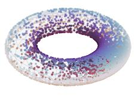  
(a)

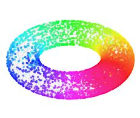  
(b)

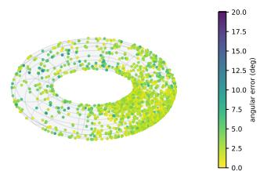  
(c)  
Figure 6: Ground-truth and Recovered Angular Coordinates. (a,b) The 8,097 frames positioned on $\mathbb { T } ^ { 2 }$ using the ground-truth rotation coordinates and colored by $\theta _ { 0 }$ and $\theta _ { 1 }$ , respectively. (c) Held-out frames positioned using angles decoded from frozen LocaLeJEPA features (λ=0.1, K=2), with color indicating per-frame angular error (mean 2.7°).

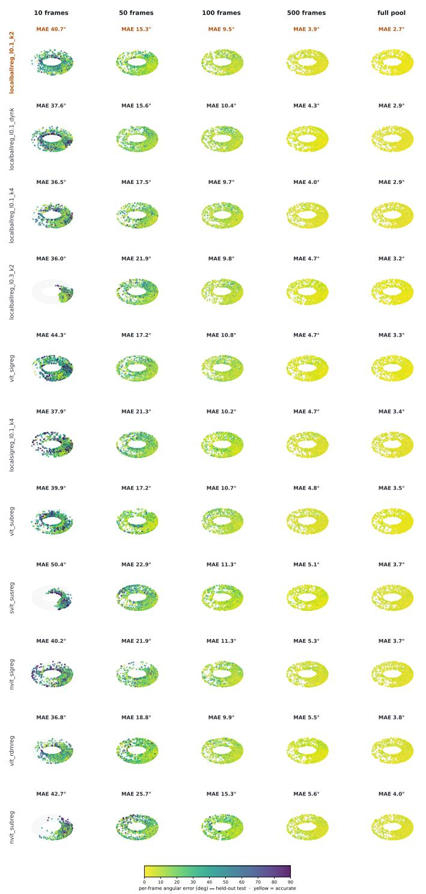  
Figure 7: Spatial Rotation Recovery across Encoders and Probe-label Budgets. Held-out frames are positioned according to their probe-decoded rotation coordinates and colored by angular error using a common scale across all panels. Rows compare encoders and columns vary the number of labeled frames used to fit the probe. Visualizations correspond to one shared probe split. The aggregate results over ten splits are reported in Section C.3.2.

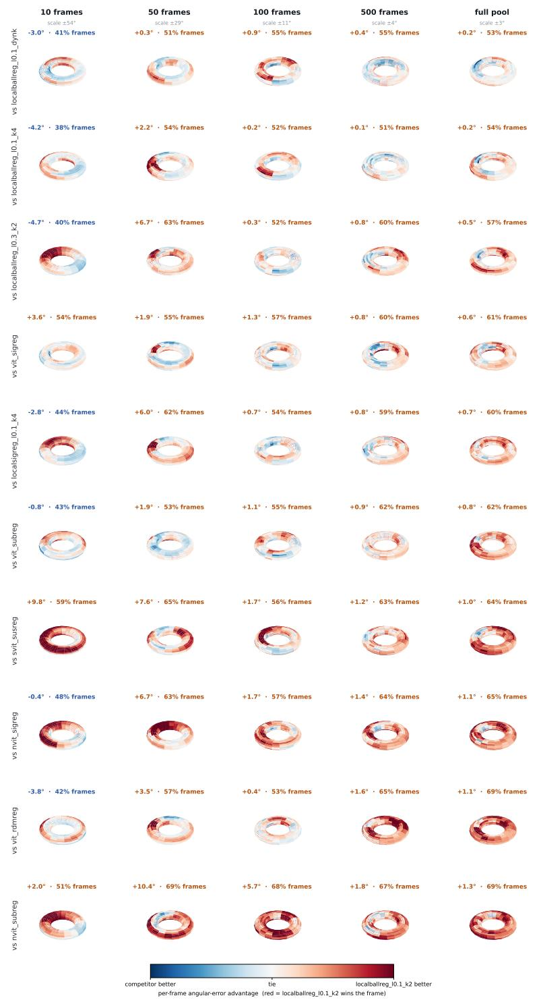  
Figure 8: Spatial Distribution of the LocaLeJEPA Recovery Advantage. Regional mean of err(competitor) − err(LocaLeJEPA) relative to fixed-K LocaLeJEPA (λ=0.1, K=2). Positive values (red) favor LocaLeJEPA, while negative values (blue) favor the competitor. Panel titles report the mean error difference and the fraction of held-out frames on which LocaLeJEPA obtains lower error. Full denotes the complete 5,182-frame probe-training pool. All panels use the same fixed probe split.

## C.4 IMAGENET-1K: TRAINING AND EVALUATION PROTOCOL

This section specifies the experimental choices particular to the ImageNet-1K study underlying Sections 5.1 and 5.2. We first describe the three encoder geometries and their optimization settings and then detail the frozen-feature classification and downstream-transfer protocols. Shared training, checkpointing, and representation conventions follow Section C.1, while the compared distributionmatching objectives are defined in Section C.2.

## C.4.1 IMAGENET-1K: PRETRAINING DETAILS

Following the experimental setup of (Balestriero & LeCun, 2025), we pretrain all models for 100 epochs on the 1.28M-image ImageNet-1K (Deng et al., 2009) training split.

Encoder Families. We consider three encoder families spanning distinct representation geometries. The Euclidean encoder is a standard ViT-S/8 (21.7M parameters). The Hyperbolic encoder uses the same ViT-S/8 backbone and maps its output to a Poincaré ball of curvature —0.1, with feature clipping at radius 2.3 (Ermolov et al., 2022). Finally, the $D _ { 4 } – e q u i \nu a r i a n t$ encoder is a 24.4Mparameter ResNet-50 implemented with escnn (Klee et al., 2023), retaining the regular representation at its output without pooling to an invariant feature. All three encoders feed the common Euclidean projector defined in Section C.1. We also train a ViT-L/14 (303.2M parameters) at 238 × 238 pixels, with LeJEPA's published ViT-L settings for both methods.

Details. All runs use AdamW with cosine learning-rate decay and weight decay $5 \times 1 0 ^ { - 2 }$ . Global SIGReg at LeJEPA's published settings and RDMReg use one warmup epoch, a learning rate of $2 \times 1 0 ^ { - 3 }$ for all three encoders, and decay to half the peak rate. LocaLeJEPA, its local control and LeJEPA (our settings) use a learning rate of $1 0 ^ { - 3 }$ , ten warmup epochs, decay to $1 0 ^ { - 3 }$ of the peak rate, and gradient clipping at 1.0. SIGReg uses $\lambda { = } 0 . 0 2$ at LeJEPA's published settings and λ=0.1 in LeJEPA (our settings), while the LocaLeJEPA values of λ and K are reported with the corresponding configurations. RDMReg uses the objective weighting defined in Section C.2. For the dynamic-neighborhood variant, we instantiate the schedule of Section C.1 with $K _ { \operatorname* { m a x } } = 1 0$ , and $E _ { \mathrm { s t e p } } = 1 0$ , so that the partition evolves from $K { = } 1$ to K=10 over the 100-epoch training schedule, reaching its maximum granularity at epoch 90. Following the shared checkpointing protocol described in Section C.1, every downstream evaluation uses the final epoch-100 checkpoint. For ViT-L/14, both methods use LeJEPA's published ViT-L settings, with a learning rate of $5 \times 1 0 ^ { - 4 }$ , ten warmup epochs, decay to $1 0 ^ { - 3 }$ of the peak rate, batches of 512 images, λ=0.05, 1024 slicing directions and an integration range of [—5, 5].

## C.4.2 IMAGENET-1K FROZEN-FEATURE READOUTS

Following the in-domain evaluation protocol of SPHERE-JEPA (Nicollier et al., 2026a), the ImageNet-1K training split forms the feature bank and the validation split is used for evaluation. Images are resized and center-cropped to 128 × 128 (238 × 238 for ViT-L/14) and normalized using ImageNet statistics.

k-NN and Linear Probes. For what concerns k-NN probe, the frozen representations are $\ell _ { 2 } \cdot$ -normalized and compared using cosine similarity. Class votes are weighted according to exp(sim /0.07). We evaluate $k \in \mathsf { \bar { \Gamma } } \{ 1 0 , 2 0 , 1 0 0 , 2 0 0 \}$ and use k=20 in the main paper. Across the tested configurations, this value is within 0.81 percentage points of the best setting, and the ordering of methods is the same at every k on ViT-S/8 and ViT-L/14. On the other two encoders, three pairs of runs that are within one point of each other swap places. Instead, in the linear probe, frozen representations are standardized using statistics computed from the ImageNet-1K training split. We fit a single affine classifier for 50 epochs using SGD with momentum 0.9, zero weight decay, batch size 4096, and cosine learning-rate decay. The learning rate is selected from {0.01, 0.03, 0.1, 0.3, 1, 3, 10}, using a 2% holdout from the training split. After selection, the classifier is refitted on the complete training split and evaluated once on the ImageNet-1K validation set. Both readouts operate on the same frozen epoch-100 representations. ViT-S/8 results for LeJEPA, LeJEPA (our settings) and LocaLeJEPA with K=1 (at both weights) and K=4 are means over three pretraining seeds. All other ImageNet-1K results are single pretraining runs, and all results use one linear-probe seed.

Downstream Transfer. We evaluate the same frozen ImageNet-pretrained encoders on seven downstream datasets spanning textures, fine-grained recognition, and generic object classification: DTD (Cimpoi et al., 2014), FGVC-Aircraft (Maji et al., 2013), CIFAR-10 and CIFAR-100 (Krizhevsky, 2009), Flowers-102 (Nilsback & Zisserman, 2008), Food-101 (Bossard et al., 2014), and Oxford-IIIT Pets (Parkhi et al., 2012). We use DTD partition 1 train+val (3,760 images, 47 classes), Aircraft trainval (6,667/100), CIFAR-10 (50,000/10), CIFAR-100 (50,000/100), Flowers-102 train+val (2,040/102), Food-101 (75,750/101), and Pets trainval (3,680/37). The evaluation uses the corresponding official test split. Images are resized and center-cropped to 128 × 128 (238 × 238 for ViT-L/14), with no augmentation applied during probe training. Frozen representations are standardized and a single linear classifier is optimized for 100 epochs using SGD with momentum 0.9, zero weight decay, batch size 256, and cosine learning-rate decay. The learning rate is selected from $\{ 1 0 ^ { - 3 } , 3 \times 1 0 ^ { - 3 } , \ldots , 3 0 \}$ using a 10% holdout from the training partition, after which the classifier is refitted on the complete training split. We report top-1 test accuracy, and Avg denotes the unweighted mean across the seven datasets.

Table 19: ImageNet-1K Frozen-feature Classification across All Configurations. Top-1 k-NN and linear-probe accuracy (%) on the ImageNet-1K validation set using the final-epoch checkpoints and one linear-probe seed. ViT-S/8 rows other than RDMReg are mean ± SD over three pretraining seeds and all other rows are single runs. Bold denotes the best mean within each encoder family.
<table><tr><td rowspan="2">Method</td><td colspan="4">k-NN top-1 (%)</td><td colspan="2">Linear (%)</td></tr><tr><td>k=10</td><td>k=20</td><td>k=100</td><td>k=200</td><td>top-1</td><td>top-5</td></tr><tr><td>Plain ViT-S/8 (Euclidean, 21.7M)</td><td></td><td></td><td></td><td></td><td></td><td></td></tr><tr><td>LeJEPA</td><td> $3 2 . 1 \pm 0 . 3 6$ </td><td> $3 2 . 8 \pm 0 . 3 3$ </td><td> $3 1 . 3 \pm 0 . 4 1$ </td><td> $2 9 . 7 \pm 0 . 3 5$ </td><td> $4 4 . 6 \pm 0 . 2 3$ </td><td> $7 0 . 8 \pm 0 . 1 7$ </td></tr><tr><td>LeJEPA (our settings)</td><td> $3 8 . 6 \pm 0 . 1 5$ </td><td> $3 8 . 9 \pm 0 . 0 9$ </td><td> $3 6 . 8 \pm 0 . 1 6$ </td><td> $3 5 . 3 \pm 0 . 1 5$ </td><td> $5 1 . 6 \pm 0 . 2 8$ </td><td> $7 7 . 3 \pm 0 . 3 6$ </td></tr><tr><td>Rectified LpJEPA (RDMReg)</td><td>11.6</td><td>12.6</td><td>13.4</td><td>13.1</td><td>25.7</td><td>48.5</td></tr><tr><td> $\mathrm { L o c a L e J E P A } ( \lambda { = } 0 . 1 , K { = } 1 )$ </td><td> $4 5 . 4 \pm 0 . 2 3$ </td><td> $4 5 . 4 \pm 0 . 2 2$ </td><td> $4 2 . 9 \pm 0 . 1 9$ </td><td> $4 1 . 2 \pm 0 . 1 8$ </td><td> $5 9 . 7 \pm 0 . 2 2$ </td><td> $8 3 . 5 \pm 0 . 0 9$ </td></tr><tr><td> $\mathrm { L o c a L e J E P A } \ ( \lambda { = } 0 . 0 2 5 , K { = } 1 )$ </td><td> $4 7 . 8 \pm 0 . 2 2$ </td><td> $4 7 . 7 \pm 0 . 2 6$ </td><td> $4 5 . 0 \pm 0 . 1 2$ </td><td> $4 3 . 1 \pm 0 . 1 7$ </td><td> $5 9 . 8 \pm 0 . 2 9$ </td><td> $8 3 . 6 \pm 0 . 2 4$ </td></tr><tr><td> $\mathrm { L o c a L e J E P A } \ ( \lambda { = } 0 . 1 , K { = } 4 )$ </td><td> ${ \bf 5 0 . 1 \pm 0 . 2 2 }$ </td><td> ${ \bf 5 0 . 1 \pm 0 . 1 2 }$ </td><td> ${ \bf 4 7 . 5 \pm 0 . 2 4 }$ </td><td> ${ \bf 4 5 . 7 \pm 0 . 2 3 }$ </td><td> ${ \bf 6 2 . 1 \pm 0 . 2 7 }$ </td><td> ${ \bf 8 5 . 1 \pm 0 . 1 6 }$ </td></tr><tr><td>Hyperbolic ViT-S/8 (Poincaré ball, 21.7M)</td><td></td><td></td><td></td><td></td><td></td><td></td></tr><tr><td>LeJEPA</td><td>32.1</td><td>32.6</td><td>31.3</td><td>29.9</td><td>44.0</td><td>69.8</td></tr><tr><td>LeJEPA (our settings)</td><td>39.1</td><td>39.4</td><td>37.3</td><td>35.7</td><td>51.6</td><td>77.5</td></tr><tr><td>Rectified LpJEPA (RDMReg)</td><td>12.1</td><td>13.1</td><td>13.8</td><td>13.6</td><td>26.0</td><td>48.7</td></tr><tr><td> $\mathrm { L o c a L e J E P A } ( \lambda { = } 0 . 1 , K { = } 1 )$ </td><td>45.3</td><td>45.7</td><td>43.0</td><td>41.3</td><td>59.5</td><td>83.4</td></tr><tr><td> $\mathrm { L o c a L e J E P A } \ ( \lambda { = } 0 . 0 2 5 , K { = } 1 )$ </td><td>47.8</td><td>48.0</td><td>45.0</td><td>43.0</td><td>59.9</td><td>83.3</td></tr><tr><td> $\mathrm { L o c a L e J E P A } \ ( \lambda { = } 0 . 1 , K { = } 2 )$ </td><td>48.6</td><td>48.5</td><td>46.0</td><td>44.2</td><td>61.4</td><td>84.6</td></tr><tr><td> $\operatorname { L o c a L e J E P A } ( \lambda { = } 0 . 1 , K { = } 4 )$ </td><td>50.5</td><td>50.6</td><td>47.9</td><td>46.1</td><td>61.9</td><td>84.9</td></tr><tr><td> $\mathrm { L o c a L e J E P A } ( \lambda { = } 0 . 1 , K { = } 1 {  } 1 0 )$ </td><td>51.0</td><td>50.9</td><td>48.4</td><td>46.6</td><td>62.2</td><td>85.1</td></tr><tr><td> $\mathrm { L o c a L e J E P A } \ ( \lambda { = } 0 . 3 , K { = } 2 )$ </td><td>38.7</td><td>39.0</td><td>37.5</td><td>36.0</td><td>51.7</td><td>77.6</td></tr><tr><td> $\operatorname { L o c a L e J E P A - S I G R e g } \left( \lambda { = } 0 . 1 , K { = } 4 \right)$ </td><td>35.1</td><td>35.4</td><td>33.7</td><td>32.2</td><td>48.2</td><td>73.8</td></tr><tr><td>D4-equivariant ResNet-50 (24.4M)</td><td></td><td></td><td></td><td></td><td></td><td></td></tr><tr><td>LeJEPA</td><td>33.9</td><td>34.5</td><td>33.2</td><td>31.7</td><td>43.4</td><td>70.7</td></tr><tr><td>LeJEPA (our settings)</td><td>39.5</td><td>39.7</td><td>38.3</td><td>36.9</td><td>48.8</td><td>75.7</td></tr><tr><td>Rectified LpJEPA (RDMReg)</td><td>22.7</td><td>23.4</td><td>22.6</td><td>21.8</td><td>31.3</td><td>56.9</td></tr><tr><td>LocaLeJEPA  $( \lambda { = } 0 . 1 , K { = } 1 )$ </td><td>43.7</td><td>43.9</td><td>42.6</td><td>41.2</td><td>52.4</td><td>79.0</td></tr><tr><td>LocaLeJEPA  $\scriptstyle ( \lambda = 0 . 0 2 5 , K = 1 )$ </td><td>44.0</td><td>44.5</td><td>42.6</td><td>40.9</td><td>52.4</td><td>78.7</td></tr><tr><td> $\mathrm { L o c a L e J E P A } \ ( \lambda { = } 0 . 1 , K { = } 2 )$ </td><td>45.8</td><td>46.1</td><td>44.6</td><td>43.2</td><td>54.3</td><td>79.9</td></tr><tr><td> $\mathrm { L o c a L e J E P A } \ ( \lambda { = } 0 . 1 , K { = } 4 )$ </td><td>47.0</td><td>47.5</td><td>45.8</td><td>44.6</td><td>55.2</td><td>80.6</td></tr><tr><td> $\mathrm { L o c a L e J E P A } ( \lambda { = } 0 . 1 , K { = } 1 {  } 1 0 )$ </td><td>47.0</td><td>47.4</td><td>45.9</td><td>44.3</td><td>55.1</td><td>80.8</td></tr><tr><td> $\mathrm { L o c a L e J E P A } \ ( \lambda { = } 0 . 3 , K { = } 2 )$ </td><td>40.0</td><td>40.4</td><td>39.1</td><td>37.7</td><td>48.7</td><td>75.8</td></tr><tr><td>LocaLeJEPA-SIGReg  $( \lambda { = } 0 . 1 , K { = } 4 )$ </td><td>34.2</td><td>34.8</td><td>33.6</td><td>32.4</td><td>43.2</td><td>69.5</td></tr><tr><td>Plain ViT-L/14 (Euclidean, 303.2M, LeJEPA&#x27;s ViT-L settings)</td><td></td><td></td><td></td><td></td><td></td><td></td></tr><tr><td></td><td>45.8</td><td>46.0</td><td>44.0</td><td>42.3</td><td>54.7</td><td>79.9</td></tr><tr><td>LeJEPA LocaLeJEPA (λ=0.05, K=1)</td><td>46.3</td><td>46.5</td><td>44.6</td><td>43.0</td><td>54.8</td><td>80.1</td></tr><tr><td> $\operatorname { L o c a L e J E P A } ( \lambda { = } 0 . 0 5 , K { = } 4 )$ </td><td>47.2</td><td>47.4</td><td>45.5</td><td>43.8</td><td>61.0</td><td>84.2</td></tr><tr><td></td><td></td><td></td><td></td><td></td><td></td><td></td></tr></table>

## C.4.3 IMAGENET-1K: FULL RESULTS

Tables 19 and 21 expand the comparison to the complete set of ImageNet-1K configurations detailed in Section 5.1, including a subset of parameters over regularization strength and neighborhood granularity.

Regularization Strength. At $K { = } 2 , \lambda { = } 0 . 1$ gives stronger ImageNet classification than $\lambda { = } 0 . 3$ on both non-Euclidean encoder families, by 9.6 / 9.6 points (k-NN / linear) on the hyperbolic and 5.8 / 5.5 on the equivariant encoder. Its transfer average is also higher, by 7.2 and 3.5 points. At K=2, $\lambda { = } 0 . 3$ has an effective strength of 9.6, above the range that trains well on Imagenette (Section B). The weight of the local term needs tuning together with K.

Neighborhood granularity. At λ=0.1, the dynamic schedule stays within 0.4 points of fixed $K { = } 4$ on both readouts. Fixed K=2 trails K=4 by 2.0 and 1.4 points in k-NN on the hyperbolic and equivariant encoders, with linear accuracy within 1.0 point. Transfer averages follow the same pattern: the dynamic schedule is 0.5 points above $K { = } 4$ on the hyperbolic and 0.5 points below it on the equivariant encoder, and $K { = } 2$ is up to 1.1 points below $\dot { K } { = } 4$ . The step from one neighborhood to four is analyzed in Section 5.

Locality across encoder depth. To test whether the benefit of locality depends on encoder capacity, we also train ViT-S/8 with 6 and 3 transformer blocks instead of 12 (Table 20, pretraining seed 0). At matched effective strength (K=4 at λ=0.1 against K=1 at $\lambda { = } 0 . 0 2 5 )$ , locality adds 2.2 / 2.1, 1.7 / 1.9 and 1.2 / 0.6 points (k-NN / linear) at depths 12, 6 and 3. It is positive at every depth and smallest for the shallowest encoder. The difference between depths 12 and 6 is within the seed-to-seed variation of this gain, while the difference between depths 12 and 3 is not.

ViT-L/14 at matched strength. On ViT-L/14, K=1 at a quarter of the weight $_ { ( \lambda = 0 . 0 1 2 5 }$ , matching K=4 at λ=0.05) does not train stably. Its online probe is at 0.27% after six epochs, against 8.62— 15.56% for the other three ViT-L/14 runs, and it ends at 25.06 / 35.14 (k-NN / linear). We therefore report locality at matched strength for the three 128-pixel encoders only. On ViT-L/14, K=4 adds 0.8 / 6.2 points over K=1 at the same weight.

Locality versus reference distribution. LocaLeJEPA-SIGReg preserves the same local partitioning as LocaLeJEPA while replacing the centered uniform-ball target with Gaussian matching on uncentered clusters. Trained with the same settings, it is 15.2 / 13.7 points (k-NN / linear) below LocaLeJEPA on the hyperbolic and 12.7 / 12.0 on the equivariant encoder, and its transfer average is 9.3 and 10.6 points lower. It also falls below LeJEPA (our settings). Local partitioning alone does not explain the gain, although, as discussed in Section C.2, this control does not separately identify the effects of centering and reference distribution.

RDMReg. RDMReg trails global SIGReg on the ImageNet classification readouts across the evaluated encoder families, by 12.0–18.9 points in linear top-1 accuracy and 11.0–20.2 in k-NN, with the same optimization settings for both. This provides an additional distribution-matching baseline with a very different reference geometry and shows that replacing the Gaussian target alone is not sufficient to reproduce the LocaLeJEPA improvements.

## D QUALITATIVE EMBEDDING ANALYSIS

In this section, we present a series of qualitative analyses and comparisons between the embeddings attained by the different JEPA recipes. In Section D.1, we complement the results presented in Figure 3, showing the recovery of topology in latent space. In Section D.2, we provide extended details about Figure 1, which shows that embeddings capture semantic structure across geometric non-Euclidean embeddings. Lastly, in Section D.3 we perform a class consistency analysis across neighborhoods coming from different regularizations.

## D.1 TOPOLOGY PRESERVATION ON COIL DATASET

Data and training. COIL-100 (Nene et al., 1996) contains 7200 images of 100 objects, each taken on a turntable at 72 poses $5 ^ { \circ }$ apart. For a fixed object the frames sample a closed curve θ → xθ, $\theta \in S ^ { 1 }$ , in image space, and we ask whether an encoder f maps this curve to a closed curve in embedding space or collapses it. We train ViT-S/8 encoders with LocaLeReg and SIGReg for 100 epochs with appearance-only augmentations (color jitter, grayscale, Gaussian blur) and analyze the 512-d encoder output.

Persistent homology. To measure whether the 72 embeddings $\{ f ( x _ { \theta } ) \}$ of an object lie on a loop we use persistent homology (Edelsbrunner et al., 2002; Zomorodian & Carlsson, 2005). For a scale $r \geq 0 .$ , the Vietoris-Rips complex $\mathrm { V R } _ { \tau }$ . contains a simplex for every set of points whose pairwise distances are at most r. These complexes are nested as r grows, and each topological feature appears at some scale b (its birth) and disappears at a scale d (its death): in dimension 0 the features are connected components, in dimension 1 they are loops. The persistence diagram plots every feature as the point $( b , { \bar { d } } )$ , and its lifetime d — b is the range of scales over which it exists. For a sampled closed curve, the loop is born once consecutive samples connect, and dies once the hole fills in. A long lifetime therefore indicates a real hole, while features close to the diagonal are likely due to noise. This is made precise by the stability of persistence diagrams (Chazal et al., 2009). We compute diagrams with Ripser (Bauer, 2021) on the full 512-d embeddings after dividing all distances by the median pairwise distance among the 72 points of the object, so that lifetimes are comparable across representations of different scale and dimension.

Table 20: Locality across encoder depth (ImageNet-1K, ViT-S/8, 100 epochs). k-NN (k=20) / linear top-1 (%) on the ImageNet-1K validation set, final-epoch checkpoints, pretraining seed 0. K=1 at $\lambda { = } 0 . 0 2 5$ matches the effective regularization strength of K=4 at λ=0.1.
<table><tr><td>Depth (blocks)</td><td> $K { = } 1 , \lambda { = } 0 . 1$ </td><td> $K = 1 , \lambda { = } 0 . 0 2 5$ </td><td> $K { = } 4 , \lambda { = } 0 . 1$ </td></tr><tr><td>12</td><td>45.7 / 59.9</td><td> $4 7 . 9 / 6 0 . 0$ </td><td> $5 0 . 1 / 6 2 . 1$ </td></tr><tr><td>6</td><td>41.6 /52.9</td><td> $4 2 . 7 / 5 3 . 1 $ </td><td> $4 4 . 4 / 5 5 . 0$ </td></tr><tr><td>3</td><td>32.0 / 40.0</td><td> $3 2 . 0 / 4 0 . 2 $ </td><td> $3 3 . 2 / 4 0 . 8 $ </td></tr></table>

Table 21: Transfer Linear Probing across All Configurations. Top-1 accuracy (%) on the official test splits of seven downstream datasets using frozen final-epoch ImageNet-1K representations and one linear-probe seed. ViT-S/8 rows other than RDMReg are mean ± SD over three pretraining seeds, and all other rows are single runs. Bold marks the best mean within each encoder family and column.
<table><tr><td>Method</td><td>DTD</td><td>Aircraft</td><td>CIFAR-10</td><td>CIFAR-100</td><td>Flowers</td><td>Food</td><td>Pets</td><td>Avg</td></tr><tr><td colspan="9">Plain ViT-S/8 (Euclidean, 21.7M)</td></tr><tr><td>LeJEPA</td><td> $6 0 . 0 \pm 0 . 6 1$ </td><td> $2 8 . 4 \pm 0 . 4 7$ </td><td> $8 6 . 1 \pm 0 . 4 7$ </td><td> $6 2 . 6 \pm 1 . 3 3$ </td><td> $7 5 . 4 \pm 0 . 3 8$ </td><td> $5 1 . 0 \pm 0 . 8 2$ </td><td> $5 9 . 8 \pm 1 . 0 9$ </td><td> $6 0 . 5 \pm 0 . 5 2$ </td></tr><tr><td>LeJEPA (our settings)</td><td> $6 4 . 1 \pm 0 . 6 4$ </td><td>30.3 ± 0.87</td><td>88.7 ± 0.18</td><td>66.0 ± 0.19</td><td> $7 8 . 9 \pm 0 . 2 2$ </td><td>56.4 ± 0.29</td><td>65.9 ± 0.52</td><td>64.3 ± 0.13</td></tr><tr><td>Rectified LpJEPA (RDMReg)</td><td>44.2</td><td>18.4</td><td> $7 4 . 7$ </td><td>49.1</td><td> $5 2 . 4$ </td><td>38.8</td><td> $3 7 . 4$ </td><td>45.0</td></tr><tr><td>LocaLeJEPA (λ=0.1, K=1)</td><td> $6 9 . 3 \pm 0 . 3 2$ </td><td> $3 8 . 4 \pm 0 . 4 3 $ </td><td> $9 1 . 7 \pm 0 . 3 2 $ </td><td> $7 1 . 5 \pm 0 . 8 7$ </td><td> $8 3 . 7 \pm 0 . 2 0 $ </td><td> $6 3 . 5 \pm 0 . 0 8$ </td><td> $7 3 . 6 \pm 0 . 8 1$ </td><td> $7 0 . 3 \pm 0 . 0 4$ </td></tr><tr><td>LocaLeJEPA  $\scriptstyle ( \lambda = 0 . 0 2 5 , K = 1 )$ </td><td> ${ \bf 7 0 . 0 \pm 0 . 4 8 }$ </td><td> $4 0 . 2 \pm 1 . 2 1$ </td><td> $9 1 . 9 \pm 0 . 2 2 $ </td><td>72.5 ± 0.46</td><td> $8 5 . 2 \pm 0 . 1 8$ </td><td> $6 4 . 1 \pm 0 . 1 1$ </td><td> $7 3 . 4 \pm 0 . 7 5$ </td><td> $7 1 . 1 \pm 0 . 2 8$ </td></tr><tr><td>LocaLeJEPA (λ=0.1, K=4)</td><td> $6 9 . 4 \pm 1 . 4 7$ </td><td>42.1 ± 0.61 92.2 ± 0.34 73.6 ± 0.37</td><td></td><td></td><td> ${ \bf 8 5 . 3 \pm 0 . 3 4 }$ </td><td>66.0 ± 0.13</td><td> ${ \bf 7 7 . 3 \pm 1 . 7 9 }$ </td><td> ${ \bf 7 2 . 3 \pm 0 . 2 9 }$ </td></tr><tr><td colspan="9">Hyperbolic ViT-S/8 (Poincaré ball, 21.7M)</td></tr><tr><td>LeJEPA</td><td>61.5</td><td>28.2</td><td>85.9</td><td>62.6</td><td>75.2</td><td>50.7</td><td>58.0</td><td>60.3</td></tr><tr><td>LeJEPA (our settings)</td><td>60.8</td><td>31.4</td><td>88.6</td><td>66.1</td><td>78.7</td><td>56.7</td><td>66.7</td><td>64.1</td></tr><tr><td>Rectified LpJEPA (RDMReg)</td><td>45.0</td><td>15.9</td><td>73.6</td><td>49.1</td><td>53.1</td><td>38.9</td><td>36.6</td><td>44.6</td></tr><tr><td>LocaLeJEPA (λ=0.1, K=1)</td><td>68.8</td><td>37.5</td><td>92.0</td><td>71.4</td><td>83.7</td><td>63.8</td><td>73.3</td><td>70.1</td></tr><tr><td>LocaLeJEPA  $\scriptstyle ( \lambda = 0 . 0 2 5 , K = 1 )$ </td><td>69.5</td><td>39.6</td><td>92.4</td><td>72.7</td><td>84.5</td><td>64.0</td><td>73.4</td><td>70.9</td></tr><tr><td>LocaLeJEPA  $( \lambda { = } 0 . 1 , K { = } 2 )$ </td><td>69.3</td><td>41.5</td><td>92.7</td><td>73.4</td><td>85.6</td><td>65.0</td><td>77.1</td><td>72.1</td></tr><tr><td>LocaLeJEPA  $( \lambda { = } 0 . 1 , K { = } 4 )$ </td><td>69.1</td><td>41.5</td><td>92.3</td><td>72.7</td><td>85.3</td><td>65.3</td><td>78.6</td><td>72.1</td></tr><tr><td>LocaLeJEPA  $( \lambda { = } 0 . 1 , K { = } 1 {  } 1 0 )$ </td><td>70.1</td><td>42.5</td><td>92.6</td><td>73.3</td><td>85.6</td><td>65.9</td><td>78.5</td><td>72.6</td></tr><tr><td>LocaLeJEPA (λ=0.3, K=2)</td><td>64.3</td><td>30.5</td><td>88.9</td><td>66.3</td><td>79.5</td><td>57.9</td><td>66.4</td><td>64.8</td></tr><tr><td>LocaLeJEPA-SIGReg  $( \lambda { = } 0 . 1 , K { = } 4 )$ </td><td>57.3</td><td>30.8</td><td>87.9</td><td>65.1</td><td>77.8</td><td>55.9</td><td>65.0</td><td>62.8</td></tr><tr><td colspan="9">D4-equivariant ResNet-50 (24.4M)</td></tr><tr><td>LeJEPA</td><td>55.4</td><td>23.7</td><td>86.2</td><td>60.6</td><td>63.9</td><td>40.6</td><td>52.2</td><td>54.7</td></tr><tr><td>LeJEPA (our settings)</td><td>59.5</td><td>25.7</td><td>88.9</td><td>63.9</td><td>67.4</td><td>45.5</td><td>61.1</td><td>58.8</td></tr><tr><td>Rectified LpJEPA (RDMReg)</td><td>48.0</td><td>23.0</td><td>80.5</td><td>53.0</td><td>58.0</td><td>31.6</td><td>42.4</td><td>48.1</td></tr><tr><td>LocaLeJEPA  $( \lambda { = } 0 . 1 , K { = } 1 )$ </td><td>60.2</td><td>25.7</td><td>90.2</td><td>65.9</td><td>67.8</td><td>47.5</td><td>65.0</td><td>60.3</td></tr><tr><td>LocaLeJEPA  $\scriptstyle ( \lambda = 0 . 0 2 5 , K = 1 )$ </td><td>61.3</td><td>25.3</td><td>90.5</td><td>66.2</td><td>66.9</td><td>47.1</td><td>66.3</td><td>60.5</td></tr><tr><td>LocaLeJEPA  $( \lambda { = } 0 . 1 , K { = } 2 )$ </td><td>61.8</td><td>28.4</td><td>90.2</td><td>66.5</td><td>69.7</td><td>49.0</td><td>67.9</td><td>61.9</td></tr><tr><td>LocaLeJEPA  $( \lambda { = } 0 . 1 , K { = } 4 )$ </td><td>61.3</td><td>29.3</td><td>91.2</td><td>69.1</td><td>71.5</td><td>49.5</td><td>69.1</td><td>63.0</td></tr><tr><td>LocaLeJEPA  $( \lambda { = } 0 . 1 , K { = } 1 {  } 1 0 )$ </td><td>61.5</td><td>27.4</td><td>90.9</td><td>67.7</td><td>70.4</td><td>49.4</td><td>69.9</td><td>62.5</td></tr><tr><td>LocaLeJEPA (λ=0.3, K=2)</td><td>55.9</td><td>25.4</td><td>88.3</td><td>62.9</td><td>66.5</td><td>46.6</td><td>63.7</td><td>58.5</td></tr><tr><td>LocaLeJEPA-SIGReg (λ=0.1, K=4)</td><td>48.4</td><td>25.5</td><td>88.8</td><td>60.6</td><td>52.5</td><td>25.9</td><td>65.3</td><td>52.4</td></tr><tr><td colspan="9">Plain ViT-L/14 (Euclidean, 303.2M, LeJEPA&#x27;s ViT-L settings)</td></tr><tr><td>LeJEPA</td><td>62.3</td><td>20.1</td><td>90.5</td><td>66.2</td><td>68.2</td><td>57.2</td><td>64.8</td><td>61.3</td></tr><tr><td>LocaLeJEPA  $\scriptstyle \cdot ( \lambda = 0 . 0 5 , K = 1 )$ </td><td>61.3</td><td>17.3</td><td>90.4</td><td>65.9</td><td>66.8</td><td>56.3</td><td>62.6</td><td>60.1</td></tr><tr><td> $\operatorname { L o c a L e J E P A } ( \lambda { = } 0 . 0 5 , K { = } 4 )$ </td><td>66.0</td><td>26.1</td><td>92.3</td><td>70.6</td><td>74.0</td><td>62.8</td><td>66.4</td><td>65.5</td></tr></table>

Results. In pixel space the median longest $H _ { 1 }$ lifetime over the 100 objects is 0.387, so the loop is present in the input. But encoders shorten it: under either regularizer the median is at most 0.196 for every seed and checkpoint. Over 3 training seeds, the median lifetime at the final weights is higher under LocaLeReg for every seed $( 0 . 1 9 0 \pm \bar { 0 } . 0 0 5$ against $0 . 1 7 5 \pm 0 . 0 0 2 .$ mean and standard deviation over seeds). At the checkpoint with the best accuracy of the online linear probe, it is higher for two of the three $( 0 . 1 8 8 \pm 0 . 0 0 7$ against $0 . 1 8 1 \pm 0 . 0 1 2 )$ . Figure 9 shows examples for several objects: for each method, the persistence diagram of the object's 72 embeddings and their projection on the first 2 principal components, colored by rotation angle. The same runs also measure how well each representation separates the 100 objects (Table 22): the probe accuracy on held-out poses (every 6-th angle of every object) and the nearest-neighbor purity, the fraction of frames whose nearest neighbor in embedding space belongs to the same object, computed on 24 frames per object. Both are higher under LocaLeReg than under SIGReg for each of the 3 seeds, at the final weights and at the best checkpoint.

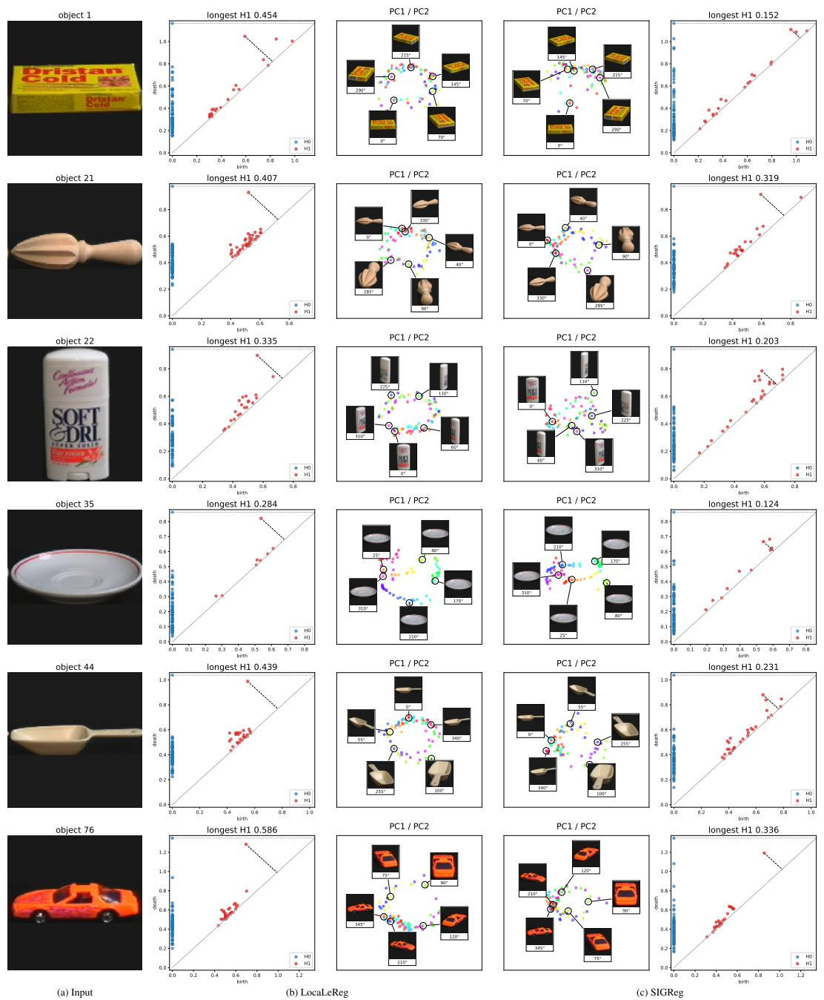  
Figure 9: Per-object geometry of COIL-100 embeddings (ViT-S/8, 100 epochs, $\lambda = 0 . 1$ , LocaLeReg with K = 8 clusters). Each row is one object: (a) its frame at $0 ^ { \circ }$ . (b) LocaLeReg and (c) SIGReg, each with the persistence diagram and the 2-d PCA projection of the embeddings of the object's 72 frames. Persistence: Vietoris-Rips diagram of the 72 embeddings, rescaled to unit median pairwise distance. The dashed segment marks the most persistent $H _ { 1 }$ class. PC1/PC2: points are colored by rotation angle.

Table 22: Object identity on COIL-100, mean ± standard deviation over 3 seeds. The best checkpoint is the one with the highest probe accuracy.
<table><tr><td rowspan="3"></td><td colspan="2">Probe accuracy</td><td colspan="2">NN purity</td></tr><tr><td>final</td><td>best</td><td>final</td><td>best</td></tr><tr><td>LocaLeReg</td><td> $0 . 3 8 4 \pm 0 . 0 4 7$ </td><td> $0 . 4 3 6 \pm 0 . 0 2 6$ </td><td> $0 . 4 9 2 \pm 0 . 0 0 4$ </td><td> $0 . 5 0 0 \pm 0 . 0 0 6$ </td></tr><tr><td>SIGReg</td><td> $0 . 2 6 4 \pm 0 . 0 1 6$ </td><td> $0 . 3 6 0 \pm 0 . 0 2 2$ </td><td> $0 . 4 3 1 \pm 0 . 0 2 3$ </td><td> $0 . 4 6 9 \pm 0 . 0 1 8$ </td></tr></table>

## D.2 PATCH-LEVEL REPRESENTATION STRUCTURE

The quantitative frozen-feature evaluations characterize global representation quality but do not reveal how spatial information is organized before pooling. We therefore complement them with a qualitative PCA visualization of patch-level features, following the general visualization strategy used in LeJEPA (Balestriero & LeCun, 2025) and DINOv2 (Oquab et al., 2023).

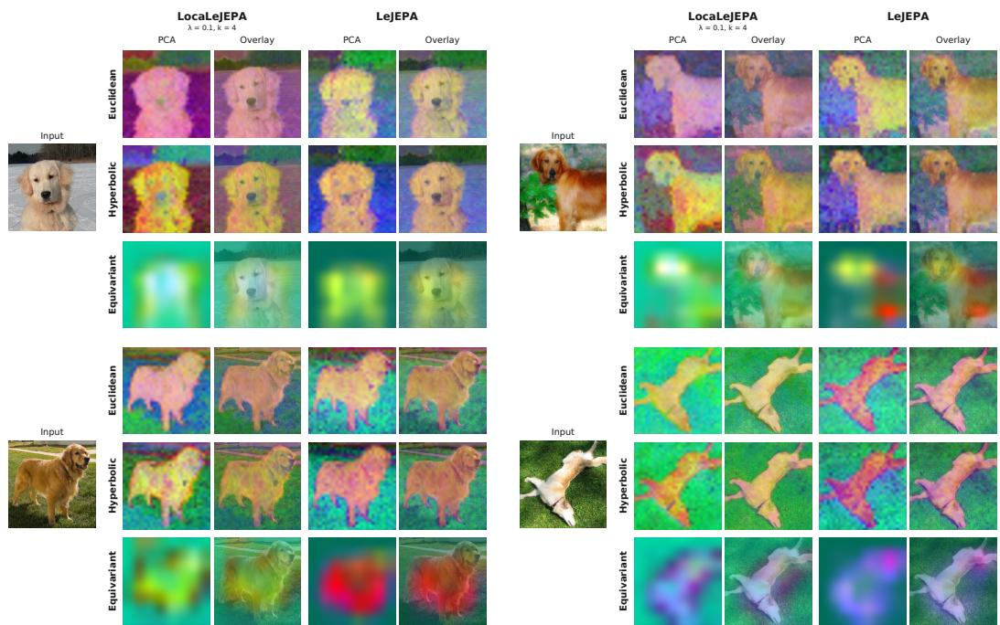  
Figure 10: Patch-level Principal Components for LocaLeJEPA and LeJEPA. Frozen spatial features from the same ImageNet-1K validation images are projected onto their first three principal components and mapped to RGB. Each model uses an independently fitted PCA basis, so colors are directly comparable across images within a model but not across models.

Results. For each backbone-objective pair, we select five ImageNet-1K validation images from the golden-retriever class (class 207) and extract spatial features from the frozen encoder immediately before global aggregation. For the Euclidean and hyperbolic ViT-S/8 encoders, we use the 384- dimensional tokens after the final transformer normalization, excluding prefix tokens, pooling, and output heads. At the $1 2 8 \times 1 2 8$ input resolution, these features form a $1 6 \times 1 6$ spatial grid. For the hyperbolic encoder, features are taken immediately before the Poincaré-ball mapping. For the $D _ { 4 } { \mathrm { - e q u i v a r i a n t } }$ ResNet-50, we use the 512-channel equivariant feature map immediately before average pooling. For each model, spatial features from the five images are concatenated into an $N \times d$ matrix, where the N spatial locations are observations and the d feature channels are variables. PCA is fitted once to this matrix, and the three leading components are retained. We fix the sign of each component by requiring its largest-magnitude loading to be positive and independently rescale the resulting component values to [0, 1]. The three channels are then mapped to RGB and reshaped to the native spatial grid. For visualization only, the result is upsampled to $5 \mathrm { { i } 2 \times 5 1 2 }$ using nearest-neighbor interpolation and overlaid on the input image at 55% opacity. No foreground masking or thresholding is applied. Figure 10 compares LocaLeJEPA $( \lambda { = } 0 . 1 , K { = } 4 )$ with the corresponding SIGReg baseline on four representative images. Both objectives exhibit visible object-background structure in their leading principal components. These qualitative plots allow the PCA to identify directions of feature variance without using semantic labels, and each model uses an independently fitted PCA basis. As a result, colors are comparable across images within a row, but not across independently fitted models, and the visualization should not be interpreted as a quantitative segmentation or localization result.

## D.3 CLASS CONSISTENCY OF FROZEN K-NN NEIGHBORHOODS

On the three 128-pixel encoders, the largest ImageNet-1K improvement of LocaLeJEPA over LeJEPA (our settings) appears under the k-NN readout (Table 19), which depends directly on the local geometry of the frozen representation. We therefore examine whether this improvement is reflected in the composition of the neighborhoods on which the classifier operates. Specifically, we ask whether the nearest ImageNet-1K training examples of a validation image are more likely to share its semantic class under LocaLeJEPA than under SIGReg. We use exactly the representation space employed by the main k-NN evaluation: the $1 2 8 \times 1 2 8$ evaluation view, frozen 512-dimensional encoder features, cosine similarity, and the complete 1.28M-image ImageNet-1K training split as the retrieval bank. This analysis uses encoders from earlier pretraining runs, not those reported in Table 2.

Qualitative Retrieval. Figure 11 visualizes the eight nearest training examples for three query images under the Euclidean ViT-S/8. As shown, for the polar-bear query, the number of same-class neighbors increases from four under SIGReg to seven under LocaLeJEPA. For the Komodo dragon, it rises from one to five, and for the triceratops, from three to four. Several SIGReg neighbors instead share strong visual attributes with the query (such as color or background) without sharing its class. The aggregate analysis below evaluates whether this pattern extends beyond these examples.

Neighborhood Class Consistency. For a validation image x with class label $c ( x )$ , let $\mathcal { N } _ { k } ( x )$ denote its k nearest training examples under cosine similarity. We define the neighborhood class consistency as:

$$
q _ { k } ( x ) = \frac { 1 } { k } \sum _ { y \in \mathcal { N } _ { k } ( x ) } \mathbb { 1 } [ c ( y ) = c ( x ) ]\tag{50}
$$

Thus, $q _ { k } ( x ) { = } 1$ when every retrieved neighbor belongs to the query class and $q _ { k } ( x ) { = } 0$ when none does. We use k=20, matching the headline k-NN readout, and average the statistic either over the 50 validation images of each class or over the complete 50k-image validation set.

Results. Table 23 reports the statistic over all 1,000 ImageNet-1K classes, grouped by WordNet category. Under SIGReg, approximately 13% of the top-20 neighborhood shares the query class for each of the three encoder families. LocaLeJEPA increases this fraction to approximately 20% for the Euclidean ViT-S/8 and $D _ { 4 } .$ -equivariant ResNet-50, and to 21% for the hyperbolic ViT-S/8. LocaLeJEPA increases class consistency in every reported WordNet group and in 989, 984, and 971 of the 1,000 individual classes for the Euclidean, hyperbolic, and equivariant encoders, respectively. Table 24 provides a representative 36-class breakdown, where LocaLeJEPA yields higher consistency in 105 of the 108 class-encoder comparisons. Absolute neighborhood consistency varies widely across semantic groups. Fine-grained families containing many visually similar categories, such as dog breeds and reptiles, exhibit lower class purity under both objectives, whereas visually distinct categories such as zebra, daisy, and monarch butterfly show much higher values. This behavior is expected for ImageNet-1K: the weighted k-NN prediction requires only that the correct class receive the largest aggregate vote, not that a majority of retrieved samples share the query label. Hence, the k-NN top-1 accuracies of these encoders are compatible with neighborhoods whose majority consists of other classes. Together, the retrieval examples and full-validation statistics show that the k-NN improvement of LocaLeJEPA is accompanied by a systematic increase in local semantic class consistency across architectures and categories. This analysis directly characterizes the neighborhoods used by the classifier and needs no additional learned readout.

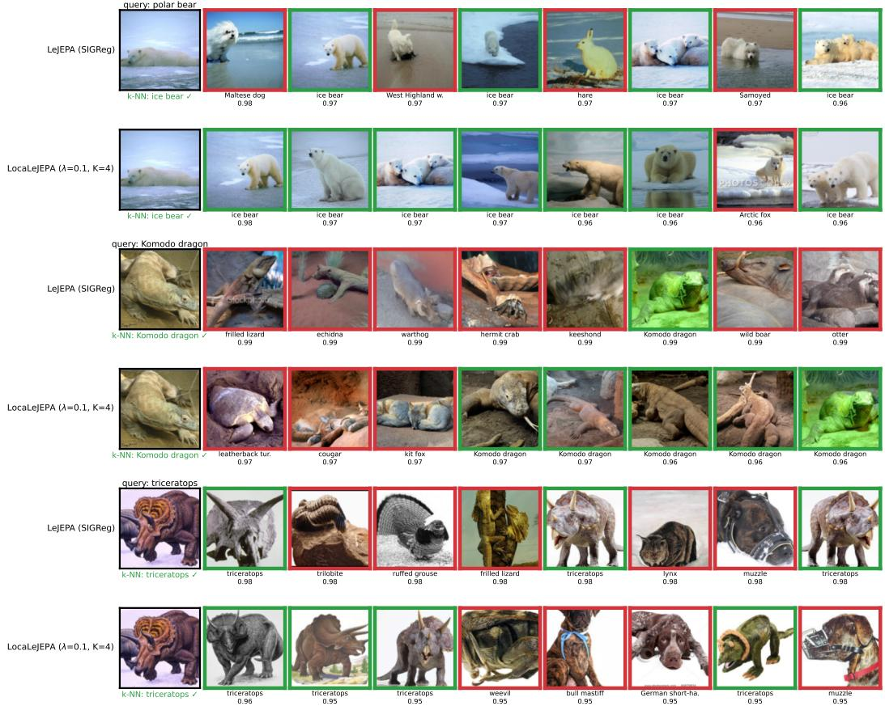  
Figure 11: Nearest-neighbor Retrieval in Frozen ViT-S/8 Features. For each preselected query, we show the eight nearest ImageNet-1K training images under cosine similarity for SIGReg and LocaLeJEPA $( \lambda { = } 0 . 1 , K { = } 4 )$ . Green borders denote the query class and red borders a different class, with labels reporting class and cosine similarity.

Table 23: Class Consistency of Frozen k-NN Neighborhoods by Semantic Group. Mean top-20 same-class neighborhood consistency on the ImageNet-1K validation set, using the full training split as the retrieval bank. LocaLeJEPA uses λ=0.1 and K=4. Group sizes are shown in parentheses, and the final row reports the number of individual classes for which LocaLeJEPA yields higher consistency. Bold denotes the higher value within each encoder family.
<table><tr><td rowspan="2"></td><td colspan="2">ViT-S/8</td><td colspan="2">H-ViT-S/8</td><td colspan="2">D₄-RN50</td></tr><tr><td>SIGReg</td><td>LocaLeJEPA</td><td>SIGReg</td><td>LocaLeJEPA</td><td>SIGReg</td><td>LocaLeJEPA</td></tr><tr><td>Fish (16)</td><td>0.25</td><td>0.34</td><td>0.26</td><td>0.35</td><td>0.28</td><td>0.33</td></tr><tr><td>Birds (38)</td><td>0.13</td><td>0.22</td><td>0.13</td><td>0.22</td><td>0.14</td><td>0.19</td></tr><tr><td>Amphibians (8)</td><td>0.11</td><td>0.21</td><td>0.11</td><td>0.21</td><td>0.11</td><td>0.22</td></tr><tr><td>Reptiles (36)</td><td>0.08</td><td>0.15</td><td>0.09</td><td>0.16</td><td>0.10</td><td>0.17</td></tr><tr><td>Invertebrates (86)</td><td>0.16</td><td>0.26</td><td>0.16</td><td>0.26</td><td>0.18</td><td>0.25</td></tr><tr><td>Marine mammals (4)</td><td>0.29</td><td>0.40</td><td>0.28</td><td>0.41</td><td>0.26</td><td>0.31</td></tr><tr><td>Dogs (118)</td><td>0.07</td><td>0.12</td><td>0.07</td><td>0.12</td><td>0.06</td><td>0.12</td></tr><tr><td>Wild canids (12)</td><td>0.09</td><td>0.16</td><td>0.09</td><td>0.16</td><td>0.09</td><td>0.15</td></tr><tr><td>Cats (13)</td><td>0.22</td><td>0.31</td><td>0.22</td><td>0.31</td><td>0.20</td><td>0.30</td></tr><tr><td>Bears (4)</td><td>0.16</td><td>0.26</td><td>0.17</td><td>0.27</td><td>0.15</td><td>0.29</td></tr><tr><td>Other mammals (63)</td><td>0.12</td><td>0.20</td><td>0.12</td><td>0.21</td><td>0.13</td><td>0.21</td></tr><tr><td>Objects, food, scenes (602)</td><td>0.14</td><td>0.20</td><td>0.14</td><td>0.21</td><td>0.14</td><td>0.20</td></tr><tr><td>All 1000 classes</td><td>0.13</td><td>0.20</td><td>0.13</td><td>0.21</td><td>0.13</td><td>0.20</td></tr><tr><td>LocaLeJEPA higher</td><td colspan="2">989 / 1000</td><td colspan="2">984 / 1000</td><td colspan="2">971 / 1000</td></tr></table>

Table 24: Class Consistency of Frozen k-NN Neighborhoods by Class. Mean top-20 same-class consistency over the 50 ImageNet-1K validation images of each class. LocaLeJEPA uses λ=0.1 and K=4. Bold denotes the higher value within each encoder family. The final row reports the average over all 1,000 classes.
<table><tr><td rowspan="2"></td><td colspan="2">ViT-S/8</td><td colspan="2">H-ViT-S/8</td><td colspan="2">D4-RN50</td></tr><tr><td>SIGReg</td><td>LocaLeJEPA</td><td>SIGReg</td><td>LocaLeJEPA</td><td>SIGReg</td><td>LocaLeJEPA</td></tr><tr><td colspan="7">Bears, reptiles, marine mammals</td></tr><tr><td>Polar bear</td><td>0.19</td><td>0.31</td><td>0.22</td><td>0.32</td><td>0.14</td><td>0.26</td></tr><tr><td>Brown bear</td><td>0.11</td><td>0.20</td><td>0.12</td><td>0.23</td><td>0.09</td><td>0.22</td></tr><tr><td>Komodo</td><td>0.14</td><td>0.25</td><td>0.21</td><td>0.31</td><td>0.29</td><td>0.33</td></tr><tr><td>Triceratops</td><td>0.20</td><td>0.35</td><td>0.20</td><td>0.40</td><td>0.33</td><td>0.52</td></tr><tr><td>Alligator</td><td>0.05</td><td>0.08</td><td>0.05</td><td>0.07</td><td>0.05</td><td>0.10</td></tr><tr><td>Cobra</td><td>0.05</td><td>0.11</td><td>0.06</td><td>0.10</td><td>0.10</td><td>0.24</td></tr><tr><td>Grey whale</td><td>0.31</td><td>0.41</td><td>0.31</td><td>0.42</td><td>0.30</td><td>0.27</td></tr><tr><td>Orca</td><td>0.40</td><td>0.56</td><td>0.39</td><td>0.58</td><td>0.37</td><td>0.50</td></tr><tr><td>Dugong</td><td>0.38</td><td>0.49</td><td>0.32</td><td>0.49</td><td>0.27</td><td>0.38</td></tr><tr><td>Sea lion</td><td>0.06</td><td>0.12</td><td>0.09</td><td>0.13</td><td>0.08</td><td>0.11</td></tr><tr><td colspan="7">Other animals</td></tr><tr><td>Goldfish</td><td>0.18</td><td>0.35</td><td>0.19</td><td>0.34</td><td>0.26</td><td>0.29</td></tr><tr><td>Great white shark</td><td>0.35</td><td>0.40</td><td>0.38</td><td>0.43</td><td>0.25</td><td>0.32</td></tr><tr><td>Bald eagle</td><td>0.16</td><td>0.27</td><td>0.14</td><td>0.25</td><td>0.14</td><td>0.22</td></tr><tr><td>Flamingo</td><td>0.28</td><td>0.43</td><td>0.31</td><td>0.46</td><td>0.29</td><td>0.38</td></tr><tr><td>King penguin</td><td>0.32</td><td>0.57</td><td>0.29</td><td>0.53</td><td>0.45</td><td>0.68</td></tr><tr><td>Golden retriever</td><td>0.04</td><td>0.09</td><td>0.04</td><td>0.08</td><td>0.04</td><td>0.08</td></tr><tr><td>Tabby cat</td><td>0.19</td><td>0.30</td><td>0.20</td><td>0.31</td><td>0.23</td><td>0.33</td></tr><tr><td>Tiger</td><td>0.32</td><td>0.47</td><td>0.32</td><td>0.42</td><td>0.24</td><td>0.34</td></tr><tr><td>Zebra</td><td>0.77</td><td>0.85</td><td>0.79</td><td>0.85</td><td>0.72</td><td>0.78</td></tr><tr><td>African elephant</td><td>0.25</td><td>0.35</td><td>0.23</td><td>0.34</td><td>0.30</td><td>0.32</td></tr><tr><td>Giant panda</td><td>0.46</td><td>0.61</td><td>0.54</td><td>0.66</td><td>0.49</td><td>0.64</td></tr><tr><td>Ladybug</td><td>0.05</td><td>0.16</td><td>0.06</td><td>0.13</td><td>0.07</td><td>0.10</td></tr><tr><td>Monarch butterfly</td><td>0.51</td><td>0.72</td><td>0.59</td><td>0.77</td><td>0.33</td><td>0.52</td></tr><tr><td colspan="7">Objects, food, scenes</td></tr><tr><td>Acoustic guitar</td><td>0.06</td><td>0.12</td><td>0.07</td><td>0.13</td><td>0.05</td><td>0.12</td></tr><tr><td>Airliner</td><td>0.53</td><td>0.58</td><td>0.52</td><td>0.59</td><td>0.50</td><td>0.52</td></tr><tr><td>Ambulance</td><td>0.34</td><td>0.36</td><td>0.31</td><td>0.38</td><td>0.22</td><td>0.33</td></tr><tr><td>Castle</td><td>0.25</td><td>0.28</td><td>0.22</td><td>0.27</td><td>0.16</td><td>0.23</td></tr><tr><td>Grand piano</td><td>0.09</td><td>0.22</td><td>0.08</td><td>0.21</td><td>0.07</td><td>0.23</td></tr><tr><td>Laptop</td><td>0.04</td><td>0.10</td><td>0.04</td><td>0.10</td><td>0.04</td><td>0.06</td></tr><tr><td>School bus</td><td>0.12</td><td>0.20</td><td>0.15</td><td>0.22</td><td>0.10</td><td>0.15</td></tr><tr><td>Sports car</td><td>0.17</td><td>0.22</td><td>0.14</td><td>0.24</td><td>0.19</td><td>0.23</td></tr><tr><td>Teapot</td><td>0.05</td><td>0.07</td><td>0.07</td><td>0.07</td><td>0.06</td><td>0.13</td></tr><tr><td>Banana</td><td>0.06</td><td>0.12</td><td>0.06</td><td>0.15</td><td>0.07</td><td>0.11</td></tr><tr><td>Pizza</td><td>0.22</td><td>0.37</td><td>0.23</td><td>0.34</td><td>0.18</td><td>0.26</td></tr><tr><td>Volcano</td><td>0.25</td><td>0.32</td><td>0.23</td><td>0.28</td><td>0.27</td><td>0.33</td></tr><tr><td>Daisy</td><td>0.72</td><td>0.84</td><td>0.78</td><td>0.83</td><td>0.85</td><td>0.83</td></tr><tr><td>All 1000 classes</td><td>0.13</td><td>0.20</td><td>0.13</td><td>0.21</td><td>0.13</td><td>0.20</td></tr></table>