# LORASPACE: A Pool-Wide Shared Substrate for Static and Dynamic Multi-LoRA Composition

Thamirawaran Sathiyalogeswaran1, Navindu De Silva1, Chamikara Siriwardane1, W. K. Alwis1, Jason Mars2, Udaya Sampath K. Perera Miriya Thanthrige1, Ranga Rodrigo1

1University of Moratuwa, Sri Lanka

2University of Michigan, USA

## Abstract

Low-rank adaptation (LoRA) attaches small low-rank matrices to a frozen backbone, and public repositories like Hugging Face host many such LoRAs per backbone, each for a different concept, character, style, or task. Users routinely want to combine several LoRAs in a single generation, but two existing strategies involve a trade-off with each other. First, combining the LoRA weights into a single update before inference (e.g., static merge) needs only one forward pass, but quality drops, because LoRAs trained for different concepts interfere when their weights are summed into a single update, distorting each LoRA’s contribution. Second, running each LoRA in a separate forward pass and summing the outputs (e.g., composite) preserves output quality, but each LoRA adds a full backbone pass, so inference time scales linearly with the active LoRA count. To recover composite-level quality at merge cost, we study a property of LoRA pools overlooked by prior multi-LoRA work. In real LoRA pools, the stacked low-rank factors need far fewer directions than their summed ranks. Using singular value decomposition, we find the minimal subspace that preserves 99% of the factor energy. On three diffusion pools, only 46% to 57% of the sum of individual LoRA ranks is enough to represent the pool, and the subspace grows sub-linearly with pool size. A 48-LoRA sub-pool of LoRA-Hub on FLAN-T5 NLP tasks shows comparable overlap (about 62%), while the diversity-curated LoRA-Retriever benchmark sits near the no-overlap baseline at 96%, indicating that across these five pools pool composition rather than modality predicts where compression is large. We use this overlap to construct LORASPACE, a training-free pool-wide method where the subspace matrices are computed once per pool and reused across two inference modes: a static mode at merge inference cost, and a dynamic mode for input-dependent routing at substantially lower cost than composite. On the diffusion pools, static LORASPACE matches composite quality at merge cost, and dynamic LORASPACE achieves more than 6× speedup over composite at six active LoRAs on a 17-LoRA pool, mostly by running one backbone pass instead of six. In our ablation, static variants at the same rank match LORASPACE, so the quality gain does not depend on the pool-wide basis. On the near-orthogonal LoRA-Retriever benchmark, the framework predicts limited compression benefit, with gains coming from external retrieval coupling. Code is available at https://github.com/Thamirawaran/loraspace.

## 1 Introduction

Low-Rank Adaptation (LoRA) [Hu et al., 2022] has made the specialization of existing language and diffusion image generation models feasible by training small low-rank adapters that attach to a frozen backbone on demand, rather than updating the full set of model weights. The simplicity of this construction has produced a second-order effect, where open repositories such as CivitAI [CivitAI, 2023] and Hugging Face [Hugging Face, 2016] now host LoRA pools containing many trained LoRA adapters per backbone, each capturing a distinct visual concept, character, style, or downstream language task. As these libraries grow into the thousands, attention has shifted from training a single LoRA adapter (LoRAs for short) to using several at once. A user generating a portrait may want one LoRA for the subject’s identity, a second for clothing, and a third for the background, all active during a single image.

Two ambient strategies have emerged for this multi-LoRA problem. The first, static merge [Ilharco et al., 2023, Yadav et al., 2023, Yu et al., 2024], folds the chosen LoRAs into a single weight update (delta for short) before inference, so only one forward pass is required. Static merge is cheap to deploy but tends to lose individual LoRA identity, since unrelated low-rank directions are summed in the ambient parameter space. The second strategy, often called composite [Zhong et al., 2024, Zou et al., 2025], runs one forward pass per active LoRA and aggregates the outputs. Composite preserves quality more faithfully but pays linearly in compute and memory with the number of active LoRAs. On modern diffusion backbones, this can mean several minutes per image at high LoRA counts, with proportional cost growth on language models. The two strategies sit at opposite corners of a quality-cost trade-off because both treat each LoRA as an independent low-rank addition in ambient space.

LoRASpace. We observe that both the merge and composite views ignore a structural property of real LoRA pools. When the per-LoRA factors of a pool are stacked and decomposed jointly, the resulting subspace is much smaller than the sum of individual ranks. On language LoRAs trained on related tasks this reflects alignment between adapters, while on diffusion pools it comes largely from layer-width saturation and each adapter’s own spectral tail (§4.2). We capture this with the rank-fill ratio $\rho = D / \textstyle \sum _ { i } r _ { i }$ , where D is the rank-truncated subspace dimension obtained by an energy-truncated SVD of the stacked factors, and $\textstyle \sum _ { i } r _ { i }$ is the no-overlap upper bound. Based on this overlap, we introduce LORASPACE, a training-free composition operator whose goal is to recover composite-level quality at near-merge inference cost while supporting input-dependent routing, built from a rank-truncated pool-wide substrate (U, V) computed once at pool-creation time and reused for any active subset of LoRAs chosen at inference. The substrate supports two deployment modes from one cache. A static mode folds time-invariant routing into a single combined delta at ambient-merge inference cost. A dynamic mode accepts context-dependent routing through a router function $\{ w _ { i } \}$ that maps the current generation context (token, step, pixel, or prompt) to per-LoRA weights, at substantially lower cost than composite. On diffusion pools, LORASPACE matches or exceeds composite quality at merge cost (+0.74 CLIP-T on Pool A) and reaches 6.1× speedup over composite at high LoRA counts, mostly by running one backbone pass instead of one per LoRA. On the near-orthogonal LoRA-Retriever LLM benchmark, the framework predicts no compression speedup, and accuracy gains over ambient mixture come from pairing the substrate with external retrieval (+0.96 Macro Task).

## Contributions.

• Cross-modality rank-fill measurement. Among the first measurements, to our knowledge, of the pool-wide rank-fill ratio $\rho = D / \textstyle \sum _ { i } r _ { i }$ at energy threshold $\tau = 0 . 9 9$ on real LoRA pools: $\rho \leq 0 . 5 7$ on diffusion pools with sub-linear scaling and $\rho \approx 0 . 6 2$ on a related-task LLM pool (LoRA-Hub at $K { = } 4 8 )$ , versus $\rho \approx 0 . 9 6$ on the diversity-curated LoRA-Retriever benchmark, with pool composition rather than modality predicting where compression is large.

• Dual-mode (static + dynamic) pool-wide substrate. LORASPACE is a rank-truncated pool-wide operator supporting two deployment modes from one precompute. Static-mode folds time-invariant routing into a single combined delta at ambient-merge cost. Dynamic-mode evaluates contextconditioned routing (per-token, per-step, per-pixel, per-prompt) through the same shared bases. The dynamic-mode interface is router-pluggable, and we evaluate four routers (§4.5).

• Mechanism ablation. The quality lift over ambient merge is rank-D truncation acting as regularisation. The pool-wide basis is approximately combo-optimal at that rank, so one SVD amortises across all combinations and supports dynamic routing without per-combo SVDs (§4.3).

## 2 Related Work

Where LORASPACE sits. Existing training-free multi-LoRA methods trade off cost against compositionality. Static merges and shared-basis merges collapse the active subset into one delta at ambient cost (1×), but freeze the composition before inference. Composite, step/mask routing, and per-input router methods recover input-dependent routing at ∼ N× cost, because each active LoRA runs as its own forward pass. The closest neighbour, Compress-then-Serve [Gabrielsson et al., 2025], introduces a pool-wide shared basis but targets single-LoRA serving (N=1) rather than $N \geq 2$ composition. Tab. 1 arranges these methods along four axes (pool-wide basis, active LoRAs per step, static vs. dynamic, per-image cost) and identifies the empty slot. No reviewed method combines a pool-wide basis with simultaneous $N \geq 2$ composition and both deployment modes (defined in §3.4) from one precompute. LORASPACE fills it. The decomposition itself is standard. What is new is applying it once to a whole pool, so that every adapter keeps its own coordinates in one shared space and any combination is served in one pass from one compact object. Two further capabilities separate it from the closest pool-level methods. ρ predicts before deployment whether a pool compresses (§4.2), and a newly published adapter can be admitted by extending the bases without recomputing the pool (App. I). App. J compares the methods on these requirements. We exercise three adaptive routers (spatial [Fleshman and Van Durme, 2025], temporal [Zou et al., 2025], semantic [Liu et al., 2025]) plus a uniform-merge baseline [Ilharco et al., 2023], all adapted from existing designs.

Table 1: Where LORASPACE sits among training-free multi-LoRA methods. Columns: pool-wide basis (U, V) (defined in §3.4), active LoRAs per step, deployment mode (static vs. dynamic), and per-image cost normalised to ambient merge (1×). To our knowledge, no other reviewed family combines a pool-wide basis with simultaneous N≥2 composition and both deployment modes from one precompute (Eq. (5)).
<table><tr><td>Method family (representative work)</td><td>Pool- wide basis</td><td>Active per step</td><td>Mode</td><td>Per-image cost</td></tr><tr><td>Static merge (Task Arith. [Ilharco et al., 2023], TIES [Yadav et al., 2023], DARE [Yu et al., 2024])</td><td>X</td><td>N</td><td>static</td><td>1×</td></tr><tr><td>Shared-basis merge (Knots [Stoica et al., 2025], Core-Space [Panariello et al., 2025])</td><td>per merge</td><td>N</td><td>static</td><td>1×</td></tr><tr><td>Composite &amp; step/mask routing (ComposLoRA [Zhong et al., 2024], CMLoRA [Zou et al., 2025], FreeFuse [Liu</td><td>X</td><td>N</td><td>dynamic</td><td>~N×</td></tr><tr><td>et al., 2025], MultLFG [Roy et al., 2025]) Per-input router-bound composition (SpectR [Fleshman and Van Durme, 2025], K-LoRA [Ouyang et al., 2025],</td><td>X</td><td></td><td>1 to N dynamic</td><td>~ N×</td></tr><tr><td>FreeLoRA [Zheng et al., 2025], LoRAHub [Huang et al., 2024], LoRA- Retriever [Zhao et al., 2024]) Compress-then-Serve [Gabrielsson et al., 2025]</td><td>√</td><td></td><td>static</td><td>1×</td></tr><tr><td>Trained MoE-LoRA (X-LoRA [Buehler and Buehler, 2024], MoLE [Wu et al., 2024], Arrow [Ostapenko et al., 2024], PHATGOOSE [Muqeeth et al., 2024])†</td><td>X</td><td>1 N</td><td>dynamic (trained)</td><td>~ N×</td></tr><tr><td>LORASPACE (ours)</td><td>√</td><td>N</td><td>static +</td><td>~ 1 × static, sub-composite dynamic‡</td></tr></table>

†Trained Mixture-of-Experts LoRA (MoE-LoRA) methods require joint LoRA+router training, unlike the post-hoc training-free setting of the other rows. ‡Dynamic-mode uses one base-model pass; LoRA-side work is linear in active N inside the D-dimensional subspace. Measured on Pool C: 2.3× faster than composite at N=2, growing to 6.1× at N=6 (§4.3).

Static merge. Static merge methods fold a chosen subset of LoRAs into a single ambient delta before inference. Task-arithmetic [Ilharco et al., 2023] averages deltas, while TIES-Merging [Yadav et al., 2023] resolves sign conflicts and DARE [Yu et al., 2024] adds drop-and-rescale delta sparsification. The shared property is that all active LoRAs become one low-rank update, so inference matches a single-LoRA model in cost. Quality drops on multi-LoRA tasks [Zhong et al., 2024], which is usually attributed to interference between LoRAs trained for different concepts when their deltas are summed.

Composite and route-then-apply. Composite methods avoid this interference by keeping LoRAs separate at inference. ComposLoRA [Zhong et al., 2024] runs one full forward pass per active LoRA, paying linearly in compute and memory with N. Adaptive selection reduces cost through dynamic routing: CMLoRA [Zou et al., 2025] and MultLFG [Roy et al., 2025] schedule dominant LoRAs across diffusion steps via frequency-domain signals; FreeFuse [Liu et al., 2025] routes subject tokens to spatial regions at test time; ZipLoRA [Shah et al., 2024], K-LoRA [Ouyang et al., 2025], and FreeLoRA [Zheng et al., 2025] target narrower 2-LoRA / autoregressive personalization settings. None of these expose a pool-wide precomputed substrate handling arbitrary multi-LoRA composition with both static and dynamic deployment. Orthogonality-based merge analyses such as OMCD [Zhang et al., 2025] are complementary: they study inter-LoRA orthogonality as an explanatory variable for merge quality, where our framework treats pool-wide rank-fill as the structural variable.

Subspace methods. A separate line of work compresses LoRA representations through linear projection. Knots [Stoica et al., 2025] column-stacks per-LoRA deltas $\bar { \Delta } W _ { i } = B _ { i } A _ { i }$ and applies one SVD as an alignment tool before TIES-style merging on small LoRA sets. CoreSpace [Panariello et al., 2025] stacks per-LoRA factors and aligns them in a fixed $\textstyle \sum _ { i } r _ { i }$ basis without truncation. Reported evaluations are limited to small-pool settings, so we do not include its numbers in our pool-scale comparison. Compress-then-Serve [Gabrielsson et al., 2025] learns a pool-wide shared basis $( U , V )$ together with per-LoRA middle matrices $\Sigma _ { i }$ to compress the joint product $B _ { i } A _ { i }$ (the per-LoRA delta), for efficient serving of many single-LoRA requests on LLM backbones. Systems such as Punica [Chen et al., 2024] and SLoRA [Sheng et al., 2024] optimise serving many LoRAspecialised requests, but do not address simultaneous semantic composition of multiple LoRAs in one generation. CtS notes after its Proposition 1 that training noise makes the joint rank generically full $\begin{array} { r } { ( \bar { r } = \sum _ { i } r _ { i } ) ; } \end{array}$ our energy-truncated measurement of D at $\scriptstyle \tau = 0$ .99 is consistent with this high-effectiverank regime on the LLM pool $\scriptstyle \left( \rho = 0 . 9 6 \right)$ but substantially smaller on diffusion pools $( \rho \in \mathsf { \bar { [ 0 . 4 6 , 0 . 5 7 ] } }$ Tab. 2). LORASPACE differs from CtS in three respects: (i) the inference setting is simultaneous N≥2 composition rather than single-LoRA serving; (ii) we use paired marginal SVDs to factorise the energy-normalised B and A stacks separately rather than the joint product; (iii) the substrate exposes a router-compatible operator $U ( \sum _ { i } w _ { i } \hat { B } _ { i } \hat { A } _ { i } ) V ^ { \top } \boldsymbol { x }$ (defined in §3.4) supporting both static and dynamic deployment from one precompute.

Single-active routing. Switch-style methods activate exactly one LoRA at any token or step (SpectR [Fleshman and Van Durme, 2025], X-LoRA [Buehler and Buehler, 2024], PHAT-GOOSE [Muqeeth et al., 2024], MoLE [Wu et al., 2024], Arrow [Ostapenko et al., 2024]). They pick one LoRA at each location, so the multi-LoRA combination question never arises and they are not directly comparable to composition methods. We report a switch baseline in App. S for completeness.

LLM-side composition. LoRA-Retriever [Zhao et al., 2024] composes task-specialised LoRAs for LLMs by selecting a top-K subset via INSTRUCTOR [Su et al., 2023] embeddings, then either fusing factors $( B _ { p } A _ { q }$ cross-terms) or running a weighted ambient mixture. LoRAHub [Huang et al., 2024] optimises LoRA weights with CMA-ES [Hansen and Ostermeier, 2001] on a held-out validation set. Both treat composition as ambient-space averaging; neither exploits pool-level rank structure. LORASPACE’s operator $\textstyle \sum _ { i } w _ { i } { \hat { B } } _ { i } { \hat { A } } _ { i }$ contains only per-LoRA products by construction, so the crossproduct approximation error that degrades fusion-style factor combination (App. U) does not arise. We use the LoRA-Retriever pool to characterise the high-effective-rank regime as a counterpoint to the diffusion regime.

## 3 Method

A LoRA i (e.g., an image style LoRA) comprises two matrices $A _ { i }$ and $B _ { i }$ for each layer. In general, as indicated later in $\ S 3 . 1$ , a scaled linear combination of $A _ { i } B _ { i }$ pairs produces the desired delta. In LORASPACE, we produce these deltas by pre-computing a decomposition (construction § 3.2) of the stacked $A _ { i } \mathrm { s }$ and $B _ { i } \mathrm { s }$ and using their sub-space representations (low-dimension) $\hat { A } _ { i }$ and ${ \hat { B } } _ { i }$ appropriately projected. As we control the rank of this decomposition, and hence the number of actual deltas, the computational complexity drastically reduces, as we show in the following sections.

## 3.1 Setup and notation

Consider a single LoRA-modified linear layer with frozen base weight $W _ { 0 } \in \mathbb { R } ^ { d _ { \mathrm { o u t } } \times d _ { \mathrm { i n } } }$ . A LoRA [Hu et al., 2022] augments this layer with a low-rank update $\Delta W _ { i } = s _ { i } B _ { i } A _ { i } ,$ , where $B _ { i } \in \mathbb { R } ^ { d _ { \mathrm { o u t } } \times r _ { i } }$ and $\bar { A } _ { i } \in \bar { \mathbb { R } ^ { r _ { i } \times \bar { d } _ { \mathrm { i n } } } }$ are the LoRA’s left and right factors, $r _ { i } \ll$ min $( d _ { \mathrm { i n } } , d _ { \mathrm { o u t } } )$ is the LoRA rank, and $s _ { i } = \alpha _ { i } / r _ { i }$ is the per-LoRA scaling factor with $\alpha _ { i }$ the LoRA scaling hyperparameter (set at training time). We write $\bar { r } = ( 1 / K ) \sum _ { i } r _ { i }$ for the average pool rank. Given a pool $\mathcal { P } = \{ 1 , \ldots , K \}$ of trained LoRAs, the multi-LoRA composition target on input $x \in \mathbb { R } ^ { d _ { \mathrm { i n } } }$ is

$$
\Delta y ^ { \star } ( x ) = \sum _ { i = 1 } ^ { N } w _ { i } s _ { i } B _ { i } A _ { i } x ,\tag{1}
$$

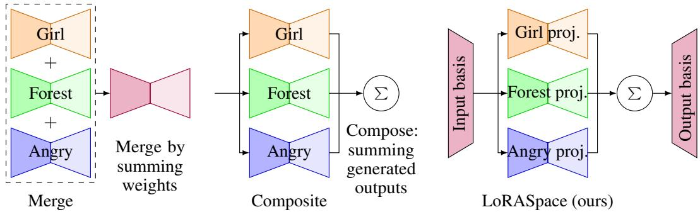  
Figure 1: Three strategies for composing N active LoRAs from a Combo (the active subset for one generation). Merge folds them into one delta with one forward pass. Composite runs N forward passes. LORASPACE projects via $V ^ { \top }$ , mixes $\textstyle \sum _ { i } w _ { i } { \hat { B } } _ { i } { \hat { A } } _ { i }$ , and back-projects via U in one pass. Static-mode pre-folds the inner sum when $\{ w _ { i } \}$ are time-invariant; dynamic-mode evaluates it per UNet pass (precompute illustration in App. A).

where $\{ w _ { i } \} _ { i = 1 } ^ { N }$ are per-LoRA weights for an active subset of size $N \leq K$ . Static merge precomputes a fixed sum once and discards routing. Composite evaluates Eq. (1) by running N forward passes per token and aggregating outputs. LORASPACE evaluates a router-weighted form of Eq. (1) in one base-model pass with LoRA-side work linear in N inside a shared D-dimensional subspace $( D \ll d _ { \mathrm { o u t } } )$ , exploiting structural rank overlap.

## 3.2 Energy-normalised shared subspace

The motivating observation is empirical. When per-LoRA factors from a real diffusion pool are stacked and decomposed by paired marginal SVDs, the resulting subspace dimension is much smaller than $\textstyle \sum _ { i } r _ { i }$ . We characterise this empirically in §4.2, which separates alignment between adapters from layer-width saturation and each adapter’s own spectral tail. Here we use it to construct an energy-truncated shared subspace.

Frobenius normalisation. Raw factor stacking is dominated by high-norm LoRAs. Frobenius normalisation puts every LoRA on a common scale before decomposition:

$$
\bar { B } _ { i } = B _ { i } / \| B _ { i } \| _ { F } , \qquad \bar { A } _ { i } = A _ { i } / \| A _ { i } \| _ { F } .\tag{2}
$$

We then form pool stacks $\begin{array} { r } { \bar { B } _ { \mathrm { s t a c k } } = [ \bar { B } _ { 1 } \cdot \cdot \cdot \bar { B } _ { K } ] \in \mathbb { R } ^ { d _ { \mathrm { o u t } } \times \sum _ { i } r _ { i } } } \end{array}$ and $\bar { A } _ { \mathrm { s t a c k } } = [ \bar { A } _ { 1 } ; \cdot \cdot \cdot ; \bar { A } _ { K } ]$ ∈ $\mathbb { R } { \sum _ { i } } r _ { i } \times d _ { \mathrm { i r } }$ .

Paired marginal SVDs and adaptive truncation. We compute two thin SVDs $\bar { B } _ { \mathrm { s t a c k } } ~ =$ $U _ { B } \Sigma _ { B } V _ { B } ^ { \top }$ and $\bar { A } _ { \mathrm { s t a c k } } = U _ { A } \Sigma _ { A } V _ { A } ^ { \top }$ , then truncate each at energy fraction $\tau \in ( 0 , 1 )$

$$
D _ { B } = \operatorname* { m i n } \Bigl \{ d \Big | \frac { \sum _ { j \le d } \sigma _ { j } ( \bar { B } _ { \mathrm { s t a c k } } ) ^ { 2 } } { \sum _ { j } \sigma _ { j } ( \bar { B } _ { \mathrm { s t a c k } } ) ^ { 2 } } \ge \tau \Bigr \} , \quad D _ { A } \mathrm { a n a l o g o u s l y } .\tag{3}
$$

The shared subspace dimension is D = min $( \mathrm { m a x } ( D _ { B } , D _ { A } ) , \sum _ { i } r _ { i } , d _ { \mathrm { i n } } , d _ { \mathrm { o u t } } )$ . The shared bases are $U = U _ { B } [ : , : D ] \ \bar { \in } \ \mathbb { R } ^ { d _ { \mathrm { o u t } } \times D }$ and $V = V _ { A } [ : , : D ] \in \mathbb { R } ^ { d _ { \mathrm { i n } } \times D }$ (with $V _ { A }$ the right-singular-vector matrix in $\bar { A } _ { \mathrm { s t a c k } } = U _ { A } \Sigma _ { A } V _ { A } ^ { \top } ,$ ), the leading left and right singular vectors of $\bar { B } _ { \mathrm { s t a c k } }$ and $\bar { A } _ { \mathrm { s t a c k } }$ , both with orthonormal columns. By the Eckart-Young theorem [Eckart and Young, 1936], U and V are the optimal rank-D subspaces for the marginal B-stack and A-stack reconstructions separately. This is optimal for each marginal factor projection but not a joint optimum for the product $\textstyle \sum _ { i } s _ { i } B _ { i } A _ { i } .$ A joint SVD of the scaled deltas is closer to product-optimal (per-LoRA error 0.35% against 0.88% on Pool C at equal $D )$ , but the difference does not reach the generated images, and the marginal bases are built from thin factors on CPU and can be extended when the pool changes (App. G). We find empirically that retaining the low-energy directions does not improve composition metrics within the practical τ range (§4.4).

## 3.3 Per-LoRA projected factors

Each LoRA is re-parameterised by projecting its raw factors onto the shared subspace:

$$
\begin{array} { r } { \hat { B } _ { i } = \sqrt { s _ { i } } U ^ { \top } B _ { i } \in \mathbb { R } ^ { D \times r _ { i } } , \qquad \hat { A } _ { i } = \sqrt { s _ { i } } A _ { i } V \in \mathbb { R } ^ { r _ { i } \times D } . } \end{array}\tag{4}
$$

The LoRA scaling $s _ { i }$ is split symmetrically as $\sqrt { s _ { i } }$ on each side. The per-layer cache $\mathcal { C } _ { \ell } ~ =$ $\{ U , V , \{ ( \hat { B } _ { i } , \hat { A } _ { i } ) \} _ { i = 1 } ^ { K } \}$ is computed once per pool, stored on CPU memory, and streamed to the GPU as needed. Cache size is $O ( D ( d _ { \mathrm { o u t } } \bar { } + \bar { d _ { \mathrm { i n } } } ) + K D \bar { r } )$ versus $O ( K \bar { r } ( d _ { \mathrm { o u t } } + d _ { \mathrm { i n } } ) )$ for ambient storage, which gives a meaningful reduction whenever $D \ll d _ { \mathrm { o u t } }$

## 3.4 Composition operator and deployment modes

At inference, the LORASPACE operator processes input x in three steps. Project once into the subspace $x _ { \mathrm { p r o j } } = V ^ { \top } x \in \mathbb { R } ^ { D }$ . Compute a per-LoRA subspace contribution $y _ { i } = \hat { B } _ { i } ( \hat { A } _ { i } x _ { \mathrm { p r o j } } ) \in \mathbb { R } ^ { D }$ for each active i. Mix and back-project to give $\begin{array} { r } { \Delta y ^ { \mathrm { L S } } ( x ) = U \sum _ { i = 1 } ^ { N } w _ { i } y _ { i } } \end{array}$ . Compactly,

$$
\Delta y ^ { \mathrm { L S } } ( x ) = U \left( \sum _ { i = 1 } ^ { N } w _ { i } \hat { B } _ { i } \hat { A } _ { i } \right) V ^ { \top } x .\tag{5}
$$

The input projection $V ^ { \top } z$ x and output back-projection $U ( \cdot )$ are shared across all active LoRAs. The per-LoRA work is entirely inside the D-dimensional subspace. The shared bases do not orthogonalise adapters or split directions among them. $( U , V )$ spans the union of the pool’s directions and each adapter keeps dense coordinates inside it. Across 4,800 audited axes (12 SDXL layers, both sides, top 200 per side) the median adapter-ownership Herfindahl index is 0.12, so a typical axis carries about eight adapters. At full rank the operator equals the ambient weighted sum (Prop. 1), so any interaction the ambient sum produces, such as a lighting LoRA changing how a character LoRA renders, is kept. Truncation only removes a low-energy tail (composed $N { = } 5$ error 0.84% at $\tau = 0 . 9 9 , \mathrm { A p p . G ) }$

Static and dynamic deployment from one substrate. When $\{ w _ { i } \}$ are time-invariant (uniform or per-prompt/pre-defined routing), the inner sum $\begin{array} { r } { M = \sum _ { i } w _ { i } \hat { B } _ { i } \hat { A } _ { i } \in \mathbb { R } ^ { D \times D } } \end{array}$ folds into a single ambient delta $\Delta = U M V ^ { \top }$ at ambient-merge cost (static-mode). Time-varying routers (per-token, per-step, per-pixel) require dynamic-mode. Eq. (5) is then evaluated in the subspace at every UNet pass, with shared $V ^ { \top } x$ and $\dot { U } ( \cdot )$ paid once per pass independent of N. The same $( U , V )$ serves both modes.

Static-mode is not ambient merge. Substituting Eq. (4) gives $\Delta y ^ { \mathrm { L S } } ( x ) = P _ { U } \Delta y ^ { \star } ( P _ { V } x )$ with $P _ { U } = U U ^ { \top } , P _ { V } = V V ^ { \top }$ the projectors onto the truncated subspaces. Since $D < \operatorname* { m i n } ( d _ { \mathrm { o u t } } , d _ { \mathrm { i n } } )$ on most layers (682 of 722 on Pool $\mathrm { C } ) , P _ { U } , P _ { V } \ne I$ there and the two operators differ from the unprojected target $\Delta y ^ { \star } . \ S 4 . 3$ reports the empirical effect alongside a mechanism ablation.

## 3.5 Reconstruction guarantee

Proposition 1 (Exact recovery). $I f \mathrm { c o l } ( B _ { i } ) \subseteq \mathrm { c o l } ( U )$ and row $( A _ { i } ) \subseteq \mathrm { c o l } ( V )$ for all $i \in \mathcal { P }$ , then $\Delta y ^ { \mathrm { L S } } ( x ) = \Delta y ^ { \star } ( x )$ for any weights $\{ w _ { i } \}$

Corollary 2 (Truncation error bound). Let $\sigma _ { D + 1 } ^ { B } , \sigma _ { D + 1 } ^ { A }$ be the leading discarded singular values of $\bar { B } _ { \mathrm { s t a c k } } , \bar { A } _ { \mathrm { s t a c k } }$ , and $\mu ^ { B } = \operatorname* { m a x } _ { i } \| B _ { i } \| _ { F } , \mu ^ { A }$ = maxi $\| A _ { i } \| _ { F } .$ . Then for any x and {wi},

$$
\| \Delta y ^ { \mathrm { L S } } ( \boldsymbol { x } ) - \Delta y ^ { \star } ( \boldsymbol { x } ) \| _ { 2 } \le \| \boldsymbol { x } \| _ { 2 } \cdot \mu ^ { A } \mu ^ { B } \cdot ( \sigma _ { D + 1 } ^ { B } + \sigma _ { D + 1 } ^ { A } + \sigma _ { D + 1 } ^ { B } \sigma _ { D + 1 } ^ { A } ) \cdot \sum _ { i } s _ { i } | w _ { i } | .\tag{6}
$$

Proofs are in Appendix B. At $\tau ~ = ~ 0 . 9 9$ the per-side discarded singular value is bounded by $\sqrt { ( 1 - \tau ) K } \leq 0 . 4 1$ for $K \ \leq \ 1 7 ; \ \ S 4 . 2$ confirms this approximation does not degrade outputs in practice.

## 3.6 Router interface

The composition operator is router-pluggable. Any function producing per-LoRA weights $\{ w _ { i } \}$ plugs in unchanged. We adopt uniform weights $( w _ { i } = 1 / N )$ as the default and characterise three adaptive routers as plug-in extensions: spatial (per-token activation energy, in the spirit of SpectR [Fleshman and Van Durme, 2025]), temporal (per-step subspace-band, following CMLoRA [Zou et al., 2025]), and semantic (per-concept token-to-region routing, in the spirit of FreeFuse [Liu et al., 2025]). Full specifications are in App. C. For LLM pools, LORASPACE pairs with an INSTRUCTOR retriever [Su et al., 2023] following the LoRA-Retriever protocol [Zhao et al., 2024], showing that internal and external routing policies share a single composition substrate.

## 3.7 Complexity

We count the incremental LoRA-side linear algebra for one layer processing one token; Appendix D reports the full per-step cost including base-model forwards. For N active LoRAs of representative rank r¯, ambient composition adds $O ( \bar { N } \bar { r } ( d _ { \mathrm { i n } } + d _ { \mathrm { o u t } } ) )$ ) per layer, linear in both N and ambient width. LORASPACE costs

$$
\mathrm { c o s t _ { L S } = \underbrace { { \cal O } \big ( { \cal D } ( d _ { i n } + d _ { o u t } ) \big ) } _ { \mathrm { s h a r e d ~ p r o j e c t i o n } } ~ + ~ \underbrace { { \cal O } \big ( N \bar { r } { \cal D } \big ) } _ { \mathrm { p e r - L o R A ~ s u b s p a c e ~ p a t h s } } . }\tag{7}
$$

The shared term is paid once regardless of N. As pool size K grows, the projection size scales as $D \propto K ^ { \beta }$ with measured $\beta \in [ \breve { 0 } . 4 3 , 0 . 5 5 ]$ on diffusion pools (§4.2), so the projection term grows sub-linearly with the pool. The per-LoRA term is linear in N but scaled by D, which is much smaller than the ambient $d _ { \mathrm { o u t } } .$ . The adapter-side crossover with an optimised single-pass ambient mixture is $D < 2 N \bar { r } d / ( 2 d + N \bar { r } )$ . This bound is always below Nr¯, so it is not met at the default $\tau = 0 . 9 9$ (Pool C, mean $D = 8 1 { \dot { 9 } }$ against $N \bar { r } \approx 5 2 7$ at N=5). It is met at the compressed operating points validated in App. G (D¯ ≈ 107 at $\tau = 0 . 7 0$ and ≈ 49 at $\tau = 0 . 5 0 )$ , so the subspace path saves adapter-side arithmetic only in that reduced-storage regime. Appendix D gives the full per-method comparison including memory.

## 4 Experiments

We organise the evaluation around four findings: rank-fill regime characterisation across diffusion and LLM pools (§4.2); a quality + mechanism comparison showing static-mode LORASPACE delivers composite-level quality at ambient-merge cost and that the lift is rank-D truncation in any basis (§4.3); robustness to the energy truncation threshold (§4.4); and a routing ablation showing router quality varies on Pool A (temporal helps, semantic is flat, spatial regresses on ImageReward; §4.5). A predictive-theory check on the near rank-orthogonal LLM regime, including external retrieval coupling, is in §4.6 (App. U for the full scoreboard).

## 4.1 Setup

Pools and backbones. Pool A (11 reality-style LoRAs, SD 1.5 [Rombach et al., 2022]) and Pool B (17 LoRAs, SD 1.5) are drawn from CivitAI [CivitAI, 2023]. Pool C (17 reality-style LoRAs, SDXL [Podell et al., 2024]) is curated from CivitAI and Hugging Face [Hugging Face, 2016]. The LLM pool is the 48-LoRA LLaMA-2-7B [Touvron et al., 2023] task-LoRA set from LoRA-Retriever [Zhao et al., 2024].

Metrics. For diffusion, we report CLIP-T [Radford et al., 2021] for prompt alignment, ImageReward [Xu et al., 2023] for human-preference alignment, and a GPT-4o [OpenAI, 2024] composition rubric (Composition Quality + Image Quality, 0 to 10 each, position-bias averaged across two orderings) following ComposLoRA [Zhong et al., 2024]. For LLMs, we use the LoRA-Retriever Macro Task accuracy.

Software and hardware. All diffusion experiments run on a single RTX 3090 (24 GB) using PyTorch [Paszke et al., 2019] and the diffusers library [von Platen et al., 2022], with DPM-Solver++ [Lu et al., 2025] as the sampler. Pool A: 100 denoising steps, $5 1 2 \times 5 1 2$ . Pool C: 50 denoising steps, 1024 × 1024. We use 240 stratified combinations per seed for Pool A, distributed across active sizes $N \in \{ 2 , 3 , 4 , 5 \}$ , and 200 for Pool C, across $N \in \{ 2 , \ldots , 6 \}$ . Pool B is reported in the appendix at $N \in \{ \bar { 7 } , 8 \}$ (Appendix L) to probe the high-cardinality regime where the rank-fill ratio is lowest $( \rho = 0 . 4 7 \mathrm { a t } \dot { K } = 1 7 )$ ; Pool A and Pool C cover the full active-LoRA range.

## 4.2 Subspace dimension grows sub-linearly with pool size

We measure the rank-fill ratio $\rho = D / \textstyle \sum _ { i } r _ { i }$ at energy threshold $\tau = 0 . 9 9$ (the value used throughout) and the growth exponent $\beta$ obtained by fitting $D \propto K ^ { \beta }$ with category-aware random subsampling at three random seeds. Table 2 summarises the result. The three diffusion pools have $\rho$ between 0.46 and 0.57 and $\beta$ between 0.43 and 0.55, both far below the $\rho = 1 , \beta = 1$ no-overlap baseline. The two LLM pools span the full range: a 48-LoRA sub-sample of LoRA-Hub over related FLAN-T5 NLP tasks lands at $\rho = 0 . 6 2 , \beta = 0 . 8 8$ , comparable to diffusion overlap, while the LoRA-Retriever benchmark, curated for retrieval-task diversity, sits near the no-overlap baseline at $\rho = 0 . 9 6 ,$ $\beta = 0 . 9 4$

Table 2: Rank overlap across pools at $\tau = 0 . 9 9 . \ \rho = D / \sum _ { i } r _ { i }$ (lower means more overlap). $\beta$ is the power-law exponent of D vs. K. The LoRA-Hub row is a K=48 sub-sample matched in size to LoRA-Retriever (full 196-LoRA pool in App. T).
<table><tr><td>Pool</td><td>K</td><td> $\textstyle \sum _ { i } r _ { i }$ </td><td> $D$  (mean)</td><td> $\rho$ </td><td> $\beta$ </td></tr><tr><td>Pool A (SD 1.5)</td><td>11</td><td>784</td><td>446</td><td>0.57</td><td>0.43</td></tr><tr><td>Pool B (SD 1.5)</td><td>17</td><td>1112</td><td>521</td><td>0.47</td><td>0.49</td></tr><tr><td>Pool C (SDXL)</td><td>17</td><td>1792</td><td>819</td><td>0.46</td><td>0.55</td></tr><tr><td>LoRA-Hub (FLAN-T5-Large)</td><td>48</td><td>768</td><td>474</td><td>0.62</td><td>0.88</td></tr><tr><td>LoRA-Retriever (LLaMA-2-7B)</td><td>48</td><td>384</td><td>368</td><td>0.96</td><td>0.94</td></tr></table>

The source of the low $\rho$ differs between regimes. We split $\rho = \rho _ { \mathrm { i n t r a } } \times \rho _ { \mathrm { c r o s s } }$ into within-LoRA rank slack and a cross-LoRA term, and compare D with a spectrum-matched random null (App. F). Within-LoRA slack is nowhere dominant $\left( \rho _ { \mathrm { i n t r a } } \geq 0 . 8 4 \right.$ on every pool). The related-task LoRA-Hub pool [Huang et al., 2024] needs about 30% fewer dimensions than its matched null, an alignment associated with shared task structure, while the diversity-curated LoRA-Retriever sits at its null. On the diffusion pools the stacked ranks exceed the layer width on most layers, and on the SDXL pools D sits at its null (0.98 on Pool $\mathrm { C } ) .$ , so their low $\rho$ is real compressibility that is largely explained by width saturation and per-adapter spectra, and we leave its link to training data open. Pool composition, not modality, predicts where compression is large and where it is not. The framework also predicts a saturation regime when $\sum _ { i } r _ { i } \geq d \colon$ the full LoRA-Hub pool $\left( K { = } 1 9 6 \right)$ crosses the threshold at $K ^ { \star } = d / r = 6 4$ , with each new LoRA adding ∼11 dimensions to D¯ below threshold and ∼1 above (App. T).

## 4.3 Quality, speed, and memory

We compare three composition strategies on Pool A: ambient static merge with weight 1 per LoRA, so the deltas are summed, ambient composite with N forward passes per step, and LORASPACE with uniform 1/N routing weights. Table 3 reports CLIP-T and ImageReward averaged across three random seeds (240 combinations per seed, $\bar { N ^ { \prime } } \in \{ 2 , 3 , 4 , 5 \} )$ , and the GPT-4o rubric from one seed (the position-bias-averaged GPT-4o evaluation is expensive; three-seed consistency on CLIP-T and ImageReward suffices to verify robustness).

Table 3: Pool A quality (mean ± std over $^ 3$ seeds, 240 combos/seed, averaged over $N \in \{ 2 , \ldots , 5 \}$ with GPT-4o from one seed). Higher is better for all metrics.
<table><tr><td>Method</td><td>CLIP-T↑</td><td>ImageReward ↑</td><td>GPT-4o Total ↑</td><td>GPT-4o Win% ↑</td></tr><tr><td>merge</td><td> $3 3 . 6 0 \pm 0 . 1 9$ </td><td> $0 . 7 6 0 \pm 0 . 0 0 8$ </td><td>14.32</td><td>21.9</td></tr><tr><td>composite</td><td> $3 5 . 2 7 \pm 0 . 1 9$ </td><td> $0 . 9 5 3 \pm 0 . 0 1 1$ </td><td>15.24</td><td>29.5</td></tr><tr><td>LORASPACE (uniform)</td><td> ${ \bf 3 6 . 0 1 \pm 0 . 1 6 }$ </td><td> $\mathbf { 1 . 0 4 1 \pm 0 . 0 3 5 }$ </td><td>15.61</td><td>48.6</td></tr></table>

LORASPACE with uniform routing exceeds composite by +0.74 CLIP-T, +0.09 ImageReward, +0.37 GPT-4o total, and almost twenty percentage points of GPT-4o win rate (48.6% vs. 29.5%, with 33.3% being the no-preference baseline for three competitors). It also exceeds ambient merge by larger margins. The inter-method gap exceeds the across-seed standard deviation on every metric.

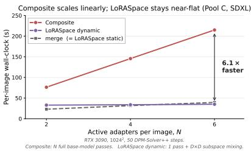

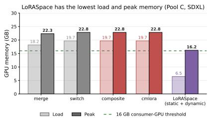  
Figure 2: Pool C (SDXL) speed and memory. Left: per-image wall-clock vs. N. Composite scales linearly. Dynamic LORASPACE stays near-flat (6.1× speedup at N=6). Static LORASPACE inherits ambient-merge cost. Right: GPU memory. LORASPACE has the lowest load and peak memory (6.5/16.2 GB). PEFT baselines (merge, switch, composite, cmlora) exceed 22 GB peak. RTX 3090, 10242, 50 DPM-Solver++ steps.

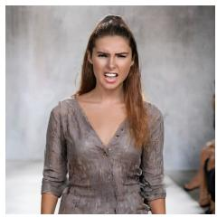

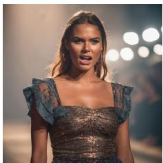

  
Figure 3: Pool C N=5 example. VioletXL + catwalk + god rays + old copper + anger, SDXL. L→R: merge, composite, LORASPACE. Time 36/187/42 s.

Mechanism ablation. We test whether the quality lift depends on the pool-wide basis with two static-delta variants at the same rank D. truncated-merge is the combo-specific best-fit SVD of the ambient merge; subspace-merge bakes the pool-wide (U, V) readout into a fixed delta per combo. Both run at ambient-merge per-image cost. On Pool A (seed 111, 240 combos, N=2 to 5), both match per-step LORASPACE-uniform within fp16 noise (Tab. 16). At equal rank D the basis choice does not affect quality. The lift over ambient merge (+2.40 CLIP-T, +0.32 ImgRew) is therefore not a property of the pool-wide basis. Both variants average the LoRAs with weights 1/N where merge sums them, and at τ = 0.99 the truncation changes the composed delta by under 1% on Pool C (App. G).

Why the pool-wide basis. Amortisation: truncated-merge requires 192 layer SVDs per combo (∼1.4 h across Pool A’s 1011 combos) vs. one 21.8 s pool-wide precompute (App. P). Dynamic-mode: when {w } depend on context, no single static delta exists for truncated-merge, while (U, V) supports both modes from one precompute. At about 5 s of SVDs per combination, the precompute pays off beyond about five distinct combinations, so per-combination truncated merge remains the better choice for a static deployment with a few fixed combinations. Serving 30 combinations from the 37-adapter union of App. H averages 35.1 s per combination including the one-time load, against 43.9 s for repeated PEFT load and merge. Keeping all adapters resident instead needs per-adapter format fixes, and even then 36 of the 37 load at 19.0 GiB and one 10242 generation peaks at 23.1 of the card’s 24 GiB.

Pool C (speed, memory, quality). Fig. 2 summarises per-image cost. Dynamic-mode stays near-flat in N (6.1× faster than composite at N=6). Most of this gain comes from running one backbone pass instead of N. At N=5 a single-pass ambient mixture already accounts for 4.9× of the 5.3×, and the substrate path adds 1.08× (Tab. 20). Static-mode inherits ambient merge cost (23 to 39 s, Tab. 18). Across 200 combos uniform LORASPACE scores 32.89 CLIP-T / 1.040 ImgRew vs. composite (31.91 / 0.973) and merge (29.41 / 0.721), with the CLIP-T gap over composite growing from +0.17 at $N { = } 2 \ \mathrm { t o } + 1 . 3 7$ at N=6 (Tab. 17, additional qualitative examples in App. Q).

## 4.4 Energy threshold ablation

Sweeping $\tau \in \{ 0 . 9 5 , 0 . 9 7 , 0 . 9 9 , 0 . 9 9 9 \}$ on Pool A grows D¯ by 43% while quality varies nonmonotonically within seed-level noise (|∆| < 0.05 CLIP-T, $| \Delta | \overset { \cdot } { < } 0 . 0 0 8$ ImageReward). We adopt $\tau = 0 . 9 9$ as the default (Tab. 5).

## 4.5 Routing ablation: substrate is router-tolerant

On Pool A across three seeds, the four routers from §3.6 (uniform, spatial, temporal, semantic) all exceed the merge baseline by large margins (Tab. 15, App. M). Temporal gives the largest ImageReward gain over uniform, semantic is flat, and spatial regresses. The substrate carries the quality, with routers contributing small modulations.

## 4.6 Cross-modality predictive check on the LLM regime

On the near rank-orthogonal LoRA-Retriever LLaMA-2-7B benchmark $( K { = } 4 8 , \rho = 0 . 9 6 )$ , the substrate alone (loraspace-fullpool) scores 50.49 Macro Task vs. the ambient mixture’s 53.55. INSTRUCTOR-retrieval coupling (loraspace-hybrid) recovers 54.51 at 1.52 vs 1.47 samp/s, matching the framework’s prediction that compression helps only with retrieval coupling (full scoreboard in App. U).

## 5 Conclusion

We empirically characterise pool-wide rank overlap in real LoRA collections, finding $\rho \in [ 0 . 4 6 , 0 . 6 2 ]$ across three diffusion pools and a 48-LoRA LoRA-Hub sub-pool, with LoRA-Retriever as the nearorthogonal exception $( \rho \approx 0 . 9 6 )$ . LORASPACE turns this overlap into a pool-wide substrate from one SVD, matching composite quality at merge cost in static-mode and reaching 2.3 to 6.1× speedup in dynamic-mode, mostly from avoiding per-LoRA backbone passes. A mechanism ablation shows that the lift does not depend on the pool-wide basis, making the basis valuable for amortisation and dynamic capability (limitations and broader impact in App. V).

When to use LORASPACE. LORASPACE targets deployments that repeatedly compose several LoRAs under a memory budget. With one active adapter or unconstrained memory, ambient serving is the right choice. Within that setting, $\rho$ is a cheap screen (CPU minutes, no base model). Below about 0.6 we deploy the substrate, as on the three diffusion pools, with LoRA-Hub (0.62) at the boundary. Above about 0.9, as on LoRA-Retriever, the substrate is worth using for routing or retrieval coupling rather than for compression at the default τ . In between, a τ sweep on held-out prompts decides (CLIP-T drop under 0.5 and structural similarity at least 0.95). These cut points separate our pools empirically and are not universal constants, and ρ falls with pool size (0.95 at K=2 to 0.57 at K=11, App. E), so very small pools are better served ambiently. Uncurated and mixed pools follow the same rule (App. H).

## Acknowledgments and Disclosure of Funding

The computational resources for this research were supported by the Accelerating Higher Education Expansion and Development (AHEAD) Operation Grant No. 6026-LK/8743-LK from the Ministry of Higher Education, Sri Lanka, funded by the World Bank. R. Rodrigo acknowledges the University of Moratuwa Senate Research Committee Grant No. SRC/LT/2021/20. We also thank Jaseci Labs for its support. The authors declare no competing interests.

## References

Eric L. Buehler and Markus J. Buehler. X-LoRA: Mixture of low-rank adapter experts, a flexible framework for large language models with applications in protein mechanics and molecular design. APL Machine Learning, 2(2):026119, 2024.

Lequn Chen, Zihao Ye, Yongji Wu, Danyang Zhuo, Luis Ceze, and Arvind Krishnamurthy. Punica: Multi-tenant LoRA serving. In Proceedings ofMachine Learning and Systems (MLSys), 2024.

CivitAI. CivitAI: The home of open-source generative AI. https://civitai.com, 2023.

Carl Eckart and Gale Young. The approximation of one matrix by another of lower rank. Psychometrika, 1(3):211–218, 1936.

William Fleshman and Benjamin Van Durme. SpectR: Dynamically composing LM experts with spectral routing. In Conference on Language Modeling (COLM), 2025.

Rickard Brüel Gabrielsson, Jiacheng Zhu, Onkar Bhardwaj, Leshem Choshen, Kristjan Greenewald, Mikhail Yurochkin, and Justin Solomon. Compress then serve: Serving thousands of LoRA adapters with little overhead. In Proceedings ofthe 42nd International Conference on Machine Learning (ICML), 2025.

Nikolaus Hansen and Andreas Ostermeier. Completely derandomized self-adaptation in evolution strategies. Evolutionary Computation, 9(2):159–195, 2001.

Edward J. Hu, Yelong Shen, Phillip Wallis, Zeyuan Allen-Zhu, Yuanzhi Li, Shean Wang, Lu Wang, and Weizhu Chen. LoRA: Low-rank adaptation of large language models. In International Conference on Learning Representations (ICLR), 2022.

Chengsong Huang, Qian Liu, Bill Yuchen Lin, Tianyu Pang, Chao Du, and Min Lin. LoRAHub: Efficient cross-task generalization via dynamic LoRA composition. In Conference on Language Modeling (COLM), 2024.

Hugging Face. Hugging Face: The AI community building the future. https://huggingface.co, 2016.

Gabriel Ilharco, Marco Tulio Ribeiro, Mitchell Wortsman, Ludwig Schmidt, Hannaneh Hajishirzi, and Ali Farhadi. Editing models with task arithmetic. In International Conference on Learning Representations (ICLR), 2023.

Yaoli Liu, Yao-Xiang Ding, and Kun Zhou. FreeFuse: Multi-subject LoRA fusion via adaptive token-level routing at test time. arXiv preprint arXiv:2510.23515, 2025.

Cheng Lu, Yuhao Zhou, Fan Bao, Jianfei Chen, Chongxuan Li, and Jun Zhu. DPM-Solver++: Fast solver for guided sampling of diffusion probabilistic models. Machine Intelligence Research, 22: 730–751, 2025. doi: 10.1007/s11633-025-1562-4.

Mohammed Muqeeth, Haokun Liu, Yufan Liu, and Colin Raffel. Learning to route among specialized experts for zero-shot generalization. In International Conference on Machine Learning (ICML), 2024.

OpenAI. GPT-4o system card. https://openai.com/index/gpt-4o-system-card/, 2024.

Oleksiy Ostapenko, Zhan Su, Edoardo Ponti, Laurent Charlin, Nicolas Le Roux, Lucas Caccia, and Alessandro Sordoni. Towards modular LLMs by building and reusing a library of LoRAs. In International Conference on Machine Learning (ICML), 2024.

Ziheng Ouyang, Zhen Li, and Qibin Hou. K-LoRA: Unlocking training-free fusion of any subject and style LoRAs. In IEEE/CVF Conference on Computer Vision and Pattern Recognition (CVPR), 2025.

Aniello Panariello, Daniel Marczak, Simone Magistri, Angelo Porrello, Bartłomiej Twardowski, Andrew D. Bagdanov, Simone Calderara, and Joost van de Weijer. Accurate and efficient low-rank model merging in core space. In Advances in Neural Information Processing Systems (NeurIPS), 2025.

Adam Paszke, Sam Gross, Francisco Massa, Adam Lerer, James Bradbury, Gregory Chanan, Trevor Killeen, et al. PyTorch: An imperative style, high-performance deep learning library. In Advances in Neural Information Processing Systems (NeurIPS), 2019.

Dustin Podell, Zion English, Kyle Lacey, Andreas Blattmann, Tim Dockhorn, Jonas Müller, Joe Penna, and Robin Rombach. SDXL: Improving latent diffusion models for high-resolution image synthesis. In International Conference on Learning Representations (ICLR), 2024.

Alec Radford, Jong Wook Kim, Chris Hallacy, Aditya Ramesh, Gabriel Goh, Sandhini Agarwal, Girish Sastry, et al. Learning transferable visual models from natural language supervision. In International Conference on Machine Learning (ICML), 2021.

Robin Rombach, Andreas Blattmann, Dominik Lorenz, Patrick Esser, and Björn Ommer. Highresolution image synthesis with latent diffusion models. In IEEE/CVF Conference on Computer Vision and Pattern Recognition (CVPR), 2022.

Aniket Roy, Maitreya Suin, Ketul Shah, and Rama Chellappa. MultLFG: Training-free multi-LoRA composition using frequency-domain guidance. arXiv preprint arXiv:2505.20525, 2025.

Viraj Shah, Nataniel Ruiz, Forrester Cole, Erika Lu, Svetlana Lazebnik, Yuanzhen Li, and Varun Jampani. ZipLoRA: Any subject in any style by effectively merging LoRAs. In European Conference on Computer Vision (ECCV), 2024.

Ying Sheng, Shiyi Cao, Dacheng Li, Coleman Hooper, Nicholas Lee, Shuo Yang, Christopher Chou, Banghua Zhu, Lianmin Zheng, Kurt Keutzer, Joseph E. Gonzalez, and Ion Stoica. SLoRA: Scalable serving of thousands of LoRA adapters. In Proceedings of Machine Learning and Systems (MLSys), 2024.

George Stoica, Pratik Ramesh, Boglarka Ecsedi, Judy Hoffman, and Leshem Choshen. Model merging with SVD to tie the knOTS. In International Conference on Learning Representations (ICLR), 2025.

Hongjin Su, Weijia Shi, Jungo Kasai, Yizhong Wang, Yushi Hu, Mari Ostendorf, Wen-tau Yih, Noah A. Smith, Luke Zettlemoyer, and Tao Yu. One embedder, any task: Instruction-finetuned text embeddings. In Findings of the Association for Computational Linguistics: ACL 2023, pages 1102–1121, 2023. doi: 10.18653/v1/2023.findings-acl.71.

Hugo Touvron, Louis Martin, Kevin Stone, Peter Albert, Amjad Almahairi, Yasmine Babaei, Nikolay Bashlykov, et al. Llama 2: Open foundation and fine-tuned chat models. arXiv preprint arXiv:2307.09288, 2023.

Patrick von Platen, Suraj Patil, Anton Lozhkov, Pedro Cuenca, Nathan Lambert, Kashif Rasul, Mishig Davaadorj, Dhruv Nair, Sayak Paul, William Berman, Yiyi Xu, Steven Liu, and Thomas Wolf. Diffusers: State-of-the-art diffusion models. https://github.com/huggingface/diffusers, 2022.

Xun Wu, Shaohan Huang, and Furu Wei. Mixture of LoRA experts. In International Conference on Learning Representations (ICLR), 2024.

Jiazheng Xu, Xiao Liu, Yuchen Wu, Yuxuan Tong, Qinkai Li, Ming Ding, Jie Tang, and Yuxiao Dong. ImageReward: Learning and evaluating human preferences for text-to-image generation. In Advances in Neural Information Processing Systems (NeurIPS), 2023.

Prateek Yadav, Derek Tam, Leshem Choshen, Colin Raffel, and Mohit Bansal. TIES-Merging: Resolving interference when merging models. In Advances in Neural Information Processing Systems (NeurIPS), 2023.

Le Yu, Bowen Yu, Haiyang Yu, Fei Huang, and Yongbin Li. Language models are super Mario: Absorbing abilities from homologous models as a free lunch. In International Conference on Machine Learning (ICML), 2024.

Andi Zhang, Xuan Ding, Haofan Wang, Steven McDonagh, and Samuel Kaski. Rethinking inter-LoRA orthogonality in adapter merging: Insights from orthogonal Monte Carlo dropout. arXiv preprint arXiv:2510.03262, 2025.

Ziyu Zhao, Leilei Gan, Guoyin Wang, Wangchunshu Zhou, Hongxia Yang, Kun Kuang, and Fei Wu. LoraRetriever: Input-aware LoRA retrieval and composition for mixed tasks in the wild. In Findings ofthe Associationfor Computational Linguistics: ACL 2024, pages 4447–4462, 2024. doi: 10.18653/v1/2024.findings-acl.263.

Peng Zheng, Ye Wang, Rui Ma, and Zuxuan Wu. FreeLoRA: Enabling training-free LoRA fusion for autoregressive multi-subject personalization. arXiv preprint arXiv:2507.01792, 2025.

Ming Zhong, Yelong Shen, Shuohang Wang, Yadong Lu, Yizhu Jiao, Siru Ouyang, Donghan Yu, Jiawei Han, and Weizhu Chen. Multi-LoRA composition for image generation. Transactions on Machine Learning Research, 2024.

Xiandong Zou, Mingzhu Shen, Christos-Savvas Bouganis, and Yiren Zhao. Cached multi-LoRA composition for multi-concept image generation. In International Conference on Learning Representations (ICLR), 2025.

## A Pool-wide precompute illustration

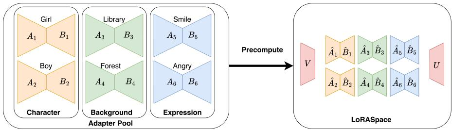  
Figure 4: Pool-wide precompute (paid once at pool-creation time). Per-LoRA factors are stacked and decomposed via paired marginal SVDs into shared bases $( U , V )$ (red) plus projected factors $( \hat { B } _ { i } , \hat { A } _ { i } )$ The cache is reused across all subsequent compositions.

## B Proof of Proposition 1

Proof. Under the span conditions, $U U ^ { \top } B _ { i } = B _ { i }$ (because $U U ^ { \top }$ is the identity on $\operatorname { c o l } ( U ) \supseteq \operatorname { c o l } ( B _ { i } ) )$ and $A _ { i } V V ^ { \top } = A _ { i }$ (analogously). Substituting Eq. (4) into Eq. (5):

$$
\begin{array} { l } { { \displaystyle \Delta y ^ { \mathrm { L S } } ( \boldsymbol { x } ) = U \sum _ { i } w _ { i } \big ( \sqrt { s _ { i } } U ^ { \top } B _ { i } \big ) \big ( \sqrt { s _ { i } } A _ { i } V \big ) V ^ { \top } \boldsymbol { x } } } \\ { { \displaystyle \qquad = \sum _ { i } w _ { i } s _ { i } ( U U ^ { \top } B _ { i } ) ( A _ { i } V V ^ { \top } ) \boldsymbol { x } = \sum _ { i } w _ { i } s _ { i } B _ { i } A _ { i } \boldsymbol { x } = \Delta y ^ { \star } ( \boldsymbol { x } ) } . } \end{array}
$$

ProofofCorollary 2. Let $P = U U ^ { \top }$ and $Q = V V ^ { \top }$ be the projectors onto col(U) and col(V). For each LoRA i, decompose $B _ { i } = P B _ { i } + E _ { i } ^ { B }$ with $E _ { i } ^ { B } = ( \dot { I } - \dot { I } ) B _ { i }$ , and $A _ { i } \stackrel { \cdot } { = } A _ { i } Q + \dot { E } _ { i } ^ { A }$ with $E _ { i } ^ { A } = A _ { i } ( I - Q )$ . Then

$$
\begin{array} { l } { \Delta y ^ { \mathrm { L S } } ( x ) - \Delta y ^ { \star } ( x ) = \displaystyle \sum _ { i } w _ { i } s _ { i } \big [ ( P B _ { i } ) ( A _ { i } Q ) - B _ { i } A _ { i } \big ] x } \\ { = \displaystyle \sum _ { i } w _ { i } s _ { i } \big [ { - } B _ { i } E _ { i } ^ { A } - E _ { i } ^ { B } A _ { i } + E _ { i } ^ { B } E _ { i } ^ { A } \big ] x . } \end{array}
$$

By the Eckart-Young theorem [Eckart and Young, 1936], $\| ( I - P ) \bar { B } _ { \mathrm { s t a c k } } \| _ { 2 } = \sigma _ { D + 1 } ^ { B }$ . Since $\bar { B } _ { i } = B _ { i } / \| B _ { i } \| _ { F }$ is a column-block of $\bar { B } _ { \mathrm { s t a c k } }$ , we have $\| E _ { i } ^ { B } \| _ { 2 } \leq \| B _ { i } \| _ { F } \cdot \sigma _ { D + 1 } ^ { B }$ , and analogously $\| E _ { i } ^ { A } \| _ { 2 } \leq \| A _ { i } \| _ { F } \cdot \sigma _ { D + 1 } ^ { A }$ . Applying $\lVert M N x \rVert _ { 2 } \leq \lVert M \rVert _ { 2 } \lVert N \rVert _ { 2 } \lVert x \rVert _ { 2 }$ , bounding $\| A _ { i } \| _ { 2 } \le \| A _ { i } \| _ { F } \le$ $\mu ^ { A }$ and $\| B _ { i } \| _ { 2 } \le \| B _ { i } \| _ { F } \le \mu ^ { B }$ , summing the three error terms, and collecting over i yields Eq. (6). □

Empirical anchor (SDXL Pool $\mathbf { C } , \tau = 0 . 9 9 )$ $\mathrm { A t } \tau = 0 . 9 9$ with $K = 1 7$ pool LoRAs, the energyfraction definition gives $\sigma _ { D + 1 } ^ { B } \leq \sqrt { ( 1 - \tau ) K } \approx 0 . 4 1$ . The corollary applies a Frobenius-norm chain on $\| A _ { i } \| , \| B _ { i } \|$ that loses orders of magnitude in tightness; we therefore treat Cor. 2 as a worst-case sanity statement rather than a predictive bound. Empirical robustness of $\tau = 0 . 9 9$ is established by the energy-threshold sweep in $\ S 4 . 4 ,$ , where quality varies non-monotonically within seed-level noise across $\tau \in [ 0 . 9 5 , 0 . 9 9 9 ]$

## C Router specifications

The four router variants summarised in §3.6 are detailed below. All share the same operator interface: a function producing per-LoRA weights {wi} that plug into Eq. (5).

Spatial router (per-token activation energy). Per-position normalised energy $\begin{array} { r l } { e _ { i } ( p ) } & { { } = } \end{array}$ $\| \mathbf { \hat { y } } _ { i } ( p ) \| _ { 2 } ^ { 2 } / ( \| x _ { \mathrm { p r o j } } ( \mathbf { \hat { p } } ) \| _ { 2 } ^ { 2 } + \epsilon )$ scored across active LoRAs, top-k selection, temperature softmax. All runs use $\bar { k } { = } \bar { 1 }$ , so each token is routed to its highest-energy LoRA. Spirit of SpectR [Fleshman and Van Durme, 2025] but applied over per-LoRA contributions inside the pool subspace.

Temporal router (per-step subspace-band). Following CMLoRA’s dominant/non-dominant scheme [Zou et al., 2025] but with the routing signal computed as the late-band energy fraction inside the shared subspace, $\begin{array} { r } { m = \sum _ { d \geq D / 2 } \| x _ { \mathrm { p r o j } } [ \cdot , \cdot , \breve { d } ] \| ^ { 2 } / \sum _ { d } \| x _ { \mathrm { p r o j } } [ \cdot , \cdot , d ] \| ^ { 2 } } \end{array}$ . Signal and operator share the same coordinate system.

Semantic router (per-concept spatial mask). A short warmup pass collects cross-attention maps for each LoRA’s trigger tokens, following the token-to-region routing motivation of FreeFuse [Liu et al., 2025]. Resulting per-LoRA masks $M _ { i } \in [ 0 , 1 ] ^ { H \times \tilde { W } }$ are bilinearly resampled and applied at image-token axes, with activation-energy fallback at text-token axes.

External retrieval coupling. For LLM pools, LORASPACE pairs with an INSTRUCTOR retriever [Su et al., 2023] following the LoRA-Retriever protocol [Zhao et al., 2024]. The retrieved top-K subset is composed through the same shared-subspace operator. This demonstrates that internal (activation- or band-derived) and external (retrieval-derived) routing policies share a single composition substrate.

## D Per-method complexity comparison

Table 4 consolidates per-step compute and peak GPU memory across all evaluated methods. The key comparison is the Scaling in N column: output-space methods (composite, cmlora) scale linearly in compute and memory; PEFT-resident single-active methods (switch) hold per-step compute roughly constant but materialize all $K _ { \mathrm { p o o l } }$ LoRAs on GPU regardless of how many are active per step; static-merge methods (merge, knots) achieve O(1) inference cost but lose routing capability; LORASPACE scales with the subspace dimension $\begin{array} { r } { D \leq \operatorname* { m i n } ( \sum _ { i } r _ { i } , d ) } \end{array}$ , which saturates at the layer width when the pool grows large enough.

Table 4: Per-step compute and peak GPU memory of training-free multi-LoRA composition methods. N is active LoRAs per call, r¯ is representative rank, d is layer width, L is LoRA-bearing layers, S is tokens per layer, and $K _ { \mathrm { p o o l } }$ is pool size. LORASPACE’s $\begin{array} { r } { \dot { \boldsymbol { D } } \leq \operatorname* { m i n } ( \sum _ { i } r _ { i } , d ) } \end{array}$ saturates at the layer width.
<table><tr><td>Method</td><td>Per-step compute</td><td>Peak GPU memory</td><td>Scaling in N</td></tr><tr><td>merge</td><td> $\overline { { O ( L d ^ { 2 } ) } }$ </td><td>O(Ld2)</td><td>θ(1)</td></tr><tr><td>switch</td><td> $O ( L ( \stackrel { \cdot } { d } ^ { 2 } + \stackrel { \cdot } { r } d ) )$ </td><td> $O ( L ( d ^ { 2 } + K _ { \mathrm { p o o l } } \bar { r } d ) )$ </td><td>compute Θ(1), mem  $\Theta ( K _ { \mathrm { p o o l } } )$ </td></tr><tr><td>composite</td><td> $\dot { O } ( \dot { N } L d ^ { 2 } S )$ </td><td> $O ( L ( d ^ { 2 } + K _ { \mathrm { p o o l } } \bar { r } d ) )$ </td><td>both Θ(N)</td></tr><tr><td>cmlora</td><td> ${ \cal O } ( N L d ^ { 2 } S )$ </td><td> $O \dot { ( } L \dot { ( } d ^ { 2 } + K _ { \mathrm { p o o l } } ^ { ' } \bar { r } d ) \dot { ) }$ </td><td>both Θ(N)</td></tr><tr><td>knots</td><td> $\dot { O } ( L d ^ { 2 } )$ </td><td> $O ( L d ^ { 2 } )$ </td><td>θ(1)</td></tr><tr><td>LORASPACE</td><td>O(L(dD + NrD)S), D ≤ min  $( \sum _ { i } r _ { i } , d )$ </td><td> ${ \cal O } ( L ( d ^ { 2 } + d D ) ) \mathrm { G P U } + { \cal O } ( L K _ { \mathrm { p o o l } } D \bar { r } ) \mathrm { C P U }$ </td><td>linear in N inside subspace; D caps with K</td></tr></table>

Saturation thresholds. Saturation $( D = d )$ requires $\sum _ { i } r _ { i } \geq d ,$ where $d = \operatorname* { m i n } ( d _ { \mathrm { i n } } , d _ { \mathrm { o u t } } )$ is the width of each layer. SD 1.5 LoRA layers have widths from 320 to 1280, and SDXL layers 640 or 1280. Counted per layer, the stacked ranks of Pool C reach the layer width on all 722 layers, and those of Pools A and B on 132 of 192 layers (every layer narrower than 1280). The diffusion pools therefore sit in the width-saturated regime on most layers, consistent with D matching the spectrummatched null on the SDXL pools (App. F). The LLM pool has $\sum r _ { i } = 3 8 4$ against d = 4096 (9% of threshold), deep in the rank-bound regime.

## E Rank overlap ablation: D vs. pool size and energy threshold

This appendix documents the per-pool subspace dimension ablation that underlies Table 2.

Table 5: Pool A energy-threshold ablation. Subspace dimension D and uniform-LORASPACE quality at four τ values (mean over $N \in \{ 2 , \ldots , 5 \}$ , 240 combos, seed 111). Quality varies nonmonotonically within seed-level noise while D grows by 1.43×.
<table><tr><td>T</td><td> $D _ { \mathrm { m i n } }$ </td><td>D (mean)</td><td> $D _ { \mathrm { m a x } }$ </td><td>CLIP-T</td><td>ImageReward</td></tr><tr><td>0.95</td><td>224</td><td>356</td><td>568</td><td>35.76</td><td>1.071</td></tr><tr><td>0.97</td><td>248</td><td>392</td><td>611</td><td>35.81</td><td>1.072</td></tr><tr><td>0.99</td><td>283</td><td>446</td><td>663</td><td>35.77</td><td>1.064</td></tr><tr><td>0.999</td><td>314</td><td>508</td><td>741</td><td>35.80</td><td>1.067</td></tr></table>

Energy threshold sweep (Pool A, SD 1.5, $K = 1 1 )$ .

Table 6: Pool A rank-fill ratio ρ vs. pool size K (mean ± std over 3 random subsets per $K ; K { = } 1 1$ has zero std as the full pool admits one subset). Pairs (K=2) are nearly rank-orthogonal $( \rho \approx 0 . 9 5 )$ at full pool, 43% of rank is redundant.
<table><tr><td>K</td><td> $\textstyle \sum _ { i } r _ { i }$  (mean)</td><td> $D \left( \mathrm { m e a n } \pm \mathrm { s t d } \right)$ </td><td>ρ</td></tr><tr><td>2</td><td>224</td><td> $2 1 3 \pm 5 0$ </td><td>0.95</td></tr><tr><td>4</td><td>304</td><td> $2 7 5 \pm 2 2$ </td><td>0.91</td></tr><tr><td>6</td><td>456</td><td> $3 5 3 \pm 3 5$ </td><td>0.77</td></tr><tr><td>8</td><td>584</td><td> $3 9 7 \pm 3 8$ </td><td>0.68</td></tr><tr><td>11</td><td>784</td><td> $4 4 6 \pm 0$ </td><td>0.57</td></tr></table>

Pool size sweep (Pool $\mathbf { A } , \tau = 0 . 9 9 )$

SDXL Pool C vs. LLM comparison. Pool $\mathrm { ~ C ~ } ( K = 1 7 , \mathrm { { S D X L } ) }$ reaches $\rho = 0 . 4 6$ at full pool size, with the rank-fill already at 0.69 to 0.72 for $K { = } 4$ subsets. This heavier overlap relative to Pool A is consistent with Pool C’s higher proportion of same-type LoRAs (lighting, material, background) that share scene-element structure. The LLM pool $( K = 4 8$ , LLaMA-2-7B [Touvron et al., 2023]) maintains $\rho \ge 0 . 9 6$ at all tested pool sizes with growth exponent $\beta = 0 . 9 4$ , which is effectively linear and confirms near-zero rank overlap across disjoint NLP-task LoRAs.

## F Rank-fill decomposition and matched null

The rank-fill ratio $\rho = D / \textstyle \sum _ { i } r _ { i }$ has nominal ranks in the denominator, so it mixes each adapter’s internal rank slack with structure between adapters. With per-adapter effective ranks $r _ { i } ^ { \mathrm { e f f } }$ computed at the same τ on the same Frobenius-normalised factor stacks as D,

$$
\rho = \underbrace { \sum _ { i } r _ { i } ^ { \mathrm { e f f } } } _ { \rho _ { \mathrm { i n t r a } } } \times \underbrace { D } _ { \rho _ { \mathrm { c r o s s } } } ,\tag{8}
$$

where $\rho _ { \mathrm { i n t r a } }$ isolates within-LoRA redundancy. Both cross-LoRA structure and stacked ranks approaching the layer width lower $\rho _ { \mathrm { c r o s s } } ,$ , so we also compare D with a spectrum-matched random null $D _ { \mathrm { n u l l } }$ , built from random per-adapter subspaces that keep each block’s own singular spectrum, with the same layer shapes and widths (one seeded draw per layer, averaged over all layers). Tab. 7 reports every pool at $\tau = 0 . 9 9$

Table 7: Rank-fill decomposition at $\tau = 0 . 9 9 . D / D _ { \mathrm { n u l l } } < 1$ means the pool needs fewer dimensions than a spectrum-matched random pool. The LoRA-Hub row uses a different 48 of the 196 adapters than Tab. 2, and LoRA-Retriever is an independent re-download. The stylized, community and wild pools are described in App. H.
<table><tr><td>Pool</td><td>ρ</td><td> $\rho _ { \mathrm { i n t r a } }$ </td><td> $\rho _ { \mathrm { c r o s s } }$ </td><td> $D / D _ { \mathrm { n u l l } }$ </td></tr><tr><td>Pool  $\mathrm { ~ C ~ } ( \mathrm { { S D X L } } , K { = } 1 7 )$ </td><td>0.46</td><td>0.84</td><td>0.55</td><td>0.98</td></tr><tr><td>Six stylized SDXL LoRAs (K=6)</td><td>0.97</td><td>1.00</td><td>0.97</td><td>1.00</td></tr><tr><td>Community SDXL, uncurated (K=20)</td><td>0.87</td><td>0.99</td><td>0.88</td><td>1.00</td></tr><tr><td>Pool C + community union (K=37)</td><td>0.43</td><td>0.89</td><td>0.48</td><td>0.99</td></tr><tr><td> $\mathrm { L o R A \mathrm { - } H u b \ ( F L A N \mathrm { - } T 5 , } K \mathrm { = } 4 8 )$ </td><td>0.60</td><td>1.00</td><td>0.60</td><td>0.70</td></tr><tr><td>Wild FLAN-T5 LoRAs, uncurated (K=12)</td><td>0.84</td><td>1.00</td><td>0.85</td><td>0.92</td></tr><tr><td>LoRA-Hub + wild union (K=60)</td><td>0.52</td><td>1.00</td><td>0.52</td><td>0.67</td></tr><tr><td> $\mathrm { L o R A \mathrm { - } R e t r i e v e r \left( L L a M A \mathrm { - } 2 , \ : K { = } 4 8 \right) }$ </td><td>0.98</td><td>1.00</td><td>0.98</td><td>1.00</td></tr></table>

Within-LoRA slack is material only on the two pools that contain the Pool C adapters $( \rho _ { \mathrm { i n t r a } } = 0 . 8 4$ and 0.89) and is 0.99 to 1.00 elsewhere. On the LLM pools, far from width saturation, the related-task pools need about 30% fewer dimensions than their matched nulls (0.70 for LoRA-Hub and 0.67 for its union with an uncurated harvest), while LoRA-Retriever sits at its null. This alignment is consistent with shared task structure, but the control does not isolate training data as the cause. On the SDXL pools, whose stacked ranks exceed the layer widths, D sits at the null (0.98 to 1.00). Their low $\rho$ is real compressibility, largely explained by width saturation and per-adapter spectra rather than by measured alignment, and it does not depend on a curated or related pool. Repeating the decomposition at the compressed operating points of App. G instead of $\tau = 0 . 9 9$ attributes 75 to 83% of the log-compression to within-adapter tails on both pool types tested.

## G Joint versus marginal bases and compressed thresholds

Joint versus marginal SVD. We compare the paired marginal bases of §3.2 with bases from a joint SVD of the stacked scaled deltas $s _ { i } B _ { i } A _ { i } ,$ , at the same rank D (the D the marginal method selects at $\tau = 0 . 9 9 )$ , so capacity is equal. Tab. 8 reports relative Frobenius reconstruction error of the per-LoRA deltas and of composed uniform N=5 deltas on Pool C, on 24 layers spanning nine layer types across the down, mid and up blocks, then on all 722 layers.

Table 8: Reconstruction error of marginal and joint bases at equal D (Pool C).
<table><tr><td rowspan="2">Setting</td><td rowspan="2">D</td><td colspan="2">Per-LoRA error</td><td colspan="2">Composed error (N=5)</td></tr><tr><td>marginal</td><td>joint</td><td>marginal</td><td>joint</td></tr><tr><td>Full pool, K =17, 24 layers</td><td>822</td><td>0.88%</td><td>0.35%</td><td>0.84%</td><td>0.43%</td></tr><tr><td>Small pool, K=6, 24 layers</td><td>374</td><td>0.52%</td><td>0.22%</td><td>0.56%</td><td>0.32%</td></tr><tr><td>Full pool, K =17, all 722 layers</td><td>per layer</td><td>1.01%</td><td>0.43%</td><td>0.95%</td><td>0.53%</td></tr></table>

The joint construction is closer to product-optimal in weight space, with worst cases of a few percent on low-energy layers (8.7% marginal against 7.3% joint). The difference does not reach generation. A cache built from the joint bases at the same per-layer D regenerates all 30 benchmark combinations at DINO similarity 0.999 to the marginal-cache images (CLIP-T 25.87 against 25.92). The joint spectrum is also more compact (D ≈ 148 on these layers against 822). A joint core $U ^ { \top } ( s _ { i } B _ { i } { \dot { A } } _ { i } ) V$ has rank at most $r _ { i }$ and refactors exactly into thin factors, so at matched D both caches store the same number of parameters, while at its own $\tau = 0 . 9 9$ the joint cache is about 5× smaller (1.77 against 8.63 GB in fp16) and builds 14% faster.

We keep the marginal bases as the default because they can be built and grown from native thin factors in a small memory budget. The marginal build streams thin factor stacks and never forms a dense $d _ { \mathrm { o u t } } \times d _ { \mathrm { i n } }$ delta, so its peak transient memory per layer is 83 MB against 1.3 GB for our joint build, which keeps the precompute on CPU (21.8 s for Pool A). The marginal coordinates also support the append-only extension of App. I and the exact recovery of Prop. 1. The joint substrate is the more compact choice when the dense build is affordable, and the marginal one suits pools that change.

Compressed thresholds. Tab. 9 lowers $\tau$ below the default after submission (105 images, 15 combinations at $N { = } 5$ , an 18-adapter manifest with mean $D = 7 8 5$ at $\tau = 0 . 9 9$ , and our own prompt set, so CLIP-T is not comparable to the main tables). These compressed caches, and those of the next paragraph, are made by truncating the $\tau = 0 . 9 9$ cache to min( $D _ { B } , D _ { A } )$ per layer rather than the max $( \bar { D } _ { B } , \bar { D } _ { A } )$ of §3.2, so at a given τ they are no larger than a fresh build. CLIP-T and ImageReward stay flat within run-to-run variation down to $D \approx 5 0$ , the same order as the joint spectrum’s D.

Table 9: Quality at compressed energy thresholds. DINO is the similarity to the $\tau = 0 . 9 9$ images.
<table><tr><td>T</td><td>mean D</td><td>CLIP-T</td><td>ImageReward</td><td>DINO</td></tr><tr><td>0.99</td><td>785</td><td>25.33</td><td>1.137</td><td>1.000</td></tr><tr><td>0.70</td><td>107</td><td>25.67</td><td>1.158</td><td>0.981</td></tr><tr><td>0.50</td><td>49</td><td>25.61</td><td>1.148</td><td>0.967</td></tr><tr><td>0.30</td><td>22</td><td>25.27</td><td>1.117</td><td>0.949</td></tr></table>

The basis matters at compressed sizes. $\mathrm { A t } \tau = 0 . 9 9$ the choice of basis does not change quality (§4.3). At compressed sizes it does. Regenerating 30 fixed-seed combinations at identical per-layer D with four bases at $\tau = 0 . 5 0 ( D \approx 4 9$ , Pool C cache 0.63 GB against 9.5 GB), the pool basis keeps DINO similarity 0.967 to the full-cache images (CLIP-T 25.93 against 25.92), while a random basis and a basis built from a different pool fall to 0.877 and 0.901 because the adapters no longer come through. A per-combination Eckart-Young basis also holds quality (0.986) but costs minutes of dense SVDs per combination and leaves no reusable object. The pool basis keeps 0.956 and 0.945 at $\tau = 0 . 4 0$ and 0.30 (caches of 0.40 and 0.26 GB), while both controls stay at 0.88 to 0.90.

## H Heterogeneous and uncurated pools

Most of our pools are earlier benchmarks adopted unchanged. To test a pool nobody on our team chose, we harvested the 20 most-downloaded valid community SDXL LoRAs by a fixed rule (Hugging Face SDXL tree, downloads descending, 16 creators, ranks 4 to 128) and measured them on the same 722 layers as Pool C. We also added six strongly stylized SDXL LoRAs. Tab. 10 reports $\rho$ at $\tau = 0 . 9 9$

Table 10: Rank fill of heterogeneous and uncurated SDXL pools at $\tau = 0 . 9 9$
<table><tr><td>Pool</td><td> $K$ </td><td> $\textstyle \sum _ { i } r _ { i }$ </td><td>D</td><td> $\rho$ </td></tr><tr><td>Pool C (control)</td><td>17</td><td>1792</td><td>819</td><td>0.46</td></tr><tr><td>Six stylized LoRAs alone</td><td>6</td><td>192</td><td>186</td><td>0.97</td></tr><tr><td>Pool C + six stylized</td><td>23</td><td>1984</td><td>848</td><td>0.43</td></tr><tr><td>Community LoRAs, uncurated</td><td>20</td><td>673</td><td>580</td><td>0.87</td></tr><tr><td>Pool C + community</td><td>37</td><td>2337</td><td>921</td><td>0.43</td></tr></table>

Unrelated adapters among themselves stay nearly incompressible $( \rho = 0 . 9 7$ for the stylized set and 0.87 for the community set), as on the LLM side (an uncurated harvest of 12 FLAN-T5 task LoRAs at 0.84, LoRA-Retriever at 0.96). A mixed pool still deploys. Adding the six stylized adapters grows the pooled D by only 3.5% (819 to 848, against 186 for the stylized set alone), and in a mixed 17-adapter pool of Pool C and stylized adapters every adapter keeps at least 99.9% of its delta energy (12 layers). New adapters are detectable before use. Every community adapter lies outside the Pool C bases (captured energy 0.15 to 0.64, mean 0.35, against 0.999 or more for in-pool adapters), and every one is fully represented after the extension of App. I (captured energy 1.00 with about 27 extra directions per layer). The union also absorbed engineering differences, such as varying per-layer ranks, unsupported layer types and file-format differences, which the merge path had to normalise case by case.

On the LLM side, the 12 harvested FLAN-T5 adapters (car-rental dialogue, SQuAD question answering, meeting summarisation and Open-Orca instruction following, from different creators) need $D = 1 5 5$ alone but add only 35 dimensions to the 48-task LoRA-Hub substrate, and the union sits further below its matched null than LoRA-Hub itself (0.67 against 0.70, App. F).

End-to-end check on the union. One substrate over the 37-adapter union reproduces the equalweight ambient composition on 30 combinations (DINO similarity 0.999 against per-combination PEFT merge). A no-adapter base arm on the same prompts and seed scores 0.90 and 0.85 at N=3 and N=5 against the same merges, so the metric discriminates. This control bounds metric headroom only. The 20 combinations at $\bar { N } { = } 3$ use community adapters without trigger words, so their prompts and base image are identical.

## I Changing pools: basis extension and tolerance

We measure what happens when a LoRA arrives after the substrate is built, on Pool C (24 layers, energy-weighted, leave-one-out over all 17 adapters).

Projection onto the unchanged bases. A held-out adapter’s delta projected onto the substrate built from the other 16 keeps on average only 0.30 of its energy (0.21 to 0.45), and composed $N { = } 5$ error averages 0.34 when that adapter is used immediately. A larger existing pool does not help (captured energy 0.10, 0.18, 0.26 and 0.30 at K = 4, 8, 12, 16), and twenty uncurated community adapters capture only 0.15 to 0.64 on the Pool C bases (App. H). Each adapter brings its own few effective directions, so a new LoRA lies largely outside the existing span.

Basis extension. For each layer we take the new LoRA’s residual against the existing bases, $R _ { B } = ( I - U U ^ { \top } ) B _ { \mathrm { n e w } }$ and $\dot { R } _ { A } = A _ { \mathrm { n e w } } ( I - V V ^ { \top } )$ , and append its top-q singular directions to $( U , V )$ . Existing coordinates are untouched. Admission takes 33 s on CPU over all 722 layers including the cache write, against 7 min 41 s on GPU for a full rebuild at $K { = } 3 7$ . Tab. 11 reports captured energy. Reaching 0.99 needs on average only 12 extra directions per layer (5 to 28) against $D \approx 8 2 0$

Table 11: Captured energy of a held-out Pool C adapter under each update path (mean over all 17 adapters).
<table><tr><td>Update path</td><td>Captured energy</td><td>Extra directions per layer</td></tr><tr><td>Projection, unchanged bases</td><td>0.30</td><td>0</td></tr><tr><td>Extension, q = 4</td><td>0.92</td><td>4</td></tr><tr><td>Extension, q = 8</td><td>0.96</td><td>8</td></tr><tr><td>Extension, q = 16</td><td>0.98</td><td>16</td></tr><tr><td>Extension,  $q = 3 2$ </td><td>1.00</td><td>32</td></tr></table>

End-to-end check. We rebuilt both caches and regenerated 30 fixed-seed N=5 combinations. The extension cache reproduces the full-recompute images at DINO similarity 0.999 (worst 0.995) on the 10 combinations that contain the new LoRA, with CLIP-T unchanged. The projection cache drifts on exactly those combinations (0.982, worst 0.936) and nowhere else (0.999 on the other 20).

Sequential arrivals. Starting from a 6-adapter core and admitting the other 11 adapters one at a time, extension keeps D smaller than a fresh recompute (final mean D of 480 against 822). Composed error grows from 3.3% after the first arrival to 6.4% after the eleventh, against 0.84% for a fresh build. This motivates the update rule in App. V, which is to extend on arrival, monitor composed error, and rebuild periodically off the serving path.

## J Capability comparison

Tab. 12 compares LORASPACE with the closest training-free methods on four requirements of the deployment we target, many LoRAs composed under a memory budget. The last two rows are measured rather than asserted (§4.2, App. I).

Table 12: Requirements of multi-LoRA composition under a memory budget. Composite covers ComposLoRA [Zhong et al., 2024] and CMLoRA [Zou et al., 2025].
<table><tr><td>Requirement</td><td>CtS</td><td>KnOTS</td><td>Core-Space</td><td>Composite</td><td>Per-combo truncated merge</td><td>LORASPACE</td></tr><tr><td>Serve any active subset, static or routed, from one precompute</td><td>no</td><td>no</td><td>no</td><td>n/a</td><td>no</td><td>yes</td></tr><tr><td>Context-dependent weights without N backbone passes</td><td>no</td><td>no</td><td>no</td><td>no</td><td>no</td><td>yes</td></tr><tr><td>Predict before deployment whether a pool compresses</td><td>partial*</td><td>no</td><td>no</td><td>no</td><td>no</td><td>yes (ρ)</td></tr><tr><td>Admit a newly published adapter without recomputing the pool</td><td>no</td><td>no</td><td>no</td><td>n/a</td><td>no</td><td>yes (extension)</td></tr></table>

∗For single-adapter serving only.

## K High-cardinality prompt truncation mitigation

CLIP-L’s 77-token hard limit is reached in all 15 sampled Pool C combos at N=7 (maximum prompt length 92 tokens), silently dropping the last-listed LoRA’s trigger from the cross-attention context. A deterministic 20-line trigger-deduplication rule (compact) fits every combo under 74 tokens and recovers +0.36 GPT-4o composition points on average across the three LORASPACE variants (Table 13). The mitigation is orthogonal to the composition operator and applies equally to all multi-LoRA methods. Pool C headline numbers use native triggers (identical truncation applied to every method); Pool B high-cardinality cells (N = 7, 8) use compact.

Table 13: GPT-4o composition and image quality under native (truncated) triggers versus the compact deduplication rule, 15 Pool C combos at N=7.
<table><tr><td>Method</td><td>Composition (native)</td><td>Composition (compact)</td><td>∆ composition</td><td>∆ image</td></tr><tr><td>spatial-LoRASPACE</td><td>4.15</td><td>4.27</td><td>+0.12</td><td>-0.19</td></tr><tr><td>temporal-LoRASPACE</td><td>3.82</td><td>4.38</td><td>+0.56</td><td>-0.01</td></tr><tr><td>semantic-LoRASPACE</td><td>3.78</td><td>4.20</td><td>+0.42</td><td>-0.13</td></tr><tr><td>Mean</td><td>3.92</td><td>4.28</td><td>+0.36</td><td>-0.11</td></tr></table>

## L Pool B (SD 1.5, broader pool): full high-cardinality results

Table 14: Pool B (SD 1.5, 17 LoRAs, 48 combos per cell) at $N \in \{ 7 , 8 \}$ with compact triggers. Bold = best; underline = best non-LORASPACE.
<table><tr><td rowspan="2">Method</td><td colspan="3">N=7</td><td colspan="3">N=8</td></tr><tr><td>CLIP-T</td><td>ImgReward</td><td>DINO (vs. comp.)</td><td>CLIP-T</td><td>ImgReward</td><td>DINO (vs. comp.)</td></tr><tr><td>merge</td><td>32.16</td><td>0.06</td><td>0.508</td><td>32.49</td><td>0.01</td><td>0.434</td></tr><tr><td>switch</td><td>36.43</td><td>1.23</td><td>0.689</td><td>36.10</td><td>1.10</td><td>0.650</td></tr><tr><td>composite</td><td>35.65</td><td>0.61</td><td>n/a</td><td>34.47</td><td>0.39</td><td>n/a</td></tr><tr><td>cmlora</td><td>34.59</td><td>0.60</td><td>0.833</td><td>34.60</td><td>0.38</td><td>0.809</td></tr><tr><td>spatial-LoRASPACE</td><td>34.79</td><td>0.70</td><td>0.512</td><td>34.03</td><td>0.59</td><td>0.399</td></tr><tr><td>temporal-LoRASPACE</td><td>34.58</td><td>1.07</td><td>0.698</td><td>33.81</td><td>1.19</td><td>0.625</td></tr><tr><td>semantic-LoRASPACE</td><td>34.81</td><td>1.04</td><td>0.679</td><td>33.76</td><td>1.14</td><td>0.615</td></tr></table>

## M Routing ablation: full table

Tab. 15 reports the full per-router quality for the routing ablation summarised in §4.5.

## N Mechanism ablation: per-N breakdown

The mechanism comparison in §4.3 reports means over N = 2 to 5. Tab. 16 gives the per-N breakdown for both rank-D static-delta variants on Pool A (single seed 111, 240 combos total).

Table 15: Routing ablation on Pool A with the LORASPACE substrate fixed (mean ± across-seed std over 3 seeds, 240 combos/seed, $N \in \{ 2 , \ldots , 5 \} ,$ ). All four routers exceed the merge baseline (33.60 / 0.760, Tab. 3); temporal gives the largest ImageReward gain over uniform.
<table><tr><td>Router</td><td>CLIP-T↑</td><td>ImageReward ↑</td></tr><tr><td>uniform</td><td> $3 5 . 8 2 \pm 0 . 1 0$ </td><td> $1 . 0 5 0 \pm 0 . 0 2 9$ </td></tr><tr><td>spatial</td><td> $3 5 . 4 3 \pm 0 . 3 4$ </td><td> $0 . 8 5 7 \pm 0 . 0 6 2$ </td></tr><tr><td>temporal</td><td> ${ \bf 3 5 . 9 2 \pm 0 . 1 0 }$ </td><td> $\mathbf { 1 . 0 8 6 \pm 0 . 0 3 0 }$ </td></tr><tr><td>semantic</td><td> $3 5 . 8 3 \pm 0 . 0 9$ </td><td> $1 . 0 5 0 \pm 0 . 0 2 6$ </td></tr></table>

subspace-merge (pool-wide $( U , V )$ baked into a static delta) and truncated-merge (per-combo SVD of the ambient merge) track each other within ≤ 0.12 CLIP-T and ≤ 0.04 ImageReward at every N, supporting the body conclusion that the basis choice does not affect quality at equal rank D. Both also track per-step uniform LORASPACE (Tab. 3) within fp16 noise.

Table 16: Mechanism ablation per N. truncated-merge (combo-specific basis) vs. subspace-merge (pool-wide basis), Pool A, seed 111. Both run at ambient-merge inference cost; they differ only in configure-time precompute.
<table><tr><td colspan="3">truncated-merge</td><td colspan="2">subspace-merge</td></tr><tr><td>N</td><td>CLIP-T↑</td><td>ImgRew ↑</td><td>CLIP-T↑</td><td>ImgRew ↑</td></tr><tr><td>2</td><td>34.57</td><td>1.053</td><td>34.45</td><td>1.022</td></tr><tr><td>3</td><td>35.31</td><td>1.037</td><td>35.39</td><td>1.028</td></tr><tr><td>4</td><td>36.13</td><td>1.078</td><td>36.11</td><td>1.081</td></tr><tr><td>5</td><td>37.00</td><td>1.126</td><td>37.10</td><td>1.115</td></tr><tr><td>Mean</td><td>35.75</td><td>1.073</td><td>35.76</td><td>1.062</td></tr></table>

## O Pool C quality across active-LoRA sizes

Pool C uses 17 SDXL LoRAs across six categories (character, background, lighting, material, expression, accessory). Quality is measured at $\bar { N } \in \{ 2 , 3 , 4 , 5 , 6 \}$ across 40 stratified combinations per N, seed 111, 50 DPM-Solver++ steps, $1 0 2 4 \times 1 0 2 4 .$

Table 17: Pool C (SDXL, 17 LoRAs) quality per N. Seed 111, 200 combos per method (40 per N, identical across methods). 95% bootstrap CIs (mean over N): merge CLIP-T [28.97, 29.86], ImgRew [0.60, 0.84]; composite [31.5, 32.4], [0.88, 1.06]; uniform LORASPACE [32.5, 33.3], [0.95, 1.13]. Merge ImgRew drops from 1.30 at N=2 to 0.18 at N=6; LORASPACE retains 0.69.
<table><tr><td colspan="3">merge</td><td colspan="2">composite</td><td colspan="2">LORASPACE (uniform)</td></tr><tr><td>N</td><td>CLIP-T ↑</td><td>ImgRew ↑</td><td>CLIP-T ↑</td><td>ImgRew ↑</td><td>CLIP-T ↑</td><td>ImgRew ↑</td></tr><tr><td>2</td><td>29.33</td><td>1.300</td><td>31.50</td><td>1.292</td><td>31.67</td><td>1.289</td></tr><tr><td>3</td><td>31.32</td><td>0.894</td><td>32.95</td><td>1.108</td><td>33.60</td><td>1.089</td></tr><tr><td>4</td><td>28.82</td><td>0.799</td><td>31.79</td><td>1.058</td><td>32.95</td><td>1.106</td></tr><tr><td>5</td><td>28.53</td><td>0.426</td><td>30.48</td><td>0.829</td><td>32.01</td><td>1.028</td></tr><tr><td>6</td><td>29.06</td><td>0.184</td><td>32.85</td><td>0.577</td><td>34.22</td><td>0.691</td></tr><tr><td>Mean</td><td>29.41</td><td>0.721</td><td>31.91</td><td>0.973</td><td>32.89</td><td>1.040</td></tr></table>

## P Speed and precompute cost

Tables 18 and 19 report per-image wall-clock and GPU memory across all evaluated methods on Pool C (SDXL) and Pool A (SD 1.5) respectively. Precompute cost is discussed below.

Table 18: Per-image speed and GPU memory on Pool C (SDXL, $1 0 2 4 ^ { 2 }$ , 50 steps, RTX 3090). Peak VRAM measured at $\stackrel { \triangledown } { N } \in \{ 2 , 4 , 6 \}$ . N=7 entries linearly extrapolated. Static-mode LORASPACE (subspace-merge) inherits ambient merge’s per-image cost by construction.
<table><tr><td>Method</td><td>Time @ N=2 (s)</td><td>Time @ N=7 (s)</td><td>Peak VRAM</td><td>Load VRAM</td></tr><tr><td>merge</td><td>23.0</td><td>43.5†</td><td>22.34 GB</td><td>18.19 GB</td></tr><tr><td>switch</td><td>23.3</td><td>23.4</td><td>22.83 GB</td><td>19.68 GB</td></tr><tr><td>composite</td><td>76.3</td><td>262.2</td><td>22.83 GB</td><td>19.69 GB</td></tr><tr><td>cmlora</td><td>77.1</td><td>261.5</td><td>22.83 GB</td><td>19.69 GB</td></tr><tr><td>spatial-LoRASPACE</td><td>34.6</td><td>48.0</td><td>15.60 to 16.80 GB</td><td>6.46GB</td></tr><tr><td>temporal-LoRASPACE</td><td>32.9</td><td>42.7</td><td>15.60 to 16.80 GB</td><td>6.46 GB</td></tr><tr><td>semantic-LoRASPACE</td><td>32.9</td><td>42.5</td><td>15.60 to 16.80 GB</td><td>6.46GB</td></tr></table>

† Extrapolated from measured N=2:23.0, N=4:31.7, N=6:39.4 (linear fit, slope 4.1 s/LoRA).

Table 19: Per-image speed and GPU memory on Pool A $( \mathrm { S D } 1 . 5 , 5 1 2 ^ { 2 }$ , 200 steps, RTX 3090, 10 combos, 2 warmup +3 timed repeats per cell, mean across repeats). Body uses 100 steps so wall-clock halves at deployment; relative ratios are preserved. spatial-LoRASpace cells contain measurement noise from the $\leq 3$ repeats; the dominant signal is the N-scaling separation between LORASPACE and composite.
<table><tr><td>Method</td><td>Time @ N=2 (s)</td><td>Time @ N=5 (s)</td><td>Peak VRAM</td><td>Load VRAM</td></tr><tr><td>merge</td><td>18.9</td><td>32.7</td><td>3.49 GB</td><td>2.88 GB</td></tr><tr><td>switch</td><td>17.5</td><td>22.0</td><td>3.49 GB</td><td>2.88 GB</td></tr><tr><td>composite</td><td>68.2</td><td>142.6</td><td>3.49 GB</td><td>2.89 GB</td></tr><tr><td>cmlora</td><td>59.5</td><td>138.5</td><td>3.49 GB</td><td>2.89 GB</td></tr><tr><td>spatial-LoRASPACE</td><td>37.6</td><td>30.7</td><td>4.09 GB</td><td>2.88 GB</td></tr><tr><td>temporal-LoRASPACE</td><td>28.7</td><td>44.3</td><td>4.09 GB</td><td>2.88 GB</td></tr><tr><td>semantic-LoRASPACE</td><td>31.7</td><td>34.0</td><td>4.09 GB</td><td>2.88 GB</td></tr></table>

Precompute cost. Precompute is a one-time pool-level cost: load every LoRA’s factor pair, build the energy-normalised B- and A-stacks per layer, run two thin SVDs, and project per-LoRA factors into the truncated bases. For Pool A (SD 1.5, $K = 1 1 , \textstyle \sum _ { i } r _ { i } = 7 8 4$ , 192 LoRA-bearing layers) the dominant per-layer SVD is on a ${ d _ { \mathrm { o u t } } \times \sum r _ { i } }$ matrix with $d _ { \mathrm { o u t } } \in$ {320, 640, 1280}; the streaming script runs end-to-end in 21.8 s SVD time + 0.7 s pickle write on CPU (single-thread Intel Xeon) and produces an 866 MB cache. For Pool C (SDXL, $K { = } 1 7 , \textstyle \sum _ { i } r _ { i } = 1 7 9 2$ , 722 LoRA-bearing layers) the same pipeline produces a 9.54 GB cache; the lazy per-layer streaming precompute peaks at 10.1 GiB of host memory (maximum resident set size). The cache is loaded once at pipeline initialisation (Pool A: 0.6 s; Pool C: 5.4 s on a SATA SSD) and is shared across all subsequent generations: precompute is amortised across the entire experiment and never enters the per-image latency budget.

Where the dynamic-mode speedup comes from. To separate backbone-pass avoidance from the subspace path, we add a single-pass ambient mixture that keeps all N adapters active as PEFT modules and runs one backbone pass (Tab. 20, measured on Pool C with 15 combinations at N=5, seed 111, 50 steps, $1 0 2 4 ^ { 2 }$ , idle GPU, medians over the 14 inter-image intervals of one sequential run per condition). Of the 5.3× gain of LORASPACE over composite at $\mathrm { \tilde { \it { N } } = 5 , 4 . 9 \times }$ comes from running one backbone pass instead of five and 1.08× from the substrate path. In isolation, the subspace path at $\tau = 0 . 9 9$ is 6 to 7% slower than the ambient factor path (47.6 against 44.4 ms at 4096 tokens and 29.9 against 28.0 ms at 1024 tokens, per-layer microbenchmark summed over 48 sampled layers with the real cache factors), as Eq. (7) predicts when $D > N \bar { r }$ . The 1.08× therefore reflects the overhead of keeping N PEFT adapters active rather than an arithmetic advantage of the subspace. The ambient condition supports per-step weight changes, but per-token routing would need further implementation.

Table 20: Pool C per-image time at N=5, with a single-pass ambient mixture between composite and LORASPACE.
<table><tr><td>Condition</td><td>Backbone passes</td><td>Adapter path</td><td>Median s/image</td></tr><tr><td>composite</td><td>5</td><td>none (per-pass guidance)</td><td>181.9</td></tr><tr><td>Ambient single-pass</td><td>1</td><td>N thin factor pairs</td><td>37.3</td></tr><tr><td>LORASPACE</td><td>1</td><td>shared subspace (Eq. (5))</td><td>34.5</td></tr></table>

## Q Additional qualitative examples

This appendix supplements Fig. 3 with paired generations for further Pool C combos. Within each row the prompt and seed are held fixed across all three methods, so visual differences reflect the composition operator only. We do not show Pool A or Pool B generations, because their character LoRAs depict real people (App. V). For reference, Pool A per-image cost on RTX 3090 (SD 1.5, 5122, 100 DPM-Solver++ steps) is ∼16 s (merge), ∼58 s at N=4 or ∼71 s at N=5 (composite), and ∼17 s at N=4 or ∼15 s at N=5 (LORASPACE), with peak VRAM 3.5 GB for merge and composite and 4.1 GB for LORASPACE.

Pool C qualitative examples (SDXL, 10242, 50 DPM-Solver++ steps). Per-image cost on RTX 3090: merge $\sim 3 1 \mathrm { ~ s ~ } ( \bar { N } { = } 4 ) / \sim 3 6 \mathrm { ~ s ~ } ( N { = } 5 ) / \sim 3 9 \mathrm { ~ s ~ } ( N { = } 6 ) ;$ composite ∼151 s (N=4) / ∼187 s $\left( N { = } 5 \right) / \sim 2 2 5 \textrm { s } ( N { = } 6 ) ; \mathrm { L o R A S P A C E } \sim 4 0 \textrm { s } ( N { = } 4 ) / \sim 4 2 \textrm { s } ( N { = } 5 ) / \sim 4 5 \textrm { s } ( N { = } 6 )$ . Peak VRAM: merge 22.3 GB, composite 22.8 GB, LORASPACE 15.6 to 16.8 GB.

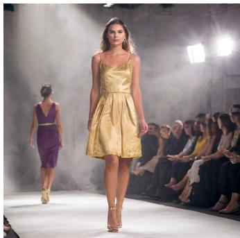

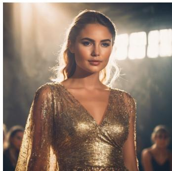  
Figure 5: Pool C N=4: VioletXL + catwalk + god rays + old gold. Left to right: ambient merge, composite, uniform LORASPACE.

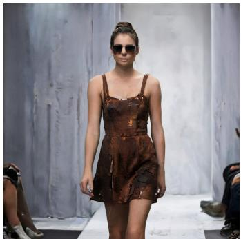

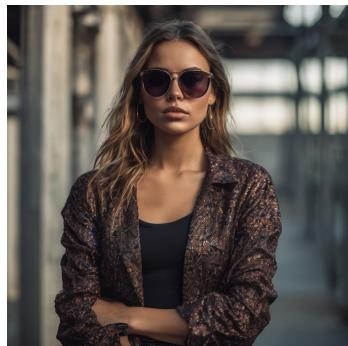

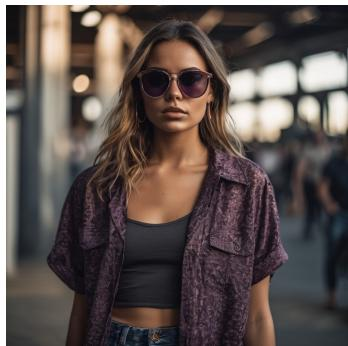  
Figure 6: Pool C N=6 (high-cardinality): VioletXL + catwalk + chiaroscuro + corrosion + fear + sunglasses.

## R Synthetic pool scaling stress test

To probe the asymptotic regime beyond real LoRA pools, we run $K \in \{ 4 , 8 , 1 6 , 3 2 , 6 4 \}$ random rank-8 LoRAs on SD 1.5 (N=4 active per call, 5 DPM-Solver++ [Lu et al., 2025] steps, 5122). composite’s per-step time grows from 0.119 to 0.681 s over the 16× pool growth at fixed N, while LORASPACE stays within 0.132 to 0.164 s and is 4.8× faster at $K { = } 6 4$ . Load-time GPU VRAM is constant at 2.16 to 2.18 GB for LORASPACE and grows linearly for composite. The crossover from composite-faster to LoRASpace-faster occurs at $\begin{array} { r } { \bar { K } \approx 8 ; } \end{array}$ the gap widens monotonically thereafter.

Note on composite scaling at fixed N. The per-step asymptotic in Tab. 4 is $O ( N L d ^ { 2 } S )$ , independent of K. The ∼ K growth measured here at N=4 reflects implementation-level overhead in the diffusers PEFT-loading path, which iterates over loaded LoRAs per step at small step counts. At the 50 denoising steps used in Pool C body measurements this overhead amortises and the per-step cost is dominated by the $O ( N L d ^ { 2 } S )$ term; the body Pool C numbers (Tab. 18) are consistent with that asymptotic.

## S Switch baseline scoreboard

We exclude single-active routing methods such as Switch [Fleshman and Van Durme, 2025] from the main composition comparison because they activate one LoRA at a time and never combine multiple LoRAs in a single forward pass. They are also order-sensitive by construction: rotating which LoRA fires at which step changes the output. For completeness, Table 21 reports Switch on the same pools as the main quality results.

Table 21: Switch baseline (one active LoRA at a time, same protocol as main results). Reported for completeness; not directly comparable to composition methods.
<table><tr><td>Pool</td><td>Setting</td><td>CLIP-T ↑</td><td>ImageReward ↑</td><td>DINO (vs. comp.)</td></tr><tr><td>Pool A SD 1.5</td><td>mean N = 2 to 5, 240 combos</td><td>35.81</td><td>1.14</td><td>0.73</td></tr><tr><td>Pool C SDXL</td><td>mean N = 2 to 6, 200 combos</td><td>32.10</td><td>1.15</td><td>0.79</td></tr><tr><td>Pool B SD 1.5</td><td>N = 7, 48 combos</td><td>36.43</td><td>1.23</td><td>0.69</td></tr><tr><td>Pool B SD 1.5</td><td>N = 8, 48 combos</td><td>36.10</td><td>1.10</td><td>0.65</td></tr><tr><td>LoRA-Retriever</td><td>Macro Task / samp.s -1</td><td colspan="3">51.54 Macro Task at 1.82 samp.s</td></tr></table>

The order-sensitivity manifests on Pool C at N=7 as a mean DINO self-similarity of 0.71 between canonical and reversed LoRA orderings, with 10/10 tested combos falling below the 0.95 orderinvariant threshold. Composition methods (merge, composite, LORASPACE) are order-invariant by design.

## T LLM D ablation: saturation and rank-orthogonality

The rank-overlap framework predicts two qualitatively different regimes for D as $K _ { \mathrm { p o o l } }$ grows. In the rank-bound regime $( \sum _ { i } r _ { i } < d )$ , D grows sub-linearly with K when LoRAs share structure. In the saturation regime $( \sum _ { i } { \dot { r _ { i } } } \geq d )$ , D is capped at the layer width and each new LoRA adds at most one new direction.

We measure both regimes empirically.

LoRA-Retriever near-orthogonality (rank-bound regime). The LLaMA-2-7B LoRA-Retriever pool (K=48) [Zhao et al., 2024] has uniform $r _ { i } = 8 , \textstyle \sum _ { i } r _ { i } = 3 8 4$ , against $d = 4 0 9 6$ . Across pool size sweeps with $K \in \{ 2 , 4 , 8 , 1 6 , 3 2 , 4 8 \}$ , the rank-fill ratio stays at $\rho \ge 0 . 9 4$ throughout, with $\beta = 0 . 9 4$ . LoRAs trained on disjoint NLP tasks (sentiment, machine translation, reading comprehension) contribute nearly orthogonal directions, consistent with tasks that share little structure (the pool sits at its spectrum-matched null, App. F).

LoRA-Hub saturation crossing (saturation regime). The LoRA-Hub FLAN-T5-Large pool [Huang et al., 2024] has $\begin{array} { r } { \tilde { K } \ = \ 1 9 6 \ \mathrm { L o R A s } ^ { } } \end{array}$ with uniform $r _ { i } ~ = ~ 1 6$ and layer width $d = 1 0 2 4$ . Saturation occurs at $K ^ { \star } = d / r = 6 4$ , where $K \cdot r = d .$ We measure $\bar { D }$ across $K \in \{ 4 , 8 , 1 6 , 3 2 , 6 4 , 1 2 8 , 1 9 6 \}$ . Below $K ^ { \star }$ , each new LoRA adds approximately 11 new dimensions to D¯. Above $K ^ { \star }$ , each new LoRA adds approximately 1 new dimension, consistent with the saturation prediction. At the full pool $K = 1 9 6 , \stackrel { \triangledown } { \vec { D } } = 8 1 0$ , which is 79% of layer width: the subspace never fully fills even at 3× saturation K, leaving residual capacity for additional LoRAs.

This is the first measurement we are aware of that crosses the saturation boundary in a real LoRA pool. It validates the framework’s prediction of a regime change at $K = d / r$ and provides an empirical anchor for what to expect at very large pool sizes. Our diffusion pools are already width-saturated on most layers (App. D), but none was swept across the boundary, so LoRA-Hub is the only pool where we observe the crossing itself.

## U LLM cross-modality: full scoreboard and extended discussion

Table 22: Full LoRA-Retriever benchmark [Zhao et al., 2024] on LLaMA-2-7B [Touvron et al., 2023] (48 LoRAs, 2,395 samples, 14 methods). Bold = best non-Oracle; underline = best non-LORASPACE non-Oracle.
<table><tr><td>Method</td><td>Macro Task</td><td>Macro Domain</td><td>samp/s</td></tr><tr><td>base (no LoRA)</td><td>4.24</td><td>4.17</td><td>0.60</td></tr><tr><td>oracle (task-matched)</td><td>57.54</td><td>59.55</td><td>1.91</td></tr><tr><td>merge (Task Arithmetic)</td><td>45.72</td><td>46.96</td><td>2.18</td></tr><tr><td>ties</td><td>48.71</td><td>51.39</td><td>1.93</td></tr><tr><td>dare</td><td>40.86</td><td>41.22</td><td>2.04</td></tr><tr><td>knots</td><td>45.44</td><td>47.01</td><td>0.31</td></tr><tr><td>spectr</td><td>41.90</td><td>42.74</td><td>0.97</td></tr><tr><td>lorahub</td><td>46.19</td><td>46.68</td><td>0.12</td></tr><tr><td>switch</td><td>51.54</td><td>52.69</td><td>1.82</td></tr><tr><td>loraretriever-mixture</td><td>53.55</td><td>56.43</td><td>1.47</td></tr><tr><td>loraretriever-fusion</td><td>43.56</td><td>44.14</td><td>1.77</td></tr><tr><td>loraspace-fullpool (no retrieval)</td><td>50.49</td><td>53.00</td><td>1.48</td></tr><tr><td>loraspace-instructor</td><td>54.01</td><td>56.79</td><td>1.44</td></tr><tr><td>loraspace-hybrid</td><td>54.51</td><td>57.20</td><td>1.52</td></tr></table>

Why loraretriever-fusion underperforms loraretriever-mixture. Fusion mode forms a fused left factor $\begin{array} { r } { \bar { A } = \sum _ { p } w _ { p } A _ { p } } \end{array}$ and fused right factor $\begin{array} { r } { \bar { B } = \sum _ { p } w _ { p } B _ { p } } \end{array}$ , then applies B¯A¯: this introduces cross-products $B _ { p } A _ { q }$ for $p \neq q .$ which are not part of the target delta sum $\begin{array} { r } { \sum _ { p } w _ { p } B _ { p } A _ { p } . } \end{array}$ These cross-terms are approximation errors that degrade composition quality relative to the clean mixture mode, explaining the substantial score difference (43.56 vs. 53.55 Macro Task).

Ablation decomposition. The loraspace-hybrid score (54.51) decomposes as: loraspace-fullpool (50.49) + INSTRUCTOR retrieval gate (+3.52) + calibrated spectral routing over retrieved subset (+0.50). The substrate alone (50.49) is above all static merges but below the retrieval-augmented baselines. The retrieval gate is the dominant quality driver, as expected for a pool of 48 highly diverse task LoRAs.

Per-domain breakdown. loraspace-hybrid beats Oracle on five of ten domains (commonsense, closed-book QA, sentiment, coreference, translation) where blending complementary LoRAs helps. Losses concentrate on format-sensitive domains (reading comprehension, NLI, structured generation) where blending dilutes the precise output format required by the task-matched LoRA.

## V Limitations

This appendix collects the empirical scope and assumptions of the work referenced from §5.

Pool coverage and post-saturation behaviour. The empirical characterisation in §4.2 covers three diffusion pools (Pool A, B, C) and two LLM pools (LoRA-Retriever and LoRA-Hub). The diffusion pools already exceed the layer width on most layers (App. D), but only the LoRA-Hub pool is swept across the saturation boundary (Appendix T), so how D grows past it on diffusion pools is extrapolated rather than measured.

Changing pools. The substrate is computed for a given pool, and in deployment pools change. An unchanged substrate has no tolerance budget for a new LoRA. Projected onto the existing bases, a held-out Pool C adapter keeps only 0.30 of its energy on average, and a larger existing pool does not fix this (App. I). Extending the bases with the new adapter’s residual directions admits it in 33 s on CPU without recomputing the pool, and reproduces the full-recompute images, but the composed error grows slowly as arrivals accumulate (3.3% after the first to 6.4% after the eleventh, against 0.84% for a fresh build). The update rule we use is to extend on arrival, monitor composed error, and rebuild periodically off the serving path. Removing an adapter needs no recomputation, because the bases still span the remaining adapters.

Interpreting the rank-fill ratio. The rank-fill ratio may combine within-LoRA redundancy with cross-LoRA overlap. App. F quantifies the two with the decomposition $\rho = \rho _ { \mathrm { i n t r a } } \times \rho _ { \mathrm { c r o s s } }$ and a spectrum-matched null.

Efficiency baselines. Efficiency conclusions depend on the baseline implementation. Our merge, composite and single-pass ambient baselines use the PEFT runtime. Against a single-pass ambient mixture, the dynamic-mode gain at τ = 0.99 comes from backbone-pass avoidance rather than from arithmetic inside the subspace (App. P).

Seed coverage of routing and mechanism ablations. The routing ablation (§4.5) is reported as mean ± across-seed standard deviation over three random seeds (240 stratified combinations per seed); the mechanism ablation (§4.3) is reported at a single seed. The main quality table (§4.3) reports CLIP-T and ImageReward across three random seeds with small across-seed standard deviations; GPT-4o evaluation is from one seed due to API cost. These are precision limitations rather than soundness ones: the across-seed standard deviations do not cross the inter-method gaps on ImageReward (where the routing pattern is established), and the pattern is consistent across N.

Layer scope. The operator is currently formulated for 1 × 1 linear projections, which covers all attention and most MLP modules in the diffusion and LLM backbones we test. Extensions to convolutional layers with kernel size larger than one, and to non-linear LoRA formats (DoRA, AdaLoRA), are out of scope here.

Router scope. The four routers we evaluate (uniform, spatial, temporal, semantic, plus the external retrieval coupling) are sufficient to demonstrate that the operator interface admits arbitrary {wi}, but they are simple hand-designed examples and not exhaustive. Learned routers, in particular, may exploit the shared subspace structure in ways not captured by hand-designed signals. We see this as a natural extension rather than a limitation of the framework itself.

Asset and identity considerations. The three Pool A character LoRAs (also used in Pool B) are public CivitAI LoRAs that reproduce the likeness of real people, and CivitAI has since removed them. We use them only as inputs to the composition benchmark. We do not show their generations, name the people, or redistribute the weights, and our released pool manifests list them by SHA-256 hash only. We do not propose new likeness models. Downstream use should follow source platforms policies and applicable law.

## W LoRA pools and prompts

This appendix lists every LoRA used in our diffusion and LLM pools, with category groupings, trigger words, and example combo prompts. SHA-256 hashes and stable source URLs are in the per-pool JSON manifests in the pools/ directory of the released code.

## W.1 Pool A (SD 1.5, 11 LoRAs, reality style)

Five categories: 3 character + 2 clothing + 2 style + 2 background + 2 object. All LoRAs at r=32, α=16 unless noted.

Table 23: Pool A LoRAs with trigger words. Source: CivitAI (URLs and SHA-256 hashes in the pool manifests).
<table><tr><td>ID</td><td>Name</td><td>Trigger words</td></tr><tr><td colspan="3">character</td></tr><tr><td>character_1</td><td>Real-person likeness LoRA</td><td>identity trigger and appearance descriptors (omitted)</td></tr><tr><td>character_2</td><td>Real-person likeness LoRA</td><td>identity trigger and appearance descriptors (omitted)</td></tr><tr><td>character_3</td><td>Real-person likeness LoRA</td><td>identity trigger and appearance descriptors (omitted)</td></tr><tr><td colspan="3">clothing</td></tr><tr><td>clothing_1</td><td>Thai University Uniform</td><td>mahalaiuniform, white shirt short sleeves, black pencil skirt</td></tr><tr><td>clothing_2</td><td>School Dress</td><td>school uniform, white shirt, red tie, blue pleated microskirt</td></tr><tr><td colspan="3">style</td></tr><tr><td>style_1</td><td>Japanese Film Color Style</td><td>film overlay, film grain</td></tr><tr><td>style_2</td><td>Bright Style</td><td>bright lighting</td></tr><tr><td colspan="3">background</td></tr><tr><td>background_1</td><td>Library Bookshelf</td><td>lib_bg, library bookshelf</td></tr><tr><td>background_2</td><td>Forest</td><td>slg, river, forest</td></tr><tr><td colspan="3">object</td></tr><tr><td>object_1</td><td>Umbrella</td><td>transparent umbrella</td></tr><tr><td>object_2</td><td>Bubble Gum</td><td>bubble gum</td></tr></table>

Pool A prompt template. Identical across all combos in the pool; combo selection only changes which trigger lists get concatenated.

RAW photo, subject, 8k uhd, dslr, high quality, Fujifilm XT3, half-length portrait from knees up, ⟨trigger\_1⟩, ⟨trigger\_2⟩, ...

For the negative prompt we use the 44-token ComposLoRA reality negative (artifact + stylecontamination + anatomy-failure tokens).

## Example Pool A combos.

• N=2, [character\_1, background\_2]: “RAW photo, subject, . . . , ⟨character\_1 triggers⟩, slg, river, forest”.

• N=5, [character\_1, clothing\_1, style\_1, background\_1, object\_1]: “RAW photo, subject, . . . , ⟨character\_1 triggers⟩, mahalaiuniform, white shirt short sleeves, black pencil skirt, film overlay, film grain, lib\_bg, library bookshelf, transparent umbrella”.

## W.2 Pool B (SD 1.5, 17 LoRAs, Pool A + 6 high-cardinality)

Pool A’s 11 LoRAs plus 6 new ones across 3 new categories: detail (2), pose (2), expression (2).   
Probes the high-cardinality regime (N ∈ {7, 8}) where rank-fill is lowest (ρ = 0.47 at K=17).

Pool B trigger deduplication. At N ≥ 7, the body of the prompt approaches CLIP-L’s 77-token limit. The Pool B body experiments use a compact trigger-deduplication rule (App. K) that drops repeated tokens across active LoRAs before assembly.

## W.3 Pool C (SDXL, 17 LoRAs)

Six categories: 3 character (r=32, α=16) + 3 background + 4 lighting + 4 material + 2 expression + 1 accessory (last five at r=128, α=1). SDXL backbone, 10242 generation.

Table 24: Pool B additional LoRAs (Pool A’s 11 plus 6 new).
<table><tr><td>ID</td><td>Name</td><td>Trigger words</td></tr><tr><td colspan="3">detail (quality enhancers, no explicit trigger)</td></tr><tr><td>detail_1 detail_2</td><td>Detail Tweaker Add More Details</td><td>(none) (none)</td></tr><tr><td>pose</td><td></td><td></td></tr><tr><td>pose_1</td><td>Shirt Tug Pose</td><td>shirt tug</td></tr><tr><td>pose_2</td><td>Covering Eyes Pose</td><td>covering eyes</td></tr><tr><td>expression</td><td></td><td></td></tr><tr><td>expression_1</td><td>Screaming / Open Mouth</td><td>open_mouth, screaming</td></tr><tr><td>expression_2</td><td>Sharp Eyes / Kubrick Stare</td><td>sharp_eyes</td></tr></table>

Table 25: Pool C LoRAs (SDXL).
<table><tr><td>ID</td><td>Name</td><td>Trigger words</td></tr><tr><td colspan="3">character</td></tr><tr><td>character_1</td><td>SL Nobodies CamelliaXL</td><td>CamelliaXL, a young woman, detailed face</td></tr><tr><td>character_2</td><td>SL Nobodies HelenaXL</td><td>HelenaXL, a young woman, detailed face</td></tr><tr><td>character_3</td><td>SL Nobodies VioletXL</td><td>VioletXL, a young woman, detailed face</td></tr><tr><td colspan="3">background</td></tr><tr><td>background_1</td><td>Polyhedron Catwalk</td><td>catwalk, runway, fashion show</td></tr><tr><td>background_3</td><td>Polyhedron Power Grid</td><td>energy, high voltage, power pole, transformer station, tangled cables</td></tr><tr><td>background_4</td><td>Polyhedron Dandelions</td><td>dandelion, dandelion seed, yellow dandelion</td></tr><tr><td colspan="3">lighting</td></tr><tr><td>lighting_2</td><td>Polyhedron God Rays</td><td>god rays, sunbeams, sunbeam</td></tr><tr><td>lighting_3</td><td>Polyhedron Chiaroscuro</td><td>chiaroscuro style, dim light</td></tr><tr><td>lighting_4</td><td>Polyhedron Fog</td><td>fog, haze, foggy, mist</td></tr><tr><td>lighting_5</td><td>Polyhedron Golden Hour</td><td>golden hour, sunset, sunrise</td></tr><tr><td colspan="3">material</td></tr><tr><td>material_1</td><td>Polyhedron Corrosion</td><td>corrosion, rust</td></tr><tr><td>material_2</td><td>Polyhedron Old Wood</td><td>old wood, wooden planks, wooden wall, wooden floor</td></tr><tr><td>material_3 material_4</td><td>Polyhedron Old Gold</td><td>gold, old gold</td></tr><tr><td></td><td>Polyhedron Old Copper</td><td>old copper, copper, patina, copper pot</td></tr><tr><td colspan="3">expression</td></tr><tr><td>expression_1</td><td>Polyhedron Anger</td><td>anger, screaming, angry</td></tr><tr><td>expression_3</td><td>Polyhedron Fear</td><td>fear, fearful, anxious</td></tr><tr><td colspan="3">accessory</td></tr><tr><td>accessory_3</td><td>Sunglasses on Top of Head</td><td>with sunglasses on top of head</td></tr></table>

## Example Pool C combos.

• N=4, [character\_1, background\_1, lighting\_2, material\_1]: “RAW photo, subject, . . . , CamelliaXL, a young woman, detailed face, catwalk, runway, fashion show, god rays, sunbeams, sunbeam, corrosion, rust”.

• N=6, [character\_2, background\_3, lighting\_4, material\_2, expression\_1, accessory\_3]: “RAW photo, subject, . . . , HelenaXL, . . . , energy, high voltage, power pole, transformer station, tangled cables, fog, haze, foggy, mist, old wood, wooden planks, wooden floor, anger, screaming, angry, with sunglasses on top ofhead”.

## W.4 LLM pool (LLaMA-2-7B, 48 task LoRAs, LoRA-Retriever benchmark)

48 task-specialised LoRAs from the LoRA-Retriever benchmark [Zhao et al., 2024], all r=8. We adopt the authors’ 10-domain grouping verbatim.

Table 26: LoRA-Retriever 48 task LoRAs by domain.
<table><tr><td>Domain (count)</td><td>Tasks</td></tr><tr><td>closed-book QA (4) commonsense (4)</td><td>arc_challenge, arc_easy, natural_questions, trivia_qa copa, hellaswag, piqa, story_cloze</td></tr><tr><td>coreference (2) NLI (10)</td><td>definite_pronoun_resolution, wsc</td></tr><tr><td></td><td>anli_r1, anli_r2, anli_r3, cb, mnli_matched, mnli_mismatched, qnli, rte, snli, wnli</td></tr><tr><td>paraphrase (4) RC w/ commonsense (2)</td><td>glue_mrpc, glue_qqp, paws_wiki, stsb</td></tr><tr><td>reading-comprehension (6)</td><td>cosmos_qa, record</td></tr><tr><td>sentiment (4)</td><td>bool_q, drop, multirc, openbookqa, squad_v1, squad_v2 imdb_reviews, sentiment140, sst2, yelp_polarity_reviews</td></tr><tr><td>structured-to-text (4)</td><td>common_gen, dart, e2e_nlg, web_nlg_en</td></tr><tr><td>translation (8)</td><td>para_crawl_enes, wmt14_enfr, wmt16_translate_csen, wmt16_translate_deen, wmt16_translate_fien,</td></tr></table>

LLM evaluation uses task-native prompts directly from the LoRA-Retriever benchmark (no LoRA trigger tokens; each LoRA is task-specialised, not concept-keyed). Multi-task composition replaces “compose multiple LoRAs for one image” with “compose multiple LoRAs for one prompt”: at inference, we activate either the full 48-pool substrate (loraspace-fullpool) or a top-K retrieved subset (loraspace-instructor / loraspace-hybrid).

## W.5 Combo selection protocol

For each pool we use stratified random sampling over $\binom { K } { N }$ combos with category-balance constraints (each combo activates at most one LoRA per category where pool design allows). Pool A and Pool B use 240 combos per seed across $N \in \{ 2 , 3 , 4 , 5 \}$ . Pool C uses 200 combos per method (40 per N across $N \in \{ 2 , \ldots , 6 \} )$ . Identical combo lists are shared across all methods within a pool to enable per-combo paired comparison.