# Learn to Modify: Self-evolving Multi-agent Refinement Framework for Conversational Text-to-Motion Generation

Jianan Li1, Jiawei Zhao1, Yangtao Zhou1, Zhifu Zhao2∗, Shaoxin Wu1, Yutao Wang1, Dezhen Wang3, Hua Chu1, Fu Li2

1School of Computer Science and Technology, Xidian University, Xi’an, China

2School of Artificial Intelligence, Xidian University, Xi’an, China

3School of Computer Science and Technology, Tongji University, Shanghai, China

lijianan@xidian.edu.cn, zhao\_jw@stu.xidian.edu.cn, hchu@mail.xidian.edu.cn, fuli@mail.xidian.edu.cn

## Abstract

Despite rapid progress in text-to-motion generation, existing methods are commonly designed for single-shot generation. When users are dissatisfied with specific motion details, they are often forced to regenerate the entire sequence from scratch, which is computationally ineficient and potentially destroys previously established kinematic context. A practical generation system should instead support iterative user feedback and refine only the afected spatio-temporal regions while preserving the remaining motion. Therefore, we introduce a conversational motion generation paradigm that requires the system to coordinate instruction understanding, motion generation, localized editing, and quality assessment. Recent advances in LLM-driven multi-agent systems provide a promising foundation for such role-specialized coordination. To tackle these challenges, a Self-evolving Multi-Agent RefinemenT Framework (SMART) is proposed for conversational motion generation. Within SMART, to preserve semantic consistency, we design a semantic-guided masked motion editing mechanism, which precisely grounds natural language feedback into spatiotemporal motion regions to enable localized refinements without altering unedited regions. To reduce redundant exploration, we propose a memory-based self-evolving strategy that dynamically accumulates motion editing knowledge from interaction history and reuses past successful experience. Extensive experiments demonstrate that SMART efectively supports multi-turn conversational motion generation and enables eficient motion refinement.

## Introduction

Text-to-Motion (T2M) generation (Zhu et al. 2023; Chen et al. 2024; Yu et al. 2024), which aims to synthesize realistic human motions from natural language descriptions, has emerged as a fundamental task with broad applications in gaming, virtual reality, and robotics (Guo et al. 2025; Tashakori et al. 2025; Zitkovich et al. 2023). Despite recent progress, T2M generation remains challenging because it requires both accurate language understanding and faithful translation of textual semantics into temporally coherent motion sequences.

Existing T2M methods have explored diverse generation paradigms. Autoencoder-based methods (Zhang et al. 2023b; Zhong et al. 2023; Geng et al. 2024) learn compact latent motion representations for synthesis. GAN-based methods (Ahn et al. 2018; Xu et al. 2023; Ahuja and Morency 2019) improve motion realism through adversarial training. Autoregressive methods (Jiang et al. 2023; Zhang et al. 2023a; Guo et al. 2022b) model motions as discrete token sequences. And difusion-based methods (Tevet et al. 2022; Huang et al. 2024; Yang, Su, and Wen 2023) generate motions through iterative denoising. Recently, driven by rapid advancements in large language models (LLMs) (Achiam et al. 2023; Zhao et al. 2023; Li et al. 2025), LLM-based motion generation approaches (Jiang et al. 2023; Wang et al. 2024b; Wu et al. 2025) have made significant strides in generating high-fidelity motions that align with complex textual instructions.

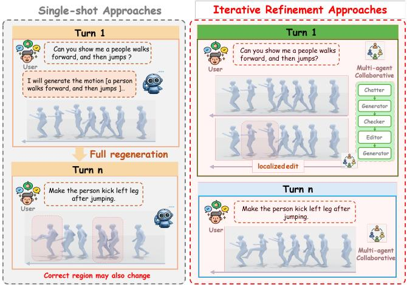  
Figure 1: Comparison of single-shot generation and iterative refinement. Conventional methods regenerate the entire motion, hindering fine-grained correction. Our multi-agent framework uses multi-turn feedback to progressively refine motion details while preserving established context.

However, most existing approaches are still designed for single-shot generation. When users are dissatisfied with specific motion details, they usually have to regenerate the entire sequence from scratch. Such a paradigm is computationally ineficient and may discard previously established kinematic context, causing unnecessary changes to motion regions that are already semantically correct. This limitation is particularly problematic in real-world creative workflows, where users often refine their intent progressively through feedback rather than specifying all desired details in a single instruction.

These observations motivate a more user-centric setting, namely conversational motion generation, where motions are iteratively refined through multi-turn natural language interaction. Unlike single-shot generation, this setting requires the system to coordinate instruction understanding, motion synthesis, localized editing, quality assessment, and longterm interaction memory. Recent advances in multi-agent systems (Cardoso and Ferrando 2021; Calegari et al. 2021) provide a promising foundation for such role-specialized coordination. Nevertheless, instantiating conversational motion generation with multi-agent refinement remains challenging. First, personalized edits usually target only specific body parts or temporal segments, but naive refinement may unintentionally alter already correct motion regions and compromise global semantic consistency. Second, without an explicit memory mechanism, agents may repeatedly explore similar editing strategies across interaction turns, leading to redundant reasoning and ineficient refinement.

To address these challenges, we propose SMART, a Selfevolving Multi-Agent RefinemenT framework for conversational motion generation. SMART organizes multiple rolespecialized agents into a closed-loop workflow for instruction rewriting, motion generation, video-text checking, and localized editing. A semantic-guided masked motion editing mechanism is designed to use a Vision-Language Model (VLM) to ground natural-language feedback into a mask matrix, enabling precise refinement while preserving unafected motion regions. To reduce redundant exploration, SMART further incorporates a memory-based self-evolving strategy that accumulates and updates generation knowledge from interaction history, allowing the system to optimize generation motion over multiple turns. We further implement an interactive conversational platform to evaluate SMART under realistic multi-turn refinement scenarios. Extensive experiments demonstrate that SMART efectively supports conversational motion refinement, preserves unafected motion regions, and improves refinement eficiency across interaction rounds. Our contributions are summarized as follows. The main contributions of this work are summarized as follows:

• We formulate conversational motion generation and propose SMART, a self-evolving multi-agent refinement framework that supports iterative text-to-motion refinement through multi-turn natural language interaction.

• We design a semantic-guided masked motion editing mechanism that converts structured feedback into spatiotemporal editing masks, enabling localized refinement while preserving unafected motion regions.

• We develop a memory-based self-evolving strategy that accumulates successful failure–repair experiences and reuses them to reduce redundant exploration during multiturn refinement.

## Related Work

## Text-to-Motion Generation

Existing text-to-motion (T2M) methods can be broadly categorized into autoencoder-based, GAN-based, autoregressive, and difusion-based approaches. Autoencoder-based methods (Zhang et al. 2023b; Zhong et al. 2023; Geng et al. 2024) learn compact latent representations to capture motion structures, while GAN-based methods (Ahn et al. 2018; Xu et al. 2023; Ahuja and Morency 2019) employ adversarial learning to improve motion realism and diversity. Autoregressive methods generate discrete motion tokens sequentially. For example, MoMask (Guo et al. 2024) adopts masked token prediction with residual refinement to improve generation eficiency, whereas MotionChain (Jiang et al. 2024) and Motion-Agent (Wu et al. 2025) incorporate language-based planning to support more complex motion tasks. Difusion-based methods iteratively denoise motion sequences conditioned on textual descriptions. MotionDifuse (Zhang et al. 2024) introduces text-conditioned difusion with temporal modeling, MDM (Tevet et al. 2022) directly predicts clean motion samples with geometric losses, and ReMoDifuse (Zhang et al. 2023c) enhances text-motion alignment through retrieval-augmented generation.

## LLM-based motion generation

Large language models (LLMs) have demonstrated strong capabilities in language understanding, task decomposition, tool invocation, and self-correction (Chang et al. 2024; Ruan et al. 2023; Wu et al. 2023; Li et al. 2023; Wang et al. 2025b, 2024a). These capabilities have motivated agent-based generative systems that coordinate specialized tools for complex generation and editing tasks (Durante et al. 2024; Masterman et al. 2024). For instance, GenArtist (Wang et al. 2024c) employs a multimodal agent to select and coordinate visual tools, demonstrating the potential of agents to unify generation and editing. In motion generation, MotionGPT (Jiang et al. 2023) represents motions as discrete tokens and unifies text and motion modeling within a language-modeling framework. MotionGPT-2 (Wang et al. 2024b) further extends this paradigm to motion generation, understanding, and editing. We summarize the capabilities of representative motion generation and editing methods in Table 1, comparing them across multi-turn dialogue, motion editing, automatic checking, cross-turn Context, and no extra training requirements.

<table><tr><td>Method</td><td>Multi-turn Dialogue</td><td>Motion Editing</td><td>Automatic Checking</td><td>Cross-turn Context</td><td>No Extra Training</td></tr><tr><td>Motion-Agent</td><td>√</td><td>√</td><td>X</td><td>√</td><td>x</td></tr><tr><td>MotionChain</td><td>√</td><td>√</td><td>X</td><td>√</td><td>x</td></tr><tr><td>MotionGPT-2</td><td>x</td><td>√</td><td>x</td><td>X</td><td>x</td></tr><tr><td>MotionFix</td><td>x</td><td>√</td><td>X</td><td>x</td><td>x</td></tr><tr><td>SMART</td><td>√</td><td>√</td><td>√</td><td>√</td><td>√</td></tr></table>

Table 1: Capability comparison with representative motion generation and editing methods. ✓ and ✗ denote supported and unsupported capabilities, respectively.

## Problem Formulation

For multi-turn interactive human motion generation, the system continuously updates a motion according to a sequence of user instructions while maintaining consistency with previously accepted interaction outcomes.

Let U and X denote the user instructions and human motions, respectively. A motion sequence is represented as $\mathbf { x } \in \mathbb { R } ^ { T \times D }$ , where $T$ denotes the sequence length and D is the dimensionality of the motion representation at each frame. And let $u ^ { ( 0 ) } \in \mathcal { U }$ denote the initial motion description and $u ^ { ( k ) } \in \mathcal { U }$ denote the user instruction at the k-th interaction round, where $k \geq 1$ . The initial motion is defined as $\mathbf { X } ^ { ( 0 ) }$ After each user-level interaction round, the system maintains an interaction history defined as

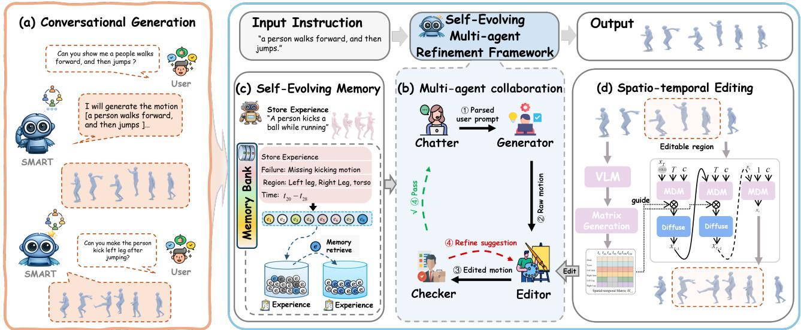  
Figure 2: Overview of SMART. (a) Iterative motion refinement through conversational motion generation. (b) Multi-agent collaboration among the Chatter, Generator, Editor, and Checker for instruction alignment, motion synthesis, localized editing, and semantic verification. (c) Self-evolving strategy that accumulates generation experiences for motion refinement. (d) Semantic guided motion editing that localizes user feedback with a Vision-Language Model (VLM) and refines selected motion regions while preserving unmasked content.

$$
\mathcal { H } ^ { ( k ) } = \left\{ \left( u ^ { ( i ) } , \mathbf { X } ^ { ( i ) } , r ^ { ( i ) } \right) \right\} _ { i = 0 } ^ { k } ,\tag{1}
$$

where $\mathbf { m } ^ { ( i ) }$ is the accepted motion after the i-th interaction round, and $r ^ { ( i ) }$ denotes the corresponding interaction record, such as the verification outcome, refinement summary, or user confirmation. For a subsequent user instruction $\dot { u } ^ { ( k ) }$ the system updates the motion by jointly considering the previously accepted motion and the historical interaction context:

$$
\mathbf { X } ^ { ( k ) } = \mathcal { P } \left( \mathbf { X } ^ { ( k - 1 ) } , u ^ { ( k ) } , \mathcal { H } ^ { ( k - 1 ) } \right) , \qquad k \geq 1 ,\tag{2}
$$

where P denotes the interactive motion generation process. Additionally, user instructions in each turn are resolved through multiple internal multi-agent refinement cycles. Specifically, let $\mathbf { x } _ { \ell } ^ { ( k ) }$ denote the candidate motion obtained at the ℓ-th internal refinement cycle for the k-th user instruction, where $\ell = 0 , \ldots , L _ { \mathrm { m a x } }$ and $L _ { \mathrm { m a x } }$ is the maximum number of refinement cycles. At each internal cycle, the multi-agent system takes the current candidate motion and the available experience memory as input to produce an updated candidate together with verification feedback:

$$
\begin{array} { r } { \left( \tilde { \mathbf { X } } _ { \ell } ^ { ( k ) } , r _ { \ell } ^ { ( k ) } , \mathcal { B } _ { \ell } ^ { ( k ) } \right) = \boldsymbol { \Phi } _ { \mathrm { S M A R T } } \left( \tilde { \mathbf { X } } _ { \ell - 1 } ^ { ( k ) } , \mathcal { B } _ { \ell - 1 } ^ { ( k ) } \right) , } \end{array}\tag{3}
$$

where Φ denotes one internal multi-agent refinement cycle, $r _ { \boldsymbol { \ell } } ^ { ( k ) }$ is the verification feedback for the current candidate, and $B _ { \ell } ^ { ( k ) }$ represents the available experience memory after the ℓ-th refinement cycle. This formulation allows SMART to iteratively revise a candidate motion according to intermediate feedback, rather than relying on a single-pass generation outcome.

## Self-evolving Multi-agent Refinement Framework

An overview of SMART is illustrated in Fig. 2. SMART formulates conversational motion generation as a multi-agent self-evolving refinement process. The framework operates at two levels. At the outer level, the user progressively refines an initially generated motion through a sequence of naturallanguage instructions, as shown in Fig. 2(a). At the inner level, each user instruction is resolved through agent-driven refinement cycles within SMART. It adopts a role-specialized directed workflow with explicit motion states and verification feedback. Moreover, SMART introduces a memory-based self-evolving mechanism that records successful refinement experiences and reuses them in later interaction rounds. In this way, the framework not only supports closed-loop motion refinement within each turn but also improves refinement eficiency across turns through accumulated historical experience.

## Multi-agent Workflow

SMART decomposes the overall process into several rolespecialized agents with explicit interfaces. Specifically, Chatter and Generator initialize a motion proposal, whereas Editor and Checker iteratively refine it through a closed-loop feedback mechanism.

Chatter Agent To resolve semantic ambiguity, nonstandard, or context- dependent expression, the Chatter Agent rewrites raw user inputs into standardized and motion-oriented descriptions before motion synthesis.

Given the current user instruction $u ^ { ( k ) }$ and the dialogue history $\mathcal { H } ^ { ( k - 1 ) }$ , the LLM-based prompt synthesizer $\mathcal { P } _ { \mathrm { c h a t } }$ rewrites the raw input into a standardized motion description:

$$
C ^ { ( k ) } = { \mathcal { P } } _ { \mathrm { c h a t } } \left( { \mathcal { H } } ^ { ( k - 1 ) } , u ^ { ( k ) } \right) .\tag{4}
$$

The prompt used by the LLM-based prompt synthesizer $\mathcal { P } _ { \mathrm { c h a t } }$ is defined as follows:

Act as a motion description rewriting agent. Given the dialogue <History> and the current <User Input>, rewrite the input into a standardized motion description. The rewritten description should preserve the original user intent while resolving ambiguous, non-standard, or colloquial expressions. Output only the rewritten <MotionDescription> without any explanation.

Generator Agent Given the standardized motion description $C ^ { ( k ) }$ produced by Chatter, the Generator Agent aims to synthesize a corresponding human motion sequence. In our implementation, we use an existing text-to-motion model as an external tool for generating human motions. Notably, SMART does not rely on a specific motion generator. Formally, conditioned on the rewritten motion description $C ^ { ( k ) }$ Generator samples a raw motion proposal $\mathbf { X } _ { \mathrm { r a w } } ^ { ( k ) } \in \mathbb { R } ^ { L \times D }$ from the existing text-to-motion model, where L is the number of frames, and D is the dimensionality of the motion feature at each frame. For the first interaction round, $\mathbf { X } _ { \mathrm { r a w } } ^ { ( 0 ) }$ serves as the initial motion, while in subsequent rounds it provides a raw proposal for verification and refinement.

Checker Agent The Checker Agent verifies whether a candidate motion is semantically consistent with the standardized motion description and determines whether it can be accepted. Since user instructions often involve open-vocabulary and compositional semantics, feature-level distances or predefined action classifiers are insuficient for reliable verification.

Checker first renders the candidate motion into a video $V _ { \ell } ^ { ( k ) }$ by converting the generated motion representation into 3D joint coordinates. Then, the rendered video $V _ { \ell } ^ { ( k ) }$ and the standardized motion description $C ^ { ( k ) }$ are fed into a VLM-based evaluation function $\Psi \bar { ( \cdot ) }$ to produce a structured feedback report $F _ { \ell } ^ { ( k ) }$ . In our implementation, we use Qwen-VL (Bai et al. 2023) as the visual semantic evaluator, and the detailed prompt design is provided in the Appendix. Beyond a binary accept-or-reject decision, our feedback report is decomposed into three components:

$$
F _ { \ell } ^ { ( k ) } = \left( O _ { \ell } ^ { ( k ) } , { \mathcal T } _ { \ell } ^ { ( k ) } , E _ { \ell } ^ { ( k ) } \right) ,\tag{5}
$$

where $O _ { \ell } ^ { ( k ) }$ denotes the body-part regions that require refinement, $\mathcal { T } _ { \ell } ^ { ( k ) }$ denotes the temporal intervals where the inconsistency occurs, and $E _ { \ell } ^ { ( k ) }$ denotes the corresponding editing instruction. If the candidate motion isjudged to be satisfactory, Checker outputs an empty feedback report, $F _ { \ell } ^ { ( k ) } = \varnothing$ , and the current interaction can be stored as a successful experience. Otherwise, $F _ { \ell } ^ { ( k ) }$ is passed to the Editor agent for localized refinement.

Editor Agent The Editor Agent converts the structured feedback into a localized refinement operation. Instead of regenerating the entire motion sequence, the Editor performs targeted motion editing based on the detected error regions. Specifically, when the feedback report is non-empty, i.e., $F _ { \ell } ^ { ( k ) } \neq \varnothing$ , Editor takes the current candidate motion $\mathbf { X } _ { \ell } ^ { ( k ) }$ and the feedback report $F _ { \ell } ^ { ( k ) }$ as inputs, and produces a refined motion candidate for the next refinement cycle:

$$
\begin{array} { r } { \hat { \mathbf { X } } _ { \ell + 1 } ^ { ( k ) } = \mathcal { E } _ { \mathrm { e d i t } } \left( \mathbf { X } _ { \ell } ^ { ( k ) } , F _ { \ell } ^ { ( k ) } \right) , } \end{array}\tag{6}
$$

where $\mathcal { E } _ { \mathrm { e d i t } } ( \cdot )$ denotes the semantic-guided masked motion editing process. After editing, the refined candidate $\hat { \mathbf { X } } _ { \ell + 1 } ^ { ( k ) }$ is sent back to Checker for another round of video-text semantic verification. This Editor–Checker loop continues until the candidate motion is accepted or the maximum refinement budget is reached. This editing strategy will be detailed in the next section.

## Semantic-guided Masked Motion Editing Mechanism

Instead of global regeneration, we introduce a semanticguided masked motion editing mechanism that updates only the regions indicated by Checker while preserving the remaining motion content. Given the candidate motion $\mathbf { X } _ { \boldsymbol { \ell } } ^ { ( k ) }$ and a non-empty feedback report $F _ { \ell } ^ { ( k ) } = ( O _ { \ell } ^ { ( k ) } , \mathcal { T } _ { \ell } ^ { ( k ) } , E _ { \ell } ^ { ( \check { k } ) } )$ from Checker, the editing module first parses the feedback into executable spatio-temporal constraints. The body-part feedback $O _ { \ell } ^ { ( k ) }$ is selected from a predefined six-part body partition:

$$
\mathcal { O } = \{ o _ { 0 } , o _ { 1 } , o _ { 2 } , o _ { 3 } , o _ { 4 } , o _ { 5 } \} ,\tag{7}
$$

where the six regions correspond to the head, torso, left arm, right arm, left leg, and right leg, respectively. Each selected body part is mapped to its associated skeletal joints and then to the corresponding motion feature channels according to the adopted motion representation. The temporal feedback $\mathcal { T } _ { \ell } ^ { ( k ) } = \{ \tau _ { j } \} _ { j = 1 } ^ { n }$ specifies the erroneous intervals, where each interval is denoted as $t a u _ { j } = ( t _ { j } ^ { s } , t _ { j } ^ { e } )$ . The editing instruction $E _ { \ell } ^ { ( k ) }$ provides a short semantic correction, such as “make the right arm wave” or “replace the sitting action with turning around”, and is used to construct the local editing condition.

Based on the parsed body-part and temporal constraints, we construct a binary spatio-temporal mask:

$$
\mathbf { M } _ { \ell } ^ { ( k ) } \in \{ 0 , 1 \} ^ { L \times D } ,\tag{8}
$$

where L denotes the number of frames and D denotes the dimensionality of the motion feature. The mask is defined as

$\mathbf { M } _ { \ell } ^ { ( k ) } ( l , d ) = { \left\{ \begin{array} { l l } { 1 , } & { { \mathrm { i f ~ } } ( l , d ) } \\ { 0 , } & { { \mathrm { o t h e r w i } } } \end{array} \right. }$ belongs to the editable region, se,

(9)

where l indexes the frame and d indexes the motion feature channel. To avoid abrupt transitions between edited and preserved regions, we apply temporal smoothing to the binary mask:

$$
\begin{array} { r } { \hat { \mathbf { M } } _ { \ell } ^ { ( k ) } = \mathbf { M } _ { \ell } ^ { ( k ) } * \mathcal { K } , } \end{array}\tag{10}
$$

where K is a one-dimensional Gaussian kernel applied along the temporal axis. The resulting soft mask $\hat { \mathbf { M } } _ { \ell } ^ { ( k ) } \in [ 0 , 1 ] ^ { L \times \bar { D } }$ enables smooth blending around editing boundaries.

Next, the smoothed mask matrix $\hat { \mathbf { M } } _ { \ell } ^ { ( \overline { { k } } ) }$ combined with the editing instruction $E _ { \ell } ^ { ( k ) }$ to perform motion editing under the mask guidance:

$$
\mathbf { X } _ { \ell + 1 } ^ { ( k ) } \sim P _ { G } ( \cdot \mid \mathbf { X } _ { \ell } ^ { ( k ) } \odot ( 1 - \hat { \mathbf { M } } _ { \ell } ^ { ( k ) } ) , E _ { \ell } ^ { ( k ) } ) ,\tag{11}
$$

where ⊙ denotes element-wise multiplication, $P _ { G }$ is instantiated by t2m model in our implementation. The refined motion $\mathbf { X } _ { \ell + 1 } ^ { ( k ) }$ is sent back to Checker for video-text semantic verification. If accepted, it is committed as the output of the current interaction round; otherwise, the Editor–Checker loop continues until the maximum refinement budget is reached.

## Memory-based Self-Evolving Strategy

We introduce a memory-based self-evolving strategy that stores successful failure-repair experiences in a memory bank and retrieves relevant cases for later editing rounds. Diferent from online model updating, SMART evolves at the experience level by accumulating reusable motion editing knowledge from historical interactions.

Memory bank construction In the memory bank B, each entry corresponds to a case where the Editor corrects the inconsistency detected by the Checker and then accepts it in subsequent verification. Formally, the j-th experience entry $e _ { j } \in \bar { B }$ is represented as

$$
e _ { j } = ( \Lambda _ { j } , E _ { j } , O _ { j } , \mathcal { T } _ { j } ) ,\tag{12}
$$

where $\Lambda _ { j }$ denotes the semantic keyword set of the refinement case, $E _ { j }$ denotes the editing instruction, $O _ { j }$ denotes the involved body-part regions, and $\tau _ { j }$ denotes the temporal region of the correction.

Memory update The memory update is triggered when a previously failed candidate is successfully refined and accepted by Checker. Suppose Checker produces a non-empty feedback report $F _ { \ell } ^ { ( k ) } = ( \mathsf { \bar { O } } _ { \ell } ^ { ( k ) } , \mathcal { T } _ { \ell } ^ { ( k ) } , E _ { \ell } ^ { \mathit { ( k ) } } )$ at the ℓ-th refinement cycle, and the edited motion is later accepted. SMART extracts a semantic keyword set from the standardized description and the feedback:

$$
\Lambda _ { \ell } ^ { ( k ) } = \mathrm { E x t r a c t } \left( C ^ { ( k ) } , F _ { \ell } ^ { ( k ) } \right) ,\tag{13}
$$

where Extract(·) denotes a prompt-based LLM keyword extraction function that captures action types, body parts, temporal cues, and motion attributes. The successful refinement experience is then written into the memory bank:

$$
\boldsymbol { B } \gets \boldsymbol { B } \cup \left\{ \left( \boldsymbol { \Lambda } _ { \ell } ^ { ( k ) } , E _ { \ell } ^ { ( k ) } , O _ { \ell } ^ { ( k ) } , \mathcal { T } _ { \ell } ^ { ( k ) } \right) \right\} .\tag{14}
$$

Memory retrieval When Checker produces a non-empty feedback report in a later refinement cycle, SMART retrieves relevant historical experiences to assist the current editing process. Given the query keyword set ${ \Lambda } _ { \ell } ^ { ( k ) }$ and a memory entry $e _ { j } = ( \Lambda _ { j } , E _ { j } , O _ { j } , \mathcal { T } _ { j } )$ , SMART retrieves the most rele vant experience by maximizing the Jaccard overlap between keyword sets:

$$
e ^ { * } = \arg \operatorname* { m a x } _ { e _ { j } \in \mathcal { B } } \frac { \left| \Lambda _ { \ell } ^ { ( k ) } \cap \Lambda _ { j } \right| } { \left| \Lambda _ { \ell } ^ { ( k ) } \cup \Lambda _ { j } \right| } , \quad \mathrm { s . t . } \ O _ { \ell } ^ { ( k ) } \cap O _ { j } \neq \emptyset .\tag{15}
$$

Here, $O _ { \ell } ^ { ( k ) }$ denotes the body-part regions identified in the current feedback, while $O _ { j }$ denotes the body-part regions stored in the historical experience. This constraint filters out experiences that are semantically similar but spatially unrelated, ensuring that the retrieved memory provides editing cues for relevant body regions.

Memory-guided feedback enhancement The retrieved experience $e ^ { * } = ( \Lambda ^ { * } , E ^ { * } , O ^ { * } , T ^ { * } )$ serves as a memory prior for the current feedback $F _ { \ell } ^ { ( k ) } = ( O _ { \ell } ^ { ( k ) } , \mathcal { T } _ { \ell } ^ { ( k ) } , E _ { \ell } ^ { ( k ) } )$ . Rather than directly replacing the current feedback, SMART integrates them to construct memory-enhanced feedback:

$$
\bar { F } _ { \ell } ^ { ( k ) } = \mathrm { E n h a n c e } \left( F _ { \ell } ^ { ( k ) } , e ^ { * } \right) = \left( \bar { O } _ { \ell } ^ { ( k ) } , \bar { \mathcal { T } } _ { \ell } ^ { ( k ) } , \bar { E } _ { \ell } ^ { ( k ) } \right)\tag{16}
$$

where $\bar { O } _ { \ell } ^ { ( k ) }$ expands the current body-part regions with the retrieved experience, $\bar { \mathcal { T } } _ { \ell } ^ { ( k ) }$ merges the current and historical temporal intervals, and $\bar { E } _ { \ell } ^ { ( k ) }$ fuses the current and historical editing instructions through prompt-based text merging. Finally, the Editor performs masked motion editing with the enhanced feedback.

## Experiments

## Experimental Setup

To comprehensively evaluate the performance and generalizability of our interactive motion generation framework,

We conduct experiments on two benchmark datasets: HumanML3D (Guo et al. 2022a) and KIT-ML (Plappert, Mandery, and Asfour 2016). These datasets cover diverse motion types, annotation styles, and levels of semantic complexity, enabling a comprehensive evaluation across diferent scenarios. Note that, for the comparison experiments, we instantiate SMART with SALAD as the motion generator on both datasets. For ablation studies, we use an MDM-based generator on HumanML3D unless otherwise specified.

Evaluation metrics Our evaluation consists of two parts. First, we adopt standard text-to-motion metrics to measure the overall quality of generated motions. Since standard T2M metrics mainly evaluate single-shot generation, we further introduce refinement-oriented metrics carefully designed for our conversational motion generation setting to assess the efectiveness of iterative motion editing. (1) Standard Textto-Motion Metrics. We adopt standard quantitative metrics, including R-Precision, FID, MM Dist and Diversity, following previous works (Guo et al. 2022a) on the HumanML3D and KIT-ML test set. These metrics jointly evaluate semantic alignment, distributional fidelity, and diversity of the generated motions. (2) Conversational Motion Evaluation Metrics. We further evaluate Text-Motion Similarity (TMS), Refinement Success Rate (RSR), and Local Preservation Ability (LPA). TMS measures the semantic consistency between the generated motion and the target instruction using cosine similarity between text and motion embeddings. RSR reports the proportion of refinement cases accepted by the Checker within the allowed refinement budget, reflecting the efectiveness of the closed-loop refinement process. LPA measures the similarity of unedited motion regions before and after refinement.

<table><tr><td>Datasets</td><td>Methods</td><td>Top-1↑</td><td>Top-2↑</td><td>Top-3↑</td><td>FID↓</td><td>MM Dist↓</td><td>Diversity→</td></tr><tr><td rowspan="12">HumanML3D</td><td>Real Motion</td><td>0.511±.003</td><td>0.703±.003</td><td>0.797±.002</td><td>0.002±.000</td><td>2.974±.008</td><td>9.503±.065</td></tr><tr><td>MDM (Tevet et al. 2022)</td><td>0.320±.005</td><td>0.498±.004</td><td>0.611±.007</td><td>0.544±.044</td><td>5.566±.027</td><td>9.559±.086</td></tr><tr><td>MLD (Chen et al. 2023)</td><td>0.481±.003</td><td>0.673±.003</td><td>0.772±.002</td><td>0.473±.013</td><td>3.196±.010</td><td>9.724±.082</td></tr><tr><td>MotionDiffuse (Zhang et al. 2024)</td><td>0.491±.001</td><td>0.681±.001</td><td>0.782±.001</td><td>0.630±.001</td><td>3.113±.001</td><td>9.410±.049</td></tr><tr><td>T2M-GPT (Zhang et al. 2023a)</td><td>0.491±.003</td><td>0.680±.003</td><td>0.775±.002</td><td>0.116±.004</td><td>3.118±.011</td><td>9.761±.081</td></tr><tr><td>MoMask (Guo et al. 2024)</td><td>0.521±.002</td><td>0.713±.002</td><td>0.807±.002</td><td>0.045±.002</td><td>2.958±.008</td><td></td></tr><tr><td>UniTMGE (Wang et al. 2025a)</td><td>0.505±.003</td><td>0.687±.003</td><td>0.781±.002</td><td>0.339±.009</td><td>3.087±.008</td><td>9.521±.053</td></tr><tr><td>EnergyMoGen (Zhang, Fan, and Yang 2025)</td><td>0.523±.003</td><td>0.715±.002</td><td>0.815±.002</td><td>0.188±.006</td><td>2.915±.007</td><td>9.488±.099</td></tr><tr><td>Motion-Agent (Wu et al. 2025)</td><td>0.515±.004</td><td></td><td>0.801±.004</td><td>0.230±.009</td><td>2.967±.020</td><td>9.908±.102</td></tr><tr><td>SPAM (Sun et al. 2026)</td><td>0.526±.003 0.515±.003</td><td>0.713±.003</td><td>0.804±.002</td><td>0.108±.004</td><td>2.939±.008</td><td></td></tr><tr><td>MOGO (Fu et al. 2026)</td><td></td><td>0.709±.003</td><td>0.801±.003</td><td>0.064±.002</td><td>2.951±.008</td><td></td></tr><tr><td>SMART (Ours)</td><td>0.525±.003</td><td>0.723±.003</td><td>0.827±.002</td><td>0.075±.003</td><td>2.901±.016</td><td>9.277±.103</td></tr><tr><td rowspan="10">KIT-ML</td><td>Real Motion</td><td>0.424±.005</td><td>0.649±.006</td><td>0.779±.006</td><td>0.031±.004</td><td>2.788±.012</td><td>11.080±.097</td></tr><tr><td>MDM (Tevet et al. 2022)</td><td>0.164±.004</td><td>0.291±.004</td><td>0.396±.004</td><td>0.497±.021</td><td>9.191±.022</td><td>10.847±.109</td></tr><tr><td>MLD (Chen et al. 2023)</td><td>0.390±.008</td><td>0.609±.008</td><td>0.734±.007</td><td>0.404±.027</td><td>3.204±.027</td><td>10.800±.105</td></tr><tr><td>MotionDiffuse (Zhang et al. 2024)</td><td>0.417±.004</td><td>0.621±.004</td><td>0.739±.004</td><td>1.954±.062</td><td>2.958±.005</td><td>11.100±.143</td></tr><tr><td>T2M-GPT (Zhang et al. 2023a)</td><td>0.416±.006</td><td>0.627±.006</td><td>0.745±.006</td><td>0.514±.029</td><td>3.007±.023</td><td>10.921±.108</td></tr><tr><td>MoMask (Guo et al. 2024)</td><td>0.433±.007</td><td>0.656±.005</td><td>0.781±.005</td><td>0.204±.011</td><td>2.779±.022</td><td>10.852±.109</td></tr><tr><td>EnergyMoGen (Zhang, Fan, and Yang 2025)</td><td>0.436±.006</td><td>0.651±.006</td><td>0.772±.006</td><td>0.495±.020</td><td>2.861±.020</td><td>11.060±.101</td></tr><tr><td>MOGO (Fu et al. 2026)</td><td>0.447±.023</td><td>0.668±.016</td><td>0.801±.007</td><td>0.191±.009</td><td>2.849±.007</td><td></td></tr><tr><td>SMART (Ours)</td><td>0.450±.014</td><td>0.670±.018</td><td>0.784±.007</td><td>0.255±.033</td><td>2.587±.015</td><td></td></tr><tr><td></td><td></td><td></td><td></td><td></td><td></td><td>10.898±.399</td></tr></table>

Table 2: Comparison results on the HumanML3D and KIT-ML test sets. The best results among generative methods are highlighted in bold. Higher is better for R-Precision, while lower is better for FID and MM Dist. Diversity values closer to Real Motion are better.

## Comparison with State-of-the-Art Methods

Table 2 compares SMART with representative methods on HumanML3D and KIT-ML. On HumanML3D, SMART (MDM) achieves the best Top-2 and Top-3 R-Precision of 0.723 and 0.827, respectively, while obtaining the lowest MM Dist of 2.901. On KIT-ML, SMART achieves the best Top-1 and Top-2 scores of 0.450 and 0.670, and reduces MM Dist to 2.587. These results demonstrate that SMART consistently improves text-motion semantic alignment while maintaining competitive motion quality.

## Ablation Study

Efect of Multi-agent Collaboration We ablated SMART by individually removing the Chatter, Checker, or Editor. As shown in Table 3, each ablation degraded semantic alignment and motion quality, demonstrating the complementary contribution of each agent. Removing the Checker and Editor caused the performance drop, underscoring the importance of semantic feedback for accurate motion refinement.

Efect of Core Modules We evaluated the memory-based self-evolving module and spatio-temporal (ST) editing through ablation studies. As shown in Fig. 3, full SMART achieved the highest R-Prec@1 and diversity. Compared with full editing, ST editing improved R-Prec@1 from 0.531 to 0.535 and diversity from 9.561 to 9.662, with a slightly higher FID of 0.503 versus 0.491. Removing memory reduced R-Prec@1 and diversity while substantially increasing FID, demonstrating the benefit of experience reuse for motion refinement.

## Human Evaluation

Pair-wise Preference Study We randomly sampled 200 text descriptions from the HumanML3D test set and generated one motion with MDM and one with SMART for each description. The resulting pairs are presented anonymously in random order. Each of the 20 participants evaluates 10 pairs based on semantic consistency and motion naturalness, yielding 200 evaluations. As shown in Fig. 5a, SMART receives more preferences than MDM, indicating improved semantic alignment and perceptual quality.

<table><tr><td>Cha.</td><td>Gen.</td><td>Che.</td><td>Edi.</td><td>R-Prec@1↑</td><td>FID↓</td><td>Diversity→</td></tr><tr><td>x</td><td>√</td><td>x</td><td>x</td><td>0.485±.002</td><td>0.554±.015</td><td>9.557±.228</td></tr><tr><td>x</td><td>√</td><td>√</td><td>√</td><td>0.482±.004</td><td>0.578±.009</td><td>9.571±.234</td></tr><tr><td>√</td><td>√</td><td>x</td><td>√</td><td>0.483±.005</td><td>0.577±.010</td><td>9.571±.110</td></tr><tr><td>√</td><td>√</td><td>√</td><td>x</td><td>0.514±.005</td><td>0.531±.034</td><td>9.500±.522</td></tr><tr><td>√</td><td>√</td><td>√</td><td>√</td><td>0.535±.003</td><td>0.503±.009</td><td>9.662±.065</td></tr></table>

Table 3: Ablation study of multi-agent components.

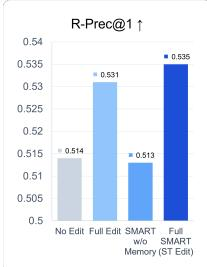

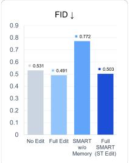

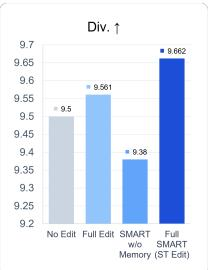  
Figure 3: Ablation results of memory-based refinement and editing strategies.

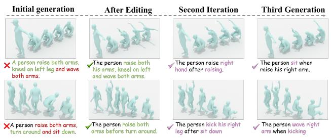  
Figure 4: Illustrative example of the iterative motion refinement process, with semantic misalignment in red, semantic alignment in green, and personality instruction in purple.

Human–VLM Preference Consistency We randomly sample 200 motion pairs from HumanML3D and evaluate them using five criteria as the human study: Semantic Alignment, Motion Naturalness, Motion Coherence, Physical Plausibility, and Action Completeness. Each criterion is rated on a five-point Likert scale. As shown in Fig. 6b, VLM and human evaluations exhibit broadly similar trends, supporting VLM assessment as a complementary reference for motion evaluation.

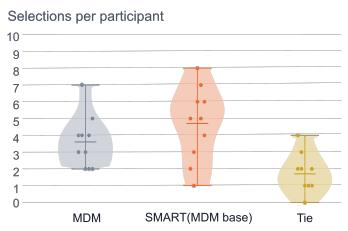  
(a) Pair-wise preference study.

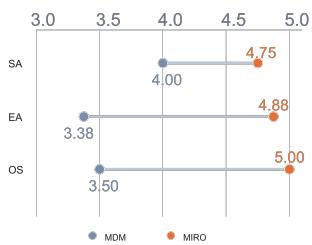  
(b) User evaluation results.  
Figure 5: Human evaluation results of MDM and SMART.

User Evaluation We conducted a user study with 12 participants to assess the practical usability of SMART. Participants evaluate generated motions in terms of Semantic Alignment, Editing Accuracy, and Overall Satisfaction on a five-point scale. As shown in Fig. 5b, SMART outperforms the baseline across all three metrics, indicating improved intent understanding, efective local editing, and a more natural conversational motion editing experience.

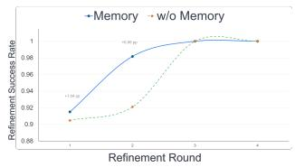  
(a) Performance across iterative refinement steps.

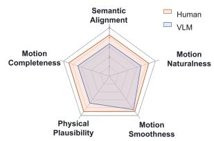  
(b) Human-VLM evaluation comparison.

Figure 6: Evaluation of memory-based refinement and VLMbased motion assessment.  
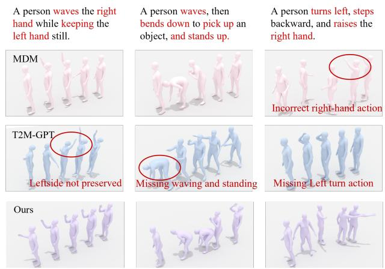  
Figure 7: Qualitative comparison of diferent text-to-motion methods on compositional prompts. Key action phrases are highlighted in red.

## Visualization

Fig. 7 compares MDM, T2M-GPT, and SMART on compositional prompts. SMART better captures multiple actions, action order, and fine-grained body-part constraints. Figure 4 further illustrates the iterative refinement process, where semantic mismatches are progressively corrected according to user feedback while previously accepted motion content is largely preserved. These results qualitatively demonstrate the efectiveness of SMART in compositional generation and localized conversational refinement.

## Conclusion

In this paper, we introduced the Self-evolving Multi-Agent RefinemenT Framework (SMART) for conversational textto-motion generation. By integrating the Chatter, Generator, Editor, and Checker agents, SMART demonstrates consistent improvements in motion quality and semantic consistency. Our ablation studies highlight the crucial contributions of the four agents, with the full SMART configuration yielding superior performance over individual agents. Additionally, our evaluation of editing strategies showed that Spatio-Temporal Editing outperforms other methods, ensuring high-quality motions while maintaining temporal coherence.

Achiam, J.; Adler, S.; Agarwal, S.; Ahmad, L.; Akkaya, I.; Aleman, F. L.; Almeida, D.; Altenschmidt, J.; Altman, S.; Anadkat, S.; et al. 2023. Gpt-4 technical report. arXivpreprint arXiv:2303.08774.

Ahn, H.; Ha, T.; Choi, Y.; Yoo, H.; and Oh, S. 2018. Text2action: Generative adversarial synthesis from language to action. In 2018 IEEE International Conference on Robotics and Automation (ICRA), 5915–5920. IEEE.

Ahuja, C.; and Morency, L.-P. 2019. Language2pose: Natural language grounded pose forecasting. In 2019 International conference on 3D vision (3DV), 719–728. IEEE.

Bai, J.; Bai, S.; Yang, S.; Wang, S.; Tan, S.; Wang, P.; Lin, J.; Zhou, C.; and Zhou, J. 2023. Qwen-VL: A Versatile Vision-Language Model for Understanding, Localization, Text Reading, and Beyond. arXiv preprint arXiv:2308.12966.

Calegari, R.; Ciatto, G.; Mascardi, V.; and Omicini, A. 2021. Logic-based technologies for multi-agent systems: a systematic literature review. Autonomous Agents and Multi-Agent Systems, 35(1): 1.

Cardoso, R. C.; and Ferrando, A. 2021. A review of agentbased programming for multi-agent systems. Computers, 10(2): 16.

Chang, Y.; Wang, X.; Wang, J.; Wu, Y.; Yang, L.; Zhu, K.; Chen, H.; Yi, X.; Wang, C.; Wang, Y.; et al. 2024. A survey on evaluation of large language models. ACM transactions on intelligent systems and technology, 15(3): 1–45.

Chen, W.; Xiao, H.; Zhang, E.; Hu, L.; Wang, L.; Liu, M.; and Chen, C. 2024. Sato: Stable text-to-motion framework. In Proceedings ofthe 32nd ACM International Conference on Multimedia, 6989–6997.

Chen, X.; Jiang, B.; Liu, W.; Huang, Z.; Fu, B.; Chen, T.; and Yu, G. 2023. Executing your commands via motion difusion in latent space. In Proceedings ofthe IEEE/CVF conference on computer vision and pattern recognition, 18000–18010.

Durante, Z.; Huang, Q.; Wake, N.; Gong, R.; Park, J. S.; Sarkar, B.; Taori, R.; Noda, Y.; Terzopoulos, D.; Choi, Y.; et al. 2024. Agent ai: Surveying the horizons of multimodal interaction. arXiv preprint arXiv:2401.03568.

Fu, D.; Sun, T.; Fang, P.; Cai, X.; and Kim, H. 2026. Mogo: Residual quantized hierarchical causal transformer for realtime and infinite-length 3d human motion generation. In Proceedings of the AAAI Conference on Artificial Intelligence, volume 40, 3994–4002.

Geng, Z.; Han, C.; Hayder, Z.; Liu, J.; Shah, M.; and Mian, A. 2024. Text-guided 3d human motion generation with keyframe-based parallel skip transformer. arXiv preprint arXiv:2405.15439.

Guo, C.; Mu, Y.; Javed, M. G.; Wang, S.; and Cheng, L. 2024. Momask: Generative masked modeling of 3d human motions. In Proceedings ofthe IEEE/CVF Conference on Computer Vision and Pattern Recognition, 1900–1910.

Guo, C.; Zou, S.; Zuo, X.; Wang, S.; Ji, W.; Li, X.; and Cheng, L. 2022a. Generating diverse and natural 3d human motions from text. In Proceedings of the IEEE/CVF conference on computer vision and pattern recognition, 5152–5161.

Guo, C.; Zuo, X.; Wang, S.; and Cheng, L. 2022b. Tm2t: Stochastic and tokenized modeling for the reciprocal generation of 3d human motions and texts. In European Conference on Computer Vision, 580–597. Springer.

Guo, Z.; Qu, H.; Rahmani, H.; Soh, D.; Hu, P.; Ke, Q.; and Liu, J. 2025. Tstmotion: Training-free scene-aware text-tomotion generation. In 2025 IEEE International Conference on Multimedia and Expo (ICME), 1–6. IEEE.

Huang, Y.; Yang, H.; Luo, C.; Wang, Y.; Xu, S.; Zhang, Z.; Zhang, M.; and Peng, J. 2024. StableMoFusion: Towards Robust and Eficient Difusion-based Motion Generation Framework. In Proceedings ofthe 32nd ACM International Conference on Multimedia, MM ’24, 224–232. New York, NY, USA: Association for Computing Machinery. ISBN 9798400706868.

Jiang, B.; Chen, X.; Liu, W.; Yu, J.; Yu, G.; and Chen, T. 2023. Motiongpt: Human motion as a foreign language. Advances in Neural Information Processing Systems, 36: 20067–20079.

Jiang, B.; Chen, X.; Zhang, C.; Yin, F.; Li, Z.; Yu, G.; and Fan, J. 2024. Motionchain: Conversational motion controllers via multimodal prompts. In European Conference on Computer Vision, 54–74. Springer.

Li, R.; Han, L.; Shu, S.; Liu, Y.; Lin, Y.; Ma, Y.; Guo, J.; Liu, Z.; and Li, X. 2025. A Motion is Worth a Hybrid Sentence: Taming Language Model for Unified Motion Generation by Fine-grained Planning. In Proceedings of the 33rd ACM International Conference on Multimedia, MM ’25, 1404–1413. New York, NY, USA: Association for Computing Machinery. ISBN 9798400720352.

Li, Y.; Yu, Y.; Li, H.; Chen, Z.; and Khashanah, K. 2023. Tradinggpt: Multi-agent system with layered memory and distinct characters for enhanced financial trading performance. arXiv preprint arXiv:2309.03736.

Masterman, T.; Besen, S.; Sawtell, M.; and Chao, A. 2024. The landscape of emerging ai agent architectures for reasoning, planning, and tool calling: A survey. arXiv preprint arXiv:2404.11584.

Plappert, M.; Mandery, C.; and Asfour, T. 2016. The kit motion-language dataset. Big data, 4(4): 236–252.

Ruan, J.; Chen, Y.; Zhang, B.; Xu, Z.; Bao, T.; Mao, H.; Li, Z.; Zeng, X.; Zhao, R.; et al. 2023. Tptu: Task planning and tool usage of large language model-based ai agents. In NeurIPS 2023 Foundation Models for Decision Making Workshop.

Sun, S.; Xu, J.; de Araujo, G.; Zhou, S.; Zhang, H.; Huang, Z.; You, C.; and Xie, X. 2026. Coma: Compositional human motion generation with multi-modal agents. In Proceedings of the AAAI Conference on Artificial Intelligence, volume 40, 9206–9214.

Tashakori, A.; Tashakori, A.; Yang, G.; Wang, Z. J.; and Servati, P. 2025. FlexMotion: Lightweight, Physics-Aware, and Controllable Human Motion Generation. arXiv preprint arXiv:2501.16778.

Tevet, G.; Raab, S.; Gordon, B.; Shafir, Y.; Cohen-Or, D.; and Bermano, A. H. 2022. Human motion difusion model. arXiv preprint arXiv:2209.14916.

Wang, R.; He, Y.; Sun, T.; Li, X.; and Shi, T. 2025a. Unitmge: Uniform text-motion generation and editing model via difusion. In 2025 IEEE/CVF Winter Conference on Applications ofComputer Vision (WACV), 6104–6114. IEEE.

Wang, S.; Zhang, G.; Yu, M.; Wan, G.; Meng, F.; Guo, C.; Wang, K.; and Wang, Y. 2025b. G-safeguard: A topologyguided security lens and treatment on llm-based multi-agent systems. arXiv preprint arXiv:2502.11127.

Wang, X.; Zhang, Y.; Zohar, O.; and Yeung-Levy, S. 2024a. Videoagent: Long-form video understanding with large language model as agent. In European Conference on Computer Vision, 58–76. Springer.

Wang, Y.; Huang, D.; Zhang, Y.; Ouyang, W.; Jiao, J.; Feng, X.; Zhou, Y.; Wan, P.; Tang, S.; and Xu, D. 2024b. Motiongpt-2: A general-purpose motion-language model for motion generation and understanding. arXiv preprint arXiv:2410.21747.

Wang, Z.; Li, A.; Li, Z.; and Liu, X. 2024c. Genartist: Multimodal llm as an agent for unified image generation and editing. Advances in Neural Information Processing Systems, 37: 128374–128395.

Wu, Q.; Zhao, Y.; Wang, Y.; Liu, X.; Tai, Y.-W.; and Tang, C.-K. 2025. Motion-agent: A conversational framework for human motion generation with llms. In International Conference on Learning Representations, volume 2025, 48023–48043.

Wu, Z.; Wang, Z.; Xu, X.; Lu, J.; and Yan, H. 2023. Embodied task planning with large language models. arXiv preprint arXiv:2307.01848.

Xu, L.; Song, Z.; Wang, D.; Su, J.; Fang, Z.; Ding, C.; Gan, W.; Yan, Y.; Jin, X.; Yang, X.; et al. 2023. Actformer: A gan-based transformer towards general action-conditioned 3d human motion generation. In Proceedings of the IEEE/CVF International Conference on Computer Vision, 2228–2238.

Yang, Z.; Su, B.; and Wen, J.-R. 2023. Synthesizing Long-Term Human Motions with Difusion Models via Coherent Sampling. In Proceedings of the 31st ACM International Conference on Multimedia, MM ’23, 3954–3964. New York, NY, USA: Association for Computing Machinery. ISBN 9798400701085.

Yu, T.; Wang, J.; Wang, J.; Luo, J.; and Zhou, G. 2024. Towards emotion-enriched text-to-motion generation via LLMguided limb-level emotion manipulating. In Proceedings ofthe 32nd ACM International Conference on Multimedia, 612–621.

Zhang, J.; Fan, H.; and Yang, Y. 2025. Energymogen: Compositional human motion generation with energy-based difusion model in latent space. In Proceedings ofthe Computer Vision and Pattern Recognition Conference, 17592–17602.

Zhang, J.; Zhang, Y.; Cun, X.; Huang, S.; Zhang, Y.; Zhao, H.; Lu, H.; and Shen, X. 2023a. T2M-GPT: Generating Human Motion from Textual Descriptions with Discrete Representations. arXiv 2023. arXiv preprint arXiv:2301.06052.

Zhang, J.; Zhang, Y.; Cun, X.; Zhang, Y.; Zhao, H.; Lu, H.; Shen, X.; and Shan, Y. 2023b. Generating human motion from textual descriptions with discrete representations. In Proceedings of the IEEE/CVF conference on computer vision and pattern recognition, 14730–14740.

Zhang, M.; Cai, Z.; Pan, L.; Hong, F.; Guo, X.; Yang, L.; and Liu, Z. 2024. Motiondifuse: Text-driven human motion generation with difusion model. IEEE transactions on pattern analysis and machine intelligence, 46(6): 4115–4128.

Zhang, M.; Guo, X.; Pan, L.; Cai, Z.; Hong, F.; Li, H.; Yang, L.; and Liu, Z. 2023c. Remodifuse: Retrieval-augmented motion difusion model. In Proceedings of the IEEE/CVF International Conference on Computer Vision, 364–373.

Zhao, W. X.; Zhou, K.; Li, J.; Tang, T.; Wang, X.; Hou, Y.; Min, Y.; Zhang, B.; Zhang, J.; Dong, Z.; et al. 2023. A survey of large language models. arXiv preprint arXiv:2303.18223, 1(2): 1–124.

Zhong, C.; Hu, L.; Zhang, Z.; and Xia, S. 2023. Attt2m: Text-driven human motion generation with multi-perspective attention mechanism. In Proceedings of the IEEE/CVF international conference on computer vision, 509–519.

Zhu, W.; Ma, X.; Ro, D.; Ci, H.; Zhang, J.; Shi, J.; Gao, F.; Tian, Q.; and Wang, Y. 2023. Human motion generation: A survey. IEEE Transactions on Pattern Analysis and Machine Intelligence, 46(4): 2430–2449.

Zitkovich, B.; Yu, T.; Xu, S.; Xu, P.; Xiao, T.; Xia, F.; Wu, J.; Wohlhart, P.; Welker, S.; Wahid, A.; et al. 2023. Rt-2: Vision-language-action models transfer web knowledge to robotic control. In Conference on Robot Learning, 2165–2183. PMLR.