# MINDVIEW: BENCHMARKING GENERATIVEMULTI-VIEW SPATIAL INTELLIGENCE

Yanbo Wang1,2 Wenzhao Zheng6 Tai Wang2

Siqi Luo3,2 Qian Yu2 Yu Qiao2

Siyu Zhang4,2 Juncheng Yan1,2 Yihao Liu2,†

Chenming Zhu5   
Bin Fu2   
Jiwen Lu1,†

1Tsinghua University 2Shanghai Artificial Intelligence Laboratory 3Shanghai Jiao Tong University 4Fudan University

5The University of Hong Kong 6University of California, Berkeley

liuyihao@pjlab.org.cn lujiwen@tsinghua.edu.cn

## ABSTRACT

Spatial intelligence has recently been assessed through generative tasks such as spatially grounded image editing, yet language-guided generation of spatially consistent views from partial multi-view observations remains underexplored. We introduce MindView, a benchmark for generative multi-view spatial intelligence with 1,500 samples from 513 scenes across three indoor datasets. Its seven tasks form two families: geometry-dominant tasks specify changes in camera position and orientation, while semantics-dominant tasks require inferring target viewpoints by grounding referred objects and interpreting spatial relations and reference-frame cues. Evaluation of eleven generators reveals substantial room for improvement on MindView. A paired context analysis further shows that all eleven generators obtain lower overall scores under the expanded context setting. These findings motivate us to investigate whether task-specific supervision can improve target-view generation and whether models can use additional multiview evidence effectively. We therefore fine-tune BAGEL on the MindView training dataset, improving its overall score by 24.3 points and yielding gains across all seven MindView tasks. Beyond these generation gains, the fine-tuned model also yields higher scores on three spatial-understanding benchmarks without training on their annotations, suggesting that learning to generate spatially grounded views may benefit spatial understanding. To improve evidence utilization under expanded context, we propose MindCue, a training-free spatial evidence selector guided by a target-view hypothesis. MindCue reverses the drop in overall score under expanded context and outperforms the standard-context baseline. Overall, MindView provides a concrete testbed for generative multi-view spatial intelligence. Our findings further highlight task learning and query-guided evidence selection as complementary strategies for improving performance in this setting.

## 1 INTRODUCTION

Benchmarks such as MindCube (Wang et al., 2025b), MMSI-Bench (Yang et al., 2026), and SATv2 (Ray et al., 2025) evaluate the spatial intelligence of multimodal understanding models through question answering. On the generation side, GenSpace (Wang et al., 2025c) and GSI-Bench (Zhu et al., 2026b) have begun this exploration by asking whether spatial instructions are realized in a generated or edited image. We focus on evaluating generative multi-view spatial intelligence through language-guided target-view generation from partial observations of the same scene (Figure 1). This task requires models to integrate evidence across views, infer the requested viewpoint, and predict what would be visible from it while remaining consistent with the observed scene.

Related work differs in how reference images are used and how target viewpoints are specified. Multi-reference benchmarks such as MICE-Bench (Luo et al., 2026) and MultiBanana (Oshima et al., 2026) emphasize preserving and combining reference content, which alone does not establish that a generated image depicts the requested viewpoint of the observed scene. Poseconditioned methods such as ZeroNVS (Sargent et al., 2024) evaluate view synthesis with the target camera supplied, leaving language-conditioned viewpoint inference outside their task setting. More recently, Astra (Zhu et al., 2026a) uses language-controlled novel-view generation to support agentic spatial question answering and evaluates generated views against real targets for pose and content consistency. However, its generation evaluation focuses on explicit camera motions with a single dominant degree of freedom. We seek a unified evaluation of individual and composed camera motions and target viewpoints inferred from object references, spatial relations, and reference-frame cues.

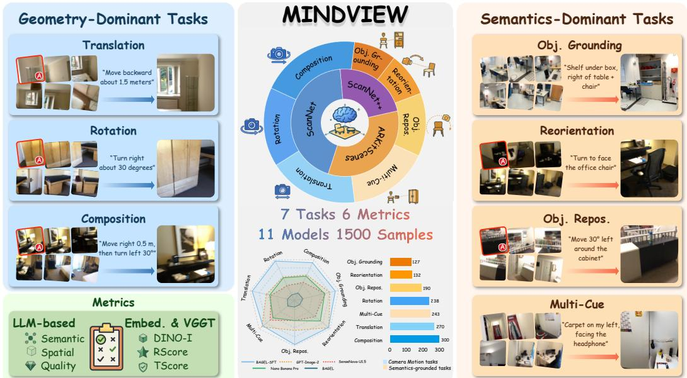  
Figure 1: Overview of MindView, showing seven task examples, benchmark statistics, six metrics, and representative results. Red A marks anchor views, and targets are real images.

We introduce MindView, a benchmark of 1,500 samples from 513 scenes in three indoor datasets (Figure 1). Its seven tasks form two families: Geometry-Dominant tasks specify camera translations, rotations, or their ordered composition, while Semantics-Dominant tasks require viewpoint inference from referred objects, spatial relations, and reference-frame cues. The model receives only RGB observations and a language query, with the target image and numerical camera parameters withheld. Six complementary metrics assess content fidelity, spatial agreement, rendering quality, and geometric consistency to identify content and spatial errors an aggregate score may obscure.

Across eleven off-the-shelf generators, preserving scene content while matching the requested viewpoint remains challenging (Table 1). Expanding context from six to ten views increases target-view coverage from 88.4% to 92.0%, yet lowers Overall for all eleven generators (Figure 5). These findings raise two questions: can task-specific supervision improve target-view generation, and can query-guided evidence selection help models benefitfrom additional observations?

To address these questions, we curate a target-view generation training set and fine-tune BAGEL (Deng et al., 2025), obtaining BAGEL-SFT with a 24.3-point Overall gain and improvements across all seven tasks. BAGEL-SFT also scores higher on three spatial-understanding benchmarks without training on their annotations, providing preliminary evidence of transfer from generation training to spatial understanding. To improve evidence utilization, we propose MindCue, a training-free spatial evidence selector using a target-view hypothesis to select supplementary observations from the expanded context. On both BAGEL and BAGEL-SFT, MindCue reverses the expanded-context degradation and outperforms the standard-context baseline and count-matched random selection.

Our main contributions are summarized as follows:

1. We introduce MindView, a benchmark for generative multi-view spatial intelligence, revealing two challenges across eleven generators: limited content fidelity and spatial consistency, and performance degradation with excessive context.

2. We curate target-view generation training data and show that task-specific supervision improves BAGEL across all seven tasks, with preliminary evidence of transfer to spatial understanding.

3. We propose MindCue, a training-free, query-guided evidence selector that improves both BAGEL and BAGEL-SFT over fixed and count-matched random baselines.

## 2 RELATED WORK

Spatial Intelligence Benchmarks and Generative Reasoning. Spatial intelligence is evaluated through both question answering and image generation. MindCube (Wang et al., 2025b), MMSI-Bench (Yang et al., 2026), and SAT-v2 (Ray et al., 2025) assess spatial understanding through question answering, whereas GenSpace (Wang et al., 2025c) and GSI-Bench (Zhu et al., 2026b) evaluate whether generated images satisfy spatial instructions. The latter also reports understanding gains from generation-focused training. Thinking with Novel Views (Zhang et al., 2026) uses generated views for spatial question answering, while UniG2U-Bench (Wen et al., 2026) examines unified models’ understanding and the effects of intermediate image generation. MindView evaluates generated views of observed scenes and tests whether target-view supervision aids spatial understanding.

Novel-View Synthesis and Viewpoint Control. View generation methods differ in target-view specification, from explicit camera parameters to language instructions. NeRF (Mildenhall et al., 2020), ZeroNVS (Sargent et al., 2024), EscherNet (Kong et al., 2024), and LVSM (Jin et al., 2025) use supplied camera controls. CapFrame (Li et al., 2026) grounds language-specified viewpoints within a reconstructed 3D Gaussian scene, while Object-Uni (Tan et al., 2026) uses explicit object poses for controllable generation. Astra (Zhu et al., 2026a) generates language-guided imagined views for spatial question answering and also evaluates them against real targets. Existing methods either rely on explicit geometry or consider constrained language-specified viewpoints, leaving viewpoint inference and scene-consistent rendering from partial multi-view evidence underexplored.

Multi-Reference Image Generation and Editing. Multi-reference generation and editing use multiple input images to preserve and combine visual content. IP-Adapter (Ye et al., 2023) and PhotoMaker (Li et al., 2023) provide image- or identity-based conditioning, while MultiRef (Chen et al., 2025) explicitly supports multiple visual references. MICE-Bench (Luo et al., 2026) evaluates multi-reference creation and editing, while MultiBanana (Oshima et al., 2026) tests generation from challenging combinations of visual references. Unlike these benchmarks, MindView treats inputs as partial observations of the same scene and evaluates language-guided target-view generation.

## 3 MINDVIEW BENCHMARK

In this section, we present MindView, a benchmark designed to evaluate generative multi-view spatial intelligence. Section 3.1 formulates the target-view generation problem and introduces seven tasks across two complementary families. Section 3.2 describes the data construction pipeline, and Section 3.3 presents the evaluation protocol and metrics.

## 3.1 TASK FORMULATION AND TASK DESIGN

MindView evaluates language-guided target-view generation from partial observations of the same scene. Let $C _ { K } = ( I _ { 1 } , \ldots , \bar { I _ { K } } )$ denote an ordered list of RGB observations and let $q$ denote a spatial query. A generator f predicts

$$
\hat { I } _ { \mathrm { t a r g e t } } = f ( C _ { K } , q ) .\tag{1}
$$

The primary benchmark setting uses $K = 6$ . At inference time, the generator receives only $C _ { K }$ and $q .$ The held-out real target image, camera poses, depth, and scene annotations are not provided as generation inputs. When the query is defined relative to a starting viewpoint, $I _ { 1 }$ serves as the anchor. The generated image must preserve the observed scene while matching the requested camera position and orientation.

The seven tasks share this interface and differ in how the target viewpoint is specified. Geometry-Dominant Tasks express it through egocentric camera motions from an anchor. Translation (Trans.)

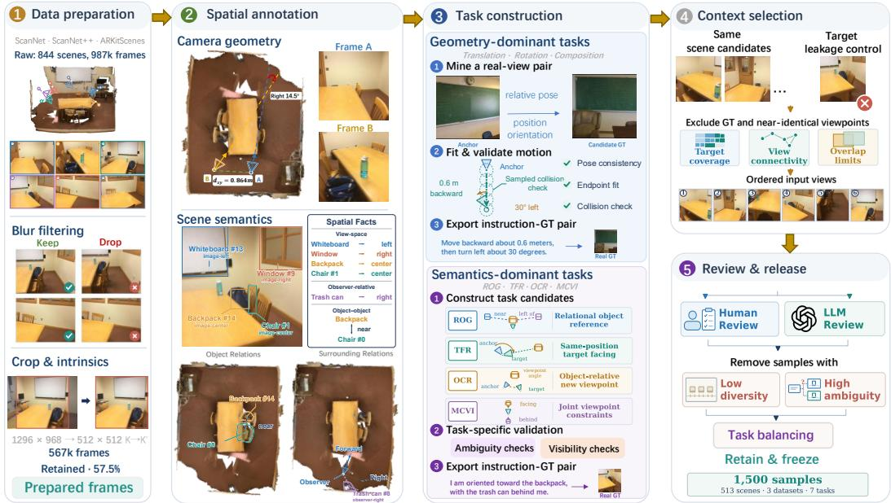  
Figure 2: Five-stage offline construction pipeline for MindView.

changes camera position through relative displacements while preserving heading. Rotation (Rot.) changes heading by a specified angle while keeping position fixed. Composition (Comp.) combines translation and rotation in the order specified by the query.

Semantics-Dominant Tasks specify the target through referred objects, spatial relations, and reference-frame cues. Relational Object Grounding (ROG) identifies the referred object through relations and generates a view satisfying distance, centering, and visibility constraints, without an anchor. Target-Facing Reorientation (TFR) requires locating the target object and turning to face it while remaining at the anchor position. Object-Centric Repositioning (OCR) instead requires moving to a specified side or angular offset around the object and facing it, with directions defined relative to the anchor view. Multi-Cue Viewpoint Inference (MCVI) jointly infers position and heading from observer-relative scene cues, without an anchor. Together, the two families test complementary forms of target-view specification under a common generation interface.

Section A.4 provides real examples and full generation prompts for all seven tasks.

## 3.2 DATA CONSTRUCTION

We construct MindView from ScanNet (Dai et al., 2017), ScanNet++ (Yeshwanth et al., 2023), and ARKitScenes (Baruch et al., 2021). Figure 2 summarizes the five-stage offline construction pipeline.

Data preparation and spatial annotation. We first apply blur filtering while preserving temporal coverage along each recorded sequence. We then account for cropping and resizing in the camera model used for geometric checks. Using camera poses, depth, scene geometry, and instance annotations, we derive relative viewpoints, object relations, visibility, and object locations in each image. These annotations form the spatial basis for constructing queries and targets.

Task construction. For Geometry-Dominant Tasks, relative poses between recorded views yield motion instructions. Candidates are filtered by task-specific pose constraints, and endpoints reconstructed from rounded instructions are checked against recorded targets. Where point clouds are available, Translation and Composition also use discrete collision checks along instructed segments. For Semantics-Dominant Tasks, identities, relations, and reference-frame cues define query-target candidates. Visibility and viewpoint checks limit ambiguity across recorded views. Each query uses a real captured target and, when required, an anchor. Section A details the task-specific criteria.

Offline context selection. For each query-target pair, we select six unique same-scene views as a connected path. The target is excluded, any required anchor comes first, and other candidates pass temporal and pose-separation filters. Selection enforces pairwise-overlap limits and coverage of target-visible content and the broader scene. MCVI also requires every object cue constraining observer location to appear across the selected views.

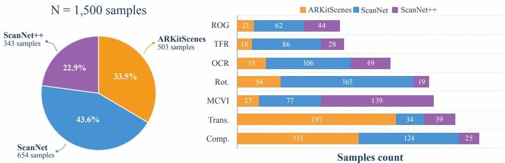  
Figure 3: Distribution of the 1,500 MindView samples across source datasets and tasks.

Review and release. Candidate groups undergo human and LLM-assisted screening for residual ambiguity and limited within-sample visual diversity. Section A.3 provides the exact GPT-5.6 (OpenAI, 2026b) screening prompt. The frozen benchmark contains 1,500 samples from 513 scenes across the three datasets (Figure 3). We also provide 20,000 training examples from 3,406 scenes, using the same interface for all seven tasks. These examples use the source datasets’ training splits and share no scenes with the benchmark (Section C.1).

## 3.3 EVALUATION PROTOCOL

Image-feature similarity. DINO-I probes overall visual-content fidelity through DINOv2-Large feature correspondence (Oquab et al., 2023). We use the cosine similarity between generated and real target features, scaled by 100 without clipping.

VLM-based assessment. Qwen3-VL-30B-A3B-Instruct (Qwen Team, 2025b) judges whether scene content (Semantic) and visible viewpoint and layout (Spatial) match the real target; Quality assesses internal coherence and rendering defects in the generation alone. The judge receives no query or context; integer 0–10 ratings are scaled to 0–100. See Sections B.2 and B.6 for inputs and prompts.

Geometric consistency. We introduce a VGGT-based protocol (Wang et al., 2025a) for MindView to assess target-viewpoint fidelity through estimated camera position and orientation. Joint inference on fixed references and generated (gen) and real (real) target images yields rotations $\hat { R }$ and camera centers cˆ in a shared frame. For sample i, the pose errors are

$$
\left( e _ { \mathrm { r o t } , i } , e _ { \mathrm { t r a n s } , i } \right) = \left( d _ { \mathrm { S O ( 3 ) } } \Big ( \hat { R } _ { \mathrm { g e n } } , \hat { R } _ { \mathrm { r e a l } } \Big ) , a _ { i } \| \hat { \mathbf { c } } _ { \mathrm { g e n } } - \hat { \mathbf { c } } _ { \mathrm { r e a l } } \| _ { 2 } \right) .\tag{2}
$$

Here, $d _ { \mathrm { S O ( 3 ) } }$ is angular distance in degrees, and $a _ { i } > 0$ converts VGGT lengths to meters using realimage sensor depths, without ground-truth poses. Per-sample RScore and TScore decrease linearly from 100 at zero error to 0 at 60◦ and 2 m, respectively, and remain zero beyond these thresholds. Section B.3 details the reference inputs, calibration, and scoring.

All scores are higher-is-better. We average each component within tasks, then equally across the seven tasks; Overall is the unweighted mean of the six task-macro scores.

Evaluator reliability. We assess evaluator reliability through comparisons with human ratings and reconstruction stability tests. Three multimodal experts independently rate outputs from four generators. Aggregated human and VLM scores yield identical model rankings for Semantic, Spatial, and Quality. For VGGT, we vary the generated image while keeping all real views fixed. Across samples, the median changes in the reconstructed target pose are $0 . { \bar { 7 } } 1 ^ { \circ }$ in relative rotation and 2.75 cm in reference-aligned position. Together, these experiments support the reliability of our VLM-based and geometric metrics for comparing generators (Section B.4).

## 4 EXPERIMENTS

We first evaluate current generators on MindView and analyze their task-level performance. We then examine whether additional observations improve target-view generation. Motivated by these

Table 1: Quantitative comparison on MindView. Task-macro scores over 1,500 samples. and mark best and second-best across displayed models, respectively; † denotes tiled context views.
<table><tr><td rowspan="2">Model</td><td rowspan="2">DINO-I</td><td colspan="3">VLM Judge</td><td colspan="2">Geometry</td><td rowspan="2">Overall</td></tr><tr><td>Semantic</td><td>Spatial</td><td>Quality</td><td>RScore</td><td>TScore</td></tr><tr><td colspan="8">Open-Source Models</td></tr><tr><td colspan="8"></td></tr><tr><td>BAGEL FLUX.2</td><td>48.3 52.2</td><td>44.5 49.5</td><td>33.6 39.4</td><td>47.1 80.4</td><td>34.7 35.5</td><td>31.9 38.6</td><td>40.0 49.3</td></tr><tr><td></td><td>52.4</td><td>49.2</td><td>38.6</td><td>69.5</td><td>37.2</td><td>40.3</td><td>47.9</td></tr><tr><td>Qwen-Image-Edit-2511† Emu3.5†</td><td>44.9</td><td>41.0</td><td>31.2</td><td>67.2</td><td>36.0</td><td>49.9</td><td>45.0</td></tr><tr><td>DreamOmni2</td><td>41.7</td><td>36.0</td><td>28.8</td><td>65.5</td><td>25.2</td><td>42.7</td><td>40.0</td></tr><tr><td>SenseNova-U1</td><td>53.6</td><td>48.2</td><td>38.3</td><td>63.5</td><td>25.6</td><td>33.2</td><td>43.7</td></tr><tr><td>SenseNova-U1.5</td><td>58.0</td><td>52.8</td><td>42.6</td><td>69.7</td><td>41.7</td><td>43.2</td><td>51.3</td></tr><tr><td colspan="8">Closed-Source Models</td></tr><tr><td>Nano Banana</td><td>56.5</td><td>54.0</td><td>41.7</td><td>66.2</td><td>39.0</td><td>40.7</td><td>49.7</td></tr><tr><td>Nano Banana Pro</td><td>60.0</td><td>57.2</td><td>45.4</td><td>80.0</td><td>38.8</td><td>39.0</td><td>53.4</td></tr><tr><td>GPT-Image-1.5</td><td>58.8</td><td>58.9</td><td>46.3</td><td>82.2</td><td>39.9</td><td>33.5</td><td>53.3</td></tr><tr><td>GPT-Image-2</td><td>63.0</td><td>61.5</td><td>49.0</td><td>84.6</td><td>49.9</td><td>39.1</td><td>57.9</td></tr><tr><td colspan="8">Task-Specific Adaptation</td></tr><tr><td>BAGEL-SFT</td><td>68.0</td><td>71.0</td><td>57.1</td><td>61.8</td><td>61.7</td><td>66.5</td><td>64.4</td></tr></table>

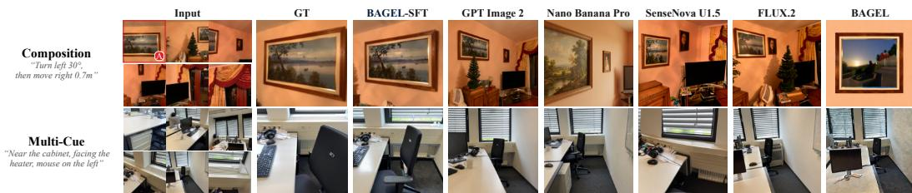  
Figure 4: Qualitative comparison on Composition and Multi-Cue Viewpoint Inference.

findings, we investigate task-specific adaptation through supervised fine-tuning and training-free, query-guided evidence selection through MindCue.

## 4.1 EXPERIMENTAL SETUP

Evaluation set and models. All MindView generation comparisons use the frozen release of 1,500 aligned scene–query–target samples. The standard benchmark input consists of six context images and a language query per sample. All MindView generation results follow the evaluation protocol in Section 3.3. We compare eleven off-the-shelf generators: seven open-source models (BAGEL (Deng et al., 2025), FLUX.2 (Black Forest Labs, 2026), Qwen-Image-Edit-2511 (Wu et al., 2025; Qwen Team, 2025a), Emu3.5 (Cui et al., 2025), DreamOmni2 (Xia et al., 2025), SenseNova-U1 (Diao et al., 2026b), and SenseNova-U1.5 (Diao et al., 2026a)) and four closed-source models (Nano Banana (Fortin et al., 2025), Nano Banana Pro (Raisinghani, 2025), GPT-Image-1.5 (OpenAI, 2025), and GPT-Image-2 (OpenAI, 2026a)). We additionally evaluate BAGEL-SFT, obtained by supervised fine-tuning of BAGEL on our curated training dataset for 10,000 steps.

## 4.2 BENCHMARK RESULTS

Quantitative results. Among the eleven off-the-shelf generators, GPT-Image-2 achieves the highest Overall score (57.9), while SenseNova-U1.5 leads the open-source group (51.3; Table 1). GPT-Image-2 also leads on all seven tasks, but task-level weaknesses recur across models: Composition is the lowest-scoring task for eight generators, and Multi-Cue Viewpoint Inference is lowest for the remaining three (Table 2). These results highlight recurring difficulties with composed camera motions and viewpoints constrained by multiple scene cues.

Content fidelity and geometric consistency also yield different model rankings. Nano Banana Pro scores higher than SenseNova-U1.5 on DINO-I and Semantic, yet lower on RScore (38.8 versus 41.7) and TScore (39.0 versus 43.2). This discrepancy underscores the value of evaluating targetview geometry alongside content fidelity when assessing language-guided view generation.

Qualitative results. Consistent with the quantitative findings, Figure 4 illustrates viewpoint and content errors across models on two challenging tasks, Composition and Multi-Cue Viewpoint Inference. In Composition, Nano Banana Pro emphasizes the painting but differs from the target in both viewing angle and the painting’s content. In Multi-Cue Viewpoint Inference, GPT-Image-2 and FLUX.2 include the desk, chair, and heater, but depict the chair as smaller and farther back in the image than in the target view. Appendix Figure 15 provides comparisons across all seven tasks.

Table 2: Task-wise comparison on MindView. Per-task Overall scores across all displayed models. Highlighting and † follow Table 1; abbreviations are defined in Section 3.1.
<table><tr><td rowspan="2">Model</td><td colspan="4">Geometry-Dominant Tasks</td><td rowspan="2"></td><td colspan="4">Semantics-Dominant Tasks</td></tr><tr><td>一 Trans.</td><td>Rot.</td><td>Comp.</td><td></td><td>ROG</td><td>TFR</td><td>OCR</td><td>MCVI</td></tr><tr><td colspan="10">Open-Source Models</td></tr><tr><td colspan="2">BAGEL</td><td colspan="2">41.7 38.8</td><td colspan="2">36.1</td><td>43.2</td><td>38.7</td><td>44.1</td><td>37.6</td></tr><tr><td>FLUX.2</td><td></td><td>53.0</td><td>47.0 45.9</td><td>44.1</td><td colspan="2">50.5</td><td>49.9</td><td>53.9</td><td>46.6</td></tr><tr><td>Qwen-Image-Edit-2511†</td><td></td><td colspan="2">53.4 43.6</td><td colspan="2">41.6</td><td>49.9</td><td>46.6</td><td>57.0</td><td>40.7</td></tr><tr><td colspan="2">Emu3.5†</td><td colspan="2">55.7</td><td colspan="2">40.7 35.8</td><td>42.5</td><td>45.0</td><td>52.3</td><td>35.5</td></tr><tr><td colspan="2">DreamOmni2</td><td>54.4</td><td colspan="2">40.9</td><td colspan="2">33.7</td><td>35.0</td><td>47.9</td><td>32.2 43.3</td></tr><tr><td colspan="2">SenseNova-U1</td><td>44.2</td><td colspan="2">40.1</td><td colspan="2">49.4</td><td>46.8</td><td colspan="2">44.6</td></tr><tr><td colspan="2">SenseNova-U1.5</td><td>53.6</td><td>46.8</td><td colspan="2">37.9 43.2</td><td>56.7</td><td>53.4</td><td colspan="2">54.7</td></tr><tr><td colspan="10">Closed-Source Models</td></tr><tr><td colspan="2" rowspan="4">Nano Banana Nano Banana Pro</td><td colspan="2">49.3 54.5</td><td colspan="2">48.1 45.8 47.3</td><td colspan="2">53.4 56.3</td><td>55.7</td><td>48.3</td><td>47.3</td></tr><tr><td colspan="2">52.1</td><td colspan="2">53.7</td><td colspan="2">59.2</td><td>58.6</td><td>54.7</td><td>48.7 53.7</td></tr><tr><td colspan="2">GPT-Image-1.5 GPT-Image-2</td><td colspan="2">47.9</td><td colspan="2">46.3</td><td colspan="2">59.4</td><td colspan="2">54.3 62.4</td></tr><tr><td colspan="2">57.0</td><td colspan="2">54.2 48.2</td><td colspan="2">59.4</td><td colspan="2">66.8</td><td colspan="2">57.0</td></tr><tr><td colspan="10">Task-Specific Adaptation</td></tr><tr><td colspan="10">BAGEL-SFT 67.1 68.2 56.3 62.7 66.5 73.4 56.2</td></tr><tr><td>C3</td><td>C6</td><td>C10</td><td></td><td>C3 41.5</td><td>C6</td><td>C10</td><td>C3</td><td>C6</td><td></td><td>C10</td></tr><tr><td>BAGEL</td><td>39.4 +0.6</td><td>40.0 -1.0 0</td><td>Dream- 39.0 Omni2</td><td>• -1.5</td><td>40.0 -3.5</td><td>Nano Banana Pro 36.5</td><td>52.0</td><td>+1.4 53.4 o</td><td>-1.3</td><td>52.1</td></tr><tr><td>FLUX.2</td><td>49.1 +0.2</td><td>49.3 -3.0</td><td>Sense- 46.3 Nova-U1</td><td>42.6 +1.1</td><td>43.7 o</td><td>-1.3 42.4</td><td>GPT- Image-1.5</td><td>52.6 +0.7</td><td>53.3 o</td><td>-1.8 51.5</td></tr><tr><td>Qwen- Image-Edit</td><td>47.9 46.0 +1.9</td><td>-0.7 47.2 o</td><td>Sense- Nova-U1.5</td><td>+1.8 49.5</td><td>51.3 o</td><td>-0.2 51.1</td><td>GPT. Image-2</td><td>55.8 +2.1</td><td>57.9 o</td><td>-1.2 56.7</td></tr><tr><td></td><td>+2.8</td><td>45.0 -0.7 o</td><td>44.3 Nano</td><td>48.6 +1.1</td><td></td><td>-1.3 48.4</td><td>BAGEL</td><td>+3.9</td><td>64.4 o</td><td>-1.2 63.2</td></tr><tr><td>Emu3.5</td><td>42.2</td><td></td><td>Banana</td><td></td><td></td><td></td><td>SFT</td><td>60.5</td><td></td><td></td></tr></table>

Figure 5: Overall score trajectories across nested context settings.

## 4.3 CONTEXT SCALING AND EVIDENCE UTILIZATION

We examine context expansion on the same 1,500 scene–query–target samples using nested three-, six-, and ten-view settings, with $C _ { 6 }$ as the standard input. $C _ { 3 }$ is an ordered subsequence of $C _ { 6 } ,$ which is an ordered subsequence of $C _ { 1 0 } .$ . Target images are excluded from generator inputs, and VGGT uses the same ten evaluation references across settings. Computed only for offline analysis, target coverage measures the fraction of content visible in the real target that is also observed in at least one context view. Its sample mean rises from 57.6% at $C _ { 3 }$ to 88.4% at $C _ { 6 }$ and 92.0% at $C _ { 1 0 }$ Despite this increase, all eleven off-the-shelf generators and BAGEL-SFT obtain lower Overall at $C _ { 1 0 }$ than at $C _ { 6 }$ (Figure 5). Greater coverage therefore does not ensure better generation under this protocol. This observation motivates MindCue, which selects query-relevant evidence from the four $C _ { 1 0 }$ additions while retaining the complete $C _ { 6 }$ core (Section 4.5). Full component scores appear in Appendix Table 13.

## 4.4 SUPERVISED ADAPTATION AND TRANSFER TO SPATIAL UNDERSTANDING

Supervised adaptation. To examine whether task-specific supervision improves target-view generation, we fine-tune BAGEL (Deng et al., 2025) on our curated training dataset for 10,000 steps. Adaptation raises Overall from 40.0 to 64.4, a gain of 24.3 points, as shown in Table 1, and all six metrics improve on every task (Appendix Tables 9–12). The adapted model’s task-macro advantage over GPT-Image-2 is larger on geometry-dominant than semantics-dominant tasks (10.8 versus 3.3 points; Table 2), possibly because explicit motion supervision provides more regular patterns to learn, whereas semantics-dominant tasks demand more complex semantic interpretation and spatial reasoning. In the Composition example in Figure 4, BAGEL-SFT more closely matches the GT’s painting-dominated close-up than GPT-Image-2, which instead produces a broad room view. Training details are provided in Section C.

Table 3: Spatial-understanding transfer. We report accuracy (%) and gains in percentage points.
<table><tr><td rowspan="2">Benchmark</td><td rowspan="2">Protocol</td><td rowspan="2">Eval. Size</td><td colspan="2">Accuracy (%)</td><td rowspan="2">Difference (pp)</td></tr><tr><td>BAGEL</td><td>BAGEL-SFT</td></tr><tr><td rowspan="2">SAT-v2</td><td>Micro accuracy</td><td>300</td><td>58.0</td><td>62.7</td><td>+4.7</td></tr><tr><td>Both-order accuracy</td><td>150</td><td>27.3</td><td>41.3</td><td>+14.0</td></tr><tr><td>MMSI-Bench</td><td>Vanilla accuracy</td><td>1,000</td><td>31.0</td><td>32.2</td><td>+1.2</td></tr><tr><td>MindCube-Tiny</td><td>Raw-QA accuracy</td><td>1,050</td><td>34.7</td><td>36.5</td><td>+1.8</td></tr></table>

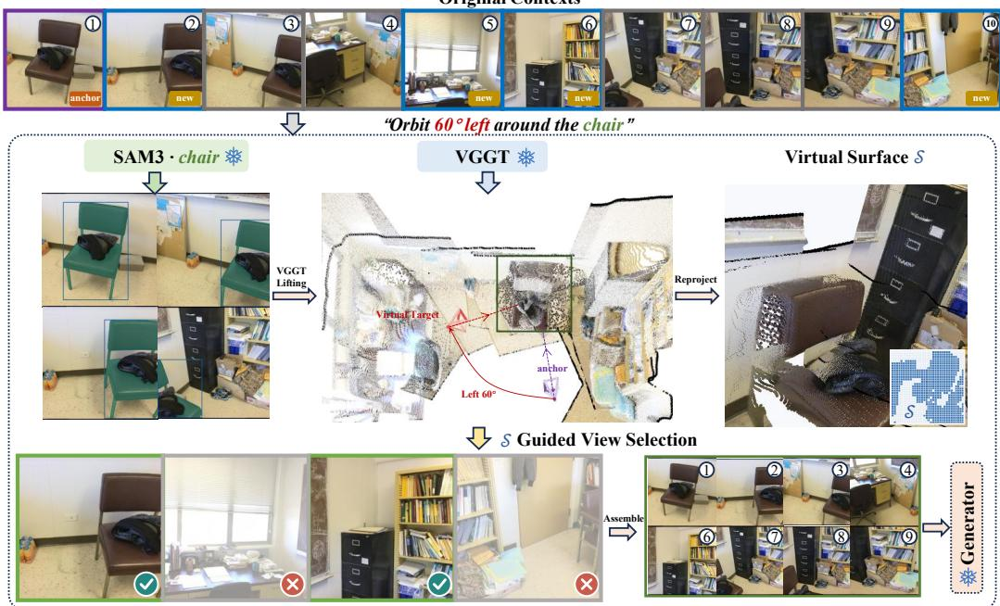  
Figure 6: Overview of the MindCue framework.

Transfer to spatial understanding. We next examine whether learning to generate target views also benefits spatial understanding. To this end, we evaluate BAGEL and BAGEL-SFT on SAT-v2 (Ray et al., 2025), MMSI-Bench (Yang et al., 2026), and MindCube-Tiny (Wang et al., 2025b), strictly following their respective input-construction and answer-scoring protocols (Section D). Our fine-tuning stage uses no annotations from these benchmarks. All results are obtained in our own evaluations. Our reproduced BAGEL accuracies on MMSI-Bench and MindCube-Tiny match those reported by SenseNova-SI (Cai et al., 2026) at the reported precision.

As shown in Table 3, BAGEL-SFT obtains higher scores in all three comparisons. On SAT-v2, micro accuracy increases from 58.0% to 62.7%, while both-order accuracy rises from 27.3% to 41.3%, indicating that more questions are answered correctly under both evaluated answer orders. Its scores on MMSI-Bench and MindCube-Tiny also exceed the reproduced BAGEL baselines by 1.2 and 1.8 percentage points, respectively. Together, these results provide preliminary evidence that learning to generate spatially grounded views may also benefit spatial understanding, even without direct supervision from the evaluated benchmarks.

## 4.5 MINDCUE: A TRAINING-FREE SPATIAL EVIDENCE SELECTOR

Motivated by the context-scaling results, MindCue uses a target-view hypothesis to select additional spatial evidence without updating model weights (Figure 6).

Method. For sample i, let $C _ { i } ^ { \mathrm { { p o o l } } }$ be the ordered observations, qi the query, and $\mathcal { F } _ { i } , \mathcal { D } _ { i }$ the core and additional-view index sets. Frozen VGGT (Wang et al., 2025a) provides confidence-filtered scene points ${ \hat { \mathcal { P } } } _ { i } ;$ for semantics-dominant tasks, frozen SAM 3 (Carion et al., 2026) segments queried entities. A task-specific solver uses this evidence, the query, and core/reference-view metadata to hypothesize a target camera $\hat { \mathcal { C } } _ { i } ^ { \star }$ (pose and intrinsics). Its virtual surface is

Table 4: Task-macro Overall under context selection. Parentheses give mean view counts; and mark the best and second-best policies per model, respectively. $\Delta C _ { k }$ is MindCue’s score point gain over Fixed $C _ { k } ,$ computed before rounding.
<table><tr><td>Model</td><td>Fixed  $C _ { 6 }$  (6.0)</td><td>Fixed  $C _ { 1 0 }$  (10.0)</td><td>CounterSel (8.6)</td><td>RandDrop (7.4)</td><td>MindCue (7.4)</td><td> $\Delta C _ { 6 }$ </td><td> $\Delta C _ { 1 0 }$ </td></tr><tr><td>BAGEL</td><td>40.0</td><td>39.0</td><td>37.1</td><td>39.6</td><td>41.1</td><td>+1.1</td><td>+2.1</td></tr><tr><td>BAGEL-SFT</td><td>64.4</td><td>63.2</td><td>62.6</td><td>64.1</td><td>65.1</td><td>+0.8</td><td>+1.9</td></tr></table>

$$
\mathcal { S } _ { i } = \mathrm { O c c } \Big [ \mathrm { Z B u f } \Big ( \Pi _ { \hat { \mathcal { C } } _ { i } ^ { \star } } \Big ( \hat { \mathcal { P } } _ { i } \Big ) \Big ) \Big ] .\tag{3}
$$

Here Π projects points, ZBuf retains the nearest valid depth per grid cell, and Occ returns the occupied cells.

For nonempty $\textstyle S _ { i } .$ , let $R _ { i } ( v )$ measure additional view $v { \mathrm { s } }$ reliable coverage, capping credit for geometry supported only by that view, and let τ be the coverage threshold. $X _ { i } \subseteq { \mathcal { D } } _ { i }$ contains at most one below-threshold candidate passing connectivity and nonredundancy tests; without an explicit anchor, it is empty. The retained additional-view indices are

$$
A _ { i } = \left\{ \begin{array} { l l } { \emptyset , } & { S _ { i } = \emptyset , } \\ { \{ v \in \mathcal { D } _ { i } : R _ { i } ( v ) \geq \tau \} \cup X _ { i } , } & { S _ { i } \neq \emptyset . } \end{array} \right.\tag{4}
$$

The generator receives the original query and pool views indexed by $\mathcal { F } _ { i } \cup A _ { i }$ , preserving their order and the complete core. Selection uses no held-out targets, ground-truth geometry, generated outputs, or evaluation scores. Section E specifies the support and selection rules; Table 7 details the taskspecific cameras.

Evaluation. We compare vanilla and fine-tuned BAGEL on the same 1,500 samples with fixed checkpoints and no-thinking inference. Fixed $C _ { 6 }$ and $C _ { 1 0 }$ supply the core and full pool, respectively. Both controls preserve the core: RandDrop randomly selects the same number of additions as MindCue per sample, while CounterSel retains rejected additions and is not count-matched. Table 4 reports Overall and view counts; Appendix Table 14 gives all six components.

Results. MindCue exceeds both fixed-context baselines on BAGEL and BAGEL-SFT, reversing the expanded-context decline and improving on the standard input. Its gains over count-matched RandDrop are 1.6 and 1.1 points for vanilla and fine-tuned BAGEL, respectively, supporting selection beyond count reduction. The improvement over RandDrop extends to five of the six component scores for BAGEL and all six for BAGEL-SFT. CounterSel scores lowest among all five policies for both models, consistent with the value of target-guided retention.

Runtime. On a single A100 80GB, MindCue adds 1.44 s on average, or 3.4% of BAGEL inference time with identical selected views and input order. The task-averaged costs of VGGT reconstruction and SAM 3 segmentation with mask lifting are 0.57 s and 0.82 s, respectively. SAM 3 is used only for semantics-dominant tasks. The remaining selection steps add 0.05 s. We sum separately timed stages with preloaded models, excluding preprocessing (Section E.6). Thus, query-guided selection adds only modest computational overhead relative to generation.

## 5 CONCLUSION

We introduce MindView, a benchmark for generative multi-view spatial intelligence through language-guided target-view generation from partial multi-view observations. Evaluation of eleven generators reveals challenges in content fidelity and viewpoint consistency, while expanding from six to ten views lowers Overall for all eleven. Fine-tuning BAGEL on our training set improves generation across all seven tasks and provides preliminary evidence of transfer to spatial understanding. Complementing task-specific adaptation, MindCue uses a target-view hypothesis for training free evidence selection and improves both BAGEL variants over standard and expanded inputs and count-matched random selection. These findings highlight task learning and query-guided evidence selection as complementary directions for advancing generative multi-view spatial intelligence.

## AI USE STATEMENT

We used AI tools to polish the language and improve the presentation of the manuscript. GPT-5.6 screened and filtered candidate benchmark samples for target ambiguity and insufficient contextview diversity before expert review (Section A.3). Our use of Qwen3-VL for model-based evaluation is described in Section B.2. The authors take responsibility for the final manuscript.

## REPRODUCIBILITY STATEMENT

We will release the data, code, and detailed documentation needed for faithful reproduction of our main experimental findings. Section A details benchmark construction and review, including the exact screening prompt. Section B specifies the evaluation metrics, aggregation rules, and evaluator prompts. Training and inference settings, spatial-understanding evaluation protocols, and MindCue implementation are provided in Sections C, D, and E, respectively.

## REFERENCES

Gilad Baruch, Zhuoyuan Chen, Afshin Dehghan, Tal Dimry, Yuri Feigin, Peter Fu, Thomas Gebauer, Brandon Joffe, Daniel Kurz, Arik Schwartz, and Elad Shulman. Arkitscenes: A diverse real-world dataset for 3d indoor scene understanding using mobile rgb-d data. In Thirty-fifth Conference on Neural Information Processing Systems Datasets and Benchmarks Track, 2021.

Black Forest Labs. FLUX.2 [klein]: Towards interactive visual intelligence. https://bfl.ai/blog/ flux2-klein-towards-interactive-visual-intelligence, January 2026. Evaluated checkpoint: https://huggingface.co/black-forest-labs/FLUX.2-klein-9B. Accessed 2026-09-19.

Zhongang Cai, Ruisi Wang, Chenyang Gu, Fanyi Pu, Junxiang Xu, Yubo Wang, Wanqi Yin, Zhitao Yang, Chen Wei, Tongxi Zhou, Qingping Sun, Hui En Pang, Jiaqi Li, Oscar Qian, Zhiqian Lin, Xuanke Shi, Kewang Deng, Xiaoyang Han, Zukai Chen, Xiangyu Fan, Hanming Deng, Lewei Lu, Liang Pan, Bo Li, Ziwei Liu, Quan Wang, Dahua Lin, and Lei Yang. Scaling spatial intelligence with multimodal foundation models. In Proceedings of the IEEE/CVF Conference on Computer Vision and Pattern Recognition (CVPR), pp. 7879–7890, June 2026.

Nicolas Carion, Laura Gustafson, Yuan-Ting Hu, Shoubhik Debnath, Ronghang Hu, Didac Suris Coll-Vinent, Chaitanya Ryali, Kalyan Vasudev Alwala, Haitham Khedr, Andrew Huang, Jie Lei, Tengyu Ma, Baishan Guo, Arpit Kalla, Markus Marks, Joseph Greer, Meng Wang, Peize Sun, Roman Radle, Triantafyl-¨ los Afouras, Effrosyni Mavroudi, Katherine Xu, Tsung-Han Wu, Yu Zhou, Liliane Momeni, Rishi Hazra, Shuangrui Ding, Sagar Vaze, Francois Porcher, Feng Li, Siyuan Li, Aishwarya Kamath, Ho Kei Cheng, Piotr Dollar, Nikhila Ravi, Kate Saenko, Pengchuan Zhang, and Christoph Feichtenhofer. SAM 3: Seg-´ ment anything with concepts. In International Conference on Learning Representations, 2026. URL https://proceedings.iclr.cc/paper\_files/paper/2026/file/e0982cbc8140 1df3430ee1ff780dc7a2-Paper-Conference.pdf.

Ruoxi Chen, Dongping Chen, Siyuan Wu, Sinan Wang, Shiyun Lang, Petr Sushko, Gaoyang Jiang, Yao Wan, and Ranjay Krishna. Multiref: Controllable image generation with multiple visual references. arXiv preprint arXiv:2508.06905, 2025.

Yufeng Cui, Honghao Chen, Haoge Deng, Xu Huang, Xinghang Li, Jirong Liu, Yang Liu, Zhuoyan Luo, Jinsheng Wang, Wenxuan Wang, Yueze Wang, Chengyuan Wang, Fan Zhang, Yingli Zhao, Ting Pan, Xianduo Li, Zecheng Hao, Wenxuan Ma, Zhuo Chen, Yulong Ao, Tiejun Huang, Zhongyuan Wang, and Xinlong Wang. Emu3.5: Native multimodal models are world learners. arXiv preprint arXiv:2510.26583, 2025.

Angela Dai, Angel X. Chang, Manolis Savva, Maciej Halber, Thomas Funkhouser, and Matthias Nießner. Scannet: Richly-annotated 3d reconstructions of indoor scenes. In Proceedings of the IEEE Conference on Computer Vision and Pattern Recognition, 2017.

Chaorui Deng, Deyao Zhu, Kunchang Li, Chenhui Gou, Feng Li, Zeyu Wang, Shu Zhong, Weihao Yu, Xiaonan Nie, Ziang Song, Guang Shi, and Haoqi Fan. Emerging properties in unified multimodal pretraining. arXiv preprint arXiv:2505.14683, 2025.

Haiwen Diao, Jiahao Wang, Chenjing Ding, Hanming Deng, Jiangnan Chen, Ruixi Zhang, Ruohui Wang, Wenwen Tong, Xiangyu Fan, Yubo Wang, et al. SenseNova-U1.5: Towards native unified visual intelligence. arXiv preprint arXiv:2609.11929, 2026a.

Haiwen Diao, Penghao Wu, Hanming Deng, Jiahao Wang, Shihao Bai, Silei Wu, Weichen Fan, Wenjie Ye, Wenwen Tong, Xiangyu Fan, et al. SenseNova-U1: Unifying multimodal understanding and generation with NEO-unify architecture. arXiv preprint arXiv:2605.12500, 2026b.

Alisa Fortin, Guillaume Vernade, Kat Kampf, and Ammaar Reshi. Introducing Gemini 2.5 Flash Image, our state-of-the-art image model. Google Developers Blog, August 2025. URL https://developers.g oogleblog.com/introducing-gemini-2-5-flash-image/. Official announcement of Nano Banana. Published August 26, 2025. Accessed 2026-09-19.

Haian Jin, Hanwen Jiang, Hao Tan, Kai Zhang, Sai Bi, Tianyuan Zhang, Fujun Luan, Noah Snavely, and Zexiang Xu. Lvsm: A large view synthesis model with minimal 3d inductive bias. arXiv preprint arXiv:2410.17242, 2025.

Xin Kong, Shikun Liu, Xiaoyang Lyu, Marwan Taher, Xiaojuan Qi, and Andrew J. Davison. Eschernet: A generative model for scalable view synthesis. In Proceedings of the IEEE/CVF Conference on Computer Vision and Pattern Recognition, 2024.

Jirong Li, Satoshi Ikehata, Shuhei Kurita, and Ikuro Sato. CapFrame: Text-Instructed Viewpoint Grounding in 3D Gaussian Scenes via Geometric Pseudo Labels. arXiv preprint arXiv:2608.30342, 2026.

Zhen Li, Mingdeng Cao, Xintao Wang, Zhongang Qi, Ming-Ming Cheng, and Ying Shan. Photomaker: Customizing realistic human photos via stacked id embedding. arXiv preprint arXiv:2312.04461, 2023.

Ilya Loshchilov and Frank Hutter. Decoupled weight decay regularization. In International Conference on Learning Representations, 2019. URL https://openreview.net/forum?id=Bkg6RiCqY7.

Siqi Luo, Huayu Zheng, Jianghan Shen, Yi Xin, Luxin Xu, Jiyao Liu, Xinyu Zhang, Hang Zhou, Pengyu Xie, Xiaohui Li, Shuo Cao, Yuandong Pu, Junjun He, Bin Fu, Yihao Liu, Yu Qiao, Guangtao Zhai, Yuewen Cao, and Xiaohong Liu. MICE-Bench: A challenging and comprehensive benchmark for multi-reference image creation and editing. In International Conference on Machine Learning, 2026.

Ben Mildenhall, Pratul P. Srinivasan, Matthew Tancik, Jonathan T. Barron, Ravi Ramamoorthi, and Ren Ng. Nerf: Representing scenes as neural radiance fields for view synthesis. In European Conference on Computer Vision, 2020.

OpenAI. GPT-Image-1.5. https://developers.openai.com/api/docs/models/gpt-image -1.5, 2025. Official model documentation. Accessed 2026-09-19.

OpenAI. GPT-Image-2. https://developers.openai.com/api/docs/models/gpt-image -2, 2026a. Official model documentation. Accessed 2026-09-19.

OpenAI. GPT-5.6 Sol. https://developers.openai.com/api/docs/models/gpt-5.6-sol, 2026b. Official model documentation. Accessed 2026-09-24.

Maxime Oquab, Timothee Darcet, Theo Moutakanni, Huy V. Vo, Marc Szafraniec, Vasil Khalidov, Pierre Fernandez, Daniel Haziza, Francisco Massa, Alaaeldin El-Nouby, et al. Dinov2: Learning robust visual features without supervision. arXiv preprint arXiv:2304.07193, 2023.

Yuta Oshima, Daiki Miyake, Kohsei Matsutani, Yusuke Iwasawa, Masahiro Suzuki, Yutaka Matsuo, and Hiroki Furuta. MultiBanana: A challenging benchmark for multi-reference text-to-image generation. In Proceed ings of the IEEE/CVF Conference on Computer Vision and Pattern Recognition, 2026.

Qwen Team. Qwen-Image-Edit-2511 model card. https://huggingface.co/Qwen/Qwen-Image -Edit-2511, 2025a. Accessed 2026-09-19.

Qwen Team. Qwen3-VL-30B-A3B-Instruct model card. https://huggingface.co/Qwen/Qwen3-V L-30B-A3B-Instruct, 2025b. Accessed 2026-09-16.

Naina Raisinghani. Introducing Nano Banana Pro. Google, The Keyword, November 2025. URL https:// blog.google/innovation-and-ai/products/nano-banana-pro/. Official announcement of Gemini 3 Pro Image. Published November 20, 2025. Accessed 2026-09-19.

Arijit Ray, Jiafei Duan, Ellis L. Brown, II, Reuben Tan, Dina Bashkirova, Rose Hendrix, Kiana Ehsani, Aniruddha Kembhavi, Bryan A. Plummer, Ranjay Krishna, Kuo-Hao Zeng, and Kate Saenko. SAT: Dynamic spatial aptitude training for multimodal language models. In Second Conference on Language Modeling, 2025. URL https://openreview.net/forum?id=DW8U8ZWa1U.

A. Santos, C. Ortiz de Solorzano, J. J. Vaquero, J. M. Pe´ na, N. Malpica, and F. del Pozo. Evaluation of˜ autofocus functions in molecular cytogenetic analysis. Journal of Microscopy, 188(3):264–272, 1997. doi: 10.1046/j.1365-2818.1997.2630819.x.

Kyle Sargent, Zizhang Li, Tanmay Shah, Charles Herrmann, Hong-Xing Yu, Yunzhi Zhang, Eric Ryan Chan, Dmitry Lagun, Li Fei-Fei, Deqing Sun, and Jiajun Wu. Zeronvs: Zero-shot 360-degree view synthesis from a single image. arXiv preprint arXiv:2310.17994, 2024.

Mining Tan, Yinuo Wang, Ziqi Zhou, Weize Quan, Sifei Li, Jingdong Chen, DanDan Zheng, Libin Wang, and Weiming Dong. Object-Uni: A Unified Model for Object-Centric Spatial Understanding and Controllable Generation. arXiv preprint arXiv:2608.22757, 2026.

Jianyuan Wang, Minghao Chen, Nikita Karaev, Andrea Vedaldi, Christian Rupprecht, and David Novotny. Vggt: Visual geometry grounded transformer. arXiv preprint arXiv:2503.11651, 2025a.

Qineng Wang, Baiqiao Yin, Pingyue Zhang, Jianshu Zhang, Kangrui Wang, Zihan Wang, Jieyu Zhang, Keshigeyan Chandrasegaran, Han Liu, Ranjay Krishna, Saining Xie, Jiajun Wu, Li Fei-Fei, and Manling Li. MindCube: Spatial mental modeling from limited views. arXiv preprint arXiv:2506.21458, 2025b.

Zehan Wang, Jiayang Xu, Ziang Zhang, Tianyu Pang, Chao Du, Hengshuang Zhao, and Zhou Zhao. Genspace: Benchmarking spatially-aware image generation. arXiv preprint arXiv:2505.24870, 2025c.

Zimo Wen, Boxiu Li, Wanbo Zhang, Junxiang Lei, Xiaoyu Chen, Yijia Fan, Qi Zhang, Yujiang Wang, Lili Qiu, Bo Li, Ziwei Liu, Caihua Shan, Yifan Yang, and Yifei Shen. UniG2U-Bench: Do unified models advance multimodal understanding? arXiv preprint arXiv:2603.03241, 2026.

Chenfei Wu, Jiahao Li, Jingren Zhou, Junyang Lin, Kaiyuan Gao, Kun Yan, Sheng-ming Yin, Shuai Bai, Xiao Xu, Yilei Chen, Yuxiang Chen, Zecheng Tang, Zekai Zhang, Zhengyi Wang, An Yang, Bowen Yu, Chen Cheng, Dayiheng Liu, Deqing Li, Hang Zhang, Hao Meng, Hu Wei, Jingyuan Ni, Kai Chen, Kuan Cao, Liang Peng, Lin Qu, Minggang Wu, Peng Wang, Shuting Yu, Tingkun Wen, Wensen Feng, Xiaoxiao Xu, Yi Wang, Yichang Zhang, Yongqiang Zhu, Yujia Wu, Yuxuan Cai, and Zenan Liu. Qwen-Image technical report. arXiv preprint arXiv:2508.02324, 2025.

Bin Xia, Bohao Peng, Yuechen Zhang, Junjia Huang, Jiyang Liu, Jingyao Li, Haoru Tan, Sitong Wu, Chengyao Wang, Yitong Wang, Xinglong Wu, Bei Yu, and Jiaya Jia. DreamOmni2: Multimodal instruction-based editing and generation. arXiv preprint arXiv:2510.06679, 2025.

Sihan Yang, Runsen Xu, Yiman Xie, Sizhe Yang, Mo Li, Jingli Lin, Chenming Zhu, Xiaochen Chen, Haodong Duan, Xiangyu Yue, Dahua Lin, Tai Wang, and Jiangmiao Pang. MMSI-Bench: A benchmark for multiimage spatial intelligence. In International Conference on Learning Representations, 2026.

Hu Ye, Jun Zhang, Sibo Liu, Xiao Han, and Wei Yang. Ip-adapter: Text compatible image prompt adapter for text-to-image diffusion models. arXiv preprint arXiv:2308.06721, 2023.

Chandan Yeshwanth, Yueh-Cheng Liu, Matthias Nießner, and Angela Dai. Scannet++: A high-fidelity dataset of 3d indoor scenes. arXiv preprint arXiv:2308.11417, 2023.

Yanbing Zhang, Bo Wang, Jianhui Liu, Nan Jiang, Jiaxiu Jiang, Haoze Sun, Yijun Yang, Shenghe Zheng, Lin Song, Haoyang Huang, Nan Duan, and Wenbo Li. Thinking with Novel Views: A Systematic Analysis of Generative-Augmented Spatial Intelligence. arXiv preprint arXiv:2605.10588, 2026.

Chenming Zhu, Jingli Lin, Yilin Long, Peizhou Cao, Tai Wang, Jiangmiao Pang, and Xihui Liu. Thinking with imagination: Agentic visual spatial reasoning with world simulators. arXiv preprint arXiv:2606.06476, 2026a.

Muzhi Zhu, Shunyao Jiang, Huanyi Zheng, Zekai Luo, Hao Zhong, Anzhou Li, Kaijun Wang, Jintao Rong, Yang Liu, Hao Chen, Tao Lin, and Chunhua Shen. Exploring spatial intelligence from a generative perspective. arXiv preprint arXiv:2604.20570, 2026b.

## A BENCHMARK CONSTRUCTION DETAILS

This section expands the five offline stages in Section 3.2. Task-specific constructors may interleave candidate generation, query construction, and validation. The generator receives none of these construction signals and sees only selected RGB views and the query.

## A.1 DATA PREPARATION AND SPATIAL ANNOTATION

Data preparation. We apply the same blur-filtering procedure to ScanNet, ScanNet++, and ARKitScenes. We convert each frame to grayscale and resize its long side to 320 pixels. Its Tenengrad sharpness score is the mean squared gradient magnitude computed with 3×3 Sobel filters (Santos et al., 1997). Within each sequence, we retain frames at or above the median sharpness score and add the highest-scoring frame from each non-overlapping five-frame window. This union favors image clarity while preserving temporal coverage. For geometric checks, we use a centered square region of each retained image and adjust its camera intrinsics for resizing and cropping. Projection and visibility checks use these adjusted intrinsics and the corresponding image coordinates.

Spatial annotation. Recorded camera poses provide relative translations and heading changes. Horizontal displacements are expressed in a ground-plane frame aligned with the relevant camera heading. Instance labels and 3D geometry provide object identities, locations, extents, and spatial relationships, including proximity and vertical arrangement. We also derive object directions and distances relative to the observer. For each view, we project instance points using its pose and adjusted intrinsics, then compare their depths with recorded depth to estimate visibility within the effective image crop. The visible points support image-space locations and view-dependent object relationships. These annotations support query construction and target-view selection.

## A.2 TASK-SPECIFIC CONSTRUCTION

Using these annotations, we construct each task around the information that specifies its target viewpoint. Geometry-Dominant Tasks convert the relative pose between recorded views into a motion query, whereas Semantics-Dominant Tasks use objects and spatial cues to identify valid target views. Every query has a real recorded target and uses an anchor only when it is defined relative to a starting view. Task-specific checks enforce geometric fidelity and, for semantic queries, reduce ambiguity across recorded views.

Geometry-Dominant Tasks. Translation encodes one or two ordered horizontal steps in the anchor camera frame without a commanded turn. Rotation changes the horizontal heading with only small camera-center drift. Composition supports either motion order. A displacement uses the anchor frame before a turn and the rotated camera frame after it. We retain pairs that satisfy task-specific position and heading constraints, together with height, pitch, and roll gates. Movement distances are rounded and turn angles are quantized for the query. We execute the discrete instruction geo metrically and require the resulting camera center to remain close to the recorded target position. For Translation and Composition, available point clouds support collision checks with vertical body cylinders sampled along each translated segment. We reject a candidate if any sampled cylinder reaches the occupancy threshold, using these discrete checks to assess the traversability of the instructed path.

Relational Object Grounding. Without an anchor, the query uses one to three clear relational facts to identify an object. Its target is a real view in which that object is near the image center and all referenced objects are sufficiently visible. We remove views with a clear same-category distractor and reject a description that also matches another valid target candidate. Views supporting the same description are grouped when their camera poses and projected object layouts are equivalent. We select among these clusters by the horizontal clearance from the camera to the target object’s footprint and reject cases with a near-tied alternative. ScanNet++ and ARKitScenes allow a single-relation fallback only if no multi-relation candidate exists and the scene records match the description to exactly one target instance and one compatible view cluster. This fallback occurs in 44 of 127 released ROG queries. The final instruction also specifies target distance and centering and requires all named objects to remain visible.

Target-Facing Reorientation. The task asks for an approximately in-place turn from Image 1 toward a uniquely described object. The object phrase must identify one scene instance, using either its category alone or that category with at most one nearby reference. We retain a real target view only when its camera faces the object and the object is sufficiently visible, fully inside the effective crop, and near the image center. A target is rejected when a similarly suitable view from approximately the same position points in a substantially different direction. We then select an anchor with a nearby camera center, similar height, a different heading, and consistent roll. To ensure that the turn reveals the requested object, we exclude anchors in which it passes a lenient depth-aware visibility test.

Object-Centric Repositioning. The task begins with an anchor that clearly shows the reference object near the image center, without another salient instance of the same category. We then select a target at the requested left or right angular offset, or on the side of the object opposite the anchor, with left and right defined in the anchor camera frame. The target must face and center the object from a similar distance while remaining consistent with the anchor in height, pitch, and roll. We discard queries when comparably suitable candidates imply distinct target poses. These checks validate the destination view, not a collision-free path around the object.

Multi-Cue Viewpoint Inference. Without an anchor, the query specifies the desired viewpoint through the observer’s position relative to nearby objects and the image locations of visible objects. We match the complete cue set against every valid annotated frame in the scene and retain it only when all matches form one compact cluster in horizontal position and heading. A representative real frame from this cluster serves as the target. Within each scene, we remove repeated cue signatures and near-duplicate target poses. Because the search covers only recorded frames, it tests uniqueness among annotated observations rather than over continuous camera space.

Together, these procedures yield validated query-target pairs whose contexts are selected in the next stage.

## A.3 CONTEXT SELECTION, REVIEW, AND RELEASE

Offline context selection. The selector assembles six unique same-scene frames and orders them as a connected path, with any required anchor first. The exact target is excluded. Non-anchor candidates must satisfy temporal separation and are filtered when both horizontal position and viewing direction are too close to the target. Pairwise-overlap limits and coverage of target-visible content and the broader scene are enforced. For MCVI, we additionally exclude views identified as equivalent answers during query validation.

Human and LLM-assisted review. We first screened 2,227 candidate groups with GPT-5.6 for residual target ambiguity and limited context-view diversity. The model received the task type, query, six labeled context images, held-out target, and anchor indicator, and returned a binary decision. The prompt restricted target use to consistency checks, not ambiguity resolution. This stage retained 2,062 groups and rejected 165. The exact LLM screening prompt appears below.

Three experts in multimodal research then independently reviewed all 2,062 retained groups. All three were authors but had not participated in benchmark construction. They assigned initial accept or-reject labels based on query-target consistency, target ambiguity, and context adequacy and diversity. Initial judgments yielded 1,598 unanimous acceptances and 297 unanimous rejections. Of the 167 disputed groups, 127 received two accept votes and 40 received two reject votes. Before discussion, three-way agreement was 91.90% (1,895/2,062), and nominal Krippendorff’s α was 0.815. Disputed groups were adjudicated primarily through discussion. The final review accepted 1,692 groups and rejected 370.

Release. To improve the balance of task-specific displacement and rotation bins, we subsampled accepted groups in Translation, Rotation, and Composition, omitting 191 groups. One additional ROG group was excluded after its context images triggered a safety refusal from GPT-Image-2. The frozen benchmark contains 1,500 groups from 513 scenes across the three source datasets.

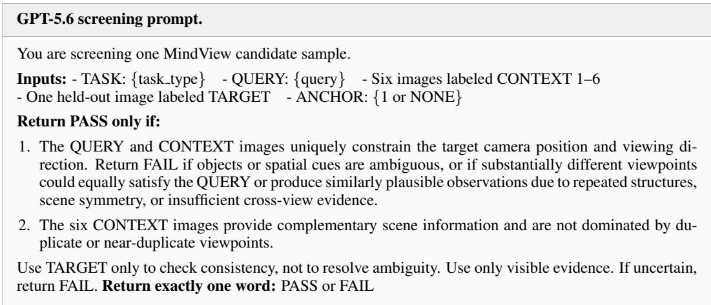

## A.4 TASK EXAMPLES AND GENERATION PROMPTS

Figures 7–13 show one released example for each task in the order introduced in Section 3.1. Each example contains six context images ordered from left to right, the held-out ground-truth target (GT), and the full generation prompt. A red border and “A” mark the first image when an anchor is required. The target is shown for reference and is not a generation input.

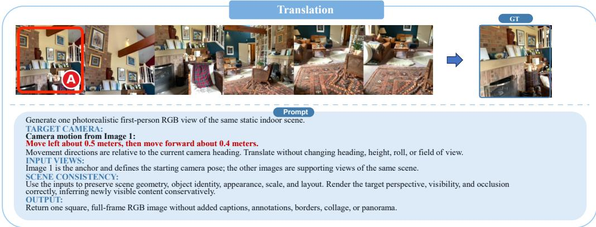

Figure 7: Translation example from ARKitScenes.  
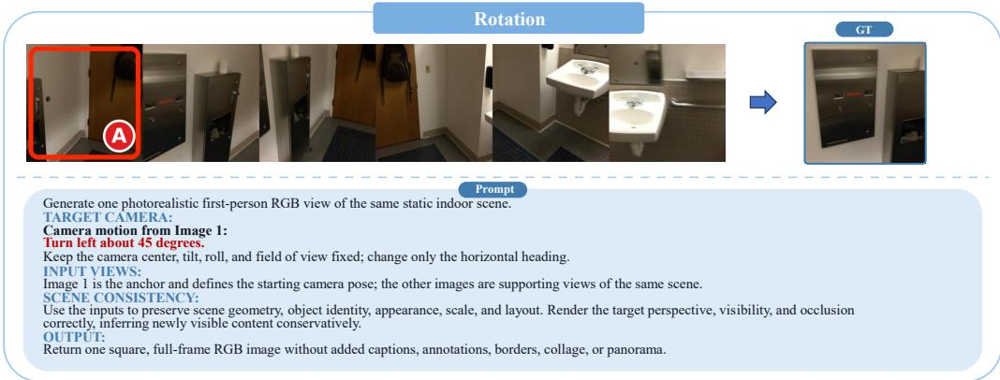  
Figure 8: Rotation example from ScanNet.

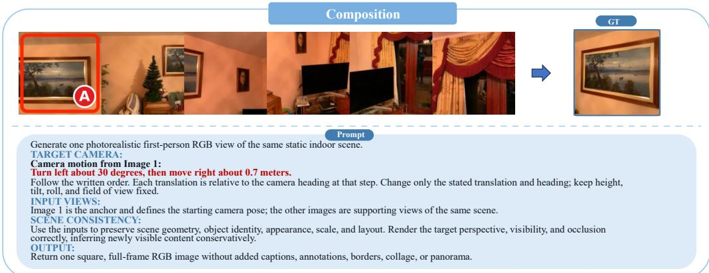

Figure 9: Composition example from ARKitScenes.  
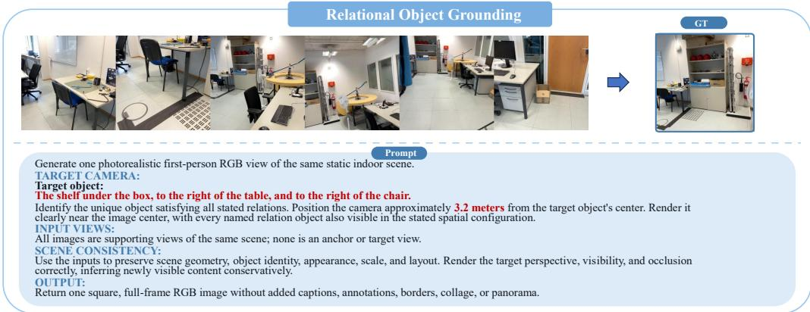

Figure 10: Relational Object Grounding example from ScanNet++.  
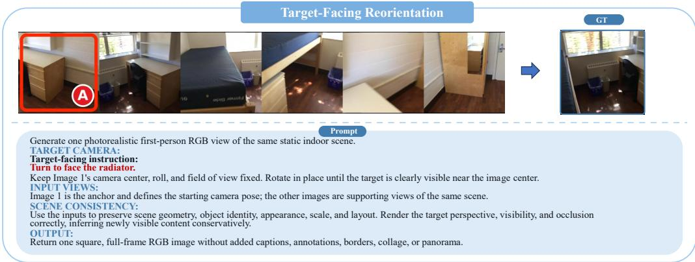  
Figure 11: Target-Facing Reorientation example from ScanNet.

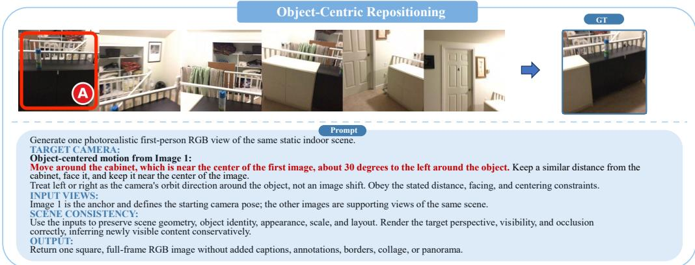

Figure 12: Object-Centric Repositioning example from ScanNet.  
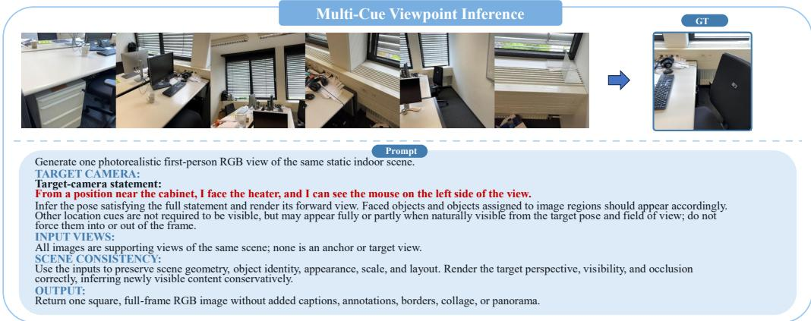  
Figure 13: Multi-Cue Viewpoint Inference example from ScanNet++.

## B EVALUATION PROTOCOL DETAILS

This section details the six metrics in Section 3.3, which assess agreement with the real target and the generation’s intrinsic quality.

## B.1 IMAGE-FEATURE SIMILARITY

DINO-I compares the visual content of a generated image with its real target using the pretrained DINOv2-Large encoder (Oquab et al., 2023). Let $\mathbf { f } _ { i } ^ { \mathrm { g e n } }$ and $\mathbf { f } _ { i } ^ { \mathrm { r e a l } }$ denote their unit-normalized finallayer CLS embeddings. The score is their cosine similarity scaled by 100,

$$
\mathrm { D I N O \mathrm { - } I } _ { i } = 1 0 0 ( \mathbf { f } _ { i } ^ { \mathrm { g e n } } ) ^ { \top } \mathbf { f } _ { i } ^ { \mathrm { r e a l } } .\tag{5}
$$

No clipping or offset is applied, so negative similarities remain negative. Before feature extraction, both images are converted to RGB, center-cropped to a square, and resized to 512×512 with Lanczos interpolation. The encoder’s standard preprocessing then produces normalized 224 × 224 inputs.

## B.2 VLM-BASED ASSESSMENT

We use Qwen3-VL-30B-A3B-Instruct (Qwen Team, 2025b) for two separate evaluations. The first receives the real target followed by the generation, labeled as the reference and candidate images, respectively. It returns separate Semantic and Spatial scores for scene-specific content and agreement in viewpoint and layout. The second receives only the generation and assigns a Quality score based on its internal coherence and visible defects.

Neither evaluation receives the query, context views, task type, camera metadata, or the other evaluation’s response. Spatial therefore measures agreement with the target image, not direct compliance with the language query. The first evaluation uses the initial RGB conversion, square crop, and $5 1 2 \times 5 1 2$ resize described above. For Quality, the full RGB image is reduced to fit within $5 1 2 \times 5 1 2$ without upscaling, preserving its aspect ratio, borders, and peripheral defects. The judge’s standard image preprocessing follows in both cases.

Each evaluation uses deterministic decoding with at most 256 output tokens. The three ratings must be integers from 0 to 10 and are multiplied by ten for reporting. Missing or invalid ratings constitute evaluation failures rather than zero scores. Section B.6 reproduces both prompts verbatim, apart from typesetting and line wrapping.

## B.3 GEOMETRIC CONSISTENCY

We use the pretrained VGGT-1B model (Wang et al., 2025a) to measure agreement between the generated and real target viewpoints. For each sample, VGGT jointly processes ten ordered reference views, the real target, and the generation, in that order. The references are drawn from the sample’s ten-context set and held fixed across generators and context budgets. Images undergo the same initial square preprocessing and are then resized to $5 1 8 \times 5 1 8$ for VGGT.

Camera-pose comparison. Joint inference places the reference views and both target images in a shared reconstructed coordinate system for each evaluation. For sample $i , k \in \{ \mathrm { g e n } , \mathrm { r e a l } \}$ indexes the generated and real target images. Let $\mathbf { x } _ { w } \in \mathbb { R } ^ { 3 }$ denote a point’s coordinates in this world frame and $\mathbf { x } _ { c } \in \mathbb { R } ^ { 3 }$ its coordinates in image $k \mathrm { { : } }$ camera frame. The estimated rotation $\hat { R } _ { i , k } \in \mathrm { S O ( 3 ) }$ and translation $\hat { \mathbf { t } } _ { i , k } \in \mathbb { R } ^ { 3 }$ map world coordinates to camera coordinates through $\mathbf { x } _ { c } = \hat { R } _ { i , k } \mathbf { x } _ { w } + \hat { \mathbf { t } } _ { i , k }$ Setting $\mathbf { x } _ { c } = \mathbf { 0 }$ gives the camera center in the world frame, $\hat { \mathbf { c } } _ { i , k } = - \hat { R } _ { i , k } ^ { \top } \hat { \mathbf { t } } _ { i , k }$ . We compare camera centers, rather than extrinsic translation vectors, and compute the errors in Equation 2 as

$$
\begin{array} { r l } & { \displaystyle e _ { \mathrm { r o t } , i } = \frac { 1 8 0 } { \pi } \operatorname { a r c c o s } \left( \mathrm { c l i p } \left( \frac { \mathrm { t r } ( { \hat { R } } _ { i , \mathrm { g e n } } { \hat { R } } _ { i , \mathrm { r e a l } } ^ { \top } ) - 1 } { 2 } , - 1 , 1 \right) \right) , } \\ & { \displaystyle e _ { \mathrm { t r a n s } , i } = a _ { i } \left\| \hat { \mathbf { c } } _ { i , \mathrm { g e n } } - \hat { \mathbf { c } } _ { i , \mathrm { r e a l } } \right\| _ { 2 } . } \end{array}\tag{6}
$$

Here, tr denotes the matrix trace, $\| \cdot \| _ { 2 }$ the Euclidean norm, and $\mathrm { c l i p } ( x , l , u )$ restricts x to $[ l , u ]$ The rotation error is in degrees. The positive scale $a _ { i }$ in Equation 7 converts reconstructed lengths to meters, so $e _ { \mathrm { t r a n s } , i }$ measures camera-center displacement in meters.

Depth-based scale calibration. We estimate $a _ { i }$ from sensor depths for the ten reference views and the real target, denoted collectively by $\mathcal { T } _ { i }$ . Measured depths are converted to meters, and invalid readings are excluded. Nearest-neighbor resampling aligns them with the predicted depth maps under the same centered image crop. For each real frame, we first retain pixels with finite measured and predicted depths, positive measured depth, and predicted depth above $1 0 ^ { - 8 }$ . When at least 512 such pixels have finite depth confidence, we select those at or above their median confidence, provided that at least 256 remain. Otherwise, we retain the original valid set.

Let $\mathcal { V } _ { i f }$ be the retained pixels in frame $f ,$ with measured depth $d _ { i f p } ^ { \mathrm { s e n s } }$ and predicted depth $\hat { d } _ { i f p }$ at pixel $p .$ . We aggregate log-depth ratios first within each frame and then across frames,

$$
a _ { i } = \mathrm { e x p } \left[ \mathrm { m e d i a n } _ { f \in \mathcal { I } _ { i } } \left\{ \mathrm { m e d i a n } _ { p \in \mathcal { V } _ { i f } } \left( \log d _ { i f p } ^ { \mathrm { s e n s } } - \log \hat { d } _ { i f p } \right) \right\} \right] .\tag{7}
$$

Calibration requires at least 256 retained pixels per real frame and a finite, positive $a _ { i }$ . The generation participates in joint inference but contributes no sensor depth to calibration. The real target and sensor depths are used only for evaluation, and neither pose error requires ground-truth camera poses.

Geometric scores. We convert the errors to higher-is-better scores before averaging samples,

$$
\mathrm { R S c o r e } _ { i } = 1 0 0 ~ \mathrm { c l i p } \left( 1 - { \frac { e _ { \mathrm { r o t } , i } } { 6 0 ^ { \circ } } } , 0 , 1 \right) , \qquad \mathrm { T S c o r e } _ { i } = 1 0 0 ~ \mathrm { c l i p } \left( 1 - { \frac { e _ { \mathrm { t r a n s } , i } } { 2 m } } , 0 , 1 \right) .\tag{8}
$$

Each score decreases linearly from 100 at zero error to zero at its threshold and remains zero for larger errors.

## B.4 EVALUATOR RELIABILITY

Human–VLM ranking agreement. We assess whether the VLM judge reflects human preferences on a score-blind subset of 210 standard-six-view samples, with 30 samples from each task. The same three multimodal-research experts who conducted the benchmark review in Section A.3 in dependently rate outputs from the four models in Table 5 using the same Semantic, Spatial, and Quality criteria as the judge. The table reports the expert-averaged human scores and VLM scores on the same subset.

Table 5: Human and VLM-judge component scores on the shared 210-sample subset. Human scores are three-expert averages; all values are on a 0–100 scale, and higher is better.
<table><tr><td rowspan="2">Model</td><td colspan="2">Semantic</td><td colspan="2">Spatial</td><td colspan="2">Quality</td></tr><tr><td>Human</td><td>VLM</td><td>Human</td><td>VLM</td><td>Human</td><td>VLM</td></tr><tr><td>GPT-Image-2</td><td>68.4</td><td>63.4</td><td>63.3</td><td>50.2</td><td>76.3</td><td>84.8</td></tr><tr><td>Nano Banana Pro</td><td>62.6</td><td>59.5</td><td>59.5</td><td>47.4</td><td>72.5</td><td>79.8</td></tr><tr><td>SenseNova-U1.5</td><td>57.6</td><td>54.1</td><td>51.5</td><td>43.5</td><td>66.8</td><td>70.3</td></tr><tr><td>BAGEL</td><td>45.5</td><td>45.4</td><td>43.0</td><td>33.4</td><td>44.1</td><td>48.6</td></tr></table>

For 194 of the 210 samples (92.4%), all three experts independently give the same four-model ranking, and this unanimous human ranking exactly matches the ranking produced by the VLM judge. Absolute scores nevertheless reveal a consistent calibration shift. For every model, the VLM judge assigns lower Semantic and Spatial scores and higher Quality scores than the experts. Despite this shift, all six aggregate pairwise model comparisons agree in direction for each component (18/18 overall), yielding the same complete ordering: GPT-Image-2, Nano Banana Pro, SenseNova-U1.5, and BAGEL. These results support the judge’s comparative validity on the evaluated subset despite differences in absolute calibration.

Reliability of VGGT-based geometric scores. Joint reconstruction introduces a different concern: a degraded generation could perturb the real-view geometry against which it is scored. We evaluate this sensitivity quantitatively and inspect score behavior in a severe qualitative case. We sample 30 cases uniformly without replacement per task, covering 210 samples from 150 scenes. For each, we substitute the standard-six-view outputs of BAGEL, BAGEL-SFT, FLUX.2, and GPT-Image-2, fixing the ten reference images, real target (GT), input order, and preprocessing. Each reconstruction is independently calibrated to meters from the eleven real views’ sensor depths (Equation 7). As a repeatability control, identical BAGEL inputs are rerun on three samples per task; all 21 reruns yield exactly identical saved poses, intrinsics, depths, confidence maps, and calibration scales.

We compare the fixed real views across generator conditions. For the GT, $\Delta R$ averages changes in its relative rotations to the ten reference cameras, and ∆C measures camera-center displacement after rigid alignment fitted only to those reference centers, without rescaling. For the references, ∆R and $\Delta L$ average relative-rotation changes and absolute camera-distance changes over all 45 camera pairs. These diagnostics remove global-coordinate ambiguity while retaining differences in calibrated scale. For each real image, depth change is ∆D = 100 median $_ p \big [ 2 | d _ { p } ^ { ( a ) } - d _ { p } ^ { ( b ) } | / ( d _ { p } ^ { ( a ) } + d _ { p } ^ { ( b ) } ) \big ]$ where $a , b$ index generator conditions, using calibrated depths on the full 518 × 518 grid and a fixed valid-sensor-depth mask across conditions. We report GT depth change separately and average the ten per-image changes for the references. Table 6 reports medians across samples after averaging each diagnostic over the six unordered generator pairs within each sample; the identical-input reruns are excluded. The pooled median changes are 0.71◦, 2.75 cm, and 0.76% for GT rotation, position, and depth; reference changes are 0.75◦, 2.63 cm in pairwise distance, and 0.87% in depth. These small median changes indicate that outputs from different generators typically have little effect on the reconstructed geometry of the fixed real views, supporting the stability of VGGT-based geometric evaluation.

Table 6: VGGT reference stability across generators. Only the generation changes; ten contexts and the real target stay fixed. Entries are sample medians after averaging six generator pairs per sample. $\Delta R \colon$ relative-rotation change; $\Delta C \colon$ aligned GT-center displacement; $\Delta \bar { L } \colon$ context-pair distance change; $\Delta D \colon$ symmetric relative depth change. Distances are depth-calibrated; lower values indicate greater stability.
<table><tr><td rowspan="2">Task</td><td rowspan="2">N</td><td colspan="3">Real target (GT)</td><td colspan="3">Contexts</td></tr><tr><td> $\Delta R ( ^ { \circ } )$ </td><td> $\Delta C \mathrm { ( c m ) }$ </td><td> $\Delta D ( \% )$ </td><td> $\Delta R ( ^ { \circ } )$ </td><td> $\Delta L ( \mathrm { c m } )$ </td><td>∆D (%)</td></tr><tr><td>Translation</td><td>30</td><td>0.85</td><td>4.96</td><td>1.09</td><td>1.09</td><td>6.02</td><td>1.39</td></tr><tr><td>Rotation</td><td>30</td><td>0.52</td><td>1.92</td><td>0.58</td><td>0.65</td><td>2.14</td><td>0.79</td></tr><tr><td>Composition</td><td>30</td><td>0.96</td><td>4.60</td><td>0.95</td><td>0.88</td><td>4.71</td><td>1.18</td></tr><tr><td>ROG</td><td>30</td><td>0.82</td><td>3.25</td><td>0.99</td><td>0.93</td><td>2.62</td><td>0.97</td></tr><tr><td>TFR</td><td>30</td><td>0.63</td><td>1.60</td><td>0.55</td><td>0.70</td><td>1.88</td><td>0.80</td></tr><tr><td>OCR</td><td>30</td><td>0.50</td><td>1.96</td><td>0.48</td><td>0.54</td><td>2.04</td><td>0.67</td></tr><tr><td>MCVI</td><td>30</td><td>0.74</td><td>2.84</td><td>0.75</td><td>0.77</td><td>2.33</td><td>0.77</td></tr><tr><td>All sampled cases</td><td>210</td><td>0.71</td><td>2.75</td><td>0.76</td><td>0.75</td><td>2.63</td><td>0.87</td></tr></table>

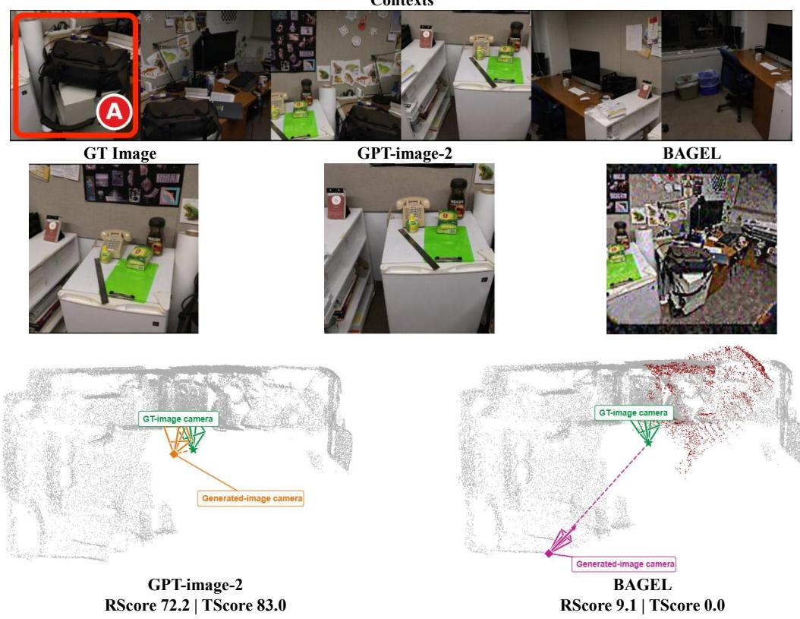  
Figure 14: VGGT evaluation of GPT-Image-2 and BAGEL outputs. For the ScanNet TFR query “Turn to face the telephone,” the top row shows six generation contexts (A: anchor); evaluation uses ten fixed references, the real target, and one generation. Reconstructions are independently depthcalibrated and rigidly aligned using only the ten reference camera centers, without scale fitting. All cameras are VGGT estimates; GT denotes the real target image. Dark red marks points contributed by BAGEL’s generation; all other scene points are gray.

Figure 14 complements the aggregate analysis with a visibly degraded generation. GPT-Image-2 preserves the target-facing scene content, whereas BAGEL introduces severe appearance and layout distortions. Their RScore/TScore values are 72.2/83.0 and 9.1/0.0, respectively. The reference scene and estimated GT camera remain visually similar after alignment, while BAGEL’s estimated camera lies much farther from the estimated target camera. This case illustrates score behavior consistent with the visible target-view discrepancy despite the degraded generation.

Together, the quantitative and qualitative results support RScore and TScore as meaningful measures of target-view geometric consistency. Reference geometry exhibits small median changes across model outputs. In the illustrated case, it remains visually stable despite severe generation artifacts, while the scores reflect the visible viewpoint discrepancy.

## B.5 SCORE AGGREGATION

For each generator and context setting, let $s _ { i t j }$ be sample i’s score on metric $j$ for task t after the conversions above, and let $n _ { t }$ be the number of samples in that task. We first average samples within each task, then give equal weight to the six components and the seven tasks,

$$
{ \bar { s } } _ { t j } = { \frac { 1 } { n _ { t } } } \sum _ { i = 1 } ^ { n _ { t } } { s _ { i t j } } , \qquad S _ { t } = { \frac { 1 } { 6 } } \sum _ { j = 1 } ^ { 6 } { \bar { s } } _ { t j } , \qquad { \mathrm { O v e r a l l } } = { \frac { 1 } { 7 } } \sum _ { t = 1 } ^ { 7 } { S _ { t } } .\tag{9}
$$

Each benchmark-level component score is likewise averaged equally across the seven tasks, so tasks with more samples do not receive greater weight.

Aggregation requires valid scores for every benchmark sample. Failed or missing evaluations are neither assigned zero nor silently omitted. Scores and gains are displayed to one decimal place, while differences and rankings are computed before rounding. Overall is a composite score, not a calibrated accuracy. Comparisons are descriptive, without significance tests.

## B.6 EVALUATOR PROMPTS

## Semantic and Spatial prompt.

You are a strict, task-independent evaluator of image fidelity. The labeled REFERENCE IMAGE is the groundtruth target. The labeled CANDIDATE IMAGE is the model prediction.

Important rules: - The two images may or may not depict the same scene. Do not assume that they match. - Inspect each image independently before comparing them. - Use only visible pixel evidence. - Never attribute an object, region, or property to one image merely because it appears in the other. - Do not use or infer any hidden prompt, context images, task type, or camera metadata. - Evaluate Semantic Fidelity and Spatial Fidelity independently. - Do not judge aesthetic preference or technical image quality in this evaluation.

## 1. Semantic Fidelity: WHAT is present

Evaluate: - scene identity and scene category; - main objects, structures, and recognizable content; - approximate object count and identity-defining attributes; - missing, extra, substituted, hallucinated, or unrecognizable content.

Do NOT evaluate: - camera viewpoint, orientation, framing, crop, or visible side by itself; - object position, scale, depth, occlusion, or relative layout; - global color tone, lighting, rendering style, sharpness, or visual polish.

A spatially displaced object can still be semantically correct. A viewpoint difference alone must not reduce Semantic Fidelity if the same important content remains visible and recognizable. However, important content that is visibly missing or hallucinated is a semantic error, regardless of its cause.

Semantic Fidelity scoring: 10 = The same scene-specific content is preserved almost completely. All major objects and structures are present and recognizable, with no meaningful missing, extra, substituted, or hallucinated content. 8 = The same scene and all major content are preserved, with only minor errors involving secondary objects or identity-defining attributes. 6 = The core scene is clearly recognizable, but one major object or several secondary elements are missing, substituted, hallucinated, or unrecognizable. 4 = Only partial scene-specific content is preserved. Multiple major objects or structures are incorrect, although some meaningful correspondence remains. 2 = The images share only a generic scene category or a few isolated object categories; scene-specific correspondence is very weak. 0 = No meaningful semantic correspondence, or the candidate contains no interpretable scene content.

Semantic score constraints: - Generic category similarity alone, such as both images being bedrooms or offices, cannot receive a score above 3. - If one major or scene-defining object is missing, replaced, or hallucinated, the score cannot exceed 6. - If multiple major objects are incorrect, the score cannot exceed 4. - A score of 9 or 10 requires nearly complete scene-specific correspondence, not merely a similar category or overall impression.

## 2. Spatial Fidelity: WHERE things are and FROM WHERE the scene is viewed

Evaluate: - camera viewpoint and orientation; - framing, crop, and visible scene regions or surfaces; - relative object positions, scale, depth ordering, and occlusion; - scene layout, geometry, and composition.

## Semantic and Spatial prompt (continued).

Judge spatial relations using scene elements that can be meaningfully corresponded between the two images.

Do NOT evaluate: - object category or semantic identity by itself; - color, lighting, texture, rendering style, sharpness, or visual attractiveness; - isolated generation artifacts unless they make spatial relationships impossible to assess.

Do not reward a generic similar composition unless corresponding scene elements support it. If meaningful spatial correspondence cannot be established, use a score of 0, 1, or 2.

Spatial Fidelity scoring: 10 = Viewpoint, orientation, framing, visible regions, and spatial layout essentially match, with only negligible offsets. 8 = The intended view and layout are correct, with only minor shifts, crop or scale differences, or small geometric errors. 6 = The overall view is similar, but noticeable differences exist in camera pose, framing, visibility, scale, or relative placement. 4 = Some spatial correspondence exists, but the viewpoint, visible region, or layout is clearly incorrect. 2 = Very little spatial correspondence remains; there is a major camera-pose, framing, or layout mismatch. 0 = No usable spatial correspondence, or spatial structure cannot be assessed.

Spatial score constraints: - A clearly incorrect viewing direction or target-facing direction cannot receive a score above 4. - A major mismatch in the visible scene region or room side cannot receive a score above 4. - Generic centered composition without scene-specific correspondence cannot receive a score above 2. - A score of 9 or 10 requires both camera view and scene layout to match closely.

Use integers from 0 to 10. Integers between the stated anchors may be used when justified. Apply all score constraints before producing the final scores.

Each reason must identify the strongest visible evidence and explicitly distinguish the Reference from the Candidate. Keep each reason to one short sentence.

Return ONLY valid JSON in exactly this format: { "semantic\_score": <integer 0-10>,

## Quality prompt.

You are a strict evaluator of the intrinsic visual quality of a generated image. Only the labeled CANDIDATE IMAGE is provided. Evaluate whether the image is visually clean, structurally coherent, and free of generation defects. Use only visible pixel evidence. Judge the candidate image independently, without assuming any unseen reference, prompt, context image, task, or intended camera pose.

Evaluate: - malformed, melted, stretched, fused, or broken objects and structures; - internally inconsistent room, object, perspective, or surface geometry; - duplicated or unnaturally repeated elements; - seams, corrupted regions, incomplete rendering, and white or black borders; - unintended text, watermarks, blank regions, or padding; - unintended blur, pixelation, noise, aliasing, or compression artifacts; - implausible edges, lighting discontinuities, and inconsistent shadows.

Do NOT evaluate: - whether the image matches an unseen reference, prompt, task, or intended viewpoint; - whether its objects or layout are correct for an external target; - semantic fidelity or spatial fidelity; - aesthetic preference or similarity to a particular rendering style.

Do not reward an image merely because it looks attractive, polished, colorful, or cinematic. Do not penalize unusual content when it is internally coherent. Judge coherence within the image’s own visual domain.

Visual Quality scoring: 10 = Technically clean and internally coherent. No meaningful deformation, broken geometry, duplication, border, seam, corruption, or unintended artifact is visible. 8 = High visual quality. Only minor and localized defects are visible, without affecting important objects or structures. 6 = Generally usable, but one prominent defect or several noticeable local artifacts are present. 4 = Multiple prominent defects affect important regions, such as malformed objects, inconsistent geometry, repeated structures, seams, blur, or borders. 2 = Severe and widespread distortion, incomplete rendering, broken perspective, large blank regions, or obvious corruption makes the image difficult to use. 0 = Blank, invalid, unreadable, almost completely corrupted, or a failed generation.

Visual Quality score constraints: - One obvious structural deformation in a salient region prevents a score above 7. - Multiple visible deformations, repetitions, seams, or broken structures prevent a score above 5. - A large white or black border, incomplete rendering, or corrupted region prevents a score above 4. - A score of 9 or 10 requires careful inspection to reveal no meaningful defect. - Attractive lighting, color, or visual polish alone must not increase the score.

Use an integer from 0 to 10. Integers between the stated anchors may be used when justified. Apply all score constraints before producing the final score.

The reason must identify the most important visible defect or, when no meaningful defect exists, explicitly state that the image is visually coherent. Keep the reason to one short sentence.

Return ONLY valid JSON in exactly this format: { "visual\_quality\_score": <integer 0-10>,

"visual\_quality\_reason": "<short evidence-based reason>" }

## C TRAINING AND INFERENCE DETAILS

## C.1 TRAINING RESOURCE

The released training resource contains 20,000 examples from 3,406 scenes, each with six context images, a language query, and a real target image. Training examples are constructed from the training splits of all three source datasets, while the benchmark uses their validation splits for heldout evaluation. The training resource and benchmark share no scenes within any source dataset.

## C.2 RELEASED TRAINING CONFIGURATION

The release configuration specifies 10,000 optimizer updates with eight distributed processes and no gradient accumulation. It uses AdamW (Loshchilov & Hutter, 2019) with learning rate $1 0 ^ { - 5 }$ , cosine decay to $1 0 ^ { - 6 }$ , 200 warmup steps, gradient clipping at 0.5, and EMA decay 0.9995. The VAE and vision transformer are frozen, while the language model and understanding branch remain trainable. Conditioning dropout is disabled. Images are center-cropped and resized to $5 1 2 \times 5 1 2$ for the VAE and $5 1 8 \times 5 1 8$ for the vision transformer, with training timestep shift 4. These settings describe the released training recipe.

## C.3 GENERATION CONFIGURATION

The saved BAGEL-SFT inference configuration uses 50 sampling steps, text and image guidance scales of 4 and 2, timestep shift 3, and no-thinking inference. Input and saved output images are $5 1 2 \times 5 1 2$ . Local generators share a deterministic per-sample seed across the supplementary context settings. Closed-source APIs receive no seed. In our setup, directly supplying six separate images to Qwen-Image-Edit-2511 and Emu3.5 led to inference failures or severely degraded outputs. We therefore pack supporting views into a contact sheet and provide the anchor separately when present. For anchor-free tasks, all context views are packed into a single contact sheet.

## D SPATIAL-UNDERSTANDING EVALUATION DETAILS

All results in Table 3 are obtained in our own evaluations. SAT-v2 uses 150 questions evaluated in two answer orders. Micro accuracy counts correct predictions among all 300 responses, while bothorder accuracy counts questions answered correctly in both orders among the 150 pairs. BAGEL and BAGEL-SFT use identical inputs and greedy, non-thinking decoding. Their correct counts are 174 and 188 responses, respectively, and 41 and 62 complete pairs. BAGEL-SFT answers 322 of 1,000 MMSI-Bench questions correctly under the Vanilla non-circular protocol and 383 of 1,050 MindCube-Tiny questions under raw-QA evaluation. Our reproduced BAGEL accuracies are 31.0% and 34.7%, respectively, matching SenseNova-SI (Cai et al., 2026) at the reported precision. Eval. Size in Table 3 denotes the number of evaluated responses or question pairs under each protocol.

## E MINDCUE IMPLEMENTATION

MindCue uses a target-view hypothesis to identify useful additional evidence while preserving the complete core. Following Section 4.5, I indexes the ordered input pool, ${ \mathcal { F } } _ { i }$ the core, and $\mathcal { D } _ { i }$ the additional views. The selector uses only input RGB images, the query, task label, and core and anchor metadata, with no access to held-out targets, sensor depth, ground-truth poses, generated images, or evaluation scores.

## E.1 SCENE EVIDENCE

Frozen VGGT jointly predicts camera poses, intrinsics, depth, and confidence, placing the input views in a shared reconstruction. For semantics-dominant tasks, a fixed parser extracts queried entities and frozen SAM 3 segments them. After confidence filtering and duplicate suppression, masks are lifted into the reconstruction and grouped into object clusters. Each cluster must include a core observation, while additional views can refine its geometry. Geometry-dominant tasks use the predicted geometry without object masks.

Table 7: Task-specific target-view hypotheses in MindCue.
<table><tr><td>Task Target-view hypothesis</td><td></td></tr><tr><td colspan="2">Geometry-Dominant Tasks</td></tr><tr><td>Trans.</td><td>Move from the reference position along its horizontal camera axes by the requested displacements, keeping its orientation and intrinsics.</td></tr><tr><td>Rot. Comp.</td><td>Keep the reference position and intrinsics. Rotate about world-up by the requested yaw, with left positive and right negative. A turn-around is  $1 8 0 ^ { \circ }$ </td></tr><tr><td></td><td>Apply translations and rotations in query order from the reference pose. Each displacement uses the current horizontal camera axes, accounting for preceding rotations. Keep the reference intrinsics.</td></tr><tr><td colspan="2">Semantics-Dominant Tasks</td></tr><tr><td>ROG</td><td>For each core-supported target centroid, place cameras at the requested distance along rays toward input-camera centers. Face the centroid and inherit source intrinsics; select the highest-scoring object-camera pair.</td></tr><tr><td>TFR OCR</td><td>Keep the reference center, roll, and intrinsics, and face the core-supported target centroid. Orbit the reference camera around the target centroid about world-up by the requested angle,</td></tr><tr><td></td><td>preserving distance, roll, and intrinsics; face the target.</td></tr><tr><td>MCVI</td><td>For each facing-object candidate, reorient cameras where it is detected toward its centroid, retaining centers and intrinsics; select the highest-scoring pair.</td></tr></table>

## E.2 TARGET-VIEW HYPOTHESIS

The query and scene evidence define a hypothesized target camera $\hat { \mathcal { C } } _ { i } ^ { \star }$ with pose and intrinsics. This camera guides evidence selection; it is not supplied to the generator as a pose condition. For tasks with an explicit anchor, MindCue updates the first input camera according to the requested motion or object reference. ROG and MCVI instead compare candidates derived from predicted objects and input-camera positions, as detailed in Table 7. World-up is derived from predicted camera poses.

ROG ranks candidates by a fixed weighted combination of relation consistency, target confidence, and proximity to the source input camera. MCVI instead combines facing-object centering, satisfaction of available constraints, and observed semantic support. ROG requires evidence for every parsed relation object, whereas MCVI omits unsupported auxiliary constraints and treats generic between cues as proximity to both objects.

## E.3 RELIABLE TARGET COVERAGE

To measure target coverage, we construct sparse per-view point sets $\hat { \mathcal { P } } _ { i v }$ through depth sampling, confidence filtering, and unprojection. Projecting their union through $\hat { \mathcal { C } } _ { i } ^ { \star }$ retains the nearest depth in each occupied grid cell, forming the virtual surface $S _ { i }$ in Equation 3. View v supports a cell when one of its projected points agrees with this surface within a depth tolerance. Thus, support requires depth agreement, not projection overlap alone.

Let $\mathcal { V } _ { i v } \subseteq S _ { i }$ be the supported cells and $\begin{array} { r } { \mathcal { V } _ { i , - v } = \bigcup _ { u \in \mathcal { T } _ { i } \setminus \{ v \} } \mathcal { V } _ { i u } } \end{array}$ the support from all other input views. For a nonempty surface, reliable coverage is

$$
R _ { i } ( v ) = \frac { | \mathcal { V } _ { i v } \cap \mathcal { V } _ { i , - v } | } { | \mathcal { S } _ { i } | } + \operatorname* { m i n } \biggl \{ \frac { | \mathcal { V } _ { i v } \setminus \mathcal { V } _ { i , - v } | } { | \mathcal { S } _ { i } | } , \eta \biggr \} .\tag{10}
$$

The first term credits cross-view support; the second caps the total contribution of evidence supplied only by the candidate. We use $\eta = 0 . 0 5$ and retain every additional view whose reliable coverage reaches $\tau = 0 . 2 0$ . Cells are counted equally, and support is computed once from the original pool, including views subsequently discarded. Unlike diagnostic Target Coverage in Section 4.3, this score uses only predicted input geometry and a hypothesized camera.

## E.4 CONNECTIVITY AND FINAL SELECTION

MindCue constructs the retained additional-view set $A _ { i }$ while preserving the complete core ${ \mathcal { F } } _ { i }$ . If the virtual surface $s _ { i }$ is empty, $A _ { i } = \mathcal { O }$ and the generator receives only the core. Otherwise, it first retains every additional view $v \in \mathcal { D } _ { i }$ with reliable target coverage $R _ { i } ( \dot { v } ) \geq \tau = 0 . 2 0$

For tasks with an explicit anchor, one below-threshold view may also be retained to connect the core to the target hypothesis. Candidates must meet minimum coverage and connection-score requirements and pass nonredundancy checks against the core and coverage-selected views. We select the eligible candidate maximizing

$$
Q _ { i } ( v ) = { \sqrt { R _ { i } ( v ) \operatorname* { m a x } _ { u \in { \mathcal { F } } _ { i } } \delta _ { i } ( v , u ) } } .\tag{11}
$$

Here $\delta _ { i } ( v , u )$ is the larger of the two directed overlaps: the fraction of source points reprojecting into the other view with consistent depth, or zero for an empty source. The selected view forms $X _ { i } ;$ without an anchor or an eligible candidate, $X _ { i } = \mathcal { O }$

For a nonempty surface, the final additional-view set is $A _ { i } = \{ v \in \mathcal { D } _ { i } : R _ { i } ( v ) \geq \tau \} \cup X _ { i } .$ , as defined in Equation 4. All coverage-selected additions are retained; connectivity adds at most one further view. The generator receives the original query and the pool views indexed by ${ \mathcal { F } } _ { i } \cup A _ { i } ,$ preserving their original order and every core view.

## E.5 EXPERIMENTAL CONTROLS

Our experiments use $C _ { 1 0 , i }$ as the pool and $C _ { 6 , i }$ as the core. RandDrop randomly selects additional views to match MindCue’s per-sample count, whereas CounterSel retains the additions rejected by MindCue and is not count-matched. Both preserve the core and input order, with generator checkpoints and evaluation references fixed across policies. MindCue uses the same selection for BAGEL and BAGEL-SFT.

## E.6 RUNTIME

On a single NVIDIA A100-SXM4-80GB, MindCue adds 1.44 s per sample on average, raising the summed latency from 42.48 s to 43.91 s with identical selected images and order (Table 8). The 3.4% overhead is the ratio of unrounded weighted mean MindCue and BAGEL generation times. VGGT reconstruction and SAM 3 segmentation with mask lifting contribute 0.57 s and 0.82 s on average, respectively. The SAM 3 mean includes zero time for geometry-dominant tasks.

We use 63 samples stratified by task and dataset, with three repetitions. Dataset means are weighted by their release frequencies within each task, then averaged equally across the seven tasks. Models are preloaded and timed separately with GPU synchronization. These stage-wise sums exclude RGB reading and preprocessing, model loading and warmup, inter-stage handoff, output saving, and evaluation.

Table 8: Runtime on a single A100 80GB. View counts refer to generator inputs, with identical images and order in the selected-view rows. Means are weighted and rounded independently.
<table><tr><td>Configuration</td><td>Mean views</td><td>Mean (s)</td></tr><tr><td>BAGEL,  $C _ { 6 }$ </td><td>6</td><td>38.528</td></tr><tr><td>BAGEL,  $C _ { 1 0 }$ </td><td>10</td><td>50.625</td></tr><tr><td>BAGEL, selected views</td><td>7.30</td><td>42.476</td></tr><tr><td>MindCue + BAGEL, same views</td><td>7.30</td><td>43.913</td></tr><tr><td>MindCue component</td><td></td><td>Mean (s)</td></tr><tr><td>VGGT reconstruction</td><td></td><td>0.572</td></tr><tr><td>SAM 3 segmentation and mask lifting</td><td></td><td>0.819</td></tr><tr><td>Query parsing, camera planning, and selection</td><td></td><td>0.046</td></tr><tr><td>Total MindCue overhead (+3.4%)</td><td></td><td>1.438</td></tr></table>

Including RGB reading and initial preprocessing in both MindCue and BAGEL timings gives an additional 1.86 s, or 4.4%. These results indicate that MindCue adds only modest overhead relative to generation under this profiling setup.

## F SUPPLEMENTARY RESULTS

This section complements the main experiments with component, context-scaling, context-selection, and qualitative results on the same frozen 1,500 samples and under the same evaluation protocols.

## F.1 TASK-LEVEL COMPONENT SCORES ON MINDVIEW

Tables 9–12 report all six component scores for each task under the standard six-view input, complementing the task composites in Table 2. The comparison includes eleven off-the-shelf generators and BAGEL-SFT. BAGEL-SFT scores higher than BAGEL on all 42 task–component pairs and ranks first among the twelve models on 31 of them. It leads Semantic, Spatial, and TScore on all seven tasks. Its Quality score also exceeds BAGEL on every task, although GPT-Image-2 remains highest on that component throughout. Task abbreviations follow Section 3.1. Bold and underline indicate the highest and second-highest scores across all twelve models within each task. Sem., Spa., and Qual. denote Semantic, Spatial, and Quality. † denotes tiled context views, as in Table 1.

Table 9: Component scores on MindView for Translation and Rotation.
<table><tr><td rowspan="2">Model</td><td colspan="6">Trans.</td><td colspan="6">Rot.</td></tr><tr><td>DINO-I</td><td>Sem.</td><td>Spa.</td><td>Qual.</td><td>RScore</td><td>TScore</td><td>DINO-I</td><td>Sem.</td><td>Spa.</td><td>Qual.</td><td>RScore</td><td>TScore</td></tr><tr><td>BAGEL</td><td>47.7</td><td>44.2</td><td>34.5</td><td>48.6</td><td>47.8</td><td>27.5</td><td>45.8</td><td>41.4</td><td>30.4</td><td>46.4</td><td>33.7</td><td>35.1</td></tr><tr><td>FLUX.2</td><td>53.2</td><td>49.8</td><td>40.9</td><td>85.3</td><td>59.0</td><td>29.7</td><td>46.7</td><td>42.4</td><td>33.9</td><td>78.5</td><td>31.9</td><td>48.7</td></tr><tr><td>Qwen-Image-Edit-2511†</td><td>57.3</td><td>51.8</td><td>41.0</td><td>67.3</td><td>67.8</td><td>35.4</td><td>43.1</td><td>36.9</td><td>29.3</td><td>69.8</td><td>32.2</td><td>63.8</td></tr><tr><td>Emu3.5†</td><td>52.0</td><td>46.0</td><td>38.0</td><td>69.6</td><td>80.1</td><td>48.4</td><td>38.7</td><td>32.0</td><td>24.5</td><td>63.3</td><td>30.3</td><td>72.5</td></tr><tr><td>DreamOmni2</td><td>56.3</td><td>51.3</td><td>41.8</td><td>61.8</td><td>74.2</td><td>41.1</td><td>39.8</td><td>31.8</td><td>25.5</td><td>60.8</td><td>23.7</td><td>63.7</td></tr><tr><td>SenseNova-U1</td><td>51.4</td><td>45.5</td><td>37.9</td><td>59.0</td><td>46.9</td><td>24.5</td><td>48.7</td><td>41.5</td><td>34.0</td><td>59.7</td><td>20.4</td><td>36.3</td></tr><tr><td>SenseNova-U1.5</td><td>57.8</td><td>50.7</td><td>41.8</td><td>71.3</td><td>62.9</td><td>37.2</td><td>48.9</td><td>43.4</td><td>35.2</td><td>65.7</td><td>38.0</td><td>49.4</td></tr><tr><td>Nano Banana</td><td>52.4</td><td>50.5</td><td>41.0</td><td>74.1</td><td>47.8</td><td>29.9</td><td>53.3</td><td>48.4</td><td>37.3</td><td>64.5</td><td>38.2</td><td>46.8</td></tr><tr><td>Nano Banana Pro</td><td>55.5</td><td>55.9</td><td>44.4</td><td>82.4</td><td>53.0</td><td>35.9</td><td>59.3</td><td>54.9</td><td>43.5</td><td>74.6</td><td>44.8</td><td>45.1</td></tr><tr><td>GPT-Image-1.5</td><td>52.8</td><td>52.5</td><td>42.4</td><td>85.4</td><td>52.8</td><td>26.8</td><td>52.2</td><td>50.2</td><td>39.7</td><td>81.1</td><td>34.9</td><td>29.1</td></tr><tr><td>GPT-Image-2</td><td>59.1</td><td>55.0</td><td>45.1</td><td>87.1</td><td>63.6</td><td>32.1</td><td>57.1</td><td>52.9</td><td>42.1</td><td>81.8</td><td>50.0</td><td>41.3</td></tr><tr><td>BAGEL-SFT</td><td>67.1</td><td>70.4</td><td>59.0</td><td>63.9</td><td>78.4</td><td>64.0</td><td>72.2</td><td>70.3 56.2</td><td></td><td>58.0</td><td>69.1</td><td>83.5</td></tr></table>

Table 10: Component scores on MindView for Composition and Relational Object Grounding.
<table><tr><td rowspan="2">Model</td><td colspan="6">Comp.</td><td colspan="6">ROG</td></tr><tr><td>DINO-I</td><td>Sem.</td><td>Spa.</td><td>Qual.</td><td>RScore</td><td>TScore</td><td>DINO-I</td><td>Sem.</td><td>Spa.</td><td>Qual.</td><td>RScore</td><td>TScore</td></tr><tr><td>BAGEL</td><td>42.7</td><td>34.9</td><td>28.0</td><td>45.7</td><td>29.8</td><td>35.5</td><td>50.9</td><td>48.8</td><td>36.2</td><td>45.2</td><td>42.5</td><td>35.4</td></tr><tr><td>FLUX.2</td><td>43.6</td><td>40.0</td><td>33.5</td><td>80.8</td><td>32.9</td><td>33.6</td><td>54.1</td><td>52.0</td><td>40.5</td><td>81.3</td><td>33.2</td><td>42.2</td></tr><tr><td>Qwen-Image-Edit-2511†</td><td>43.7</td><td>38.3</td><td>30.7</td><td>66.5</td><td>31.6</td><td>39.0</td><td>55.2</td><td>54.6</td><td>42.0</td><td>69.3</td><td>38.4</td><td>39.8</td></tr><tr><td>Emu3.5†</td><td>38.0</td><td>31.3</td><td>26.9</td><td>63.8</td><td>26.8</td><td>57.3</td><td>49.0</td><td>45.5</td><td>32.8</td><td>58.5</td><td>29.9</td><td>39.1</td></tr><tr><td>DreamOmni2</td><td>36.0</td><td>28.5</td><td>24.4</td><td>64.0</td><td>19.5</td><td>42.6</td><td>35.4</td><td>29.4</td><td>23.6</td><td>70.5</td><td>11.2</td><td>32.3</td></tr><tr><td>SenseNova-U1</td><td>44.7</td><td>37.6</td><td>32.5</td><td>57.5</td><td>24.8</td><td>30.2</td><td>61.1</td><td>55.7</td><td>42.5</td><td>66.5</td><td>30.3</td><td>40.1</td></tr><tr><td>SenseNova-U1.5</td><td>49.4</td><td>40.2</td><td>34.1</td><td>68.2</td><td>35.4</td><td>31.9</td><td>62.3</td><td>59.2</td><td>47.7</td><td>69.3</td><td>50.9</td><td>51.0</td></tr><tr><td>Nano Banana</td><td>47.1</td><td>44.9</td><td>36.5</td><td>67.5</td><td>39.3</td><td>39.5</td><td>60.5</td><td>59.4</td><td>43.8</td><td>64.6</td><td>45.3</td><td>46.9</td></tr><tr><td>Nano Banana Pro</td><td>46.8</td><td>46.1</td><td>37.6</td><td>79.0</td><td>39.5</td><td>34.9</td><td>65.6</td><td>61.1</td><td>48.8</td><td>85.2</td><td>35.7</td><td>41.5</td></tr><tr><td>GPT-Image-1.5</td><td>47.1</td><td>45.1</td><td>37.3</td><td>82.3</td><td>40.4</td><td>25.5</td><td>66.9</td><td>66.9</td><td>53.1</td><td>82.8</td><td>45.7</td><td>39.6</td></tr><tr><td>GPT-Image-2</td><td>49.7</td><td>46.1</td><td>38.1</td><td>85.2</td><td>44.6</td><td>25.3</td><td>67.1</td><td>63.6</td><td>50.2</td><td>85.5</td><td>55.7</td><td>34.4</td></tr><tr><td>BAGEL-SFT</td><td>57.4</td><td>54.3</td><td>44.8</td><td>60.2</td><td>56.3</td><td>64.8</td><td>68.5</td><td>71.2</td><td>57.3</td><td>60.9</td><td>54.6</td><td>63.4</td></tr></table>

Table 11: Component scores on MindView for Target-Facing Reorientation and Object-Centric Repositioning.
<table><tr><td rowspan="2">Model</td><td colspan="6">TFR</td><td colspan="6">OCR</td></tr><tr><td>DINO-I</td><td>Sem.</td><td>Spa.</td><td>Qual.</td><td>RScore</td><td>TScore</td><td>DINO-I</td><td>Sem.</td><td>Spa.</td><td>Qual.</td><td>RScore</td><td>TScore</td></tr><tr><td>BAGEL</td><td>43.4</td><td>42.0</td><td>30.9</td><td>45.0</td><td>32.4</td><td>38.3</td><td>61.7</td><td>59.2</td><td>44.1</td><td>50.8</td><td>27.0</td><td>22.0</td></tr><tr><td>FLUX.2</td><td>50.5</td><td>48.5</td><td>38.3</td><td>76.1</td><td>32.7</td><td>53.4</td><td>70.0</td><td>68.4</td><td>52.9</td><td>77.6</td><td>28.4</td><td>25.8</td></tr><tr><td>Qwen-Image-Edit-2511†</td><td>48.8</td><td>45.6</td><td>35.3</td><td>75.6</td><td>31.0</td><td>43.5</td><td>74.2</td><td>79.4</td><td>60.6</td><td>61.9</td><td>31.1</td><td>34.8</td></tr><tr><td>Emu3.5†</td><td>40.6</td><td>40.8</td><td>29.8</td><td>73.3</td><td>25.7</td><td>59.4</td><td>62.7</td><td>61.2</td><td>43.8</td><td>68.5</td><td>37.7</td><td>40.0</td></tr><tr><td>DreamOmni2</td><td>31.0</td><td>25.6</td><td>19.2</td><td>67.7</td><td>13.2</td><td>53.4</td><td>62.7</td><td>60.2</td><td>45.6</td><td>63.4</td><td>23.8</td><td>31.5</td></tr><tr><td>SenseNova-U1</td><td>56.7</td><td>54.4</td><td>40.5</td><td>67.0</td><td>18.8</td><td>43.3</td><td>60.9</td><td>57.2</td><td>42.7</td><td>68.5</td><td>15.7</td><td>22.5</td></tr><tr><td>SenseNova-U1.5</td><td>59.3</td><td>55.2</td><td>43.5</td><td>70.3</td><td>33.9</td><td>58.3</td><td>70.2</td><td>70.0</td><td>53.6</td><td>70.5</td><td>32.5</td><td>31.3</td></tr><tr><td>Nano Banana</td><td>64.7</td><td>64.1</td><td>48.2</td><td>60.2</td><td>43.3</td><td>53.6</td><td>62.5</td><td>59.4</td><td>45.7</td><td>65.7</td><td>26.1</td><td>30.3</td></tr><tr><td>Nano Banana Pro</td><td>67.2</td><td>64.5</td><td>51.2</td><td>76.2</td><td>41.1</td><td>51.3</td><td>68.3</td><td>67.7</td><td>51.9</td><td>76.9</td><td>32.2</td><td>30.9</td></tr><tr><td>GPT-Image-1.5</td><td>66.8</td><td>68.0</td><td>52.9</td><td>79.4</td><td>42.4</td><td>46.8</td><td>67.9</td><td>72.6</td><td>54.0</td><td>83.2</td><td>23.1</td><td>24.7</td></tr><tr><td>GPT-Image-2</td><td>71.5</td><td>74.5</td><td>58.9</td><td>81.4</td><td>55.6</td><td>58.7</td><td>74.6</td><td>78.2</td><td>61.2</td><td>85.2</td><td>37.5</td><td>37.8</td></tr><tr><td>BAGEL-SFT</td><td>70.5</td><td>80.3</td><td>63.3</td><td>60.3</td><td>59.2</td><td>65.3</td><td>78.9</td><td>86.7</td><td>69.1</td><td>63.7</td><td>70.0</td><td>72.2</td></tr></table>

Table 12: Component scores on MindView for Multi-Cue Viewpoint Inference.
<table><tr><td rowspan="2">Model</td><td colspan="6">MCVI</td></tr><tr><td>DINO-I</td><td>Sem.</td><td>Spa.</td><td>Qual.</td><td>RScore</td><td>TScore</td></tr><tr><td>BAGEL</td><td>45.8</td><td>41.2</td><td>31.4</td><td>47.9</td><td>30.0</td><td>29.3</td></tr><tr><td>FLUX.2</td><td>47.5</td><td>45.8</td><td>36.0</td><td>82.9</td><td>30.4</td><td>36.7</td></tr><tr><td>Qwen-Image-Edit-2511†</td><td>44.6</td><td>37.9</td><td>31.4</td><td>76.2</td><td>28.8</td><td>25.5</td></tr><tr><td>Emu3.5†</td><td>32.9</td><td>30.6</td><td>22.6</td><td>73.0</td><td>21.4</td><td>32.3</td></tr><tr><td>DreamOmni2</td><td>31.0</td><td>24.9</td><td>21.2</td><td>70.1</td><td>11.3</td><td>34.5</td></tr><tr><td>SenseNova-U1</td><td>51.7</td><td>45.8</td><td>37.8</td><td>66.3</td><td>22.5</td><td>35.6</td></tr><tr><td>SenseNova-U1.5</td><td>58.1</td><td>51.2</td><td>42.1</td><td>72.3</td><td>38.4</td><td>43.3</td></tr><tr><td>Nano Banana</td><td>55.0</td><td>51.4</td><td>39.6</td><td>67.2</td><td>33.0</td><td>37.7</td></tr><tr><td>Nano Banana Pro</td><td>57.1</td><td>50.2</td><td>40.5</td><td>85.7</td><td>25.4</td><td>33.5</td></tr><tr><td>GPT-Image-1.5</td><td>58.2</td><td>56.7</td><td>44.9</td><td>81.2</td><td>39.7</td><td>41.8</td></tr><tr><td>GPT-Image-2</td><td>61.5</td><td>60.1</td><td>47.7</td><td>86.2</td><td>42.6</td><td>44.0</td></tr><tr><td>BAGEL-SFT</td><td>61.0</td><td>63.8</td><td>50.2</td><td>65.8</td><td>44.0</td><td>52.5</td></tr></table>

## F.2 CONTEXT-SCALING COMPONENT SCORES

Table 13 reports task-macro component scores under the reduced $C _ { 3 }$ and expanded $C _ { 1 0 }$ settings. The corresponding standard $C _ { 6 }$ scores appear in Table 1. From $C _ { 6 }$ to $C _ { 1 0 } ,$ , Semantic and Spatial decrease for all eleven off-the-shelf generators, whereas Quality increases for nine. Over the same change, DINO-I and RScore decrease for ten generators, and TScore decreases for nine. For the offthe-shelf generators, the common Overall decline therefore does not imply that every component worsens as context expands. Bold and underline mark the highest and second-highest scores within each context setting, and † again denotes tiled context views.

Table 13: Task-macro component scores under reduced and expanded contexts.
<table><tr><td rowspan="2">Model</td><td colspan="6"> $C _ { 3 }$ </td><td colspan="6"> $C _ { 1 0 }$ </td></tr><tr><td>DINO-I</td><td>Sem.</td><td>Spa.</td><td>Qual.</td><td>RScore</td><td>TScore</td><td>DINO-I</td><td>Sem.</td><td>Spa.</td><td>Qual.</td><td>RScore</td><td>TScore</td></tr><tr><td>BAGEL</td><td>46.7</td><td>43.2</td><td>32.4</td><td>47.3</td><td>33.0</td><td>34.0</td><td>45.9</td><td>40.8</td><td>31.0</td><td>48.5</td><td>32.4</td><td>35.5</td></tr><tr><td>FLUX.2</td><td>49.6</td><td>46.4</td><td>37.7</td><td>85.9</td><td>33.7</td><td>41.5</td><td>51.5</td><td>48.7</td><td>38.1</td><td>69.3</td><td>32.5</td><td>38.0</td></tr><tr><td>Qwen-Image-Edit-2511†</td><td>50.2</td><td>47.1</td><td>37.2</td><td>69.8</td><td>33.8</td><td>38.1</td><td>51.6</td><td>48.1</td><td>37.9</td><td>71.1</td><td>36.2</td><td>38.3</td></tr><tr><td>Emu3.5†</td><td>44.5</td><td>38.9</td><td>28.6</td><td>59.5</td><td>34.8</td><td>46.8</td><td>44.9</td><td>39.9</td><td>30.6</td><td>68.3</td><td>33.3</td><td>49.1</td></tr><tr><td>DreamOmni2</td><td>42.7</td><td>37.6</td><td>30.8</td><td>76.9</td><td>25.1</td><td>36.1</td><td>32.2</td><td>27.7</td><td>22.1</td><td>59.0</td><td>25.9</td><td>51.8</td></tr><tr><td>SenseNova-U1</td><td>50.3</td><td>46.1</td><td>36.8</td><td>60.1</td><td>27.4</td><td>35.1</td><td>51.6</td><td>45.3</td><td>36.5</td><td>66.4</td><td>22.3</td><td>32.2</td></tr><tr><td>SenseNova-U1.5</td><td>54.8</td><td>49.1</td><td>39.5</td><td>69.8</td><td>38.8</td><td>45.2</td><td>57.3</td><td>51.8</td><td>41.6</td><td>72.1</td><td>40.6</td><td>43.0</td></tr><tr><td>Nano Banana</td><td>55.1</td><td>51.6</td><td>39.7</td><td>62.8</td><td>38.4</td><td>44.2</td><td>54.5</td><td>51.1</td><td>39.7</td><td>68.9</td><td>37.1</td><td>39.3</td></tr><tr><td>Nano Banana Pro</td><td>57.2</td><td>54.3</td><td>43.4</td><td>79.3</td><td>37.0</td><td>40.9</td><td>58.2</td><td>54.9</td><td>43.5</td><td>80.8</td><td>36.6</td><td>38.6</td></tr><tr><td>GPT-Image-1.5</td><td>57.6</td><td>55.9</td><td>44.5</td><td>82.1</td><td>38.0</td><td>37.7</td><td>57.2</td><td>56.7</td><td>44.6</td><td>83.2</td><td>35.5</td><td>31.9</td></tr><tr><td>GPT-Image-2</td><td>59.0</td><td>57.9</td><td>46.3</td><td>84.8</td><td>45.2</td><td>41.6</td><td>61.2</td><td>59.8</td><td>47.9</td><td>85.1</td><td>48.5</td><td>37.5</td></tr><tr><td>BAGEL-SFT</td><td>63.7</td><td>62.5</td><td>50.4</td><td>61.4</td><td>59.4</td><td>65.8</td><td>67.4</td><td>69.5</td><td>55.8</td><td>59.6</td><td>61.7</td><td>64.9</td></tr></table>

## F.3 DETAILED RESULTS FOR MINDCUE

Table 14 decomposes the Overall results in Table 4 into six task-macro components for the same five context policies on BAGEL and BAGEL-SFT. Fixed $C _ { 6 }$ and Fixed $C _ { 1 0 }$ are fixed-context baselines. RandDrop is a count-matched random control evaluated with one selection seed. It retains the same number of additions as MindCue for each sample. CounterSel instead retains the candidate additions rejected by MindCue and is not count-matched. MindCue uses the query and predicted scene evidence to select additions without updating either generator. Bold and underline mark the highest and second-highest policy scores for each model and component. Against RandDrop, MindCue is higher on five of six components for BAGEL and all six for BAGEL-SFT. Quality is the only BAGEL exception, by 0.3 points. The largest gains over RandDrop are in RScore, at 2.6 points for BAGEL and 1.6 points for BAGEL-SFT. Relative to Fixed $C _ { 6 } ,$ MindCue is higher on all six components for BAGEL and five for BAGEL-SFT, with only a 0.3-point decrease in Quality for BAGEL-SFT.

BAGEL  
Table 14: Task-macro component scores for the five context policies in Table 4.
<table><tr><td>Model</td><td>Policy</td><td>DINO-I</td><td>Sem.</td><td>Spa.</td><td>Qual.</td><td>RScore</td><td>TScore</td></tr><tr><td rowspan="5">BAGEL</td><td>Fixed  $C _ { 6 }$ </td><td>48.3</td><td>44.5</td><td>33.6</td><td>47.1</td><td>34.7</td><td>31.9</td></tr><tr><td>Fixed  $C _ { 1 0 }$ </td><td>45.9</td><td>40.8</td><td>31.0</td><td>48.5</td><td>32.4</td><td>35.5</td></tr><tr><td>CounterSel</td><td>43.7</td><td>38.4</td><td>29.3</td><td>48.4</td><td>29.5</td><td>33.0</td></tr><tr><td>RandDrop</td><td>47.3</td><td>42.8</td><td>32.0</td><td>47.9</td><td>34.0</td><td>33.3</td></tr><tr><td>MindCue</td><td>49.2</td><td>44.9</td><td>33.9</td><td>47.6</td><td>36.6</td><td>34.7</td></tr><tr><td rowspan="5">BAGEL-SFT</td><td>Fixed  $C _ { 6 }$ </td><td>68.0</td><td>71.0</td><td>57.1</td><td>61.8</td><td>61.7</td><td>66.5</td></tr><tr><td>Fixed  $C _ { 1 0 }$ </td><td>67.4</td><td>69.5</td><td>55.8</td><td>59.6</td><td>61.7</td><td>64.9</td></tr><tr><td>CounterSel</td><td>66.2</td><td>67.7</td><td>54.5</td><td>60.2</td><td>61.8</td><td>65.4</td></tr><tr><td>RandDrop</td><td>67.8</td><td>70.4</td><td>56.6</td><td>61.3</td><td>62.0</td><td>66.2</td></tr><tr><td>MindCue</td><td>68.9</td><td>71.8</td><td>57.7</td><td>61.5</td><td>63.6</td><td>67.1</td></tr></table>

## F.4 QUALITATIVE COMPARISONS

Figure 15 extends Figure 4 from two tasks to all seven. The examples support separate inspection of scene preservation and target-view agreement across task types, complementing the component scores above.

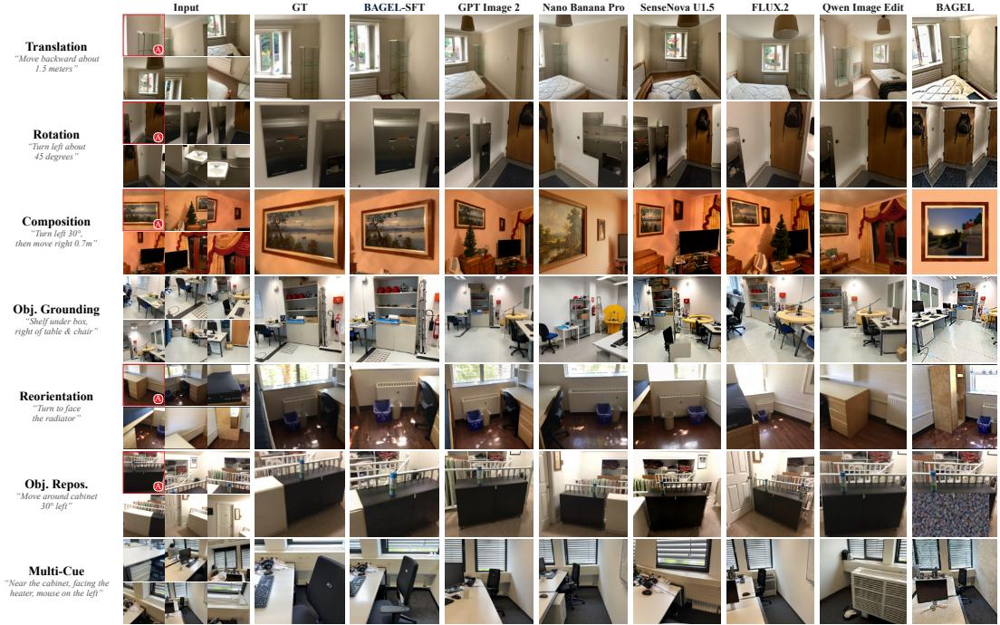  
Figure 15: Qualitative comparison across all seven MindView tasks. Each row shows a query summary, six input contexts, the held-out real target (GT), and outputs from the selected generators named above the columns. A red border and A identify the anchor when one is required.

## G LIMITATIONS

MindView uses one real target image per query to maintain a simple, uniform evaluation protocol across all seven tasks. This is a trade-off for ROG and MCVI, whose semantic constraints may admit nearby valid viewpoints. We reduce ambiguity through object-reference and visibility checks, bounded view clustering, checks for competing viewpoints, and LLM-assisted and independent expert review (Section A). For example, the recorded matching sets of the 243 released MCVI samples have median horizontal-position and yaw diameters of only 1.7 cm and 0.93◦. Feature similarity, graded VLM ratings, and linearly decreasing geometric scores allow partial credit for modest deviations (Section B), so valid views with similar content and layout within the same compact cluster are expected to receive similar scores. Taken together, these ambiguity controls and graded metrics support using a single representative GT as a reasonable practical compromise for consistent evaluation across tasks.