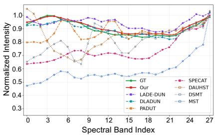
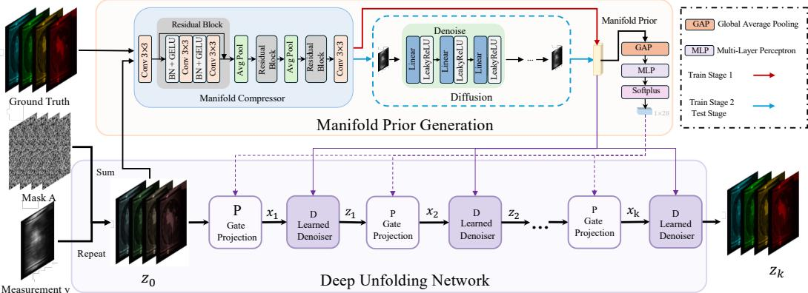
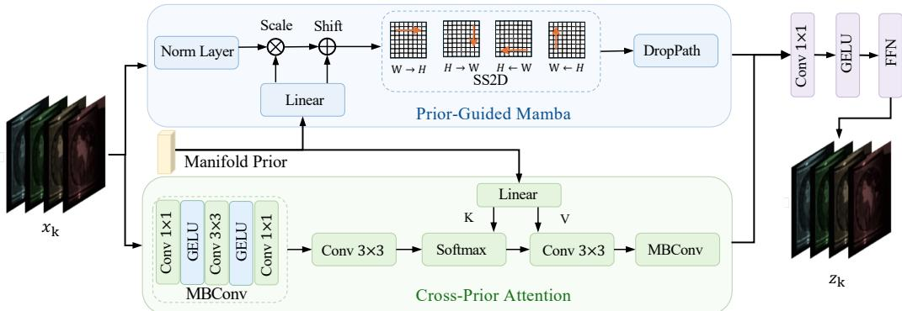
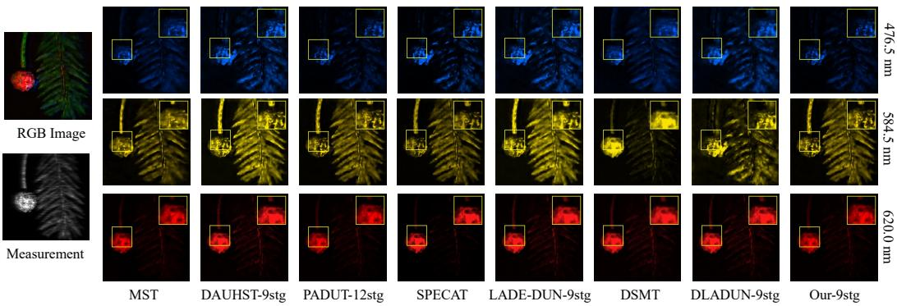
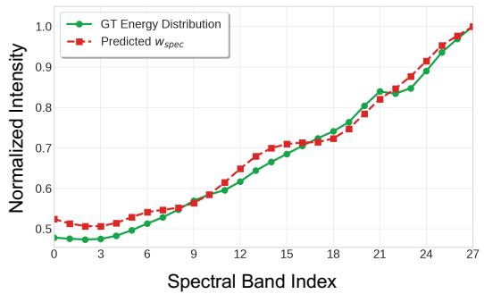
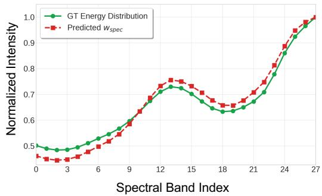

# Manifold Prior Guided Deep Unfolding for Hyperspectral Image Reconstruction

Shuqi Liu1 Yingkai Zhang1 Lin Gu2 Tao Zhang3 Ying Fu1∗ 1Beijing Institute of Technology 2Tohoku University 3Hangzhou Dianzi University {shuqiliu,zhangyingkai,fuying}@bit.edu.cn lin@tohoku.ac.jp tzhang@hdu.edu.cn

## Abstract

Hyperspectral Image (HSI) reconstruction has made substantial progress with the deep unfolding framework by decomposing the problem into a projection module and a denoiser module. Nevertheless, existing methods still exhibit limitations of insufficient matching with HSI data. The issues lie in two aspects: 1) the dataconsistency projection module applies a fixed gradient descent step while ignoring the spectral content adaptivity of HSI; 2) the denoiser module either suffers from high computational complexity or is limited to the local receptive field, failing to efficiently capture the global spatial-spectral dependencies. In this paper, we propose a deep unfolding framework centered on a two-stage manifold learning strategy to obtain a degradation-free structural prior, which is then strategically injected into both the projection and denoiser modules. In the data-consistency projection, a prior-guided spectral weight mechanism is introduced to adaptively modulate the weight of spectral band. In the denoiser module, a manifold-guided Mamba is proposed to achieve the structure-aware extraction of spatial-spectral features through prior modulation. Quantitative and visual comparisons on synthetic and real-world datasets show that the proposed method significantly outperforms existing state-ofthe-art approaches, while maintaining the structural interpretability of the unfolding framework. The code is available at https://github.com/SqLiu67/MPG-DU.

## 1 Introduction

Hyperspectral Imaging (HSI) captures scenes across dense continuous spectral bands, enabling fine-grained material identification [1], environmental monitoring [2, 3], precision medical imaging [4], and object tracking [5, 6]. However, traditional scanning spectrometers rely on timeconsuming line-by-line scanning, limiting their applicability to real-time applications. Based on Compressed Sensing (CS) [7, 8], Snapshot Compressive Imaging (SCI) captures all spectral information in a 2D measurement, necessitating computational algorithms to recover the 3D HSI cube from highly underdetermined observations.

  
Figure 1: Spectral Intensity Profiles.

Recently, deep learning-based methods for HSI reconstruction can be broadly categorized into endto-end learning methods [9, 10] and model-aided methods [11, 12, 13]. End-to-end methods recover

HSI via direct mapping but treat the imaging system as a black box. Model-aided methods, including Plug-and-Play (PnP) [12, 13] and Deep Unfolding Networks (DUNs) [14, 15, 11], leverage physical characteristics for inherent interpretability. Since PnP-based methods rely on fixed pretrained denoisers, their reconstruction performance remains limited. By contrast, deep unfolding-based methods have achieved significant improvements by incorporating learnable components into the iterative optimization process.

As the deep unfolding framework unfolds the iterative optimization algorithms with neural networks, it typically includes a projection module and a denoiser module. The data-consistency projection module relies solely on the sensing matrix, which encodes only the physical modulation properties of the imaging system. The resulting per-band scaling therefore reflects only system-determined modulation ratios rather than the true spectral energy distribution of the scene, causing the projection step to apply scene-agnostic spectral corrections that fail to account for varying energy contributions across bands, leading to inaccurate spectral energy allocation in the reconstructed HSI, as shown in Fig. 1. For the denoiser module, efficient feature extraction plays a critical role in the multi-stage optimization. However, existing denoisers either suffer from high computational complexity or limited receptive fields, failing to effectively capture global spatial-spectral dependencies.

To address these limitations, we propose a deep unfolding framework centered on manifold prior learning for HSI reconstruction. The manifold prior is a compact learned latent representation that captures the intrinsic spatial-spectral structure of clean HSIs, obtained through a two-stage strategy: Stage 1 trains a manifold compressor on clean HSIs to distill their intrinsic spatial-spectral structure into a compact latent code free from degradation interference, while Stage 2 employs a lightweight conditional diffusion model to infer this prior from compressed measurements. The inferred prior is then injected into both modules: in the data-consistency projection,a prior-guided spectral weight mechanism adaptively modulates the per-band contributions beyond the fixed system-determined scaling, correcting spectral energy allocation based on scene content; in the denoiser module, we introduce a manifold-guided Mamba that conditions the selective state-space scanning on the manifold prior, injecting global spatial-spectral structural context into every scan token to complement the local input-dependent adaptivity of Mamba’s selective scanning.

In summary, our contributions can be summarized as follows:

(i) We propose a deep unfolding framework with manifold prior injection into both the dataconsistency projection and the denoiser module, ensuring that every unfolding stage receives degradation-free structural guidance rather than relying solely on corrupted intermediate estimates.

(ii) We introduce a manifold-guided Mamba denoiser that combines linear-complexity efficiency of SSM with global scene-level structural context from the manifold prior, enabling structure-aware spatial-spectral feature extraction at each unfolding stage.

(iii) Quantitative and visual comparisons on datasets from both CASSI and optical filter-based imaging systems demonstrate that our method consistently outperforms existing state-of-the-art approaches while maintaining the physics-driven iterative structure.

## 2 Related Work

## 2.1 Hyperspectral Imaging Systems

Hyperspectral Imaging (HSI) has advanced from traditional scanning systems, including pushbroom [16] and whiskbroom [8] systems, to high-efficiency snapshot imaging systems. Although conventional scanning methods provide high reconstruction accuracy, their inherent time delay makes them inapplicable for dynamic scenes and real-time applications. To address this, Snapshot Compressive Imaging (SCI) based on Compressed Sensing [7] has been proposed to integrate high-dimensional spectral information into a single 2D sensor capture, necessitating computational algorithms to recover the 3D HSI cube from highly underdetermined observations.

Two representative paradigms have attracted significant attention: Coded Aperture Snapshot Spectral Imaging (CASSI) [17, 18] and optical filter-based architectures [19, 20], which correspond to two physically different encoding mechanisms for spectral acquisition. CASSI systems rely on complex dispersive devices to encode spatial and spectral domains separately, resulting in bulky structures with poor mechanical stability and robustness [21]. By contrast, optical filter-based architectures integrate broadband filters directly onto CMOS sensor arrays, realizing extreme miniaturization and high light throughput, but impose higher demands on the spatial-spectral decoupling ability of the reconstruction algorithm due to the high inter-band diversity of the sensing matrix.

## 2.2 Hyperspectral Reconstruction Algorithms

HSI reconstruction has evolved through four major paradigms. Model-based methods [22, 23] rely on hand-crafted priors such as total variation and sparsity, combined with iterative optimization solvers. They offer strong physical interpretability but lack representational capacity and require tedious manual tuning of regularization hyperparameters [24, 25], limiting their performance on complex real-world scenes. Plug-and-Play (PnP) methods [12, 13, 26, 27] integrate pre-trained denoisers into iterative solvers as implicit regularizers, decoupling the data-fidelity and prior terms, but typically process spectral bands independently, neglecting intrinsic spatial-spectral correlations that are essential for high-fidelity HSI reconstruction. End-to-End (E2E) approaches directly learn the mapping from 2D measurements to 3D HSIs via CNNs [28], Transformers [29, 30, 9], or Mambabased architectures [10]; related E2E studies have further explored spatial-spectral concordance with unaligned RGB guidance [31], abundance-level fusion [32], degradation-aware prompting [33], and real-noise decoupling [34] to improve HSI restoration. However, these methods generally treat the imaging system as a black box, ignoring the underlying imaging physics and spatial-spectral coupling.

Deep Unfolding Networks (DUNs) [14, 15, 35, 11, 36] unroll iterative optimization steps into a fixed-depth learnable network, combining physical interpretability with the representational power of deep learning, and have achieved superior reconstruction by alternating between a data-consistency projection step and a learned denoiser at each stage. More recently, some DUNs have incorporated latent diffusion models [37, 38] to generate degradation-free priors for the denoiser module, further improving reconstruction quality. Diffusion-based priors have also been explored for multimodal PET restoration, demonstrating their broader potential for degradation-aware image restoration [39]. Despite these advances, the projection step remains constrained by fixed system-determined spectral scaling that ignores scene content, while the denoiser operates on degradation-contaminated inputs without clean structural references, and the prior is injected only into the denoiser, leaving the projection step without scene-adaptive guidance. Furthermore, Transformer-based denoisers incur quadratic complexity that limits scalability to high-resolution HSI cubes. In this work, we address these limitations by proposing a manifold prior guided deep unfolding framework that injects degradation-free structural priors into both the projection and denoiser modules, and adopts a Mamba based denoiser for efficient linear-complexity spatial-spectral feature extraction.

## 3 Proposed Method

## 3.1 Problem Formulation

HSI reconstruction can be formulated as a standard linear inverse problem:

$$
\mathbf { y } = \mathbf { A } \mathbf { x } + \mathbf { b } ,\tag{1}
$$

where A encodes the imaging physics, and b is noise. Recovering x from the highly underdetermined y requires effective priors to regularize the solution space [40]. We cast HSI reconstruction as a constrained optimization problem and unfold the iterative algorithm into a learnable deep network. The standard regularized inverse problem is:

$$
\hat { \mathbf { x } } = \arg \operatorname* { m i n } _ { \mathbf { x } } \frac { 1 } { 2 } \| \mathbf { y } - \mathbf { A } \mathbf { x } \| _ { 2 } ^ { 2 } + \tau \mathcal { R } ( \mathbf { x } ) ,\tag{2}
$$

where $\tau$ balances data fidelity and the image prior $\mathcal { R } ( \mathbf { x } )$ . We employ Generalized Alternating Projection (GAP) [41] as the optimization framework, and by introducing an auxiliary variable z, the problem is reformulated as:

$$
( \hat { \mathbf { x } } , \hat { \mathbf { z } } ) = \arg \operatorname* { m i n } _ { \mathbf { x } , \mathbf { z } } \frac { 1 } { 2 } \| \mathbf { x } - \mathbf { z } \| _ { 2 } ^ { 2 } + \lambda \mathcal { R } ( \mathbf { z } ) , \quad \mathrm { s . t . } \quad \mathbf { y } = \mathbf { A } \mathbf { x } ,\tag{3}
$$

which decomposes into two alternating sub-problems: the projection step enforces data consistency via Euclidean projection onto the measurement subspace:

$$
\mathbf { x } ^ { ( k + 1 ) } = \mathbf { z } ^ { ( k ) } + \mathbf { A } ^ { \top } ( \mathbf { A A } ^ { \top } ) ^ { - 1 } ( \mathbf { y } - \mathbf { A z } ^ { ( k ) } ) ,\tag{4}
$$

and the proximal step incorporates the image prior via a learnable denoiser:

$$
\begin{array} { r } { \mathbf { z } ^ { ( k + 1 ) } = \mathcal { D } _ { k } ( \mathbf { x } ^ { ( k + 1 ) } ) , } \end{array}\tag{5}
$$

where $\mathcal { D } _ { k } ( \cdot )$ denotes the learnable denoiser at the k-th stage.

For the CASSI and optical filter-based systems, $\mathbf { A A } ^ { \top }$ is diagonal, so its exact inverse reduces to element-wise division by $\bar { \boldsymbol { \Phi } } _ { s } = \mathrm { d i a g } ( \mathbf { A } \bar { \mathbf { A } } ^ { \top } )$ , yielding the unfolded projection:

$$
\mathbf { x } ^ { ( k + 1 ) } = \mathbf { z } ^ { ( k ) } + \mathbf { A } ^ { \top } ( \mathbf { y } - \mathbf { A } \mathbf { z } ^ { ( k ) } ) / \Phi _ { s } .\tag{6}
$$

However, $\Phi _ { s }$ is fully determined by the physical structure of the sensing matrix and carries no information about the spectral energy distribution of the scene. The correction applied to each spectral band is therefore governed solely by system-determined modulation ratios, regardless of the actual energy contributions of individual bands, providing the denoiser with a spectrally biased estimate at each stage.

## 3.2 Manifold Prior Guided Deep Unfolding Framework

The above analysis reveals two coupled limitations in conventional DUNs: scene-agnostic per-band corrections dictated solely by Φ , and denoising on degradation-contaminated estimates without clean structural reference. To address both simultaneously, we propose to distill the intrinsic spatial-spectral structure of clean HSIs into a compact manifold prior p, and strategically inject it into both the data-consistency projection via a Prior-Guided Spectral Weight mechanism and the denoiser via a Manifold-Guided Mamba, providing degradation-free structural guidance at every unfolding stage.

Our manifold prior p is not a generic conditioning signal, but an empirical coordinate representation on a low-dimensional submanifold. Here, we provide its formal mathematical formulation and physical realization. Following the Low-Dimensional Manifold Model (LDMM) [42], although a spatial-spectral patch extracted from a hyperspectral image z has a high ambient dimension after vectorization, its variations are governed by only a few intrinsic factors. Specifically, for an arbitrary spatial location $x \in { \bar { \Omega } } .$ , a patch of size $s _ { 1 } \times s _ { 2 } \times B$ is vectorized as:

$$
\begin{array} { r } { \mathbf q _ { x } = \mathrm { v e c } \big ( \mathcal E _ { \mathrm { p a t c h } } ( \mathbf z , x ) \big ) \in \mathbb R ^ { D } , \qquad D = s _ { 1 } s _ { 2 } B . } \end{array}\tag{7}
$$

where $\mathcal { E } _ { \mathrm { p a t c h } }$ denotes the patch-extraction operator. All patches constitute a point cloud:

$$
\mathcal { Q } ( \mathbf { z } ) = \left\{ \mathbf { q } _ { x } : x \in \bar { \Omega } \right\} \subset \mathbb { R } ^ { D } .\tag{8}
$$

This point cloud is assumed to lie on or close to a union of low-dimensional smooth submanifolds:

$$
\mathcal { M } = \bigcup _ { \ell = 1 } ^ { L } \mathcal { M } _ { \ell } \subset \mathbb { R } ^ { D } .\tag{9}
$$

From a theoretical parameterization perspective, each manifold branch can be expressed as:

$$
\mathcal { M } _ { \ell } = \left\{ g _ { \ell } ( \mathbf { p } _ { x } ) : \mathbf { p } _ { x } \in \mathcal { Z } _ { \ell } \right\} ,\tag{10}
$$

where $\mathcal { Z } _ { \ell } \subset \mathbb { R } ^ { k }$ denotes the low-dimensional intrinsic coordinate domain, $\mathbf { p } _ { x }$ denotes the intrinsic coordinate of a patch $\mathbf { q } _ { x } ,$ , and $g _ { \ell } ( \cdot )$ maps the coordinate to the corresponding high-dimensional patch representation. Let $\textstyle { \mathcal { Z } } = \bigcup _ { \ell = 1 } ^ { L } { \mathcal { Z } } _ { \ell }$ denote the global latent coordinate space.

As formalized above, while the vectorized patch $\mathbf { q } _ { x }$ resides in a high-dimensional space $\mathbb { R } ^ { D }$ , its intrinsic geometric state is approximately parameterized by the low-dimensional coordinate $\mathbf { p } _ { x } \in \mathcal { Z }$ LDMM [42] circumvents the unknown analytical form of $g _ { \ell } ( \cdot )$ by constructing a graph Laplacian $\mathbf { L } _ { \mathrm { g r a p h } }$ over patch distances to approximate manifold operators.

In contrast, rather than performing computationally heavy graph construction, we propose to directly estimate the global manifold prior p. Specifically, our Manifold Compressor ${ \mathcal { E } } _ { \mathrm { m c } }$ acts as a data-driven encoder, mapping the high-dimensional HSI data z onto the low-dimensional domain to yield the empirical manifold coordinate:

$$
\mathbf { p } = \mathcal { E } _ { \mathrm { m c } } ( \mathbf { z } ) \in \mathcal { Z } .\tag{11}
$$

This learned global coordinate p encapsulates the essential long-range spatial-spectral dependencies and directly conditions the subsequent unfolding stages.

  
Figure 2: Proposed prior-guided deep unfolding framework for hyperspectral image reconstruction, where a learned manifold prior guides iterative projection and denoiser from $\mathbf { z } _ { 0 }$ to $\mathbf { z } _ { k }$

## 3.3 Manifold Prior Generation and Guided Spectral Weight

As Fig. 2 shows, we learn a manifold prior p (or its estimate pˆ) from data and use it to adaptively guide reconstruction through a coordinated two-stage process.

Two-Stage Manifold Prior Generation. Although the manifold prior can be learned from clean HSI data during training, the clean reference is unavailable at inference time. To bridge this gap, we adopt a two-stage strategy: Stage 1 learns a reliable manifold prior from the clean reference and the back-projected initialization, while Stage 2 trains a conditional diffusion model to infer the corresponding prior from the compressed measurement alone. This design enables the learned structural knowledge to be effectively transferred from training to inference and used for prior-guided unfolding reconstruction.

Stage 1 (Manifold Prior Learning): Although clean HSIs are nominally high-dimensional, their spatial-spectral redundancy suggests the existence of a compact low-dimensional representation. We exploit this structure by training a Manifold Compressor ${ \mathcal { E } } _ { \mathrm { m c } }$ to map clean HSIs onto a lowdimensional manifold coordinate p that encodes scene-specific structural and spectral characteristics. ${ \mathcal { E } } _ { \mathrm { m c } }$ is implemented as a hierarchical convolutional encoder with residual blocks and progressive downsampling, which progressively discards redundant spatial-spectral information while retaining the essential manifold structure of the scene. Given the back-projected initialization $\mathbf { z } _ { 0 } \in \mathbb { R } ^ { H \times W \times N _ { \lambda } ^ { \smile } }$ and the clean reference $\mathbf { z } ^ { \ast } \in \mathbb { R } ^ { H \times W \times N _ { \lambda } } , { \mathcal { E } } _ { \mathrm { m c } }$ takes their concatenation as input and produces the manifold prior:

$$
\begin{array} { r } { \mathbf p = \mathcal E _ { \mathrm { m c } } ( [ \mathbf z ^ { * } ; \mathbf z _ { 0 } ] ) , } \end{array}\tag{12}
$$

where $[ \cdot ; \cdot ]$ denotes channel-wise concatenation. The progressive downsampling in ${ \mathcal { E } } _ { \mathrm { m c } }$ acts as a geometric projection onto the low-dimensional manifold, filtering out degradation-irrelevant details and retaining only the structural and spectral essence of the clean HSI. Stage 1 is optimized with:

$$
\mathcal { L } _ { 1 } = \| \mathbf { z } ^ { * } - \mathbf { z } _ { k } \| _ { \mathrm { C B } } ,\tag{13}
$$

where $\| \cdot \| _ { \mathrm { C B } }$ denotes the Charbonnier loss. Through end-to-end training with the reconstruction objective, ${ \mathcal { E } } _ { \mathrm { m c } }$ learns to extract precisely the manifold coordinates that are most informative for guiding high-quality HSI reconstruction.

Stage 2 (Diffusion-Based Prior Inference): In this stage, ${ \mathcal { E } } _ { \mathrm { m c } }$ provides ground-truth manifold prior samples p as supervision targets. We train a conditional diffusion model to infer pˆ from $\mathbf { z } _ { 0 }$ alone, without access to the clean reference. The forward diffusion process synthesizes a noisy prior:

$$
\mathbf { p } _ { t } = \sqrt { \bar { \alpha } _ { t } } \mathbf { p } + \sqrt { 1 - \bar { \alpha } _ { t } } \epsilon , \quad \epsilon \sim \mathcal { N } ( \mathbf { 0 } , \mathbf { I } ) ,\tag{14}
$$

where $\begin{array} { r } { \bar { \alpha } _ { t } = \prod _ { i = 1 } ^ { t } ( 1 - \beta _ { i } ) } \end{array}$ . The reverse process is conditioned on $\mathbf { z } _ { 0 }$ via the Manifold Compressor ${ \mathcal { E } } _ { \mathrm { m c } }$ :

$$
\mathbf { c } = \mathcal { E } _ { \mathrm { m c } } ( \mathbf { z } _ { 0 } ) .\tag{15}
$$

At each reverse step, the denoiser module $\mathcal { D } _ { \theta }$ takes the noisy prior, condition, and normalized timestep as input:

$$
\begin{array} { r } { \hat { \mathbf { p } } = \mathcal { D } _ { \theta } \big ( [ \mathbf { p } _ { t } ; \mathbf { c } ; \tilde { t } ] \big ) , } \end{array}\tag{16}
$$

where $\tilde { t } = t / T \in [ 0 , 1 ]$ is the normalized timestep. The inferred $\hat { \bf p }$ serves directly as the manifold prior to guide the subsequent reconstruction. Stage 2 is optimized via:

$$
\mathcal { L } _ { 2 } = \Vert \mathbf { z } ^ { * } - \mathbf { z } _ { k } \Vert _ { \mathrm { C B } } + \Vert \mathbf { p } - \hat { \mathbf { p } } \Vert _ { \mathrm { C B } } ,\tag{17}
$$

where p from Stage 1 serves as the supervision target.

Prior-Guided Spectral Weight. We leverage the manifold prior to dynamically adjust the spectral filtering strength in the data-consistency module. Specifically, we generate spectral-wise weights from p or pˆ via a lightweight MLP:

$$
\begin{array} { r } { { \bf w } _ { \mathrm { s p e c } } = \mathrm { S o f t p l u s } \left( \mathrm { M L P } \left( \mathrm { P o o l } ( { \bf p } ) \right) + { \bf b } _ { 0 } \right) , } \end{array}\tag{18}
$$

where Pool(·) performs global pooling over spatial dimensions to obtain a compact representation, the Softplus activation guarantees $\mathbf { w } _ { \mathrm { s p e c } } > 0$ to preserve physical consistency, b is the bias, and $\mathbf { w } _ { \mathrm { s p e c } } \in \mathbb { R } ^ { N _ { \lambda } }$ contains one weight per spectral band.

These weights dynamically rescale the per-band correction term in Eq.(6), allowing the model to adaptively modulate each spectral band according to the scene-specific spectral energy distribution inferred from the manifold prior:

$$
\mathbf { x } ^ { ( k + 1 ) } = \mathbf { z } ^ { ( k ) } + \left( \mathbf { A } ^ { \top } ( \mathbf { y } - \mathbf { A } \mathbf { z } ^ { ( k ) } ) / \Phi _ { s } \right) \odot \mathbf { w } _ { \mathrm { s p e c } } ,\tag{19}
$$

## 3.4 Mamba-Based Denoiser with Prior Modulation

The denoiser module must efficiently capture both global context and fine spatial-spectral details. While Transformer-based denoisers excel at global modeling, their quadratic complexity $\mathcal { O } ( N ^ { 2 } )$ limits scalability. We instead employ the Mamba architecture [43] based on Selective State Space Models (SSMs), which achieves linear complexity $\mathcal { O } ( N )$ by dynamically generating parameters from the input at each position, enabling content-aware selective retention of information. To extend Mamba to 2D images, we adopt the 2D Selective Scanning (SS2D) mechanism [44, 45], which flattens a 2D feature map into four directional sequences and processes each independently:

$$
\mathbf { f } ^ { d } = \mathrm { S S 2 D } ^ { d } ( \mathbf { x } ^ { d } ) , \quad d \in \{ 1 , 2 , 3 , 4 \} .\tag{20}
$$

The four outputs are summed and reshaped to recover global 2D perception:

$$
\mathbf { F } _ { \mathrm { S S 2 D } } = \mathrm { R e s h a p e } \left( \sum _ { d = 1 } ^ { 4 } \mathbf { f } ^ { d } \right) .\tag{21}
$$

Prior-Guided Mamba. While Mamba adapts its parameters to local input features, it lacks access to global scene-level structural information, as the scanning process can only accumulate context sequentially along fixed directions. To address this, we inject the manifold prior to modulate the SS2D input features $\mathbf { x } _ { k }$ before scanning, providing each spatial location with a globally-informed context and steering the scanning process toward scene-consistent spatial-spectral representations.

As illustrated in the Prior-Guided Mamba branch (Fig. 3), the manifold prior p or $\hat { \bf p }$ is first projected via a linear layer and spatially interpolated to generate per-pixel modulation parameters:

$$
\mathbf { s } , \mathbf { t } = \mathrm { s p l i t } \left( \mathrm { I n t e r p } \left( \mathrm { L i n e a r } _ { \mathrm { p r i o r } } ( \mathbf { p } ) \right) \right) ,\tag{22}
$$

where Interp(·) denotes bilinear interpolation to match the spatial resolution of the feature map, and the output is evenly split into a scale factor s and a shift factor t. The input feature $\mathbf { x } _ { k }$ is then normalized and modulated as:

$$
\tilde { \mathbf { x } } _ { k } = \mathrm { N o r m } ( \mathbf { x } _ { k } ) \odot ( 1 + \mathbf { s } ) + \mathbf { t } ,\tag{23}
$$

where $\odot$ denotes element-wise multiplication and Norm(·) denotes layer normalization. The scale factor s and shift factor t adaptively recalibrate the feature distribution at each spatial location based on the global scene context encoded in the manifold prior.

The modulated features $\tilde { \mathbf { x } } _ { k }$ are flattened along four scanning directions $( d \in \{ 1 , 2 , 3 , 4 \} )$ ) and fed into the SS2D module. This prior-guided modulation complements the local input-dependent adaptation with global scene-level context, steering the scanning process toward scene-consistent spatial-spectral representations and enabling feature extraction aligned with the genuine HSI geometry.

  
Figure 3: Proposed prior-guided denoiser module, combining a prior-modulated Mamba branch and a cross-prior attention branch for structure-aware feature refinement.

Cross-Prior Attention and Overall Denoiser. In parallel to the Prior-Guided Mamba branch, we introduce a Cross-Prior Attention module to further exploit the structural information encoded in p or ${ \hat { \mathbf { p } } } .$ Specifically, the input feature $\mathbf { x } _ { k }$ is first processed by a MBConv block for channel mixing and local feature extraction, followed by a $3 \times 3$ convolution to further capture spatial context:

$$
\mathbf { Q } = \mathrm { C o n v } _ { 3 \times 3 } \left( \mathrm { M B C o n v } ( \mathbf { x } ) \right) .\tag{24}
$$

The manifold prior p or $\hat { \bf p }$ is first projected via a linear layer to generate key and value embeddings:

$$
[ \mathbf { K } , \mathbf { V } ] = \operatorname { L i n e a r } ( \mathbf { p } ) .\tag{25}
$$

The interaction between the feature and the prior is performed through a cross-feature aggregation mechanism, where the query Q interacts with prior-derived representations to selectively incorporate structurally relevant information from the manifold prior. This process enhances content-aware feature responses by injecting global structural cues into local feature representations. The aggregated features are subsequently refined through a $3 \times 3$ convolution to improve local spatial consistency, followed by an MBConv block for efficient channel mixing and nonlinear transformation.

The outputs from the Prior-Guided Mamba branch and the Cross-Prior Attention branch are concatenated and fused through a 1 × 1 convolution followed by GELU activation. A residual connection and a feed-forward network (FFN) are further applied to produce the final output feature $\mathbf { z } _ { k }$

## 4 Experiments

## 4.1 Experiment Setup

Optical Filter-based HSI System Data. We utilize two benchmark datasets: CAVE [50] and KAIST [51], both covering 28 spectral channels ranging from 450 nm to 650 nm. The CAVE dataset contains 32 HSIs with a spatial resolution of 512 × 512 pixels, while KAIST contains 30 HSIs at 2704 × 3376 pixels. Following Yao et al. [47], all data are additionally processed with an optical filter-based mask, adopting the Fabry-Pérot design of Yako et al. [52] as a representative optical filter-based HSI system.

CASSI System Data. Following [53, 54, 55], CAVE is used for training and 10 scenes from KAIST for testing, with simulated measurements generated via a CASSI system mask. Furthermore, we evaluate on real HSI measurements captured by the CASSI system established in TSA-Net [53]. To better reflect authentic sensor behavior, noise is incorporated into the training measurements to approximate real-world projection acquisition, following the realistic-noise setting commonly considered in HSI restoration [56].

Metrics and Implementation Specifics. Reconstruction performance is evaluated using PSNR and SSIM [57]. The model is implemented in PyTorch [58] and trained on a single NVIDIA RTX 3090 GPU using Adam with an initial learning rate of $\bar { 4 } \times 1 0 ^ { - 4 }$ decayed via cosine annealing to $1 \times 1 0 ^ { - 6 }$ over 100 epochs. Training follows a two-phase strategy: Phase 1 (epochs 1–30) optimizes the reconstruction backbone with $\mathcal { L } _ { 1 } ;$ Phase 2 (epochs 31–100) introduces the diffusion prior and optimizes with $\mathcal { L } _ { 2 } ,$ , which adds a manifold prior alignment loss to supervise the inferred prior.

Table 1: Comparisons between our method and SOTA methods on 10 simulation scenes (S1∼S10) on the simulated Optical Filter-based HSI system. Params, FLOPs, PSNR (upper entry in each cell), and SSIM (lower entry in each cell) are reported.
<table><tr><td>Method</td><td>Params</td><td>FLOPs</td><td>S1</td><td>S2</td><td>S3</td><td>S4</td><td>S5</td><td>S6</td><td>S7</td><td>S8</td><td>S9</td><td>S10</td><td>Avg</td></tr><tr><td>MST [29]</td><td>2.03M</td><td>28.15G</td><td>36.55 0.963</td><td>36.29 0.953</td><td>33.46 0.904</td><td>39.78 0.951</td><td>35.40 0.964</td><td>36.10 0.963</td><td>34.53 0.924</td><td>33.08 0.945</td><td>34.38 0.926</td><td>35.19 0.966</td><td>35.48 0.946</td></tr><tr><td>DAUHST-9stg [46]</td><td>6.15M</td><td>79.50G</td><td>38.37 0.972</td><td>39.91 0.977</td><td>37.71 0.965</td><td>42.97 0.967</td><td>37.69 0.980</td><td>39.05 0.974</td><td>37.62 0.964</td><td>36.11 0.965</td><td>38.45 0.971</td><td>37.39 0.976</td><td>38.53 0.971</td></tr><tr><td>PADUT-12stg [11]</td><td>5.38M</td><td>90.46G</td><td>38.42 0.974</td><td>40.34 0.983</td><td>38.95 0.972</td><td>43.50 0.977</td><td>38.22 0.983</td><td>39.16 0.979</td><td>38.21 0.971</td><td>36.03 0.969</td><td>39.45 0.979</td><td>37.30 0.981</td><td>38.89 0.977</td></tr><tr><td>SPECAT [47]</td><td>0.29M</td><td>12.40G</td><td>40.24 0.982</td><td>42.40 0.986</td><td>41.43 0.978</td><td>44.90 0.982</td><td>39.62 0.987</td><td>39.90 0.984</td><td>39.41 0.977</td><td>37.49 0.977</td><td>40.45 0.982</td><td>37.90 0.983</td><td>40.37 0.986</td></tr><tr><td>LADE-DUN-3stg [38]</td><td>2.56M</td><td>32.92G</td><td>37.08 0.961</td><td>39.53 0.974</td><td>41.67 0.978</td><td>46.37 0.991</td><td>35.73 0.972</td><td>36.71 0.973</td><td>36.94 0.962</td><td>35.13 0.971</td><td>39.96 0.976</td><td>33.96 0.961</td><td>38.31 0.972</td></tr><tr><td>LADE-DUN-9stg [38]</td><td>3.06M</td><td>86.23G</td><td>39.72 0.982</td><td>42.87 0.988</td><td>41.36 0.982</td><td>47.15 0.992</td><td>39.36 0.988</td><td>40.03 0.988</td><td>39.54 0.977</td><td>37.32 0.981</td><td>40.81 0.986</td><td>37.54 0.981</td><td>40.57 0.984</td></tr><tr><td>DSMT [48]</td><td>12.40M</td><td>44.94G</td><td>36.85 0.961</td><td>38.10 0.968</td><td>39.45 0.970</td><td>43.20 0.983</td><td>34.60 0.962</td><td>36.90 0.971</td><td>35.80 0.958</td><td>34.90 0.966</td><td>38.15 0.970</td><td>34.10 0.959</td><td>37.21 0.967</td></tr><tr><td>DLADUN-9stg [49]</td><td>3.94M</td><td>196.26G</td><td>39.02 0.976 37.45</td><td>41.55 0.986</td><td>41.83 0.982</td><td>46.51 0.992</td><td>38.92 0.985</td><td>39.75 0.985</td><td>38.82 0.972</td><td>38.05 0.984</td><td>42.10 0.985</td><td>36.25 0.974</td><td>40.28 0.982</td></tr><tr><td>Ours-3stg</td><td>3.71M</td><td>33.62G</td><td>0.965 40.55</td><td>40.01 0.978 43.70</td><td>42.12 0.982</td><td>46.80 0.993</td><td>36.20 0.976</td><td>37.15 0.977</td><td>37.40 0.968</td><td>35.60 0.974</td><td>40.40 0.981</td><td>34.45 0.966</td><td>38.76 0.976</td></tr><tr><td>Ours-9stg</td><td>3.71M</td><td>70.62G</td><td>0.986</td><td>0.992</td><td>42.95 0.986</td><td>46.85 0.995</td><td>40.10 0.991</td><td>40.42 0.991</td><td>40.25 0.982</td><td>38.20 0.985</td><td>42.05 0.991</td><td>38.65 0.991</td><td>41.37 0.990</td></tr></table>

## 4.2 Results and Discussion

To provide a comprehensive evaluation, we compare our method against seven state-of-the-art approaches spanning major methodological paradigms in HSI reconstruction. These include the Transformer-based methods MST [29] and SPECAT [47], which exploit long-range spatial-spectral modeling; the deep unfolding methods PADUT [11], DLADUN [49], and DAUHST [46], which incorporate physics-driven iterative optimization; the recent diffusion-prior deep unfolding method LADE-DUN [38]; and the hybrid method DSMT [48], which combines spectral and spatial modeling. All comparisons are conducted under identical experimental settings to ensure fairness.

Results of Optical Filter-based HSI System. Tab. 1 reports the quantitative results on the optical filter-based HSI system simulation dataset. Ours-9stg achieves state-of-the-art performance with 41.37 dB in PSNR and 0.990 in SSIM, outperforming the recent competitive framework LADE-DUN-9stg [38] by 0.80 dB and the deep unfolding model DAUHST-9stg [46] by 2.84 dB. Notably, compared with DAUHST-9stg [46], our model achieves 2.84 dB higher PSNR while requiring only 60.3% of the parameters and 88.8% of the FLOPs. Against the Transformer-based baseline MST [29], our method gains a substantial 5.89 dB. Even with a limited number of unfolding iterations, Ours-3stg achieves a PSNR improvement of 0.45 dB over the corresponding 3-stage LADE-DUN. These results demonstrate the effectiveness of the proposed manifold prior guidance for optical filter-based HSI reconstruction.

Results of CASSI System. Tab. 2 presents the quantitative results on the CASSI system simulation dataset. Ours-9stg achieves 40.24 dB in PSNR and 0.980 in SSIM, outperforming all competing methods on average. Specifically, Ours-9stg surpasses SPECAT [47] by 1.67 dB, LADE-DUN-9stg [38] by 0.33 dB, and DAUHST-9stg [46] by 1.88 dB. Even with a limited number of stages, our lightweight Ours-3stg achieves 38.73 dB, which represents a 0.42 dB improvement over the 3-stage LADE-DUN (38.31 dB) and also exceeds the performance of the Transformer-based SPECAT (38.57 dB). These consistent gains confirm that the proposed manifold prior guidance generalizes effectively to the dispersive modulation of CASSI systems.

We further evaluate our model in real HSI reconstruction to validate its generalization capability beyond simulated settings. Following the same settings as [53, 54, 55] for a fair comparison, we re-train our model with the real mask on the CAVE and KAIST datasets. To simulate real imaging conditions, the training samples are injected with 11-bit shot noise. Fig. 4 shows the visual comparisons between our model and state-of-the-art methods across three representative spectral channels. Our model recovers finer structural details and cleaner textures with fewer artifacts, while other methods tend to produce blurry reconstructions or introduce noise-induced artifacts. These qualitative results further confirm that the manifold prior provides reliable structural guidance even under real measurement noise, demonstrating the robustness of the proposed framework.

Table 2: Comparisons between our method and SOTA methods on 10 simulation scenes (S1∼S10) on the simulated CASSI system. PSNR (left) / SSIM (right) are reported in each cell.
<table><tr><td>Method</td><td>S1</td><td>S2</td><td>S3</td><td>S4</td><td>S5</td><td>S6</td><td>S7</td><td>S8</td><td>S9</td><td>S10</td><td>Avg</td></tr><tr><td>MST [29]</td><td>35.40/0.941</td><td>35.87/0.944</td><td>36.51/0.953</td><td>42.27/0.973</td><td>32.77/0.947</td><td>34.80/0.955</td><td>33.66/0.925</td><td>32.67/0.948</td><td>35.39/0.949</td><td>32.50/0.941</td><td>35.18/0.948</td></tr><tr><td>DAUHST-9stg [46]</td><td>37.25/0.958</td><td>39.02/0.967</td><td>41.05/0.971</td><td>46.15/0.983</td><td>35.80/0.969</td><td>37.08/0.970</td><td>37.57/0.963</td><td>35.10/0.966</td><td>40.02/0.970</td><td>34.59/0.956</td><td>38.36/0.967</td></tr><tr><td>PADUT-12stg [11]</td><td>37.36/0.962</td><td>40.43/0.978</td><td>42.38/0.979</td><td>46.62/0.990</td><td>36.26/0.974</td><td>37.27/0.974</td><td>37.83/0.966</td><td>35.33/0.974</td><td>40.86/0.978</td><td>34.55/0.963</td><td>38.89/0.974</td></tr><tr><td>SPECAT [47]</td><td>38.12/0.977</td><td>40.79/0.984</td><td>38.59/0.973</td><td>43.39/0.985</td><td>38.02/0.984</td><td>38.41/0.984</td><td>37.82/0.965</td><td>34.80/0.971</td><td>38.75/0.980</td><td>37.04/0.986</td><td>38.57/0.979</td></tr><tr><td>LADE-DUN-3stg [38]</td><td>37.08/0.961</td><td>39.53/0.974</td><td>41.67/0.978</td><td>46.37/0.991</td><td>35.73/0.972</td><td>36.71/0.973</td><td>36.94/0.962</td><td>35.13/0.971</td><td>39.96/0.976</td><td>33.96/0.961</td><td>38.31/0.972</td></tr><tr><td>LADE-DUN-9stg [38]</td><td>38.07/0.969</td><td>41.16/0.982</td><td>43.70/0.983</td><td>48.01/0.993</td><td>37.76/0.980</td><td>37.65/0.980</td><td>38.58/0.973</td><td>36.31/0.979</td><td>42.66/0.984</td><td>35.18/0.967</td><td>39.91/0.979</td></tr><tr><td>DSMT [48]</td><td>36.38/0.958</td><td>37.86/0.965</td><td>39.18/0.968</td><td>43.89/0.985</td><td>34.03/0.965</td><td>36.48/0.972</td><td>35.48/0.952</td><td>34.54/0.969</td><td>37.67/0.966</td><td>33.71/0.959</td><td>36.92/0.966</td></tr><tr><td>DLADUN-9stg [49]</td><td>37.72/0.967</td><td>41.49/0.982</td><td>41.87/0.977</td><td>46.14/0.990</td><td>36.57/0.976</td><td>38.10/0.979</td><td>37.23/0.962</td><td>36.43/0.978</td><td>40.85/0.979</td><td>35.18/0.969</td><td>39.16/0.976</td></tr><tr><td>Ours-3stg</td><td>37.36/0.964</td><td>39.94/0.976</td><td>41.95/0.978</td><td>46.67/0.991</td><td>36.23/0.974</td><td>36.94/0.975</td><td>37.45/0.965</td><td>35.42/0.974</td><td>40.88/0.979</td><td>34.49/0.963</td><td>38.73/0.974</td></tr><tr><td>Ours-9stg</td><td>38.42/0.972</td><td>41.76/0.984</td><td>44.00/0.983</td><td>47.89/0.993</td><td>38.47/0.983</td><td>38.06/0.981</td><td>39.37/0.976</td><td>36.01/0.979</td><td>43.46/0.986</td><td>34.98/0.967</td><td>40.24/0.980</td></tr></table>

  
Figure 4: Qualitative comparisons of real HSI reconstruction on Scene 1 with 3 spectral channels.

Computational Efficiency. Tab. 1 compares the theoretical complexity of methods in parameters and FLOPs. Our 9-stage model achieves the best average reconstruction performance with a moderate model size of 3.71M parameters and 70.62G FLOPs. Ours-3stg and Ours-9stg have identical parame ter counts because the intermediate unfolding stages reuse a shared set of weights; increasing the number of stages therefore improves reconstruction quality without introducing additional parameter overhead. Although our 9-stage model has slightly more parameters than LADE-DUN-9stg, it requires fewer FLOPs (70.62G vs. 86.23G), indicating the improved computational efficiency of our Mamba-based unfolding design over the Transformer-based diffusion-prior counterpart. Moreover, under the same hardware setting, our method requires 132.76 ms runtime and 0.63 GB peak allocated memory, improving over LADE-DUN-9stg (140.15 ms and 0.65 GB) while achieving a 0.80 dB gain in average PSNR. These results demonstrate a favorable accuracy–efficiency trade-off of our method.

## 4.3 Ablation Study

Component Analysis. To validate the contribution of each proposed component, we conduct an ablation study on the simulation dataset using a 3-stage model. As shown in Tab. 3, we progressively add each component to evaluate its impact on reconstruction performance. First, employing the Mamba denoiser as the backbone yields a baseline PSNR of 37.02 dB, demonstrating its effectiveness in capturing long-range spatial-spectral dependencies with linear complexity. Building upon this, incorporating the Cross-Prior Attention module provides a further gain of 0.6 dB over the Mamba baseline, which validates that cross-attention between image features and the manifold prior effectively injects global structural cues into local feature representations. Furthermore, the integration of the Prior-Mamba module yields a significant improvement of 1.05 dB over the previous configuration, confirming the advantages of structure-aware scanning via manifold prior modulation. Finally, adding the Prior-Spectral Weight mechanism further enhances the results by 0.48 dB, reaching a peak performance of 38.73 dB and confirming that adaptive per-band modulation better handles spectral heterogeneity across wavelengths.

Table 3: Ablation study on the CASSI simulation dataset.
<table><tr><td>Mamba</td><td>Cross-Prior Attn</td><td>Prior-Mamba</td><td>Prior-Spectral Weight</td><td>PSNR (dB)</td><td>SSIM</td><td>Params (M)</td></tr><tr><td>√</td><td></td><td></td><td></td><td>37.02</td><td>0.963</td><td>1.20</td></tr><tr><td>√</td><td>√</td><td></td><td></td><td>37.62</td><td>0.968</td><td>3.17</td></tr><tr><td>√</td><td>√</td><td>√</td><td></td><td>38.25</td><td>0.969</td><td>3.60</td></tr><tr><td>√</td><td>√</td><td>√</td><td>√</td><td>38.73</td><td>0.974</td><td>3.71</td></tr></table>

Effectiveness of Prior-Guided Spectral Weighting. To verify that the learned prior effectively captures the spectral energy distribution of the input scene, we visualize the predicted spectral weight $\mathbf { w } _ { \mathrm { s p e c } }$ and compare them against the ground-truth spectral profile across two benchmark datasets. As shown in Fig. 5, we randomly select one image from the CASSI dataset (left), and the optical filter dataset (right), and plot the ground-truth spectral profile (green solid line) and the predicted spectral weights (red dashed line) across all 28 spectral bands. The high agreement between the two curves demonstrates that the Prior-Guided Spectral Weight module successfully captures scene-specific spectral energy distributions, enabling the network to adaptively reweight the physical back-projection step across spectral bands and guide the unfolding reconstruction in a spectrally-aware manner.

  
Figure 5: Comparison between the predicted prior spectral weights (red dashed) and the ground-truth spectral profile (green solid) on two datasets.

## 5 Conclusion

In this paper, we propose a manifold-prior-guided deep unfolding framework that addresses the dual bottlenecks of scene-agnostic projection and artifact-contaminated denoising in HSI reconstruction. Our approach centers on a two-stage manifold learning strategy that distills a degradation-free structural prior, which is then synergistically injected into a prior-guided spectral weighting mechanism and a manifold-guided Mamba denoiser. By providing unified structural guidance with linear complexity, our method achieves state-of-the-art performance on both CASSI and optical filter-based systems while maintaining the interpretability of the physics-driven unfolding structure.

## Acknowledgments

This work was supported by the National Natural Science Foundation of China (62671049, 62506108 and 62331006), and Beijing Natural Science Foundation (L253009).

## References

[1] Lu Li, Wei Li, Ying Qu, Chunhui Zhao, Ran Tao, and Qian Du. Prior-based tensor approximation for anomaly detection in hyperspectral imagery. IEEE Transactions on Neural Networks and Learning Systems, 33(3):1037–1050, 2020.

[2] Roozbeh Rajabi, Amin Zehtabian, Keshav D Singh, Alireza Tabatabaeenejad, Pedram Ghamisi, and Saeid Homayouni. Hyperspectral imaging in environmental monitoring and analysis. Frontiers in Environmental Science, 11:1353447, 2024.

[3] Gamal ElMasry, Ning Wang, Adel ElSayed, and Michael Ngadi. Hyperspectral imaging for nondestructive determination of some quality attributes for strawberry. Journal of Food Engineering, 81(1):98–107, 2007.

[4] Guolan Lu and Baowei Fei. Medical hyperspectral imaging: a review. Journal of Biomedical Optics, 19(1):010901, 2014.

[5] Yunsong Li, Yanzi Shi, Keyan Wang, Bobo Xi, Jiaojiao Li, and Paolo Gamba. Target detection with unconstrained linear mixture model and hierarchical denoising autoencoder in hyperspectral imagery. IEEE Transactions on Image Processing, 31:1418–1432, 2022.

[6] Nirmal Keshava and John F. Mustard. Spectral unmixing. IEEE Signal Processing Magazine, 19(1):44–57, 2002.

[7] Emmanuel J. Candès, Justin Romberg, and Terence Tao. Robust uncertainty principles: Exact signal reconstruction from highly incomplete frequency information. IEEE Transactions on Information Theory, 52(2):489–509, 2006.

[8] Chen Zhang, Maik Rosenberger, Andreas Breitbarth, and Gunther Notni. A novel 3D multispectral vision system based on filter wheel cameras. In Proceedings ofthe IEEE International Conference on Imaging Systems and Techniques, pages 267–272, 2016.

[9] Hanting Chen, Yunhe Wang, Tianyu Guo, Chang Xu, Yiping Deng, Zhenhua Liu, Siwei Ma, Chunjing Xu, Chao Xu, and Wen Gao. Pre-trained image processing transformer. In Proceedings of the IEEE/CVF Conference on Computer Vision and Pattern Recognition, pages 12299–12310, 2021.

[10] Ge Meng, Jingyan Tu, Jingjia Huang, Yunlong Lin, Yingying Wang, Xiaotong Tu, Yue Huang, and Xinghao Ding. Sp3ctralmamba: Physics-driven joint state space model for hyperspectral image reconstruction. In Proceedings of the AAAI Conference on Artificial Intelligence, volume 39, pages 6108–6116, 2025.

[11] Miaoyu Li, Ying Fu, Ji Liu, and Yulun Zhang. Pixel adaptive deep unfolding transformer for hyperspectral image reconstruction. In Proceedings of the IEEE/CVF International Conference on Computer Vision, pages 12959–12968, 2023.

[12] Haiquan Qiu, Yao Wang, and Deyu Meng. Effective snapshot compressive-spectral imaging via deep denoising and total variation priors. In Proceedings ofthe IEEE/CVF Conference on Computer Vision and Pattern Recognition, pages 9127–9136, 2021.

[13] Siming Zheng, Yang Liu, Ziyi Meng, Mu Qiao, Zhishen Tong, Xiaoyu Yang, Shensheng Han, and Xin Yuan. Deep plug-and-play priors for spectral snapshot compressive imaging. Photonics Research, 9(2):B18–B29, 2021.

[14] Vishal Monga, Yuelong Li, and Yonina C. Eldar. Algorithm unrolling: Interpretable, efficient deep learning for signal and image processing. IEEE Signal Processing Magazine, 38(2):18–44, 2021.

[15] Karol Gregor and Yann LeCun. Learning fast approximations of sparse coding. In Proceedings of the 27th International Conference on Machine Learning, pages 399–406, 2010.

[16] Pantazis Mouroulis, Robert O. Green, and Thomas G. Chrien. Design of pushbroom imaging spectrometers for optimum recovery of spectroscopic and spatial information. Applied Optics, 39(13):2210–2220, 2000.

[17] Michael E. Gehm, Renu John, David J. Brady, Rebecca M. Willett, and Timothy J. Schulz. Single-shot compressive spectral imaging with a dual-disperser architecture. Optics Express, 15(21):14013–14027, 2007.

[18] Ashwin A. Wagadarikar, Nikos P. Pitsianis, Xiaobai Sun, and David J. Brady. Video rate spectral imaging using a coded aperture snapshot spectral imager. Optics Express, 17(8):6368–6388, 2009.

[19] Jian Xiong, Xusheng Cai, Kaiyu Cui, Yidong Huang, Jiawei Yang, Hongbo Zhu, Wenzheng Li, Bo Hong, Shijie Rao, Zekun Zheng, et al. Dynamic brain spectrum acquired by a real-time ultraspectral imaging chip with reconfigurable metasurfaces. Optica, 9(5):461–468, 2022.

[20] Jiawei Yang, Kaiyu Cui, Yidong Huang, Wei Zhang, Xue Feng, and Fang Liu. Deep-learning based on-chip rapid spectral imaging with high spatial resolution. Chip, 2(2):100045, 2023.

[21] Mikael Marois, Jonathan D. Olson, Dennis J. Wirth, Jonathan T. Elliott, Xiaoyao Fan, Scott C. Davis, Keith D. Paulsen, and David W. Roberts. A birefringent spectral demultiplexer enables fast hyper-spectral imaging of protoporphyrin IX during neurosurgery. Communications Biology, 6(1):341, 2023.

[22] Lizhi Wang, Zhiwei Xiong, Guangming Shi, Feng Wu, and Wenjun Zeng. Adaptive nonlocal sparse representation for dual-camera compressive hyperspectral imaging. IEEE Transactions on Pattern Analysis and Machine Intelligence, 39(10):2104–2111, 2016.

[23] Shipeng Zhang, Lizhi Wang, Ying Fu, Xiaoming Zhong, and Hua Huang. Computational hyperspectral imaging based on dimension-discriminative low-rank tensor recovery. In Proceedings of the IEEE/CVF International Conference on Computer Vision, pages 10183–10192, 2019.

[24] Kostadin Dabov, Alessandro Foi, Vladimir Katkovnik, and Karen Egiazarian. Image denoising by sparse 3-D transform-domain collaborative filtering. IEEE Transactions on Image Processing, 16(8):2080–2095, 2007.

[25] Julien Mairal, Francis Bach, Jean Ponce, and Guillermo Sapiro. Online learning for matrix factorization and sparse coding. Journal ofMachine Learning Research, 11:19–60, 2010.

[26] Zeqiang Lai, Kaixuan Wei, and Ying Fu. Deep plug-and-play prior for hyperspectral image restoration. Neurocomputing, 481:281–293, 2022.

[27] Ying Fu and Yingkai Zhang. Reinforcement learning based plug-and-play method for hyperspectral image reconstruction. In CAAI International Conference on Artificial Intelligence, pages 466–477. Springer, 2022.

[28] Xiaowan Hu, Yuanhao Cai, Jing Lin, Haoqian Wang, Xin Yuan, Yulun Zhang, Radu Timofte, and Luc Van Gool. Hdnet: High-resolution dual-domain learning for spectral compressive imaging. In Proceedings of the IEEE/CVF Conference on Computer Vision and Pattern Recognition, pages 17542–17551, 2022.

[29] Yuanhao Cai, Jing Lin, Xiaowan Hu, Haoqian Wang, Xin Yuan, Yulun Zhang, Radu Timofte, and Luc Van Gool. Mask-guided spectral-wise transformer for efficient hyperspectral image reconstruction. In 2022 IEEE/CVF Conference on Computer Vision and Pattern Recognition (CVPR), pages 17481–17490. IEEE, 2022.

[30] Zhendong Wang, Xiaodong Cun, Jianmin Bao, Wengang Zhou, Jianzhuang Liu, and Houqiang Li. Uformer: A general u-shaped transformer for image restoration. In Proceedings of the IEEE/CVF Conference on Computer Vision and Pattern Recognition, pages 17683–17693, 2022.

[31] Yingkai Zhang, Zeqiang Lai, Tao Zhang, Ying Fu, and Chenghu Zhou. Unaligned rgb guided hyperspectral image super-resolution with spatial-spectral concordance. International Journal of Computer Vision, 133(9):6590–6610, 2025.

[32] Yingkai Zhang, Tao Zhang, Jing Nie, and Ying Fu. Enhancing unregistered hyperspectral image super-resolution via unmixing-based abundance fusion learning. In Proceedings ofthe IEEE/CVF Conference on Computer Vision and Pattern Recognition, pages 41573–41583, 2026.

[33] Binfeng Wang, Di Wang, Haonan Guo, Ying Fu, and Jing Zhang. Degradation-aware metric prompting for hyperspectral image restoration. In International Conference on Machine Learning, 2026.

[34] Yingkai Zhang, Tao Zhang, Jing Nie, and Ying Fu. Real noise decoupling for hyperspectral image denoising. In Proceedings of the AAAI Conference on Artificial Intelligence, volume 40, pages 12925–12933, 2026.

[35] Lizhi Wang, Chen Sun, Maoqing Zhang, Ying Fu, and Hua Huang. Dnu: Deep non-local unrolling for computational spectral imaging. In 2020 IEEE/CVF Conference on Computer Vision and Pattern Recognition (CVPR), pages 1658–1668. IEEE, 2020.

[36] Yuansheng Li, Yunhao Zou, Linwei Chen, and Ying Fu. Physical degradation model-guided interferometric hyperspectral reconstruction with unfolding transformer. In 2025 IEEE/CVF International Conference on Computer Vision (ICCV), pages 13815–13825. IEEE, 2025.

[37] Robin Rombach, Andreas Blattmann, Dominik Lorenz, Patrick Esser, and Björn Ommer. Highresolution image synthesis with latent diffusion models. In Proceedings of the IEEE/CVF Conference on Computer Vision and Pattern Recognition, pages 10684–10695, 2022.

[38] Zongliang Wu, Ruiying Lu, Ying Fu, and Xin Yuan. Latent diffusion prior enhanced deep unfolding for snapshot spectral compressive imaging. In Proceedings ofthe European Conference on Computer Vision, pages 164–181, 2024.

[39] Yingkai Zhang, Shuang Chen, Ye Tian, Yunyi Gao, Jianyong Jiang, and Ying Fu. Superviseassisted multi-modality fusion diffusion model for pet restoration. Tsinghua Science and Technology, 2026.

[40] Gregory Ongie, Ajil Jalal, Christopher A. Metzler, Richard G. Baraniuk, Alexandros G. Dimakis, and Rebecca Willett. Deep learning techniques for inverse problems in imaging. IEEE Journal on Selected Areas in Information Theory, 1(1):39–56, 2020.

[41] Xin Yuan. Generalized alternating projection based total variation minimization for compressive sensing. In Proceedings of the IEEE International Conference on Image Processing, pages 2539–2543, 2016.

[42] Wei Zhu, Zuoqiang Shi, and Stanley Osher. Low dimensional manifold model in hyperspectral image reconstruction. In Hyperspectral Image Analysis: Advances in Machine Learning and Signal Processing, pages 295–317. Springer, 2020.

[43] Albert Gu and Tri Dao. Mamba: Linear-time sequence modeling with selective state spaces. arXiv preprint arXiv:2312.00752, 2023.

[44] Yue Liu, Yunjie Tian, Yuzhong Zhao, Hongtian Yu, Lingxi Xie, Yaowei Wang, Qixiang Ye, Jianbin Jiao, and Yunfan Liu. Vmamba: Visual state space model. Advances in Neural Information Processing Systems, 37:103031–103063, 2024.

[45] Lianghui Zhu, Bencheng Liao, Qian Zhang, Xinlong Wang, Wenyu Liu, and Xinggang Wang. Vision mamba: Efficient visual representation learning with bidirectional state space model. arXiv preprint arXiv:2401.09417, 2024.

[46] Yuanhao Cai, Jing Lin, Haoqian Wang, Xin Yuan, Henghui Ding, Yulun Zhang, Radu Timofte, and Luc V. Gool. Degradation-aware unfolding half-shuffle transformer for spectral compressive imaging. Advances in Neural Information Processing Systems, 35:37749–37761, 2022.

[47] Zhiyang Yao, Shuyang Liu, Xiaoyun Yuan, and Lu Fang. Specat: Spatial-spectral cumulativeattention transformer for high-resolution hyperspectral image reconstruction. In Proceedings of the IEEE/CVF Conference on Computer Vision and Pattern Recognition, pages 25368–25377, 2024.

[48] Fulin Luo, Xi Chen, Tan Guo, Xiuwen Gong, Lefei Zhang, and Ce Zhu. Dsmt: Dual-stage multiscale transformer for hyperspectral snapshot compressive imaging. IEEE Transactions on Image Processing, 2025.

[49] Lei Liu, Ping Xu, Xin Yuan, Chen Xu, and Haifeng Zheng. Degradation learning adaptive deep unfolding network for spectral compressive imaging. Pattern Recognition, page 113058, 2026.

[50] Jong-Il Park, Moon-Hyun Lee, Michael D. Grossberg, and Shree K. Nayar. Multispectral imaging using multiplexed illumination. In Proceedings of the IEEE 11th International Conference on Computer Vision, pages 1–8, 2007.

[51] Inchang Choi, Min Hyung Kim, Daniel Gutierrez, Dong Seon Jeon, and Gunhee Nam. Highquality hyperspectral reconstruction using a spectral prior. Technical report, 2017.

[52] Motoki Yako, Yoshikazu Yamaoka, Takayuki Kiyohara, Chikai Hosokawa, Akihiro Noda, Klaas Tack, Nick Spooren, Taku Hirasawa, and Atsushi Ishikawa. Video-rate hyperspectral camera based on a CMOS-compatible random array of Fabry–Pérot filters. Nature Photonics, 17(3):218–223, 2023.

[53] Ziyi Meng, Jiawei Ma, and Xin Yuan. End-to-end low cost compressive spectral imaging with spatial-spectral self-attention. In Proceedings of the European Conference on Computer Vision, pages 187–204, 2020.

[54] Zeyu Cai, Zheng Liu, Jian Yu, Ziyu Zhang, Feipeng Da, and Chengqian Jin. Reversible-priorbased spectral-spatial transformer for efficient hyperspectral image reconstruction. International Journal on Semantic Web and Information Systems, 20(1):1–22, 2024.

[55] Yuanhao Cai, Jing Lin, Xiaowan Hu, Haoqian Wang, Xin Yuan, Yulun Zhang, Radu Timofte, and Luc Van Gool. Coarse-to-fine sparse transformer for hyperspectral image reconstruction. In Proceedings ofthe European Conference on Computer Vision, pages 686–704, 2022.

[56] Tao Zhang, Ying Fu, and Cheng Li. Hyperspectral image denoising with realistic data. In 2021 IEEE/CVF International Conference on Computer Vision (ICCV), pages 2228–2237. IEEE, 2021.

[57] Zhou Wang, Alan C. Bovik, Hamid R. Sheikh, and Eero P. Simoncelli. Image quality assessment: from error visibility to structural similarity. IEEE Transactions on Image Processing, 13(4):600– 612, 2004.

[58] Adam Paszke, Sam Gross, Francisco Massa, Adam Lerer, James Bradbury, Gregory Chanan, Trevor Killeen, Zeming Lin, Natalia Gimelshein, Luca Antiga, et al. Pytorch: An imperative style, high-performance deep learning library. Advances in Neural Information Processing Systems, 32, 2019.

## NeurIPS Paper Checklist

## 1. Claims

Question: Do the main claims made in the abstract and introduction accurately reflect the paper’s contributions and scope?

Answer: [Yes]

Justification: The abstract and introduction clearly state the two core contributions: (1) a two-stage manifold prior learning strategy injected into both the projection and denoising modules, and (2) a manifold-guided Mamba denoiser. These claims are fully supported by the experimental results in Section 3.

Guidelines:

• The answer [N/A] means that the abstract and introduction do not include the claims made in the paper.

• The abstract and/or introduction should clearly state the claims made, including the contributions made in the paper and important assumptions and limitations. A [No] or [N/A] answer to this question will not be perceived well by the reviewers.

• The claims made should match theoretical and experimental results, and reflect how much the results can be expected to generalize to other settings.

• It is fine to include aspirational goals as motivation as long as it is clear that these goals are not attained by the paper.

## 2. Limitations

Question: Does the paper discuss the limitations of the work performed by the authors?

Answer: [Yes]

Justification:Potential limitations of our method, including the increased training complexity of the two-stage strategy, and inference overhead from the diffusion model.

Guidelines:

• The answer [N/A] means that the paper has no limitation while the answer [No] means that the paper has limitations, but those are not discussed in the paper.

• The authors are encouraged to create a separate “Limitations” section in their paper.

• The paper should point out any strong assumptions and how robust the results are to violations of these assumptions (e.g., independence assumptions, noiseless settings, model well-specification, asymptotic approximations only holding locally). The authors should reflect on how these assumptions might be violated in practice and what the implications would be.

• The authors should reflect on the scope of the claims made, e.g., if the approach was only tested on a few datasets or with a few runs. In general, empirical results often depend on implicit assumptions, which should be articulated.

• The authors should reflect on the factors that influence the performance of the approach. For example, a facial recognition algorithm may perform poorly when image resolution is low or images are taken in low lighting. Or a speech-to-text system might not be used reliably to provide closed captions for online lectures because it fails to handle technical jargon.

• The authors should discuss the computational efficiency of the proposed algorithms and how they scale with dataset size.

• If applicable, the authors should discuss possible limitations of their approach to address problems of privacy and fairness.

• While the authors might fear that complete honesty about limitations might be used by reviewers as grounds for rejection, a worse outcome might be that reviewers discover limitations that aren’t acknowledged in the paper. The authors should use their best judgment and recognize that individual actions in favor of transparency play an important role in developing norms that preserve the integrity of the community. Reviewers will be specifically instructed to not penalize honesty concerning limitations.

## 3. Theory assumptions and proofs

Question: For each theoretical result, does the paper provide the full set of assumptions and a complete (and correct) proof?

Answer: [N/A]

Justification: This paper does not include formal theoretical results or proofs. The proposed framework is derived from standard optimization theory (GAP) and variational inference, with all mathematical derivations presented inline in Section 3.

## Guidelines:

• The answer [N/A] means that the paper does not include theoretical results.

• All the theorems, formulas, and proofs in the paper should be numbered and crossreferenced.

• All assumptions should be clearly stated or referenced in the statement of any theorems.

• The proofs can either appear in the main paper or the supplemental material, but if they appear in the supplemental material, the authors are encouraged to provide a short proof sketch to provide intuition.

• Inversely, any informal proof provided in the core of the paper should be complemented by formal proofs provided in appendix or supplemental material.

• Theorems and Lemmas that the proof relies upon should be properly referenced.

## 4. Experimental result reproducibility

Question: Does the paper fully disclose all the information needed to reproduce the main experimental results of the paper to the extent that it affects the main claims and/or conclusions of the paper (regardless of whether the code and data are provided or not)?

Answer: [Yes]

Justification: All training details including optimizer, learning rate schedule, number of epochs, and two-phase training strategy are described in Section 4.1. The datasets used (CAVE and KAIST) are publicly available.

## Guidelines:

• The answer [N/A] means that the paper does not include experiments.

• If the paper includes experiments, a [No] answer to this question will not be perceived well by the reviewers: Making the paper reproducible is important, regardless of whether the code and data are provided or not.

• If the contribution is a dataset and/or model, the authors should describe the steps taken to make their results reproducible or verifiable.

• Depending on the contribution, reproducibility can be accomplished in various ways. For example, if the contribution is a novel architecture, describing the architecture fully might suffice, or if the contribution is a specific model and empirical evaluation, it may be necessary to either make it possible for others to replicate the model with the same dataset, or provide access to the model. In general. releasing code and data is often one good way to accomplish this, but reproducibility can also be provided via detailed instructions for how to replicate the results, access to a hosted model (e.g., in the case of a large language model), releasing of a model checkpoint, or other means that are appropriate to the research performed.

• While NeurIPS does not require releasing code, the conference does require all submissions to provide some reasonable avenue for reproducibility, which may depend on the nature of the contribution. For example

(a) If the contribution is primarily a new algorithm, the paper should make it clear how to reproduce that algorithm.

(b) If the contribution is primarily a new model architecture, the paper should describe the architecture clearly and fully.

(c) If the contribution is a new model (e.g., a large language model), then there should either be a way to access this model for reproducing the results or a way to reproduce the model (e.g., with an open-source dataset or instructions for how to construct the dataset).

(d) We recognize that reproducibility may be tricky in some cases, in which case authors are welcome to describe the particular way they provide for reproducibility. In the case of closed-source models, it may be that access to the model is limited in some way (e.g., to registered users), but it should be possible for other researchers to have some path to reproducing or verifying the results.

## 5. Open access to data and code

Question: Does the paper provide open access to the data and code, with sufficient instructions to faithfully reproduce the main experimental results, as described in supplemental material?

Answer: [Yes]

Justification: Link to GitHub will be available upon release of the paper.

Guidelines:

• The answer [N/A] means that paper does not include experiments requiring code.

• Please see the NeurIPS code and data submission guidelines (https://neurips.cc/ public/guides/CodeSubmissionPolicy) for more details.

• While we encourage the release of code and data, we understand that this might not be possible, so [No] is an acceptable answer. Papers cannot be rejected simply for not including code, unless this is central to the contribution (e.g., for a new open-source benchmark).

• The instructions should contain the exact command and environment needed to run to reproduce the results. See the NeurIPS code and data submission guidelines (https: //neurips.cc/public/guides/CodeSubmissionPolicy) for more details.

• The authors should provide instructions on data access and preparation, including how to access the raw data, preprocessed data, intermediate data, and generated data, etc.

• The authors should provide scripts to reproduce all experimental results for the new proposed method and baselines. If only a subset of experiments are reproducible, they should state which ones are omitted from the script and why.

• At submission time, to preserve anonymity, the authors should release anonymized versions (if applicable).

• Providing as much information as possible in supplemental material (appended to the paper) is recommended, but including URLs to data and code is permitted.

## 6. Experimental setting/details

Question: Does the paper specify all the training and test details (e.g., data splits, hyperparameters, how they were chosen, type of optimizer) necessary to understand the results?

Answer:[Yes]

Justification: Section 3.1 provides complete experimental settings including datasets, evaluation metrics, optimizer hyperparameters, learning rate schedule, GPU hardware, and the two-phase training protocol.

Guidelines:

• The answer [N/A] means that the paper does not include experiments.

• The experimental setting should be presented in the core of the paper to a level of detail that is necessary to appreciate the results and make sense of them.

• The full details can be provided either with the code, in appendix, or as supplemental material.

## 7. Experiment statistical significance

Question: Does the paper report error bars suitably and correctly defined or other appropriate information about the statistical significance of the experiments?

Answer: [Yes]

Justification: The proposed method is evaluated on fixed benchmark datasets (CAVE and KAIST) following standard practice in HSI reconstruction literature. Quantitative results are reported in terms of PSNR and SSIM across 10 simulation scenes, providing sufficient statistical coverage to support the main claims. Consistent improvements are observed across all scenes and both imaging systems, confirming the statistical reliability of the reported results.

Guidelines:

• The answer [N/A] means that the paper does not include experiments.

• The authors should answer [Yes] if the results are accompanied by error bars, confidence intervals, or statistical significance tests, at least for the experiments that support the main claims of the paper.

• The factors of variability that the error bars are capturing should be clearly stated (for example, train/test split, initialization, random drawing of some parameter, or overall run with given experimental conditions).

• The method for calculating the error bars should be explained (closed form formula, call to a library function, bootstrap, etc.)

• The assumptions made should be given (e.g., Normally distributed errors).

• It should be clear whether the error bar is the standard deviation or the standard error of the mean.

• It is OK to report 1-sigma error bars, but one should state it. The authors should preferably report a 2-sigma error bar than state that they have a 96% CI, if the hypothesis of Normality of errors is not verified.

• For asymmetric distributions, the authors should be careful not to show in tables or figures symmetric error bars that would yield results that are out of range (e.g., negative error rates).

• If error bars are reported in tables or plots, the authors should explain in the text how they were calculated and reference the corresponding figures or tables in the text.

## 8. Experiments compute resources

Question: For each experiment, does the paper provide sufficient information on the computer resources (type of compute workers, memory, time of execution) needed to reproduce the experiments?

Answer:[Yes]

Justification: Section 4.1 specifies that all models are trained on a single NVIDIA RTX 3090 GPU. Training runs for 100 epochs with the described two-phase strategy.

Guidelines:

• The answer [N/A] means that the paper does not include experiments.

• The paper should indicate the type of compute workers CPU or GPU, internal cluster, or cloud provider, including relevant memory and storage.

• The paper should provide the amount of compute required for each of the individual experimental runs as well as estimate the total compute.

• The paper should disclose whether the full research project required more compute than the experiments reported in the paper (e.g., preliminary or failed experiments that didn’t make it into the paper).

## 9. Code of ethics

Question: Does the research conducted in the paper conform, in every respect, with the NeurIPS Code of Ethics https://neurips.cc/public/EthicsGuidelines?

Answer:[Yes]

Justification: This work focuses on hyperspectral image reconstruction for scientific and medical imaging applications. It does not involve human subjects, sensitive personal data, or any application with foreseeable negative societal impact.

Guidelines:

• The answer [N/A] means that the authors have not reviewed the NeurIPS Code of Ethics.

• If the authors answer [No], they should explain the special circumstances that require a deviation from the Code of Ethics.

• The authors should make sure to preserve anonymity (e.g., if there is a special consideration due to laws or regulations in their jurisdiction).

## 10. Broader impacts

Question: Does the paper discuss both potential positive societal impacts and negative societal impacts of the work performed?

Answer:[N/A]

Justification: This work addresses a fundamental computational imaging problem with applications in remote sensing, medical imaging, and environmental monitoring. No foreseeable negative societal impacts are anticipated from improvements in hyperspectral image reconstruction.

Guidelines:

• The answer [N/A] means that there is no societal impact of the work performed.

• If the authors answer [N/A] or [No], they should explain why their work has no societal impact or why the paper does not address societal impact.

• Examples of negative societal impacts include potential malicious or unintended uses (e.g., disinformation, generating fake profiles, surveillance), fairness considerations (e.g., deployment of technologies that could make decisions that unfairly impact specific groups), privacy considerations, and security considerations.

• The conference expects that many papers will be foundational research and not tied to particular applications, let alone deployments. However, if there is a direct path to any negative applications, the authors should point it out. For example, it is legitimate to point out that an improvement in the quality of generative models could be used to generate Deepfakes for disinformation. On the other hand, it is not needed to point out that a generic algorithm for optimizing neural networks could enable people to train models that generate Deepfakes faster.

• The authors should consider possible harms that could arise when the technology is being used as intended and functioning correctly, harms that could arise when the technology is being used as intended but gives incorrect results, and harms following from (intentional or unintentional) misuse of the technology.

• If there are negative societal impacts, the authors could also discuss possible mitigation strategies (e.g., gated release of models, providing defenses in addition to attacks, mechanisms for monitoring misuse, mechanisms to monitor how a system learns from feedback over time, improving the efficiency and accessibility of ML).

## 11. Safeguards

Question: Does the paper describe safeguards that have been put in place for responsible release of data or models that have a high risk for misuse (e.g., pre-trained language models, image generators, or scraped datasets)?

Answer: [N/A]

Justification: The proposed method is a scientific imaging reconstruction framework. It does not involve generative models for content creation, personal data, or other high-risk assets that require special safeguards.

Guidelines:

• The answer [N/A] means that the paper poses no such risks.

• Released models that have a high risk for misuse or dual-use should be released with necessary safeguards to allow for controlled use of the model, for example by requiring that users adhere to usage guidelines or restrictions to access the model or implementing safety filters.

• Datasets that have been scraped from the Internet could pose safety risks. The authors should describe how they avoided releasing unsafe images.

• We recognize that providing effective safeguards is challenging, and many papers do not require this, but we encourage authors to take this into account and make a best faith effort.

## 12. Licenses for existing assets

Question: Are the creators or original owners of assets (e.g., code, data, models), used in the paper, properly credited and are the license and terms of use explicitly mentioned and properly respected?

## Answer: [Yes]

Justification: All datasets (CAVE, KAIST) and baseline methods are properly cited in the references. The CAVE and KAIST datasets are publicly available for research use.

## Guidelines:

• The answer [N/A] means that the paper does not use existing assets.

• The authors should cite the original paper that produced the code package or dataset.

• The authors should state which version of the asset is used and, if possible, include a URL.

• The name of the license (e.g., CC-BY 4.0) should be included for each asset.

• For scraped data from a particular source (e.g., website), the copyright and terms of service of that source should be provided.

• If assets are released, the license, copyright information, and terms of use in the package should be provided. For popular datasets, paperswithcode.com/datasets has curated licenses for some datasets. Their licensing guide can help determine the license of a dataset.

• For existing datasets that are re-packaged, both the original license and the license of the derived asset (if it has changed) should be provided.

• If this information is not available online, the authors are encouraged to reach out to the asset’s creators.

## 13. New assets

Question: Are new assets introduced in the paper well documented and is the documentation provided alongside the assets?

Answer: [Yes]

Justification: The code for the proposed model will be released on GitHub upon publication of the paper, together with documentation and instructions for reproducing the main results. Guidelines:

• The answer [N/A] means that the paper does not release new assets.

• Researchers should communicate the details of the dataset/code/model as part of their submissions via structured templates. This includes details about training, license, limitations, etc.

• The paper should discuss whether and how consent was obtained from people whose asset is used.

• At submission time, remember to anonymize your assets (if applicable). You can either create an anonymized URL or include an anonymized zip file.

## 14. Crowdsourcing and research with human subjects

Question: For crowdsourcing experiments and research with human subjects, does the paper include the full text of instructions given to participants and screenshots, if applicable, as well as details about compensation (if any)?

Answer: [N/A]

Justification: This paper does not involve any crowdsourcing or research with human subjects.

Guidelines:

• The answer [N/A] means that the paper does not involve crowdsourcing nor research with human subjects.

• Including this information in the supplemental material is fine, but if the main contribution of the paper involves human subjects, then as much detail as possible should be included in the main paper.

• According to the NeurIPS Code of Ethics, workers involved in data collection, curation, or other labor should be paid at least the minimum wage in the country of the data collector.

## 15. Institutional review board (IRB) approvals or equivalent for research with human subjects

Question: Does the paper describe potential risks incurred by study participants, whether such risks were disclosed to the subjects, and whether Institutional Review Board (IRB) approvals (or an equivalent approval/review based on the requirements of your country or institution) were obtained?

Answer: [N/A]

Justification: This paper does not involve human subjects and therefore does not require IRB approval.

Guidelines:

• The answer [N/A] means that the paper does not involve crowdsourcing nor research with human subjects.

• Depending on the country in which research is conducted, IRB approval (or equivalent) may be required for any human subjects research. If you obtained IRB approval, you should clearly state this in the paper.

• We recognize that the procedures for this may vary significantly between institutions and locations, and we expect authors to adhere to the NeurIPS Code of Ethics and the guidelines for their institution.

• For initial submissions, do not include any information that would break anonymity (if applicable), such as the institution conducting the review.

## 16. Declaration of LLM usage

Question: Does the paper describe the usage of LLMs if it is an important, original, or non-standard component of the core methods in this research? Note that if the LLM is used only for writing, editing, or formatting purposes and does not impact the core methodology, scientific rigor, or originality of the research, declaration is not required.

Answer: [N/A]

Justification: LLMs are not used as any component of the core methodology. They were used only for writing assistance and formatting purposes, which does not require declaration per NeurIPS policy.

Guidelines:

• The answer [N/A] means that the core method development in this research does not involve LLMs as any important, original, or non-standard components.

• Please refer to our LLM policy in the NeurIPS handbook for what should or should not be described.