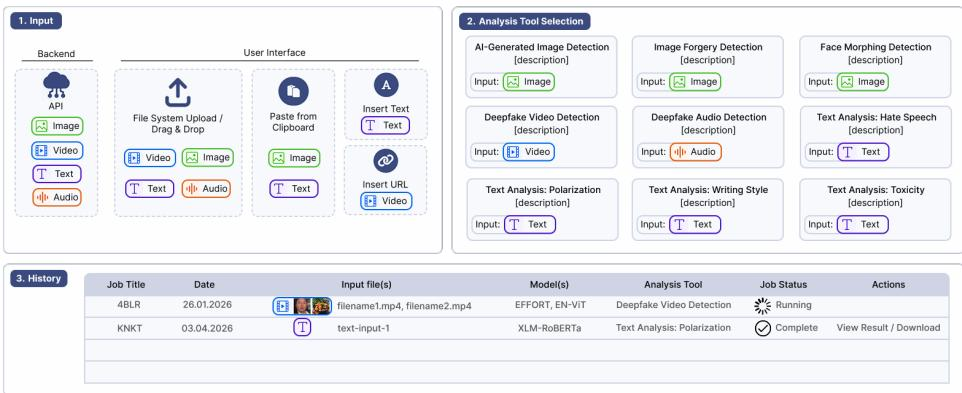
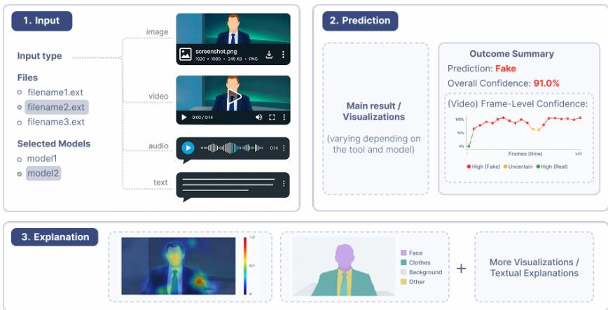
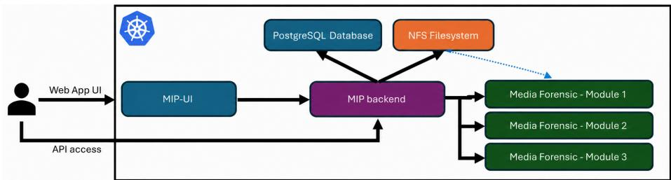
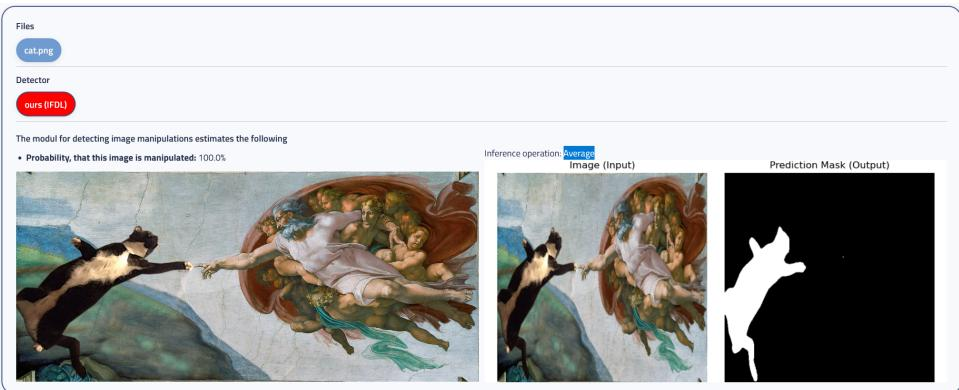
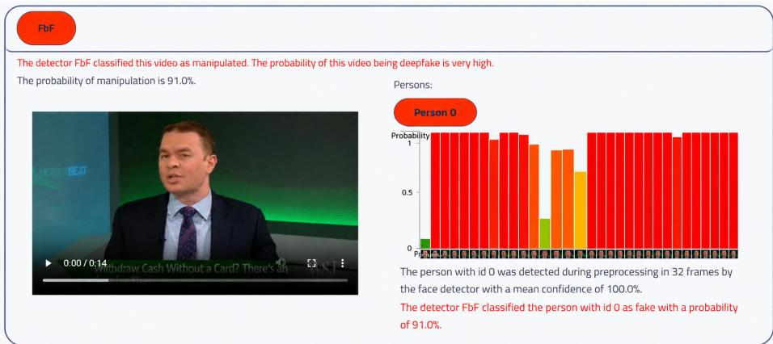
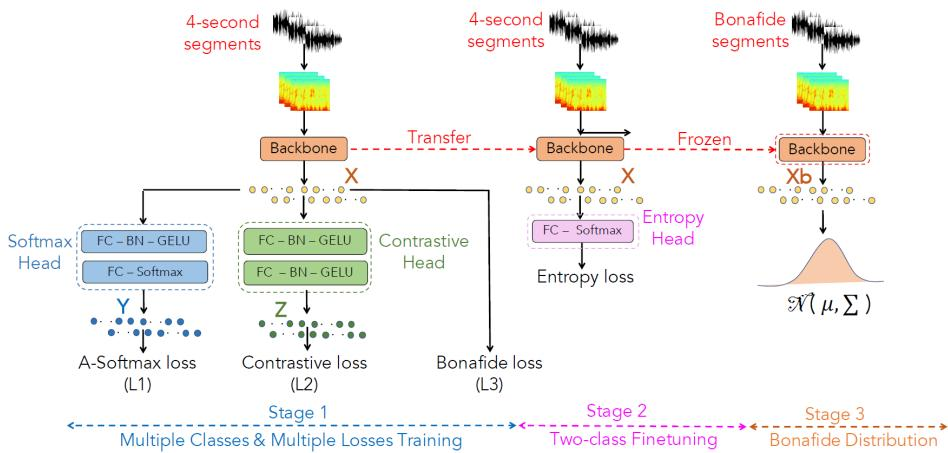

# Media Intelligence Platform: Multimodal Detection of Synthetic and Manipulated Content

David Fischinger,1 , Marcel Hasenbalg1 , Silvia Poletti1 , Davide Antonutti1 , Mina Schütz1 , Lam Pham1 , Justin Ilyes1 , Péter Rjabcsenkó1 , Simon Freitter, and Martin Boyer1

Austrian Institute of Technology, Giefinggasse 4, 1210 Vienna - Austria forname.surname@ait.ac.at https://www.ait.ac.at/en/

Abstract. The rapid progress of generative artificial intelligence has led to a significant increase in manipulated multimedia content, including synthetic faces, forged videos, AI-generated images, fake audio, and locally edited images. Existing detection approaches are typically designed for a single manipulation type, limiting their applicability in real-world scenarios involving heterogeneous media sources. In this work, we present the Media Intelligence Platform (MIP), a unified web-based framework for multimodal media forensics integrating specialized modules for fake video detection, face morphing detection, AI-generated image detection, audio deepfake detection, localized image manipulation detection, and text analysis. Its modular architecture enables flexible integration of heterogeneous models and supports future extensions for emerging manipulation techniques. Experimental results on representative benchmark datasets demonstrate reliable detection performance across multiple media modalities while providing a practical and user-friendly interface for forensic investigations. The platform highlights the potential of unified multimodal systems for comprehensive deepfake detection in real-world environments, and is accompanied by a public demonstrator released with this workshop submission to support reproducibility and community evaluation.

Keywords: Multimedia Forensics · Deepfakes · Disinformation Detection

## Introduction

Recent advances in generative artificial intelligence (AI) have significantly in-a creased the realism and accessibility of synthetic media, including manipulated or fully generated images, videos, audio, and text. Powered by difusion models and generative adversarial networks (GANs), such content can often be indistinguishable from authentic media, creating new challenges for trust, security, and privacy.

While these technologies ofer creative and practical benefits, they also enable malicious applications such as disinformation, identity fraud, deepfake pornography, and harmful online content. The rapid spread of synthetic media on social platforms has highlighted the growing need for reliable and scalable detection systems.

  
Fig. 1: MIP overview. The platform supports multimodal input upload, analysis tool selection, and job history tracking.

In response, the media forensics community has developed a wide range of specialized detectors. However, most existing approaches focus on a single manipulation type or media modality, often rely on dataset-specific training, and frequently lack transparency or practical deployment support. This limits their applicability in real-world forensic and verification scenarios.

To address these limitations, we present the Media Intelligence Platform (MIP), a unified web-based framework for multimodal media forensics. MIP integrates specialized modules for AI-generated image detection, image forgery localization, face morphing detection, deepfake video detection, audio deepfake detection, and text-based harmful content analysis. Its modular microservice architecture allows independent development and scalable deployment of heterogeneous forensic models while maintaining a consistent interface for users and external applications.

The platform provides both a user-friendly web interface and API access for practical use in forensic investigations, media verification, and trust-and-safety applications. Experimental evaluations on representative benchmark datasets demonstrate reliable performance across all supported modalities. Fig. 1 and Fig. 2 illustrate the MIP interface and result visualization workflow.

## 2 Related Work

## 2.1 Multimodal Detection Systems

Recent work has increasingly moved beyond single-modality detectors toward integrated verification platforms that combine multiple forensic models across images, videos, audio, and text. Browser-based systems such as InVID-WeVerify and the vera.ai Verification Plugin provide unified interfaces for media upload,

  
Fig. 2: Example result view showing model predictions and explainable outputs.

URL analysis, and credibility assessment [49, 76]. Similarly, DeepFake-O-Meter v2.0 [33] aggregates multiple independent detectors for deepfake images, videos, and audio within a common online platform. Commercial systems such as True-Media [75], Sensity [68], and Reality Defender [64] extend this idea with APIbased services for content moderation and fraud prevention. These systems demonstrate the growing relevance of multimodal media verification, but often sufer from limited transparency, restricted deployment options, and closed evaluation protocols.

## 2.2 AI-Generated Image Detection

Detection of AI-generated images has evolved from artifact-based methods toward more generalizable deep learning approaches. Existing methods exploit semantic inconsistencies, spatial artifacts, or generator-specific fingerprints [7, 27, 86]. More recent work has shifted toward difusion-generated images, which exhibit fewer visible artifacts and challenge traditional GAN-oriented detectors [14]. Explainable AI (XAI) methods such as Grad-CAM [67] and SHAP [43] are increasingly integrated to improve transparency and support human verification.

## 2.3 Image Forgery Detection and Localization

Image forgery detection and localization focuses on identifying manipulated regions in otherwise authentic images. Traditional methods addressed specific manipulation types such as splicing [45], copy-move [39], and inpainting [38] using handcrafted forensic traces. Recent work (for an overview see [51]) increasingly relies on deep encoder–decoder architectures such as ManTra-Net [80] and U-Net variants [25], enabling joint detection and localization of manipulated content. These approaches provide both binary authenticity decisions and pixel-level localization maps.

## 2.4 Face Morphing Attack Detection

Face morphing attack detection is typically divided into single-image (S-MAD) and diferential (D-MAD) settings [5]. Recent methods increasingly rely on deep learning, replacing handcrafted features with discriminative embedding models. In S-MAD, self-supervised and metric-learning-based approaches have shown strong performance [31,74], while D-MAD commonly employs Siamese architectures to compare probe and reference images [70].

## 2.5 Audio Deepfake Detection

Audio deepfake detection can be divided into speech deepfake detection (DSD) and environmental sound deepfake detection (DESD). Recent methods increasingly leverage large pre-trained audio foundation models such as XLSR [54], WavLM [10], and BEATs [11], which are fine-tuned for downstream detection tasks. This transfer-learning paradigm has become dominant, consistently outperforming earlier handcrafted and task-specific approaches.

## 2.6 Text-Based Detection

Text-based disinformation detection increasingly combines automated classification with explainability and interactive analysis. Existing work addresses tasks such as fact-checking, propaganda detection, sentiment analysis, and rumor detection [50,69]. More recent approaches integrate linguistic, semantic, and stylistic features to improve interpretability and robustness [35, 37]. However, most systems remain limited to isolated tasks, motivating modular architectures that combine multiple text classifiers for toxicity, hate speech, and credibility assessment. Particularly relevant to online content moderation are toxicity and hatespeech detection systems, which identify abusive, ofensive, or harmful language and are increasingly deployed as building blocks within larger trust-and-safety frameworks.

## 3 System Architecture and Integration Framework

The Media Intelligence Platform (MIP) is a modular, container-based framework for multimodal content analysis that exposes forensic and AI-based analysis components through a unified REST interface. The platform supports image and video forensics, audio analysis, and text classification, while remaining extensible to future modalities and detection methods. Each analysis component is independently developed and deployed as a microservice, allowing the platform to scale without modifying the surrounding infrastructure. The complete system runs on an on-premises Kubernetes cluster and provides a reference web frontend (MIP-UI) for user interaction and access management.

  
Fig. 3: Schematic of the MIP microservice architecture. Modules are deployed as Kubernetes pods and communicate via standardized REST APIs. Results and metadata are stored through a shared NFS file system and PostgreSQL backend.

Microservice Architecture Fig. 3 illustrates the overall architecture of MIP. We distinguish between Modules and Models. A Module represents a specific analysis task (e.g. AI-generated image detection or text classification), while a Model is the underlying neural network implementing the task. A single Module may encapsulate multiple Models behind a common interface, enabling interchangeable inference without exposing internal implementation details.

Each Module provides a standardized REST API for inference, status reporting, and result retrieval. Inputs can be uploaded directly or referenced via shared storage. Results are returned through a common ModuleResult schema, allowing uniform storage and processing across all modules. Every Module is packaged as an isolated Docker container and can optionally provide custom UI components for configuration and result visualization.

User Interface The microservice API is frontend-agnostic and allows arbitrary external applications to connect to the platform. We provide MIP-UI (Fig. 4) as a reference frontend, which implements user management, role-based access control, and job tracking. The frontend dynamically lists connected Modules, renders their configuration forms, and displays module-specific result visualizations. Through its /modules endpoint, MIP-UI also allows external partners to build custom interfaces on top of the platform.

Deployment MIP is deployed on on-premises hardware using Kubernetes and Helm-based infrastructure-as-code. The production system runs on multi-GPU hardware, while a separate development system supports internal testing. All services operate ofline, which is essential for privacy-sensitive forensic workflows.

To maximize hardware utilization, GPU resources are shared across multiple Modules using HAMi (Heterogeneous AI Computing Virtualization Middleware), enabling multiple inference services to run concurrently on a single GPU while maintaining memory isolation and fault containment.

Design Principles The platform follows four core design principles: modularity, extensibility, reproducibility, and deployment independence. These principles allow new detection modules to be integrated with minimal efort and ensure that the platform can evolve alongside emerging synthetic media threats.

  
Fig. 4: MIP-UI: reference frontend for module selection, job history, and result visualization.

## 4 Visual Media Analysis Modules

## 4.1 AI-Generated Image Detection

The increasing realism of text-to-image generation models has created a growing demand for reliable AI-generated image detection. In particular, passive forensic detectors are essential when proactive methods such as watermarking are absent or can be circumvented [72, 85].

Within MIP, the AI-generated image detection module integrates four detector variants and 16 XAI methods. The module accepts standard image formats and allows users to compare predictions across multiple models while selecting diferent XAI strategies for visual interpretation of the decision process.

To improve robustness and generalization, we combine two architectural families: Convolutional Neural Networks (CNNs) and Vision Transformers (ViTs), both of which have shown strong performance for AI-image detection [18, 87]. Specifically, the module integrates ResNet-50 [29] and ViT-B-16 [21] backbones with diferent fine-tuning strategies. While the ViT model is fully fine-tuned, the ResNet variants adapt progressively deeper layers.

Training was performed on a mixed dataset of 162k real images from MS-COCO [40] and 209k synthetic images from the AIText2Image dataset [61] that has been generated with Stable Difusion XL [60], DALL-E 2 [58] and Midjourney 5 [47]. Additional augmentations such as JPEG compression and common image filters were applied to improve robustness.

Table 1 summarizes the performance across evaluation datasets. The results show strong generalization across multiple generators unseen during training, including difusion-based models such as FLUX, Firefly, and DALL-E 3.

Table 1: F1-score (%) comparison of AI-generated image detectors on evaluation datasets. Best results per dataset are highlighted in bold. For each dataset, the image type is reported (R for real and F for fake).
<table><tr><td colspan="9">ImgN100 [16] V0C12 [22] 0Img-v7 [36] FLUX.1 [6] Firef1y [2] MJ 5&amp;6 [47, 48] DALL-E 3 [59] GLIDE [57]</td></tr><tr><td>AI Detectors</td><td>R</td><td>R</td><td>R</td><td>F</td><td>F</td><td>F</td><td>F</td><td>F</td></tr><tr><td>ResNet50[fc]</td><td>87.1</td><td>82.5</td><td>96.4</td><td>98.2</td><td>92.2</td><td>96.7</td><td>98.1</td><td>84.9</td></tr><tr><td>ResNet50[fc+14]</td><td>97.0</td><td>92.4</td><td>99.4</td><td>98.8</td><td>96.4</td><td>87.4</td><td>92.1</td><td>86.2</td></tr><tr><td>ResNet50[fc+14+13]</td><td>99.2</td><td>96.6</td><td>99.6</td><td>95.8</td><td>79.0</td><td>89.5</td><td>96.2</td><td>74.8</td></tr><tr><td>ViT-B-16</td><td>94.2</td><td>89.6</td><td>97.5</td><td>94.9</td><td>86.9</td><td>93.8</td><td>97.0</td><td>89.9</td></tr></table>

A distinguishing feature of this module is its support for explainability. The integrated XAI methods generate heatmaps that highlight image regions contributing most strongly to the classification decision. To further improve interpretability, these heatmaps are combined with object detection, allowing users to localize and identify objects that contain the most prominent AI-generation artifacts (see Fig. 2, Explanation section). This supports human analysts in understanding not only the prediction itself, but also the visual evidence behind it.

## 4.2 Image Forgery Detection and Localization

The Image Forgery Detection and Localization (IFDL) module is the primary image-forensic component of MIP and complements the AI-generated image detector by targeting classical image editing operations. In contrast to deepfake detectors, which mainly focus on synthetic faces or videos, IFDL addresses manipulations such as splicing, copy-move, inpainting, object removal, and local content replacement. These manipulations remain highly relevant in real-world misinformation and fraud scenarios [28].

Traditional forensic methods rely on handcrafted traces such as JPEG artifacts, sensor noise inconsistencies, or duplicated textures. While often interpretable, their robustness decreases under strong post-processing or recompression. Recent work therefore increasingly relies on deep learning models that learn manipulation traces directly from data [51].

Within MIP, we integrate a hybrid U-Net–based convolutional network for joint manipulation detection and localization. The model employs a ConvNeXtV2- Base encoder pretrained on ImageNet and a U-Net–style decoder to generate high-resolution segmentation masks. In addition to pixel-level localization, a classification head predicts a global authenticity score, enabling multi-task learning of both detection and localization.

Training was performed on a mixture of authentic images from MS COCO [40] and manipulated samples from DF2023 [26] and MIML [63], with standard augmentation to improve robustness. The model jointly learns to (i) classify images as authentic or manipulated and (ii) localize suspicious regions.

  
Fig. 5: Example output of the IFDL module. The manipulated input image (left) is assigned a high manipulation probability, while the predicted localization mask (right) highlights the tampered region.

Table 2: Comparison of state-of-the-art approaches and our proposed IFDL-Model in default mode respectively averaging over the results of the augmented (horizontally/vertically mirrored, rotated) input image. Highest values are highlighted in bold.
<table><tr><td rowspan="3">Models</td><td colspan="11">Test Datasets</td></tr><tr><td colspan="3">CASIA [19]</td><td colspan="2">Columbia [ [30]</td><td colspan="3">DSO [9]</td><td colspan="3">NIST [53]</td><td colspan="4">Average</td></tr><tr><td>AUC</td><td>F1</td><td>IoU</td><td>AUC</td><td>F1</td><td>IoU</td><td>AUC F1</td><td></td><td>IoU</td><td>AUC F1</td><td>IoU</td><td>AUC</td><td>F1</td><td>IoU</td><td>Mean</td></tr><tr><td>DFCN [88]</td><td>0.654</td><td>0.192</td><td>0.119</td><td>0.789</td><td>0.541 0.395</td><td>0.724</td><td>0.303</td><td>0.227</td><td>0.778</td><td>0.250</td><td>0.204</td><td>0.736</td><td>0.322</td><td>0.236</td><td>0.431</td></tr><tr><td>FSim [46]</td><td>0.554</td><td>0.169</td><td>0.102</td><td>0.731</td><td>0.604</td><td>0.474</td><td>0.796</td><td>0.487</td><td>0.371</td><td>0.642</td><td>0.188 0.123</td><td>0.681</td><td>0.362</td><td>0.268</td><td>0.437</td></tr><tr><td>MNet [80]</td><td>0.776</td><td>0.130</td><td>0.086</td><td>0.747</td><td>0.357</td><td>0.258</td><td>0.795 0.344</td><td>0.253</td><td></td><td>0.634 0.088</td><td>0.054</td><td>0.738</td><td>0.230</td><td>0.163</td><td>0.377</td></tr><tr><td>Wu22 [79]</td><td>0.873</td><td>0.509</td><td>0.465</td><td>0.862</td><td>0.707</td><td>0.608</td><td>0.854 0.436</td><td>0.308</td><td></td><td>0.783 0.332</td><td>0.255</td><td>0.843</td><td>0.496</td><td>0.409</td><td>0.583</td></tr><tr><td>DF-Net [25]</td><td>0.906</td><td>0.589</td><td>0.496</td><td>0.880</td><td>0.757</td><td>0.679</td><td>0.769 0.360</td><td>0.246</td><td></td><td>0.793 0.299</td><td>0.226</td><td>0.837</td><td>0.501</td><td>0.411</td><td>0.583</td></tr><tr><td>ours</td><td>0.907</td><td>0.705</td><td>0.639</td><td>0.983</td><td>0.960</td><td>0.945</td><td>0.831 0.611</td><td>0.508</td><td></td><td>0.761 0.423</td><td>0.346</td><td>0.871</td><td>0.675</td><td>0.609</td><td>0.718</td></tr><tr><td>ours (AVG)</td><td></td><td></td><td></td><td></td><td></td><td></td><td>0.917 0.725 0.661 0.991 0.962 0.951 0.864 0.678 0.5760.7660.428 0.352 0.884 0.698 0.635 0.739</td><td></td><td></td><td></td><td></td><td></td><td></td><td></td><td></td></tr></table>

Benchmark evaluation in Table 2 shows that the proposed model consistently outperforms previous state-of-the-art approaches across multiple forensic datasets, particularly when using test-time augmentation. This demonstrates strong generalization across diverse manipulation types and acquisition conditions.

Within MIP, the IFDL module returns both a manipulation confidence score and a localization mask, enabling transparent and human-interpretable forensic analysis (see Fig. 5 for an example). This complements the AI-generated image detector by capturing manipulations applied to otherwise authentic photographs. Combining both signals broadens the range of detectable manipulations and improves robustness in practical forensic workflows.

Future work will focus on improving robustness against unseen editing tools, strong compression, and adversarial post-processing, as well as integrating forensic evidence with metadata and cross-modal reasoning.

## 4.3 Face Morphing Detection

Face morphing combines the facial characteristics of two or more individuals into a single synthetic portrait. While originally developed for entertainment purposes, face morphing has become a serious security concern because morphed passport images can deceive face recognition systems and allow multiple individuals to authenticate against the same identity document [24]. This attack scenario, known as a face morphing attack, represents an important threat for border control, identity verification, and biometric security systems [4].

Recent morphing attack detection methods increasingly rely on deep learning, replacing handcrafted features with discriminative feature extractors pretrained on face recognition tasks. Within MIP, the deployed morphing attack detector is based on ArcFace [17] with a ResNet-100 backbone. ArcFace learns highly discriminative facial embeddings by enforcing angular separation between identities, which makes it particularly suitable for detecting morphed images that contain blended identity information.

For training, we curated a diverse morphing dataset from multiple passportlike face datasets and generated morphs using both classical landmark-based and recent deep learning–based morphing methods. This setup provides broad variability in acquisition conditions and morph generation techniques, improving generalization to unseen attacks.

The model was fine-tuned for binary classification (bona fide vs. morphed) while preserving the discriminative facial representations learned during largescale face recognition pretraining.

Table 3: Equal Error Rate (EER %) obtained by the evaluated methods on the different morph generation techniques. From left to right the generation methods are: DifMorpher, Greedy-DiM, MipGAN-II, OpenCV, StyleGAN2 and UTW.
<table><tr><td>Algorithm</td><td>DM</td><td></td><td>G-DiMMGAN-II</td><td>OCV</td><td>SGAN2</td><td>UTW</td><td>Avg.</td></tr><tr><td>SelfMAD [31]</td><td>51.45</td><td>5.45</td><td>2.90</td><td>0.59</td><td>73.25</td><td>52.98</td><td>31.10</td></tr><tr><td>SelfMAD++ [32]</td><td>48.22</td><td>25.04</td><td>2.04</td><td>0.85</td><td>46.68</td><td>14.48</td><td>22.89</td></tr><tr><td>SPL-MAD [23]</td><td>44.32</td><td>4.38</td><td>20.59</td><td>17.75</td><td>55.62</td><td>80.47</td><td>37.19</td></tr><tr><td>CrEffViT [12]</td><td>18.43</td><td>42.45</td><td>18.29</td><td>22.98</td><td>12.29</td><td>17.24</td><td>21.95</td></tr><tr><td>FatFormer [42]</td><td>16.31</td><td>10.87</td><td>1.19</td><td>6.80</td><td>12.43</td><td>12.50</td><td>10.02</td></tr><tr><td>Triplet-Loss [74]</td><td>11.85</td><td>5.33</td><td>0.98</td><td>5.10</td><td>11.56</td><td>0.70</td><td>5.92</td></tr><tr><td>ArcFace [17]</td><td>3.79</td><td>4.66</td><td>3.05</td><td>4.24</td><td>3.77</td><td>1.99</td><td>3.58</td></tr></table>

Table 3 summarizes the evaluation results. The ArcFace-based detector achieves the lowest average Equal Error Rate (EER) of 3.58% across all evaluated morph generation methods, outperforming recent morphing attack detectors and demonstrating strong robustness against both classical and learning-based morphs.

Within MIP, the Face Morphing Detection module accepts portrait images and returns a morphing probability through the standardized interface. This allows seamless integration with the remaining visual forensic modules, enabling comprehensive authenticity assessment of facial images and identity documents.

Future work will focus on improving robustness against emerging difusionbased morphing techniques, which increasingly reduce visible blending artifacts and pose new challenges for forensic analysis.

## 4.4 Face Swap Detection in Videos

Face swap is a manipulation technique that transfers the face of a source person onto a target person in images or videos. When performed frame-wise using deep learning models, the resulting manipulated videos are commonly referred to as deepfakes. The most common manipulation categories include face swap, face reenactment, lip-sync, and full face synthesis.

The deepfake video module in MIP focuses on detecting face swap and face reenactment manipulations. Given an input video, the system analyzes each detected face across sampled frames and assigns a manipulation score. The output is a per-person timeline of confidence values, enabling both frame-level and video-level forensic inspection.

Rather than proposing a new detector, we integrate 19 state-of-the-art deepfake detection methods into a unified benchmark framework following DeepFakeBench [84]. This allows direct comparison under identical preprocessing and inference conditions. For evaluation, we curated a benchmark of 1000 videos (50 real and 50 fake from each of 10 datasets), enabling cross-dataset performance analysis.

The benchmark results (Table 4) show that the strongest detectors are based on large pretrained vision backbones such as CLIP and hybrid CNN–Transformer architectures. The best-performing method, EFFORT, achieves a video AUC of 0.928, followed by Selimsef FbF (0.917) and GenConvViT (0.908).

Our analysis revealed three important findings.

Preprocessing quality. All detectors depend on accurate face detection and tracking. Weak preprocessing pipelines frequently cause missed faces, incorrect identity assignment, or unstable tracking, significantly degrading detection performance. By replacing the preprocessing stage with a unified GPU-accelerated pipeline, we improved runtime by up to 100× for some detectors while increasing robustness across all integrated methods.

Identity leakage. Cross-dataset generalization remains a major challenge. As shown in [20], many detectors implicitly learn facial identities instead of manipulation artifacts, causing strong in-dataset performance but poor transferability. Identity-disjoint train/test splits are therefore essential for reliable evaluation.

Foundation model adaptation. The best-performing methods consistently rely on large pretrained vision models and lightweight fine-tuning strategies such as LoRA, SVD-based adaptation, or partial layer unfreezing. These approaches preserve general visual representations while adapting to forensic artifacts.

Table 4: Deepfake detection methods available on the Media-Intelligence-Platform. Performance on benchmark dataset, sorted by descending video AUC.
<table><tr><td colspan="2">Detector Method Category</td><td colspan="2">Video AUC Reference</td></tr><tr><td>EFFORT</td><td>ViT, CLIP</td><td>0.928</td><td>[82]</td></tr><tr><td>selimsef FbF</td><td>CNN, Ensemble</td><td>0.917</td><td>[66]</td></tr><tr><td>GenConvViT</td><td>CNN, ViT</td><td>0.908</td><td>[78]</td></tr><tr><td>CC ViT</td><td>CNN, ViT</td><td>0.903</td><td>12</td></tr><tr><td>Efficient ViT</td><td>CNN, ViT</td><td>0.869</td><td>12</td></tr><tr><td>UCF</td><td>CNN, Disentanglement, Autoencoder</td><td>0.864</td><td>[83]</td></tr><tr><td>Xception</td><td>CNN</td><td>0.858</td><td>[65]</td></tr><tr><td>ID-unaware</td><td>CNN, Artifact Detection</td><td>0.845</td><td>[20]</td></tr><tr><td>CORE</td><td>CNN, Representation Learning</td><td>0.843</td><td>[56]</td></tr><tr><td>RECCE</td><td>CNN, Autoencoder, Graph</td><td>0.840</td><td>[8]</td></tr><tr><td>F3Net</td><td>CNN, Frequency</td><td>0.839</td><td>[62]</td></tr><tr><td>FFD</td><td>CNN, Attention</td><td>0.839</td><td>15</td></tr><tr><td>SPSL</td><td>CNN, Frequency</td><td>0.838</td><td>41</td></tr><tr><td>SRM</td><td>CNN, Frequency, Attention</td><td>0.832</td><td>44</td></tr><tr><td>CapsuleNet</td><td>CNN, Capsule Network</td><td>0.795</td><td>[55]</td></tr><tr><td>EfficientNet-B4</td><td>CNN</td><td>0.765</td><td>[73]</td></tr><tr><td>ResNet34</td><td>CNN</td><td>0.725</td><td>[29]</td></tr><tr><td>MesoNet4Inception</td><td>CNN, Inception</td><td>0.720</td><td>[3]</td></tr><tr><td>LRNet</td><td>RNN, Landmark, Temporal</td><td>0.639</td><td>[71]</td></tr></table>

  
Fig. 6: For each video and each detector result the report will display a bar chart for each person with the predicted faceswap detection confidence per frame or sequence.

Within MIP, users can select any of the 19 integrated detectors for video analysis. For each tracked individual, the system visualizes frame-wise manipulation scores and aggregated video-level predictions (Fig. 6), enabling direct comparison of detector behavior and supporting interpretable forensic analysis.

Future work will extend this framework toward emerging multimodal difusionbased video generation models, where the forensic task remains the same: determining whether facial content originates from authentic recordings or synthetic generation.

## 5 Audio Deepfake Detection

Audio deepfake detection has become increasingly important with the rapid progress of neural speech synthesis and voice cloning models. Synthetic speech can be used for impersonation, fraud, and disinformation, making robust forensic detection essential.

The Media Intelligence Platform provides a dedicated Deepfake Speech Detection (DSD) module for analyzing manipulated speech recordings. Following recent trends in the literature, the module is based on a fine-tuned pre-trained audio foundation model.

Model Architecture. The DSD module uses the pretrained WavLM backbone [10] to extract feature embeddings from 4-second audio segments. Training follows a three-stage optimization strategy (see Fig. 7). First, multiple supervisory objectives are applied jointly, including A-Softmax loss for multi-class spoof classification, Contrastive Loss to separate bona fide and spoofed embeddings, and Center Loss to compact bona fide embeddings. In the second stage, the model is fine-tuned for binary classification. In the final stage, the backbone is frozen and bona fide embeddings are used to estimate a Mahalanobis distribution, enabling anomaly-based inference for unseen spoofing attacks.

Training and Evaluation. The model was trained on ASVspoof 2019 (LA) [77], ASVspoof 2021 (LA & DF) [81], and ASVspoof5 [1]. Evaluation was performed on three unseen datasets: In-The-Wild [52], ASVspoof5 Evaluation Subset [1], and FakeAVCeleb [34], allowing assessment of cross-dataset generalization.

Table 5: Cross-dataset performance of the DSD module.
<table><tr><td>Test Dataset</td><td>Accuracy</td><td>F1 AUC</td></tr><tr><td>In-The-Wild</td><td>0.87</td><td>0.79 0.83</td></tr><tr><td>ASVspoof5 Eval</td><td>0.91</td><td>0.91 0.92</td></tr><tr><td>FakeAVCeleb</td><td>0.99</td><td>0.99 0.99</td></tr></table>

The results demonstrate strong generalization across unseen datasets, indicating robustness against a wide range of synthetic speech generation methods.

MIP Integration. Within MIP, the DSD module accepts uploaded speech recordings and returns segment-wise and recording-level authenticity predictions. This enables forensic inspection of manipulated speech and complements the platform’s visual and textual analysis modules for multimodal media verification.

## 6 Text Analysis Modules

Text-based disinformation detection cannot usually be reduced to a simple binary true/false classification problem. Instead, misleading content often manifests through multiple linguistic, semantic, stylistic, and ideological signals. To address this, MIP integrates a modular text analysis framework that combines several specialized classifiers for detecting harmful or manipulative communication patterns.

  
Fig. 7: Overview of the Deepfake Speech Detection (DSD) pipeline. The model uses a three-stage training strategy based on feature extraction, discriminative embedding learning, and Mahalanobis-based inference.

Modular Classification Framework. The framework is built around transformerbased language models, primarily XLM-RoBERTa (XLM-R) [13], fine-tuned for a range of classification tasks on German news and social media datasets. The implemented modules cover hate speech, toxicity, sexism, extremism, ofensive language, sentiment, reporting style, and writing style detection.

To improve interpretability and robustness, transformer embeddings can be combined with handcrafted linguistic features such as punctuation patterns, sentiment scores, stylistic indicators, and structural text properties. These features complement contextual embeddings by capturing rhetorical and surface-level signals relevant to manipulative communication.

Experimental results show that transformer-based models perform strongly on standard classification tasks, while fusion architectures improve robustness in multilabel and long-document settings.

Disinformation Signals. Rather than directly classifying content as “fake” or “real”, the framework focuses on identifying indicators commonly associated with disinformation and manipulation. These include propaganda framing, clickbait, sensationalism, polarization, subjective writing, toxicity, and ideological extremism. Such signals often become more informative when analyzed jointly rather than in isolation.

Rule-Based Aggregation. Classifier outputs are aggregated into four reliability levels (Highly Questionable, Questionable, Slightly Questionable, Reliable) using weighted rules based on indicator severity and co-occurrence, providing an interpretable overall assessment. This aggregation combines detector outputs using weighted rules based on the severity and co-occurrence of individual indicators, allowing a more transparent and explainable reliability assessment.

MIP Integration. Within MIP, users can run individual text classifiers independently or combine them into a unified disinformation analysis pipeline. This modular setup supports applications such as content moderation, propaganda analysis, journalism support, and credibility assessment, extending the platform beyond multimedia forensics toward broader multimodal media intelligence.

## 7 Publicly Available Demonstrator

To support reproducibility and enable exploration of the Media Intelligence Platform (MIP), we provide a publicly accessible demonstration instance at https://media-intelligence.ait.ac.at/.

The demonstrator provides access to multimodal analysis modules for images, videos, audio, and text, including AI-generated image detection, image manipulation localization, face morphing detection, deepfake video and audio detection, hate speech detection, and text toxicity detection. Readers can evaluate these modules using the demo account (mip-demo / spot\_the\_fakes2026).

## 8 Conclusion

In this paper, we presented the Media Intelligence Platform (MIP), a unified and modular framework for multimodal media forensics. Unlike most existing approaches that focus on a single manipulation type or modality, MIP integrates state-of-the-art analysis modules for AI-generated images, image forgery localization, face morphing detection, deepfake video and audio detection, and text-based content analysis within a common microservice-based architecture.

The proposed design enables scalable deployment, standardized access through REST APIs, and flexible integration of heterogeneous forensic models. By combining multiple complementary analysis modules, MIP reduces tool fragmentation and supports practical forensic workflows involving images, videos, audio, and text. Experimental evaluations across representative benchmark datasets demonstrate that the integrated modules achieve strong performance across their respective tasks. The public demonstrator further provides researchers and practitioners with direct access to the platform for experimentation and validation.

Future work will focus on extending the platform to emerging manipulation techniques, improving robustness against unseen generative models, and strengthening multimodal reasoning across heterogeneous forensic evidence.

## Acknowledgements

This work has received funding from the European Union’s Horizon Europe research and innovation programme under GA Nº 10112169 (SafeTravellers). This work was also supported by the GADMO 2.0 project, co-funded by the European Union’s Digital Europe Programme (DIGITAL) and the Austrian Research Promotion Agency (FFG), under grant agreement No. 101083573.

## References

1. The ASVspoof 2024 Challenge. https://www.asvspoof.org/ (2024)

2. Adobe: Adobe Firefly Text To Image. https://firefly.adobe.com (2024), accessed: 2025-01-16

3. Afchar, D., Nozick, V., Yamagishi, J., Echizen, I.: MesoNet: a Compact Facial Video Forgery Detection Network. In: 2018 IEEE International Workshop on Information Forensics and Security (WIFS). pp. 1–7 (2018). https://doi.org/10. 1109/WIFS.2018.8630761

4. Ambikapathy, A., Beeta, T.D., Kanna, R.K., Danquah-Amoah, A., Ramya, V.S., Mutheeswaran, U.: Biometric Application on Facial Image Recognition Techniques. In: 2024 IEEE International Conference on Computing, Power and Communication Technologies (IC2PCT). vol. 5, pp. 848–851 (2024). https://doi.org/10.1109/ IC2PCT60090.2024.10486608

5. Antonutti, D., Ilyes, J., Ruzicka, L., Poletti, S., Hasenbalg, M., Boyer, M., Fischinger, D.: Face Morphing Attack Generation and Detection: A State-of-the-Art Review. IEEE Transactions on Biometrics, Behavior, and Identity Science 8(3), 412–430 (2026). https://doi.org/10.1109/TBIOM.2026.3655515

6. Black Forest Labs: Flux. Online (2024), https://github.com/black-forestlabs/flux, accessed: 2026-06-19

7. Borji, A.: Qualitative Failures of Image Generation Models and Their Application in Detecting Deepfakes. Image and Vision Computing 137, 104771 (2023). https: //doi.org/https://doi.org/10.1016/j.imavis.2023.104771, https://www. sciencedirect.com/science/article/pii/S0262885623001452

8. Cao, J., Ma, C., Yao, T., Chen, S., Ding, S., Yang, X.: End-to-End Reconstruction-Classification Learning for Face Forgery Detection. In: 2022 IEEE/CVF Conference on Computer Vision and Pattern Recognition (CVPR). pp. 4103–4112 (2022). https://doi.org/10.1109/CVPR52688.2022.00408

9. de Carvalho, T.J., Riess, C., Angelopoulou, E., Pedrini, H., de Rezende Rocha, A.: Exposing Digital Image Forgeries by Illumination Color Classification. IEEE Transactions on Information Forensics and Security 8(7), 1182–1194 (2013). https: //doi.org/10.1109/TIFS.2013.2265677

10. Chen, S., Wang, C., Chen, Z., Wu, Y., Liu, S., Chen, Z., Li, J., Kanda, N., Yoshioka, T., Xiao, X., Wu, J., Zhou, L., Ren, S., Qian, Y., Qian, Y., Wu, J., Zeng, M., Yu, X., Wei, F.: WavLM: Large-Scale Self-Supervised Pre-Training for Full Stack Speech Processing. IEEE Journal of Selected Topics in Signal Processing 16(6), 1505–1518 (2022). https://doi.org/10.1109/JSTSP.2022.3188113

11. Chen, S., Wu, Y., Wang, C., Liu, S., Tompkins, D., Chen, Z., Che, W., Yu, X., Wei, F.: BEATs: Audio Pre-Training with Acoustic Tokenizers. In: Krause, A., Brunskill, E., Cho, K., Engelhardt, B., Sabato, S., Scarlett, J. (eds.) Proceedings

of the 40th International Conference on Machine Learning. Proceedings of Machine Learning Research, vol. 202, pp. 5178–5193. PMLR, Honolulu, Hawaii, USA (23–29 Jul 2023), https://proceedings.mlr.press/v202/chen23ag.html

12. Coccomini, D.A., Messina, N., Gennaro, C., Falchi, F.: Combining EficientNet and Vision Transformers for Video Deepfake Detection. In: Sclarof, S., Distante, C., Leo, M., Farinella, G.M., Tombari, F. (eds.) Image Analysis and Processing – ICIAP 2022. pp. 219–229. Springer International Publishing, Cham (2022)

13. Conneau, A., Khandelwal, K., Goyal, N., Chaudhary, V., Wenzek, G., Guzmán, F., Grave, E., Ott, M., Zettlemoyer, L., Stoyanov, V.: Unsupervised Cross-lingual Representation Learning at Scale. In: Jurafsky, D., Chai, J., Schluter, N., Tetreault, J. (eds.) Proceedings of the 58th Annual Meeting of the Association for Computational Linguistics. pp. 8440–8451. Association for Computational Linguistics, Online (Jul 2020). https://doi.org/10.18653/v1/2020.acl-main.747, https://aclanthology.org/2020.acl-main.747/

14. Corvi, R., Cozzolino, D., Poggi, G., Nagano, K., Verdoliva, L.: Intriguing properties of synthetic images: from generative adversarial networks to difusion models. In: 2023 IEEE/CVF Conference on Computer Vision and Pattern Recognition Workshops (CVPRW). pp. 973–982 (2023). https://doi.org/10.1109/CVPRW59228. 2023.00104

15. Dang, H., Liu, F., Stehouwer, J., Liu, X., Jain, A.K.: On the Detection of Digital Face Manipulation. In: 2020 IEEE/CVF Conference on Computer Vision and Pattern Recognition (CVPR). pp. 5780–5789 (2020). https://doi.org/10.1109/ C 42600 2020 00 82

16. Deng, J., Dong, W., Socher, R., Li, L.J., Li, K., Fei-Fei, L.: ImageNet: A Large-Scale Hierarchical Image Database. In: 2009 IEEE Conference on Computer Vision and Pattern Recognition. pp. 248–255 (2009). https://doi.org/10.1109/CVPR. 2009.5206848

17. Deng, J., Guo, J., Xue, N., Zafeiriou, S.: ArcFace: Additive Angular Margin Loss for Deep Face Recognition. 2019 IEEE/CVF Conference on Computer Vision and Pattern Recognition (CVPR) (2019)

18. Dogoulis, P., Kordopatis-Zilos, G., Kompatsiaris, I., Papadopoulos, S.: Improving Synthetically Generated Image Detection in Cross-Concept Settings. In: Proceedings of the 2nd ACM International Workshop on Multimedia AI against Disinformation. p. 28–35. MAD ’23, Association for Computing Machinery, New York, NY, USA (2023). https://doi.org/10.1145/3592572.3592846, https: //doi.org/10.1145/3592572.3592846

19. Dong, J., Wang, W., Tan, T.: CASIA Image Tampering Detection Evaluation Database. In: 2013 IEEE China Summit and International Conference on Signal and Information Processing. pp. 422–426 (2013). https://doi.org/10.1109/ ChinaSIP.2013.6625374

20. Dong, S., Wang, J., Ji, R., Liang, J., Fan, H., Ge, Z.: Implicit Identity Leakage: The Stumbling Block to Improving Deepfake Detection Generalization. In: 2023 IEEE/CVF Conference on Computer Vision and Pattern Recognition (CVPR). pp. 3994–4004 (2023). https://doi.org/10.1109/CVPR52729.2023.00389

21. Dosovitskiy, A., Beyer, L., Kolesnikov, A., Weissenborn, D., Zhai, X., Unterthiner, T., Dehghani, M., Minderer, M., Heigold, G., Gelly, S., Uszkoreit, J., Houlsby, N.: An Image is Worth 16x16 Words: Transformers for Image Recognition at Scale. In: International Conference on Learning Representations (2021), https: //openreview.net/forum?id=YicbFdNTTy

22. Everingham, M., Van Gool, L., Williams, C.K.I., Winn, J., Zisserman, A.: The PASCAL Visual Object Classes Challenge 2012 (VOC2012) Results. http://www.pascal-network.org/challenges/VOC/voc2012/workshop/index.html (2015)

23. Fang, M., Boutros, F., Damer, N.: Unsupervised Face Morphing Attack Detection via Self-paced Anomaly Detection. In: 2022 IEEE International Joint Conference on Biometrics (IJCB). pp. 1–11 (2022). https://doi.org/10.1109/IJCB54206. 2022.10008003

24. Ferrara, M., Franco, A., Maltoni, D.: The Magic Passport. In: IEEE International Joint Conference on Biometrics. pp. 1–7 (2014). https://doi.org/10.1109/BTAS. 2014.6996240

25. Fischinger, D., Boyer, M.: DF-Net: The Digital Forensics Network for Image Forgery Detection. Irish Machine Vision and Image Processing conference (2023)

26. Fischinger, D., Boyer, M.: DF2023: The Digital Forensics 2023 Dataset for Image Forgery Detection. Irish Machine Vision and Image Processing conference (2023)

27. Frank, J., Eisenhofer, T., Schönherr, L., Fischer, A., Kolossa, D., Holz, T.: Leveraging Frequency Analysis for Deep Fake Image Recognition. In: III, H.D., Singh, A. (eds.) Proceedings of the 37th International Conference on Machine Learning. Proceedings of Machine Learning Research, vol. 119, pp. 3247–3258. PMLR, Virtual (13–18 Jul 2020), https://proceedings.mlr.press/v119/frank20a.html

28. Guo, S., Cui, J., Hong, R.: Rethinking VLMs for Image Forgery Detection and Localization. arXiv:2603.12930 (2026), https://arxiv.org/abs/2603.12930

29. He, K., Zhang, X., Ren, S., Sun, J.: Deep Residual Learning for Image Recognition. In: 2016 IEEE Conference on Computer Vision and Pattern Recognition (CVPR). pp. 770–778 (2016). https://doi.org/10.1109/CVPR.2016.90

30. Hsu, Y.f., Chang, S.f.: Detecting Image Splicing using Geometry Invariants and Camera Characteristics Consistency. In: 2006 IEEE International Conference on Multimedia and Expo. pp. 549–552 (2006). https://doi.org/10.1109/ICME. 2006.262447

31. Ivanovska, M., Todorov, L., Damer, N., Jain, D.K., Peer, P., Štruc, V.: SelfMAD: Enhancing Generalization and Robustness in Morphing Attack Detection via Self-Supervised Learning. In: 2025 IEEE 19th International Conference on Automatic Face and Gesture Recognition (FG). pp. 1–10 (2025). https://doi.org/10.1109/ FG61629.2025.11099381

32. Ivanovska, M., Todorov, L., Peer, P., Štruc, V.: SelfMAD++: Self-supervised Foundation Model with Local Feature Enhancement for Generalized Morphing Attack Detection. Information Fusion 127, 103921 (2026). https://doi.org/https: //doi.org/10.1016/j.inffus.2025.103921, https://www.sciencedirect.com/ science/article/pii/S1566253525009832

33. Ju, Y., Sun, C., Jia, S., Hou, S., Si, Z., Datta, S.K., Ke, L., Zhou, R., Nikolich, A., Lyu, S.: DeepFake-o-meter v2.0: An Open Platform for DeepFake Detection. In: 2024 IEEE 7th International Conference on Multimedia Information Processing and Retrieval (MIPR). pp. 439–445 (2024). https://doi.org/10.1109/ MIPR62202.2024.00075

34. Khalid, H., Tariq, S., Kim, M., Woo, S.S.: FakeAVCeleb: A Novel Audio-Video Multimodal Deepfake Dataset. In: Thirty-fifth Conference on Neural Information Processing Systems Datasets and Benchmarks Track (Round 2) (2021)

35. Khan, F., Alturki, R., Srivastava, G., Gazzawe, F., Shah, S.T.U., Mastorakis, S.: Explainable Detection of Fake News on Social Media Using Pyramidal Co-Attention Network. IEEE Transactions on Computational Social Systems 11(4), 4574–4583 (2024). https://doi.org/10.1109/TCSS.2022.3207993

36. Kuznetsova, A., Rom, H., Alldrin, N., Uijlings, J., Krasin, I., Pont-Tuset, J., Kamali, S., Popov, S., Malloci, M., Kolesnikov, A., Duerig, T., Ferrari, V.: The Open Images Dataset V4: Unified Image Classification, Object Detection, and Visual Relationship Detection at Scale. International Journal of Computer Vision 128(7), 1956–1981 (Mar 2020). https://doi.org/10.1007/s11263-020-01316-z, http://dx.doi.org/10.1007/s11263-020-01316-z

37. Lampridis, O., Karanatsiou, D., Vakali, A.: MANIFESTO: a huMAN-centric explaInable approach for FakE news spreaders deTectiOn. Computing 104, 717–739 (2022). https://doi.org/10.1007/s00607-021-01013-w

38. Li, H., Luo, W., Huang, J.: Localization of Difusion-Based Inpainting in Digital Images. IEEE Transactions on Information Forensics and Security 12(12), 3050– 3064 (2017). https://doi.org/10.1109/TIFS.2017.2730822

39. Li, L., Li, S., Zhu, H., Chu, S.C., Roddick, J., Pan, J.S.: An Eficient Scheme for Detecting Copy-Move Forged Images by Local Binary Patterns. Journal of Information Hiding and Multimedia Signal Processing 4, 46–56 (01 2013)

40. Lin, T.Y., Maire, M., Belongie, S., Hays, J., Perona, P., Ramanan, D., Dollár, P., Zitnick, C.L.: Microsoft COCO: Common Objects in Context. In: Fleet, D., Pajdla, T., Schiele, B., Tuytelaars, T. (eds.) Computer Vision – ECCV 2014. pp. 740–755. Springer International Publishing, Cham (2014)

41. Liu, H., Li, X., Zhou, W., Chen, Y., He, Y., Xue, H., Zhang, W., Yu, N.: Spatial-Phase Shallow Learning: Rethinking Face Forgery Detection in Frequency Domain. In: 2021 IEEE/CVF Conference on Computer Vision and Pattern Recognition (CVPR). pp. 772–781 (2021). https://doi.org/10.1109/CVPR46437.2021.00083

42. Liu, H., Tan, Z., Tan, C., Wei, Y., Wang, J., Zhao, Y.: Forgery-aware Adaptive Transformer for Generalizable Synthetic Image Detection. In: 2024 IEEE/CVF Conference on Computer Vision and Pattern Recognition (CVPR). pp. 10770– 10780 (Jun 2024). https://doi.org/10.1109/CVPR52733.2024.01024, https: //ieeexplore.ieee.org/document/10657197/

43. Lundberg, S.M., Lee, S.I.: A Unified Approach to Interpreting Model Predictions. In: Proceedings of the 31st International Conference on Neural Information Processing Systems. p. 4768–4777. NIPS’17, Curran Associates Inc., Red Hook, NY, USA (2017)

44. Luo, Y., Zhang, Y., Yan, J., Liu, W.: Generalizing Face Forgery Detection with High-frequency Features. In: 2021 IEEE/CVF Conference on Computer Vision and Pattern Recognition (CVPR). pp. 16312–16321 (Jun 2021). https://doi.org/10. 1109/CVPR46437.2021.01605

45. Lyu, S., Pan, X., Zhang, X.: Exposing Region Splicing Forgeries with Blind Local Noise Estimation. International Journal of Computer Vision 110, 202–221 (11 2013). https://doi.org/10.1007/s11263-013-0688-y

46. Mayer, O., Stamm, M.C.: Forensic Similarity for Digital Images. IEEE Transactions on Information Forensics and Security 15, 1331–1346 (2020). https://doi.org/ 10.1109/TIFS.2019.2924552

47. Midjourney, Inc.: Midjourney 5.2. Online (2024), https://docs.midjourney.com/ docs/model-version-5, accessed: 2025-01-16

48. Midjourney, Inc.: Midjourney 6.1. Online (2024), https://docs.midjourney.com/ docs/models, accessed: 2025-01-16

49. Milner, R., Foster, M., Razuvayevskaya, O., Roberts, I., Porcellini, V., Teyssou, D., Bontcheva, K.: A Browser-based Open Source Assistant for Multimodal Content Verification (2026), https://arxiv.org/abs/2603.02842

50. Mohseni, S., Yang, F., Pentyala, S., Du, M., Liu, Y., Lupfer, N., Hu, X., Ji, S., Ragan, E.: Machine Learning Explanations to Prevent Overtrust in Fake News Detection. Proceedings of the International AAAI Conference on Web and Social Media 15(1), 421–431 (May 2021). https://doi.org/10.1609/icwsm.v15i1.18072, https://ojs.aaai.org/index.php/ICWSM/article/view/18072

51. Munawar, M., Oussalah, M.: Deployable Image Forgery Detection and Localization: A Comprehensive Review and Practitioner´s Guide. Expert Systems with Applications 311, 131347 (2026). https://doi.org/https://doi.org/10.1016/ j.eswa.2026.131347, https://www.sciencedirect.com/science/article/pii/ S0957417426002605

52. Müller, N., Czempin, P., Dieckmann, F., Froghyar, A., Böttinger, K.: Does Audio Deepfake Detection Generalize? (03 2022). https://doi.org/10.48550/arXiv. 2203.16263

53. National Institute of Standards and Technology (NIST): NIST Nimble 2016 Datasets. https :/ / www. nist. gov / itl /iad /mig /nimble - challenge- 2017 - evaluation/ (2016)

54. Ng, K.H., Song, T., Wu, Y., Xia, Z.: XLSR-MamBo: Scaling the Hybrid Mamba-Attention Backbone for Audio Deepfake Detection (2026), https://arxiv.org/ abs/2601.02944

55. Nguyen, H.H., Yamagishi, J., Echizen, I.: Capsule-forensics: Using Capsule Networks to Detect Forged Images and Videos. In: ICASSP 2019 - 2019 IEEE International Conference on Acoustics, Speech and Signal Processing (ICASSP). pp. 2307–2311 (May 2019). https://doi.org/10.1109/ICASSP.2019.8682602

56. Ni, Y., Meng, D., Yu, C., Quan, C., Ren, D., Zhao, Y.: CORE: Consistent Representation Learning for Face Forgery Detection. In: 2022 IEEE/CVF Conference on Computer Vision and Pattern Recognition Workshops (CVPRW). pp. 12–21 (2022). https://doi.org/10.1109/CVPRW56347.2022.00011

57. Nichol, A.Q., Dhariwal, P., Ramesh, A., Shyam, P., Mishkin, P., Mcgrew, B., Sutskever, I., Chen, M.: GLIDE: Towards Photorealistic Image Generation and Editing with Text-Guided Difusion Models. In: Chaudhuri, K., Jegelka, S., Song, L., Szepesvari, C., Niu, G., Sabato, S. (eds.) Proceedings of the 39th International Conference on Machine Learning. Proceedings of Machine Learning Research, vol. 162, pp. 16784–16804. PMLR, Baltimore, Maryland, USA (17–23 Jul 2022), https://proceedings.mlr.press/v162/nichol22a.html

58. OpenAI: DALL-E 2: Generating images from text. https://openai.com/index/ dall-e-2 (2022), accessed: 2025-01-16

59. OpenAI: DALL-E 3: Generating images from text. https://openai.com/index/ dall-e-3 (2023), accessed: 2025-01-16

60. Podell, D., English, Z., Lacey, K., Blattmann, A., Dockhorn, T., Müller, J., Penna, J., Rombach, R.: Sdxl: Improving latent difusion models for high-resolution image synthesis. arXiv preprint arXiv:2307.01952 (2023), https://arxiv.org/abs/2307. 01952

61. Poletti, S., Ilyes, J., Hasenbalg, M., Fischinger, D., Boyer, M.: AI-Generated Images: What Humans and Machines See When They Look at the Same Image (2026), https://arxiv.org/abs/2605.06143

62. Qian, Y., Yin, G., Sheng, L., Chen, Z., Shao, J.: Thinking in Frequency: Face Forgery Detection by Mining Frequency-Aware Clues. In: Computer Vision – ECCV 2020: 16th European Conference, Glasgow, UK, August 23–28, 2020, Proceedings, Part XII. p. 86–103. Springer-Verlag, Berlin, Heidelberg (2020). https: //doi.org/10.1007/978-3-030-58610-2\_6

63. Qu, C., Zhong, Y., Liu, C., Xu, G., Peng, D., Guo, F., Jin, L.: Towards Modern Image Manipulation Localization: A Large-Scale Dataset and Novel Methods. In: 2024 IEEE/CVF Conference on Computer Vision and Pattern Recognition (CVPR). pp. 10781–10790 (2024). https://doi.org/10.1109/CVPR52733.2024.01025

64. Reality Defender: Reality Defender Brings Deepfake Detection to Developers with New SDK Powered by NVIDIA. Online (2025), https : / / www.realitydefender.com/insights/reality- defender- brings- deepfakedetection-to-developers-with-new-sdk-powered-by-nvidia, accessed: 2026- 06-01

65. Rössler, A., Cozzolino, D., Verdoliva, L., Riess, C., Thies, J., Niessner, M.: Face-Forensics++: Learning to Detect Manipulated Facial Images. In: 2019 IEEE/CVF International Conference on Computer Vision (ICCV). pp. 1–11 (2019). https: //doi.org/10.1109/ICCV.2019.00009

66. Seferbekov, S.: selimsef/dfdc\_deepfake\_challenge (May 2026), https://github. com/selimsef/dfdc\_deepfake\_challenge, original-date: 2020-06-06T15:22:31Z

67. Selvaraju, R.R., Cogswell, M., Das, A., Vedantam, R., Parikh, D., Batra, D.: Grad-CAM: Visual Explanations from Deep Networks via Gradient-Based Localization. In: 2017 IEEE International Conference on Computer Vision (ICCV). pp. 618–626 (2017). https://doi.org/10.1109/ICCV.2017.74

68. Sensity AI: Deepfake Detection for Video, Image & Audio. Online (2026), https: //sensity.ai/deepfake-detection-for-video-image-audio/, accessed: 2026- 06-01

69. Shu, K., Cui, L., Wang, S., Lee, D., Liu, H.: dEFEND: Explainable Fake News Detection. In: Proceedings of the 25th ACM SIGKDD International Conference on Knowledge Discovery & Data Mining. p. 395–405. KDD ’19 (2019), https: //doi.org/10.1145/3292500.3330935

70. Soleymani, S., Chaudhary, B., Dabouei, A., Dawson, J., Nasrabadi, N.M.: Differential Morphed Face Detection Using Deep Siamese Networks. In: Del Bimbo, A., Cucchiara, R., Sclarof, S., Farinella, G.M., Mei, T., Bertini, M., Escalante, H.J., Vezzani, R. (eds.) Pattern Recognition. ICPR International Workshops and Challenges. pp. 560–572. Springer International Publishing, Cham (2021)

71. Sun, Z., Han, Y., Hua, Z., Ruan, N., Jia, W.: Improving the Eficiency and Robustness of Deepfakes Detection through Precise Geometric Features. In: 2021 IEEE/CVF Conference on Computer Vision and Pattern Recognition (CVPR). pp. 3608–3617 (2021). https://doi.org/10.1109/CVPR46437.2021.00361

72. SynthID: Identifying AI-generated Images. Online (2026), https://deepmind. google/discover/blog/identifying- ai- generated- images- with- synthid/, accessed: 2024-11-06

73. Tan, M., Le, Q.: EficientNet: Rethinking Model Scaling for Convolutional Neural Networks. In: Chaudhuri, K., Salakhutdinov, R. (eds.) Proceedings of the 36th International Conference on Machine Learning. Proceedings of Machine Learning Research, vol. 97, pp. 6105–6114. PMLR, Long Beach, California, USA (09–15 Jun 2019), https://proceedings.mlr.press/v97/tan19a.html

74. Tapia, J.E., Schulz, D., Busch, C.: Single-Morphing Attack Detection Using Few-Shot Learning and Triplet-Loss. Neurocomputing 636, 130033 (2025). https: //doi.org/https://doi.org/10.1016/j.neucom.2025.130033, https://www. sciencedirect.com/science/article/pii/S0925231225007052

75. TrueMedia: AI Media Detector. Online (2026), https://truemedia.app/, accessed: 2026-06-01

76. Vera AI: Verification Plugin. Online (2026), https://www.veraai.eu/category/ verification-plugin, accessed: 2026-06-01

77. Wang, X., Yamagishi, J., Todisco, M., Delgado, H., Nautsch, A., Evans, N., Sahidullah, M., Vestman, V., Kinnunen, T., Lee, K.A., Juvela, L., Alku, P., Peng, Y.H., Hwang, H.T., Tsao, Y., Wang, H.m., Le Maguer, S., Becker, M., Henderson, F., Ling, Z.H.: ASVspoof 2019: A large-scale public database of synthetized, converted and replayed speech. Computer Speech & Language 64, 101114 (05 2020). https://doi.org/10.1016/j.csl.2020.101114

78. Wodajo, D., Atnafu, S., Akhtar, Z.: Deepfake Video Detection Using Generative Convolutional Vision Transformer (07 2023). https://doi.org/10.48550/arXiv. 2307.07036

79. Wu, H., Zhou, J., Tian, J., Liu, J., Qiao, Y.: Robust Image Forgery Detection against Transmission over Online Social Networks. IEEE Transactions on Information Forensics and Security (2022). https://doi.org/10.1109/TIFS.2022. 3144878

80. Wu, Y., AbdAlmageed, W., Natarajan, P.: ManTra-Net: Manipulation Tracing Network for Detection and Localization of Image Forgeries With Anomalous Features. In: 2019 IEEE/CVF Conference on Computer Vision and Pattern Recognition (CVPR). pp. 9535–9544 (2019). https://doi.org/10.1109/CVPR.2019.00977

81. Yamagishi, J., Wang, X., Todisco, M., Sahidullah, M., Patino, J., Nautsch, A., Liu, X., Lee, K.A., Kinnunen, T., Evans, N., Delgado, H.: ASVspoof 2021: accelerating progress in spoofed and deepfake speech detection. In: Workshop-Automatic Speaker Verification and Spoofing Coutermeasures Challenge (ASVspoof) (2021)

82. Yan, Z., Wang, J., Jin, P., Zhang, K.Y., Liu, C., Chen, S., Yao, T., Ding, S., Wu, B., Yuan, L.: Orthogonal Subspace Decomposition for Generalizable AI-Generated Image Detection. In: Forty-second International Conference on Machine Learning (2025), https://openreview.net/forum?id=GFpjO8S8Po

83. Yan, Z., Zhang, Y., Fan, Y., Wu, B.: UCF: Uncovering Common Features for Generalizable Deepfake Detection. In: 2023 IEEE/CVF International Conference on Computer Vision (ICCV). pp. 22355–22366 (2023). https://doi.org/10.1109/ ICCV51070.2023.02048

84. Yan, Z., Zhang, Y., Yuan, X., Lyu, S., Wu, B.: DeepfakeBench: A Comprehensive Benchmark of Deepfake Detection. In: Thirty-seventh Conference on Neural Information Processing Systems Datasets and Benchmarks Track (2023), https: //openreview.net/forum?id=hizSx8pf0U

85. Yu, N., Skripniuk, V., Abdelnabi, S., Fritz, M.: Artificial Fingerprinting for Generative Models: Rooting Deepfake Attribution in Training Data. In: 2021 IEEE/CVF International Conference on Computer Vision (ICCV). pp. 14428–14437 (2021). https://doi.org/10.1109/ICCV48922.2021.01418

86. Zhong, N., Xu, Y., Li, S., Qian, Z., Zhang, X.: PatchCraft: Exploring Texture Patch for Eficient AI-generated Image Detection (Mar 2024), http://arxiv.org/ abs/2311.12397

87. Zhu, M., Chen, H., Yan, Q., Huang, X., Lin, G., Li, W., Tu, Z., Hu, H., Hu, J., Wang, Y.: GenImage: A Million-Scale Benchmark for Detecting AI-Generated Image. In: Oh, A., Naumann, T., Globerson, A., Saenko, K., Hardt, M., Levine, S. (eds.) Advances in Neural Information Processing Systems. vol. 36, pp. 77771– 77782. Curran Associates, Inc., New Orleans, Louisiana, USA (2023). https:// doi.org/10.52202/075280-3398

88. Zhuang, P., Li, H., Tan, S., Li, B., Huang, J.: Image Tampering Localization Using a Dense Fully Convolutional Network. IEEE Transactions on Information Forensics and Security 16, 2986–2999 (2021). https://doi.org/10.1109/TIFS.2021. 3070444