# MoDDiT: Simple Token Routing in Diffusion Transformers

Jarek Liesen \* 1 Matthew T. Jackson \* 1 Benjamin Ellis 1 Shimon Whiteson 1 Jakob N. Foerster 1

## Abstract

Real-time video generation, interactive world models, and on-device image synthesis are almost a reality. Diffusion Transformers (DiT) achieve excellent sample quality, shifting the bottleneck to the throughput of the models themselves. Natural images are inherently sparse, as large portions of an image are often background, contribute little to the scene content, and are easy to denoise. DiTs fail to exploit this sparsity, as they process image tokens statically and uniformly.

We propose MoDDiT, a simple architecture modification that learns to route tokens through both MLP and self-attention operations. By routing tokens through both blocks independently, MoD-DiT allows for dynamic compute allocation in MLPs that varies across tokens, images, and denoising timesteps. Using MoDDiT to train image generation models from scratch significantly reduces computational costs of training and inference, processing as few as 12.5% of the tokens. By increasing sparsity and model depth, MoD-DiT reduces costs and improves generation performance over unrouted baselines. The learned allocation is interpretable, revealing how computation varies with visual content and noise level. We also use MoDDiT to train video generation models, where allocation correlates with motion, and to distill a dense bidirectional video model into a sparse autoregressive student.

## 1. Introduction

Recent advancements in real-time video generation, interactive world models, and on-device image synthesis promise numerous new applications for generative models, and a new frontier of synthetic data. Diffusion models are at the forefront of this progress but are bottlenecked by their iterative generation procedure, which requires multiple model evaluations to generate samples. The resulting latency is often reduced by distilling models into smaller students or subsampling diffusion timesteps. A complementary axis of improvement is given by architecture modifications that reduce the cost of each inference step of the denoising process.

A promising route is exploiting sparsity, inspired by the observation that images and videos are information-sparse modalities where few patches per frame contain a large amount of information. For example, in many images the background is much simpler than the foreground and is therefore easier to denoise. This effect is magnified in videos, where patches containing static objects can be simply copied over from the previous frame. Ideally, diffusion would focus computation on more relevant patches, reducing overall latency. However, predominant diffusion architectures such as diffusion transformers (DiT, Peebles & Xie, 2023) fail to exploit this property, instead applying all operations to every token, thereby allocating compute uniformly over images and videos.

In this work, we introduce MoDDiT, a simple mechanism for routing tokens through both MLP and self-attention operations (section 3). While routing through self-attention uses fixed capacity, routing through MLPs enables dynamic compute allocation across tokens, images, and denoising timesteps (section 3.2). This allows the model to devote more computation to regions that are visually complex and difficult to denoise.

Unlike prior methods, MoDDiT reduces FLOPs during both training and inference, requires no auxiliary routing loss or post-processing, and enables efficient training on parallel GPU hardware without ragged batches. As illustrated in fig. 1, the resulting allocation is interpretable, with computation varying across image regions, samples, and denoising timesteps.

We evaluate MoDDiT across three settings: image generation, video generation, and video distillation. On ImageNet (Deng et al., 2009) (section 4), MoDDiT improves the quality–compute tradeoff over vanilla DiT across a range of routing capacities and sampling lengths. For video generation, we evaluate on the 1X World Modeling Challenge (1X, 2025) (section 5), where routing at 12.5% capacity improves video-prediction PSNR while requiring 36.92% fewer counted denoiser FLOPs on the profiled clip than the DiT baseline. Finally, we integrate sparse feedforward routing into the distillation of pretrained Wan2.1 (Wan et al., 2025), converting a dense bidirectional model into a sparse, few-step autoregressive generator (section 6). Compared with a matched dense autoregressive student, the sparse model almost matches the dense baseline with a 5% overall reduction in score on the VBench benchmark (Huang et al., 2023), while reducing inference FLOPs by 24%. We further analyze the learned routing behavior (figs. 4 and 5), showing how computation varies with denoising stage, image and patch class, and temporal change in video.

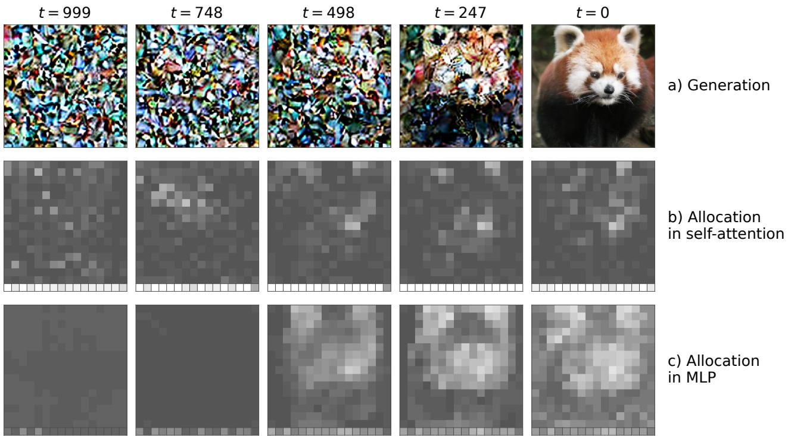  
Figure 1. Image generation and learned compute allocation in MoDDiT for a red panda example. (a) Generated images along the denoising trajectory, from left to right. (b) Self-attention allocation. (c) MLP allocation. Patch brightness indicates the proportion o blocks applied to each token at the given timestep; the strips below the allocation panels show register-token allocation.

In summary, MoDDiT provides a simple, efficient mechanism for dynamic token routing, exploiting token-level sparsity in diffusion transformers. By increasing model size and sparsity, it can increase performance while reducing training- and inference-time FLOPs. We compare routing choices and ablations on ImageNet, and give intuitive explanations for allocation across image content and time steps. On 1X, we test action-conditioned video generation and show that learned allocation varies with temporal change. Distilling Wan2.1 tests whether MoDDiT can be combined with distillation and few-step denoising, where the reduction in inference FLOPs comes with a modest reduction in VBench score.

## 2. Background

## 2.1. Diffusion Models

Diffusion models (Sohl-Dickstein et al., 2015; Ho et al., 2020; Dhariwal & Nichol, 2021) generate images by iteratively removing noise from samples drawn from a known noisy distribution. Specifically, they consist of two complementary Markov processes: a forward noising process and a reverse denoising process. In the forward process, an initial clean image x0 is progressively corrupted into a purely noisy image xT across a discrete sequence of timesteps $t = 1 , \dots , T$ , following the Gaussian conditional distribution $q ( x _ { t } \ | \ x _ { t - 1 } ) \ = \ { \mathcal N } ( x _ { t } ; { \sqrt { 1 - \beta _ { t } } } x _ { t - 1 } , \beta _ { t } I )$ where $\beta _ { t } \in ( 0 , 1 )$ defines the noise schedule at timestep t. Equivalently, this forward process can be expressed as $x _ { t } ~ = ~ \sqrt { \bar { \alpha } _ { t } } x _ { 0 } + \sqrt { 1 - \bar { \alpha } _ { t } } \epsilon$ , with $\epsilon \sim \mathcal { N } ( 0 , I )$ and $\begin{array} { r } { \bar { \alpha } _ { t } = \prod _ { i = 1 } ^ { t } ( 1 - \beta _ { i } ) } \end{array}$ . The reverse process, parameterized by a neural network, gradually reconstructs the original clean image from x to x by approximating the conditional distributions $p _ { \theta } ( \boldsymbol { x } _ { t - 1 } \mid \boldsymbol { x } _ { t } ) = \mathcal { N } ( \boldsymbol { x } _ { t - 1 } ; \mu _ { \theta } ( \boldsymbol { x } _ { t } , t ) , \boldsymbol { \Sigma } _ { \theta } ( \boldsymbol { x } _ { t } , t ) )$ Model training involves minimizing the discrepancy between the predicted and actual noise at each timestep, enabling accurate modeling of the underlying data distribution.

## 2.2. Vision- and Diffusion Transformers

Following their success in language modeling, transformers (Vaswani et al., 2017) have been successfully applied to vision tasks. Vision transformer (Dosovitskiy et al., 2020, ViT) achieves this by constructing a flattened token sequence from pixel patches. Similar to transformers, ViT models consist of alternating self-attention (Bahdanau et al., 2014) and multi-layer perceptron (MLP) blocks, with intermediate layer normalization (Ba et al., 2016). In these models, self-attention distributes information across the sample, in this case passing information between image patches, while the MLP processes tokens independently. Diffusion transformers (DiT, Peebles & Xie, 2023) adapt ViT models for image diffusion with adaptive layer normalization (adaLN), which conditions the normalization operation on the diffusion timestep and image class.

In addition to image generation, DiTs are the predominant architecture for video generation. Here, bidirectional video models such as Wan2.1 (Wan et al., 2025), which generate entire videos at once without causal constraints, are at the forefront of generation quality. To accelerate inference and allow for long-horizon generation, they are often finetuned into autoregressive models with fewer denoising steps (Yin et al., 2025; Huang et al., 2025; Zhu et al., 2026). MoDDiT is independent of, and compatible with these techniques.

Outside of diffusion, various extensions to ViT have been proposed. Darcet et al. (2023) analyse the attention map of ViT models and find attention sinks: low-information image patches with anomalously high attention weights that pool global information. Therefore, the authors propose register tokens with learned embedding values that are appended to the image sequence and discarded at the end of the forward pass. We extend our models to use register tokens to improve compute allocation, inspired by Darcet et al. (2023), who demonstrate that removing the attention sinks from the image improves the performance and alignment of saliency maps with semantic features.

## 2.3. Mixture-of-Experts Models

Mixture-of-experts (MoE, Shazeer et al., 2017; Fedus et al., 2022) approaches improve transformer scaling by dividing the transformer’s MLP blocks into multiple expert MLPs, with each token typically routed to only a single expert, as determined by a routing module, a small MLP that computes scalar scores for each token-expert pair. These scores determine the assignment of tokens to experts via (potentially stochastic) top-K selection.

While earlier approaches directly optimize stochastic routing decisions to minimize the expected loss using REINFORCE-style objectives (Bengio et al., 2015), recent work instead uses learned gating functions as the router, using the gate as a heuristic proxy for expert utility (Shazeer et al., 2017). (Raposo et al., 2024) use such a routing mechanism for sparse token processing in language processing, and we propose combining it with dynamic MLP sparsity for image patches.

## 3. Token Routing in Diffusion Transformers

MoDDiT combines a token bypass (Krause et al., 2025) with separate routing for attention and MLPs (Zhao et al., 2025; 2026), allowing for dynamic allocation in MLPs without ragged batches (Shi et al., 2025; Yuan et al., 2025).

## 3.1. Learning to Route Tokens

At the core of our method is a simple routing mechanism (see fig. 2), similar to an MoE routing module as used in (Raposo et al., 2024; You et al., 2025). Each of our router blocks consists of a tiny, two-layer MLP $R _ { \phi }$ applied independently to each token $t _ { i }$ with $i \in { 1 , \dots , N }$ to compute a scalar routing logit $R _ { \phi } ( t _ { i } )$ . During training, we apply stochastic Gumbel top-K (Jang et al., 2016; Kool et al., 2019) routing to encourage exploratory routing decisions. Specifically, for each token we sample $g _ { i } \sim$ Gumbel(0, 1) and select the K tokens with the highest perturbed score,

$$
\tilde { r } _ { i } = R _ { \phi } ( t _ { i } ) + \tau g _ { i } ,
$$

where $\tau$ is a temperature parameter. By annealing $\tau $ $0 ,$ we encourage exploration during early training while recovering increasingly deterministic top-K routing from the unperturbed logits.

As in MoE models, the router receives gradients by simultaneously acting as a gating mechanism. Similarly to Raposo et al. (2024), we multiply the output of the routed block for each token by its routing weight,

$$
r _ { i } = \sigma ( R _ { \phi } ( t _ { i } ) ) .\tag{1}
$$

## 3.2. Dynamic Allocation in MLP Routing

MLPs process each token independently, allowing for a simple way to introduce dynamic sparsity.

During training, instead of selecting the top-K tokens per sample, we can merge the batch and token dimensions and select the top-(B · K) tokens across the whole batch on each GPU (Shi et al., 2025; Yuan et al., 2025). Since samples in each batch belong to different classes and diffusion steps, the model can learn to dynamically allocate compute based on image class and diffusion step (section 4).

At inference, however, we might want to generate a single sample $( B = 1 )$ . Selecting the top- $( 1 \cdot K )$ tokens would lose the dynamic allocation based on class and noise level, thereby introducing a distribution shift in the number of selected tokens. Instead, we can approximate the global top-(B · K) operation applied during training by tracking a logit threshold T at training time, such that $p ( R _ { \phi } ( t _ { i } ) \geq$ $T ) = c$ . Here $c = K / N$ is the model capacity, i.e., the targeted fraction of tokens we route on average. We initialize at T = 0 and update $T \gets T + \alpha ( \hat { r } - c )$ , where α is a learning rate and rˆ is the fraction of tokens with a clean score $R _ { \phi } ( t _ { i } ) \ge T$

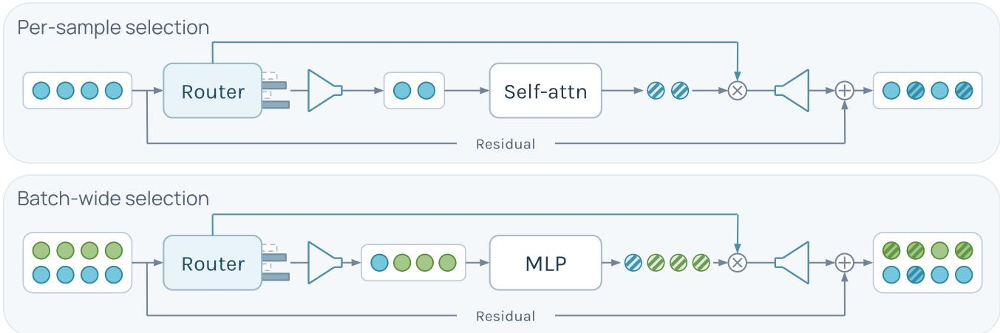  
Figure 2. Token routing in MoDDiT. Top: self-attention uses fixed top-K routing per sample, selecting two of four tokens at the illustrated 50% capacity. Bottom: MLP routing shares the training budget across samples, selecting three green tokens and one blue token. Colors denote samples; striped overlays show additive updates. Funnels gather selected tokens and scatter their updates back to the original positions. The router gates update (×) before residual addition (+); unselected tokens retain their original values.

This differs from Expert Race (Yuan et al., 2025), which averages the cutoff value to the top-K.

## 3.3. Fixed-Capacity Routing for Self-Attention

In self-attention, the number of tokens in an example determines the dimensions of its attention matrix. For efficient parallel processing on GPUs, all examples in the same batch must use attention matrices with the same dimensions. Therefore, we cannot simply give each example a different number of tokens, because this would produce differently sized matrices and prevent efficient vectorized computation. We subsequently route a fixed number of K tokens for each example.

Additionally, tokens have two distinct roles, each producing an output value and serving as context for other tokens to attend to. This opens up a design space for routing context (keys and values) and output (queries) independently, or routing based on relevance as context. We elaborate and show results for possible setups in appendix A.3.1, and find that the simple method in section 3.1 is among the best, so we select it for its simplicity.

## 4. Results on ImageNet

Experimental Setup We perform experiments on ImageNet (Deng et al., 2009), using the Face-blurred ILSVRC 2012–2017 variant (Yang et al., 2022) at 256 × 256 resolution. We train all models from scratch for 1M steps using the DiT-L/2 configuration and all hyperparameters from Peebles & Xie (2023) without further tuning. This includes using the same pre-trained variational autoencoder (Kingma et al., 2013, VAE) from Stable Diffusion (Rombach et al., 2022), with an 8× downsample factor. To make MoDDiT comparable in FLOPs with DiT, we construct MoDDiT by replacing alternate DiT blocks with two MoDDiT blocks, approximately matching DiT FLOPs for a 50% capacity model with the same configuration. For more details, see appendix A.1.

Evaluation Metrics We evaluate the performance of image generation using standard evaluation metrics of generative models: Frechet Inception Distance ( ´ Heusel et al., 2017, FID), spatial FID (Nash et al., 2021, sFID), Inception Score (Salimans et al., 2016, IS), and Precision/Recall (Kynka¨anniemi et al. ¨ , 2019), each using 50k samples.

Results Figure 3 and appendix A.2 show the FLOPsnormalized performance of 50%, 25%, and 12.5% MoDDiT models, as well as a dense DiT baseline. The 50% MoDDiT model, which we constructed to match the baseline FLOPs, consistently outperforms the DiT baseline in FID, sFID, precision, and IS. Notably, the 25% model achieves better FID, sFID, and IS, at a 22% reduction in training and inference FLOPs. Furthermore, the 12.5% model is competitive with DiT on all metrics, despite using 33% less FLOPs.

Ablations We experiment with multiple attention gating methods (see section 3.3), and present full results in appendix A.3.1. Our evaluations show that no method uniformly performs best. We thus settle for the simplest possible attention gating setup, as visualized in fig. 2. Furthermore, appendix A.3.2 shows that learned token routing substantially improves over random token selection, while independent routing does not uniformly beat coupled routing. Coupled routing has better FID, while the full method has better sFID.

Compute Allocation over Noise Levels fig. 4 shows the compute allocation of samples over denoising steps, as well as the difference in diffusion loss of MoDDiT models with different capacity levels. Again, we show only the MLP routing proportion since the self-attention capacity is constant across samples. We see increased compute allocation at lower noise levels (smaller timesteps) for all models, as well as a greater difference in allocated capacity between models, validating the qualitative example in fig. 1. The difference in loss between MoDDiT models is roughly proportional to the difference in compute allocation between them, suggesting models spend their increased capacity at low noise levels to decrease loss.

Compute Allocation over Classes We analyze compute allocation of MoDDiT models, and find that the variance within each image’s latent representation is a strong predictor of allocation (fig. 4). We hypothesize that classes with high-variance latent patches require more iterative refinement throughout the whole denoising process, for example, to update boundaries and relationships to surrounding patches. A uniform patch’s representation contains relatively less information, so additional computation adds little bonus. We find that lower-capacity models have weaker correlation, full results can be found in fig. 8.

## 5. Results on 1X

Experimental Setup We use the raw video dataset from the 1X World Modeling Challenge (1X, 2025), containing approximately 100 hours of humanoid robot POV video at 30 frames per second and 512 × 512 resolution, as well as continuous controller actions for the robot at every frame. To embed these videos for latent diffusion, we use the pretrained Cosmos Tokenizer (NVIDIA, 2025), selecting the continuous variant with an 8× spatial and temporal downsample factor. This embeds 8 contiguous video frames with dimension $8 \times 5 1 2 \times 5 1 2 \times 3$ into a latent frame with dimension $1 \times 6 4 \times 6 4 \times 1 6$ . During training, we condition models on two latent context frames, equivalent to 16 image frames, as well as the next 8 robot actions (corresponding to 1 latent frame). We train models to denoise the next latent frame conditioned on this context, and autoregressively sample latent frames during evaluation.

In order to support efficient training on video data, we also introduce spatio-temporal (ST) variants of DiT and MoDDiT, ST-DiT and ST-MoDDiT. These separate the selfattention operation into separate spatial and temporal attention operations, in which tokens attend to other tokens in the same frame or other tokens in the same position in previous frames, respectively. We compare ST-DiT and ST-MoDDiT using the DiT-L/2 configuration at 200,000 optimizer updates (appendix B.1).

Results We evaluate the 200k EMA checkpoints on 400 paired validation clips, measuring PSNR at 0.5, 1.0 and 2.0 seconds after the observed context (table 1). ST-MoDDiT at 12.5% capacity improves PSNR by 0.677, 0.376 and 0.213 dB, respectively; all three pointwise 95% paired segment-bootstrap confidence intervals exclude zero. It uses 36.92% fewer counted denoiser FLOPs on the profiled clip. Sparse and dense models use training batches of 256 and 217, respectively, so equal optimizer-update counts do not imply equal training-data exposure.

Compute Allocation over Temporal Pixel Difference Video generation models are conditioned on previous frames, making it trivial to denoise future tokens corresponding to static objects; they can just be copied over. We therefore hypothesise that dynamic objects with high optical flow should benefit from increased compute allocation in MoDDiT models. To evaluate this, we measure the allocation percentage and absolute pixel difference in 8 consecutive frames (corresponding to the temporal downsampling factor of the video tokenizer). We visualise the result in fig. 5, which shows a strong positive correlation between a token’s frame difference and allocation frequency, confirming that MoDDiT uses more FLOPs to generate frames with many dynamic objects (appendix B.2).

## 6. Sparse Distillation with Self-Forcing

Experimental Setup We investigate the distillation of pretrained Wan2.1-T2V-14B (Wan et al., 2025) into a sparse, autoregressive few-step student initialized from Wan2.1- T2V-1.3B, following Self Forcing (Huang et al., 2025). Our student retains the native 30-block architecture and generates 81-frame videos at 832 × 480 resolution, processing chunks of three latent frames with four denoising steps per chunk.

We apply MoDDiT routing to MLP sublayers and selfattention queries, retaining dense keys, values, and text cross-attention. We found that decreasing capacity throughout the model’s blocks helped preserve both global structure and fine details; see appendix C.1. We train two models, Funnel50 and Funnel20, which respectively decrease each block’s capacity from 100% to 50% and 20%. Both models use sparse attention and MLP routing. To control stochastic exploration, we adapt the routing-noise temperature to attain a target replacement rate within the top-K. The student weights and routers are jointly optimized. We gradually introduce sparsity during adaptation and use straight-through router gates to preserve the scale of pretrained updates. Training uses AdamW with gradient accumulation to obtain an effective batch size of 64. More details can be found in appendix C.1.

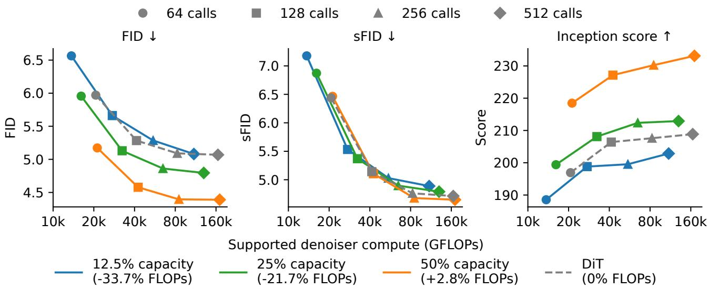  
Figure 3. ImageNet performance—we report FID-50K, sFID-50K, and IS for samples generated with varying numbers of diffusion timesteps. Precision and recall evaluation is in appendix A.2.

Table 1. 1X video prediction at 200k EMA checkpoints on 400 paired validation clips from 249 segments. The final two rows give sparse-minus-dense deltas and their pointwise 95% paired segment-bootstrap confidence intervals for PSNR gains. Denoiser TFLOPs cover the first clip’s full rollout, including both guidance branches (appendix B.1). Deltas are calculated before rounding.
<table><tr><td>Model</td><td>Parameters (M)</td><td>Denoiser (TFLOPs)↓</td><td></td><td>PSNR (dB)↑</td><td></td></tr><tr><td></td><td></td><td></td><td>+0.5s</td><td>+1.0s</td><td>+2.0s</td></tr><tr><td>ST-DiT ST-MoDDiT (12.5%)</td><td>651.2 942.7</td><td>7,746.3</td><td>24.8 25.4</td><td>22.6</td><td>21.0</td></tr><tr><td></td><td></td><td>4,886.4</td><td></td><td>23.0</td><td>21.2</td></tr><tr><td>∆ (ST-MoDDiT – ST-DiT) 95% CI</td><td>+291.5</td><td>-2,859.8</td><td>+0.68 [0.486,0.871]</td><td>+0.38 [0.229,0.515]</td><td>+0.21 [0.075,0.344]</td></tr></table>

Results We find that sparse MoDDiT models perform similarly to the dense Self Forcing baseline on the VBench benchmark, with modest reductions in most evaluation categories. The sparse models struggle particularly in generating spatial relations and multiple objects, which require compute to be distributed across the image. Overall, MoDDiT achieves a total VBench score that is 5.35% lower than the dense baseline, at a 23.98% reduction in transformer FLOPs (appendix C.2).

## 7. Related Work

Transformers have become the predominant architecture for flow-based generative modeling, in both image generation with models such as DiT (Peebles & Xie, 2023), DALL-E 3 (Goh et al., 2023), and Latte (Ma et al., 2024), as well as video generation in GAIA-2 (Russell et al., 2025), Genie 2 (Parker-Holder et al., 2024), Mochi (GenmoAI, 2024), Sora (Brooks et al., 2024), MovieGen (Polyak et al., 2024), and Wan2.1 (Wan et al., 2025). This paradigm naturally invites adaptive compute allocation, since denoising difficulty varies across noise levels and spatio-temporal regions. Furthermore, many of the downstream applications of these models, such as large-scale image generation and real-time video generation, have strict constraints on latency that require fast inference. Despite this, adaptive computation techniques have not yet been adopted in state-of-the-art models.

However, interest in this research area has recently increased. Wang et al. (2024) learn sparsity masks for pre-trained diffusion models without content-dependent selection, while Xi et al. (2025) use online profiling to sparsify spatial-temporal attention connections while retaining all tokens. Token compression methods reduce the sequence length through token merging in ToMeSD (Bolya & Hoffman, 2023). ToCa (Zou et al., 2025) and RAS (Liu et al., 2026) reuse computation across denoising timesteps through cached token features and noise predictions for inactive regions, respectively. DiffCR (You et al., 2025) routes tokens through or around whole transformer blocks and learns layer- and timestepspecific capacities with an auxiliary budget loss, evaluated by fine-tuning pretrained diffusion models.

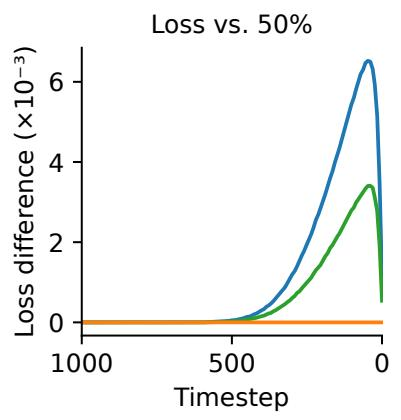

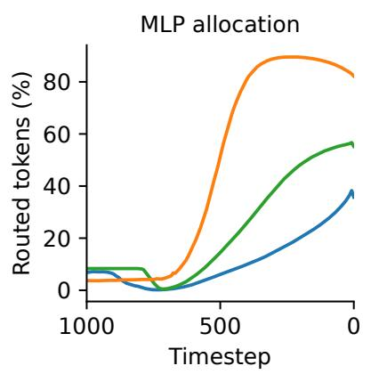

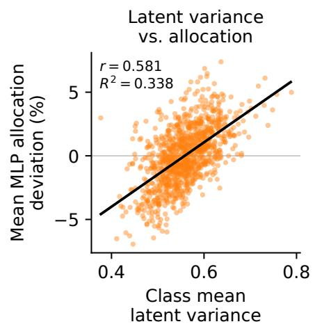  
Figure 4. MoDDiT compute allocation increases at lower noise levels, and shows a preference towards classes with higher clean latent variance.

More closely related, DyDiT (Zhao et al., 2025) and Dy-DiT++ (Zhao et al., 2026) combine timestep-conditioned width reduction with content-dependent token bypass in MLP blocks, using an auxiliary loss to control overall FLOPs. They require full self-attention during training, so sparsity is only introduced in inference. TREAD (Krause et al., 2025) accelerates training by randomly selecting tokens to bypass sequences of transformer blocks, while retaining dense computation at inference. Our method learns separate token routers for attention and MLP blocks jointly with the diffusion model from scratch, without auxiliary losses, while preserving tensor shapes for efficient batch inference with per-sample flexibility in the MLP blocks.

Mixture-of-experts mechanisms (Shazeer et al., 2017; Fedus et al., 2022, MoE) allocate computation by routing tokens among multiple MLP experts, as in EC-DiT (Sun et al., 2025). DiffMoE (Shi et al., 2025) pools tokens across examples and learns a capacity predictor for adaptive inference; Expert Race (Yuan et al., 2025) combines global token–expert competition with tracked-threshold inference. MoDDiT shares these allocation principles but applies them to a single MLP branch, combines them with independently routed sparse attention, and trains the model from scratch without a separately supervised capacity predictor or auxiliary routing objectives.

Outside of diffusion modeling, adaptive computation has become increasingly prevalent in transformer models, in order to allocate resources efficiently based on input complexity. Xin et al. (2020) propose a language model architecture with adaptive depth via an early exiting mechanism. Inspiring this work, mixture-of-depths (Raposo et al., 2024) uses a routing mechanism to limit the capacity of transformer layers in autoregressive language models. While this method shows improvements in the FLOPs-normalized performance frontier of such models, we find diffusion to be an even more suitable paradigm for this architecture, as the models avoid causal structure interfering with the top-K operation.

## 8. Conclusion

Summary MoDDiT represents a significant advancement in efficient generative modeling, effectively addressing a computational inefficiency inherent in existing diffusion models by dynamically allocating compute across tokens, samples, and noise levels. By employing a minimal yet powerful routing mechanism, MoDDiT demonstrates considerable performance improvements at the same level of compute, on both image and video generation tasks. Our evaluation also provides an intuitive understanding of the learned routing mechanism, highlighting MoDDiT’s capability to align computational effort with semantic importance and temporal dynamics. Our work thus provides a step towards unlocking generative modeling in latency- and hardwareconstrained settings and offers insights into the distribution of computational resources within diffusion models.

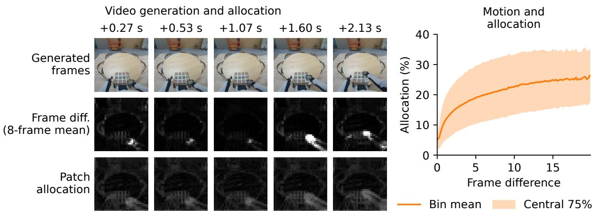

Figure 5. Compute allocation is strongly correlated with video motion—we show mean routing percentage for binned values of patch difference (clipped at the 99th percentile). Patch difference is computed as the magnitude of the difference between generated patches in adjacent frames, and the model is trained on the 1X World Modeling Dataset, with a capacity of 12.5%.  
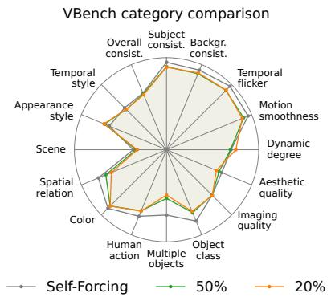

<table><tr><td>Funnel20</td><td colspan="3">Funnel50 Self-Forcing</td></tr><tr><td>VBench Total ↑ VBench Quality ↑ VBench Semantic ↑ Motion dynamic ↑</td><td>77.69 81.07 64.14 75</td><td>78.03 81.15 65.54 75</td><td>82.07 84.89 70.82</td></tr><tr><td>Instruction following ↑ Transformer TFLOPs ↓ FLOP reduction ↑</td><td>98 722.53 23.98%</td><td>100 789.93 16.88%</td><td>82 98 950.39 0%</td></tr></table>

Figure 6. Results of distilling a MoDDiT model on the VBench benchmark, as well as qualitative results compared to the dense baseline (appendix C.2).

Limitations and Future Work While our work provides an extensive evaluation, it is ultimately limited by our computational resources, providing the opportunity for further evaluation with alternate datasets, architectures, and generative algorithms. Namely, image generation datasets such as ArtBench (Liao et al., 2022) and Food (Bossard et al., 2014), as well as video generation datasets such as Taichi-HD (Siarohin et al., 2019) and Minecraft VPT (Baker et al., 2022), would strengthen confidence in the performance of MoDDiT.

While MoDDiT can substantially reduce training and inference FLOPs, this reduction does not automatically translate into wall clock time savings. Even though we observe throughput gains at larger batch sizes 1, generating few images in parallel is slower. This is likely due to a combination of the additional overhead of the gather and scatter operations, and the fact that dense matrix multiplication is already highly optimized itself. Future work can explore the development of optimized kernels for sparse MoDDiT blocks, which have proven to lead to significant performance increases for attention blocks (Dao, 2024).

Finally, MoDDiT introduces a capacity hyperparameter for the MLP and self-attention blocks, providing a range of promising avenues for further investigation. While our method avoids auxiliary losses, the addition of such a loss could enable automatic tuning of this capacity, with a regularization penalty against high compute budgets. Furthermore, we use the same capacity for both MLP and selfattention blocks. Visual inspection suggests that they have distinct allocation dynamics (fig. 1), meaning their optimal capacities likely differ and should be investigated.

## Contributions

JL and MJ co-led the project. MJ developed and implemented the initial method, ran experiments on ImageNet and 1X, and wrote the first version of the paper (May 2025). JL ran extensive ablations, modified and extended the method, added experiments including sparse distillation, and polished the manuscript. JF, SW, and BE co-supervised the project.

## References

1X. 1x world model challenge raw dataset, 2025. URL https://huggingface.co/datasets/1x-t echnologies/world\_model\_raw\_data. CC BY-NC-SA 4.0 license.

Ba, J. L., Kiros, J. R., and Hinton, G. E. Layer normalization. arXiv preprint arXiv:1607.06450, 2016.

Bahdanau, D., Cho, K., and Bengio, Y. Neural machine translation by jointly learning to align and translate. arXiv preprint arXiv:1409.0473, 2014.

Baker, B., Akkaya, I., Zhokov, P., Huizinga, J., Tang, J., Ecoffet, A., Houghton, B., Sampedro, R., and Clune, J. Video pretraining (vpt): Learning to act by watching unlabeled online videos. Advances in Neural Information Processing Systems, 35:24639–24654, 2022.

Bengio, E., Bacon, P., Pineau, J., and Precup, D. Conditional computation in neural networks for faster models. CoRR, abs/1511.06297, 2015. URL http://arxiv.org/ abs/1511.06297.

Bolya, D. and Hoffman, J. Token merging for fast stable diffusion, 2023. URL https://arxiv.org/abs/ 2303.17604.

Bossard, L., Guillaumin, M., and Van Gool, L. Food-101– mining discriminative components with random forests. In Computer vision–ECCV 2014: 13th European conference, zurich, Switzerland, September 6-12, 2014, proceedings, part VI 13, pp. 446–461. Springer, 2014.

Brooks, T., Peebles, B., Holmes, C., DePue, W., Guo, Y., Jing, L., Schnurr, D., Taylor, J., Luhman, T., Luhman, E., Ng, C. W. Y., Wang, R., and Ramesh, A. Video generation models as world simulators. OpenAI technical report, 2024.

Dao, T. FlashAttention-2: Faster attention with better parallelism and work partitioning. In International Conference on Learning Representations (ICLR), 2024.

Darcet, T., Oquab, M., Mairal, J., and Bojanowski, P. Vision transformers need registers. arXiv preprint arXiv:2309.16588, 2023.

Deng, J., Dong, W., Socher, R., Li, L.-J., Li, K., and Fei-Fei, L. Imagenet: A large-scale hierarchical image database. In 2009 IEEE Conference on Computer Vision and Pattern Recognition, pp. 248–255, 2009. doi: 10.1109/CVPR.2009.5206848.

Dhariwal, P. and Nichol, A. Diffusion models beat gans on image synthesis. Advances in neural information processing systems, 34:8780–8794, 2021.

Dosovitskiy, A., Beyer, L., Kolesnikov, A., Weissenborn, D., Zhai, X., Unterthiner, T., Dehghani, M., Minderer, M., Heigold, G., Gelly, S., et al. An image is worth 16x16 words: Transformers for image recognition at scale. arXiv preprint arXiv:2010.11929, 2020.

Fedus, W., Zoph, B., and Shazeer, N. Switch transformers: Scaling to trillion parameter models with simple and efficient sparsity. Journal of Machine Learning Research, 23(120):1–39, 2022.

GenmoAI. Mochi: Asymmetric diffusion transformer for video generation, 2024. URL https://github.c om/genmoai/mochi.

Goh, G., Betker, J., Jing, L., Ramesh, A., Brooks, T., Wang, J., Li, L., Ouyang, L., Zhuang, J., Lee, J., Dhariwal, P., Chu, C., and Jiao, J. DALL-E 3. OpenAI Technical Report, 2023. URL https://cdn.openai.com/p apers/dall-e-3.pdf.

Heusel, M., Ramsauer, H., Unterthiner, T., Nessler, B., and Hochreiter, S. Gans trained by a two time-scale update rule converge to a local nash equilibrium. Advances in neural information processing systems, 30, 2017.

Ho, J., Jain, A., and Abbeel, P. Denoising diffusion probabilistic models. Advances in neural information processing systems, 33:6840–6851, 2020.

Huang, X., Li, Z., He, G., Zhou, M., and Shechtman, E. Self forcing: Bridging the train-test gap in autoregressive video diffusion, 2025. URL https://arxiv.org/ abs/2506.08009.

Huang, Z., He, Y., Yu, J., Zhang, F., Si, C., Jiang, Y., Zhang, Y., Wu, T., Jin, Q., Chanpaisit, N., Wang, Y., Chen, X., Wang, L., Lin, D., Qiao, Y., and Liu, Z. Vbench: Comprehensive benchmark suite for video generative models, 2023. URL https://arxiv.org/abs/2311.1 7982.

Jang, E., Gu, S., and Poole, B. Categorical reparameterization with gumbel-softmax. arXiv preprint arXiv:1611.01144, 2016.

Kingma, D. P., Welling, M., et al. Auto-encoding variational bayes, 2013.

Kool, W., Van Hoof, H., and Welling, M. Stochastic beams and where to find them: The Gumbel-top-k trick for sampling sequences without replacement. In Chaudhuri, K. and Salakhutdinov, R. (eds.), Proceedings ofthe 36th International Conference on Machine Learning, volume 97 of Proceedings ofMachine Learning Research, pp. 3499– 3508. PMLR, 09–15 Jun 2019. URL https://proc eedings.mlr.press/v97/kool19a.html.

Krause, F., Phan, T., Gui, M., Baumann, S. A., Hu, V. T., and Ommer, B. Tread: Token routing for efficient architectureagnostic diffusion training, 2025. URL https://ar xiv.org/abs/2501.04765.

Kynka¨anniemi, T., Karras, T., Laine, S., Lehtinen, J., and¨ Aila, T. Improved precision and recall metric for assessing generative models. Advances in neural information processing systems, 32, 2019.

Liao, P., Li, X., Liu, X., and Keutzer, K. The artbench dataset: Benchmarking generative models with artworks. arXiv preprint arXiv:2206.11404, 2022.

Liu, Z., Yang, Y., Zhang, C., Zhang, Y., Qiu, L., You, Y., and Yang, Y. Region-adaptive sampling for diffusion transformers, 2026. URL https://arxiv.org/ab s/2502.10389.

Ma, X., Wang, Y., Jia, G., Chen, X., Liu, Z., Li, Y.-F., Chen, C., and Qiao, Y. Latte: Latent diffusion transformer for video generation. arXiv preprint arXiv:2401.03048, 2024.

Nash, C., Menick, J., Dieleman, S., and Battaglia, P. W. Generating images with sparse representations. arXiv preprint arXiv:2103.03841, 2021.

NVIDIA. Cosmos world foundation model platform for physical ai. arXiv preprint arXiv:2501.03575, 2025.

Parker-Holder, J., Ball, P., Bruce, J., Dasagi, V., Holsheimer, K., Kaplanis, C., Moufarek, A., Scully, G., Shar, J., Shi, J., Spencer, S., Yung, J., Dennis, M., Kenjeyev, S., Long, S., Mnih, V., Chan, H., Gazeau, M., Li, B., Pardo, F., Wang, L., Zhang, L., Besse, F., Harley, T., Mitenkova, A., Wang, J., Clune, J., Hassabis, D., Hadsell, R., Bolton, A., Singh, S., and Rocktaschel, T. Genie 2: A large-¨ scale foundation world model. Google DeepMind Blog, December 2024. URL https://deepmind.googl e/discover/blog/genie-2-a-large-scale -foundation-world-model.

Peebles, W. and Xie, S. Scalable diffusion models with transformers. In Proceedings ofthe IEEE/CVF international conference on computer vision, pp. 4195–4205, 2023.

Polyak, A., Zohar, A., Brown, A., Tjandra, A., Sinha, A., Lee, A., Vyas, A., Shi, B., Ma, C.-Y., Chuang, C.-Y., et al. Movie gen: A cast of media foundation models. arXiv preprint arXiv:2410.13720, 2024.

Raposo, D., Ritter, S., Richards, B., Lillicrap, T., Humphreys, P. C., and Santoro, A. Mixture-of-depths: Dynamically allocating compute in transformer-based language models. arXiv preprint arXiv:2404.02258, 2024.

Rombach, R., Blattmann, A., Lorenz, D., Esser, P., and Ommer, B. High-resolution image synthesis with latent diffusion models. In Proceedings ofthe IEEE/CVF conference on computer vision and pattern recognition, pp. 10684–10695, 2022.

Russell, L., Hu, A., Bertoni, L., Fedoseev, G., Shotton, J., Arani, E., and Corrado, G. Gaia-2: A controllable multiview generative world model for autonomous driving. arXiv preprint arXiv:2503.20523, 2025.

Salimans, T., Goodfellow, I., Zaremba, W., Cheung, V., Radford, A., and Chen, X. Improved techniques for training gans. Advances in neural information processing systems, 29, 2016.

Shazeer, N., Mirhoseini, A., Maziarz, K., Davis, A., Le, Q., Hinton, G., and Dean, J. Outrageously large neural networks: The sparsely-gated mixture-of-experts layer. arXiv preprint arXiv:1701.06538, 2017.

Shi, M., Yuan, Z., Yang, H., Wang, X., Zheng, M., Tao, X., Zhao, W., Zheng, W., Zhou, J., Lu, J., Wan, P., Zhang, D., and Gai, K. Diffmoe: Dynamic token selection for scalable diffusion transformers. arXiv preprint arXiv:2503.14487, 2025.

Siarohin, A., Lathuiliere, S., Tulyakov, S., Ricci, E., and\` Sebe, N. First order motion model for image animation. Advances in neural information processing systems, 32, 2019.

Sohl-Dickstein, J., Weiss, E., Maheswaranathan, N., and Ganguli, S. Deep unsupervised learning using nonequilibrium thermodynamics. In International conference on machine learning, pp. 2256–2265. pmlr, 2015.

Sun, H., Lei, T., Zhang, B., Li, Y., Huang, H., Pang, R., Dai, B., and Du, N. Ec-dit: Scaling diffusion transformers with adaptive expert-choice routing, 2025. URL https: //arxiv.org/abs/2410.02098.

Vaswani, A., Shazeer, N., Parmar, N., Uszkoreit, J., Jones, L., Gomez, A. N., Kaiser, Ł., and Polosukhin, I. Attention is all you need. Advances in neural information processing systems, 30, 2017.

Wan, T., Wang, A., Ai, B., Wen, B., Mao, C., Xie, C.-W., Chen, D., Yu, F., Zhao, H., Yang, J., Zeng, J., Wang, J., Zhang, J., Zhou, J., Wang, J., Chen, J., Zhu, K., Zhao, K., Yan, K., Huang, L., Feng, M., Zhang, N., Li, P., Wu, P., Chu, R., Feng, R., Zhang, S., Sun, S., Fang, T., Wang, T., Gui, T., Weng, T., Shen, T., Lin, W., Wang, W., Wang, W., Zhou, W., Wang, W., Shen, W., Yu, W., Shi, X., Huang, X., Xu, X., Kou, Y., Lv, Y., Li, Y., Liu, Y., Wang, Y., Zhang, Y., Huang, Y., Li, Y., Wu, Y., Liu, Y., Pan, Y., Zheng, Y., Hong, Y., Shi, Y., Feng, Y., Jiang, Z., Han, Z., Wu, Z.-F., and Liu, Z. Wan: Open and advanced large-scale video generative models. arXiv preprint arXiv:2503.20314, 2025.

Wang, K., Chen, J., Li, H., Mi, Z., and Zhu, J. Sparsedm: Toward sparse efficient diffusion models. arXiv preprint arXiv:2404.10445, 2024.

Xi, H., Yang, S., Zhao, Y., Xu, C., Li, M., Li, X., Lin, Y., Cai, H., Zhang, J., Li, D., Chen, J., Stoica, I., Keutzer, K., and Han, S. Sparse videogen: Accelerating video diffusion transformers with spatial-temporal sparsity. arXiv preprint arXiv:2502.01776, 2025.

Xin, J., Tang, R., Lee, J., Yu, Y., and Lin, J. Deebert: Dynamic early exiting for accelerating bert inference. In Proceedings of the 58th Annual Meeting of the Association for Computational Linguistics (ACL), pp. 2246–2251, 2020.

Yang, K., Yau, J. H., Fei-Fei, L., Deng, J., and Russakovsky, O. A study of face obfuscation in imagenet. In International conference on machine learning, pp. 25313–25330. PMLR, 2022.

Yin, T., Zhang, Q., Zhang, R., Freeman, W. T., Durand, F., Shechtman, E., and Huang, X. From slow bidirectional to fast autoregressive video diffusion models, 2025. URL https://arxiv.org/abs/2412.07772.

You, H., Barnes, C., Zhou, Y., Kang, Y., Du, Z., Zhou, W., Zhang, L., Nitzan, Y., Liu, X., Lin, Z., Shechtman, E., Amirghodsi, S., and Lin, Y. C. Layer- and timestep-adaptive differentiable token compression ratios for efficient diffusion transformers, 2025. URL https://arxiv.org/abs/2412.16822.

Yuan, Y., Wang, Z., Huang, Z., Zhu, D., Zhou, X., Yu, J., and Min, Q. Expert race: A flexible routing strategy for scaling diffusion transformer with mixture of experts, 2025. URL https://arxiv.org/abs/2503.1 6057.

Zhao, W., Han, Y., Tang, J., Wang, K., Song, Y., Huang, G., Wang, F., and You, Y. Dynamic diffusion transformer. In International Conference on Learning Representations (ICLR), 2025.

Zhao, W., Han, Y., Tang, J., Wang, K., Luo, H., Song, Y., Huang, G., Wang, F., and You, Y. Dydit++: Diffusion transformers with timestep and spatial dynamics for efficient visual generation, 2026. URL https: //arxiv.org/abs/2504.06803.

Zhu, H., Zhao, M., He, G., Su, H., Li, C., and Zhu, J. Causal forcing: Autoregressive diffusion distillation done right for high-quality real-time interactive video generation, 2026. URL https://arxiv.org/abs/2602.0 2214.

Zou, C., Liu, X., Liu, T., Huang, S., and Zhang, L. Accelerating diffusion transformers with token-wise feature caching, 2025. URL https://arxiv.org/abs/ 2410.05317.

## A. ImageNet experiments

## A.1. Training and evaluation

Dataset We perform experiments on ImageNet (Deng et al., 2009), using the Face-blurred ILSVRC 2012–2017 variant (Yang et al., 2022) at 256 × 256 resolution.

Model Architecture We train latent diffusion models using the pre-trained variational autoencoder (Kingma et al., 2013, VAE) from Stable Diffusion (Rombach et al., 2022), with an 8× downsample factor, giving a latent embedding with dimensions 32 × 32 × 4. Our baseline is the DiT-L/2 architecture from Peebles & Xie (2023). To make MoDDiT comparable in FLOPs with DiT, we construct MoDDiT by replacing alternate DiT blocks with two MoDDiT blocks, approximately matching DiT FLOPs for a 50% capacity model with the same configuration. Finally, MoDDiT models append every latent image with 16 register tokens (Darcet et al., 2023), as we found this to help with aligning allocation masks with semantic features, giving a total embedding length of 272. We initialize the final router layer at zero, such that the output is constant 0.5. We use a cosine decay for router Gumbel noise, decaying from 5 to 0 over training.

Training We train all models from scratch for 1M steps (requiring approximately 6 days on 4 L40S GPUs) using hyperparameters from Peebles & Xie (2023) without further tuning. This includes using a global batch size of 256 with AdamW using a learning rate of $1 0 ^ { - 4 } , \beta = ( 0 . 9 , 0 . 9 9 9 )$ , and no weight decay. We use an EMA value of 0.9999 throughout training.

Evaluation We evaluate all models using 50, 000 generated images at 64, 128, 256, and 512 denoising steps and a classifier-free guidance scale of 1.5. We measure FLOPs on the first 1024 generated images, including both classifier-free guidance branches, excluding the VAE decoder.

## A.2. Additional results

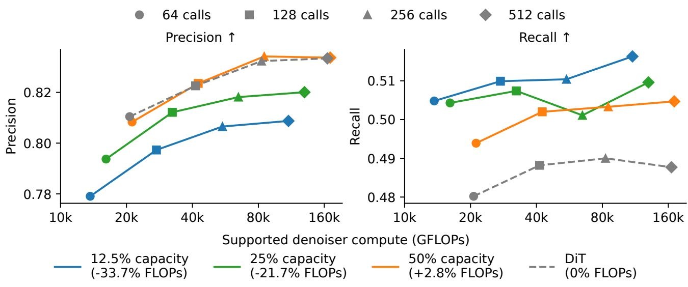  
Figure 7. ImageNet performance.

Table 2. Evaluation at 512 DDPM steps with CFG scale 1.5. Quality metrics use 50,000 images; compute estimates average 1,024 images and includes both CFG branches.
<table><tr><td>Model</td><td>TFLOPs/image</td><td>FID↓</td><td>sFID↓</td><td>IS↑</td><td>Precision ↑</td><td>Recall ↑</td></tr><tr><td>DiT-L/2</td><td>165.380</td><td>5.069</td><td>4.714</td><td>208.861</td><td>0.834</td><td>0.488</td></tr><tr><td>MoDDiT (50%)</td><td>170.316</td><td>4.390</td><td>4.649</td><td>233.120</td><td>0.834</td><td>0.505</td></tr><tr><td>MoDDiT (25%)</td><td>129.888</td><td>4.795</td><td>4.790</td><td>212.914</td><td>0.820</td><td>0.510</td></tr><tr><td>MoDDiT (12.5%)</td><td>109.783</td><td>5.081</td><td>4.889</td><td>202.856</td><td>0.809</td><td>0.516</td></tr></table>

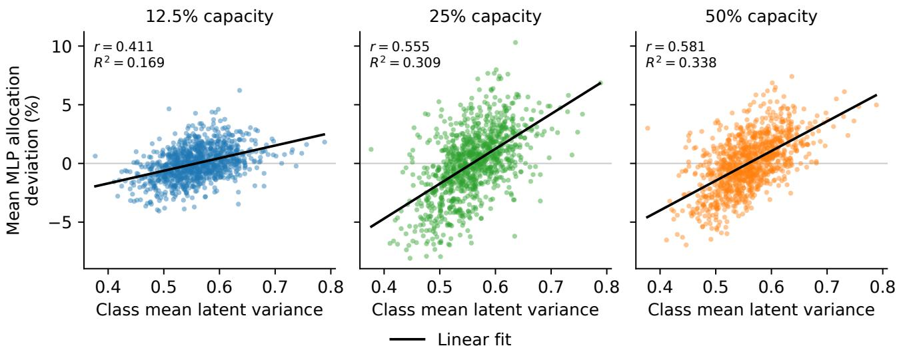  
Figure 8. Allocation is consistently correlated with mean latent variance of each class, and the correlation becomes smaller for smaller capacities.

## A.3. Routing design studies

## A.3.1. ATTENTION-ROUTING ALTERNATIVES

Gating values serve as a proxy for token selection. But what form of gating produces the most useful proxy? Multiplying the attention output by the router score incentivises retaining tokens whose outputs reduce loss. However, there is no incentive to increase the scores of tokens that serve as useful context for others to attend to. To provide such a signal, we may additionally gate the attention values using the routing scores. Let $A = \mathrm { s o f t m a x } ( Q K ^ { T } / \sqrt { d } )$ and $R = \mathrm { d i a g } ( r )$ . While standard output gating computes $R \arctan ( x ) = R A V$ , additionally gating the attention value yields

$$
R A R V = ( r r ^ { \top } \odot A ) V \quad { \mathrm { w h e r e } } \quad ( r r ^ { \top } \odot A ) _ { i j } = r _ { i } a _ { i j } r _ { j } .
$$

This formulation introduces complementary incentives to increase the score $R _ { \phi } ( t _ { i } )$ of a token $t _ { i } { \mathrm { : } }$

• Output gating: Does $t _ { i }$ reduce downstream loss by attending to other tokens?

• Value gating: Do other tokens decrease downstream loss by attending to $t _ { i } ?$

Disentangling both incentives by producing two routing scores opens a substantial design space. For example, consolidating both scores for top-K selection can be done as a sum, product, or harmonic mean. Additionally, instead of consolidating scores, one may select two different top-K subsets of tokens for $Q$ and $K / V$ , and compute cross-attention, or implement sparsity only in keys and values.

We test four of these configurations:

• Output-only: the default MoDDiT, gating only the self-attention output via $R A V$

• Shared value/output: gating the output and value by the same routing score via RARV.

• Separate routers: two routers per attention operation, producing $R _ { O }$ and $R _ { V }$ , and selecting tokens independently, then gating as $R o A R _ { V } V$

• Sparse Q/dense KV: All tokens enter attention as context, but only selected tokens contribute to the output.

## A.3.2. SELECTION AND CAPACITY ABLATIONS

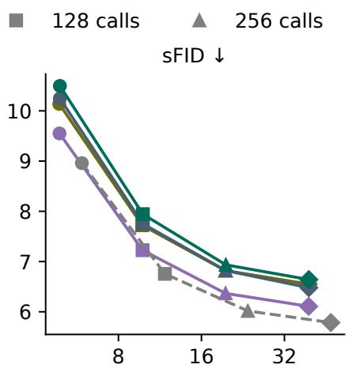

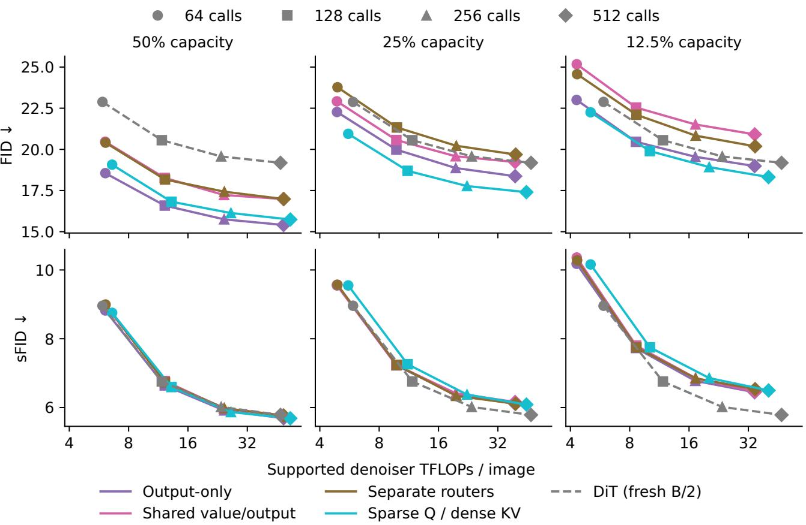  
Figure 9. Earlier routing sweep: FID and sFID versus counted denoiser arithmetic across sampling lengths and nominal capacities, using 10,000 images per point at 64, 128, 256, 512 denoising steps with classifier-free guidance scale of 4.0.  
Figure 10. Routing selection and capacity ablations. Shared whole-block routing, separate fixed-capacity routing, separate adaptive routing and random selection use 25% MoDDiT models trained for 400k updates from a common initialization.

## B. 1X video prediction

## B.1. Training and evaluation

Dataset We use the 1X World Modeling Dataset (1X, 2025), with 512 × 512 video at 30 Hz and 25-dimensional robot states.

Model architecture We use the 12.5%-capacity DiT-L/2, block-replacement scheme and register count from appendix A.1. The frozen Cosmos CV8x8x8 tokenizer (NVIDIA, 2025) produces 64 × 64 × 16 latent frames. Each frame contains 1024 spatial tokens and eight state tokens in addition to the registers. We adopt spatiotemporal attention from (Russell et al., 2025), in which a token at a fixed spatial position and timestep attends to all tokens at the same timestep, and all tokens at the same spatial position in the past.

Training We train from scratch with seed 0, using the AdamW settings and weight EMA from appendix A.1. Global batch sizes are 256 for ST-MoDDiT and 217 for ST-DiT. The learning rate warms up for 5,000 steps, then follows a cosine schedule towards $1 0 ^ { - 5 }$ at 1M steps. Routing uses Gumbel-sigmoid temperature 5.

Inference We encode the first 17 frames, then autoregressively predict eight latents (64 frames), retaining three context latents and conditioning on the next eight recorded robot states. Sampling uses 128 DDPM steps per latent and the classifier-free guidance scale from appendix A.1.

Evaluation For table 1, we evaluate both models’ EMA checkpoints at exactly 200,000 optimizer updates on 400 paired, non-overlapping 81-frame windows from 249 segments in one video from the raw validation v2.0 split. Clip identities and sampling seeds are shared across models. PSNR is computed against raw RGB frames at 0.5, 1 and 2 seconds after the observed context, averaging squared error across pixels and channels before conversion to dB. We report the clip-weighted mean and paired sparse-minus-dense gains. Pointwise 95% percentile confidence intervals use 20,000 paired bootstrap draws over segments, with seed 20261011, retaining all windows within each sampled segment. These intervals reflec evaluation variability, not training-seed variability. The temporal-change analysis in appendix B.2 uses its separately saved 300k, 100-clip cohort.

We count denoiser FLOPs over the first clip’s complete eight-latent rollout (128 DDPM calls per latent, CFG 1.5), including both guidance branches and all dense and routed blocks. Registered matrix, convolution and attention operations count a multiply-add as two FLOPs; tokenizer, scalar/nonlinear, normalization, selection and I/O work are excluded. The table reports total rollout TFLOPs, not per-call GFLOPs or measured throughput.

## B.2. Temporal change and allocation

Using the setup in appendix B.1, we measure temporal change by averaging absolute adjacent-frame grayscale differences over each latent’s temporal interval and spatial token footprint, including interval boundaries. For each spatial patch, allocation is the mean of its binary selection mask over attention and MLP branches, routed blocks, and denoising steps, expressed as a percentage. We use only the conditional guidance branch and exclude state/register tokens and dense blocks.

For fig. 5, we clip frame differences at the global 99th percentile and group them into 100 equal-width bins. The line shows mean allocation; shading spans the within-bin 12.5th–87.5th percentiles, describing observed variation rather than uncertainty in the mean. Higher temporal change is associated with greater allocation, but frame difference is not optical flow, and this association does not establish a causal benefit from routing.

## C. Self-Forcing adaptation

## C.1. Sparse architecture and adaptation

We follow the chunk-wise Self-Forcing DMD protocol (Huang et al., 2025), including its prompt data, optimization settings, and inference procedure, with the following sparse adaptation details.

Model architecture Starting from the released ODE checkpoint, we keep every third block dense and add separate routers of hidden width 256 for self-attention queries and MLP tokens in the remaining blocks. Keys, values, and text cross-attention remain dense, and we use straight-through gates to keep the output magnitude of the pretrained model. Attention uses fixed-count selection; MLP selection is fixed-count for Funnel20 and threshold-based for Funnel50 (appendix C.1).

Capacity schedules We experiment with two MoDDiT models with capacity schedules we call Funnel20 and Funnel50. Across the 30 blocks, target capacity decreases linearly from 100% at block 1 to 20% or 50% at block 30, respectively. Blocks 1, 4, 7, . . . , 28 override this schedule and remain fully dense. The names are chosen as the final-block targets, not the average model-wide capacity.

Initial qualitative experiments showed that increasing capacity in early blocks could recover structure that was otherwise lost under aggressive sparsity. We also retain dense keys and values, including cached context, so selected queries can attend to all available tokens, including tokens that receive no attention update.

Training We jointly adapt the student and routers for 3,000 ODE updates, reducing capacity to the target with a cosine schedule over the first 600 updates. Trajectories use 48 sampling steps and guidance scale 6, retaining five states each. We then run 25 critic warmup iterations and 1,000 DMD iterations, starting student EMA at iteration 200.

Evaluation We compare the final student EMA with the released dense EMA checkpoint from Self Forcing. VBench and compute protocols are in appendix C.2; qualitative comparisons are in appendix C.3.

## C.2. VBench evaluation and compute accounting

Evaluation We evaluate the released dense Self-Forcing EMA checkpoint and the Funnel50/Funnel20 EMA checkpoints after 1,000 DMD iterations using the sampling settings in appendix C.1. We use the original English VBench prompts (Huang et al., 2023), with five samples per prompt and reproducible seeds derived from the prompt and sample index. We apply the official category normalization and weights, and the total score weights quality and semantic scores 4:1. The separate motion and instruction scores in fig. 6 use 100 Causal-Forcing motion prompts, one sample each: motion is the percentage classified as dynamic, and instruction following is 100 times the mean VisionReward yes/no judgment, encoded as 1 or −1.

Scores Table 3 gives the category scores and aggregates. Relative to dense Self-Forcing, Funnel50 and Funnel20 reduce the total score by 4.93% and 5.35%, respectively, while decreasing inference FLOPs by 16.8% and 24.0%. Both lose more on multiple objects and spatial relationships than on imaging quality. This could be because they concentrate compute on a single part of the image, not capturing relationships between different image parts.

Compute We count matrix-operation FLOPs for one matched 81-frame raccoon-guitar clip at 832 × 480, seed 0 and batch size 1, including 28 denoising calls and six KV-cache updates. A multiply-add counts as two FLOPs. Dense Self-Forcing and Funnel20 use runtime operator shapes; Funnel50 uses recorded query and realized MLP token counts. Transformer costs are 950.39, 789.93 and 722.53 TFLOPs for dense, Funnel50 and Funnel20, giving reductions of 16.88% and 23.98%. Adding the shared text-encoder and VAE matrix/convolution cost of 289.39 TFLOPs reduces these savings to 12.94% and 18.38%. Counts exclude scalar/nonlinear operations, indexing, memory transfers and hardware padding. They describe arithmetic for this clip, not benchmark-wide averages or measured speedups; dynamic MLP allocation varies with the input.

## C.3. Qualitative comparisons

Table 3. VBench scores for dense Self-Forcing and percentage-point changes for sparse EMA models relative to it (positive is better). Category scores are raw values multiplied by 100; aggregates use official normalization and weighting. Deltas are computed before rounding; categories are ordered by the Funnel20 point reduction, largest first. The final row gives absolute transformer TFLOPs for the matched clip described below (lower is better).
<table><tr><td>Metric</td><td>Self-Forcing</td><td>Funnel50</td><td>Funnel20</td></tr><tr><td>Total Quality</td><td>82.07 84.89</td><td>-4.04 -3.73</td><td>-4.39 -3.82</td></tr><tr><td>Semantic Multiple objects</td><td>70.82 70.93</td><td>-5.29 -18.05</td><td>-6.68 -21.71</td></tr><tr><td>Spatial relationship</td><td>80.03</td><td>-8.72</td><td>-15.26</td></tr><tr><td>Object class</td><td>83.80</td><td>-9.79</td><td>-11.27</td></tr><tr><td>Aesthetic quality</td><td>64.92</td><td>-3.22</td><td>-6.35</td></tr><tr><td>Human action</td><td>78.20</td><td>-6.40</td><td>-6.00</td></tr><tr><td>Subject consistency</td><td>95.70</td><td>-4.11</td><td>-4.52</td></tr><tr><td>Scene</td><td>29.78</td><td>-2.65</td><td>-3.68</td></tr><tr><td>Color</td><td>89.94</td><td></td><td></td></tr><tr><td>Background consistency</td><td></td><td>-3.49</td><td>-3.43</td></tr><tr><td></td><td>95.22</td><td>-3.06</td><td>-2.42</td></tr><tr><td>Temporal flickering</td><td>99.04</td><td>-2.32</td><td>-2.20</td></tr><tr><td>Motion smoothness</td><td>98.56</td><td>-1.58</td><td>-2.01</td></tr><tr><td>Temporal style</td><td>23.44</td><td>-0.90</td><td>-0.85</td></tr><tr><td>Overall consistency</td><td>24.26</td><td>-0.36</td><td>-0.71</td></tr><tr><td>Imaging quality</td><td>70.02</td><td>-0.14</td><td>+0.32</td></tr><tr><td>Appearance style</td><td>19.23</td><td>+1.59</td><td>+1.78</td></tr><tr><td>Dynamic degree</td><td>70.00</td><td>-0.56</td><td>+5.28</td></tr><tr><td>Transformer TFLOPs ↓</td><td>950.39</td><td>789.93</td><td>722.53</td></tr></table>

MovieGen 0043 · seed 0  
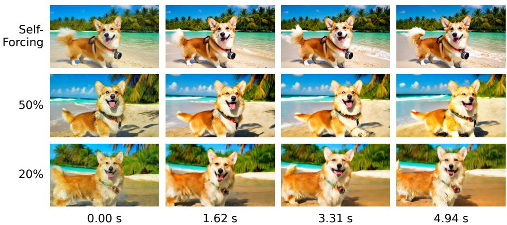  
Figure 11. Matched MovieGen prompt 0043, seed 0, for dense Self-Forcing, Funnel50 and Funnel20. Columns show frames 0, 26, 53 and 79 at 16 fps.